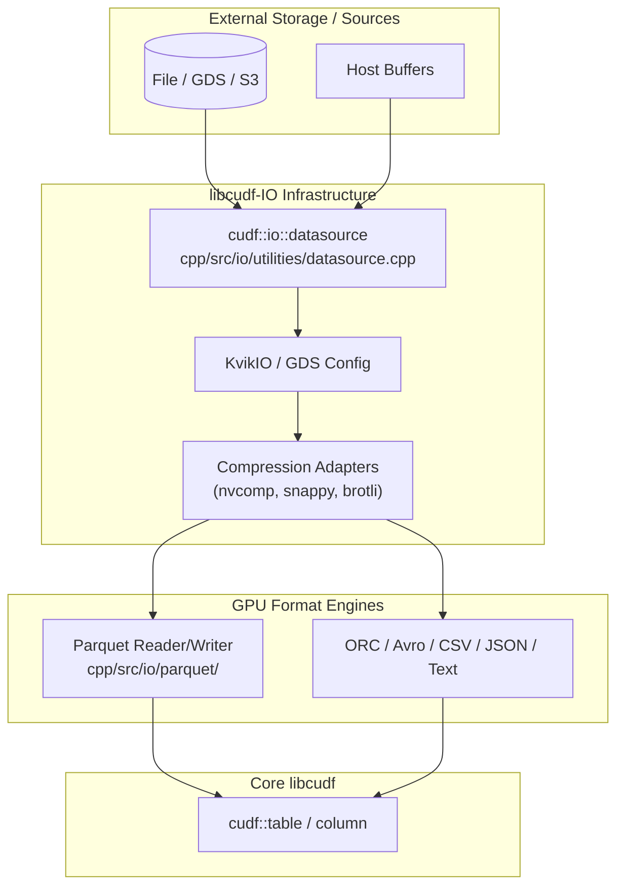

<!-- source: DeepWiki mcp.deepwiki.com · repo NVIDIA/cudf · page 3 cuDF I/O (libcudf-IO) · fetched 2026-10-26 -->

# cuDF I/O (libcudf-IO)

Relevant source files

The following files were used as context for generating this wiki page:

- [cpp/include/cudf/io/config_utils.hpp](cpp/include/cudf/io/config_utils.hpp)
- [cpp/include/cudf/io/data_sink.hpp](cpp/include/cudf/io/data_sink.hpp)
- [cpp/include/cudf/io/datasource.hpp](cpp/include/cudf/io/datasource.hpp)
- [cpp/include/cudf/io/detail/parquet.hpp](cpp/include/cudf/io/detail/parquet.hpp)
- [cpp/include/cudf/io/parquet.hpp](cpp/include/cudf/io/parquet.hpp)
- [cpp/include/cudf/io/types.hpp](cpp/include/cudf/io/types.hpp)
- [cpp/src/io/functions.cpp](cpp/src/io/functions.cpp)
- [cpp/src/io/parquet/decode_fixed.cu](cpp/src/io/parquet/decode_fixed.cu)
- [cpp/src/io/parquet/decode_preprocess.cu](cpp/src/io/parquet/decode_preprocess.cu)
- [cpp/src/io/parquet/delta_binary.cuh](cpp/src/io/parquet/delta_binary.cuh)
- [cpp/src/io/parquet/page_data.cu](cpp/src/io/parquet/page_data.cu)
- [cpp/src/io/parquet/page_data.cuh](cpp/src/io/parquet/page_data.cuh)
- [cpp/src/io/parquet/page_decode.cuh](cpp/src/io/parquet/page_decode.cuh)
- [cpp/src/io/parquet/page_delta_decode.cu](cpp/src/io/parquet/page_delta_decode.cu)
- [cpp/src/io/parquet/page_enc.cu](cpp/src/io/parquet/page_enc.cu)
- [cpp/src/io/parquet/page_hdr.cu](cpp/src/io/parquet/page_hdr.cu)
- [cpp/src/io/parquet/page_state_composed.cuh](cpp/src/io/parquet/page_state_composed.cuh)
- [cpp/src/io/parquet/page_string_decode.cu](cpp/src/io/parquet/page_string_decode.cu)
- [cpp/src/io/parquet/page_string_utils.cuh](cpp/src/io/parquet/page_string_utils.cuh)
- [cpp/src/io/parquet/parquet_gpu.hpp](cpp/src/io/parquet/parquet_gpu.hpp)
- [cpp/src/io/parquet/reader_impl.cpp](cpp/src/io/parquet/reader_impl.cpp)
- [cpp/src/io/parquet/reader_impl.hpp](cpp/src/io/parquet/reader_impl.hpp)
- [cpp/src/io/parquet/reader_impl_chunking.cu](cpp/src/io/parquet/reader_impl_chunking.cu)
- [cpp/src/io/parquet/reader_impl_chunking.hpp](cpp/src/io/parquet/reader_impl_chunking.hpp)
- [cpp/src/io/parquet/reader_impl_preprocess.cu](cpp/src/io/parquet/reader_impl_preprocess.cu)
- [cpp/src/io/parquet/writer_impl.cu](cpp/src/io/parquet/writer_impl.cu)
- [cpp/src/io/parquet/writer_impl.hpp](cpp/src/io/parquet/writer_impl.hpp)
- [cpp/src/io/utilities/config_utils.cpp](cpp/src/io/utilities/config_utils.cpp)
- [cpp/src/io/utilities/data_sink.cpp](cpp/src/io/utilities/data_sink.cpp)
- [cpp/src/io/utilities/datasource.cpp](cpp/src/io/utilities/datasource.cpp)
- [cpp/tests/io/parquet_reader_test.cpp](cpp/tests/io/parquet_reader_test.cpp)
- [cpp/tests/io/parquet_test.cpp](cpp/tests/io/parquet_test.cpp)
- [cpp/tests/io/parquet_writer_test.cpp](cpp/tests/io/parquet_writer_test.cpp)

The `libcudf-IO` subsystem provides GPU-accelerated file format readers and writers, flexible datasource and data sink abstractions, and high-performance compression/decompression layers. It bypasses host CPU bottlenecks by reading storage directly into GPU memory (via GPU Direct Storage / `KvikIO`) and executing page decoding, parsing, and encoding entirely via CUDA kernels.

For details on each format and infrastructure component, see the child pages:
- [Parquet Reader and Writer](#3.1) — Page/row-group model, chunked reads, decode kernels, encoding, thrift compact protocol, metadata.
- [ORC, Avro, CSV, JSON and Text](#3.2) — ORC stripe/RLE pipelines, Avro, CSV reader/writer, nested JSON FST/tree algorithms, multibyte_split text source.
- [I/O Infrastructure](#3.3) — datasource/data_sink, KvikIO/GDS config, hostdevice_vector and spans, compression adapters (nvcomp, snappy, brotli).

---

## Architecture Overview

The cuDF I/O subsystem sits between external file storage (or host memory buffers) and the core libcudf column/table representations (`cudf::table_view`, `cudf::column`). 

Sources: [`cpp/src/io/utilities/datasource.cpp`](), [`cpp/src/io/parquet/reader_impl.cpp`](), [`cpp/src/io/functions.cpp`]()

---

## GPU File-Format Readers & Writers

### Parquet Reader and Writer
The Parquet subsystem manages reading and writing columnar Apache Parquet files entirely on the GPU. It handles metadata parsing using Thrift compact protocols, row-group partitioning, page decoding (`PLAIN`, `RLE`, `DELTA_BINARY_PACKED`, `BYTE_STREAM_SPLIT`), and string dictionary index construction.
- For details, see [Parquet Reader and Writer](#3.1).
- Key implementation files: [`cpp/src/io/parquet/reader_impl.cpp`](), [`cpp/src/io/parquet/writer_impl.cu`](), [`cpp/src/io/parquet/page_data.cu`]()

### ORC, Avro, CSV, JSON and Text
Handles alternative data formats. ORC and Avro use stripe/RLE decoding pipelines akin to Parquet. CSV and JSON parsers utilize parallel splitting and Finite State Transducer (FST) / tree-walking algorithms on the GPU to parse unstructured or semi-structured text directly into columnar forms.
- For details, see [ORC, Avro, CSV, JSON and Text](#3.2).
- Key files: [`cpp/src/io/functions.cpp`]()

---

## I/O Infrastructure & Abstractions

### Datasource and Data Sink
`cudf::io::datasource` and `cudf::io::data_sink` provide abstract interfaces for reading from and writing to arbitrary backends (files, memory buffers, custom streams). The subsystem leverages `KvikIO` for high-throughput file access and NVIDIA GPUDirect Storage (GDS) integration when available.
- For details, see [I/O Infrastructure](#3.3).
- Key files: [`cpp/src/io/utilities/datasource.cpp`](), [`cpp/src/io/functions.cpp`]()

### Compression Layer
Compression and decompression adapters interface with third-party libraries (`nvcomp`, Snappy, Brotli, Gzip, Zstd) to compress/decompress page data asynchronously on streams before or after GPU kernel execution.
- For details, see [I/O Infrastructure](#3.3).
- Key files: [`cpp/src/io/parquet/writer_impl.cu`]()

---

