# Page: Overview

# 1. Overview

<details>
<summary>Relevant source files</summary>

The following files were used as context for generating this wiki page:

- [.github/workflows/build.yaml](.github/workflows/build.yaml)
- [.github/workflows/pandas-tests.yaml](.github/workflows/pandas-tests.yaml)
- [.github/workflows/pr.yaml](.github/workflows/pr.yaml)
- [.github/workflows/pr_issue_status_automation.yml](.github/workflows/pr_issue_status_automation.yml)
- [.github/workflows/test.yaml](.github/workflows/test.yaml)
- [.github/workflows/trigger-breaking-change-alert.yaml](.github/workflows/trigger-breaking-change-alert.yaml)
- [CHANGELOG.md](CHANGELOG.md)
- [CONTRIBUTING.md](CONTRIBUTING.md)
- [RAPIDS_BRANCH](RAPIDS_BRANCH)
- [README.md](README.md)
- [build.sh](build.sh)
- [cpp/CMakeLists.txt](cpp/CMakeLists.txt)
- [cpp/benchmarks/CMakeLists.txt](cpp/benchmarks/CMakeLists.txt)
- [cpp/benchmarks/join/join_common.hpp](cpp/benchmarks/join/join_common.hpp)
- [cpp/examples/versions.cmake](cpp/examples/versions.cmake)
- [cpp/include/cudf/detail/transform.hpp](cpp/include/cudf/detail/transform.hpp)
- [cpp/include/cudf/transform.hpp](cpp/include/cudf/transform.hpp)
- [cpp/src/transform/bools_to_mask.cu](cpp/src/transform/bools_to_mask.cu)
- [cpp/src/transform/nans_to_nulls.cu](cpp/src/transform/nans_to_nulls.cu)
- [cpp/tests/CMakeLists.txt](cpp/tests/CMakeLists.txt)
- [cpp/tests/transform/nans_to_null_test.cpp](cpp/tests/transform/nans_to_null_test.cpp)
- [docs/cudf/source/pylibcudf/developer_docs.md](docs/cudf/source/pylibcudf/developer_docs.md)
- [java/README.md](java/README.md)
- [java/ci/Dockerfile.rocky](java/ci/Dockerfile.rocky)
- [java/ci/README.md](java/ci/README.md)
- [java/ci/build-in-docker.sh](java/ci/build-in-docker.sh)
- [java/ci/env.sh](java/ci/env.sh)
- [java/pom.xml](java/pom.xml)
- [java/src/main/native/CMakeLists.txt](java/src/main/native/CMakeLists.txt)
- [python/cudf/cudf/__init__.py](python/cudf/cudf/__init__.py)
- [python/cudf/cudf/core/__init__.py](python/cudf/cudf/core/__init__.py)
- [python/cudf_polars/docs/overview.md](python/cudf_polars/docs/overview.md)
- [python/custreamz/README.md](python/custreamz/README.md)

</details>


NVIDIA cuDF is a GPU-accelerated DataFrame library designed for high-performance tabular data processing, serving as a core component of the NVIDIA CUDA-X ecosystem [README.md:1-6](). By shifting dataframes and vector operations entirely to the GPU, cuDF provides drop-in acceleration for data science and analytics pipelines.

The cuDF codebase is structured as a multi-language, multi-package stack spanning low-level C++/CUDA acceleration engines, Python wrappers and accelerators, distributed computing integrations, and Java Virtual Machine (JVM) bindings.

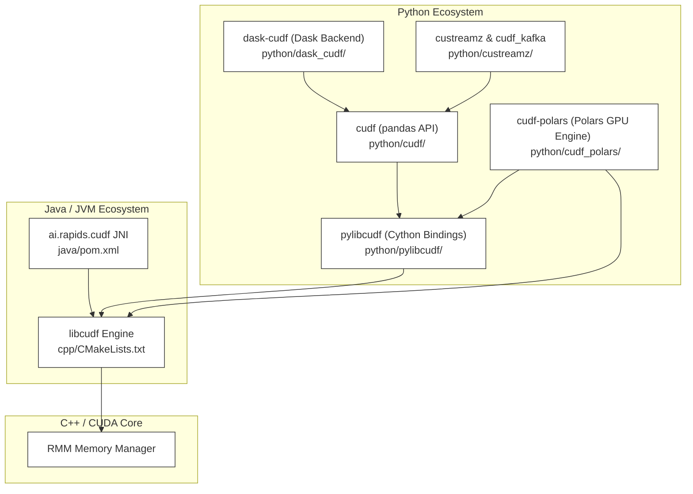
*Figure 1: cuDF Component Stack and Code Entity Architecture Map*

Sources: `README.md:10-20`, `python/cudf/cudf/__init__.py`, `python/cudf_polars/docs/overview.md`, `java/pom.xml:11-13`, `cpp/CMakeLists.txt:20-24`

---

## Stack Components Summary

cuDF is composed of several tightly integrated sub-projects and language bindings:
- **libcudf**: The foundational C++/CUDA library providing Apache Arrow-compliant GPU data structures, string operations, table formats, and relational algorithms [README.md:12-13](). Managed via `cpp/CMakeLists.txt` [cpp/CMakeLists.txt:20-24]().
- **pylibcudf**: Cython-based Python wrappers providing direct, zero-overhead bindings to `libcudf` APIs [README.md:14]().
- **cudf (Python)**: A high-level DataFrame library mirroring the `pandas` API, featuring the `cudf.pandas` zero-code-change acceleration proxy [README.md:15-17]().
- **cudf-polars**: A high-performance execution engine that translates Polars logical plans and expressions into GPU kernels [README.md:18]().
- **dask-cudf**: Distributed GPU DataFrame collection supporting Dask task graphs and multi-GPU parquet/csv/orc operations [README.md:19]().
- **Java JNI Bindings**: The `ai.rapids.cudf` Maven artifact bridging JVM workloads (such as Apache Spark) to native `libcudf` routines [java/pom.xml:11-13](), `java/src/main/native/CMakeLists.txt` [java/src/main/native/CMakeLists.txt:21-25]().

Sources: `README.md:10-20`, `cpp/CMakeLists.txt:20-24`, `java/pom.xml:11-13`, `java/src/main/native/CMakeLists.txt:21-25`

---

## 1.1 Getting Started and Building

Building cuDF from source or setting up a development environment requires configuring specific compilation options, compiler versions, and target dependencies [CONTRIBUTING.md:79-105](). 

The repository provides an orchestration script, `build.sh`, which accepts fine-grained target selections such as `libcudf`, `pylibcudf`, `cudf`, `cudf_polars`, `dask_cudf`, and `benchmarks` [build.sh:21-37](). C++ components are built using `CMake` (requiring CMake 3.29.6+ and CUDA 12.2+) [cpp/CMakeLists.txt:8-31](), while Python components rely on `pyproject.toml` and standard PEP 517 build backends. Developers can leverage pre-configured `conda` environments defined under `conda/environments/` [CONTRIBUTING.md:121-128] or use containerized devcontainers for isolation [.github/workflows/pr.yaml:158-166]().

For detailed instructions on setting up environments, custom CMake flags, build targets, and running tests, see [Getting Started and Building](#1.1).

Sources: `build.sh:21-54`, `cpp/CMakeLists.txt:8-31`, `CONTRIBUTING.md:79-128`, `.github/workflows/pr.yaml:158-166`

---

## 1.2 Repository Layout

The cuDF repository is organized into distinct top-level directories separating core C++ engines, Python bindings, Java layers, continuous integration pipelines, and documentation:

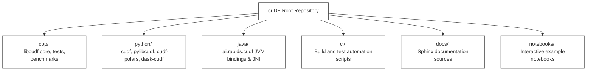
*Figure 2: Top-Level Repository Directory Map*

- `cpp/`: Contains `libcudf`, `libcudf_kafka`, `libcudf_streaming`, C++ unit tests (`cpp/tests/`), and benchmarks (`cpp/benchmarks/`) [build.sh:21-37]().
- `python/`: Houses the Python packages including `cudf`, `pylibcudf`, `cudf_polars`, `dask_cudf`, and `custreamz` [build.sh:21-37]().
- `java/`: Contains the Maven project structure, JVM classes, and native JNI bridge implementations (`java/src/main/native/`) [java/src/main/native/CMakeLists.txt:1-25]().
- `ci/`: Contains orchestration scripts for GitHub Actions testing, linters, and package builds [.github/workflows/pr.yaml:102-125]().
- `docs/` & `notebooks/`: Sphinx documentation configurations and user guide notebooks [CONTRIBUTING.md:22-37]().

For a comprehensive tour of top-level directories and their internal subfolders, see [Repository Layout](#1.2).

Sources: `build.sh:21-64`, `java/src/main/native/CMakeLists.txt:1-25`, `.github/workflows/pr.yaml:102-125`, `CONTRIBUTING.md:22-37`

---

# Page: Getting Started and Building

# Getting Started and Building

<details>
<summary>Relevant source files</summary>

The following files were used as context for generating this wiki page:

- [.github/workflows/build.yaml](.github/workflows/build.yaml)
- [.github/workflows/pandas-tests.yaml](.github/workflows/pandas-tests.yaml)
- [.github/workflows/pr.yaml](.github/workflows/pr.yaml)
- [.github/workflows/pr_issue_status_automation.yml](.github/workflows/pr_issue_status_automation.yml)
- [.github/workflows/test.yaml](.github/workflows/test.yaml)
- [.github/workflows/trigger-breaking-change-alert.yaml](.github/workflows/trigger-breaking-change-alert.yaml)
- [CHANGELOG.md](CHANGELOG.md)
- [CONTRIBUTING.md](CONTRIBUTING.md)
- [RAPIDS_BRANCH](RAPIDS_BRANCH)
- [README.md](README.md)
- [build.sh](build.sh)
- [conda/environments/all_cuda-129_arch-aarch64.yaml](conda/environments/all_cuda-129_arch-aarch64.yaml)
- [conda/environments/all_cuda-129_arch-x86_64.yaml](conda/environments/all_cuda-129_arch-x86_64.yaml)
- [conda/environments/all_cuda-133_arch-aarch64.yaml](conda/environments/all_cuda-133_arch-aarch64.yaml)
- [conda/environments/all_cuda-133_arch-x86_64.yaml](conda/environments/all_cuda-133_arch-x86_64.yaml)
- [conda/recipes/libcudf/conda_build_config.yaml](conda/recipes/libcudf/conda_build_config.yaml)
- [cpp/CMakeLists.txt](cpp/CMakeLists.txt)
- [cpp/benchmarks/CMakeLists.txt](cpp/benchmarks/CMakeLists.txt)
- [cpp/benchmarks/join/join_common.hpp](cpp/benchmarks/join/join_common.hpp)
- [cpp/examples/versions.cmake](cpp/examples/versions.cmake)
- [cpp/include/cudf/detail/transform.hpp](cpp/include/cudf/detail/transform.hpp)
- [cpp/include/cudf/transform.hpp](cpp/include/cudf/transform.hpp)
- [cpp/src/transform/bools_to_mask.cu](cpp/src/transform/bools_to_mask.cu)
- [cpp/src/transform/nans_to_nulls.cu](cpp/src/transform/nans_to_nulls.cu)
- [cpp/tests/CMakeLists.txt](cpp/tests/CMakeLists.txt)
- [cpp/tests/transform/nans_to_null_test.cpp](cpp/tests/transform/nans_to_null_test.cpp)
- [dependencies.yaml](dependencies.yaml)
- [docs/cudf/source/pylibcudf/developer_docs.md](docs/cudf/source/pylibcudf/developer_docs.md)
- [java/README.md](java/README.md)
- [java/ci/Dockerfile.rocky](java/ci/Dockerfile.rocky)
- [java/ci/README.md](java/ci/README.md)
- [java/ci/build-in-docker.sh](java/ci/build-in-docker.sh)
- [java/ci/env.sh](java/ci/env.sh)
- [java/pom.xml](java/pom.xml)
- [java/src/main/native/CMakeLists.txt](java/src/main/native/CMakeLists.txt)
- [python/cudf/pyproject.toml](python/cudf/pyproject.toml)
- [python/cudf_kafka/pyproject.toml](python/cudf_kafka/pyproject.toml)
- [python/cudf_polars/docs/overview.md](python/cudf_polars/docs/overview.md)
- [python/cudf_polars/pyproject.toml](python/cudf_polars/pyproject.toml)
- [python/custreamz/README.md](python/custreamz/README.md)
- [python/custreamz/pyproject.toml](python/custreamz/pyproject.toml)
- [python/dask_cudf/pyproject.toml](python/dask_cudf/pyproject.toml)
- [python/libcudf/pyproject.toml](python/libcudf/pyproject.toml)
- [python/pylibcudf/pyproject.toml](python/pylibcudf/pyproject.toml)

</details>


## Purpose and Scope
This section details how to configure, build, and run the cuDF codebase across all constituent components, including the core C++/CUDA engine (`libcudf`), Python wrappers (`pylibcudf`, `cudf`, `cudf-polars`, `dask-cudf`), Java JNI bindings (`ai.rapids.cudf`), and associated streaming/Kafka components. It covers build target specifications in `build.sh`, CMake configuration options, conda environment management via `dependencies.yaml`, containerized devcontainers, and continuous integration workflows.

---

## 1. Build Script Orchestration (`build.sh`)
The primary entry point for compiling cuDF components from source is the root script `build.sh`. It manages parallel compilation levels, target selection, and Python editable vs. standard installations.

### Build Targets
The script accepts several target arguments, which dictate which components are built:
* `libcudf`: Compiles the core C++/CUDA library located in `cpp/`.
* `pylibcudf`: Builds the Cython bindings package located in `python/pylibcudf/`.
* `cudf`: Builds the pandas-like Python API package in `python/cudf/`.
* `cudf_polars`: Builds the Polars GPU execution engine in `python/cudf_polars/`.
* `dask_cudf`: Builds the Dask GPU DataFrame backend in `python/dask_cudf/`.
* `tests` / `benchmarks`: Compiles test suites or performance benchmarks.
* `libcudf_kafka` / `cudf_kafka` / `custreamz`: Build streaming data integration modules.

### Build Flags and Options
Key flags supported by `build.sh` include:
* `-g`: Compiles in Debug mode rather than Release.
* `-n`: Skips the installation step (useful for custom library linkage).
* `--pydevelop`: Installs Python packages in editable/development mode.
* `--ptds`: Enables the per-thread default stream configuration.
* `--disable_large_strings`: Compiles libcudf without large string support.
* `--cmake-args="..."`: Passes arbitrary extra configuration parameters down to CMake.

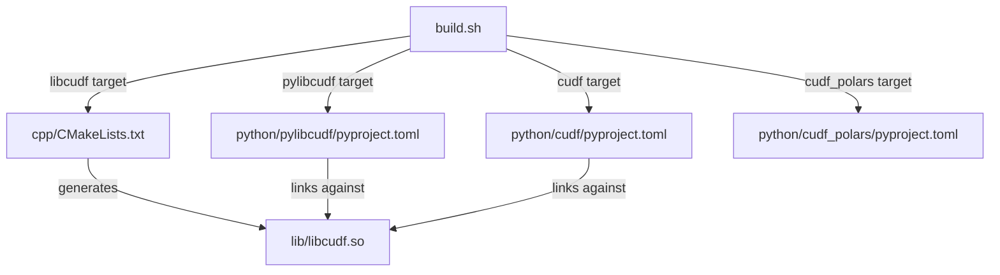
*Sources: [build.sh:21-53](), [build.sh:74-92]()*

---

## 2. CMake Build Options (`cpp/CMakeLists.txt`)
When compiling `libcudf` directly via CMake, several configuration options control profiling, diagnostics, memory resources, and dependency fetching strategies:

| Option Name | Default | Description |
| :--- | :--- | :--- |
| `USE_NVTX` | `ON` | Injects NVTX profiling ranges into kernels and functions. |
| `BUILD_TESTS` | `ON` | Configures Google Test targets under `cpp/tests/`. |
| `BUILD_BENCHMARKS` | `OFF` | Configures NVBench benchmarks under `cpp/benchmarks/`. |
| `BUILD_SHARED_LIBS` | `ON` | Builds shared libraries (`.so`) instead of static archives (`.a`). |
| `CUDF_USE_PER_THREAD_DEFAULT_STREAM` | `OFF` | Passes per-thread default stream definitions to CUDA operations. |
| `CUDA_ENABLE_LINEINFO` | `OFF` | Appends `-lineinfo` to `nvcc` compilation for profiler symbol resolution. |
| `CUDF_BUILD_STATIC_DEPS` | `ON` | Three-state control (`ON`/`OFF`/`FORCE`) for static third-party dependencies. |

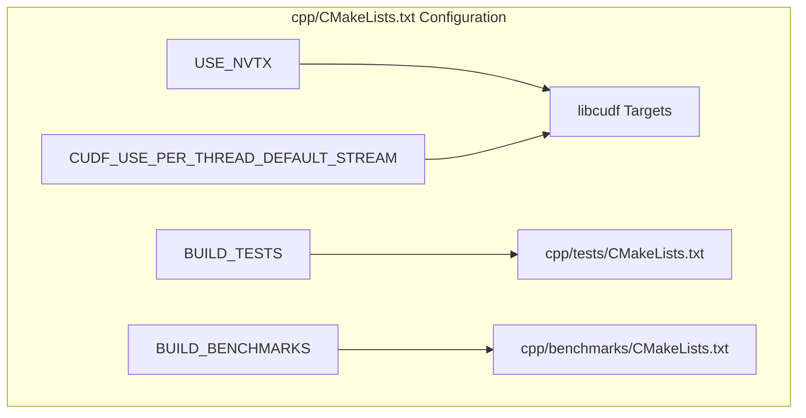
*Sources: [cpp/CMakeLists.txt:37-70](), [cpp/tests/CMakeLists.txt:38-81](), [cpp/benchmarks/CMakeLists.txt:10-26]() *

---

## 3. Conda Environments and Dependency Management
cuDF uses `dependencies.yaml` at the repository root to declare all build, test, and runtime constraints across conda matrix variations (CUDA versions 12.9, 13.3, x86_64 and aarch64 architectures).

```yaml
# Example structure referenced from dependency generation
files:
  all:
    output: conda
    matrix:
      cuda: ["12.9", "13.3"]
      arch: [x86_64, aarch64]
```

Conda environments can be provisioned using the generated recipes:
```bash
conda env create -n cudf-dev -f conda/environments/all_cuda-129_arch-x86_64.yaml
conda activate cudf-dev
```
*Sources: [dependencies.yaml:1-11]()*

---

## 4. Devcontainers and CI Workflows
Development container configurations are supplied under `.devcontainer/` to support instantaneous setup within VS Code or compatible container runtimes. Continuous integration pipelines are orchestrated through GitHub Actions workflows in `.github/workflows/`:
* `pr.yaml`: Triggers checks, linters, C++ tests, and Python test matrices on pull requests.
* `build.yaml`: Handles nightly and branch builds for conda packages and documentation.
* `test.yaml`: Coordinates post-build testing suites including memory checks (`ci/test_cpp_memcheck.sh`) and benchmarking jobs.

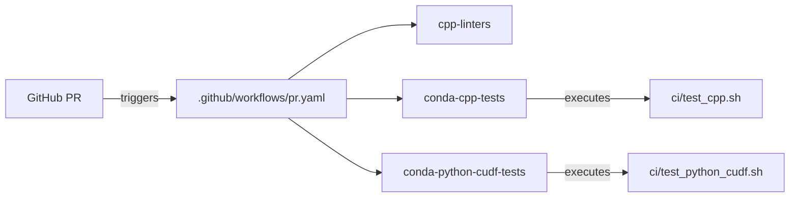
*Sources: [.github/workflows/pr.yaml:1-52](), [.github/workflows/test.yaml:28-85]() *

---

## 5. Component Building and Execution Guide

### Building libcudf (C++)
To build only the core C++ engine and execute unit tests:
```bash
./build.sh libcudf tests
cd cpp/build
cmake --build . -j$(nproc)
ctest --output-on-failure
```
*Sources: [build.sh:21-32](), [cpp/CMakeLists.txt:20-24]()*

### Building Python Bindings and Packages
To install the Python stack in editable development mode alongside built C++ extensions:
```bash
./build.sh libcudf pylibcudf cudf --pydevelop
```
Python wheels and packages leverage `pyproject.toml` configurations paired with `rapids-build-backend`.
*Sources: [build.sh:21-41](), [python/cudf/pyproject.toml:4-10]() *

### Building Java JNI Bindings
The Java module (`java/`) compiles native bridges against libcudf. Native CMake options can be configured via:
```bash
cd java/src/main/native
mkdir build && cd build
cmake -DCUDF_CPP_BUILD_DIR=../../../../cpp/build ..
make -j$(nproc)
```
*Sources: [java/src/main/native/CMakeLists.txt:21-86]()*

---

# Page: Repository Layout

# Repository Layout

<details>
<summary>Relevant source files</summary>

The following files were used as context for generating this wiki page:

- [.agents/skills/review-cudf/SKILL.md](.agents/skills/review-cudf/SKILL.md)
- [.gitignore](.gitignore)
- [cpp/benchmarks/dictionary/concatenate.cpp](cpp/benchmarks/dictionary/concatenate.cpp)
- [cpp/benchmarks/io/fst.cu](cpp/benchmarks/io/fst.cu)
- [cpp/doxygen/Doxyfile](cpp/doxygen/Doxyfile)
- [cpp/doxygen/DoxygenLayout.xml](cpp/doxygen/DoxygenLayout.xml)
- [cpp/doxygen/developer_guide/DEVELOPER_GUIDE.md](cpp/doxygen/developer_guide/DEVELOPER_GUIDE.md)
- [cpp/doxygen/developer_guide/DOCUMENTATION.md](cpp/doxygen/developer_guide/DOCUMENTATION.md)
- [cpp/doxygen/developer_guide/TESTING.md](cpp/doxygen/developer_guide/TESTING.md)
- [cpp/doxygen/developer_guide/strings.png](cpp/doxygen/developer_guide/strings.png)
- [cpp/doxygen/modify_fences.sh](cpp/doxygen/modify_fences.sh)
- [cpp/examples/basic/CMakeLists.txt](cpp/examples/basic/CMakeLists.txt)
- [cpp/examples/billion_rows/CMakeLists.txt](cpp/examples/billion_rows/CMakeLists.txt)
- [cpp/examples/billion_rows/README.md](cpp/examples/billion_rows/README.md)
- [cpp/examples/billion_rows/groupby_results.cpp](cpp/examples/billion_rows/groupby_results.cpp)
- [cpp/examples/billion_rows/groupby_results.hpp](cpp/examples/billion_rows/groupby_results.hpp)
- [cpp/examples/fetch_dependencies.cmake](cpp/examples/fetch_dependencies.cmake)
- [cpp/examples/nested_types/CMakeLists.txt](cpp/examples/nested_types/CMakeLists.txt)
- [cpp/examples/parquet_io/CMakeLists.txt](cpp/examples/parquet_io/CMakeLists.txt)
- [cpp/examples/parquet_io/README.md](cpp/examples/parquet_io/README.md)
- [cpp/examples/string_transforms/CMakeLists.txt](cpp/examples/string_transforms/CMakeLists.txt)
- [cpp/examples/string_transforms/README.md](cpp/examples/string_transforms/README.md)
- [cpp/examples/string_transforms/url_logs/fragments.cu](cpp/examples/string_transforms/url_logs/fragments.cu)
- [cpp/examples/string_transforms/url_logs/logs.csv](cpp/examples/string_transforms/url_logs/logs.csv)
- [cpp/examples/string_transforms/url_logs/transforms.cpp](cpp/examples/string_transforms/url_logs/transforms.cpp)
- [cpp/examples/strings/CMakeLists.txt](cpp/examples/strings/CMakeLists.txt)
- [cpp/include/cudf/detail/nvtx/ranges.hpp](cpp/include/cudf/detail/nvtx/ranges.hpp)
- [cpp/include/cudf/detail/utilities/stream_pool.hpp](cpp/include/cudf/detail/utilities/stream_pool.hpp)
- [cpp/include/cudf_test/print_utilities.cuh](cpp/include/cudf_test/print_utilities.cuh)
- [cpp/libcudf_kafka/CMakeLists.txt](cpp/libcudf_kafka/CMakeLists.txt)
- [cpp/src/io/fst/agent_dfa.cuh](cpp/src/io/fst/agent_dfa.cuh)
- [cpp/src/io/fst/dispatch_dfa.cuh](cpp/src/io/fst/dispatch_dfa.cuh)
- [cpp/src/io/fst/in_reg_array.cuh](cpp/src/io/fst/in_reg_array.cuh)
- [cpp/src/io/fst/logical_stack.cuh](cpp/src/io/fst/logical_stack.cuh)
- [cpp/src/io/fst/lookup_tables.cuh](cpp/src/io/fst/lookup_tables.cuh)
- [cpp/src/io/parquet/writer_impl_helpers.cpp](cpp/src/io/parquet/writer_impl_helpers.cpp)
- [cpp/src/io/parquet/writer_impl_helpers.hpp](cpp/src/io/parquet/writer_impl_helpers.hpp)
- [cpp/src/utilities/stream_pool.cpp](cpp/src/utilities/stream_pool.cpp)
- [cpp/tests/column/column_test.cpp](cpp/tests/column/column_test.cpp)
- [cpp/tests/copying/concatenate_tests.cpp](cpp/tests/copying/concatenate_tests.cpp)
- [cpp/tests/io/fst/common.hpp](cpp/tests/io/fst/common.hpp)
- [cpp/tests/io/fst/fst_test.cu](cpp/tests/io/fst/fst_test.cu)
- [cpp/tests/io/fst/logical_stack_test.cu](cpp/tests/io/fst/logical_stack_test.cu)
- [cpp/tests/streams/pool_test.cu](cpp/tests/streams/pool_test.cu)
- [cpp/tests/utilities/identify_stream_usage.cpp](cpp/tests/utilities/identify_stream_usage.cpp)
- [cpp/tests/utilities_tests/stream_pool_tests.cpp](cpp/tests/utilities_tests/stream_pool_tests.cpp)
- [docs/cudf/source/conf.py](docs/cudf/source/conf.py)

</details>


## Overview and Purpose

This page provides a comprehensive architectural tour of the top-level directories in the cuDF repository (`https://github.com/NVIDIA/cudf`). It maps physical directory locations to logical codebase entities, detailing where core engines, language bindings, documentation, CI pipelines, and developer tooling reside.

| Top-Level Directory | Primary Language / Tech | Architectural Role & Contents |
| :--- | :--- | :--- |
| `cpp/` | C++, CUDA | Core GPU engine (`libcudf`), standalone utilities, tests, benchmarks, and examples. |
| `python/` | Python, Cython | Python ecosystem: `cudf` (pandas API), `pylibcudf`, `cudf-polars`, `dask-cudf`, `cudf.pandas`. |
| `java/` | Java, Scala, C++ | JVM JNI bindings (`ai.rapids.cudf`), RMM Java integration, and Maven/Gradle configurations. |
| `ci/` | Shell, Python, YAML | Continuous integration scripts, test runners, and dependency generators. |
| `docs/` | Sphinx, RST, Markdown | Sphinx documentation configuration, Breathe Doxygen bridges, and API reference source. |
| `notebooks/` | Jupyter (`.ipynb`) | Interactive examples, user tutorials, and demonstrations of cuDF features. |
| `skills/` & `.agents/` | Markdown, YAML | Developer skill assets, agent configurations, and automated review guidelines. |

---

## 1. Core C++/CUDA Engine (`cpp/`)

The `cpp/` directory contains the high-performance GPU data-parallel processing engine known as **libcudf**, along with streaming extensions, test suites, benchmarking harnesses, and integration examples.

### Subdirectories in `cpp/`
* `include/cudf/`: Public C++ header files defining external APIs such as `column/column.hpp`, `copying.hpp`, `aggregation.hpp`, and `join.hpp` [cpp/doxygen/developer_guide/DEVELOPER_GUIDE.md:53-56]().
* `src/`: Internal implementation files for libcudf algorithms, structured matching public headers (e.g., `src/copying/`, `src/join/`, `src/io/`) [cpp/doxygen/developer_guide/DEVELOPER_GUIDE.md:78-81]().
* `libcudf_kafka/`: C++ library wrapper for Kafka consumer integration (`cudf_kafka`), configured via CMake [cpp/libcudf_kafka/CMakeLists.txt:64-75]().
* `tests/`: GoogleTest suites verifying libcudf correctness across columns, copying, I/O, and stream behavior [cpp/tests/copying/concatenate_tests.cpp:1-25]().
* `benchmarks/`: NVBench-based performance benchmarks for measuring throughput of joins, sorts, and I/O readers.
* `examples/`: Standalone C++ applications demonstrating how to link against `libcudf::cudf` and process tabular data [cpp/examples/basic/CMakeLists.txt:30-32]().
* `doxygen/`: Doxygen configuration files (`Doxyfile`) and developer guides for generating C++ API documentation [cpp/doxygen/Doxyfile:35-42]().

```mermaid
title "Code Entity Space: cpp/ Subsystem Mapping"
graph TD
    CPP["cpp/ Directory"] --> INC["include/cudf/"]
    CPP --> SRC["src/"]
    CPP --> KAFKA["libcudf_kafka/"]
    CPP --> EX["examples/"]
    
    INC --> PUB_HDR["cudf::column, cudf::table_view"]
    SRC --> IMPL["cudf::detail namespace kernels"]
    KAFKA --> K_LIB["cudf_kafka target"]
    EX --> BASIC_EX["basic_example (src/process_csv.cpp)"]
```
*Sources: `cpp/doxygen/developer_guide/DEVELOPER_GUIDE.md:53-81`, `cpp/libcudf_kafka/CMakeLists.txt:64-75`, `cpp/examples/basic/CMakeLists.txt:30-32`*

---

## 2. Python Ecosystem (`python/`)

The `python/` directory houses the multi-package Python ecosystem that exposes `libcudf` to Python workflows through low-level Cython wrappers and high-level pandas-compatible APIs.

### Key Python Packages
* `python/pylibcudf/`: Low-level Cython bindings mapping 1-to-1 onto `libcudf` C++ classes (`Column`, `Table`, `gpumemoryview`).
* `python/cudf/`: High-level pandas-compatible API providing `DataFrame`, `Series`, and `Index` objects, along with the `cudf.pandas` zero-code-change accelerator module.
* `python/cudf_polars/`: Execution engine that translates Polars logical plans and expressions into accelerated GPU operations.
* `python/dask-cudf/`: Distributed GPU dataframe collection dispatchers leveraging Dask.
* `python/cudf_kafka/` & `python/custreamz/`: Real-time streaming integration libraries for Apache Kafka and Streamz.

```mermaid
title "Code Entity Space: python/ Package Hierarchy"
graph TD
    PY["python/ Directory"] --> PYLIB["pylibcudf/ (Cython Bindings)"]
    PY --> CUDF["cudf/ (pandas-like API)"]
    PY --> POLARS["cudf_polars/ (Polars GPU Engine)"]
    PY --> DASK["dask-cudf/ (Distributed Integration)"]
    
    PYLIB --> C_API["libcudf C++ symbols"]
    CUDF --> DF_OBJ["cudf.DataFrame / cudf.Series"]
    POLARS --> IR_TRANS["translate.py / IR Nodes"]
```
*Sources: `docs/cudf/source/conf.py:34-45`*

---

## 3. Java and Scala Bindings (`java/`)

The `java/` directory contains the JVM ecosystem components that allow Java and Scala applications to utilize GPU memory and libcudf algorithms via Java Native Interface (JNI) bridges.

### Key Components
* `java/src/main/native/`: C++ JNI bridge implementations (`*Jni.cpp`) translating Java calls into libcudf and RMM operations.
* `java/src/main/java/ai/rapids/cudf/`: Core Java API classes including `ColumnVector`, `Table`, `JCudfSerialization`, and `RmmJni`.
* Maven build configurations and CI build wrappers (such as `java/ci/build-in-docker.sh`) to build JARs containing compiled native binaries `.2` [.gitignore:103-109]().

---

## 4. Continuous Integration and Build Assets (`ci/`)

The `ci/` directory provides the scripts, GitHub Actions workflow definitions, and environment specifications required for continuous integration testing across different architectures, Python versions, and CUDA runtimes.

* Scripts manage conda environment setups, wheel building, and test orchestration.
* Dependency lock files and generators (such as `dependencies.yaml`) coordinate package versions across the entire RAPIDS ecosystem.

---

## 5. Documentation, Skills, and Tooling (`docs/`, `notebooks/`, `skills/`, `.agents/`)

* `docs/`: Contains Sphinx documentation sources [docs/cudf/source/conf.py:1-30](), including `conf.py`, API definition templates, and Breathe configuration files that bridge Doxygen XML output into Sphinx RST documents.
* `notebooks/`: Houses interactive Jupyter notebooks (`.ipynb`) that showcase end-to-end data processing pipelines, string manipulations, and machine learning prep workloads.
* `skills/` & `.agents/`: Specialized markdown definitions, custom instructions, and skill assets [.agents/skills/review-cudf/SKILL.md]() used by automated code reviewers and developer agents to analyze cuDF pull requests and enforce codebase standards.

---

## Summary Architecture and Build Flow

```mermaid
title "System Space to Code Entity Space Build Flow"
graph LR
    subgraph "Top-Level Directories"
        CPP_DIR["cpp/"]
        PY_DIR["python/"]
        JAVA_DIR["java/"]
    end

    subgraph "Core Artifacts"
        LIBCUDF["lib/libcudf.so"]
        PYLIBCUDF["pylibcudf.so"]
        JAR["ai.rapids.cudf.jar"]
    end

    CPP_DIR -->|"CMake / nvcc"| LIBCUDF
    PY_DIR -->|"Cython / setuptools"| PYLIBCUDF
    JAVA_DIR -->|"Maven / JNI"| JAR
    
    LIBCUDF --> PYLIBCUDF
    LIBCUDF --> JAR
```
*Sources: `cpp/libcudf_kafka/CMakeLists.txt:64-75`, `cpp/examples/basic/CMakeLists.txt:30-32`*

---

# Page: libcudf: C++/CUDA Core

# libcudf: C++/CUDA Core

<details>
<summary>Relevant source files</summary>

The following files were used as context for generating this wiki page:

- [.agents/skills/review-cudf/SKILL.md](.agents/skills/review-cudf/SKILL.md)
- [CHANGELOG.md](CHANGELOG.md)
- [cpp/CMakeLists.txt](cpp/CMakeLists.txt)
- [cpp/benchmarks/CMakeLists.txt](cpp/benchmarks/CMakeLists.txt)
- [cpp/benchmarks/dictionary/concatenate.cpp](cpp/benchmarks/dictionary/concatenate.cpp)
- [cpp/benchmarks/io/fst.cu](cpp/benchmarks/io/fst.cu)
- [cpp/benchmarks/join/join_common.hpp](cpp/benchmarks/join/join_common.hpp)
- [cpp/doxygen/DoxygenLayout.xml](cpp/doxygen/DoxygenLayout.xml)
- [cpp/doxygen/developer_guide/DEVELOPER_GUIDE.md](cpp/doxygen/developer_guide/DEVELOPER_GUIDE.md)
- [cpp/doxygen/developer_guide/DOCUMENTATION.md](cpp/doxygen/developer_guide/DOCUMENTATION.md)
- [cpp/doxygen/developer_guide/TESTING.md](cpp/doxygen/developer_guide/TESTING.md)
- [cpp/doxygen/developer_guide/strings.png](cpp/doxygen/developer_guide/strings.png)
- [cpp/doxygen/modify_fences.sh](cpp/doxygen/modify_fences.sh)
- [cpp/include/cudf/detail/nvtx/ranges.hpp](cpp/include/cudf/detail/nvtx/ranges.hpp)
- [cpp/include/cudf/detail/transform.hpp](cpp/include/cudf/detail/transform.hpp)
- [cpp/include/cudf/detail/utilities/stream_pool.hpp](cpp/include/cudf/detail/utilities/stream_pool.hpp)
- [cpp/include/cudf/lists/combine.hpp](cpp/include/cudf/lists/combine.hpp)
- [cpp/include/cudf/transform.hpp](cpp/include/cudf/transform.hpp)
- [cpp/include/cudf_test/print_utilities.cuh](cpp/include/cudf_test/print_utilities.cuh)
- [cpp/include/doxygen_groups.h](cpp/include/doxygen_groups.h)
- [cpp/src/io/fst/agent_dfa.cuh](cpp/src/io/fst/agent_dfa.cuh)
- [cpp/src/io/fst/dispatch_dfa.cuh](cpp/src/io/fst/dispatch_dfa.cuh)
- [cpp/src/io/fst/in_reg_array.cuh](cpp/src/io/fst/in_reg_array.cuh)
- [cpp/src/io/fst/logical_stack.cuh](cpp/src/io/fst/logical_stack.cuh)
- [cpp/src/io/fst/lookup_tables.cuh](cpp/src/io/fst/lookup_tables.cuh)
- [cpp/src/io/parquet/writer_impl_helpers.cpp](cpp/src/io/parquet/writer_impl_helpers.cpp)
- [cpp/src/io/parquet/writer_impl_helpers.hpp](cpp/src/io/parquet/writer_impl_helpers.hpp)
- [cpp/src/lists/combine/concatenate_list_elements.cu](cpp/src/lists/combine/concatenate_list_elements.cu)
- [cpp/src/lists/combine/concatenate_rows.cu](cpp/src/lists/combine/concatenate_rows.cu)
- [cpp/src/lists/copying/scatter_helper.cu](cpp/src/lists/copying/scatter_helper.cu)
- [cpp/src/lists/dremel.cu](cpp/src/lists/dremel.cu)
- [cpp/src/lists/explode.cu](cpp/src/lists/explode.cu)
- [cpp/src/lists/interleave_columns.cu](cpp/src/lists/interleave_columns.cu)
- [cpp/src/lists/reverse.cu](cpp/src/lists/reverse.cu)
- [cpp/src/lists/set_operations.cu](cpp/src/lists/set_operations.cu)
- [cpp/src/transform/bools_to_mask.cu](cpp/src/transform/bools_to_mask.cu)
- [cpp/src/transform/nans_to_nulls.cu](cpp/src/transform/nans_to_nulls.cu)
- [cpp/src/utilities/stream_pool.cpp](cpp/src/utilities/stream_pool.cpp)
- [cpp/tests/CMakeLists.txt](cpp/tests/CMakeLists.txt)
- [cpp/tests/column/column_test.cpp](cpp/tests/column/column_test.cpp)
- [cpp/tests/copying/concatenate_tests.cpp](cpp/tests/copying/concatenate_tests.cpp)
- [cpp/tests/encode/encode_tests.cpp](cpp/tests/encode/encode_tests.cpp)
- [cpp/tests/io/fst/common.hpp](cpp/tests/io/fst/common.hpp)
- [cpp/tests/io/fst/fst_test.cu](cpp/tests/io/fst/fst_test.cu)
- [cpp/tests/io/fst/logical_stack_test.cu](cpp/tests/io/fst/logical_stack_test.cu)
- [cpp/tests/io/parquet_chunked_writer_test.cpp](cpp/tests/io/parquet_chunked_writer_test.cpp)
- [cpp/tests/io/parquet_misc_test.cpp](cpp/tests/io/parquet_misc_test.cpp)
- [cpp/tests/io/parquet_v2_test.cpp](cpp/tests/io/parquet_v2_test.cpp)
- [cpp/tests/lists/combine/concatenate_list_elements_tests.cpp](cpp/tests/lists/combine/concatenate_list_elements_tests.cpp)
- [cpp/tests/lists/combine/concatenate_rows_tests.cpp](cpp/tests/lists/combine/concatenate_rows_tests.cpp)
- [cpp/tests/lists/explode_tests.cpp](cpp/tests/lists/explode_tests.cpp)
- [cpp/tests/streams/io/csv_test.cpp](cpp/tests/streams/io/csv_test.cpp)
- [cpp/tests/streams/io/orc_test.cpp](cpp/tests/streams/io/orc_test.cpp)
- [cpp/tests/streams/io/parquet_test.cpp](cpp/tests/streams/io/parquet_test.cpp)
- [cpp/tests/streams/pool_test.cu](cpp/tests/streams/pool_test.cu)
- [cpp/tests/structs/structs_column_tests.cpp](cpp/tests/structs/structs_column_tests.cpp)
- [cpp/tests/transform/nans_to_null_test.cpp](cpp/tests/transform/nans_to_null_test.cpp)
- [cpp/tests/utilities/identify_stream_usage.cpp](cpp/tests/utilities/identify_stream_usage.cpp)
- [cpp/tests/utilities_tests/lists_column_wrapper_tests.cpp](cpp/tests/utilities_tests/lists_column_wrapper_tests.cpp)
- [cpp/tests/utilities_tests/stream_pool_tests.cpp](cpp/tests/utilities_tests/stream_pool_tests.cpp)

</details>


## Purpose and Scope

`libcudf` is the C++ and CUDA core engine of cuDF [cpp/doxygen/developer_guide/DEVELOPER_GUIDE.md:13-17] that provides GPU-accelerated, data-parallel columnar primitives, relational operators, text/string algorithms, and file I/O pipelines. It serves as the single native computation engine underneath multiple higher-level language bindings, including Python (`pylibcudf`, `cudf`, `cudf-polars`), Java (`ai.rapids.cudf` via JNI), and distributed runtimes (`dask-cudf`). 

The library is organized into a clean architectural layering that separates host-side orchestration, public API headers (`cudf::`), internal device translation units (`cudf::detail::`), and raw CUDA kernels built using Thrust, CCCL, and RMM (RAPIDS Memory Manager).

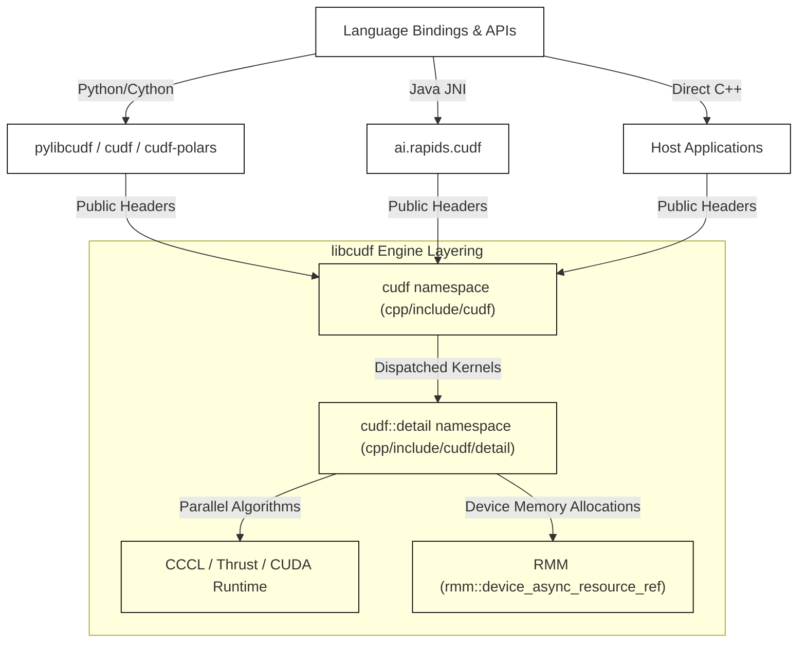
*Diagram 1: libcudf Architectural Layering and Client Bindings*

Sources: [cpp/CMakeLists.txt:1-31](), [cpp/doxygen/developer_guide/DEVELOPER_GUIDE.md:11-17]()

---

## 2.1 Core Data Structures

The foundation of `libcudf` is its columnar memory model, comprising owning containers and non-owning zero-copy views. A `column` owns device buffers (data buffer, validity/null mask buffer, and optional nested child columns), while a `column_view` or `column_device_view` provides light-weight accessors used directly inside CUDA kernels [cpp/doxygen/developer_guide/DEVELOPER_GUIDE.md:23-50]. Tables aggregate collections of columns representing relational datasets with equal row counts [cpp/doxygen/developer_guide/DEVELOPER_GUIDE.md:39-44].

For detailed information on memory layouts, factories, type dispatchers, fixed-point/timestamp wrappers, iterators, list columns, struct columns, and dictionary encoding, see [Core Data Structures](#2.1).

Sources: [cpp/doxygen/developer_guide/DEVELOPER_GUIDE.md:23-50](), [cpp/include/doxygen_groups.h:20-41]()

---

## 2.2 Copying, Reshaping and Compaction

`libcudf` provides high-performance data manipulation routines that restructure columns and tables without unnecessary data duplication. This includes element selection algorithms like `gather` and `scatter`, conditional routing via `copy_if_else`, array slicing, splitting, shifting, transposition, column interleaving, and stream compaction (filtering out null or unwanted rows) [cpp/include/doxygen_groups.h:42-68,96-100].

For detailed information on gather/scatter routines, contiguous splits, packing, filling, repetition, sequence generation, and stream compaction, see [Copying, Reshaping and Compaction](#2.2).

Sources: [cpp/include/doxygen_groups.h:42-68](), [cpp/src/lists/interleave_columns.cu:90-123]()

---

## 2.3 Relational and Analytical Algorithms

To support database operations and data science analytics, `libcudf` implements optimized parallel relational operators. These include multi-type hash joins and sort-merge joins, powerful GroupBy aggregation workflows, global sorting, ranking, ordered reductions, prefix scans, quantiles, rolling windows, and table partitioning [cpp/include/doxygen_groups.h:70-83].

For detailed information on join types (hash, sort-merge, conditional, semi/anti), the GroupBy request model, sorting, reductions, rolling windows, and partitioning, see [Relational and Analytical Algorithms](#2.3).

Sources: [cpp/include/doxygen_groups.h:70-83](), [cpp/benchmarks/join/join_common.hpp:24-61]()

---

## 2.4 Strings and Text (`nvtext`)

Text processing in `libcudf` revolves around `string_view`, a zero-copy representation of UTF-8 encoded character strings residing in device memory. The strings API supports rich pattern matching via a custom regular expression engine (`reprog`), string manipulation, substring extraction, splitting, padding, casing, and complex conversions [cpp/include/doxygen_groups.h:112-127]. Additionally, the `nvtext` module provides natural language processing primitives like tokenization, normalization, $n$-grams, edit distance, and subword vocabularies [cpp/include/doxygen_groups.h:161-172].

For detailed information on the regular expression engine, string manipulation, conversions, and `nvtext` primitives, see [Strings and Text (nvtext)](#2.4).

Sources: [cpp/include/doxygen_groups.h:112-127,161-172]()

---

## 2.5 Element-wise Operations, AST and JIT

Element-wise arithmetic, logical, and datetime operations allow transforming columns using unary and binary operators. For complex or custom expressions, `libcudf` provides an Abstract Syntax Tree (`ast`) expression evaluation framework and JIT compilation infrastructure (`cudf::transform_program`) that compiles and executes custom CUDA/PTX UDFs on columns at runtime [cpp/include/cudf/transform.hpp:84-170, cpp/include/cudf/detail/transform.hpp:24-28].

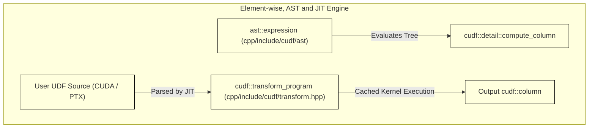
*Diagram 2: Element-wise Operations, Expression Trees, and JIT Transformation Pipeline*

Sources: [cpp/include/cudf/transform.hpp:84-170](), [cpp/include/cudf/detail/transform.hpp:24-28]()

---

## 2.6 Arrow Interop and Streaming Extensions

`libcudf` natively interoperates with Apache Arrow data structures on both host and device memory, supporting the Arrow C Data Interface and DLPack for zero-copy data exchange with external frameworks like PyTorch and NumPy [cpp/include/doxygen_groups.h:101-105]. Specialized streaming and messaging components (`libcudf_streaming` and `libcudf_kafka`) extend the core engine to ingest and process continuous data streams.

For detailed information on Apache Arrow host/device conversions, DLPack integration, and streaming extensions, see [Arrow Interop and Streaming Extensions](#2.6).

Sources: [cpp/include/doxygen_groups.h:101-105]()

---

# Page: Core Data Structures

# Core Data Structures

<details>
<summary>Relevant source files</summary>

The following files were used as context for generating this wiki page:

- [cpp/benchmarks/bitmask/bitmask_and.cpp](cpp/benchmarks/bitmask/bitmask_and.cpp)
- [cpp/include/cudf/column/column.hpp](cpp/include/cudf/column/column.hpp)
- [cpp/include/cudf/column/column_device_view.cuh](cpp/include/cudf/column/column_device_view.cuh)
- [cpp/include/cudf/column/column_factories.hpp](cpp/include/cudf/column/column_factories.hpp)
- [cpp/include/cudf/column/column_view.hpp](cpp/include/cudf/column/column_view.hpp)
- [cpp/include/cudf/concatenate.hpp](cpp/include/cudf/concatenate.hpp)
- [cpp/include/cudf/detail/is_element_valid.hpp](cpp/include/cudf/detail/is_element_valid.hpp)
- [cpp/include/cudf/detail/null_mask.cuh](cpp/include/cudf/detail/null_mask.cuh)
- [cpp/include/cudf/detail/null_mask.hpp](cpp/include/cudf/detail/null_mask.hpp)
- [cpp/include/cudf/io/parquet_io_utils.hpp](cpp/include/cudf/io/parquet_io_utils.hpp)
- [cpp/include/cudf/null_mask.hpp](cpp/include/cudf/null_mask.hpp)
- [cpp/include/cudf/strings/detail/concatenate.hpp](cpp/include/cudf/strings/detail/concatenate.hpp)
- [cpp/include/cudf/structs/detail/concatenate.hpp](cpp/include/cudf/structs/detail/concatenate.hpp)
- [cpp/include/cudf/table/table.hpp](cpp/include/cudf/table/table.hpp)
- [cpp/include/cudf/table/table_device_view.cuh](cpp/include/cudf/table/table_device_view.cuh)
- [cpp/include/cudf/table/table_view.hpp](cpp/include/cudf/table/table_view.hpp)
- [cpp/src/bitmask/is_element_valid.cpp](cpp/src/bitmask/is_element_valid.cpp)
- [cpp/src/bitmask/null_mask.cu](cpp/src/bitmask/null_mask.cu)
- [cpp/src/column/column.cu](cpp/src/column/column.cu)
- [cpp/src/column/column_device_view.cu](cpp/src/column/column_device_view.cu)
- [cpp/src/column/column_factories.cpp](cpp/src/column/column_factories.cpp)
- [cpp/src/column/column_view.cpp](cpp/src/column/column_view.cpp)
- [cpp/src/copying/concatenate.cu](cpp/src/copying/concatenate.cu)
- [cpp/src/io/parquet/io_utils/parquet_io_utils.cpp](cpp/src/io/parquet/io_utils/parquet_io_utils.cpp)
- [cpp/src/strings/copying/concatenate.cu](cpp/src/strings/copying/concatenate.cu)
- [cpp/src/strings/strings_column_factories.cu](cpp/src/strings/strings_column_factories.cu)
- [cpp/src/strings/strings_scalar_factories.cpp](cpp/src/strings/strings_scalar_factories.cpp)
- [cpp/src/structs/utilities.cu](cpp/src/structs/utilities.cu)
- [cpp/src/table/table.cpp](cpp/src/table/table.cpp)
- [cpp/src/table/table_device_view.cu](cpp/src/table/table_device_view.cu)
- [cpp/src/table/table_view.cpp](cpp/src/table/table_view.cpp)
- [cpp/tests/bitmask/bitmask_tests.cpp](cpp/tests/bitmask/bitmask_tests.cpp)
- [cpp/tests/bitmask/set_nullmask_tests.cu](cpp/tests/bitmask/set_nullmask_tests.cu)
- [cpp/tests/column/factories_test.cpp](cpp/tests/column/factories_test.cpp)
- [cpp/tests/strings/factories_test.cu](cpp/tests/strings/factories_test.cu)
- [cpp/tests/table/table_tests.cpp](cpp/tests/table/table_tests.cpp)
- [java/src/main/native/src/multi_host_buffer_source.cpp](java/src/main/native/src/multi_host_buffer_source.cpp)

</details>


## Purpose and Scope

This page provides a high-level overview of libcudf's core data structures, which represent columnar data, tabular data, scalar values, and validity bitmasks on NVIDIA GPUs. These structures form the foundation of the C++/CUDA execution engine, offering zero-copy slicing, device-side accessibility, and compatibility with the Apache Arrow memory layout specification [cpp/include/cudf/column/column_view.hpp:27-36]().

For detailed information on specific subsystems, refer to the child pages:
- For types, type identification, traits, and the runtime type dispatcher, see [Type System and Dispatch](#2.1.1).
- For complex types including list columns, struct columns, and dictionary encoding, see [Nested and Dictionary Types](#2.1.2).

---

## 1. The `column` Container (`cudf::column`)

The `cudf::column` class is an owning container for a column of nullable device data [cpp/include/cudf/column/column.hpp:31-37](). It manages device memory via `rmm::device_buffer` for the underlying data elements, a `cuda::device_buffer<cudf::bitmask_type>` for the null validity mask, and an optional `std::vector<std::unique_ptr<column>>` for child columns (used in nested or compound types) [cpp/include/cudf/column/column.hpp:109-120](). 

Because `column` owns its memory, copying a `column` triggers a deep copy of its buffers and children [cpp/include/cudf/column/column.hpp:55-58](), whereas moving a `column` transfers ownership instantly [cpp/include/cudf/column/column.hpp:60-66]().

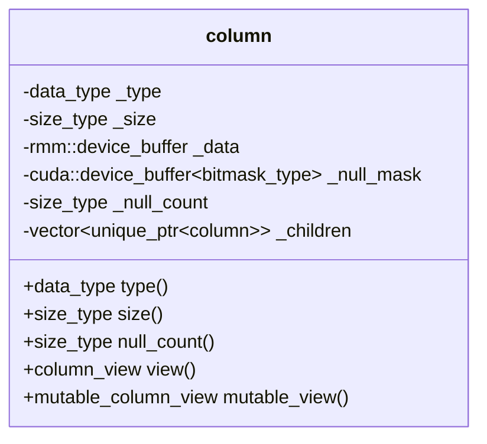
*Figure: Architecture of `cudf::column` and its underlying buffer management members.*

Sources: `[cpp/include/cudf/column/column.hpp:37-144]()`, `[cpp/src/column/column.cu:40-128]()`

---

## 2. Non-Owning Views (`column_view` and `column_device_view`)

To avoid expensive deep copies when passing data into algorithms or launching CUDA kernels, libcudf separates owning containers from non-owning views:

- **`column_view` / `mutable_column_view`**: Non-owning, immutable or mutable host-side views of device columnar data [cpp/include/cudf/column/column_view.hpp:27-44](). They support zero-copy slicing via an `offset` attribute relative to the base allocation.
- **`column_device_view` / `mutable_column_device_view`**: Trivially copyable structures designed to be passed directly into CUDA device code and kernels [cpp/include/cudf/column/column_device_view.cuh:33-39](). They handle recursive device pointer translation for nested and child columns.

```mermaid
graph TD
    subgraph NaturalLanguage["Natural Language Space"]
        Owner["Owning Host Container"] -->|Creates View| HostView["Host-side View"]
        HostView -->|Marshals to Device| DeviceView["CUDA Device-side View"]
    end

    subgraph CodeSpace["Code Entity Space"]
        C["cudf::column"] -->|view() / mutable_view()| CV["cudf::column_view"]
        CV -->|column_device_view::create()| CDV["cudf::column_device_view"]
    end

    Owner --- C
    HostView --- CV
    DeviceView --- CDV
```
*Figure: Bridging natural language concepts to libcudf C++ classes for column views.*

Sources: `[cpp/include/cudf/column/column_view.hpp:27-44]`, `[cpp/src/column/column_view.cpp:102-185]`, `[cpp/include/cudf/column/column_device_view.cuh:33-39]`, `[cpp/src/column/column_device_view.cu:36-47]()`

---

## 3. Tables (`table` and `table_view`)

A tabular collection of columns is represented by `cudf::table` (owning) and `cudf::table_view` / `mutable_table_view` (non-owning views). A table holds a collection of `column` instances or `column_view` instances of equal row count, forming the fundamental input and output signature for relational algorithms such as joins, filterings, and aggregations.

Sources: `[cpp/include/cudf/table/table.hpp]()`, `[cpp/include/cudf/table/table_view.hpp]()`

---

## 4. Scalars

The scalar hierarchy (`cudf::scalar` and its derived template types such as `cudf::numeric_scalar<T>`, `cudf::string_scalar`, etc.) represents single element values residing either on the host or device. Scalars encapsulate a value buffer, a validity boolean indicating whether the scalar is null, and the associated CUDA stream context.

---

## 5. Null Masks and Validity Bitmasks

Nullability in libcudf columns is tracked using packed bitmasks where each bit indicates the validity (1 = valid, 0 = null) of a corresponding element [cpp/include/cudf/null_mask.hpp:31-72](). 

- **`mask_state`**: Specifies the initial state of a bitmask (`UNALLOCATED`, `ALL_VALID`, `ALL_NULL`, or `UNINITIALIZED`).
- **Bitmask Utilities**: Functions such as `create_null_mask()`, `bitmask_allocation_size_bytes()`, and bulk set operations (`set_null_masks_safe`) manage buffer allocations padded to Arrow-compliant boundaries [cpp/include/cudf/null_mask.hpp:44-104]().

Sources: `[cpp/include/cudf/null_mask.hpp:31-104]`, `[cpp/src/bitmask/null_mask.cu:39-96]()`

---

## 6. Column Factories

Column factories provide high-level APIs to construct columns with uninitialized or pre-filled memory and bitmasks without manually orchestrating buffer allocations [cpp/include/cudf/column/column_factories.hpp:28-72](). Key factory functions include:
- `make_empty_column()` [cpp/include/cudf/column/column_factories.hpp:36-46]()
- `make_numeric_column()` [cpp/include/cudf/column/column_factories.hpp:66-71]()
- `make_fixed_point_column()` [cpp/include/cudf/column/column_factories.hpp:124-129]()
- `make_timestamp_column()` [cpp/include/cudf/column/column_factories.hpp:174]()

Sources: `[cpp/include/cudf/column/column_factories.hpp:28-129]`, `[cpp/src/column/column_factories.cpp:48-80]()`

---

## Child Pages

For further technical depth, proceed to the child pages:
- **[Type System and Dispatch](#2.1.1)**: Covers `cudf::type_id`, type traits, the `type_dispatcher`, fixed-point decimals, timestamp/duration wrappers, and iterators.
- **[Nested and Dictionary Types](#2.1.2)**: Covers list columns, struct columns, dictionary encoding schemes, and their respective factories and operations.

---

# Page: Type System and Dispatch

# Type System and Dispatch

<details>
<summary>Relevant source files</summary>

The following files were used as context for generating this wiki page:

- [cpp/include/cudf/detail/iterator.cuh](cpp/include/cudf/detail/iterator.cuh)
- [cpp/include/cudf/detail/utilities/device_atomics.cuh](cpp/include/cudf/detail/utilities/device_atomics.cuh)
- [cpp/include/cudf/detail/utilities/device_operators.cuh](cpp/include/cudf/detail/utilities/device_operators.cuh)
- [cpp/include/cudf/fixed_point/fixed_point.hpp](cpp/include/cudf/fixed_point/fixed_point.hpp)
- [cpp/include/cudf/scalar/scalar.hpp](cpp/include/cudf/scalar/scalar.hpp)
- [cpp/include/cudf/scalar/scalar_device_view.cuh](cpp/include/cudf/scalar/scalar_device_view.cuh)
- [cpp/include/cudf/scalar/scalar_factories.hpp](cpp/include/cudf/scalar/scalar_factories.hpp)
- [cpp/include/cudf/types.hpp](cpp/include/cudf/types.hpp)
- [cpp/include/cudf/utilities/concepts.hpp](cpp/include/cudf/utilities/concepts.hpp)
- [cpp/include/cudf/utilities/traits.hpp](cpp/include/cudf/utilities/traits.hpp)
- [cpp/include/cudf/utilities/type_dispatcher.hpp](cpp/include/cudf/utilities/type_dispatcher.hpp)
- [cpp/include/cudf/wrappers/durations.hpp](cpp/include/cudf/wrappers/durations.hpp)
- [cpp/include/cudf/wrappers/timestamps.hpp](cpp/include/cudf/wrappers/timestamps.hpp)
- [cpp/src/copying/get_element.cu](cpp/src/copying/get_element.cu)
- [cpp/src/scalar/scalar.cpp](cpp/src/scalar/scalar.cpp)
- [cpp/src/scalar/scalar_factories.cpp](cpp/src/scalar/scalar_factories.cpp)
- [cpp/src/structs/structs_column_factories.cu](cpp/src/structs/structs_column_factories.cu)
- [cpp/tests/device_atomics/device_atomics_test.cu](cpp/tests/device_atomics/device_atomics_test.cu)
- [cpp/tests/fixed_point/fixed_point_tests.cpp](cpp/tests/fixed_point/fixed_point_tests.cpp)
- [cpp/tests/fixed_point/fixed_point_tests.cu](cpp/tests/fixed_point/fixed_point_tests.cu)
- [cpp/tests/iterator/scalar_iterator_test.cu](cpp/tests/iterator/scalar_iterator_test.cu)
- [cpp/tests/scalar/factories_test.cpp](cpp/tests/scalar/factories_test.cpp)
- [cpp/tests/scalar/scalar_device_view_test.cu](cpp/tests/scalar/scalar_device_view_test.cu)
- [cpp/tests/scalar/scalar_test.cpp](cpp/tests/scalar/scalar_test.cpp)
- [cpp/tests/search/search_dictionary_test.cpp](cpp/tests/search/search_dictionary_test.cpp)
- [cpp/tests/search/search_test.cpp](cpp/tests/search/search_test.cpp)
- [cpp/tests/types/traits_test.cpp](cpp/tests/types/traits_test.cpp)
- [cpp/tests/types/type_dispatcher_test.cu](cpp/tests/types/type_dispatcher_test.cu)
- [cpp/tests/wrappers/timestamps_test.cu](cpp/tests/wrappers/timestamps_test.cu)
- [docs/cudf/source/libcudf/api_docs/utility_types.rst](docs/cudf/source/libcudf/api_docs/utility_types.rst)

</details>


## Purpose and Scope

The libcudf type system and dispatch mechanism provide the foundational C++ abstractions required to represent, classify, and dynamically process heterogeneous column and scalar data types on the GPU. Because CUDA is statically typed while dataframes often encounter dynamic, runtime-determined schemas, libcudf bridges this gap using a combination of runtime type identifiers (`cudf::type_id`), compile-time traits, and a high-performance runtime dispatch mechanism (`type_dispatcher`). 

This page details the implementation of logical types, type traits and concepts, the `type_dispatcher` engine, specialized wrappers such as fixed-point decimals, timestamps, and durations, and high-performance device iterators.

Sources: `cpp/include/cudf/types.hpp:185-225`, `cpp/include/cudf/utilities/traits.hpp:1-21`, `cpp/include/cudf/utilities/type_dispatcher.hpp:1-22`

---

## Logical Types and `cudf::type_id`

At the core of libcudf's type system is `cudf::type_id`, an enumeration defined in `cpp/include/cudf/types.hpp` (`[cpp/include/cudf/types.hpp:185-225]()`). Every column and scalar holds a `data_type` object (`[cpp/include/cudf/scalar/scalar.hpp:91-91]()`), which pairs a `type_id` with optional type-specific metadata (such as the scaling factor for fixed-point decimal types).

| `type_id` Category | Enum Values | Underlying C++ / Storage Type |
| :--- | :--- | :--- |
| **Integral** | `INT8`, `INT16`, `INT32`, `INT64`, `UINT8`, `UINT16`, `UINT32`, `UINT64` | `int8_t`, `int16_t`, `int32_t`, `int64_t`, `uint8_t`, `uint16_t`, `uint32_t`, `uint64_t` |
| **Floating Point** | `FLOAT32`, `FLOAT64` | `float`, `double` |
| **Boolean** | `BOOL8` | `bool` |
| **Chrono (Timestamps)** | `TIMESTAMP_DAYS`, `TIMESTAMP_SECONDS`, `TIMESTAMP_MILLISECONDS`, `TIMESTAMP_MICROSECONDS`, `TIMESTAMP_NANOSECONDS` | `cudf::timestamp_D`, `cudf::timestamp_s`, etc. |
| **Chrono (Durations)** | `DURATION_DAYS`, `DURATION_SECONDS`, `DURATION_MILLISECONDS`, `DURATION_MICROSECONDS`, `DURATION_NANOSECONDS` | `cudf::duration_D`, `cudf::duration_s`, etc. |
| **Complex/Nested/Other** | `STRING`, `LIST`, `STRUCT`, `DICTIONARY32`, `DECIMAL32`, `DECIMAL64`, `DECIMAL128` | `cudf::string_view`, `cudf::list_view`, `cudf::struct_view`, `cudf::dictionary32`, `numeric::decimal32`, etc. |

The mapping between runtime `cudf::type_id` values and concrete C++ types is established via explicit template specializations and the `CUDF_TYPE_MAPPING` macro in `cpp/include/cudf/utilities/type_dispatcher.hpp` (`[cpp/include/cudf/utilities/type_dispatcher.hpp:132-179]()`).

Sources: `cpp/include/cudf/types.hpp:185-225`, `cpp/include/cudf/utilities/type_dispatcher.hpp:132-179`

---

## Type Traits and Concepts (`traits.hpp`)

To classify and query properties of column and scalar types at compile time and runtime, libcudf provides a comprehensive suite of traits and C++20 concepts located in `cpp/include/cudf/utilities/traits.hpp` (`[cpp/include/cudf/utilities/traits.hpp:1-21]`) and `cpp/include/cudf/utilities/concepts.hpp` (`[cpp/include/cudf/utilities/concepts.hpp:1-50]()`).

Key trait inspection functions include:
- `cudf::is_numeric(data_type type)` and `is_numeric<T>()`: Identifies fundamental arithmetic types (`[cpp/include/cudf/utilities/traits.hpp:156-180]()`).
- `cudf::is_timestamp<T>()`: Validates whether a type is a chrono timestamp wrapper (`[cpp/include/cudf/utilities/traits.hpp:91-94]()`).
- `cudf::is_duration<T>()`: Validates whether a type is a chrono duration wrapper (`[cpp/include/cudf/utilities/traits.hpp:95-98]()`).
- `cudf::is_fixed_point<T>()`: Checks if a type is a `numeric::fixed_point` specialization.
- `cudf::is_relationally_comparable<L, R>()`: Wraps `cuda::std::totally_ordered_with` to ensure types support relational operators (`[cpp/include/cudf/utilities/traits.hpp:112-117]()`).

Convenience SFINAE macros like `CUDF_ENABLE_IF(...)` are provided to conditionally enable function templates based on type categories (`[cpp/include/cudf/utilities/traits.hpp:39-50]()`):

```cpp
template <typename T, CUDF_ENABLE_IF(std::is_integral_v<T>)>
void foo();
```

Sources: `cpp/include/cudf/utilities/traits.hpp:1-180`, `cpp/include/cudf/utilities/concepts.hpp:1-50`

---

## Runtime-to-Compile-Time Type Dispatching (`type_dispatcher`)

Because libcudf algorithms operate on columns whose types are only known at runtime, kernels and host algorithms utilize `cudf::type_dispatcher` to map a runtime `cudf::type_id` (or `data_type`) to a concrete C++ template parameter `T`.

### Architecture & Data Flow

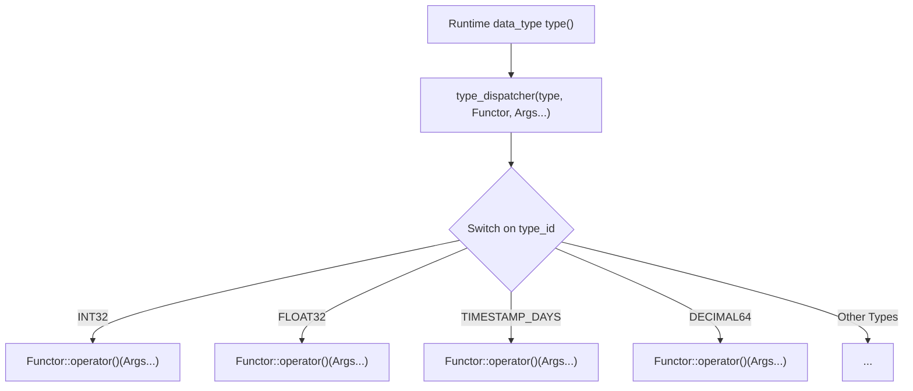

Diagram: Type Dispatch Execution Flow (`[cpp/include/cudf/utilities/type_dispatcher.hpp:1-124]()`)

The dispatcher invokes the provided functor's templated `operator()<T>()` with any forwarded arguments. For device-side or host-side scalar factory operations, `type_dispatcher` is heavily used to instantiate the appropriate typed structures (e.g., in `cpp/src/scalar/scalar_factories.cpp`, `[cpp/src/scalar/scalar_factories.cpp:18-47]()`).

Sources: `cpp/include/cudf/utilities/type_dispatcher.hpp:1-124`, `cpp/src/scalar/scalar_factories.cpp:18-47`

---

## Specialized Data Wrappers: Fixed-Point Decimals, Timestamps, and Durations

libcudf encapsulates domain-specific scalar and column data inside dedicated wrapper classes to ensure type safety and proper arithmetic semantics.

### Fixed-Point Decimals
Fixed-point decimal types are defined in `cpp/include/cudf/fixed_point/fixed_point.hpp` (`[cpp/include/cudf/fixed_point/fixed_point.hpp:30-205]()`). 
- **Representation**: Backed by `int32_t`, `int64_t`, or `__int128_t` (`[cpp/include/cudf/fixed_point/fixed_point.hpp:60-63]()`).
- **Radix**: Supports `Radix::BASE_2` and `Radix::BASE_10` (`[cpp/include/cudf/fixed_point/fixed_point.hpp:49-49]()`).
- **Scaling**: Managed via `scale_type` and helper constructors such as `scaled_integer` (`[cpp/include/cudf/fixed_point/fixed_point.hpp:38-38, 177-189]()`), which allow construction from pre-scaled integer values.

### Timestamps and Durations
Timestamps and durations leverage `cuda::std::chrono` wrappers (`[cpp/include/cudf/wrappers/timestamps.hpp]`, `[cpp/include/cudf/wrappers/durations.hpp]`). They define distinct epochs and resolution granularities (days, seconds, milliseconds, microseconds, nanoseconds) mapping directly to underlying integer storage types without introducing floating-point precision loss.

Sources: `cpp/include/cudf/fixed_point/fixed_point.hpp:30-205`, `cpp/include/cudf/wrappers/timestamps.hpp:1-50`, `cpp/include/cudf/wrappers/durations.hpp:1-50`

---

## Device Iterators and Accessors (`iterator.cuh`)

For high-performance element retrieval in CUDA kernels (e.g., when integrating with Thrust or CUB), libcudf provides specialized device iterators and accessors in `cpp/include/cudf/detail/iterator.cuh` (`[cpp/include/cudf/detail/iterator.cuh:1-35]()`).

### Key Iterator Components
- `null_replaced_value_accessor<Element>`: A unary functor that checks validity at index `i` via a `column_device_view` (`[cpp/include/cudf/detail/iterator.cuh:81-111]()`). If the element is valid, it returns `column[i]`; if null, it returns a user-supplied `null_replacement` value.
- `validity_accessor<safe>`: A functor that queries the null bitmask state of an element at index `i` (`[cpp/include/cudf/detail/iterator.cuh:121-151]()`).
- `make_null_replacement_iterator(...)`: A factory function returning a `cuda::transform_iterator` wrapping a counting iterator and `null_replaced_value_accessor` (`[cpp/include/cudf/detail/iterator.cuh:171-178]()`).

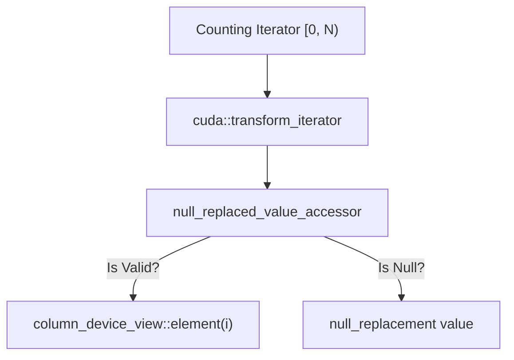

Diagram: Null-Replacement Iterator Data Flow (`[cpp/include/cudf/detail/iterator.cuh:81-178]()`)

Sources: `cpp/include/cudf/detail/iterator.cuh:1-185`

---

# Page: Nested and Dictionary Types

# Nested and Dictionary Types

<details>
<summary>Relevant source files</summary>

The following files were used as context for generating this wiki page:

- [cpp/include/cudf/detail/gather.hpp](cpp/include/cudf/detail/gather.hpp)
- [cpp/include/cudf/dictionary/detail/concatenate.hpp](cpp/include/cudf/dictionary/detail/concatenate.hpp)
- [cpp/include/cudf/dictionary/detail/encode.hpp](cpp/include/cudf/dictionary/detail/encode.hpp)
- [cpp/include/cudf/dictionary/detail/merge.hpp](cpp/include/cudf/dictionary/detail/merge.hpp)
- [cpp/include/cudf/dictionary/detail/replace.hpp](cpp/include/cudf/dictionary/detail/replace.hpp)
- [cpp/include/cudf/dictionary/detail/search.hpp](cpp/include/cudf/dictionary/detail/search.hpp)
- [cpp/include/cudf/dictionary/detail/update_keys.hpp](cpp/include/cudf/dictionary/detail/update_keys.hpp)
- [cpp/include/cudf/dictionary/dictionary_column_view.hpp](cpp/include/cudf/dictionary/dictionary_column_view.hpp)
- [cpp/include/cudf/dictionary/dictionary_factories.hpp](cpp/include/cudf/dictionary/dictionary_factories.hpp)
- [cpp/include/cudf/dictionary/encode.hpp](cpp/include/cudf/dictionary/encode.hpp)
- [cpp/include/cudf/dictionary/search.hpp](cpp/include/cudf/dictionary/search.hpp)
- [cpp/include/cudf/dictionary/update_keys.hpp](cpp/include/cudf/dictionary/update_keys.hpp)
- [cpp/include/cudf/lists/combine.hpp](cpp/include/cudf/lists/combine.hpp)
- [cpp/include/cudf/lists/detail/concatenate.hpp](cpp/include/cudf/lists/detail/concatenate.hpp)
- [cpp/include/cudf/lists/detail/lists_column_factories.hpp](cpp/include/cudf/lists/detail/lists_column_factories.hpp)
- [cpp/include/cudf/lists/lists_column_view.hpp](cpp/include/cudf/lists/lists_column_view.hpp)
- [cpp/include/cudf_test/column_wrapper.hpp](cpp/include/cudf_test/column_wrapper.hpp)
- [cpp/include/doxygen_groups.h](cpp/include/doxygen_groups.h)
- [cpp/src/dictionary/add_keys.cu](cpp/src/dictionary/add_keys.cu)
- [cpp/src/dictionary/decode.cu](cpp/src/dictionary/decode.cu)
- [cpp/src/dictionary/detail/concatenate.cu](cpp/src/dictionary/detail/concatenate.cu)
- [cpp/src/dictionary/dictionary_column_view.cpp](cpp/src/dictionary/dictionary_column_view.cpp)
- [cpp/src/dictionary/dictionary_factories.cu](cpp/src/dictionary/dictionary_factories.cu)
- [cpp/src/dictionary/encode.cu](cpp/src/dictionary/encode.cu)
- [cpp/src/dictionary/match_keys.cu](cpp/src/dictionary/match_keys.cu)
- [cpp/src/dictionary/remove_keys.cu](cpp/src/dictionary/remove_keys.cu)
- [cpp/src/dictionary/search.cu](cpp/src/dictionary/search.cu)
- [cpp/src/dictionary/set_keys.cu](cpp/src/dictionary/set_keys.cu)
- [cpp/src/groupby/sort/group_argmax.cu](cpp/src/groupby/sort/group_argmax.cu)
- [cpp/src/groupby/sort/group_argmin.cu](cpp/src/groupby/sort/group_argmin.cu)
- [cpp/src/lists/combine/concatenate_list_elements.cu](cpp/src/lists/combine/concatenate_list_elements.cu)
- [cpp/src/lists/combine/concatenate_rows.cu](cpp/src/lists/combine/concatenate_rows.cu)
- [cpp/src/lists/copying/concatenate.cu](cpp/src/lists/copying/concatenate.cu)
- [cpp/src/lists/copying/scatter_helper.cu](cpp/src/lists/copying/scatter_helper.cu)
- [cpp/src/lists/dremel.cu](cpp/src/lists/dremel.cu)
- [cpp/src/lists/explode.cu](cpp/src/lists/explode.cu)
- [cpp/src/lists/interleave_columns.cu](cpp/src/lists/interleave_columns.cu)
- [cpp/src/lists/lists_column_factories.cu](cpp/src/lists/lists_column_factories.cu)
- [cpp/src/lists/lists_column_view.cu](cpp/src/lists/lists_column_view.cu)
- [cpp/src/lists/reverse.cu](cpp/src/lists/reverse.cu)
- [cpp/src/lists/set_operations.cu](cpp/src/lists/set_operations.cu)
- [cpp/src/reshape/byte_cast.cu](cpp/src/reshape/byte_cast.cu)
- [cpp/src/strings/copying/copying.cu](cpp/src/strings/copying/copying.cu)
- [cpp/tests/dictionary/add_keys_test.cpp](cpp/tests/dictionary/add_keys_test.cpp)
- [cpp/tests/dictionary/encode_test.cpp](cpp/tests/dictionary/encode_test.cpp)
- [cpp/tests/dictionary/factories_test.cpp](cpp/tests/dictionary/factories_test.cpp)
- [cpp/tests/dictionary/fill_test.cpp](cpp/tests/dictionary/fill_test.cpp)
- [cpp/tests/dictionary/remove_keys_test.cpp](cpp/tests/dictionary/remove_keys_test.cpp)
- [cpp/tests/dictionary/search_test.cpp](cpp/tests/dictionary/search_test.cpp)
- [cpp/tests/dictionary/set_keys_test.cpp](cpp/tests/dictionary/set_keys_test.cpp)
- [cpp/tests/encode/encode_tests.cpp](cpp/tests/encode/encode_tests.cpp)
- [cpp/tests/io/parquet_chunked_writer_test.cpp](cpp/tests/io/parquet_chunked_writer_test.cpp)
- [cpp/tests/io/parquet_misc_test.cpp](cpp/tests/io/parquet_misc_test.cpp)
- [cpp/tests/io/parquet_v2_test.cpp](cpp/tests/io/parquet_v2_test.cpp)
- [cpp/tests/lists/combine/concatenate_list_elements_tests.cpp](cpp/tests/lists/combine/concatenate_list_elements_tests.cpp)
- [cpp/tests/lists/combine/concatenate_rows_tests.cpp](cpp/tests/lists/combine/concatenate_rows_tests.cpp)
- [cpp/tests/lists/explode_tests.cpp](cpp/tests/lists/explode_tests.cpp)
- [cpp/tests/reshape/byte_cast_tests.cpp](cpp/tests/reshape/byte_cast_tests.cpp)
- [cpp/tests/streams/dictionary_test.cpp](cpp/tests/streams/dictionary_test.cpp)
- [cpp/tests/streams/io/csv_test.cpp](cpp/tests/streams/io/csv_test.cpp)
- [cpp/tests/streams/io/orc_test.cpp](cpp/tests/streams/io/orc_test.cpp)
- [cpp/tests/streams/io/parquet_test.cpp](cpp/tests/streams/io/parquet_test.cpp)
- [cpp/tests/structs/structs_column_tests.cpp](cpp/tests/structs/structs_column_tests.cpp)
- [cpp/tests/utilities/column_utilities.cu](cpp/tests/utilities/column_utilities.cu)
- [cpp/tests/utilities_tests/column_utilities_tests.cpp](cpp/tests/utilities_tests/column_utilities_tests.cpp)
- [cpp/tests/utilities_tests/column_wrapper_tests.cpp](cpp/tests/utilities_tests/column_wrapper_tests.cpp)
- [cpp/tests/utilities_tests/lists_column_wrapper_tests.cpp](cpp/tests/utilities_tests/lists_column_wrapper_tests.cpp)

</details>


## Purpose and Scope
This page details the implementation, data structures, factories, and operations for complex, hierarchical, and encoded types within `libcudf`. This covers list columns (`lists_column_view`), struct columns (`struct_view`/`struct_column_view`), and dictionary-encoded columns (`dictionary_column_view`), along with their associated creation, encoding, and mutation APIs.

Sources: `cpp/include/doxygen_groups.h:20-41`

---

## 1. List Columns and Operations

List columns represent variable-length arrays of elements for each row. In `libcudf`, a list column is structured as a parent column with a null mask and two children:
1. **Offsets child**: A fixed-width integer column (typically `INT32`) containing `num_rows + 1` entries defining the start and end boundaries for each row's elements in the child column.
2. **Elements child**: An arbitrary cuDF column containing the packed data elements for all lists.

### Key Classes and Functions
* `cudf::lists_column_view`: Provides a lightweight, non-owning view into a list column, exposing accessors for offsets, child elements, and null masks.
* `generate_child_row_indices`: Utility function used during testing and list transformations to map parent list rows to underlying element positions [cpp/tests/utilities/column_utilities.cu:91-101]().

Diagram: List Column Memory Layout to Code Entities
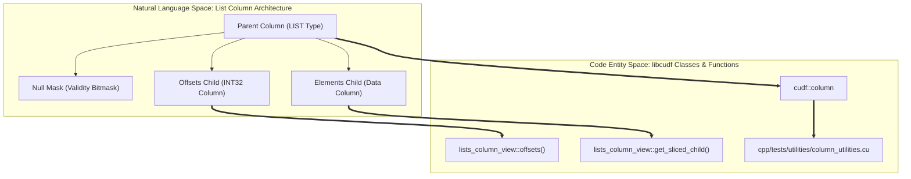
Sources: `cpp/tests/utilities/column_utilities.cu:91-101`, `cpp/include/doxygen_groups.h:148-160`

---

## 2. Struct Columns and Operations

Struct columns represent composite records where each row contains a fixed set of named fields. Each field is stored as a separate child column of the struct column.

### Implementation and Structure
* A struct column has `N` children corresponding to `N` fields.
* All child columns share the same logical row count and are governed by the parent struct column's null mask.
* `cudf::struct_view` and `cudf::struct_column_view` provide device and host-side accessors to retrieve child columns by index or field name.

Sources: `cpp/include/doxygen_groups.h:33`, `cpp/tests/structs/structs_column_tests.cpp`

---

## 3. Dictionary Encoding and Operations

Dictionary encoding compresses repetitive data by storing unique values (keys) once in a separate column and replacing the original data with integer references (indices) pointing to those keys.

### Core Architecture
A dictionary column (`type_id::DICTIONARY32`) owns two child columns:
1. **Indices Column**: A signed integer column (`INT8`, `INT16`, or `INT32`) containing references to the keys.
2. **Keys Column**: A non-null column containing unique, sorted values representing the dictionary domain.

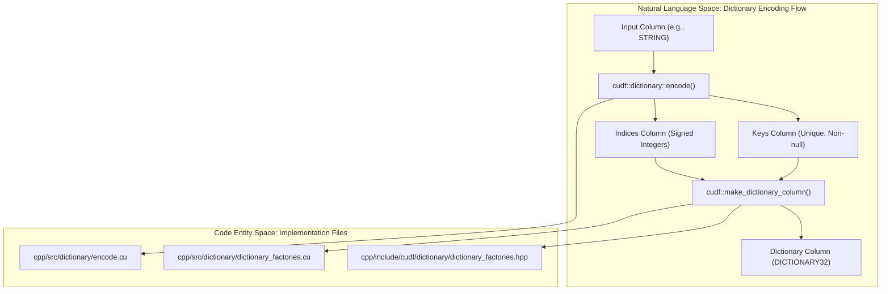
Sources: `cpp/src/dictionary/encode.cu:55-59`, `cpp/src/dictionary/dictionary_factories.cu:43-67`, `cpp/include/cudf/dictionary/dictionary_factories.hpp:55-60`

### Key Factories and Manipulation APIs

* **Creation**: 
  - `cudf::dictionary::encode(column_view const& input, data_type indices_type, ...)`: Constructs a dictionary column from an arbitrary input column [cpp/src/dictionary/encode.cu:55-59]().
  - `cudf::make_dictionary_column(column_view const& keys_column, column_view const& indices_column, ...)`: Factory building a dictionary column by copying keys and indices [cpp/include/cudf/dictionary/dictionary_factories.hpp:55-60]().
  - `cudf::make_dictionary_column(std::unique_ptr<column> keys_column, std::unique_ptr<column> indices_column, ...)`: Factory taking ownership of keys and indices [cpp/include/cudf/dictionary/dictionary_factories.hpp:77-80]().

* **Key Management & Mutation**:
  - `cudf::dictionary::add_keys(dictionary_column_view const& input, column_view const& new_keys, ...)`: Appends new keys to the dictionary [cpp/src/dictionary/add_keys.cu:60-64]().
  - `cudf::dictionary::remap_indices(dictionary_column_view const& input, column_view const& new_keys, ...)`: Re-indexes the dictionary against a new set of keys [cpp/src/dictionary/set_keys.cu:167-170]().
  - `cudf::dictionary::detail::remove_keys_fn`: Internal utility removing specified keys and updating index mappings [cpp/src/dictionary/remove_keys.cu:50-55]().
  - `cudf::dictionary::detail::concatenate`: Concatenates multiple dictionary columns by merging their key spaces and remapping indices [cpp/src/dictionary/detail/concatenate.cu:165-167]().

Sources: `cpp/include/cudf/dictionary/dictionary_factories.hpp:55-108`, `cpp/src/dictionary/encode.cu:55-164`, `cpp/src/dictionary/add_keys.cu:60-67`, `cpp/src/dictionary/set_keys.cu:167-170`, `cpp/src/dictionary/remove_keys.cu:50-55`, `cpp/src/dictionary/detail/concatenate.cu:165-167`

---

# Page: Copying, Reshaping and Compaction

# Copying, Reshaping and Compaction

<details>
<summary>Relevant source files</summary>

The following files were used as context for generating this wiki page:

- [cpp/benchmarks/filter/minmax_filter.cpp](cpp/benchmarks/filter/minmax_filter.cpp)
- [cpp/benchmarks/lists/copying/scatter_lists.cu](cpp/benchmarks/lists/copying/scatter_lists.cu)
- [cpp/benchmarks/string/url_decode.cu](cpp/benchmarks/string/url_decode.cu)
- [cpp/include/cudf/contiguous_split.hpp](cpp/include/cudf/contiguous_split.hpp)
- [cpp/include/cudf/copying.hpp](cpp/include/cudf/copying.hpp)
- [cpp/include/cudf/detail/contiguous_split.hpp](cpp/include/cudf/detail/contiguous_split.hpp)
- [cpp/include/cudf/detail/copy.hpp](cpp/include/cudf/detail/copy.hpp)
- [cpp/include/cudf/detail/copy_if.cuh](cpp/include/cudf/detail/copy_if.cuh)
- [cpp/include/cudf/detail/copy_if_else.cuh](cpp/include/cudf/detail/copy_if_else.cuh)
- [cpp/include/cudf/detail/copy_range.cuh](cpp/include/cudf/detail/copy_range.cuh)
- [cpp/include/cudf/detail/fill.hpp](cpp/include/cudf/detail/fill.hpp)
- [cpp/include/cudf/detail/gather.cuh](cpp/include/cudf/detail/gather.cuh)
- [cpp/include/cudf/detail/repeat.hpp](cpp/include/cudf/detail/repeat.hpp)
- [cpp/include/cudf/detail/replace.hpp](cpp/include/cudf/detail/replace.hpp)
- [cpp/include/cudf/detail/reshape.hpp](cpp/include/cudf/detail/reshape.hpp)
- [cpp/include/cudf/detail/scatter.cuh](cpp/include/cudf/detail/scatter.cuh)
- [cpp/include/cudf/detail/scatter.hpp](cpp/include/cudf/detail/scatter.hpp)
- [cpp/include/cudf/detail/sequence.hpp](cpp/include/cudf/detail/sequence.hpp)
- [cpp/include/cudf/detail/stream_compaction.hpp](cpp/include/cudf/detail/stream_compaction.hpp)
- [cpp/include/cudf/detail/transpose.hpp](cpp/include/cudf/detail/transpose.hpp)
- [cpp/include/cudf/detail/utilities/cuda.cuh](cpp/include/cudf/detail/utilities/cuda.cuh)
- [cpp/include/cudf/detail/valid_if.cuh](cpp/include/cudf/detail/valid_if.cuh)
- [cpp/include/cudf/filling.hpp](cpp/include/cudf/filling.hpp)
- [cpp/include/cudf/io/detail/csv.hpp](cpp/include/cudf/io/detail/csv.hpp)
- [cpp/include/cudf/lists/detail/combine.hpp](cpp/include/cudf/lists/detail/combine.hpp)
- [cpp/include/cudf/lists/detail/gather.cuh](cpp/include/cudf/lists/detail/gather.cuh)
- [cpp/include/cudf/replace.hpp](cpp/include/cudf/replace.hpp)
- [cpp/include/cudf/reshape.hpp](cpp/include/cudf/reshape.hpp)
- [cpp/include/cudf/rolling/range_window_bounds.hpp](cpp/include/cudf/rolling/range_window_bounds.hpp)
- [cpp/include/cudf/stream_compaction.hpp](cpp/include/cudf/stream_compaction.hpp)
- [cpp/include/cudf/strings/detail/copy_range.hpp](cpp/include/cudf/strings/detail/copy_range.hpp)
- [cpp/include/cudf/transpose.hpp](cpp/include/cudf/transpose.hpp)
- [cpp/src/column/column_factories.cu](cpp/src/column/column_factories.cu)
- [cpp/src/copying/contiguous_split.cu](cpp/src/copying/contiguous_split.cu)
- [cpp/src/copying/copy.cpp](cpp/src/copying/copy.cpp)
- [cpp/src/copying/copy.cu](cpp/src/copying/copy.cu)
- [cpp/src/copying/copy_range.cu](cpp/src/copying/copy_range.cu)
- [cpp/src/copying/gather.cu](cpp/src/copying/gather.cu)
- [cpp/src/copying/pack.cpp](cpp/src/copying/pack.cpp)
- [cpp/src/copying/sample.cu](cpp/src/copying/sample.cu)
- [cpp/src/copying/scatter.cu](cpp/src/copying/scatter.cu)
- [cpp/src/copying/segmented_shift.cu](cpp/src/copying/segmented_shift.cu)
- [cpp/src/copying/shift.cu](cpp/src/copying/shift.cu)
- [cpp/src/copying/split.cpp](cpp/src/copying/split.cpp)
- [cpp/src/filling/fill.cu](cpp/src/filling/fill.cu)
- [cpp/src/filling/repeat.cu](cpp/src/filling/repeat.cu)
- [cpp/src/filling/sequence.cu](cpp/src/filling/sequence.cu)
- [cpp/src/io/csv/durations.hpp](cpp/src/io/csv/durations.hpp)
- [cpp/src/join/cross_join.cu](cpp/src/join/cross_join.cu)
- [cpp/src/lists/copying/gather.cu](cpp/src/lists/copying/gather.cu)
- [cpp/src/replace/clamp.cu](cpp/src/replace/clamp.cu)
- [cpp/src/replace/nans.cu](cpp/src/replace/nans.cu)
- [cpp/src/replace/nulls.cu](cpp/src/replace/nulls.cu)
- [cpp/src/replace/replace.cu](cpp/src/replace/replace.cu)
- [cpp/src/reshape/interleave_columns.cu](cpp/src/reshape/interleave_columns.cu)
- [cpp/src/reshape/tile.cu](cpp/src/reshape/tile.cu)
- [cpp/src/stream_compaction/drop_nulls.cu](cpp/src/stream_compaction/drop_nulls.cu)
- [cpp/src/stream_compaction/stable_distinct.cu](cpp/src/stream_compaction/stable_distinct.cu)
- [cpp/src/strings/copying/copy_range.cu](cpp/src/strings/copying/copy_range.cu)
- [cpp/src/strings/copying/shift.cu](cpp/src/strings/copying/shift.cu)
- [cpp/src/transpose/transpose.cu](cpp/src/transpose/transpose.cu)
- [cpp/tests/bitmask/valid_if_tests.cu](cpp/tests/bitmask/valid_if_tests.cu)
- [cpp/tests/copying/copy_range_tests.cpp](cpp/tests/copying/copy_range_tests.cpp)
- [cpp/tests/copying/pack_tests.cpp](cpp/tests/copying/pack_tests.cpp)
- [cpp/tests/copying/sample_tests.cpp](cpp/tests/copying/sample_tests.cpp)
- [cpp/tests/copying/scatter_tests.cpp](cpp/tests/copying/scatter_tests.cpp)
- [cpp/tests/copying/shift_tests.cpp](cpp/tests/copying/shift_tests.cpp)
- [cpp/tests/copying/slice_tests.cpp](cpp/tests/copying/slice_tests.cpp)
- [cpp/tests/copying/split_tests.cpp](cpp/tests/copying/split_tests.cpp)
- [cpp/tests/filling/fill_tests.cpp](cpp/tests/filling/fill_tests.cpp)
- [cpp/tests/filling/repeat_tests.cpp](cpp/tests/filling/repeat_tests.cpp)
- [cpp/tests/filling/sequence_tests.cpp](cpp/tests/filling/sequence_tests.cpp)
- [cpp/tests/filter/filter_test.cpp](cpp/tests/filter/filter_test.cpp)
- [cpp/tests/join/cross_join_tests.cpp](cpp/tests/join/cross_join_tests.cpp)
- [cpp/tests/replace/clamp_test.cpp](cpp/tests/replace/clamp_test.cpp)
- [cpp/tests/reshape/interleave_columns_tests.cpp](cpp/tests/reshape/interleave_columns_tests.cpp)
- [cpp/tests/streams/replace_test.cpp](cpp/tests/streams/replace_test.cpp)
- [cpp/tests/streams/reshape_test.cpp](cpp/tests/streams/reshape_test.cpp)
- [cpp/tests/streams/stream_compaction_test.cpp](cpp/tests/streams/stream_compaction_test.cpp)
- [cpp/tests/streams/transpose_test.cpp](cpp/tests/streams/transpose_test.cpp)
- [python/cudf/cudf/tests/dataframe/test_binops.py](python/cudf/cudf/tests/dataframe/test_binops.py)
- [python/cudf/cudf/tests/reshape/test_join.py](python/cudf/cudf/tests/reshape/test_join.py)
- [python/cudf/cudf/tests/reshape/test_merge.py](python/cudf/cudf/tests/reshape/test_merge.py)

</details>


## Purpose and Scope
This page documents the core copying, reshaping, filling, replacement, and stream compaction subsystems of `libcudf`. These operations constitute the manipulation engine of cuDF columns and tables, executing hardware-accelerated memory rearrangements, permutations, splits, packing, and predicate-based filtering on the GPU using CUDA kernels and Thrust primitives.

---

## 1. Copying Operations: Gather, Scatter, Slice, and Shift

Copying operations enable reordering, indexing, and subset extraction from columns and tables without modifying original buffers in place (out-of-place semantics).

### Gather and Scatter
The `gather` operation extracts rows from a source table based on an index map (`gather_map`), constructing a new output table [cpp/include/cudf/copying.hpp:51-85](). It supports out-of-bounds policies such as `out_of_bounds_policy::NULLIFY` or `out_of_bounds_policy::DONT_CHECK` [cpp/include/cudf/copying.hpp:35-40](), as well as negative index wrapping (`negative_index_policy::ALLOWED`) [cpp/include/cudf/copying.hpp:43-48]().
Internally, `cudf::detail::gather` uses index normalization via `indexalator_factory` and dispatches to `thrust::gather` or `thrust::gather_if` combined with bitmask validation kernels (`gather_bitmask_functor`) [cpp/include/cudf/detail/gather.cuh:63-134]().

Conversely, `scatter` places rows from a source table into target columns according to a scatter map [cpp/include/cudf/copying.hpp:165-175](). Scalar scattering uses `column_scalar_scatterer_impl` and custom bitmask kernels (`marking_bitmask_kernel`) to update validity masks in place [cpp/src/copying/scatter.cu:41-92]().

```mermaid
graph TD
    sub:SourceTable[""table_view source_table""] --> op:Gather[""cudf::detail::gather()""]
    sub:GatherMap[""column_view gather_map""] --> op:Gather
    op:Gather --> sub:TargetTable[""std::unique_ptr<table> result""]
    
    sub:TargetTableTarget[""table_view target""] --> op:Scatter[""cudf::detail::scatter()""]
    sub:SourceTableSrc[""table_view source""] --> op:Scatter
    sub:ScatterMap[""column_view scatter_map""] --> op:Scatter
    op:Scatter --> sub:ScatterOutput[""std::unique_ptr<table>""]

    classDef default fill:none,stroke:#000,stroke-width:1px;
```
*Figure 1: Data flow and code entities for `gather` and `scatter` operations.*

Sources: `[cpp/include/cudf/copying.hpp:51-175]()`, `[cpp/src/copying/gather.cu:26-51]()`, `[cpp/src/copying/scatter.cu:41-125]`, `[cpp/include/cudf/detail/gather.cuh:63-135]()`

### Copy Range and Slice
- `copy_range` copies a slice of a source column into a target column range either out-of-place or in-place [cpp/src/copying/copy_range.cu:35-120](). For fixed-width types, it dispatches via `in_place_copy_range` using `cudf::detail::copy_range` [cpp/src/copying/copy_range.cu:42-64](). Specialized handlers exist for `string_view` [cpp/src/copying/copy_range.cu:131-140]() and `dictionary32` [cpp/src/copying/copy_range.cu:143-172]().
- Slicing (`slice`) extracts a contiguous view subset of a table or column without performing deep data copies, modifying metadata pointers and offsets.

Sources: `[cpp/src/copying/copy_range.cu:35-172]()`

---

## 2. Advanced Copy and Splitting: Contiguous Split and Pack

### Contiguous Split
`contiguous_split` partitions a table into multiple independent, contiguous memory blobs suitable for inter-process communication or network transport (e.g., Dask workers). 
It analyzes the buffer hierarchy of nested and variable-width columns using `src_buf_info` and `dst_buf_info` structures [cpp/src/copying/contiguous_split.cu:69-133](). The core GPU kernel `copy_buffer` copies and realigns individual buffers (data, offsets, validity bitmaps) concurrently [cpp/src/copying/contiguous_split.cu:159-164]().

```mermaid
graph TD
    sub:InputTable[""table_view input_table""] --> op:Split[""cudf::contiguous_split()""]
    sub:Indices[""std::vector<size_type> indices""] --> op:Split
    
    op:Split --> sub:Analyze[""src_buf_info extraction""]
    sub:Analyze --> op:Kernel[""copy_buffer<<<...>>>()""]
    op:Kernel --> sub:Outputs[""std::vector<contiguous_table> output_tables""]

    classDef default fill:none,stroke:#000,stroke-width:1px;
```
*Figure 2: Architecture of `contiguous_split` execution pathway.*

Sources: `[cpp/src/copying/contiguous_split.cu:69-164]()`

### Pack
The `pack` functionality serializes non-contiguous cuDF table columns into a single contiguous device memory buffer layout, allowing zero-copy or single-block transmission.

Sources: `[cpp/src/copying/contiguous_split.cu:69-164]()`

---

## 3. Reshaping Operations: Transpose, Interleave, and Repeat

### Transpose
`transpose` flips a 2D table where columns become rows and vice versa, handled via `transpose.cu`.

### Interleave
`interleave_columns` combines multiple column views into a single column by round-robin interleaving elements from each input column.

### Repeat and Tile
- `repeat` replicates rows of a table or elements of a column according to repeat counts specified via scalar or vector counts.
- `tile` repeats an entire table a specified number of times cyclically.

Sources: `[cpp/src/reshape/interleave_columns.cu:1-50]()`, `[cpp/src/filling/repeat.cu:1-50]()`, `[cpp/src/transpose/transpose.cu:1-50]()`

---

## 4. Filling and Sequence Generation

### Fill
The `fill` API replaces ranges within a column with a constant scalar value [cpp/src/filling/fill.cu:36-54](). 
- Fixed-width types use `in_place_fill` which wraps `cudf::detail::copy_range` with constant iterators [cpp/src/filling/fill.cu:35-54]().
- Variable-width and nested types (such as `string_view` and `dictionary32`) invoke specialized backends like `cudf::strings::detail::fill` [cpp/src/filling/fill.cu:132-144]() or dictionary key insertion routines [cpp/src/filling/fill.cu:147-177]().

### Sequence
`sequence` generates an arithmetic progression of values (e.g., starting at `init` with a given `step`) inside a newly allocated column.

```mermaid
graph TD
    sub:FillCall[""cudf::fill(mutable_column_view, begin, end, scalar)""] --> op:Dispatch[""in_place_fill_range_dispatch""]
    op:Dispatch --> sub:FixedWidth[""in_place_fill<T>()""]
    op:Dispatch --> sub:Strings[""strings::detail::fill()""]
    op:Dispatch --> sub:Dict[""dictionary::detail::add_keys()""]
    
    sub:FixedWidth --> sub:Result[""Modified Column View""]
    sub:Strings --> sub:Result
    sub:Dict --> sub:Result

    classDef default fill:none,stroke:#000,stroke-width:1px;
```
*Figure 3: Type dispatch framework for column fill operations.*

Sources: `[cpp/src/filling/fill.cu:35-177]()`, `[cpp/include/cudf/filling.hpp:1-50]()`

---

## 5. Replacement and Conditional Copy

### Replace Nulls and NaNs
- `replace_nulls` substitutes null slots with scalar values, column vectors, or preceding/following valid values according to a `replace_policy` [cpp/include/cudf/replace.hpp:35-90]().
- `replace_nans` handles floating-point `NaN` values by substituting them with corresponding scalar or column elements [cpp/include/cudf/replace.hpp:114-145]().

### Find and Replace All
`find_and_replace_all` scans an input column for specific items in `values_to_replace` and substitutes them with `replacement_values` using `replace_kernel` [cpp/src/replace/replace.cu:105-160](). `get_new_value` uses `thrust::find` within CUDA threads to map old values to new replacements [cpp/src/replace/replace.cu:63-84]().

Sources: `[cpp/include/cudf/replace.hpp:35-165]`, `[cpp/src/replace/replace.cu:63-160]()`

---

## 6. Stream Compaction

Stream compaction filters table rows based on validity, NaN occurrences, or arbitrary boolean predicates.

### Drop Nulls and NaNs
- `drop_nulls` filters out rows where designated `keys` columns have fewer than `keep_threshold` non-null elements [cpp/include/cudf/stream_compaction.hpp:36-78]().
- `drop_nans` removes rows failing floating-point non-NaN thresholds [cpp/include/cudf/stream_compaction.hpp:114-156]().

### Copy If
`cudf::detail::copy_if` accepts a device-executable lambda or functor (`Filter`) and evaluates row inclusion [cpp/include/cudf/detail/copy_if.cuh:29-48](). It utilizes `thrust::copy_if` over a `counting_iterator` to gather surviving row indices into an RMM device vector, subsequently calling `cudf::detail::gather` to produce the compacted output table [cpp/include/cudf/detail/copy_if.cuh:53-74]().

```mermaid
graph TD
    sub:Input[""table_view input""] --> op:CopyIf[""cudf::detail::copy_if()""]
    sub:Filter[""Lambda / Filter Functor""] --> op:CopyIf
    op:CopyIf --> sub:Thrust[""thrust::copy_if()""]
    sub:Thrust --> sub:Indices[""rmm::device_uvector<size_type> indices""]
    sub:Indices --> op:Gather[""cudf::detail::gather()""]
    op:Gather --> sub:Compacted[""std::unique_ptr<table> Output""]

    classDef default fill:none,stroke:#000,stroke-width:1px;
```
*Figure 4: Execution steps for predicate-based stream compaction (`copy_if`).*

Sources: `[cpp/include/cudf/stream_compaction.hpp:36-156]()`, `[cpp/include/cudf/detail/copy_if.cuh:29-74]()`

---

# Page: Relational and Analytical Algorithms

# Relational and Analytical Algorithms

<details>
<summary>Relevant source files</summary>

The following files were used as context for generating this wiki page:

- [cpp/benchmarks/common/ndsh_data_generator/random_column_generator.cu](cpp/benchmarks/common/ndsh_data_generator/random_column_generator.cu)
- [cpp/benchmarks/join/direct_join.cu](cpp/benchmarks/join/direct_join.cu)
- [cpp/benchmarks/join/generate_input_tables.cu](cpp/benchmarks/join/generate_input_tables.cu)
- [cpp/benchmarks/join/join_on_int32.cu](cpp/benchmarks/join/join_on_int32.cu)
- [cpp/include/cudf/aggregation.hpp](cpp/include/cudf/aggregation.hpp)
- [cpp/include/cudf/detail/aggregation/aggregation.cuh](cpp/include/cudf/detail/aggregation/aggregation.cuh)
- [cpp/include/cudf/detail/aggregation/aggregation.hpp](cpp/include/cudf/detail/aggregation/aggregation.hpp)
- [cpp/include/cudf/detail/aggregation/device_aggregators.cuh](cpp/include/cudf/detail/aggregation/device_aggregators.cuh)
- [cpp/include/cudf/detail/groupby.hpp](cpp/include/cudf/detail/groupby.hpp)
- [cpp/include/cudf/detail/groupby/sort_helper.hpp](cpp/include/cudf/detail/groupby/sort_helper.hpp)
- [cpp/include/cudf/detail/join/hash_join.hpp](cpp/include/cudf/detail/join/hash_join.hpp)
- [cpp/include/cudf/groupby.hpp](cpp/include/cudf/groupby.hpp)
- [cpp/include/cudf/join/hash_join.hpp](cpp/include/cudf/join/hash_join.hpp)
- [cpp/include/cudf/join/join.hpp](cpp/include/cudf/join/join.hpp)
- [cpp/include/cudf/join/sort_merge_join.hpp](cpp/include/cudf/join/sort_merge_join.hpp)
- [cpp/include/cudf/join/streaming_hash_join.hpp](cpp/include/cudf/join/streaming_hash_join.hpp)
- [cpp/src/aggregation/aggregation.cpp](cpp/src/aggregation/aggregation.cpp)
- [cpp/src/aggregation/aggregation.cu](cpp/src/aggregation/aggregation.cu)
- [cpp/src/groupby/groupby.cu](cpp/src/groupby/groupby.cu)
- [cpp/src/groupby/hash/groupby.cu](cpp/src/groupby/hash/groupby.cu)
- [cpp/src/groupby/sort/aggregate.cpp](cpp/src/groupby/sort/aggregate.cpp)
- [cpp/src/groupby/sort/group_reductions.hpp](cpp/src/groupby/sort/group_reductions.hpp)
- [cpp/src/groupby/sort/sort_helper.cu](cpp/src/groupby/sort/sort_helper.cu)
- [cpp/src/join/filter_join_indices/filter_join_indices.cu](cpp/src/join/filter_join_indices/filter_join_indices.cu)
- [cpp/src/join/filter_join_indices/filter_join_indices_jit.cu](cpp/src/join/filter_join_indices/filter_join_indices_jit.cu)
- [cpp/src/join/filter_join_indices/filter_join_indices_output_size_kernel.cuh](cpp/src/join/filter_join_indices/filter_join_indices_output_size_kernel.cuh)
- [cpp/src/join/filter_join_indices/filter_join_indices_output_size_kernel.hpp](cpp/src/join/filter_join_indices/filter_join_indices_output_size_kernel.hpp)
- [cpp/src/join/filter_join_indices/filter_join_indices_output_size_kernel_complex.cu](cpp/src/join/filter_join_indices/filter_join_indices_output_size_kernel_complex.cu)
- [cpp/src/join/filter_join_indices/filter_join_indices_output_size_kernel_null_complex.cu](cpp/src/join/filter_join_indices/filter_join_indices_output_size_kernel_null_complex.cu)
- [cpp/src/join/filter_join_indices/filter_join_indices_output_size_kernel_null_primitive.cu](cpp/src/join/filter_join_indices/filter_join_indices_output_size_kernel_null_primitive.cu)
- [cpp/src/join/filter_join_indices/filter_join_indices_output_size_kernel_primitive.cu](cpp/src/join/filter_join_indices/filter_join_indices_output_size_kernel_primitive.cu)
- [cpp/src/join/filter_join_indices/full_join.hpp](cpp/src/join/filter_join_indices/full_join.hpp)
- [cpp/src/join/hash_join/common.cuh](cpp/src/join/hash_join/common.cuh)
- [cpp/src/join/join.cu](cpp/src/join/join.cu)
- [cpp/src/join/sort_merge_join.cu](cpp/src/join/sort_merge_join.cu)
- [cpp/src/join/sort_merge_join.hpp](cpp/src/join/sort_merge_join.hpp)
- [cpp/tests/groupby/sum_tests.cpp](cpp/tests/groupby/sum_tests.cpp)
- [cpp/tests/join/join_tests.cpp](cpp/tests/join/join_tests.cpp)
- [cpp/tests/streams/join_test.cpp](cpp/tests/streams/join_test.cpp)

</details>


## Purpose and Scope

This section provides a high-level overview of relational and analytical algorithms implemented in `libcudf`. These components form the core relational algebra and analytical query processing engine of cuDF, executed entirely on NVIDIA GPUs using CUDA and C++. This includes operations for combining datasets (joins and merges), grouping and aggregating data, sorting, reductions, rolling window calculations, and partitioning. 

As a parent page, this section introduces each subsystem and links to its respective child page for deep technical details, kernel designs, and internal data structures.

Sources:
- `cpp/include/cudf/groupby.hpp:1-38` [cpp/include/cudf/groupby.hpp]()
- `cpp/include/cudf/join/hash_join.hpp:1-35` [cpp/include/cudf/join/hash_join.hpp]()

---

## Architectural Overview

The relational and analytical engine sits atop the core data structures (`column`, `table`, and `table_view`) and leverages templated dispatchers and primitive libraries (such as CUB and cuco) to accelerate operations on the GPU.

```mermaid
graph TD
  subgraph "Relational and Analytical Layer"
    A["Joins" ___ 2.3.1] --> B["cudf::hash_join" ___ cpp/include/cudf/join/hash_join.hpp:1-50]
    A --> C["cudf::sort_merge_join" ___ cpp/include/cudf/join/sort_merge_join.hpp:1-50]
    
    D["GroupBy and Aggregations" ___ 2.3.2] --> E["cudf::groupby::groupby" ___ cpp/include/cudf/groupby.hpp:89-126]
    D --> F["can_use_hash_groupby" ___ cpp/src/groupby/hash/groupby.cu:72-88]
    
    G["Sorting, Reductions and Rolling" ___ 2.3.3] --> H["cudf::sort" ___ cpp/include/cudf/sorting.hpp:1-50]
    G --> I["cudf::reduce" ___ cpp/include/cudf/reduction.hpp:1-50]
  end

  style A fill:none,stroke:#000,stroke-width:2px
  style D fill:none,stroke:#000,stroke-width:2px
  style G fill:none,stroke:#000,stroke-width:2px
```
Sources:
- `cpp/include/cudf/groupby.hpp:89-126` [cpp/include/cudf/groupby.hpp]()
- `cpp/src/groupby/hash/groupby.cu:72-88` [cpp/src/groupby/hash/groupby.cu]()

---

## 2.3.1 Joins

Joins combine columns from two tables based on relational keys. `libcudf` supports multiple join algorithms depending on data characteristics, memory constraints, and join predicates. Supported join types include inner, left, full, right, left semi, left anti, conditional, and mixed joins.

For details on hash join implementations, sort-merge joins, conditional/mixed/semi joins, mark & filtered joins, and hashing utilities, see [Joins](#2.3.1).

Sources:
- `cpp/include/cudf/join/hash_join.hpp:1-80` [cpp/include/cudf/join/hash_join.hpp]()
- `cpp/src/join/join.cu:30-105` [cpp/src/join/join.cu]()

---

## 2.3.2 GroupBy and Aggregations

The GroupBy engine partitions rows into groups based on key columns and computes one or more aggregations over the values within each group. Aggregations are requested via an `aggregation_request` model containing target value columns and a vector of unique `groupby_aggregation` pointers.

```mermaid
graph TD
  subgraph "GroupBy Dispatch"
    K["groupby::aggregate" ___ cpp/include/cudf/groupby.hpp:181-182] --> L{"can_use_hash_groupby?" ___ cpp/src/groupby/hash/groupby.cu:72-88}
    L -- "Yes & Unsorted Keys" --> M["cudf::groupby::detail::hash::groupby" ___ cpp/src/groupby/hash/groupby.cu:91-106]
    L -- "No or Pre-sorted" --> N["groupby::sort_aggregate" ___ cpp/src/groupby/groupby.cu:53-70]
  end

  style K fill:none,stroke:#000,stroke-width:2px
  style M fill:none,stroke:#000,stroke-width:2px
  style N fill:none,stroke:#000,stroke-width:2px
```

For details on the aggregation request model, hash vs. sort groupby execution paths, per-group reductions/scans, and the internal result cache, see [GroupBy and Aggregations](#2.3.2).

Sources:
- `cpp/include/cudf/groupby.hpp:54-85` [cpp/include/cudf/groupby.hpp]()
- `cpp/src/groupby/groupby.cu:53-70` [cpp/src/groupby/groupby.cu]()

---

## 2.3.3 Sorting, Reductions and Rolling Windows

Global sorting, ranking, and segmented sorts order table rows or segments of columns according to user-defined column orders and null precedences. Reductions collapse columns or table segments into scalar values or single-row columns using operators like sum, min, max, product, and custom statistical aggregations. 

Rolling windows and grouped rolling windows compute sliding or expanding window statistics (such as moving averages or custom aggregates) across ordered data sequences.

For details on sorting, ranking, segmented sort, reductions, scans, quantiles, rolling windows, merge, and partitioning utilities, see [Sorting, Reductions and Rolling Windows](#2.3.3).

Sources:
- `cpp/include/cudf/sorting.hpp:1-60` [cpp/include/cudf/sorting.hpp]()
- `cpp/include/cudf/aggregation.hpp:76-140` [cpp/include/cudf/aggregation.hpp]()

---

# Page: Joins

# Joins

<details>
<summary>Relevant source files</summary>

The following files were used as context for generating this wiki page:

- [cpp/benchmarks/common/ndsh_data_generator/random_column_generator.cu](cpp/benchmarks/common/ndsh_data_generator/random_column_generator.cu)
- [cpp/benchmarks/hashing/hash.cpp](cpp/benchmarks/hashing/hash.cpp)
- [cpp/benchmarks/join/direct_join.cu](cpp/benchmarks/join/direct_join.cu)
- [cpp/benchmarks/join/generate_input_tables.cu](cpp/benchmarks/join/generate_input_tables.cu)
- [cpp/benchmarks/join/join_on_int32.cu](cpp/benchmarks/join/join_on_int32.cu)
- [cpp/include/cudf/detail/join/filtered_join.cuh](cpp/include/cudf/detail/join/filtered_join.cuh)
- [cpp/include/cudf/detail/join/hash_join.hpp](cpp/include/cudf/detail/join/hash_join.hpp)
- [cpp/include/cudf/detail/row_operator/hashing.cuh](cpp/include/cudf/detail/row_operator/hashing.cuh)
- [cpp/include/cudf/detail/row_operator/spark_hashing.cuh](cpp/include/cudf/detail/row_operator/spark_hashing.cuh)
- [cpp/include/cudf/detail/utilities/integer_utils.hpp](cpp/include/cudf/detail/utilities/integer_utils.hpp)
- [cpp/include/cudf/hashing.hpp](cpp/include/cudf/hashing.hpp)
- [cpp/include/cudf/hashing/detail/hashing.hpp](cpp/include/cudf/hashing/detail/hashing.hpp)
- [cpp/include/cudf/join/filtered_join.hpp](cpp/include/cudf/join/filtered_join.hpp)
- [cpp/include/cudf/join/hash_join.hpp](cpp/include/cudf/join/hash_join.hpp)
- [cpp/include/cudf/join/join.hpp](cpp/include/cudf/join/join.hpp)
- [cpp/include/cudf/join/mark_join.hpp](cpp/include/cudf/join/mark_join.hpp)
- [cpp/include/cudf/join/sort_merge_join.hpp](cpp/include/cudf/join/sort_merge_join.hpp)
- [cpp/include/cudf/join/streaming_hash_join.hpp](cpp/include/cudf/join/streaming_hash_join.hpp)
- [cpp/src/hash/murmurhash3_x86_32.cuh](cpp/src/hash/murmurhash3_x86_32.cuh)
- [cpp/src/hash/spark_murmurhash3_x86_32.cu](cpp/src/hash/spark_murmurhash3_x86_32.cu)
- [cpp/src/io/parquet/rle_stream.cuh](cpp/src/io/parquet/rle_stream.cuh)
- [cpp/src/join/conditional_join.cu](cpp/src/join/conditional_join.cu)
- [cpp/src/join/conditional_join_kernels.cuh](cpp/src/join/conditional_join_kernels.cuh)
- [cpp/src/join/filter_join_indices/filter_join_indices.cu](cpp/src/join/filter_join_indices/filter_join_indices.cu)
- [cpp/src/join/filter_join_indices/filter_join_indices_jit.cu](cpp/src/join/filter_join_indices/filter_join_indices_jit.cu)
- [cpp/src/join/filter_join_indices/filter_join_indices_output_size_kernel.cuh](cpp/src/join/filter_join_indices/filter_join_indices_output_size_kernel.cuh)
- [cpp/src/join/filter_join_indices/filter_join_indices_output_size_kernel.hpp](cpp/src/join/filter_join_indices/filter_join_indices_output_size_kernel.hpp)
- [cpp/src/join/filter_join_indices/filter_join_indices_output_size_kernel_complex.cu](cpp/src/join/filter_join_indices/filter_join_indices_output_size_kernel_complex.cu)
- [cpp/src/join/filter_join_indices/filter_join_indices_output_size_kernel_null_complex.cu](cpp/src/join/filter_join_indices/filter_join_indices_output_size_kernel_null_complex.cu)
- [cpp/src/join/filter_join_indices/filter_join_indices_output_size_kernel_null_primitive.cu](cpp/src/join/filter_join_indices/filter_join_indices_output_size_kernel_null_primitive.cu)
- [cpp/src/join/filter_join_indices/filter_join_indices_output_size_kernel_primitive.cu](cpp/src/join/filter_join_indices/filter_join_indices_output_size_kernel_primitive.cu)
- [cpp/src/join/filter_join_indices/full_join.hpp](cpp/src/join/filter_join_indices/full_join.hpp)
- [cpp/src/join/filtered_join/filtered_join_common.cuh](cpp/src/join/filtered_join/filtered_join_common.cuh)
- [cpp/src/join/filtered_join/filtered_join_flat.cu](cpp/src/join/filtered_join/filtered_join_flat.cu)
- [cpp/src/join/filtered_join/filtered_join_nested.cu](cpp/src/join/filtered_join/filtered_join_nested.cu)
- [cpp/src/join/filtered_join/filtered_join_nested_query.cu](cpp/src/join/filtered_join/filtered_join_nested_query.cu)
- [cpp/src/join/hash_join/common.cuh](cpp/src/join/hash_join/common.cuh)
- [cpp/src/join/join.cu](cpp/src/join/join.cu)
- [cpp/src/join/join_common_utils.cuh](cpp/src/join/join_common_utils.cuh)
- [cpp/src/join/join_common_utils.hpp](cpp/src/join/join_common_utils.hpp)
- [cpp/src/join/mark_join.cu](cpp/src/join/mark_join.cu)
- [cpp/src/join/mark_join.cuh](cpp/src/join/mark_join.cuh)
- [cpp/src/join/mixed_join.cu](cpp/src/join/mixed_join.cu)
- [cpp/src/join/mixed_join_common_utils.cuh](cpp/src/join/mixed_join_common_utils.cuh)
- [cpp/src/join/mixed_join_kernels_semi.cu](cpp/src/join/mixed_join_kernels_semi.cu)
- [cpp/src/join/mixed_join_kernels_semi.cuh](cpp/src/join/mixed_join_kernels_semi.cuh)
- [cpp/src/join/mixed_join_semi.cu](cpp/src/join/mixed_join_semi.cu)
- [cpp/src/join/sort_merge_join.cu](cpp/src/join/sort_merge_join.cu)
- [cpp/src/join/sort_merge_join.hpp](cpp/src/join/sort_merge_join.hpp)
- [cpp/tests/hashing/spark_murmurhash3_x86_32_test.cpp](cpp/tests/hashing/spark_murmurhash3_x86_32_test.cpp)
- [cpp/tests/join/conditional_join_tests.cu](cpp/tests/join/conditional_join_tests.cu)
- [cpp/tests/join/join_tests.cpp](cpp/tests/join/join_tests.cpp)
- [cpp/tests/join/mixed_join_tests.cu](cpp/tests/join/mixed_join_tests.cu)
- [cpp/tests/join/semi_anti_join_tests.cpp](cpp/tests/join/semi_anti_join_tests.cpp)
- [cpp/tests/row_operator/row_operator_tests.cu](cpp/tests/row_operator/row_operator_tests.cu)
- [cpp/tests/streams/hash_test.cpp](cpp/tests/streams/hash_test.cpp)
- [cpp/tests/streams/join_test.cpp](cpp/tests/streams/join_test.cpp)
- [python/cudf_streaming/cudf_streaming/partition.pyi](python/cudf_streaming/cudf_streaming/partition.pyi)
- [python/cudf_streaming/cudf_streaming/partition.pyx](python/cudf_streaming/cudf_streaming/partition.pyx)
- [python/cudf_streaming/cudf_streaming/partition_utils.pxd](python/cudf_streaming/cudf_streaming/partition_utils.pxd)
- [python/cudf_streaming/cudf_streaming/partition_utils.pyi](python/cudf_streaming/cudf_streaming/partition_utils.pyi)
- [python/cudf_streaming/cudf_streaming/partition_utils.pyx](python/cudf_streaming/cudf_streaming/partition_utils.pyx)
- [python/pylibcudf/pylibcudf/join.pxd](python/pylibcudf/pylibcudf/join.pxd)
- [python/pylibcudf/pylibcudf/join.pyi](python/pylibcudf/pylibcudf/join.pyi)
- [python/pylibcudf/pylibcudf/join.pyx](python/pylibcudf/pylibcudf/join.pyx)
- [python/pylibcudf/pylibcudf/libcudf/join.pxd](python/pylibcudf/pylibcudf/libcudf/join.pxd)
- [python/pylibcudf/pylibcudf/libcudf/join.pyx](python/pylibcudf/pylibcudf/libcudf/join.pyx)

</details>


## Purpose and Scope
This page documents libcudf's relational join and hashing infrastructure (`cpp/include/cudf/join/` and `cpp/include/cudf/hashing.hpp`). It details the implementation, data flow, and architecture of hash joins, sort-merge joins, conditional/mixed joins, semi/anti joins, mark/filtered joins, and hashing utilities executed on NVIDIA GPUs.

Sources: `cpp/include/cudf/join/join.hpp`(), `cpp/include/cudf/hashing.hpp`()

---

## 1. Core Join Architectures and APIs

libcudf provides several join variants controlled by the `cudf::join_kind` enum (`INNER_JOIN`, `LEFT_JOIN`, `FULL_JOIN`, `LEFT_SEMI_JOIN`, `LEFT_ANTI_JOIN`) defined in `cpp/include/cudf/join/join.hpp`. Join APIs accept `table_view` inputs for left and right keys, a `null_equality` specifier (`EQUAL` or `UNEQUAL`), a CUDA stream, and an RMM memory resource.

```mermaid
graph TD
    A["cudf::inner_join"] --> B["cudf::dictionary::detail::match_dictionaries_to_indices"]
    B --> C["cudf::hash_join"]
    C --> D["right.num_rows() > left.num_rows()?"]
    D -->|Yes| E["Build hash map on left, probe right"]
    D -->|No| F["Build hash map on right, probe left"]
    
    style A fill:none,stroke:#000,stroke-width:2px
    style C fill:none,stroke:#000,stroke-width:2px
```
*Diagram 1: Join Execution Dispatch and Dictionary Alignment*  
Sources: `cpp/src/join/join.cu`(), `cpp/include/cudf/join/join.hpp`()

---

## 2. Hash Join Implementation

The `cudf::hash_join` class (`cpp/include/cudf/join/hash_join.hpp`) builds an open-addressing hash table (leveraging `cuco` data structures) using the build-side table (`right_keys`). 

### Data Flow and Implementation Details
1. **Dictionary Matching**: Prior to building the hash table, `cudf::dictionary::detail::match_dictionaries_to_indices` ensures dictionary columns share unified key sets across left and right tables [cpp/src/join/join.cu:37-38]().
2. **Hash Table Construction**: The build table rows are hashed using row hashers. If `nullable_join::YES` is specified, null keys are handled according to `compare_nulls`.
3. **Probing**: The probe table (`left_keys`) is streamed through the hash table to generate output index pairs (`left_indices`, `right_indices`) as `rmm::device_uvector<size_type>`.
4. **Streaming Hash Join**: For out-of-core or continuous streaming workflows, `cudf::streaming_hash_join` provides stateful matching over partitioned blocks.

Sources: `cpp/include/cudf/join/hash_join.hpp`(), `cpp/src/join/join.cu`()

---

## 3. Sort-Merge Join

`cudf::sort_merge_join` (`cpp/include/cudf/include/cudf/join/sort_merge_join.hpp`) implements equality joins via sorting or leveraging pre-sorted inputs (`cudf::sorted::YES` or `cudf::sorted::NO`) [cpp/tests/join/join_tests.cpp:121]().

### Implementation Steps
1. **Run Identification**: `build_right_run_index` identifies distinct key runs in the sorted right table using custom lexicographic row comparators and CUB transform/select primitives [cpp/src/join/sort_merge_join.cu:135-185]().
2. **Merge & Search**: Binary search and range scans evaluate matching rows between left and right sorted boundaries on device.

Sources: `cpp/include/cudf/join/sort_merge_join.hpp`(), `cpp/src/join/sort_merge_join.cu`()

---

## 4. Conditional, Mixed, Semi, and Anti Joins

When join predicates involve arbitrary expressions (inequalities, arithmetic combinations) rather than simple equality, libcudf uses conditional and mixed join infrastructure.

```mermaid
graph TD
    sub5["Code Entity Space"]
    A["cudf::detail::mixed_join"] --> B["cudf::hash_join"]
    B --> C["equality_join_indices"]
    C --> D["cudf::detail::filter_join_indices"]
    D --> E["ast::expression binary_predicate"]
    
    style A fill:none,stroke:#000,stroke-width:2px
    style D fill:none,stroke:#000,stroke-width:2px
    style E fill:none,stroke:#000,stroke-width:2px
```
*Diagram 2: Mixed Join Execution Flow Using Equality Hash Join and AST Filtering*  
Sources: `cpp/src/join/mixed_join.cu`(), `cpp/include/cudf/join/mixed_join.hpp`()

### Mixed and Conditional Joins
* **`cudf::mixed_join`**: Combines a hash-based equality join to generate candidate index pairs, followed by an Abstract Syntax Tree (`cudf::ast::expression`) evaluation step (`filter_join_indices`) to filter pairs matching complex conditions [cpp/src/join/mixed_join.cu:61-131]().
* **`cudf::conditional_join`**: Evaluates purely conditional predicates across all pairs (or via spatial/block caching) when no equality keys are available [cpp/src/join/conditional_join.cu:130-136]().
* **Semi and Anti Joins**: `mixed_join_semi` and `conditional_join_anti_semi` optimize execution for `LEFT_SEMI_JOIN` and `LEFT_ANTI_JOIN` by short-circuiting output generation as soon as a match is verified or rejected [cpp/src/join/mixed_join_semi.cu:39-48](), [cpp/src/join/conditional_join.cu:34-41]().

Sources: `cpp/src/join/mixed_join.hpp`(), `cpp/src/join/conditional_join.hpp`(), `cpp/src/join/mixed_join_semi.cu`()

---

## 5. Mark and Filtered Joins

* **Mark Joins**: `cudf::mark_join` evaluates whether left table rows have matches in the right table, returning a boolean column indicating match status (supporting null handling via row bitmasks) [cpp/src/join/mark_join.cu:43-61]().
* **Filtered Joins**: `filtered_join` and related utilities [cpp/include/cudf/detail/join/filtered_join.cuh]() optimize candidate reduction using bloom filters before launching full join or probe kernels [cpp/src/join/mark_join.cu:83-124]().

Sources: `cpp/include/cudf/join/mark_join.hpp`(), `cpp/src/join/mark_join.cu`()

---

## 6. Hashing Utilities

Hashing utilities in `cudf::hashing` (`cpp/include/cudf/hashing.hpp`) provide row-wise hashing functions utilized by hash joins, groupbys, and partitioning:
* **`murmurhash3_x86_32`**: Standard 32-bit MurmurHash3 implementation across table rows [cpp/include/cudf/hashing.hpp:58-62]().
* **`spark_murmurhash3_x86_32`**: Apache Spark-compatible MurmurHash3 implementation matching Spark's type-specific canonicalization rules, floating-point handling (`-0.0` vs `+0.0`, NaN normalization), and partial-block sign extension [cpp/include/cudf/hashing.hpp:96-100]().
* **Cryptographic Hashes**: `md5`, `sha1`, `sha224`, `sha256`, `sha384`, and `sha512` row-wise hashing functions [cpp/include/cudf/hashing.hpp:130-167]().

Sources: `cpp/include/cudf/hashing.hpp`()

---

# Page: GroupBy and Aggregations

# GroupBy and Aggregations

<details>
<summary>Relevant source files</summary>

The following files were used as context for generating this wiki page:

- [ci/run_cudf_memcheck_ctests.sh](ci/run_cudf_memcheck_ctests.sh)
- [cpp/include/cudf/aggregation.hpp](cpp/include/cudf/aggregation.hpp)
- [cpp/include/cudf/detail/aggregation/aggregation.cuh](cpp/include/cudf/detail/aggregation/aggregation.cuh)
- [cpp/include/cudf/detail/aggregation/aggregation.hpp](cpp/include/cudf/detail/aggregation/aggregation.hpp)
- [cpp/include/cudf/detail/aggregation/device_aggregators.cuh](cpp/include/cudf/detail/aggregation/device_aggregators.cuh)
- [cpp/include/cudf/detail/groupby.hpp](cpp/include/cudf/detail/groupby.hpp)
- [cpp/include/cudf/detail/groupby/sort_helper.hpp](cpp/include/cudf/detail/groupby/sort_helper.hpp)
- [cpp/include/cudf/detail/scan.hpp](cpp/include/cudf/detail/scan.hpp)
- [cpp/include/cudf/groupby.hpp](cpp/include/cudf/groupby.hpp)
- [cpp/src/aggregation/aggregation.cpp](cpp/src/aggregation/aggregation.cpp)
- [cpp/src/aggregation/aggregation.cu](cpp/src/aggregation/aggregation.cu)
- [cpp/src/binaryop/compiled/struct_binary_ops.cuh](cpp/src/binaryop/compiled/struct_binary_ops.cuh)
- [cpp/src/groupby/groupby.cu](cpp/src/groupby/groupby.cu)
- [cpp/src/groupby/hash/groupby.cu](cpp/src/groupby/hash/groupby.cu)
- [cpp/src/groupby/sort/aggregate.cpp](cpp/src/groupby/sort/aggregate.cpp)
- [cpp/src/groupby/sort/functors.hpp](cpp/src/groupby/sort/functors.hpp)
- [cpp/src/groupby/sort/group_count.cu](cpp/src/groupby/sort/group_count.cu)
- [cpp/src/groupby/sort/group_max.cu](cpp/src/groupby/sort/group_max.cu)
- [cpp/src/groupby/sort/group_min.cu](cpp/src/groupby/sort/group_min.cu)
- [cpp/src/groupby/sort/group_nth_element.cu](cpp/src/groupby/sort/group_nth_element.cu)
- [cpp/src/groupby/sort/group_nunique.cu](cpp/src/groupby/sort/group_nunique.cu)
- [cpp/src/groupby/sort/group_quantiles.cu](cpp/src/groupby/sort/group_quantiles.cu)
- [cpp/src/groupby/sort/group_rank_scan.cu](cpp/src/groupby/sort/group_rank_scan.cu)
- [cpp/src/groupby/sort/group_reductions.hpp](cpp/src/groupby/sort/group_reductions.hpp)
- [cpp/src/groupby/sort/group_scan.hpp](cpp/src/groupby/sort/group_scan.hpp)
- [cpp/src/groupby/sort/group_scan_util.cuh](cpp/src/groupby/sort/group_scan_util.cuh)
- [cpp/src/groupby/sort/group_single_pass_reduction_util.cuh](cpp/src/groupby/sort/group_single_pass_reduction_util.cuh)
- [cpp/src/groupby/sort/group_std.cu](cpp/src/groupby/sort/group_std.cu)
- [cpp/src/groupby/sort/group_sum.cu](cpp/src/groupby/sort/group_sum.cu)
- [cpp/src/groupby/sort/scan.cpp](cpp/src/groupby/sort/scan.cpp)
- [cpp/src/groupby/sort/sort_helper.cu](cpp/src/groupby/sort/sort_helper.cu)
- [cpp/src/reductions/scan/rank_scan.cu](cpp/src/reductions/scan/rank_scan.cu)
- [cpp/src/reductions/scan/scan.cpp](cpp/src/reductions/scan/scan.cpp)
- [cpp/src/reductions/scan/scan.cuh](cpp/src/reductions/scan/scan.cuh)
- [cpp/src/reductions/scan/scan_exclusive.cu](cpp/src/reductions/scan/scan_exclusive.cu)
- [cpp/src/reductions/scan/scan_inclusive.cu](cpp/src/reductions/scan/scan_inclusive.cu)
- [cpp/src/reductions/segmented/nunique.cu](cpp/src/reductions/segmented/nunique.cu)
- [cpp/src/reductions/segmented/reductions.cpp](cpp/src/reductions/segmented/reductions.cpp)
- [cpp/src/reductions/unique_count_column.cu](cpp/src/reductions/unique_count_column.cu)
- [cpp/tests/groupby/rank_scan_tests.cpp](cpp/tests/groupby/rank_scan_tests.cpp)
- [cpp/tests/groupby/std_tests.cpp](cpp/tests/groupby/std_tests.cpp)
- [cpp/tests/groupby/sum_tests.cpp](cpp/tests/groupby/sum_tests.cpp)
- [cpp/tests/groupby/var_tests.cpp](cpp/tests/groupby/var_tests.cpp)
- [cpp/tests/identify_stream_usage/test_default_stream_identification.cu](cpp/tests/identify_stream_usage/test_default_stream_identification.cu)
- [cpp/tests/iterator/value_iterator_test_numeric.cu](cpp/tests/iterator/value_iterator_test_numeric.cu)
- [cpp/tests/reductions/list_rank_test.cpp](cpp/tests/reductions/list_rank_test.cpp)
- [cpp/tests/reductions/rank_tests.cpp](cpp/tests/reductions/rank_tests.cpp)
- [cpp/tests/reductions/scan_tests.cpp](cpp/tests/reductions/scan_tests.cpp)
- [cpp/tests/reductions/segmented_reduction_tests.cpp](cpp/tests/reductions/segmented_reduction_tests.cpp)

</details>


## Purpose and Scope
This page details the implementation of GroupBy and aggregations within `libcudf`. It covers the request/result model (`aggregation_request` and `aggregation_result`), the dispatch logic selecting between hash-based and sort-based execution paths, per-group reductions and scans using segmented primitives, and the internal result cache infrastructure.

---

## 1. Aggregation Request Model
The grouping and aggregation interface is anchored around request structures that define which keys are grouped, which value columns are aggregated, and what operations (`aggregation` kinds) are applied.

- **`aggregation_request`**: Associates a `column_view` of values with a vector of unique pointers to `groupby_aggregation` objects [cpp/include/cudf/groupby.hpp:54-57]().
- **`aggregation_result`**: Holds the resulting `column` vectors returned for each request [cpp/include/cudf/groupby.hpp:81-84]().
- **`aggregation` Base Hierarchy**: All aggregation types inherit from `aggregation` [cpp/include/cudf/aggregation.hpp:76-173]() or specialized subtypes such as `groupby_aggregation` [cpp/include/cudf/aggregation.hpp:183-183]() and `groupby_scan_aggregation` [cpp/include/cudf/aggregation.hpp:188-188](). Factories such as `make_sum_aggregation()` construct specific aggregation instances [cpp/src/aggregation/aggregation.cpp:21-37]().

```mermaid
graph TD
    subcode["Code Entity Space"]
        G["cudf::groupby::groupby"] --> AR["cudf::groupby::aggregation_request"]
        AR --> V["cudf::column_view (values)"]
        AR --> AGG["std::vector<std::unique_ptr<groupby_aggregation>>"]
        AGG --> BASE["cudf::aggregation"]
        BASE --> SUB["cudf::detail::sum_aggregation"]
        G --> RES["cudf::groupby::aggregation_result"]
        RES --> COL["std::vector<std::unique_ptr<cudf::column>>"]
    end

    subgraph NL["Natural Language Space"]
        N1["GroupBy API Consumer"] --> N2["Request Definition"]
        N2 --> N3["Aggregation Factory"]
        N3 --> N4["Result Extraction"]
    end

    N1 -.-> G
    N2 -.-> AR
    N3 -.-> BASE
    N4 -.-> RES
```
*Diagram 1: Bridging natural language groupby concepts to libcudf code entities.*

**Sources:**
- `cpp/include/cudf/groupby.hpp` [cpp/include/cudf/groupby.hpp:54-84]()
- `cpp/include/cudf/aggregation.hpp` [cpp/include/cudf/aggregation.hpp:76-188]()
- `cpp/src/aggregation/aggregation.cpp` [cpp/src/aggregation/aggregation.cpp:21-37]()

---

## 2. Hash vs. Sort GroupBy Paths
When `groupby::aggregate` is invoked, libcudf dynamically chooses between a hash-based path and a sort-based path inside `groupby::dispatch_aggregation()` [cpp/src/groupby/groupby.cu:53-70]().

### Selection Heuristics
1. **Hash GroupBy**: Used if keys are not pre-sorted (`_keys_are_sorted == sorted::NO`), no existing helper is active, and all requested aggregations satisfy `can_use_hash_groupby()` [cpp/src/groupby/groupby.cu:64-66]().
2. **Sort GroupBy**: Used otherwise (e.g., if keys are pre-sorted, complex aggregations require ordering, or a sort helper has already been bound) [cpp/src/groupby/groupby.cu:67-67]().

`can_use_hash_groupby()` evaluates whether every requested aggregation is supported by single-pass hash aggregation logic [cpp/src/groupby/hash/groupby.cu:72-88]().

```mermaid
graph TD
    Start[groupby::dispatch_aggregation] --> CheckSorted{_keys_are_sorted == NO and not _helper}
    CheckSorted -->|True| CheckHash{can_use_hash_groupby}
    CheckSorted -->|False| SortPath[sort_aggregate]
    CheckHash -->|True| HashPath[cudf::groupby::detail::hash::groupby]
    CheckHash -->|False| SortPath
```
*Diagram 2: Decision flow for hash vs. sort groupby execution paths.*

**Sources:**
- `cpp/src/groupby/groupby.cu` [cpp/src/groupby/groupby.cu:53-70]()
- `cpp/src/groupby/hash/groupby.cu` [cpp/src/groupby/hash/groupby.cu:72-88]()

---

## 3. Per-Group Reductions and Scans
Both hash and sort groupby pathways delegate actual computations on grouped value columns to per-group reduction and scan utilities.

### Segmented Reductions
For sort-based groupby, group segments are identified via `sort_groupby_helper` [cpp/include/cudf/detail/groupby/sort_helper.hpp:31-56](). Group offsets are computed [cpp/src/groupby/sort/sort_helper.cu:121-144]() and used to launch segmented operations via `thrust::reduce_by_key` inside `group_reduction_functor` [cpp/src/groupby/sort/group_single_pass_reduction_util.cuh:130-140]().

- **Reductions**: Functions like `group_sum`, `group_min`, and `group_max` take `column_view values`, group count, and `device_span<size_type const> group_labels` [cpp/src/groupby/sort/group_reductions.hpp:41-134]().
- **Scans**: Grouped scans compute prefix sums or minimums within each group partition while maintaining boundary constraints.

```mermaid
graph TD
    subcode["Code Entity Space"]
        GRF["cudf::groupby::detail::group_reduction_functor"] --> TRB["thrust::reduce_by_key"]
        GRF --> LARG["cudf::groupby::detail::launch_argminmax_reduction"]
        SLH["cudf::groupby::detail::sort::sort_groupby_helper"] --> GO["group_offsets"]
        SLH --> GL["group_labels"]
    end

    subgraph NL["Natural Language Space"]
        N1["Segmented Input Values"] --> N2["Key Sorting & Labeling"]
        N2 --> N3["Parallel Reduction per Segment"]
    end

    N1 -.-> SLH
    N2 -.-> GL
    N3 -.-> TRB
```
*Diagram 3: Code entities involved in executing per-group reductions.*

**Sources:**
- `cpp/include/cudf/detail/groupby/sort_helper.hpp` [cpp/include/cudf/detail/groupby/sort_helper.hpp:31-56]()
- `cpp/src/groupby/sort/sort_helper.cu` [cpp/src/groupby/sort/sort_helper.cu:121-144]()
- `cpp/src/groupby/sort/group_reductions.hpp` [cpp/src/groupby/sort/group_reductions.hpp:41-134]()
- `cpp/src/groupby/sort/group_single_pass_reduction_util.cuh` [cpp/src/groupby/sort/group_single_pass_reduction_util.cuh:65-161]()

---

## 4. Result Cache
To avoid redundant calculations when multiple aggregations share common intermediate states (e.g., computing both `MEAN` from `SUM` and `COUNT`), libcudf utilizes `cudf::detail::result_cache`.

- **Lifecycle**: Initialized with the number of requests [cpp/src/groupby/hash/groupby.cu:98-98](), passed into the hash computation engine [cpp/src/groupby/hash/groupby.cu:32-38](), and queried to retrieve or store intermediate column results.
- **Extraction**: Once group keys and primary aggregates are evaluated, `extract_results` collects final columns from the cache [cpp/src/groupby/hash/groupby.cu:103-104]().

**Sources:**
- `cpp/src/groupby/hash/groupby.cu` [cpp/src/groupby/hash/groupby.cu:32-105]()

---

# Page: Sorting, Reductions and Rolling Windows

# Sorting, Reductions and Rolling Windows

<details>
<summary>Relevant source files</summary>

The following files were used as context for generating this wiki page:

- [cpp/benchmarks/common/generate_nested_types.cpp](cpp/benchmarks/common/generate_nested_types.cpp)
- [cpp/benchmarks/common/generate_nested_types.hpp](cpp/benchmarks/common/generate_nested_types.hpp)
- [cpp/benchmarks/merge/merge_lists.cpp](cpp/benchmarks/merge/merge_lists.cpp)
- [cpp/benchmarks/merge/merge_structs.cpp](cpp/benchmarks/merge/merge_structs.cpp)
- [cpp/benchmarks/sort/rank_lists.cpp](cpp/benchmarks/sort/rank_lists.cpp)
- [cpp/benchmarks/sort/rank_structs.cpp](cpp/benchmarks/sort/rank_structs.cpp)
- [cpp/benchmarks/sort/segmented_sort.cpp](cpp/benchmarks/sort/segmented_sort.cpp)
- [cpp/benchmarks/sort/sort_lists.cpp](cpp/benchmarks/sort/sort_lists.cpp)
- [cpp/benchmarks/sort/sort_structs.cpp](cpp/benchmarks/sort/sort_structs.cpp)
- [cpp/include/cudf/detail/merge.hpp](cpp/include/cudf/detail/merge.hpp)
- [cpp/include/cudf/detail/replace/nulls.cuh](cpp/include/cudf/detail/replace/nulls.cuh)
- [cpp/include/cudf/detail/rolling.hpp](cpp/include/cudf/detail/rolling.hpp)
- [cpp/include/cudf/detail/sorting.hpp](cpp/include/cudf/detail/sorting.hpp)
- [cpp/include/cudf/lists/detail/copying.hpp](cpp/include/cudf/lists/detail/copying.hpp)
- [cpp/include/cudf/lists/detail/scatter.cuh](cpp/include/cudf/lists/detail/scatter.cuh)
- [cpp/include/cudf/merge.hpp](cpp/include/cudf/merge.hpp)
- [cpp/include/cudf/partitioning.hpp](cpp/include/cudf/partitioning.hpp)
- [cpp/include/cudf/quantiles.hpp](cpp/include/cudf/quantiles.hpp)
- [cpp/include/cudf/reduction.hpp](cpp/include/cudf/reduction.hpp)
- [cpp/include/cudf/reduction/detail/reduction_functions.hpp](cpp/include/cudf/reduction/detail/reduction_functions.hpp)
- [cpp/include/cudf/rolling.hpp](cpp/include/cudf/rolling.hpp)
- [cpp/include/cudf/sorting.hpp](cpp/include/cudf/sorting.hpp)
- [cpp/src/lists/copying/copying.cu](cpp/src/lists/copying/copying.cu)
- [cpp/src/merge/merge.cu](cpp/src/merge/merge.cu)
- [cpp/src/partitioning/partitioning.cu](cpp/src/partitioning/partitioning.cu)
- [cpp/src/partitioning/round_robin.cu](cpp/src/partitioning/round_robin.cu)
- [cpp/src/quantiles/quantile.cu](cpp/src/quantiles/quantile.cu)
- [cpp/src/quantiles/quantiles.cu](cpp/src/quantiles/quantiles.cu)
- [cpp/src/quantiles/quantiles_util.hpp](cpp/src/quantiles/quantiles_util.hpp)
- [cpp/src/reductions/all.cu](cpp/src/reductions/all.cu)
- [cpp/src/reductions/any.cu](cpp/src/reductions/any.cu)
- [cpp/src/reductions/compound.cuh](cpp/src/reductions/compound.cuh)
- [cpp/src/reductions/max.cu](cpp/src/reductions/max.cu)
- [cpp/src/reductions/mean.cu](cpp/src/reductions/mean.cu)
- [cpp/src/reductions/min.cu](cpp/src/reductions/min.cu)
- [cpp/src/reductions/minmax.cu](cpp/src/reductions/minmax.cu)
- [cpp/src/reductions/product.cu](cpp/src/reductions/product.cu)
- [cpp/src/reductions/reductions.cpp](cpp/src/reductions/reductions.cpp)
- [cpp/src/reductions/simple.cuh](cpp/src/reductions/simple.cuh)
- [cpp/src/reductions/sum.cu](cpp/src/reductions/sum.cu)
- [cpp/src/reductions/sum_of_squares.cu](cpp/src/reductions/sum_of_squares.cu)
- [cpp/src/rolling/detail/range_window_bounds.hpp](cpp/src/rolling/detail/range_window_bounds.hpp)
- [cpp/src/rolling/detail/rolling_utils.cuh](cpp/src/rolling/detail/rolling_utils.cuh)
- [cpp/src/rolling/grouped_rolling.cu](cpp/src/rolling/grouped_rolling.cu)
- [cpp/src/rolling/range_window_bounds.cpp](cpp/src/rolling/range_window_bounds.cpp)
- [cpp/src/sort/is_sorted.cu](cpp/src/sort/is_sorted.cu)
- [cpp/src/sort/rank.cu](cpp/src/sort/rank.cu)
- [cpp/src/sort/segmented_sort.cu](cpp/src/sort/segmented_sort.cu)
- [cpp/src/sort/segmented_sort_impl.cuh](cpp/src/sort/segmented_sort_impl.cuh)
- [cpp/src/sort/segmented_top_k.cu](cpp/src/sort/segmented_top_k.cu)
- [cpp/src/sort/sort.cu](cpp/src/sort/sort.cu)
- [cpp/src/sort/sort.hpp](cpp/src/sort/sort.hpp)
- [cpp/src/sort/sort_column.cu](cpp/src/sort/sort_column.cu)
- [cpp/src/sort/sort_column_impl.cuh](cpp/src/sort/sort_column_impl.cuh)
- [cpp/src/sort/sort_impl.cuh](cpp/src/sort/sort_impl.cuh)
- [cpp/src/sort/sort_radix.cu](cpp/src/sort/sort_radix.cu)
- [cpp/src/sort/sorted_order_radix.cu](cpp/src/sort/sorted_order_radix.cu)
- [cpp/src/sort/stable_sort.cu](cpp/src/sort/stable_sort.cu)
- [cpp/src/sort/top_k.cu](cpp/src/sort/top_k.cu)
- [cpp/tests/copying/slice_tests.cuh](cpp/tests/copying/slice_tests.cuh)
- [cpp/tests/merge/merge_string_test.cpp](cpp/tests/merge/merge_string_test.cpp)
- [cpp/tests/merge/merge_test.cpp](cpp/tests/merge/merge_test.cpp)
- [cpp/tests/partitioning/hash_partition_test.cpp](cpp/tests/partitioning/hash_partition_test.cpp)
- [cpp/tests/partitioning/partition_test.cpp](cpp/tests/partitioning/partition_test.cpp)
- [cpp/tests/partitioning/round_robin_test.cpp](cpp/tests/partitioning/round_robin_test.cpp)
- [cpp/tests/quantiles/quantile_test.cpp](cpp/tests/quantiles/quantile_test.cpp)
- [cpp/tests/reductions/reduction_tests.cpp](cpp/tests/reductions/reduction_tests.cpp)
- [cpp/tests/replace/replace_nulls_tests.cpp](cpp/tests/replace/replace_nulls_tests.cpp)
- [cpp/tests/rolling/empty_input_test.cpp](cpp/tests/rolling/empty_input_test.cpp)
- [cpp/tests/rolling/grouped_rolling_range_test.cpp](cpp/tests/rolling/grouped_rolling_range_test.cpp)
- [cpp/tests/rolling/grouped_rolling_test.cpp](cpp/tests/rolling/grouped_rolling_test.cpp)
- [cpp/tests/rolling/lead_lag_test.cpp](cpp/tests/rolling/lead_lag_test.cpp)
- [cpp/tests/rolling/nth_element_test.cpp](cpp/tests/rolling/nth_element_test.cpp)
- [cpp/tests/rolling/range_rolling_window_test.cpp](cpp/tests/rolling/range_rolling_window_test.cpp)
- [cpp/tests/rolling/range_window_bounds_test.cpp](cpp/tests/rolling/range_window_bounds_test.cpp)
- [cpp/tests/rolling/rolling_test.cpp](cpp/tests/rolling/rolling_test.cpp)
- [cpp/tests/rolling/rolling_test.hpp](cpp/tests/rolling/rolling_test.hpp)
- [cpp/tests/sort/is_sorted_tests.cpp](cpp/tests/sort/is_sorted_tests.cpp)
- [cpp/tests/sort/rank_test.cpp](cpp/tests/sort/rank_test.cpp)
- [cpp/tests/sort/segmented_sort_tests.cpp](cpp/tests/sort/segmented_sort_tests.cpp)
- [cpp/tests/sort/sort_test.cpp](cpp/tests/sort/sort_test.cpp)
- [cpp/tests/sort/top_k_tests.cpp](cpp/tests/sort/top_k_tests.cpp)
- [cpp/tests/streams/merge_test.cpp](cpp/tests/streams/merge_test.cpp)

</details>


This page covers the advanced relational and analytical algorithms implemented in `libcudf`, specifically focusing on sorting, ranking, segmented sorting, reductions, scans, quantiles, rolling and grouped rolling windows, merge operations, and table partitioning. These routines leverage underlying Thrust, CUB, and custom CUDA kernels to execute parallel primitives efficiently on GPU hardware.

---

## 1. Sorting, Ranking, and Segmented Sorting

The sorting subsystem provides lexicographical ordering, key-value sorting, ranking, and segmented sorting routines over tables and columns. These functions construct permuted index arrays or reorder underlying column buffers.

- `cudf::sorted_order()` and `cudf::stable_sorted_order()` compute row indices that produce a lexicographical sorted order [cpp/include/cudf/sorting.hpp:44-64]().
- `cudf::sort()` and `cudf::stable_sort()` perform direct lexicographical sorting of table rows [cpp/include/cudf/sorting.hpp:103-121]().
- `cudf::sort_by_key()` and `cudf::stable_sort_by_key()` reorder a `values` table based on the lexicographic order of a separate `keys` table [cpp/include/cudf/sorting.hpp:144-164]().
- Segmented sort operations sort independent segments within columns or tables based on segment offset boundaries.
- Ranking routines compute relative ranks (e.g., dense, min, max, average) across rows or groups.

Title: "Sorting Subsystem Code and Entity Mapping"
```mermaid
graph TD
    UserSpace["User Request (sort/rank/segmented_sort)"] --> SortApi["cudf::sort / cudf::sorted_order"]
    SortApi --> SortingHeader["cpp/include/cudf/sorting.hpp"]
    SortingHeader --> SortImpl["sort_impl.cuh / sort.cu"]
    SortImpl --> ThrustSort["thrust::sort / thrust::stable_sort"]
    SortImpl --> RowComp["cudf::detail::row::lexicographic::device_row_comparator"]
```

Sources: [cpp/include/cudf/sorting.hpp:1-165](), [cpp/src/merge/merge.cu:52-88]()

---

## 2. Reductions and Scans

Reductions compute a scalar summary statistic across all rows (or segments) of a column, while scans compute prefix sums or running aggregates.

- `cudf::reduce()` aggregates column values into a single output `scalar` using operations such as `SUM`, `PRODUCT`, `MIN`, `MAX`, `ANY`, `ALL`, `SUM_OF_SQUARES`, `MEAN`, `VARIANCE`, and `STD` [cpp/include/cudf/reduction.hpp:33-94]().
- `SUM_OVERFLOW` detects integer or decimal overflows and returns a struct containing the result and a boolean overflow flag [cpp/include/cudf/reduction.hpp:39-41]().
- Reductions support optional initial values (`init`) for accumulation [cpp/include/cudf/reduction.hpp:104-130]().
- Underlying kernel execution paths include `simple_reduction`, `fixed_point_reduction`, and `dictionary_reduction` [cpp/src/reductions/simple.cuh:46-165]().

Sources: [cpp/include/cudf/reduction.hpp:1-148](), [cpp/src/reductions/reductions.cpp:1-175](), [cpp/src/reductions/simple.cuh:1-171]()

---

## 3. Quantiles

Quantile functions compute exact or approximate percentiles and order statistics.

- `cudf::quantile()` computes specified quantiles using interpolation strategies (`LINEAR`, `LOWER`, `HIGHER`, `NEAREST`, etc.) over single columns with optional pre-computed sorted indices [cpp/include/cudf/quantiles.hpp:50-58]().
- `cudf::quantiles()` computes table rows corresponding to requested quantiles using non-arithmetic interpolation strategies [cpp/include/cudf/quantiles.hpp:90-98]().
- `cudf::percentile_approx()` queries approximate percentiles from compressed `tdigest` column representations [cpp/include/cudf/quantiles.hpp:123-127]().
- The underlying implementation utilizes sorted order lookups combined with `cudf::detail::gather` [cpp/src/quantiles/quantiles.cu:30-55]().

Sources: [cpp/include/cudf/quantiles.hpp:1-130](), [cpp/src/quantiles/quantiles.cu:1-100]()

---

## 4. Rolling and Grouped Rolling Windows

Rolling window operations evaluate windowed aggregations across sliding intervals defined by row counts or range deltas.

- `cudf::rolling_window()` computes moving aggregations over an input column given preceding and following window bounds [cpp/include/cudf/rolling.hpp:193-210]().
- Range-based rolling windows accept scalar deltas (`bounded_closed`, `bounded_open`) or per-row delta columns (`bounded_closed_column`, `bounded_open_column`) [cpp/include/cudf/rolling.hpp:46-150]().
- `cudf::grouped_rolling_window()` applies rolling aggregations independently within partitions defined by `group_keys` [cpp/src/rolling/grouped_rolling.cu:34-42]().
- Fully unbounded group windows bypass sliding iteration via `optimized_unbounded_window()` [cpp/src/rolling/grouped_rolling.cu:56-62]().

Title: "Rolling Window and Grouping Architecture"
```mermaid
graph TD
    RollingCall["cudf::grouped_rolling_window"] --> RollingCpp["cpp/src/rolling/grouped_rolling.cu"]
    RollingCpp --> SortHelper["cudf::groupby::detail::sort::sort_groupby_helper"]
    SortHelper --> GroupOffsets["Group Offsets & Labels"]
    GroupOffsets --> WindowIter["cudf::detail::rolling::make_clamped_window_iterator"]
    WindowIter --> RollingKernel["Rolling Window CUDA Kernels"]
```

Sources: [cpp/include/cudf/rolling.hpp:1-194](), [cpp/src/rolling/grouped_rolling.cu:1-150](), [cpp/tests/rolling/rolling_test.cpp:1-66]()

---

## 5. Merge and Partitioning

Merge and partitioning primitives reorganize table rows to support join, groupby, and distributed shuffle operations.

- `cudf::merge()` combines two or more sorted tables into a single sorted table based on lexicographic column order [cpp/src/merge/merge.cu:10-25](). It materializes validity bitmasks using `materialize_merged_bitmask_kernel` [cpp/src/merge/merge.cu:113-120]().
- `cudf::hash_partition()` splits a table into multiple partitions by hashing row keys using `compute_row_partition_numbers` and modulo or bitwise partitioners [cpp/src/partitioning/partitioning.cu:55-128]().
- `cudf::round_robin_partition()` distributes table rows evenly across a specified number of output partitions in cyclic order [cpp/src/partitioning/round_robin.cu:1-50]().

Sources: [cpp/src/merge/merge.cu:1-173](), [cpp/src/partitioning/partitioning.cu:1-181]()

---

# Page: Strings and Text (nvtext)

# Strings and Text (nvtext)

<details>
<summary>Relevant source files</summary>

The following files were used as context for generating this wiki page:

- [cpp/benchmarks/common/generate_skewed_data.cpp](cpp/benchmarks/common/generate_skewed_data.cpp)
- [cpp/benchmarks/common/generate_skewed_data.hpp](cpp/benchmarks/common/generate_skewed_data.hpp)
- [cpp/benchmarks/string/find.cpp](cpp/benchmarks/string/find.cpp)
- [cpp/benchmarks/string/find_instance.cpp](cpp/benchmarks/string/find_instance.cpp)
- [cpp/include/cudf/strings/attributes.hpp](cpp/include/cudf/strings/attributes.hpp)
- [cpp/include/cudf/strings/capitalize.hpp](cpp/include/cudf/strings/capitalize.hpp)
- [cpp/include/cudf/strings/case.hpp](cpp/include/cudf/strings/case.hpp)
- [cpp/include/cudf/strings/char_types/char_types.hpp](cpp/include/cudf/strings/char_types/char_types.hpp)
- [cpp/include/cudf/strings/detail/strip.cuh](cpp/include/cudf/strings/detail/strip.cuh)
- [cpp/include/cudf/strings/detail/utf8.hpp](cpp/include/cudf/strings/detail/utf8.hpp)
- [cpp/include/cudf/strings/detail/utilities.cuh](cpp/include/cudf/strings/detail/utilities.cuh)
- [cpp/include/cudf/strings/detail/utilities.hpp](cpp/include/cudf/strings/detail/utilities.hpp)
- [cpp/include/cudf/strings/find.hpp](cpp/include/cudf/strings/find.hpp)
- [cpp/include/cudf/strings/padding.hpp](cpp/include/cudf/strings/padding.hpp)
- [cpp/include/cudf/strings/side_type.hpp](cpp/include/cudf/strings/side_type.hpp)
- [cpp/include/cudf/strings/string_view.cuh](cpp/include/cudf/strings/string_view.cuh)
- [cpp/include/cudf/strings/string_view.hpp](cpp/include/cudf/strings/string_view.hpp)
- [cpp/include/cudf/strings/strings_column_view.hpp](cpp/include/cudf/strings/strings_column_view.hpp)
- [cpp/include/cudf/strings/strip.hpp](cpp/include/cudf/strings/strip.hpp)
- [cpp/src/strings/attributes.cu](cpp/src/strings/attributes.cu)
- [cpp/src/strings/capitalize.cu](cpp/src/strings/capitalize.cu)
- [cpp/src/strings/case.cu](cpp/src/strings/case.cu)
- [cpp/src/strings/char_types/char_types.cu](cpp/src/strings/char_types/char_types.cu)
- [cpp/src/strings/convert/convert_urls.cu](cpp/src/strings/convert/convert_urls.cu)
- [cpp/src/strings/padding.cu](cpp/src/strings/padding.cu)
- [cpp/src/strings/search/find.cu](cpp/src/strings/search/find.cu)
- [cpp/src/strings/search/find_instance.cu](cpp/src/strings/search/find_instance.cu)
- [cpp/src/strings/strings_column_view.cpp](cpp/src/strings/strings_column_view.cpp)
- [cpp/src/strings/strip.cu](cpp/src/strings/strip.cu)
- [cpp/src/strings/utilities.cu](cpp/src/strings/utilities.cu)
- [cpp/src/strings/wrap.cu](cpp/src/strings/wrap.cu)
- [cpp/tests/streams/strings/attributes_test.cpp](cpp/tests/streams/strings/attributes_test.cpp)
- [cpp/tests/streams/strings/find_test.cpp](cpp/tests/streams/strings/find_test.cpp)
- [cpp/tests/strings/array_tests.cpp](cpp/tests/strings/array_tests.cpp)
- [cpp/tests/strings/attrs_tests.cpp](cpp/tests/strings/attrs_tests.cpp)
- [cpp/tests/strings/booleans_tests.cpp](cpp/tests/strings/booleans_tests.cpp)
- [cpp/tests/strings/case_tests.cpp](cpp/tests/strings/case_tests.cpp)
- [cpp/tests/strings/chars_types_tests.cpp](cpp/tests/strings/chars_types_tests.cpp)
- [cpp/tests/strings/concatenate_tests.cpp](cpp/tests/strings/concatenate_tests.cpp)
- [cpp/tests/strings/fill_tests.cpp](cpp/tests/strings/fill_tests.cpp)
- [cpp/tests/strings/find_tests.cpp](cpp/tests/strings/find_tests.cpp)
- [cpp/tests/strings/pad_tests.cpp](cpp/tests/strings/pad_tests.cpp)
- [cpp/tests/strings/strip_tests.cpp](cpp/tests/strings/strip_tests.cpp)
- [cpp/tests/strings/urls_tests.cpp](cpp/tests/strings/urls_tests.cpp)

</details>


## Purpose and Scope

The libcudf strings and text infrastructure provides GPU-accelerated string manipulation, pattern matching, regular expression evaluation, format conversion, and Natural Language Processing (NLP) primitives via `nvtext`. This page outlines the core data structures (`strings_column_view` and `string_view`), foundational string operations, and links to detailed child pages for regex processing, conversions, and advanced NLP algorithms.

---

## 1. Core Data Structures: `strings_column_view` and `string_view`

libcudf represents strings as compound columns consisting of an offsets child column and a character data child column (`cpp/include/cudf/strings/strings_column_view.hpp` [cpp/include/cudf/strings/strings_column_view.hpp:27-114]()). On the device side, individual strings are accessed via `string_view` (`cpp/include/cudf/strings/string_view.cuh` [cpp/include/cudf/strings/string_view.cuh:32-124]()), which encapsulates a pointer to UTF-8 encoded bytes and a byte length, providing custom iterators aware of UTF-8 character boundaries.

```mermaid
title "Natural-Language-To-Code-Mapping-For-Strings"
graph TD
    NLString[""Natural Language Text Column""] --> StringsCol[""strings_column_view (cpp/include/cudf/strings/strings_column_view.hpp)""]
    StringsCol --> OffsetsCol[""Offsets Child Column (INT32 / INT64)""]
    StringsCol --> CharsCol[""Chars Child Column (UTF-8 Byte Stream)""]
    CharsCol --> StringViewInstance[""string_view (cpp/include/cudf/strings/string_view.cuh)""]
    StringViewInstance --> DeviceKernel[""CUDA Kernels & Thrust Algorithms""]
```

Sources: `cpp/include/cudf/strings/strings_column_view.hpp`, `cpp/include/cudf/strings/string_view.cuh`

---

## 2. Strings Column Operations and Utilities

libcudf offers a rich set of column-level transformations, searching utilities, attribute extractors, and character type filters. These operations execute entirely on the GPU by leveraging Thrust transform algorithms and custom CUDA kernels.

### Attributes and Character Inspection
Character counts and lengths are computed using `count_characters` (`cpp/src/strings/attributes.cu` [cpp/src/strings/attributes.cu:158-166]()), which dispatches either thread-parallel or warp-parallel kernels depending on average string length thresholds (`cpp/src/strings/attributes.cu` [cpp/src/strings/attributes.cu:43-49]()). Character classification and filtering rely on lookup tables for Unicode character flags (`cpp/src/strings/char_types/char_types.cu` [cpp/src/strings/char_types/char_types.cu:38-73]() and `cpp/src/strings/utilities.cu` [cpp/src/strings/utilities.cu:99-112]()).

### Searching and Matching
The `find` and `rfind` routines locate target substrings within character position ranges `[start, stop)` (`cpp/include/cudf/strings/find.hpp` [cpp/include/cudf/strings/find.hpp:25-54]()). For long strings, warp-parallel find kernels (`cpp/src/strings/search/find.cu` [cpp/src/strings/search/find.cu:106-157]()) coordinate threads across warps to accelerate pattern matching.

### Padding, Case Conversion, and Transformations
Padding operations (`pad`, `zfill`) adjust string widths using configurable side alignments and fill characters (`cpp/src/strings/padding.cu` [cpp/src/strings/padding.cu:72-90]()). Case manipulations (`capitalize`, `to_lower`, `to_upper`) utilize Unicode special-case mapping tables (`cpp/src/strings/capitalize.cu` [cpp/src/strings/capitalize.cu:35-87]() and `cpp/src/strings/case.cu` [cpp/src/strings/case.cu:46-96]()).

```mermaid
title "Strings-Transformation-Pipeline"
graph TD
    InputCol[""strings_column_view""] --> AttrOp[""count_characters / attributes.cu""]
    InputCol --> SearchOp[""find / rfind / search/find.cu""]
    InputCol --> PadOp[""pad / zfill / padding.cu""]
    InputCol --> CaseOp[""capitalize / case / case.cu""]
    AttrOp --> OutputColumn[""std::unique_ptr<column>""]
    SearchOp --> OutputColumn
    PadOp --> OutputColumn
    CaseOp --> OutputColumn
```

Sources: `cpp/include/cudf/strings/strings_column_view.hpp`, `cpp/src/strings/attributes.cu`, `cpp/src/strings/char_types/char_types.cu`, `cpp/src/strings/utilities.cu`, `cpp/include/cudf/strings/find.hpp`, `cpp/src/strings/search/find.cu`, `cpp/src/strings/padding.cu`, `cpp/src/strings/capitalize.cu`, `cpp/src/strings/case.cu`

---

## 3. Regex Engine and String Manipulation

Complex pattern matching, extraction, substitution, and tokenization are driven by libcudf's internal regular expression engine (`reprog`). 

For detailed information on regular expression compilation (`regcomp`), capture groups, findall/extract routines, backreference substitutions, and partitioning helpers, see [Regex Engine and String Manipulation](#2.4.1).

---

## 4. String Conversions and `nvtext` NLP Primitives

libcudf provides utilities to convert strings to and from datetimes, durations, integers, floats, hex values, IPv4 addresses, and fixed-point decimals. Additionally, the `nvtext` extension library offers GPU-accelerated NLP primitives such as tokenization, text normalization, n-grams generation, Byte-Pair Encoding (BPE), and WordPiece subword vocabulary processing.

For detailed documentation, see [String Conversions and nvtext](#2.4.2).

---

# Page: Regex Engine and String Manipulation

# Regex Engine and String Manipulation

<details>
<summary>Relevant source files</summary>

The following files were used as context for generating this wiki page:

- [cpp/benchmarks/json/json.cu](cpp/benchmarks/json/json.cu)
- [cpp/benchmarks/string/replace.cpp](cpp/benchmarks/string/replace.cpp)
- [cpp/doxygen/regex.md](cpp/doxygen/regex.md)
- [cpp/include/cudf/detail/algorithms/copy_if.cuh](cpp/include/cudf/detail/algorithms/copy_if.cuh)
- [cpp/include/cudf/detail/algorithms/reduce.cuh](cpp/include/cudf/detail/algorithms/reduce.cuh)
- [cpp/include/cudf/detail/utilities/batched_memcpy.hpp](cpp/include/cudf/detail/utilities/batched_memcpy.hpp)
- [cpp/include/cudf/detail/utilities/batched_memset.hpp](cpp/include/cudf/detail/utilities/batched_memset.hpp)
- [cpp/include/cudf/json/json.hpp](cpp/include/cudf/json/json.hpp)
- [cpp/include/cudf/reduction/detail/reduction.cuh](cpp/include/cudf/reduction/detail/reduction.cuh)
- [cpp/include/cudf/reduction/detail/segmented_reduction.cuh](cpp/include/cudf/reduction/detail/segmented_reduction.cuh)
- [cpp/include/cudf/strings/capitalize.hpp](cpp/include/cudf/strings/capitalize.hpp)
- [cpp/include/cudf/strings/case.hpp](cpp/include/cudf/strings/case.hpp)
- [cpp/include/cudf/strings/char_types/char_types.hpp](cpp/include/cudf/strings/char_types/char_types.hpp)
- [cpp/include/cudf/strings/detail/copy_if_else.cuh](cpp/include/cudf/strings/detail/copy_if_else.cuh)
- [cpp/include/cudf/strings/detail/find.hpp](cpp/include/cudf/strings/detail/find.hpp)
- [cpp/include/cudf/strings/detail/gather.cuh](cpp/include/cudf/strings/detail/gather.cuh)
- [cpp/include/cudf/strings/detail/replace.hpp](cpp/include/cudf/strings/detail/replace.hpp)
- [cpp/include/cudf/strings/detail/scatter.cuh](cpp/include/cudf/strings/detail/scatter.cuh)
- [cpp/include/cudf/strings/detail/split.hpp](cpp/include/cudf/strings/detail/split.hpp)
- [cpp/include/cudf/strings/detail/split_utils.cuh](cpp/include/cudf/strings/detail/split_utils.cuh)
- [cpp/include/cudf/strings/detail/strings_children.cuh](cpp/include/cudf/strings/detail/strings_children.cuh)
- [cpp/include/cudf/strings/detail/strings_column_factories.cuh](cpp/include/cudf/strings/detail/strings_column_factories.cuh)
- [cpp/include/cudf/strings/detail/strip.cuh](cpp/include/cudf/strings/detail/strip.cuh)
- [cpp/include/cudf/strings/detail/utilities.cuh](cpp/include/cudf/strings/detail/utilities.cuh)
- [cpp/include/cudf/strings/detail/utilities.hpp](cpp/include/cudf/strings/detail/utilities.hpp)
- [cpp/include/cudf/strings/extract.hpp](cpp/include/cudf/strings/extract.hpp)
- [cpp/include/cudf/strings/findall.hpp](cpp/include/cudf/strings/findall.hpp)
- [cpp/include/cudf/strings/padding.hpp](cpp/include/cudf/strings/padding.hpp)
- [cpp/include/cudf/strings/regex/flags.hpp](cpp/include/cudf/strings/regex/flags.hpp)
- [cpp/include/cudf/strings/regex/regex_program.hpp](cpp/include/cudf/strings/regex/regex_program.hpp)
- [cpp/include/cudf/strings/replace.hpp](cpp/include/cudf/strings/replace.hpp)
- [cpp/include/cudf/strings/replace_re.hpp](cpp/include/cudf/strings/replace_re.hpp)
- [cpp/include/cudf/strings/side_type.hpp](cpp/include/cudf/strings/side_type.hpp)
- [cpp/include/cudf/strings/split/partition.hpp](cpp/include/cudf/strings/split/partition.hpp)
- [cpp/include/cudf/strings/split/split.hpp](cpp/include/cudf/strings/split/split.hpp)
- [cpp/include/cudf/strings/split/split_re.hpp](cpp/include/cudf/strings/split/split_re.hpp)
- [cpp/include/cudf/strings/strip.hpp](cpp/include/cudf/strings/strip.hpp)
- [cpp/src/io/csv/durations.cu](cpp/src/io/csv/durations.cu)
- [cpp/src/json/json_path.cu](cpp/src/json/json_path.cu)
- [cpp/src/strings/capitalize.cu](cpp/src/strings/capitalize.cu)
- [cpp/src/strings/case.cu](cpp/src/strings/case.cu)
- [cpp/src/strings/char_types/char_types.cu](cpp/src/strings/char_types/char_types.cu)
- [cpp/src/strings/contains.cu](cpp/src/strings/contains.cu)
- [cpp/src/strings/count_matches.cu](cpp/src/strings/count_matches.cu)
- [cpp/src/strings/count_matches.hpp](cpp/src/strings/count_matches.hpp)
- [cpp/src/strings/extract/extract.cu](cpp/src/strings/extract/extract.cu)
- [cpp/src/strings/extract/extract_all.cu](cpp/src/strings/extract/extract_all.cu)
- [cpp/src/strings/padding.cu](cpp/src/strings/padding.cu)
- [cpp/src/strings/regex/regcomp.cpp](cpp/src/strings/regex/regcomp.cpp)
- [cpp/src/strings/regex/regcomp.h](cpp/src/strings/regex/regcomp.h)
- [cpp/src/strings/regex/regex.cuh](cpp/src/strings/regex/regex.cuh)
- [cpp/src/strings/regex/regex.inl](cpp/src/strings/regex/regex.inl)
- [cpp/src/strings/regex/regex_program.cpp](cpp/src/strings/regex/regex_program.cpp)
- [cpp/src/strings/replace/backref_re.cu](cpp/src/strings/replace/backref_re.cu)
- [cpp/src/strings/replace/backref_re.cuh](cpp/src/strings/replace/backref_re.cuh)
- [cpp/src/strings/replace/multi.cu](cpp/src/strings/replace/multi.cu)
- [cpp/src/strings/replace/replace.cu](cpp/src/strings/replace/replace.cu)
- [cpp/src/strings/replace/replace_nulls.cu](cpp/src/strings/replace/replace_nulls.cu)
- [cpp/src/strings/replace/replace_re.cu](cpp/src/strings/replace/replace_re.cu)
- [cpp/src/strings/replace/replace_slice.cu](cpp/src/strings/replace/replace_slice.cu)
- [cpp/src/strings/search/count.cu](cpp/src/strings/search/count.cu)
- [cpp/src/strings/search/findall.cu](cpp/src/strings/search/findall.cu)
- [cpp/src/strings/split/partition.cu](cpp/src/strings/split/partition.cu)
- [cpp/src/strings/split/split.cu](cpp/src/strings/split/split.cu)
- [cpp/src/strings/split/split.cuh](cpp/src/strings/split/split.cuh)
- [cpp/src/strings/split/split_part.cu](cpp/src/strings/split/split_part.cu)
- [cpp/src/strings/split/split_re.cu](cpp/src/strings/split/split_re.cu)
- [cpp/src/strings/split/split_record.cu](cpp/src/strings/split/split_record.cu)
- [cpp/src/strings/strip.cu](cpp/src/strings/strip.cu)
- [cpp/src/strings/utilities.cu](cpp/src/strings/utilities.cu)
- [cpp/src/strings/wrap.cu](cpp/src/strings/wrap.cu)
- [cpp/tests/json/json_tests.cpp](cpp/tests/json/json_tests.cpp)
- [cpp/tests/streams/strings/replace_test.cpp](cpp/tests/streams/strings/replace_test.cpp)
- [cpp/tests/streams/strings/split_test.cpp](cpp/tests/streams/strings/split_test.cpp)
- [cpp/tests/strings/attrs_tests.cpp](cpp/tests/strings/attrs_tests.cpp)
- [cpp/tests/strings/booleans_tests.cpp](cpp/tests/strings/booleans_tests.cpp)
- [cpp/tests/strings/case_tests.cpp](cpp/tests/strings/case_tests.cpp)
- [cpp/tests/strings/chars_types_tests.cpp](cpp/tests/strings/chars_types_tests.cpp)
- [cpp/tests/strings/concatenate_tests.cpp](cpp/tests/strings/concatenate_tests.cpp)
- [cpp/tests/strings/contains_tests.cpp](cpp/tests/strings/contains_tests.cpp)
- [cpp/tests/strings/extract_tests.cpp](cpp/tests/strings/extract_tests.cpp)
- [cpp/tests/strings/fill_tests.cpp](cpp/tests/strings/fill_tests.cpp)
- [cpp/tests/strings/findall_tests.cpp](cpp/tests/strings/findall_tests.cpp)
- [cpp/tests/strings/pad_tests.cpp](cpp/tests/strings/pad_tests.cpp)
- [cpp/tests/strings/replace_regex_tests.cpp](cpp/tests/strings/replace_regex_tests.cpp)
- [cpp/tests/strings/replace_tests.cpp](cpp/tests/strings/replace_tests.cpp)
- [cpp/tests/strings/split_tests.cpp](cpp/tests/strings/split_tests.cpp)
- [cpp/tests/strings/strip_tests.cpp](cpp/tests/strings/strip_tests.cpp)

</details>


## Purpose and Scope
This page details the implementation of libcudf's regular expression engine and strings manipulation primitives (`nvtext`/`strings`). It covers regex compilation (`regcomp.cpp`), device-side execution states (`regex.inl`), search/extraction (`contains`, `extract`, `findall`), regular expression-based replacements with backreferences, splitting and partitioning utilities (`split.cu`, `split_record.cu`), as well as character casing, filtering, and padding helpers.

---

## 1. Regex Engine Architecture

The libcudf regular expression engine compiles standard regular expression patterns into a GPU-executable representation called `reprog` (host-side) and `reprog_device` (device-side).

### Compilation Pipeline (`regcomp`)
The compilation process starts on the host where UTF-8 patterns are converted to 32-bit character vectors (`cpp/src/strings/regex/regcomp.cpp:74-92`) via `string_to_char32_vector()`. The `regex_parser` class parses the pattern, creates instruction opcodes (such as `CAT`, `STAR`, `PLUS`, `QUEST`), and builds character classes (`reclass`) for ranges like `\d`, `\w`, and `\s` `[cpp/src/strings/regex/regcomp.cpp:48-61]`.

The compiled program manages instructions and class definitions through `reprog` mutation APIs:
- `reprog::add_inst()` adds regex instructions `[cpp/src/strings/regex/regcomp.cpp:96-109]`.
- `reprog::add_class()` appends character classification metadata `[cpp/src/strings/regex/regcomp.cpp:111-115]`.

### Device Evaluation State (`regex.inl`)
On the GPU, the regex engine evaluates strings using thread-local or warp-local state tracking structures. The `relist` struct manages instruction activation bitmaps and active character ranges per thread `[cpp/src/strings/regex/regex.inl:24-107]`.
- `relist::data_size_for()` computes buffer memory sizes based on the number of instructions `[cpp/src/strings/regex/regex.inl:28-31]`.
- `relist::activate()` enables a given instruction ID if not already marked in the current evaluation step `[cpp/src/strings/regex/regex.inl:66-75]`.
- `reprog_device::store()` and `reprog_device::load()` handle copying compiled program structures into shared memory or passing them to CUDA kernels `[cpp/src/strings/regex/regex.inl:144-185]`.

```mermaid
graph TD
    Pattern[""UTF-8 Regex Pattern""] --> Parser[""regex_parser (cpp/src/strings/regex/regcomp.cpp)""]
    Parser --> HostProg[""reprog Host Object""]
    HostProg --> DevStore[""reprog_device::store (cpp/src/strings/regex/regex.inl)""]
    DevStore --> RelistState[""relist State Machine (cpp/src/strings/regex/regex.inl)""]
    RelistState --> KernelExec[""CUDA Match Kernels""]

    subgraph "Code Entity Space"
        Parser
        HostProg
        DevStore
        RelistState
        KernelExec
    end

    Sources: cpp/src/strings/regex/regcomp.cpp:46-115, cpp/src/strings/regex/regex.inl:24-107
```

Sources: `cpp/src/strings/regex/regcomp.cpp:46-115`, `cpp/src/strings/regex/regex.inl:24-107`

---

## 2. Search and Extraction Operations

libcudf provides regex and substring search routines:
- **`contains`**: Checks whether a string matches a regex pattern or substring `[cpp/tests/strings/contains_tests.cpp:32-90]`.
- **`extract`**: Pulls out capturing groups from regular expression matches into separate output columns.
- **`findall`**: Returns all non-overlapping matches of a pattern within each string as a lists column.

Test suites such as `StringsContainsTests` validate various regex expressions (`\d`, `\w+`, `\s`, `\bworld\b`, character classes) across diverse ASCII and multi-byte UTF-8 inputs `[cpp/tests/strings/contains_tests.cpp:73-90]`.

Sources: `cpp/tests/strings/contains_tests.cpp:32-90`

---

## 3. Replacement and Backreferences

String replacement utilities support both literal patterns and regular expressions with backreferences (`\1`, `\2`, etc.):
- **`replace` / `replace_re`**: Scans strings for pattern matches and swaps them with replacement strings or backreferenced capture groups.
- **Backreference Resolution**: Handled via `backref_re.cu` and `replace_re.cu`, which parse capture group references in the replacement template and substitute matching substrings dynamically during device kernel execution.

Sources: `cpp/src/strings/replace/replace.cu`, `cpp/src/strings/replace/replace_re.cu`, `cpp/src/strings/replace/backref_re.cu`

---

## 4. Splitting and Partitioning

Splitting operations divide input strings into multiple tokens or separate columns based on explicit delimiters or whitespace.

### Split Implementation (`split.cu`, `split_record.cu`)
- **`split_helper()` & `split_fn()`**: Count delimiters across the entire column, record their positions, map them to individual strings, and construct a table of string columns (`[cpp/src/strings/split/split.cu:32-153]`).
- **Token Counting**: `token_count_fn` and `ws_token_count_fn` determine the number of tokens per row subject to an optional `max_tokens` limit (`[cpp/src/strings/split/split_record.cu:28-78]`).
- **Token Extraction**: `split_extract_fn`, `rsplit_extract_fn`, and `split_ws_extract_fn` slice strings into `string_index_pair` arrays (`[cpp/src/strings/split/split_record.cu:81-188]`).

```mermaid
graph TD
    InputCol[""strings_column_view (cpp/src/strings/split/split.cu)""] --> Helper[""split_helper / split_fn""]
    Helper --> CountFn[""token_count_fn / ws_token_count_fn (cpp/src/strings/split/split_record.cu)""]
    CountFn --> ExtractFn[""split_extract_fn / rsplit_extract_fn""]
    ExtractFn --> OutputTable[""unique_ptr<table> Output Columns""]

    subgraph "Code Entity Space"
        Helper
        CountFn
        ExtractFn
        OutputTable
    end

    Sources: cpp/src/strings/split/split.cu:32-153, cpp/src/strings/split/split_record.cu:28-188
```

Sources: `cpp/src/strings/split/split.cu:32-153`, `cpp/src/strings/split/split_record.cu:28-188`

---

## 5. Case and Padding Helpers

libcudf includes comprehensive character metadata tables and transformation functions for casing, filtering, and alignment.

### Casing and Title Case (`capitalize.cu`, `case.cu`)
- **`base_fn` & Title Case Tables**: `capitalize.cu` maintains `title_case_table` and `title_case_chars` constant memory arrays to handle Unicode characters with unique title-case rules `[cpp/src/strings/capitalize.cu:35-87]`.
- **Character Case Conversion**: `convert_char_fn` in `case.cu` accesses `multi_byte_cross_table` to map multi-byte UTF-8 characters across upper, lower, and title cases `[cpp/src/strings/case.cu:46-134]`.

### Character Type Filtering (`char_types.cu`)
- **`all_characters_of_type`**: Evaluates whether all characters in each string match specified character types (`string_character_types`) `[cpp/src/strings/char_types/char_types.cu:38-73]`.
- **`filter_characters_of_type`**: Removes or replaces characters matching particular flags using `filter_chars_fn` `[cpp/src/strings/char_types/char_types.cu:116-160]`.

Sources: `cpp/src/strings/capitalize.cu:31-135`, `cpp/src/strings/case.cu:40-135`, `cpp/src/strings/char_types/char_types.cu:38-160`, `cpp/include/cudf/strings/char_types/char_types.hpp:25-110`

---

# Page: String Conversions and nvtext

# String Conversions and nvtext

<details>
<summary>Relevant source files</summary>

The following files were used as context for generating this wiki page:

- [cpp/benchmarks/text/hash_ngrams.cpp](cpp/benchmarks/text/hash_ngrams.cpp)
- [cpp/benchmarks/text/jaccard.cpp](cpp/benchmarks/text/jaccard.cpp)
- [cpp/benchmarks/text/ngrams.cpp](cpp/benchmarks/text/ngrams.cpp)
- [cpp/benchmarks/text/normalize.cpp](cpp/benchmarks/text/normalize.cpp)
- [cpp/benchmarks/text/replace.cpp](cpp/benchmarks/text/replace.cpp)
- [cpp/benchmarks/text/subword.cpp](cpp/benchmarks/text/subword.cpp)
- [cpp/benchmarks/text/tokenize.cpp](cpp/benchmarks/text/tokenize.cpp)
- [cpp/benchmarks/text/vocab.cpp](cpp/benchmarks/text/vocab.cpp)
- [cpp/include/cudf/strings/convert/convert_booleans.hpp](cpp/include/cudf/strings/convert/convert_booleans.hpp)
- [cpp/include/cudf/strings/convert/convert_datetime.hpp](cpp/include/cudf/strings/convert/convert_datetime.hpp)
- [cpp/include/cudf/strings/convert/convert_durations.hpp](cpp/include/cudf/strings/convert/convert_durations.hpp)
- [cpp/include/cudf/strings/convert/convert_floats.hpp](cpp/include/cudf/strings/convert/convert_floats.hpp)
- [cpp/include/cudf/strings/convert/convert_integers.hpp](cpp/include/cudf/strings/convert/convert_integers.hpp)
- [cpp/include/cudf/strings/convert/convert_ipv4.hpp](cpp/include/cudf/strings/convert/convert_ipv4.hpp)
- [cpp/include/cudf/strings/detail/convert/fixed_point.cuh](cpp/include/cudf/strings/detail/convert/fixed_point.cuh)
- [cpp/include/cudf/strings/detail/convert/string_to_float.cuh](cpp/include/cudf/strings/detail/convert/string_to_float.cuh)
- [cpp/include/cudf_test/file_utilities.hpp](cpp/include/cudf_test/file_utilities.hpp)
- [cpp/include/nvtext/byte_pair_encoding.hpp](cpp/include/nvtext/byte_pair_encoding.hpp)
- [cpp/include/nvtext/detail/tokenize.hpp](cpp/include/nvtext/detail/tokenize.hpp)
- [cpp/include/nvtext/generate_ngrams.hpp](cpp/include/nvtext/generate_ngrams.hpp)
- [cpp/include/nvtext/ngrams_tokenize.hpp](cpp/include/nvtext/ngrams_tokenize.hpp)
- [cpp/include/nvtext/normalize.hpp](cpp/include/nvtext/normalize.hpp)
- [cpp/include/nvtext/replace.hpp](cpp/include/nvtext/replace.hpp)
- [cpp/include/nvtext/tokenize.hpp](cpp/include/nvtext/tokenize.hpp)
- [cpp/include/nvtext/wordpiece_tokenize.hpp](cpp/include/nvtext/wordpiece_tokenize.hpp)
- [cpp/src/search/contains_table.cu](cpp/src/search/contains_table.cu)
- [cpp/src/strings/convert/convert_booleans.cu](cpp/src/strings/convert/convert_booleans.cu)
- [cpp/src/strings/convert/convert_datetime.cu](cpp/src/strings/convert/convert_datetime.cu)
- [cpp/src/strings/convert/convert_durations.cu](cpp/src/strings/convert/convert_durations.cu)
- [cpp/src/strings/convert/convert_fixed_point.cu](cpp/src/strings/convert/convert_fixed_point.cu)
- [cpp/src/strings/convert/convert_floats.cu](cpp/src/strings/convert/convert_floats.cu)
- [cpp/src/strings/convert/convert_hex.cu](cpp/src/strings/convert/convert_hex.cu)
- [cpp/src/strings/convert/convert_integers.cu](cpp/src/strings/convert/convert_integers.cu)
- [cpp/src/strings/convert/convert_ipv4.cu](cpp/src/strings/convert/convert_ipv4.cu)
- [cpp/src/text/bpe/byte_pair_encoding.cu](cpp/src/text/bpe/byte_pair_encoding.cu)
- [cpp/src/text/bpe/byte_pair_encoding.cuh](cpp/src/text/bpe/byte_pair_encoding.cuh)
- [cpp/src/text/bpe/load_merge_pairs.cu](cpp/src/text/bpe/load_merge_pairs.cu)
- [cpp/src/text/detokenize.cu](cpp/src/text/detokenize.cu)
- [cpp/src/text/generate_ngrams.cu](cpp/src/text/generate_ngrams.cu)
- [cpp/src/text/jaccard.cu](cpp/src/text/jaccard.cu)
- [cpp/src/text/ngrams_tokenize.cu](cpp/src/text/ngrams_tokenize.cu)
- [cpp/src/text/normalize.cu](cpp/src/text/normalize.cu)
- [cpp/src/text/normalize.cuh](cpp/src/text/normalize.cuh)
- [cpp/src/text/replace.cu](cpp/src/text/replace.cu)
- [cpp/src/text/tokenize.cu](cpp/src/text/tokenize.cu)
- [cpp/src/text/utilities/tokenize_ops.cuh](cpp/src/text/utilities/tokenize_ops.cuh)
- [cpp/src/text/vocabulary_tokenize.cu](cpp/src/text/vocabulary_tokenize.cu)
- [cpp/src/text/wordpiece_tokenize.cu](cpp/src/text/wordpiece_tokenize.cu)
- [cpp/tests/streams/text/ngrams_test.cpp](cpp/tests/streams/text/ngrams_test.cpp)
- [cpp/tests/strings/datetime_tests.cpp](cpp/tests/strings/datetime_tests.cpp)
- [cpp/tests/strings/durations_tests.cpp](cpp/tests/strings/durations_tests.cpp)
- [cpp/tests/strings/fixed_point_tests.cpp](cpp/tests/strings/fixed_point_tests.cpp)
- [cpp/tests/strings/floats_tests.cpp](cpp/tests/strings/floats_tests.cpp)
- [cpp/tests/strings/ipv4_tests.cpp](cpp/tests/strings/ipv4_tests.cpp)
- [cpp/tests/text/ngrams_tests.cpp](cpp/tests/text/ngrams_tests.cpp)
- [cpp/tests/text/ngrams_tokenize_tests.cpp](cpp/tests/text/ngrams_tokenize_tests.cpp)
- [cpp/tests/text/normalize_tests.cpp](cpp/tests/text/normalize_tests.cpp)
- [cpp/tests/text/replace_tests.cpp](cpp/tests/text/replace_tests.cpp)
- [cpp/tests/text/subword_tests.cpp](cpp/tests/text/subword_tests.cpp)
- [cpp/tests/text/tokenize_tests.cpp](cpp/tests/text/tokenize_tests.cpp)
- [python/cudf/cudf/core/character_normalizer.py](python/cudf/cudf/core/character_normalizer.py)
- [python/cudf/cudf/tests/data/text/vocab.txt](python/cudf/cudf/tests/data/text/vocab.txt)
- [python/cudf/cudf/tests/text/test_subword_tokenizer.py](python/cudf/cudf/tests/text/test_subword_tokenizer.py)
- [python/pylibcudf/pylibcudf/libcudf/nvtext/CMakeLists.txt](python/pylibcudf/pylibcudf/libcudf/nvtext/CMakeLists.txt)
- [python/pylibcudf/pylibcudf/libcudf/nvtext/normalize.pxd](python/pylibcudf/pylibcudf/libcudf/nvtext/normalize.pxd)
- [python/pylibcudf/pylibcudf/libcudf/nvtext/normalize.pyx](python/pylibcudf/pylibcudf/libcudf/nvtext/normalize.pyx)
- [python/pylibcudf/pylibcudf/nvtext/normalize.pxd](python/pylibcudf/pylibcudf/nvtext/normalize.pxd)
- [python/pylibcudf/pylibcudf/nvtext/normalize.pyi](python/pylibcudf/pylibcudf/nvtext/normalize.pyi)
- [python/pylibcudf/pylibcudf/nvtext/normalize.pyx](python/pylibcudf/pylibcudf/nvtext/normalize.pyx)
- [python/pylibcudf/tests/test_nvtext_normalize.py](python/pylibcudf/tests/test_nvtext_normalize.py)

</details>


Purpose: convert_datetime/durations/integers/floats/hex/ipv4/fixed_point; tokenize, normalize, ngrams, BPE, wordpiece/subword vocabularies.

---

## 1. String Conversions (`cudf::strings`)

libcudf provides comprehensive GPU-accelerated string conversion routines to translate string columns into typed data columns (and vice versa) supporting integers, floating-point numbers, timestamps, time durations, fixed-point decimals, hexadecimals, and IPv4 addresses.

### Conversion Subsystem Architecture

The following diagram illustrates how raw string columns map to typed scalar representations and parsed device structures via libcudf routines and format compilers.

```mermaid
graph TD
    subgraph "String Column Space"
        SC[cudf::strings_column_view]
    end

    subgraph "Conversion Operations"
        TC[cudf::strings::to_timestamps]
        TD[cudf::strings::to_durations]
        TI[cudf::strings::to_integers]
        TF[cudf::strings::to_floats]
        TFP[cudf::strings::to_fixed_point]
        TH[cudf::strings::to_hex]
        TIP[cudf::strings::to_ipv4]
    end

    subgraph "Format Compilers & Kernels"
        FC[format_compiler]
        PI[parse_datetime]
        PD[dissect_duration]
    end

    subgraph "Typed Column Space"
        OUT[cudf::column / Typed Numeric Column]
    end

    SC --> TC & TD & TI & TF & TFP & TH & TIP
    TC --> FC --> PI --> OUT
    TD --> PD --> OUT
    TI --> OUT
    TF --> OUT
    TFP --> OUT
    TH --> OUT
    TIP --> OUT
```

Sources: 
- `cpp/src/strings/convert/convert_datetime.cu`
- `cpp/src/strings/convert/convert_durations.cu`
- `cpp/src/strings/convert/convert_integers.cu`
- `cpp/src/strings/convert/convert_floats.cu`

---

### Datetime and Duration Conversions

Dates and durations are parsed using custom format compilers (`format_compiler`) that parse format strings (similar to C++20 `std::chrono` or strftime specifiers) into array representations stored in device memory (`d_items`).

- **Timestamps**: `cudf::strings::to_timestamps` parses strings into fixed-width timestamp columns (e.g., `timestamp_s`, `timestamp_ms`, `timestamp_us`, `timestamp_ns`) using specifiers like `%Y`, `%m`, `%d`, `%H`, `%M`, `%S`, and subsecond precisions (`%6f`).
- **Durations**: `cudf::strings::to_durations` converts string representations into duration types (`duration_D`, `duration_s`, `duration_ms`, etc.) via `duration_component` dissection structures.

```cpp
// Example: Parsing timestamps from a string column
auto results = cudf::strings::to_timestamps(
  strings_view, 
  cudf::data_type{cudf::type_id::TIMESTAMP_SECONDS}, 
  "%Y-%m-%dT%H:%M:%SZ"
);
```

Sources:
- `cpp/src/strings/convert/convert_datetime.cu`
- `cpp/src/strings/convert/convert_durations.cu`
- `cpp/tests/strings/datetime_tests.cpp`

---

### Numeric, Fixed-Point, Hex, and IPv4 Conversions

- **Integers**: `to_integers` and `is_integer` validate and convert strings to signed/unsigned integers with overflow checks (`string_to_integer_check_fn`) [cpp/src/strings/convert/convert_integers.cu:43]().
- **Floats**: `to_floats` utilizes `string_to_float_fn` to dispatch string parsing into single or double-precision floating point columns [cpp/src/strings/convert/convert_floats.cu:41]().
- **Fixed-Point**: `to_fixed_point` handles scaling factor representations using fixed-point arithmetic helpers (`fixed_point.cuh`).
- **Hex & IPv4**: Specialized routines convert hexadecimal character sequences and dotted-quad IPv4 strings into binary integer representations.

Sources:
- `cpp/src/strings/convert/convert_integers.cu`
- `cpp/src/strings/convert/convert_floats.cu`
- `cpp/src/strings/convert/convert_hex.cu`
- `cpp/src/strings/convert/convert_ipv4.cu`

---

## 2. Natural Language Processing Primitives (`nvtext`)

The `nvtext` namespace supplies GPU-accelerated NLP primitives built on top of libcudf strings columns. These include tokenization, text normalization, n-gram generation, Byte-Pair Encoding (BPE), and Subword/WordPiece vocabularies.

### nvtext Subsystem Data Flow

The following diagram bridges natural language input text columns to processed token and vocabulary representations within `nvtext`.

```mermaid
graph TD
    subgraph "Natural Language Space"
        TXT[Raw Text Strings Column]
    end

    subgraph "nvtext Pipeline"
        NORM[nvtext::normalize_spaces]
        TOK[nvtext::tokenize]
        NG[nvtext::generate_ngrams]
        BPE[nvtext::byte_pair_encoding]
        WP[nvtext::wordpiece_tokenize]
    end

    subgraph "Code Entity Space"
        CT[characters_tokenizer]
        NGF[ngram_generator_fn]
        VM[vocabulary_map_type / cuco::static_map]
    end

    subgraph "Output Space"
        OUT[Tokenized / Normalized Strings Column]
    end

    TXT --> NORM & TOK & NG & BPE & WP
    NORM --> CT --> OUT
    TOK --> CT --> OUT
    NG --> NGF --> OUT
    WP --> VM --> OUT
```

Sources:
- `cpp/src/text/normalize.cu`
- `cpp/src/text/tokenize.cu`
- `cpp/src/text/generate_ngrams.cu`
- `cpp/src/text/vocabulary_tokenize.cu`

---

### Tokenization and Normalization

- **Normalization**: `nvtext::normalize_spaces` collapses repeated whitespaces (code-point `<= ' '`) and trims leading/trailing spaces using `normalize_spaces_fn` [cpp/src/text/normalize.cu:57]().
- **Tokenization**: `nvtext::tokenize` splits strings based on single character delimiters, multi-character strings, or multiple delimiter columns via `characters_tokenizer` and `strings_tokenizer` [cpp/src/text/tokenize.cu:96](), [cpp/src/text/utilities/tokenize_ops.cuh:33]().
- **Vocabulary Tokenization**: `nvtext::load_vocabulary` and `tokenize_vocabulary` map input strings to integer token IDs utilizing `cuco::static_map` for high-performance GPU hash-table lookups [cpp/src/text/vocabulary_tokenize.cu:88]().

```cpp
// Example: Tokenizing strings with a delimiter scalar
auto tokens = nvtext::tokenize(strings, delimiter, stream, mr);
```

Sources:
- `cpp/src/text/normalize.cu`
- `cpp/src/text/tokenize.cu`
- `cpp/src/text/utilities/tokenize_ops.cuh`
- `cpp/src/text/vocabulary_tokenize.cu`

---

### n-grams and Subword Tokenization (BPE & WordPiece)

- **n-grams**: `nvtext::generate_ngrams` and `nvtext::ngrams_tokenize` construct adjacent text combinations (bigrams, trigrams) joined by configurable separators via `ngram_generator_fn` and `ngram_builder_fn` [cpp/src/text/generate_ngrams.cu:51](), [cpp/src/text/ngrams_tokenize.cu:79]().
- **Byte-Pair Encoding (BPE)**: `nvtext::byte_pair_encoding` merges frequent pairs of bytes or characters iteratively using merge-pair tables loaded via `load_merge_pairs.cu`.
- **WordPiece**: `wordpiece_tokenize` applies subword vocabulary matching to segment rare words into known subword components.

Sources:
- `cpp/src/text/generate_ngrams.cu`
- `cpp/src/text/ngrams_tokenize.cu`
- `cpp/src/text/bpe/byte_pair_encoding.cu`
- `cpp/src/text/wordpiece_tokenize.cu`

---

# Page: Element-wise Operations, AST and JIT

# Element-wise Operations, Assets and JIT

<details>
<summary>Relevant source files</summary>

The following files were used as context for generating this wiki page:

- [.clang-format](.clang-format)
- [CHANGELOG.md](CHANGELOG.md)
- [cpp/CMakeLists.txt](cpp/CMakeLists.txt)
- [cpp/benchmarks/CMakeLists.txt](cpp/benchmarks/CMakeLists.txt)
- [cpp/benchmarks/fixture/nvbench_fixture.hpp](cpp/benchmarks/fixture/nvbench_fixture.hpp)
- [cpp/benchmarks/fixture/nvbench_main.cpp](cpp/benchmarks/fixture/nvbench_main.cpp)
- [cpp/benchmarks/join/join_common.hpp](cpp/benchmarks/join/join_common.hpp)
- [cpp/cmake/Modules/AddFragment.cmake](cpp/cmake/Modules/AddFragment.cmake)
- [cpp/include/cudf/ast/detail/expression_evaluator.cuh](cpp/include/cudf/ast/detail/expression_evaluator.cuh)
- [cpp/include/cudf/ast/detail/expression_parser.hpp](cpp/include/cudf/ast/detail/expression_parser.hpp)
- [cpp/include/cudf/ast/detail/operator_functor.cuh](cpp/include/cudf/ast/detail/operator_functor.cuh)
- [cpp/include/cudf/ast/detail/operators.hpp](cpp/include/cudf/ast/detail/operators.hpp)
- [cpp/include/cudf/ast/expressions.hpp](cpp/include/cudf/ast/expressions.hpp)
- [cpp/include/cudf/binaryop.hpp](cpp/include/cudf/binaryop.hpp)
- [cpp/include/cudf/context.hpp](cpp/include/cudf/context.hpp)
- [cpp/include/cudf/datetime.hpp](cpp/include/cudf/datetime.hpp)
- [cpp/include/cudf/detail/aggregation/result_cache.hpp](cpp/include/cudf/detail/aggregation/result_cache.hpp)
- [cpp/include/cudf/detail/binaryop.hpp](cpp/include/cudf/detail/binaryop.hpp)
- [cpp/include/cudf/detail/datetime.hpp](cpp/include/cudf/detail/datetime.hpp)
- [cpp/include/cudf/detail/timezone.hpp](cpp/include/cudf/detail/timezone.hpp)
- [cpp/include/cudf/detail/transform.hpp](cpp/include/cudf/detail/transform.hpp)
- [cpp/include/cudf/detail/unary.hpp](cpp/include/cudf/detail/unary.hpp)
- [cpp/include/cudf/transform.hpp](cpp/include/cudf/transform.hpp)
- [cpp/include/cudf/unary.hpp](cpp/include/cudf/unary.hpp)
- [cpp/include/cudf/utilities/bit.hpp](cpp/include/cudf/utilities/bit.hpp)
- [cpp/include/cudf/utilities/error.hpp](cpp/include/cudf/utilities/error.hpp)
- [cpp/include/cudf/utilities/export.hpp](cpp/include/cudf/utilities/export.hpp)
- [cpp/include/cudf_test/default_stream.hpp](cpp/include/cudf_test/default_stream.hpp)
- [cpp/include/cudf_test/stream_checking_resource_adaptor.hpp](cpp/include/cudf_test/stream_checking_resource_adaptor.hpp)
- [cpp/include/cudf_test/testing_main.hpp](cpp/include/cudf_test/testing_main.hpp)
- [cpp/libcudf_streaming/benchmarks/streaming/ndsh/bench_read.cpp](cpp/libcudf_streaming/benchmarks/streaming/ndsh/bench_read.cpp)
- [cpp/libcudf_streaming/benchmarks/streaming/ndsh/q01.cpp](cpp/libcudf_streaming/benchmarks/streaming/ndsh/q01.cpp)
- [cpp/libcudf_streaming/benchmarks/streaming/ndsh/q03.cpp](cpp/libcudf_streaming/benchmarks/streaming/ndsh/q03.cpp)
- [cpp/libcudf_streaming/benchmarks/streaming/ndsh/q04.cpp](cpp/libcudf_streaming/benchmarks/streaming/ndsh/q04.cpp)
- [cpp/libcudf_streaming/benchmarks/streaming/ndsh/q09.cpp](cpp/libcudf_streaming/benchmarks/streaming/ndsh/q09.cpp)
- [cpp/libcudf_streaming/benchmarks/streaming/ndsh/q21.cpp](cpp/libcudf_streaming/benchmarks/streaming/ndsh/q21.cpp)
- [cpp/scripts/gtest_memory_usage.sh](cpp/scripts/gtest_memory_usage.sh)
- [cpp/src/aggregation/result_cache.cpp](cpp/src/aggregation/result_cache.cpp)
- [cpp/src/ast/expression_parser.cpp](cpp/src/ast/expression_parser.cpp)
- [cpp/src/ast/expressions.cpp](cpp/src/ast/expressions.cpp)
- [cpp/src/ast/jit/expressions.cpp](cpp/src/ast/jit/expressions.cpp)
- [cpp/src/ast/jit/expressions.hpp](cpp/src/ast/jit/expressions.hpp)
- [cpp/src/ast/operators.cpp](cpp/src/ast/operators.cpp)
- [cpp/src/binaryop/binaryop.cpp](cpp/src/binaryop/binaryop.cpp)
- [cpp/src/binaryop/compiled/NullEquals.cu](cpp/src/binaryop/compiled/NullEquals.cu)
- [cpp/src/binaryop/compiled/binary_ops.cu](cpp/src/binaryop/compiled/binary_ops.cu)
- [cpp/src/binaryop/compiled/binary_ops.cuh](cpp/src/binaryop/compiled/binary_ops.cuh)
- [cpp/src/binaryop/compiled/binary_ops.hpp](cpp/src/binaryop/compiled/binary_ops.hpp)
- [cpp/src/binaryop/compiled/equality_ops.cu](cpp/src/binaryop/compiled/equality_ops.cu)
- [cpp/src/binaryop/compiled/operation.cuh](cpp/src/binaryop/compiled/operation.cuh)
- [cpp/src/binaryop/compiled/util.cpp](cpp/src/binaryop/compiled/util.cpp)
- [cpp/src/datetime/datetime_ops.cu](cpp/src/datetime/datetime_ops.cu)
- [cpp/src/filling/calendrical_month_sequence.cu](cpp/src/filling/calendrical_month_sequence.cu)
- [cpp/src/groupby/common/utils.hpp](cpp/src/groupby/common/utils.hpp)
- [cpp/src/jit/cache.cpp](cpp/src/jit/cache.cpp)
- [cpp/src/jit/cache.hpp](cpp/src/jit/cache.hpp)
- [cpp/src/jit/parser.cpp](cpp/src/jit/parser.cpp)
- [cpp/src/jit/parser.hpp](cpp/src/jit/parser.hpp)
- [cpp/src/runtime/context.cpp](cpp/src/runtime/context.cpp)
- [cpp/src/runtime/context.hpp](cpp/src/runtime/context.hpp)
- [cpp/src/transform/bools_to_mask.cu](cpp/src/transform/bools_to_mask.cu)
- [cpp/src/transform/compute_column.cu](cpp/src/transform/compute_column.cu)
- [cpp/src/transform/nans_to_nulls.cu](cpp/src/transform/nans_to_nulls.cu)
- [cpp/src/unary/cast_ops.cu](cpp/src/unary/cast_ops.cu)
- [cpp/src/unary/math_ops.cu](cpp/src/unary/math_ops.cu)
- [cpp/src/unary/nan_ops.cu](cpp/src/unary/nan_ops.cu)
- [cpp/src/unary/null_ops.cu](cpp/src/unary/null_ops.cu)
- [cpp/tests/CMakeLists.txt](cpp/tests/CMakeLists.txt)
- [cpp/tests/ast/transform_tests.cpp](cpp/tests/ast/transform_tests.cpp)
- [cpp/tests/binaryop/assert-binops.h](cpp/tests/binaryop/assert-binops.h)
- [cpp/tests/binaryop/binop-compiled-fixed_point-test.cpp](cpp/tests/binaryop/binop-compiled-fixed_point-test.cpp)
- [cpp/tests/binaryop/binop-compiled-test.cpp](cpp/tests/binaryop/binop-compiled-test.cpp)
- [cpp/tests/binaryop/binop-fixture.hpp](cpp/tests/binaryop/binop-fixture.hpp)
- [cpp/tests/binaryop/binop-generic-ptx-test.cpp](cpp/tests/binaryop/binop-generic-ptx-test.cpp)
- [cpp/tests/binaryop/binop-null-test.cpp](cpp/tests/binaryop/binop-null-test.cpp)
- [cpp/tests/binaryop/binop-verify-input-test.cpp](cpp/tests/binaryop/binop-verify-input-test.cpp)
- [cpp/tests/binaryop/util/operation.h](cpp/tests/binaryop/util/operation.h)
- [cpp/tests/datetime/datetime_ops_test.cpp](cpp/tests/datetime/datetime_ops_test.cpp)
- [cpp/tests/jit/parse_ptx_function.cpp](cpp/tests/jit/parse_ptx_function.cpp)
- [cpp/tests/large_strings/case_tests.cpp](cpp/tests/large_strings/case_tests.cpp)
- [cpp/tests/large_strings/concatenate_tests.cpp](cpp/tests/large_strings/concatenate_tests.cpp)
- [cpp/tests/large_strings/large_strings_fixture.cpp](cpp/tests/large_strings/large_strings_fixture.cpp)
- [cpp/tests/large_strings/large_strings_fixture.hpp](cpp/tests/large_strings/large_strings_fixture.hpp)
- [cpp/tests/large_strings/merge_tests.cpp](cpp/tests/large_strings/merge_tests.cpp)
- [cpp/tests/streams/concatenate_test.cpp](cpp/tests/streams/concatenate_test.cpp)
- [cpp/tests/streams/datetime_test.cpp](cpp/tests/streams/datetime_test.cpp)
- [cpp/tests/streams/filling_test.cpp](cpp/tests/streams/filling_test.cpp)
- [cpp/tests/transform/nans_to_null_test.cpp](cpp/tests/transform/nans_to_null_test.cpp)
- [cpp/tests/unary/cast_tests.cpp](cpp/tests/unary/cast_tests.cpp)
- [cpp/tests/unary/math_ops_test.cpp](cpp/tests/unary/math_ops_test.cpp)
- [cpp/tests/unary/unary_ops_test.cpp](cpp/tests/unary/unary_ops_test.cpp)
- [cpp/tests/utilities/default_stream.cpp](cpp/tests/utilities/default_stream.cpp)
- [cpp/tests/utilities_tests/context_tests.cpp](cpp/tests/utilities_tests/context_tests.cpp)
- [python/pylibcudf/pylibcudf/datetime.pxd](python/pylibcudf/pylibcudf/datetime.pxd)
- [python/pylibcudf/pylibcudf/datetime.pyi](python/pylibcudf/pylibcudf/datetime.pyi)
- [python/pylibcudf/pylibcudf/datetime.pyx](python/pylibcudf/pylibcudf/datetime.pyx)
- [python/pylibcudf/pylibcudf/groupby.pyi](python/pylibcudf/pylibcudf/groupby.pyi)
- [python/pylibcudf/pylibcudf/libcudf/datetime.pxd](python/pylibcudf/pylibcudf/libcudf/datetime.pxd)

</details>


This page covers section 2.5 of the libcudf architecture, detailing how element-wise operations (binary and unary operations, datetime operations, and `cudf::transform`), abstract syntax tree (AST) expression evaluation, and the Just-In-Time (JIT) compilation engine, cache, parser, and LTO (Link-Time Optimization) fragments are implemented.

---

## 1. Binary and Unary Operations

Element-wise operations in libcudf apply a function to every element of one or two columns. They are split into compiled paths (pre-compiled template instantiations) and JIT-backed paths for custom user-defined expressions or dynamic types.

### Binary Operations (`cudf::binary_operator`)
Binary operations are declared in `cpp/include/cudf/binaryop.hpp` and implemented under `cpp/src/binaryop/`. They cover arithmetic, logical, and comparison operations between two columns, a column and a scalar, or a scalar and a column.
* **Supported Operators:** `ADD`, `SUB`, `MUL`, `DIV`, `MOD`, `PMOD`, `PYMOD`, comparison operators (`EQUAL`, `LESS`, etc.), and null-aware variants (`NULL_EQUALS`, `NULL_MIN`, `NULL_MAX`, etc.) [cpp/src/binaryop/binaryop.cpp:91-132]().
* **Checked Arithmetic:** Operations like `ADD_OVERFLOW` perform checked arithmetic, supporting `error_policy::PROPAGATE` or `error_policy::NULLIFY` [cpp/src/unary/math_ops.cu:25]().
* **Fixed Point Support:** Operations on fixed-point decimals (`decimal32`, `decimal64`, `decimal128`) handle custom scales and rounding rules [cpp/src/binaryop/binaryop.cpp:57-59].

### Unary Operations (`cudf::unary_operator`)
Unary operations are declared in `cpp/include/cudf/unary.hpp` and implemented in `cpp/src/unary/` (e.g., `cast_ops.cu`, `math_ops.cu`, `null_ops.cu`, `nan_ops.cu`).
* **Math & Trigonometry:** Includes `SIN`, `COS`, `TAN`, `EXP`, `LOG`, `SQRT`, `CBRT`, `CEIL`, `FLOOR`, `ABS`, `RINT` [cpp/include/cudf/unary.hpp:33-52]().
* **Bitwise & Logical:** Includes `BIT_COUNT`, `BIT_INVERT`, `NOT`, `NEGATE` [cpp/include/cudf/unary.hpp:53-56]().
* **Casts:** `cudf::cast` performs fixed-width type conversions, backed by `device_cast` and `unary_cast` functors [cpp/src/unary/cast_ops.cu:33-146]().

```mermaid
graph TD
    subgraph "Natural Language Space"
        A["Unary/Binary API Entry Point"] --> B["Type Dispatcher & Traits Validation"]
        B --> C["Compiled Path (Static Instantiations)"]
        B --> D["JIT / AST Execution Path"]
    end
    subgraph "Code Entity Space"
        A --> E["cudf::binary_operation / cudf::unary_operation"]
        C --> F["cudf::binops::compiled::is_supported_operation"]
        D --> G["cudf::jit::binary_operation / transform_program"]
    end
    style A fill:#fff,stroke:#333,stroke-width:2px
    style E fill:#fff,stroke:#333,stroke-width:2px
```
*Sources: `cpp/include/cudf/binaryop.hpp`, `cpp/include/cudf/unary.hpp`, `cpp/src/binaryop/binaryop.cpp`, `cpp/src/unary/cast_ops.cu`*

---

## 2. Datetime Operations

Datetime operations (`cpp/include/cudf/datetime.hpp` and `cpp/src/datetime/datetime_ops.cu`) provide calendar and component extraction routines for timestamp columns [cpp/include/cudf/datetime.hpp:18]().
* **Component Extraction:** `extract_datetime_component` extracts fields like `YEAR`, `MONTH`, `DAY`, `WEEKDAY`, `HOUR`, `MINUTE`, `SECOND`, `MILLISECOND`, `MICROSECOND`, `NANOSECOND` into an `int16_t` column using chrono-based floor/duration logic [cpp/src/datetime/datetime_ops.cu:42-90]().
* **Calendrical Computations:** Includes `last_day_of_month`, `day_of_year`, and `add_calendrical_months` which properly handles leap years and month boundary clamping [cpp/include/cudf/datetime.hpp:80-132]().

```mermaid
graph TD
    subgraph "Natural Language Space"
        T1["Timestamp Column Input"] --> T2["extract_datetime_component"]
        T2 --> T3["Chrono Duration Cast & year_month_day"]
        T3 --> T4["INT16 Component Column Output"]
    end
    subgraph "Code Entity Space"
        T1 --> T5["cudf::datetime::extract_datetime_component"]
        T2 --> T6["cudf::datetime::detail::extract_component_operator"]
        T6 --> T7["cuda::std::chrono::year_month_day"]
    end
    style T1 fill:#fff,stroke:#333,stroke-width:2px
    style T5 fill:#fff,stroke:#333,stroke-width:2px
```
*Sources: `cpp/include/cudf/datetime.hpp`, `cpp/src/datetime/datetime_ops.cu`*

---

## 3. `cudf::transform` and Expression Evaluation

Row-level transformations and user-defined expressions are managed via `cudf::transform` and `transform_program` (`cpp/include/cudf/transform.hpp`) [cpp/include/cudf/transform.hpp:25]().
* **`transform_program`:** A reusable construct that compiles a custom PTX or CUDA source UDF once against provided input/output specifications (`transform_input_spec`, `transform_output_spec`) and runs it iteratively across multiple calls without recompiling [cpp/include/cudf/transform.hpp:92-157]().
* **Null Awareness:** Supports `null_aware::YES` or `NO`, passing row inputs as optional values to user code [cpp/include/cudf/transform.hpp:78]().

---

## 4. AST Expression Evaluation

The Abstract Syntax Tree (AST) framework (`cpp/include/cudf/ast/expressions.hpp`) allows complex expressions to be built in-memory and evaluated directly on tables without generating source code strings or invoking NVRTC.
* **Expression Nodes:** Includes column references, scalar literals, unary operations, binary operations, and conditional expressions (e.g., `case` statements).
* **Evaluator:** `expression_evaluator` (`cpp/include/cudf/ast/detail/expression_evaluator.cuh`) generates optimized CUDA device code/kernels via template metaprogramming to traverse the AST tree per row.

---

## 5. JIT Cache, Parser and LTO Fragments

When runtime compilation is required (e.g., for custom string/binary UDFs or dynamic expressions), libcudf uses a built-in JIT compilation engine.
* **Parser:** `ptx_parser` (`cpp/src/jit/parser.cpp`) inspects, parses, and rewrites PTX instructions, removing comments and handling register width constraints (`ld.param` conversions, register type constraints) [cpp/src/jit/parser.cpp:26-190]().
* **Cache:** The JIT cache (`cpp/src/jit/cache.cpp`) caches compiled kernels to avoid redundant compilation overhead across invocations.
* **LTO Fragments:** CMake modules (`cpp/cmake/Modules/AddFragment.cmake`) and helper utilities manage Link-Time Optimization (LTO) object fragments for runtime linking.

```mermaid
graph TD
    subgraph "Natural Language Space"
        J1["Raw CUDA/PTX UDF String"] --> J2["ptx_parser Code Transformation"]
        J2 --> J3["NVRTC Compilation & LTO Linking"]
        J3 --> J4["JIT Cache Lookup & Kernel Launch"]
    end
    subgraph "Code Entity Space"
        J1 --> J5["cudf::jit::ptx_parser"]
        J2 --> J6["cudf::jit::ptx_parser::parse_instruction"]
        J3 --> J7["cudf::jit::cache"]
        J4 --> J8["cudf::jit::binary_operation"]
    end
    style J1 fill:#fff,stroke:#333,stroke-width:2px
    style J5 fill:#fff,stroke:#333,stroke-width:2px
```
*Sources: `cpp/src/jit/parser.cpp`, `cpp/src/jit/cache.cpp`, `cpp/src/binaryop/binaryop.cpp`*

---

## Summary Table of Subcomponents

| Component | Key Headers | Key Source Files | Core Responsibility |
| :--- | :--- | :--- | :--- |
| **Binary Ops** | `cudf/binaryop.hpp` [()] | `cpp/src/binaryop/binaryop.cpp` [()] | Element-wise binary operations, fixed-point & checked arithmetic |
| **Unary Ops** | `cudf/unary.hpp` [()] | `cpp/src/unary/cast_ops.cu` [()] | Casts, math, trigonometric, and bitwise unary operations |
| **Datetime** | `cudf/datetime.hpp` [()] | `cpp/src/datetime/datetime_ops.cu` [()] | Timestamp component extraction and calendrical arithmetic |
| **Transform** | `cudf/transform.hpp` [()] | `cpp/src/transform/compute_column.cu` [()] | Reusable JIT transform programs and UDF application |
| **AST** | `cudf/ast/expressions.hpp` [()] | `cpp/include/cudf/ast/detail/expression_evaluator.cuh` [()] | In-memory expression tree evaluation |
| **JIT & Parser** | `cpp/src/jit/parser.hpp` | `cpp/src/jit/parser.cpp` [()] | PTX parsing, register mapping, and runtime compilation caching |

Sources: `cpp/include/cudf/binaryop.hpp`, `cpp/include/cudf/unary.hpp`, `cpp/include/cudf/datetime.hpp`, `cpp/include/cudf/transform.hpp`, `cpp/src/jit/parser.cpp`

---

# Page: Arrow Interop and Streaming Extensions

# Arrow Interop and Streaming Extensions

<details>
<summary>Relevant source files</summary>

The following files were used as context for generating this wiki page:

- [.clang-format](.clang-format)
- [cpp/benchmarks/fixture/nvbench_fixture.hpp](cpp/benchmarks/fixture/nvbench_fixture.hpp)
- [cpp/benchmarks/fixture/nvbench_main.cpp](cpp/benchmarks/fixture/nvbench_main.cpp)
- [cpp/cmake/Modules/AddFragment.cmake](cpp/cmake/Modules/AddFragment.cmake)
- [cpp/include/cudf/context.hpp](cpp/include/cudf/context.hpp)
- [cpp/include/cudf/detail/interop.hpp](cpp/include/cudf/detail/interop.hpp)
- [cpp/include/cudf/detail/utilities/buffer_factories.hpp](cpp/include/cudf/detail/utilities/buffer_factories.hpp)
- [cpp/include/cudf/interop.hpp](cpp/include/cudf/interop.hpp)
- [cpp/include/cudf/utilities/export.hpp](cpp/include/cudf/utilities/export.hpp)
- [cpp/include/cudf_test/default_stream.hpp](cpp/include/cudf_test/default_stream.hpp)
- [cpp/include/cudf_test/nanoarrow_utils.hpp](cpp/include/cudf_test/nanoarrow_utils.hpp)
- [cpp/include/cudf_test/stream_checking_resource_adaptor.hpp](cpp/include/cudf_test/stream_checking_resource_adaptor.hpp)
- [cpp/include/cudf_test/testing_main.hpp](cpp/include/cudf_test/testing_main.hpp)
- [cpp/libcudf_kafka/include/cudf_kafka/kafka_callback.hpp](cpp/libcudf_kafka/include/cudf_kafka/kafka_callback.hpp)
- [cpp/libcudf_kafka/include/cudf_kafka/kafka_consumer.hpp](cpp/libcudf_kafka/include/cudf_kafka/kafka_consumer.hpp)
- [cpp/libcudf_kafka/src/kafka_consumer.cpp](cpp/libcudf_kafka/src/kafka_consumer.cpp)
- [cpp/libcudf_streaming/benchmarks/streaming/ndsh/bench_read.cpp](cpp/libcudf_streaming/benchmarks/streaming/ndsh/bench_read.cpp)
- [cpp/libcudf_streaming/benchmarks/streaming/ndsh/q01.cpp](cpp/libcudf_streaming/benchmarks/streaming/ndsh/q01.cpp)
- [cpp/libcudf_streaming/benchmarks/streaming/ndsh/q03.cpp](cpp/libcudf_streaming/benchmarks/streaming/ndsh/q03.cpp)
- [cpp/libcudf_streaming/benchmarks/streaming/ndsh/q04.cpp](cpp/libcudf_streaming/benchmarks/streaming/ndsh/q04.cpp)
- [cpp/libcudf_streaming/benchmarks/streaming/ndsh/q09.cpp](cpp/libcudf_streaming/benchmarks/streaming/ndsh/q09.cpp)
- [cpp/libcudf_streaming/benchmarks/streaming/ndsh/q21.cpp](cpp/libcudf_streaming/benchmarks/streaming/ndsh/q21.cpp)
- [cpp/src/interop/arrow_data_structures.cpp](cpp/src/interop/arrow_data_structures.cpp)
- [cpp/src/interop/arrow_utilities.cpp](cpp/src/interop/arrow_utilities.cpp)
- [cpp/src/interop/arrow_utilities.hpp](cpp/src/interop/arrow_utilities.hpp)
- [cpp/src/interop/from_arrow_device.cu](cpp/src/interop/from_arrow_device.cu)
- [cpp/src/interop/from_arrow_host.cu](cpp/src/interop/from_arrow_host.cu)
- [cpp/src/interop/from_arrow_host.hpp](cpp/src/interop/from_arrow_host.hpp)
- [cpp/src/interop/from_arrow_host_strings.cu](cpp/src/interop/from_arrow_host_strings.cu)
- [cpp/src/interop/from_arrow_stream.cu](cpp/src/interop/from_arrow_stream.cu)
- [cpp/src/interop/to_arrow_device.cu](cpp/src/interop/to_arrow_device.cu)
- [cpp/src/interop/to_arrow_host.cu](cpp/src/interop/to_arrow_host.cu)
- [cpp/src/interop/to_arrow_schema.cpp](cpp/src/interop/to_arrow_schema.cpp)
- [cpp/src/jit/cache.cpp](cpp/src/jit/cache.cpp)
- [cpp/src/jit/cache.hpp](cpp/src/jit/cache.hpp)
- [cpp/src/runtime/context.cpp](cpp/src/runtime/context.cpp)
- [cpp/src/runtime/context.hpp](cpp/src/runtime/context.hpp)
- [cpp/tests/interop/arrow_data_structures_test.cpp](cpp/tests/interop/arrow_data_structures_test.cpp)
- [cpp/tests/interop/arrow_utils.hpp](cpp/tests/interop/arrow_utils.hpp)
- [cpp/tests/interop/from_arrow_device_test.cpp](cpp/tests/interop/from_arrow_device_test.cpp)
- [cpp/tests/interop/from_arrow_host_test.cpp](cpp/tests/interop/from_arrow_host_test.cpp)
- [cpp/tests/interop/from_arrow_stream_test.cpp](cpp/tests/interop/from_arrow_stream_test.cpp)
- [cpp/tests/interop/to_arrow_device_test.cpp](cpp/tests/interop/to_arrow_device_test.cpp)
- [cpp/tests/interop/to_arrow_host_test.cpp](cpp/tests/interop/to_arrow_host_test.cpp)
- [cpp/tests/large_strings/case_tests.cpp](cpp/tests/large_strings/case_tests.cpp)
- [cpp/tests/large_strings/concatenate_tests.cpp](cpp/tests/large_strings/concatenate_tests.cpp)
- [cpp/tests/large_strings/large_strings_fixture.cpp](cpp/tests/large_strings/large_strings_fixture.cpp)
- [cpp/tests/large_strings/large_strings_fixture.hpp](cpp/tests/large_strings/large_strings_fixture.hpp)
- [cpp/tests/large_strings/merge_tests.cpp](cpp/tests/large_strings/merge_tests.cpp)
- [cpp/tests/utilities/default_stream.cpp](cpp/tests/utilities/default_stream.cpp)
- [cpp/tests/utilities_tests/context_tests.cpp](cpp/tests/utilities_tests/context_tests.cpp)
- [python/cudf_kafka/cudf_kafka/_lib/kafka.pxd](python/cudf_kafka/cudf_kafka/_lib/kafka.pxd)
- [python/cudf_kafka/cudf_kafka/_lib/kafka.pyx](python/cudf_kafka/cudf_kafka/_lib/kafka.pyx)
- [python/custreamz/custreamz/__init__.py](python/custreamz/custreamz/__init__.py)
- [python/custreamz/custreamz/_version.py](python/custreamz/custreamz/_version.py)
- [python/custreamz/custreamz/kafka.py](python/custreamz/custreamz/kafka.py)

</details>


The purpose and scope of this page cover the technical implementation of Apache Arrow interoperability (host and device conversions, C data and device array interfaces), the `libcudf_streaming` execution framework, and the `libcudf_kafka` streaming connector integrated with `custreamz`.

---

## 1. Apache Arrow Interop and C Data Interface

`libcudf` provides robust bi-directional conversion between libcudf tables/columns and Apache Arrow memory layouts using the Apache Arrow C Data and C Device Interfaces. These routines rely heavily on the `nanoarrow` library as a lightweight dependency to avoid heavy C++ header inclusions while preserving full type, schema, and validity bitmap semantics [cpp/include/cudf/interop.hpp:33-45]().

### Key Data Structures and Metadata

Conversions utilize several core structures defined in `cudf/interop.hpp`:
* `column_metadata`: Captures column names, timezones, decimal precision, and nested children metadata required by Arrow schemas [cpp/include/cudf/interop.hpp:112-125]().
* `unique_schema_t`, `unique_device_array_t`: Smart pointers wrapping `ArrowSchema` and `ArrowDeviceArray` with custom deleters [cpp/include/cudf/interop.hpp:131-137]().
* `custom_view_deleter`: Maintains ownership of auxiliary allocations when zero-copy views are not possible (e.g., boolean unpacking or non-standard index layouts) [cpp/include/cudf/interop.hpp:149-170]().

### Host and Device Conversion Routines

The codebase implements separate translation units for host and device memory interop:
* `to_arrow_host()` / `from_arrow_host()`: Convert columns/tables between GPU device memory and CPU-hosted Arrow buffers, inserting Transparent Huge Pages (`MADV_HUGEPAGE`) for large allocations (>4MB) to accelerate device-to-host transfers [cpp/src/interop/to_arrow_host.cu:61-77]().
* `to_arrow_device()` / `from_arrow_device()`: Operate on `ArrowDeviceArray` structures, allowing zero-copy or minimal-overhead GPU-to-GPU Arrow interchange using CUDA streams and synchronization events [cpp/tests/interop/to_arrow_device_test.cpp:127-140]().

Diagram 1 bridges the natural language concepts of Arrow interop to specific code entities within the libcudf codebase:

```mermaid
graph TD
    subgraph NaturalLanguageSpace ["Natural Language Space"]
        A["Arrow Schema & Metadata Generation"]
        B["Host Memory Conversion"]
        C["Device Memory Interop"]
    end

    subgraph CodeEntitySpace ["Code Entity Space"]
        D["cudf::column_metadata \n cpp/include/cudf/interop.hpp"]
        E["cudf::detail::dispatch_to_arrow_host \n cpp/src/interop/to_arrow_host.cu"]
        F["cudf::detail::dispatch_from_arrow_device \n cpp/src/interop/from_arrow_device.cu"]
        G["ArrowDeviceArray \n cpp/tests/interop/to_arrow_device_test.cpp"]
    end

    A --> D
    B --> E
    C --> F
    C --> G
```
Sources: [cpp/include/cudf/interop.hpp:112-125](), [cpp/src/interop/to_arrow_host.cu:79-135](), [cpp/src/interop/from_arrow_device.cu:51-81](), [cpp/tests/interop/to_arrow_device_test.cpp:127-140]()

---

## 2. Streaming Data Sources (`libcudf_kafka`)

`libcudf_kafka` provides a native C++ datasource implementation (`kafka_consumer`) that integrates `librdkafka` directly into libcudf's I/O framework [cpp/libcudf_kafka/include/cudf_kafka/kafka_consumer.hpp:25-30](). 

### The `kafka_consumer` Class

The `kafka_consumer` class inherits from `cudf::io::datasource` and exposes methods to read streaming records from Apache Kafka topics and partitions into host buffers, which are then parsed by libcudf readers (such as JSON, CSV, or Parquet readers) [cpp/libcudf_kafka/include/cudf_kafka/kafka_consumer.hpp:29-111]().

Key methods provided by `kafka_consumer`:
* `host_read(size_t offset, size_t size)`: Returns a non-owning buffer pointing to consumed records [cpp/libcudf_kafka/src/kafka_consumer.cpp:99-104]().
* `commit_offset(std::string const& topic, int partition, int64_t offset)`: Commits consumer offsets back to the Kafka broker [cpp/libcudf_kafka/include/cudf_kafka/kafka_consumer.hpp:122-122]().
* `get_watermark_offset(...)`: Retrieves low and high watermarks for a partition [cpp/libcudf_kafka/include/cudf_kafka/kafka_consumer.hpp:135-139]().

Diagram 2 illustrates the dataflow from Kafka brokers through the C++ datasource and into Python bindings:

```mermaid
graph TD
    subgraph NaturalLanguageSpace ["Natural Language Space"]
        H["Kafka Broker Consumer"]
        I["Datasource Abstraction"]
        J["DataFrame Generation"]
    end

    subgraph CodeEntitySpace ["Code Entity Space"]
        K["cudf::io::external::kafka::kafka_consumer \n cpp/libcudf_kafka/src/kafka_consumer.cpp"]
        L["KafkaDatasource \n python/cudf_kafka/cudf_kafka/_lib/kafka.pyx"]
        M["custreamz.kafka.Consumer.read_gdf \n python/custreamz/custreamz/kafka.py"]
    end

    H --> K
    K --> L
    L --> M
```
Sources: [cpp/libcudf_kafka/src/kafka_consumer.cpp:17-97](), [python/cudf_kafka/cudf_kafka/_lib/kafka.pyx:26-70](), [python/custreamz/custreamz/kafka.py:65-178]()

---

## 3. Python and Cython Integration for Streaming

Python wrappers bridge `libcudf_kafka` into high-level streaming libraries like `custreamz` and `cudf`. 

### Cython Bindings (`kafka.pxd` and `kafka.pyx`)

The Cython declarations in `kafka.pxd` map the C++ `kafka_consumer` methods, while `KafkaDatasource` (inheriting from `pylibcudf.io.datasource.Datasource`) wraps the native pointer to expose it as a standard libcudf input source [python/cudf_kafka/cudf_kafka/_lib/kafka.pxd:56-66](), [python/cudf_kafka/cudf_kafka/_lib/kafka.pyx:26-70]().

```python
# Typical instantiation pattern in custreamz
kafka_datasource = KafkaDatasource(
    self.kafka_configs,
    topic.encode(),
    partition,
    start,
    end,
    batch_timeout,
    delimiter.encode(),
)
```
Sources: [python/custreamz/custreamz/kafka.py:137-145]()

---

## 4. `libcudf_streaming` and Benchmarks

The `libcudf_streaming` component provides primitives for pipelined, low-latency streaming analytics and query execution. It includes specialized benchmark suites (such as the NDSH query harness under `cpp/libcudf_streaming/benchmarks/streaming/ndsh/`) designed to evaluate incremental stream joins, filter-aggregation pipelines, and window operators over continuous GPU memory buffers.

Sources: [cpp/libcudf_streaming/benchmarks/streaming/ndsh/q01.cpp:1-1]()

---

# Page: cuDF I/O (libcudf-IO)

# cuDF I/O (libcudf-IO)

<details>
<summary>Relevant source files</summary>

The following files were used as context for generating this wiki page:

- [cpp/include/cudf/io/config_utils.hpp](cpp/include/cudf/io/config_utils.hpp)
- [cpp/include/cudf/io/data_sink.hpp](cpp/include/cudf/io/data_sink.hpp)
- [cpp/include/cudf/io/datasource.hpp](cpp/include/cudf/io/datasource.hpp)
- [cpp/include/cudf/io/detail/parquet.hpp](cpp/include/cudf/io/detail/parquet.hpp)
- [cpp/include/cudf/io/parquet.hpp](cpp/include/cudf/io/parquet.hpp)
- [cpp/include/cudf/io/types.hpp](cpp/include/cudf/io/types.hpp)
- [cpp/src/io/functions.cpp](cpp/src/io/functions.cpp)
- [cpp/src/io/parquet/decode_fixed.cu](cpp/src/io/parquet/decode_fixed.cu)
- [cpp/src/io/parquet/decode_preprocess.cu](cpp/src/io/parquet/decode_preprocess.cu)
- [cpp/src/io/parquet/delta_binary.cuh](cpp/src/io/parquet/delta_binary.cuh)
- [cpp/src/io/parquet/page_data.cu](cpp/src/io/parquet/page_data.cu)
- [cpp/src/io/parquet/page_data.cuh](cpp/src/io/parquet/page_data.cuh)
- [cpp/src/io/parquet/page_decode.cuh](cpp/src/io/parquet/page_decode.cuh)
- [cpp/src/io/parquet/page_delta_decode.cu](cpp/src/io/parquet/page_delta_decode.cu)
- [cpp/src/io/parquet/page_enc.cu](cpp/src/io/parquet/page_enc.cu)
- [cpp/src/io/parquet/page_hdr.cu](cpp/src/io/parquet/page_hdr.cu)
- [cpp/src/io/parquet/page_state_composed.cuh](cpp/src/io/parquet/page_state_composed.cuh)
- [cpp/src/io/parquet/page_string_decode.cu](cpp/src/io/parquet/page_string_decode.cu)
- [cpp/src/io/parquet/page_string_utils.cuh](cpp/src/io/parquet/page_string_utils.cuh)
- [cpp/src/io/parquet/parquet_gpu.hpp](cpp/src/io/parquet/parquet_gpu.hpp)
- [cpp/src/io/parquet/reader_impl.cpp](cpp/src/io/parquet/reader_impl.cpp)
- [cpp/src/io/parquet/reader_impl.hpp](cpp/src/io/parquet/reader_impl.hpp)
- [cpp/src/io/parquet/reader_impl_chunking.cu](cpp/src/io/parquet/reader_impl_chunking.cu)
- [cpp/src/io/parquet/reader_impl_chunking.hpp](cpp/src/io/parquet/reader_impl_chunking.hpp)
- [cpp/src/io/parquet/reader_impl_preprocess.cu](cpp/src/io/parquet/reader_impl_preprocess.cu)
- [cpp/src/io/parquet/writer_impl.cu](cpp/src/io/parquet/writer_impl.cu)
- [cpp/src/io/parquet/writer_impl.hpp](cpp/src/io/parquet/writer_impl.hpp)
- [cpp/src/io/utilities/config_utils.cpp](cpp/src/io/utilities/config_utils.cpp)
- [cpp/src/io/utilities/data_sink.cpp](cpp/src/io/utilities/data_sink.cpp)
- [cpp/src/io/utilities/datasource.cpp](cpp/src/io/utilities/datasource.cpp)
- [cpp/tests/io/parquet_reader_test.cpp](cpp/tests/io/parquet_reader_test.cpp)
- [cpp/tests/io/parquet_test.cpp](cpp/tests/io/parquet_test.cpp)
- [cpp/tests/io/parquet_writer_test.cpp](cpp/tests/io/parquet_writer_test.cpp)

</details>


The `libcudf-IO` subsystem provides GPU-accelerated file format readers and writers, flexible datasource and data sink abstractions, and high-performance compression/decompression layers. It bypasses host CPU bottlenecks by reading storage directly into GPU memory (via GPU Direct Storage / `KvikIO`) and executing page decoding, parsing, and encoding entirely via CUDA kernels.

For details on each format and infrastructure component, see the child pages:
- [Parquet Reader and Writer](#3.1) — Page/row-group model, chunked reads, decode kernels, encoding, thrift compact protocol, metadata.
- [ORC, Avro, CSV, JSON and Text](#3.2) — ORC stripe/RLE pipelines, Avro, CSV reader/writer, nested JSON FST/tree algorithms, multibyte_split text source.
- [I/O Infrastructure](#3.3) — datasource/data_sink, KvikIO/GDS config, hostdevice_vector and spans, compression adapters (nvcomp, snappy, brotli).

---

## Architecture Overview

The cuDF I/O subsystem sits between external file storage (or host memory buffers) and the core libcudf column/table representations (`cudf::table_view`, `cudf::column`). 

```mermaid
graph TD
    subgraph "External Storage / Sources"
        File[("File / GDS / S3")]
        Buffer["Host Buffers"]
    end

    subgraph "libcudf-IO Infrastructure"
        DS["cudf::io::datasource<br/>cpp/src/io/utilities/datasource.cpp"]
        KV["KvikIO / GDS Config"]
        COMP["Compression Adapters<br/>(nvcomp, snappy, brotli)"]
    end

    subgraph "GPU Format Engines"
        PARQ["Parquet Reader/Writer<br/>cpp/src/io/parquet/"]
        ORC["ORC / Avro / CSV / JSON / Text"]
    end

    subgraph "Core libcudf"
        TBL["cudf::table / column"]
    end

    File --> DS
    Buffer --> DS
    DS --> KV
    KV --> COMP
    COMP --> PARQ
    COMP --> ORC
    PARQ --> TBL
    ORC --> TBL
```
Sources: [`cpp/src/io/utilities/datasource.cpp`](), [`cpp/src/io/parquet/reader_impl.cpp`](), [`cpp/src/io/functions.cpp`]()

---

## GPU File-Format Readers & Writers

### Parquet Reader and Writer
The Parquet subsystem manages reading and writing columnar Apache Parquet files entirely on the GPU. It handles metadata parsing using Thrift compact protocols, row-group partitioning, page decoding (`PLAIN`, `RLE`, `DELTA_BINARY_PACKED`, `BYTE_STREAM_SPLIT`), and string dictionary index construction.
- For details, see [Parquet Reader and Writer](#3.1).
- Key implementation files: [`cpp/src/io/parquet/reader_impl.cpp`](), [`cpp/src/io/parquet/writer_impl.cu`](), [`cpp/src/io/parquet/page_data.cu`]()

### ORC, Avro, CSV, JSON and Text
Handles alternative data formats. ORC and Avro use stripe/RLE decoding pipelines akin to Parquet. CSV and JSON parsers utilize parallel splitting and Finite State Transducer (FST) / tree-walking algorithms on the GPU to parse unstructured or semi-structured text directly into columnar forms.
- For details, see [ORC, Avro, CSV, JSON and Text](#3.2).
- Key files: [`cpp/src/io/functions.cpp`]()

---

## I/O Infrastructure & Abstractions

### Datasource and Data Sink
`cudf::io::datasource` and `cudf::io::data_sink` provide abstract interfaces for reading from and writing to arbitrary backends (files, memory buffers, custom streams). The subsystem leverages `KvikIO` for high-throughput file access and NVIDIA GPUDirect Storage (GDS) integration when available.
- For details, see [I/O Infrastructure](#3.3).
- Key files: [`cpp/src/io/utilities/datasource.cpp`](), [`cpp/src/io/functions.cpp`]()

### Compression Layer
Compression and decompression adapters interface with third-party libraries (`nvcomp`, Snappy, Brotli, Gzip, Zstd) to compress/decompress page data asynchronously on streams before or after GPU kernel execution.
- For details, see [I/O Infrastructure](#3.3).
- Key files: [`cpp/src/io/parquet/writer_impl.cu`]()

---

# Page: Parquet Reader and Writer

# Parquet Reader and Writer

<details>
<summary>Relevant source files</summary>

The following files were used as context for generating this wiki page:

- [cpp/include/cudf/io/detail/parquet.hpp](cpp/include/cudf/io/detail/parquet.hpp)
- [cpp/include/cudf/io/parquet.hpp](cpp/include/cudf/io/parquet.hpp)
- [cpp/include/cudf/io/types.hpp](cpp/include/cudf/io/types.hpp)
- [cpp/src/io/functions.cpp](cpp/src/io/functions.cpp)
- [cpp/src/io/parquet/compact_protocol_reader.cpp](cpp/src/io/parquet/compact_protocol_reader.cpp)
- [cpp/src/io/parquet/compact_protocol_reader.hpp](cpp/src/io/parquet/compact_protocol_reader.hpp)
- [cpp/src/io/parquet/compact_protocol_writer.cpp](cpp/src/io/parquet/compact_protocol_writer.cpp)
- [cpp/src/io/parquet/compact_protocol_writer.hpp](cpp/src/io/parquet/compact_protocol_writer.hpp)
- [cpp/src/io/parquet/decode_fixed.cu](cpp/src/io/parquet/decode_fixed.cu)
- [cpp/src/io/parquet/decode_preprocess.cu](cpp/src/io/parquet/decode_preprocess.cu)
- [cpp/src/io/parquet/delta_binary.cuh](cpp/src/io/parquet/delta_binary.cuh)
- [cpp/src/io/parquet/experimental/hybrid_scan_chunking.cu](cpp/src/io/parquet/experimental/hybrid_scan_chunking.cu)
- [cpp/src/io/parquet/experimental/hybrid_scan_preprocess.cu](cpp/src/io/parquet/experimental/hybrid_scan_preprocess.cu)
- [cpp/src/io/parquet/experimental/parquet_footer.cpp](cpp/src/io/parquet/experimental/parquet_footer.cpp)
- [cpp/src/io/parquet/page_data.cu](cpp/src/io/parquet/page_data.cu)
- [cpp/src/io/parquet/page_data.cuh](cpp/src/io/parquet/page_data.cuh)
- [cpp/src/io/parquet/page_decode.cuh](cpp/src/io/parquet/page_decode.cuh)
- [cpp/src/io/parquet/page_delta_decode.cu](cpp/src/io/parquet/page_delta_decode.cu)
- [cpp/src/io/parquet/page_enc.cu](cpp/src/io/parquet/page_enc.cu)
- [cpp/src/io/parquet/page_hdr.cu](cpp/src/io/parquet/page_hdr.cu)
- [cpp/src/io/parquet/page_state_composed.cuh](cpp/src/io/parquet/page_state_composed.cuh)
- [cpp/src/io/parquet/page_string_decode.cu](cpp/src/io/parquet/page_string_decode.cu)
- [cpp/src/io/parquet/page_string_utils.cuh](cpp/src/io/parquet/page_string_utils.cuh)
- [cpp/src/io/parquet/parquet_common.hpp](cpp/src/io/parquet/parquet_common.hpp)
- [cpp/src/io/parquet/parquet_gpu.hpp](cpp/src/io/parquet/parquet_gpu.hpp)
- [cpp/src/io/parquet/reader_impl.cpp](cpp/src/io/parquet/reader_impl.cpp)
- [cpp/src/io/parquet/reader_impl.hpp](cpp/src/io/parquet/reader_impl.hpp)
- [cpp/src/io/parquet/reader_impl_chunking.cu](cpp/src/io/parquet/reader_impl_chunking.cu)
- [cpp/src/io/parquet/reader_impl_chunking.hpp](cpp/src/io/parquet/reader_impl_chunking.hpp)
- [cpp/src/io/parquet/reader_impl_chunking_utils.cu](cpp/src/io/parquet/reader_impl_chunking_utils.cu)
- [cpp/src/io/parquet/reader_impl_chunking_utils.cuh](cpp/src/io/parquet/reader_impl_chunking_utils.cuh)
- [cpp/src/io/parquet/reader_impl_preprocess.cu](cpp/src/io/parquet/reader_impl_preprocess.cu)
- [cpp/src/io/parquet/reader_impl_preprocess_utils.cu](cpp/src/io/parquet/reader_impl_preprocess_utils.cu)
- [cpp/src/io/parquet/reader_impl_preprocess_utils.cuh](cpp/src/io/parquet/reader_impl_preprocess_utils.cuh)
- [cpp/src/io/parquet/writer_impl.cu](cpp/src/io/parquet/writer_impl.cu)
- [cpp/src/io/parquet/writer_impl.hpp](cpp/src/io/parquet/writer_impl.hpp)
- [cpp/tests/io/parquet_chunked_reader_test.cu](cpp/tests/io/parquet_chunked_reader_test.cu)
- [cpp/tests/io/parquet_common.cpp](cpp/tests/io/parquet_common.cpp)
- [cpp/tests/io/parquet_common.hpp](cpp/tests/io/parquet_common.hpp)
- [cpp/tests/io/parquet_reader_test.cpp](cpp/tests/io/parquet_reader_test.cpp)
- [cpp/tests/io/parquet_test.cpp](cpp/tests/io/parquet_test.cpp)
- [cpp/tests/io/parquet_writer_test.cpp](cpp/tests/io/parquet_writer_test.cpp)

</details>


## Purpose and Scope

Section 3.1 covers the GPU-accelerated Apache Parquet reader and writer subsystems within `libcudf-IO`. The Parquet engine provides high-performance serialization and deserialization between columnar GPU memory (`column`, `table`) and Apache Parquet files or streams. This page outlines the fundamental file layout (row-group/page model), metadata parsing via the Thrift compact protocol, chunked reading mechanics, GPU decode/encode kernels, and the overall reader/writer architecture. 

For advanced filtering, statistics/bloom/dictionary pruning, the experimental `hybrid_scan` API, and Apache Variant extraction, see [Predicate Pushdown, Hybrid Scan and Variant](#3.1.1).

---

## 1. Parquet Architecture and Code Entity Mapping

The Parquet subsystem bridges high-level user options (`parquet_reader_options`, `parquet_writer_options`) with low-level CUDA kernels and Thrift metadata parsers.

```mermaid
graph TD
    UserAPI["parquet_reader_options / parquet_writer_options"] --> ReaderImpl["cudf::io::parquet::detail::reader_impl"]
    UserAPI --> WriterImpl["cudf::io::parquet::detail::writer_impl"]
    
    ReaderImpl --> MetaReader["compact_protocol_reader"]
    WriterImpl --> MetaWriter["compact_protocol_writer"]
    
    ReaderImpl --> Preprocess["reader_impl_preprocess.cu"]
    ReaderImpl --> DecodeKernels["page_data.cu / page_delta_decode.cu"]
    
    WriterImpl --> EncodeKernels["page_enc.cu"]
    
    DecodeKernels --> ColumnDeviceView["parquet_column_device_view"]
    EncodeKernels --> ColumnDeviceView
```
*Sources: [`cpp/src/io/parquet/reader_impl.hpp:37-125`](), [`cpp/src/io/parquet/writer_impl.cu:82-195`](), [`cpp/src/io/parquet/parquet_gpu.hpp:100-172`]()*

---

## 2. Page and Row-Group Model & Metadata

Parquet files are organized hierarchically into files, row groups, column chunks, and pages. libcudf parses file footers and metadata using the Thrift compact protocol.

- **FileMetaData**: Contains global schema definitions (`SchemaElement`), row count, and a collection of `RowGroup` descriptors [cpp/src/io/parquet/writer_impl.cu:128-140]().
- **RowGroup**: Subdivides the dataset horizontally, containing metadata for each `ColumnChunk`.
- **ColumnChunk & Pages**: Each column chunk consists of data pages, dictionary pages, and optional index pages (offset/column index).
- **Thrift Compact Protocol**: Metadata headers are serialized/deserialized using `compact_protocol_reader` and `compact_protocol_writer` to interpret schema types, repetition/definition levels, and key-value metadata.

```mermaid
graph TD
    File["FileMetaData"] --> RowGroups["RowGroup List"]
    RowGroups --> ColumnChunks["ColumnChunk List"]
    ColumnChunks --> Pages["Page List (Data / Dictionary)"]
    
    subgraph MetadataParsing
        ThriftReader["compact_protocol_reader"] --> File
        Schema["SchemaElement List"] --> File
    end
```
*Sources: [`cpp/src/io/parquet/writer_impl.cu:82-195`](), [`cpp/src/io/parquet/parquet_common.hpp:1-50`]()*

---

## 3. Chunked Reads and Execution Model

To support processing datasets larger than GPU memory, the Parquet reader implements a chunked reading model alongside all-at-once execution. 

- **Pass & Subpass Scheduling**: The reader schedules execution in *passes* (subsets of row groups) and *subpasses* (batches of pages decompressed and decoded together) [cpp/src/io/parquet/reader_impl.hpp:158-188]().
- **Iterative API**: `reader_impl::has_next()` and `reader_impl::read_chunk()` enable streaming execution constrained by `chunk_read_limit` and `pass_read_limit` [cpp/src/io/parquet/reader_impl.hpp:72-124]().

```mermaid
graph TD
    Start["parquet_reader_options"] --> Preprocess["preprocess_file()"]
    Preprocess --> HasNext{"has_next()?"}
    HasNext -- "Yes" --> SetupSubpass["setup_next_subpass()"]
    SetupSubpass --> Decode["decode_page_data()"]
    Decode --> ReturnChunk["read_chunk() returns table_with_metadata"]
    ReturnChunk --> HasNext
    HasNext -- "No" --> End["Complete"]
```
*Sources: [`cpp/src/io/parquet/reader_impl.hpp:116-189`](), [`cpp/src/io/parquet/reader_impl.cpp:41-90`]()*

---

## 4. GPU Decode Kernels and Encodings

The decoding pipeline maps compressed and encoded page streams directly into pre-allocated GPU column buffers.

- **Supported Encodings**: `PLAIN`, `PLAIN_DICTIONARY`, `RLE`, `RLE_DICTIONARY`, `DELTA_BINARY_PACKED`, `DELTA_LENGTH_BYTE_ARRAY`, `DELTA_BYTE_ARRAY`, and `BYTE_STREAM_SPLIT` [cpp/src/io/parquet/parquet_gpu.hpp:86-99]().
- **Decode Kernels**: Specialized CUDA kernels handle level decoding (repetition/definition levels, Dremel-style flattening) and data conversion. For instance, `decode_split_page_data_kernel` processes `BYTE_STREAM_SPLIT` layouts [cpp/src/io/parquet/page_data.cu:44-52](), while `delta_byte_array_decoder` handles incremental string decoding [cpp/src/io/parquet/page_delta_decode.cu:36-68]().

```mermaid
graph TD
    CompressedStream["Compressed Page Data"] --> Decompress["GPU Decompression (Snappy/Gzip/Zstd/LZ4)"]
    Decompress --> Dispatch{"Encoding Type"}
    
    Dispatch -->|PLAIN| PlainKernel["Plain Decode Kernels"]
    Dispatch -->|DELTA| DeltaKernel["page_delta_decode.cu"]
    Dispatch -->|SPLIT| SplitKernel["decode_split_page_data_kernel"]
    
    PlainKernel --> ColumnOutput["GPU Column Buffers"]
    DeltaKernel --> ColumnOutput
    SplitKernel --> ColumnOutput
```
*Sources: [`cpp/src/io/parquet/page_data.cu:44-95`](), [`cpp/src/io/parquet/page_delta_decode.cu:36-68`](), [`cpp/src/io/parquet/parquet_gpu.hpp:86-99`]()*

---

## 5. Encoding and Writing Infrastructure

The Parquet writer serializes GPU `table_view` structures into compressed Parquet row groups and pages.

- **Writer Implementation**: Managed by `writer_impl` and helper structures (`aggregate_writer_metadata`) [cpp/src/io/parquet/writer_impl.cu:82-115]().
- **Page Fragmentation & Statistics**: `page_enc.cu` calculates fragment sizes, builds dictionaries, and computes column statistics (min/max/null counts) across column fragments [cpp/src/io/parquet/page_enc.cu:122-191]().
- **Compression**: Integrates with libcudf compression adapters (`compression_type::SNAPPY`, `GZIP`, `ZSTD`, `LZ4_RAW`) [cpp/src/io/parquet/writer_impl.cu:67-80]().

```puml
@startuml
skinparam monochrome true
skinparam defaultFontName sans-serif

participant "parquet_writer" as Writer
participant "writer_impl" as Impl
participant "page_enc.cu" as Enc
participant "compact_protocol_writer" as MetaWriter

Writer --> Impl : write_parquet(options, table)
Impl --> Enc : calculate_frag_size() & encode pages
Enc --> Impl : Compressed / Encoded Byte Streams
Impl --> MetaWriter : Serialize FileMetaData & Footer
MetaWriter --> Writer : Output Sink (File / Buffer)
@enduml
```
*Sources: [`cpp/src/io/parquet/writer_impl.cu:67-153`](), [`cpp/src/io/parquet/page_enc.cu:122-191`]()*

---

## 6. Advanced Features and Child Pages

For further details on specialized features implemented on top of the Parquet reader infrastructure, refer to the child page:

- [Predicate Pushdown, Hybrid Scan and Variant](#3.1.1): Covers statistics, bloom filter, dictionary, and page-index filtering, the experimental `hybrid_scan` API, and Apache Variant extraction.

---
Sources:
- [`cpp/src/io/parquet/writer_impl.cu`](../../cpp/src/io/parquet/writer_impl.cu)
- [`cpp/src/io/parquet/reader_impl.hpp`](../../cpp/src/io/parquet/reader_impl.hpp)
- [`cpp/src/io/parquet/parquet_gpu.hpp`](../../cpp/src/io/parquet/parquet_gpu.hpp)
- [`cpp/src/io/parquet/page_data.cu`](../../cpp/src/io/parquet/page_data.cu)
- [`cpp/src/io/parquet/page_delta_decode.cu`](../../cpp/src/io/parquet/page_delta_decode.cu)
- [`cpp/src/io/parquet/page_enc.cu`](../../cpp/src/io/parquet/page_enc.cu)
- [`cpp/src/io/parquet/reader_impl.cpp`](../../cpp/src/io/parquet/reader_impl.cpp)

---

# Page: Predicate Pushdown, Hybrid Scan and Variant

# Predicate Pushdown, Hybrid Scan and Variant

<details>
<summary>Relevant source files</summary>

The following files were used as context for generating this wiki page:

- [cpp/benchmarks/io/parquet/experimental/variant/extract.cpp](cpp/benchmarks/io/parquet/experimental/variant/extract.cpp)
- [cpp/include/cudf/io/experimental/hybrid_scan.hpp](cpp/include/cudf/io/experimental/hybrid_scan.hpp)
- [cpp/include/cudf/io/experimental/hybrid_scan_multifile.hpp](cpp/include/cudf/io/experimental/hybrid_scan_multifile.hpp)
- [cpp/include/cudf/io/experimental/variant.hpp](cpp/include/cudf/io/experimental/variant.hpp)
- [cpp/include/cudf/io/experimental/variant_spec.hpp](cpp/include/cudf/io/experimental/variant_spec.hpp)
- [cpp/src/io/parquet/bloom_filter_reader.cu](cpp/src/io/parquet/bloom_filter_reader.cu)
- [cpp/src/io/parquet/experimental/dictionary_page_filter.cu](cpp/src/io/parquet/experimental/dictionary_page_filter.cu)
- [cpp/src/io/parquet/experimental/hybrid_scan.cpp](cpp/src/io/parquet/experimental/hybrid_scan.cpp)
- [cpp/src/io/parquet/experimental/hybrid_scan_helpers.cpp](cpp/src/io/parquet/experimental/hybrid_scan_helpers.cpp)
- [cpp/src/io/parquet/experimental/hybrid_scan_helpers.hpp](cpp/src/io/parquet/experimental/hybrid_scan_helpers.hpp)
- [cpp/src/io/parquet/experimental/hybrid_scan_impl.cpp](cpp/src/io/parquet/experimental/hybrid_scan_impl.cpp)
- [cpp/src/io/parquet/experimental/hybrid_scan_impl.hpp](cpp/src/io/parquet/experimental/hybrid_scan_impl.hpp)
- [cpp/src/io/parquet/experimental/hybrid_scan_multifile.cpp](cpp/src/io/parquet/experimental/hybrid_scan_multifile.cpp)
- [cpp/src/io/parquet/experimental/page_index_filter.cu](cpp/src/io/parquet/experimental/page_index_filter.cu)
- [cpp/src/io/parquet/experimental/page_index_filter_utils.cu](cpp/src/io/parquet/experimental/page_index_filter_utils.cu)
- [cpp/src/io/parquet/experimental/page_index_filter_utils.hpp](cpp/src/io/parquet/experimental/page_index_filter_utils.hpp)
- [cpp/src/io/parquet/experimental/variant_extract.cu](cpp/src/io/parquet/experimental/variant_extract.cu)
- [cpp/src/io/parquet/experimental/variant_path.cpp](cpp/src/io/parquet/experimental/variant_path.cpp)
- [cpp/src/io/parquet/experimental/variant_path.hpp](cpp/src/io/parquet/experimental/variant_path.hpp)
- [cpp/src/io/parquet/expression_transform_helpers.cpp](cpp/src/io/parquet/expression_transform_helpers.cpp)
- [cpp/src/io/parquet/expression_transform_helpers.hpp](cpp/src/io/parquet/expression_transform_helpers.hpp)
- [cpp/src/io/parquet/predicate_pushdown.cpp](cpp/src/io/parquet/predicate_pushdown.cpp)
- [cpp/src/io/parquet/reader_impl_helpers.cpp](cpp/src/io/parquet/reader_impl_helpers.cpp)
- [cpp/src/io/parquet/reader_impl_helpers.hpp](cpp/src/io/parquet/reader_impl_helpers.hpp)
- [cpp/src/io/parquet/stats_filter_helpers.cpp](cpp/src/io/parquet/stats_filter_helpers.cpp)
- [cpp/src/io/parquet/stats_filter_helpers.hpp](cpp/src/io/parquet/stats_filter_helpers.hpp)
- [cpp/tests/io/experimental/apache_variant_fixtures.hpp](cpp/tests/io/experimental/apache_variant_fixtures.hpp)
- [cpp/tests/io/experimental/hybrid_scan_common.cpp](cpp/tests/io/experimental/hybrid_scan_common.cpp)
- [cpp/tests/io/experimental/hybrid_scan_common.hpp](cpp/tests/io/experimental/hybrid_scan_common.hpp)
- [cpp/tests/io/experimental/hybrid_scan_filters_test.cpp](cpp/tests/io/experimental/hybrid_scan_filters_test.cpp)
- [cpp/tests/io/experimental/hybrid_scan_multifile_filters_test.cpp](cpp/tests/io/experimental/hybrid_scan_multifile_filters_test.cpp)
- [cpp/tests/io/experimental/hybrid_scan_multifile_test.cpp](cpp/tests/io/experimental/hybrid_scan_multifile_test.cpp)
- [cpp/tests/io/experimental/hybrid_scan_test.cpp](cpp/tests/io/experimental/hybrid_scan_test.cpp)
- [cpp/tests/io/experimental/variant_extract_test.cpp](cpp/tests/io/experimental/variant_extract_test.cpp)
- [java/src/main/java/ai/rapids/cudf/VariantLogicalType.java](java/src/main/java/ai/rapids/cudf/VariantLogicalType.java)
- [java/src/main/java/ai/rapids/cudf/VariantUtils.java](java/src/main/java/ai/rapids/cudf/VariantUtils.java)
- [java/src/main/native/src/VariantUtilsJni.cpp](java/src/main/native/src/VariantUtilsJni.cpp)
- [java/src/test/java/ai/rapids/cudf/VariantUtilsTest.java](java/src/test/java/ai/rapids/cudf/VariantUtilsTest.java)

</details>


## Purpose and Scope
This page details the advanced GPU-accelerated Parquet filtering architecture in `libcudf`, including multi-stage predicate pushdown (row-group statistics, bloom filters, dictionary pages, and page-index stats), the experimental `hybrid_scan` API for decoupled metadata and data scanning across multi-source datasets, and the Apache Parquet VARIANT support for extracting and casting unstructured or semi-structured variant data.

---

## 1. Parquet Filtering and Predicate Pushdown Architecture

To avoid unnecessary host-to-device transfers and disk I/O, `libcudf` implements a hierarchical, multi-phase filtering pipeline that evaluates user-provided AST expressions against Parquet metadata before launching data decoding kernels.

### Row-Group Statistics Filtering
Row-group filtering evaluates column chunk metadata (min, max, and null count statistics) against filter expressions. 
- `aggregate_reader_metadata::apply_stats_filters` inspects the input row groups and constructs a metadata table representing column statistics using `row_group_stats_caster` [cpp/src/io/parquet/predicate_pushdown.cpp:58-151]().
- `row_group_info` tracks row group offsets and metadata per source [cpp/src/io/parquet/reader_impl_helpers.hpp:132-142]().
- Expressions are transformed via `stats_expression_converter` into a domain where column references point to statistics bounds tables, allowing row groups whose bounds contradict the predicate to be pruned entirely.

### Bloom Filter Probing
For equality predicates, Parquet bloom filters can be probed directly on the GPU.
- `bloom_filter_reader.cu` uses cuCollections (`cuco::bloom_filter_ref`) with `arrow_filter_policy` to match Apache Arrow/Parquet block-split bloom filter specifications [cpp/src/io/parquet/bloom_filter_reader.cu:51-65]().
- `bloom_filter_caster::query_bloom_filter` maps physical Parquet types (`INT32`, `INT64`, `FLOAT`, `DOUBLE`, `BYTE_ARRAY`, `FIXED_LEN_BYTE_ARRAY`) to hashed keys using `XXHash_64` and generates a boolean device column indicating possible row group presence [cpp/src/io/parquet/bloom_filter_reader.cu:72-165]().

### Dictionary and Page-Index Level Filtering
When row-group stats are inconclusive, finer-grained filtering operates at the page level:
- **Dictionary Filters**: `aggregate_reader_metadata::apply_dictionary_filter` evaluates dictionary pages against equality and inequality predicates using host-device span descriptors [cpp/src/io/parquet/experimental/hybrid_scan_helpers.hpp:69-79]().
- **Page-Index Stats**: `page_stats_caster` extracts page-level min/max and all-null statistics from Parquet column indexes (`ColumnIndex` and `OffsetIndex`) to construct per-page row masks, bypassing individual pages that do not satisfy the query [cpp/src/io/parquet/experimental/page_index_filter.cu:48-84]().

```mermaid
graph TD
    A[UserASTExpression] --> B[aggregate_reader_metadata::apply_stats_filters]
    B -->|Row-Group Pruning| C[RowGroupStatisticsTable]
    C --> D{Pass Stats Filter?}
    D -->|No| E[Drop RowGroup]
    D -->|Yes| F[bloom_filter_caster::query_bloom_filter]
    F --> G[Dictionary & Page-Index Filtering]
    G --> H[page_stats_caster]
    H --> I[Page-Level Row Mask Generation]
```
*Sources: [cpp/src/io/parquet/predicate_pushdown.cpp:58-151](), [cpp/src/io/parquet/bloom_filter_reader.cu:51-165](), [cpp/src/io/parquet/experimental/hybrid_scan_helpers.hpp:69-79](), [cpp/src/io/parquet/experimental/page_index_filter.cu:48-84]()`

---

## 2. Experimental Hybrid Scan API

The experimental hybrid scan API separates metadata inspection, index fetching, row-group filtering, and chunk decoding into discrete operations. This design supports multi-file distributed execution engines where metadata and indexes are fetched lazily or out-of-band.

### Key Classes and Interfaces
- `hybrid_scan_reader_impl`: Implements the core execution logic, inheriting from `parquet::detail::reader_impl` [cpp/src/io/parquet/experimental/hybrid_scan_impl.hpp:40-76]().
- `aggregate_reader_metadata`: Manages aggregate metadata across multiple data sources, handling page-index byte ranges and presence checks (`page_index_presence`, `setup_page_indexes`) [cpp/src/io/parquet/experimental/hybrid_scan_helpers.hpp:49-160]().

### Workflow Methods in `hybrid_scan_reader_impl`
The reader provides explicit hooks for granular pipeline control:
- `filter_row_groups_with_stats(...)` [cpp/src/io/parquet/experimental/hybrid_scan_impl.hpp:120-124]()
- `filter_row_groups_with_dictionary_pages(...)` [cpp/src/io/parquet/experimental/hybrid_scan_impl.hpp:141-147]()
- `filter_row_groups_with_bloom_filters(...)` [cpp/src/io/parquet/experimental/hybrid_scan_impl.hpp:150-156]()
- `build_row_mask_with_page_index_stats(...)` [cpp/src/io/parquet/experimental/hybrid_scan_impl.hpp:170-174]()

```mermaid
classDiagram
    class reader_impl {
        <<C++ Base>>
    }
    class hybrid_scan_reader_impl {
        +parquet_metadatas() vector~FileMetaData~
        +page_index_byte_ranges() vector~byte_range_info~
        +setup_page_indexes(page_index_bytes) void
        +filter_row_groups_with_stats(...) vector~vector~size_type~~
        +filter_row_groups_with_dictionary_pages(...) vector~vector~size_type~~
        +filter_row_groups_with_bloom_filters(...) vector~vector~size_type~~
        +build_row_mask_with_page_index_stats(...) unique_ptr~column~
    }
    class aggregate_reader_metadata {
        +page_index_presence(...) pair~bool,bool~
        +setup_page_indexes(page_index_bytes) void
        +apply_stats_filters(...) optional~vector~vector~size_type~~~
    }
    reader_impl <|-- hybrid_scan_reader_impl
    hybrid_scan_reader_impl --> aggregate_reader_metadata : uses
```
*Sources: [cpp/src/io/parquet/experimental/hybrid_scan_impl.hpp:40-175](), [cpp/src/io/parquet/experimental/hybrid_scan_helpers.hpp:49-160]()`

---

## 3. Apache Variant Extraction

Apache Parquet VARIANT encoding stores semi-structured and schemaless data via two components: a metadata binary column and a value binary column. `libcudf` provides GPU device functions and column operations to extract fields, inspect types, and cast variant values without host round-trips.

### Variant Binary Layout and Headers
Every variant value begins with a 1-byte value metadata header containing a 2-bit basic type and a 6-bit value header [cpp/tests/io/experimental/variant_extract_test.cpp:38-55]().
- **Basic Types (`variant_basic_type`)**: `PRIMITIVE` (0), `SHORT_STRING` (1), `OBJECT` (2), `ARRAY` (3) [cpp/tests/io/experimental/variant_extract_test.cpp:54-55]()
- **Decoding Functions**:
  - `decode_basic_type(uint8_t value_metadata)` extracts the basic type [cpp/src/io/parquet/experimental/variant_extract.cu:91-94]().
  - `variant_value_header(uint8_t value_metadata)` extracts the 6-bit sub-header [cpp/src/io/parquet/experimental/variant_extract.cu:96-99]().
  - `decode_object_array_header(uint8_t value_header, bool is_object)` parses offsets, field-ID sizes, and large-container flags [cpp/src/io/parquet/experimental/variant_extract.cu:124-132]().
  - `variant_value_length(device_span<uint8_t const> enc)` computes total encoded byte length [cpp/src/io/parquet/experimental/variant_extract.cu:151-152]().

### Extraction and Casting Execution
- Field extraction (`get_variant_field`) navigates object key dictionaries and offset tables on the device to materialize typed columns.
- Type casting (`cast_variant`) converts variant payloads into standard libcudf data types (such as numeric, string, list, or struct columns) while propagating operational status codes (`variant_operation_status`) [cpp/tests/io/experimental/variant_extract_test.cpp:145-165]().

```mermaid
graph TD
    A[VariantStructColumn] -->|Metadata Column & Value Column| B[variant_extract.cu]
    B --> C[decode_basic_type]
    C -->|Primitive| D[Extract Primitive Payload]
    C -->|Short String| E[Extract String Payload]
    C -->|Object/Array| F[decode_object_array_header]
    F --> G[Locate Field Offsets & IDs]
    G --> H[Materialize Target Column]
```
*Sources: [cpp/tests/io/experimental/variant_extract_test.cpp:38-55](), [cpp/src/io/parquet/experimental/variant_extract.cu:91-152]()`

---

# Page: ORC, Avro, CSV, JSON and Text

# ORC, Avro, CSV, JSON and Text

<details>
<summary>Relevant source files</summary>

The following files were used as context for generating this wiki page:

- [cpp/benchmarks/io/text/multibyte_split.cpp](cpp/benchmarks/io/text/multibyte_split.cpp)
- [cpp/include/cudf/io/avro.hpp](cpp/include/cudf/io/avro.hpp)
- [cpp/include/cudf/io/csv.hpp](cpp/include/cudf/io/csv.hpp)
- [cpp/include/cudf/io/detail/avro.hpp](cpp/include/cudf/io/detail/avro.hpp)
- [cpp/include/cudf/io/detail/json.hpp](cpp/include/cudf/io/detail/json.hpp)
- [cpp/include/cudf/io/detail/orc.hpp](cpp/include/cudf/io/detail/orc.hpp)
- [cpp/include/cudf/io/experimental/cudftable.hpp](cpp/include/cudf/io/experimental/cudftable.hpp)
- [cpp/include/cudf/io/json.hpp](cpp/include/cudf/io/json.hpp)
- [cpp/include/cudf/io/orc.hpp](cpp/include/cudf/io/orc.hpp)
- [cpp/include/cudf/io/text/byte_range_info.hpp](cpp/include/cudf/io/text/byte_range_info.hpp)
- [cpp/include/cudf/io/text/data_chunk_source.hpp](cpp/include/cudf/io/text/data_chunk_source.hpp)
- [cpp/include/cudf/io/text/data_chunk_source_factories.hpp](cpp/include/cudf/io/text/data_chunk_source_factories.hpp)
- [cpp/include/cudf/io/text/multibyte_split.hpp](cpp/include/cudf/io/text/multibyte_split.hpp)
- [cpp/include/cudf/packed_types.hpp](cpp/include/cudf/packed_types.hpp)
- [cpp/src/io/avro/avro.cpp](cpp/src/io/avro/avro.cpp)
- [cpp/src/io/avro/avro.hpp](cpp/src/io/avro/avro.hpp)
- [cpp/src/io/avro/avro_common.hpp](cpp/src/io/avro/avro_common.hpp)
- [cpp/src/io/avro/avro_gpu.cu](cpp/src/io/avro/avro_gpu.cu)
- [cpp/src/io/avro/avro_gpu.hpp](cpp/src/io/avro/avro_gpu.hpp)
- [cpp/src/io/avro/reader_impl.cu](cpp/src/io/avro/reader_impl.cu)
- [cpp/src/io/comp/debrotli.cu](cpp/src/io/comp/debrotli.cu)
- [cpp/src/io/comp/gpuinflate.cu](cpp/src/io/comp/gpuinflate.cu)
- [cpp/src/io/comp/snap.cu](cpp/src/io/comp/snap.cu)
- [cpp/src/io/comp/unsnap.cu](cpp/src/io/comp/unsnap.cu)
- [cpp/src/io/csv/csv_gpu.cu](cpp/src/io/csv/csv_gpu.cu)
- [cpp/src/io/csv/datetime.cuh](cpp/src/io/csv/datetime.cuh)
- [cpp/src/io/csv/reader_impl.cu](cpp/src/io/csv/reader_impl.cu)
- [cpp/src/io/csv/writer_impl.cu](cpp/src/io/csv/writer_impl.cu)
- [cpp/src/io/cudftable.cpp](cpp/src/io/cudftable.cpp)
- [cpp/src/io/json/host_tree_algorithms.cu](cpp/src/io/json/host_tree_algorithms.cu)
- [cpp/src/io/json/json_column.cu](cpp/src/io/json/json_column.cu)
- [cpp/src/io/json/json_tree.cu](cpp/src/io/json/json_tree.cu)
- [cpp/src/io/json/nested_json.hpp](cpp/src/io/json/nested_json.hpp)
- [cpp/src/io/json/nested_json_gpu.cu](cpp/src/io/json/nested_json_gpu.cu)
- [cpp/src/io/json/read_json.cu](cpp/src/io/json/read_json.cu)
- [cpp/src/io/json/read_json.hpp](cpp/src/io/json/read_json.hpp)
- [cpp/src/io/json/write_json.cu](cpp/src/io/json/write_json.cu)
- [cpp/src/io/orc/dict_enc.cu](cpp/src/io/orc/dict_enc.cu)
- [cpp/src/io/orc/orc.cpp](cpp/src/io/orc/orc.cpp)
- [cpp/src/io/orc/orc.hpp](cpp/src/io/orc/orc.hpp)
- [cpp/src/io/orc/orc_gpu.hpp](cpp/src/io/orc/orc_gpu.hpp)
- [cpp/src/io/orc/reader_impl.cu](cpp/src/io/orc/reader_impl.cu)
- [cpp/src/io/orc/reader_impl.hpp](cpp/src/io/orc/reader_impl.hpp)
- [cpp/src/io/orc/reader_impl_chunking.cu](cpp/src/io/orc/reader_impl_chunking.cu)
- [cpp/src/io/orc/reader_impl_chunking.hpp](cpp/src/io/orc/reader_impl_chunking.hpp)
- [cpp/src/io/orc/reader_impl_decode.cu](cpp/src/io/orc/reader_impl_decode.cu)
- [cpp/src/io/orc/stats_enc.cu](cpp/src/io/orc/stats_enc.cu)
- [cpp/src/io/orc/stripe_data.cu](cpp/src/io/orc/stripe_data.cu)
- [cpp/src/io/orc/stripe_enc.cu](cpp/src/io/orc/stripe_enc.cu)
- [cpp/src/io/orc/stripe_init.cu](cpp/src/io/orc/stripe_init.cu)
- [cpp/src/io/orc/writer_impl.cu](cpp/src/io/orc/writer_impl.cu)
- [cpp/src/io/orc/writer_impl.hpp](cpp/src/io/orc/writer_impl.hpp)
- [cpp/src/io/text/bgzip_data_chunk_source.cu](cpp/src/io/text/bgzip_data_chunk_source.cu)
- [cpp/src/io/text/byte_range_info.cpp](cpp/src/io/text/byte_range_info.cpp)
- [cpp/src/io/text/data_chunk_source_factories.cpp](cpp/src/io/text/data_chunk_source_factories.cpp)
- [cpp/src/io/text/multibyte_split.cu](cpp/src/io/text/multibyte_split.cu)
- [cpp/src/io/utilities/block_utils.cuh](cpp/src/io/utilities/block_utils.cuh)
- [cpp/src/io/utilities/output_builder.cuh](cpp/src/io/utilities/output_builder.cuh)
- [cpp/src/io/utilities/parsing_utils.cuh](cpp/src/io/utilities/parsing_utils.cuh)
- [cpp/tests/io/comp/comp_test.cpp](cpp/tests/io/comp/comp_test.cpp)
- [cpp/tests/io/csv_test.cpp](cpp/tests/io/csv_test.cpp)
- [cpp/tests/io/cudftable_test.cpp](cpp/tests/io/cudftable_test.cpp)
- [cpp/tests/io/json/json_test.cpp](cpp/tests/io/json/json_test.cpp)
- [cpp/tests/io/json/json_writer.cpp](cpp/tests/io/json/json_writer.cpp)
- [cpp/tests/io/orc_chunked_reader_test.cu](cpp/tests/io/orc_chunked_reader_test.cu)
- [cpp/tests/io/orc_test.cpp](cpp/tests/io/orc_test.cpp)
- [cpp/tests/io/text/data_chunk_source_test.cpp](cpp/tests/io/text/data_chunk_source_test.cpp)
- [cpp/tests/io/text/multibyte_split_test.cpp](cpp/tests/io/text/multibyte_split_test.cpp)
- [cpp/tests/streams/io/multibyte_split_test.cpp](cpp/tests/streams/io/multibyte_split_test.cpp)

</details>


This page details the implementation of GPU-accelerated file-format readers and writers within `libcudf-IO` for non-Parquet structured and semi-structured formats: Apache ORC, Apache Avro, CSV, nested JSON, and multibyte text splitting pipelines.

---

## 1. ORC Stripe and RLE Pipelines

The ORC reader and writer manage file segmentation into stripes and row groups, decoding or encoding columns using Run-Length Encoding versions 1 and 2 (`RLEv1`, `RLEv2`, and byte RLE). 

### Architecture and State Management
ORC decoding and encoding maintain state structures on the GPU. The reader uses `orcdec_state_s` [cpp/src/io/orc/stripe_data.cu:101-127]() alongside circular bytestream buffers (`orc_bytestream_s`), while the encoder uses `orcenc_state_s` [cpp/src/io/orc/stripe_enc.cu:68-102]().

```mermaid
graph TD
    A["orc_reader_options"] --> B["reader_impl::preprocess_file"]
    B --> C["load_next_stripe_data"]
    C --> D["decompress_and_decode_stripes"]
    D --> E["orcdec_state_s"]
    E --> F["stripe_data.cu / orc_gpu.hpp"]
    G["orc_reader_options"] --> H["writer_impl::write"]
    H --> I["orcenc_state_s"]
    I --> J["stripe_enc.cu"]
```
*Sources: `cpp/src/io/orc/reader_impl.cu`, `cpp/src/io/orc/writer_impl.cu`, `cpp/src/io/orc/stripe_data.cu`, `cpp/src/io/orc/stripe_enc.cu`*

### Key Components & Data Structures
* `orc_column_view`: Extracts column metadata, precision, scale, and list-vs-map types [cpp/src/io/orc/writer_impl.cu:182-205]().
* `run_cache_manager`: Caches the first run of a `TIMESTAMP` column's `DATA` stream across row group boundaries [cpp/src/io/orc/stripe_data.cu:139-175]().
* `encoded_data`: Manages persistent, transient, and gathered device buffers for compressed stripe streams [cpp/src/io/orc/writer_impl.hpp:110-116]().

Sources: `cpp/src/io/orc/writer_impl.cu`, `cpp/src/io/orc/stripe_data.cu`, `cpp/src/io/orc/stripe_enc.cu`, `cpp/src/io/orc/writer_impl.hpp`

---

## 2. Avro Reader Implementation

The Avro file format reader parses container files containing blocks of serialized records using standard schema definitions. The implementation uses GPU-accelerated deserialization primitives to map Avro blocks into libcudf columns.

* `avro_gpu.cu` implements low-level block decoding and schema resolution.
* `avro.cpp` provides the public API entry points and metadata translation layers.

Sources: `cpp/src/io/avro/avro.cpp`, `cpp/src/io/avro/avro_gpu.cu`

---

## 3. CSV Reader and Writer

The CSV module implements parallel character scanning, line/row offset indexing, automatic data type detection, and stream-based serialization.

### Processing Pipeline
```mermaid
graph TD
    A["datasource"] --> B["reader_impl::parse_options_view"]
    B --> C["selected_rows_offsets"]
    C --> D["csv_gpu.cu: data_type_detection"]
    D --> E["parsing_utils.cuh: parse_numeric"]
    E --> F["column_type_histogram"]
```
*Sources: `cpp/src/io/csv/reader_impl.cu`, `cpp/src/io/csv/csv_gpu.cu`, `cpp/src/io/utilities/parsing_utils.cuh`*

### Key Classes and Functions
* `selected_rows_offsets`: Manages a shrinkable device span of row offsets to avoid reallocation when discarding lines [cpp/src/io/csv/reader_impl.cu:82-107]().
* `data_type_detection`: CUDA kernel launched over records to build column type histograms [cpp/src/io/csv/csv_gpu.cu:162-168]().
* `parse_numeric`: Template helper parsing integers, floats, and infinities from ASCII/UTF-8 character ranges [cpp/src/io/utilities/parsing_utils.cuh:123-186]().
* `write_compressed_to_sink`: Compresses CSV data blocks using ZSTD chunks prior to writing [cpp/src/io/csv/writer_impl.cu:104-110]().

Sources: `cpp/src/io/csv/reader_impl.cu`, `cpp/src/io/csv/writer_impl.cu`, `cpp/src/io/csv/csv_gpu.cu`, `cpp/src/io/utilities/parsing_utils.cuh`

---

## 4. Nested JSON FST and Tree Algorithms

JSON parsing in libcudf handles arbitrarily nested objects and arrays using Finite State Transducers (FST) and tree-building algorithms.

### Algorithmic Phases
1. **Lexing & Tokenization:** Parallel GPU kernels scan input buffers to identify structural tokens (`{`, `}`, `[`, `]`, `:`, `,`) and literal boundaries.
2. **Tree Construction:** `json_tree.cu` and `host_tree_algorithms.cu` build parent-child hierarchy trees representing the nested JSON document.
3. **Column Projection:** `nested_json_gpu.cu` extracts scalar values and reconstructs list/struct columns based on user-specified schemas or inferred types.

Sources: `cpp/src/io/json/nested_json_gpu.cu`, `cpp/src/io/json/json_tree.cu`, `cpp/src/io/json/host_tree_algorithms.cu`, `cpp/src/io/json/nested_json.hpp`

---

## 5. Multibyte Split Text Source

The text splitting module provides utilities for splitting large text data sources into discrete chunks along multibyte delimiter boundaries.

* `multibyte_split.cu` implements GPU-accelerated split point discovery for UTF-8 and multibyte character sets, ensuring chunks do not break mid-character or split across invalid sequence boundaries.
* Associated unit tests and benchmark harnesses validate throughput and correctness under various delimiter configurations [cpp/tests/io/text/multibyte_split_test.cpp:1](), [cpp/benchmarks/io/text/multibyte_split.cpp:1]().

Sources: `cpp/src/io/text/multibyte_split.cu`, `cpp/tests/io/text/multibyte_split_test.cpp`, `cpp/benchmarks/io/text/multibyte_split.cpp`

---

# Page: I/O Infrastructure

# I/O Infrastructure

<details>
<summary>Relevant source files</summary>

The following files were used as context for generating this wiki page:

- [cpp/include/cudf/detail/utilities/vector_factories.hpp](cpp/include/cudf/detail/utilities/vector_factories.hpp)
- [cpp/include/cudf/io/config_utils.hpp](cpp/include/cudf/io/config_utils.hpp)
- [cpp/include/cudf/io/data_sink.hpp](cpp/include/cudf/io/data_sink.hpp)
- [cpp/include/cudf/io/datasource.hpp](cpp/include/cudf/io/datasource.hpp)
- [cpp/include/cudf/utilities/span.hpp](cpp/include/cudf/utilities/span.hpp)
- [cpp/src/io/comp/common.cpp](cpp/src/io/comp/common.cpp)
- [cpp/src/io/comp/common.hpp](cpp/src/io/comp/common.hpp)
- [cpp/src/io/comp/common_internal.hpp](cpp/src/io/comp/common_internal.hpp)
- [cpp/src/io/comp/compression.cpp](cpp/src/io/comp/compression.cpp)
- [cpp/src/io/comp/decompression.cpp](cpp/src/io/comp/decompression.cpp)
- [cpp/src/io/comp/decompression.hpp](cpp/src/io/comp/decompression.hpp)
- [cpp/src/io/comp/nvcomp_adapter.cpp](cpp/src/io/comp/nvcomp_adapter.cpp)
- [cpp/src/io/comp/nvcomp_adapter.cu](cpp/src/io/comp/nvcomp_adapter.cu)
- [cpp/src/io/comp/nvcomp_adapter.cuh](cpp/src/io/comp/nvcomp_adapter.cuh)
- [cpp/src/io/comp/nvcomp_adapter.hpp](cpp/src/io/comp/nvcomp_adapter.hpp)
- [cpp/src/io/parquet/error.hpp](cpp/src/io/parquet/error.hpp)
- [cpp/src/io/utilities/config_utils.cpp](cpp/src/io/utilities/config_utils.cpp)
- [cpp/src/io/utilities/data_sink.cpp](cpp/src/io/utilities/data_sink.cpp)
- [cpp/src/io/utilities/datasource.cpp](cpp/src/io/utilities/datasource.cpp)
- [cpp/src/io/utilities/hostdevice_span.hpp](cpp/src/io/utilities/hostdevice_span.hpp)
- [cpp/src/io/utilities/hostdevice_vector.hpp](cpp/src/io/utilities/hostdevice_vector.hpp)
- [cpp/tests/utilities_tests/pinned_memory_tests.cpp](cpp/tests/utilities_tests/pinned_memory_tests.cpp)
- [cpp/tests/utilities_tests/span_tests.cu](cpp/tests/utilities_tests/span_tests.cu)

</details>


The I/O Infrastructure component of `libcudf` provides the foundational abstractions, memory utilities, caching policies, and compression/decompression bindings that power all GPU-accelerated file format readers and writers (such as Parquet, ORC, CSV, and JSON). It abstracts away physical storage differences (local files, host memory, device memory, or remote locations via GPUDirect Storage / KvikIO) and provides safe, high-performance memory bridges between the host CPU and GPU device.

---

## 1. Datasource and Data Sink Abstractions

To ingest data uniformly across diverse storage backends, `libcudf` defines abstract interfaces for input and output: `cudf::io::datasource` [cpp/include/cudf/io/datasource.hpp:37-445] and `cudf::io::data_sink` [cpp/include/cudf/io/data_sink.hpp:36-201].

### `datasource`
The `datasource` class defines standard methods for reading raw bytes from a source into host or device memory. 
- **`host_read(size_t offset, size_t size)`**: Returns a unique pointer to a `datasource::buffer` containing a view or copy of the requested data [cpp/include/cudf/io/datasource.hpp:170-170].
- **`host_read_async(...)`**: Asynchronous version returning a `std::future` [cpp/include/cudf/io/datasource.hpp:184-185].
- **`device_read(...)`**: Allows direct zero-copy or GPU-accelerated reads into device memory buffers using a specified CUDA stream [cpp/src/io/utilities/datasource.cpp:110-127].

Concrete subclasses of `datasource` include:
- `file_source`: Wraps `kvikio::FileHandle` to read from local files, optionally utilizing GPUDirect Storage (GDS) [cpp/src/io/utilities/datasource.cpp:143-168].
- `memory_mapped_source`: Wraps `kvikio::MmapHandle` to memory-map subsets of a file [cpp/src/io/utilities/datasource.cpp:176-188].
- Host/Device memory span wrappers built via factory methods `datasource::create(cudf::host_span<std::byte const>)` [cpp/include/cudf/io/datasource.hpp:122-122] and `datasource::create(cudf::device_span<std::byte const>)` [cpp/include/cudf/io/datasource.hpp:130-130].

### `data_sink`
The `data_sink` class defines counterpart write operations:
- **`host_write(void const* data, size_t size)`**: Appends host-side buffer data to the sink [cpp/include/cudf/io/data_sink.hpp:105-105].
- **`device_write(void const* gpu_data, size_t size, cuda::stream_ref stream)`**: Directly appends data from a GPU memory address without requiring a round-trip to host memory, provided `supports_device_write()` returns `true` [cpp/include/cudf/io/data_sink.hpp:156-159].

Concrete subclasses include:
- `file_sink`: Writes output using KvikIO file handles [cpp/src/io/utilities/data_sink.cpp:23-82].
- `host_buffer_sink`: Accumulates output into a standard host `std::vector<char>` [cpp/src/io/utilities/data_sink.cpp:87-132].
- `void_sink`: Discards output for benchmarking purposes [cpp/src/io/utilities/data_sink.cpp:137-168].

```mermaid
title "Datasource and Data Sink Hierarchy"
graph TD
    DS[datasource] --> FS[file_source]
    DS --> MMS[memory_mapped_source]
    FS --> KVS[kvikio_source]
    MMS --> KVS
    
    Sink[data_sink] --> FSn[file_sink]
    Sink --> HBS[host_buffer_sink]
    Sink --> VS[void_sink]
    Sink --> USW[user_sink_wrapper]
```
*Sources: [cpp/src/io/utilities/datasource.cpp:43-188](), [cpp/src/io/utilities/data_sink.cpp:23-197](), [cpp/include/cudf/io/datasource.hpp:37-139](), [cpp/include/cudf/io/data_sink.hpp:36-175]()*

---

## 2. KvikIO and GPUDirect Storage (GDS) Configuration

`libcudf` integrates heavily with **KvikIO** for high-performance I/O and GPUDirect Storage (GDS). GDS enables direct DMA transfers between storage devices (such as NVMe drives) and GPU memory without bouncing through host CPU bounce buffers.

The initialization and tuning of KvikIO are orchestrated via `kvikio_integration::set_up_kvikio()` [cpp/src/io/utilities/config_utils.cpp:21-36]:
- **Compatibility Mode (`KVIKIO_COMPAT_MODE`)**: Controlled via environment variable. When set to `OFF`, GDS is preferred; when `ON`, standard POSIX/mmap fallback paths are used.
- **Thread Pool Size (`KVIKIO_NTHREADS`)**: Configures the asynchronous host thread pool size used by KvikIO tasks (default: `4`) [cpp/src/io/utilities/config_utils.cpp:33-34].
- **Safe Driver Initialization**: Calls `cudaFree(nullptr)` internally to initialize the CUDA context before opening file handles, preventing known race conditions during driver startup [cpp/src/io/utilities/config_utils.cpp:28-28].

```mermaid
title "KvikIO Configuration and Initialization Flow"
sequenceDiagram
    participant Reader as "libcudf Reader"
    participant Config as "kvikio_integration::set_up_kvikio"
    participant KvikIO as "kvikio::defaults"
    participant Driver as "cuFile / GDS Driver"

    Reader->>Config: "Initialize I/O Source"
    Config->>Driver: "cudaFree(nullptr) [Ensure Context]"
    Config->>KvikIO: "Read KVIKIO_COMPAT_MODE env"
    Config->>KvikIO: "Read KVIKIO_NTHREADS env (default 4)"
    KvikIO-->>Reader: "FileHandle / MmapHandle Ready"
```
*Sources: [cpp/src/io/utilities/config_utils.cpp:21-36](), [cpp/src/io/utilities/datasource.cpp:43-168]()_

---

## 3. Host-Device Vectors and Spans

To simplify moving chunks of metadata and index structures back and forth between CPU and GPU, `libcudf` provides specialized container wrappers: `hostdevice_vector` [cpp/src/io/utilities/hostdevice_vector.hpp:40-133] and `hostdevice_2dvector` [cpp/src/io/utilities/hostdevice_vector.hpp:141-193].

### `hostdevice_vector<T>`
- Allocates a mirror host pinned-memory vector (`h_data`) and a corresponding device memory vector (`d_data`) [cpp/src/io/utilities/hostdevice_vector.hpp:49-51].
- **Integrated Memory Optimization**: On systems with unified/integrated memory (detected via `cudf::detail::has_integrated_memory()` or overridden via `LIBCUDF_INTEGRATED_MEMORY_OPTIMIZATION`), `keep_single_copy` is enabled, using a single shared pinned allocation for both CPU and GPU access and eliminating redundant copies [cpp/src/io/utilities/hostdevice_vector.hpp:33-51, cpp/src/io/utilities/config_utils.cpp:70-86].
- Asynchronous transfer helpers: `host_to_device_async()` and `device_to_host_async()` [cpp/src/io/utilities/hostdevice_vector.hpp:95-108].

### Spans (`host_span` and `device_span`)
`libcudf` defines non-owning span types (`cudf::host_span` [cpp/include/cudf/utilities/span.hpp:64-426] and `cudf::device_span`) that wrap contiguous sequences. `host_span` includes metadata indicating whether the underlying memory is device-accessible, assisting copy engines in optimizing data routing.

```mermaid
title "Memory Orchestration with hostdevice_vector"
graph LR
    CPU["CPU Host Pinned Memory (h_data)"] <-->|"host_to_device_async / device_to_host_async"| GPU["GPU Device Memory (d_data)"]
    Integrated["Integrated Memory Check (LIBCUDF_INTEGRATED_MEMORY_OPTIMIZATION)"] -.->|Auto-detects| CPU
```
*Sources: [cpp/src/io/utilities/hostdevice_vector.hpp:40-133](), [cpp/src/io/utilities/config_utils.cpp:70-86](), [cpp/include/cudf/utilities/span.hpp:64-147]()*

---

## 4. Compression and Decompression Adapters

File formats frequently store compressed chunks of data (Snappy, Zstd, Deflate, LZ4, Gzip). `libcudf` provides a compression infrastructure centered around **nvCOMP** and host-side fallback libraries.

### nvCOMP Integration
- Managed via `cudf::io::detail::nvcomp` namespace [cpp/src/io/comp/nvcomp_adapter.hpp:19-146].
- **Batched Operations**: `batched_decompress` and `batched_compress` handle parallel compression/decompression across multiple data chunks on the GPU in a single kernel launch sequence [cpp/src/io/comp/nvcomp_adapter.hpp:32-39, 139-144].
- **Temporary Scratch Space**: Functions like `batched_decompress_temp_size` and `batched_decompress_temp_size_ex` query the exact device scratch memory required for batch codecs [cpp/src/io/comp/nvcomp_adapter.hpp:55-83].
- **Usage Policy**: Controlled via `LIBCUDF_NVCOMP_POLICY` (`OFF`, `STABLE`, or `ALWAYS`) [cpp/src/io/utilities/config_utils.cpp:50-58].

### Fallback Decoders
When nvCOMP is disabled or unsupported for a given compression variant (e.g., certain legacy Gzip or bzip2 structures), `libcudf` falls back to host worker pools or specialized CUDA decompression kernels (`gpuinflate.hpp`, `unbz2.hpp`) [cpp/src/io/comp/decompression.cpp:6-25].

```mermaid
title "Compression Dispatch Architecture"
graph TD
    Req["Compression / Decompression Request"] --> Policy{LIBCUDF_NVCOMP_POLICY}
    Policy -->|"OFF"| HostFallback["Host Worker Pool / zlib / zstd CPU"]
    Policy -->|"STABLE / ALWAYS"| NVCompCheck{Is Supported by nvCOMP?}
    NVCompCheck -->|"Yes"| NVComp["nvcomp_adapter (batched_decompress / batched_compress)"]
    NVCompCheck -->|"No"| HostFallback
```
*Sources: [cpp/src/io/comp/nvcomp_adapter.hpp:32-146](), [cpp/src/io/comp/decompression.cpp:6-28](), [cpp/src/io/utilities/config_utils.cpp:40-68]()*

---

# Page: Python: cudf and pylibcudf

# Python: cudf and pylibcudf

<details>
<summary>Relevant source files</summary>

The following files were used as context for generating this wiki page:

- [python/cudf/cudf/__init__.py](python/cudf/cudf/__init__.py)
- [python/cudf/cudf/core/__init__.py](python/cudf/cudf/core/__init__.py)
- [python/pylibcudf/pylibcudf/column.pxd](python/pylibcudf/pylibcudf/column.pxd)
- [python/pylibcudf/pylibcudf/column.pyi](python/pylibcudf/pylibcudf/column.pyi)
- [python/pylibcudf/pylibcudf/column.pyx](python/pylibcudf/pylibcudf/column.pyx)
- [python/pylibcudf/pylibcudf/column_factories.pxd](python/pylibcudf/pylibcudf/column_factories.pxd)
- [python/pylibcudf/pylibcudf/column_factories.pyi](python/pylibcudf/pylibcudf/column_factories.pyi)
- [python/pylibcudf/pylibcudf/column_factories.pyx](python/pylibcudf/pylibcudf/column_factories.pyx)
- [python/pylibcudf/pylibcudf/contiguous_split.pxd](python/pylibcudf/pylibcudf/contiguous_split.pxd)
- [python/pylibcudf/pylibcudf/contiguous_split.pyi](python/pylibcudf/pylibcudf/contiguous_split.pyi)
- [python/pylibcudf/pylibcudf/contiguous_split.pyx](python/pylibcudf/pylibcudf/contiguous_split.pyx)
- [python/pylibcudf/pylibcudf/gpumemoryview.pxd](python/pylibcudf/pylibcudf/gpumemoryview.pxd)
- [python/pylibcudf/pylibcudf/gpumemoryview.pyi](python/pylibcudf/pylibcudf/gpumemoryview.pyi)
- [python/pylibcudf/pylibcudf/gpumemoryview.pyx](python/pylibcudf/pylibcudf/gpumemoryview.pyx)
- [python/pylibcudf/pylibcudf/libcudf/column/column_factories.pxd](python/pylibcudf/pylibcudf/libcudf/column/column_factories.pxd)
- [python/pylibcudf/pylibcudf/libcudf/contiguous_split.pxd](python/pylibcudf/pylibcudf/libcudf/contiguous_split.pxd)
- [python/pylibcudf/pylibcudf/table.pxd](python/pylibcudf/pylibcudf/table.pxd)
- [python/pylibcudf/pylibcudf/table.pyx](python/pylibcudf/pylibcudf/table.pyx)
- [python/pylibcudf/tests/test_column_from_iterable.py](python/pylibcudf/tests/test_column_from_iterable.py)
- [python/pylibcudf/tests/test_gpumemoryview.py](python/pylibcudf/tests/test_gpumemoryview.py)

</details>


## Purpose and Scope

The Python layer of cuDF provides a high-performance GPU-accelerated data science ecosystem that mimics familiar Python data manipulation APIs while leveraging the underlying C++ / CUDA `libcudf` engine [python/cudf/cudf/__init__.py:1-153](). The Python stack is bifurcated into two main packages: `pylibcudf`, which provides low-overhead Cython bindings directly mirroring `libcudf` data structures and algorithms [python/pylibcudf/pylibcudf/column.pxd:43-106](), and `cudf`, which implements a pandas-compatible DataFrame API on top of `pylibcudf` [python/cudf/cudf/__init__.py:30-61]().

This page serves as a high-level overview of the cuDF Python architecture. For deep technical implementation details, refer to the individual child pages linked throughout.

```mermaid
graph TD
    subgraph "Pandas API Layer"
        A["cudf.DataFrame"] -->|uses| B["cudf.Series"]
        B -->|backed by| C["ColumnBase hierarchy"]
    end
    subgraph "Cython Bindings Layer"
        C -->|wraps| D["pylibcudf.Column"]
        D -->|manages| E["pylibcudf.Table"]
        E -->|interfacing via| F["gpumemoryview"]
    end
    subgraph "Native C++ Engine"
        D -->|calls pxd declarations| G["libcudf::column"]
        E -->|calls pxd declarations| H["libcudf::table"]
    end

    classDef default fill:#fff,stroke:#333,stroke-width:2px;
```
*Sources: [python/cudf/cudf/__init__.py:30-61](), [python/pylibcudf/pylibcudf/column.pxd:43-106](), [python/pylibcudf/pylibcudf/table.pxd:12-42]()*

---

## 4.1. pylibcudf Bindings

`pylibcudf` acts as the thin, high-performance Cython wrapper layer over `libcudf`. It exposes direct interfaces to core structures like `Column`, `Table`, and `gpumemoryview` [python/pylibcudf/pylibcudf/column.pxd:43-106](), [python/pylibcudf/pylibcudf/table.pxd:12-42](), [python/pylibcudf/pylibcudf/gpumemoryview.pyx:83-126](). By compiling against `libcudf`'s `.pxd` declarations, `pylibcudf` enables Python applications to invoke GPU memory management, string operations, interop formats (such as Arrow C Data Interface), and contiguous chunking with minimal overhead.

For comprehensive details on memory management, pxd declarations, and layout structures, see [pylibcudf Bindings](#4.1).

*Sources: [python/pylibcudf/pylibcudf/column.pxd:43-106](), [python/pylibcudf/pylibcudf/table.pxd:12-42](), [python/pylibcudf/pylibcudf/gpumemoryview.pyx:83-126]()*, [python/pylibcudf/pylibcudf/contiguous_split.pxd:33-57]()

---

## 4.2. cudf Core Objects

The `cudf` package implements the pandas-like user-facing API, centered around objects such as `DataFrame`, `Series`, `Index`, and `MultiIndex` [python/cudf/cudf/__init__.py:30-61](). These high-level containers rely on underlying column abstraction hierarchies (`ColumnBase`, `ColumnAccessor`) and data types (`CategoricalDtype`, `ListDtype`, `StructDtype`, decimal types) [python/cudf/cudf/__init__.py:31-39](). 

This tier also encompasses advanced analytical operations (GroupBy, Joins, Windowing, Reshaping) [python/cudf/cudf/__init__.py:40-60](), memory management utilities like `Buffer` and spill managers, and Numba-based User-Defined Functions (UDFs).

For deeper exploration of container structures, accessors, spilling policies, and UDF lowering, see [cudf Core Objects](#4.2).

*Sources: [python/cudf/cudf/__init__.py:1-153]()*

---

## 4.3. cudf Python I/O

The `cudf.io` module provides high-throughput GPU-accelerated file readers and writers for formats including Parquet, CSV, ORC, JSON, Avro, and text [python/cudf/cudf/__init__.py:64-74](). It integrates with `fsspec` path abstractions and transparently translates high-level user filters into lower-level Abstract Syntax Tree (AST) expressions that `libcudf` evaluates directly during scanning.

For details on parsing pipelines, predicate pushdown, and format-specific configurations, see [cudf Python I/O](#4.3).

*Sources: [python/cudf/cudf/__init__.py:64-74]()*

---

## 4.4. cudf.pandas Accelerator

`cudf.pandas` provides zero-code-change pandas acceleration. By dynamically intercepting module imports and substituting pandas objects with GPU-accelerated equivalents via a module accelerator and fast-slow proxy mechanism, standard pandas scripts execute on the GPU where supported, falling back gracefully to CPU pandas for unsupported operations.

For architectural breakdowns of the proxy wrappers, profilers, and test plugins, see [cudf.pandas Accelerator](#4.4).

---

## 4.5. Python Test Suite

The cuDF Python test suite is organized around `pytest`, making extensive use of custom fixtures, parameterization, and integration test modules (`cudf_pandas_tests`). It validates correctness and performance across both the `cudf` API and `pylibcudf` wrappers.

For details on test organization, test suite execution, and benchmarking frameworks, see [Python Test Suite](#4.5).

---

```mermaid
graph LR
    subgraph "User Code"
        UA["pandas/cudf script"] -->|invokes| UB["cudf API / cudf.pandas"]
    end
    subgraph "Python Stack Execution"
        UB -->|translates via| UC["pylibcudf Cython Bindings"]
        UC -->|calls native methods| UD["libcudf C++ Library"]
    end

    classDef default fill:#fff,stroke:#333,stroke-width:2px;
```
*Sources: [python/cudf/cudf/__init__.py:1-153](), [python/pylibcudf/pylibcudf/column.pxd:43-106]()*

---

# Page: pylibcudf Bindings

# pylibcudf Bindings

<details>
<summary>Relevant source files</summary>

The following files were used as context for generating this wiki page:

- [.github/workflows/wheels-build-stage.yaml](.github/workflows/wheels-build-stage.yaml)
- [cpp/include/cudf/io/parquet_metadata.hpp](cpp/include/cudf/io/parquet_metadata.hpp)
- [cpp/libcudf_kafka/tests/CMakeLists.txt](cpp/libcudf_kafka/tests/CMakeLists.txt)
- [python/cudf/CMakeLists.txt](python/cudf/CMakeLists.txt)
- [python/cudf/cudf/_lib/CMakeLists.txt](python/cudf/cudf/_lib/CMakeLists.txt)
- [python/cudf/cudf/_lib/__init__.py](python/cudf/cudf/_lib/__init__.py)
- [python/cudf_kafka/CMakeLists.txt](python/cudf_kafka/CMakeLists.txt)
- [python/cudf_streaming/CMakeLists.txt](python/cudf_streaming/CMakeLists.txt)
- [python/pylibcudf/CMakeLists.txt](python/pylibcudf/CMakeLists.txt)
- [python/pylibcudf/pylibcudf/column.pxd](python/pylibcudf/pylibcudf/column.pxd)
- [python/pylibcudf/pylibcudf/column.pyi](python/pylibcudf/pylibcudf/column.pyi)
- [python/pylibcudf/pylibcudf/column.pyx](python/pylibcudf/pylibcudf/column.pyx)
- [python/pylibcudf/pylibcudf/column_factories.pxd](python/pylibcudf/pylibcudf/column_factories.pxd)
- [python/pylibcudf/pylibcudf/column_factories.pyi](python/pylibcudf/pylibcudf/column_factories.pyi)
- [python/pylibcudf/pylibcudf/column_factories.pyx](python/pylibcudf/pylibcudf/column_factories.pyx)
- [python/pylibcudf/pylibcudf/contiguous_split.pxd](python/pylibcudf/pylibcudf/contiguous_split.pxd)
- [python/pylibcudf/pylibcudf/contiguous_split.pyi](python/pylibcudf/pylibcudf/contiguous_split.pyi)
- [python/pylibcudf/pylibcudf/contiguous_split.pyx](python/pylibcudf/pylibcudf/contiguous_split.pyx)
- [python/pylibcudf/pylibcudf/gpumemoryview.pxd](python/pylibcudf/pylibcudf/gpumemoryview.pxd)
- [python/pylibcudf/pylibcudf/gpumemoryview.pyi](python/pylibcudf/pylibcudf/gpumemoryview.pyi)
- [python/pylibcudf/pylibcudf/gpumemoryview.pyx](python/pylibcudf/pylibcudf/gpumemoryview.pyx)
- [python/pylibcudf/pylibcudf/io/avro.pxd](python/pylibcudf/pylibcudf/io/avro.pxd)
- [python/pylibcudf/pylibcudf/io/avro.pyi](python/pylibcudf/pylibcudf/io/avro.pyi)
- [python/pylibcudf/pylibcudf/io/avro.pyx](python/pylibcudf/pylibcudf/io/avro.pyx)
- [python/pylibcudf/pylibcudf/io/csv.pxd](python/pylibcudf/pylibcudf/io/csv.pxd)
- [python/pylibcudf/pylibcudf/io/csv.pyi](python/pylibcudf/pylibcudf/io/csv.pyi)
- [python/pylibcudf/pylibcudf/io/csv.pyx](python/pylibcudf/pylibcudf/io/csv.pyx)
- [python/pylibcudf/pylibcudf/io/json.pxd](python/pylibcudf/pylibcudf/io/json.pxd)
- [python/pylibcudf/pylibcudf/io/json.pyi](python/pylibcudf/pylibcudf/io/json.pyi)
- [python/pylibcudf/pylibcudf/io/json.pyx](python/pylibcudf/pylibcudf/io/json.pyx)
- [python/pylibcudf/pylibcudf/io/orc.pxd](python/pylibcudf/pylibcudf/io/orc.pxd)
- [python/pylibcudf/pylibcudf/io/orc.pyi](python/pylibcudf/pylibcudf/io/orc.pyi)
- [python/pylibcudf/pylibcudf/io/orc.pyx](python/pylibcudf/pylibcudf/io/orc.pyx)
- [python/pylibcudf/pylibcudf/io/parquet.pxd](python/pylibcudf/pylibcudf/io/parquet.pxd)
- [python/pylibcudf/pylibcudf/io/parquet.pyi](python/pylibcudf/pylibcudf/io/parquet.pyi)
- [python/pylibcudf/pylibcudf/io/parquet.pyx](python/pylibcudf/pylibcudf/io/parquet.pyx)
- [python/pylibcudf/pylibcudf/io/parquet_metadata.pxd](python/pylibcudf/pylibcudf/io/parquet_metadata.pxd)
- [python/pylibcudf/pylibcudf/io/parquet_metadata.pyi](python/pylibcudf/pylibcudf/io/parquet_metadata.pyi)
- [python/pylibcudf/pylibcudf/io/parquet_metadata.pyx](python/pylibcudf/pylibcudf/io/parquet_metadata.pyx)
- [python/pylibcudf/pylibcudf/json.pyx](python/pylibcudf/pylibcudf/json.pyx)
- [python/pylibcudf/pylibcudf/libcudf/column/column_factories.pxd](python/pylibcudf/pylibcudf/libcudf/column/column_factories.pxd)
- [python/pylibcudf/pylibcudf/libcudf/contiguous_split.pxd](python/pylibcudf/pylibcudf/libcudf/contiguous_split.pxd)
- [python/pylibcudf/pylibcudf/libcudf/io/CMakeLists.txt](python/pylibcudf/pylibcudf/libcudf/io/CMakeLists.txt)
- [python/pylibcudf/pylibcudf/libcudf/io/csv.pxd](python/pylibcudf/pylibcudf/libcudf/io/csv.pxd)
- [python/pylibcudf/pylibcudf/libcudf/io/json.pxd](python/pylibcudf/pylibcudf/libcudf/io/json.pxd)
- [python/pylibcudf/pylibcudf/libcudf/io/orc.pxd](python/pylibcudf/pylibcudf/libcudf/io/orc.pxd)
- [python/pylibcudf/pylibcudf/libcudf/io/orc_metadata.pxd](python/pylibcudf/pylibcudf/libcudf/io/orc_metadata.pxd)
- [python/pylibcudf/pylibcudf/libcudf/io/parquet.pxd](python/pylibcudf/pylibcudf/libcudf/io/parquet.pxd)
- [python/pylibcudf/pylibcudf/libcudf/io/parquet_metadata.pxd](python/pylibcudf/pylibcudf/libcudf/io/parquet_metadata.pxd)
- [python/pylibcudf/pylibcudf/libcudf/io/parquet_schema.pxd](python/pylibcudf/pylibcudf/libcudf/io/parquet_schema.pxd)
- [python/pylibcudf/pylibcudf/libcudf/io/parquet_schema.pyx](python/pylibcudf/pylibcudf/libcudf/io/parquet_schema.pyx)
- [python/pylibcudf/pylibcudf/table.pxd](python/pylibcudf/pylibcudf/table.pxd)
- [python/pylibcudf/pylibcudf/table.pyx](python/pylibcudf/pylibcudf/table.pyx)
- [python/pylibcudf/tests/io/test_parquet.py](python/pylibcudf/tests/io/test_parquet.py)
- [python/pylibcudf/tests/test_column_from_iterable.py](python/pylibcudf/tests/test_column_from_iterable.py)
- [python/pylibcudf/tests/test_gpumemoryview.py](python/pylibcudf/tests/test_gpumemoryview.py)

</details>


## Purpose and Scope

`pylibcudf` is a thin, high-performance Cython wrapper library that exposes `libcudf` C++ data structures, core algorithms, and input/output (I/O) facilities directly to Python. It serves as the foundational GPU-accelerated execution layer for higher-level APIs such as `cudf` (pandas-like interface) and `cudf-polars`. 

This page details the implementation of `pylibcudf` bindings, focusing on the layout of core data structures (`Column`, `Table`, `gpumemoryview`), the Cython `.pxd` declaration mapping strategy for `libcudf`, I/O option builder patterns, and the underlying CMake build architecture.

---

## 1. Build Layout and Cython Architecture

The Python stack builds Cython extensions using RAPIDS CMake integration macros (`rapids_cython_create_modules`), compiling C++ wrappers that link directly against `lib`cudf and RMM (RAPIDS Memory Manager) libraries.

```mermaid
graph TD
    subgraph PythonLayer ["Python User Layer"]
        A["cudf DataFrame / Series"]
    end
    subgraph CythonLayer ["pylibcudf Cython Layer"]
        B["Column (python/pylibcudf/pylibcudf/column.pyx)"]
        C["Table (python/pylibcudf/pylibcudf/table.pyx)"]
        D["Parquet IO (python/pylibcudf/pylibcudf/io/parquet.pyx)"]
    end
    subgraph PxdLayer ["Cython PXD Declarations"]
        E["libcudf headers (.pxd)"]
    end
    subgraph CppLayer ["libcudf C++ Core"]
        F["cudf::column & cudf::table"]
        G["cudf::io::read_parquet"]
    end

    A --> B
    A --> C
    A --> D
    B --> E
    C --> E
    D --> E
    E --> F
    E --> G

    classDef default fill:#none,stroke:#000,stroke-width:1px;
```
*Sources: [python/cudf/CMakeLists.txt:1-33](), [python/pylibcudf/pylibcudf/column.pyx:1-85](), [python/pylibcudf/pylibcudf/io/parquet.pyx:1-74]()*

The build configuration is orchestrated via `python/cudf/CMakeLists.txt` and package-specific subdirectories like `python/pylibcudf/CMakeLists.txt`. Cython caching is integrated into CI build stages to accelerate iterative compilation [:.github/workflows/wheels-build-stage.yaml:104-112]().

---

## 2. Core Data Structures: Column, Table, and gpumemoryview

`pylibcudf` manages GPU memory by wrapping `libcudf` memory owners and views inside Python-managed classes.

### Column and Table Wrappers
* `Column`: Represents a single `cudf::column` containing a data buffer, an optional bitmask buffer for nullability, and child columns for nested types [python/pylibcudf/pylibcudf/column.pxd:43-56](). It provides methods like `view()`, `mutable_view()`, `to_pylist()`, and `copy()` [python/pylibcudf/pylibcudf/column.pxd:58-100]().
* `ListsColumnView` and `StructsColumnView`: Specialized views providing structured access to nested types [python/pylibcudf/pylibcudf/column.pxd:107-118]().

### gpumemoryview and Zero-Copy Interop
`gpumemoryview` exposes raw GPU device memory to Python without copying it to host memory. Interoperability with other GPU libraries (such as PyTorch, CuPy, and Numba) is achieved via the CUDA Array Interface (`__cuda_array_interface__`).

```mermaid
graph TD
    subgraph PythonAccess ["Python Access"]
        CAI["__cuda_array_interface__"]
    end
    subgraph ViewLayer ["pylibcudf Layer"]
        OWC["_OwnerWithCAI (python/pylibcudf/pylibcudf/column.pyx)"]
        OMC["_OwnerMaskWithCAI (python/pylibcudf/pylibcudf/column.pyx)"]
        GMV["gpumemoryview (python/pylibcudf/pylibcudf/gpumemoryview.pyx)"]
    end
    subgraph LibcudfCore ["libcudf Core"]
        CV["column_view"]
        NM["null_mask pointer"]
    end

    CAI --> OWC
    CAI --> OMC
    OWC --> CV
    OMC --> NM
    GMV --> CV

    classDef default fill:#none,stroke:#000,stroke-width:1px;
```
*Sources: [python/pylibcudf/pylibcudf/column.pyx:101-163](), [python/pylibcudf/pylibcudf/column.pxd:24-38]()*

The helper classes `_OwnerWithCAI` and `_OwnerMaskWithCAI` construct dictionary descriptors exposing shape, strides, data pointers, and type indicators (`typestr`) for zero-copy sharing [python/pylibcudf/pylibcudf/column.pyx:108-162]().

---

## 3. libcudf PXD Declarations

Cython `.pxd` files mirror `libcudf` C++ namespace structures and class headers. This allows `.pyx` files to declare `cdef extern from` blocks and invoke underlying C++ functions directly with zero overhead.

* **Type Declarations**: Mappings for `size_type`, `bitmask_type`, and `type_id` locate standard `libcudf` types [python/pylibcudf/pylibcudf/column.pxd:10-18]().
* **Memory Management Integration**: `DeviceMemoryResource` and `Stream` are imported directly from `rmm.pylibrmm` bindings to manage CUDA streams and memory pools on every invocation [python/pylibcudf/pylibcudf/io/parquet.pxd:9-11]().

---

## 4. I/O Bindings: Parquet, CSV, JSON, and ORC

The I/O package exposes readers and writers for popular columnar and tabular file formats. File readers utilize an options-builder pattern to configure execution parameters cleanly.

### Parquet Options Builder Data Flow
The Parquet reader and writer options use a builder pattern mirroring the `libcudf` C++ API (`cudf::io::parquet_reader_options::builder`).

```mermaid
graph TD
    subgraph UserSpace ["Python Call"]
        SI["SourceInfo (python/pylibcudf/pylibcudf/io/parquet.pyx)"]
    end
    subgraph BuilderSpace ["Options Builder"]
        PB["ParquetReaderOptionsBuilder"]
        PO["ParquetReaderOptions"]
    end
    subgraph ExecutionSpace ["libcudf Execution"]
        RP["cpp_read_parquet"]
        TWM["TableWithMetadata"]
    end

    SI --> PB
    PB -->|build()| PO
    PO --> RP
    RP --> TWM

    classDef default fill:#none,stroke:#000,stroke-width:1px;
```
*Sources: [python/pylibcudf/pylibcudf/io/parquet.pyx:78-143](), [python/pylibcudf/pylibcudf/io/parquet.pxd:43-84]()*

### Key I/O Classes and Functions
* `ParquetReaderOptions` / `ParquetReaderOptionsBuilder`: Configures columns, row groups, filtering expressions, and schema casting during Parquet decoding [python/pylibcudf/pylibcudf/io/parquet.pxd:43-84]().
* `ChunkedParquetReader`: Enables incremental chunk-by-chunk reading of massive Parquet datasets across streams and memory resources [python/pylibcudf/pylibcudf/io/parquet.pxd:86-95]().
* `read_parquet`: Top-level function taking `ParquetReaderOptions`, an optional `Stream`, and a `DeviceMemoryResource` to return a `TableWithMetadata` [python/pylibcudf/pylibcudf/io/parquet.pxd:97-102]().

---

# Page: cudf Core Objects

# cudf Core Objects

<details>
<summary>Relevant source files</summary>

The following files were used as context for generating this wiki page:

- [python/cudf/cudf/core/column/categorical.py](python/cudf/cudf/core/column/categorical.py)
- [python/cudf/cudf/core/column/column.py](python/cudf/cudf/core/column/column.py)
- [python/cudf/cudf/core/column/datetime.py](python/cudf/cudf/core/column/datetime.py)
- [python/cudf/cudf/core/column/decimal.py](python/cudf/cudf/core/column/decimal.py)
- [python/cudf/cudf/core/column/interval.py](python/cudf/cudf/core/column/interval.py)
- [python/cudf/cudf/core/column/lists.py](python/cudf/cudf/core/column/lists.py)
- [python/cudf/cudf/core/column/numerical.py](python/cudf/cudf/core/column/numerical.py)
- [python/cudf/cudf/core/column/string.py](python/cudf/cudf/core/column/string.py)
- [python/cudf/cudf/core/column/struct.py](python/cudf/cudf/core/column/struct.py)
- [python/cudf/cudf/core/column/timedelta.py](python/cudf/cudf/core/column/timedelta.py)
- [python/cudf/cudf/core/column_accessor.py](python/cudf/cudf/core/column_accessor.py)
- [python/cudf/cudf/core/dataframe.py](python/cudf/cudf/core/dataframe.py)
- [python/cudf/cudf/core/dtypes.py](python/cudf/cudf/core/dtypes.py)
- [python/cudf/cudf/core/frame.py](python/cudf/cudf/core/frame.py)
- [python/cudf/cudf/core/groupby/groupby.py](python/cudf/cudf/core/groupby/groupby.py)
- [python/cudf/cudf/core/index.py](python/cudf/cudf/core/index.py)
- [python/cudf/cudf/core/indexed_frame.py](python/cudf/cudf/core/indexed_frame.py)
- [python/cudf/cudf/core/multiindex.py](python/cudf/cudf/core/multiindex.py)
- [python/cudf/cudf/core/series.py](python/cudf/cudf/core/series.py)
- [python/cudf/cudf/core/single_column_frame.py](python/cudf/cudf/core/single_column_frame.py)
- [python/cudf/cudf/utils/dtypes.py](python/cudf/cudf/utils/dtypes.py)

</details>


This page provides a high-level overview of the `cudf` core object model, which implements a pandas-like API on top of `pylibcudf` (`plc`) and `libcudf`. The core abstractions bridge high-level data analysis patterns with GPU-accelerated execution engines.

For details on specific functional extensions, see [Operations: GroupBy, Join, Reshape, Rolling, Datetime Tools](#4.2.1), [Buffers, Spilling and Options](#4.2.2), and [User-Defined Functions (Numba)](#4.2.3).

---

## 1. Container Hierarchy: Frame, DataFrame, Series, and Index

The core data structures mirror pandas containers (`DataFrame`, `Series`, `Index`, `MultiIndex`) while managing columnar data stored in GPU memory via underlying `ColumnBase` instances and `ColumnAccessor` mappings.

```mermaid
classDiagram
    direction TB
    class Serializable {
        +serialize()
        +deserialize()
    }
    class BinaryOperand {
        +_SUPPORTED_BINARY_OPERATIONS
    }
    class Scannable {
        +_VALID_SCANS
    }
    class Frame {
        +_data: ColumnAccessor
        +_num_rows: int
        +_columns: tuple
    }
    class IndexedFrame {
        +index: Index
    }
    class SingleColumnFrame {
    }
    class DataFrame {
        +loc: _DataFrameLocIndexer
        +iloc: _DataFrameIndexer
    }
    class Series {
        +str: StringMethods
        +dt: DatetimeAccessor
        +cat: CategoricalAccessor
    }
    class Index {
    }
    class MultiIndex {
        +_levels: list
        +_codes: list
    }

    Serializable <|-- Frame
    BinaryOperand <|-- Frame
    Scannable <|-- Frame
    Frame <|-- IndexedFrame
    IndexedFrame <|-- DataFrame
    IndexedFrame <|-- SingleColumnFrame
    SingleColumnFrame <|-- Series
    IndexedFrame <|-- Index
    Index <|-- MultiIndex
```
*Diagram: Core Container Class Hierarchy mapping Python container classes (`DataFrame`, `Series`, `Index`, `MultiIndex`) to their base mixins.*

Sources: 
- `python/cudf/cudf/core/frame.py:61-105`
- `python/cudf/cudf/core/dataframe.py:38-227`
- `python/cudf/cudf/core/series.py:30-64`
- `python/cudf/cudf/core/index.py:33-90`
- `python/cudf/cudf/core/multiindex.py:80-110`

- **`Frame`**: The base container class [python/cudf/cudf/core/frame.py:61-68]() providing serialization [python/cudf/cudf/core/frame.py:107-152](), binary operations, and column accessors (`_data`) [python/cudf/cudf/core/frame.py:72-74]().
- **`IndexedFrame`**: Extends `Frame` to incorporate an explicit `Index` [python/cudf/cudf/core/indexed_frame.py:3](), supporting alignment, labeling, and re-indexing.
- **`DataFrame`**: A two-dimensional tabular data structure with labeled axes representing rows and columns, supporting `.loc` and `.iloc` indexers [python/cudf/cudf/core/dataframe.py:175-225]().
- **`Series`**: A one-dimensional single-column frame [python/cudf/cudf/core/single_column_frame.py]() that supports specialized string, datetime, and categorical accessors [python/cudf/cudf/core/series.py:30-35]().
- **`Index` / `MultiIndex`**: Immutable sequence structures utilized for axis labeling, hierarchical grouping, and join operations [python/cudf/cudf/core/index.py:93-101](), [python/cudf/cudf/core/multiindex.py:80-142]().

---

## 2. ColumnBase Hierarchy and ColumnAccessor

Underneath every container object lies the `ColumnBase` hierarchy, which encapsulates type-specific representations, null masks, and direct integration with `pylibcudf.Column` (`plc.Column`).

```mermaid
classDiagram
    direction TB
    class ColumnBase {
        +plc_column: plc.Column
        +dtype: DtypeObj
        +size: int
        +has_nulls()
    }
    class NumericalColumn {
        +values: cp.ndarray
        +isnan()
    }
    class StringColumn {
        +_VALID_BINARY_OPERATIONS
    }
    class CategoricalColumn {
        +codes: NumericalColumn
        +categories: ColumnBase
        +ordered: bool
    }
    class DatetimeColumn {
        +_NP_SCALAR
    }
    class ColumnAccessor {
        +data: dict
        +columns: tuple
        +nrows: int
    }

    ColumnBase <|-- NumericalColumn
    ColumnBase <|-- StringColumn
    ColumnBase <|-- CategoricalColumn
    ColumnBase <|-- DatetimeColumn
    ColumnAccessor o-- ColumnBase : manages
```
*Diagram: ColumnBase and ColumnAccessor Entity Architecture showing subclass specializations linked to ColumnAccessor.*

Sources:
- `python/cudf/cudf/core/column/column.py:1-50`
- `python/cudf/cudf/core/column/numerical.py:97-152`
- `python/cudf/cudf/core/column/string.py:99-140`
- `python/cudf/cudf/core/column/categorical.py:76-122`
- `python/cudf/cudf/core/column/datetime.py:190-207`
- `python/cudf/cudf/core/column_accessor.py:1-50`

- **`ColumnBase`**: The root abstract class for all columns [python/cudf/cudf/core/column/column.py:1-50](), wrapping a `plc.Column` object and managing metadata and memory interactions.
- **Specialized Columns**: Subclasses such as `NumericalColumn` [python/cudf/cudf/core/column/numerical.py:97](), `StringColumn` [python/cudf/cudf/core/column/string.py:99](), `CategoricalColumn` [python/cudf/cudf/core/column/categorical.py:76](), and `DatetimeColumn` [python/cudf/cudf/core/column/datetime.py:190]() implement operations native to their specific data types.
- **`ColumnAccessor`**: A dictionary-like mapping structure that coordinates column collections, ensures uniform row counts across a `Frame`, and tracks index labels [python/cudf/cudf/core/column_accessor.py]().

---

## 3. Data Types (`dtypes`)

cuDF defines custom extension types alongside standard NumPy/Pandas types to represent complex and nested structures on the GPU. These include:
- **`CategoricalDtype`**: Manages categories and integer code mappings [python/cudf/cudf/core/dtypes.py:66]().
- **`ListDtype` & `StructDtype`**: Represent nested lists and dictionaries/structs [python/cudf/cudf/core/dtypes.py:77-78]().
- **`Decimal32Dtype`, `Decimal64Dtype`, `Decimal128Dtype`**: Fixed-point decimal representations [python/cudf/cudf/core/dtypes.py:73-75]().
- **`IntervalDtype`**: Represents bounded numerical or temporal intervals [python/cudf/cudf/core/dtypes.py:76]().

Sources:
- `python/cudf/cudf/core/dtypes.py:1-80`

---

## 4. Sub-Topics and Child Pages

For more granular technical information regarding operations, memory management, and UDF execution, refer to the following child pages:

- **[Operations: GroupBy, Join, Reshape, Rolling, Datetime Tools](#4.2.1)**: Explores grouping semantics, join algorithms, reshaping primitives, windowing operations, and accessor namespaces (`.str`, `.dt`, `.cat`, `.list`, `.struct`).
- **[Buffers, Spilling and Options](#4.2.2)**: Covers `Buffer` and `SpillableBuffer` management, device memory spilling policies, copy-on-write mechanisms, and runtime option configurations via `cudf.options`.
- **[User-Defined Functions (Numba)](#4.2.3)**: Details Numba-accelerated UDF compilation, typing/lowering pipelines, masked types, and row/groupby execution kernels.

---

# Page: Operations: GroupBy, Join, Reshape, Rolling, Datetime Tools

# Operations: GroupBy, Join, Reshape, Rolling, Datetime Tools

<details>
<summary>Relevant source files</summary>

The following files were used as context for generating this wiki page:

- [python/cudf/cudf/core/accessors/string.py](python/cudf/cudf/core/accessors/string.py)
- [python/cudf/cudf/core/join/join.py](python/cudf/cudf/core/join/join.py)
- [python/cudf/cudf/core/reshape.py](python/cudf/cudf/core/reshape.py)
- [python/cudf/cudf/core/tools/datetimes.py](python/cudf/cudf/core/tools/datetimes.py)
- [python/cudf/cudf/core/window/rolling.py](python/cudf/cudf/core/window/rolling.py)
- [python/cudf/cudf/tests/dataframe/methods/test_describe.py](python/cudf/cudf/tests/dataframe/methods/test_describe.py)
- [python/cudf/cudf/tests/dataframe/methods/test_isna_notnull.py](python/cudf/cudf/tests/dataframe/methods/test_isna_notnull.py)
- [python/cudf/cudf/tests/dataframe/methods/test_pop.py](python/cudf/cudf/tests/dataframe/methods/test_pop.py)
- [python/cudf/cudf/tests/dataframe/methods/test_select_dtypes.py](python/cudf/cudf/tests/dataframe/methods/test_select_dtypes.py)
- [python/cudf/cudf/tests/dataframe/methods/test_sort_index.py](python/cudf/cudf/tests/dataframe/methods/test_sort_index.py)
- [python/cudf/cudf/tests/private_objects/__init__.py](python/cudf/cudf/tests/private_objects/__init__.py)
- [python/cudf/cudf/tests/private_objects/_rmm_stats_script.py](python/cudf/cudf/tests/private_objects/_rmm_stats_script.py)
- [python/cudf/cudf/tests/private_objects/test_extension_compilation.py](python/cudf/cudf/tests/private_objects/test_extension_compilation.py)
- [python/cudf/cudf/tests/private_objects/test_memory_records_report.py](python/cudf/cudf/tests/private_objects/test_memory_records_report.py)
- [python/cudf/cudf/tests/reshape/test_concat.py](python/cudf/cudf/tests/reshape/test_concat.py)
- [python/cudf/cudf/tests/series/accessors/test_str.py](python/cudf/cudf/tests/series/accessors/test_str.py)
- [python/cudf/cudf/tests/series/methods/test_cov_corr.py](python/cudf/cudf/tests/series/methods/test_cov_corr.py)
- [python/cudf/cudf/tests/series/methods/test_to_arrow.py](python/cudf/cudf/tests/series/methods/test_to_arrow.py)
- [python/cudf/cudf/tests/testing/test_assert_series_equal.py](python/cudf/cudf/tests/testing/test_assert_series_equal.py)
- [python/cudf/cudf/utils/performance_tracking.py](python/cudf/cudf/utils/performance_tracking.py)

</details>


This wiki page covers the technical implementation and architecture of core operations modules in `cudf.core`, including GroupBy, Join (`cudf.core.join`), Reshape (`cudf.core.reshape`), Rolling/Window operations (`cudf.core.window.rolling`), Datetime parsing tools (`cudf.core.tools.datetimes`), and accessor classes (`StringMethods` under `cudf.core.accessors.string`). These modules translate pandas-compatible high-level API calls into high-performance GPU execution paths powered by `pylibcudf` and `libcudf`.

---

## 1. Joins and Merges (`cudf.core.join`)

The `cudf.core.join` module manages relational table merges through the `Merge` class. It maps pandas merge parameters (`how`, `on`, `left_on`, `right_on`, `left_index`, `right_index`) to underlying `pylibcudf` join routines.

### Implementation and Data Flow

When executing a join, `Merge._joiner` extracts raw column pointers from `ColumnBase` objects using `access_columns`, constructs a `plc.Table` for both left and right operands, and invokes the appropriate `plc.join` function (e.g., `inner_join`, `full_join`, `left_join`, `leftsemi_join`, `leftanti_join`).

```mermaid
graph TD
    A["DataFrame.merge()"] --> B["Merge.__init__()"]
    B --> C["Merge._joiner()"]
    C --> D["access_columns()"]
    D --> E["plc.Table (lhs)"]
    D --> F["plc.Table (rhs)"]
    E --> G["plc.join.*_join()"]
    F --> G
    G --> H["Gather Maps (left_rows, right_rows)"]
    H --> I["ColumnBase.create()"]

    subschk["Code Entity Space"]
    style subschk fill:none,stroke:none
```
Sources: `python/cudf/cudf/core/join/join.py:36-64`

The join engine tracks whether unmatched rows are introduced, triggering pandas-compatible upcasts or null-filling semantics. Depending on `mode.pandas_compatible` options and sort requirements, output rows are reordered or sorted lexicographically.

Sources: `python/cudf/cudf/core/join/join.py:36-184`

---

## 2. Reshaping and Alignment (`cudf.core.reshape`)

The `cudf.core.reshape` module implements operations such as `concat`, `_align_objs`, and index combination utilities.

### Object Alignment and Concat Workflow

`_align_objs` checks whether input Series, DataFrames, or Indices share identical indexes. If they diverge, it verifies uniqueness, computes a combined index via `_get_combined_index`, and reindexes the objects accordingly.

```mermaid
graph TD
    A["cudf.concat()"] --> B["_normalize_series_and_dataframe()"]
    B --> C["_align_objs()"]
    C --> D{"Indexes Match?"}
    D -- "No" --> E["_get_combined_index()"]
    E --> F["reindex() on inputs"]
    D -- "Yes" --> G["Pass-through objs"]
    F --> H["lib/pylibcudf concat"]
    G --> H
    H --> I["_finalize_concat_metadata()"]

    subschk["Code Entity Space"]
    style subschk fill:none,stroke:none
```
Sources: `python/cudf/cudf/core/reshape.py:44-172`, `python/cudf/cudf/core/reshape.py:174-202`

Metadata propagation ensures that user attributes (`attrs`) and flags (`allows_duplicate_labels`) are preserved across concatenation results according to pandas conventions.

Sources: `python/cudf/cudf/core/reshape.py:44-202`

---

## 3. Window and Rolling Calculations (`cudf.core.window.rolling`)

Rolling window operations are driven by the `_RollingBase` and `Rolling` classes in `cudf.core.window.rolling`. 

### Rolling Execution Model

The `Rolling` class accepts fixed integer window sizes or variable time-based offsets (for datetime-indexed series/dataframes). It implements standard statistical reductions (`sum`, `min`, `max`, `mean`, `var`, `std`) and supports custom user-defined aggregations via `.apply()`.

```mermaid
graph TD
    A["Series.rolling()"] --> B["Rolling.__init__()"]
    B --> C["_RollingBase._apply_agg()"]
    C --> D["_RollingBase._apply_agg_column()"]
    D --> E["pylibcudf rolling window API"]
    E --> F["Reduced Column Output"]

    subschk["Code Entity Space"]
    style subschk fill:none,stroke:none
```
Sources: `python/cudf/cudf/core/window/rolling.py:42-63`, `python/cudf/cudf/core/window/rolling.py:64-233`

Sources: `python/cudf/cudf/core/window/rolling.py:42-233`

---

## 4. Datetime Tools (`cudf.core.tools.datetimes`)

The `cudf.core.tools.datetimes` module exposes `to_datetime` for converting scalars, lists, Series, or DataFrames into GPU-backed datetime columns or indices.

### Parsing and Validation Pipeline

Before parsing, format directives are verified using `_validate_format_directives`, which checks for conflicting date/time specifiers (such as combining `%j` day-of-year with ISO year `%G`, or validating ISO week `%V` dependencies).

Sources: `python/cudf/cudf/core/tools/datetimes.py:74-120`, `python/cudf/cudf/core/tools/datetimes.py:121-196`

---

## 5. Accessors (`str`, `dt`, `cat`, `list`, `struct`)

Vectorized accessor properties enable namespace-specific operations on `Series` and `Index` objects. 

### String Methods (`StringMethods`)

`StringMethods` validates that the underlying column contains string data (or categorical data with string categories) and delegates vector operations to `StringColumn` and underlying `pylibcudf` string primitives.

```mermaid
graph TD
    A["Series.str accessor"] --> B["StringMethods.__init__()"]
    B --> C["Validate string dtype"]
    C --> D["StringMethods.htoi() / ip2int() / len()"]
    D --> E["StringColumn methods"]
    E --> F["plc string APIs"]

    subschk["Code Entity Space"]
    style subschk fill:none,stroke:none
```
Sources: `python/cudf/cudf/core/accessors/string.py:74-122`, `python/cudf/cudf/core/accessors/string.py:123-205`

Key conversion methods include `.htoi()` (hex string to integer) and `.ip2int()` (IPv4 string to integer representation), which map directly to `StringColumn.hex_to_integers()` and `StringColumn.ipv4_to_integers()`.

Sources: `python/cudf/cudf/core/accessors/string.py:123-176`

---

# Page: Buffers, Spilling and Options

# Buffers, Spilling and Options

<details>
<summary>Relevant source files</summary>

The following files were used as context for generating this wiki page:

- [python/cudf/cudf/core/buffer/__init__.py](python/cudf/cudf/core/buffer/__init__.py)
- [python/cudf/cudf/core/buffer/buffer.py](python/cudf/cudf/core/buffer/buffer.py)
- [python/cudf/cudf/core/buffer/spill_manager.py](python/cudf/cudf/core/buffer/spill_manager.py)
- [python/cudf/cudf/core/buffer/spillable_buffer.py](python/cudf/cudf/core/buffer/spillable_buffer.py)
- [python/cudf/cudf/core/buffer/utils.py](python/cudf/cudf/core/buffer/utils.py)
- [python/cudf/cudf/options.py](python/cudf/cudf/options.py)
- [python/cudf/cudf/tests/dataframe/methods/test_copy.py](python/cudf/cudf/tests/dataframe/methods/test_copy.py)
- [python/cudf/cudf/tests/options/test_options.py](python/cudf/cudf/tests/options/test_options.py)
- [python/cudf/cudf/tests/test_spilling.py](python/cudf/cudf/tests/test_spilling.py)
- [python/cudf/cudf/utils/utils.py](python/cudf/cudf/utils/utils.py)

</details>


## Purpose and Scope
This document details the Python-level memory management infrastructure in cuDF, focusing on untyped memory buffers (`Buffer`, `SpillableBuffer`), the RMM-backed spilling mechanism (`SpillManager`), copy-on-write semantics, global configuration options (`cudf.options`), and performance tracking/utility functions.

---

## 1. Buffer Management and Abstractions

cuDF abstracts raw GPU and host memory allocations using untyped memory buffers. Memory is separated into owning classes (`BufferOwner`, `SpillableBufferOwner`) that manage the lifetime of physical allocations, and view classes (`Buffer`, `SpillableBuffer`) that represent contiguous slices or windows into an owner.

The factory function `as_buffer` [python/cudf/cudf/core/buffer/utils.py:44-119()] inspects inputs (device arrays implementing `__cuda_array_interface__` or host memory via `memoryview`) and instantiates the appropriate buffer type depending on whether global memory spilling is enabled.

```mermaid
graph TD
    Data[“Raw Device/Host Data”] --> AsBuffer[“cudf.core.buffer.utils.as_buffer”]
    AsBuffer --> CheckSpill{“Global Spill Manager Enabled?”}
    CheckSpill -->|“No”| BaseOwner[“BufferOwner”]
    CheckSpill -->|“Yes”| SpillOwner[“SpillableBufferOwner”]
    BaseOwner --> BaseBuf[“Buffer”]
    SpillOwner --> SpillBuf[“SpillableBuffer”]

    style Data fill:none,stroke:#000,stroke-width:2px
    style AsBuffer fill:none,stroke:#000,stroke-width:2px
    style CheckSpill fill:none,stroke:#000,stroke-width:2px
    style BaseOwner fill:none,stroke:#000,stroke-width:2px
    style SpillOwner fill:none,stroke:#000,stroke-width:2px
    style BaseBuf fill:none,stroke:#000,stroke-width:2px
    style SpillBuf fill:none,stroke:#000,stroke-width:2px
```
*Figure 1: Buffer Abstraction and Factory Dispatch.*

Sources: `python/cudf/cudf/core/buffer/buffer.py`, `python/cudf/cudf/core/buffer/spillable_buffer.py`, `python/cudf/cudf/core/buffer/utils.py`

---

## 2. Spill Manager and Memory Spilling

To prevent Out-Of-Memory (OOM) errors during heavy workloads, cuDF implements an automated memory spilling architecture via `SpillManager` [python/cudf/cudf/core/buffer/spill_manager.py:202-]. 

- **Spillable Buffers**: `SpillableBufferOwner` [python/cudf/cudf/core/buffer/spillable_buffer.py:101-] tracks whether device allocations can be written out to host memory and freed from the GPU.
- **Exposure**: If a device pointer is accessed directly outside controlled contexts (e.g., via `.ptr`), the buffer is permanently marked as *exposed* (`_exposed = True`) and becomes unspillable.
- **Access Contexts**: `_SpillableBufferAccessContext` [python/cudf/cudf/core/buffer/spillable_buffer.py:34-99()] manages temporary spill locks (`SpillLock`) during internal cuDF operations, ensuring buffers are neither spilled nor garbage collected while kernels execute.
- **Statistics**: `SpillStatistics` [python/cudf/cudf/core/buffer/spill_manager.py:62-200()] tracks durations, transferred byte counts, and tracebacks associated with buffer spilling and exposure.

```mermaid
sequenceDiagram
    participant Kernel as “GPU Kernel / Operation”
    participant Ctx as “_SpillableBufferAccessContext”
    participant Owner as “SpillableBufferOwner”
    participant Manager as “SpillManager”

    Kernel->>Ctx: Enter access context (internal/external)
    Ctx->>Owner: Acquire SpillLock or Mark Exposed
    alt Memory Pressure / On-Demand
        Manager->>Owner: Request Spill to Host
        Owner->>Owner: Copy Device Buffer -> Host Memory
        Owner->>Owner: Free Device Memory
    end
    Kernel->>Owner: Access Data / Unspill
    Owner->>Owner: Restore from Host -> Device (if spilled)
    Ctx->>Owner: Release SpillLock on Exit
```
*Figure 2: Spill and Unspill Lifecycle Data Flow.*

Sources: `python/cudf/cudf/core/buffer/spill_manager.py`, `python/cudf/cudf/core/buffer/spillable_buffer.py`

---

## 3. Copy-on-Write and Buffer Immutability

cuDF core objects (such as `Column` and `DataFrame`) enforce immutability semantics. When slicing or performing shallow copies, underlying `Buffer` instances share the same `BufferOwner` [python/cudf/cudf/core/buffer/buffer.py:43-185()] with adjusted offsets and sizes [python/cudf/cudf/core/buffer/utils.py:115-118()]. Write operations trigger copy-on-write (CoW) behaviors or allocate new backing buffers to maintain isolation between mutated structures.

Sources: `python/cudf/cudf/core/buffer/buffer.py`, `python/cudf/cudf/core/buffer/utils.py`, `python/cudf/tests/dataframe/methods/test_copy.py`

---

## 4. Configuration Options (`cudf.options`)

cuDF maintains a centralized configuration registry [python/cudf/cudf/options.py:27-] managed via `Option` data structures [python/cudf/cudf/options.py:17-25()]. 

- **Key Functions**:
  - `get_option(name)` [python/cudf/cudf/options.py:78-100()]: Retrieves the current value of an option.
  - `set_option(name, val)` [python/cudf/cudf/options.py:102-126()]: Validates and updates an option value.
  - `describe_option(name)` [python/cudf/cudf/options.py:135-148()]: Prints descriptions, defaults, and current states.
- **Environment Integration**: Options like `spill`, `spill_on_demand`, and `spill_device_limit` initialize from environment variables via `_env_get_bool` [python/cudf/cudf/options.py:37-48()] and `_env_get_int` [python/cudf/cudf/options.py:30-35()].

Sources: `python/cudf/cudf/options.py`

---

## 5. Performance Tracking and Utilities

General utility functions supporting buffer interactions, compatibility, and execution tracing reside across helper modules:

- **Performance Tracking**: `_performance_tracking` and NVTX domain wrappers (e.g., `_spill_cudf_nvtx_annotate` [python/cudf/cudf/core/buffer/spill_manager.py:28-30()]) inject profiling ranges for spill and memory operations.
- **UFUNCS**: `_array_ufunc` [python/cudf/cudf/utils/utils.py:65-103()] implements NumPy universal function dispatch for cuDF frames and columns.
- **API Guardrails**: `_external_only_api` [python/cudf/cudf/utils/utils.py:125-167()] detects and restricts inefficient internal usages of pandas-compatibility paths when `NO_EXTERNAL_ONLY_APIS` is enabled.
- **Null Checking**: `is_na_like` [python/cudf/cudf/utils/utils.py:170-182()] validates null, `pd.NA`, `pd.NaT`, or PyArrow null scalars.

Sources: `python/cudf/cudf/utils/utils.py`, `python/cudf/cudf/core/buffer/spill_manager.py`

---

# Page: User-Defined Functions (Numba)

# User-Defined Functions (Numba)

<details>
<summary>Relevant source files</summary>

The following files were used as context for generating this wiki page:

- [cpp/include/cudf/strings/utilities.hpp](cpp/include/cudf/strings/utilities.hpp)
- [cpp/include/cudf/utilities/prefetch.hpp](cpp/include/cudf/utilities/prefetch.hpp)
- [cpp/src/utilities/prefetch.cpp](cpp/src/utilities/prefetch.cpp)
- [python/cudf/cudf/_lib/strings_udf.pyx](python/cudf/cudf/_lib/strings_udf.pyx)
- [python/cudf/cudf/core/udf/groupby_lowering.py](python/cudf/cudf/core/udf/groupby_lowering.py)
- [python/cudf/cudf/core/udf/groupby_typing.py](python/cudf/cudf/core/udf/groupby_typing.py)
- [python/cudf/cudf/core/udf/groupby_utils.py](python/cudf/cudf/core/udf/groupby_utils.py)
- [python/cudf/cudf/core/udf/masked_lowering.py](python/cudf/cudf/core/udf/masked_lowering.py)
- [python/cudf/cudf/core/udf/masked_typing.py](python/cudf/cudf/core/udf/masked_typing.py)
- [python/cudf/cudf/core/udf/nrt_utils.py](python/cudf/cudf/core/udf/nrt_utils.py)
- [python/cudf/cudf/core/udf/row_function.py](python/cudf/cudf/core/udf/row_function.py)
- [python/cudf/cudf/core/udf/scalar_function.py](python/cudf/cudf/core/udf/scalar_function.py)
- [python/cudf/cudf/core/udf/strings_lowering.py](python/cudf/cudf/core/udf/strings_lowering.py)
- [python/cudf/cudf/core/udf/strings_typing.py](python/cudf/cudf/core/udf/strings_typing.py)
- [python/cudf/cudf/core/udf/templates.py](python/cudf/cudf/core/udf/templates.py)
- [python/cudf/cudf/core/udf/udf_kernel_base.py](python/cudf/cudf/core/udf/udf_kernel_base.py)
- [python/cudf/cudf/core/udf/utils.py](python/cudf/cudf/core/udf/utils.py)
- [python/cudf/cudf/tests/dataframe/methods/test_to_records.py](python/cudf/cudf/tests/dataframe/methods/test_to_records.py)
- [python/cudf/cudf/tests/indexes/rangeindex/test_constructors.py](python/cudf/cudf/tests/indexes/rangeindex/test_constructors.py)
- [python/cudf/cudf/tests/private_objects/test_compile_udf.py](python/cudf/cudf/tests/private_objects/test_compile_udf.py)
- [python/cudf/cudf/tests/private_objects/test_udf_shim_linking.py](python/cudf/cudf/tests/private_objects/test_udf_shim_linking.py)
- [python/cudf/cudf/utils/_numba.py](python/cudf/cudf/utils/_numba.py)
- [python/cudf/udf_cpp/CMakeLists.txt](python/cudf/udf_cpp/CMakeLists.txt)
- [python/cudf/udf_cpp/shim.cu](python/cudf/udf_cpp/shim.cu)
- [python/cudf/udf_cpp/strings/include/cudf/strings/udf/udf_apis.hpp](python/cudf/udf_cpp/strings/include/cudf/strings/udf/udf_apis.hpp)
- [python/cudf/udf_cpp/strings/src/strings/udf/udf_apis.cu](python/cudf/udf_cpp/strings/src/strings/udf/udf_apis.cu)
- [python/pylibcudf/pylibcudf/libcudf/detail/utilities/stream_pool.pxd](python/pylibcudf/pylibcudf/libcudf/detail/utilities/stream_pool.pxd)

</details>


## Purpose and Scope

The cuDF User-Defined Function (UDF) subsystem enables execution of JIT-compiled Python callables on GPU Series and DataFrames via Numba. It translates Python functions into CUDA PTX device code or custom kernels, supporting row-wise operations, scalar functions, and GroupBy apply aggregations. This subsystem coordinates Numba typing, low-level type lowering, validity bitmask management, Numba Runtime (NRT) integration for dynamic string allocations, and a companion C++/CUDA runtime library (`udf_cpp`) supplying string primitives and memory management shims.

---

## 1. Compilation Pipeline and Architecture

The UDF compilation flow intercepts Python callables, extracts their signatures, compiles them to PTX via Numba's CUDA compilation APIs, and caches the results to avoid redundant compilation overhead.

```mermaid
graph TD
    subgraph "Natural Language Space"
        PythonCallable["Python UDF Callable"]
        CacheKey["Cache Key Generator"]
        PTXCache["UDF Code Cache"]
    end

    subgraph "Code Entity Space"
        PythonCallable -->|passed to| compile_udf["cudf.core.udf.utils.compile_udf"]
        compile_udf -->|invokes| make_cache_key["cudf.core.udf.utils.make_cache_key"]
        make_cache_key -->|checks| _udf_code_cache["cudf.core.udf.utils._udf_code_cache"]
        _udf_code_cache -.->|cache hit| ReturnPTX["Compiled PTX & Output Type"]
        _udf_code_cache -.->|cache miss| NumbaCompiler["numba.cuda.compile_ptx_for_current_device"]
        NumbaCompiler --> ReturnPTX
    end
```

`compile_udf` computes a cache key using `make_cache_key` based on bytecode, constants, names, closure variables, and the type signature [python/cudf/cudf/core/udf/utils.py:149-216](). If not cached, Numba compiles the function to PTX for the current device with `device=True` [python/cudf/cudf/core/udf/utils.py:204-206]().

Sources: 
- `python/cudf/cudf/core/udf/utils.py`

---

## 2. Typing, Masked Types, and Rows

cuDF columns often contain missing values managed via validity bitmasks. Numba UDF typing uses custom extension types to represent rows, masked arrays, and structured views.

### Row and Masked Array Models
- `Row`: A subclass of Numba's `Record` model used for type inference and checking during row-wise operations [python/cudf/cudf/core/udf/utils.py:123-140]().
- `_masked_array_type_from_col`: Constructs a Numba type representing either a raw data array pointer or a `Tuple` of data array and validity bitmask (`LIBCUDF_BITMASK_TYPE`) [python/cudf/cudf/core/udf/utils.py:103-121]().
- `_mask_get`: A device helper function that extracts validity bit states from bitmask buffers [python/cudf/cudf/core/udf/utils.py:143-146]().

```mermaid
graph TD
    subgraph "Natural Language Space"
        ColumnObj["cuDF Column with Validity Mask"]
        MaskedTuple["Masked Array Type (Data + Bitmask)"]
    end

    subgraph "Code Entity Space"
        ColumnObj -->|analyzed by| _masked_array_type_from_col["cudf.core.udf.utils._masked_array_type_from_col"]
        _masked_array_type_from_col -->|nullable column| MaskedTuple
        MaskedTuple -->|contains| DataArray["numba.types.Array"]
        MaskedTuple -->|contains| BitmaskArray["LIBCUDF_BITMASK_TYPE[::1]"]
        BitmaskArray -->|indexed by| _mask_get["cudf.core.udf.utils._mask_get"]
    end
```

Sources:
- `python/cudf/cudf/core/udf/utils.py`

---

## 3. Row and GroupBy Kernels

UDF execution on Series, DataFrames, and GroupBys is orchestrated by specialized kernel classes inheriting from `ApplyKernelBase` [python/cudf/cudf/core/udf/udf_kernel_base.py:32-37]().

### Kernel Infrastructure and GroupBy Apply
- `ApplyKernelBase`: Handles signature construction (`_construct_signature`), return type probing (`_get_udf_return_type`), and NRT usage tracking (`CaptureNRTUsage`) [python/cudf/cudf/core/udf/udf_kernel_base.py:32-158]().
- `GroupByApplyKernel`: Specializes `ApplyKernelBase` for GroupBy apply operations, modeling incoming groups via `_get_frame_groupby_type` [python/cudf/cudf/core/udf/groupby_utils.py:39-83, 186-209]().
- `jit_groupby_apply`: Main entry point that sets up output columns, specializes kernels based on block sizes, configures `_CUDFNumbaConfig`, and launches the CUDA kernel [python/cudf/cudf/core/udf/groupby_utils.py:86-162]().
- `GroupType`: Numba extension type backing individual group iterations in GroupBy apply, maintaining pointers to group data, sizes, and indices [python/cudf/cudf/core/udf/groupby_typing.py:50-75, 112-126]().

```mermaid
graph TD
    subgraph "Natural Language Space"
        DataFrameInput["Grouped DataFrame"]
        GroupByKernel["GroupBy Apply Kernel"]
        LaunchedKernel["Specialized CUDA Kernel Launch"]
    end

    subgraph "Code Entity Space"
        DataFrameInput -->|passed to| jit_groupby_apply["cudf.core.udf.groupby_utils.jit_groupby_apply"]
        jit_groupby_apply -->|instantiates| GroupByApplyKernel["cudf.core.udf.groupby_utils.GroupByApplyKernel"]
        GroupByApplyKernel -->|compiles via| compile_kernel["cudf.core.udf.udf_kernel_base.ApplyKernelBase.compile_kernel"]
        compile_kernel -->|produces| GroupByKernel
        GroupByKernel -->|specialized & launched| LaunchedKernel
    end
```

Sources:
- `python/cudf/cudf/core/udf/groupby_utils.py`
- `python/cudf/cudf/core/udf/groupby_typing.py`
- `python/cudf/cudf/core/udf/udf_kernel_base.py`

---

## 4. String UDFs, Shim, and NRT (`udf_cpp`)

String columns in UDFs require complex memory management and specialized string view representations because standard Numba types cannot natively map libcudf string structures.

### String Types and Lowering
- `StringView`, `UDFString`, `ManagedUDFString`: Numba type definitions mirroring libcudf string views and managed heap strings [python/cudf/cudf/core/udf/strings_typing.py:20-112]().
- `StrViewArgHandler`: Preprocesses incoming arguments to convert `string_view*` pointers into raw uint64 pointer arguments for Numba execution [python/cudf/cudf/core/udf/strings_typing.py:115-138]().
- `strings_lowering.py`: Declares external device functions (`len`, `contains`, `replace`, `startswith`, `endswith`, etc.) and registers casts between string literals, string views, and managed UDF strings [python/cudf/cudf/core/udf/strings_lowering.py:30-212]().

### C++ Shim and `udf_cpp`
- `shim.cu`: Implements NRT-compatible destructors (`udf_str_dtor`), memory info initializers (`make_meminfo_for_new_udf_string`), decref wrappers, and extern "C" CUDA device bindings for string operations [python/cudf/udf_cpp/shim.cu:34-209]().
- `CMakeLists.txt`: Compiles `cudf_strings_udf` shared library and compiles `shim.cu` into a fatbin object (`shim.fatbin`) installed under `cudf/core/udf/` [python/cudf/udf_cpp/CMakeLists.txt:40-103]().
- `strings_udf.pyx`: Cython wrapper providing host/device buffer conversion utilities (`column_to_string_view_array`, `column_from_managed_udf_string_array`) and character table pointers [python/cudf/cudf/_lib/strings_udf.pyx:26-62]().
- `nrt_utils.py`: Manages NRT enablement (`nrt_enabled`) and locates libcudf rapids include directories for NVRTC compilation [python/cudf/cudf/core/udf/nrt_utils.py:17-82]().

Sources:
- `python/cudf/cudf/core/udf/strings_typing.py`
- `python/cudf/cudf/core/udf/strings_lowering.py`
- `python/cudf/cudf/core/udf/nrt_utils.py`
- `python/cudf/udf_cpp/CMakeLists.txt`
- `python/cudf/udf_cpp/shim.cu`
- `python/cudf/cudf/_lib/strings_udf.pyx`

---

# Page: cudf Python I/O

# cudf Python I/O

<details>
<summary>Relevant source files</summary>

The following files were used as context for generating this wiki page:

- [python/cudf/cudf/io/avro.py](python/cudf/cudf/io/avro.py)
- [python/cudf/cudf/io/csv.py](python/cudf/cudf/io/csv.py)
- [python/cudf/cudf/io/json.py](python/cudf/cudf/io/json.py)
- [python/cudf/cudf/io/orc.py](python/cudf/cudf/io/orc.py)
- [python/cudf/cudf/io/parquet.py](python/cudf/cudf/io/parquet.py)
- [python/cudf/cudf/io/text.py](python/cudf/cudf/io/text.py)
- [python/cudf/cudf/tests/input_output/test_csv.py](python/cudf/cudf/tests/input_output/test_csv.py)
- [python/cudf/cudf/tests/input_output/test_dlpack.py](python/cudf/cudf/tests/input_output/test_dlpack.py)
- [python/cudf/cudf/tests/input_output/test_feather.py](python/cudf/cudf/tests/input_output/test_feather.py)
- [python/cudf/cudf/tests/input_output/test_hdf5.py](python/cudf/cudf/tests/input_output/test_hdf5.py)
- [python/cudf/cudf/tests/input_output/test_json.py](python/cudf/cudf/tests/input_output/test_json.py)
- [python/cudf/cudf/tests/input_output/test_orc.py](python/cudf/cudf/tests/input_output/test_orc.py)
- [python/cudf/cudf/tests/input_output/test_parquet.py](python/cudf/cudf/tests/input_output/test_parquet.py)
- [python/cudf/cudf/tests/input_output/test_s3.py](python/cudf/cudf/tests/input_output/test_s3.py)
- [python/cudf/cudf/utils/ioutils.py](python/cudf/cudf/utils/ioutils.py)
- [python/pylibcudf/pylibcudf/io/avro.pxd](python/pylibcudf/pylibcudf/io/avro.pxd)
- [python/pylibcudf/pylibcudf/io/avro.pyi](python/pylibcudf/pylibcudf/io/avro.pyi)
- [python/pylibcudf/pylibcudf/io/avro.pyx](python/pylibcudf/pylibcudf/io/avro.pyx)
- [python/pylibcudf/pylibcudf/io/csv.pxd](python/pylibcudf/pylibcudf/io/csv.pxd)
- [python/pylibcudf/pylibcudf/io/csv.pyi](python/pylibcudf/pylibcudf/io/csv.pyi)
- [python/pylibcudf/pylibcudf/io/csv.pyx](python/pylibcudf/pylibcudf/io/csv.pyx)
- [python/pylibcudf/pylibcudf/io/json.pxd](python/pylibcudf/pylibcudf/io/json.pxd)
- [python/pylibcudf/pylibcudf/io/json.pyi](python/pylibcudf/pylibcudf/io/json.pyi)
- [python/pylibcudf/pylibcudf/io/json.pyx](python/pylibcudf/pylibcudf/io/json.pyx)
- [python/pylibcudf/pylibcudf/io/orc.pxd](python/pylibcudf/pylibcudf/io/orc.pxd)
- [python/pylibcudf/pylibcudf/io/orc.pyi](python/pylibcudf/pylibcudf/io/orc.pyi)
- [python/pylibcudf/pylibcudf/io/orc.pyx](python/pylibcudf/pylibcudf/io/orc.pyx)
- [python/pylibcudf/pylibcudf/io/parquet.pxd](python/pylibcudf/pylibcudf/io/parquet.pxd)
- [python/pylibcudf/pylibcudf/io/parquet.pyi](python/pylibcudf/pylibcudf/io/parquet.pyi)
- [python/pylibcudf/pylibcudf/io/parquet.pyx](python/pylibcudf/pylibcudf/io/parquet.pyx)
- [python/pylibcudf/pylibcudf/json.pyx](python/pylibcudf/pylibcudf/json.pyx)
- [python/pylibcudf/pylibcudf/libcudf/io/csv.pxd](python/pylibcudf/pylibcudf/libcudf/io/csv.pxd)
- [python/pylibcudf/pylibcudf/libcudf/io/json.pxd](python/pylibcudf/pylibcudf/libcudf/io/json.pxd)
- [python/pylibcudf/pylibcudf/libcudf/io/orc.pxd](python/pylibcudf/pylibcudf/libcudf/io/orc.pxd)
- [python/pylibcudf/pylibcudf/libcudf/io/orc_metadata.pxd](python/pylibcudf/pylibcudf/libcudf/io/orc_metadata.pxd)
- [python/pylibcudf/pylibcudf/libcudf/io/parquet.pxd](python/pylibcudf/pylibcudf/libcudf/io/parquet.pxd)

</details>


The purpose and scope of `cudf` Python I/O (`cudf.io`) is to provide high-performance, pandas-compatible data loading and serialization APIs for GPU DataFrames. It bridges user-facing Python calls (`read_parquet`, `read_csv`, `read_orc`, `read_json`, `read_avro`, `read_text`, and their corresponding `to_*` counterparts) with the C++ libcudf engine via Cython bindings in `pylibcudf`. It handles heterogeneous sources (local files, in-memory buffers, and remote cloud storage via `fsspec`) and translates high-level query filters into low-level libcudf Abstract Syntax Trees (ASTs) for predicate pushdown.

---

## 1. Path and Storage Handling (`ioutils`)

The `cudf.utils.ioutils` module provides unified infrastructure for resolving file paths, file-like objects, raw bytes, and remote storage connections across all format-specific readers and writers.

When a user passes `filepath_or_buffer`, `storage_options`, or a custom `filesystem` object, `ioutils.get_reader_filepath_or_buffer` processes the target. Remote URLs (such as `s3://`, `gcs://`, or `http://`) are resolved using `fsspec` or `urllib`, enabling seamless cloud integration without requiring users to manually download datasets to host memory.

```mermaid
graph TD
    UserCall["User Input read_*(filepath_or_buffer, storage_options, filesystem)"] --> GetReader["ioutils.get_reader_filepath_or_buffer"]
    GetReader --> CheckType{Source Type}
    CheckType -->|Local Path / BytesIO| LocalSource["Local Source Info / Buffer"]
    CheckType -->|Remote URL s3:// gcs://| FSSpecOpen["fsspec.open / AbstractFileSystem"]
    LocalSource --> PlcSource["plc.io.SourceInfo / SinkInfo"]
    FSSpecOpen --> PlcSource
    PlcSource --> CythonLib["pylibcudf IO Bindings"]

    classDef default fill:#fff,stroke:#000,stroke-width:1px;
```
*Diagram 1: Natural Language Space to Code Entity Space - I/O Source Resolution Pipeline*

Sources: `python/cudf/cudf/utils/ioutils.py:1-179` [pyarrow](), `python/cudf/cudf/io/csv.py:148-154` [python/cudf/cudf/io/csv.py]()

---

## 2. Format Readers and Writers

The Python API organizes format-specific I/O logic into dedicated modules under `cudf/io/`:

| Module | Reader Function | Writer Function | Key Capabilities & Backend |
| :--- | :--- | :--- | :--- |
| `cudf/io/parquet.py` | `read_parquet` | `write_parquet` / `ParquetWriter` | Row-group filtering, chunked reads, stats pushdown |
| `cudf/io/csv.py` | `read_csv` | `to_csv` | Multibyte delimiters, type inference, byte-range slicing |
| `cudf/io/orc.py` | `read_orc` | `write_orc` | Stripe-level statistics, columnar projection |
| `cudf/io/json.py` | `read_json` | `to_json` | JSON lines (`lines=True`), chunked low-memory readers |
| `cudf/io/avro.py` | `read_avro` | — | Record batch decoding, schema mapping |
| `cudf/io/text.py` | `read_text` | — | Multibyte line splitting into string columns |

### Parquet I/O
Parquet integration supports both single-file and multi-file dataset reads. Through `pylibcudf.io.parquet`, options are built using `ParquetReaderOptionsBuilder` and `ParquetWriterOptionsBuilder` [python/pylibcudf/pylibcudf/io/parquet.pyx:64-84](). Chunked reading is exposed via `ChunkedParquetReader` to process large datasets iteratively without exhausting GPU memory [python/pylibcudf/pylibcudf/io/parquet.pyx:86-95]().

### CSV and JSON Readers
`read_csv` and `read_json` parse complex text payloads directly on the GPU. `read_csv` accepts parameters like `sep`, `delimiter`, `dtype`, `na_values`, and `byte_range` [python/cudf/cudf/io/csv.py:93-128](). `read_json` supports `lines=True` (JSON Lines) via low-memory chunked execution paths [python/cudf/cudf/io/json.py:104-204]().

Sources: `python/cudf/cudf/io/parquet.py:82-207` [python/cudf/cudf/io/parquet.py](), `python/cudf/cudf/io/csv.py:93-158` [python/cudf/cudf/io/csv.py](), `python/cudf/cudf/io/orc.py:155-206` [python/cudf/cudf/io/orc.py](), `python/cudf/cudf/io/json.py:104-204` [python/cudf/cudf/io/json.py](), `python/cudf/cudf/io/avro.py:11-51` [python/cudf/cudf/io/avro.py](), `python/pylibcudf/pylibcudf/io/parquet.pyx:64-183` [python/pylibcudf/pylibcudf/io/parquet.pyx]()

---

## 3. Filter-to-AST Translation and Predicate Pushdown

When reading datasets with `filters` specified (e.g., in Parquet or ORC), cuDF translates pandas-style Disjunctive Normal Form (DNF) filter expressions into libcudf Expression AST nodes (`plc_expr`). 

These AST nodes are passed into reader options (`ParquetReaderOptions.set_filter`) [python/pylibcudf/pylibcudf/io/parquet.pyx:55](). The underlying libcudf engine evaluates these filters against row-group statistics (min/max, null counts, bloom filters) to eliminate entire row groups or pages before launching decompression and decoding kernels on the GPU.

```mermaid
graph TD
    DNF["User Filters DNF list of lists"] --> PrepareFilters["ioutils._prepare_filters"]
    PrepareFilters --> TranslateAST["Translate to plc_expr.Expression"]
    TranslateAST --> ReaderOpts["ParquetReaderOptions.builder().filter(expr)"]
    ReaderOpts --> LibcudfEngine["libcudf::io::parquet_reader"]
    LibcudfEngine --> StatsEval["Row Group Statistics Evaluation (min/max/nulls)"]
    StatsEval --> SkipGroup{Passes Filter?}
    SkipGroup -->|No| Discard["Drop Row Group (Zero GPU IO/Decode)"]
    SkipGroup -->|Yes| ReadDecode["GPU Decode & Column Construction"]

    classDef default fill:#fff,stroke:#000,stroke-width:1px;
```
*Diagram 2: Natural Language Space to Code Entity Space - Filter-to-AST Translation and Pushdown Pipeline*

Sources: `python/cudf/cudf/utils/ioutils.py:108-115` [python/cudf/cudf/utils/ioutils.py](), `python/pylibcudf/pylibcudf/io/parquet.pyx:46-55` [python/pylibcudf/pylibcudf/io/parquet.pyx](), `python/pylibcudf/pylibcudf/io/parquet.pyi:32` [python/pylibcudf/pylibcudf/io/parquet.pyi]()

---

# Page: cudf.pandas Accelerator

# cudf.pandas Accelerator

<details>
<summary>Relevant source files</summary>

The following files were used as context for generating this wiki page:

- [.github/ISSUE_TEMPLATE/pandas_function_request.md](.github/ISSUE_TEMPLATE/pandas_function_request.md)
- [docs/cudf/source/_static/colab.png](docs/cudf/source/_static/colab.png)
- [docs/cudf/source/_static/cudf-pandas-line-profile.png](docs/cudf/source/_static/cudf-pandas-line-profile.png)
- [docs/cudf/source/_static/cudf-pandas-profile.png](docs/cudf/source/_static/cudf-pandas-profile.png)
- [docs/cudf/source/_static/duckdb-benchmark-groupby-join.png](docs/cudf/source/_static/duckdb-benchmark-groupby-join.png)
- [docs/cudf/source/cudf_pandas/faq.md](docs/cudf/source/cudf_pandas/faq.md)
- [docs/cudf/source/cudf_pandas/how-it-works.md](docs/cudf/source/cudf_pandas/how-it-works.md)
- [docs/cudf/source/cudf_pandas/index.rst](docs/cudf/source/cudf_pandas/index.rst)
- [docs/cudf/source/cudf_pandas/usage.md](docs/cudf/source/cudf_pandas/usage.md)
- [docs/cudf/source/index.rst](docs/cudf/source/index.rst)
- [python/cudf/cudf/core/groupby/__init__.py](python/cudf/cudf/core/groupby/__init__.py)
- [python/cudf/cudf/pandas/__init__.py](python/cudf/cudf/pandas/__init__.py)
- [python/cudf/cudf/pandas/__main__.py](python/cudf/cudf/pandas/__main__.py)
- [python/cudf/cudf/pandas/_benchmarks/__init__.py](python/cudf/cudf/pandas/_benchmarks/__init__.py)
- [python/cudf/cudf/pandas/_benchmarks/pdsh.py](python/cudf/cudf/pandas/_benchmarks/pdsh.py)
- [python/cudf/cudf/pandas/_benchmarks/utils.py](python/cudf/cudf/pandas/_benchmarks/utils.py)
- [python/cudf/cudf/pandas/_wrappers/__init__.py](python/cudf/cudf/pandas/_wrappers/__init__.py)
- [python/cudf/cudf/pandas/_wrappers/common.py](python/cudf/cudf/pandas/_wrappers/common.py)
- [python/cudf/cudf/pandas/_wrappers/numpy.py](python/cudf/cudf/pandas/_wrappers/numpy.py)
- [python/cudf/cudf/pandas/_wrappers/pandas.py](python/cudf/cudf/pandas/_wrappers/pandas.py)
- [python/cudf/cudf/pandas/annotation.py](python/cudf/cudf/pandas/annotation.py)
- [python/cudf/cudf/pandas/fast_slow_proxy.py](python/cudf/cudf/pandas/fast_slow_proxy.py)
- [python/cudf/cudf/pandas/magics.py](python/cudf/cudf/pandas/magics.py)
- [python/cudf/cudf/pandas/module_accelerator.py](python/cudf/cudf/pandas/module_accelerator.py)
- [python/cudf/cudf/pandas/profiler.py](python/cudf/cudf/pandas/profiler.py)
- [python/cudf/cudf/pandas/proxy_base.py](python/cudf/cudf/pandas/proxy_base.py)
- [python/cudf/cudf/pandas/scripts/pandas-testing-plugin.py](python/cudf/cudf/pandas/scripts/pandas-testing-plugin.py)
- [python/cudf/cudf/tests/dataframe/methods/test_interpolate.py](python/cudf/cudf/tests/dataframe/methods/test_interpolate.py)
- [python/cudf/cudf/tests/dataframe/methods/test_mode.py](python/cudf/cudf/tests/dataframe/methods/test_mode.py)
- [python/cudf/cudf/tests/dataframe/methods/test_pct_change.py](python/cudf/cudf/tests/dataframe/methods/test_pct_change.py)
- [python/cudf/cudf/tests/general_functions/test_date_range.py](python/cudf/cudf/tests/general_functions/test_date_range.py)
- [python/cudf/cudf/tests/general_functions/test_get_dummies.py](python/cudf/cudf/tests/general_functions/test_get_dummies.py)
- [python/cudf/cudf/tests/groupby/test_agg.py](python/cudf/cudf/tests/groupby/test_agg.py)
- [python/cudf/cudf/tests/groupby/test_apply.py](python/cudf/cudf/tests/groupby/test_apply.py)
- [python/cudf/cudf/tests/groupby/test_attributes.py](python/cudf/cudf/tests/groupby/test_attributes.py)
- [python/cudf/cudf/tests/groupby/test_diff.py](python/cudf/cudf/tests/groupby/test_diff.py)
- [python/cudf/cudf/tests/groupby/test_head_tail.py](python/cudf/cudf/tests/groupby/test_head_tail.py)
- [python/cudf/cudf/tests/groupby/test_ngroup.py](python/cudf/cudf/tests/groupby/test_ngroup.py)
- [python/cudf/cudf/tests/groupby/test_nunique.py](python/cudf/cudf/tests/groupby/test_nunique.py)
- [python/cudf/cudf/tests/groupby/test_reductions.py](python/cudf/cudf/tests/groupby/test_reductions.py)
- [python/cudf/cudf/tests/groupby/test_sample.py](python/cudf/cudf/tests/groupby/test_sample.py)
- [python/cudf/cudf/tests/groupby/test_transform.py](python/cudf/cudf/tests/groupby/test_transform.py)
- [python/cudf/cudf/tests/series/methods/test_count.py](python/cudf/cudf/tests/series/methods/test_count.py)
- [python/cudf/cudf/tests/series/methods/test_mode.py](python/cudf/cudf/tests/series/methods/test_mode.py)
- [python/cudf/cudf_pandas_tests/_magics_gpu_test.py](python/cudf/cudf_pandas_tests/_magics_gpu_test.py)
- [python/cudf/cudf_pandas_tests/data/profile_basic.py](python/cudf/cudf_pandas_tests/data/profile_basic.py)
- [python/cudf/cudf_pandas_tests/test_array_function.py](python/cudf/cudf_pandas_tests/test_array_function.py)
- [python/cudf/cudf_pandas_tests/test_cudf_pandas.py](python/cudf/cudf_pandas_tests/test_cudf_pandas.py)
- [python/cudf/cudf_pandas_tests/test_disable_per_thread_safety.py](python/cudf/cudf_pandas_tests/test_disable_per_thread_safety.py)
- [python/cudf/cudf_pandas_tests/test_fast_slow_proxy.py](python/cudf/cudf_pandas_tests/test_fast_slow_proxy.py)
- [python/cudf/cudf_pandas_tests/test_magics.py](python/cudf/cudf_pandas_tests/test_magics.py)
- [python/cudf/cudf_pandas_tests/test_main.py](python/cudf/cudf_pandas_tests/test_main.py)
- [python/cudf/cudf_pandas_tests/test_profiler.py](python/cudf/cudf_pandas_tests/test_profiler.py)

</details>


## Purpose and Scope

The `cudf.pandas` module provides zero-code-change GPU acceleration for pandas workflows. By interposing on Python's module import machinery, `cudf.pandas` transparently wraps pandas objects in high-performance proxy structures that execute operations on NVIDIA GPUs via `cudf` and `pylibcudf` [python/cudf/cudf/pandas/__init__.py:33-39](), [python/cudf/cudf/pandas/module_accelerator.py:95-151](), [python/cudf/cudf/pandas/fast_slow_proxy.py](). When operations are unsupported on the GPU or encounter edge cases, the system falls back seamlessly to standard CPU pandas without raising errors [python/cudf/cudf/pandas/fast_slow_proxy.py:91-112,155-210]().

---

## 1. Module Interposition and `ModuleAccelerator`

To achieve zero-code-change acceleration, `cudf.pandas` hooks into Python's import system using custom meta-path finders and loaders defined in `ModuleAcceleratorBase` [python/cudf/cudf/pandas/module_accelerator.py:95-151]().

```mermaid
graph TD
    subgraph "NaturalLanguageSpace"
        A["UserImportsPandas"] --> B["ModuleInterposition"]
        B --> C["GPUAccelerationLoader"]
    end
    subgraph "CodeEntitySpace"
        A2["import pandas"] --> B2["ModuleAccelerator.install()"]
        B2 --> C2["ModuleAcceleratorBase.find_spec()"]
        C2 --> D2["ModuleAcceleratorBase.exec_module()"]
    end
    A --> A2
    B --> B2
    C --> C2
    C2 --> D2

    classDef default fill:none,stroke:#000,stroke-width:2px;
```
*Diagram 1: Module Interposition Mapping from Natural Language to Code Entities.*
Sources: `python/cudf/cudf/pandas/module_accelerator.py:95-187`, `python/cudf/cudf/pandas/__init__.py:33-39`

When a user invokes `cudf.pandas.install()`, the `ModuleAccelerator` registers itself in `sys.meta_path` [python/cudf/cudf/pandas/__init__.py:33-37](). When `import pandas` is executed, `find_spec` intercepts the request if the module matches the target namespace [python/cudf/cudf/pandas/module_accelerator.py:158-187](). The loader then constructs a combined module populated by mapping attributes from the fast library (`cudf`) and the slow fallback library (`pandas`) [python/cudf/cudf/pandas/module_accelerator.py:189-220]().

During installation, `cudf.pandas` also initializes the RAPIDS Memory Manager (`RMM`) using a managed memory or pool resource configuration optimized for available device memory [python/cudf/cudf/pandas/__init__.py:33-114]().

Sources: `python/cudf/cudf/pandas/__init__.py:33-114`, `python/cudf/cudf/pandas/module_accelerator.py:95-220`

---

## 2. Fast-Slow Proxy Architecture (`fast_slow_proxy.py`)

The core execution engine of `cudf.pandas` relies on proxy objects that wrap a fast (GPU-backed `cudf`) representation and a slow (CPU-backed `pandas`) representation [python/cudf/cudf/pandas/fast_slow_proxy.py](). 

```mermaid
graph TD
    subgraph "NaturalLanguageSpace"
        EX["ExecutePandasMethod"] --> ROUTE["RouteToGPUOrCPU"]
        ROUTE -->|Success| GPU["RunFastGPUKernel"]
        ROUTE -->|Failure| CPU["FallbackSlowCPUPandas"]
    end
    subgraph "CodeEntitySpace"
        EX2["_fast_slow_function_call()"] --> ROUTE2["isinstance(wrapped, fast_type)"]
        ROUTE2 -->|True| GPU2["fast_func(*args, **kwargs)"]
        ROUTE2 -->|False| CPU2["slow_func(*args, **kwargs)"]
        GPU2 -->|Exception| CPU2
    end
    EX --> EX2
    ROUTE --> ROUTE2
    GPU --> GPU2
    CPU --> CPU2

    classDef default fill:none,stroke:#000,stroke-width:2px;
```
*Diagram 2: Fast-Slow Proxy Execution Mapping.*
Sources: `python/cudf/cudf/pandas/fast_slow_proxy.py`

### Key Classes and Functions

* `_fast_slow_function_call`: Executes a function first against the fast (`cudf`) object. If an exception occurs or the feature is unsupported, it catches the error and falls back to the slow (`pandas`) implementation [python/cudf/cudf/pandas/fast_slow_proxy.py]().
* `_State`: An `IntEnum` tracking whether a proxy object is currently wrapping the `SLOW` (`0`) or `FAST` (`1`) representation [python/cudf/cudf/pandas/fast_slow_proxy.py:77-83]().
* `_Unusable`: A placeholder type raised or assigned when a fast implementation is absent, ensuring immediate fallback to the slow object [python/cudf/cudf/pandas/fast_slow_proxy.py:91-112]().
* `__getattr__`: Implements an optimized attribute lookup with a per-instance negative cache (`_fsproxy_missing_attrs`) to avoid repeated conversion pings between fast and slow states [python/cudf/cudf/pandas/fast_slow_proxy.py:133-190]().

Sources: `python/cudf/cudf/pandas/fast_slow_proxy.py:77-190`

---

## 3. API Wrappers (`_wrappers/`)

The `_wrappers` package contains module-specific mappings that translate pandas data structures, indexes, series, accessors, and numpy arrays into their corresponding proxy types [python/cudf/cudf/pandas/_wrappers/pandas.py](), [python/cudf/cudf/pandas/_wrappers/numpy.py]().

| Wrapper Module | Target API | Role / Implementation Details |
| :--- | :--- | :--- |
| `pandas.py` | `pandas.*` | Defines proxy factories (`make_final_proxy_type`, `make_intermediate_proxy_type`), series accessors (`StringMethods`, `DatetimeProperties`, `ListMethods`, `StructAccessor`), and scalar wrappers (`Timestamp`, `Timedelta`) [python/cudf/cudf/pandas/_wrappers/pandas.py:81-222](). |
| `numpy.py` | `numpy.*` / `cupy.*` | Intercepts ndarray operations, maps numpy ufuncs and array functions to CuPy equivalents, and manages array priority [python/cudf/cudf/pandas/_wrappers/numpy.py:70-213](). |
| `common.py` | Shared | Implements common conversion hooks, `__array_interface__`, `__cuda_array_interface__`, and custom iterators [python/cudf/cudf/pandas/_wrappers/common.py](). |

Sources: `python/cudf/cudf/pandas/_wrappers/pandas.py:1-222`, `python/cudf/cudf/pandas/_wrappers/numpy.py:1-213`

---

## 4. Profiler and Diagnostics (`profiler.py`)

The `Profiler` class tracks execution times and pinpoints whether specific pandas operations executed on the GPU (`cudf`) or fell back to the CPU (`pandas`) [python/cudf/cudf/pandas/profiler.py:74-187]().

```python
from cudf.pandas import Profiler
with Profiler() as profiler:
    df = pd.read_csv("data.csv")
    out = df.groupby("a").sum()
profiler.print_per_line_stats()
```

### Key Components

* `Profiler.__enter__` / `__exit__`: Manages `sys.settrace` and frame trace hooks to monitor line execution and function call entry/exit events [python/cudf/cudf/pandas/profiler.py:90-118]().
* `_tracefunc`: Intercepts line events and `_fast_slow_function_call` activations, aggregating cumulative `gpu_time` versus `cpu_time` per source code line and per namespaced function [python/cudf/cudf/pandas/profiler.py:137-187]().

Sources: `python/cudf/cudf/pandas/profiler.py:74-187`

---

## 5. Pandas Test Plugin and Suite Verification (`scripts/pandas-testing-plugin.py`)

To ensure functional correctness against pandas upstream behavior, `cudf.pandas` runs the complete pandas unit test suite via a dedicated pytest plugin (`pandas-testing-plugin.py`) [python/cudf/cudf/pandas/scripts/pandas-testing-plugin.py:1-176]().

### Key Features

* **Deterministic Test Sharding**: Splits test items across CI worker jobs using a stable SHA-256 hash of each test's node ID (`partition_items_by_shard`) [python/cudf/cudf/pandas/scripts/pandas-testing-plugin.py:46-65]().
* **Call Tracing**: Uses `sys.setprofile` during test sessions to record invocation counts for `_fast_function_call` and `_slow_function_call`, writing summary statistics to JSON output files for test analysis [python/cudf/cudf/pandas/scripts/pandas-testing-plugin.py:120-164]().
* **Tolerant Comparisons**: Automatically applies markers and custom tolerance adjustments (`relax_exact_index_compare`) for operations exhibiting minor GPU-versus-CPU floating-point variations [python/cudf/cudf/pandas/scripts/pandas-testing-plugin.py:93-117]().

Sources: `python/cudf/cudf/pandas/scripts/pandas-testing-plugin.py:1-176`

---

# Page: Python Test Suite

# Python Test Suite

<details>
<summary>Relevant source files</summary>

The following files were used as context for generating this wiki page:

- [python/cudf/cudf/core/_internals/aggregation.py](python/cudf/cudf/core/_internals/aggregation.py)
- [python/cudf/cudf/core/accessors/string.py](python/cudf/cudf/core/accessors/string.py)
- [python/cudf/cudf/core/udf/rolling_utils.py](python/cudf/cudf/core/udf/rolling_utils.py)
- [python/cudf/cudf/tests/conftest.py](python/cudf/cudf/tests/conftest.py)
- [python/cudf/cudf/tests/dask/test_serialize.py](python/cudf/cudf/tests/dask/test_serialize.py)
- [python/cudf/cudf/tests/dataframe/indexing/test_getitem.py](python/cudf/cudf/tests/dataframe/indexing/test_getitem.py)
- [python/cudf/cudf/tests/dataframe/indexing/test_setitem.py](python/cudf/cudf/tests/dataframe/indexing/test_setitem.py)
- [python/cudf/cudf/tests/dataframe/methods/test_astype.py](python/cudf/cudf/tests/dataframe/methods/test_astype.py)
- [python/cudf/cudf/tests/dataframe/methods/test_describe.py](python/cudf/cudf/tests/dataframe/methods/test_describe.py)
- [python/cudf/cudf/tests/dataframe/methods/test_insert.py](python/cudf/cudf/tests/dataframe/methods/test_insert.py)
- [python/cudf/cudf/tests/dataframe/methods/test_isna_notnull.py](python/cudf/cudf/tests/dataframe/methods/test_isna_notnull.py)
- [python/cudf/cudf/tests/dataframe/methods/test_pop.py](python/cudf/cudf/tests/dataframe/methods/test_pop.py)
- [python/cudf/cudf/tests/dataframe/methods/test_reductions.py](python/cudf/cudf/tests/dataframe/methods/test_reductions.py)
- [python/cudf/cudf/tests/dataframe/methods/test_reindex.py](python/cudf/cudf/tests/dataframe/methods/test_reindex.py)
- [python/cudf/cudf/tests/dataframe/methods/test_repeat.py](python/cudf/cudf/tests/dataframe/methods/test_repeat.py)
- [python/cudf/cudf/tests/dataframe/methods/test_select_dtypes.py](python/cudf/cudf/tests/dataframe/methods/test_select_dtypes.py)
- [python/cudf/cudf/tests/dataframe/methods/test_set_index.py](python/cudf/cudf/tests/dataframe/methods/test_set_index.py)
- [python/cudf/cudf/tests/dataframe/methods/test_sort_index.py](python/cudf/cudf/tests/dataframe/methods/test_sort_index.py)
- [python/cudf/cudf/tests/dataframe/methods/test_transpose.py](python/cudf/cudf/tests/dataframe/methods/test_transpose.py)
- [python/cudf/cudf/tests/dataframe/test_attributes.py](python/cudf/cudf/tests/dataframe/test_attributes.py)
- [python/cudf/cudf/tests/dataframe/test_constructors.py](python/cudf/cudf/tests/dataframe/test_constructors.py)
- [python/cudf/cudf/tests/indexes/datetimeindex/methods/test_reductions.py](python/cudf/cudf/tests/indexes/datetimeindex/methods/test_reductions.py)
- [python/cudf/cudf/tests/indexes/index/methods/test_astype.py](python/cudf/cudf/tests/indexes/index/methods/test_astype.py)
- [python/cudf/cudf/tests/indexes/multiindex/methods/test_repeat.py](python/cudf/cudf/tests/indexes/multiindex/methods/test_repeat.py)
- [python/cudf/cudf/tests/indexes/timedeltaindex/methods/test_reductions.py](python/cudf/cudf/tests/indexes/timedeltaindex/methods/test_reductions.py)
- [python/cudf/cudf/tests/indexes/timedeltaindex/test_binops.py](python/cudf/cudf/tests/indexes/timedeltaindex/test_binops.py)
- [python/cudf/cudf/tests/private_objects/__init__.py](python/cudf/cudf/tests/private_objects/__init__.py)
- [python/cudf/cudf/tests/private_objects/_rmm_stats_script.py](python/cudf/cudf/tests/private_objects/_rmm_stats_script.py)
- [python/cudf/cudf/tests/private_objects/test_column.py](python/cudf/cudf/tests/private_objects/test_column.py)
- [python/cudf/cudf/tests/private_objects/test_extension_compilation.py](python/cudf/cudf/tests/private_objects/test_extension_compilation.py)
- [python/cudf/cudf/tests/private_objects/test_memory_records_report.py](python/cudf/cudf/tests/private_objects/test_memory_records_report.py)
- [python/cudf/cudf/tests/reshape/test_concat.py](python/cudf/cudf/tests/reshape/test_concat.py)
- [python/cudf/cudf/tests/series/accessors/test_dt.py](python/cudf/cudf/tests/series/accessors/test_dt.py)
- [python/cudf/cudf/tests/series/accessors/test_str.py](python/cudf/cudf/tests/series/accessors/test_str.py)
- [python/cudf/cudf/tests/series/accessors/test_struct.py](python/cudf/cudf/tests/series/accessors/test_struct.py)
- [python/cudf/cudf/tests/series/indexing/test_getitem.py](python/cudf/cudf/tests/series/indexing/test_getitem.py)
- [python/cudf/cudf/tests/series/indexing/test_setitem.py](python/cudf/cudf/tests/series/indexing/test_setitem.py)
- [python/cudf/cudf/tests/series/methods/test_astype.py](python/cudf/cudf/tests/series/methods/test_astype.py)
- [python/cudf/cudf/tests/series/methods/test_cov_corr.py](python/cudf/cudf/tests/series/methods/test_cov_corr.py)
- [python/cudf/cudf/tests/series/methods/test_memory_usage.py](python/cudf/cudf/tests/series/methods/test_memory_usage.py)
- [python/cudf/cudf/tests/series/methods/test_reductions.py](python/cudf/cudf/tests/series/methods/test_reductions.py)
- [python/cudf/cudf/tests/series/methods/test_to_arrow.py](python/cudf/cudf/tests/series/methods/test_to_arrow.py)
- [python/cudf/cudf/tests/series/test_attributes.py](python/cudf/cudf/tests/series/test_attributes.py)
- [python/cudf/cudf/tests/series/test_binops.py](python/cudf/cudf/tests/series/test_binops.py)
- [python/cudf/cudf/tests/series/test_constructors.py](python/cudf/cudf/tests/series/test_constructors.py)
- [python/cudf/cudf/tests/testing/test_assert_series_equal.py](python/cudf/cudf/tests/testing/test_assert_series_equal.py)
- [python/cudf/cudf/tests/window/test_rolling.py](python/cudf/cudf/tests/window/test_rolling.py)
- [python/cudf/cudf/utils/performance_tracking.py](python/cudf/cudf/utils/performance_tracking.py)

</details>


The purpose and scope of this page cover the organization, configuration, and execution infrastructure of the cuDF Python test suite. This includes pytest directory layouts, session-level and parameterized fixtures defined in `conftest.py`, pandas parity validation utilities (`assert_eq`), `cudf.pandas` accelerator integration tests, and performance tracking / benchmarking modules.

---

## 1. Pytest Directory Organization and Structure

The cuDF Python test suite is structured around mirrors of the public API namespaces and core internal components. Tests reside under `python/cudf/cudf/tests/` [python/cudf/cudf/tests/conftest.py:23-23]() and are categorized by module type:

* **`series/`**: Validates `cudf.Series` constructors [python/cudf/cudf/tests/series/test_constructors.py:1-224](), attributes [python/cudf/cudf/tests/series/test_attributes.py:1-247](), binary/unary operations [python/cudf/cudf/tests/series/test_binops.py:1-228](), type casting via `astype` [python/cudf/cudf/tests/series/methods/test_astype.py:1-206](), reductions [python/cudf/cudf/tests/series/methods/test_reductions.py:1-225](), and string/datetime/struct accessors [python/cudf/cudf/tests/series/accessors/test_str.py:1-233]().
* **`dataframe/`**: Tests `cudf.DataFrame` initializers [python/cudf/cudf/tests/dataframe/test_constructors.py:1-228](), indexing, join operations, and method chains.
* **`reshape/`**: Covers data reshaping routines such as concatenation (`test_concat.py`) [python/cudf/cudf/tests/reshape/test_concat.py:1-233](), merging, pivoting, and stacking.
* **`window/`**: Verifies rolling window aggregations [python/cudf/cudf/tests/window/test_rolling.py:1-207](), expanding windows, and EWMA computations.
* **`private_objects/`**: Inspects low-level abstractions, buffer management, column manipulations [python/cudf/cudf/tests/private_objects/test_column.py:1-215](), and memory records reporting.

```mermaid
graph TD
    Root["python/cudf/cudf/tests/"] --> Conftest["conftest.py"]
    Root --> Series["series/"]
    Root --> DataFrame["dataframe/"]
    Root --> Reshape["reshape/"]
    Root --> Window["window/"]
    Root --> Private["private_objects/"]

    Series --> StrTest["accessors/test_str.py"]
    Series --> BinopsTest["test_binops.py"]
    Series --> AstypeTest["methods/test_astype.py"]
    
    Reshape --> ConcatTest["test_concat.py"]
    Window --> RollingTest["test_rolling.py"]
    Private --> ColumnTest["test_column.py"]

    subgraph "Parity & Correctness"
        StrTest --> AssertEq["assert_eq()"]
        BinopsTest --> AssertEq
        ConcatTest --> AssertEq
        RollingTest --> AssertEq
    end
```
*Sources: [python/cudf/cudf/tests/conftest.py:23-23](), [python/cudf/cudf/tests/series/accessors/test_str.py:1-233](), [python/cudf/cudf/tests/series/test_binops.py:1-228](), [python/cudf/cudf/tests/reshape/test_concat.py:1-233](), [python/cudf/cudf/tests/window/test_rolling.py:1-207](), [python/cudf/cudf/tests/private_objects/test_column.py:1-215]()*

---

## 2. Session and Global Configuration (`conftest.py`)

Global test behavior, environment variable injections, and reusable parametrized fixtures are established in `python/cudf/cudf/tests/conftest.py`.

### Session Lifecycle Hooks
Pytest session start and finish hooks configure runtime options before test collection executes [python/cudf/cudf/tests/conftest.py:31-36]():
* **`pytest_sessionstart(session)`**: Sets the environment variables `NO_EXTERNAL_ONLY_APIS = "1"` and `_CUDF_TEST_ROOT` pointing to the test directory [python/cudf/cudf/tests/conftest.py:36-43]().
* **`pytest_sessionfinish(session, exitstatus)`**: Cleans up session-scoped environment variables upon completion [python/cudf/cudf/tests/conftest.py:45-54]().
* **`pytest_runtest_makereport(item, call)`**: Acts as a hookwrapper to attach execution phase reports (`setup`, `call`, `teardown`) to test nodes via `request.node.report`, enabling fixtures (such as spilling managers) to inspect test outcomes [python/cudf/cudf/tests/conftest.py:69-85]().

### Common Fixtures
* **Bitwidth Parameterization**: `default_integer_bitwidth` and `default_float_bitwidth` parameterize tests across 32-bit and 64-bit default bitwidths using `cudf.option_context` [python/cudf/cudf/tests/conftest.py:57-67]().
* **Timezone Generators**: Dynamic timezones are generated via `_get_all_zones()` and `_get_transition_zones()` to supply parametrized fixtures like `all_timezones`, `ambiguous_timezones`, `nonexistent_timezones`, and `limited_timezones` [python/cudf/cudf/tests/conftest.py:87-160]().
* **Operator Fixtures**: Standard mathematical (`arithmetic_op`, `arithmetic_op_method`), comparison (`comparison_op`), and bitwise operators are exposed as fixtures for systematic binary operation coverage [python/cudf/cudf/tests/conftest.py:181-251]().

```mermaid
sequenceDiagram
    participant Pytest as Pytest Runner
    participant Conftest as conftest.py
    participant TestItem as Test Item (Series/DF)

    Pytest->>Conftest: pytest_sessionstart(session)
    Note over Conftest: Sets NO_EXTERNAL_ONLY_APIS=1<br/>Sets _CUDF_TEST_ROOT
    Pytest->>TestItem: Collects tests & injects fixtures
    loop For each test phase
        Pytest->>Conftest: pytest_runtest_makereport(item, call)
        Conftest-->>TestItem: Attaches request.node.report[when]
    end
    Pytest->>Conftest: pytest_sessionfinish(session, exitstatus)
    Note over Conftest: Cleans up environment variables
```
*Sources: [python/cudf/cudf/tests/conftest.py:26-160](), [python/cudf/cudf/tests/conftest.py:181-251]()*

---

## 3. Testing Utilities and Parity Validation

To guarantee pandas compatibility, cuDF relies heavily on shared testing helper functions:
* **`assert_eq`**: Provided by `cudf.testing`, this function compares cuDF data structures (`Series`, `DataFrame`, `Index`) against pandas or Pyarrow equivalents, validating values, dtypes, and null structures [python/cudf/cudf/tests/series/accessors/test_str.py:17-17](), [python/cudf/cudf/tests/series/test_binops.py:17-17](), [python/cudf/cudf/tests/reshape/test_concat.py:12-12]().
* **`assert_exceptions_equal`**: Ensures that invalid inputs or operations raise identical exception types across both pandas and cuDF execution paths [python/cudf/cudf/tests/series/accessors/test_str.py:18-20](), [python/cudf/cudf/tests/series/test_binops.py:18-22]().

---

## 4. `cudf.pandas` Acceleration and Test Suite Integration

The `cudf.pandas` accelerator provides zero-code-change pandas acceleration. Its test suite (integrated into the broader testing framework) validates module acceleration, fast-slow proxy switches, and correctness of drop-in pandas workflows against upstream pandas test suites using designated test plugins.

---

## 5. Benchmarks and Performance Tracking

Performance regressions are tracked using dedicated benchmarking harnesses. Utilities such as `python/cudf/cudf/utils/performance_tracking.py` manage performance tracking records, execution timings, and memory consumption reports during continuous integration runs.

```mermaid
graph LR
    PerfUtils["performance_tracking.py"] --> RMMStats["RMM Memory Stats"]
    PerfUtils --> Timing["Execution Timing"]
    Timing --> CI["CI Benchmarking Pipeline"]
    RMMStats --> CI
```
*Sources: [python/cudf/cudf/utils/performance_tracking.py:1-1]()`

---

# Page: cudf-polars GPU Engine

# cudf-polars GPU Engine

<details>
<summary>Relevant source files</summary>

The following files were used as context for generating this wiki page:

- [python/cudf_polars/cudf_polars/containers/column.py](python/cudf_polars/cudf_polars/containers/column.py)
- [python/cudf_polars/cudf_polars/containers/dataframe.py](python/cudf_polars/cudf_polars/containers/dataframe.py)
- [python/cudf_polars/cudf_polars/containers/datatype.py](python/cudf_polars/cudf_polars/containers/datatype.py)
- [python/cudf_polars/cudf_polars/dsl/expr.py](python/cudf_polars/cudf_polars/dsl/expr.py)
- [python/cudf_polars/cudf_polars/dsl/expressions/datetime.py](python/cudf_polars/cudf_polars/dsl/expressions/datetime.py)
- [python/cudf_polars/cudf_polars/dsl/ir.py](python/cudf_polars/cudf_polars/dsl/ir.py)
- [python/cudf_polars/cudf_polars/dsl/translate.py](python/cudf_polars/cudf_polars/dsl/translate.py)
- [python/cudf_polars/cudf_polars/testing/asserts.py](python/cudf_polars/cudf_polars/testing/asserts.py)
- [python/cudf_polars/cudf_polars/typing/__init__.py](python/cudf_polars/cudf_polars/typing/__init__.py)
- [python/cudf_polars/cudf_polars/utils/dtypes.py](python/cudf_polars/cudf_polars/utils/dtypes.py)
- [python/cudf_polars/cudf_polars/utils/versions.py](python/cudf_polars/cudf_polars/utils/versions.py)
- [python/cudf_polars/tests/containers/test_column.py](python/cudf_polars/tests/containers/test_column.py)
- [python/cudf_polars/tests/containers/test_dataframe.py](python/cudf_polars/tests/containers/test_dataframe.py)
- [python/cudf_polars/tests/containers/test_datatype.py](python/cudf_polars/tests/containers/test_datatype.py)
- [python/cudf_polars/tests/expressions/test_casting.py](python/cudf_polars/tests/expressions/test_casting.py)
- [python/cudf_polars/tests/expressions/test_datetime_basic.py](python/cudf_polars/tests/expressions/test_datetime_basic.py)
- [python/cudf_polars/tests/expressions/test_datetime_timezone.py](python/cudf_polars/tests/expressions/test_datetime_timezone.py)
- [python/cudf_polars/tests/test_dataframescan.py](python/cudf_polars/tests/test_dataframescan.py)
- [python/cudf_polars/tests/test_join.py](python/cudf_polars/tests/test_join.py)
- [python/cudf_polars/tests/test_scan.py](python/cudf_polars/tests/test_scan.py)
- [python/cudf_polars/tests/test_sink.py](python/cudf_polars/tests/test_sink.py)
- [python/cudf_polars/tests/utils/test_dtypes.py](python/cudf_polars/tests/utils/test_dtypes.py)

</details>


The `cudf-polars` package serves as the GPU acceleration engine for the Polars dataframe library. By translating Polars logical plans into custom Intermediate Representation (IR) nodes and executing them via `pylibcudf` and `libcudf`, `cudf-polars` enables high-performance parallel execution of analytical queries on NVIDIA GPUs. 

For detailed information on specific subsystems, consult the child pages linked below.

---

## 5.1 DSL: IR Nodes and Expressions

The translation layer bridges Polars logical plans and expression trees into `cudf-polars` specific IR nodes and expression evaluators. The translation entry point (`python/cudf_polars/cudf_polars/dsl/translate.py:1-61` [python/cudf_polars/cudf_polars/dsl/translate.py:1-61]()) traverses Polars IR nodes and maps them to `cudf-polars` IR node classes defined in `python/cudf_polars/cudf_polars/dsl/ir.py:1-127` [python/cudf_polars/cudf_polars/dsl/ir.py:1-127]().

Data containers such as `DataFrame` and `Column` manage physical device memory through `pylibcudf` (`plc.Table` and `plc.Column`), preserving metadata like sortedness and data types (`python/cudf_polars/cudf_polars/containers/dataframe.py:110-129` [python/cudf_polars/cudf_polars/containers/dataframe.py:110-129](), `python/cudf_polars/cudf_polars/containers/column.py:51-79` [python/cudf_polars/cudf_polars/containers/column.py:51-79]()). Expressions are evaluated within specific namespaces—including string manipulation, datetime operations, aggregations, rolling windows, and boolean logic—using expression classes defined in `python/cudf_polars/cudf_polars/dsl/expr.py:1-72` [python/cudf_polars/cudf_polars/dsl/expr.py:1-71]().

For details, see [DSL: IR Nodes and Expressions](#5.1).

Sources:
- `python/cudf_polars/cudf_polars/dsl/translate.py:1-61`
- `python/cudf_polars/cudf_polars/dsl/ir.py:1-127`
- `python/cudf_polars/cudf_polars/dsl/expr.py:1-72`
- `python/cudf_polars/cudf_polars/containers/dataframe.py:110-129`
- `python/cudf_polars/cudf_polars/containers/column.py:51-79`

---

## 5.2 Engine, Configuration and Execution Backends

Execution is managed by core engine callbacks that interface with Polars via the `GPUEngine` configuration options (`python/cudf_polars/tests/test_scan.py:62-65` [python/cudf_polars/tests/test_scan.py:62-65]()). The engine supports multiple execution backends, ranging from simple in-memory execution to distributed and SPMD frameworks (such as Dask, Ray, and multi-rank SPMD communicators), coordinating stream-ordered memory allocation and kernel execution via `IRExecutionContext` (`python/cudf_polars/cudf_polars/dsl/ir.py:130-161` [python/cudf_polars/cudf_polars/dsl/ir.py:130-161]()).

For details, see [Engine, Configuration and Execution Backends](#5.2).

Sources:
- `python/cudf_polars/cudf_polars/dsl/ir.py:130-161`
- `python/cudf_polars/tests/test_scan.py:62-65`

---

## 5.3 Streaming Executor and Actor Graph

To handle datasets that exceed single-GPU memory capacity, `cudf-polars` provides a streaming execution engine. This engine builds an actor graph comprising distributed operators (such as joins, groupbys, sorts, shuffles, and repartitions) paired with streaming IO sources. Execution is tracked via `ActorTracer` and introspected using query explain plans and runtime statistics (`python/cudf_polars/cudf_polars/dsl/ir.py:130-161` [python/cudf_polars/cudf_polars/dsl/ir.py:130-161]()).

For details, see [Streaming Executor and Actor Graph](#5.3).

Sources:
- `python/cudf_polars/cudf_polars/dsl/ir.py:130-161`

---

## 5.4 Testing and Fallback Diagnostics

Testing correctness and robustness involves specialized assertion helpers like `assert_gpu_result_equal` and `assert_ir_translation_raises` (`python/cudf_polars/testing/asserts.py:30-157` [python/cudf_polars/testing/asserts.py:30-157]()). The test infrastructure integrates with the upstream Polars test suite, applying selective deselections, tracking fallback diagnostics when queries cannot be translated to the GPU, and injecting custom GPU engine configurations.

For details, see [Testing and Fallback Diagnostics](#5.4).

Sources:
- `python/cudf_polars/testing/asserts.py:30-157`

---

## Architecture Overview

### Translator and IR Translation Mapping

```mermaid
graph TD
    subgraph "Natural Language Space"
        A["Polars Logical Plan"]
        B["Translation Engine"]
        C["Intermediate Representation"]
    end

    subgraph "Code Entity Space"
        D["plrs._ir_nodes" / python/cudf_polars/typing/__init__.py] --> E["Translator" / python/cudf_polars/dsl/translate.py]
        E --> F["IR" / python/cudf_polars/dsl/ir.py]
        F --> G["DataFrame" / python/cudf_polars/containers/dataframe.py]
        F --> H["Column" / python/cudf_polars/containers/column.py]
    end

    A --> D
    B --> E
    C --> F
```
Sources:
- `python/cudf_polars/typing/__init__.py:50-68`
- `python/cudf_polars/dsl/translate.py:1-61`
- `python/cudf_polars/dsl/ir.py:1-127`
- `python/cudf_polars/containers/dataframe.py:110-129`
- `python/cudf_polars/containers/column.py:51-79`

### Execution and Verification Pipeline

```mermaid
graph TD
    subgraph "Natural Language Space"
        I["GPU Execution Engine"]
        J["Result Verification"]
    end

    subgraph "Code Entity Space"
        K["IRExecutionContext" / python/cudf_polars/dsl/ir.py] --> L["GPUEngine" / python/cudf_polars/tests/test_scan.py]
        L --> M["assert_gpu_result_equal" / python/cudf_polars/testing/asserts.py]
        M --> N["assert_ir_translation_raises" / python/cudf_polars/testing/asserts.py]
    end

    I --> K
    J --> M
```
Sources:
- `python/cudf_polars/dsl/ir.py:130-161`
- `python/cudf_polars/tests/test_scan.py:62-65`
- `python/cudf_polars/testing/asserts.py:30-157`

---

# Page: DSL: IR Nodes and Expressions

# DSL: IR Nodes and Expressions

<details>
<summary>Relevant source files</summary>

The following files were used as context for generating this wiki page:

- [ci/run_cudf_polars_pytests.sh](ci/run_cudf_polars_pytests.sh)
- [python/cudf_polars/cudf_polars/containers/column.py](python/cudf_polars/cudf_polars/containers/column.py)
- [python/cudf_polars/cudf_polars/containers/dataframe.py](python/cudf_polars/cudf_polars/containers/dataframe.py)
- [python/cudf_polars/cudf_polars/containers/datatype.py](python/cudf_polars/cudf_polars/containers/datatype.py)
- [python/cudf_polars/cudf_polars/dsl/expr.py](python/cudf_polars/cudf_polars/dsl/expr.py)
- [python/cudf_polars/cudf_polars/dsl/expressions/aggregation.py](python/cudf_polars/cudf_polars/dsl/expressions/aggregation.py)
- [python/cudf_polars/cudf_polars/dsl/expressions/binaryop.py](python/cudf_polars/cudf_polars/dsl/expressions/binaryop.py)
- [python/cudf_polars/cudf_polars/dsl/expressions/boolean.py](python/cudf_polars/cudf_polars/dsl/expressions/boolean.py)
- [python/cudf_polars/cudf_polars/dsl/expressions/datetime.py](python/cudf_polars/cudf_polars/dsl/expressions/datetime.py)
- [python/cudf_polars/cudf_polars/dsl/expressions/literal.py](python/cudf_polars/cudf_polars/dsl/expressions/literal.py)
- [python/cudf_polars/cudf_polars/dsl/expressions/rolling.py](python/cudf_polars/cudf_polars/dsl/expressions/rolling.py)
- [python/cudf_polars/cudf_polars/dsl/expressions/selection.py](python/cudf_polars/cudf_polars/dsl/expressions/selection.py)
- [python/cudf_polars/cudf_polars/dsl/expressions/slicing.py](python/cudf_polars/cudf_polars/dsl/expressions/slicing.py)
- [python/cudf_polars/cudf_polars/dsl/expressions/sorting.py](python/cudf_polars/cudf_polars/dsl/expressions/sorting.py)
- [python/cudf_polars/cudf_polars/dsl/expressions/string.py](python/cudf_polars/cudf_polars/dsl/expressions/string.py)
- [python/cudf_polars/cudf_polars/dsl/expressions/struct.py](python/cudf_polars/cudf_polars/dsl/expressions/struct.py)
- [python/cudf_polars/cudf_polars/dsl/expressions/ternary.py](python/cudf_polars/cudf_polars/dsl/expressions/ternary.py)
- [python/cudf_polars/cudf_polars/dsl/expressions/unary.py](python/cudf_polars/cudf_polars/dsl/expressions/unary.py)
- [python/cudf_polars/cudf_polars/dsl/ir.py](python/cudf_polars/cudf_polars/dsl/ir.py)
- [python/cudf_polars/cudf_polars/dsl/nodebase.py](python/cudf_polars/cudf_polars/dsl/nodebase.py)
- [python/cudf_polars/cudf_polars/dsl/translate.py](python/cudf_polars/cudf_polars/dsl/translate.py)
- [python/cudf_polars/cudf_polars/dsl/utils/aggregations.py](python/cudf_polars/cudf_polars/dsl/utils/aggregations.py)
- [python/cudf_polars/cudf_polars/streaming/utils.py](python/cudf_polars/cudf_polars/streaming/utils.py)
- [python/cudf_polars/cudf_polars/testing/asserts.py](python/cudf_polars/cudf_polars/testing/asserts.py)
- [python/cudf_polars/cudf_polars/typing/__init__.py](python/cudf_polars/cudf_polars/typing/__init__.py)
- [python/cudf_polars/cudf_polars/utils/dtypes.py](python/cudf_polars/cudf_polars/utils/dtypes.py)
- [python/cudf_polars/cudf_polars/utils/versions.py](python/cudf_polars/cudf_polars/utils/versions.py)
- [python/cudf_polars/tests/conftest.py](python/cudf_polars/tests/conftest.py)
- [python/cudf_polars/tests/containers/test_column.py](python/cudf_polars/tests/containers/test_column.py)
- [python/cudf_polars/tests/containers/test_dataframe.py](python/cudf_polars/tests/containers/test_dataframe.py)
- [python/cudf_polars/tests/containers/test_datatype.py](python/cudf_polars/tests/containers/test_datatype.py)
- [python/cudf_polars/tests/dsl/test_nodebase.py](python/cudf_polars/tests/dsl/test_nodebase.py)
- [python/cudf_polars/tests/expressions/test_agg.py](python/cudf_polars/tests/expressions/test_agg.py)
- [python/cudf_polars/tests/expressions/test_booleanfunction.py](python/cudf_polars/tests/expressions/test_booleanfunction.py)
- [python/cudf_polars/tests/expressions/test_casting.py](python/cudf_polars/tests/expressions/test_casting.py)
- [python/cudf_polars/tests/expressions/test_clip.py](python/cudf_polars/tests/expressions/test_clip.py)
- [python/cudf_polars/tests/expressions/test_datetime_basic.py](python/cudf_polars/tests/expressions/test_datetime_basic.py)
- [python/cudf_polars/tests/expressions/test_datetime_timezone.py](python/cudf_polars/tests/expressions/test_datetime_timezone.py)
- [python/cudf_polars/tests/expressions/test_horizontal.py](python/cudf_polars/tests/expressions/test_horizontal.py)
- [python/cudf_polars/tests/expressions/test_numeric_binops.py](python/cudf_polars/tests/expressions/test_numeric_binops.py)
- [python/cudf_polars/tests/expressions/test_numeric_unaryops.py](python/cudf_polars/tests/expressions/test_numeric_unaryops.py)
- [python/cudf_polars/tests/expressions/test_reinterpret.py](python/cudf_polars/tests/expressions/test_reinterpret.py)
- [python/cudf_polars/tests/expressions/test_rolling.py](python/cudf_polars/tests/expressions/test_rolling.py)
- [python/cudf_polars/tests/expressions/test_round_sig_figs.py](python/cudf_polars/tests/expressions/test_round_sig_figs.py)
- [python/cudf_polars/tests/expressions/test_stringfunction.py](python/cudf_polars/tests/expressions/test_stringfunction.py)
- [python/cudf_polars/tests/expressions/test_struct.py](python/cudf_polars/tests/expressions/test_struct.py)
- [python/cudf_polars/tests/expressions/test_top_and_bottom_k.py](python/cudf_polars/tests/expressions/test_top_and_bottom_k.py)
- [python/cudf_polars/tests/streaming/test_ray.py](python/cudf_polars/tests/streaming/test_ray.py)
- [python/cudf_polars/tests/test_dataframescan.py](python/cudf_polars/tests/test_dataframescan.py)
- [python/cudf_polars/tests/test_distinct.py](python/cudf_polars/tests/test_distinct.py)
- [python/cudf_polars/tests/test_drop_nulls.py](python/cudf_polars/tests/test_drop_nulls.py)
- [python/cudf_polars/tests/test_groupby.py](python/cudf_polars/tests/test_groupby.py)
- [python/cudf_polars/tests/test_join.py](python/cudf_polars/tests/test_join.py)
- [python/cudf_polars/tests/test_mapfunction.py](python/cudf_polars/tests/test_mapfunction.py)
- [python/cudf_polars/tests/test_rolling.py](python/cudf_polars/tests/test_rolling.py)
- [python/cudf_polars/tests/test_scan.py](python/cudf_polars/tests/test_scan.py)
- [python/cudf_polars/tests/test_sink.py](python/cudf_polars/tests/test_sink.py)
- [python/cudf_polars/tests/test_slice.py](python/cudf_polars/tests/test_slice.py)
- [python/cudf_polars/tests/test_window_functions.py](python/cudf_polars/tests/test_window_functions.py)
- [python/cudf_polars/tests/utils/test_dtypes.py](python/cudf_polars/tests/utils/test_dtypes.py)

</details>


## Purpose and Scope

This section covers the Domain Specific Language (DSL) underlying the `cudf-polars` GPU execution engine. The DSL bridges Polars logical execution plans and libcudf's execution primitives via Python-based Intermediate Representation (IR) nodes and expression trees. We examine `translate.py` for logical plan translation, `ir.py` for IR node categorization, container wrappers (`DataFrame`, `Column`, `DataType`), and the expression namespaces (`string`, `datetime`, `aggregation`, `rolling`, `boolean`).

---

## 1. Plan Translation and IR Architecture

The `cudf-polars` engine consumes Polars logical plans and translates them into a GPU-executable representation defined in `python/cudf_polars/cudf_polars/dsl/ir.py` [python/cudf_polars/cudf_polars/dsl/ir.py:4-12] and orchestrated by `python/cudf_polars/cudf_polars/dsl/translate.py` [python/cudf_polars/cudf_polars/dsl/translate.py:4-48]. 

IR nodes fall into three primary execution categories, conceptualized as functions:
* **Source**: `IO () -> DataFrame` (e.g., `Scan`, `DataFrameScan`) [python/cudf_polars/cudf_polars/dsl/ir.py:6-9].
* **Normal**: `DataFrame -> DataFrame` (e.g., `Filter`, `Projection`, `GroupBy`, `Join`, `Sort`) [python/cudf_polars/cudf_polars/dsl/ir.py:6-10].
* **Sink**: `DataFrame -> IO ()` (e.g., `Sink`, `CallbackSink`) [python/cudf_polars/cudf_polars/dsl/ir.py:6-12].

The `Translator` visitor inspects Polars expression nodes, performs rewriting (such as type aligning decimals and floats via `_align_decimal_float_for_comparison`) [python/cudf_polars/cudf_polars/dsl/translate.py:63-86], and constructs corresponding `cudf_polars.dsl.expr` objects.

```mermaid
graph TD
    A["PolarsLogicalPlan"] --> B["Translator_translate.py"]
    B --> C["IR_nodes_ir.py"]
    C --> D["Scan"]
    C --> E["Filter"]
    C --> F["GroupBy"]
    C --> G["Join"]
    C --> H["Projection"]
    
    style A fill:#fff,stroke:#000,stroke-width:2px
    style B fill:#fff,stroke:#000,stroke-width:2px
    style C fill:#fff,stroke:#000,stroke-width:2px
```
*Diagram 1: Translation flow from Polars logical plans to cuDF IR nodes.*

`IRExecutionContext` [python/cudf_polars/cudf_polars/dsl/ir.py:131-161] maintains runtime state during IR evaluation, including thread pools for asynchronous operations (`py_executor`), CUDA stream providers (`get_cuda_stream`), and tracing contexts (`tracer`) [python/cudf_polars/cudf_polars/dsl/ir.py:131-161].

Sources: `python/cudf_polars/cudf_polars/dsl/ir.py:4-161`, `python/cudf_polars/cudf_polars/dsl/translate.py:4-86`.

---

##  2. Container Abstractions (`DataFrame`, `Column`, `DataType`)

The container layer wraps `pylibcudf` primitives (`plc.Table`, `plc.Column`, `plc.DataType`) to provide a Pythonic interface tailored for plan execution.

* **`DataType`**: Encapsulates `plc.DataType` and the corresponding Polars data type (`pl.DataType`), supplying traits like categorical checks and casting rules [python/cudf_polars/cudf_polars/containers/datatype.py()].
* **`Column`**: Wraps `plc.Column` alongside its corresponding `DataType` and optional column name [python/cudf_polars/cudf_polars/containers/column.py()].
* **`DataFrame`**: Implemented in `python/cudf_polars/cudf_polars/containers/dataframe.py` [python/cudf_polars/cudf_polars/containers/dataframe.py:110-184], a `DataFrame` consists of a list of named columns (`NamedColumn`), a primary `plc.Table`, a reference CUDA `stream`, and row counts (`num_rows`) [python/cudf_polars/cudf_polars/containers/dataframe.py:110-129]. It manages Arrow C Data Interface exports (`__arrow_c_array__`) to interoperate with Polars without host roundtrips [python/cudf_polars/cudf_polars/containers/dataframe.py:85-103].

Sources: `python/cudf_polars/cudf_polars/containers/dataframe.py:110-184`, `python/cudf_polars/cudf_polars/containers/column.py()`, `python/cudf_polars/cudf_polars/containers/datatype.py()`.

---

## 3. Expression Namespaces and Evaluation

Expression nodes inherit from `Expr` [python/cudf_polars/cudf_polars/dsl/expressions/base.py] and implement `do_evaluate(df, *, context)` to evaluate a `DataFrame` into a `Column` [python/cudf_polars/cudf_polars/dsl/expressions/unary.py:44-51]. Specialized expression namespaces handle domain-specific functions.

```mermaid
graph TD
    Expr["Expr_base.py"] --> StringExpr["StringFunction_string.py"]
    Expr --> TemporalExpr["TemporalFunction_datetime.py"]
    Expr --> AggExpr["Agg_aggregation.py"]
    Expr --> RollingExpr["RollingWindow_rolling.py"]
    Expr --> BoolExpr["BooleanFunction_boolean.py"]
    Expr --> BinOpExpr["BinOp_binaryop.py"]
    
    style Expr fill:#fff,stroke:#000,stroke-width:2px
    style StringExpr fill:#fff,stroke:#000,stroke-width:2px
    style TemporalExpr fill:#fff,stroke:#000,stroke-width:2px
    style AggExpr fill:#fff,stroke:#000,stroke-width:2px
    style RollingExpr fill:#fff,stroke:#000,stroke-width:2px
    style BoolExpr fill:#fff,stroke:#000,stroke-width:2px
    style BinOpExpr fill:#fff,stroke:#000,stroke-width:2px
```
*Diagram 2: Expression evaluation class hierarchy and functional namespaces.*

### String Namespace (`StringFunction`)
Defined in `python/cudf_polars/cudf_polars/dsl/expressions/string.py` [python/cudf_polars/cudf_polars/dsl/expressions/string.py:58-122], `StringFunction` maps Polars string operations (such as `Contains`, `Lowercase`, `Uppercase`, `Replace`, `Slice`, `Split`, `StripChars`, `Strptime`, `ToInteger`, `ToDecimal`) to `pylibcudf` string methods [python/cudf_polars/cudf_polars/dsl/expressions/string.py:59-110]. It parses regex programs or literal matching options during initialization [python/cudf_polars/cudf_polars/dsl/expressions/string.py:171-205].

### Datetime Namespace (`TemporalFunction`)
Defined in `python/cudf_polars/cudf_polars/dsl/expressions/datetime.py` [python/cudf_polars/cudf_polars/dsl/expressions/datetime.py:32], `TemporalFunction` handles temporal extractions (year, month, day, hour, duration total components) [python/cudf_polars/cudf_polars/dsl/expressions/datetime.py()] and time zone transitions using `plc.io.timezone.make_timezone_transition_table` [python/cudf_polars/cudf_polars/dsl/expressions/datetime.py:70-71].

### Aggregation Namespace (`Agg` / `SortedAgg`)
Defined in `python/cudf_polars/cudf_polars/dsl/expressions/aggregation.py`, aggregation expressions construct `pylibcudf` aggregation requests (`plc.aggregation`) utilized within `GroupBy` [python/cudf_polars/cudf_polars/dsl/ir.py:110] and global reduction nodes (`Reduce`) [python/cudf_polars/cudf_polars/dsl/ir.py:119]. Supported operations include `sum`, `mean`, `min`, `max`, `n_unique`, `quantile`, and custom skew/kurtosis measures [python/cudf_polars/cudf_polars/dsl/expr.py:16-16].

### Rolling Windows (`RollingWindow` / `FixedSizeRollingWindow`)
Defined in `python/cudf_polars/cudf_polars/dsl/expressions/rolling.py`, rolling expressions translate windowed aggregations over fixed-size or time-based intervals into grouped or sliding libcudf operations [python/cudf_polars/cudf_polars/dsl/expr.py:28-31].

### Boolean and Binary Operations (`BooleanFunction` / `BinOp`)
Boolean functions and binary operators map logical comparisons (`BooleanFunction`) [python/cudf_polars/cudf_polars/dsl/expressions/boolean.py] and element-wise arithmetic (`BinOp`) [python/cudf_polars/cudf_polars/dsl/expressions/binaryop.py] directly to libcudf binary operations (`plc.binaryop.binary_operation`) [python/cudf_polars/cudf_polars/dsl/expr.py:24-25].

Sources: `python/cudf_polars/cudf_polars/dsl/expressions/string.py:58-205`, `python/cudf_polars/cudf_polars/dsl/expressions/datetime.py:32-124`, `python/cudf_polars/cudf_polars/dsl/expressions/aggregation.py()`, `python/cudf_polars/cudf_polars/dsl/expressions/rolling.py()`, `python/cudf_polars/cudf_polars/dsl/expressions/boolean.py()`, `python/cudf_polars/cudf_polars/dsl/expressions/binaryop.py()`.

---

# Page: Engine, Configuration and Execution Backends

# Engine, Configuration and Execution Backends

<details>
<summary>Relevant source files</summary>

The following files were used as context for generating this wiki page:

- [python/cudf_polars/cudf_polars/callback.py](python/cudf_polars/cudf_polars/callback.py)
- [python/cudf_polars/cudf_polars/engine/core.py](python/cudf_polars/cudf_polars/engine/core.py)
- [python/cudf_polars/cudf_polars/engine/dask.py](python/cudf_polars/cudf_polars/engine/dask.py)
- [python/cudf_polars/cudf_polars/engine/options.py](python/cudf_polars/cudf_polars/engine/options.py)
- [python/cudf_polars/cudf_polars/engine/ray.py](python/cudf_polars/cudf_polars/engine/ray.py)
- [python/cudf_polars/cudf_polars/engine/spmd.py](python/cudf_polars/cudf_polars/engine/spmd.py)
- [python/cudf_polars/cudf_polars/quent/_context.py](python/cudf_polars/cudf_polars/quent/_context.py)
- [python/cudf_polars/cudf_polars/quent/_export.py](python/cudf_polars/cudf_polars/quent/_export.py)
- [python/cudf_polars/cudf_polars/quent/_plan.py](python/cudf_polars/cudf_polars/quent/_plan.py)
- [python/cudf_polars/cudf_polars/streaming/benchmarks/utils.py](python/cudf_polars/cudf_polars/streaming/benchmarks/utils.py)
- [python/cudf_polars/cudf_polars/utils/config.py](python/cudf_polars/cudf_polars/utils/config.py)
- [python/cudf_polars/tests/quent/test_export.py](python/cudf_polars/tests/quent/test_export.py)
- [python/cudf_polars/tests/quent/test_quent_integration.py](python/cudf_polars/tests/quent/test_quent_integration.py)
- [python/cudf_polars/tests/streaming/test_options.py](python/cudf_polars/tests/streaming/test_options.py)
- [python/cudf_polars/tests/test_config.py](python/cudf_polars/tests/test_config.py)

</details>


This page covers the core engine mechanics, configuration options (`GPUEngine`), and multi-GPU execution backends (Dask, Ray, SPMD) within `cudf-polars`, along with telemetry and export integration via Quent.

## Purpose and Scope
The `cudf-polars` GPU engine translates Polars logical plans and Intermediate Representation (IR) nodes into high-performance execution graphs executed via `rapidsmpf` and `pylibcudf`. This document describes:
- The callback/engine core architecture (`python/cudf_polars/cudf_polars/callback.py` [](), `python/cudf_polars/cudf_polars/engine/core.py` []()).
- Configuration management through `GPUEngine` and `StreamingOptions` (`python/cudf_polars/cudf_polars/utils/config.py` [](), `python/cudf_polars/cudf_polars/engine/options.py` []()).
- Multi-GPU execution executors including SPMD, Ray, and Dask (`python/cudf_polars/cudf_polars/engine/spmd.py` [](), `python/cudf_polars/cudf_polars/engine/ray.py` [](), `python/cudf_polars/cudf_polares/engine/dask.py` []()).
- Quent integration for runtime execution tracing and telemetry (`python/cudf_polars/cudf_polars/quent/_context.py` []()).

---

## 1. Callback and Engine Core Architecture

When Polars invokes `.collect(engine=pl.GPUEngine(...))`, execution enters the `cudf-polars` callback layer (`python/cudf_polars/cudf_polars/callback.py` []()). This layer handles device setup, memory resource configuration via RMM (`rmm.mr`), and dispatches the translated IR graph to the appropriate streaming or in-memory execution backend.

```mermaid
title "Engine Execution Flow"
graph TD
    A["pl.LazyFrame.collect()"] --> B["execute_with_cudf python/cudf_polars/callback.py"]
    B --> C["set_device python/cudf_polars/callback.py"]
    B --> D["set_memory_resource python/cudf_polars/callback.py"]
    D --> E["StreamingEngine python/cudf_polars/engine/core.py"]
    E --> F{"Executor Type"}
    F -->|"spmd"| G["SPMDEngine python/cudf_polars/engine/spmd.py"]
    F -->|"ray"| H["RayEngine python/cudf_polars/engine/ray.py"]
    F -->|"dask"| I["DaskEngine python/cudf_polars/engine/dask.py"]
```

Sources: `python/cudf_polars/cudf_polars/callback.py` [], `python/cudf_polars/cudf_polars/engine/core.py` []

---

## 2. Configuration Options and `StreamingOptions`

User-facing configuration is structured through `polars.lazyframe.engine_config.GPUEngine` and managed internally via `StreamingOptions` (`python/cudf_polars/cudf_polars/engine/options.py` []()) and helper utilities (`python/cudf_polars/cudf_polars/utils/config.py` []()). Options are divided into three clear tiers:

1. **RapidsMPF**: Controls lower-level memory pools, spilling thresholds, logging levels, and communication thread behavior.
2. **Executor**: Controls query partitioning, maximum concurrent IO tasks, batch sizes, and fallback modes (`StreamingFallbackMode`).
3. **Engine**: Manages integration settings like hardware binding policies and KvikIO parameters.

| Option Category | Key Parameters | Environment Variable | Default |
| :--- | :--- | :--- | :--- |
| **RapidsMPF** | `num_streams`, `pinned_memory`, `spill_device_limit` | `RAPIDSMPF_NUM_STREAMS`, `RAPIDSMPF_SPILL_DEVICE_LIMIT` | `16`, `"80%"` |
| **Executor** | `fallback_mode`, `max_rows_per_partition`, `max_concurrent_io_tasks` | `CUDF_POLARS__EXECUTOR__FALLBACK_MODE` | `Unspecified` |
| **Engine** | `raise_on_fail`, `hardware_binding`, `kvikio_nthreads` | `CUDF_POLARS__ENGINE__RAISE_ON_FAIL` | `Unspecified` |

Sources: `python/cudf_polars/cudf_polars/engine/options.py` [], `python/cudf_polars/cudf_polars/utils/config.py` []

---

## 3. Execution Backends: Dask, Ray, and SPMD

The streaming infrastructure relies on `rapidsmpf` to execute actor networks across single or multi-GPU environments. Three primary distributed frontends are supported:

```mermaid
title "Multi-GPU Execution Backends"
graph TD
    subgraph Client ["Client Process"]
        A["StreamingEngine python/cudf_polars/engine/core.py"]
    end
    Client -->|"SPMD / rrun"| B["SPMDEngine python/cudf_polars/engine/spmd.py"]
    Client -->|"Ray Cluster"| C["RayEngine python/cudf_polars/engine/ray.py"]
    Client -->|"Dask Cluster"| D["DaskEngine python/cudf_polars/engine/dask.py"]
    
    B --> E["Communicator / ucxx"]
    C --> F["RankActor python/cudf_polars/engine/ray.py"]
    D --> G["Dask Worker / Distributed"]
```

### SPMD Backend (`spmd.py`)
Used in tightly-coupled environments (such as those launched via `rrun` or `torchrun`). The Single Program, Multiple Data engine initializes a collective `Communicator` using UCXX (`ucxx._lib.libucxx`) and executes local pipeline tasks directly across designated ranks (`python/cudf_polars/cudf_polars/engine/spmd.py` []()).

### Ray Backend (`ray.py`)
Dispatches tasks across a cluster of Ray actors (`RankActor`). The pre-lowered IR graph is placed into the Ray object store via `ray.put()`, reducing serialization overhead, and executed concurrently across workers (`python/cudf_polars/cudf_polars/engine/ray.py` []()).

### Dask Backend (`dask.py`)
Integrates with `distributed`. It assigns GPUs via nanny preloads (`dask_setup` in `python/cudf_polars/cudf_polars/engine/dask.py` []()) and uses distributed task execution to coordinate worker contexts (`_WorkerContext`).

Sources: `python/cudf_polars/cudf_polars/engine/spmd.py` [], `python/cudf_polars/cudf_polars/engine/ray.py` [], `python/cudf_polars/cudf_polars/engine/dask.py` []

---

## 4. Quent Integration and Telemetry

`cudf-polars` incorporates **Quent** for structured execution tracing, session management, and telemetry export. 

- **`QuentConfig`**: Defines session metadata, output roots (`output_root`), and high-level query groupings (`QuentQueryConfig`) (`python/cudf_polars/cudf_polars/quent/_context.py` []()).
- **`WorkerResources`**: Allocates per-worker identities (`worker_id`, `thread_pool_id`, `device_memory_id`) and maps channel pipelines (such as `disk_to_device_channel_id`) for precise telemetry collection across execution ranks.
- **Runtimes**: `QuentControllerRuntime` and `QuentWorkerRuntime` handle lifecycle contexts around query execution blocks.

Sources: `python/cudf_polars/cudf_polars/quent/_context.py` []

---

# Page: Streaming Executor and Actor Graph

# Streaming Executor and Actor Graph

<details>
<summary>Relevant source files</summary>

The following files were used as context for generating this wiki page:

- [docs/cudf/source/cudf_polars/profiling.md](docs/cudf/source/cudf_polars/profiling.md)
- [python/cudf_polars/cudf_polars/dsl/tracing.py](python/cudf_polars/cudf_polars/dsl/tracing.py)
- [python/cudf_polars/cudf_polars/dsl/utils/io.py](python/cudf_polars/cudf_polars/dsl/utils/io.py)
- [python/cudf_polars/cudf_polars/streaming/actor_graph/collectives/ordering.py](python/cudf_polars/cudf_polars/streaming/actor_graph/collectives/ordering.py)
- [python/cudf_polars/cudf_polars/streaming/actor_graph/collectives/shuffle.py](python/cudf_polars/cudf_polars/streaming/actor_graph/collectives/shuffle.py)
- [python/cudf_polars/cudf_polars/streaming/actor_graph/collectives/sort.py](python/cudf_polars/cudf_polars/streaming/actor_graph/collectives/sort.py)
- [python/cudf_polars/cudf_polars/streaming/actor_graph/dispatch.py](python/cudf_polars/cudf_polars/streaming/actor_graph/dispatch.py)
- [python/cudf_polars/cudf_polars/streaming/actor_graph/groupby.py](python/cudf_polars/cudf_polars/streaming/actor_graph/groupby.py)
- [python/cudf_polars/cudf_polars/streaming/actor_graph/io.py](python/cudf_polars/cudf_polars/streaming/actor_graph/io.py)
- [python/cudf_polars/cudf_polars/streaming/actor_graph/join.py](python/cudf_polars/cudf_polars/streaming/actor_graph/join.py)
- [python/cudf_polars/cudf_polars/streaming/actor_graph/nodes.py](python/cudf_polars/cudf_polars/streaming/actor_graph/nodes.py)
- [python/cudf_polars/cudf_polars/streaming/actor_graph/over.py](python/cudf_polars/cudf_polars/streaming/actor_graph/over.py)
- [python/cudf_polars/cudf_polars/streaming/actor_graph/repartition.py](python/cudf_polars/cudf_polars/streaming/actor_graph/repartition.py)
- [python/cudf_polars/cudf_polars/streaming/actor_graph/tracing.py](python/cudf_polars/cudf_polars/streaming/actor_graph/tracing.py)
- [python/cudf_polars/cudf_polars/streaming/actor_graph/union.py](python/cudf_polars/cudf_polars/streaming/actor_graph/union.py)
- [python/cudf_polars/cudf_polars/streaming/actor_graph/utils.py](python/cudf_polars/cudf_polars/streaming/actor_graph/utils.py)
- [python/cudf_polars/cudf_polars/streaming/explain.py](python/cudf_polars/cudf_polars/streaming/explain.py)
- [python/cudf_polars/cudf_polars/streaming/io.py](python/cudf_polars/cudf_polars/streaming/io.py)
- [python/cudf_polars/cudf_polars/streaming/statistics.py](python/cudf_polars/cudf_polars/streaming/statistics.py)
- [python/cudf_polars/tests/streaming/test_adjust_ordering.py](python/cudf_polars/tests/streaming/test_adjust_ordering.py)
- [python/cudf_polars/tests/streaming/test_dataframescan.py](python/cudf_polars/tests/streaming/test_dataframescan.py)
- [python/cudf_polars/tests/streaming/test_explain.py](python/cudf_polars/tests/streaming/test_explain.py)
- [python/cudf_polars/tests/streaming/test_groupby.py](python/cudf_polars/tests/streaming/test_groupby.py)
- [python/cudf_polars/tests/streaming/test_hstack.py](python/cudf_polars/tests/streaming/test_hstack.py)
- [python/cudf_polars/tests/streaming/test_join.py](python/cudf_polars/tests/streaming/test_join.py)
- [python/cudf_polars/tests/streaming/test_metadata.py](python/cudf_polars/tests/streaming/test_metadata.py)
- [python/cudf_polars/tests/streaming/test_scan.py](python/cudf_polars/tests/streaming/test_scan.py)
- [python/cudf_polars/tests/streaming/test_shuffler.py](python/cudf_polars/tests/streaming/test_shuffler.py)
- [python/cudf_polars/tests/streaming/test_sort.py](python/cudf_polars/tests/streaming/test_sort.py)
- [python/cudf_polars/tests/streaming/test_stats.py](python/cudf_polars/tests/streaming/test_stats.py)
- [python/cudf_polars/tests/streaming/test_tracing.py](python/cudf_polars/tests/streaming/test_tracing.py)

</details>


## Purpose and Scope
This page details section 5.3 of the cuDF-polars GPU engine documentation: the Streaming Executor and Actor Graph runtime. It covers streaming IO execution [python/cudf_polars/cudf_polars/streaming/actor_graph/io.py](), core actor graph operators (such as joins [python/cudf_polars/cudf_polars/streaming/actor_graph/join.py](), groupbys [python/cudf_polars/cudf_polars/streaming/actor_graph/groupby.py](), sorting [python/cudf_polars/cudf_polars/streaming/actor_graph/collectives/sort.py](), shuffle, and repartitioning), telemetry tracing [python/cudf_polars/cudf_polars/streaming/actor_graph/tracing.py](), explain plans, and statistics collection [python/cudf_polars/cudf_polars/streaming/statistics.py]().

---

## 1. Streaming IO and Scans

The streaming execution layer builds asynchronous actor networks using `rapidsmpf` and `cudf_streaming`. Scans (such as Parquet, CSV, and NDJSON) handle multi-partition input file sets through plan generation [python/cudf_polars/cudf_polars/streaming/io.py]() and rank-local expansion [python/cudf_polars/tests/streaming/test_scan.py]().

```mermaid
graph TD
    A["Scan IR Node"] --> B["scan_partition_plan()"]
    B --> C["IOPartitionPlan"]
    C -->|SPLIT_FILES| D["StreamingScan (Split Parquet Tasks)"]
    C -->|FUSED_FILES| E["StreamingScan (Fused Files)"]
    D --> F["Lineariser Actor"]
    E --> F
    F --> G["dataframescan_node / TableChunk"]

    sub: python/cudf_polars/cudf_polars/streaming/io.py
    sub2: python/cudf_polars/cudf_polars/streaming/actor_graph/io.py
```
*Figure 1: Streaming Scan Dataflow from IR to Actor Execution.*

Sources: `python/cudf_polars/cudf_polars/streaming/io.py`, `python/cudf_polars/cudf_polars/streaming/actor_graph/io.py`

### Key Components:
- **`scan_partition_plan()`**: Computes partition counts and storage sizes [python/cudf_polars/cudf_polars/streaming/io.py:88-150]().
- **`Lineariser`**: Manages out-of-order producers, guaranteeing sequence-number ordered delivery of `TableChunk` messages with backpressure per producer [python/cudf_polars/cudf_polars/streaming/actor_graph/io.py:87-161]().
- **`dataframescan_node`**: Async actor executing chunk production and emitting items into output channels [python/cudf_polars/cudf_polars/streaming/actor_graph/io.py:163-195]().

---

## 2. Actor Graph Nodes

Complex operations are translated into distributed/streaming actor networks with specific execution strategies.

```mermaid
graph LR
    subgraph "Actor Graph Network"
        Scan["StreamingScan"] --> Shuffle["ShuffleManager / ShuffleJoinStrategy"]
        Shuffle --> Join["join_actor / BroadcastJoinStrategy"]
        Join --> GroupBy["_local_aggregation / GroupBy Actor"]
        GroupBy --> Sort["_simple_top_or_bottom_k / Sort Actor"]
    end

    sub: python/cudf_polars/cudf_polars/streaming/actor_graph/join.py
    sub2: python/cudf_polars/cudf_polars/streaming/actor_graph/groupby.py
    sub3: python/cudf_polars/cudf_polars/streaming/actor_graph/collectives/sort.py
```
*Figure 2: Actor graph operator topology.*

Sources: `python/cudf_polars/cudf_polars/streaming/actor_graph/join.py`, `python/cudf_polars/cudf_polars/streaming/actor_graph/groupby.py`, `python/cudf_polars/cudf_polars/streaming/actor_graph/collectives/sort.py`

### Operator Details
- **Joins**: Handled via `BroadcastJoinStrategy`, `ShuffleJoinStrategy`, or `OrderedJoinStrategy` depending on partition metadata and size estimation [python/cudf_polars/cudf_polars/streaming/actor_graph/join.py:114-164]().
- **GroupBy & Distinct**: Uses `DecomposedGroupBy` to separate multi-phase aggregations into piecewise and reduction steps [python/cudf_polars/cudf_polars/streaming/actor_graph/groupby.py:72-178]().
- **Sort**: Supports simple top/bottom-k optimizations (`_simple_top_or_bottom_k`) or dynamic partition-range sample-based sorting [python/cudf_polars/cudf_polars/streaming/actor_graph/collectives/sort.py:81-197]().
- **Repartition & Shuffle**: Redistributes chunks across ranks via hash or order schemes.

Sources: `python/cudf_polars/cudf_polars/streaming/actor_graph/join.py`, `python/cudf_polars/cudf_polars/streaming/actor_graph/groupby.py`, `python/cudf_polars/cudf_polars/streaming/actor_graph/collectives/sort.py`

---

## 3. Tracing, Statistics and Explain

The execution engine monitors chunk flows, memory usage, and execution strategies via `ActorTracer` and telemetry collectors.

```mermaid
graph TD
    A["IR Logical Plan"] --> B["collect_statistics()"]
    B --> C["StatsCollector / ScanStats"]
    A --> D["evaluate_logical_plan()"]
    D --> E["ActorTracer"]
    E --> F["Record Channel Metrics / Quent Lifecycle Events"]
    F --> G["Explain Plans & Metrics Output"]

    sub: python/cudf_polars/cudf_polars/streaming/statistics.py
    sub2: python/cudf_polars/cudf_polars/streaming/actor_graph/tracing.py
    sub3: python/cudf_polars/cudf_polars/dsl/tracing.py
```
*Figure 3: Statistics Collection, Tracing and Telemetry Flow.*

Sources: `python/cudf_polars/cudf_polars/streaming/statistics.py`, `python/cudf_polars/cudf_polars/streaming/actor_graph/tracing.py`, `python/cudf_polars/cudf_polars/dsl/tracing.py`

### Telemetry and Tracing Functions
- **`ActorTracer`**: Tracks chunks, row counts, and channel byte throughput [python/cudf_polars/tests/streaming/test_tracing.py:47-71]().
- **`record_channel_metrics()`**: Sums input and output bytes across device and host memory types [python/cudf_polars/tests/streaming/test_tracing.py:54-71]().
- **`log_do_evaluate`**: Emits lifecycle events (`_quent`) around `IR.do_evaluate` execution boundaries [python/cudf_polars/cudf_polars/dsl/tracing.py:31-88]().

Sources: `python/cudf_polars/cudf_polars/streaming/statistics.py`, `python/cudf_polars/cudf_polars/streaming/actor_graph/tracing.py`, `python/cudf_polars/cudf_polars/dsl/tracing.py`

---

# Page: Testing and Fallback Diagnostics

# Testing and Fallback Diagnostics

<details>
<summary>Relevant source files</summary>

The following files were used as context for generating this wiki page:

- [ci/analyze_cudf_polars_fallbacks.py](ci/analyze_cudf_polars_fallbacks.py)
- [ci/build_docs.sh](ci/build_docs.sh)
- [ci/check_style.sh](ci/check_style.sh)
- [ci/cudf_pandas_scripts/pandas-tests/run.sh](ci/cudf_pandas_scripts/pandas-tests/run.sh)
- [ci/cudf_pandas_scripts/run_tests.sh](ci/cudf_pandas_scripts/run_tests.sh)
- [ci/release/update-version.sh](ci/release/update-version.sh)
- [ci/run_cudf_polars_fallback_diagnostics.sh](ci/run_cudf_polars_fallback_diagnostics.sh)
- [ci/run_cudf_polars_polars_tests.sh](ci/run_cudf_polars_polars_tests.sh)
- [ci/run_pylibcudf_pytests.sh](ci/run_pylibcudf_pytests.sh)
- [ci/test_cpp.sh](ci/test_cpp.sh)
- [ci/test_cpp_common.sh](ci/test_cpp_common.sh)
- [ci/test_cudf_polars_polars_tests.sh](ci/test_cudf_polars_polars_tests.sh)
- [ci/test_notebooks.sh](ci/test_notebooks.sh)
- [ci/test_python_common.sh](ci/test_python_common.sh)
- [ci/test_python_cudf.sh](ci/test_python_cudf.sh)
- [ci/test_python_other.sh](ci/test_python_other.sh)
- [ci/test_wheel_cudf.sh](ci/test_wheel_cudf.sh)
- [ci/test_wheel_cudf_polars.sh](ci/test_wheel_cudf_polars.sh)
- [ci/test_wheel_dask_cudf.sh](ci/test_wheel_dask_cudf.sh)
- [python/cudf/cudf/pandas/scripts/run-pandas-tests.sh](python/cudf/cudf/pandas/scripts/run-pandas-tests.sh)
- [python/cudf_polars/cudf_polars/testing/fallback.py](python/cudf_polars/cudf_polars/testing/fallback.py)
- [python/cudf_polars/cudf_polars/testing/fallback_report.py](python/cudf_polars/cudf_polars/testing/fallback_report.py)
- [python/cudf_polars/cudf_polars/testing/inject_gpu_engine.py](python/cudf_polars/cudf_polars/testing/inject_gpu_engine.py)
- [python/pylibcudf/.coveragerc](python/pylibcudf/.coveragerc)

</details>


## Overview and Scope

The `cudf-polars` testing and fallback diagnostics infrastructure ensures robust correctness, compatibility, and performance telemetry when executing the upstream Polars test suite on GPU-accelerated engines (`GPUEngine` and `SPMDEngine`). This subsystem comprises pytest plugins for global engine injection (`python/cudf_polars/cudf_polars/testing/inject_gpu_engine.py` [python/cudf_polars/cudf_polars/testing/inject_gpu_engine.py:1-32]()), upstream test suite orchestration scripts (`ci/run_cudf_polars_polars_tests.sh` [ci/run_cudf_polars_polars_tests.sh:1-42]()), platform-aware test deselection lists, and fallback reporting telemetry (`python/cudf_polars/cudf_polars/testing/fallback_report.py` [python/cudf_polars/cudf_polars/testing/inject_gpu_engine.py:24]()).

---

## The `inject_gpu_engine` Pytest Plugin

To run the upstream Polars test suite under `cudf-polars` without modifying every test case, the test suite leverages a custom pytest plugin defined in `python/cudf_polars/cudf_polars/testing/inject_gpu_engine.py` [python/cudf_polars/cudf_polars/testing/inject_gpu_engine.py:1-4](). 

### Plugin Options and Configuration

The plugin registers several command-line options via `pytest_addoption` [python/cudf_polars/cudf_polars/testing/inject_gpu_engine.py:41-91]():
* `--inject-gpu-engine`: Selects between `in-memory` and `spmd` engine variants.
* `--inject-gpu-engine-blocksize`: Configures blocksize behavior for the SPMD engine (`default` vs `small` which forces multi-partition paths) [python/cudf_polars/cudf_polars/testing/inject_gpu_engine.py:54-63]().
* `--inject-gpu-engine-raise-on-fail`: Forces `raise_on_fail=True` on the engine, bypassing fallbacks and exposing raw errors [python/cudf_polars/cudf_polars/testing/inject_gpu_engine.py:65-71]().
* `--inject-gpu-engine-report`: Specifies a path to write per-test JSON diagnostics tracking GPU execution and fallbacks [python/cudf_polars/cudf_polars/testing/inject_gpu_engine.py:73-76]().
* `--cudf-polars-shard-id` and `--cudf-polars-num-shards`: Supports hash-based sharding of tests across distributed CI runners [python/cudf_polars/cudf_polars/testing/inject_gpu_engine.py:78-90]().

During `pytest_configure`, the plugin intercepts `polars.LazyFrame.collect` and monkey-patches it using `functools.partialmethod` to bind the selected GPU engine [python/cudf_polars/cudf_polars/testing/inject_gpu_engine.py:139-176]().

```mermaid
title "Plugin Initialization and LazyFrame Collection Patching"
graph TD
    A["pytest_configure(config)"] --> B{"Check --inject-gpu-engine"}
    B -->|"in-memory"| C["polars.GPUEngine(executor='in-memory')"]
    B -->|"spmd"| D["SPMDEngine(executor_options, engine_options)"]
    C --> E["polars.LazyFrame.collect = partialmethod(collect, engine=engine)"]
    D --> E
    E --> F["Register FallbackReport Plugin (Controller Only)"]
    F --> G["Suppress Irrelevant Warnings"]
```
*Sources: [python/cudf_polars/cudf_polars/testing/inject_gpu_engine.py:41-187]()*

---

## Upstream Polars Test Suite Integration and Deselections

The CI pipeline orchestrates running the Polars test suite via `ci/run_cudf_polars_polars_tests.sh` [ci/run_cudf_polars_polars_tests.sh:1-42]() and `ci/test_cudf_polars_polars_tests.sh` [ci/test_cudf_polars_polars_tests.sh:1-40](). Because certain upstream tests rely on features not yet implemented on the GPU or exhibit environment-specific constraints, the test runner applies precise deselection filters.

### Deselection Management

Deselections are loaded from flat text files residing in `ci/cudf_polars/`:
* `polars_test_deselections.txt`: General unsupported or flaky tests across platforms [ci/run_cudf_polars_polars_tests.sh:14-27]().
* `polars_test_deselections_aarch64.txt`: Architecture-specific deselections for ARM64 runners [ci/run_cudf_polars_polars_tests.sh:15-105]().
* `polars_test_deselections_incompatible_glibc.txt`: Dynamically applied if the host glibc version lacks required symbols for specific benchmarks (e.g., `dbgen`) [ci/run_cudf_polars_polars_tests.sh:16-115]().

```mermaid
title "Polars Test Suite Orchestration and Deselection Pipeline"
graph TD
    A["ci/test_cudf_polars_polars_tests.sh"] --> B["Clone Polars Repository at matching tag"]
    B --> C["Install Dev & CI Requirements"]
    C --> D["ci/run_cudf_polars_polars_tests.sh"]
    D --> E["Load polars_test_deselections.txt"]
    D --> F{"Check Architecture & Glibc"}
    F -->|"AArch64 / Older Glibc"| G["Load Additional Deselections"]
    E --> H["Construct pytest --deselect Arguments"]
    G --> H
    H --> I["Execute pytest with -p cudf_polars.testing.inject_gpu_engine"]
```
*Sources: [ci/run_cudf_polars_polars_tests.sh:8-148](), [ci/test_cudf_polars_polars_tests.sh:1-81]()*

---

## Fallback Diagnostics and Telemetry

When executing queries through `cudf-polars`, operations that cannot be handled natively by the GPU engine may trigger a fallback to the CPU engine, depending on the configured `StreamingFallbackMode` [python/cudf_polars/cudf_polars/testing/inject_gpu_engine.py:23-25]().

### Diagnostics Architecture

The testing framework tracks execution state using telemetry helpers (`gpu_attempted`, `gpu_executed`, `fallback_used`) [python/cudf_polars/cudf_polars/testing/inject_gpu_engine.py:23-24](). When `--inject-gpu-engine-report=PATH` is provided, the `FallbackReport` plugin collects test outcome reports across xdist workers and serializes aggregate execution and fallback diagnostics into a JSON artifact on the controller [python/cudf_polars/cudf_polars/testing/inject_gpu_engine.py:148-154]().

```mermaid
title "Fallback Reporting and Telemetry Flow"
graph TD
    A["pytest Worker Node"] -->|"Executes test item"| B["LazyFrame.collect(engine=gpu_engine)"]
    B --> C{"GPU Execution Successful?"}
    C -->|"Yes"| D["Record gpu_executed = True"]
    C -->|"No / Fallback"| E["Record fallback_used = True"]
    D --> F["Send TestReport to Controller"]
    E --> F
    F --> G["FallbackReport Plugin Aggregates Results"]
    G --> H["Write JSON Report (--inject-gpu-engine-report)"]
```
*Sources: [ci/run_cudf_polars_polars_tests.sh:29-42](), [python/cudf_polars/cudf_polars/testing/inject_gpu_engine.py:23-24](), [python/cudf_polars/cudf_polars/testing/inject_gpu_engine.py:148-154]()*

---

## Summary of Key Diagnostic Options

| Option / Flag | Code Entity / Script | Role / Description |
| :--- | :--- | :--- |
| `--inject-gpu-engine` | `python/cudf_polars/cudf_polars/testing/inject_gpu_engine.py` [python/cudf_polars/cudf_polars/testing/inject_gpu_engine.py:46-52]() | Selects between `in-memory` and `spmd` execution engines for pytest runs. |
| `--inject-gpu-engine-blocksize` | `python/cudf_polars/cudf_polars/testing/inject_gpu_engine.py` [python/cudf_polars/cudf_polars/testing/inject_gpu_engine.py:53-63]() | Controls target partition sizing and row limits for SPMD tests. |
| `--inject-gpu-engine-report` | `python/cudf_polars/cudf_polars/testing/inject_gpu_engine.py` [python/cudf_polars/cudf_polars/testing/inject_gpu_engine.py:73-76]() | Dumps per-test JSON execution telemetry and fallback diagnostics. |
| `configure_fallback_report` | `ci/run_cudf_polars_polars_tests.sh` [ci/run_cudf_polars_polars_tests.sh:29-42]() | Shell helper that configures unique artifact paths for matrix CI jobs. |

Sources: [ci/run_cudf_polars_polars_tests.sh:1-175](), [python/cudf_polars/cudf_polars/testing/inject_gpu_engine.py:1-190]()

---

# Page: Distributed and Streaming Python Packages

# Distributed and Streaming Python Packages

<details>
<summary>Relevant source files</summary>

The following files were used as context for generating this wiki page:

- [cpp/libcudf_kafka/include/cudf_kafka/kafka_callback.hpp](cpp/libcudf_kafka/include/cudf_kafka/kafka_callback.hpp)
- [cpp/libcudf_kafka/include/cudf_kafka/kafka_consumer.hpp](cpp/libcudf_kafka/include/cudf_kafka/kafka_consumer.hpp)
- [cpp/libcudf_kafka/src/kafka_consumer.cpp](cpp/libcudf_kafka/src/kafka_consumer.cpp)
- [python/cudf_kafka/cudf_kafka/_lib/kafka.pxd](python/cudf_kafka/cudf_kafka/_lib/kafka.pxd)
- [python/cudf_kafka/cudf_kafka/_lib/kafka.pyx](python/cudf_kafka/cudf_kafka/_lib/kafka.pyx)
- [python/custreamz/custreamz/__init__.py](python/custreamz/custreamz/__init__.py)
- [python/custreamz/custreamz/_version.py](python/custreamz/custreamz/_version.py)
- [python/custreamz/custreamz/kafka.py](python/custreamz/custreamz/kafka.py)
- [python/dask_cudf/dask_cudf/__init__.py](python/dask_cudf/dask_cudf/__init__.py)
- [python/dask_cudf/dask_cudf/_legacy/io/parquet.py](python/dask_cudf/dask_cudf/_legacy/io/parquet.py)
- [python/dask_cudf/dask_cudf/backends.py](python/dask_cudf/dask_cudf/backends.py)
- [python/dask_cudf/dask_cudf/core.py](python/dask_cudf/dask_cudf/core.py)
- [python/dask_cudf/dask_cudf/io/__init__.py](python/dask_cudf/dask_cudf/io/__init__.py)
- [python/dask_cudf/dask_cudf/io/csv.py](python/dask_cudf/dask_cudf/io/csv.py)
- [python/dask_cudf/dask_cudf/io/json.py](python/dask_cudf/dask_cudf/io/json.py)
- [python/dask_cudf/dask_cudf/io/orc.py](python/dask_cudf/dask_cudf/io/orc.py)
- [python/dask_cudf/dask_cudf/io/parquet.py](python/dask_cudf/dask_cudf/io/parquet.py)
- [python/dask_cudf/dask_cudf/io/tests/data/orc/sample.orc](python/dask_cudf/dask_cudf/io/tests/data/orc/sample.orc)
- [python/dask_cudf/dask_cudf/io/tests/data/text/sample.pgn](python/dask_cudf/dask_cudf/io/tests/data/text/sample.pgn)
- [python/dask_cudf/dask_cudf/io/tests/test_csv.py](python/dask_cudf/dask_cudf/io/tests/test_csv.py)
- [python/dask_cudf/dask_cudf/io/tests/test_json.py](python/dask_cudf/dask_cudf/io/tests/test_json.py)
- [python/dask_cudf/dask_cudf/io/tests/test_orc.py](python/dask_cudf/dask_cudf/io/tests/test_orc.py)
- [python/dask_cudf/dask_cudf/io/tests/test_parquet.py](python/dask_cudf/dask_cudf/io/tests/test_parquet.py)
- [python/dask_cudf/dask_cudf/io/tests/test_text.py](python/dask_cudf/dask_cudf/io/tests/test_text.py)
- [python/dask_cudf/dask_cudf/io/text.py](python/dask_cudf/dask_cudf/io/text.py)
- [python/dask_cudf/dask_cudf/tests/test_accessor.py](python/dask_cudf/dask_cudf/tests/test_accessor.py)
- [python/dask_cudf/dask_cudf/tests/test_binops.py](python/dask_cudf/dask_cudf/tests/test_binops.py)
- [python/dask_cudf/dask_cudf/tests/test_core.py](python/dask_cudf/dask_cudf/tests/test_core.py)
- [python/dask_cudf/dask_cudf/tests/test_distributed.py](python/dask_cudf/dask_cudf/tests/test_distributed.py)
- [python/dask_cudf/dask_cudf/tests/test_groupby.py](python/dask_cudf/dask_cudf/tests/test_groupby.py)
- [python/dask_cudf/dask_cudf/tests/test_reductions.py](python/dask_cudf/dask_cudf/tests/test_reductions.py)
- [python/dask_cudf/dask_cudf/tests/test_sort.py](python/dask_cudf/dask_cudf/tests/test_sort.py)
- [python/dask_cudf/dask_cudf/tests/utils.py](python/dask_cudf/dask_cudf/tests/utils.py)

</details>


The purpose of this page is to provide a high-level overview of cuDF's distributed and streaming capabilities, spanning multi-GPU scaling via `dask-cudf`, streaming data ingestion from Apache Kafka via `cudf_kafka` and `custreamz`, and GPU-accelerated streaming infrastructure. 

Distributed and streaming frameworks allow cuDF to scale out across multiple nodes and GPUs or handle continuous real-time data feeds, integrating natively with libcudf's execution engine and file format readers.

---

## 6.1 dask-cudf

`dask-cudf` implements GPU-accelerated distributed dataframe operations by integrating Dask's collection and scheduling mechanisms with cuDF data structures. It supports backend dispatch via Dask dataframe entrypoints [python/dask_cudf/dask_cudf/backends.py:1-40](), allowing standard Dask DataFrames to target cuDF seamlessly [python/dask_cudf/dask_cudf/tests/test_core.py:23-35](). 

It provides distributed I/O support for Parquet, CSV, ORC, and JSON formats, utilizing blocksize heuristics based on GPU device memory (`_normalize_blocksize`) and task fusion optimizations [python/dask_cudf/dask_cudf/io/parquet.py:70-90]().

```mermaid
graph TD
    subgraph "NaturalLanguageSpace"
        A["Dask DataFrame API"] --> B["Backend Dispatch"]
        B --> C["cuDF Parquet/CSV/ORC IO"]
    end
    subgraph "CodeEntitySpace"
        D["dask_cudf.backends.make_meta_cudf"] --> E["dask_cudf.core.from_cudf"]
        E --> F["dask_cudf.io.parquet.CudfReadParquetFSSpec"]
    end
    A --> D
    B --> E
    C --> F
```
*Figure 1: Mapping Dask distributed dataframe concepts to `dask-cudf` implementation components.*

For details on backend dispatch, collections, I/O task fusion, and blocksize heuristics, see [dask-cudf](#6.1).

Sources: 
- `python/dask_cudf/dask_cudf/backends.py` [python/dask_cudf/dask_cudf/backends.py:1-48]()
- `python/dask_cudf/dask_cudf/core.py` [python/dask_cudf/dask_cudf/core.py:23-36]()
- `python/dask_cudf/dask_cudf/io/parquet.py` [python/dask_cudf/dask_cudf/io/parquet.py:70-90]()
- `python/dask_cudf/dask_cudf/tests/test_core.py` [python/dask_cudf/dask_cudf/tests/test_core.py:23-35]()

---

## 6.2 Kafka and custreamz

Real-time streaming ingestion is provided via `libcudf_kafka`, `cudf_kafka`, and `custreamz`. `libcudf_kafka` wraps `librdkafka` in a C++ datasource abstraction (`kafka_consumer`), enabling high-throughput message consumption directly into GPU memory buffers [cpp/libcudf_kafka/src/kafka_consumer.cpp:17-48](). 

`cudf_kafka` provides Cython bindings over the native consumer, while `custreamz` integrates these consumers with Streamz to process continuous streams into cuDF DataFrames via `Consumer.read_gdf` [python/custreamz/custreamz/kafka.py:65-178]().

```mermaid
graph TD
    subgraph "NaturalLanguageSpace"
        A["Kafka Broker"] --> B["C++ Kafka Consumer"]
        B --> C["Streamz Integration"]
    end
    subgraph "CodeEntitySpace"
        D["librdkafka"] --> E["cpp/libcudf_kafka/src/kafka_consumer.cpp::kafka_consumer"]
        E --> F["python/custreamz/custreamz/kafka.py::Consumer"]
    end
    A --> D
    B --> E
    C --> F
```
*Figure 2: Architecture of Kafka streaming and Streamz integration in `custreamz` and `libcudf_kafka`.*

For details on the `libcudf_kafka` consumer, Cython bindings, and Streamz integration, see [Kafka and custreamz](#6.2).

Sources:
- `python/custreamz/custreamz/kafka.py` [python/custreamz/custreamz/kafka.py:10-178]()
- `cpp/libcudf_kafka/src/kafka_consumer.cpp` [cpp/libcudf_kafka/src/kafka_consumer.cpp:17-98]()

---

---

# Page: dask-cudf

# dask-cudf

<details>
<summary>Relevant source files</summary>

The following files were used as context for generating this wiki page:

- [python/dask_cudf/dask_cudf/__init__.py](python/dask_cudf/dask_cudf/__init__.py)
- [python/dask_cudf/dask_cudf/_legacy/io/parquet.py](python/dask_cudf/dask_cudf/_legacy/io/parquet.py)
- [python/dask_cudf/dask_cudf/backends.py](python/dask_cudf/dask_cudf/backends.py)
- [python/dask_cudf/dask_cudf/core.py](python/dask_cudf/dask_cudf/core.py)
- [python/dask_cudf/dask_cudf/io/__init__.py](python/dask_cudf/dask_cudf/io/__init__.py)
- [python/dask_cudf/dask_cudf/io/csv.py](python/dask_cudf/dask_cudf/io/csv.py)
- [python/dask_cudf/dask_cudf/io/json.py](python/dask_cudf/dask_cudf/io/json.py)
- [python/dask_cudf/dask_cudf/io/orc.py](python/dask_cudf/dask_cudf/io/orc.py)
- [python/dask_cudf/dask_cudf/io/parquet.py](python/dask_cudf/dask_cudf/io/parquet.py)
- [python/dask_cudf/dask_cudf/io/tests/data/orc/sample.orc](python/dask_cudf/dask_cudf/io/tests/data/orc/sample.orc)
- [python/dask_cudf/dask_cudf/io/tests/data/text/sample.pgn](python/dask_cudf/dask_cudf/io/tests/data/text/sample.pgn)
- [python/dask_cudf/dask_cudf/io/tests/test_csv.py](python/dask_cudf/dask_cudf/io/tests/test_csv.py)
- [python/dask_cudf/dask_cudf/io/tests/test_json.py](python/dask_cudf/dask_cudf/io/tests/test_json.py)
- [python/dask_cudf/dask_cudf/io/tests/test_orc.py](python/dask_cudf/dask_cudf/io/tests/test_orc.py)
- [python/dask_cudf/dask_cudf/io/tests/test_parquet.py](python/dask_cudf/dask_cudf/io/tests/test_parquet.py)
- [python/dask_cudf/dask_cudf/io/tests/test_text.py](python/dask_cudf/dask_cudf/io/tests/test_text.py)
- [python/dask_cudf/dask_cudf/io/text.py](python/dask_cudf/dask_cudf/io/text.py)
- [python/dask_cudf/dask_cudf/tests/test_accessor.py](python/dask_cudf/dask_cudf/tests/test_accessor.py)
- [python/dask_cudf/dask_cudf/tests/test_binops.py](python/dask_cudf/dask_cudf/tests/test_binops.py)
- [python/dask_cudf/dask_cudf/tests/test_core.py](python/dask_cudf/dask_cudf/tests/test_core.py)
- [python/dask_cudf/dask_cudf/tests/test_distributed.py](python/dask_cudf/dask_cudf/tests/test_distributed.py)
- [python/dask_cudf/dask_cudf/tests/test_groupby.py](python/dask_cudf/dask_cudf/tests/test_groupby.py)
- [python/dask_cudf/dask_cudf/tests/test_reductions.py](python/dask_cudf/dask_cudf/tests/test_reductions.py)
- [python/dask_cudf/dask_cudf/tests/test_sort.py](python/dask_cudf/dask_cudf/tests/test_sort.py)
- [python/dask_cudf/dask_cudf/tests/utils.py](python/dask_cudf/dask_cudf/tests/utils.py)

</details>


## Purpose and Scope
`dask-cudf` integrates cuDF with Dask (and Dask-Expr), enabling distributed GPU-accelerated dataframe operations. It provides transparent backend dispatch for zero-code-change pandas/cuDF-backed Dask collections, specialized GPU-optimized file I/O operations (Parquet, ORC, CSV, JSON), and dynamic blocksize heuristics driven by NVML hardware introspection and task fusion.

---

## 1. Backend Dispatch and Metadata Management
To support switching Dask DataFrame backends via `dask.config.set({"dataframe.backend": "cudf"})` [python/dask_cudf/dask_cudf/tests/test_core.py:31-32](), `dask-cudf` registers custom dispatch functions for metadata initialization and non-empty metadata generation. 

- `meta_nonempty` implementations handle cuDF `Index`, `Series`, and `DataFrame` types to infer schema shapes and populate sample data without triggering full execution on host memory [python/dask_cudf/dask_cudf/backends.py:50-175]().
- `make_meta_cudf` constructs empty frame templates (e.g., via `.head(0)`) to propagate column dtypes through expression graphs [python/dask_cudf/dask_cudf/backends.py:178-188]().

### Backend Dispatch Data Flow
```mermaid
graph TD
    subGraphConfig["Dask Config Context"]
    ConfigSet["dask.config.set(dataframe.backend='cudf')"] --> Dispatcher
    
    subGraphDispatch["Dispatch Layer"]
    Dispatcher["dask.dataframe.dispatch"] --> MetaNonEmpty["meta_nonempty(cudf.DataFrame)"]
    Dispatcher --> MakeMeta["make_meta_cudf(x)"]
    
    subGraphCudf["cuDF Core Objects"]
    MetaNonEmpty --> NonEmptyData["_get_non_empty_data(col)"]
    NonEmptyData --> NonEmptyFrame["cudf.DataFrame._from_data()"]
    MakeMeta --> HeadZero["x.head(0)"]

    Sources["Sources: python/dask_cudf/dask_cudf/backends.py:50-188"]
```
Sources: `python/dask_cudf/dask_cudf/backends.py:50-188`

---

## 2. Collections and Expressions
`dask-cudf` defines its distributed collections (`DataFrame`, `Series`, `Index`) by importing expression-backed classes from `dask_cudf._expr.collection` [python/dask_cudf/dask_cudf/core.py:14-18](). 

The utility function `from_cudf` wraps `dask.dataframe.from_pandas` to ingest single-GPU cuDF dataframes into distributed Dask collections, validating against unsupported structures like `MultiIndex` [python/dask_cudf/dask_cudf/core.py:24-35]().

```python
# Ingesting a cudf DataFrame into a dask_cudf collection
ddf = dask_cudf.from_cudf(gdf, npartitions=4)
```

Sources: `python/dask_cudf/dask_cudf/core.py:1-70`

---

## 3. I/O Subsystem and Formats (Parquet, ORC, CSV, JSON)
`dask-cudf` overrides upstream Dask IO functions to leverage cuDF's accelerated readers (`cudf.read_parquet`, `cudf.read_orc`, `cudf.read_csv`, etc.).

### ORC Reader & Writer Implementation
The ORC backend (`python/dask_cudf/dask_cudf/io/orc.py`) maps file stripes directly to Dask partitions. 
- `_read_orc_stripe`: Opens an ORC file using `fsspec` and reads a specific stripe index using `cudf.read_orc` [python/dask_cudf/dask_cudf/io/orc.py:16-25]().
- `read_orc`: Validates schemas across multiple paths, builds stripe-level task mappings (with optional pushdown filters via `_filter_stripes`), and instantiates a Dask map collection [python/dask_cudf/dask_cudf/io/orc.py:28-120]().
- `to_orc`: Resets indices and writes out partition dataframes via `delayed` execution [python/dask_cudf/dask_cudf/io/orc.py:132-196]().

### Parquet File System Integration
Parquet reading relies on `CudfReadParquetFSSpec` (in `python/dask_cudf/dask_cudf/io/parquet.py`), which approximates dataset statistics from file fragments to inform optimization and fusion passes [python/dask_cudf/dask_cudf/io/parquet.py:106-152]().

Sources: `python/dask_cudf/dask_cudf/io/orc.py:1-197`, `python/dask_cudf/dask_cudf/io/parquet.py:106-152`

---

## 4. Task Fusion and Blocksize Heuristics
To prevent out-of-memory (OOM) errors and maximize GPU throughput, `dask-cudf` calculates dynamic reader blocksizes based on GPU device memory queried via NVML [python/dask_cudf/dask_cudf/io/parquet.py:46-89]().

### Blocksize Calculation Heuristics
1. `_get_device_size()`: Inquires total memory on the active GPU device index or MIG UUID using PyNVML, falling back to an 8 GiB default if NVML is unavailable [python/dask_cudf/dask_cudf/io/parquet.py:46-68]().
2. `_normalize_blocksize(fraction)`: Computes a target blocksize as a fraction (default `1/32` or `0.03125`) of the smallest worker device memory in a distributed cluster [python/dask_cudf/dask_cudf/io/parquet.py:70-89]().

```mermaid
graph TD
    subGraphNvml["Hardware Introspection"]
    NVML["pynvml.nvmlDeviceGetMemoryInfo()"] --> DeviceSize["_get_device_size()"]
    DeviceSize --> ClusterCheck{"Distributed Client?"}
    
    subGraphNormalize["Blocksize Normalization"]
    ClusterCheck -- Yes --> MinWorker["min(client.run(_get_device_size))"]
    ClusterCheck -- No --> LocalSize["Use Local Device Size"]
    MinWorker --> Fraction["Multiply by Fraction (0.03125)"]
    LocalSize --> Fraction
    Fraction --> TargetBlocksize["Target Blocksize (Bytes)"]

    Sources["Sources: python/dask_cudf/dask_cudf/io/parquet.py:46-89"]
```
Sources: `python/dask_cudf/dask_cudf/io/parquet.py:46-89`

---

# Page: Kafka and custreamz

# Kafka and custreamz

<details>
<summary>Relevant source files</summary>

The following files were used as context for generating this wiki page:

- [cpp/libcudf_kafka/include/cudf_kafka/kafka_callback.hpp](cpp/libcudf_kafka/include/cudf_kafka/kafka_callback.hpp)
- [cpp/libcudf_kafka/include/cudf_kafka/kafka_consumer.hpp](cpp/libcudf_kafka/include/cudf_kafka/kafka_consumer.hpp)
- [cpp/libcudf_kafka/src/kafka_consumer.cpp](cpp/libcudf_kafka/src/kafka_consumer.cpp)
- [python/cudf_kafka/cudf_kafka/_lib/kafka.pxd](python/cudf_kafka/cudf_kafka/_lib/kafka.pxd)
- [python/cudf_kafka/cudf_kafka/_lib/kafka.pyx](python/cudf_kafka/cudf_kafka/_lib/kafka.pyx)
- [python/custreamz/custreamz/__init__.py](python/custreamz/custreamz/__init__.py)
- [python/custreamz/custreamz/_version.py](python/custreamz/custreamz/_version.py)
- [python/custreamz/custreamz/kafka.py](python/custreamz/custreamz/kafka.py)

</details>


## Purpose and Scope
The `libcudf_kafka`, `cudf_kafka`, and `custreamz` packages provide high-performance, GPU-accelerated ingestion mechanisms for streaming data from Apache Kafka into cuDF DataFrames. `libcudf_kafka` offers a native C++ `cudf::io::datasource` implementation backed by `librdkafka`. `cudf_kafka` provides Cython bindings that wrap this native datasource, and `custreamz` offers higher-level Python streaming and consumer abstractions that integrate with cuDF I/O readers.

---

## 1. libcudf_kafka C++ Consumer Architecture

The core native engine is implemented in `libcudf_kafka`, exposing a C++ class `kafka_consumer` which inherits from `cudf::io::datasource` [cpp/libcudf_kafka/include/cudf_kafka/kafka_consumer.hpp:29-29](). 

### Key Classes and Functions
* `cudf::io::external::kafka::kafka_consumer`: Inherits from `cudf::io::datasource` [cpp/libcudf_kafka/include/cudf_kafka/kafka_consumer.hpp:29-29]() and acts as an interface between `librdkafka` and libcudf's readers. It handles consumer creation, topic-partition assignment, offset committing, watermark queries, and message consumption into a host buffer.
* `kafka_consumer` constructors: Two primary overloads exist. One initializes a semi-ready consumer for metadata operations [cpp/libcudf_kafka/include/cudf_kafka/kafka_consumer.hpp:50-52](), while the second instantiates a full consumer and pre-fills the internal buffer via `consume_to_buffer()` [cpp/libcudf_kafka/src/kafka_consumer.cpp:50-97]().
* `host_read` and `size`: Overridden datasource methods providing access to the consumed message buffer stored in host memory [cpp/libcudf_kafka/src/kafka_consumer.cpp:99-114]().
* `python_oauth_refresh_callback`: Inherits from `RdKafka::OAuthBearerTokenRefreshCb` to handle OAuth token lifecycle and refresh events by invoking a user-provided callback [cpp/libcudf_kafka/include/cudf_kafka/kafka_callback.hpp:45-70]().

Title: "Kafka Consumption Data Flow"
```mermaid
graph TD
    A["Consumer.read_gdf"] --> B["KafkaDatasource"]
    B --> C["kafka_consumer"]
    C --> D["librdkafka"]
    D --> E["kafka_consumer::consume_to_buffer"]
    E --> F["cudf::io::datasource::host_read"]
    F --> G["cudf.io.read_json"]
    G --> H["cudf.DataFrame"]
```

Sources: `cpp/libcudf_kafka/include/cudf_kafka/kafka_consumer.hpp`, `cpp/libcudf_kafka/src/kafka_consumer.cpp`, `cpp/libcudf_kafka/include/cudf_kafka/kafka_callback.hpp`, `python/custreamz/custreamz/kafka.py`

---

## 2. cudf_kafka Cython Bindings

The `cudf_kafka` package exposes the C++ `kafka_consumer` and related objects to Python via Cython declarations and implementations.

### Cython Modules and Structures
* `cudf_kafka._lib.kafka` (`kafka.pxd`): Declares the external `cppclass kafka_consumer` from `cudf_kafka/kafka_consumer.hpp` and defines the `KafkaDatasource` Python class inheriting from `pylibcudf.io.datasource.Datasource` [python/cudf_kafka/cudf_kafka/_lib/kafka.pxd:19-56]().
* `KafkaDatasource` (`kafka.pyx`): Implements `__cinit__` to parse librdkafka configuration dictionaries, handle `oauth_cb` Python callables, and instantiate `kafka_consumer` wrapped inside a `unique_ptr[datasource]` [python/cudf_kafka/cudf_kafka/_lib/kafka.pyx:26-68]().
* `oauth_callback_wrapper`: A C-compatible wrapper function defined in Cython that translates Python token dictionaries into C++ `std::map<std::string, std::string>`, avoiding the need to link `libcudf_kafka` directly against the Python development libraries [python/cudf_kafka/cudf_kafka/_lib/kafka.pyx:15-23]().

Title: "OAuth Callback Interop Architecture"
```mermaid
graph TD
    A["RdKafka::OAuthBearerTokenRefreshCb"] --> B["python_oauth_refresh_callback::oauthbearer_token_refresh_cb"]
    B --> C["oauth_callback_wrapper"]
    C --> D["functools.partial"]
    D --> E["Python OAuth Token Provider"]
```

Sources: `python/cudf_kafka/cudf_kafka/_lib/kafka.pxd`, `python/cudf_kafka/cudf_kafka/_lib/kafka.pyx`, `cpp/libcudf_kafka/include/cudf_kafka/kafka_callback.hpp`

---

## 3. custreamz Streamz Integration and Python API

The `custreamz` package provides Python classes to interact with Kafka brokers and stream data directly into GPU DataFrames.

### Key Classes and Methods
* `CudfKafkaClient`: Base class for interacting with Apache Kafka. Initializes a `KafkaDatasource` metadata client and a `confluent_kafka.Consumer` instance [python/custreamz/custreamz/kafka.py:10-30](). Provides methods like `list_topics()`, `unsubscribe()`, and `close()` [python/custreamz/custreamz/kafka.py:31-61]().
* `Consumer`: Inherits from `CudfKafkaClient` and implements `read_gdf()` [python/custreamz/custreamz/kafka.py:65-81]().
* `Consumer.read_gdf()`: Instantiates a `KafkaDatasource` for a specific topic, partition, and offset range, invokes the appropriate cuDF I/O reader based on `message_format` (`json`, `csv`, `orc`, `avro`, `parquet`), cleans up the datasource connection, and returns a `cudf.DataFrame` [python/custreamz/custreamz/kafka.py:83-177]().

| Message Format | Reader Function | Default Options |
| :--- | :--- | :--- |
| `json` | `cudf.io.read_json` | `engine="cudf", lines=True` [python/custreamz/custreamz/kafka.py:148-157]() |
| `csv` | `cudf.io.read_csv` | `engine="cudf"` [python/custreamz/custreamz/kafka.py:149-161]() |
| `orc` | `cudf.io.read_orc` | `engine="cudf"` [python/custreamz/custreamz/kafka.py:150-161]() |
| `avro` | `cudf.io.read_avro` | `engine="cudf"` [python/custreamz/custreamz/kafka.py:151-161]() |
| `parquet` | `cudf.io.read_parquet` | `engine="cudf"` [python/custreamz/custreamz/kafka.py:152-161]() |

Sources: `python/custreamz/custreamz/kafka.py`, `python/custreamz/custreamz/__init__.py`

---

# Page: Java (JNI) Bindings

# Java (JNI) Bindings

<details>
<summary>Relevant source files</summary>

The following files were used as context for generating this wiki page:

- [java/src/main/java/ai/rapids/cudf/ColumnVector.java](java/src/main/java/ai/rapids/cudf/ColumnVector.java)
- [java/src/main/java/ai/rapids/cudf/ColumnView.java](java/src/main/java/ai/rapids/cudf/ColumnView.java)
- [java/src/main/java/ai/rapids/cudf/Cudf.java](java/src/main/java/ai/rapids/cudf/Cudf.java)
- [java/src/main/java/ai/rapids/cudf/DType.java](java/src/main/java/ai/rapids/cudf/DType.java)
- [java/src/main/java/ai/rapids/cudf/HostColumnVector.java](java/src/main/java/ai/rapids/cudf/HostColumnVector.java)
- [java/src/main/java/ai/rapids/cudf/HostColumnVectorCore.java](java/src/main/java/ai/rapids/cudf/HostColumnVectorCore.java)
- [java/src/main/java/ai/rapids/cudf/JCudfSerialization.java](java/src/main/java/ai/rapids/cudf/JCudfSerialization.java)
- [java/src/main/java/ai/rapids/cudf/JSONOptions.java](java/src/main/java/ai/rapids/cudf/JSONOptions.java)
- [java/src/main/java/ai/rapids/cudf/ParquetChunkedReader.java](java/src/main/java/ai/rapids/cudf/ParquetChunkedReader.java)
- [java/src/main/java/ai/rapids/cudf/ParquetWriterOptions.java](java/src/main/java/ai/rapids/cudf/ParquetWriterOptions.java)
- [java/src/main/java/ai/rapids/cudf/Scalar.java](java/src/main/java/ai/rapids/cudf/Scalar.java)
- [java/src/main/java/ai/rapids/cudf/Table.java](java/src/main/java/ai/rapids/cudf/Table.java)
- [java/src/main/java/ai/rapids/cudf/WriterOptions.java](java/src/main/java/ai/rapids/cudf/WriterOptions.java)
- [java/src/main/native/include/jni_utils.hpp](java/src/main/native/include/jni_utils.hpp)
- [java/src/main/native/include/multi_host_buffer_source.hpp](java/src/main/native/include/multi_host_buffer_source.hpp)
- [java/src/main/native/src/ChunkedReaderJni.cpp](java/src/main/native/src/ChunkedReaderJni.cpp)
- [java/src/main/native/src/ColumnVectorJni.cpp](java/src/main/native/src/ColumnVectorJni.cpp)
- [java/src/main/native/src/ColumnViewJni.cpp](java/src/main/native/src/ColumnViewJni.cpp)
- [java/src/main/native/src/CudfJni.cpp](java/src/main/native/src/CudfJni.cpp)
- [java/src/main/native/src/ScalarJni.cpp](java/src/main/native/src/ScalarJni.cpp)
- [java/src/main/native/src/TableJni.cpp](java/src/main/native/src/TableJni.cpp)
- [java/src/main/native/src/cudf_jni_apis.hpp](java/src/main/native/src/cudf_jni_apis.hpp)
- [java/src/test/java/ai/rapids/cudf/ColumnBuilderHelper.java](java/src/test/java/ai/rapids/cudf/ColumnBuilderHelper.java)
- [java/src/test/java/ai/rapids/cudf/ColumnVectorTest.java](java/src/test/java/ai/rapids/cudf/ColumnVectorTest.java)
- [java/src/test/java/ai/rapids/cudf/DecimalColumnVectorTest.java](java/src/test/java/ai/rapids/cudf/DecimalColumnVectorTest.java)
- [java/src/test/java/ai/rapids/cudf/ScalarTest.java](java/src/test/java/ai/rapids/cudf/ScalarTest.java)
- [java/src/test/java/ai/rapids/cudf/TableTest.java](java/src/test/java/ai/rapids/cudf/TableTest.java)

</details>


## Purpose and Scope

The `ai.rapids.cudf` package provides Java Virtual Machine (JVM) bindings for `libcudf`, enabling high-performance GPU-accelerated data processing directly from Java, Scala, and other JVM languages. This page serves as a high-level overview of the Java API architecture, native bridge layers, memory management, and build infrastructure. 

For deep technical details on specific subsystems, consult the child pages:
- For Java data structures, views, scalars, types, serialization, and chunked readers, see [ColumnVector, Table and JNI Layer](#7.1).
- For off-heap memory management, RMM integration, and CUDA bindings, see [Java Memory Management](#7.2).
- For analytical aggregation APIs, Maven builds, and native CMake compilation, see [Java Aggregations and Build](#7.3).

---

## Architectural Overview

The Java binding layer bridges JVM memory spaces and execution threads with native C++ `libcudf` and CUDA runtimes. Java user code interacts with high-level abstractions like `ColumnVector` [java/src/main/java/ai/rapids/cudf/ColumnVector.java:24-30]() and `Table` [java/src/main/java/ai/rapids/cudf/Table.java:25-30](), which delegate work across JNI boundaries into native C++ bridge files such as `TableJni.cpp` [java/src/main/native/src/TableJni.cpp:1-50]() and `ColumnVectorJni.cpp` [java/src/main/native/src/ColumnVectorJni.cpp:1-30]().

```mermaid
graph TD
    subgraph JVM["JVM Space"]
        CV["ai.rapids.cudf.ColumnVector"]
        TB["ai.rapids.cudf.Table"]
        CVW["ai.rapids.cudf.ColumnView"]
        SC["ai.rapids.cudf.Scalar"]
    end

    subgraph JNI["JNI Native Bridge Layer"]
        CJNI["CudfJni.cpp"]
        TJNI["TableJni.cpp"]
        VJNI["ColumnVectorJni.cpp"]
    end

    subgraph Libcudf["libcudf (C++/CUDA Engine)"]
        CPPCol["cudf::column"]
        CPPDev["cudf::column_view"]
        CPPTab["cudf::table_view"]
        CPPEng["libcudf Algorithms"]
    end

    CV --> VJNI
    TB --> TJNI
    CVW --> VJNI
    SC --> VJNI
    CJNI --> CPPEng
    TJNI --> CPPTab
    VJNI --> CPPDev
    VJNI --> CPPCol
```
*Figure 1: High-level architectural mapping between JVM classes, JNI bridges, and libcudf core components.*

Sources: `java/src/main/java/ai/rapids/cudf/ColumnVector.java:24-30` [java/src/main/java/ai/rapids/cudf/ColumnVector.java:24-30](), `java/src/main/java/ai/rapids/cudf/Table.java:25-30` [java/src/main/java/ai/rapids/cudf/Table.java:25-30](), `java/src/main/native/src/CudfJni.cpp:123-174` [java/src/main/native/src/CudfJni.cpp:123-174]()

---

## 7.1. ColumnVector, Table and JNI Layer

The core data structures in the JVM API mirror their `libcudf` counterparts. `ColumnVector` manages immutable GPU memory vectors, while `Table` groups multiple `ColumnVector` instances together to represent relational datasets. Lightweight reference views are handled by `ColumnView` [java/src/main/java/ai/rapids/cudf/ColumnView.java:15-20](), and scalar constants are encapsulated by `Scalar`.

Native functionality is bound through JNI files (`TableJni.cpp`, `ColumnVectorJni.cpp`, `ScalarJni.cpp`, and `ChunkedReaderJni.cpp`), which unpack Java handles and invoke underlying C++ algorithms like joins, sorts, grouping, and stream compaction. Distributed and intra-application data transfers are supported via custom high-speed serialization implemented in `JCudfSerialization`.

For details, see [ColumnVector, Table and JNI Layer](#7.1).

Sources: `java/src/main/java/ai/rapids/cudf/ColumnVector.java:24-30` [java/src/main/java/ai/rapids/cudf/ColumnVector.java:24-30](), `java/src/main/java/ai/rapids/cudf/Table.java:25-30` [java/src/main/java/ai/rapids/cudf/Table.java:25-30](), `java/src/main/java/ai/rapids/cudf/ColumnView.java:15-20` [java/src/main/java/ai/rapids/cudf/ColumnView.java:15-20](), `java/src/main/native/src/TableJni.cpp:1-50` [java/src/main/native/src/TableJni.cpp:1-50]()

---

## 7.2. Java Memory Management

GPU memory allocation and host-device staging in the JVM bindings are managed through RAPIDS Memory Manager (RMM) integrations via `Rmm` and `RmmJni`. Memory buffers are strictly tracked: device allocations reside in `DeviceMemoryBuffer`, while host staging and pinned memory pools are managed through `HostMemoryBuffer` and `HostMemoryAllocator`. 

To prevent off-shore leaks, `MemoryCleaner` hooks into JVM garbage collection and explicit `AutoCloseable` patterns. Low-level CUDA context and stream configurations are exposed via `Cuda` class bindings.

For details, see [Java Memory Management](#7.2).

Sources: `java/src/main/native/src/CudfJni.cpp:123-174` [java/src/main/native/src/CudfJni.cpp:123-174]()

---

## 7.3. Java Aggregations and Build

Complex analytical operations utilize type-safe hierarchy builders for aggregations, including `Aggregation`, `ReductionAggregation`, and `GroupByAggregation`. These configure grouped and windowed reductions executed natively.

The build system utilizes Maven to orchestrate Java compilation alongside a native CMake integration for building the JNI shared libraries (`.so`). Continuous integration (CI) environments utilize containerized Docker workflows to compile CUDA extensions across target architectures.

For details, see [Java Aggregations and Build](#7.3).

Sources: `java/src/main/native/src/CudfJni.cpp:123-174` [java/src/main/native/src/CudfJni.cpp:123-174]()

---

# Page: ColumnVector, Table and JNI Layer

# ColumnVector, Table and JNI Layer

<details>
<summary>Relevant source files</summary>

The following files were used as context for generating this wiki page:

- [java/src/main/java/ai/rapids/cudf/BinaryOp.java](java/src/main/java/ai/rapids/cudf/BinaryOp.java)
- [java/src/main/java/ai/rapids/cudf/BinaryOperable.java](java/src/main/java/ai/rapids/cudf/BinaryOperable.java)
- [java/src/main/java/ai/rapids/cudf/ColumnVector.java](java/src/main/java/ai/rapids/cudf/ColumnVector.java)
- [java/src/main/java/ai/rapids/cudf/ColumnView.java](java/src/main/java/ai/rapids/cudf/ColumnView.java)
- [java/src/main/java/ai/rapids/cudf/Cudf.java](java/src/main/java/ai/rapids/cudf/Cudf.java)
- [java/src/main/java/ai/rapids/cudf/DType.java](java/src/main/java/ai/rapids/cudf/DType.java)
- [java/src/main/java/ai/rapids/cudf/HostColumnVector.java](java/src/main/java/ai/rapids/cudf/HostColumnVector.java)
- [java/src/main/java/ai/rapids/cudf/HostColumnVectorCore.java](java/src/main/java/ai/rapids/cudf/HostColumnVectorCore.java)
- [java/src/main/java/ai/rapids/cudf/JCudfSerialization.java](java/src/main/java/ai/rapids/cudf/JCudfSerialization.java)
- [java/src/main/java/ai/rapids/cudf/JSONOptions.java](java/src/main/java/ai/rapids/cudf/JSONOptions.java)
- [java/src/main/java/ai/rapids/cudf/ParquetChunkedReader.java](java/src/main/java/ai/rapids/cudf/ParquetChunkedReader.java)
- [java/src/main/java/ai/rapids/cudf/ParquetWriterOptions.java](java/src/main/java/ai/rapids/cudf/ParquetWriterOptions.java)
- [java/src/main/java/ai/rapids/cudf/Scalar.java](java/src/main/java/ai/rapids/cudf/Scalar.java)
- [java/src/main/java/ai/rapids/cudf/Table.java](java/src/main/java/ai/rapids/cudf/Table.java)
- [java/src/main/java/ai/rapids/cudf/UnaryOp.java](java/src/main/java/ai/rapids/cudf/UnaryOp.java)
- [java/src/main/java/ai/rapids/cudf/WriterOptions.java](java/src/main/java/ai/rapids/cudf/WriterOptions.java)
- [java/src/main/native/include/jni_utils.hpp](java/src/main/native/include/jni_utils.hpp)
- [java/src/main/native/include/multi_host_buffer_source.hpp](java/src/main/native/include/multi_host_buffer_source.hpp)
- [java/src/main/native/src/ChunkedReaderJni.cpp](java/src/main/native/src/ChunkedReaderJni.cpp)
- [java/src/main/native/src/ColumnVectorJni.cpp](java/src/main/native/src/ColumnVectorJni.cpp)
- [java/src/main/native/src/ColumnViewJni.cpp](java/src/main/native/src/ColumnViewJni.cpp)
- [java/src/main/native/src/CudfJni.cpp](java/src/main/native/src/CudfJni.cpp)
- [java/src/main/native/src/ScalarJni.cpp](java/src/main/native/src/ScalarJni.cpp)
- [java/src/main/native/src/TableJni.cpp](java/src/main/native/src/TableJni.cpp)
- [java/src/main/native/src/cudf_jni_apis.hpp](java/src/main/native/src/cudf_jni_apis.hpp)
- [java/src/test/java/ai/rapids/cudf/BinaryOpTest.java](java/src/test/java/ai/rapids/cudf/BinaryOpTest.java)
- [java/src/test/java/ai/rapids/cudf/ColumnBuilderHelper.java](java/src/test/java/ai/rapids/cudf/ColumnBuilderHelper.java)
- [java/src/test/java/ai/rapids/cudf/ColumnVectorTest.java](java/src/test/java/ai/rapids/cudf/ColumnVectorTest.java)
- [java/src/test/java/ai/rapids/cudf/DecimalColumnVectorTest.java](java/src/test/java/ai/rapids/cudf/DecimalColumnVectorTest.java)
- [java/src/test/java/ai/rapids/cudf/ScalarTest.java](java/src/test/java/ai/rapids/cudf/ScalarTest.java)
- [java/src/test/java/ai/rapids/cudf/TableTest.java](java/src/test/java/ai/rapids/cudf/TableTest.java)
- [java/src/test/java/ai/rapids/cudf/TestUtils.java](java/src/test/java/ai/rapids/cudf/TestUtils.java)
- [java/src/test/java/ai/rapids/cudf/UnaryOpTest.java](java/src/test/java/ai/rapids/cudf/UnaryOpTest.java)
- [python/pylibcudf/pylibcudf/libcudf/unary.pxd](python/pylibcudf/pylibcudf/libcudf/unary.pxd)
- [python/pylibcudf/pylibcudf/unary.pyi](python/pylibcudf/pylibcudf/unary.pyi)

</details>


This section details the Java API data structures (`ai.rapids.cudf`) and the native C++ Java Native Interface (JNI) bridge layer that connects JVM applications directly to `libcudf` GPU operations without incurring host-roundtrip overheads.

---

## 1. Java Core Data Structures: ColumnVector, ColumnView, Table, and Scalar

The Java API mirrors `libcudf`'s core abstractions using managed JVM objects that wrap off-heap GPU memory pointers and lifecycle states.

### ColumnVector and ColumnView
`ColumnVector` represents an immutable vector of data residing in GPU memory [java/src/main/java/ai/rapids/cudf/ColumnVector.java:25-30](). It inherits from `ColumnView`, which wraps a native `cudf::column_view` [java/src/main/java/ai/rapids/cudf/ColumnVector.java:30-30](), [java/src/main/java/ai/rapids/cudf/ColumnView.java:16-20](). 
- **Reference Counting:** `ColumnVector` instances are reference-counted [java/src/main/java/ai/rapids/cudf/ColumnVector.java:25-28](). Closing a vector decrements its reference count, and when it reaches zero, the underlying off-heap GPU buffers and native `libcudf` column handles are released via `MemoryCleaner` [java/src/main/java/ai/rapids/cudf/ColumnVector.java:65-71]().
- **Constructors:** Vectors can be constructed from existing device buffers (`DeviceMemoryBuffer`, validity buffers, offset buffers) [java/src/main/java/ai/rapids/cudf/ColumnVector.java:73-110](), or by wrapping raw native `cudf::column` pointers (`long nativePointer`) [java/src/main/java/ai/rapids/cudf/ColumnVector.java:62-71]().

### Table
`Table` is a collection of `ColumnVector` instances treated as a tabular relation [java/src/main/java/ai/rapids/cudf/Table.java:25-30](). 
- **Validation:** When a `Table` is instantiated from an array of `ColumnVector`s, it asserts that the vector array is non-empty and that all component vectors share an identical row count [java/src/main/java/ai/rapids/cudf/Table.java:45-53]().
- **Native View Creation:** The constructor extracts the native view handle for each column using `getColumn(int index).getNativeView()` [java/src/main/java/ai/rapids/cudf/Table.java:57-61]() and invokes a native bridge method (`createCudfTableView`) to produce a `libcudf` `table_view` [java/src/main/java/ai/rapids/cudf/Table.java:64-64]().
- **Lifecycle Management:** Closing a `Table` destroys the native `table_view` handle via `deleteCudfTable` and closes all constituent `ColumnVector` instances [java/src/main/java/ai/rapids/cudf/Table.java:127-139]().

```mermaid
graph TD
    TableObj["Table"] -->|holds array| CV1["ColumnVector 0"]
    TableObj -->|holds array| CV2["ColumnVector n"]
    CV1 -->|extends| CVView["ColumnView"]
    CVView -->|wraps pointer| NativeView["libcudf::column_view"]
    TableObj -->|creates handle| NativeTable["libcudf::table_view"]
```
*Sources: `java/src/main/java/ai/rapids/cudf/ColumnVector.java:30-71]`, `java/src/main/java/ai/rapids/cudf/ColumnView.java:16-45]`, `java/src/main/java/ai/rapids/cudf/Table.java:30-65]*

---

## 2. Type System (`DType`) and Custom Serialization (`JCudfSerialization`)

### Type Mapping
Data types are defined via the `DType` class, which maps JVM representations to `libcudf` primitive, fixed-point, timestamp, duration, list, struct, and string types. `ColumnView` queries these types using native helper functions to extract type IDs and scales [java/src/main/java/ai/rapids/cudf/ColumnView.java:40-45]().

### Custom Serialization (`JCudfSerialization`)
To support efficient intra-application distributed shuffling and partitioning (such as in Spark-RAPIDS), `JCudfSerialization` provides custom serialization and deserialization routines for tables and columns [java/src/main/java/ai/rapids/cudf/JCudfSerialization.java:24-35]().
- **Format Design:** Uses a custom magic number (`SER_FORMAT_MAGIC_NUMBER = 0x43554446` representing ASCII "CUDF") and version tracking [java/src/main/java/ai/rapids/cudf/JCudfSerialization.java:50-51]().
- **Memory Efficiency:** Slices large contiguous buffers directly into the memory spaces expected by target `ColumnVector` instances without intermediate host deserialization roundtrips [java/src/main/java/ai/rapids/cudf/JCudfSerialization.java:36-43]().
- **Header Parsing:** `SerializedTableHeader` and `SerializedColumnHeader` read metadata streams to calculate expected byte lengths and validate row and column counts before materializing device memory [java/src/main/java/ai/rapids/cudf/JCudfSerialization.java:73-125]().

```mermaid
graph TD
    Stream["DataInputStream"] -->|reads magic 0x43554446| Header["SerializedTableHeader"]
    Header -->|parses columns| ColHeader["SerializedColumnHeader"]
    ColHeader -->|allocates buffer| DeviceBuffer["DeviceMemoryBuffer"]
    DeviceBuffer -->|reconstructs| DeserializedTable["Table / ColumnVector"]
```
*Sources: `java/src/main/java/ai/rapids/cudf/JCudfSerialization.java:24-185]*

---

## 3. Native JNI Bridge Layer and Chunked Readers

The native JNI layer consists of C++ source files that bridge Java native method declarations to underlying `libcudf` and `RMM` APIs.

### Library Initialization and PTDS Verification
The JNI library lifecycle is managed inside `CudfJni.cpp`. When `System.loadLibrary("cudf_jni")` is invoked, `JNI_OnLoad` performs critical validation checks [java/src/main/native/src/CudfJni.cpp:121-128]():
- **Per-Thread Default Stream (PTDS):** It compares `libcudf`'s PTDS compilation setting (`cudf::is_ptds_enabled()`) with the JNI layer's compilation flag (`cudf::jni::is_ptds_enabled`), throwing a `RuntimeException` if a mismatch is detected [java/src/main/native/src/CudfJni.cpp:130-138]().
- **Method Caching:** It caches Java class references and method IDs for classes like `HostMemoryBuffer`, `ContiguousTable`, and `DataSource` to accelerate subsequent JNI calls [java/src/main/native/src/CudfJni.cpp:141-172]().

### JNI Bridges (`*Jni.cpp`)
- **`ColumnVectorJni.cpp` & `ColumnViewJni.cpp`:** Handle vector transformations, string operations (`upperStrings`, `lowerStrings`), scalar replacements (`replaceNullsScalar`), and Arrow IPC / C-data bridge conversions (`fromArrow`) [java/src/main/native/src/ColumnVectorJni.cpp:92-150](), [java/src/main/native/src/ColumnViewJni.cpp:137-188]().
- **`TableJni.cpp`:** Manages table-level operations such as joins, group-bys, sorts, partitioners (`hashPartition`, `roundRobinPartition`), contiguous splits, and chunked writers [java/src/main/native/src/TableJni.cpp:16-49]().
- **`ChunkedReaderJni.cpp`:** Implements streaming and chunked file parsing for Parquet, ORC, and other formats, interfacing with `jni_writer_data_sink` and data source abstractions [java/src/main/native/src/TableJni.cpp:69-99]().

### JNI Utilities (`jni_utils.hpp`)
`jni_utils.hpp` provides RAII helper classes and pointer converters to prevent resource leaks across the JNI boundary:
- `ptr_as_jlong` and `release_as_jlong` convert C++ smart pointers (`std::unique_ptr`) into `jlong` handles [java/src/main/native/include/jni_utils.hpp:27-40]().
- `native_jArray` manages Java primitive array acquisition, pinning, and automatic release semantics during destructor execution [java/src/main/native/include/jni_utils.hpp:184-211]().

```mermaid
graph TD
    JVM["Java Application (ai.rapids.cudf)"] -->|native call| JNI_Load["CudfJni.cpp: JNI_OnLoad"]
    JNI_Load -->|verifies PTDS| PTDSCheck["cudf::is_ptds_enabled()"]
    JVM -->|table operations| TableJni["TableJni.cpp"]
    JVM -->|vector operations| VectorJni["ColumnVectorJni.cpp"]
    TableJni -->|calls libcudf API| LibCudfTable["libcudf::table / groupby / join"]
    VectorJni -->|calls libcudf API| LibCudfVector["libcudf::column / unary / binary"]
```
*Sources: `java/src/main/native/src/CudfJni.cpp:121-174]`, `java/src/main/native/src/TableJni.cpp:16-50]`, `java/src/main/native/src/ColumnVectorJni.cpp:92-150]`, `java/src/main/native/include/jni_utils.hpp:27-50]*

---

# Page: Java Memory Management

# Java Memory Management

<details>
<summary>Relevant source files</summary>

The following files were used as context for generating this wiki page:

- [java/src/main/java/ai/rapids/cudf/BaseDeviceMemoryBuffer.java](java/src/main/java/ai/rapids/cudf/BaseDeviceMemoryBuffer.java)
- [java/src/main/java/ai/rapids/cudf/Cuda.java](java/src/main/java/ai/rapids/cudf/Cuda.java)
- [java/src/main/java/ai/rapids/cudf/CudaException.java](java/src/main/java/ai/rapids/cudf/CudaException.java)
- [java/src/main/java/ai/rapids/cudf/CudaFatalException.java](java/src/main/java/ai/rapids/cudf/CudaFatalException.java)
- [java/src/main/java/ai/rapids/cudf/CudfException.java](java/src/main/java/ai/rapids/cudf/CudfException.java)
- [java/src/main/java/ai/rapids/cudf/DeviceMemoryBuffer.java](java/src/main/java/ai/rapids/cudf/DeviceMemoryBuffer.java)
- [java/src/main/java/ai/rapids/cudf/DeviceMemoryBufferView.java](java/src/main/java/ai/rapids/cudf/DeviceMemoryBufferView.java)
- [java/src/main/java/ai/rapids/cudf/HostMemoryBuffer.java](java/src/main/java/ai/rapids/cudf/HostMemoryBuffer.java)
- [java/src/main/java/ai/rapids/cudf/MemoryBuffer.java](java/src/main/java/ai/rapids/cudf/MemoryBuffer.java)
- [java/src/main/java/ai/rapids/cudf/MemoryCleaner.java](java/src/main/java/ai/rapids/cudf/MemoryCleaner.java)
- [java/src/main/java/ai/rapids/cudf/PinnedMemoryPool.java](java/src/main/java/ai/rapids/cudf/PinnedMemoryPool.java)
- [java/src/main/java/ai/rapids/cudf/Rmm.java](java/src/main/java/ai/rapids/cudf/Rmm.java)
- [java/src/main/java/ai/rapids/cudf/RmmEventHandler.java](java/src/main/java/ai/rapids/cudf/RmmEventHandler.java)
- [java/src/main/java/ai/rapids/cudf/UnsafeMemoryAccessor.java](java/src/main/java/ai/rapids/cudf/UnsafeMemoryAccessor.java)
- [java/src/main/native/src/CudaJni.cpp](java/src/main/native/src/CudaJni.cpp)
- [java/src/main/native/src/RmmJni.cpp](java/src/main/native/src/RmmJni.cpp)
- [java/src/test/java/ai/rapids/cudf/CudaFatalTest.java](java/src/test/java/ai/rapids/cudf/CudaFatalTest.java)
- [java/src/test/java/ai/rapids/cudf/CudaTest.java](java/src/test/java/ai/rapids/cudf/CudaTest.java)
- [java/src/test/java/ai/rapids/cudf/HostMemoryBufferTest.java](java/src/test/java/ai/rapids/cudf/HostMemoryBufferTest.java)
- [java/src/test/java/ai/rapids/cudf/MemoryBufferTest.java](java/src/test/java/ai/rapids/cudf/MemoryBufferTest.java)
- [java/src/test/java/ai/rapids/cudf/PinnedMemoryPoolTest.java](java/src/test/java/ai/rapids/cudf/PinnedMemoryPoolTest.java)
- [java/src/test/java/ai/rapids/cudf/RmmMemoryAccessorTest.java](java/src/test/java/ai/rapids/cudf/RmmMemoryAccessorTest.java)
- [java/src/test/java/ai/rapids/cudf/RmmTest.java](java/src/test/java/ai/rapids/cudf/RmmTest.java)
- [java/src/test/java/ai/rapids/cudf/UnsafeMemoryAccessorTest.java](java/src/test/java/ai/rapids/cudf/UnsafeMemoryAccessorTest.java)

</details>


## Overview and Scope
The Java API for cuDF (`ai.rapids.cudf`) provides high-performance JVM bindings to `libcudf` and the RAPIDS Memory Manager (RMM). Because GPU and off-heap host allocations bypass the Java Garbage Collector (GC), custom lifecycle and memory management mechanisms are required to prevent memory leaks and out-of-memory errors. This page covers the architectural design of `Rmm`/`RmmJni`, host and device memory buffer abstractions, the pinned memory pool, leak tracking via `MemoryCleaner`, and native CUDA bindings (`Cuda`/`CudaJni`).

Sources: `java/src/main/java/ai/rapids/cudf/Rmm.java:14-43` [ai/rapids/cudf/Rmm.java](), `java/src/main/java/ai/rapids/cudf/MemoryCleaner.java:28-46` [ai/rapids/cudf/MemoryCleaner.java]()

---

## RMM Integration and `RmmJni`
The RAPIDS Memory Manager (RMM) is managed on the JVM side by `Rmm.java` and bridged to C++ via `RmmJni.cpp`. RMM controls device memory allocation using pluggable resource adaptors (such as pool, arena, async, and tracking memory resources).

### Initialization and Allocation Modes
`Rmm.initialize()` configures the underlying memory resource based on allocation modes (`CUDA_DEFAULT`, `POOL`, `ARENA`, etc.). Thread-safety is enforced via reentrant read-write locks (`readLock` and `writeLock`) [ai/rapids/cudf/Rmm.java:27-43]().

```mermaid
graph TD
    A["Rmm.initialize()"] --> B["RmmJni.initialize()"]
    B --> C["tracking_resource_adaptor_impl"]
    C --> D["cuda::mr::any_resource"]
    D --> E["RmmCudaMemoryResource / RmmPoolMemoryResource"]

    style A fill:#none,stroke:#000,stroke-width:2px
    style C fill:#none,stroke:#000,stroke-width:2px
    style D fill:#none,stroke:#000,stroke-width:2px
```
*Figure 1: RMM Initialization Data Flow bridging Java to native CCCL/RMM resources.*

Sources: `java/src/main/java/ai/rapids/cudf/Rmm.java:17-43` [ai/rapids/cudf/Rmm.java](), `java/src/main/native/src/RmmJni.cpp:69-157` [java/src/main/native/src/RmmJni.cpp]()

### Tracking Adaptors
The native bridge implements `tracking_resource_adaptor_impl` to track cumulative allocations, current memory usage, maximum total allocated bytes, and scoped maximums [java/src/main/native/src/RmmJni.cpp:69-157](). This allows JVM applications to monitor GPU memory consumption precisely.

Sources: `java/src/main/native/src/RmmJni.cpp:69-157` [java/src/main/native/src/RmmJni.cpp]()

---

## Host and Device Memory Buffers
`MemoryBuffer` serves as the abstract base class for off-heap buffers [java/src/main/java/ai/rapids/cudf/MemoryBuffer.java:19-47](). Concrete implementations include `HostMemoryBuffer` and `DeviceMemoryBuffer`.

### HostMemoryBuffer and Memory Mapping
`HostMemoryBuffer` handles off-heap CPU allocations, preferring the pinned memory pool by default unless `ai.rapids.cudf.prefer-pinned` is set to `false` [java/src/main/java/ai/rapids/cudf/HostMemoryBuffer.java:22-43](). It also supports file memory mapping (`mmap`) via `HostMemoryBuffer.mapFile()` [java/src/main/java/ai/rapids/cudf/HostMemoryBuffer.java:159-172]().

### DeviceMemoryBuffer and Zero-Copy Slicing
`DeviceMemoryBuffer` represents GPU memory allocations. It supports zero-copy slicing, which increments a shared reference count among parent and child buffers so that underlying RMM memory is only released when all reference-counted views are closed [java/src/main/java/ai/rapids/cudf/DeviceMemoryBuffer.java:13-166]().

Sources: `java/src/main/java/ai/rapids/cudf/MemoryBuffer.java:19-131` [ai/rapids/cudf/MemoryBuffer.java](), `java/src/main/java/ai/rapids/cudf/HostMemoryBuffer.java:22-172` [ai/rapids/cudf/HostMemoryBuffer.java](), `java/src/main/java/ai/rapids/cudf/DeviceMemoryBuffer.java:13-166` [ai/rapids/cudf/DeviceMemoryBuffer.java]()

---

## Pinned Memory Pool
`PinnedMemoryPool` provides an RMM-backed pool of pinned host (page-locked) memory (`cudaHostAlloc`), which accelerates host-device data transfers and is shared with cuIO operations [java/src/main/java/ai/rapids/cudf/PinnedMemoryPool.java:19-125]().

```mermaid
graph TD
    A["PinnedMemoryPool.initialize()"] --> B["ExecutorService singleThread"]
    B --> C["PinnedMemoryPool(poolSize, gpuId)"]
    C --> D["PinnedHostBufferCleaner"]
    D --> E["PinnedMemoryPool.freeInternal()"]

    style A fill:#none,stroke:#000,stroke-width:2px
    style C fill:#none,stroke:#000,stroke-width:2px
    style D fill:#none,stroke:#000,stroke-width:2px
```
*Figure 2: PinnedMemoryPool initialization and cleanup lifecycle.*

Sources: `java/src/main/java/ai/rapids/cudf/PinnedMemoryPool.java:19-182` [ai/rapids/cudf/PinnedMemoryPool.java]()

---

## Leak Detection and `MemoryCleaner`
Because relying purely on JVM finalizers leads to unpredictable GC pauses and memory exhaustion, `MemoryCleaner` uses a combination of explicit reference counting (`addRef()`, `delRef()`) and `WeakReference` tracking via a background daemon thread (`CleanerThread`) [java/src/main/java/ai/rapids/cudf/MemoryCleaner.java:28-201]().

| Class / Component | Role |
| :--- | :--- |
| `MemoryCleaner` | Central registry for tracking off-heap resource leaks. |
| `MemoryCleaner.Cleaner` | Abstract base class implementing `cleanImpl()` and ref-count logging. |
| `CleanerWeakReference` | Weak reference holding a pointer to the cleaner and tracking clean state. |
| `CleanerThread` | Background thread polling `ReferenceQueue` to catch unclosed leaked buffers. |

Sources: `java/src/main/java/ai/rapids/cudf/MemoryCleaner.java:28-201` [ai/rapids/cudf/MemoryCleaner.java]()

---

## Cuda Bindings and Device Management
The `Cuda` class and `CudaJni.cpp` bridge manage CUDA streams (`Cuda.Stream`), events (`Cuda.Event`), and device context selection [java/src/main/java/ai/rapids/cudf/Cuda.java:10-214](), [java/src/main/native/src/CudaJni.cpp:16-160]().

- **Thread-Local Device Contexts:** `auto_set_device()` ensures that any native thread invoking cuDF operations binds to the designated CUDA device (`Cudf_device`) [java/src/main/native/src/CudaJni.cpp:27-42]().
- **Memory Query:** `Cuda.memGetInfo()` wraps `cudaMemGetInfo()` to return available and total GPU memory [java/src/main/native/src/CudaJni.cpp:49-70]().
- **Pinned Host Allocations:** `Cuda.hostAllocPinned()` and `Cuda.freePinned()` provide direct wrappers around `cudaMallocHost` and `cudaFreeHost` [java/src/main/native/src/CudaJni.cpp:72-92]().

Sources: `java/src/main/java/ai/rapids/cudf/Cuda.java:10-214` [ai/rapids/cudf/Cuda.java](), `java/src/main/native/src/CudaJni.cpp:16-160` [java/src/main/native/src/CudaJni.cpp]()

---

# Page: Java Aggregations and Build

# Java Aggregations and Build

<details>
<summary>Relevant source files</summary>

The following files were used as context for generating this wiki page:

- [.github/workflows/build.yaml](.github/workflows/build.yaml)
- [.github/workflows/pandas-tests.yaml](.github/workflows/pandas-tests.yaml)
- [.github/workflows/pr.yaml](.github/workflows/pr.yaml)
- [.github/workflows/pr_issue_status_automation.yml](.github/workflows/pr_issue_status_automation.yml)
- [.github/workflows/test.yaml](.github/workflows/test.yaml)
- [.github/workflows/trigger-breaking-change-alert.yaml](.github/workflows/trigger-breaking-change-alert.yaml)
- [CONTRIBUTING.md](CONTRIBUTING.md)
- [RAPIDS_BRANCH](RAPIDS_BRANCH)
- [README.md](README.md)
- [build.sh](build.sh)
- [cpp/examples/versions.cmake](cpp/examples/versions.cmake)
- [docs/cudf/source/pylibcudf/developer_docs.md](docs/cudf/source/pylibcudf/developer_docs.md)
- [java/README.md](java/README.md)
- [java/ci/Dockerfile.rocky](java/ci/Dockerfile.rocky)
- [java/ci/README.md](java/ci/README.md)
- [java/ci/build-in-docker.sh](java/ci/build-in-docker.sh)
- [java/ci/env.sh](java/ci/env.sh)
- [java/pom.xml](java/pom.xml)
- [java/src/main/java/ai/rapids/cudf/Aggregation.java](java/src/main/java/ai/rapids/cudf/Aggregation.java)
- [java/src/main/java/ai/rapids/cudf/GroupByAggregation.java](java/src/main/java/ai/rapids/cudf/GroupByAggregation.java)
- [java/src/main/java/ai/rapids/cudf/ReductionAggregation.java](java/src/main/java/ai/rapids/cudf/ReductionAggregation.java)
- [java/src/main/native/CMakeLists.txt](java/src/main/native/CMakeLists.txt)
- [java/src/main/native/src/AggregationJni.cpp](java/src/main/native/src/AggregationJni.cpp)
- [java/src/test/java/ai/rapids/cudf/ByteColumnVectorTest.java](java/src/test/java/ai/rapids/cudf/ByteColumnVectorTest.java)
- [java/src/test/java/ai/rapids/cudf/CudfTestBase.java](java/src/test/java/ai/rapids/cudf/CudfTestBase.java)
- [java/src/test/java/ai/rapids/cudf/DoubleColumnVectorTest.java](java/src/test/java/ai/rapids/cudf/DoubleColumnVectorTest.java)
- [java/src/test/java/ai/rapids/cudf/FloatColumnVectorTest.java](java/src/test/java/ai/rapids/cudf/FloatColumnVectorTest.java)
- [java/src/test/java/ai/rapids/cudf/IntColumnVectorTest.java](java/src/test/java/ai/rapids/cudf/IntColumnVectorTest.java)
- [java/src/test/java/ai/rapids/cudf/LongColumnVectorTest.java](java/src/test/java/ai/rapids/cudf/LongColumnVectorTest.java)
- [java/src/test/java/ai/rapids/cudf/ReductionTest.java](java/src/test/java/ai/rapids/cudf/ReductionTest.java)
- [java/src/test/java/ai/rapids/cudf/ShortColumnVectorTest.java](java/src/test/java/ai/rapids/cudf/ShortColumnVectorTest.java)
- [java/src/test/java/ai/rapids/cudf/TimestampColumnVectorTest.java](java/src/test/java/ai/rapids/cudf/TimestampColumnVectorTest.java)
- [python/cudf_polars/docs/overview.md](python/cudf_polars/docs/overview.md)
- [python/custreamz/README.md](python/custreamz/README.md)

</details>


This page details the JVM-side aggregation API provided by `ai.rapids.cudf` (`Aggregation`, `ReductionAggregation`, and `GroupByAggregation`), the native JNI bridge implementation (`AggregationJni.cpp`), the native CMake build configuration, and the Maven/Docker CI packaging infrastructure used to produce GPU-accelerated JAR artifacts.

---

## 1. Java Aggregation API Hierarchy

The cuDF Java API mirrors libcudf's aggregation model through a strongly-typed class hierarchy. These classes define operations such as sum, mean, min, max, count, and quantiles that can be applied to columns, reductions, or grouped tables.

- **`ai.rapids.cudf.Aggregation`** [java/src/main/java/ai/rapids/cudf/Aggregation.java](): The abstract base class representing any aggregation operation. It encapsulates factory methods for creating specific aggregations (e.g., `sum()`, `mean()`, `min()`, `max()`, `count()`) and serializes parameters into native-consumable structures.
- **`ai.rapids.cudf.ReductionAggregation`** [java/src/main/java/ai/rapids/cudf/ReductionAggregation.java](): Subclass specialized for reduction operations (aggregating an entire column or table down to a single scalar value).
- **`ai.rapids.cudf.GroupByAggregation`** [java/src/main/java/ai/rapids/cudf/GroupByAggregation.java](): Subclass specialized for groupby operations, defining how columns are aggregated within distinct partition keys.

```mermaid
graph TD
    A["Aggregation.java"] -->|extends| B["ReductionAggregation.java"]
    A -->|extends| C["GroupByAggregation.java"]
    B -->|invokes| D["AggregationJni.cpp"]
    C -->|invokes| D
    D -->|calls| E["libcudf C++ (reduction/groupby)"]

    classDef default stroke:#000,fill:none;
```
*Figure 1: Java-to-Native Aggregation Code Entity Mapping.*

Sources: 
- `java/src/main/java/ai/rapids/cudf/Aggregation.java` []()
- `java/src/main/java/ai/rapids/cudf/ReductionAggregation.java` []()
- `java/src/main/java/ai/rapids/cudf/GroupByAggregation.java` []()

---

## 2. Native JNI Bridge Layer (`AggregationJni.cpp`)

When a Java application invokes an aggregation or reduction method, the control flow crosses the JNI boundary via native bridge files located in `java/src/main/native/src/`.

`AggregationJni.cpp` [java/src/main/native/src/AggregationJni.cpp]() implements the native methods declared by Java classes. It decodes JVM objects (such as aggregation type identifiers, output data types, and auxiliary arguments like quantile ranks or ddof for variance) and constructs the corresponding C++ `cudf::aggregation` objects [java/src/main/native/src/AggregationJni.cpp](). These objects are then forwarded to libcudf execution engines like `cudf::reduce` or `cudf::groupby`.

```mermaid
sequenceDiagram
    participant Java as "ReductionTest.java"
    participant Agg as "ReductionAggregation.java"
    participant JNI as "AggregationJni.cpp"
    participant Core as "libcudf C++ Engine"

    Java->>Agg: sum()
    Agg->>JNI: reduceJni(...)
    JNI->>Core: cudf::reduce(view, aggregation, type, stream)
    Core--->JNI: cudf::scalar result
    JNI--->Java: Native Scalar / Column reference
```
*Figure 2: JNI Data Flow for Column Reductions.*

Sources:
- `java/src/main/native/src/AggregationJni.cpp` []()
- `java/src/test/java/ai/rapids/cudf/ReductionTest.java` []()

---

## 3. Native CMake Build System

The native companion library (`libcudfjni`) is built using CMake [java/src/main/native/CMakeLists.txt:1-171](). The build system integrates with RAPIDS CMake utilities to locate CUDA toolkits, configure compiler definitions, and link against `libcudf`.

### Key CMake Configuration Options

| Option Name | Default | Description |
| :--- | :---: | :--- |
| `USE_NVTX` | `ON` | Enable NVTX profiling ranges in native code [java/src/main/native/CMakeLists.txt:30]() |
| `BUILD_SHARED_LIBS` | `ON` | Build shared libraries for the JNI wrapper [java/src/main/native/CMakeLists.txt:31]() |
| `CUDF_JNI_LIBCUDF_STATIC` | `OFF` | Link statically against `libcudf.a` [java/src/main/native/CMakeLists.txt:35]() |
| `USE_GDS` | `OFF` | Build with GPUDirect Storage (GDS) / cuFile support [java/src/main/native/CMakeLists.txt:34]() |
| `CUDF_USE_PER_THREAD_DEFAULT_STREAM` | `OFF` | Compile with per-thread default CUDA stream semantics [java/src/main/native/CMakeLists.txt:33]() |

The build script expects either an installed libcudf path (`CUDF_INSTALL_DIR`) or a pre-configured libcudf build directory (`CUDF_CPP_BUILD_DIR`) [java/src/main/native/CMakeLists.txt:66-86]().

Sources:
- `java/src/main/native/CMakeLists.txt` [java/src/main/native/CMakeLists.txt:1-171]()

---

## 4. Maven Build and Docker CI Packaging

Java artifacts are managed via Maven (`java/pom.xml`) [java/pom.xml:1-189](). The Maven configuration declares dependencies on SLF4J, JUnit 5, Apache Arrow vectors, and Hadoop common utilities [java/pom.xml:138-189]().

### Dockerized CI Packaging Workflow
To ensure reproducible builds across different CUDA versions and CPU architectures without requiring local CUDA toolchains for packaging, cuDF provides containerized build scripts under `java/ci/` [java/ci/README.md:1-179]().

1. **Static libcudf Compilation**: `build_static_libcudf.sh` compiles libcudf statically inside a container image [java/ci/README.md:24-33].
2. **JNI Packaging**: `build_cudf_java_jar.sh` builds `libcudfjni` against the static libcudf tree and packages classifier-specific JARs (e.g., `cudf-26.12.0-SNAPSHOT-cuda12.jar`) [java/ci/README.md:34-56].
3. **Maven Repository Assembly**: `assemble_maven_repo.sh` gathers classifier subdirectories, creates shared javadoc/sources jars, and structures a complete Maven repository layout [java/ci/README.md:67-90].

```mermaid
graph LR
    A["build_static_libcudf.sh"] -->|lib/libcudf.a| B["build_cudf_java_jar.sh"]
    B -->|Classifier JARs| C["assemble_maven_repo.sh"]
    C -->|Maven Repository Layout| D["ai.rapids:cudf Artifacts"]

    classDef default stroke:#000,fill:none;
```
*Figure 3: CI Artifact Assembly Pipeline.*

Sources:
- `java/pom.xml` [java/pom.xml:1-189]()
- `java/ci/README.md` [java/ci/README.md:1-179]()
- `java/ci/build-in-docker.sh` [java/ci/build-in-docker.sh:1-98]()

---

# Page: Build, CI and Developer Workflow

# Build, CI and Developer Workflow

<details>
<summary>Relevant source files</summary>

The following files were used as context for generating this wiki page:

- [.github/workflows/build.yaml](.github/workflows/build.yaml)
- [.github/workflows/pandas-tests.yaml](.github/workflows/pandas-tests.yaml)
- [.github/workflows/pr.yaml](.github/workflows/pr.yaml)
- [.github/workflows/pr_issue_status_automation.yml](.github/workflows/pr_issue_status_automation.yml)
- [.github/workflows/test.yaml](.github/workflows/test.yaml)
- [.github/workflows/trigger-breaking-change-alert.yaml](.github/workflows/trigger-breaking-change-alert.yaml)
- [CONTRIBUTING.md](CONTRIBUTING.md)
- [RAPIDS_BRANCH](RAPIDS_BRANCH)
- [README.md](README.md)
- [build.sh](build.sh)
- [conda/environments/all_cuda-129_arch-aarch64.yaml](conda/environments/all_cuda-129_arch-aarch64.yaml)
- [conda/environments/all_cuda-129_arch-x86_64.yaml](conda/environments/all_cuda-129_arch-x86_64.yaml)
- [conda/environments/all_cuda-133_arch-aarch64.yaml](conda/environments/all_cuda-133_arch-aarch64.yaml)
- [conda/environments/all_cuda-133_arch-x86_64.yaml](conda/environments/all_cuda-133_arch-x86_64.yaml)
- [conda/recipes/libcudf/conda_build_config.yaml](conda/recipes/libcudf/conda_build_config.yaml)
- [cpp/examples/versions.cmake](cpp/examples/versions.cmake)
- [dependencies.yaml](dependencies.yaml)
- [docs/cudf/source/pylibcudf/developer_docs.md](docs/cudf/source/pylibcudf/developer_docs.md)
- [java/README.md](java/README.md)
- [java/ci/Dockerfile.rocky](java/ci/Dockerfile.rocky)
- [java/ci/README.md](java/ci/README.md)
- [java/ci/build-in-docker.sh](java/ci/build-in-docker.sh)
- [java/ci/env.sh](java/ci/env.sh)
- [java/pom.xml](java/pom.xml)
- [java/src/main/native/CMakeLists.txt](java/src/main/native/CMakeLists.txt)
- [python/cudf/pyproject.toml](python/cudf/pyproject.toml)
- [python/cudf_kafka/pyproject.toml](python/cudf_kafka/pyproject.toml)
- [python/cudf_polars/docs/overview.md](python/cudf_polars/docs/overview.md)
- [python/cudf_polars/pyproject.toml](python/cudf_polars/pyproject.toml)
- [python/custreamz/README.md](python/custreamz/README.md)
- [python/custreamz/pyproject.toml](python/custreamz/pyproject.toml)
- [python/dask_cudf/pyproject.toml](python/dask_cudf/pyproject.toml)
- [python/libcudf/pyproject.toml](python/libcudf/pyproject.toml)
- [python/pylibcudf/pyproject.toml](python/pylibcudf/pyproject.toml)

</details>


## Purpose and Scope

This page provides a high-level overview of the build orchestration, dependency management, continuous integration (CI) pipelines, and contributor tooling for the NVIDIA cuDF codebase. cuDF is a multi-language project spanning C++/CUDA (`libcudf`), Python (`pylibcudf`, `cudf`, `cudf-polars`, `dask_cudf`), and Java (`cudfjni`), requiring a unified toolchain to manage dependencies, compile native and managed libraries, execute rigorous test suites, and package deliverables.

For detailed information on specific sub-topics, refer to the child pages:
- [Dependency and Packaging System](#8.1)
- [CI Pipelines and Scripts](#8.2)
- [Testing and Benchmarking Infrastructure](#8.3)
- [Documentation, Style and Agent Skills](#8.4)

---

## Build and CI Orchestration Architecture

The cuDF repository coordinates builds via a centralized build script (`build.sh`) [build.sh:1-54], declarative dependency generators (`dependencies.yaml`) [dependencies.yaml:1-10], and GitHub Actions workflow definitions (`.github/workflows/pr.yaml`) [.github/workflows/pr.yaml:1-52]. 

```mermaid
graph TD
    subgraph "Developer Workflow"
        BS["build.sh"] --> LIBCUDFF["lib/pylib/cudf build targets"]
        YAML["dependencies.yaml"] --> CONDA["conda env create"]
    end
    subgraph "CI Orchestration"
        PR["pr.yaml"] --> CB["conda-cpp-build"]
        PR --> CPB["conda-python-build"]
        BUILD["build.yaml"] --> UPLOAD["conda-upload-packages"]
    end
    
    BS -.->|uses toolchain| CONDA
    YAML -.->|drives generator| PR
```
**Figure 1**: High-level mapping of build orchestration and CI components to code entities.

Sources: [build.sh:1-54](), [dependencies.yaml:1-10](), [.github/workflows/pr.yaml:1-52](), [.github/workflows/build.yaml:1-37]()

---

## 8.1. Dependency and Packaging System

Dependency management across conda and PyPI packaging formats is driven by `dependencies.yaml` [dependencies.yaml:1-10], which acts as the single source of truth for library versions and build matrix parameters. The `rapids-dependency-file-generator` tool consumes this file to generate Conda environment YAML files and `pyproject.toml` configuration blocks [python/cudf/pyproject.toml:4-10].

Python packages utilize `rapids-build-backend` combined with `scikit-build-core` to orchestrate CMake builds for underlying C++ components during wheel and source distribution packaging [python/cudf/pyproject.toml:4-10,125-139].

For details, see [Dependency and Packaging System](#8.1).

Sources: [dependencies.yaml:1-10](), [python/cudf/pyproject.toml:4-140]()

---

## 8.2. CI Pipelines and Scripts

Continuous integration is automated via GitHub Actions workflows defined in `.github/workflows/` (such as `pr.yaml` [.github/workflows/pr.yaml:1-52] and `build.yaml` [.github/workflows/build.yaml:1-37]). These workflows invoke shell scripts located in the `ci/` directory to build C++ binaries, execute unit tests across various GPU architectures, run Python test suites, and build documentation.

Pull request validation checks code owners, linting rules, and incremental test shards to ensure code quality before merging [CONTRIBUTING.md:40-62].

For details, see [CI Pipelines and Scripts](#8.2).

Sources: [.github/workflows/pr.yaml:1-52](), [.github/workflows/build.yaml:1-37](), [CONTRIBUTING.md:40-62]()

---

## 8.3. Testing and Benchmarking Infrastructure

cuDF employs distinct testing and benchmarking harnesses across its language bindings:
- **C++ Tests**: Built using Google Test (GTest) alongside custom utilities like `column_wrapper` and stream-identification checkers.
- **Benchmarks**: Powered by the NVBench harness to measure performance regressions across analytical and relational primitives.
- **Python Tests**: Organized via `pytest` with specialized fixtures for pandas compatibility and Polars GPU execution verification.

For details, see [Testing and Benchmarking Infrastructure](#8.3).

Sources: [CONTRIBUTING.md:40-52]()

---

## 8.4. Documentation, Style and Agent Skills

Documentation is generated using Sphinx and Doxygen groups configured via developer guides and CI documentation scripts. Code style and linting are enforced through pre-commit configurations, `flake8`, `ruff`, and `clang-tidy` [conda/environments/all_cuda-129_arch-aarch64.yaml:14-16,81]. Additionally, repository-level `.agents` and `skills` directories provide context and tooling for agentic contributor workflows.

For details, see [Documentation, Style and Agent Skills](#8.4).

Sources: [conda/environments/all_cuda-129_arch-aarch64.yaml:12-115]()

---

## Big Picture Toolchain Flow

```mermaid
graph LR
    subgraph "Specification"
        DY["dependencies.yaml"] --> GEN["dependency-file-generator"]
    end
    subgraph "Environment Setup"
        GEN --> ENV["conda/environments/all_cuda-*.yaml"]
        ENV --> DEV["Developer Environment"]
    end
    subgraph "Compilation & Packaging"
        DEV --> BS["build.sh"]
        BS --> SCK["scikit-build-core / CMake"]
    end
    subgraph "Validation"
        SCK --> CI[".github/workflows/pr.yaml"]
        CI --> TST["ci/test_cpp.sh & test_python.sh"]
    end
```
**Figure 2**: End-to-end flow from dependency specification to build, packaging, and CI validation.

Sources: [dependencies.yaml:1-10](), [build.sh:1-54](), [.github/workflows/pr.yaml:1-52](), [python/cudf/pyproject.toml:4-140]()

---

# Page: Dependency and Packaging System

# Dependency and Packaging System

<details>
<summary>Relevant source files</summary>

The following files were used as context for generating this wiki page:

- [ci/build_cpp.sh](ci/build_cpp.sh)
- [ci/build_parallel.sh](ci/build_parallel.sh)
- [ci/build_python.sh](ci/build_python.sh)
- [ci/build_python_common.sh](ci/build_python_common.sh)
- [ci/build_python_noarch.sh](ci/build_python_noarch.sh)
- [ci/build_wheel.sh](ci/build_wheel.sh)
- [ci/build_wheel_common.sh](ci/build_wheel_common.sh)
- [ci/build_wheel_noarch.sh](ci/build_wheel_noarch.sh)
- [conda/environments/all_cuda-129_arch-aarch64.yaml](conda/environments/all_cuda-129_arch-aarch64.yaml)
- [conda/environments/all_cuda-129_arch-x86_64.yaml](conda/environments/all_cuda-129_arch-x86_64.yaml)
- [conda/environments/all_cuda-133_arch-aarch64.yaml](conda/environments/all_cuda-133_arch-aarch64.yaml)
- [conda/environments/all_cuda-133_arch-x86_64.yaml](conda/environments/all_cuda-133_arch-x86_64.yaml)
- [conda/recipes/cudf-polars/recipe.yaml](conda/recipes/cudf-polars/recipe.yaml)
- [conda/recipes/cudf/recipe.yaml](conda/recipes/cudf/recipe.yaml)
- [conda/recipes/cudf_kafka/recipe.yaml](conda/recipes/cudf_kafka/recipe.yaml)
- [conda/recipes/cudf_streaming/recipe.yaml](conda/recipes/cudf_streaming/recipe.yaml)
- [conda/recipes/custreamz/recipe.yaml](conda/recipes/custreamz/recipe.yaml)
- [conda/recipes/dask-cudf/recipe.yaml](conda/recipes/dask-cudf/recipe.yaml)
- [conda/recipes/libcudf/conda_build_config.yaml](conda/recipes/libcudf/conda_build_config.yaml)
- [conda/recipes/libcudf/recipe.yaml](conda/recipes/libcudf/recipe.yaml)
- [conda/recipes/pylibcudf/recipe.yaml](conda/recipes/pylibcudf/recipe.yaml)
- [dependencies.yaml](dependencies.yaml)
- [python/cudf/pyproject.toml](python/cudf/pyproject.toml)
- [python/cudf_kafka/pyproject.toml](python/cudf_kafka/pyproject.toml)
- [python/cudf_polars/pyproject.toml](python/cudf_polars/pyproject.toml)
- [python/custreamz/pyproject.toml](python/custreamz/pyproject.toml)
- [python/dask_cudf/pyproject.toml](python/dask_cudf/pyproject.toml)
- [python/libcudf/pyproject.toml](python/libcudf/pyproject.toml)
- [python/pylibcudf/pyproject.toml](python/pylibcudf/pyproject.toml)

</details>


## Purpose and Scope
This page details the dependency management and packaging architecture of cuDF. It covers how `dependencies.yaml` serves as the single source of truth for all project dependencies, how the `rapids-dependency-file-generator` propagates these definitions to Conda environment files and Python `pyproject.toml` files, how `rapids-build-backend` and `scikit-build-core` orchestrate the compilation of C++/CUDA and Cython extensions, and how wheel and Conda packages are built and verified.

Sources: `dependencies.yaml:1-60` [dependencies.yaml](), `python/cudf/pyproject.toml:1-10` [python/cudf/pyproject.toml](), `ci/build_wheel.sh:1-50` [ci/build_wheel.sh]()

---

## 1. Central Dependency Management (`dependencies.yaml`)

cuDF uses a centralized dependency specification file, `dependencies.yaml`, located at the repository root [dependencies.yaml:1-60](). This file is parsed by the external tool `rapids-dependency-file-generator` to automatically generate Conda environment files and Python package metadata (`pyproject.toml` files) across all subprojects.

The file defines distinct dependency groups (such as `build_base`, `build_cpp`, `depends_on_libcudf`, `run_cudf`, and `test_python_cudf`) and maps them to target outputs (Conda environments or Python packaging tables).

```mermaid
graph TD
    subgraph "Natural Language & Configuration Space"
        DY["dependencies.yaml"]
    end

    subgraph "Code Entity Space"
        RDFG["rapids-dependency-file-generator"]
        CondaEnv["conda/environments/all_cuda-129_arch-x86_64.yaml"]
        PyProject["python/cudf/pyproject.toml"]
        PylibPyProject["python/pylibcudf/pyproject.toml"]
    end

    DY -->| "Parsed by" | RDFG
    RDFG -->| "Generates" | CondaEnv
    RDFG -->| "Generates" | PyProject
    RDFG -->| "Generates" | PylibPyProject

    classDef default stroke:#000,fill:#fff,color:#000;
```

Sources: `dependencies.yaml:1-60` [dependencies.yaml](), `python/cudf/pyproject.toml:1-10` [python/cudf/pyproject.toml](), `conda/environments/all_cuda-129_arch-x86_64.yaml:1-10` [conda/environments/all_cuda-129_arch-x86_64.yaml]()

---

## 2. Build Backends and Pyproject Configuration (`pyproject.toml`)

Python packages in the cuDF repository (`cudf`, `pylibcudf`, `cudf_polars`, `dask_cudf`, `cudf_kafka`) rely on `pyproject.toml` files configured with `rapids-build-backend` [python/cudf/pyproject.toml:4-10](), [python/cudf_polars/pyproject.toml:4-10](), [python/pylibcudf/pyproject.toml:4-10]().

### Build-System Requirements and Backend Configuration
For packages containing compiled C++/CUDA or Cython extensions (`cudf`, `pylibcudf`, `libcudf`), `scikit-build-core` is wrapped via `rapids_build_backend.build`:

```toml
[build-system]
build-backend = "rapids_build_backend.build"
requires = [
    "rapids-build-backend>=0.4.0,<0.5.0",
    "scikit-build-core[pyproject]>=0.11.0",
]
```
*(Cited from [python/cudf/pyproject.toml:4-10]())*

### Tool Configuration (`[tool.rapids-build-backend]`)
The `[tool.rapids-build-backend]` table specifies how dependency lists are injected from `dependencies.yaml` during packaging and configures matrix entries for CUDA-suffixed wheels:

```toml
[tool.rapids-build-backend]
build-backend = "scikit_build_core.build"
dependencies-file = "../../dependencies.yaml"
matrix-entry = "cuda_suffixed=true;use_cuda_wheels=true"
requires = [
    "cmake>=4.0",
    "cython>=3.2.2,<3.3.0a0",
    "libcudf==26.12.*,>=0.0.0a0",
    "librmm==26.12.*,>=0.0.0a0",
    "ninja",
    "numba-cuda>=0.22.2,<0.31.0",
    "numba>=0.60.0,<0.65.0",
    "pylibcudf==26.12.*,>=0.0.0a0",
    "rmm==26.12.*,>=0.0.0a0",
]
```
*(Cited from [python/cudf/pyproject.toml:125-140]())*

Sources: `python/cudf/pyproject.toml:4-10` [python/cudf/pyproject.toml](), `python/cudf/pyproject.toml:125-140` [python/cudf/pyproject.toml](), `python/pylibcudf/pyproject.toml:4-10` [python/pylibcudf/pyproject.toml](), `python/cudf_polars/pyproject.toml:4-10` [python/cudf_polars/pyproject.toml]()

---

## 3. Conda Environments and Recipes

Conda packaging is managed through recipes located under `conda/recipes/` and generated environment files under `conda/environments/`.

### Conda Build Recipes
Recipes such as `conda/recipes/cudf/recipe.yaml` and `conda/recipes/pylibcudf/recipe.yaml` define package metadata, build scripts, requirements (`build`, `host`, `run`), and run constraints [conda/recipes/cudf/recipe.yaml:1-125](), [conda/recipes/pylibcudf/recipe.yaml:1-121]().

```yaml
requirements:
  build:
    - cmake ${{ cmake_version }}
    - ninja
    - ${{ compiler("c") }}
    - ${{ compiler("cxx") }}
    - ${{ compiler("cuda") }}
    - cuda-version =${{ cuda_version }}
    - ${{ stdlib("c") }}
  host:
    - cython >=3.2.2,<3.3.0a0
    - pip
    - python =${{ py_abi_min }}
    - rapids-build-backend >=0.4.0,<0.5.0
    - scikit-build-core>=0.11.0
    - libcudf =${{ version }}
    - pylibcudf =${{ version }}
    - rmm =${{ minor_version }}
```
*(Cited from [conda/recipes/cudf/recipe.yaml:73-93]())*

### Conda Build Configurations
Global versions and compiler constraints (such as `c_compiler_version`, `cuda_compiler`, and third-party library versions like `nvcomp_version` and `dlpack_version`) are defined in `conda/recipes/libcudf/conda_build_config.yaml` [conda/recipes/libcudf/conda_build_config.yaml:1-32]().

Sources: `conda/recipes/cudf/recipe.yaml:1-125` [conda/recipes/cudf/recipe.yaml](), `conda/recipes/pylibcudf/recipe.yaml:1-121` [conda/recipes/pylibcudf/recipe.yaml](), `conda/recipes/libcudf/conda_build_config.yaml:1-32` [conda/recipes/libcudf/conda_build_config.yaml]()

---

## 4. Wheel Builds and Packaging Infrastructure

Wheel creation is orchestrated by CI scripts such as `ci/build_wheel.sh`. The workflow builds native and Python packages in sequence, applies `auditwheel` repairs to exclude shared libraries provided by companion packages, and enforces direct-reference constraints between wheels.

```mermaid
graph TD
    subgraph "Build Execution Space"
        CI["ci/build_wheel.sh"]
        BPW["build_package_wheel()"]
        AW["auditwheel repair"]
        AWX["AUDITWHEEL_EXCLUDES"]
        AWC["add_wheel_constraint()"]
    end

    CI -->| "Invokes" | BPW
    BPW -->| "Produces raw wheel" | AW
    AWX -->| "Configures exclusions" | AW
    AW -->| "Repairs shared objects" | AWC
    AWC -->| "Appends file:// constraint" | PIP["PIP_CONSTRAINT"]

    classDef default stroke:#000,fill:#fff,color:#000;
```

### Wheel Repair and Symbol Exclusion
To avoid bundling duplicated shared libraries across wheels, `auditwheel repair` is configured with an extensive exclusion list (`AUDITWHEEL_EXCLUDES`), excluding core libraries like `libcudf.so`, `librmm.so`, `libkvikio.so`, and CUDA runtime components [ci/build_wheel.sh:14-33]().

```bash
AUDITWHEEL_EXCLUDES=(
  --exclude libcudf.so
  --exclude libcudf_streaming.so
  --exclude libkvikio.so
  --exclude libnvcomp.so.6
  --exclude librapids_logger.so
  --exclude librapidsmpf.so
  --exclude librmm.so
  --exclude libucp.so.0
  --exclude libucxx.so
  --exclude "libnvrtc.so.${RAPIDS_CUDA_MAJOR}"
  --exclude "libnvJitLink.so.${RAPIDS_CUDA_MAJOR}"
)

repair_wheel() {
  python -m auditwheel repair \
    "${AUDITWHEEL_EXCLUDES[@]}" \
    -w "${RAPIDS_WHEEL_BLD_OUTPUT_DIR}" \
    "$@"
}
```
*(Cited from [ci/build_wheel.sh:14-33]())*

Sources: `ci/build_wheel.sh:1-50` [ci/build_wheel.sh]()

---

# Page: CI Pipelines and Scripts

# CI Pipelines and Scripts

<details>
<summary>Relevant source files</summary>

The following files were used as context for generating this wiki page:

- [.github/CODEOWNERS](.github/CODEOWNERS)
- [.github/labeler.yml](.github/labeler.yml)
- [.github/workflows/auto-assign.yml](.github/workflows/auto-assign.yml)
- [.github/workflows/build.yaml](.github/workflows/build.yaml)
- [.github/workflows/issue-release-scheduled.yml](.github/workflows/issue-release-scheduled.yml)
- [.github/workflows/labeler.yml](.github/workflows/labeler.yml)
- [.github/workflows/pandas-tests.yaml](.github/workflows/pandas-tests.yaml)
- [.github/workflows/pr.yaml](.github/workflows/pr.yaml)
- [.github/workflows/pr_issue_status_automation.yml](.github/workflows/pr_issue_status_automation.yml)
- [.github/workflows/status.yaml](.github/workflows/status.yaml)
- [.github/workflows/test.yaml](.github/workflows/test.yaml)
- [.github/workflows/trigger-breaking-change-alert.yaml](.github/workflows/trigger-breaking-change-alert.yaml)
- [.yamllint.yaml](.yamllint.yaml)
- [CONTRIBUTING.md](CONTRIBUTING.md)
- [RAPIDS_BRANCH](RAPIDS_BRANCH)
- [README.md](README.md)
- [SECURITY.md](SECURITY.md)
- [build.sh](build.sh)
- [ci/build_docs.sh](ci/build_docs.sh)
- [ci/check_style.sh](ci/check_style.sh)
- [ci/cudf_pandas_scripts/pandas-tests/run.sh](ci/cudf_pandas_scripts/pandas-tests/run.sh)
- [ci/cudf_pandas_scripts/run_tests.sh](ci/cudf_pandas_scripts/run_tests.sh)
- [ci/cudf_polars/polars_test_deselections.txt](ci/cudf_polars/polars_test_deselections.txt)
- [ci/cudf_polars/polars_test_deselections_aarch64.txt](ci/cudf_polars/polars_test_deselections_aarch64.txt)
- [ci/cudf_polars/polars_test_deselections_incompatible_glibc.txt](ci/cudf_polars/polars_test_deselections_incompatible_glibc.txt)
- [ci/release/update-version.sh](ci/release/update-version.sh)
- [ci/run_cudf_polars_polars_tests.sh](ci/run_cudf_polars_polars_tests.sh)
- [ci/run_pylibcudf_pytests.sh](ci/run_pylibcudf_pytests.sh)
- [ci/test_cpp.sh](ci/test_cpp.sh)
- [ci/test_cpp_common.sh](ci/test_cpp_common.sh)
- [ci/test_cudf_polars_polars_tests.sh](ci/test_cudf_polars_polars_tests.sh)
- [ci/test_notebooks.sh](ci/test_notebooks.sh)
- [ci/test_python_common.sh](ci/test_python_common.sh)
- [ci/test_python_cudf.sh](ci/test_python_cudf.sh)
- [ci/test_python_other.sh](ci/test_python_other.sh)
- [ci/test_wheel_cudf.sh](ci/test_wheel_cudf.sh)
- [ci/test_wheel_cudf_polars.sh](ci/test_wheel_cudf_polars.sh)
- [ci/test_wheel_dask_cudf.sh](ci/test_wheel_dask_cudf.sh)
- [codecov.yml](codecov.yml)
- [cpp/examples/versions.cmake](cpp/examples/versions.cmake)
- [docs/cudf/source/pylibcudf/developer_docs.md](docs/cudf/source/pylibcudf/developer_docs.md)
- [java/README.md](java/README.md)
- [java/ci/Dockerfile.rocky](java/ci/Dockerfile.rocky)
- [java/ci/README.md](java/ci/README.md)
- [java/ci/build-in-docker.sh](java/ci/build-in-docker.sh)
- [java/ci/env.sh](java/ci/env.sh)
- [java/pom.xml](java/pom.xml)
- [java/src/main/native/CMakeLists.txt](java/src/main/native/CMakeLists.txt)
- [python/cudf/cudf/pandas/scripts/run-pandas-tests.sh](python/cudf/cudf/pandas/scripts/run-pandas-tests.sh)
- [python/cudf_polars/docs/overview.md](python/cudf_polars/docs/overview.md)
- [python/custreamz/README.md](python/custreamz/README.md)
- [python/pylibcudf/.coveragerc](python/pylibcudf/.coveragerc)

</details>


This page details the continuous integration (CI) architecture, GitHub Actions workflows, orchestration scripts under `ci/` and `java/ci/`, release version updating mechanisms, and repository automation (codeowners, labelers, and bots) for the cuDF codebase.

---

## 1. GitHub Actions Workflows and Orchestration

cuDF relies heavily on GitHub Actions workflows housed in `.github/workflows/`. These workflows leverage centralized reusable workflows from the `rapidsai/shared-workflows` repository to maintain consistency across the RAPIDS ecosystem.

The primary workflow entrypoints include:
* **`pr.yaml`**: Triggered on pull requests and draft changes. It defines a top-level aggregation job `pr-builder` that depends on all sub-checks, linters, and test suites [`.github/workflows/pr.yaml:1-52]().
* **`build.yaml`**: Triggered on pushes to `main` and release branches. It coordinates C++ and Python conda package builds, documentation generation, and artifact uploads [`.github/workflows/build.yaml:1-136]().
* **`test.yaml`**: Workflow dispatch and post-build test runner that executes comprehensive CUDA C++, python unit tests, benchmark suites, and memory checks [`.github/workflows/test.yaml:1-125]().

```mermaid
graph TD
    subgraph "GitHub Actions Workflow Space"
        PR[".github/workflows/pr.yaml"]
        BUILD[".github/workflows/build.yaml"]
        TEST[".github/workflows/test.yaml"]
    end

    subgraph "Shared Workflows & Jobs"
        PB["pr-builder job"]
        CB["conda-cpp-build job"]
        PB_TEST["conda-python-tests job"]
    end

    subgraph "Local Execution Scripts"
        BS["build.sh"]
        CPP_TEST["ci/test_cpp.sh"]
        PY_TEST["ci/test_python_cudf.sh"]
    end

    PR --> PB
    BUILD --> CB
    TEST --> PB_TEST
    CB --> BS
    PB_TEST --> PY_TEST

    style PR fill:none,stroke:#000,stroke-width:1px
    style BUILD fill:none,stroke:#000,stroke-width:1px
    style TEST fill:none,stroke:#000,stroke-width:1px
    style BS fill:none,stroke:#000,stroke-width:1px
```

Sources: [`.github/workflows/pr.yaml:1-57](), [`.github/workflows/build.yaml:1-136](), [`.github/workflows/test.yaml:1-125]()

---

## 2. Build and Test Scripts (`ci/` and `build.sh`)

The `ci/` directory contains shell scripts that mirror local build processes and execute unit tests within containerized CI runners. Local builds are orchestrated by `build.sh`, which parses arguments for component selection, compilation flags, and custom CMake options [build.sh:1-54]().

### Core Build Script (`build.sh`)
`build.sh` accepts component targets (`libcudf`, `pylibcudf`, `cudf`, `cudf_polars`, `dask_cudf`, `libcudf_kafka`, `libcudf_streaming`, etc.) and configuration flags such as `-g` (debug build), `--ptds` (per-thread default stream), and `--allgpuarch` [build.sh:21-51]().

### CI Test Scripts
* **C++ Tests**: Executed via `ci/test_cpp.sh`, running Google Test suites (`gtest`) for `libcudf` and components. The JIT caching environment (`LIBCUDF_KERNEL_CACHE_PATH`) is preserved across test runs [`.github/workflows/test.yaml:42-83]().
* **Python Tests**: Divided into separate scripts such as `ci/test_python_cudf.sh` for core cuDF tests [`.github/workflows/test.yaml:138-152]() and `ci/test_python_other.sh` for secondary packages (`dask_cudf`, `custreamz`, `cudf_kafka`) [`.github/workflows/test.yaml:155-170]().

Sources: [build.sh:1-140](), [`.github/workflows/test.yaml:28-172]()

---

## 3. Specialized Test Pipelines: Pandas and Polars

cuDF includes specialized integration pipelines to validate zero-code-change pandas acceleration (`cudf.pandas`) and the Polars GPU execution engine (`cudf-polars`).

### Pandas Test Suite Integration
Pandas unit tests are run against `cudf.pandas` using automated scripts that clone the matching upstream pandas repository version, inject testing plugins, and execute filtered test suites [python/cudf/cudf/pandas/scripts/run-pandas-tests.sh:25-104]().

```mermaid
graph TD
    subgraph "Pandas Integration Pipeline"
        RP["run-pandas-tests.sh"]
        CLONE["Clone pandas repo at PANDAS_VERSION"]
        PYTEST["pytest -p cudf.pandas -p pandas-testing-plugin"]
    end

    RP --> CLONE
    CLONE --> PYTEST

    style RP fill:none,stroke:#000,stroke-width:1px
    style CLONE fill:none,stroke:#000,stroke-width:1px
    style PYTEST fill:none,stroke:#000,stroke-width:1px
```

### Polars Upstream Test Suite (`run_cudf_polars_polars_tests.sh`)
The script `ci/run_cudf_polars_polars_tests.sh` executes the full upstream Polars test suite utilizing the GPU engine via `inject_gpu_engine` [ci/run_cudf_polars_polars_tests.sh:131-175](). It handles platform-specific deselections (`polars_test_deselections.txt`, `polars_test_deselections_aarch64.txt`) and configures fallback diagnostic reporting artifacts [ci/run_cudf_polars_polars_tests.sh:14-42]().

Sources: [python/cudf/cudf/pandas/scripts/run-pandas-tests.sh:1-108](), [ci/run_cudf_polars_polars_tests.sh:1-175]()

---

## 4. Release Version Updaters and Branch Automation

Version updates across all packaging configurations, CMake project files, and Python metadata are automated via `ci/release/update-version.sh` [ci/release/update-version.sh:1-146]().

### Version Updater Workflow
1. **Context Parsing**: Accepts `<new_version>` and `--run-context=main|release` via CLI flags or `RAPIDS_RUN_CONTEXT` environment variables [ci/release/update-version.sh:9-53]().
2. **Metadata Synchronization**: Updates centralized version files including `VERSION`, `python/cudf/cudf/VERSION`, and `RAPIDS_BRANCH` [ci/release/update-version.sh:141-146]().
3. **Dependency Pinning**: Scans `dependencies.yaml` and conda recipe files (`conda/recipes/cudf/recipe.yaml`) to update inter-package version pins and external dependencies (such as `numba-cuda`) [ci/release/update-version.sh:100-133]().

Sources: [ci/release/update-version.sh:1-146]()

---

## 5. Repository Automation: Codeowners and Labelers

Pull request routing, auto-assignment, and file labeling are governed by repository automation configuration files under `.github/`:
* **`.github/CODEOWNERS`**: Defines mandatory review requirements. For instance, changes to `libcudf` C++ files require at least 2 approvals from `cudf-cpp-codeowners`, whereas `libcudf_streaming` files require approval from `rapidsmpf-cpp-codeowners` [CONTRIBUTING.md:57-60]().
* **Labelers and Auto-Assignment**: Workflows like `.github/workflows/labeler.yml` and `.github/workflows/auto-assign.yml` automatically apply labels based on modified paths (e.g., triggering documentation, python, or c++ test suites in `changed-files`) [`.github/workflows/pr.yaml:88-206]().

Sources: [`.github/workflows/pr.yaml:88-206](), [CONTRIBUTING.md:57-60]()

---

# Page: Testing and Benchmarking Infrastructure

# Testing and Benchmarking Infrastructure

<details>
<summary>Relevant source files</summary>

The following files were used as context for generating this wiki page:

- [.agents/skills/review-cudf/SKILL.md](.agents/skills/review-cudf/SKILL.md)
- [cpp/benchmarks/common/generate_input.cu](cpp/benchmarks/common/generate_input.cu)
- [cpp/benchmarks/common/generate_input.hpp](cpp/benchmarks/common/generate_input.hpp)
- [cpp/benchmarks/common/random_distribution_factory.cuh](cpp/benchmarks/common/random_distribution_factory.cuh)
- [cpp/benchmarks/decimal/convert_floating.cpp](cpp/benchmarks/decimal/convert_floating.cpp)
- [cpp/benchmarks/dictionary/concatenate.cpp](cpp/benchmarks/dictionary/concatenate.cpp)
- [cpp/benchmarks/interop/interop.cpp](cpp/benchmarks/interop/interop.cpp)
- [cpp/benchmarks/io/csv/csv_reader_input.cpp](cpp/benchmarks/io/csv/csv_reader_input.cpp)
- [cpp/benchmarks/io/csv/csv_reader_options.cpp](cpp/benchmarks/io/csv/csv_reader_options.cpp)
- [cpp/benchmarks/io/csv/csv_writer.cpp](cpp/benchmarks/io/csv/csv_writer.cpp)
- [cpp/benchmarks/io/cuio_common.cpp](cpp/benchmarks/io/cuio_common.cpp)
- [cpp/benchmarks/io/cuio_common.hpp](cpp/benchmarks/io/cuio_common.hpp)
- [cpp/benchmarks/io/fst.cu](cpp/benchmarks/io/fst.cu)
- [cpp/benchmarks/io/json/json_reader_input.cpp](cpp/benchmarks/io/json/json_reader_input.cpp)
- [cpp/benchmarks/io/json/json_reader_option.cpp](cpp/benchmarks/io/json/json_reader_option.cpp)
- [cpp/benchmarks/io/json/json_writer.cpp](cpp/benchmarks/io/json/json_writer.cpp)
- [cpp/benchmarks/io/nvbench_helpers.hpp](cpp/benchmarks/io/nvbench_helpers.hpp)
- [cpp/benchmarks/io/orc/orc_reader_input.cpp](cpp/benchmarks/io/orc/orc_reader_input.cpp)
- [cpp/benchmarks/io/orc/orc_reader_options.cpp](cpp/benchmarks/io/orc/orc_reader_options.cpp)
- [cpp/benchmarks/io/orc/orc_writer.cpp](cpp/benchmarks/io/orc/orc_writer.cpp)
- [cpp/benchmarks/io/orc/orc_writer_chunks.cpp](cpp/benchmarks/io/orc/orc_writer_chunks.cpp)
- [cpp/benchmarks/io/parquet/parquet_reader_input.cpp](cpp/benchmarks/io/parquet/parquet_reader_input.cpp)
- [cpp/benchmarks/io/parquet/parquet_reader_metadata.cpp](cpp/benchmarks/io/parquet/parquet_reader_metadata.cpp)
- [cpp/benchmarks/io/parquet/parquet_reader_options.cpp](cpp/benchmarks/io/parquet/parquet_reader_options.cpp)
- [cpp/benchmarks/io/parquet/parquet_writer.cpp](cpp/benchmarks/io/parquet/parquet_writer.cpp)
- [cpp/benchmarks/io/parquet/parquet_writer_chunks.cpp](cpp/benchmarks/io/parquet/parquet_writer_chunks.cpp)
- [cpp/benchmarks/string/experimental/stringview_compare.cu](cpp/benchmarks/string/experimental/stringview_compare.cu)
- [cpp/benchmarks/string/make_strings_column.cu](cpp/benchmarks/string/make_strings_column.cu)
- [cpp/doxygen/DoxygenLayout.xml](cpp/doxygen/DoxygenLayout.xml)
- [cpp/doxygen/developer_guide/DEVELOPER_GUIDE.md](cpp/doxygen/developer_guide/DEVELOPER_GUIDE.md)
- [cpp/doxygen/developer_guide/DOCUMENTATION.md](cpp/doxygen/developer_guide/DOCUMENTATION.md)
- [cpp/doxygen/developer_guide/TESTING.md](cpp/doxygen/developer_guide/TESTING.md)
- [cpp/doxygen/developer_guide/strings.png](cpp/doxygen/developer_guide/strings.png)
- [cpp/doxygen/modify_fences.sh](cpp/doxygen/modify_fences.sh)
- [cpp/include/cudf/detail/nvtx/ranges.hpp](cpp/include/cudf/detail/nvtx/ranges.hpp)
- [cpp/include/cudf/detail/utilities/stream_pool.hpp](cpp/include/cudf/detail/utilities/stream_pool.hpp)
- [cpp/include/cudf/lists/detail/concatenate.hpp](cpp/include/cudf/lists/detail/concatenate.hpp)
- [cpp/include/cudf/lists/detail/lists_column_factories.hpp](cpp/include/cudf/lists/detail/lists_column_factories.hpp)
- [cpp/include/cudf/lists/lists_column_view.hpp](cpp/include/cudf/lists/lists_column_view.hpp)
- [cpp/include/cudf_test/column_wrapper.hpp](cpp/include/cudf_test/column_wrapper.hpp)
- [cpp/include/cudf_test/print_utilities.cuh](cpp/include/cudf_test/print_utilities.cuh)
- [cpp/src/io/fst/agent_dfa.cuh](cpp/src/io/fst/agent_dfa.cuh)
- [cpp/src/io/fst/dispatch_dfa.cuh](cpp/src/io/fst/dispatch_dfa.cuh)
- [cpp/src/io/fst/in_reg_array.cuh](cpp/src/io/fst/in_reg_array.cuh)
- [cpp/src/io/fst/logical_stack.cuh](cpp/src/io/fst/logical_stack.cuh)
- [cpp/src/io/fst/lookup_tables.cuh](cpp/src/io/fst/lookup_tables.cuh)
- [cpp/src/io/parquet/writer_impl_helpers.cpp](cpp/src/io/parquet/writer_impl_helpers.cpp)
- [cpp/src/io/parquet/writer_impl_helpers.hpp](cpp/src/io/parquet/writer_impl_helpers.hpp)
- [cpp/src/jit/util.cpp](cpp/src/jit/util.cpp)
- [cpp/src/jit/util.hpp](cpp/src/jit/util.hpp)
- [cpp/src/lists/copying/concatenate.cu](cpp/src/lists/copying/concatenate.cu)
- [cpp/src/lists/lists_column_factories.cu](cpp/src/lists/lists_column_factories.cu)
- [cpp/src/lists/lists_column_view.cu](cpp/src/lists/lists_column_view.cu)
- [cpp/src/reshape/byte_cast.cu](cpp/src/reshape/byte_cast.cu)
- [cpp/src/utilities/stream_pool.cpp](cpp/src/utilities/stream_pool.cpp)
- [cpp/src/utilities/type_dispatcher.cpp](cpp/src/utilities/type_dispatcher.cpp)
- [cpp/tests/column/column_test.cpp](cpp/tests/column/column_test.cpp)
- [cpp/tests/copying/concatenate_tests.cpp](cpp/tests/copying/concatenate_tests.cpp)
- [cpp/tests/io/fst/common.hpp](cpp/tests/io/fst/common.hpp)
- [cpp/tests/io/fst/fst_test.cu](cpp/tests/io/fst/fst_test.cu)
- [cpp/tests/io/fst/logical_stack_test.cu](cpp/tests/io/fst/logical_stack_test.cu)
- [cpp/tests/reshape/byte_cast_tests.cpp](cpp/tests/reshape/byte_cast_tests.cpp)
- [cpp/tests/streams/pool_test.cu](cpp/tests/streams/pool_test.cu)
- [cpp/tests/utilities/column_utilities.cu](cpp/tests/utilities/column_utilities.cu)
- [cpp/tests/utilities/identify_stream_usage.cpp](cpp/tests/utilities/identify_stream_usage.cpp)
- [cpp/tests/utilities_tests/buffer_factories_tests.cpp](cpp/tests/utilities_tests/buffer_factories_tests.cpp)
- [cpp/tests/utilities_tests/column_utilities_tests.cpp](cpp/tests/utilities_tests/column_utilities_tests.cpp)
- [cpp/tests/utilities_tests/column_wrapper_tests.cpp](cpp/tests/utilities_tests/column_wrapper_tests.cpp)
- [cpp/tests/utilities_tests/stream_pool_tests.cpp](cpp/tests/utilities_tests/stream_pool_tests.cpp)

</details>


## Purpose and Scope
This page details the testing and benchmarking infrastructure used across `libcudf`. This includes Google Test (`gtest`) utilities, RAII-based column wrappers (`column_wrapper`), stream-identification tests for verifying correct CUDA stream concurrency, the `NVBench` harness combined with parameterized data profile generators (`create_random_table`), and source-sink abstraction patterns (`cuio_source_sink_pair`) for I/O benchmarking.

---

## 1. Google Test Utilities and Column Wrappers

`libcudf` unit tests are built on Google Test, augmented by specialized header-only wrappers and assertion macros designed to operate seamlessly on GPU memory buffers and zero-copy views.

### The `column_wrapper` Hierarchy
To simplify test setup without dealing with raw `cudf::column` construction and host-to-device memory copies manually, `cudf::test` provides the `column_wrapper` base class and derived wrappers like `fixed_width_column_wrapper` and `strings_column_wrapper` [cpp/include/cudf_test/column_wrapper.hpp:60-89]().

```cpp
class column_wrapper {
 public:
  operator column_view() const { return wrapped->view(); }
  operator mutable_column_view() { return wrapped->mutable_view(); }
  std::unique_ptr<cudf::column> release() { return std::move(wrapped); }
 protected:
  std::unique_ptr<cudf::column> wrapped{};
};
```
*Source: [cpp/include/cudf_test/column_wrapper.hpp:60-89]()*

Wrappers provide implicit conversion operators to `column_view` and `mutable_column_view`, allowing them to be passed directly into any `libcudf` API function [cpp/include/cudf_test/column_wrapper.hpp:65-78]().

### Element Generation and Conversion
The internal helper template `make_elements` handles type conversion (such as integer-to-timestamp or numerical scaling) and copies host iterator ranges into `rmm::device_buffer` instances asynchronously on the provided CUDA stream [cpp/include/cudf_test/column_wrapper.hpp:152-169]().

```
Sources: [cpp/include/cudf_test/column_wrapper.hpp:60-192]()
```

### Column Verification and Equality Macros
Test assertions rely on utilities defined in `column_utilities.hpp` and implemented in `column_utilities.cu`. Functions such as `to_host` extract device columns back to host vectors and validity bitmasks for verification [cpp/tests/utilities_tests/column_utilities_tests.cpp:61-64](). Macros like `CUDF_TEST_EXPECT_COLUMNS_EQUIVALENT` and `CUDF_TEST_EXPECT_COLUMNS_EQUAL` check bitwise equality or semantic equivalence (e.g., accounting for floating-point ULP tolerances) [cpp/tests/utilities_tests/column_utilities_tests.cpp:155-157]().

```mermaid
graph TD
  A["ColumnUtilitiesTest"] -->| "uses fixed_width_column_wrapper" | B[column_wrapper.hpp]
  B -->| "calls make_elements" | C[r_device_buffer]
  A -->| "invokes API e.g. cudf::split" | D[libcudf Engine]
  D -->| "returns column_view" | E[ColumnUtilitiesTest]
  E -->| "validates via CUDF_TEST_EXPECT_COLUMNS_EQUIVALENT" | F[column_utilities.cu]

  style A fill:none,stroke:#000,stroke-width:2px
  style B fill:none,stroke:#000,stroke-width:2px
  style C fill:none,stroke:#000,stroke-width:2px
  style D fill:none,stroke:#000,stroke-width:2px
  style E fill:none,stroke:#000,stroke-width:2px
  style F fill:none,stroke:#000,stroke-width:2px
```
*Sources: [cpp/tests/utilities/column_utilities.cu:1-66](), [cpp/tests/utilities_tests/column_utilities_tests.cpp:48-157](), [cpp/include/cudf_test/column_wrapper.hpp:60-169]() [0]*

---

## 2. Stream-Identification Tests
Stream-identification tests (implemented via modules such as `identify_stream_usage.cpp`) verify that `libcudf` algorithms correctly respect non-default CUDA streams. These tests use interception or instrumentation hooks to ensure that kernel launches and asynchronous memory operations do not implicitly fall back to stream `0` (the default stream), preventing synchronization bottlenecks and race conditions across concurrent execution streams.

```
Sources: [cpp/tests/utilities/identify_stream_usage.cpp:1-50]()
```

---

## 3. NVBench Harness and Data Generators

Performance benchmarking across `libcudf` utilizes **NVBench**, a CUDA-aware micro-benchmarking framework.

### NVBench Harness Structure
Benchmarks are structured around `nvbench::state` objects that query runtime parameters such as dataset size, compression type, and I/O source formats [cpp/benchmarks/io/parquet/parquet_reader_input.cpp:19-28](). For example, Parquet read benchmarks initialize source-sink pairs, write test data dynamically, and measure read bandwidth [cpp/benchmarks/io/parquet/parquet_reader_input.cpp:29-47]().

### Random Data Generators and Profiles
To simulate realistic workloads, `generate_input.hpp` and `generate_input.cu` supply data profiling builders (`data_profile_builder`) and random distribution factories. 
- **Distributions**: Supported sampling distributions include `distribution_id::UNIFORM`, `NORMAL`, and `GEOMETRIC` [cpp/benchmarks/common/generate_input.hpp:45-53]().
- **Complex Types**: Nested columns (lists, structs) and strings are generated recursively based on configurable nesting depth, average run lengths, and null probabilities [cpp/benchmarks/common/generate_input.cu:95-180]().

### Source-Sink Abstraction (`cuio_source_sink_pair`)
I/O benchmarks utilize `cuio_source_sink_pair` to seamlessly toggle between file paths, host memory buffers, pinned memory resource buffers, and device memory buffers [cpp/benchmarks/io/cuio_common.cpp:50-58]().

```mermaid
graph TD
  A["nvbench::state"] -->| "reads parameters" | B[BM_parquet_read_data]
  B -->| "uses data_profile_builder" | C[generate_input.cu]
  C -->| "generates random table" | D[cudf::table]
  D -->| "serialized via writer" | E[cuio_source_sink_pair]
  E -->| "provides source_info" | F[cudf::io::read_parquet]
  F -->| "executes kernel benchmark" | A

  style A fill:none,stroke:#000,stroke-width:2px
  style B fill:none,stroke:#000,stroke-width:2px
  style C fill:none,stroke:#000,stroke-width:2px
  style D fill:none,stroke:#000,stroke-width:2px
  style E fill:none,stroke:#000,stroke-width:2px
  style F fill:none,stroke:#000,stroke-width:2px
```
*Sources: [cpp/benchmarks/io/parquet/parquet_reader_input.cpp:18-62](), [cpp/benchmarks/common/generate_input.hpp:45-185](), [cpp/benchmarks/common/generate_input.cu:66-180](), [cpp/benchmarks/io/cuio_common.cpp:50-122]() [0]*

---

## 4. Examples and Best Practices

Developers contributing tests or benchmarks must adhere to conventions outlined in the developer guide (`DEVELOPER_GUIDE.md`) [cpp/doxygen/developer_guide/DEVELOPER_GUIDE.md:1-10]().

### Unit Test Pattern
Unit tests inherit from `cudf::test::BaseFixture` and frequently employ typed test suites (`TYPED_TEST_SUITE`) over predefined type lists (e.g., `cudf::test::FixedWidthTypes`) [cpp/doxygen/developer_guide/DEVELOPER_GUIDE.md:115-136]().

```c++
template <typename T>
struct ColumnUtilitiesTest : public cudf::test::BaseFixture {
  cudf::test::UniformRandomGenerator<cudf::size_type> random;
  ColumnUtilitiesTest() : random{1000, 5000} {}
};

TYPED_TEST_SUITE(ColumnUtilitiesTest, cudf::test::FixedWidthTypes);

TYPED_TEST(ColumnUtilitiesTest, NonNullableToHost)
{
  auto stream = cudf::test::get_default_stream();
  auto mr     = this->mr();
  // ... test logic ...
}
```
*Sources: [cpp/tests/utilities_tests/column_utilities_tests.cpp:25-64](), [cpp/doxygen/developer_guide/DEVELOPER_GUIDE.md:115-136]()*

```
Sources: [cpp/doxygen/developer_guide/DEVELOPER_GUIDE.md:1-1740](), [cpp/tests/utilities_tests/column_utilities_tests.cpp:1-64]()
```

---

# Page: Documentation, Style and Agent Skills

# Documentation, Style and Agent Skills

<details>
<summary>Relevant source files</summary>

The following files were used as context for generating this wiki page:

- [.agents/skills/review-cudf/SKILL.md](.agents/skills/review-cudf/SKILL.md)
- [.pre-commit-config.yaml](.pre-commit-config.yaml)
- [cpp/benchmarks/dictionary/concatenate.cpp](cpp/benchmarks/dictionary/concatenate.cpp)
- [cpp/benchmarks/io/fst.cu](cpp/benchmarks/io/fst.cu)
- [cpp/doxygen/Doxyfile](cpp/doxygen/Doxyfile)
- [cpp/doxygen/DoxygenLayout.xml](cpp/doxygen/DoxygenLayout.xml)
- [cpp/doxygen/developer_guide/DEVELOPER_GUIDE.md](cpp/doxygen/developer_guide/DEVELOPER_GUIDE.md)
- [cpp/doxygen/developer_guide/DOCUMENTATION.md](cpp/doxygen/developer_guide/DOCUMENTATION.md)
- [cpp/doxygen/developer_guide/TESTING.md](cpp/doxygen/developer_guide/TESTING.md)
- [cpp/doxygen/developer_guide/strings.png](cpp/doxygen/developer_guide/strings.png)
- [cpp/doxygen/modify_fences.sh](cpp/doxygen/modify_fences.sh)
- [cpp/examples/basic/CMakeLists.txt](cpp/examples/basic/CMakeLists.txt)
- [cpp/examples/billion_rows/CMakeLists.txt](cpp/examples/billion_rows/CMakeLists.txt)
- [cpp/examples/billion_rows/README.md](cpp/examples/billion_rows/README.md)
- [cpp/examples/billion_rows/groupby_results.cpp](cpp/examples/billion_rows/groupby_results.cpp)
- [cpp/examples/billion_rows/groupby_results.hpp](cpp/examples/billion_rows/groupby_results.hpp)
- [cpp/examples/fetch_dependencies.cmake](cpp/examples/fetch_dependencies.cmake)
- [cpp/examples/nested_types/CMakeLists.txt](cpp/examples/nested_types/CMakeLists.txt)
- [cpp/examples/parquet_io/CMakeLists.txt](cpp/examples/parquet_io/CMakeLists.txt)
- [cpp/examples/parquet_io/README.md](cpp/examples/parquet_io/README.md)
- [cpp/examples/string_transforms/CMakeLists.txt](cpp/examples/string_transforms/CMakeLists.txt)
- [cpp/examples/string_transforms/README.md](cpp/examples/string_transforms/README.md)
- [cpp/examples/string_transforms/url_logs/fragments.cu](cpp/examples/string_transforms/url_logs/fragments.cu)
- [cpp/examples/string_transforms/url_logs/logs.csv](cpp/examples/string_transforms/url_logs/logs.csv)
- [cpp/examples/string_transforms/url_logs/transforms.cpp](cpp/examples/string_transforms/url_logs/transforms.cpp)
- [cpp/examples/strings/CMakeLists.txt](cpp/examples/strings/CMakeLists.txt)
- [cpp/include/cudf/detail/nvtx/ranges.hpp](cpp/include/cudf/detail/nvtx/ranges.hpp)
- [cpp/include/cudf/detail/utilities/stream_pool.hpp](cpp/include/cudf/detail/utilities/stream_pool.hpp)
- [cpp/include/cudf/lists/combine.hpp](cpp/include/cudf/lists/combine.hpp)
- [cpp/include/cudf_test/print_utilities.cuh](cpp/include/cudf_test/print_utilities.cuh)
- [cpp/include/doxygen_groups.h](cpp/include/doxygen_groups.h)
- [cpp/libcudf_kafka/CMakeLists.txt](cpp/libcudf_kafka/CMakeLists.txt)
- [cpp/src/io/fst/agent_dfa.cuh](cpp/src/io/fst/agent_dfa.cuh)
- [cpp/src/io/fst/dispatch_dfa.cuh](cpp/src/io/fst/dispatch_dfa.cuh)
- [cpp/src/io/fst/in_reg_array.cuh](cpp/src/io/fst/in_reg_array.cuh)
- [cpp/src/io/fst/logical_stack.cuh](cpp/src/io/fst/logical_stack.cuh)
- [cpp/src/io/fst/lookup_tables.cuh](cpp/src/io/fst/lookup_tables.cuh)
- [cpp/src/io/parquet/writer_impl_helpers.cpp](cpp/src/io/parquet/writer_impl_helpers.cpp)
- [cpp/src/io/parquet/writer_impl_helpers.hpp](cpp/src/io/parquet/writer_impl_helpers.hpp)
- [cpp/src/lists/combine/concatenate_list_elements.cu](cpp/src/lists/combine/concatenate_list_elements.cu)
- [cpp/src/lists/combine/concatenate_rows.cu](cpp/src/lists/combine/concatenate_rows.cu)
- [cpp/src/lists/copying/scatter_helper.cu](cpp/src/lists/copying/scatter_helper.cu)
- [cpp/src/lists/dremel.cu](cpp/src/lists/dremel.cu)
- [cpp/src/lists/explode.cu](cpp/src/lists/explode.cu)
- [cpp/src/lists/interleave_columns.cu](cpp/src/lists/interleave_columns.cu)
- [cpp/src/lists/reverse.cu](cpp/src/lists/reverse.cu)
- [cpp/src/lists/set_operations.cu](cpp/src/lists/set_operations.cu)
- [cpp/src/utilities/stream_pool.cpp](cpp/src/utilities/stream_pool.cpp)
- [cpp/tests/column/column_test.cpp](cpp/tests/column/column_test.cpp)
- [cpp/tests/copying/concatenate_tests.cpp](cpp/tests/copying/concatenate_tests.cpp)
- [cpp/tests/encode/encode_tests.cpp](cpp/tests/encode/encode_tests.cpp)
- [cpp/tests/io/fst/common.hpp](cpp/tests/io/fst/common.hpp)
- [cpp/tests/io/fst/fst_test.cu](cpp/tests/io/fst/fst_test.cu)
- [cpp/tests/io/fst/logical_stack_test.cu](cpp/tests/io/fst/logical_stack_test.cu)
- [cpp/tests/io/parquet_chunked_writer_test.cpp](cpp/tests/io/parquet_chunked_writer_test.cpp)
- [cpp/tests/io/parquet_misc_test.cpp](cpp/tests/io/parquet_misc_test.cpp)
- [cpp/tests/io/parquet_v2_test.cpp](cpp/tests/io/parquet_v2_test.cpp)
- [cpp/tests/lists/combine/concatenate_list_elements_tests.cpp](cpp/tests/lists/combine/concatenate_list_elements_tests.cpp)
- [cpp/tests/lists/combine/concatenate_rows_tests.cpp](cpp/tests/lists/combine/concatenate_rows_tests.cpp)
- [cpp/tests/lists/explode_tests.cpp](cpp/tests/lists/explode_tests.cpp)
- [cpp/tests/streams/io/csv_test.cpp](cpp/tests/streams/io/csv_test.cpp)
- [cpp/tests/streams/io/orc_test.cpp](cpp/tests/streams/io/orc_test.cpp)
- [cpp/tests/streams/io/parquet_test.cpp](cpp/tests/streams/io/parquet_test.cpp)
- [cpp/tests/streams/pool_test.cu](cpp/tests/streams/pool_test.cu)
- [cpp/tests/structs/structs_column_tests.cpp](cpp/tests/structs/structs_column_tests.cpp)
- [cpp/tests/utilities/identify_stream_usage.cpp](cpp/tests/utilities/identify_stream_usage.cpp)
- [cpp/tests/utilities_tests/lists_column_wrapper_tests.cpp](cpp/tests/utilities_tests/lists_column_wrapper_tests.cpp)
- [cpp/tests/utilities_tests/stream_pool_tests.cpp](cpp/tests/utilities_tests/stream_pool_tests.cpp)
- [docs/cudf/source/conf.py](docs/cudf/source/conf.py)
- [pyproject.toml](pyproject.toml)

</details>


## Purpose and Scope

This page details the infrastructure, standards, and automation governing documentation, code style, static analysis, and developer tooling across the cuDF codebase. This encompasses Sphinx and Breathe documentation configurations, Doxygen API grouping hierarchies, C++ and Python style guidelines, pre-commit linting rules (`.pre-commit-config.yaml`, `pyproject.toml`), and AI agent skill definitions (`skills/` and `.agents/`).

---

## 1. Documentation Infrastructure and Organization

cuDF maintains comprehensive documentation spanning C++ (`libcudf`) and Python (`cudf`, `pylibcudf`, `cudf_polars`, `dask-cudf`). C++ documentation is generated via Doxygen and integrated into Sphinx using the Breathe extension.

* **Sphinx Configuration (`docs/cudf/source/conf.py`)**: Configures extensions including `breathe`, `sphinx.ext.autodoc`, `numpydoc`, `myst_nb`, and custom extensions such as `FlatDoxygenPageDirective` and preprocessors (`clean_definitions`) to handle Doxygen XML output compatibility with Breathe [docs/cudf/source/conf.py:33-188]().
* **Doxygen Configuration (`cpp/doxygen/Doxyfile`)**: Defines the `PROJECT_NAME` (`libcudf`), version binding (`$(RAPIDS_VERSION)`), and output paths for C++ API reference generation [cpp/doxygen/Doxyfile:35-62]().
* **Doxygen Groupings (`cpp/include/doxygen_groups.h`)**: Establishes the hierarchical module tree for Doxygen (e.g., `default_stream`, `memory_resource`, `cudf_classes`, `column_apis`, `io_apis`, `nvtext_apis`, `utility_apis`) [cpp/include/doxygen_groups.h:20-188]().

### Diagram: Documentation Pipeline Architecture

```mermaid
graph TD
    CppSource[""cpp/include/**/*.hpp""(C++ Source Headers)] --> Doxy[""cpp/doxygen/Doxyfile""(Doxygen Engine)]
    DoxyGroups[""cpp/include/doxygen_groups.h""(Doxygen Groups)] --> Doxy
    Doxy --> DoxyXML["Doxygen XML Output"]
    DoxyXML --> CleanDef[""docs/cudf/source/conf.py:clean_definitions""(XML Preprocessor)]
    CleanDef --> Breathe[""docs/cudf/source/conf.py:breathe""(Breathe Extension)]
    Breathe --> Sphinx[""docs/cudf/source/conf.py""(Sphinx Build Engine)]
    PySource["python/cudf/cudf/**/*.py""] --> Sphinx
    Sphinx --> HTMLDocs["HTML Documentation Output"]
```

*Sources: `docs/cudf/source/conf.py`, `cpp/doxygen/Doxyfile`, `cpp/include/doxygen_groups.h`*

---

## 2. Code Style, Formatting, and Static Analysis

Code style and correctness are enforced via a robust set of pre-commit hooks (`.pre-commit-config.yaml`) and linter configurations (`pyproject.toml`).

* **Pre-commit Hooks (`.pre-commit-config.yaml`)**: Automates formatting and static analysis checks including trailing whitespace, end-of-file fixers, `cython-lint`, `mypy`, `clang-format`, and custom pygrep hooks [isocpp.github.io/CppCoreGuidelines/CppCoreGuidelines:1-165]().
* **Python Linting & Tooling (`pyproject.toml`)**: Defines configurations for `ruff` (selecting rules like `E`, `F`, `W`, `I`, `UP`, `TID251` banned APIs), `mypy` strict type checking for `cudf_polars` and `cudf.core.column`, and `codespell` dictionary exclusions [pyproject.toml:4-173]().
* **Custom Enforcements (`.pre-commit-config.yaml`)**:
  * `no-deprecationwarning`: Forbids introducing `DeprecationWarning`, requiring `FutureWarning` instead [.pre-commit-config.yaml:90-95]().
  * `use-exec-policy-nosync`: Enforces the use of `rmm::exec_policy_nosync` over legacy `rmm::exec_policy` [.pre-commit-config.yaml:110-115]().
  * `use-cuda-iterators`: Enforces CUDA iterators over equivalent Thrust iterators [.pre-commit-config.yaml:116-121]().
  * `no-anonymous-namespaces-in-headers`: Forbids anonymous namespaces in C++ header files [.pre-commit-config.yaml:154-159]().

### Diagram: Static Analysis and Linting Enforcement Architecture

```mermaid
graph TD
    DeveloperCommit["Developer Git Commit"] --> PreCommit["" .pre-commit-config.yaml ""(Pre-commit Orchestrator)]
    PreCommit --> ClangFormat[""mirrors-clang-format""(C++ Code Formatting)]
    PreCommit --> CythonLint[""cython-lint""(Cython Linting)]
    PreCommit --> Mypy[""mirrors-mypy""(Python Type Checking via pyproject.toml)]
    PreCommit --> Ruff[""tool.ruff""(Python Linter & Imports)]
    PreCommit --> CustomHooks["Local Pygrep Hooks"]
    
    CustomHooks --> Rule1[""no-deprecationwarning""]
    CustomHooks --> Rule2[""use-exec-policy-nosync""]
    CustomHooks --> Rule3[""use-cuda-iterators""]
    CustomHooks --> Rule4[""no-anonymous-namespaces-in-headers""]

    ClangFormat --> LintPass["Passed / Auto-fixed"]
    CythonLint --> LintPass
    Mypy --> LintPass
    Ruff --> LintPass
    Rule1 --> LintPass
    Rule2 --> LintPass
    Rule3 --> LintPass
    Rule4 --> LintPass
```

*Sources: `.pre-commit-config.yaml`, `pyproject.toml`*

---

## 3. Developer Guide and C++ Guidelines

The `libcudf` C++ Developer Guide (`cpp/doxygen/developer_guide/DEVELOPER_GUIDE.md`) outlines mandatory architectural practices for contributors [cpp/doxygen/developer_guide/DEVELOPER_GUIDE.md:1-10]().

* **Sub-guides**:
  * `DOCUMENTATION.md`: Standards for Doxygen comments.
  * `TESTING.md`: Guidelines for GoogleTest unit testing [cpp/doxygen/developer_guide/DEVELOPER_GUIDE.md:1-7]().
  * `BENCHMARKING.md`: NVBench micro-benchmark standards [cpp/doxygen/developer_guide/DEVELOPER_GUIDE.md:1-8]().
  * `PROFILING.md`: Nsight Systems profiling methodologies [cpp/doxygen/developer_guide/DEVELOPER_GUIDE.md:1-9]().
* **File Extensions**:
  * `.hpp`: C++ header files [cpp/doxygen/developer_guide/DEVELOPER_GUIDE.md:95-97]().
  * `.cpp`: C++ source files [cpp/doxygen/developer_guide/DEVELOPER_GUIDE.md:95-98]().
  * `.cu`: CUDA C++ source files [cpp/doxygen/developer_guide/DEVELOPER_GUIDE.md:95-99]().
  * `.cuh`: Headers containing CUDA device code [cpp/doxygen/developer_guide/DEVELOPER_GUIDE.md:95-100]().
* **Naming Conventions & Style**:
  * Uses `snake_case` for functions, variables, and namespaces; `UpperCamelCase` for classes, template parameters, and test cases [cpp/doxygen/developer_guide/DEVELOPER_GUIDE.md:106-110]().
  * Private member variables are prefixed with an underscore (e.g., `_column`, `_rating`) [cpp/doxygen/developer_guide/DEVELOPER_GUIDE.md:111-113]().
  * Enforces "East Const" (placing `const` after the type) where possible [cpp/doxygen/developer_guide/DEVELOPER_GUIDE.md:160-165]().
  * Follows Sean Parent's C++ Seasoning rules: *"No raw loops. No raw pointers. No raw synchronization primitives."* [cpp/doxygen/developer_guide/DEVELOPER_GUIDE.md:148-152]().

Sources: `cpp/doxygen/developer_guide/DEVELOPER_GUIDE.md`

---

## 4. Agent Skills and `.agents` Architecture

cuDF incorporates agent skill definitions located under the `.agents/` and `skills/` directories to facilitate automated development assistance, code review, and repository querying.

* **Exclusion from Pre-commit**: Agent skill artifacts are explicitly excluded from standard pre-commit hooks via path exclusion in `.pre-commit-config.yaml` as they are validated and signed by the independent NVIDIA skills pipeline [.pre-commit-config.yaml:16-17]().
* **Skill Implementation (`skills/`)**: Contains specialized skill folders such as `skills/review-cudf/SKILL.md`, which provide structured prompts, context boundaries, and tool use guidelines for AI agents reviewing cuDF pull requests or generating C++/CUDA/Python code conforming to cuDF standards.

Sources: `.pre-commit-config.yaml`, `.agents/skills/review-cudf/SKILL.md`

---

# Page: Glossary

# Glossary

<details>
<summary>Relevant source files</summary>

The following files were used as context for generating this wiki page:

- [CHANGELOG.md](CHANGELOG.md)
- [cpp/CMakeLists.txt](cpp/CMakeLists.txt)
- [cpp/benchmarks/CMakeLists.txt](cpp/benchmarks/CMakeLists.txt)
- [cpp/benchmarks/join/join_common.hpp](cpp/benchmarks/join/join_common.hpp)
- [cpp/include/cudf/detail/transform.hpp](cpp/include/cudf/detail/transform.hpp)
- [cpp/include/cudf/io/detail/parquet.hpp](cpp/include/cudf/io/detail/parquet.hpp)
- [cpp/include/cudf/io/parquet.hpp](cpp/include/cudf/io/parquet.hpp)
- [cpp/include/cudf/io/types.hpp](cpp/include/cudf/io/types.hpp)
- [cpp/include/cudf/transform.hpp](cpp/include/cudf/transform.hpp)
- [cpp/src/io/functions.cpp](cpp/src/io/functions.cpp)
- [cpp/src/io/parquet/decode_fixed.cu](cpp/src/io/parquet/decode_fixed.cu)
- [cpp/src/io/parquet/decode_preprocess.cu](cpp/src/io/parquet/decode_preprocess.cu)
- [cpp/src/io/parquet/delta_binary.cuh](cpp/src/io/parquet/delta_binary.cuh)
- [cpp/src/io/parquet/page_data.cu](cpp/src/io/parquet/page_data.cu)
- [cpp/src/io/parquet/page_data.cuh](cpp/src/io/parquet/page_data.cuh)
- [cpp/src/io/parquet/page_decode.cuh](cpp/src/io/parquet/page_decode.cuh)
- [cpp/src/io/parquet/page_delta_decode.cu](cpp/src/io/parquet/page_delta_decode.cu)
- [cpp/src/io/parquet/page_enc.cu](cpp/src/io/parquet/page_enc.cu)
- [cpp/src/io/parquet/page_hdr.cu](cpp/src/io/parquet/page_hdr.cu)
- [cpp/src/io/parquet/page_state_composed.cuh](cpp/src/io/parquet/page_state_composed.cuh)
- [cpp/src/io/parquet/page_string_decode.cu](cpp/src/io/parquet/page_string_decode.cu)
- [cpp/src/io/parquet/page_string_utils.cuh](cpp/src/io/parquet/page_string_utils.cuh)
- [cpp/src/io/parquet/parquet_gpu.hpp](cpp/src/io/parquet/parquet_gpu.hpp)
- [cpp/src/io/parquet/reader_impl.cpp](cpp/src/io/parquet/reader_impl.cpp)
- [cpp/src/io/parquet/reader_impl.hpp](cpp/src/io/parquet/reader_impl.hpp)
- [cpp/src/io/parquet/reader_impl_chunking.cu](cpp/src/io/parquet/reader_impl_chunking.cu)
- [cpp/src/io/parquet/reader_impl_chunking.hpp](cpp/src/io/parquet/reader_impl_chunking.hpp)
- [cpp/src/io/parquet/reader_impl_preprocess.cu](cpp/src/io/parquet/reader_impl_preprocess.cu)
- [cpp/src/io/parquet/writer_impl.cu](cpp/src/io/parquet/writer_impl.cu)
- [cpp/src/io/parquet/writer_impl.hpp](cpp/src/io/parquet/writer_impl.hpp)
- [cpp/src/transform/bools_to_mask.cu](cpp/src/transform/bools_to_mask.cu)
- [cpp/src/transform/nans_to_nulls.cu](cpp/src/transform/nans_to_nulls.cu)
- [cpp/tests/CMakeLists.txt](cpp/tests/CMakeLists.txt)
- [cpp/tests/io/parquet_reader_test.cpp](cpp/tests/io/parquet_reader_test.cpp)
- [cpp/tests/io/parquet_test.cpp](cpp/tests/io/parquet_test.cpp)
- [cpp/tests/io/parquet_writer_test.cpp](cpp/tests/io/parquet_writer_test.cpp)
- [cpp/tests/transform/nans_to_null_test.cpp](cpp/tests/transform/nans_to_null_test.cpp)
- [java/src/main/java/ai/rapids/cudf/ColumnVector.java](java/src/main/java/ai/rapids/cudf/ColumnVector.java)
- [java/src/main/java/ai/rapids/cudf/ColumnView.java](java/src/main/java/ai/rapids/cudf/ColumnView.java)
- [java/src/main/java/ai/rapids/cudf/Cudf.java](java/src/main/java/ai/rapids/cudf/Cudf.java)
- [java/src/main/java/ai/rapids/cudf/DType.java](java/src/main/java/ai/rapids/cudf/DType.java)
- [java/src/main/java/ai/rapids/cudf/HostColumnVector.java](java/src/main/java/ai/rapids/cudf/HostColumnVector.java)
- [java/src/main/java/ai/rapids/cudf/HostColumnVectorCore.java](java/src/main/java/ai/rapids/cudf/HostColumnVectorCore.java)
- [java/src/main/java/ai/rapids/cudf/JCudfSerialization.java](java/src/main/java/ai/rapids/cudf/JCudfSerialization.java)
- [java/src/main/java/ai/rapids/cudf/JSONOptions.java](java/src/main/java/ai/rapids/cudf/JSONOptions.java)
- [java/src/main/java/ai/rapids/cudf/ParquetChunkedReader.java](java/src/main/java/ai/rapids/cudf/ParquetChunkedReader.java)
- [java/src/main/java/ai/rapids/cudf/ParquetWriterOptions.java](java/src/main/java/ai/rapids/cudf/ParquetWriterOptions.java)
- [java/src/main/java/ai/rapids/cudf/Scalar.java](java/src/main/java/ai/rapids/cudf/Scalar.java)
- [java/src/main/java/ai/rapids/cudf/Table.java](java/src/main/java/ai/rapids/cudf/Table.java)
- [java/src/main/java/ai/rapids/cudf/WriterOptions.java](java/src/main/java/ai/rapids/cudf/WriterOptions.java)
- [java/src/main/native/include/jni_utils.hpp](java/src/main/native/include/jni_utils.hpp)
- [java/src/main/native/include/multi_host_buffer_source.hpp](java/src/main/native/include/multi_host_buffer_source.hpp)
- [java/src/main/native/src/ChunkedReaderJni.cpp](java/src/main/native/src/ChunkedReaderJni.cpp)
- [java/src/main/native/src/ColumnVectorJni.cpp](java/src/main/native/src/ColumnVectorJni.cpp)
- [java/src/main/native/src/ColumnViewJni.cpp](java/src/main/native/src/ColumnViewJni.cpp)
- [java/src/main/native/src/CudfJni.cpp](java/src/main/native/src/CudfJni.cpp)
- [java/src/main/native/src/ScalarJni.cpp](java/src/main/native/src/ScalarJni.cpp)
- [java/src/main/native/src/TableJni.cpp](java/src/main/native/src/TableJni.cpp)
- [java/src/main/native/src/cudf_jni_apis.hpp](java/src/main/native/src/cudf_jni_apis.hpp)
- [java/src/test/java/ai/rapids/cudf/ColumnBuilderHelper.java](java/src/test/java/ai/rapids/cudf/ColumnBuilderHelper.java)
- [java/src/test/java/ai/rapids/cudf/ColumnVectorTest.java](java/src/test/java/ai/rapids/cudf/ColumnVectorTest.java)
- [java/src/test/java/ai/rapids/cudf/DecimalColumnVectorTest.java](java/src/test/java/ai/rapids/cudf/DecimalColumnVectorTest.java)
- [java/src/test/java/ai/rapids/cudf/ScalarTest.java](java/src/test/java/ai/rapids/cudf/ScalarTest.java)
- [java/src/test/java/ai/rapids/cudf/TableTest.java](java/src/test/java/ai/rapids/cudf/TableTest.java)
- [python/cudf/cudf/core/column/categorical.py](python/cudf/cudf/core/column/categorical.py)
- [python/cudf/cudf/core/column/column.py](python/cudf/cudf/core/column/column.py)
- [python/cudf/cudf/core/column/datetime.py](python/cudf/cudf/core/column/datetime.py)
- [python/cudf/cudf/core/column/decimal.py](python/cudf/cudf/core/column/decimal.py)
- [python/cudf/cudf/core/column/interval.py](python/cudf/cudf/core/column/interval.py)
- [python/cudf/cudf/core/column/lists.py](python/cudf/cudf/core/column/lists.py)
- [python/cudf/cudf/core/column/numerical.py](python/cudf/cudf/core/column/numerical.py)
- [python/cudf/cudf/core/column/string.py](python/cudf/cudf/core/column/string.py)
- [python/cudf/cudf/core/column/struct.py](python/cudf/cudf/core/column/struct.py)
- [python/cudf/cudf/core/column/timedelta.py](python/cudf/cudf/core/column/timedelta.py)
- [python/cudf/cudf/core/dataframe.py](python/cudf/cudf/core/dataframe.py)
- [python/cudf/cudf/core/dtypes.py](python/cudf/cudf/core/dtypes.py)
- [python/cudf/cudf/core/frame.py](python/cudf/cudf/core/frame.py)
- [python/cudf/cudf/core/groupby/groupby.py](python/cudf/cudf/core/groupby/groupby.py)
- [python/cudf/cudf/core/index.py](python/cudf/cudf/core/index.py)
- [python/cudf/cudf/core/indexed_frame.py](python/cudf/cudf/core/indexed_frame.py)
- [python/cudf/cudf/core/multiindex.py](python/cudf/cudf/core/multiindex.py)
- [python/cudf/cudf/core/series.py](python/cudf/cudf/core/series.py)
- [python/cudf/cudf/utils/dtypes.py](python/cudf/cudf/utils/dtypes.py)
- [python/cudf_polars/cudf_polars/containers/column.py](python/cudf_polars/cudf_polars/containers/column.py)
- [python/cudf_polars/cudf_polars/containers/dataframe.py](python/cudf_polars/cudf_polars/containers/dataframe.py)
- [python/cudf_polars/cudf_polars/containers/datatype.py](python/cudf_polars/cudf_polars/containers/datatype.py)
- [python/cudf_polars/cudf_polars/dsl/expr.py](python/cudf_polars/cudf_polars/dsl/expr.py)
- [python/cudf_polars/cudf_polars/dsl/expressions/datetime.py](python/cudf_polars/cudf_polars/dsl/expressions/datetime.py)
- [python/cudf_polars/cudf_polars/dsl/ir.py](python/cudf_polars/cudf_polars/dsl/ir.py)
- [python/cudf_polars/cudf_polars/dsl/translate.py](python/cudf_polars/cudf_polars/dsl/translate.py)
- [python/cudf_polars/cudf_polars/testing/asserts.py](python/cudf_polars/cudf_polars/testing/asserts.py)
- [python/cudf_polars/cudf_polars/typing/__init__.py](python/cudf_polars/cudf_polars/typing/__init__.py)
- [python/cudf_polars/cudf_polars/utils/dtypes.py](python/cudf_polars/cudf_polars/utils/dtypes.py)
- [python/cudf_polars/cudf_polars/utils/versions.py](python/cudf_polars/cudf_polars/utils/versions.py)
- [python/cudf_polars/tests/containers/test_column.py](python/cudf_polars/tests/containers/test_column.py)
- [python/cudf_polars/tests/containers/test_dataframe.py](python/cudf_polars/tests/containers/test_dataframe.py)
- [python/cudf_polars/tests/containers/test_datatype.py](python/cudf_polars/tests/containers/test_datatype.py)
- [python/cudf_polars/tests/expressions/test_casting.py](python/cudf_polars/tests/expressions/test_casting.py)
- [python/cudf_polars/tests/expressions/test_datetime_basic.py](python/cudf_polars/tests/expressions/test_datetime_basic.py)
- [python/cudf_polars/tests/expressions/test_datetime_timezone.py](python/cudf_polars/tests/expressions/test_datetime_timezone.py)
- [python/cudf_polars/tests/test_dataframescan.py](python/cudf_polars/tests/test_dataframescan.py)
- [python/cudf_polars/tests/test_join.py](python/cudf_polars/tests/test_join.py)
- [python/cudf_polars/tests/test_scan.py](python/cudf_polars/tests/test_scan.py)
- [python/cudf_polars/tests/test_sink.py](python/cudf_polars/tests/test_sink.py)
- [python/cudf_polars/tests/utils/test_dtypes.py](python/cudf_polars/tests/utils/test_dtypes.py)

</details>


## Purpose and Scope
This page provides definitions and technical context for key terms, data structures, abstractions, and architectural concepts specific to cuDF and its sub-projects (`libcudf`, `pylibcudf`, `cudf-polars`, RMM, KvikIO, etc.). Each entry explains the concept, how it is implemented, and points to relevant code entities in the codebase.

---

## 1. Core Engine and Language Bindings

### libcudf
* **Definition**: The C++20/CUDA core data processing engine of the RAPIDS cuDF stack. It provides GPU-accelerated algorithms, columnar data representations, and file I/O operations without depending on Python.
* **Implementation**: Implemented under the `cpp/` directory as a shared/static library exposing public headers in `cpp/include/cudf/` [cpp/CMakeLists.txt:40](). It relies heavily on CCCL (Thrust and CUDA C++ Core Libraries) and modern CUDA streams.
* **Sources**: `cpp/CMakeLists.txt`

### pylibcudf
* **Definition**: A Cython-based Python wrapper library that directly exposes `libcudf` C++ classes and methods with minimal overhead, acting as the foundation for high-level Python APIs.
* **Implementation**: Located under the Python stack, `pylibcudf` translates Python calls into direct `libcudf` function invocations via Cython pxd/pyx declarations and manages resource lifetimes using RMM streams [python/cudf/cudf/core/column/column.py:28]().
* **Sources**: `python/cudf/cudf/core/column/column.py`

### JCudfSerialization
* **Definition**: The Java JNI serialization and bridging mechanism used by `ai.rapids.cudf` to transmit columnar data between JVM heap structures and native GPU buffers.
* **Implementation**: Implemented via JNI bridge classes and native C++ source files under `java/src/main/native/src/` (e.g., `TableJni.cpp`, `ColumnVectorJni.cpp`) interfacing with `libcudf` memory models.
* **Sources**: `java/src/main/native/src/TableJni.cpp`, `java/src/main/native/src/ColumnVectorJni.cpp`

---

## 2. Memory Management and Hardware Interaction

### RMM (RAPIDS Memory Manager)
* **Definition**: A CUDA memory management library providing customizable device memory allocators, memory pooling, and asynchronous stream-ordered allocation strategies.
* **Implementation**: Used across `libcudf`, `pylibcudf`, and Java bindings to prevent synchronization bottlenecks via custom device memory resources (`rmm::mr::device_memory_resource`).
* **Sources**: `cpp/CMakeLists.txt`, `python/cudf/cudf/core/column/column.py`

### CCCL (CUDA C++ Core Libraries)
* **Definition**: A meta-package containing Thrust, CUB, and `cuda::std` (CUDA C++ Standard Library subset), providing parallel algorithms, primitives, and host/device containers.
* **Implementation**: `libcudf` and test suites [cpp/tests/CMakeLists.txt:56]() compile against `libcudf`-bundled CCCL headers to implement primitives like sorts, reductions, and scans.
* **Sources**: `cpp/tests/CMakeLists.txt`, `CHANGELOG.md`

### PTDS (Per-Thread Default Stream)
* **Definition**: A CUDA feature enabling each host thread to have its own independent default CUDA stream (`cudaStreamPerThread`), avoiding implicit synchronization hazards across threads.
* **Implementation**: Configured via CMake options (`CUDF_USE_PER_THREAD_DEFAULT_STREAM`) in `libcudf` [cpp/CMakeLists.txt:46](), allowing concurrent execution across multiple host threads without stream passing.
* **Sources**: `cpp/CMakeLists.txt`

### GDS / KvikIO
* **Definition**: GPU Direct Storage (GDS) and its Python/C++ library wrapper **KvikIO**, enabling direct, zero-copy DMA transfers between storage (NVMe, S3) and GPU memory.
* **Implementation**: Used in `libcudf-IO` data sources and query engines to bypass host CPU staging buffers [cpp/benchmarks/CMakeLists.txt:68]().
* **Sources**: `cpp/benchmarks/CMakeLists.txt`

---

## 3. Columnar Data Layout and Views

### column / column_view / column_device_view
* **Definition**: 
  * `column`: An owning, mutable container for columnar data on the GPU containing data buffers, null masks, and child columns.
  * `column_view`: A non-owning, lightweight reference to a column (pointer to data + size + null mask + offset), cheap to pass to host-side algorithms.
  * `column_device_view`: A device-accessible variant of `column_view` optimized for direct pointer dereferencing inside CUDA kernels.
* **Implementation**: Defined in `cpp/include/cudf/column/` headers and tested via `COLUMN_TEST` targets [cpp/tests/CMakeLists.txt:98]().
* **Sources**: `cpp/tests/CMakeLists.txt`

### null mask
* **Definition**: A contiguous bitmask array where each bit represents the validity (1 = valid, 0 = null) of a corresponding row element in a column.
* **Implementation**: Allocated via RMM and processed using bitwise parallel primitives in `libcudf` to handle missing values efficiently.
* **Sources**: `cpp/CMakeLists.txt`

### table / table_view
* **Definition**: 
  * `table`: An owning collection of `column` objects representing a relational DataFrame.
  * `table_view`: A non-owning collection of `column_view` objects used as input/output parameters for relational operations like joins and groupbys.
* **Implementation**: Core abstractions underpinning all multi-column operations in `libcudf` and bound to Python via `plc.Table` [python/cudf/cudf/core/column/column.py:164]().
* **Sources**: `python/cudf/cudf/core/column/column.py`

### row group, stripe, and page
* **Definition**: Hierarchical chunking constructs used in columnar file formats (Parquet and ORC):
  * **Page**: The smallest contiguous block of encoded values/nulls in Parquet.
  * **Row Group**: A collection of contiguous rows containing column chunks across all columns (Parquet).
  * **Stripe**: The equivalent layout unit in ORC files.
* **Implementation**: Parsed and processed concurrently by `libcudf` reader implementations [cpp/src/io/parquet/reader_impl.cpp]().
* **Sources**: `cpp/src/io/parquet/reader_impl.cpp`

---

## 4. Algorithms and Execution Concepts

### type_dispatcher
* **Definition**: A compile-time mechanism in `libcudf` that dispatches runtime `cudf::type_id` values to strongly-typed template functions using functors.
* **Implementation**: Converts dynamic type information into static C++ types, allowing zero-overhead polymorphic execution inside CUDA kernels.
* **Sources**: `cpp/CMakeLists.txt`

### gather / scatter map
* **Definition**: 
  * `gather`: Reorders elements of a table or column according to an array of target indices (gather map).
  * `scatter`: Places elements from a source table into a destination table at locations specified by a scatter map.
* **Implementation**: Implemented as parallel permutation primitives in `libcudf::copying` and benchmarked via `COPYING_NVBENCH` [cpp/benchmarks/CMakeLists.txt:104]().
* **Sources**: `cpp/benchmarks/CMakeLists.txt`

### dremel levels
* **Definition**: Definition and repetition levels used to flatten and reconstruct nested hierarchical structures (lists and structs) in Parquet files following the Dremel algorithm.
* **Implementation**: Decoded during Parquet reader preprocessing stages to reconstruct multi-level list and struct columns [cpp/src/io/parquet/reader_impl_preprocess.cu]().
* **Sources**: `cpp/src/io/parquet/reader_impl_preprocess.cu`

### LTO-IR (Link-Time Optimization Intermediate Representation)
* **Definition**: Intermediate bytecode generated by the compiler during LTO, allowing cross-module optimizations and inlining.
* **Implementation**: Used during JIT compilation workflows and UDF lowering to optimize device-side code fragments.
* **Sources**: `CHANGELOG.md`

### NVBench
* **Definition**: A Google Test-integrated micro-benchmarking framework designed specifically for CUDA applications.
* **Implementation**: Used by `libcudf` benchmarks (`ConfigureNVBench`) to measure kernel execution times, throughput, and memory bandwidth [cpp/benchmarks/CMakeLists.txt:82]().
* **Sources**: `cpp/benchmarks/CMakeLists.txt`

### hybrid scan and variant
* **Definition**: 
  * `hybrid scan`: An experimental file-reading optimization combining page index statistics, dictionary filters, and bloom filters.
  * `variant`: An Apache-compatible container format for semi-structured data extraction and casting [CHANGELOG.md:12]().
* **Implementation**: Updated in recent releases to optimize Parquet predicate pushdown [CHANGELOG.md:14]() and structural data extraction [CHANGELOG.md:12]().
* **Sources**: `CHANGELOG.md`

---

## 5. Python Stack and Acceleration Concepts

### fast-slow proxy (`fast_slow_proxy`)
* **Definition**: An abstraction layer in `cudf.pandas` that mediates between accelerated cuDF GPU operations and fallback pandas CPU operations.
* **Implementation**: Intercepts pandas API calls, routing supported workloads to GPU-backed cuDF implementations and falling back to standard pandas for unsupported operations.
* **Sources**: `python/cudf/cudf/core/dataframe.py`

### IR (Intermediate Representation) and Actor Graph
* **Definition**: 
  * `IR`: The logical plan representation used by `cudf-polars` to translate Polars expression trees into optimized GPU execution plans.
  * `Actor Graph`: The distributed task dependency graph executed across workers (e.g., via Dask or Ray) in `cudf-polars` [CHANGELOG.md:66]().
* **Implementation**: Located under `python/cudf_polars/` to perform query optimization and distributed execution scheduling.
* **Sources**: `python/cudf/cudf/core/dataframe.py`

### Spilling and Copy-on-Write (CoW)
* **Definition**: 
  * `Spilling`: The ability to automatically offload device memory to host RAM when GPU memory pressure exceeds thresholds.
  * `Copy-on-Write`: A memory management optimization where modifying a view or copy of a data frame defers physical duplication until mutation occurs.
* **Implementation**: Managed by `cudf` buffer and spill manager subsystems to maximize large-scale workload capacity on fixed-size GPUs.
* **Sources**: `python/cudf/cudf/core/dataframe.py`

---

## System to Code Entity Architecture

The following diagram bridges the high-level system components of cuDF to their respective codebase implementation paths:

```mermaid
graph TD
    subgraph "Natural Language Space"
        A[libcudf C++ Engine] --> B[pylibcudf Bindings]
        B --> C[cudf Pandas API]
        D[cudf-polars Engine] --> E[Polars IR Nodes]
        F[Java JNI Layer] --> G[JCudfSerialization]
    end

    subgraph "Code Entity Space"
        A --> H["cpp/include/cudf/"]
        B --> I["python/pylibcudf/"]
        C --> J["python/cudf/cudf/core/dataframe.py"]
        D --> K["python/cudf_polars/"]
        F --> L["java/src/main/native/src/"]
    end
```
*Sources: `cpp/CMakeLists.txt`, `python/cudf/cudf/core/dataframe.py`, `java/src/main/native/src/TableJni.cpp`*

---

## Data Flow and Execution Architecture

The following diagram illustrates how data flows from file storage through `libcudf` readers and memory managers into high-level Python and Java APIs:

```mermaid
graph TD
    Storage["Storage S3 / NVMe"] -->|KvikIO / GDS| Reader["libcudf::io Parquet/ORC Reader"]
    Reader -->|column_view / Table| Engine["libcudf Algorithms Gather/Join/GroupBy"]
    Engine -->|RMM Allocation| GPU[GPU Device Memory]
    
    GPU -->|pylibcudf Cython| PythonAPI["cudf DataFrame / Series"]
    GPU -->|JNI Bridge| JavaAPI["ai.rapids.cudf ColumnVector"]
    
    PythonAPI -->|fast_slow_proxy| Pandas[Pandas Ecosystem]
```
*Sources: `cpp/CMakeLists.txt`, `cpp/benchmarks/CMakeLists.txt`, `python/cudf/cudf/core/dataframe.py`, `java/src/main/native/src/TableJni.cpp`*

---
Sources: `cpp/CMakeLists.txt`, `CHANGELOG.md`, `python/cudf/cudf/core/dataframe.py`, `cpp/tests/CMakeLists.txt`, `cpp/benchmarks/CMakeLists.txt`, `java/src/main/native/src/TableJni.cpp`