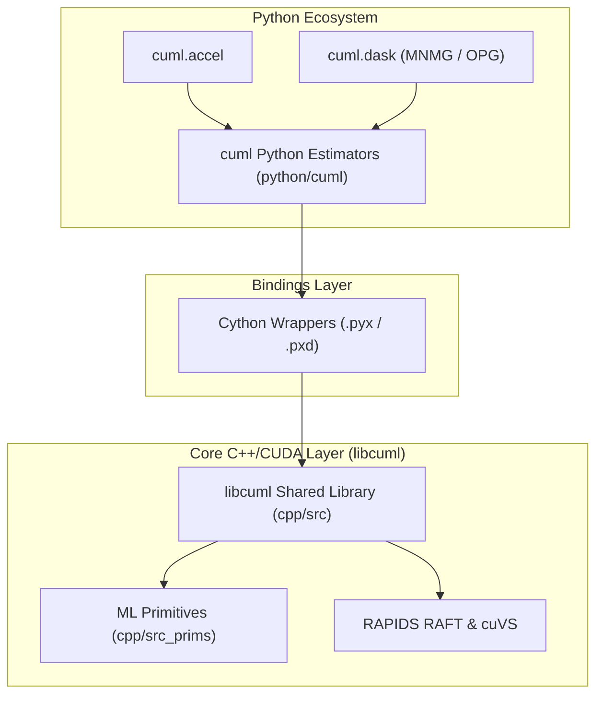
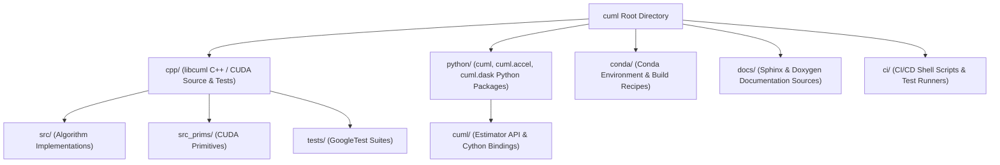

<!-- source: DeepWiki mcp.deepwiki.com · repo NVIDIA/cuml · page 1 Overview · fetched 2026-10-26 -->

# Overview

Relevant source files

The following files were used as context for generating this wiki page:

- [.github/scripts/sync_pr_project_fields.py](.github/scripts/sync_pr_project_fields.py)
- [.github/workflows/build.yaml](.github/workflows/build.yaml)
- [.github/workflows/pr.yaml](.github/workflows/pr.yaml)
- [.github/workflows/pr_issue_status_automation.yml](.github/workflows/pr_issue_status_automation.yml)
- [.github/workflows/test.yaml](.github/workflows/test.yaml)
- [.github/workflows/trigger-breaking-change-alert.yaml](.github/workflows/trigger-breaking-change-alert.yaml)
- [BUILD.md](BUILD.md)
- [CHANGELOG.md](CHANGELOG.md)
- [CONTRIBUTING.md](CONTRIBUTING.md)
- [RAPIDS_BRANCH](RAPIDS_BRANCH)
- [README.md](README.md)
- [build.sh](build.sh)
- [cpp/CMakeLists.txt](cpp/CMakeLists.txt)
- [cpp/README.md](cpp/README.md)
- [docs/source/api/cuml.ensemble.rst](docs/source/api/cuml.ensemble.rst)
- [docs/source/api/cuml.feature_extraction.rst](docs/source/api/cuml.feature_extraction.rst)
- [docs/source/api/cuml.preprocessing.rst](docs/source/api/cuml.preprocessing.rst)
- [docs/source/api/index.rst](docs/source/api/index.rst)
- [docs/source/conf.py](docs/source/conf.py)
- [python/cuml/README.md](python/cuml/README.md)
- [python/cuml/cuml/__init__.py](python/cuml/cuml/__init__.py)
- [python/cuml/cuml/preprocessing/__init__.py](python/cuml/cuml/preprocessing/__init__.py)
- [python/cuml/tests/test_docs.py](python/cuml/tests/test_docs.py)

NVIDIA cuML is an open-source CUDA-X Data Science library designed to provide GPU-accelerated machine learning algorithms with familiar scikit-learn-style interfaces [README.md:1-8]. The repository provides two primary Python paradigms—GPU-native estimators and zero-code-change acceleration via `cuml.accel`—backed by a robust C++ and CUDA core library (`libcuml`) and distributed multi-GPU capabilities (`cuml.dask`) [README.md:3-10, 63-68].

This page serves as a high-level parent guide to the cuML architecture and repository layout. For installation, build targets, and source compilation details, see [Getting Started and Building from Source](#1.1). For documentation pipelines, benchmark guides, and example notebooks, see [Documentation, Notebooks and Examples](#1.2).

---

## What is cuML?

cuML accelerates traditional machine learning pipelines by keeping data and computation entirely on NVIDIA GPUs [README.md:1-19]. It minimizes host-device data transfers and leverages optimized primitives from RAPIDS libraries such as RAFT and cuVS [BUILD.md:28-31]. 

Key features include:
* **GPU-Native Estimators**: Python estimators in `python/cuml` implementing standard scikit-learn patterns (`fit`, `predict`, `transform`, `fit_transform`) [README.md:7-8, 17-19].
* **Zero-Code-Change Acceleration (`cuml.accel`)**: Dynamically intercepts upstream scikit-learn, UMAP, and HDBSCAN imports and dispatches workloads to GPU hardware with transparent CPU fallbacks [README.md:9-10, 40-61].
* **Distributed Multi-GPU (`cuml.dask`)**: Scales computation across multiple GPUs and nodes using Dask and RAFT communication primitives [README.md:63-68, cpp/README.md:12].

Sources: `README.md:1-16`, `BUILD.md:24-37`

---

## High-Level Architecture

cuML's architecture is layered across C++ hardware-accelerated primitives, compiled shared libraries, Python/Cython bindings, and distributed orchestrators.

### Architectural Layers
1. **`libcuml` Core (`cpp/`)**: Written in C++ and CUDA, providing high-performance implementations of machine learning algorithms (`cpp/src/`) and foundational computational primitives (`cpp/src_prims/`) [cpp/README.md:5-11].
2. **Cython Bindings & Python Estimators (`python/cuml/`)**: Exposes `libcuml` functionality to Python via Cython modules, wrapping them in classes that adhere strictly to scikit-learn API specifications [README.md:7-8].
3. **Accelerator Layer (`cuml.accel`)**: Intercepts standard library imports (`sklearn`, `umap`, `hdbscan`) to route execution through GPU-accelerated proxy estimators [README.md:9-10, 40-61].
4. **Distributed Layer (`cuml.dask`)**: Manages multi-GPU and multi-node execution graphs using Dask arrays/dataframes and NCCL/UCX communication abstractions via RAFT [README.md:63-68, BUILD.md:52-55].

Sources: `README.md:7-10, 63-68`, `cpp/README.md:5-12`

---

## Repository Layout

The cuML codebase is organized into modular directories separating C++ core logic, Python packages, build configurations, and tests:

* `cpp/`: Contains all C++ algorithm implementations (`src/`), header-only primitives (`src_prims/`), C++ benchmarks, and GoogleTest suites [cpp/README.md:5-13].
* `python/`: Contains the primary `cuml` Python library, packaging configurations, and test files [python/cuml/README.md].
* `conda/`: Environment files and conda-forge packaging metadata [BUILD.md:7].
* `docs/`: Sphinx documentation sources, API reference structures, and developer guides [docs/source/conf.py:33-63].
* `ci/`: Shell scripts invoked by GitHub Actions workflows for compiling binaries, building Python wheels, and running test suites [.github/workflows/build.yaml:70-174, .github/workflows/test.yaml:56-167].

Sources: `cpp/CMakeLists.txt:23-28`, `cpp/README.md:5-13`, `build.sh:20-65`

---

## Child Pages

For more detailed technical documentation, proceed to the following child pages:

* **1.1 Getting Started and Building from Source**: Comprehensive guide covering system requirements, `build.sh` compilation targets (`libcuml`, `cuml`, `bench`, etc.), CMake parameters, conda environment setup, and wheel vs. conda distribution structures.
* **1.2 Documentation, Notebooks and Examples**: Details on the Sphinx/Doxygen documentation pipeline, `docs/source` directory layout, sample Jupyter notebooks, `cuml.accel` benchmark reports, and developer utility scripts.

Sources: `BUILD.md:1-153`, `docs/source/conf.py:33-78`, `cpp/README.md:1-111`

---

