# Page: Overview

# Overview

<details>
<summary>Relevant source files</summary>

The following files were used as context for generating this wiki page:

- [README.md](README.md)
- [VERSION](VERSION)
- [ci/release/update_version.sh](ci/release/update_version.sh)
- [intra-factory_transport/README.md](intra-factory_transport/README.md)
- [last_mile_delivery/README.md](last_mile_delivery/README.md)
- [routing_optimization_over_server/README.md](routing_optimization_over_server/README.md)
- [sample_lp_sever_notebooks/README.md](sample_lp_sever_notebooks/README.md)
- [workforce_optimization/workforce_optimization_milp.ipynb](workforce_optimization/workforce_optimization_milp.ipynb)

</details>


This page introduces the cuopt-examples repository, explaining its purpose as a collection of GPU-accelerated optimization examples, the types of problems it addresses, and the overall architecture. For detailed environment setup instructions, see **Getting Started**. For specific problem types, see **Vehicle Routing Problems**, **Portfolio Optimization**, or **Linear and Mixed-Integer Programming**.

## Purpose and Scope

The `cuopt-examples` repository is a comprehensive collection of examples demonstrating NVIDIA® cuOpt™, an open-source GPU-accelerated engine for solving complex decision optimization problems. The repository provides example notebooks and implementation references covering three primary optimization domains:

- **Vehicle Routing Problems (VRP)**: Including Capacitated VRP (CVRP), VRP with Time Windows (CVRPTW), and Pickup and Delivery (CPDPTW) for logistics and factory automation [last_mile_delivery/README.md:1-64](), [intra-factory_transport/README.md:9-17]().
- **Mathematical Programming**: Linear Programming (LP) and Mixed-Integer Linear Programming (MILP) for resource allocation, scheduling, and operational optimization [sample_lp_sever_notebooks/README.md:1-48](), [workforce_optimization/workforce_optimization_milp.ipynb:7-18]().
- **Portfolio Optimization**: Advanced financial modeling including Conditional Value at Risk (CVaR) and mean-variance approaches.

The repository is distributed under the [Apache 2.0 License](LICENSE.md) and serves as both a learning resource and production-ready implementation reference [README.md:1-8]().

**Sources:** [README.md:1-83](), [last_mile_delivery/README.md:1-64](), [workforce_optimization/workforce_optimization_milp.ipynb:7-18]()

## Repository Architecture

The `cuopt-examples` repository is organized around three primary access patterns to the cuOpt optimization engine: direct SDK access, server-based deployment, and integration through third-party modeling languages.

### System Architecture: Code Entity Mapping

The following diagram bridges the natural language concepts to the specific code entities used in the repository:

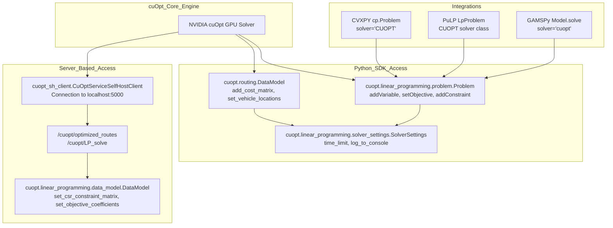

**Sources:** [README.md:1-83](), [workforce_optimization/workforce_optimization_milp.ipynb:107-112](), [sample_lp_sever_notebooks/README.md:1-58](), [routing_optimization_over_server/README.md:1-18]()

### Access Pattern Details

The repository provides three primary access methods, each suited to different deployment scenarios:

| Access Method | Primary Classes/APIs | Use Cases | Example Locations |
|--------------|---------------------|-----------|-------------------|
| **Direct SDK** | `Problem`, `DataModel`, `SolverSettings` | Programmatic problem construction, embedded optimization | `workforce_optimization/`, `intra-factory_transport/` |
| **Server-Based** | `CuOptServiceSelfHostClient`, `/cuopt/*` endpoints | Client-server architecture, remote solving, microservices | `routing_optimization_over_server/`, `sample_lp_sever_notebooks/` |
| **Modeling Languages** | CVXPY, PuLP, GAMSPy, AMPL, Julia, GAMS | Declarative modeling, integration with existing workflows | `gamspy_integration/`, `pulp_integration/`, `cvxpy_integration/` |

The **Direct SDK** approach uses two primary APIs:
- `cuopt.linear_programming.problem.Problem`: For general LP/MILP problems with methods like `addVariable()`, `setObjective()`, and `addConstraint()` [workforce_optimization/workforce_optimization_milp.ipynb:107-112]().
- `cuopt.routing.DataModel`: For vehicle routing problems with methods like `add_cost_matrix()` and `set_vehicle_locations()` [last_mile_delivery/README.md:20-26]().

The **Server-Based** approach deploys cuOpt as a service (typically on `localhost:5000`) and uses `CuOptServiceSelfHostClient` to submit problems. It supports endpoints such as `/cuopt/optimized_routes` and `/cuopt/LP_solve` [sample_lp_sever_notebooks/README.md:1-58]().

**Sources:** [README.md:65-78](), [sample_lp_sever_notebooks/README.md:1-58](), [workforce_optimization/workforce_optimization_milp.ipynb:107-112]()

## Problem Type Classification

The repository categorizes optimization problems into logical domains, each utilizing specific cuOpt SDK features:

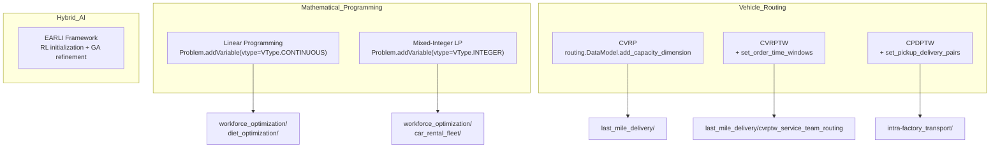

### Key SDK Implementations
- **Mathematical Programming**: Uses the `Problem` class with `VType.CONTINUOUS` for LP or `VType.INTEGER` for MILP [workforce_optimization/workforce_optimization_milp.ipynb:107-112, 209-221]().
- **Vehicle Routing**: Uses the `routing.DataModel` class.
    - **CVRP**: Basic capacity via `add_capacity_dimension()` [last_mile_delivery/README.md:20-26]().
    - **CVRPTW**: Adds temporal constraints via `set_order_time_windows()` [last_mile_delivery/README.md:40-44]().
    - **CPDPTW**: Adds pickup-delivery pairing and graph-based navigation via `distance_engine.WaypointMatrix` [intra-factory_transport/README.md:9-24]().

**Sources:** [workforce_optimization/workforce_optimization_milp.ipynb:107-112, 209-221](), [last_mile_delivery/README.md:11-64](), [intra-factory_transport/README.md:9-24]()

## Example Directory Organization

The repository is organized by use case, with each directory containing self-contained examples and documentation:

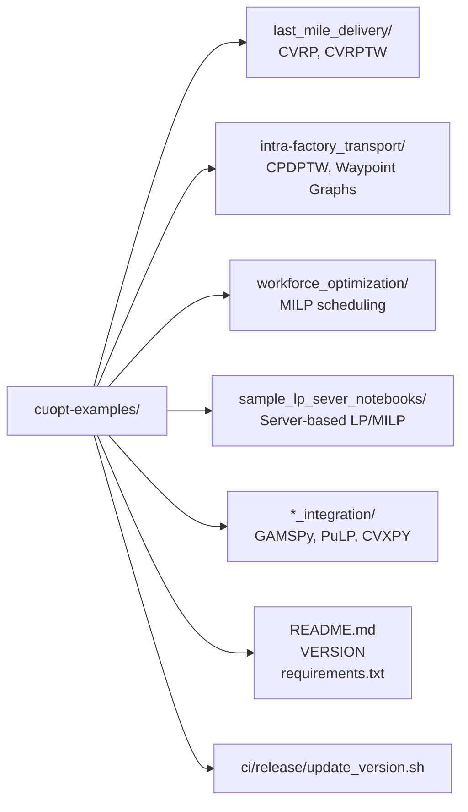

The root directory contains:
- **README.md**: Quick start guide with Docker instructions [README.md:1-83]().
- **VERSION**: Current release version (e.g., `25.12.00`) [VERSION:1-2]().
- **ci/release/update_version.sh**: Script for maintaining version consistency across the codebase and Docker tags [ci/release/update_version.sh:1-130]().

**Sources:** [README.md:65-78](), [last_mile_delivery/README.md:1-88](), [intra-factory_transport/README.md:1-43](), [workforce_optimization/workforce_optimization_milp.ipynb:1-172](), [sample_lp_sever_notebooks/README.md:1-58]()

## Docker-Based Deployment

The repository is designed for Docker-first deployment, providing pre-configured containers with cuOpt and all dependencies [README.md:9-58]().

**Image Tags:**
- **CUDA 12**: `nvidia/cuopt:25.12.0a-cuda12.9-py3.13` [README.md:42]()
- **CUDA 13**: `nvidia/cuopt:25.12.0a-cuda13.0-py3.13` [README.md:37]()

**Container Execution:**
```bash
docker run -it --rm --gpus all --network=host \
  -v $(pwd):/workspace -w /workspace \
  nvidia/cuopt:25.12.0a-cuda13.0-py3.13 \
  /bin/bash -c "pip install -r requirements.txt; jupyter-notebook"
```
[README.md:49]()

**Version Management:**
The `update_version.sh` script transforms versions (e.g., `26.02.00` → `26.2.0a`) to denote pre-release status for the main branch [ci/release/update_version.sh:76-89]().

**Sources:** [README.md:9-58](), [VERSION:1-2](), [ci/release/update_version.sh:1-130]()

## Key Components and Code Entities

| Concept | Primary Classes/Modules | Key Methods/Attributes |
|---------|------------------------|------------------------|
| **Problem Construction** | `cuopt.linear_programming.problem.Problem` | `addVariable()`, `setObjective()`, `addConstraint()` |
| **Variable Types** | `cuopt.linear_programming.problem.VType` | `VType.CONTINUOUS`, `VType.INTEGER` |
| **Solver Configuration** | `cuopt.linear_programming.solver_settings.SolverSettings` | `time_limit`, `log_to_console` |
| **Routing Data** | `cuopt.routing.DataModel` | `add_cost_matrix()`, `add_capacity_dimension()` |
| **Server Client** | `cuopt_sh_client.CuOptServiceSelfHostClient` | `solve()`, connection to `localhost:5000` |

**Sources:** [workforce_optimization/workforce_optimization_milp.ipynb:107-313](), [last_mile_delivery/README.md:20-44](), [sample_lp_sever_notebooks/README.md:1-58]()

## Supported Problem Scales

The examples demonstrate cuOpt's ability to handle large-scale problems:
- **Large-Scale VRP**: The Gehring & Homberger benchmark demonstrates solving problems with **1000 locations** and **250 vehicles** [last_mile_delivery/README.md:48-64]().
- **Workforce Scheduling**: A MILP example with 7 workers and 14 shifts [workforce_optimization/workforce_optimization_milp.ipynb:169-171]().
- **Intra-Factory Transport**: CPDPTW using waypoint graphs for AMR navigation [intra-factory_transport/README.md:9-24]().

**Sources:** [last_mile_delivery/README.md:46-64](), [workforce_optimization/workforce_optimization_milp.ipynb:169-171](), [intra-factory_transport/README.md:9-24]()

---

# Page: Getting Started

# Getting Started

<details>
<summary>Relevant source files</summary>

The following files were used as context for generating this wiki page:

- [.github/ISSUE_TEMPLATE/bug_report.yml](.github/ISSUE_TEMPLATE/bug_report.yml)
- [.pre-commit-config.yaml](.pre-commit-config.yaml)
- [CONTRIBUTING.md](CONTRIBUTING.md)
- [LICENSE.md](LICENSE.md)
- [README.md](README.md)
- [VERSION](VERSION)
- [ci/release/update_version.sh](ci/release/update_version.sh)
- [requirements.txt](requirements.txt)
- [workforce_optimization/workforce_optimization_milp.ipynb](workforce_optimization/workforce_optimization_milp.ipynb)

</details>


This page guides users through initial setup of the `cuopt-examples` repository, including Docker installation, GPU requirements, environment configuration, and running your first optimization example. For detailed environment configuration options, see [Environment Setup](#2.1). For a complete walkthrough of a workforce optimization problem, see [Quick Start Tutorial](#2.2).

## Purpose and Scope

This document covers the essential steps to:
- Verify system prerequisites (GPU hardware, NVIDIA drivers, container runtime).
- Install and run cuOpt using the recommended Docker-based approach.
- Verify GPU acceleration is working correctly via `nvidia-smi`.
- Access and execute example notebooks using the provided Docker images.
- Understand basic cuOpt API entry points for Linear Programming (LP), Mixed-Integer Programming (MILP), and Vehicle Routing Problems (VRP).

This page focuses on getting the environment operational. For in-depth coverage of cuOpt's core concepts and APIs, see [Core Concepts](#3). For specific problem types, see [Vehicle Routing Problems](#4), [Portfolio Optimization](#5), or [Linear and Mixed-Integer Programming](#6).

---

## System Prerequisites

### Required Hardware and Software

cuOpt requires GPU acceleration to function. The following components must be present:

| Component | Requirement | Verification Command |
|-----------|-------------|---------------------|
| **NVIDIA GPU** | CUDA-compatible GPU | `nvidia-smi` |
| **NVIDIA Drivers** | Appropriate for your GPU | `nvidia-smi` shows driver version |
| **CUDA Runtime** | CUDA 12.x or CUDA 13.x | Provided by Docker image |
| **Docker** | Version with GPU support | `docker --version` |
| **NVIDIA Container Toolkit** | For GPU passthrough | `docker run --gpus all nvidia/cuda:12.0.0-base-ubuntu22.04 nvidia-smi` |

Title: cuOpt Stack Dependencies
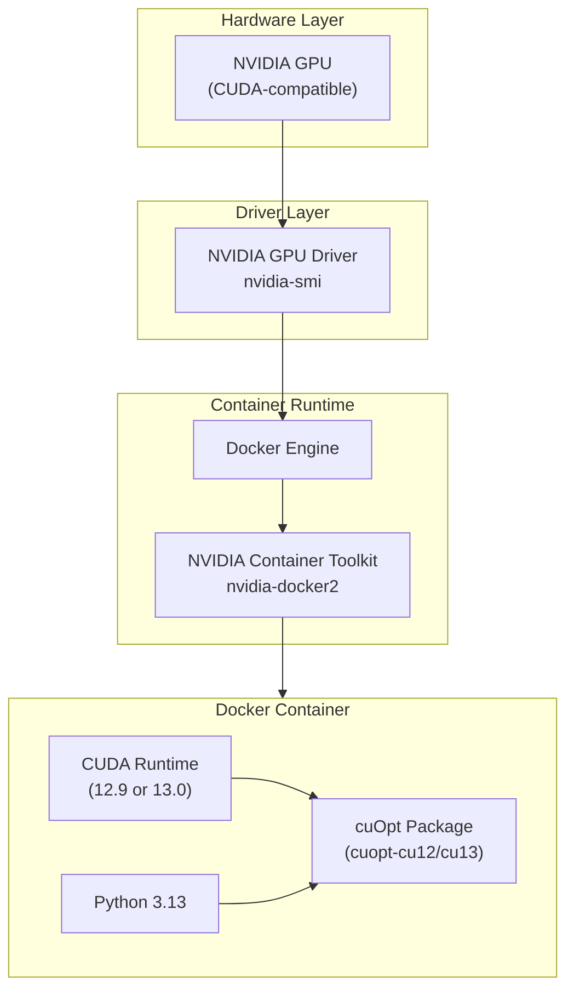
Sources: [README.md:19-21](), [CONTRIBUTING.md:43]()

---

## Docker-Based Installation (Recommended)

Docker provides a pre-configured environment with all dependencies, eliminating manual setup of CUDA, Python packages, and library versions.

### Step 1: Clone Repository

```bash
git clone https://github.com/NVIDIA/cuopt-examples.git
cd cuopt-examples
```
Sources: [README.md:26-30]()

### Step 2: Pull cuOpt Docker Image

Two Docker images are available based on CUDA version. Choose the appropriate version for your system:

**CUDA 13.0 (Recommended for newer GPUs):**
```bash
docker pull nvidia/cuopt:25.12.0a-cuda13.0-py3.13
```

**CUDA 12.9 (For broader compatibility):**
```bash
docker pull nvidia/cuopt:25.12.0a-cuda12.9-py3.13
```

The version `25.12.0a` corresponds to the pre-release version tracked in `VERSION`. The `a` suffix indicates alpha/pre-release status.

Sources: [README.md:32-43](), [VERSION:1](), [ci/release/update_version.sh:76-89]()

### Step 3: Launch Container with Jupyter

The following command starts the Docker container with GPU access, installs notebook dependencies, and launches Jupyter:

**For CUDA 13.0:**
```bash
docker run -it --rm --gpus all --network=host \
  -v $(pwd):/workspace -w /workspace \
  nvidia/cuopt:25.12.0a-cuda13.0-py3.13 \
  /bin/bash -c "pip install -r requirements.txt; jupyter-notebook"
```

The container installs dependencies from `requirements.txt`, which includes `jupyter`, `notebook`, and `ipykernel`.

Sources: [README.md:45-55](), [requirements.txt:1-4]()

---

## Docker Container Architecture

Title: Docker Container Runtime Architecture
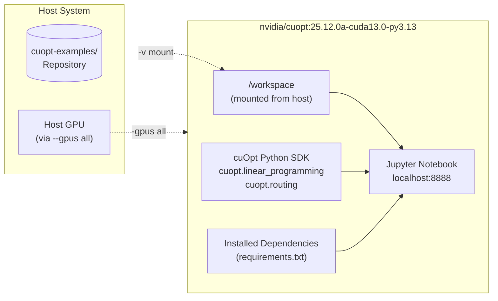
Sources: [README.md:45-55]()

The container provides:
- **Pre-installed cuOpt SDK**: Includes `cuopt.linear_programming.problem.Problem` and `cuopt.routing.DataModel`.
- **CUDA Runtime**: Optimized for GPU acceleration.
- **Python 3.13**: Environment pre-configured for optimization workflows.

---

## GPU Verification

Before running optimization problems, verify GPU access is working correctly within your environment.

### Verification Script

The following code (available in example notebooks) checks for GPU availability:

```python
import subprocess
def check_gpu():
    try:
        output = subprocess.check_output(["nvidia-smi"], shell=False).decode()
        print("✅ GPU is enabled")
    except Exception:
        print("⚠️ GPU not detected!")
```

Sources: [workforce_optimization/workforce_optimization_milp.ipynb:39-78]()

---

## Running Your First Example

### Available Example Categories

The repository organizes examples by problem domain:

Title: Example Repository Structure
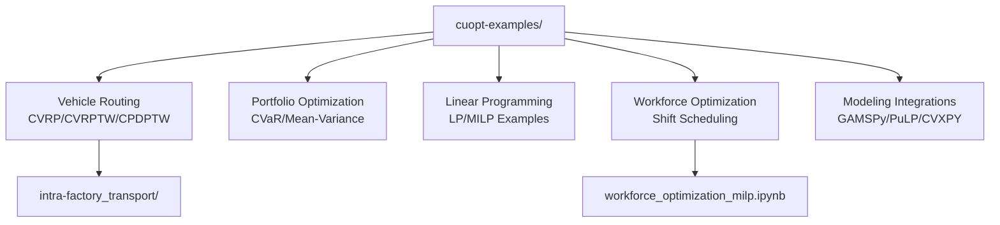
Sources: [README.md:65-74]()

### Example: Workforce Optimization

The workforce optimization example demonstrates core cuOpt API usage for a Mixed Integer Linear Program (MILP) using the `Problem` class.

Title: cuOpt Problem API Workflow

Sources: [workforce_optimization/workforce_optimization_milp.ipynb:109-110](), [workforce_optimization/workforce_optimization_milp.ipynb:208-313]()

To run this:
1. Navigate to the Jupyter interface.
2. Open `workforce_optimization/workforce_optimization_milp.ipynb`.
3. Execute the cells to see how `cuopt.linear_programming.problem.Problem` is used to define and solve the assignment.

---

## Next Steps

- **Detailed Setup**: For non-Docker environments or driver troubleshooting, see [Environment Setup](#2.1).
- **Step-by-Step Guide**: For a guided walkthrough of the code, see [Quick Start Tutorial](#2.2).
- **Core APIs**: Learn about the `Problem` and `DataModel` classes in [Core Concepts](#3).

---

# Page: Environment Setup

# Environment Setup

<details>
<summary>Relevant source files</summary>

The following files were used as context for generating this wiki page:

- [.github/ISSUE_TEMPLATE/bug_report.yml](.github/ISSUE_TEMPLATE/bug_report.yml)
- [.pre-commit-config.yaml](.pre-commit-config.yaml)
- [CONTRIBUTING.md](CONTRIBUTING.md)
- [LICENSE.md](LICENSE.md)
- [README.md](README.md)
- [VERSION](VERSION)
- [ci/release/update_version.sh](ci/release/update_version.sh)
- [requirements.txt](requirements.txt)
- [workforce_optimization/workforce_optimization_milp.ipynb](workforce_optimization/workforce_optimization_milp.ipynb)

</details>


## Purpose and Scope

This document provides detailed instructions for setting up a development environment to run the cuOpt examples. It covers Docker-based installation (recommended), Python virtual environment setup (alternative), GPU driver configuration, and dependency management. After completing this setup, you will be able to run notebooks and scripts from the repository.

For instructions on running your first example after setup, see [Quick Start Tutorial](#2.2). For information on contributing to the repository with development tools, see [Development Environment Setup](#13.1).

---

## Environment Setup Overview

The cuOpt examples repository supports multiple installation methods, with Docker being the primary and recommended approach due to its consistent environment and pre-configured dependencies. The setup process follows this general workflow:

Title: Environment Setup Workflow
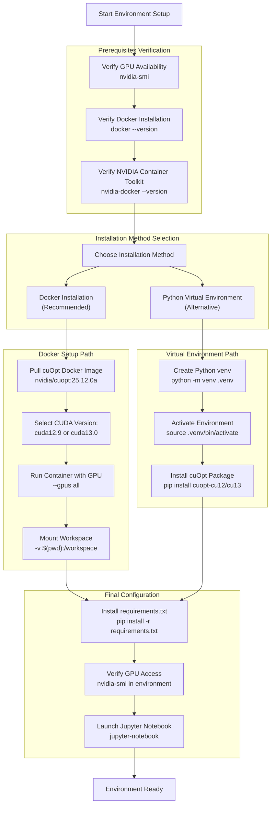

Sources: [README.md:9-58](), [workforce_optimization/workforce_optimization_milp.ipynb:31-92]()

---

## Prerequisites

Before setting up the cuOpt examples environment, ensure the following prerequisites are met:

| Prerequisite | Purpose | Verification Command | Documentation Link |
|--------------|---------|---------------------|-------------------|
| **NVIDIA GPU** | GPU acceleration for cuOpt solver | `nvidia-smi` | [cuOpt System Requirements](https://docs.nvidia.com/cuopt/user-guide/latest/system-requirements.html) |
| **NVIDIA GPU Drivers** | Interface between OS and GPU hardware | `nvidia-smi` output shows driver version | NVIDIA Driver Downloads |
| **Docker** | Container runtime for cuOpt image | `docker --version` | [NVIDIA Docker Guide](https://docs.nvidia.com/ai-enterprise/deployment/vmware/latest/docker.html) |
| **NVIDIA Container Toolkit** | GPU support in Docker containers | `nvidia-docker --version` or `docker run --gpus all ...` | [Container Toolkit Install Guide](https://docs.nvidia.com/datacenter/cloud-native/container-toolkit/latest/install-guide.html) |

**Detailed System Requirements**: The cuOpt engine has specific GPU compute capability and memory requirements. Refer to the official [NVIDIA cuOpt System Requirements documentation](https://docs.nvidia.com/cuopt/user-guide/latest/system-requirements.html#) for detailed specifications.

Sources: [README.md:13-22](), [workforce_optimization/workforce_optimization_milp.ipynb:63-69]()

---

## Docker-Based Setup (Recommended)

Docker is the primary installation method for cuOpt examples. It provides a pre-configured environment with all dependencies and eliminates compatibility issues.

### Pulling the cuOpt Docker Image

The cuOpt Docker images are versioned and available for different CUDA versions. The current release version is **25.12.0a**.

Title: cuOpt Docker Image Components
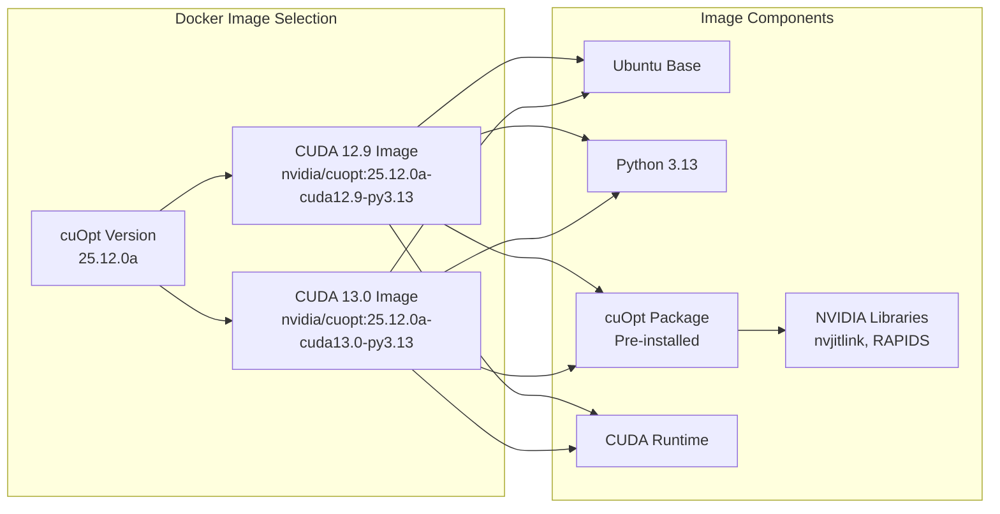

**Pull Commands:**

For CUDA 12.9:
```bash
docker pull nvidia/cuopt:25.12.0a-cuda12.9-py3.13
```

For CUDA 13.0:
```bash
docker pull nvidia/cuopt:25.12.0a-cuda13.0-py3.13
```

Sources: [README.md:32-43](), [VERSION:1](), [ci/release/update_version.sh:76-94]()

### Running the Docker Container

The cuOpt container requires GPU access, workspace mounting, and network access for Jupyter notebooks.

**Container Runtime Configuration:**

| Flag | Purpose | Example Value |
|------|---------|---------------|
| `--gpus all` | Enable all GPU devices in container | Required for cuOpt GPU acceleration |
| `-v $(pwd):/workspace` | Mount current directory as /workspace | Allows editing notebooks on host |
| `-w /workspace` | Set working directory | Start in mounted workspace |
| `--network=host` | Use host network stack | Enables Jupyter access at localhost |
| `-it` | Interactive terminal | Allows shell interaction |
| `--rm` | Remove container on exit | Clean up after session |

**Run Command for CUDA 12.9:**
```bash
docker run -it --rm --gpus all --network=host \
  -v $(pwd):/workspace -w /workspace \
  nvidia/cuopt:25.12.0a-cuda12.9-py3.13 \
  /bin/bash -c "pip install -r requirements.txt; jupyter-notebook"
```

**Run Command for CUDA 13.0:**
```bash
docker run -it --rm --gpus all --network=host \
  -v $(pwd):/workspace -w /workspace \
  nvidia/cuopt:25.12.0a-cuda13.0-py3.13 \
  /bin/bash -c "pip install -r requirements.txt; jupyter-notebook"
```

The container will:
1. Install additional dependencies from `requirements.txt` [requirements.txt:1-5]()
2. Start Jupyter Notebook server
3. Display a URL with token for browser access [README.md:57]()
4. Mount the repository directory at `/workspace` for file access [README.md:49-54]()

Sources: [README.md:45-57](), [requirements.txt:1-5]()

---

## Alternative: Python Virtual Environment Setup

For users who cannot use Docker or prefer a native Python installation, cuOpt can be installed via pip in a virtual environment.

### Installing cuOpt Package

Install cuOpt from the NVIDIA PyPI index. Choose the CUDA version matching your system's CUDA installation:

**For CUDA 12:**
```bash
pip install --upgrade --extra-index-url https://pypi.nvidia.com \
  cuopt-cu12 nvidia-nvjitlink-cu12 rapids-logger==0.1.19
```

**For CUDA 13:**
```bash
pip install --upgrade --extra-index-url https://pypi.nvidia.com \
  cuopt-cu13 nvidia-nvjitlink-cu13 rapids-logger==0.1.19
```

**Important**: Before installing cuOpt, you may need to uninstall conflicting CUDA packages:
```bash
pip uninstall -y cuda-python cuda-bindings cuda-core
```

Sources: [workforce_optimization/workforce_optimization_milp.ipynb:87-91]()

### Installing Repository Dependencies

After installing cuOpt, install additional dependencies required by the examples:

```bash
pip install -r requirements.txt
```

The `requirements.txt` file specifies packages needed across all examples, including `jupyter`, `notebook`, and `ipykernel` [requirements.txt:1-5]().

Sources: [README.md:23](), [requirements.txt:1-5]()

---

## GPU Validation and Verification

Verifying GPU access is critical for cuOpt's GPU-accelerated solving.

Title: GPU Validation Logic
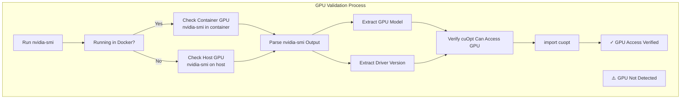

### Running nvidia-smi

The `nvidia-smi` command provides GPU status information. Example notebooks include a `check_gpu()` function that parses this output to ensure a **GPU runtime** is enabled [workforce_optimization/workforce_optimization_milp.ipynb:39-78]().

**Key checks performed:**
- `subprocess.CalledProcessError`: nvidia-smi command failed
- `FileNotFoundError`: nvidia-smi not in PATH
- Provides troubleshooting for Google Colab and Docker runtimes [workforce_optimization/workforce_optimization_milp.ipynb:56-69]()

Sources: [workforce_optimization/workforce_optimization_milp.ipynb:36-78]()

---

## Development Tools and Versioning

### Pre-commit Hooks

For contributors, the project uses `pre-commit` to ensure code quality.

| Hook | Tool | Purpose |
|------|------|---------|
| `isort` | isort | Sort imports consistently |
| `black` | Black | Format Python code |
| `flake8` | flake8 | Check for PEP 8 compliance |

To set up:
```bash
pip install pre-commit
pre-commit install
```

Sources: [CONTRIBUTING.md:51-79](), [.pre-commit-config.yaml:5-30]()

### Version Management

The repository uses a `VERSION` file [VERSION:1]() and an automated script [ci/release/update_version.sh]() to maintain version consistency across documentation and Docker tags.

The script `update_version.sh` handles:
1. Updating the `VERSION` file [ci/release/update_version.sh:68-70]().
2. Transforming semantic versions (e.g., `25.12.00`) to pre-release container tags (e.g., `25.12.0a`) [ci/release/update_version.sh:76-86]().
3. Updating Docker image references in `README.md` via `sed` [ci/release/update_version.sh:103]().

Sources: [VERSION:1](), [ci/release/update_version.sh:1-130]()

---

## Troubleshooting Common Issues

### GPU Not Detected in Docker

**Symptoms**: `nvidia-smi` fails inside container.
**Solutions**:
1. Verify NVIDIA Container Toolkit installation [workforce_optimization/workforce_optimization_milp.ipynb:73]().
2. Ensure you run with `--gpus all` [README.md:49]().
3. Test with a base image: `docker run --gpus all nvidia/cuda:12.0.0-base-ubuntu22.04 nvidia-smi` [workforce_optimization/workforce_optimization_milp.ipynb:68]().

### CUDA Version Mismatch

**Symptoms**: Import errors when loading cuOpt.
**Solutions**:
1. Verify host CUDA version via `nvidia-smi`.
2. Pull the matching Docker image: `cuda12.9` or `cuda13.0` [README.md:37-43]().

Sources: [README.md:37-55](), [workforce_optimization/workforce_optimization_milp.ipynb:63-75]()

---

# Page: Quick Start Tutorial

# Quick Start Tutorial

<details>
<summary>Relevant source files</summary>

The following files were used as context for generating this wiki page:

- [README.md](README.md)
- [VERSION](VERSION)
- [ci/release/update_version.sh](ci/release/update_version.sh)
- [workforce_optimization/workforce_optimization_milp.ipynb](workforce_optimization/workforce_optimization_milp.ipynb)

</details>


## Purpose and Scope

This page provides a hands-on introduction to cuOpt by walking through a complete workforce optimization example. It demonstrates the fundamental workflow of formulating an optimization problem, setting constraints, and solving with the cuOpt Python API. This tutorial assumes you have already completed the environment setup described in [Environment Setup](2.1).

For detailed documentation of the Problem API methods and classes, see [Problem API](3.1). For information on solver configuration options, see [SolverSettings and Configuration](3.2). For more complex optimization scenarios including vehicle routing and portfolio optimization, see [Vehicle Routing Problems](4) and [Portfolio Optimization](5).

---

## Tutorial Overview

The quick start tutorial demonstrates a **workforce scheduling problem**: assigning workers to shifts while minimizing labor costs and satisfying shift requirements. This classic assignment problem illustrates the core workflow for solving Mixed Integer Linear Programs (MILP) with cuOpt.

The complete tutorial is implemented in [workforce_optimization/workforce_optimization_milp.ipynb:1-546]() and covers:

1. Problem definition and data setup
2. Creating decision variables
3. Defining the objective function
4. Adding constraints
5. Configuring and running the solver
6. Analyzing the solution
7. Adding additional constraints

Sources: [workforce_optimization/workforce_optimization_milp.ipynb:1-19](), [README.md:1-83]()

---

## Workflow Diagram

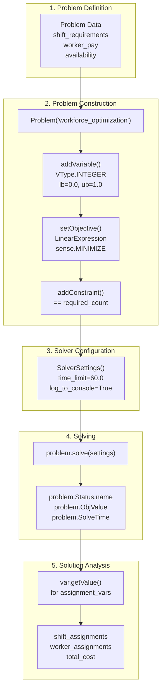

**Diagram: cuOpt Problem-Solving Workflow**

This diagram maps the five-stage workflow to specific cuOpt API methods. Each stage builds on the previous, creating a complete optimization model that can be solved on GPU.

Sources: [workforce_optimization/workforce_optimization_milp.ipynb:95-314]()

---

## Problem Definition

The workforce optimization problem requires three key data structures:

| Data Structure | Description | Example |
|---------------|-------------|---------|
| `shift_requirements` | Number of workers needed per shift | `{"Mon1": 3, "Tue2": 2, ...}` |
| `worker_pay` | Cost per shift for each worker | `{"Amy": 10, "Bob": 12, ...}` |
| `availability` | Shifts each worker can work | `{"Amy": ["Tue2", "Wed3", ...], ...}` |

The tutorial defines 14 shifts, 7 workers, and 79 possible worker-shift assignments based on availability constraints.

**Key Problem Characteristics:**
- **Problem Type**: Mixed Integer Linear Program (MILP)
- **Decision Variables**: Binary (0 or 1) assignments
- **Objective**: Minimize total labor cost
- **Constraints**: Each shift must have exactly the required number of workers

Sources: [workforce_optimization/workforce_optimization_milp.ipynb:122-172]()

---

## Creating the Problem and Variables

### Problem Instance

The optimization problem begins by instantiating the `Problem` class:

```python
problem = Problem("workforce_optimization")
```

This creates a new optimization problem object that will hold variables, constraints, and the objective function. See [workforce_optimization/workforce_optimization_milp.ipynb:209]().

### Decision Variables

Binary decision variables represent each possible worker-shift assignment. For each worker and each shift they are available for, a variable is created:

```python
var = problem.addVariable(name=var_name, vtype=VType.INTEGER, lb=0.0, ub=1.0)
```

The `addVariable` method parameters:
- `name`: String identifier (e.g., `"Amy_Tue2"`)
- `vtype`: `VType.INTEGER` for integer variables
- `lb`: Lower bound (0.0 = not assigned)
- `ub`: Upper bound (1.0 = assigned)

Setting `lb=0.0` and `ub=1.0` with `VType.INTEGER` creates binary variables. The tutorial creates 79 such variables stored in the `assignment_vars` dictionary.

Sources: [workforce_optimization/workforce_optimization_milp.ipynb:203-221]()

---

## Setting the Objective Function

The objective function defines what to optimize. For workforce scheduling, this is minimizing total labor cost:

$$\text{minimize} \sum_{worker, shift} cost_{worker} \times assignment_{worker,shift}$$

This is implemented using `LinearExpression` and the `setObjective` method:

```python
objective_expr = LinearExpression([], [], 0.0)
for (worker, shift), var in assignment_vars.items():
    cost = worker_pay[worker]
    objective_expr += var * cost

problem.setObjective(objective_expr, sense.MINIMIZE)
```

The `LinearExpression` accumulates coefficient-variable products, then `setObjective` installs it as the optimization objective with `sense.MINIMIZE` to indicate cost minimization.

Sources: [workforce_optimization/workforce_optimization_milp.ipynb:224-240]()

---

## Adding Constraints

Constraints ensure the solution satisfies business requirements. The primary constraint is that each shift must have exactly the required number of workers:

$$\sum_{worker} assignment_{worker,shift} = required\_count_{shift} \quad \forall shift$$

Implementation:

```python
shift_expr = LinearExpression([], [], 0.0)
for var in shift_assignments:
    shift_expr += var

constraint = problem.addConstraint(shift_expr == required_count, name=f"shift_{shift}")
```

For 14 shifts, this creates 14 equality constraints. The `addConstraint` method accepts:
- A comparison expression (`==`, `<=`, `>=`)
- An optional `name` parameter for identification

The tutorial later demonstrates adding inequality constraints to limit workers to a maximum of 4 shifts each. See [workforce_optimization/workforce_optimization_milp.ipynb:413-438]().

Sources: [workforce_optimization/workforce_optimization_milp.ipynb:243-271]()

---

## Code Entity Mapping

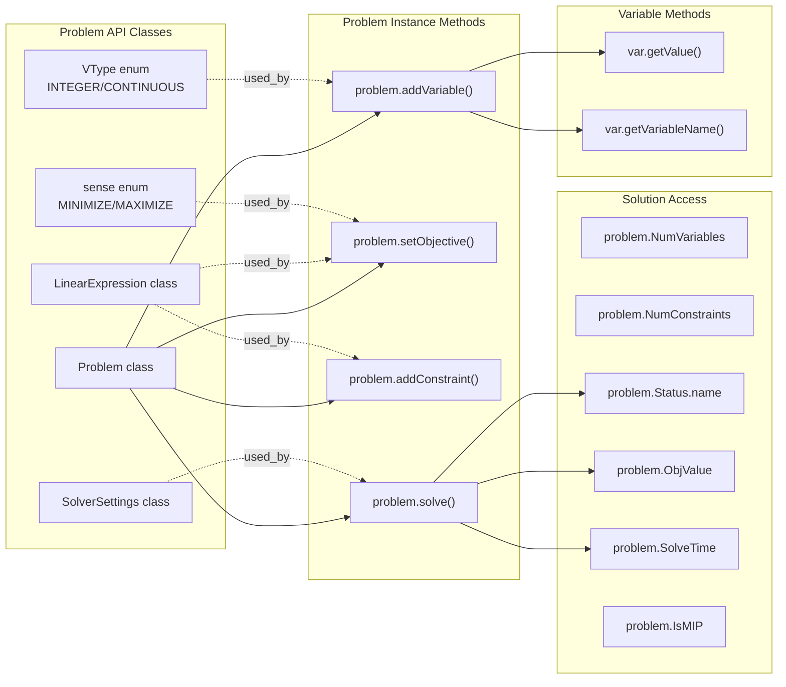

**Diagram: cuOpt Problem API Class and Method Relationships**

This diagram shows how the key classes and methods from `cuopt.linear_programming.problem` and `cuopt.linear_programming.solver_settings` modules interact during problem construction and solving.

Sources: [workforce_optimization/workforce_optimization_milp.ipynb:107-112](), [workforce_optimization/workforce_optimization_milp.ipynb:203-314]()

---

## Solver Configuration and Execution

### Configuring SolverSettings

The `SolverSettings` class controls solver behavior:

```python
settings = SolverSettings()
settings.set_parameter("time_limit", 60.0)
settings.set_parameter("log_to_console", True)
settings.set_parameter("method", 0)
```

Common parameters:
- `time_limit`: Maximum solve time in seconds (60.0 = 1 minute)
- `log_to_console`: Enable/disable solver output (True/False)
- `method`: Solver method selection (0 = default)

### Solving the Problem

The `solve` method executes the optimization:

```python
problem.solve(settings)
```

This triggers GPU-accelerated solving. After completion, the solution can be accessed through problem properties:
- `problem.Status.name`: Solution status (`"Optimal"`, `"FeasibleFound"`, etc.)
- `problem.ObjValue`: Optimal objective value (total cost)
- `problem.SolveTime`: Time taken in seconds
- `problem.NumVariables`: Number of decision variables
- `problem.NumConstraints`: Number of constraints
- `problem.IsMIP`: Boolean indicating if problem is mixed-integer

Sources: [workforce_optimization/workforce_optimization_milp.ipynb:283-314]()

---

## Solution Analysis

### Extracting Solution Values

After solving, decision variable values are accessed via `getValue()`:

```python
for (worker, shift), var in assignment_vars.items():
    if var.getValue() > 0.5:  # Binary variable is 1
        # Worker is assigned to shift
```

For binary variables, values > 0.5 indicate assignment (due to numerical tolerance).

### Solution Structure

The tutorial organizes results into two views:

**Shift-Centric View:**
| Shift | Required | Assigned | Workers | Cost |
|-------|----------|----------|---------|------|
| Mon1 | 3 | 3 | Bob, Ed, Fred | $29 |
| Tue2 | 2 | 2 | Amy, Bob | $22 |
| ... | ... | ... | ... | ... |

**Worker-Centric View:**
| Worker | Shifts Assigned | Total Shifts | Total Cost |
|--------|----------------|--------------|------------|
| Amy | [Tue2, Wed3, Fri5, Sun7] | 4 | $40 |
| Bob | [Mon1, Tue2, Fri5, Sat6] | 4 | $48 |
| ... | ... | ... | ... |

The solution shows the optimal total cost and verifies that all shift requirements are met.

Sources: [workforce_optimization/workforce_optimization_milp.ipynb:326-401]()

---

## Adding Additional Constraints

The tutorial demonstrates extending an existing model by adding maximum shift constraints:

```python
worker_expr = LinearExpression([], [], 0.0)
for var in worker_shifts:
    worker_expr += var

constraint = problem.addConstraint(worker_expr <= max_shifts_per_worker, 
                                  name=f"max_shifts_{worker}")
```

This adds 7 new inequality constraints (one per worker) limiting each worker to at most 4 shifts. After adding constraints:
1. The problem is re-solved with the same `solve()` call
2. New solution is extracted and compared
3. The `problem.NumConstraints` property reflects the additional constraints

This demonstrates the incremental problem-building capability of cuOpt.

Sources: [workforce_optimization/workforce_optimization_milp.ipynb:407-466]()

---

## Complete Tutorial Workflow

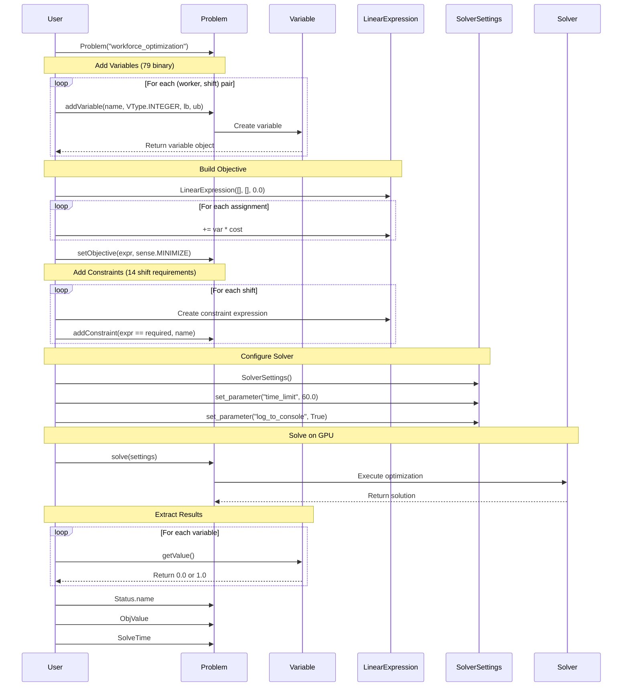

**Diagram: Sequential Workflow of Workforce Optimization Tutorial**

This sequence diagram shows the order of API calls and data flow from problem construction through solution extraction.

Sources: [workforce_optimization/workforce_optimization_milp.ipynb:95-466]()

---

## Key Takeaways

The workforce optimization tutorial demonstrates:

1. **Problem Construction Pattern**: Create `Problem` → Add variables → Set objective → Add constraints
2. **Binary Variable Formulation**: Using `VType.INTEGER` with bounds `[0.0, 1.0]` for 0/1 decisions
3. **Expression Building**: `LinearExpression` accumulates terms via `+=` operator
4. **Constraint Types**: Equality (`==`) and inequality (`<=`, `>=`) constraints
5. **Solver Control**: `SolverSettings` configures time limits and logging
6. **Solution Access**: Post-solve properties (`Status`, `ObjValue`, `SolveTime`) and `getValue()` for variables
7. **Incremental Modeling**: Adding constraints to existing problems and re-solving

**Performance Note**: The tutorial solves a 79-variable, 21-constraint MILP in under 1 second on GPU, demonstrating cuOpt's computational efficiency for small-to-medium scale problems.

Sources: [workforce_optimization/workforce_optimization_milp.ipynb:469-499]()

---

## Running the Tutorial

To execute the tutorial yourself:

1. **Ensure GPU access**: The tutorial requires an NVIDIA GPU with CUDA support. Verify with `nvidia-smi`. [workforce_optimization/workforce_optimization_milp.ipynb:36-78]()

2. **Start Jupyter**: From the repository root with Docker:
   ```bash
   docker run -it --rm --gpus all --network=host \
     -v $(pwd):/workspace -w /workspace \
     nvidia/cuopt:25.12.0a-cuda13.0-py3.13 \
     /bin/bash -c "pip install -r requirements.txt; jupyter-notebook"
   ```
   (Note: Use the appropriate image tag for your CUDA version, e.g., `cuda12.9` or `cuda13.0`). [README.md:47-55]()

3. **Navigate to notebook**: Open [workforce_optimization/workforce_optimization_milp.ipynb]() in the Jupyter interface.

4. **Execute cells sequentially**: Run each cell in order to follow the tutorial progression.

The notebook includes GPU detection logic at [workforce_optimization/workforce_optimization_milp.ipynb:36-78]() that provides setup guidance if GPU is not available.

Sources: [README.md:25-58](), [workforce_optimization/workforce_optimization_milp.ipynb:36-92](), [VERSION:1]()

---

## Next Steps

After completing this tutorial, explore:

- **[Problem API](3.1)**: Detailed documentation of all `Problem` class methods
- **[SolverSettings and Configuration](3.2)**: Advanced solver configuration options
- **[Mixed-Integer Programming Examples](6.2)**: More complex MILP formulations
- **[Linear Programming Examples](6.1)**: Continuous variable problems
- **[Vehicle Routing Problems](4)**: Specialized routing API for logistics optimization
- **[Portfolio Optimization](5)**: Financial optimization use cases

The workforce optimization notebook is located at [workforce_optimization/workforce_optimization_milp.ipynb:1-546]() in the repository.

Sources: [README.md:65-83]()

---

# Page: Core Concepts

# Core Concepts

<details>
<summary>Relevant source files</summary>

The following files were used as context for generating this wiki page:

- [AI-accelerated-routing/initializing_cuopt_with_rl_solutions.ipynb](AI-accelerated-routing/initializing_cuopt_with_rl_solutions.ipynb)
- [AI-accelerated-routing/training_rl_agent_for_vrp.ipynb](AI-accelerated-routing/training_rl_agent_for_vrp.ipynb)
- [README.md](README.md)
- [VERSION](VERSION)
- [ci/release/update_version.sh](ci/release/update_version.sh)
- [diet_optimization/diet_optimization_lp.ipynb](diet_optimization/diet_optimization_lp.ipynb)
- [diet_optimization/diet_optimization_milp.ipynb](diet_optimization/diet_optimization_milp.ipynb)
- [portfolio_optimization/cvar_portfolio_optimization.ipynb](portfolio_optimization/cvar_portfolio_optimization.ipynb)
- [workforce_optimization/workforce_optimization_milp.ipynb](workforce_optimization/workforce_optimization_milp.ipynb)

</details>


## Purpose and Scope

This page introduces the fundamental concepts of the NVIDIA cuOpt Python API, covering the two primary programming interfaces, their core abstractions, and common usage patterns. This material provides the conceptual foundation needed to build optimization problems using cuOpt.

For detailed API reference documentation, see:
- [Problem API](#3.1) — Complete reference for the `Problem` class and linear programming methods.
- [SolverSettings and Configuration](#3.2) — Solver parameters and optimization control.
- [Data Types and GPU Acceleration](#3.3) — GPU data structures and type requirements.

For domain-specific implementations, see:
- [Vehicle Routing Problems](#4) — Routing-specific modeling patterns.
- [Linear and Mixed-Integer Programming](#6) — General mathematical programming examples.

---

## Two Primary APIs

cuOpt provides two distinct Python APIs designed for different problem types. Understanding which API to use is the first step in problem formulation.

### API Mapping: Problem Space to Code Entities

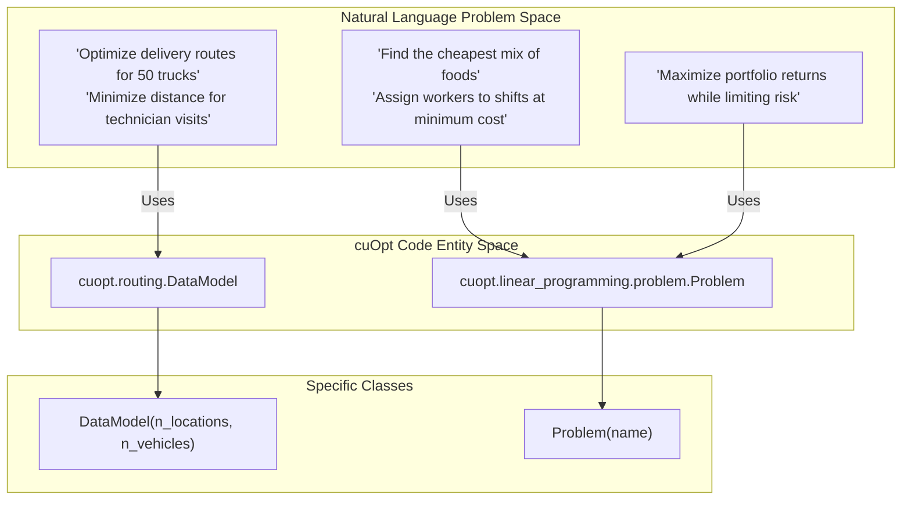

**API Selection Criteria:**

| Problem Type | API | Import Path | Key Class |
|--------------|-----|-------------|-----------|
| Vehicle routing with locations, vehicles, and orders | Routing | `cuopt.routing` | `DataModel` |
| Mathematical programs with variables and constraints | Linear Programming | `cuopt.linear_programming.problem` | `Problem` |

Sources: [workforce_optimization/workforce_optimization_milp.ipynb:109-110](), [diet_optimization/diet_optimization_lp.ipynb:113-114](), [portfolio_optimization/cvar_portfolio_optimization.ipynb:161-163]()

---

## Routing API Fundamentals

The Routing API uses the `DataModel` class to represent vehicle routing problems. This API provides domain-specific methods for expressing routing constraints.

### DataModel Structure and Workflow


**Routing API Initialization Pattern:**

```python
from cuopt import routing
import cudf
import numpy as np

# Initialize with problem dimensions
n_locations = 8  # Including depot
n_vehicles = 3
data_model = routing.DataModel(n_locations, n_vehicles)
```

Sources: [AI-accelerated-routing/training_rl_agent_for_vrp.ipynb:191-196]()

---

## Linear Programming API Fundamentals

The Linear Programming API uses the `Problem` class to build mathematical optimization problems with variables, objectives, and constraints.

### LP API: Mathematical Space to Code Entities

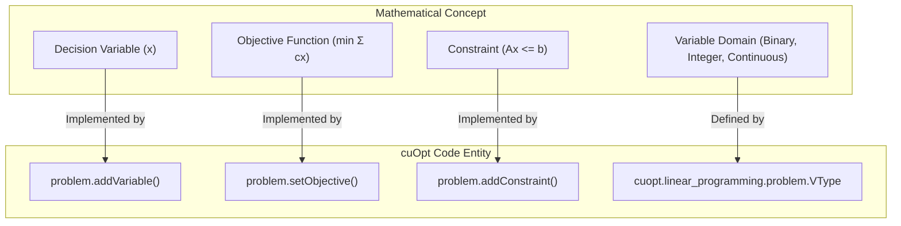

**Problem Class Initialization:**

```python
from cuopt.linear_programming.problem import Problem, VType, sense, LinearExpression
from cuopt.linear_programming.solver_settings import SolverSettings

# Create problem instance
problem = Problem("workforce_optimization")
```

Sources: [workforce_optimization/workforce_optimization_milp.ipynb:109-110](), [workforce_optimization/workforce_optimization_milp.ipynb:209]()

### Variable Declaration

Variables are the decision variables of the optimization problem. Each variable has a type, name, and bounds.

| Variable Type | `VType` Enum | Bounds | Use Case |
|---------------|--------------|--------|----------|
| Continuous | `VType.CONTINUOUS` | `[lb, ub]` | Fractional quantities, allocations |
| Integer | `VType.INTEGER` | `[lb, ub]` | Discrete counts, assignments |
| Binary | `VType.INTEGER` | `[0.0, 1.0]` | Yes/no decisions |

```python
# Binary variable for assignment decisions
assignment_var = problem.addVariable(
    name="worker_Amy_shift_Mon1",
    vtype=VType.INTEGER,
    lb=0.0,
    ub=1.0
)
```

Sources: [workforce_optimization/workforce_optimization_milp.ipynb:213-218](), [diet_optimization/diet_optimization_lp.ipynb:113]()

### Objective Functions and Constraints

`LinearExpression` objects represent mathematical expressions composed of variables, coefficients, and constants.

```python
# Build objective expression
objective_expr = LinearExpression([], [], 0.0)
for (worker, shift), var in assignment_vars.items():
    cost = worker_pay[worker]
    objective_expr += var * cost

# Set objective: minimize or maximize
problem.setObjective(objective_expr, sense.MINIMIZE)

# Add constraints
problem.addConstraint(shift_expr == required_count, name=f"shift_{shift}")
```

Sources: [workforce_optimization/workforce_optimization_milp.ipynb:230-239](), [workforce_optimization/workforce_optimization_milp.ipynb:260-270]()

---

## Solution Objects and Status Codes

Both APIs return solution details that encapsulate optimization results and provide methods for extracting solution details.

### Linear Programming Solution Interface

```python
# Solve LP/MILP problem
problem.solve(settings)

# Check solution status
if problem.Status.name == "Optimal":
    # Extract objective value
    total_cost = problem.ObjValue
    
    # Extract variable values
    for (worker, shift), var in assignment_vars.items():
        if var.getValue() > 0.5:
            print(f"{worker} assigned to {shift}")
```

Sources: [workforce_optimization/workforce_optimization_milp.ipynb:309-314](), [workforce_optimization/workforce_optimization_milp.ipynb:340-344]()

---

## SolverSettings Configuration

Both APIs use `SolverSettings` classes to control solver behavior, though they have different import paths and parameters.

### Linear Programming SolverSettings

```python
from cuopt.linear_programming.solver_settings import SolverSettings

settings = SolverSettings()
settings.set_parameter("time_limit", 60.0)      # Time limit in seconds
settings.set_parameter("log_to_console", True)  # Enable logging
```

Sources: [workforce_optimization/workforce_optimization_milp.ipynb:289-293](), [portfolio_optimization/cvar_portfolio_optimization.ipynb:162]()

---

## GPU Data Handling with cuDF

cuOpt leverages GPU acceleration through the `cudf` library. All data passed to cuOpt must use appropriate data types.

**Type Requirements:**

| Data Category | Required Type | Rationale |
|---------------|---------------|-----------|
| Cost matrices, distances, times | `np.float32` | GPU performance optimization |
| Capacities, demands, counts | `np.int32` | Integer arithmetic precision |

Sources: [portfolio_optimization/cvar_portfolio_optimization.ipynb:40-44](), [README.md:49]()

---

## Relationship to Other cuOpt Components

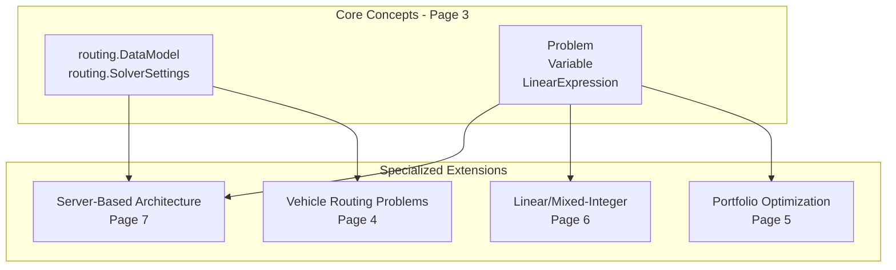

- **Vehicle Routing Problems** ([Vehicle Routing Problems](#4)) — Specialized routing constraints.
- **Portfolio Optimization** ([Portfolio Optimization](#5)) — Financial modeling using the LP API.
- **Linear/Mixed-Integer Programming** ([Linear and Mixed-Integer Programming](#6)) — General mathematical programming patterns.
- **Server-Based Architecture** ([Server-Based Architecture](#7)) — Client-server deployment using the same core APIs.

Sources: [README.md:1-83]()

---

# Page: Problem API

# Problem API

<details>
<summary>Relevant source files</summary>

The following files were used as context for generating this wiki page:

- [AI-accelerated-routing/initializing_cuopt_with_rl_solutions.ipynb](AI-accelerated-routing/initializing_cuopt_with_rl_solutions.ipynb)
- [AI-accelerated-routing/training_rl_agent_for_vrp.ipynb](AI-accelerated-routing/training_rl_agent_for_vrp.ipynb)
- [README.md](README.md)
- [VERSION](VERSION)
- [ci/release/update_version.sh](ci/release/update_version.sh)
- [diet_optimization/diet_optimization_lp.ipynb](diet_optimization/diet_optimization_lp.ipynb)
- [diet_optimization/diet_optimization_milp.ipynb](diet_optimization/diet_optimization_milp.ipynb)
- [portfolio_optimization/cvar_portfolio_optimization.ipynb](portfolio_optimization/cvar_portfolio_optimization.ipynb)
- [workforce_optimization/workforce_optimization_milp.ipynb](workforce_optimization/workforce_optimization_milp.ipynb)

</details>


## Purpose and Scope

The Problem API provides a programmatic interface for constructing and solving Linear Programming (LP) and Mixed Integer Linear Programming (MILP) problems using cuOpt's GPU-accelerated solver. This page documents the `cuopt.linear_programming.problem.Problem` class and its methods for defining decision variables, objective functions, and constraints.

For vehicle routing problems, see [Routing DataModel API](#4.1). For solver configuration options, see [SolverSettings and Configuration](#3.2). For server-based LP/MILP solving, see [DataModel API for Server](#7.3).

---

## Problem Class Overview

The `Problem` class is the primary entry point for formulating LP and MILP optimization problems. It manages the problem structure, including variables, constraints, and the objective function, then interfaces with cuOpt's GPU solver.

### Problem Creation Workflow

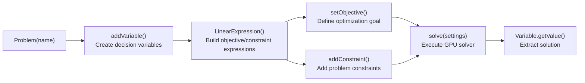

**Sources:** [workforce_optimization/workforce_optimization_milp.ipynb:209-312](), [portfolio_optimization/cvar_portfolio_optimization.ipynb:161-163]()

---

## Core API Components

The Problem API consists of several classes and enums that work together:

| Component | Module Path | Purpose |
|-----------|------------|---------|
| `Problem` | `cuopt.linear_programming.problem` | Main problem container |
| `VType` | `cuopt.linear_programming.problem` | Enum for variable types (INTEGER, CONTINUOUS) |
| `sense` | `cuopt.linear_programming.problem` | Enum for optimization direction (MINIMIZE, MAXIMIZE) |
| `LinearExpression` | `cuopt.linear_programming.problem` | Builder for objective functions and constraints |
| `SolverSettings` | `cuopt.linear_programming.solver_settings` | Configuration for solver behavior |

### Import Pattern

```python
from cuopt.linear_programming.problem import Problem, VType, sense, LinearExpression
from cuopt.linear_programming.solver_settings import SolverSettings
```

**Sources:** [workforce_optimization/workforce_optimization_milp.ipynb:107-111](), [diet_optimization/diet_optimization_lp.ipynb:111-115]()

---

## Creating a Problem Instance

### Constructor

```python
problem = Problem(name: str)
```

**Parameters:**
- `name` (str): Identifier for the problem, used in logging and status messages

**Example:**

```python
problem = Problem("workforce_optimization")
```

**Sources:** [workforce_optimization/workforce_optimization_milp.ipynb:209](), [diet_optimization/diet_optimization_lp.ipynb:213]()

---

## Adding Variables: `addVariable()` Method

### Method Signature

```python
variable = problem.addVariable(
    name: str,
    vtype: VType,
    lb: float,
    ub: float
) -> Variable
```

### Parameters

| Parameter | Type | Description | Required |
|-----------|------|-------------|----------|
| `name` | `str` | Unique identifier for the variable | Yes |
| `vtype` | `VType` | Variable type: `VType.INTEGER` or `VType.CONTINUOUS` | Yes |
| `lb` | `float` | Lower bound for variable value | Yes |
| `ub` | `float` | Upper bound for variable value | Yes |

### VType Enum Values

| Value | Description | Use Case |
|-------|-------------|----------|
| `VType.INTEGER` | Discrete integer values | Count variables, binary decisions (with bounds 0-1) |
| `VType.CONTINUOUS` | Real-valued variables | Quantities, fractions, portfolio weights |

### Examples

**Binary Decision Variable (Worker-Shift Assignment):**
```python
# Binary variable: 0 or 1
var = problem.addVariable(
    name="Amy_Mon1",
    vtype=VType.INTEGER,
    lb=0.0,
    ub=1.0
)
```

**Continuous Variable (Portfolio Weight):**
```python
# Weight between 0.0 and 1.0
weight = problem.addVariable(
    name="AAPL_weight",
    vtype=VType.CONTINUOUS,
    lb=0.0,
    ub=1.0
)
```

**Sources:** [workforce_optimization/workforce_optimization_milp.ipynb:211-220](), [diet_optimization/diet_optimization_lp.ipynb:215-225]()

---

## Building Expressions: `LinearExpression` Class

`LinearExpression` is used to construct objective functions and constraints by combining variables with coefficients.

### Constructor

```python
expr = LinearExpression(
    variables: list,
    coefficients: list,
    constant: float
)
```

### Expression Building

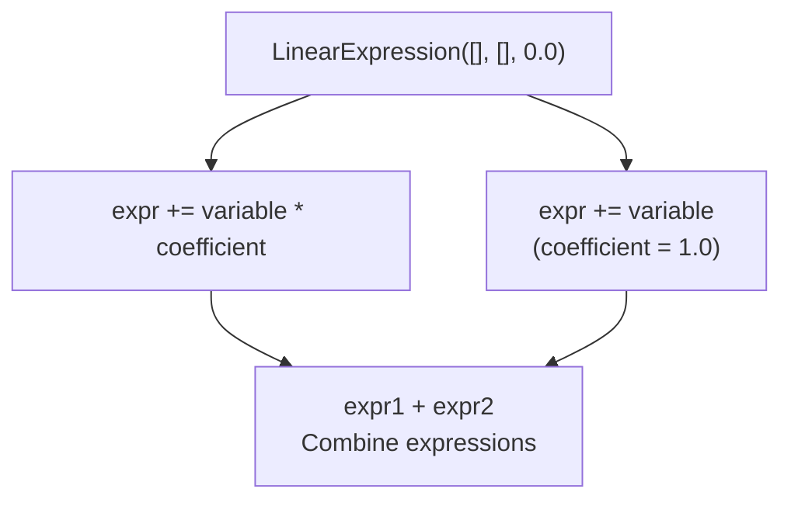

### Example: Building Objective Function

```python
# Minimize total labor cost
objective_expr = LinearExpression([], [], 0.0)

for (worker, shift), var in assignment_vars.items():
    cost = worker_pay[worker]
    objective_expr += var * cost
```

**Sources:** [workforce_optimization/workforce_optimization_milp.ipynb:229-239](), [diet_optimization/diet_optimization_lp.ipynb:231-240]()

---

## Setting the Objective: `setObjective()` Method

### Method Signature

```python
problem.setObjective(
    expression: LinearExpression,
    sense: sense
)
```

### Parameters

| Parameter | Type | Description |
|-----------|------|-------------|
| `expression` | `LinearExpression` | The objective function to optimize |
| `sense` | `sense` | Optimization direction: `sense.MINIMIZE` or `sense.MAXIMIZE` |

**Sources:** [workforce_optimization/workforce_optimization_milp.ipynb:237-239](), [diet_optimization/diet_optimization_lp.ipynb:239-241]()

---

## Adding Constraints: `addConstraint()` Method

### Method Signature

```python
constraint = problem.addConstraint(
    expression: LinearExpression or comparison,
    name: str
) -> Constraint
```

### Examples

**Equality Constraint (Meet Shift Requirements):**
```python
# Exactly required workers for a shift
shift_expr = LinearExpression([], [], 0.0)
for worker_var in workers_on_shift:
    shift_expr += worker_var

problem.addConstraint(shift_expr == required_count, name="shift_req")
```

**Inequality Constraint (Nutritional Minimum):**
```python
# Protein must be >= minimum requirement
problem.addConstraint(protein_expr >= min_protein, name="min_protein")
```

**Sources:** [workforce_optimization/workforce_optimization_milp.ipynb:248-270](), [diet_optimization/diet_optimization_lp.ipynb:250-275]()

---

## Solving the Problem: `solve()` Method

### Method Signature

```python
problem.solve(settings: SolverSettings)
```

### Basic Solver Configuration

```python
from cuopt.linear_programming.solver_settings import SolverSettings

settings = SolverSettings()
settings.set_parameter("time_limit", 60.0)

problem.solve(settings)
```

**Sources:** [workforce_optimization/workforce_optimization_milp.ipynb:288-312](), [diet_optimization/diet_optimization_lp.ipynb:290-310]()

---

## Accessing Solution Values

After calling `solve()`, solution data is available through problem properties and variable methods.

### Problem Properties

| Property | Type | Description |
|----------|------|-------------|
| `problem.Status` | Enum | Solution status (Optimal, FeasibleFound, Infeasible, etc.) |
| `problem.ObjValue` | `float` | Objective function value at solution |
| `problem.SolveTime` | `float` | Time spent solving (seconds) |

### Extracting Solution

```python
if problem.Status.name == "Optimal":
    print(f"Objective value: {problem.ObjValue}")
    # Extract variable values
    val = var.getValue()
```

**Sources:** [workforce_optimization/workforce_optimization_milp.ipynb:331-372](), [diet_optimization/diet_optimization_lp.ipynb:320-350]()

---

## Problem API Class Hierarchy

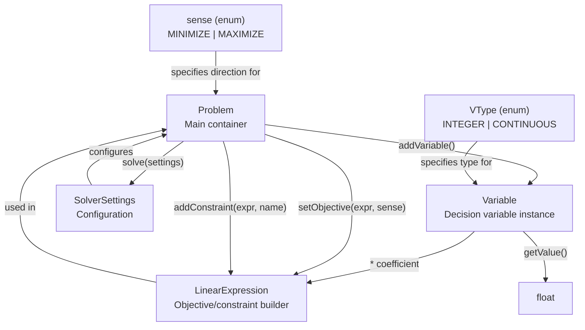

**Sources:** [workforce_optimization/workforce_optimization_milp.ipynb:107-111](), [diet_optimization/diet_optimization_lp.ipynb:111-115]()

---

## Related Components

- **[SolverSettings and Configuration](#3.2)**: Configure solver behavior, time limits, logging
- **[Data Types and GPU Acceleration](#3.3)**: GPU data handling with cuDF
- **[Routing DataModel API](#4.1)**: Alternative API for vehicle routing problems

---

**Sources:** [workforce_optimization/workforce_optimization_milp.ipynb:1-372](), [diet_optimization/diet_optimization_lp.ipynb:1-350](), [README.md:1-83]()

---

# Page: SolverSettings and Configuration

# SolverSettings and Configuration

<details>
<summary>Relevant source files</summary>

The following files were used as context for generating this wiki page:

- [README.md](README.md)
- [VERSION](VERSION)
- [ci/release/update_version.sh](ci/release/update_version.sh)
- [intra-factory_transport/cost_matrix_and_waypoint_graph_creation.ipynb](intra-factory_transport/cost_matrix_and_waypoint_graph_creation.ipynb)
- [intra-factory_transport/intra-factory_transport.ipynb](intra-factory_transport/intra-factory_transport.ipynb)
- [last_mile_delivery/cvrp_daily_deliveries.ipynb](last_mile_delivery/cvrp_daily_deliveries.ipynb)
- [last_mile_delivery/cvrptw_benchmark_gehring_homberger.ipynb](last_mile_delivery/cvrptw_benchmark_gehring_homberger.ipynb)
- [last_mile_delivery/cvrptw_service_team_routing.ipynb](last_mile_delivery/cvrptw_service_team_routing.ipynb)
- [workforce_optimization/workforce_optimization_milp.ipynb](workforce_optimization/workforce_optimization_milp.ipynb)

</details>


## Purpose and Scope

This page documents how to configure solver behavior in cuOpt through various settings interfaces. Solver configuration controls execution parameters such as time limits, logging verbosity, optimality tolerances, and solver method selection. Different cuOpt APIs provide distinct configuration mechanisms that are appropriate for their respective usage patterns, ranging from direct SDK usage to remote service calls.

For information about the Problem API itself, see [Problem API](#3.1). For details on routing-specific configuration through DataModel, see [Routing DataModel API](#4.1).

---

## Configuration Approaches by API

cuOpt provides three distinct configuration mechanisms corresponding to its primary access patterns:

### Configuration Flow Diagram
"Natural Language Space" to "Code Entity Space" mapping for configuration entry points:

```mermaid
graph TB
    subgraph "SDK_Direct_API [cuopt.linear_programming]"
        SolverSettings["SolverSettings Class"]
        ProblemSolve["Problem.solve(settings)"]
        SolverSettings --> ["set_parameter()"] --> ProblemSolve
    end
    
    subgraph "Server_Based_API [cuopt_sh_client]"
        SolverDict["solver_config Dictionary"]
        ServerEndpoint["/cuopt/LP_solve"]
        SolverDict --> ["problem_data['solver_config']"] --> ServerEndpoint
    end
    
    subgraph "DataModel_API [cuopt_sh_client]"
        ThinClientSettings["ThinClientSolverSettings Class"]
        DataModel["DataModel Instance"]
        ThinClientSettings --> ["toDict()"] --> DataModel
    end
```

**Configuration Approach Mapping**

| API Type | Configuration Class/Structure | Usage Context |
|----------|------------------------------|---------------|
| SDK Direct API | `SolverSettings` | Mathematical programming via `Problem` class |
| Server-Based API | Dictionary with `"solver_config"` key | JSON payloads to cuOpt service endpoints |
| DataModel API | `ThinClientSolverSettings` | LP/MILP problems with structured `DataModel` |

Sources: [workforce_optimization/workforce_optimization_milp.ipynb:109-110](), [workforce_optimization/workforce_optimization_milp.ipynb:289-292]()

---

## SolverSettings Class (SDK Direct API)

The `SolverSettings` class provides configuration for problems solved through the direct Python SDK API using the `Problem` class [workforce_optimization/workforce_optimization_milp.ipynb:109-110]().

### Basic Usage Pattern

```python
from cuopt.linear_programming.solver_settings import SolverSettings

settings = SolverSettings()
settings.set_parameter("time_limit", 60.0)
settings.set_parameter("log_to_console", True)
settings.set_parameter("method", 0)

problem.solve(settings)
```

### Configuration Parameters

| Parameter | Type | Description | Default |
|-----------|------|-------------|---------|
| `time_limit` | float | Maximum solve time in seconds | No limit |
| `log_to_console` | bool | Enable solver output logging | False |
| `method` | int | Solver method selection (0=default) | 0 |

**Example: Workforce Optimization**
The workforce optimization example demonstrates standard `SolverSettings` configuration for a Mixed Integer Linear Program (MILP) [workforce_optimization/workforce_optimization_milp.ipynb:289-292]().

Sources: [workforce_optimization/workforce_optimization_milp.ipynb:109-110](), [workforce_optimization/workforce_optimization_milp.ipynb:289-292]()

---

## Solver Config Dictionaries (Server-Based API)

When submitting problems to the cuOpt service via the `/cuopt/optimized_routes` or `/cuopt/LP_solve` endpoints, solver configuration is provided as a dictionary under the `"solver_config"` key.

### Dictionary Structure for LP/MILP
For LP/MILP problems, nested tolerance settings are supported:

```python
problem_data["solver_config"] = {
    "time_limit": 1.0,
    "tolerances": {
        "optimality": 0.0001
    }
}
```

### Dictionary Structure for Routing
For Vehicle Routing Problems (VRP), the configuration typically focuses on the time limit:

```python
cuopt_problem_data["solver_config"] = {
    "time_limit": 60.0
}
```

**Example: CVRPTW Benchmark**
Benchmark examples for large-scale problems (e.g., Gehring & Homberger 1000 locations) demonstrate adjusting the `time_limit` to balance speed and solution quality [last_mile_delivery/cvrptw_benchmark_gehring_homberger.ipynb:512-514]().

Sources: [last_mile_delivery/cvrptw_benchmark_gehring_homberger.ipynb:512-514](), [last_mile_delivery/cvrptw_benchmark_gehring_homberger.ipynb:551-553]()

---

## ThinClientSolverSettings (DataModel API)

The `ThinClientSolverSettings` class is used when constructing LP/MILP problems with the `DataModel` abstraction for server-based solving.

### Configuration Methods

| Method | Parameters | Description |
|--------|------------|-------------|
| `set_parameter(key, value)` | key: str, value: any | Set general solver parameters |
| `set_optimality_tolerance(tol)` | tol: float | Set optimality tolerance directly |
| `toDict()` | None | Convert to dictionary for JSON serialization |

### Integration with DataModel
The configuration is merged into the final problem dictionary before submission:

```mermaid
graph LR
    TCSSettings["ThinClientSolverSettings"]
    SetParams["set_parameter()"]
    ToDict["toDict()"]
    DataModel["DataModel problem data"]
    MergeConfig["Merge into data['solver_config']"]
    
    TCSSettings --> SetParams --> ToDict --> MergeConfig
    DataModel --> MergeConfig
```

Sources: [workforce_optimization/workforce_optimization_milp.ipynb:289-292]()

---

## Common Configuration Parameters

### Time Limits
Time limits control the maximum duration the solver will execute before terminating. This is the most critical parameter for performance tuning.

| Time Limit | Use Case | Example Context |
|------------|----------|---------|
| 5 seconds | Small problems, quick iterations | Service team routing [last_mile_delivery/cvrptw_service_team_routing.ipynb:632-634]() |
| 60 seconds | Medium problems, development testing | Workforce optimization [workforce_optimization/workforce_optimization_milp.ipynb:290]() |
| 120+ seconds | Large-scale problems, production solving | Gehring & Homberger benchmarks [last_mile_delivery/cvrptw_benchmark_gehring_homberger.ipynb:552]() |

### Optimality Tolerances
Optimality tolerances define the convergence criteria for LP/MILP solvers. Tighter tolerances produce more accurate solutions but may require longer solve times.

### Logging Control
Logging control enables or disables solver output to the console, primarily used in the SDK API via `log_to_console` [workforce_optimization/workforce_optimization_milp.ipynb:291]().

---

## Configuration API Comparison

### Code Entity Reference Map
Mapping system names to code entities for developers:

```mermaid
graph TB
    subgraph "SDK_Classes"
        SS_C["SolverSettings"]
        SS_M["set_parameter"]
    end
    
    subgraph "Server_Keys"
        SC_K["'solver_config'"]
        TL_K["'time_limit'"]
        OT_K["'optimality'"]
    end
    
    subgraph "Routing_Classes"
        DM_C["cuopt.routing.DataModel"]
        RS_C["cuopt.routing.SolverSettings"]
    end

    User["Developer"] --> SS_C
    User --> DM_C
    User --> SC_K
```

| Aspect | `SolverSettings` (SDK) | Dictionary Config (Server) |
|--------|----------------|-------------------|
| **Import Path** | `cuopt.linear_programming.solver_settings` [workforce_optimization/workforce_optimization_milp.ipynb:110]() | N/A (JSON/Dict) |
| **Usage** | `problem.solve(settings)` [workforce_optimization/workforce_optimization_milp.ipynb:301]() | `client.get_optimized_routes(data)` [last_mile_delivery/cvrptw_benchmark_gehring_homberger.ipynb:517]() |
| **Primary Method** | `set_parameter(key, value)` | Direct assignment |

Sources: [workforce_optimization/workforce_optimization_milp.ipynb:110](), [workforce_optimization/workforce_optimization_milp.ipynb:301](), [last_mile_delivery/cvrptw_benchmark_gehring_homberger.ipynb:517](), [last_mile_delivery/cvrptw_service_team_routing.ipynb:165]()

---

# Page: Data Types and GPU Acceleration

# Data Types and GPU Acceleration

<details>
<summary>Relevant source files</summary>

The following files were used as context for generating this wiki page:

- [AI-accelerated-routing/initializing_cuopt_with_rl_solutions.ipynb](AI-accelerated-routing/initializing_cuopt_with_rl_solutions.ipynb)
- [AI-accelerated-routing/training_rl_agent_for_vrp.ipynb](AI-accelerated-routing/training_rl_agent_for_vrp.ipynb)
- [diet_optimization/diet_optimization_lp.ipynb](diet_optimization/diet_optimization_lp.ipynb)
- [diet_optimization/diet_optimization_milp.ipynb](diet_optimization/diet_optimization_milp.ipynb)
- [intra-factory_transport/cost_matrix_and_waypoint_graph_creation.ipynb](intra-factory_transport/cost_matrix_and_waypoint_graph_creation.ipynb)
- [intra-factory_transport/intra-factory_transport.ipynb](intra-factory_transport/intra-factory_transport.ipynb)
- [last_mile_delivery/cvrp_daily_deliveries.ipynb](last_mile_delivery/cvrp_daily_deliveries.ipynb)
- [last_mile_delivery/cvrptw_benchmark_gehring_homberger.ipynb](last_mile_delivery/cvrptw_benchmark_gehring_homberger.ipynb)
- [last_mile_delivery/cvrptw_service_team_routing.ipynb](last_mile_delivery/cvrptw_service_team_routing.ipynb)
- [portfolio_optimization/cvar_portfolio_optimization.ipynb](portfolio_optimization/cvar_portfolio_optimization.ipynb)

</details>


## Purpose and Scope

This page documents the data type requirements and GPU acceleration mechanisms used throughout the cuOpt Python SDK. All cuOpt routing and optimization problems require GPU-resident data structures with specific numeric types to achieve optimal performance. Understanding these requirements is essential for proper data preparation and efficient solver execution.

For information about the Problem class API that consumes these data types, see [Problem API](). For routing-specific data structures, see [Routing DataModel API]().

---

## GPU-Accelerated Data Structures

cuOpt leverages **cuDF** (CUDA DataFrames) to keep data on the GPU throughout the optimization process, eliminating expensive CPU-GPU data transfers during solving. All input data to cuOpt APIs must be provided as `cudf.DataFrame` or `cudf.Series` objects rather than their pandas equivalents.

```mermaid
graph LR
    subgraph "CPU Memory"
        PD["pandas.DataFrame<br/>numpy.ndarray<br/>Python lists"]
    end
    
    subgraph "GPU Memory"
        CUDF["cudf.DataFrame<br/>cudf.Series"]
        CUOPT["cuOpt Solver<br/>routing.DataModel<br/>Problem API"]
    end
    
    PD -->|"astype()<br/>cudf.from_pandas()"| CUDF
    CUDF -->|"add_cost_matrix()<br/>add_capacity_dimension()<br/>set_order_locations()"| CUOPT
    
    CUOPT -.->|"Zero-copy GPU operations"| CUOPT
```

**Data Flow Architecture**

Sources: [last_mile_delivery/cvrptw_benchmark_gehring_homberger.ipynb:131-137](), [last_mile_delivery/cvrp_daily_deliveries.ipynb:156-163](), [intra-factory_transport/intra-factory_transport.ipynb:132-138]()

### cudf.DataFrame

The primary container for structured tabular data. Cost matrices, constraint matrices, and multi-column data all use `cudf.DataFrame`.

| Data Structure | cuOpt API Method | Purpose |
|----------------|------------------|---------|
| Cost Matrix | `DataModel.add_cost_matrix()` | Travel costs between locations |
| Time Matrix | `DataModel.add_cost_matrix()` | Travel times when using time windows |
| Multiple Columns | `Problem.addConstraint()` | Constraint coefficient data |

### cudf.Series

The primary container for single-column vector data. Demands, capacities, time windows, and location indices all use `cudf.Series`.

| Data Structure | cuOpt API Method | Purpose |
|----------------|------------------|---------|
| Demands | `DataModel.add_capacity_dimension()` | Resource requirements per location |
| Capacities | `DataModel.add_capacity_dimension()` | Resource limits per vehicle |
| Time Windows | `DataModel.set_order_time_windows()` | Earliest/latest service times |
| Locations | `DataModel.set_order_locations()` | Location indices for orders |
| Service Times | `DataModel.set_order_service_times()` | Time spent at each location |

Sources: [last_mile_delivery/cvrp_daily_deliveries.ipynb:455-466](), [last_mile_delivery/cvrptw_service_team_routing.ipynb:571-588]()

---

## Type Requirements

cuOpt requires **explicit numeric types** to ensure consistent GPU memory layout and computational precision. All numeric data must be cast to the appropriate type before passing to cuOpt APIs.

### Integer Data: np.int32

All integer-valued data must use the **`np.int32`** dtype. This includes:

- Location counts
- Vehicle counts
- Demand quantities
- Capacity values
- Time window bounds (when measured in integer units)
- Service time durations
- Order indices
- Vehicle indices

```mermaid
graph TD
    subgraph "Integer Data Types"
        COUNTS["Counts<br/>n_locations<br/>n_vehicles"]
        INDICES["Indices<br/>order IDs<br/>location IDs"]
        QUANTITIES["Quantities<br/>demand<br/>capacity"]
        TIMES["Time Values<br/>earliest_time<br/>latest_time<br/>service_time"]
    end
    
    COUNTS --> INT32["np.int32"]
    INDICES --> INT32
    QUANTITIES --> INT32
    TIMES --> INT32
    
    INT32 --> CUDF_SERIES["cudf.Series(dtype=np.int32)"]
    CUDF_SERIES --> API["DataModel.add_capacity_dimension()<br/>DataModel.set_order_time_windows()<br/>DataModel.set_order_locations()"]
```

**Type Casting Pattern for Integers**

Sources: [last_mile_delivery/cvrptw_benchmark_gehring_homberger.ipynb:361-389](), [last_mile_delivery/cvrptw_service_team_routing.ipynb:581-616]()

### Float Data: np.float32

All floating-point data must use the **`np.float32`** dtype. This includes:

- Cost matrix entries
- Distance matrix entries  
- Time matrix entries (when fractional)
- Objective coefficients
- Constraint coefficients

**Type Casting Pattern for Floats**

The most common pattern for cost matrices:

[last_mile_delivery/cvrptw_benchmark_gehring_homberger.ipynb:299-299]()
```python
cost_matrix_df = cudf.DataFrame(cost_matrix.astype(np.float32))
```

[last_mile_delivery/cvrp_daily_deliveries.ipynb:433-433]()
```python
distance_matrix_df = cudf.DataFrame(np.array(distance_matrix).astype(np.float32))
```

[last_mile_delivery/cvrptw_service_team_routing.ipynb:558-558]()
```python
cost_matrix = cudf.DataFrame(time_matrix).astype(np.float32)
```

Sources: [last_mile_delivery/cvrptw_benchmark_gehring_homberger.ipynb:295-300](), [last_mile_delivery/cvrp_daily_deliveries.ipynb:421-435](), [last_mile_delivery/cvrptw_service_team_routing.ipynb:552-560]()

### Type Requirement Summary

| Data Category | Required Type | cudf Container | Example API |
|---------------|---------------|----------------|-------------|
| Cost matrices | `np.float32` | `cudf.DataFrame` | `add_cost_matrix()` |
| Demands | `np.int32` | `cudf.Series` | `add_capacity_dimension()` |
| Capacities | `np.int32` | `cudf.Series` | `add_capacity_dimension()` |
| Time windows | `np.int32` | `cudf.Series` | `set_order_time_windows()` |
| Service times | `np.int32` | `cudf.Series` | `set_order_service_times()` |
| Location indices | `np.int32` | `cudf.Series` | `set_order_locations()` |
| Vehicle locations | `int` | `cudf.Series` | `set_vehicle_locations()` |

---

## Data Type Patterns by DataModel Component

### Cost Matrix Construction

Cost matrices are the foundation of routing problems, encoding the cost (distance, time, or other metric) of traveling between locations.

```mermaid
graph TD
    INPUT["Input Data Source"]
    
    INPUT --> EUCLIDEAN["Euclidean Distance<br/>scipy.spatial.distance.cdist()"]
    INPUT --> OSRM["Map-based Routing<br/>OSRM API"]
    INPUT --> WAYPOINT["Waypoint Graph<br/>distance_engine.WaypointMatrix"]
    
    EUCLIDEAN --> NP_ARRAY["numpy.ndarray<br/>dtype=float64"]
    OSRM --> NP_ARRAY
    WAYPOINT --> CUDF_DF["cudf.DataFrame<br/>already float32"]
    
    NP_ARRAY --> CAST["astype(np.float32)"]
    CAST --> CUDF_CONV["cudf.DataFrame()"]
    CUDF_CONV --> FINAL["cudf.DataFrame<br/>dtype=float32"]
    CUDF_DF --> FINAL
    
    FINAL --> ADD["DataModel.add_cost_matrix()"]
```

**Pattern 1: From Euclidean Distance**

[last_mile_delivery/cvrptw_benchmark_gehring_homberger.ipynb:295-300]()
```python
coords = list(zip(orders['xcord'].to_list(), orders['ycord'].to_list()))
cost_matrix = distance.cdist(coords, coords, 'euclidean')
cost_matrix_df = cudf.DataFrame(cost_matrix.astype(np.float32))
```

**Pattern 2: From Pre-computed Array**

[last_mile_delivery/cvrp_daily_deliveries.ipynb:421-434]()
```python
distance_matrix = [
    [0.0, 3.1, 5.0, ...],
    [3.1, 0.0, 7.3, ...],
    ...
]
distance_matrix_df = cudf.DataFrame(np.array(distance_matrix).astype(np.float32))
```

**Pattern 3: From Waypoint Graph**

[intra-factory_transport/intra-factory_transport.ipynb:241-252]()
```python
waypoint_graph = distance_engine.WaypointMatrix(offsets, edges, weights)
time_matrix = waypoint_graph.compute_cost_matrix(target_locations)
# time_matrix is already a cudf.DataFrame with float32
```

Sources: [last_mile_delivery/cvrptw_benchmark_gehring_homberger.ipynb:285-300](), [intra-factory_transport/cost_matrix_and_waypoint_graph_creation.ipynb:236-252]()

### Capacity Dimensions

Capacity constraints require both demand and capacity vectors with `np.int32` dtype.

[last_mile_delivery/cvrptw_benchmark_gehring_homberger.ipynb:355-365]()
```python
# Location demand
location_demand = cudf.Series(orders['demand'].values, dtype=np.int32)

# Vehicle capacities
vehicle_capacities = cudf.Series([vehicle_capacity] * n_vehicles, dtype=np.int32)

# Add to model
data_model.add_capacity_dimension("demand", location_demand, vehicle_capacities)
```

**Multi-Dimensional Capacity Example**

[last_mile_delivery/cvrptw_service_team_routing.ipynb:605-618]()
```python
# First capacity dimension (service type 1)
service_type1_demand = cudf.Series(
    service_location_data["service_type1_demand"]
).astype(np.int32)
service_type1_capacity = cudf.Series(
    vehicle_data["capacity_service_type1"]
).astype(np.int32)
data_model.add_capacity_dimension("service_type1", service_type1_demand, service_type1_capacity)

# Second capacity dimension (service type 2)
service_type2_demand = cudf.Series(
    service_location_data["service_type2_demand"]
).astype(np.int32)
service_type2_capacity = cudf.Series(
    vehicle_data["capacity_service_type2"]
).astype(np.int32)
data_model.add_capacity_dimension("service_type2", service_type2_demand, service_type2_capacity)
```

Sources: [last_mile_delivery/cvrptw_benchmark_gehring_homberger.ipynb:350-365](), [last_mile_delivery/cvrptw_service_team_routing.ipynb:595-618]()

### Time Windows and Service Times

Time window constraints require integer-typed `cudf.Series` for earliest times, latest times, and service durations.

[last_mile_delivery/cvrptw_benchmark_gehring_homberger.ipynb:372-390]()
```python
# Order time windows
earliest_times = cudf.Series(orders['earliest_time'].values, dtype=np.int32)
latest_times = cudf.Series(orders['latest_time'].values, dtype=np.int32)
data_model.set_order_time_windows(earliest_times, latest_times)

# Service times at each location
service_times = cudf.Series(orders['service_time'].values, dtype=np.int32)
data_model.set_order_service_times(service_times)
```

**Vehicle Time Windows**

[last_mile_delivery/cvrptw_service_team_routing.ipynb:605-609]()
```python
vehicle_earliest = cudf.Series(
    vehicle_data["vehicle_availability_earliest"]
).astype(np.int32)
vehicle_latest = cudf.Series(
    vehicle_data["vehicle_availability_latest"]
).astype(np.int32)
data_model.set_vehicle_time_windows(vehicle_earliest, vehicle_latest)
```

Sources: [last_mile_delivery/cvrptw_benchmark_gehring_homberger.ipynb:372-390](), [last_mile_delivery/cvrptw_service_team_routing.ipynb:600-609]()

### Pickup-Delivery Pairs

Pickup-delivery problems require careful handling of order indices and paired locations.

```mermaid
graph TD
    subgraph "Order Data Preparation"
        PICKUP_LOCS["pickup_location<br/>[4, 5, 6, 6, 5, 4]"]
        DELIVERY_LOCS["delivery_location<br/>[5, 6, 0, 5, 4, 0]"]
        DEMAND["order_demand<br/>[1, 1, 1, 1, 1, 1]"]
    end
    
    subgraph "Separate Pickup and Delivery"
        PICKUP_DEMAND["raw_demand<br/>[1, 1, 1, 1, 1, 1]"]
        DELIVERY_DEMAND["drop_off_demand<br/>[-1, -1, -1, -1, -1, -1]"]
    end
    
    subgraph "Combined Order Array"
        COMBINED_DEMAND["order_demand<br/>[1,1,1,1,1,1,-1,-1,-1,-1,-1,-1]"]
        COMBINED_LOCS["order_locations<br/>[pickup_locs, delivery_locs]"]
    end
    
    subgraph "Pairing Indices"
        PICKUP_IDX["pickup_orders<br/>[0, 1, 2, 3, 4, 5]"]
        DELIVERY_IDX["delivery_orders<br/>[6, 7, 8, 9, 10, 11]"]
    end
    
    PICKUP_LOCS --> COMBINED_LOCS
    DELIVERY_LOCS --> COMBINED_LOCS
    DEMAND --> PICKUP_DEMAND
    DEMAND --> DELIVERY_DEMAND
    PICKUP_DEMAND --> COMBINED_DEMAND
    DELIVERY_DEMAND --> COMBINED_DEMAND
    
    COMBINED_LOCS --> API["set_order_locations()"]
    COMBINED_DEMAND --> API2["add_capacity_dimension()"]
    PICKUP_IDX --> API3["set_pickup_delivery_pairs()"]
    DELIVERY_IDX --> API3
```

[intra-factory_transport/intra-factory_transport.ipynb:388-413]()
```python
# Pickup has positive demand, delivery has negative demand
raw_demand = transport_order_data["order_demand"]
drop_off_demand = raw_demand * -1
order_demand = cudf.concat([raw_demand, drop_off_demand], ignore_index=True)

# Combine pickup and delivery locations
pickup_order_locations = cudf.Series([target_map[loc] for loc in transport_order_data['pickup_location'].to_arrow().to_pylist()])
delivery_order_locations = cudf.Series([target_map[loc] for loc in transport_order_data['delivery_location'].to_arrow().to_pylist()])
order_locations = cudf.concat([pickup_order_locations, delivery_order_locations], ignore_index=True)

data_model.set_order_locations(order_locations)

# Create pickup-delivery pairs (indexed into order array)
npair_orders = int(len(order_locations)/2)
pickup_orders = cudf.Series([i for i in range(npair_orders)])
delivery_orders = cudf.Series([i + npair_orders for i in range(npair_orders)])
data_model.set_pickup_delivery_pairs(pickup_orders, delivery_orders)
```

Sources: [intra-factory_transport/intra-factory_transport.ipynb:382-473]()

---

## Conversion and Data Preparation

### From Pandas to cuDF

The most common workflow starts with pandas DataFrames and requires conversion to cudf.

```mermaid
graph LR
    subgraph "Initial Data"
        CSV["CSV Files"]
        DB["Databases"]
        API_DATA["API Responses"]
    end
    
    subgraph "Pandas Processing"
        PD["pandas.DataFrame"]
        CLEAN["Data Cleaning<br/>Filtering<br/>Transformations"]
    end
    
    subgraph "Type Casting"
        CAST_INT["astype(np.int32)"]
        CAST_FLOAT["astype(np.float32)"]
    end
    
    subgraph "cuDF Conversion"
        CUDF_SERIES["cudf.Series()"]
        CUDF_DF["cudf.DataFrame()"]
    end
    
    CSV --> PD
    DB --> PD
    API_DATA --> PD
    PD --> CLEAN
    CLEAN --> CAST_INT
    CLEAN --> CAST_FLOAT
    CAST_INT --> CUDF_SERIES
    CAST_FLOAT --> CUDF_DF
    CUDF_SERIES --> CUOPT["cuOpt APIs"]
    CUDF_DF --> CUOPT
```

**Pattern 1: Direct Series Conversion**

[last_mile_delivery/cvrp_daily_deliveries.ipynb:460-464]()
```python
# Direct construction with explicit type
location_demand = cudf.Series([0, 4, 4, 2, 2, 1, 2, 1], dtype=np.int32)
vehicle_capacity = cudf.Series([8, 8, 4], dtype=np.int32)
```

**Pattern 2: From Pandas Column with Type Cast**

[last_mile_delivery/cvrptw_benchmark_gehring_homberger.ipynb:361-361]()
```python
location_demand = cudf.Series(orders['demand'].values, dtype=np.int32)
```

**Pattern 3: DataFrame Construction**

[intra-factory_transport/intra-factory_transport.ipynb:292-303]()
```python
transport_order_data = cudf.DataFrame({
    "pickup_location":       [4,  5,  6,  6,  5,  4],
    "delivery_location":     [5,  6,  0,  5,  4,  0],
    "order_demand":          [1,  1,  1,  1,  1,  1],
    "earliest_pickup":       [0,  0,  0,  0,  0,  0],
    "latest_pickup":         [10, 20, 30, 10, 20, 30],
    "pickup_service_time":   [2,  2,  2,  2,  2,  2],
    "earliest_delivery":     [0,  0,  0,  0,  0,  0],
    "latest_delivery":       [45, 45, 45, 45, 45, 45],
    "delivery_serivice_time":[2,  2,  2,  2,  2,  2]
})
```

Sources: [last_mile_delivery/cvrp_daily_deliveries.ipynb:454-466](), [last_mile_delivery/cvrptw_benchmark_gehring_homberger.ipynb:350-390](), [intra-factory_transport/intra-factory_transport.ipynb:286-339]()

### Concatenation Operations

When combining multiple data series (e.g., for pickup-delivery problems), use `cudf.concat()`.

[intra-factory_transport/intra-factory_transport.ipynb:400-403]()
```python
order_demand = cudf.concat([raw_demand, drop_off_demand], ignore_index=True)
```

[intra-factory_transport/intra-factory_transport.ipynb:492-503]()
```python
# Concatenate time windows
vehicle_earliest_time = cudf.Series([factory_open_time] * n_vehicles)
order_time_window_earliest = cudf.concat(
    [transport_order_data["earliest_pickup"], 
     transport_order_data["earliest_delivery"]], 
    ignore_index=True
)

vehicle_latest_time = cudf.Series([factory_close_time] * n_vehicles)
order_time_window_latest = cudf.concat(
    [transport_order_data["latest_pickup"], 
     transport_order_data["latest_delivery"]], 
    ignore_index=True
)
```

Sources: [intra-factory_transport/intra-factory_transport.ipynb:388-506]()

---

## Performance Considerations

### GPU Memory Efficiency

Using cudf DataFrames keeps all data GPU-resident throughout the optimization, avoiding CPU-GPU memory transfers during solver execution. This is critical for large-scale problems.

| Problem Size | Data Structure Impact |
|--------------|----------------------|
| Small (< 100 locations) | Minimal difference, CPU overhead acceptable |
| Medium (100-500 locations) | 2-5x speedup from GPU data structures |
| Large (500-1000 locations) | 5-10x speedup, GPU-resident data essential |
| Very Large (> 1000 locations) | 10x+ speedup, CPU-GPU transfers become bottleneck |

### Type Precision Trade-offs

**Why float32 instead of float64?**
- GPU computation is optimized for 32-bit operations
- 50% memory savings over float64
- Sufficient precision for routing cost calculations
- Typical cost ranges (0.1 to 10000) well within float32 precision (~7 decimal digits)

**Why int32 instead of int64?**
- 50% memory savings
- Adequate range for typical problem sizes (max value: 2,147,483,647)
- Location counts, vehicle counts, and demand values rarely exceed int32 range
- GPU integer operations optimized for 32-bit

### Data Transfer Patterns to Avoid

**Anti-Pattern 1: Repeated Conversions**
```python
# BAD: Converting back and forth
for iteration in range(num_iterations):
    pandas_data = cudf_data.to_pandas()  # GPU -> CPU
    # ... modify pandas_data ...
    cudf_data = cudf.from_pandas(pandas_data)  # CPU -> GPU
    solution = routing.Solve(data_model, settings)
```

**Anti-Pattern 2: Mixed Data Types**
```python
# BAD: Inconsistent types
demands = cudf.Series([1.0, 2.0, 3.0], dtype=np.float32)  # Should be int32
capacities = cudf.Series([10, 20, 30])  # No explicit dtype
```

Sources: Inferred from common patterns across [last_mile_delivery/cvrptw_benchmark_gehring_homberger.ipynb](), [last_mile_delivery/cvrp_daily_deliveries.ipynb](), [last_mile_delivery/cvrptw_service_team_routing.ipynb]()

---

## Best Practices

### Type Safety Checklist

| Data Category | Validation Check |
|---------------|------------------|
| **Cost matrices** | `assert cost_matrix.dtype == np.float32` |
| **Demands** | `assert demands.dtype == np.int32` |
| **Capacities** | `assert capacities.dtype == np.int32` |
| **Time windows** | `assert earliest.dtype == np.int32 and latest.dtype == np.int32` |
| **Container type** | `assert isinstance(data, (cudf.DataFrame, cudf.Series))` |

### Recommended Data Preparation Workflow

```mermaid
graph TD
    START["Raw Data Input"]
    
    START --> PANDAS["Load into pandas.DataFrame"]
    PANDAS --> VALIDATE["Validate Data<br/>Check ranges<br/>Handle nulls<br/>Remove duplicates"]
    VALIDATE --> TRANSFORM["Business Transformations<br/>Feature engineering<br/>Filtering"]
    
    TRANSFORM --> INT_COLS["Identify Integer Columns<br/>demands, capacities,<br/>time windows, indices"]
    TRANSFORM --> FLOAT_COLS["Identify Float Columns<br/>cost matrices,<br/>distance matrices"]
    
    INT_COLS --> CAST_INT["Cast to np.int32<br/>.astype(np.int32)"]
    FLOAT_COLS --> CAST_FLOAT["Cast to np.float32<br/>.astype(np.float32)"]
    
    CAST_INT --> CUDF_INT["cudf.Series(dtype=np.int32)"]
    CAST_FLOAT --> CUDF_FLOAT["cudf.DataFrame(dtype=float32)"]
    
    CUDF_INT --> DATAMODEL["routing.DataModel"]
    CUDF_FLOAT --> DATAMODEL
    
    DATAMODEL --> SOLVE["routing.Solve()"]
```

**Complete Example from Data Load to Solve**

```python
# Step 1: Load and clean data (pandas)
import pandas as pd
import numpy as np
import cudf
from cuopt import routing

orders_df = pd.read_csv('orders.csv')
orders_df = orders_df.dropna()

# Step 2: Type casting (pandas)
orders_df['demand'] = orders_df['demand'].astype(np.int32)
orders_df['earliest_time'] = orders_df['earliest_time'].astype(np.int32)
orders_df['latest_time'] = orders_df['latest_time'].astype(np.int32)

# Step 3: Convert to cudf
demand = cudf.Series(orders_df['demand'].values, dtype=np.int32)
earliest = cudf.Series(orders_df['earliest_time'].values, dtype=np.int32)
latest = cudf.Series(orders_df['latest_time'].values, dtype=np.int32)

# Step 4: Create cost matrix with float32
cost_matrix = distance.cdist(coords, coords, 'euclidean')
cost_matrix_df = cudf.DataFrame(cost_matrix.astype(np.float32))

# Step 5: Build DataModel
n_locations = len(orders_df)
n_vehicles = 10
data_model = routing.DataModel(n_locations, n_vehicles)

data_model.add_cost_matrix(cost_matrix_df)
vehicle_capacity = cudf.Series([100] * n_vehicles, dtype=np.int32)
data_model.add_capacity_dimension("demand", demand, vehicle_capacity)
data_model.set_order_time_windows(earliest, latest)

# Step 6: Solve
solver_settings = routing.SolverSettings()
solution = routing.Solve(data_model, solver_settings)
```

Sources: Pattern synthesized from [last_mile_delivery/cvrptw_benchmark_gehring_homberger.ipynb:186-460](), [last_mile_delivery/cvrp_daily_deliveries.ipynb:384-593]()

### Common Pitfalls and Solutions

| Pitfall | Symptom | Solution |
|---------|---------|----------|
| **Forgetting dtype specification** | Type inference errors, performance degradation | Always specify `dtype=np.int32` or `dtype=np.float32` |
| **Using pandas instead of cudf** | Slow data transfers, reduced performance | Convert to cudf before calling cuOpt APIs |
| **Mixed int types** | Inconsistent behavior, type errors | Standardize on `np.int32` for all integer data |
| **Float64 in cost matrices** | Increased memory usage, slower GPU ops | Cast to `np.float32` before creating `cudf.DataFrame` |
| **Missing astype() calls** | Runtime type errors from cuOpt | Add explicit `.astype()` after data transformations |
| **Direct numpy array passing** | API rejection, type errors | Wrap in `cudf.Series()` or `cudf.DataFrame()` |

### Memory Management Tips

For extremely large problems (> 10,000 locations):

1. **Sparse Matrices**: For cost matrices with many zero/infinite entries, consider sparse representations before conversion to cudf.
2. **Batch Processing**: Split large datasets into smaller sub-problems when feasible.
3. **Data Compression**: Use `np.int16` for intermediate calculations if ranges permit, then cast to `np.int32` for cuOpt.
4. **GPU Memory Monitoring**: Use `cudf.utils.get_gpu_memory_usage()` to track allocations.

**Example: Efficient Large-Scale Data Preparation**

```python
# For 1000+ location problems
n_locations = 1000
n_vehicles = 250

# Pre-allocate with correct types
demands = cudf.Series(np.zeros(n_locations, dtype=np.int32))
capacities = cudf.Series(np.full(n_vehicles, 200, dtype=np.int32))

# Build cost matrix in chunks if needed
chunk_size = 100
cost_matrix = np.zeros((n_locations, n_locations), dtype=np.float32)
for i in range(0, n_locations, chunk_size):
    for j in range(0, n_locations, chunk_size):
        cost_matrix[i:i+chunk_size, j:j+chunk_size] = compute_cost_chunk(i, j, chunk_size)

cost_matrix_df = cudf.DataFrame(cost_matrix)
```

Sources: Pattern inferred from [last_mile_delivery/cvrptw_benchmark_gehring_homberger.ipynb:240-365]()

---

## Type Mapping Reference

Complete mapping of Python/NumPy types to cuOpt-compatible types:

| Input Type | Convert To | cudf Container | Example Use Case |
|------------|-----------|----------------|------------------|
| `int`, `list[int]` | `np.int32` | `cudf.Series` | Order indices, vehicle IDs |
| `float`, `list[float]` | `np.float32` | `cudf.Series` or `cudf.DataFrame` | Cost values |
| `list[list[float]]` | `np.array(dtype=np.float32)` | `cudf.DataFrame` | Cost matrices |
| `pandas.Series[int]` | `.astype(np.int32)` → `cudf.Series` | `cudf.Series` | Demands, capacities |
| `pandas.Series[float]` | `.astype(np.float32)` → `cudf.Series` | `cudf.Series` | Single cost vector |
| `pandas.DataFrame` | `.astype(np.float32)` → `cudf.DataFrame` | `cudf.DataFrame` | Multi-column data |
| `numpy.ndarray[int]` | `.astype(np.int32)` → `cudf.Series` | `cudf.Series` | Computed demands |
| `numpy.ndarray[float]` | `.astype(np.float32)` → `cudf.DataFrame` | `cudf.DataFrame` | Distance matrices |

Sources: Synthesized from type casting patterns across [last_mile_delivery/cvrptw_benchmark_gehring_homberger.ipynb](), [last_mile_delivery/cvrp_daily_deliveries.ipynb](), [last_mile_delivery/cvrptw_service_team_routing.ipynb](), [intra-factory_transport/intra-factory_transport.ipynb]()

---

# Page: Vehicle Routing Problems

# Vehicle Routing Problems

<details>
<summary>Relevant source files</summary>

The following files were used as context for generating this wiki page:

- [intra-factory_transport/README.md](intra-factory_transport/README.md)
- [intra-factory_transport/cost_matrix_and_waypoint_graph_creation.ipynb](intra-factory_transport/cost_matrix_and_waypoint_graph_creation.ipynb)
- [intra-factory_transport/intra-factory_transport.ipynb](intra-factory_transport/intra-factory_transport.ipynb)
- [last_mile_delivery/README.md](last_mile_delivery/README.md)
- [last_mile_delivery/cvrp_daily_deliveries.ipynb](last_mile_delivery/cvrp_daily_deliveries.ipynb)
- [last_mile_delivery/cvrptw_benchmark_gehring_homberger.ipynb](last_mile_delivery/cvrptw_benchmark_gehring_homberger.ipynb)
- [last_mile_delivery/cvrptw_service_team_routing.ipynb](last_mile_delivery/cvrptw_service_team_routing.ipynb)
- [routing_optimization_over_server/README.md](routing_optimization_over_server/README.md)
- [sample_lp_sever_notebooks/README.md](sample_lp_sever_notebooks/README.md)

</details>


## Purpose and Scope

This page provides an overview of Vehicle Routing Problem (VRP) variants supported by cuOpt and demonstrated in the repository examples. It covers the fundamental problem types, their constraints, and how they relate to real-world logistics scenarios.

For specific API documentation of the routing module, see [Routing DataModel API](#4.1). For mathematical programming problems (LP/MILP), see [Linear and Mixed-Integer Programming](#6). For server-based deployments, see [Server-Based Architecture](#7).

## VRP Variant Hierarchy

cuOpt supports three primary VRP variants that build upon each other in complexity:

```mermaid
graph TD
    CVRP["CVRP<br/>Capacitated Vehicle Routing<br/>routing.DataModel"]
    CVRPTW["CVRPTW<br/>+ Time Windows<br/>set_order_time_windows()"]
    CPDPTW["CPDPTW<br/>+ Pickup-Delivery Pairs<br/>set_pickup_delivery_pairs()"]
    
    CVRP --> CVRPTW
    CVRPTW --> CPDPTW
    
    CVRP_FEAT["Features:<br/>- Vehicle capacity<br/>- Location demand<br/>- Heterogeneous fleet"]
    CVRPTW_FEAT["Additional:<br/>- Order time windows<br/>- Service times<br/>- Vehicle availability"]
    CPDPTW_FEAT["Additional:<br/>- Pickup-delivery pairing<br/>- Order sequencing<br/>- Waypoint graphs"]
    
    CVRP --> CVRP_FEAT
    CVRPTW --> CVRPTW_FEAT
    CPDPTW --> CPDPTW_FEAT
```

**Sources:** [last_mile_delivery/cvrp_daily_deliveries.ipynb:8-19](), [last_mile_delivery/cvrptw_service_team_routing.ipynb:8-19](), [intra-factory_transport/intra-factory_transport.ipynb:9-21]()

## Problem Characteristics

| Variant | Constraints | Primary Use Cases | Example Scale |
|---------|------------|-------------------|---------------|
| CVRP | Capacity limits | Daily deliveries, last-mile logistics | 8 locations, 3 vehicles [last_mile_delivery/cvrp_daily_deliveries.ipynb:27-41]() |
| CVRPTW | Capacity + time windows | Service team routing, technician scheduling | 8 locations, 3 vehicles, time windows [last_mile_delivery/cvrptw_service_team_routing.ipynb:27-44]() |
| CPDPTW | Capacity + time windows + pairing | Intra-factory AMR routing, part transport | 1000 locations, 250 vehicles [last_mile_delivery/README.md:58-58]() |

**Sources:** [last_mile_delivery/README.md:11-64](), [intra-factory_transport/README.md:9-17]()

## Core cuOpt Routing API

### API Components and Data Flow

```mermaid
graph LR
    subgraph "Problem Specification"
        INPUT_DATA["Input Data:<br/>locations, demands,<br/>vehicle properties"]
        DATAMODEL["routing.DataModel<br/>(n_locations, n_vehicles)"]
        COST["add_cost_matrix()<br/>cudf.DataFrame"]
        CAPACITY["add_capacity_dimension()<br/>(name, demand, capacity)"]
        LOCATIONS["set_vehicle_locations()<br/>(start, end)"]
        ORDERS["set_order_locations()<br/>(order_locs)"]
        TW["set_order_time_windows()<br/>(earliest, latest)"]
        SERVICE["set_order_service_times()<br/>(times)"]
    end
    
    subgraph "Solver Configuration"
        SETTINGS["routing.SolverSettings()"]
        TIMELIMIT["set_time_limit(seconds)"]
    end
    
    subgraph "Solution"
        SOLVE["routing.Solve<br/>(data_model, settings)"]
        SOLUTION["Solution object"]
        GET_ROUTE["get_route()<br/>returns cudf.DataFrame"]
        GET_STATUS["get_status()"]
        GET_OBJ["get_total_objective()"]
        GET_COUNT["get_vehicle_count()"]
    end
    
    INPUT_DATA --> DATAMODEL
    DATAMODEL --> COST
    DATAMODEL --> CAPACITY
    DATAMODEL --> LOCATIONS
    DATAMODEL --> ORDERS
    DATAMODEL --> TW
    DATAMODEL --> SERVICE
    
    SETTINGS --> TIMELIMIT
    
    COST --> SOLVE
    CAPACITY --> SOLVE
    LOCATIONS --> SOLVE
    ORDERS --> SOLVE
    TW --> SOLVE
    SERVICE --> SOLVE
    SETTINGS --> SOLVE
    
    SOLVE --> SOLUTION
    SOLUTION --> GET_ROUTE
    SOLUTION --> GET_STATUS
    SOLUTION --> GET_OBJ
    SOLUTION --> GET_COUNT
```

**Sources:** [last_mile_delivery/cvrptw_service_team_routing.ipynb:165-165](), [last_mile_delivery/cvrp_daily_deliveries.ipynb:156-160]()

### DataModel Initialization

All VRP problems begin with creating a `routing.DataModel` instance:

```python
# CVRP/CVRPTW initialization
data_model = routing.DataModel(n_locations, n_vehicles)

# CPDPTW initialization with orders
data_model = routing.DataModel(n_locations, n_vehicles, n_orders)
```

The `n_locations` parameter includes all points in the routing space (depot + service locations). For CPDPTW, `n_orders` represents the total number of distinct pickup and delivery transactions.

**Sources:** [last_mile_delivery/cvrptw_service_team_routing.ipynb:165-165](), [intra-factory_transport/intra-factory_transport.ipynb:133-133]()

## Cost Matrix Specification

### Cost Matrix Types

```mermaid
graph TD
    COST["Cost Matrix<br/>add_cost_matrix(cudf.DataFrame)"]
    
    EUCLIDEAN["Euclidean Distance<br/>scipy.spatial.distance.cdist()"]
    OSRM["Map-Based Routing<br/>OSRM API"]
    WAYPOINT["Waypoint Graph<br/>distance_engine.WaypointMatrix"]
    
    COST --> EUCLIDEAN
    COST --> OSRM
    COST --> WAYPOINT
    
    EUCLIDEAN_USE["Use Case:<br/>Simple geometric problems"]
    OSRM_USE["Use Case:<br/>Real-world road networks"]
    WAYPOINT_USE["Use Case:<br/>Factory floors, warehouses"]
    
    EUCLIDEAN --> EUCLIDEAN_USE
    OSRM --> OSRM_USE
    WAYPOINT --> WAYPOINT_USE
```

**Sources:** [intra-factory_transport/cost_matrix_and_waypoint_graph_creation.ipynb:16-25](), [last_mile_delivery/cvrp_daily_deliveries.ipynb:48-48]()

### Euclidean Distance Calculation

Simple problems can compute cost matrices directly from coordinates:

```python
from scipy.spatial import distance
cost_matrix = distance.cdist(points.values, points.values, "euclidean")
```

The distance matrix is converted to `cudf.DataFrame` with `np.float32` dtype before being passed to `add_cost_matrix()`.

**Sources:** [intra-factory_transport/cost_matrix_and_waypoint_graph_creation.ipynb:179-181](), [last_mile_delivery/cvrptw_benchmark_gehring_homberger.ipynb:131-137]()

### Waypoint Graph for Indoor Navigation

Factory and warehouse environments use waypoint graphs represented in Compressed Sparse Row (CSR) format [intra-factory_transport/intra-factory_transport.ipynb:184-185]():

```python
offsets = np.array([0, 1, 3, 7, 9, 11, 13, 15, 17, 20, 22])
edges =   np.array([2, 2, 4, 0, 1, 3, 5, 2, 6, 1, 7, 2, 8, 3, 9, 4, 8, 5, 7, 9, 6, 8])
weights = np.array([2, 2, 2, 2, 2, 2, 2, 2, 2, 2, 1, 2, 1, 2, 1, 1, 2, 1, 2, 2, 1, 2])
```

The `distance_engine.WaypointMatrix` computes shortest paths between target locations within the graph:

```python
waypoint_graph = distance_engine.WaypointMatrix(offsets, edges, weights)
```

**Sources:** [intra-factory_transport/intra-factory_transport.ipynb:195-197](), [intra-factory_transport/cost_matrix_and_waypoint_graph_creation.ipynb:24-24]()

## Capacity Constraints

### Single Capacity Dimension (CVRP)

Basic vehicle routing problems define one capacity dimension. The `add_capacity_dimension()` method incorporates varying demand requirements for different delivery locations and heterogeneous fleets [last_mile_delivery/README.md:23-25]().

**Sources:** [last_mile_delivery/README.md:23-25]()

### Multi-Dimensional Capacity (CVRPTW)

Service team routing demonstrates multiple capacity dimensions representing different skill types [last_mile_delivery/README.md:41-41](). cuOpt ensures vehicles only visit locations they can service based on matched technician capabilities.

**Sources:** [last_mile_delivery/README.md:41-43]()

## Time Window Constraints

### Order Time Windows

Time windows specify valid arrival times at service locations. Service times (duration at each location) are also incorporated into the model [last_mile_delivery/README.md:40-42]().

**Sources:** [last_mile_delivery/README.md:40-42]()

### Vehicle Time Windows

Vehicle availability is constrained through technician availability windows [last_mile_delivery/README.md:40-40](). This models scenarios where technicians have specific shifts or vehicles have limited operational hours.

**Sources:** [last_mile_delivery/README.md:40-40]()

## Pickup-Delivery Pairing (CPDPTW)

### Order Structure for Pickup-Delivery

CPDPTW problems treat pickups and deliveries as pairs. Each transport order has specific pickup and delivery locations with associated time windows [intra-factory_transport/README.md:13-14]().

**Sources:** [intra-factory_transport/README.md:13-14]()

### Pairing Specification

The solver enforces that each pickup occurs before its paired delivery on the same vehicle [intra-factory_transport/README.md:11-16]().

**Sources:** [intra-factory_transport/README.md:11-16]()

## Performance and Scalability

### Benchmark Problem Scale

cuOpt handles large-scale VRP instances efficiently:

| Problem | Locations | Vehicles | Objective |
|---------|-----------|----------|-----------|
| Gehring & Homberger C1_10_1 | 1000 | 100 | ~42478.95 |

The Gehring & Homberger benchmarks are well-established academic test problems used to compare VRP algorithms [last_mile_delivery/cvrptw_benchmark_gehring_homberger.ipynb:21-21]().

**Sources:** [last_mile_delivery/cvrptw_benchmark_gehring_homberger.ipynb:21-21](), [last_mile_delivery/README.md:58-58]()

### GPU Acceleration Benefits

```mermaid
graph LR
    subgraph "Problem Characteristics"
        SCALE["Problem Scale:<br/>1000+ locations<br/>250+ vehicles"]
        CONSTRAINTS["Constraints:<br/>Capacity<br/>Time windows<br/>Service times"]
    end
    
    subgraph "GPU Acceleration"
        CUOPT["cuOpt GPU Solver<br/>routing.Solve()"]
        PARALLEL["Parallel neighborhood<br/>search on GPU"]
    end
    
    subgraph "Performance"
        TIME["Solve Time:<br/>Rapid Iteration"]
        QUALITY["Solution Quality:<br/>World Class Accuracy"]
    end
    
    SCALE --> CUOPT
    CONSTRAINTS --> CUOPT
    CUOPT --> PARALLEL
    PARALLEL --> TIME
    PARALLEL --> QUALITY
```

**Sources:** [last_mile_delivery/cvrptw_benchmark_gehring_homberger.ipynb:19-21]()

cuOpt's GPU acceleration enables rapid re-optimization in dynamic environments where new orders arrive or conditions change during execution [last_mile_delivery/cvrptw_benchmark_gehring_homberger.ipynb:19-19]().

## Use Case Examples

### CVRP: Daily Deliveries

Micro fulfillment centers optimize last-mile delivery with heterogeneous vehicle fleets:

- **Problem**: 7 delivery locations, 1 depot, 3 vehicles (2 trucks, 1 van) [last_mile_delivery/cvrp_daily_deliveries.ipynb:27-41]()
- **Objective**: Minimize total distance [last_mile_delivery/cvrp_daily_deliveries.ipynb:19-19]()
- **Constraints**: Vehicle capacity varies (8, 8, 4 packages) [last_mile_delivery/cvrp_daily_deliveries.ipynb:35-39]()

**Sources:** [last_mile_delivery/cvrp_daily_deliveries.ipynb:1-42](), [last_mile_delivery/README.md:11-27]()

### CVRPTW: Service Team Routing

Field service organizations schedule technicians with different skills and availability:

- **Problem**: 7 service locations, 1 headquarters, 3 technicians [last_mile_delivery/cvrptw_service_team_routing.ipynb:27-44]()
- **Objective**: Minimize total travel time [last_mile_delivery/README.md:36-36]()
- **Constraints**: 
  - Skill-based capacity [last_mile_delivery/README.md:34-34]()
  - Location and technician time windows [last_mile_delivery/README.md:33-35]()

**Sources:** [last_mile_delivery/cvrptw_service_team_routing.ipynb:1-45](), [last_mile_delivery/README.md:29-45]()

### CPDPTW: Intra-Factory Transport

Autonomous mobile robots (AMRs) transport parts between processing stations:

- **Problem**: 3 processing stations, 1 depot, 3 AMRs [intra-factory_transport/intra-factory_transport.ipynb:30-37]()
- **Objective**: Minimize total transport time [intra-factory_transport/README.md:23-23]()
- **Constraints**: Pickup-delivery pairing and waypoint graph navigation [intra-factory_transport/README.md:13-15]()

**Sources:** [intra-factory_transport/intra-factory_transport.ipynb:1-37](), [intra-factory_transport/README.md:10-23]()

## Integration with Other cuOpt Features

VRP problems can leverage additional cuOpt capabilities:

- **Cost Matrix Generation**: Euclidean, OSRM, or Waypoint Graph methods [intra-factory_transport/cost_matrix_and_waypoint_graph_creation.ipynb:22-24]().
- **Server Deployment**: VRP problems can be solved via the cuOpt self-hosted service [routing_optimization_over_server/README.md:10-10]().
- **Benchmarking**: Performance comparison against best-known solutions [last_mile_delivery/cvrptw_benchmark_gehring_homberger.ipynb:21-21]().

**Sources:** [routing_optimization_over_server/README.md:1-18](), [intra-factory_transport/cost_matrix_and_waypoint_graph_creation.ipynb:1-25]()

---

# Page: Routing DataModel API

# Routing DataModel API

<details>
<summary>Relevant source files</summary>

The following files were used as context for generating this wiki page:

- [intra-factory_transport/cost_matrix_and_waypoint_graph_creation.ipynb](intra-factory_transport/cost_matrix_and_waypoint_graph_creation.ipynb)
- [intra-factory_transport/intra-factory_transport.ipynb](intra-factory_transport/intra-factory_transport.ipynb)
- [last_mile_delivery/cvrp_daily_deliveries.ipynb](last_mile_delivery/cvrp_daily_deliveries.ipynb)
- [last_mile_delivery/cvrptw_benchmark_gehring_homberger.ipynb](last_mile_delivery/cvrptw_benchmark_gehring_homberger.ipynb)
- [last_mile_delivery/cvrptw_service_team_routing.ipynb](last_mile_delivery/cvrptw_service_team_routing.ipynb)

</details>


The `routing.DataModel` class is the primary interface for defining Vehicle Routing Problems (VRP) in cuOpt. This page documents the DataModel API for specifying CVRP, CVRPTW, CPDPTW, and related routing problems through a structured, object-oriented interface.

**Scope**: This page covers the `routing.DataModel` class, its constructor, and all configuration methods. For general mathematical programming (LP/MILP) problems, see [Problem API](#3.1). For cost matrix generation techniques, see [Cost Matrix Generation](#4.5). For specific VRP variant implementations, see [CVRP - Capacitated Vehicle Routing](#4.2), [CVRPTW - Vehicle Routing with Time Windows](#4.3), and [CPDPTW - Pickup and Delivery with Time Windows](#4.4).

## Purpose and Design

The `routing.DataModel` encapsulates all problem-specific data for vehicle routing optimization:

- **Problem Structure**: Locations, vehicles, and orders.
- **Cost Metrics**: Travel time/distance matrices.
- **Constraints**: Capacity, time windows, pickup-delivery pairing.
- **Fleet Configuration**: Vehicle start/end locations and availability.

The DataModel separates problem specification from solver configuration (handled by `routing.SolverSettings` [last_mile_delivery/cvrptw_service_team_routing.ipynb:165-165]()) and solution generation (handled by `routing.Solve` [last_mile_delivery/cvrptw_service_team_routing.ipynb:165-165]()).

**Sources**: [last_mile_delivery/cvrp_daily_deliveries.ipynb:485-488](), [last_mile_delivery/cvrptw_service_team_routing.ipynb:536-540]()

---

## DataModel Workflow

**Diagram: Natural Language to Code Entity Mapping (Workflow)**

```mermaid
graph TB
    subgraph "Input Data Preparation (Natural Language Space)"
        CUDF["cudf.DataFrame<br/>cudf.Series<br/>np.float32/np.int32"]
        COORDS["Location Coordinates"]
        FLEET["Vehicle Data"]
        ORDERS["Order/Demand Data"]
    end
    
    subgraph "DataModel Construction (Code Entity Space)"
        INIT["routing.DataModel<br/>__init__"]
        COST["add_cost_matrix"]
        VEH["set_vehicle_locations<br/>set_vehicle_time_windows"]
        ORD["set_order_locations<br/>set_order_time_windows<br/>set_order_service_times"]
        CAP["add_capacity_dimension"]
        PDP["set_pickup_delivery_pairs"]
        CONSTRAINT["set_min_vehicles"]
    end
    
    subgraph "Solver Execution (Code Entity Space)"
        SETTINGS["routing.SolverSettings"]
        SOLVE["routing.Solve"]
        SOLUTION["routing.Solution"]
    end
    
    CUDF --> COST
    COORDS --> COST
    FLEET --> VEH
    ORDERS --> ORD
    ORDERS --> CAP
    ORDERS --> PDP
    
    INIT --> COST
    INIT --> VEH
    INIT --> ORD
    INIT --> CAP
    INIT --> PDP
    INIT --> CONSTRAINT
    
    COST --> SOLVE
    VEH --> SOLVE
    ORD --> SOLVE
    CAP --> SOLVE
    PDP --> SOLVE
    CONSTRAINT --> SOLVE
    
    SETTINGS --> SOLVE
    SOLVE --> SOLUTION
```

**Typical workflow**: (1) Create `DataModel` instance with problem dimensions [last_mile_delivery/cvrptw_service_team_routing.ipynb:536-540](), (2) Configure cost matrix and constraints via method calls [last_mile_delivery/cvrp_daily_deliveries.ipynb:485-593](), (3) Pass to `routing.Solve()` along with `SolverSettings` [last_mile_delivery/cvrptw_benchmark_gehring_homberger.ipynb:444-449](), (4) Retrieve `Solution` object.

**Sources**: [last_mile_delivery/cvrp_daily_deliveries.ipynb:485-593](), [last_mile_delivery/cvrptw_benchmark_gehring_homberger.ipynb:271-449]()

---

## Class Initialization

### Constructor Signatures

The `routing.DataModel` class supports two initialization patterns:

**Basic VRP (CVRP, CVRPTW)**:
```python
data_model = routing.DataModel(n_locations, n_vehicles)
```

**Pickup-Delivery Problems (CPDPTW)**:
```python
data_model = routing.DataModel(n_locations, n_vehicles, n_orders)
```

### Parameters

| Parameter | Type | Description |
|-----------|------|-------------|
| `n_locations` | `int` | Total number of locations including depot(s) |
| `n_vehicles` | `int` | Number of vehicles in the fleet |
| `n_orders` | `int` (optional) | Number of distinct order transactions |

**When to specify `n_orders`**: Required for pickup-delivery problems where orders represent transactions at locations [intra-factory_transport/intra-factory_transport.ipynb:365-371](). For CPDPTW, `n_orders` typically equals twice the number of pickup-delivery pairs [intra-factory_transport/intra-factory_transport.ipynb:441-448]().

**Sources**: [last_mile_delivery/cvrp_daily_deliveries.ipynb:485-488](), [last_mile_delivery/cvrptw_service_team_routing.ipynb:536-540](), [intra-factory_transport/intra-factory_transport.ipynb:365-371]()

---

## Cost Matrix Configuration

### add_cost_matrix()

```python
data_model.add_cost_matrix(cost_matrix_df)
```

Sets the cost matrix defining travel cost between all location pairs.

**Parameters**:
- `cost_matrix_df`: `cudf.DataFrame` of shape `(n_locations, n_locations)` with `dtype=np.float32` [last_mile_delivery/cvrptw_benchmark_gehring_homberger.ipynb:295-318]().

**Cost Matrix Properties**:
- **Rows and columns**: Indexed by location IDs (0-indexed).
- **Diagonal**: Typically zero (cost from location to itself) [intra-factory_transport/cost_matrix_and_waypoint_graph_creation.ipynb:141-141]().
- **Asymmetry**: Allowed - `cost[i,j]` need not equal `cost[j,i]` [intra-factory_transport/cost_matrix_and_waypoint_graph_creation.ipynb:142-142]().
- **Interpretation**: When time windows are used, cost represents time units.

**Sources**: [last_mile_delivery/cvrptw_benchmark_gehring_homberger.ipynb:295-318](), [last_mile_delivery/cvrp_daily_deliveries.ipynb:421-508](), [intra-factory_transport/cost_matrix_and_waypoint_graph_creation.ipynb:141-142]()

---

## Vehicle Configuration

### set_vehicle_locations()

```python
data_model.set_vehicle_locations(start_locations, end_locations)
```

Defines where vehicles begin and end their routes.

**Parameters**:
| Parameter | Type | Description |
|-----------|------|-------------|
| `start_locations` | `cudf.Series` | Starting location ID for each vehicle |
| `end_locations` | `cudf.Series` | Ending location ID for each vehicle |

**Common Patterns**:
- **Depot-based routing**: All vehicles start and end at location 0 [last_mile_delivery/cvrp_daily_deliveries.ipynb:549-552]().
- **Multi-depot**: Different vehicles have different start locations.
- **Open routes**: Start ≠ end location.

**Sources**: [last_mile_delivery/cvrptw_benchmark_gehring_homberger.ipynb:336-339](), [last_mile_delivery/cvrp_daily_deliveries.ipynb:549-552]()

### set_vehicle_time_windows()

```python
data_model.set_vehicle_time_windows(earliest_times, latest_times)
```

Constrains vehicle availability periods (for CVRPTW).

**Parameters**:
| Parameter | Type | Description |
|-----------|------|-------------|
| `earliest_times` | `cudf.Series`, `dtype=np.int32` | Earliest time vehicle can depart |
| `latest_times` | `cudf.Series`, `dtype=np.int32` | Latest time vehicle must return |

**Sources**: [last_mile_delivery/cvrptw_service_team_routing.ipynb:605-608](), [intra-factory_transport/intra-factory_transport.ipynb:492-505]()

---

## Order and Location Configuration

### Order Locations

For pickup-delivery problems, orders are distinct from locations.

```python
data_model.set_order_locations(order_location_ids)
```

**Parameters**:
- `order_location_ids`: `cudf.Series` of length `n_orders` mapping each order to a location ID [intra-factory_transport/intra-factory_transport.ipynb:441-448]().

**Sources**: [last_mile_delivery/cvrptw_service_team_routing.ipynb:577-578](), [intra-factory_transport/intra-factory_transport.ipynb:441-448]()

### Time Windows

#### set_order_time_windows()

```python
data_model.set_order_time_windows(earliest_times, latest_times)
```

Defines time window constraints for service at each location or order.

**Parameters**:
| Parameter | Type | Description |
|-----------|------|-------------|
| `earliest_times` | `cudf.Series`, `dtype=np.int32` | Earliest service time |
| `latest_times` | `cudf.Series`, `dtype=np.int32` | Latest service time |

**Sources**: [last_mile_delivery/cvrptw_benchmark_gehring_homberger.ipynb:382-385](), [last_mile_delivery/cvrptw_service_team_routing.ipynb:580-583]()

#### set_order_service_times()

```python
data_model.set_order_service_times(service_times)
```

Specifies time required to service each location/order.

**Parameters**:
- `service_times`: `cudf.Series`, `dtype=np.int32` - Service duration [last_mile_delivery/cvrptw_benchmark_gehring_homberger.ipynb:387-389]().

**Sources**: [last_mile_delivery/cvrptw_benchmark_gehring_homberger.ipynb:387-389](), [last_mile_delivery/cvrptw_service_team_routing.ipynb:585-587]()

---

## Capacity Dimensions

### add_capacity_dimension()

```python
data_model.add_capacity_dimension(dimension_name, demands, capacities)
```

Adds a capacity constraint dimension. Multiple dimensions can be added for multi-commodity problems [last_mile_delivery/cvrptw_service_team_routing.ipynb:610-617]().

**Parameters**:
| Parameter | Type | Description |
|-----------|------|-------------|
| `dimension_name` | `str` | Identifier for this capacity dimension |
| `demands` | `cudf.Series`, `dtype=np.int32` | Demand at each location/order |
| `capacities` | `cudf.Series`, `dtype=np.int32` | Capacity of each vehicle |

**Sources**: [last_mile_delivery/cvrptw_benchmark_gehring_homberger.ipynb:360-364](), [last_mile_delivery/cvrptw_service_team_routing.ipynb:610-617]()

---

## Pickup-Delivery Pairing

### set_pickup_delivery_pairs()

```python
data_model.set_pickup_delivery_pairs(pickup_order_ids, delivery_order_ids)
```

Defines pickup-delivery relationships for CPDPTW problems.

**Parameters**:
| Parameter | Type | Description |
|-----------|------|-------------|
| `pickup_order_ids` | `cudf.Series` | Order IDs of pickup transactions |
| `delivery_order_ids` | `cudf.Series` | Order IDs of corresponding delivery transactions |

**Indexing**: Order IDs are indices into the `order_locations` array set by `set_order_locations()` [intra-factory_transport/intra-factory_transport.ipynb:467-472]().

**Diagram: Pickup-Delivery Logic Mapping**

```mermaid
graph LR
    subgraph "Order Definition (Natural Language)"
        PICK_ORD["Pickup Task"]
        DELV_ORD["Delivery Task"]
    end
    
    subgraph "Code Implementation (Code Entity Space)"
        LOC_MAP["set_order_locations"]
        PAIR_MAP["set_pickup_delivery_pairs"]
        P_IDS["pickup_order_ids"]
        D_IDS["delivery_order_ids"]
    end
    
    PICK_ORD --> LOC_MAP
    DELV_ORD --> LOC_MAP
    LOC_MAP --> PAIR_MAP
    P_IDS --> PAIR_MAP
    D_IDS --> PAIR_MAP
```

**Sources**: [intra-factory_transport/intra-factory_transport.ipynb:467-472]()

---

## Additional Constraints

### set_min_vehicles()

```python
data_model.set_min_vehicles(min_vehicle_count)
```

Forces the solution to use at least the specified number of vehicles [last_mile_delivery/cvrp_daily_deliveries.ipynb:657-658]().

**Sources**: [last_mile_delivery/cvrp_daily_deliveries.ipynb:657-658]()

---

## Data Type Requirements

### GPU DataFrame Format

All cuOpt DataModel methods expect GPU-resident data structures:

| Python Type | Required cuOpt Type | Common Source |
|-------------|---------------------|---------------|
| DataFrames | `cudf.DataFrame` | `cudf.DataFrame(pandas_df)` |
| Series | `cudf.Series` | `cudf.Series(list)` |
| Floating point | `np.float32` | `.astype(np.float32)` |
| Integer | `np.int32` | `.astype(np.int32)` |

**Sources**: [last_mile_delivery/cvrptw_benchmark_gehring_homberger.ipynb:299-300](), [last_mile_delivery/cvrp_daily_deliveries.ipynb:433-434]()

---

## Integration with Solver

```mermaid
graph LR
    DM["routing.DataModel"]
    SS["routing.SolverSettings"]
    SOLVE["routing.Solve"]
    SOL["routing.Solution"]
    
    DM -->|"data_model"| SOLVE
    SS -->|"solver_settings"| SOLVE
    SOLVE -->|"returns"| SOL
    
    SOL_METHODS["Solution Methods:<br/>get_status<br/>get_total_objective<br/>get_vehicle_count<br/>get_route"]
    
    SOL --> SOL_METHODS
```

The `DataModel` is passed to `routing.Solve()` along with a `SolverSettings` object [last_mile_delivery/cvrptw_service_team_routing.ipynb:165-165]().

**Sources**: [last_mile_delivery/cvrptw_benchmark_gehring_homberger.ipynb:444-459](), [last_mile_delivery/cvrp_daily_deliveries.ipynb:587-611](), [last_mile_delivery/cvrptw_service_team_routing.ipynb:165-165]()

---

# Page: CVRP - Capacitated Vehicle Routing

# CVRP - Capacitated Vehicle Routing

<details>
<summary>Relevant source files</summary>

The following files were used as context for generating this wiki page:

- [intra-factory_transport/cost_matrix_and_waypoint_graph_creation.ipynb](intra-factory_transport/cost_matrix_and_waypoint_graph_creation.ipynb)
- [intra-factory_transport/intra-factory_transport.ipynb](intra-factory_transport/intra-factory_transport.ipynb)
- [last_mile_delivery/cvrp_daily_deliveries.ipynb](last_mile_delivery/cvrp_daily_deliveries.ipynb)
- [last_mile_delivery/cvrptw_benchmark_gehring_homberger.ipynb](last_mile_delivery/cvrptw_benchmark_gehring_homberger.ipynb)
- [last_mile_delivery/cvrptw_service_team_routing.ipynb](last_mile_delivery/cvrptw_service_team_routing.ipynb)

</details>


## Purpose and Scope

This page documents the Capacitated Vehicle Routing Problem (CVRP) formulation and implementation using cuOpt. CVRP is the foundational variant of vehicle routing where vehicles with limited capacity must serve customer locations with specific demands while minimizing total travel cost. This page covers basic CVRP with heterogeneous fleets and demand modeling, using a daily delivery scenario as a primary technical example.

**Related Topics:**
- For time window constraints, see [4.3 CVRPTW - Vehicle Routing with Time Windows]()
- For pickup-delivery pairs, see [4.4 CPDPTW - Pickup and Delivery with Time Windows]()
- For the routing DataModel API reference, see [4.1 Routing DataModel API]()
- For cost matrix generation methods, see [4.5 Cost Matrix Generation]()

---

## Problem Formulation

CVRP extends the classical routing problem by introducing capacity constraints. Each vehicle has a maximum capacity, and each customer location has a demand that must be satisfied. The objective is to find routes for all vehicles that:

1. Visit all required customer locations.
2. Start and end at designated depot location(s).
3. Respect vehicle capacity constraints (total demand on a route $\leq$ vehicle capacity).
4. Minimize total travel cost (typically distance or time).

**Key Characteristics:**
- **Heterogeneous Fleets**: Support for vehicles with varying capacities (e.g., trucks vs. vans) [last_mile_delivery/cvrp_daily_deliveries.ipynb:35-41]().
- **Single or Multi-Depot**: Vehicles typically start and end at a Micro Fulfillment Center (MFC) or depot [last_mile_delivery/cvrp_daily_deliveries.ipynb:27-32]().
- **Demand Modeling**: Each location is assigned a demand value (e.g., number of packages) [last_mile_delivery/cvrp_daily_deliveries.ipynb:31-32]().

Sources: [last_mile_delivery/cvrp_daily_deliveries.ipynb:8-41]()

---

## CVRP Workflow

The following diagram illustrates the data flow from raw problem definition to the final optimized solution using the cuOpt routing API.

```mermaid
graph TB
    Problem["Problem Definition<br/>(Locations, Demands, Fleet)"]
    CostMatrix["Cost Matrix<br/>(cudf.DataFrame float32)"]
    DataModel["routing.DataModel<br/>(n_locations, n_vehicles)"]
    
    AddCost["add_cost_matrix()"]
    AddCapacity["add_capacity_dimension()"]
    SetVehicles["set_vehicle_locations()"]
    
    Settings["routing.SolverSettings"]
    Solve["routing.Solve()"]
    Solution["Solution Object<br/>(get_route, get_status)"]
    
    Problem --> CostMatrix
    Problem --> DataModel
    CostMatrix --> AddCost
    DataModel --> AddCost
    DataModel --> AddCapacity
    DataModel --> SetVehicles
    
    AddCost --> Settings
    AddCapacity --> Settings
    SetVehicles --> Settings
    
    Settings --> Solve
    DataModel --> Solve
    Solve --> Solution
```

**Diagram: CVRP Problem to Solution Pipeline**

Sources: [last_mile_delivery/cvrp_daily_deliveries.ipynb:473-610](), [last_mile_delivery/cvrptw_service_team_routing.ipynb:165-166]()

---

## Core Components

### Locations and Demand
In CVRP, locations are indexed starting from 0 (usually the depot). Demand is represented as a `cudf.Series` of type `np.int32`.

| Component | Code Entity | Description |
|-----------|-------------|-------------|
| **Depot** | `location 0` | The starting and ending point for the fleet [last_mile_delivery/cvrp_daily_deliveries.ipynb:29-30](). |
| **Demand** | `location_demand` | `cudf.Series` defining items per location [last_mile_delivery/cvrp_daily_deliveries.ipynb:463-465](). |

Sources: [last_mile_delivery/cvrp_daily_deliveries.ipynb:384-466]()

### Fleet Configuration
The fleet defines the available transport resources. cuOpt allows for heterogeneous capacities within a single problem instance.

- **Vehicle Capacity**: Defined via `vehicle_capacity` as a `cudf.Series` [last_mile_delivery/cvrp_daily_deliveries.ipynb:460-461]().
- **Start/End Locations**: Set using `set_vehicle_locations(start, end)` [last_mile_delivery/cvrp_daily_deliveries.ipynb:544-552]().

Sources: [last_mile_delivery/cvrp_daily_deliveries.ipynb:35-41](), [last_mile_delivery/cvrp_daily_deliveries.ipynb:544-552]()

### Cost Matrix
The cost matrix is a square `n x n` matrix representing the travel cost between every pair of locations. It must be a `cudf.DataFrame` with `float32` values [last_mile_delivery/cvrp_daily_deliveries.ipynb:433-434]().

- **Generation**: Can be generated via Euclidean distance [intra-factory_transport/cost_matrix_and_waypoint_graph_creation.ipynb:179-180]() or waypoint graphs [intra-factory_transport/cost_matrix_and_waypoint_graph_creation.ipynb:24-25]().
- **Asymmetry**: Supports asymmetric costs (e.g., $Cost(A,B) \neq Cost(B,A)$) [intra-factory_transport/cost_matrix_and_waypoint_graph_creation.ipynb:142-142]().

Sources: [last_mile_delivery/cvrp_daily_deliveries.ipynb:433-434](), [intra-factory_transport/cost_matrix_and_waypoint_graph_creation.ipynb:116-182]()

---

## API Methods for CVRP

The following diagram maps the natural language requirements to the specific cuOpt API calls used in the `cvrp_daily_deliveries.ipynb` implementation.

```mermaid
graph LR
    subgraph "Initialization"
        DM["routing.DataModel(8, 3)"]
    end
    
    subgraph "Cost Config"
        ACM["add_cost_matrix(distance_matrix)"]
    end
    
    subgraph "Capacity Config"
        ACD["add_capacity_dimension('demand', ... )"]
    end
    
    subgraph "Fleet Config"
        SVL["set_vehicle_locations(start, end)"]
        SMV["set_min_vehicles(3)"]
    end
    
    subgraph "Execution"
        SS["routing.SolverSettings()"]
        SOL["routing.Solve(data_model, settings)"]
    end
    
    DM --> ACM
    ACM --> ACD
    ACD --> SVL
    SVL --> SMV
    SMV --> SS
    SS --> SOL
```

**Diagram: DataModel API Call Sequence**

Sources: [last_mile_delivery/cvrp_daily_deliveries.ipynb:478-587](), [last_mile_delivery/cvrp_daily_deliveries.ipynb:692-698]()

---

## Implementation Example: Daily Deliveries

This walkthrough uses the scenario from `cvrp_daily_deliveries.ipynb` where a fulfillment center serves 7 delivery locations with 3 vehicles (2 trucks, 1 van).

### Step 1: Initialize DataModel
Initialize the `routing.DataModel` with the number of locations and vehicles.
[last_mile_delivery/cvrp_daily_deliveries.ipynb:478-487]()

### Step 2: Add Cost Matrix
Provide the travel costs.
[last_mile_delivery/cvrp_daily_deliveries.ipynb:502-508]()

### Step 3: Add Capacity Dimension
This is the core of CVRP. The `add_capacity_dimension` function links the `location_demand` to the `vehicle_capacity`.
[last_mile_delivery/cvrp_daily_deliveries.ipynb:523-529]()

### Step 4: Set Vehicle Constraints
Define where vehicles start and end, and optionally force the use of all vehicles using `set_min_vehicles`.
[last_mile_delivery/cvrp_daily_deliveries.ipynb:544-552](), [last_mile_delivery/cvrp_daily_deliveries.ipynb:692-698]()

### Step 5: Solve and Extract
Call `routing.Solve` and process the `Solution` object.
[last_mile_delivery/cvrp_daily_deliveries.ipynb:587-610]()

---

## The Solution Object

The `Solution` object provides methods to query the results of the optimization.

| Method | Return Type | Description |
|--------|-------------|-------------|
| `get_status()` | `int` | `0` indicates a successful solve [last_mile_delivery/cvrp_daily_deliveries.ipynb:593-594](). |
| `get_total_objective()` | `float` | The total minimized cost (e.g., total distance) [last_mile_delivery/cvrp_daily_deliveries.ipynb:603-603](). |
| `get_route()` | `cudf.DataFrame` | Detailed route per vehicle with `truck_id` and `location` [last_mile_delivery/cvrp_daily_deliveries.ipynb:610-610](). |

Sources: [last_mile_delivery/cvrp_daily_deliveries.ipynb:587-623]()

---

## Advanced Capacity Features

### Multiple Capacity Dimensions
cuOpt supports multiple independent capacity constraints (e.g., Weight and Volume). This is achieved by calling `add_capacity_dimension` multiple times with different dimension names.
[last_mile_delivery/cvrptw_service_team_routing.ipynb:595-617]()

### Minimum Vehicle Enforcement
By default, the solver minimizes the total number of vehicles. To force the use of a specific fleet size, use `set_min_vehicles`.
[last_mile_delivery/cvrp_daily_deliveries.ipynb:692-698]()

---

## Data Type Requirements

To leverage GPU acceleration, data must be cast to specific types:
- **Cost/Distance**: `np.float32` [last_mile_delivery/cvrp_daily_deliveries.ipynb:433-434]().
- **Demand/Capacity**: `np.int32` [last_mile_delivery/cvrp_daily_deliveries.ipynb:460-465]().

Sources: [last_mile_delivery/cvrp_daily_deliveries.ipynb:433-465]()

---

# Page: CVRPTW - Vehicle Routing with Time Windows

# CVRPTW - Vehicle Routing with Time Windows

<details>
<summary>Relevant source files</summary>

The following files were used as context for generating this wiki page:

- [intra-factory_transport/cost_matrix_and_waypoint_graph_creation.ipynb](intra-factory_transport/cost_matrix_and_waypoint_graph_creation.ipynb)
- [intra-factory_transport/intra-factory_transport.ipynb](intra-factory_transport/intra-factory_transport.ipynb)
- [last_mile_delivery/cvrp_daily_deliveries.ipynb](last_mile_delivery/cvrp_daily_deliveries.ipynb)
- [last_mile_delivery/cvrptw_benchmark_gehring_homberger.ipynb](last_mile_delivery/cvrptw_benchmark_gehring_homberger.ipynb)
- [last_mile_delivery/cvrptw_service_team_routing.ipynb](last_mile_delivery/cvrptw_service_team_routing.ipynb)
- [routing_optimization_over_server/cvrptw_benchmark_gehring_homberger.ipynb](routing_optimization_over_server/cvrptw_benchmark_gehring_homberger.ipynb)
- [routing_optimization_over_server/cvrptw_service_team_routing.ipynb](routing_optimization_over_server/cvrptw_service_team_routing.ipynb)
- [sample_lp_sever_notebooks/linear-programming-with-datamodel.ipynb](sample_lp_sever_notebooks/linear-programming-with-datamodel.ipynb)
- [sample_lp_sever_notebooks/linear-programming.ipynb](sample_lp_sever_notebooks/linear-programming.ipynb)
- [sample_lp_sever_notebooks/mixed-integer-linear-programming-with-datamodel.ipynb](sample_lp_sever_notebooks/mixed-integer-linear-programming-with-datamodel.ipynb)
- [sample_lp_sever_notebooks/mixed-integer-linear-programming.ipynb](sample_lp_sever_notebooks/mixed-integer-linear-programming.ipynb)

</details>


## Purpose and Scope

This document describes the Capacitated Vehicle Routing Problem with Time Windows (CVRPTW) as implemented in cuOpt. CVRPTW extends the basic CVRP formulation by adding temporal constraints: time windows for order fulfillment and vehicle availability, plus service times at each location. This enables realistic scheduling scenarios such as service appointments, delivery windows, and shift-based operations.

For basic capacitated routing without time windows, see [CVRP - Capacitated Vehicle Routing](#4.2). For pickup-delivery problems with time windows, see [CPDPTW - Pickup and Delivery with Time Windows](#4.4). For general routing concepts and the DataModel API, see [Routing DataModel API](#4.1).

---

## Problem Definition

CVRPTW adds temporal constraints to CVRP:

| Constraint Type | Description | CVRP | CVRPTW |
|----------------|-------------|------|--------|
| Vehicle Capacity | Maximum load per vehicle | ✓ | ✓ |
| Order Demand | Resource consumption per location | ✓ | ✓ |
| Order Time Windows | Earliest/latest service times | ✗ | ✓ |
| Vehicle Time Windows | Vehicle availability periods | ✗ | ✓ |
| Service Times | Time required at each location | ✗ | ✓ |

**Key Characteristics:**
- Routes must respect temporal feasibility [last_mile_delivery/cvrptw_service_team_routing.ipynb:17-20]().
- Vehicles may wait if arriving before time window opens [last_mile_delivery/cvrptw_service_team_routing.ipynb:17-20]().
- Infeasible if arrival after time window closes [last_mile_delivery/cvrptw_service_team_routing.ipynb:17-20]().
- Service time accrued at each stop before proceeding [last_mile_delivery/cvrptw_service_team_routing.ipynb:17-20]().
- Cost matrices typically represent travel time (not distance) when time windows are used [last_mile_delivery/cvrptw_benchmark_gehring_homberger.ipynb:17-24]().

**Sources:** [last_mile_delivery/cvrptw_service_team_routing.ipynb:1-46](), [last_mile_delivery/cvrptw_benchmark_gehring_homberger.ipynb:1-24]()

---

## CVRPTW Components and Data Flow

The following diagram illustrates the data flow from raw inputs to the cuOpt `routing.DataModel` and final solution.

### Data Flow to Code Entity Mapping
```mermaid
graph TB
    subgraph "Problem Inputs"
        CM["Cost Matrix<br/>(time-based)"]
        ORDERS["Order Data<br/>locations, demands,<br/>time windows,<br/>service times"]
        FLEET["Fleet Data<br/>capacities,<br/>availability windows"]
    end
    
    subgraph "cuopt.routing.DataModel"
        DM["DataModel Instance"]
        ACM["add_cost_matrix()"]
        SOTW["set_order_time_windows()"]
        SOST["set_order_service_times()"]
        SVTW["set_vehicle_time_windows()"]
        ACD["add_capacity_dimension()"]
    end
    
    subgraph "cuopt.routing Solver"
        SS["SolverSettings"]
        SOLVE["Solve()"]
    end
    
    subgraph "cuopt.routing.Solution"
        SOL["Solution Object"]
        ROUTES["get_route()"]
        STATUS["get_status()"]
        OBJ["get_total_objective()"]
    end
    
    CM --> ACM
    ORDERS --> SOTW
    ORDERS --> SOST
    ORDERS --> ACD
    FLEET --> SVTW
    FLEET --> ACD
    
    ACM --> DM
    SOTW --> DM
    SOST --> DM
    SVTW --> DM
    ACD --> DM
    
    DM --> SOLVE
    SS --> SOLVE
    SOLVE --> SOL
    
    SOL --> ROUTES
    SOL --> STATUS
    SOL --> OBJ
```

**Sources:** [last_mile_delivery/cvrptw_service_team_routing.ipynb:165-166](), [last_mile_delivery/cvrptw_service_team_routing.ipynb:530-637](), [last_mile_delivery/cvrptw_benchmark_gehring_homberger.ipynb:267-446]()

---

## Time Window Constraints

### Order Time Windows

Order time windows define the allowable service period for each order. These are set using `set_order_time_windows()` [last_mile_delivery/cvrptw_service_team_routing.ipynb:571-583]():

```python
# Example from service team routing
order_earliest = cudf.Series([9, 9, 11, 13, 13, 13, 13]).astype(np.int32)
order_latest = cudf.Series([12, 12, 14, 16, 16, 16, 16]).astype(np.int32)
data_model.set_order_time_windows(order_earliest, order_latest)
```

**Semantics:**
- Vehicle may arrive before `earliest_time` but must wait.
- Service begins at `max(arrival_time, earliest_time)`.
- Vehicle must arrive before `latest_time` (hard constraint).
- Arrival at or after `latest_time` renders route infeasible.

**Sources:** [last_mile_delivery/cvrptw_service_team_routing.ipynb:571-583](), [last_mile_delivery/cvrptw_benchmark_gehring_homberger.ipynb:372-390]()

### Vehicle Time Windows

Vehicle time windows constrain when vehicles are available for operation [last_mile_delivery/cvrptw_service_team_routing.ipynb:600-608]():

```python
# Technician availability in service team example
vehicle_earliest = cudf.Series([9, 11, 9]).astype(np.int32)
vehicle_latest = cudf.Series([17, 15, 17]).astype(np.int32)
data_model.set_vehicle_time_windows(vehicle_earliest, vehicle_latest)
```

**Semantics:**
- Vehicle cannot depart depot before `earliest_time`.
- Vehicle must return to depot by `latest_time`.
- Effectively constrains route duration per vehicle.

**Sources:** [last_mile_delivery/cvrptw_service_team_routing.ipynb:600-608]()

### Service Times

Service times represent the time required to complete service at each location [last_mile_delivery/cvrptw_benchmark_gehring_homberger.ipynb:382-390]():

```python
# Service times from benchmark data
service_times = cudf.Series(orders['service_time'].values).astype(np.int32)
data_model.set_order_service_times(service_times)
```

**Behavior:**
- Accrued after arrival at location.
- Total time at location = `wait_time + service_time`.
- Affects downstream arrivals in the route.
- Typically non-zero for delivery/service locations, zero for depot.

**Sources:** [last_mile_delivery/cvrptw_benchmark_gehring_homberger.ipynb:382-390](), [last_mile_delivery/cvrptw_service_team_routing.ipynb:580-587]()

---

## API Methods for CVRPTW

### DataModel Time Window Methods

| Method | Parameters | Description |
|--------|-----------|-------------|
| `set_order_time_windows()` | `earliest: cudf.Series`, `latest: cudf.Series` | Set time windows for each order location |
| `set_vehicle_time_windows()` | `earliest: cudf.Series`, `latest: cudf.Series` | Set availability windows for each vehicle |
| `set_order_service_times()` | `service_times: cudf.Series` | Set service duration at each order location |

**Type Requirements:**
- All time series must use `np.int32` dtype [last_mile_delivery/cvrptw_service_team_routing.ipynb:571-583]().
- Time units are user-defined but must be consistent.
- Series length must match number of orders/vehicles respectively.

### Example: Complete CVRPTW Setup Workflow

```mermaid
graph LR
    subgraph "Order Data Preparation"
        OL["Order Locations"]
        OTW["Time Windows<br/>(earliest, latest)"]
        OST["Service Times"]
        OD["Demands"]
    end
    
    subgraph "DataModel Configuration"
        SETOL["set_order_locations()"]
        SETOTW["set_order_time_windows()"]
        SETOST["set_order_service_times()"]
        ACD["add_capacity_dimension()"]
    end
    
    subgraph "Vehicle Data Preparation"
        VTW["Vehicle Windows<br/>(earliest, latest)"]
        VC["Capacities"]
    end
    
    subgraph "Fleet Configuration"
        SETVTW["set_vehicle_time_windows()"]
        ACDV["add_capacity_dimension()"]
    end
    
    OL --> SETOL
    OTW --> SETOTW
    OST --> SETOST
    OD --> ACD
    
    VTW --> SETVTW
    VC --> ACDV
    
    SETOL --> DM["cuopt.routing.DataModel"]
    SETOTW --> DM
    SETOST --> DM
    ACD --> DM
    SETVTW --> DM
    ACDV --> DM
```

**Sources:** [last_mile_delivery/cvrptw_service_team_routing.ipynb:530-617](), [last_mile_delivery/cvrptw_benchmark_gehring_homberger.ipynb:267-390]()

---

## Application Scenario: Service Team Routing

### Problem Description

Service provider schedules technicians with specialized skills to customer locations. Each technician has availability windows, skill-based capacity, and customers have appointment time windows [last_mile_delivery/cvrptw_service_team_routing.ipynb:17-20]().

**Problem Characteristics [last_mile_delivery/cvrptw_service_team_routing.ipynb:27-44]():**
- 8 locations (1 headquarters + 7 service locations).
- 3 technicians with different specializations.
- Multi-dimensional capacity: `service_type1` and `service_type2`.
- Heterogeneous vehicle availability: `[9,17]`, `[12,15]`, `[9,17]`.
- Order time windows: morning `[9,12]`, midday `[11,14]`, afternoon `[13,16]`.

### Data Structure

**Service Location Data [last_mile_delivery/cvrptw_service_team_routing.ipynb:27-37]():**

| Location | Service Type 1 Demand | Service Type 2 Demand | Time Window | Service Time |
|----------|---------------|---------------|-------------|--------------|
| Loc 1 | 1 | 0 | [9, 12] | 1 |
| Loc 2 | 1 | 0 | [9, 12] | 1 |
| Loc 3 | 1 | 1 | [11, 14] | 1.5 |
| Loc 4 | 0 | 1 | [13, 16] | 0.5 |
| Loc 5 | 0 | 1 | [13, 16] | 0.5 |
| Loc 6 | 0 | 1 | [13, 16] | 0.5 |
| Loc 7 | 0 | 1 | [13, 16] | 0.5 |

**Technician Capacity [last_mile_delivery/cvrptw_service_team_routing.ipynb:39-44]():**

| Technician | Service Type 1 Capacity | Service Type 2 Capacity | Availability |
|-----------|------------------------|------------------------|--------------|
| Tech 0 | 2 | 0 | [9, 17] |
| Tech 1 | 1 | 1 | [12, 15] |
| Tech 2 | 0 | 4 | [9, 17] |

**Sources:** [last_mile_delivery/cvrptw_service_team_routing.ipynb:1-668]()

---

## Application Scenario: Gehring & Homberger Benchmarks

### Benchmark Overview

Academic benchmark dataset for evaluating VRP solver performance at scale [last_mile_delivery/cvrptw_benchmark_gehring_homberger.ipynb:21-24](). Instance `C1_10_1` characteristics [last_mile_delivery/cvrptw_benchmark_gehring_homberger.ipynb:164-167]():

| Property | Value |
|----------|-------|
| Locations | 1000 (+ 1 depot) |
| Best Known Vehicles | 100 |
| Best Known Cost | 42478.95 |
| Problem Type | Clustered customers |

### Data Parsing

The Gehring & Homberger files are parsed to extract vertex, coordinates, demand, and temporal constraints [last_mile_delivery/cvrptw_benchmark_gehring_homberger.ipynb:186-242]().

**Cost Matrix Generation:**
Euclidean distance matrix is computed from coordinates using `scipy.spatial.distance.cdist` and converted to `cudf.DataFrame` [last_mile_delivery/cvrptw_benchmark_gehring_homberger.ipynb:285-318]().

### Performance Results

Solver performance on 1000 location problem [last_mile_delivery/cvrptw_benchmark_gehring_homberger.ipynb:474-517]():
- GPU-accelerated solve achieves world-class accuracy in seconds to minutes.
- Demonstrates rapid iteration for dynamic environments.

**Sources:** [last_mile_delivery/cvrptw_benchmark_gehring_homberger.ipynb:1-564]()

---

## Server-Based CVRPTW

### CuOptServiceSelfHostClient Usage

For client-server deployments, use `CuOptServiceSelfHostClient` [routing_optimization_over_server/cvrptw_service_team_routing.ipynb:157]():

```python
from cuopt_sh_client import CuOptServiceSelfHostClient

client = CuOptServiceSelfHostClient(host="localhost", port="5000")

# Problem data structure for server
cuopt_problem_data = {
    "cost_matrix_data": {"data": {"0": cost_matrix_list}},
    "task_data": {
        "task_locations": order_locations,
        "demand": [demands],
        "task_time_windows": time_windows_list,
        "service_times": service_times
    },
    "fleet_data": {
        "vehicle_locations": vehicle_locations,
        "capacities": [capacities],
        "vehicle_time_windows": vehicle_windows
    }
}

response = client.get_optimized_routes(cuopt_problem_data)
```

**Sources:** [routing_optimization_over_server/cvrptw_service_team_routing.ipynb:528-561](), [routing_optimization_over_server/cvrptw_benchmark_gehring_homberger.ipynb:351-523]()

---

## Multi-Dimensional Capacity with Time Windows

CVRPTW supports multiple capacity dimensions (e.g., weight, volume, or skills) simultaneously [last_mile_delivery/cvrptw_service_team_routing.ipynb:600-617]():

```python
# Service type 1 (e.g., skill 1)
data_model.add_capacity_dimension("service_type1", demand1, capacity1)

# Service type 2 (e.g., skill 2)
data_model.add_capacity_dimension("service_type2", demand2, capacity2)
```

**Sources:** [last_mile_delivery/cvrptw_service_team_routing.ipynb:600-617]()

---

## Common Data Types and Patterns

### Required Data Types

| Data Element | Python Type | cudf dtype | Notes |
|--------------|-------------|------------|-------|
| Time values | int | `np.int32` | Earliest, latest, service times [last_mile_delivery/cvrptw_service_team_routing.ipynb:571-583]() |
| Locations | int | `np.int32` | Order and vehicle location indices |
| Demands | int | `np.int32` | Per-order resource consumption |
| Cost matrix | float | `np.float32` | Travel time between locations [last_mile_delivery/cvrptw_benchmark_gehring_homberger.ipynb:304]() |

**Sources:** [last_mile_delivery/cvrptw_service_team_routing.ipynb:552-617](), [last_mile_delivery/cvrptw_benchmark_gehring_homberger.ipynb:354-390]()

---

## Solution Object Methods

Extract results using `Solution` object methods [last_mile_delivery/cvrptw_service_team_routing.ipynb:655-668]():

| Method | Return Type | Description |
|--------|-------------|-------------|
| `get_status()` | int | 0=success, non-zero=failure |
| `get_vehicle_count()` | int | Number of vehicles used |
| `get_total_objective()` | float | Total travel cost/time |
| `get_route(v_id)` | cudf.DataFrame | Route details for vehicle `v_id` |

**Sources:** [last_mile_delivery/cvrptw_service_team_routing.ipynb:655-668](), [last_mile_delivery/cvrptw_benchmark_gehring_homberger.ipynb:438-472]()

---

## Performance Considerations

### Scale Characteristics

- **Small Scale (Service Team):** 8 locations, 3 vehicles. Solve time: < 1 second [last_mile_delivery/cvrptw_service_team_routing.ipynb:642]().
- **Large Scale (Gehring & Homberger):** 1000 locations, 250 vehicles. Solve time: 60-120 seconds for near-optimal results [last_mile_delivery/cvrptw_benchmark_gehring_homberger.ipynb:432-517]().

**Sources:** [last_mile_delivery/cvrptw_benchmark_gehring_homberger.ipynb:432-517](), [last_mile_delivery/cvrptw_service_team_routing.ipynb:625-637]()

---

# Page: CPDPTW - Pickup and Delivery with Time Windows

# CPDPTW - Pickup and Delivery with Time Windows

<details>
<summary>Relevant source files</summary>

The following files were used as context for generating this wiki page:

- [diet_optimization/README.md](diet_optimization/README.md)
- [intra-factory_transport/cost_matrix.png](intra-factory_transport/cost_matrix.png)
- [intra-factory_transport/cost_matrix_and_waypoint_graph_creation.ipynb](intra-factory_transport/cost_matrix_and_waypoint_graph_creation.ipynb)
- [intra-factory_transport/intra-factory_transport.ipynb](intra-factory_transport/intra-factory_transport.ipynb)
- [intra-factory_transport/waypoint_graph.png](intra-factory_transport/waypoint_graph.png)
- [last_mile_delivery/cvrp_daily_deliveries.ipynb](last_mile_delivery/cvrp_daily_deliveries.ipynb)
- [last_mile_delivery/cvrptw_benchmark_gehring_homberger.ipynb](last_mile_delivery/cvrptw_benchmark_gehring_homberger.ipynb)
- [last_mile_delivery/cvrptw_service_team_routing.ipynb](last_mile_delivery/cvrptw_service_team_routing.ipynb)

</details>


## Purpose and Scope

This page documents the **Capacitated Pickup and Delivery Problem with Time Windows (CPDPTW)**, the most complex vehicle routing variant in the cuOpt examples repository. CPDPTW extends CVRPTW by adding **pickup-delivery pairing constraints**, where each delivery order must be preceded by its corresponding pickup order on the same vehicle route. This problem type is commonly used for intra-factory transport with autonomous mobile robots (AMRs), part shuttling between processing stations, and same-vehicle pickup-delivery logistics.

For simpler routing problems without pickup-delivery constraints, see [CVRP - Capacitated Vehicle Routing](#4.2) and [CVRPTW - Vehicle Routing with Time Windows](#4.3). For information about generating cost matrices and waypoint graphs used in CPDPTW, see [Cost Matrix Generation](#4.5).

---

## Problem Formulation

CPDPTW adds the following constraints to CVRPTW:

| Constraint Type | Description |
|----------------|-------------|
| **Pickup-Delivery Pairing** | Each delivery order must be serviced by the same vehicle that performed the corresponding pickup |
| **Precedence** | Pickup must occur before delivery in the vehicle route |
| **Time Windows** | Both pickup and delivery locations have earliest/latest time constraints |
| **Service Times** | Time spent at pickup and delivery locations |
| **Capacity** | Vehicle capacity must accommodate cumulative demand along the route |

The objective remains to minimize total travel cost while satisfying all constraints.

**Sources:** [intra-factory_transport/intra-factory_transport.ipynb:9-37]()

---

## CPDPTW vs CVRPTW Comparison

### Feature Mapping Diagram
"This diagram maps high-level VRP concepts to specific cuOpt code entities."

```mermaid
graph TB
    subgraph "CVRPTW_Entities"
        CVRPTW_ORDER["Order Locations<br/>Independent visits"]
        CVRPTW_TW["Time Windows<br/>per location"]
        CVRPTW_CAP["Capacity<br/>Cumulative demand"]
    end
    
    subgraph "CPDPTW_Code_Entities"
        PDP_PAIR["set_pickup_delivery_pairs()<br/>routing.DataModel"]
        PDP_ORDER["set_order_locations()<br/>routing.DataModel"]
        PDP_TW["set_order_time_windows()<br/>routing.DataModel"]
        PDP_CAP["add_capacity_dimension()<br/>routing.DataModel"]
        PDP_GRAPH["distance_engine.WaypointMatrix<br/>Factory navigation"]
    end
    
    CVRPTW_ORDER --> PDP_ORDER
    CVRPTW_TW --> PDP_TW
    CVRPTW_CAP --> PDP_CAP
    PDP_PAIR -.->|"Enforces Pairing"| PDP_ORDER
    PDP_GRAPH -.->|"Navigation Context"| PDP_ORDER
    
    PDP_PAIR -->|"Enforces"| PRECEDENCE["Pickup before delivery<br/>Same vehicle"]
```

**Key Differences:**
- **Order Structure**: CPDPTW treats pickup and delivery as separate orders (2× the number of transactions) [intra-factory_transport/intra-factory_transport.ipynb:360-372]().
- **Demand Representation**: Pickups have positive demand, deliveries have negative demand [intra-factory_transport/intra-factory_transport.ipynb:388-403]().
- **Pairing Constraint**: `set_pickup_delivery_pairs()` links pickup order indices to delivery order indices [intra-factory_transport/intra-factory_transport.ipynb:461-473]().
- **Navigation**: Often uses waypoint graphs instead of direct distance matrices [intra-factory_transport/intra-factory_transport.ipynb:175-186]().

**Sources:** [intra-factory_transport/intra-factory_transport.ipynb:273-304](), [intra-factory_transport/intra-factory_transport.ipynb:382-403]()

---

## Waypoint Graphs for Factory Navigation

CPDPTW problems in factory environments typically use **waypoint graphs** instead of direct cost matrices. A waypoint graph represents the factory floor as a network where only certain nodes are target locations (processing stations, loading docks), while others are traversal points [intra-factory_transport/cost_matrix_and_waypoint_graph_creation.ipynb:19-25]().

### Waypoint Graph Structure

```mermaid
graph LR
    subgraph "Factory Floor Waypoint Graph"
        N0["Node 0<br/>(AMR Start)"]
        N1["Node 1"]
        N2["Node 2"]
        N3["Node 3"]
        N4["Node 4<br/>(Station A)"]
        N5["Node 5<br/>(Station B)"]
        N6["Node 6<br/>(Station C)"]
        N7["Node 7"]
        N8["Node 8"]
        N9["Node 9"]
    end
    
    N0 -->|"weight=2"| N2
    N1 -->|"weight=2"| N2
    N1 -->|"weight=2"| N4
    N2 -->|"weight=2"| N0
    N2 -->|"weight=2"| N1
    N2 -->|"weight=2"| N3
    N2 -->|"weight=2"| N5
    N3 -->|"weight=2"| N2
    N3 -->|"weight=2"| N6
    N4 -->|"weight=2"| N1
    N4 -->|"weight=1"| N7
    N5 -->|"weight=2"| N2
    N5 -->|"weight=1"| N8
    N6 -->|"weight=2"| N3
    N6 -->|"weight=1"| N9
    N7 -->|"weight=1"| N4
    N7 -->|"weight=2"| N8
    N8 -->|"weight=1"| N5
    N8 -->|"weight=2"| N7
    N8 -->|"weight=2"| N9
    N9 -->|"weight=1"| N6
    N9 -->|"weight=2"| N8
```

**Target Locations:** `[0, 4, 5, 6]` - Only these nodes are order locations; others are traversal points [intra-factory_transport/intra-factory_transport.ipynb:214-218]().

**Sources:** [intra-factory_transport/intra-factory_transport.ipynb:175-198](), [intra-factory_transport/cost_matrix_and_waypoint_graph_creation.ipynb:314-373]()

### CSR (Compressed Sparse Row) Representation

Waypoint graphs must be encoded in CSR format for cuOpt [intra-factory_transport/intra-factory_transport.ipynb:184-186]():

| Array | Purpose | Example |
|-------|---------|---------|
| **offsets** | Starting index in edges array for each node | `[0, 1, 3, 7, 9, 11, 13, 15, 17, 20, 22]` |
| **edges** | Destination nodes for all edges | `[2, 2, 4, 0, 1, 3, 5, 2, 6, ...]` |
| **weights** | Edge weights (time/distance) | `[2, 2, 2, 2, 2, 2, 2, 2, 2, ...]` |

**Sources:** [intra-factory_transport/intra-factory_transport.ipynb:189-198](), [intra-factory_transport/cost_matrix_and_waypoint_graph_creation.ipynb:336-373]()

### WaypointMatrix Class

### Navigation Data Flow
"How graph data is processed by distance_engine into routing constraints."

```mermaid
graph TB
    CSR_INPUT["CSR Arrays<br/>offsets, edges, weights"]
    TARGET_LOCS["Target Locations<br/>np.array([0, 4, 5, 6])"]
    
    CSR_INPUT --> WAYPOINT_MATRIX["distance_engine.WaypointMatrix()"]
    
    WAYPOINT_MATRIX --> COST_MATRIX["compute_cost_matrix()<br/>Returns NxN matrix"]
    WAYPOINT_MATRIX --> WAYPOINT_SEQ["compute_waypoint_sequence()<br/>Expands routes to waypoints"]
    
    TARGET_LOCS --> COST_MATRIX
    TARGET_LOCS --> WAYPOINT_SEQ
    
    COST_MATRIX --> DATA_MODEL["routing.DataModel<br/>add_cost_matrix()"]
    WAYPOINT_SEQ --> SOLUTION_EXPAND["Detailed navigation path"]
```

The `distance_engine.WaypointMatrix` class provides two key operations:
1. **Cost Matrix Computation**: Calculates shortest paths between target locations [intra-factory_transport/intra-factory_transport.ipynb:240-246]().
2. **Route Expansion**: Converts high-level routes to detailed waypoint sequences [intra-factory_transport/intra-factory_transport.ipynb:608-623]().

**Sources:** [intra-factory_transport/intra-factory_transport.ipynb:240-256](), [intra-factory_transport/intra-factory_transport.ipynb:608-623]()

---

## DataModel Configuration for CPDPTW

### Order Structure and Demand Representation

```mermaid
graph LR
    subgraph "Transport Orders (Input)"
        ORDER1["Order 1:<br/>Pickup at 4<br/>Deliver to 5"]
        ORDER2["Order 2:<br/>Pickup at 5<br/>Deliver to 6"]
        ORDER3["Order 3:<br/>Pickup at 6<br/>Deliver to 0"]
    end
    
    subgraph "cuOpt Order Representation"
        PICKUP_ORDERS["Pickup Orders<br/>Indices: [0, 1, 2]<br/>Demand: [+1, +1, +1]"]
        DELIVERY_ORDERS["Delivery Orders<br/>Indices: [3, 4, 5]<br/>Demand: [-1, -1, -1]"]
    end
    
    ORDER1 --> PICKUP_ORDERS
    ORDER1 --> DELIVERY_ORDERS
    ORDER2 --> PICKUP_ORDERS
    ORDER2 --> DELIVERY_ORDERS
    ORDER3 --> PICKUP_ORDERS
    ORDER3 --> DELIVERY_ORDERS
    
    PICKUP_ORDERS --> PAIRING["set_pickup_delivery_pairs()<br/>pickup: [0, 1, 2]<br/>delivery: [3, 4, 5]"]
    DELIVERY_ORDERS --> PAIRING
```

**Key Principle**: Each transport order becomes **two separate orders** in cuOpt:
- **Pickup order**: Positive demand (adds load to vehicle) [intra-factory_transport/intra-factory_transport.ipynb:388-393]().
- **Delivery order**: Negative demand (removes load from vehicle) [intra-factory_transport/intra-factory_transport.ipynb:395-399]().

**Sources:** [intra-factory_transport/intra-factory_transport.ipynb:286-304](), [intra-factory_transport/intra-factory_transport.ipynb:388-403]()

### DataModel Initialization

The DataModel for CPDPTW requires specifying the total number of distinct orders (pickup count + delivery count) [intra-factory_transport/intra-factory_transport.ipynb:360-372]():

```python
n_locations = 4  # Target locations in waypoint graph
n_vehicles = 2   # Number of AMRs
n_orders = 6     # 3 transport orders × 2 (pickup + delivery)

data_model = routing.DataModel(n_locations, n_vehicles, n_orders)
```

**Sources:** [intra-factory_transport/intra-factory_transport.ipynb:360-372]()

### Setting Order Locations

Order locations must map waypoint graph nodes to cost matrix indices [intra-factory_transport/intra-factory_transport.ipynb:436-449]().

**Sources:** [intra-factory_transport/intra-factory_transport.ipynb:436-449]()

### Pickup-Delivery Pairing

The critical step that distinguishes CPDPTW from CVRPTW [intra-factory_transport/intra-factory_transport.ipynb:461-473]():

```python
# Indices into order_locations array
npair_orders = 3  # Number of transport orders
pickup_orders = cudf.Series([0, 1, 2])        # First half
delivery_orders = cudf.Series([3, 4, 5])      # Second half

data_model.set_pickup_delivery_pairs(pickup_orders, delivery_orders)
```

This enforces that pickup must precede delivery and both must be on the same vehicle [intra-factory_transport/intra-factory_transport.ipynb:461-473]().

**Sources:** [intra-factory_transport/intra-factory_transport.ipynb:461-473]()

### Capacity Dimension with Signed Demand

**Capacity Constraint Behavior**:
- At pickup: Vehicle load increases by `+1` [intra-factory_transport/intra-factory_transport.ipynb:388-393]().
- At delivery: Vehicle load decreases by `-1` [intra-factory_transport/intra-factory_transport.ipynb:395-399]().
- Load must stay within `[0, vehicle_capacity]` throughout route [intra-factory_transport/intra-factory_transport.ipynb:406-414]().

**Sources:** [intra-factory_transport/intra-factory_transport.ipynb:388-414]()

---

## Solution Interpretation and Route Expansion

### Converting Matrix Indices to Waypoint Graph Nodes

The solution initially references cost matrix indices. These must be mapped back to the original graph node IDs [intra-factory_transport/intra-factory_transport.ipynb:586-594]().

**Sources:** [intra-factory_transport/intra-factory_transport.ipynb:586-594]()

### Expanding to Detailed Waypoint Sequences

For each vehicle route, expand to full waypoint sequence using the graph data [intra-factory_transport/intra-factory_transport.ipynb:603-623](). This produces the actual navigation path through the factory floor, including all intermediate waypoints [intra-factory_transport/intra-factory_transport.ipynb:617-623]().

**Sources:** [intra-factory_transport/intra-factory_transport.ipynb:603-623]()

---

## API Reference Summary

### Core Classes and Methods

| Class | Method | Purpose |
|-------|--------|---------|
| `routing.DataModel` | `__init__(n_locations, n_vehicles, n_orders)` | Initialize with 2× orders for pickups+deliveries [intra-factory_transport/intra-factory_transport.ipynb:360-372]() |
| | `set_order_locations(locations)` | Set locations for all orders (pickups then deliveries) [intra-factory_transport/intra-factory_transport.ipynb:447-449]() |
| | `set_pickup_delivery_pairs(pickups, deliveries)` | Link pickup order indices to delivery order indices [intra-factory_transport/intra-factory_transport.ipynb:471-473]() |
| | `set_order_time_windows(earliest, latest)` | Separate time windows for pickups and deliveries [intra-factory_transport/intra-factory_transport.ipynb:496-498]() |
| | `set_order_service_times(times)` | Service times for pickups and deliveries [intra-factory_transport/intra-factory_transport.ipynb:504-506]() |
| | `add_capacity_dimension(name, demand, capacity)` | Positive demand for pickups, negative for deliveries [intra-factory_transport/intra-factory_transport.ipynb:406-414]() |
| `distance_engine.WaypointMatrix` | `__init__(offsets, edges, weights)` | Create from CSR graph representation [intra-factory_transport/intra-factory_transport.ipynb:240-243]() |
| | `compute_cost_matrix(target_locations)` | Generate cost matrix for subset of graph nodes [intra-factory_transport/intra-factory_transport.ipynb:245-246]() |
| | `compute_waypoint_sequence(targets, route)` | Expand high-level route to detailed waypoint path [intra-factory_transport/intra-factory_transport.ipynb:617-623]() |

**Sources:** [intra-factory_transport/intra-factory_transport.ipynb:360-506](), [intra-factory_transport/intra-factory_transport.ipynb:240-256]()

---

## Best Practices for CPDPTW Problems

### Order Indexing

**Critical Rule**: Order indices in `set_pickup_delivery_pairs()` refer to positions in the `order_locations` array, **not** to location IDs [intra-factory_transport/intra-factory_transport.ipynb:461-473]().

### Demand Sign Convention

Always use:
- **Positive demand** for pickups (adds load) [intra-factory_transport/intra-factory_transport.ipynb:388-393]().
- **Negative demand** for deliveries (removes load) [intra-factory_transport/intra-factory_transport.ipynb:395-399]().

### Waypoint Graph vs Cost Matrix

**Use Waypoint Graphs when**:
- Navigation constrained to specific paths (factory aisles, corridors) [intra-factory_transport/cost_matrix_and_waypoint_graph_creation.ipynb:19-25]().
- Many intermediate waypoints between service locations.
- Need detailed navigation instructions [intra-factory_transport/intra-factory_transport.ipynb:617-623]().

**Use Cost Matrices when**:
- Direct point-to-point travel (open roads, aerial) [intra-factory_transport/cost_matrix_and_waypoint_graph_creation.ipynb:19-25]().
- No intermediate waypoints needed.

**Sources:** [intra-factory_transport/cost_matrix_and_waypoint_graph_creation.ipynb:14-25]()

---

# Page: Cost Matrix Generation

# Cost Matrix Generation

<details>
<summary>Relevant source files</summary>

The following files were used as context for generating this wiki page:

- [diet_optimization/README.md](diet_optimization/README.md)
- [intra-factory_transport/cost_matrix.png](intra-factory_transport/cost_matrix.png)
- [intra-factory_transport/cost_matrix_and_waypoint_graph_creation.ipynb](intra-factory_transport/cost_matrix_and_waypoint_graph_creation.ipynb)
- [intra-factory_transport/intra-factory_transport.ipynb](intra-factory_transport/intra-factory_transport.ipynb)
- [intra-factory_transport/waypoint_graph.png](intra-factory_transport/waypoint_graph.png)
- [last_mile_delivery/cvrp_daily_deliveries.ipynb](last_mile_delivery/cvrp_daily_deliveries.ipynb)
- [last_mile_delivery/cvrptw_benchmark_gehring_homberger.ipynb](last_mile_delivery/cvrptw_benchmark_gehring_homberger.ipynb)
- [last_mile_delivery/cvrptw_service_team_routing.ipynb](last_mile_delivery/cvrptw_service_team_routing.ipynb)

</details>


## Purpose and Scope

This document describes the three primary approaches for generating cost matrices in cuOpt vehicle routing problems. A cost matrix represents the transition costs (distance, time, or other metrics) between locations and is a fundamental input to the `routing.DataModel` class. This page covers simple Euclidean distance calculation, map-based routing via OSRM, and waypoint graph-based approaches using cuOpt's `distance_engine.WaypointMatrix` class.

For information about using the generated cost matrix within a routing problem, see [Routing DataModel API](#4.1). For details on CPDPTW problems that commonly use waypoint graphs, see [CPDPTW - Pickup and Delivery with Time Windows](#4.4).

## What is a Cost Matrix?

A cost matrix is a two-dimensional array where each cell `[i][j]` represents the cost of transitioning from location `i` to location `j`. The "cost" metric can represent:
- Physical distance (meters, kilometers)
- Travel time (seconds, minutes)
- Fuel consumption
- Monetary cost
- Any other domain-specific metric

### Cost Matrix Properties

| Property | Description | Example |
|----------|-------------|---------|
| **Dimensionality** | n × n where n is the number of locations | 8×8 for 8 locations |
| **Diagonal** | Cost from location to itself, typically 0 | `cost_matrix[i][i] = 0` [intra-factory_transport/cost_matrix_and_waypoint_graph_creation.ipynb:141-141]() |
| **Symmetry** | May be symmetric or asymmetric | `cost_matrix[i][j]` ≠ `cost_matrix[j][i]` allowed [intra-factory_transport/cost_matrix_and_waypoint_graph_creation.ipynb:142-142]() |
| **Data Type** | Must be `np.float32` for cuOpt | `cost_matrix.astype(np.float32)` |
| **Format** | Provided as `cudf.DataFrame` to cuOpt | `cudf.DataFrame(cost_matrix)` |

Title: Cost Matrix Data Flow
```mermaid
graph TB
    subgraph "Cost Matrix Structure"
        LOC["Location Set<br/>[0, 1, 2, ..., n-1]"]
        MATRIX["Cost Matrix<br/>n×n array"]
        CELL["Cell [i][j]<br/>Cost: i → j"]
    end
    
    subgraph "Usage in cuOpt"
        DM["routing.DataModel"]
        ACM["add_cost_matrix()"]
        SOLVER["routing.Solve()"]
    end
    
    LOC --> MATRIX
    MATRIX --> CELL
    MATRIX --> ACM
    DM --> ACM
    ACM --> SOLVER
```

**Sources:** [intra-factory_transport/cost_matrix_and_waypoint_graph_creation.ipynb:115-144]()

## Approach 1: Euclidean Distance Calculation

The simplest approach computes cost as straight-line Euclidean distance between coordinate points. This is suitable for scenarios where:
- Actual road networks are not critical [intra-factory_transport/cost_matrix_and_waypoint_graph_creation.ipynb:157-160]()
- The problem space is unrestricted (e.g., drone delivery)
- Quick prototyping is needed

### Implementation with scipy.spatial.distance

Title: Euclidean Calculation Pipeline
```mermaid
graph LR
    COORDS["Coordinate List<br/>[(x1,y1), (x2,y2), ...]"]
    CDIST["scipy.spatial.distance.cdist()"]
    MATRIX["Cost Matrix<br/>np.array"]
    CUDF["cudf.DataFrame"]
    
    COORDS --> CDIST
    CDIST -->|"metric='euclidean'"| MATRIX
    MATRIX -->|"astype(np.float32)"| CUDF
```

The key function is `scipy.spatial.distance.cdist()`, which computes pairwise distances between all points:

[last_mile_delivery/cvrptw_benchmark_gehring_homberger.ipynb:295-300]() demonstrates this pattern:

```python
coords = list(zip(orders['xcord'].to_list(), orders['ycord'].to_list()))
cost_matrix = distance.cdist(coords, coords, 'euclidean')
cost_matrix_df = cudf.DataFrame(cost_matrix.astype(np.float32))
```

### Example: Gehring & Homberger Benchmark

For large-scale routing problems like the 1000-location Gehring & Homberger benchmark, Euclidean distance provides a standard cost metric [last_mile_delivery/cvrptw_benchmark_gehring_homberger.ipynb:21-23]().

[last_mile_delivery/cvrptw_benchmark_gehring_homberger.ipynb:252-259]() shows order data extraction from benchmark files, followed by coordinate-based cost matrix generation.

**Key Code Entities:**
- `scipy.spatial.distance.cdist(coords, coords, 'euclidean')` [last_mile_delivery/cvrptw_benchmark_gehring_homberger.ipynb:298-298]()
- `cudf.DataFrame(cost_matrix.astype(np.float32))` [last_mile_delivery/cvrptw_benchmark_gehring_homberger.ipynb:300-300]()
- `data_model.add_cost_matrix(cost_matrix_df)` [last_mile_delivery/cvrptw_benchmark_gehring_homberger.ipynb:427-427]()

**Sources:** [intra-factory_transport/cost_matrix_and_waypoint_graph_creation.ipynb:150-181](), [last_mile_delivery/cvrptw_benchmark_gehring_homberger.ipynb:285-300]()

## Approach 2: Map-Based Routing with OSRM

For real-world logistics problems, map-based routing accounts for actual road networks and realistic travel times [intra-factory_transport/cost_matrix_and_waypoint_graph_creation.ipynb:188-193](). The Open Source Routing Machine (OSRM) provides an API for computing road distance and time matrices.

### OSRM Table Service Integration

Title: OSRM Table API Interaction
```mermaid
graph TB
    subgraph "Input Preparation"
        LATLON["Lat/Lon Coordinates<br/>[[lat1,lon1], [lat2,lon2], ...]"]
        URLBUILD["URL Construction<br/>lon,lat;lon,lat;..."]
    end
    
    subgraph "OSRM API"
        ENDPOINT["http://router.project-osrm.org/<br/>table/v1/driving/{locations}"]
        RESPONSE["JSON Response<br/>{durations: [...], distances: [...]}"]
    end
    
    subgraph "Output Processing"
        EXTRACT["Extract durations or distances"]
        DATAFRAME["pd.DataFrame<br/>→ cudf.DataFrame"]
    end
    
    LATLON --> URLBUILD
    URLBUILD --> ENDPOINT
    ENDPOINT --> RESPONSE
    RESPONSE --> EXTRACT
    EXTRACT --> DATAFRAME
```

### API Request Pattern

[intra-factory_transport/cost_matrix_and_waypoint_graph_creation.ipynb:209-247]() demonstrates the complete OSRM integration pattern:

1. **Define Location Coordinates:** Latitude/longitude pairs for all locations [intra-factory_transport/cost_matrix_and_waypoint_graph_creation.ipynb:214-222]().
2. **Build Request URL:** Format coordinates as `lon,lat;lon,lat;...` (note: longitude first) [intra-factory_transport/cost_matrix_and_waypoint_graph_creation.ipynb:234-237]().
3. **Query OSRM Table Endpoint:** `http://router.project-osrm.org/table/v1/driving/{locations}` [intra-factory_transport/cost_matrix_and_waypoint_graph_creation.ipynb:238-238]().
4. **Parse Response:** Extract `durations` (seconds) or `distances` (meters) array [intra-factory_transport/cost_matrix_and_waypoint_graph_creation.ipynb:240-241]().
5. **Convert to DataFrame:** Create cost matrix with proper indexing [intra-factory_transport/cost_matrix_and_waypoint_graph_creation.ipynb:242-246]().

### Visualization of Routes

OSRM also provides route geometry for visualization via the `/route/v1/driving/` endpoint. This enables mapping of actual road paths between locations using polyline decoding [intra-factory_transport/cost_matrix_and_waypoint_graph_creation.ipynb:266-307]().

**Key Code Entities:**
- OSRM table endpoint: `http://router.project-osrm.org/table/v1/driving/` [intra-factory_transport/cost_matrix_and_waypoint_graph_creation.ipynb:238-238]()
- `requests.get()` for API calls [intra-factory_transport/cost_matrix_and_waypoint_graph_creation.ipynb:238-238]()
- `polyline.decode()` for route geometry visualization [intra-factory_transport/cost_matrix_and_waypoint_graph_creation.ipynb:296-296]()

**Sources:** [intra-factory_transport/cost_matrix_and_waypoint_graph_creation.ipynb:188-307]()

## Approach 3: Waypoint Graph with distance_engine.WaypointMatrix

For constrained environments like factories or warehouses, a waypoint graph represents navigable paths where vehicles only travel along defined edges [intra-factory_transport/cost_matrix_and_waypoint_graph_creation.ipynb:314-325]().

### Waypoint Graph Representation

Title: Waypoint Graph to Cost Matrix
```mermaid
graph LR
    subgraph "Graph Components"
        NODES["Waypoint Nodes<br/>[0, 1, 2, ..., 9]"]
        EDGES["Directed Edges<br/>with weights"]
        TARGETS["Target Locations<br/>subset of nodes"]
    end
    
    subgraph "CSR Format"
        OFFSETS["offsets array<br/>[0, 1, 3, 7, 9, ...]"]
        EDGELIST["edges array<br/>[2, 2, 4, 0, 1, 3, ...]"]
        WEIGHTS["weights array<br/>[2, 2, 2, 2, 2, 2, ...]"]
    end
    
    subgraph "cuOpt Processing"
        WPM["distance_engine.WaypointMatrix"]
        CCM["compute_cost_matrix()"]
        COSTMAT["Cost Matrix<br/>target × target"]
    end
    
    NODES --> TARGETS
    EDGES --> OFFSETS
    
    OFFSETS --> WPM
    EDGELIST --> WPM
    WEIGHTS --> WPM
    TARGETS --> CCM
    WPM --> CCM
    CCM --> COSTMAT
```

### Compressed Sparse Row (CSR) Format

Waypoint graphs are encoded in CSR format, which efficiently represents sparse directed graphs [intra-factory_transport/intra-factory_transport.ipynb:184-185]():

| Array | Purpose | Example |
|-------|---------|---------|
| `offsets` | Starting index in edges array for each node | `[0, 1, 3, 7, 9, ...]` |
| `edges` | Destination nodes for all edges | `[2, 2, 4, 0, 1, 3, ...]` |
| `weights` | Edge weights (costs) | `[2, 2, 2, 2, 2, 2, ...]` |

[intra-factory_transport/intra-factory_transport.ipynb:195-198]() defines the CSR representation:

```python
offsets = np.array([0, 1, 3, 7, 9, 11, 13, 15, 17, 20, 22])
edges =   np.array([2, 2, 4, 0, 1, 3, 5, 2, 6, 1, 7, 2, 8, 3, 9, 4, 8, 5, 7, 9, 6, 8])
weights = np.array([2, 2, 2, 2, 2, 2, 2, 2, 2, 2, 1, 2, 1, 2, 1, 1, 2, 1, 2, 2, 1, 2])
```

### Using distance_engine.WaypointMatrix

The `distance_engine.WaypointMatrix` class constructs a waypoint graph and computes cost matrices between target locations [intra-factory_transport/intra-factory_transport.ipynb:242-248]():

1. **Define Target Locations:** Select subset of graph nodes that represent actual service locations [intra-factory_transport/intra-factory_transport.ipynb:211-211]().
2. **Create WaypointMatrix:** `distance_engine.WaypointMatrix(offsets, edges, weights)` [intra-factory_transport/intra-factory_transport.ipynb:242-242]().
3. **Compute Cost Matrix:** `waypoint_graph.compute_cost_matrix(target_locations)` [intra-factory_transport/intra-factory_transport.ipynb:248-248]().

### Waypoint-Level Route Expansion

After optimization, the `compute_waypoint_sequence()` method expands routes into full waypoint-level paths [intra-factory_transport/intra-factory_transport.ipynb:617-622]():

```python
for robot in unique_robot_ids:
    route = all_routes[all_routes['truck_id']==robot]
    waypoint_route = waypoint_graph.compute_waypoint_sequence(target_locations, route)
```

**Key Code Entities:**
- `distance_engine.WaypointMatrix` [intra-factory_transport/intra-factory_transport.ipynb:134-134]()
- `compute_cost_matrix()` [intra-factory_transport/intra-factory_transport.ipynb:248-248]()
- `compute_waypoint_sequence()` [intra-factory_transport/intra-factory_transport.ipynb:621-621]()

**Sources:** [intra-factory_transport/intra-factory_transport.ipynb:175-256](), [intra-factory_transport/cost_matrix_and_waypoint_graph_creation.ipynb:314-423]()

## Integration with routing.DataModel

Regardless of generation method, all cost matrices are added to the routing problem via the same interface.

Title: Final DataModel Integration
```mermaid
graph LR
    subgraph "Cost Matrix Sources"
        EUCL["Euclidean<br/>scipy.cdist()"]
        OSRM["OSRM<br/>API request"]
        WPM["Waypoint<br/>WaypointMatrix"]
    end
    
    subgraph "Format Conversion"
        NP["np.array<br/>astype(float32)"]
        CUDF["cudf.DataFrame"]
    end
    
    subgraph "DataModel Setup"
        DM["data_model =<br/>routing.DataModel(<br/>  n_locations,<br/>  n_vehicles<br/>)"]
        ACM["data_model.add_cost_matrix(<br/>  cost_matrix_df<br/>)"]
    end
    
    EUCL --> NP
    OSRM --> NP
    WPM --> NP
    NP --> CUDF
    CUDF --> ACM
    DM --> ACM
```

### Common Pattern

1. **Generate cost matrix**
2. **Convert to `np.float32`**
3. **Wrap in `cudf.DataFrame`** [last_mile_delivery/cvrptw_service_team_routing.ipynb:557-557]()
4. **Call `add_cost_matrix()`** on the `routing.DataModel` instance [last_mile_delivery/cvrp_daily_deliveries.ipynb:507-507]()

**Key Code Entities:**
- `routing.DataModel` [last_mile_delivery/cvrptw_service_team_routing.ipynb:165-165]()
- `add_cost_matrix()` [last_mile_delivery/cvrp_daily_deliveries.ipynb:507-507]()

**Sources:** [last_mile_delivery/cvrp_daily_deliveries.ipynb:507-508](), [last_mile_delivery/cvrptw_service_team_routing.ipynb:557-559](), [intra-factory_transport/intra-factory_transport.ipynb:365-371]()

---

# Page: Portfolio Optimization

# Portfolio Optimization

<details>
<summary>Relevant source files</summary>

The following files were used as context for generating this wiki page:

- [AI-accelerated-routing/initializing_cuopt_with_rl_solutions.ipynb](AI-accelerated-routing/initializing_cuopt_with_rl_solutions.ipynb)
- [AI-accelerated-routing/training_rl_agent_for_vrp.ipynb](AI-accelerated-routing/training_rl_agent_for_vrp.ipynb)
- [diet_optimization/diet_optimization_lp.ipynb](diet_optimization/diet_optimization_lp.ipynb)
- [diet_optimization/diet_optimization_milp.ipynb](diet_optimization/diet_optimization_milp.ipynb)
- [portfolio_optimization/README.md](portfolio_optimization/README.md)
- [portfolio_optimization/cvar_portfolio_optimization.ipynb](portfolio_optimization/cvar_portfolio_optimization.ipynb)

</details>


## Purpose and Scope

This page documents the portfolio optimization capabilities of cuOpt, specifically focusing on Conditional Value at Risk (CVaR) and Mean-Variance optimization using cuOpt's linear and quadratic programming interfaces. These examples demonstrate how to construct and solve financial optimization problems on GPU-accelerated hardware.

For details on specific implementations, see:
- [CVaR Portfolio Optimization](#5.1) — Detailed explanation of Conditional Value at Risk formulation as a linear program.
- [Portfolio Data Preparation](#5.2) — Guide for preparing financial data, including historical returns and Monte Carlo scenario generation.
- [Advanced Portfolio Topics](#5.3) — Covers QP-based mean-variance optimization, backtesting, and efficient frontier construction.

---

## Overview

Portfolio optimization in cuOpt addresses the challenge of selecting optimal asset allocations to maximize expected returns while controlling risk. The repository provides multiple approaches, ranging from linear programming (LP) for CVaR to quadratic programming (QP) for traditional mean-variance optimization.

**Key Features:**
- **CVaR Risk Measure:** Quantifies expected loss in worst-case scenarios beyond a confidence level [portfolio_optimization/cvar_portfolio_optimization.ipynb:13-13]().
- **Mean-Variance Optimization:** Traditional risk-return balancing using Quadratic Programming [portfolio_optimization/README.md:13-15]().
- **GPU Acceleration:** Uses cuOpt's accelerated solvers for large-scale portfolios with thousands of assets or scenarios [portfolio_optimization/cvar_portfolio_optimization.ipynb:40-43]().
- **Scenario-Based Modeling:** Combines historical data with Monte Carlo simulations for robust risk assessment [portfolio_optimization/cvar_portfolio_optimization.ipynb:34-35]().

Sources: [portfolio_optimization/README.md:1-26](), [portfolio_optimization/cvar_portfolio_optimization.ipynb:7-50]()

---

## System Architecture

The portfolio optimization workflow bridges financial data processing with the `cuopt.linear_programming` API.

### Portfolio Optimization Data Flow

```mermaid
graph TB
    subgraph "Data Layer"
        RAW_DATA["sp500.csv<br/>Market Data"]
        DF["pd.DataFrame<br/>Price History"]
        LOG_RET["np.log_returns<br/>Asset Returns"]
    end
    
    subgraph "Entity Mapping: Logic to Code"
        STATS["Statistical Estimates<br/>mu, Sigma"]
        SCENARIOS["Scenario Matrix<br/>all_scenarios"]
    end
    
    subgraph "cuOpt Code Entities"
        PROB["Problem Class<br/>cuopt.linear_programming.problem.Problem"]
        VARS["Decision Variables<br/>addVariable()"]
        EXPR["LinearExpression<br/>Objective & Constraints"]
        SETTINGS["SolverSettings<br/>Time & Method"]
    end
    
    subgraph "Execution"
        SOLVE["problem.solve()"]
        STATUS["problem.Status"]
    end

    RAW_DATA --> DF
    DF --> LOG_RET
    LOG_RET --> STATS
    LOG_RET --> SCENARIOS
    
    STATS --> EXPR
    SCENARIOS --> EXPR
    EXPR --> PROB
    VARS --> PROB
    SETTINGS --> SOLVE
    PROB --> SOLVE
    SOLVE --> STATUS
```

Sources: [portfolio_optimization/cvar_portfolio_optimization.ipynb:151-167](), [portfolio_optimization/cvar_portfolio_optimization.ipynb:196-267](), [portfolio_optimization/cvar_portfolio_optimization.ipynb:322-425]()

---

## Core Approaches

### 1. CVaR Portfolio Optimization (LP)
Conditional Value at Risk (CVaR) is formulated as a linear program by introducing auxiliary variables for each scenario. This allows the solver to maximize expected return minus a weighted risk penalty ($\lambda$) [portfolio_optimization/cvar_portfolio_optimization.ipynb:19-31]().

For details, see [CVaR Portfolio Optimization](#5.1).

### 2. Mean-Variance Optimization (QP)
This approach aims to balance expected return with the variance of losses (risk). Unlike the linear CVaR model, this uses a quadratic objective function to model the covariance between assets [portfolio_optimization/README.md:13-15]().

### 3. Data Preparation and Scenarios
Effective optimization requires high-quality inputs. The examples demonstrate fetching S&P 500 data and generating thousands of Monte Carlo scenarios to simulate market uncertainty [portfolio_optimization/cvar_portfolio_optimization.ipynb:34-35]().

For details, see [Portfolio Data Preparation](#5.2).

---

## Programming Interface

The portfolio examples primarily interact with the `cuopt.linear_programming` module.

### Variable and Constraint Mapping

```mermaid
graph LR
    subgraph "Financial Domain"
        ALLOC["Asset Allocation"]
        BUDGET["Budget (100%)"]
        BOUNDS["Position Limits"]
        VAR_VAL["Value at Risk"]
    end

    subgraph "cuOpt API Entities"
        W_VAR["Variable: w[i]<br/>VType.CONTINUOUS"]
        B_CON["Constraint: budget<br/>LinearExpression == 1.0"]
        L_VAR["lb, ub parameters"]
        T_VAR["Variable: t<br/>VaR Auxiliary"]
    end

    ALLOC --- W_VAR
    BUDGET --- B_CON
    BOUNDS --- L_VAR
    VAR_VAL --- T_VAR
```

Sources: [portfolio_optimization/cvar_portfolio_optimization.ipynb:161-163](), [portfolio_optimization/cvar_portfolio_optimization.ipynb:352-365](), [portfolio_optimization/cvar_portfolio_optimization.ipynb:386-391]()

### Solver Configuration
Solvers are configured using the `SolverSettings` class, which controls execution parameters such as `time_limit` and `log_to_console` [portfolio_optimization/cvar_portfolio_optimization.ipynb:162-163]().

| Parameter | Purpose | Code Reference |
|-----------|---------|----------------|
| `time_limit` | Max seconds for GPU solve | [portfolio_optimization/cvar_portfolio_optimization.ipynb:182-182]() |
| `log_to_console` | Verbose solver output | [portfolio_optimization/cvar_portfolio_optimization.ipynb:183-183]() |
| `method` | Solver algorithm selection | [portfolio_optimization/cvar_portfolio_optimization.ipynb:186-186]() |

---

## Advanced Quantitative Workflows

For users requiring enterprise-grade quantitative features, cuOpt integrates into broader workflows including:
- **Efficient Frontier:** Constructing the curve of optimal portfolios for various risk levels [portfolio_optimization/README.md:19-20]().
- **Backtesting:** Evaluating how an optimized strategy would have performed historically [portfolio_optimization/README.md:21-21]().
- **Turnover Optimization:** Adding constraints to limit trading costs during rebalancing [portfolio_optimization/README.md:22-22]().

For details, see [Advanced Portfolio Topics](#5.3).

Sources: [portfolio_optimization/README.md:17-26](), [portfolio_optimization/cvar_portfolio_optimization.ipynb:37-38]()

---

# Page: CVaR Portfolio Optimization

# CVaR Portfolio Optimization

<details>
<summary>Relevant source files</summary>

The following files were used as context for generating this wiki page:

- [AI-accelerated-routing/initializing_cuopt_with_rl_solutions.ipynb](AI-accelerated-routing/initializing_cuopt_with_rl_solutions.ipynb)
- [AI-accelerated-routing/training_rl_agent_for_vrp.ipynb](AI-accelerated-routing/training_rl_agent_for_vrp.ipynb)
- [diet_optimization/diet_optimization_lp.ipynb](diet_optimization/diet_optimization_lp.ipynb)
- [diet_optimization/diet_optimization_milp.ipynb](diet_optimization/diet_optimization_milp.ipynb)
- [portfolio_optimization/README.md](portfolio_optimization/README.md)
- [portfolio_optimization/cvar_portfolio_optimization.ipynb](portfolio_optimization/cvar_portfolio_optimization.ipynb)

</details>


## Purpose and Scope

This page documents the Conditional Value at Risk (CVaR) portfolio optimization implementation using cuOpt's linear programming API. CVaR is a coherent risk measure that quantifies expected losses in worst-case scenarios beyond a specified confidence level, making it suitable for risk-aware portfolio construction. This implementation formulates the CVaR optimization problem as a linear program (LP) and leverages GPU acceleration for fast solution times with large-scale portfolios.

The examples in this repository utilize historical S&P 500 stock data to demonstrate practical application in financial contexts.

**Sources**: [portfolio_optimization/cvar_portfolio_optimization.ipynb:1-49](), [portfolio_optimization/README.md:1-12]()

## CVaR Risk Measure

CVaR (Conditional Value at Risk), also known as Expected Shortfall, measures the expected loss in the worst (1-α)% of scenarios. For a confidence level α (typically 95% or 99%), CVaR_α represents the average loss exceeding the Value at Risk (VaR) threshold. Unlike VaR, CVaR is a coherent risk measure that accounts for tail risk and is convex, making it suitable for optimization.

The CVaR portfolio optimization problem maximizes expected return while minimizing tail risk:

```
maximize: μ^T w - λ CVaR_α(w)
subject to: 
  - 1^T w = 1                                    (budget constraint)
  - w_i^min ≤ w_i ≤ w_i^max, for all i          (position bounds)
```

Where:
- `w` is the n-dimensional portfolio weight vector
- `μ` is the expected return vector
- `λ` is the risk aversion parameter (higher values prioritize risk reduction)
- `α` is the confidence level (e.g., 0.95 for 95% confidence)

**Sources**: [portfolio_optimization/cvar_portfolio_optimization.ipynb:11-31]()

## Linear Programming Reformulation

The CVaR optimization problem is reformulated as a linear program using the Rockafellar-Uryasev formulation. This reformulation introduces auxiliary variables to express CVaR as a linear function.

**CVaR Decomposition**:

```
CVaR_α(w) = t + (1/(1-α)) * E[max(0, -R^T w - t)]
```

Where:
- `t` represents the VaR at confidence level α
- `R` is a random vector of portfolio returns across scenarios
- The expectation is computed over all scenarios

**Discrete Scenario Formulation**:

For S scenarios with probabilities p_s and returns R_s:

```
CVaR_α(w) = t + (1/(1-α)) * Σ_s p_s * u_s
```

Subject to:
```
u_s ≥ -R_s^T w - t, for all scenarios s
u_s ≥ 0, for all scenarios s
```

The auxiliary variable `u_s` captures the loss beyond VaR in scenario s.

### CVaR LP Variables and Constraints

```mermaid
graph TB
    subgraph "CVaR LP Variables"
        W["Portfolio Weights<br/>w = [w_1, w_2, ..., w_n]<br/>VType.CONTINUOUS"]
        T["VaR Variable<br/>t ∈ ℝ<br/>VType.CONTINUOUS"]
        U["CVaR Auxiliary<br/>u = [u_1, u_2, ..., u_S]<br/>u_s ≥ 0"]
    end
    
    subgraph "Objective Function"
        OBJ["maximize:<br/>μ^T w - λ[t + (1/(1-α)) Σ p_s u_s]"]
    end
    
    subgraph "Constraints"
        BUDGET["Budget: Σ w_i = 1"]
        BOUNDS["Bounds: w_min ≤ w ≤ w_max"]
        CVAR["CVaR: u_s + t + R_s^T w ≥ 0<br/>for all scenarios s"]
    end
    
    W --> OBJ
    T --> OBJ
    U --> OBJ
    
    W --> BUDGET
    W --> BOUNDS
    W --> CVAR
    T --> CVAR
    U --> CVAR
```

**Sources**: [portfolio_optimization/cvar_portfolio_optimization.ipynb:322-424]()

## Implementation Architecture

The CVaR optimization is implemented using cuOpt's `Problem` API for linear programming. The implementation constructs the LP formulation programmatically and leverages GPU acceleration for solving large-scale problems.

### Core Classes and Methods

```mermaid
graph TB
    subgraph "cuopt.linear_programming.problem"
        Problem["Problem<br/>Main optimization interface"]
        VType["VType<br/>CONTINUOUS, INTEGER, BINARY"]
        sense["sense<br/>MAXIMIZE, MINIMIZE"]
        LinearExpression["LinearExpression<br/>Constraint/objective builder"]
    end
    
    subgraph "cuopt.linear_programming.solver_settings"
        SolverSettings["SolverSettings<br/>Configuration interface"]
        PDLPSolverMode["PDLPSolverMode<br/>Solver algorithm selection"]
    end
    
    subgraph "User Function"
        solve_cvar["solve_cvar_portfolio()<br/>Main optimization function"]
    end
    
    solve_cvar --> Problem
    solve_cvar --> VType
    solve_cvar --> sense
    solve_cvar --> LinearExpression
    solve_cvar --> SolverSettings
    
    Problem --> |"addVariable()"| VType
    Problem --> |"setObjective()"| sense
    Problem --> |"addConstraint()"| LinearExpression
    Problem --> |"solve()"| SolverSettings
```

**Key Components**:

| Component | Purpose | Key Methods |
|-----------|---------|-------------|
| `Problem` | Main optimization interface | `addVariable()`, `setObjective()`, `addConstraint()`, `solve()` |
| `LinearExpression` | Build linear terms for constraints/objectives | `__add__()`, `__mul__()`, equality/inequality operators |
| `SolverSettings` | Configure solver behavior | `set_parameter()` with time_limit, log_to_console, method |
| `VType.CONTINUOUS` | Specify continuous decision variables | Used for portfolio weights, VaR, and CVaR auxiliaries |
| `sense.MAXIMIZE` | Optimization direction | Maximize expected return - risk penalty |

**Sources**: [portfolio_optimization/cvar_portfolio_optimization.ipynb:151-167](), [portfolio_optimization/cvar_portfolio_optimization.ipynb:177-187]()

### Function: solve_cvar_portfolio

The `solve_cvar_portfolio` function encapsulates the complete CVaR optimization workflow.

**Function Signature**:
```python
def solve_cvar_portfolio(scenarios, scenario_probs, mu, alpha=0.95, 
                        lambda_risk=1.0, w_min=None, w_max=None, 
                        solver_settings=None)
```

**Parameters**:
- `scenarios`: numpy array of shape (n_scenarios, n_assets) containing return scenarios.
- `scenario_probs`: probability weights for each scenario (must sum to 1).
- `mu`: expected returns vector (n_assets,).
- `alpha`: confidence level for CVaR (default 0.95).
- `lambda_risk`: risk aversion parameter (default 1.0).
- `w_min`, `w_max`: lower/upper bounds on portfolio weights.
- `solver_settings`: optional `SolverSettings` instance.

**Returns**:
- `optimal_weights`: optimal portfolio allocation (n_assets,).
- `cvar_value`: CVaR at the optimal portfolio.
- `expected_return`: expected return of optimal portfolio.
- `problem`: solved `Problem` instance with status information.

**Sources**: [portfolio_optimization/cvar_portfolio_optimization.ipynb:322-424]()

## Problem Construction Workflow

The following diagram illustrates how the CVaR LP is constructed using cuOpt's API:

```mermaid
graph TD
    START["Input: scenarios, mu, alpha, lambda_risk"]
    
    CREATE_PROB["problem = Problem('cvar_portfolio_optimization')"]
    
    ADD_W["Add Portfolio Weight Variables<br/>w[i] = problem.addVariable(<br/>  name=f'w_{i}',<br/>  vtype=VType.CONTINUOUS,<br/>  lb=w_min[i], ub=w_max[i])"]
    
    ADD_T["Add VaR Variable<br/>t = problem.addVariable(<br/>  name='t',<br/>  vtype=VType.CONTINUOUS,<br/>  lb=-inf, ub=inf)"]
    
    ADD_U["Add CVaR Auxiliary Variables<br/>u[s] = problem.addVariable(<br/>  name=f'u_{s}',<br/>  vtype=VType.CONTINUOUS,<br/>  lb=0.0, ub=inf)"]
    
    BUILD_OBJ["Build Objective Expression<br/>objective = Σ(mu[i] * w[i])<br/>  - lambda_risk * t<br/>  - lambda_risk/(1-alpha) * Σ(p[s] * u[s])"]
    
    SET_OBJ["problem.setObjective(<br/>  objective,<br/>  sense.MAXIMIZE)"]
    
    ADD_BUDGET["Add Budget Constraint<br/>budget_expr = Σ w[i]<br/>problem.addConstraint(<br/>  budget_expr == 1.0,<br/>  name='budget')"]
    
    ADD_CVAR["Add CVaR Constraints<br/>For each scenario s:<br/>  cvar_expr = u[s] + t + Σ(scenarios[s,i] * w[i])<br/>  problem.addConstraint(<br/>    cvar_expr >= 0.0,<br/>    name=f'cvar_{s}')"]
    
    SOLVE["problem.solve(solver_settings)"]
    
    EXTRACT["Extract Solution<br/>optimal_weights = [w[i].getValue()]<br/>cvar_value = t.getValue() +<br/>  (1/(1-alpha)) * Σ(p[s] * u[s].getValue())"]
    
    START --> CREATE_PROB
    CREATE_PROB --> ADD_W
    ADD_W --> ADD_T
    ADD_T --> ADD_U
    ADD_U --> BUILD_OBJ
    BUILD_OBJ --> SET_OBJ
    SET_OBJ --> ADD_BUDGET
    ADD_BUDGET --> ADD_CVAR
    ADD_CVAR --> SOLVE
    SOLVE --> EXTRACT
```

**Implementation Details**:

1. **Variable Creation**: Portfolio weights `w[i]` with bounds, VaR variable `t` (unbounded), and auxiliary variables `u[s]` (lb=0) are added using `problem.addVariable()`. [portfolio_optimization/cvar_portfolio_optimization.ipynb:352-366]()
2. **Objective Construction**: A `LinearExpression` is built by adding expected return terms and subtracting the CVaR penalty weighted by `lambda_risk`. [portfolio_optimization/cvar_portfolio_optimization.ipynb:368-383]()
3. **Budget Constraint**: Added using `problem.addConstraint(budget_expr == 1.0)`. [portfolio_optimization/cvar_portfolio_optimization.ipynb:387-391]()
4. **CVaR Constraints**: For each scenario, a constraint `u[s] + t + scenarios[s,:] @ w >= 0` is added to the problem. [portfolio_optimization/cvar_portfolio_optimization.ipynb:394-404]()

**Sources**: [portfolio_optimization/cvar_portfolio_optimization.ipynb:349-410]()

## Scenario Generation

CVaR optimization requires a discrete set of return scenarios representing possible future outcomes. The implementation combines historical simulation and Monte Carlo simulation.

**Historical Simulation**: Uses actual historical log returns as scenarios. [portfolio_optimization/cvar_portfolio_optimization.ipynb:283-285]()

**Monte Carlo Simulation**: Generates synthetic scenarios from an estimated multivariate normal distribution based on historical mean `μ` and covariance `Σ`. [portfolio_optimization/cvar_portfolio_optimization.ipynb:291-295]()

**Probability Weighting**: Typically equal weights are assigned: `p_s = 1 / n_scenarios`. [portfolio_optimization/cvar_portfolio_optimization.ipynb:298-301]()

**Sources**: [portfolio_optimization/cvar_portfolio_optimization.ipynb:283-304]()

## Data Preparation

### Loading and Processing Financial Data

The example uses S&P 500 historical price data:

1. **Load Price Data**: Read CSV from repository. [portfolio_optimization/cvar_portfolio_optimization.ipynb:202-211]()
2. **Data Cleaning**: Remove assets with missing data using `dropna()`. [portfolio_optimization/cvar_portfolio_optimization.ipynb:214-221]()
3. **Return Calculation**: Log returns are calculated via `np.log(price_data / price_data.shift(1))`. [portfolio_optimization/cvar_portfolio_optimization.ipynb:237-245]()
4. **Annualization**: Daily returns and covariances are annualized using a 252-day trading year factor. [portfolio_optimization/cvar_portfolio_optimization.ipynb:254-265]()

**Sources**: [portfolio_optimization/cvar_portfolio_optimization.ipynb:197-265]()

## Solver Configuration

The `SolverSettings` class configures the LP solver behavior:

| Parameter | Value | Purpose |
|-----------|-------|---------|
| `time_limit` | 300.0 | Maximum solve time in seconds. |
| `log_to_console` | True | Enable solver progress logging. |
| `method` | 0 | Solver algorithm selection (0 = default). |

**Sources**: [portfolio_optimization/cvar_portfolio_optimization.ipynb:177-187]()

## Output and Solution Status

After calling `problem.solve()`, the `Problem` object provides the solution status:

- **'Optimal'**: Feasible solution found; optimality guaranteed.
- **'Feasible'**: Feasible solution found but not necessarily optimal (e.g., time limit reached).
- **'Infeasible'**: No feasible solution exists for the given constraints.

**Accessing Solution**:
- `variable.getValue()`: Returns optimal value of a decision variable. [portfolio_optimization/cvar_portfolio_optimization.ipynb:413-415]()
- `problem.ObjValue`: Returns optimal objective function value. [portfolio_optimization/cvar_portfolio_optimization.ipynb:485]()
- `problem.Status`: Solver termination status. [portfolio_optimization/cvar_portfolio_optimization.ipynb:412]()

**Sources**: [portfolio_optimization/cvar_portfolio_optimization.ipynb:412-424](), [portfolio_optimization/cvar_portfolio_optimization.ipynb:483-488]()

## Integration with Advanced Workflows

The notebook references the **NVIDIA Quantitative Portfolio Optimization repository** for advanced features such as:
- Efficient frontier construction.
- Backtesting strategies.
- Turnover optimization.
- Multi-period optimization.

**Sources**: [portfolio_optimization/cvar_portfolio_optimization.ipynb:37](), [portfolio_optimization/README.md:19-25]()

## Best Practices

### Data Preparation
- **Handle Missing Data**: Remove assets with incomplete histories to ensure consistency. [portfolio_optimization/cvar_portfolio_optimization.ipynb:214-221]()
- **Stationarity**: Use log returns to improve distributional properties for optimization. [portfolio_optimization/cvar_portfolio_optimization.ipynb:237-245]()

### Scenario Generation
- **Scenario Count**: Use a sufficient number of scenarios (e.g., 1,000-5,000) for stable CVaR approximation. [portfolio_optimization/cvar_portfolio_optimization.ipynb:291-295]()
- **Diversification**: Combine historical and synthetic scenarios to capture both real tail events and a broader range of potential outcomes. [portfolio_optimization/cvar_portfolio_optimization.ipynb:302-304]()

### Constraint Design
- **Position Limits**: Use `w_max` to enforce diversification and prevent single-asset domination. [portfolio_optimization/cvar_portfolio_optimization.ipynb:444-450]()
- **Risk Aversion**: Calibrate `lambda_risk` based on specific risk tolerance requirements. [portfolio_optimization/cvar_portfolio_optimization.ipynb:462-463]()

**Sources**: [portfolio_optimization/cvar_portfolio_optimization.ipynb:227-245](), [portfolio_optimization/cvar_portfolio_optimization.ipynb:283-304](), [portfolio_optimization/cvar_portfolio_optimization.ipynb:440-467]()

---

# Page: Portfolio Data Preparation

# Portfolio Data Preparation

<details>
<summary>Relevant source files</summary>

The following files were used as context for generating this wiki page:

- [AI-accelerated-routing/initializing_cuopt_with_rl_solutions.ipynb](AI-accelerated-routing/initializing_cuopt_with_rl_solutions.ipynb)
- [AI-accelerated-routing/training_rl_agent_for_vrp.ipynb](AI-accelerated-routing/training_rl_agent_for_vrp.ipynb)
- [diet_optimization/diet_optimization_lp.ipynb](diet_optimization/diet_optimization_lp.ipynb)
- [diet_optimization/diet_optimization_milp.ipynb](diet_optimization/diet_optimization_milp.ipynb)
- [portfolio_optimization/cvar_portfolio_optimization.ipynb](portfolio_optimization/cvar_portfolio_optimization.ipynb)
- [portfolio_optimization/data/sp500.csv](portfolio_optimization/data/sp500.csv)

</details>


## Purpose and Scope

This page documents the data preparation pipeline for portfolio optimization problems in cuOpt, specifically focusing on transforming raw financial price data into optimization-ready inputs. The material covers return calculation, statistical parameter estimation, scenario generation, and data format requirements for CVaR and mean-variance optimization.

For the optimization formulation and solving using the prepared data, see [CVaR Portfolio Optimization](#5.1). For backtesting, efficient frontier construction, and turnover optimization, see [Advanced Portfolio Topics](#5.3).

## Overview: Data Preparation Pipeline

The data preparation pipeline transforms historical price data into the statistical inputs required by portfolio optimization models. The process involves calculating returns, estimating expected returns and covariances, and generating scenario sets for risk evaluation.

```mermaid
graph LR
    RawPrices["Raw Price Data<br/>sp500.csv"]
    CleanData["Cleaned Data<br/>dropna()"]
    Returns["Log Returns<br/>np.log(P_t / P_t-1)"]
    ExpReturn["Expected Returns<br/>mu = returns.mean()"]
    Covariance["Covariance Matrix<br/>Sigma = returns.cov()"]
    Annualized["Annualized Parameters<br/>mu * 252, Sigma * 252"]
    HistScenarios["Historical Scenarios<br/>returns.values"]
    MCScenarios["Monte Carlo Scenarios<br/>multivariate_normal(mu, Sigma)"]
    CombinedScenarios["Combined Scenario Matrix<br/>all_scenarios"]
    ScenarioProbs["Scenario Probabilities<br/>uniform weights"]
    
    RawPrices --> CleanData
    CleanData --> Returns
    Returns --> ExpReturn
    Returns --> Covariance
    Returns --> HistScenarios
    ExpReturn --> Annualized
    Covariance --> Annualized
    Covariance --> MCScenarios
    ExpReturn --> MCScenarios
    HistScenarios --> CombinedScenarios
    MCScenarios --> CombinedScenarios
    CombinedScenarios --> ScenarioProbs
    
    Annualized --> Optimization["CVaR Optimization<br/>solve_cvar_portfolio()"]
    CombinedScenarios --> Optimization
    ScenarioProbs --> Optimization
```

**Data Preparation Pipeline Flow**

Sources: [portfolio_optimization/cvar_portfolio_optimization.ipynb:202-305]()

## Data Sources and Loading

### S&P 500 Historical Data

The primary data source is historical price data for S&P 500 constituents, loaded from a CSV file hosted in the cuopt-examples repository. The data contains daily closing prices indexed by date.

| Configuration | Value |
|--------------|-------|
| Data URL | `https://raw.githubusercontent.com/NVIDIA/cuopt-examples/refs/heads/main/portfolio_optimization/data/sp500.csv` |
| Index Column | `Date` |
| Parse Dates | `True` |
| Format | Pandas DataFrame with dates as index, ticker symbols as columns |

```mermaid
graph TD
    DataURL["Data URL:<br/>github.com/.../sp500.csv"]
    ReadCSV["pd.read_csv()<br/>index_col='Date'<br/>parse_dates=True"]
    DataFrame["df: DataFrame<br/>index: DatetimeIndex<br/>columns: asset tickers"]
    CleanData["price_data:<br/>df.dropna(axis=1, how='any')"]
    
    DataURL --> ReadCSV
    ReadCSV --> DataFrame
    DataFrame --> CleanData
    
    CleanData --> SelectAssets["selected_assets:<br/>price_data.columns"]
    CleanData --> DateRange["Date Range:<br/>price_data.index.min()<br/>to max()"]
```

**S&P 500 Data Loading Process**

The data cleaning step removes any assets with incomplete data using `dropna(axis=1, how='any')`, ensuring that all selected assets have a complete price history over the entire date range [portfolio_optimization/cvar_portfolio_optimization.ipynb:227-235]().

Sources: [portfolio_optimization/cvar_portfolio_optimization.ipynb:202-246](), [portfolio_optimization/data/sp500.csv:1-2]()

### Data Quality Requirements

| Requirement | Implementation |
|-------------|----------------|
| Missing Values | Assets with any NaN values are dropped entirely |
| Date Range | Must have consistent date coverage across all assets |
| Price Data Type | Numeric (float) values |
| Minimum Assets | No explicit minimum, but typically uses 100+ assets |

Sources: [portfolio_optimization/cvar_portfolio_optimization.ipynb:227-235]()

## Return Calculation

### Log Returns

Portfolio optimization requires return data rather than raw prices. The implementation uses logarithmic returns, which have desirable statistical properties for continuous compounding [portfolio_optimization/cvar_portfolio_optimization.ipynb:237-238]().

**Calculation Formula:**

$$r_t = \ln\left(\frac{P_t}{P_{t-1}}\right)$$

where:
- $r_t$ = return at time $t$
- $P_t$ = price at time $t$
- $P_{t-1}$ = price at previous period

```mermaid
graph LR
    PriceData["price_data:<br/>DataFrame of prices"]
    ShiftPrices["price_data.shift(1):<br/>lagged prices"]
    Ratio["price_data /<br/>price_data.shift(1):<br/>price ratio"]
    LogReturn["np.log(ratio):<br/>log returns"]
    DropNA["returns.dropna():<br/>remove first row"]
    
    PriceData --> Ratio
    ShiftPrices --> Ratio
    Ratio --> LogReturn
    LogReturn --> DropNA
    
    DropNA --> Stats["Return Statistics:<br/>returns.describe()"]
    DropNA --> Mean["mu = returns.mean().values"]
    DropNA --> Cov["Sigma = returns.cov().values"]
```

**Log Return Calculation Pipeline**

The implementation code:
`returns = np.log(price_data / price_data.shift(1)).dropna()` [portfolio_optimization/cvar_portfolio_optimization.ipynb:244-246]().

The first row is dropped because it contains NaN values (no previous price for comparison). The resulting `returns` DataFrame has the same columns (assets) but one fewer row than the price data.

Sources: [portfolio_optimization/cvar_portfolio_optimization.ipynb:237-246]()

### Why Log Returns?

| Property | Advantage |
|----------|-----------|
| Time Additivity | Multi-period returns sum: $r_{1,n} = r_1 + r_2 + ... + r_n$ |
| Symmetry | Gains and losses are symmetric: $\ln(2) = -\ln(0.5)$ |
| Normal Approximation | Better approximates normal distribution for small returns |
| Portfolio Returns | Linear aggregation: $r_p = \sum w_i r_i$ |

Sources: [portfolio_optimization/cvar_portfolio_optimization.ipynb:237-238]()

## Statistical Parameter Estimation

### Expected Returns

Expected returns are estimated as the sample mean of historical log returns. For use in optimization, these daily returns are annualized by multiplying by the number of trading days per year (252) [portfolio_optimization/cvar_portfolio_optimization.ipynb:254-265]().

| Parameter | Calculation | Variable Name |
|-----------|-------------|---------------|
| Daily Expected Return | `returns.mean().values` | `mu` |
| Annualized Expected Return | `mu * 252` | `mu_annual` |
| Data Type | `numpy.ndarray` | Vector of length `n_assets` |

```python
mu = returns.mean().values  # Daily expected returns
mu_annual = mu * 252        # Annualized returns
```

Sources: [portfolio_optimization/cvar_portfolio_optimization.ipynb:254-265]()

### Covariance Matrix

The covariance matrix captures the joint variability and correlations between asset returns. It is estimated from the sample covariance of historical returns and annualized similarly [portfolio_optimization/cvar_portfolio_optimization.ipynb:254-265]().

| Parameter | Calculation | Variable Name |
|-----------|-------------|---------------|
| Daily Covariance | `returns.cov().values` | `Sigma` |
| Annualized Covariance | `Sigma * 252` | `Sigma_annual` |
| Data Type | `numpy.ndarray` | Matrix of shape `(n_assets, n_assets)` |

```python
Sigma = returns.cov().values  # Daily covariance
Sigma_annual = Sigma * 252    # Annualized covariance
```

**Properties:**
- Symmetric matrix: $\Sigma_{ij} = \Sigma_{ji}$
- Positive semi-definite
- Diagonal elements are variances: $\Sigma_{ii} = \sigma_i^2$
- Off-diagonal elements are covariances: $\Sigma_{ij} = \text{Cov}(r_i, r_j)$

Sources: [portfolio_optimization/cvar_portfolio_optimization.ipynb:254-265]()

### Annualization Factor

The annualization factor of 252 is based on the typical number of trading days in a year for U.S. equity markets [portfolio_optimization/cvar_portfolio_optimization.ipynb:259-265]().

```mermaid
graph LR
    DailyMu["Daily mu<br/>(from daily returns)"]
    DailySigma["Daily Sigma<br/>(from daily returns)"]
    
    Factor252["Trading Days = 252"]
    
    DailyMu --> |"multiply by 252"| AnnualMu["mu_annual<br/>(annual expected return)"]
    DailySigma --> |"multiply by 252"| AnnualSigma["Sigma_annual<br/>(annual covariance)"]
    
    Factor252 -.->|assumption| AnnualMu
    Factor252 -.->|assumption| AnnualSigma
    
    AnnualMu --> Optimization["Optimization Input"]
    AnnualSigma --> Scenarios["Scenario Generation"]
```

**Annualization Process**

| Return Period | Trading Days | Annualization Factor |
|---------------|--------------|---------------------|
| Daily | 1 | 252 |
| Weekly | 5 | 52 |
| Monthly | 21 | 12 |

Sources: [portfolio_optimization/cvar_portfolio_optimization.ipynb:259-265]()

## Scenario Generation

### Overview of Scenario-Based Optimization

CVaR portfolio optimization requires a set of return scenarios to evaluate tail risk. The implementation combines two approaches: historical simulation and Monte Carlo simulation [portfolio_optimization/cvar_portfolio_optimization.ipynb:283-305]().

```mermaid
graph TB
    subgraph "Historical Simulation"
        HistReturns["Historical Returns<br/>returns.values"]
        HistScenarios["historical_scenarios<br/>(n_hist x n_assets)"]
        HistReturns --> HistScenarios
    end
    
    subgraph "Monte Carlo Simulation"
        Params["Parameters:<br/>mu, Sigma"]
        RNG["np.random.multivariate_normal()"]
        NumScenarios["n_scenarios_mc"]
        MCScenarios["mc_scenarios<br/>(n_mc x n_assets)"]
        
        Params --> RNG
        NumScenarios --> RNG
        RNG --> MCScenarios
    end
    
    HistScenarios --> Combine["np.vstack()<br/>combine scenarios"]
    MCScenarios --> Combine
    
    Combine --> AllScenarios["all_scenarios<br/>(n_total x n_assets)"]
    AllScenarios --> Probs["scenario_probs<br/>uniform: 1/n_total"]
    
    AllScenarios --> CVaROptimization["CVaR Constraint:<br/>u_s >= -R_s^T * w - t"]
    Probs --> CVaROptimization
```

**Scenario Generation Architecture**

Sources: [portfolio_optimization/cvar_portfolio_optimization.ipynb:283-305]()

### Historical Simulation

Historical simulation uses actual past returns as scenarios. This approach captures the empirical distribution of returns, including any non-normality, fat tails, or asymmetry present in historical data [portfolio_optimization/cvar_portfolio_optimization.ipynb:283-287]().

```python
historical_scenarios = returns.values
n_scenarios_hist = historical_scenarios.shape[0]
```

| Attribute | Value |
|-----------|-------|
| Method | Direct use of historical returns |
| Shape | `(n_days, n_assets)` where `n_days` is number of trading days in history |
| Advantages | Captures actual market behavior, no distributional assumptions |
| Disadvantages | Limited to observed events, may not capture future risks |

Sources: [portfolio_optimization/cvar_portfolio_optimization.ipynb:283-287]()

### Monte Carlo Simulation

Monte Carlo simulation generates synthetic scenarios by sampling from a multivariate normal distribution parameterized by the estimated mean and covariance [portfolio_optimization/cvar_portfolio_optimization.ipynb:290-295]().

```python
n_scenarios_mc = min(2000, n_scenarios_hist)
mc_scenarios = np.random.multivariate_normal(mu, Sigma, n_scenarios_mc)
```

**Key Implementation Details:**

| Parameter | Value | Rationale |
|-----------|-------|-----------|
| Distribution | Multivariate Normal | Standard assumption for return modeling |
| Mean Vector | `mu` (daily returns) | Sample mean from historical data |
| Covariance Matrix | `Sigma` (daily covariance) | Sample covariance from historical data |
| Number of Scenarios | `min(2000, n_scenarios_hist)` | Computational efficiency constraint |

The constraint `min(2000, n_scenarios_hist)` limits the number of Monte Carlo scenarios to avoid excessive computational burden when dealing with many assets [portfolio_optimization/cvar_portfolio_optimization.ipynb:292-293]().

Sources: [portfolio_optimization/cvar_portfolio_optimization.ipynb:290-295]()

### Combined Scenario Set

The final scenario set combines both historical and Monte Carlo scenarios, with uniform probability weights [portfolio_optimization/cvar_portfolio_optimization.ipynb:297-305]().

```python
all_scenarios = np.vstack([historical_scenarios, mc_scenarios])
n_scenarios_total = all_scenarios.shape[0]
scenario_probs = np.ones(n_scenarios_total) / n_scenarios_total
```

| Component | Description |
|-----------|-------------|
| `all_scenarios` | Numpy array of shape `(n_scenarios_total, n_assets)` |
| `n_scenarios_total` | Total number of scenarios = `n_scenarios_hist + n_scenarios_mc` |
| `scenario_probs` | Uniform weights: each scenario has probability `1/n_scenarios_total` |

```mermaid
graph LR
    Hist["Historical:<br/>n_hist scenarios"]
    MC["Monte Carlo:<br/>n_mc scenarios"]
    
    Hist --> Stack["np.vstack()"]
    MC --> Stack
    
    Stack --> Total["all_scenarios:<br/>n_total = n_hist + n_mc"]
    
    Total --> Uniform["scenario_probs:<br/>np.ones(n_total) / n_total"]
    
    Total --> Shape["Shape: (n_total, n_assets)"]
    Uniform --> Weights["Each scenario: weight = 1/n_total"]
```

**Combined Scenario Construction**

Sources: [portfolio_optimization/cvar_portfolio_optimization.ipynb:297-305]()

## Data Format Requirements for Optimization

### Input Data Types

The CVaR optimization function `solve_cvar_portfolio()` expects specific data types and shapes [portfolio_optimization/cvar_portfolio_optimization.ipynb:322-424]().

| Parameter | Type | Shape | Description |
|-----------|------|-------|-------------|
| `scenarios` | `numpy.ndarray` | `(n_scenarios, n_assets)` | Return scenarios matrix |
| `scenario_probs` | `numpy.ndarray` | `(n_scenarios,)` | Probability weights for scenarios |
| `mu` | `numpy.ndarray` | `(n_assets,)` | Expected return vector |
| `alpha` | `float` | scalar | Confidence level (e.g., 0.95) |
| `lambda_risk` | `float` | scalar | Risk aversion parameter |
| `w_min` | `numpy.ndarray` or `None` | `(n_assets,)` | Minimum weight bounds |
| `w_max` | `numpy.ndarray` or `None` | `(n_assets,)` | Maximum weight bounds |

```mermaid
graph TB
    subgraph "Prepared Data"
        Scenarios["all_scenarios<br/>ndarray (n_scenarios, n_assets)"]
        Probs["scenario_probs<br/>ndarray (n_scenarios,)"]
        Mu["mu_annual<br/>ndarray (n_assets,)"]
        Alpha["alpha: float<br/>e.g., 0.95"]
        Lambda["lambda_risk: float<br/>e.g., 2.0"]
        WMin["w_min: ndarray<br/>e.g., zeros(n_assets)"]
        WMax["w_max: ndarray<br/>e.g., ones(n_assets)"]
    end
    
    subgraph "Function Call"
        Call["solve_cvar_portfolio(<br/>scenarios,<br/>scenario_probs,<br/>mu,<br/>alpha,<br/>lambda_risk,<br/>w_min,<br/>w_max,<br/>solver_settings)"]
    end
    
    Scenarios --> Call
    Probs --> Call
    Mu --> Call
    Alpha --> Call
    Lambda --> Call
    WMin --> Call
    WMax --> Call
    
    Call --> Result["Returns:<br/>optimal_weights,<br/>cvar_value,<br/>expected_return,<br/>problem"]
```

**Data Flow into Optimization Function**

Sources: [portfolio_optimization/cvar_portfolio_optimization.ipynb:322-424]()

## Common Patterns and Best Practices

### Scenario Count Selection

The number of scenarios involves a tradeoff between computational cost and risk estimate accuracy. The implementation uses `min(2000, n_scenarios_hist)` for Monte Carlo scenarios to maintain computational tractability [portfolio_optimization/cvar_portfolio_optimization.ipynb:290-305]().

### Weight Bounds Configuration

Portfolio weight bounds control diversification and position sizing. Common configurations:

| Strategy | `w_min` | `w_max` | Effect |
|----------|---------|---------|--------|
| Long-only | `zeros(n_assets)` | `ones(n_assets)` | No short positions |
| Diversified | `zeros(n_assets)` | `ones(n_assets) * 0.10` | Max 10% per asset |

Sources: [portfolio_optimization/cvar_portfolio_optimization.ipynb:440-467]()

### Risk Aversion Parameter Selection

The risk aversion parameter `lambda_risk` controls the tradeoff between expected return and CVaR minimization [portfolio_optimization/cvar_portfolio_optimization.ipynb:440-443]().

The objective function is:
$$\text{maximize: } \mu^T w - \lambda \cdot \text{CVaR}_\alpha(w)$$ [portfolio_optimization/cvar_portfolio_optimization.ipynb:21-25]()

Sources: [portfolio_optimization/cvar_portfolio_optimization.ipynb:440-443](), [portfolio_optimization/cvar_portfolio_optimization.ipynb:21-25]()

## Integration with CVaR Optimization

The prepared data feeds directly into the `solve_cvar_portfolio()` function, which formulates and solves the linear programming problem using the cuOpt `Problem` class [portfolio_optimization/cvar_portfolio_optimization.ipynb:322-424]().

```mermaid
graph TB
    subgraph "Data Preparation Output"
        AllScenarios["all_scenarios"]
        ScenarioProbs["scenario_probs"]
        MuAnnual["mu_annual"]
    end
    
    subgraph "Optimization Parameters"
        Alpha["alpha = 0.95"]
        Lambda["lambda_risk = 2.0"]
        WMin["w_min = zeros()"]
        WMax["w_max = ones()"]
        Solver["solver_settings"]
    end
    
    subgraph "solve_cvar_portfolio()"
        CreateProblem["problem = Problem()"]
        AddVars["Add variables:<br/>w[i], t, u[s]"]
        SetObjective["setObjective:<br/>mu^T w - lambda*CVaR"]
        AddConstraints["Add constraints:<br/>budget, CVaR"]
        Solve["problem.solve()"]
    end
    
    subgraph "Results"
        OptWeights["optimal_weights"]
        CVaRValue["cvar_value"]
        ExpReturn["expected_return"]
    end
    
    AllScenarios --> CreateProblem
    ScenarioProbs --> AddConstraints
    MuAnnual --> SetObjective
    Alpha --> SetObjective
    Lambda --> SetObjective
    WMin --> AddVars
    WMax --> AddVars
    Solver --> Solve
    
    CreateProblem --> AddVars
    AddVars --> SetObjective
    SetObjective --> AddConstraints
    AddConstraints --> Solve
    
    Solve --> OptWeights
    Solve --> CVaRValue
    Solve --> ExpReturn
```

**Data Preparation to Optimization Pipeline**

Sources: [portfolio_optimization/cvar_portfolio_optimization.ipynb:322-424]()

---

# Page: Advanced Portfolio Topics

# Advanced Portfolio Topics

<details>
<summary>Relevant source files</summary>

The following files were used as context for generating this wiki page:

- [Pyomo_integration_example/README.md](Pyomo_integration_example/README.md)
- [Pyomo_integration_example/p_median_problem.ipynb](Pyomo_integration_example/p_median_problem.ipynb)
- [portfolio_optimization/QP_portfolio_optimization.ipynb](portfolio_optimization/QP_portfolio_optimization.ipynb)
- [portfolio_optimization/README.md](portfolio_optimization/README.md)

</details>


## Purpose and Scope

This document covers advanced portfolio optimization techniques and extensions beyond basic Conditional Value at Risk (CVaR) formulations. It details the use of **Quadratic Programming (QP)** for mean-variance optimization, diversification strategies, constraint configuration, efficient frontier construction, and integration with external quantitative workflows.

For basic CVaR portfolio optimization concepts, see [CVaR Portfolio Optimization](5.1). For data preparation and scenario generation, see [Portfolio Data Preparation](5.2).

**Note:** The most comprehensive advanced portfolio optimization examples, including backtesting strategies and turnover optimization, are available in the [NVIDIA Quantitative Portfolio Optimization repository](https://github.com/NVIDIA-AI-Blueprints/quantitative-portfolio-optimization).

Sources: [portfolio_optimization/README.md:1-26](), [portfolio_optimization/QP_portfolio_optimization.ipynb:8-21]()

---

## Mean-Variance Optimization (QP)

While CVaR optimization is formulated as a Linear Program (LP), classic Markowitz portfolio theory uses **Quadratic Programming (QP)** to balance expected return against the variance of returns (risk).

### Quadratic Objective Formulation
The objective in a QP portfolio problem typically minimizes portfolio variance for a target return or maximizes risk-adjusted return. In cuOpt, this is implemented using the `QuadraticExpression` class [portfolio_optimization/QP_portfolio_optimization.ipynb:135]().

**Objective Function:**
```
minimize: (1/2) * w^T * Σ * w - λ * μ^T * w
```
Where:
*   `w`: Vector of asset weights.
*   `Σ`: Covariance matrix of asset returns.
*   `μ`: Vector of expected returns.
*   `λ`: Risk tolerance parameter.

### Implementation in cuOpt
The `Problem` class supports quadratic objectives by passing a `QuadraticExpression` to `setObjective`.

```python
from cuopt.linear_programming.problem import Problem, QuadraticExpression, MINIMIZE

# Define variables and covariance matrix (Sigma)
problem = Problem()
# ... (add variables w_i) ...

# Create quadratic expression for variance
quad_expr = QuadraticExpression()
for i in range(n_assets):
    for j in range(n_assets):
        quad_expr.addTerm(w[i], w[j], Sigma[i, j])

problem.setObjective(quad_expr, MINIMIZE)
```

Sources: [portfolio_optimization/QP_portfolio_optimization.ipynb:129-141](), [portfolio_optimization/QP_portfolio_optimization.ipynb:173-182]()

---

## Portfolio Constraints and Diversification

### Weight Bounds and Position Limits
The optimization implementation supports flexible weight constraints through `lb` (lower bound) and `ub` (upper bound) parameters when adding variables to the `Problem` instance.

| Constraint Type | Implementation | Purpose |
|----------------|----------------|---------|
| **No Short Selling** | `lb=0.0` | Prevents negative positions (long-only). |
| **Maximum Concentration** | `ub=0.10` | Limits single asset exposure (e.g., to 10%). |
| **Budget Constraint** | `sum(w) == 1.0` | Ensures 100% of capital is allocated. |

### Code Entity Mapping: Constraints
The following diagram bridges the mathematical constraints to the cuOpt API entities used in the portfolio examples.

```mermaid
graph TD
    subgraph "Mathematical Space"
        SumW["Σ w_i = 1.0"]
        Bounds["L_i ≤ w_i ≤ U_i"]
        RiskAdj["Max [μ'w - λ(Risk)]"]
    end

    subgraph "Code Entity Space (cuopt.linear_programming)"
        ProbObj["Problem Class [problem.py]"]
        AddVar["addVariable(lb, ub)"]
        AddCons["addConstraint()"]
        SetObj["setObjective()"]
        VType["VType.CONTINUOUS"]
    end

    SumW --> AddCons
    Bounds --> AddVar
    RiskAdj --> SetObj
    VType --> AddVar
    AddVar --> ProbObj
    AddCons --> ProbObj
    SetObj --> ProbObj
```

Sources: [portfolio_optimization/QP_portfolio_optimization.ipynb:129-141](), [portfolio_optimization/QP_portfolio_optimization.ipynb:173-182]()

---

## Efficient Frontier Construction

The efficient frontier represents the set of optimal portfolios offering the highest expected return for each level of risk.

### Parametric Sweep Methodology
To construct the frontier, the optimization problem is solved iteratively across a range of risk aversion values ($\lambda$).
1.  **Define Range**: Select a sequence of $\lambda$ values (e.g., from 0.1 to 10.0).
2.  **Iterative Solve**: Loop through each $\lambda$, update the objective function, and call `problem.solve()`.
3.  **Data Collection**: Store the resulting portfolio variance (risk) and expected return for each point.
4.  **Visualization**: Plot the (risk, return) pairs to form the frontier curve.

### GPU Acceleration for Frontiers
Because each point on the frontier requires a complete optimization solve, GPU acceleration via cuOpt significantly reduces the total wall-clock time required to generate high-resolution frontiers (e.g., 100+ points) for large universes like the S&P 500.

Sources: [portfolio_optimization/QP_portfolio_optimization.ipynb:12-21](), [portfolio_optimization/README.md:19-22]()

---

## Integration with External Workflows

### Modeling Language Integrations
cuOpt integrates with common optimization modeling frameworks, allowing users to define complex portfolio logic (like turnover constraints or multi-period rebalancing) in familiar syntax while using cuOpt as the backend solver.

*   **Pyomo**: Uses `pyo.SolverFactory("cuopt")` to solve Mixed-Integer Programming (MIP) versions of portfolio problems (e.g., when adding fixed transaction costs or cardinality constraints) [Pyomo_integration_example/p_median_problem.ipynb:26-27]().
*   **CVXPY**: Ideal for convex portfolio problems (like Mean-Variance or CVaR), using `problem.solve(solver='CUOPT')`.

### Workflow Data Flow
The following diagram illustrates the data flow from raw financial data to an optimized portfolio using the cuOpt architecture.

```mermaid
graph LR
    subgraph "Data Preparation"
        Raw["Price Data"]
        Returns["Returns/Covariance"]
    end

    subgraph "Modeling Layer"
        Model["Pyomo / CVXPY / cuOpt API"]
        Params["Risk (λ), Bounds, Budget"]
    end

    subgraph "cuOpt Solver"
        LP_QP["GPU-Accelerated Solver"]
        Result["Optimal Weights (w*)"]
    end

    Raw --> Returns
    Returns --> Model
    Params --> Model
    Model --> LP_QP
    LP_QP --> Result
```

Sources: [Pyomo_integration_example/README.md:9-15](), [portfolio_optimization/QP_portfolio_optimization.ipynb:149-182]()

---

## Advanced Performance Metrics

After optimization, the following metrics are typically calculated to validate the strategy:

| Metric | Calculation | Purpose |
|--------|-------------|---------|
| **Sharpe Ratio** | `(Return - RiskFree) / Volatility` | Risk-adjusted performance. |
| **HHI** | `sum(w^2)` | Measures concentration (1/HHI = effective assets). |
| **Turnover** | `sum|w_new - w_old|` | Measures trading activity and cost impact. |

Sources: [portfolio_optimization/QP_portfolio_optimization.ipynb:12-16](), [portfolio_optimization/README.md:19-23]()

---

# Page: Linear and Mixed-Integer Programming

# Linear and Mixed-Integer Programming

<details>
<summary>Relevant source files</summary>

The following files were used as context for generating this wiki page:

- [AI-accelerated-routing/initializing_cuopt_with_rl_solutions.ipynb](AI-accelerated-routing/initializing_cuopt_with_rl_solutions.ipynb)
- [AI-accelerated-routing/training_rl_agent_for_vrp.ipynb](AI-accelerated-routing/training_rl_agent_for_vrp.ipynb)
- [README.md](README.md)
- [VERSION](VERSION)
- [ci/release/update_version.sh](ci/release/update_version.sh)
- [diet_optimization/diet_optimization_lp.ipynb](diet_optimization/diet_optimization_lp.ipynb)
- [diet_optimization/diet_optimization_milp.ipynb](diet_optimization/diet_optimization_milp.ipynb)
- [portfolio_optimization/cvar_portfolio_optimization.ipynb](portfolio_optimization/cvar_portfolio_optimization.ipynb)
- [workforce_optimization/workforce_optimization_milp.ipynb](workforce_optimization/workforce_optimization_milp.ipynb)

</details>


## Purpose and Scope

This page provides an overview of Linear Programming (LP) and Mixed-Integer Linear Programming (MILP) capabilities in cuOpt. It covers the problem formulation concepts, data structures, and available APIs for solving these optimization problems using GPU acceleration.

For vehicle routing problems, see [Vehicle Routing Problems](#4). For portfolio optimization using LP formulations, see [Portfolio Optimization](#5). For detailed code examples, see [Linear Programming Examples](#6.1) and [Mixed-Integer Programming Examples](#6.2).

## Problem Categories

cuOpt supports two categories of mathematical programming problems:

**Linear Programming (LP)**: Optimization problems with continuous variables and linear constraints. All decision variables can take any real value within their bounds. Example applications include diet optimization, resource allocation, and production planning. [diet_optimization/diet_optimization_lp.ipynb:7-18]()

**Mixed-Integer Linear Programming (MILP)**: Optimization problems that include both continuous and integer variables. Integer variables can be restricted to whole numbers or binary (0/1) values. Example applications include workforce scheduling, facility location, and assignment problems. [workforce_optimization/workforce_optimization_milp.ipynb:6-19]()

Sources: [diet_optimization/diet_optimization_lp.ipynb:7-18](), [workforce_optimization/workforce_optimization_milp.ipynb:6-19]()

## Access Patterns

The diagram below illustrates the relationship between high-level modeling entities and the underlying code classes used to solve LP/MILP problems.

### Code Entity Mapping
```mermaid
graph TB
    subgraph "SDK Problem API"
        Problem["cuopt.linear_programming.problem.Problem"]
        VType["cuopt.linear_programming.problem.VType"]
        Sense["cuopt.linear_programming.problem.sense"]
        LinExp["cuopt.linear_programming.problem.LinearExpression"]
        Settings["cuopt.linear_programming.solver_settings.SolverSettings"]
        
        Problem -- "uses" --> VType
        Problem -- "uses" --> Sense
        Problem -- "manages" --> LinExp
        Problem -- "solved by" --> Settings
    end
    
    subgraph "Server DataModel API"
        DataModel["cuopt.linear_programming.data_model.DataModel"]
        Client["CuOptServiceSelfHostClient"]
        SolveEP["/cuopt/LP_solve"]
        
        DataModel -- "serializes to" --> Client
        Client -- "calls" --> SolveEP
    end

    subgraph "Variable Management"
        addVar["Problem.addVariable()"]
        setObj["Problem.setObjective()"]
        addConst["Problem.addConstraint()"]
    end

    Problem --> addVar
    Problem --> setObj
    Problem --> addConst
```

**Direct SDK Access (Problem API)**: Use the `Problem` class from `cuopt.linear_programming.problem` to construct optimization problems programmatically. This approach provides object-oriented access with `Variable` and `LinearExpression` classes for building constraints and objectives. [workforce_optimization/workforce_optimization_milp.ipynb:107-111]()

**Server-Based Access (DataModel API)**: Use the `DataModel` class to structure problem data, then submit to the cuOpt server via `CuOptServiceSelfHostClient`. This approach is suitable for client-server architectures. [README.md:3-5]()

Sources: [workforce_optimization/workforce_optimization_milp.ipynb:107-111](), [portfolio_optimization/cvar_portfolio_optimization.ipynb:160-164](), [README.md:3-5]()

## Problem Formulation Components

### Standard Form

All LP and MILP problems in cuOpt follow this structure:

```
Minimize/Maximize:  c^T * x

Subject to:
    l_c <= A * x <= u_c    (constraint bounds)
    l_v <= x <= u_v        (variable bounds)
    x_i ∈ {Integer, Continuous, Binary}  (variable types)
```

Where:
- `x` is the vector of decision variables.
- `c` is the objective coefficient vector.
- `A` is the constraint matrix in CSR format.
- `l_c, u_c` are constraint lower and upper bounds.
- `l_v, u_v` are variable lower and upper bounds.

Sources: [portfolio_optimization/cvar_portfolio_optimization.ipynb:17-32](), [workforce_optimization/workforce_optimization_milp.ipynb:11-18]()

### CSR Constraint Matrix Format

Constraints are represented as a sparse matrix using the Compressed Sparse Row (CSR) format, which is highly efficient for GPU processing.

### Data Flow: Natural Language to CSR
```mermaid
graph LR
    subgraph "Natural Language Constraints"
        NL1["'Each shift needs 3 workers'"]
        NL2["'Worker pay is $10/hr'"]
    end
    
    subgraph "Code Representation"
        Dict["shift_requirements dict"]
        Pay["worker_pay dict"]
    end
    
    subgraph "cuOpt CSR Format"
        Offsets["offsets: [0, n1, n2...]"]
        Indices["indices: [v1, v2...]"]
        Coeffs["coefficients: [c1, c2...]"]
    end
    
    NL1 --> Dict
    NL2 --> Pay
    Dict -- "LinearExpression" --> Offsets
    Dict -- "LinearExpression" --> Indices
    Pay -- "Objective" --> Coeffs
```

| Component | Description |
|-----------|-------------|
| `offsets` | Starting position of each constraint in the coefficients array. |
| `indices` | Variable indices for each coefficient. |
| `coefficients` | Coefficient values (typically `np.float32`). |

Sources: [workforce_optimization/workforce_optimization_milp.ipynb:128-171](), [diet_optimization/diet_optimization_lp.ipynb:133-188]()

### Variable Types

**Variable Type Indicators**:
- `VType.CONTINUOUS`: Any real value (default for LP). [diet_optimization/diet_optimization_lp.ipynb:113-114]()
- `VType.INTEGER`: Whole numbers only (for MILP). [workforce_optimization/workforce_optimization_milp.ipynb:107-110]()
- **Binary**: Integer type with lower bound `0.0` and upper bound `1.0`. [workforce_optimization/workforce_optimization_milp.ipynb:203-220]()

Sources: [workforce_optimization/workforce_optimization_milp.ipynb:203-220](), [diet_optimization/diet_optimization_lp.ipynb:113-114]()

## Problem API Workflow

**Step-by-step process**:

1. **Create Problem**: Instantiate `Problem` with a problem name.
2. **Add Variables**: Call `problem.addVariable()` for each decision variable, specifying `lb`, `ub`, and `vtype`. [workforce_optimization/workforce_optimization_milp.ipynb:203-220]()
3. **Build Expressions**: Create `LinearExpression` objects. [workforce_optimization/workforce_optimization_milp.ipynb:235-245]()
4. **Set Objective**: Call `problem.setObjective()` with the expression and `sense.MINIMIZE` or `sense.MAXIMIZE`. [workforce_optimization/workforce_optimization_milp.ipynb:247-248]()
5. **Add Constraints**: Call `problem.addConstraint()` with expressions using `==`, `<=`, or `>=`. [workforce_optimization/workforce_optimization_milp.ipynb:255-275]()
6. **Configure Solver**: Create `SolverSettings` and set parameters like `time_limit`. [workforce_optimization/workforce_optimization_milp.ipynb:283-295]()
7. **Solve**: Call `problem.solve(settings)`. [workforce_optimization/workforce_optimization_milp.ipynb:303-305]()
8. **Extract Results**: Access `problem.Status`, `problem.ObjValue`, and `var.getValue()`. [workforce_optimization/workforce_optimization_milp.ipynb:307-313]()

Sources: [workforce_optimization/workforce_optimization_milp.ipynb:203-313]()

## Solver Configuration

Common parameters available via `SolverSettings`:

| Parameter | Code Symbol | Description |
|-----------|-------------|-------------|
| Time Limit | `time_limit` | Maximum solve time in seconds. |
| Solver Mode | `PDLPSolverMode` | Specific solver algorithms (e.g., for LP). |
| Optimality | `optimality_tolerance` | Convergence threshold for the objective. |

Sources: [portfolio_optimization/cvar_portfolio_optimization.ipynb:160-164](), [workforce_optimization/workforce_optimization_milp.ipynb:283-295]()

## Integration with Other cuOpt Features

- **Portfolio Optimization**: Uses the `Problem` API to solve CVaR formulations as linear programs. [portfolio_optimization/cvar_portfolio_optimization.ipynb:7-32]()
- **VRP Initialization**: While primarily for routing, RL-based solutions can be injected into the evolutionary algorithm, demonstrating hybrid optimization approaches. [AI-accelerated-routing/initializing_cuopt_with_rl_solutions.ipynb:8-10]()

Sources: [portfolio_optimization/cvar_portfolio_optimization.ipynb:7-32](), [AI-accelerated-routing/initializing_cuopt_with_rl_solutions.ipynb:8-10]()

## Next Steps

For detailed code examples and complete workflows, see the child pages:
- [Linear Programming Examples](#6.1) — Detailed LP formulation for diet and resource problems.
- [Mixed-Integer Programming Examples](#6.2) — Complex MILP scenarios including workforce and fleet optimization.

---

# Page: Linear Programming Examples

# Linear Programming Examples

<details>
<summary>Relevant source files</summary>

The following files were used as context for generating this wiki page:

- [AI-accelerated-routing/initializing_cuopt_with_rl_solutions.ipynb](AI-accelerated-routing/initializing_cuopt_with_rl_solutions.ipynb)
- [AI-accelerated-routing/training_rl_agent_for_vrp.ipynb](AI-accelerated-routing/training_rl_agent_for_vrp.ipynb)
- [diet_optimization/diet_optimization_lp.ipynb](diet_optimization/diet_optimization_lp.ipynb)
- [diet_optimization/diet_optimization_milp.ipynb](diet_optimization/diet_optimization_milp.ipynb)
- [emergency_management/capacitated_emergency_shelter.ipynb](emergency_management/capacitated_emergency_shelter.ipynb)
- [portfolio_optimization/cvar_portfolio_optimization.ipynb](portfolio_optimization/cvar_portfolio_optimization.ipynb)

</details>


This page documents linear programming (LP) problem formulation and solution using cuOpt. LP problems contain only continuous variables with linear constraints and a linear objective function. For problems with integer or binary variables, see [Mixed-Integer Programming Examples]().

The examples demonstrate two primary approaches: using the high-level `Problem` API for direct GPU-accelerated solving and the server-based `DataModel` abstraction for client-server deployments.

---

## Problem Formulation

Linear programs consist of decision variables, linear constraints, and a linear objective function. cuOpt requires these components to be specified in a structured format before solving.

### Mathematical Formulation Example (Diet Optimization)

The diet problem involves selecting food quantities to meet nutritional requirements at minimum cost.

**Objective:**
$$\min \sum_{j \in J} c_j x_j$$
Where $c_j$ is the cost of food $j$ and $x_j$ is the quantity.

**Constraints:**
$$\sum_{j \in J} a_{ij} x_j \geq b_i^{min} \quad \forall i \in I$$
$$\sum_{j \in J} a_{ij} x_j \leq b_i^{max} \quad \forall i \in I$$
Where $a_{ij}$ is the amount of nutrient $i$ in food $j$.

Sources: [diet_optimization/diet_optimization_lp.ipynb:11-18](), [emergency_management/capacitated_emergency_shelter.ipynb:38-67]()

---

## cuOpt Problem API

The `cuopt.linear_programming.problem.Problem` class provides a high-level interface for defining variables, constraints, and objectives.

### Core API Entities

```mermaid
graph TD
    subgraph "cuopt.linear_programming.problem"
        PROB["Problem Class"]
        VAR["addVariable(name, lb, ub, vtype)"]
        CONS["addConstraint(expression, sense, rhs, name)"]
        OBJ["setObjective(expression, sense)"]
        SOLVE["solve(solver_settings)"]
    end

    subgraph "Helper Classes"
        LEXP["LinearExpression"]
        SENSE["sense (MINIMIZE/MAXIMIZE)"]
        VTYPE["VType (CONTINUOUS/INTEGER/BINARY)"]
    end

    PROB --> VAR
    PROB --> CONS
    PROB --> OBJ
    PROB --> SOLVE
    LEXP -.-> CONS
    LEXP -.-> OBJ
```

Sources: [diet_optimization/diet_optimization_lp.ipynb:113-114](), [portfolio_optimization/cvar_portfolio_optimization.ipynb:161-163]()

### Implementation Example: Diet Optimization

The following implementation defines continuous variables for food items and adds nutritional constraints.

```python
from cuopt.linear_programming.problem import Problem, VType, sense

# Initialize Problem
prob = Problem()

# Add Variables (Continuous for LP)
food_vars = {food: prob.addVariable(name=food, lb=0, vtype=VType.CONTINUOUS) 
             for food in food_costs.keys()}

# Set Objective: Minimize Cost
prob.setObjective(sum(food_costs[f] * food_vars[f] for f in food_costs), sense.MINIMIZE)

# Add Constraints: Nutritional Requirements
for cat, bounds in categories.items():
    nutrient_expr = sum(nutrition_df.loc[f, f"{cat} (per serving)"] * food_vars[f] 
                        for f in food_costs)
    if bounds['min'] > 0:
        prob.addConstraint(nutrient_expr >= bounds['min'])
    if bounds['max'] < float('inf'):
        prob.addConstraint(nutrient_expr <= bounds['max'])
```

Sources: [diet_optimization/diet_optimization_lp.ipynb:214-255](), [diet_optimization/diet_optimization_lp.ipynb:262-280]()

---

## CSR Constraint Matrix Format

For large-scale problems or when using the server-based API, cuOpt utilizes Compressed Sparse Row (CSR) format to represent the constraint matrix $A$ in $Ax \leq b$.

### CSR Structure

| Component | Code Identifier | Description |
|-----------|-----------------|-------------|
| **Offsets** | `offsets` | Indices in the coefficients array where each row starts. |
| **Indices** | `indices` | Column (variable) index for each non-zero coefficient. |
| **Values** | `coefficients` | The non-zero values of the matrix. |

```mermaid
graph LR
    subgraph "Matrix View"
        M1["[ 2  4 ]<br/>[ 3  2 ]"]
    end
    
    subgraph "CSR Representation"
        OFF["offsets: [0, 2, 4]"]
        IND["indices: [0, 1, 0, 1]"]
        VAL["coefficients: [2.0, 4.0, 3.0, 2.0]"]
    end

    M1 --> OFF
    M1 --> IND
    M1 --> VAL
```

Sources: [emergency_management/capacitated_emergency_shelter.ipynb:51-53](), [diet_optimization/diet_optimization_lp.ipynb:242-255]()

---

## Emergency Shelter Placement (P-Median Problem)

The P-Median problem is a classic LP/MILP application for disaster relief, aiming to minimize the total weighted distance from demand points to $p$ selected facilities.

### Problem Components

1.  **Clients ($I$):** Affected population zones.
2.  **Facilities ($J$):** Potential shelter locations.
3.  **Weights ($a_i$):** Population count in zone $i$.
4.  **Cost ($d_{ij}$):** Evacuation distance/time.

### Constraints and Objectives

- **Assignment:** Each zone must be assigned to exactly one shelter.
- **Shelter Count:** Exactly $p$ shelters must be opened.
- **Linking:** A zone can only be assigned to an open shelter ($x_{ij} \leq y_j$).

Sources: [emergency_management/capacitated_emergency_shelter.ipynb:25-67]()

---

## Solver Configuration and Execution

cuOpt uses `SolverSettings` to control the optimization process, including time limits and tolerances.

### Configuration Parameters

| Parameter | Function/Key | Description |
|-----------|--------------|-------------|
| **Time Limit** | `set_parameter("time_limit", value)` | Maximum solve time in seconds. |
| **Tolerance** | `set_optimality_tolerance(value)` | Precision required for optimality. |
| **Method** | `PDLPSolverMode` | Specific algorithm selection (e.g., for CVaR). |

```python
from cuopt.linear_programming.solver_settings import SolverSettings

settings = SolverSettings()
settings.set_parameter("time_limit", 10.0)
# Solve the formulated problem
solution = prob.solve(settings)
```

Sources: [diet_optimization/diet_optimization_lp.ipynb:284-298](), [portfolio_optimization/cvar_portfolio_optimization.ipynb:162-163]()

---

## Solution Handling

The solution object provides access to the objective value and variable assignments.

### Data Flow: Problem to Solution

```mermaid
sequenceDiagram
    participant User
    participant Prob as Problem Object
    participant Solver as cuOpt Solver (GPU)
    participant Sol as Solution Object

    User->>Prob: addVariable() / addConstraint()
    User->>Prob: setObjective()
    User->>Prob: solve(settings)
    Prob->>Solver: Transfer CSR Matrix & Bounds to GPU
    Solver->>Solver: GPU-Accelerated Optimization
    Solver-->>Sol: Return Primal/Dual Results
    User->>Sol: get_status()
    User->>Sol: get_variable_value(name)
```

Sources: [diet_optimization/diet_optimization_lp.ipynb:303-315](), [emergency_management/capacitated_emergency_shelter.ipynb:68-74]()

### Solution Status Codes

- `1`: Optimal solution found.
- `0`: Infeasible or error.

Sources: [diet_optimization/diet_optimization_lp.ipynb:303-305]()

---

## Implementation Notes

- **Variable Types:** For pure LP, ensure `VType.CONTINUOUS` is used [diet_optimization/diet_optimization_lp.ipynb:220]().
- **GPU Requirements:** cuOpt requires an NVIDIA GPU with CUDA 12.x or 13.x [portfolio_optimization/cvar_portfolio_optimization.ipynb:39-42]().
- **Large Scale Data:** Use `pandas` or `cudf` to prepare cost matrices and nutritional data before passing them to the `Problem` API [diet_optimization/diet_optimization_lp.ipynb:198-203]().

Sources: [diet_optimization/diet_optimization_lp.ipynb:111-115](), [portfolio_optimization/cvar_portfolio_optimization.ipynb:152-163]()

---

# Page: Mixed-Integer Programming Examples

# Mixed-Integer Programming Examples

<details>
<summary>Relevant source files</summary>

The following files were used as context for generating this wiki page:

- [README.md](README.md)
- [VERSION](VERSION)
- [car_rental_optimization/README.md](car_rental_optimization/README.md)
- [car_rental_optimization/car_rental_optimization_milp.ipynb](car_rental_optimization/car_rental_optimization_milp.ipynb)
- [ci/release/update_version.sh](ci/release/update_version.sh)
- [workforce_optimization/workforce_optimization_milp.ipynb](workforce_optimization/workforce_optimization_milp.ipynb)

</details>


This document covers examples of Mixed-Integer Linear Programming (MILP) problems solved using the cuOpt Python API. MILP problems contain a mix of continuous and integer (including binary) decision variables, linear objective functions, and linear constraints.

For general linear programming with only continuous variables, see [Linear Programming Examples](#6.1). For portfolio optimization examples using LP formulations, see [Portfolio Optimization](#5). For mathematical programming via modeling languages, see [Modeling Language Integrations](#8).

## Overview

The repository provides two complete MILP application examples that demonstrate workforce assignment and fleet optimization scenarios. Both examples use the `cuopt.linear_programming.problem.Problem` class to formulate optimization models with integer and binary variables.

| Example | Problem Type | Variables | Key Features |
|---------|--------------|-----------|--------------|
| Workforce Optimization | Assignment | Binary (worker-shift pairs) | Labor cost minimization, availability constraints |
| Car Rental Optimization | Fleet sizing + allocation | Integer (fleet size) + Continuous (allocation, transfers) | Multi-period, flow conservation, profit maximization |

Sources: [workforce_optimization/workforce_optimization_milp.ipynb:1-18](), [car_rental_optimization/car_rental_optimization_milp.ipynb:1-43]()

## Problem API Architecture for MILP

The MILP formulation process uses the same `Problem` class as LP but introduces integer variable types and handles mixed variable scenarios.

**MILP Code Entity Mapping**
```mermaid
graph TD
    Problem["Problem<br/>('problem_name')"]
    addVariable["addVariable()"]
    VType["VType"]
    INTEGER["VType.INTEGER"]
    CONTINUOUS["VType.CONTINUOUS"]
    
    LinearExpression["LinearExpression<br/>(variables, coefficients, constant)"]
    setObjective["setObjective()"]
    sense["sense"]
    MINIMIZE["sense.MINIMIZE"]
    MAXIMIZE["sense.MAXIMIZE"]
    
    addConstraint["addConstraint()"]
    ConstraintExpr["LinearExpression<br/>(==, <=, >=)"]
    
    SolverSettings["SolverSettings"]
    solve["solve(settings)"]
    
    Solution["Solution Access"]
    getValue["variable.getValue()"]
    ObjValue["problem.ObjValue"]
    Status["problem.Status"]
    SolveTime["problem.SolveTime"]
    
    Problem --> addVariable
    addVariable --> VType
    VType --> INTEGER
    VType --> CONTINUOUS
    addVariable --> Variables["Variable Objects"]
    
    Variables --> LinearExpression
    LinearExpression --> setObjective
    setObjective --> sense
    sense --> MINIMIZE
    sense --> MAXIMIZE
    
    Variables --> ConstraintExpr
    ConstraintExpr --> addConstraint
    
    SolverSettings --> solve
    Problem --> solve
    
    solve --> Solution
    Solution --> getValue
    Solution --> ObjValue
    Solution --> Status
    Solution --> SolveTime
```

**Key API Components:**

- **Variable Creation**: `Problem.addVariable(name, vtype, lb, ub)` creates decision variables [workforce_optimization/workforce_optimization_milp.ipynb:109-110]().
- **Variable Types**: `VType.INTEGER` for integer variables, `VType.CONTINUOUS` for continuous [workforce_optimization/workforce_optimization_milp.ipynb:109-110]().
- **Binary Variables**: Implemented as `VType.INTEGER` with `lb=0.0, ub=1.0` [workforce_optimization/workforce_optimization_milp.ipynb:212-218]().
- **Objective Setting**: `Problem.setObjective(expression, sense)` defines optimization goal [workforce_optimization/workforce_optimization_milp.ipynb:239-240]().
- **Constraint Addition**: `Problem.addConstraint(expression, name)` adds constraints [workforce_optimization/workforce_optimization_milp.ipynb:264-265]().
- **Solution Retrieval**: `variable.getValue()` extracts optimal values after solving [workforce_optimization/workforce_optimization_milp.ipynb:341-342]().

Sources: [workforce_optimization/workforce_optimization_milp.ipynb:103-112](), [workforce_optimization/workforce_optimization_milp.ipynb:203-220]()

## Workforce Optimization Example

### Problem Description

The workforce optimization example solves a shift assignment problem where workers must be assigned to shifts while minimizing labor costs. The problem formulation is located in `workforce_optimization/workforce_optimization_milp.ipynb`.

**Problem Data:**
- 14 shifts across 7 days with varying requirements (2-7 workers per shift) [workforce_optimization/workforce_optimization_milp.ipynb:129-145]().
- 7 workers with different hourly pay rates ($8-$12 per shift) [workforce_optimization/workforce_optimization_milp.ipynb:147-156]().
- Worker availability constraints (each worker available for a specific subset of shifts) [workforce_optimization/workforce_optimization_milp.ipynb:158-167]().

**Decision Variables:**
- Binary variables `x[worker][shift]` indicate assignment (1 if assigned, 0 otherwise) [workforce_optimization/workforce_optimization_milp.ipynb:212-218]().

**Objective:**
- Minimize total labor cost: Σ (pay_rate[worker] × x[worker][shift]) [workforce_optimization/workforce_optimization_milp.ipynb:229-239]().

**Constraints:**
- Each shift must have exactly the required number of workers [workforce_optimization/workforce_optimization_milp.ipynb:248-270]().
- Workers can only be assigned to shifts they are available for (enforced by variable creation) [workforce_optimization/workforce_optimization_milp.ipynb:212-218]().

Sources: [workforce_optimization/workforce_optimization_milp.ipynb:118-171]()

### Implementation Structure

**Workforce Optimization Logic Flow**
```mermaid
graph TD
    ProblemData["Problem Data Setup"]
    ShiftReq["shift_requirements<br/>{'Mon1': 3, 'Tue2': 2, ...}"]
    WorkerPay["worker_pay<br/>{'Amy': 10, 'Bob': 12, ...}"]
    Availability["availability<br/>{'Amy': ['Tue2', 'Wed3', ...], ...}"]
    
    CreateProblem["problem = Problem('workforce_optimization')"]
    
    AddVars["Binary Variable Creation"]
    VarLoop["for worker, shifts in availability.items():<br/>  for shift in shifts:<br/>    addVariable(vtype=VType.INTEGER, lb=0.0, ub=1.0)"]
    AssignmentVars["assignment_vars[(worker, shift)]"]
    
    BuildObj["Objective Function"]
    ObjExpr["objective_expr = LinearExpression([], [], 0.0)<br/>for (worker, shift), var in assignment_vars.items():<br/>  objective_expr += var * worker_pay[worker]"]
    SetObj["problem.setObjective(objective_expr, sense.MINIMIZE)"]
    
    AddConstraints["Add Shift Requirements"]
    ConstraintLoop["for shift, required_count in shift_requirements.items():<br/>  shift_expr = sum(assignment_vars[(w, s)] for w, s in matching)<br/>  problem.addConstraint(shift_expr == required_count)"]
    
    SolverConfig["settings = SolverSettings()<br/>settings.set_parameter('time_limit', 60.0)"]
    
    Solve["problem.solve(settings)"]
    
    ExtractSolution["Solution Extraction"]
    CheckStatus["if problem.Status.name == 'Optimal':"]
    GetValues["for (worker, shift), var in assignment_vars.items():<br/>  if var.getValue() > 0.5:"]
    
    ProblemData --> ShiftReq
    ProblemData --> WorkerPay
    ProblemData --> Availability
    
    ProblemData --> CreateProblem
    CreateProblem --> AddVars
    AddVars --> VarLoop
    VarLoop --> AssignmentVars
    
    AssignmentVars --> BuildObj
    BuildObj --> ObjExpr
    ObjExpr --> SetObj
    
    AssignmentVars --> AddConstraints
    AddConstraints --> ConstraintLoop
    
    SolverConfig --> Solve
    SetObj --> Solve
    ConstraintLoop --> Solve
    
    Solve --> ExtractSolution
    ExtractSolution --> CheckStatus
    CheckStatus --> GetValues
```

Sources: [workforce_optimization/workforce_optimization_milp.ipynb:203-270]()

### Key Implementation Details

**Binary Variable Creation** [workforce_optimization/workforce_optimization_milp.ipynb:212-218]():
```python
var = problem.addVariable(name=var_name, vtype=VType.INTEGER, lb=0.0, ub=1.0)
assignment_vars[(worker, shift)] = var
```

**Objective Function Construction** [workforce_optimization/workforce_optimization_milp.ipynb:229-239]():
The objective function uses `LinearExpression` to accumulate costs. Variables are multiplied by coefficients using the `*` operator and combined using `+=`:
```python
objective_expr = LinearExpression([], [], 0.0)
for (worker, shift), var in assignment_vars.items():
    cost = worker_pay[worker]
    if cost != 0:
        objective_expr += var * cost
problem.setObjective(objective_expr, sense.MINIMIZE)
```

**Constraint Formulation** [workforce_optimization/workforce_optimization_milp.ipynb:248-270]():
Equality constraints ensure each shift has exactly the required number of workers:
```python
shift_expr = LinearExpression([], [], 0.0)
for var in shift_assignments:
    shift_expr += var
constraint = problem.addConstraint(shift_expr == required_count, name=f"shift_{shift}")
```

Sources: [workforce_optimization/workforce_optimization_milp.ipynb:203-270]()

### Adding Dynamic Constraints

The example demonstrates adding constraints to an existing model. After the initial solve, maximum shift constraints are added [workforce_optimization/workforce_optimization_milp.ipynb:413-438]():

```python
max_shifts_per_worker = 4
for worker in worker_pay.keys():
    worker_shifts = [var for (w, shift), var in assignment_vars.items() if w == worker]
    if worker_shifts:
        worker_expr = LinearExpression([], [], 0.0)
        for var in worker_shifts:
            worker_expr += var
        constraint = problem.addConstraint(worker_expr <= max_shifts_per_worker, 
                                          name=f"max_shifts_{worker}")
```

Sources: [workforce_optimization/workforce_optimization_milp.ipynb:407-466]()

## Car Rental Optimization Example

### Problem Description

The car rental optimization example determines optimal fleet size and vehicle distribution across multiple locations over a week to maximize profit.

**Problem Characteristics:**
- 4 locations (Airport, Downtown, Suburb_A, Suburb_B) [car_rental_optimization/car_rental_optimization_milp.ipynb:173]().
- 7-day planning horizon [car_rental_optimization/car_rental_optimization_milp.ipynb:174]().
- Mixed integer-continuous formulation [car_rental_optimization/car_rental_optimization_milp.ipynb:40]().

**Decision Variables:**
- `fleet_size`: Total number of cars (integer) [car_rental_optimization/car_rental_optimization_milp.ipynb:303-309]().
- `available[d][l]`: Cars available at location `l` on day `d` (continuous) [car_rental_optimization/car_rental_optimization_milp.ipynb:313-332]().
- `rented[d][l]`: Cars rented at location `l` on day `d` (continuous) [car_rental_optimization/car_rental_optimization_milp.ipynb:335-354]().
- `transfer[d][i][j]`: Cars transferred from location `i` to `j` on day `d` (continuous) [car_rental_optimization/car_rental_optimization_milp.ipynb:357-380]().

**Objective:**
- Maximize: `Σ(rental_revenue) - weekly_car_cost × fleet_size - Σ(transfer_costs)` [car_rental_optimization/car_rental_optimization_milp.ipynb:393-422]().

**Key Constraints:**
1. Rented cars ≤ available cars [car_rental_optimization/car_rental_optimization_milp.ipynb:432-446]().
2. Flow conservation: available[d][l] = available[d-1][l] + transfers_in - transfers_out [car_rental_optimization/car_rental_optimization_milp.ipynb:449-506]().
3. Total cars ≤ fleet_size [car_rental_optimization/car_rental_optimization_milp.ipynb:509-528]().
4. Rented cars ≤ demand [car_rental_optimization/car_rental_optimization_milp.ipynb:335-354]().

Sources: [car_rental_optimization/car_rental_optimization_milp.ipynb:6-43](), [car_rental_optimization/car_rental_optimization_milp.ipynb:279-295]()

### Variable Structure

```mermaid
graph TB
    subgraph "Integer Variables"
        FleetSize["fleet_size<br/>VType.INTEGER<br/>lb=0.0, ub=500.0"]
    end
    
    subgraph "Continuous Variables (4 locations × 7 days)"
        Available["available[d][l]<br/>VType.CONTINUOUS<br/>Cars at location l on day d"]
        Rented["rented[d][l]<br/>VType.CONTINUOUS<br/>Cars rented at location l on day d<br/>ub=demand[d][l]"]
    end
    
    subgraph "Transfer Variables (4×3 routes × 7 days)"
        Transfer["transfer[d][i][j]<br/>VType.CONTINUOUS<br/>Cars moved from i to j on day d<br/>(i ≠ j)"]
    end
    
    FleetSize --> TotalVars["Total Variables:<br/>1 integer<br/>56 continuous (available + rented)<br/>84 continuous (transfers)<br/>141 total"]
    Available --> TotalVars
    Rented --> TotalVars
    Transfer --> TotalVars
```

Sources: [car_rental_optimization/car_rental_optimization_milp.ipynb:299-380]()

### Objective Function

The objective maximizes profit by combining revenue, operational costs, and transfer costs [car_rental_optimization/car_rental_optimization_milp.ipynb:393-422]():

```python
objective = LinearExpression([], [], 0.0)

# Revenue from rentals
for d in range(n_days):
    for l in range(n_locations):
        revenue = float(rental_revenue[locations[l]])
        objective += rented[d][l] * revenue

# Subtract weekly operational costs
objective += fleet_size * float(-weekly_car_cost)

# Subtract transfer costs
for d in range(n_days):
    for i in range(n_locations):
        for j in range(n_locations):
            if i != j:
                cost = float(transfer_cost_matrix[i][j])
                objective += transfer[d][i][j] * (-cost)

problem.setObjective(objective, sense.MAXIMIZE)
```

Sources: [car_rental_optimization/car_rental_optimization_milp.ipynb:393-422]()

### Constraint Types

**1. Rental Limit Constraints** [car_rental_optimization/car_rental_optimization_milp.ipynb:432-446]():
Ensures rented cars cannot exceed available inventory:
```python
for d in range(n_days):
    for l in range(n_locations):
        problem.addConstraint(
            rented[d][l] <= available[d][l],
            name=f"rental_limit_day{d}_loc{l}"
        )
```

**2. Flow Conservation Constraints** [car_rental_optimization/car_rental_optimization_milp.ipynb:449-506]():
Maintains inventory balance across days:
```python
for d in range(1, n_days):
    for l in range(n_locations):
        flow_expr = LinearExpression([], [], 0.0)
        flow_expr += available[d-1][l]
        # ... (add transfers_in and subtract transfers_out)
        problem.addConstraint(
            available[d][l] == flow_expr,
            name=f"flow_conservation_day{d}_loc{l}"
        )
```

Sources: [car_rental_optimization/car_rental_optimization_milp.ipynb:432-528]()

## Common MILP Patterns

### Binary Variable Pattern
Binary variables are used for yes/no decisions:
```python
binary_var = problem.addVariable(
    name="decision_name",
    vtype=VType.INTEGER,
    lb=0.0,
    ub=1.0
)
```
Sources: [workforce_optimization/workforce_optimization_milp.ipynb:212-218]()

### LinearExpression Building Pattern
Both examples construct expressions incrementally:
```python
expr = LinearExpression([], [], 0.0)
for var, coeff in var_coeff_pairs:
    expr += var * coeff
```
Sources: [workforce_optimization/workforce_optimization_milp.ipynb:229-239](), [car_rental_optimization/car_rental_optimization_milp.ipynb:393-420]()

### Problem Size and Performance

| Metric | Workforce | Car Rental |
|--------|-----------|------------|
| Variables | 94 binary | 141 (1 integer, 140 continuous) |
| Constraints | 14-21 | 91 |
| Solve Time | < 1 second | 1-2 seconds |

Sources: [workforce_optimization/workforce_optimization_milp.ipynb:169-171](), [car_rental_optimization/car_rental_optimization_milp.ipynb:378-379](), [car_rental_optimization/car_rental_optimization_milp.ipynb:548]()

---

# Page: Server-Based Architecture

# Server-Based Architecture

<details>
<summary>Relevant source files</summary>

The following files were used as context for generating this wiki page:

- [intra-factory_transport/README.md](intra-factory_transport/README.md)
- [last_mile_delivery/README.md](last_mile_delivery/README.md)
- [routing_optimization_over_server/README.md](routing_optimization_over_server/README.md)
- [routing_optimization_over_server/cvrptw_benchmark_gehring_homberger.ipynb](routing_optimization_over_server/cvrptw_benchmark_gehring_homberger.ipynb)
- [routing_optimization_over_server/cvrptw_service_team_routing.ipynb](routing_optimization_over_server/cvrptw_service_team_routing.ipynb)
- [sample_lp_sever_notebooks/README.md](sample_lp_sever_notebooks/README.md)
- [sample_lp_sever_notebooks/linear-programming-with-datamodel.ipynb](sample_lp_sever_notebooks/linear-programming-with-datamodel.ipynb)
- [sample_lp_sever_notebooks/linear-programming.ipynb](sample_lp_sever_notebooks/linear-programming.ipynb)
- [sample_lp_sever_notebooks/mixed-integer-linear-programming-with-datamodel.ipynb](sample_lp_sever_notebooks/mixed-integer-linear-programming-with-datamodel.ipynb)
- [sample_lp_sever_notebooks/mixed-integer-linear-programming.ipynb](sample_lp_sever_notebooks/mixed-integer-linear-programming.ipynb)

</details>


## Purpose and Scope

This page explains the cuOpt server-based architecture for client-server deployments, including server startup, client configuration, endpoint usage, and when to choose server mode versus direct SDK access. For direct SDK usage without a server, see [Core Concepts](#3). For detailed client API documentation, see [CuOptServiceSelfHostClient](#7.1). For endpoint specifications, see [Server Endpoints and Data Formats](#7.2).

## Overview

The cuOpt server-based architecture provides a client-server deployment model where optimization problems are submitted via HTTP to a self-hosted cuOpt service. This architecture decouples problem submission from GPU resources and enables scenarios such as:

- Multiple clients sharing a single GPU server
- Remote optimization from CPU-only machines
- Integration with existing web services and APIs
- Centralized GPU resource management

The server exposes HTTP endpoints for submitting routing problems and linear/mixed-integer programming problems, returning optimized solutions.

## Architecture Components

### System Architecture

Title: cuOpt Client-Server Interaction Flow
```mermaid
graph TB
    subgraph "Client Side"
        CLIENT["CuOptServiceSelfHostClient"]
        ROUTING_DATA["Routing Problem Data<br/>cost_matrix_data<br/>fleet_data<br/>task_data"]
        LP_DATA["LP/MILP Problem Data<br/>csr_constraint_matrix<br/>variable_bounds<br/>objective_data"]
    end
    
    subgraph "Server Side (localhost:5000)"
        SERVER["cuopt_server.cuopt_service"]
        HEALTH["/cuopt/health<br/>GET endpoint"]
        ROUTES["/cuopt/optimized_routes<br/>POST endpoint"]
        LP_SOLVE["/cuopt/LP_solve<br/>POST endpoint"]
        ENGINE["cuOpt GPU Engine"]
    end
    
    CLIENT -->|"get_optimized_routes()"| ROUTES
    CLIENT -->|"get_LP_solve()"| LP_SOLVE
    CLIENT -->|"health check"| HEALTH
    
    ROUTING_DATA --> CLIENT
    LP_DATA --> CLIENT
    
    ROUTES --> ENGINE
    LP_SOLVE --> ENGINE
    
    ENGINE -->|"Solution"| ROUTES
    ENGINE -->|"Solution"| LP_SOLVE
    
    ROUTES -->|"Response"| CLIENT
    LP_SOLVE -->|"Response"| CLIENT
    HEALTH -->|"Status 200"| CLIENT
```

Sources: [routing_optimization_over_server/cvrptw_benchmark_gehring_homberger.ipynb:149-221](), [sample_lp_sever_notebooks/linear-programming.ipynb:131-204]()

### Server Process

The cuOpt server runs as a Python module (`cuopt_server.cuopt_service`) that exposes HTTP endpoints on a specified host and port. The default configuration listens on `localhost:5000`.

**Server startup command:**
```bash
python3 -m cuopt_server.cuopt_service -i localhost -p 5000
```

The server process:
1. Initializes the cuOpt GPU engine
2. Binds to the specified network interface and port
3. Registers HTTP endpoints for problem submission
4. Processes incoming requests

Sources: [routing_optimization_over_server/cvrptw_benchmark_gehring_homberger.ipynb:196-201](), [sample_lp_sever_notebooks/linear-programming.ipynb:178-183]()

### Client Library

The `CuOptServiceSelfHostClient` class provides a Python interface for submitting problems to the cuOpt server. The client handles HTTP communication, request serialization, and response parsing.

**Client initialization:**
```python
from cuopt_sh_client import CuOptServiceSelfHostClient

client = CuOptServiceSelfHostClient(
    ip="localhost",
    port="5000",
    polling_timeout=None
)
```

**Key parameters:**

| Parameter | Type | Description |
|-----------|------|-------------|
| `ip` | str | Server IP address |
| `port` | str | Server port number |
| `polling_timeout` | int or None | Timeout in seconds for polling results. `None` polls indefinitely. Default is 600. |

Sources: [routing_optimization_over_server/cvrptw_benchmark_gehring_homberger.ipynb:135-135](), [routing_optimization_over_server/cvrptw_benchmark_gehring_homberger.ipynb:361-365](), [sample_lp_sever_notebooks/linear-programming.ipynb:441-445]()

### Server Endpoints

The cuOpt service exposes three primary HTTP endpoints:

| Endpoint | Method | Purpose | Client Method |
|----------|--------|---------|---------------|
| `/cuopt/health` | GET | Health check, returns 200 when server is ready | N/A (internal) |
| `/cuopt/optimized_routes` | POST | Submit routing problems (CVRP, CVRPTW, CPDPTW) | `get_optimized_routes()` |
| `/cuopt/LP_solve` | POST | Submit LP/MILP optimization problems | `get_LP_solve()` |

Sources: [routing_optimization_over_server/cvrptw_benchmark_gehring_homberger.ipynb:177-194](), [sample_lp_sever_notebooks/linear-programming.ipynb:159-176]()

## Server Lifecycle Management

### Starting the Server

Title: Server Startup and Health Check Sequence
```mermaid
sequenceDiagram
    participant App as "Application"
    participant Check as "is_cuopt_server_running()"
    participant Server as "cuopt_server.cuopt_service"
    participant Health as "/cuopt/health"
    
    App->>Check: Check if server running
    Check-->>App: False
    App->>Server: subprocess.Popen(...)
    Server-->>App: Process started
    
    loop Wait for health
        App->>Health: GET request
        Health-->>App: 200 OK
    end
    
    App->>App: Server ready
```

Sources: [routing_optimization_over_server/cvrptw_benchmark_gehring_homberger.ipynb:166-221]()

The typical server startup sequence:

```python
import subprocess
import psutil
import requests
import time
import atexit

host = "localhost"
port = "5000"

def is_cuopt_server_running():
    """Check if cuOpt server is already running"""
    for proc in psutil.process_iter(['pid', 'name', 'cmdline']):
        try:
            cmdline = proc.info['cmdline']
            if 'python3' in proc.info['name'] and cmdline:
                if any('cuopt_server.cuopt_service' in cmd for cmd in cmdline):
                    return True
        except (psutil.NoSuchProcess, psutil.AccessDenied):
            pass
    return False

def wait_for_server_health(timeout=30):
    """Wait for server to be healthy"""
    start_time = time.time()
    while time.time() - start_time < timeout:
        try:
            response = requests.get(f'http://{host}:{port}/cuopt/health', timeout=5)
            if response.status_code == 200:
                return True
        except requests.exceptions.RequestException:
            pass
        time.sleep(1)
    return False

if not is_cuopt_server_running():
    server_process = subprocess.Popen(
        ['python3', '-m', 'cuopt_server.cuopt_service', '-i', host, '-p', port],
        stdout=subprocess.PIPE,
        stderr=subprocess.PIPE
    )
    
    wait_for_server_health(timeout=30)
```

Sources: [routing_optimization_over_server/cvrptw_benchmark_gehring_homberger.ipynb:166-221](), [sample_lp_sever_notebooks/linear-programming.ipynb:148-204]()

### Server Cleanup

Proper server cleanup ensures graceful shutdown:

```python
def cleanup_server():
    """Terminate server process gracefully"""
    try:
        server_process.terminate()
        server_process.wait(timeout=5)
    except (subprocess.TimeoutExpired, ProcessLookupError):
        try:
            server_process.kill()
        except ProcessLookupError:
            pass

atexit.register(cleanup_server)
```

The cleanup function:
1. Attempts graceful termination via `terminate()`
2. Waits up to 5 seconds for process exit
3. Forces termination via `kill()` if graceful shutdown fails
4. Is registered with `atexit` to execute on program exit

Sources: [routing_optimization_over_server/cvrptw_benchmark_gehring_homberger.ipynb:202-215](), [sample_lp_sever_notebooks/linear-programming.ipynb:184-197]()

## Problem Submission Patterns

### Routing Problems

Routing problems (CVRP, CVRPTW, CPDPTW) are submitted using `client.get_optimized_routes()`:

```python
cuopt_problem_data = {
    "cost_matrix_data": {
        "data": {
            "0": cost_matrix  # 2D list of costs
        }
    },
    "fleet_data": {
        "vehicle_locations": [[0, 0], [0, 0]],
        "capacities": [[200, 100]]
    },
    "task_data": {
        "task_locations": [1, 2, 3],
        "demand": [[10, 20, 15]],
        "task_time_windows": [[9, 12], [10, 14], [11, 16]],
        "service_times": [1.0, 1.5, 0.5]
    },
    "solver_config": {
        "time_limit": 5.0
    }
}

solver_response = client.get_optimized_routes(cuopt_problem_data)
solver_resp = solver_response["response"]["solver_response"]
```

**Response structure:**

| Field | Type | Description |
|-------|------|-------------|
| `status` | int | Solution status (0 = success) |
| `solution_cost` | float | Total objective value |
| `num_vehicles` | int | Number of vehicles used |
| `vehicle_data` | dict | Dictionary mapping vehicle IDs to route data |

Sources: [routing_optimization_over_server/cvrptw_service_team_routing.ipynb:562-658](), [routing_optimization_over_server/cvrptw_benchmark_gehring_homberger.ipynb:512-523]()

### LP/MILP Problems

Linear and mixed-integer programming problems are submitted using `client.get_LP_solve()`:

```python
problem_data = {
    "csr_constraint_matrix": {
        "offsets": [0, 2, 4],
        "indices": [0, 1, 0, 1],
        "values": [2.0, 4.0, 3.0, 2.0]
    },
    "constraint_bounds": {
        "upper_bounds": ["inf", 190.0],
        "lower_bounds": [230.0, "ninf"]
    },
    "variable_bounds": {
        "upper_bounds": ["inf", "inf"],
        "lower_bounds": [0.0, 0.0]
    },
    "objective_data": {
        "coefficients": [5.0, 3.0],
        "scalability_factor": 1.0,
        "offset": 0.0
    },
    "maximize": True,
    "variable_names": ["x", "y"],
    "variable_types": ["I", "C"],
    "solver_config": {
        "time_limit": 1.0
    }
}

solution = client.get_LP_solve(problem_data, response_type="dict")
```

**Response structure:**

| Field | Type | Description |
|-------|------|-------------|
| `status` | int | Solution status (1 = optimal) |
| `primal_solution` | list | Variable values |
| `primal_objective` | float | Objective function value |
| `vars` | dict | Dictionary mapping variable names to values |
| `lp_statistics` | dict | LP solver statistics (if LP) |
| `milp_statistics` | dict | MILP solver statistics (if MILP) |

Sources: [sample_lp_sever_notebooks/linear-programming.ipynb:238-450](), [sample_lp_sever_notebooks/mixed-integer-linear-programming.ipynb:238-471]()

## DataModel API for Server

The `DataModel` class provides a structured interface for building LP/MILP problems. For detailed documentation, see [DataModel API for Server](#7.3).

Title: DataModel to Server Dictionary Pipeline
```mermaid
graph LR
    DM["DataModel"]
    SS["ThinClientSolverSettings"]
    PARSER["cuopt_mps_parser"]
    DICT["Problem Dictionary"]
    CLIENT["CuOptServiceSelfHostClient"]
    
    DM -->|"set_csr_constraint_matrix()<br/>set_variable_bounds()<br/>set_objective_coefficients()"| DM
    SS -->|"set_parameter()<br/>set_optimality_tolerance()"| SS
    
    DM -->|"toDict()"| PARSER
    SS -->|"toDict()"| PARSER
    PARSER --> DICT
    DICT -->|"get_LP_solve()"| CLIENT
```

Sources: [sample_lp_sever_notebooks/linear-programming-with-datamodel.ipynb:213-474]()

**Usage example:**

```python
from data_model import DataModel
from cuopt_sh_client import ThinClientSolverSettings
import cuopt_mps_parser
import numpy as np

dm = DataModel()
ss = ThinClientSolverSettings()

# Set constraint matrix (CSR format)
offsets = np.array([0, 2, 4], dtype=np.int32)
indices = np.array([0, 1, 0, 1], dtype=np.int32)
coefficients = np.array([2.0, 4.0, 3.0, 2.0], dtype=np.float64)
dm.set_csr_constraint_matrix(coefficients, indices, offsets)

# Set bounds
dm.set_constraint_lower_bounds(np.array([230, -np.inf], dtype=np.float64))
dm.set_constraint_upper_bounds(np.array([np.inf, 190], dtype=np.float64))
dm.set_variable_lower_bounds(np.array([0, 0], dtype=np.float64))
dm.set_variable_upper_bounds(np.array([np.inf, np.inf], dtype=np.float64))

# Set objective
dm.set_objective_coefficients(np.array([5, 3], dtype=np.float64))
dm.set_maximize(True)

# Set variable types
dm.set_variable_types(np.array(["I", "C"]))
dm.set_variable_names(np.array(["x", "y"]))

# Configure solver
ss.set_parameter("time_limit", 1)

# Convert to dictionary and submit
data = cuopt_mps_parser.toDict(dm)
data["solver_config"] = ss.toDict()
solution = client.get_LP_solve(data, response_type="dict")
```

Sources: [sample_lp_sever_notebooks/linear-programming-with-datamodel.ipynb:213-474](), [sample_lp_sever_notebooks/mixed-integer-linear-programming-with-datamodel.ipynb:213-468]()

## Server vs Direct SDK

### Decision Matrix

Title: Architecture Selection Decision Tree
```mermaid
graph TD
    START{{"Choose Access Mode"}}
    
    MULTI_CLIENT{"Multiple clients<br/>sharing GPU?"}
    REMOTE{"Remote clients<br/>without GPU?"}
    MICROSERVICES{"Microservices<br/>architecture?"}
    LATENCY{"Lowest latency<br/>critical?"}
    LARGE_DATA{"Large problem<br/>data transfer?"}
    
    SERVER["Use Server-Based<br/>Architecture"]
    SDK["Use Direct SDK<br/>Access"]
    
    START --> MULTI_CLIENT
    MULTI_CLIENT -->|"Yes"| SERVER
    MULTI_CLIENT -->|"No"| REMOTE
    REMOTE -->|"Yes"| SERVER
    REMOTE -->|"No"| MICROSERVICES
    MICROSERVICES -->|"Yes"| SERVER
    MICROSERVICES -->|"No"| LATENCY
    LATENCY -->|"Yes"| LARGE_DATA
    LATENCY -->|"No"| SDK
    LARGE_DATA -->|"Yes"| SDK
    LARGE_DATA -->|"No"| SDK
```

Sources: [routing_optimization_over_server/README.md:1-18](), [sample_lp_sever_notebooks/README.md:1-58]()

### Use Cases

**Use server-based architecture when:**
- Multiple clients need to share GPU resources.
- Clients run on CPU-only machines without GPU access.
- Integration with web services or microservices architecture is required.
- Centralized management of optimization requests is beneficial.
- Problem submission and solving should be decoupled.

**Use direct SDK when:**
- Single-user environment with dedicated GPU.
- Lowest latency is critical (no network overhead).
- Complex custom workflows require tight integration with cuOpt.
- Problem data is large and network transfer would be prohibitive.
- Maximum throughput for batch processing is needed.

Sources: [routing_optimization_over_server/README.md:1-18]()

### Performance Comparison

| Aspect | Server-Based | Direct SDK |
|--------|--------------|------------|
| **Network Overhead** | HTTP/JSON serialization adds latency | None (in-process) |
| **Problem Data Transfer** | Required over network | In-process memory |
| **GPU Access** | Remote via HTTP | Direct memory access |
| **Concurrency** | Server-managed queue | Application-managed |
| **Setup Complexity** | Higher (server deployment) | Lower (library import) |
| **Resource Sharing** | Multiple clients per GPU | One application per GPU |
| **Fault Isolation** | Server crash doesn't affect clients | Application crash loses everything |

Sources: [routing_optimization_over_server/cvrptw_benchmark_gehring_homberger.ipynb:17-23](), [routing_optimization_over_server/cvrptw_benchmark_gehring_homberger.ipynb:500-503]()

## Related Documentation

- [CuOptServiceSelfHostClient](#7.1) - Detailed client API reference including connection parameters and methods.
- [Server Endpoints and Data Formats](#7.2) - Complete endpoint specifications and request/response schemas.
- [DataModel API for Server](#7.3) - Structured problem building interface for LP/MILP problems.
- [Core Concepts](#3) - Direct SDK usage without server for single-process deployments.
- [Vehicle Routing Problems](#4) - Routing problem types and formulations.
- [Linear and Mixed-Integer Programming](#6) - LP/MILP problem formulations and examples.

---

# Page: CuOptServiceSelfHostClient

# CuOptServiceSelfHostClient

<details>
<summary>Relevant source files</summary>

The following files were used as context for generating this wiki page:

- [routing_optimization_over_server/cvrptw_benchmark_gehring_homberger.ipynb](routing_optimization_over_server/cvrptw_benchmark_gehring_homberger.ipynb)
- [routing_optimization_over_server/cvrptw_service_team_routing.ipynb](routing_optimization_over_server/cvrptw_service_team_routing.ipynb)
- [sample_lp_sever_notebooks/linear-programming-with-datamodel.ipynb](sample_lp_sever_notebooks/linear-programming-with-datamodel.ipynb)
- [sample_lp_sever_notebooks/linear-programming.ipynb](sample_lp_sever_notebooks/linear-programming.ipynb)
- [sample_lp_sever_notebooks/mixed-integer-linear-programming-with-datamodel.ipynb](sample_lp_sever_notebooks/mixed-integer-linear-programming-with-datamodel.ipynb)
- [sample_lp_sever_notebooks/mixed-integer-linear-programming.ipynb](sample_lp_sever_notebooks/mixed-integer-linear-programming.ipynb)

</details>


## Purpose and Scope

The `CuOptServiceSelfHostClient` class provides a Python client library for submitting optimization problems to a locally-hosted cuOpt server over HTTP. This client handles connection management, request serialization, response polling, and error handling for both vehicle routing problems (VRP) and linear/mixed-integer programming (LP/MILP) problems.

This page documents the client-side interface for server-based deployments. For information about server endpoints and data formats, see [Server Endpoints and Data Formats](#7.2). For information about building LP/MILP problems using the DataModel abstraction, see [DataModel API for Server](#7.3). For direct SDK usage without a server, see [Problem API](#3.1) and [Routing DataModel API](#4.1).

---

## Architecture Overview

The client-server architecture separates problem submission from solver execution, enabling deployment scenarios where optimization workloads run on dedicated GPU infrastructure.

### System Components

```mermaid
graph TB
    subgraph "Client Process"
        Client["CuOptServiceSelfHostClient"]
        ProblemData["Problem Data<br/>(dict/JSON)"]
        Response["Response<br/>(dict/JSON)"]
    end
    
    subgraph "Server Process"
        ServerModule["cuopt_server.cuopt_service<br/>python3 -m"]
        HealthEndpoint["/cuopt/health"]
        RoutingEndpoint["/cuopt/optimized_routes"]
        LPEndpoint["/cuopt/LP_solve"]
        Solver["cuOpt GPU Solver"]
    end
    
    Client -->|"HTTP POST"| RoutingEndpoint
    Client -->|"HTTP POST"| LPEndpoint
    Client -->|"HTTP GET"| HealthEndpoint
    
    RoutingEndpoint --> Solver
    LPEndpoint --> Solver
    
    Solver -->|"JSON Response"| Client
    
    ProblemData -->|"serialize"| Client
    Client -->|"deserialize"| Response
```

**Diagram: Client-Server Communication Flow**

The client serializes problem data to JSON, submits HTTP requests to the cuOpt server, and polls for results. The server processes requests using GPU-accelerated solvers and returns solutions.

**Sources:** [routing_optimization_over_server/cvrptw_benchmark_gehring_homberger.ipynb:135-136](), [routing_optimization_over_server/cvrptw_service_team_routing.ipynb:157-158](), [sample_lp_sever_notebooks/linear-programming.ipynb:163-164]()

---

## Installation and Prerequisites

The `CuOptServiceSelfHostClient` is part of the `cuopt-sh-client` package.

### Installation

```bash
pip install cuopt-sh-client
```

For environments using CUDA 12:
```bash
pip install --extra-index-url=https://pypi.nvidia.com cuopt-server-cu12 cuopt-sh-client
```

For environments using CUDA 13:
```bash
pip install --extra-index-url=https://pypi.nvidia.com cuopt-server-cu13 cuopt-sh-client
```

**Sources:** [routing_optimization_over_server/cvrptw_benchmark_gehring_homberger.ipynb:107-110](), [sample_lp_sever_notebooks/linear-programming.ipynb:114-117]()

### Server Prerequisites

The cuOpt server must be running and accessible before client connections are established. The server requires GPU access via NVIDIA Docker runtime.

**Sources:** [routing_optimization_over_server/cvrptw_benchmark_gehring_homberger.ipynb:31-33](), [routing_optimization_over_server/cvrptw_service_team_routing.ipynb:52-54]()

---

## Client Initialization

### Import Statement

```python
from cuopt_sh_client import CuOptServiceSelfHostClient
```

**Sources:** [routing_optimization_over_server/cvrptw_benchmark_gehring_homberger.ipynb:135](), [sample_lp_sever_notebooks/linear-programming.ipynb:433]()

### Constructor Parameters

```mermaid
graph LR
    Constructor["CuOptServiceSelfHostClient()"]
    
    IP["ip<br/>(str)"]
    Port["port<br/>(str)"]
    Timeout["polling_timeout<br/>(int/None)"]
    
    IP -->|"default: localhost"| Constructor
    Port -->|"default: 5000"| Constructor
    Timeout -->|"default: 600<br/>None = infinite"| Constructor
```

**Diagram: Constructor Parameters and Defaults**

**Sources:** [routing_optimization_over_server/cvrptw_benchmark_gehring_homberger.ipynb:361-365](), [sample_lp_sever_notebooks/linear-programming.ipynb:441-445]()

### Parameter Specification

| Parameter | Type | Default | Description |
|-----------|------|---------|-------------|
| `ip` | `str` | `"localhost"` | Server IP address or hostname |
| `port` | `str` | `"5000"` | Server port number |
| `polling_timeout` | `int` or `None` | `600` | Maximum seconds to poll for results. `None` polls indefinitely until completion or error |

**Sources:** [routing_optimization_over_server/cvrptw_benchmark_gehring_homberger.ipynb:361-365](), [sample_lp_sever_notebooks/mixed-integer-linear-programming-with-datamodel.ipynb:456-463]()

### Example Initialization

```python
# Connect to local server with infinite polling
client = CuOptServiceSelfHostClient(
    ip="localhost",
    port="5000",
    polling_timeout=None
)

# Connect to remote server with 10-minute timeout
client = CuOptServiceSelfHostClient(
    ip="192.168.1.100",
    port="8080",
    polling_timeout=600
)
```

**Sources:** [routing_optimization_over_server/cvrptw_benchmark_gehring_homberger.ipynb:361-365](), [routing_optimization_over_server/cvrptw_service_team_routing.ipynb:538-542]()

---

## Client Methods

The client provides two primary methods corresponding to the two problem types supported by the cuOpt server.

### Method Overview

```mermaid
graph TB
    Client["CuOptServiceSelfHostClient"]
    
    subgraph "Vehicle Routing"
        GetRoutes["get_optimized_routes()"]
        RouteData["cuopt_problem_data: dict"]
        RouteResponse["Response: dict"]
        RouteEndpoint["/cuopt/optimized_routes"]
    end
    
    subgraph "Linear Programming"
        GetLP["get_LP_solve()"]
        LPData["problem_data: dict"]
        LPResponseType["response_type: str"]
        LPResponse["Response: dict"]
        LPEndpoint["/cuopt/LP_solve"]
    end
    
    Client --> GetRoutes
    Client --> GetLP
    
    RouteData --> GetRoutes
    GetRoutes -->|"POST"| RouteEndpoint
    RouteEndpoint --> RouteResponse
    
    LPData --> GetLP
    LPResponseType --> GetLP
    GetLP -->|"POST"| LPEndpoint
    LPEndpoint --> LPResponse
```

**Diagram: Client Methods and Endpoints**

**Sources:** [routing_optimization_over_server/cvrptw_benchmark_gehring_homberger.ipynb:517-519](), [sample_lp_sever_notebooks/linear-programming.ipynb:447]()

---

### get_optimized_routes()

Submits vehicle routing problems (CVRP, CVRPTW, CPDPTW) to the server for optimization.

#### Method Signature

```python
def get_optimized_routes(
    cuopt_problem_data: dict
) -> dict
```

#### Input Format

The `cuopt_problem_data` dictionary must contain routing-specific fields:

| Field | Type | Required | Description |
|-------|------|----------|-------------|
| `cost_matrix_data` | `dict` | Yes | Cost matrices with `"data"` key containing matrix ID to 2D list mapping |
| `fleet_data` | `dict` | Yes | Vehicle configuration including `"vehicle_locations"` and `"capacities"` |
| `task_data` | `dict` | Yes | Order/task information including `"task_locations"`, `"demand"`, `"task_time_windows"`, `"service_times"` |
| `solver_config` | `dict` | No | Solver parameters like `"time_limit"` |

**Sources:** [routing_optimization_over_server/cvrptw_benchmark_gehring_homberger.ipynb:406-433](), [routing_optimization_over_server/cvrptw_service_team_routing.ipynb:562-614]()

#### Example Usage: CVRPTW

```python
# Problem data structure
cuopt_problem_data = {
    "cost_matrix_data": {
        "data": {
            "0": [[0, 10, 15], [10, 0, 20], [15, 20, 0]]
        }
    },
    "fleet_data": {
        "vehicle_locations": [[0, 0], [0, 0]],
        "capacities": [[100, 100]],
        "vehicle_time_windows": [[9, 17], [9, 17]]
    },
    "task_data": {
        "task_locations": [1, 2],
        "demand": [[50, 30]],
        "task_time_windows": [[9, 12], [13, 16]],
        "service_times": [1, 1]
    },
    "solver_config": {
        "time_limit": 60.0
    }
}

# Submit and get solution
solver_response = client.get_optimized_routes(cuopt_problem_data)
solver_resp = solver_response["response"]["solver_response"]

if solver_resp["status"] == 0:
    print(f"Cost: {solver_resp['solution_cost']}")
    print(f"Vehicles used: {solver_resp['num_vehicles']}")
```

**Sources:** [routing_optimization_over_server/cvrptw_benchmark_gehring_homberger.ipynb:512-523](), [routing_optimization_over_server/cvrptw_service_team_routing.ipynb:652-662]()

#### Response Structure

The response contains a nested structure with routing solution details:

```python
{
    "response": {
        "solver_response": {
            "status": 0,                    # 0 = success
            "solution_cost": 42478.95,      # Total solution cost
            "num_vehicles": 100,            # Vehicles used
            "vehicle_data": {               # Per-vehicle routes
                "0": {
                    "route": [0, 1, 5, 0],  # Location sequence
                    "arrival_stamp": [...], # Arrival times
                    "type": [...]           # Action types
                }
            }
        },
        "total_solve_time": 120.5
    },
    "reqId": "uuid-string"
}
```

**Sources:** [routing_optimization_over_server/cvrptw_benchmark_gehring_homberger.ipynb:522-523](), [routing_optimization_over_server/cvrptw_service_team_routing.ipynb:658-662]()

---

### get_LP_solve()

Submits linear programming (LP) or mixed-integer linear programming (MILP) problems to the server.

#### Method Signature

```python
def get_LP_solve(
    problem_data: dict,
    response_type: str = "dict"
) -> dict
```

#### Parameters

| Parameter | Type | Default | Description |
|-----------|------|---------|-------------|
| `problem_data` | `dict` | Required | Problem specification including constraints, bounds, objective |
| `response_type` | `str` | `"dict"` | Response format specifier |

**Sources:** [sample_lp_sever_notebooks/linear-programming.ipynb:447](), [sample_lp_sever_notebooks/mixed-integer-linear-programming-with-datamodel.ipynb:465]()

#### Input Format

The `problem_data` dictionary must contain LP/MILP-specific fields:

| Field | Type | Required | Description |
|-------|------|----------|-------------|
| `csr_constraint_matrix` | `dict` | Yes | CSR format sparse matrix with `"offsets"`, `"indices"`, `"values"` |
| `constraint_bounds` | `dict` | Yes | Upper and lower bounds for constraints |
| `variable_bounds` | `dict` | Yes | Upper and lower bounds for variables |
| `objective_data` | `dict` | Yes | Objective coefficients and direction |
| `maximize` | `bool` | Yes | `True` for maximization, `False` for minimization |
| `variable_names` | `list` | No | Variable names for readable output |
| `variable_types` | `list` | No | `"C"` (continuous) or `"I"` (integer) per variable |
| `solver_config` | `dict` | No | Solver parameters |

**Sources:** [sample_lp_sever_notebooks/linear-programming.ipynb:242-409](), [sample_lp_sever_notebooks/mixed-integer-linear-programming.ipynb:244-428]()

#### Example Usage: Linear Programming

```python
# LP problem: maximize 5x + 3y subject to constraints
problem_data = {
    "csr_constraint_matrix": {
        "offsets": [0, 2, 4],
        "indices": [0, 1, 0, 1],
        "values": [2.0, 4.0, 3.0, 2.0]
    },
    "constraint_bounds": {
        "upper_bounds": ["inf", 190.0],
        "lower_bounds": [230.0, "ninf"]
    },
    "variable_bounds": {
        "upper_bounds": ["inf", "inf"],
        "lower_bounds": [0.0, 0.0]
    },
    "objective_data": {
        "coefficients": [5.0, 3.0],
        "scalability_factor": 1.0,
        "offset": 0.0
    },
    "maximize": True,
    "variable_names": ["x", "y"],
    "solver_config": {
        "time_limit": 1.0,
        "tolerances": {
            "optimality": 0.0001
        }
    }
}

solution = client.get_LP_solve(problem_data, response_type="dict")
```

**Sources:** [sample_lp_sever_notebooks/linear-programming.ipynb:238-449]()

#### Example Usage: Mixed-Integer Programming

```python
# MILP problem: x is integer, y is continuous
problem_data = {
    # ... same structure as LP ...
    "variable_types": ["I", "C"],  # Integer, Continuous
    "solver_config": {
        "time_limit": 1.0
    }
}

solution = client.get_LP_solve(problem_data, response_type="dict")
```

**Sources:** [sample_lp_sever_notebooks/mixed-integer-linear-programming.ipynb:404-470]()

#### Response Structure

The LP/MILP response includes solution values and solver statistics:

```python
{
    "response": {
        "solver_response": {
            "status": 1,                    # 1 = optimal
            "solution": {
                "problem_category": 0,      # 0=LP, 1=MILP
                "primal_solution": [37.5, 38.75],
                "dual_solution": [-0.125, -1.75],
                "primal_objective": 303.75,
                "vars": {
                    "x": 37.5,
                    "y": 38.75
                },
                "lp_statistics": {
                    "primal_residual": 6.9e-310,
                    "dual_residual": 6.9e-310,
                    "gap": 6.9e-310,
                    "nb_iterations": 2
                },
                "milp_statistics": {},
                "reduced_cost": [0.0, 0.0]
            }
        },
        "total_solve_time": 0.124
    },
    "reqId": "uuid-string"
}
```

**Sources:** [sample_lp_sever_notebooks/linear-programming.ipynb:465-504](), [sample_lp_sever_notebooks/mixed-integer-linear-programming.ipynb:486-523]()

---

## Server Process Management

The examples demonstrate common patterns for starting and managing the cuOpt server process alongside client code.

### Server Startup Pattern

```mermaid
sequenceDiagram
    participant NB as Notebook/Script
    participant Proc as subprocess.Popen
    participant Server as cuopt_server.cuopt_service
    participant Client as CuOptServiceSelfHostClient
    
    NB->>NB: Check if server running
    alt Server not running
        NB->>Proc: Start server process
        Proc->>Server: python3 -m cuopt_server.cuopt_service
        Server-->>Server: Initialize on GPU
        NB->>NB: Register cleanup handler
    end
    
    loop Health Check
        NB->>Server: GET /cuopt/health
        Server-->>NB: 200 OK or timeout
    end
    
    NB->>Client: Initialize client
    Client->>Server: POST problem data
    Server-->>Client: Solution response
    
    NB->>Proc: Cleanup (atexit)
    Proc->>Server: SIGTERM
```

**Diagram: Server Process Lifecycle**

**Sources:** [routing_optimization_over_server/cvrptw_benchmark_gehring_homberger.ipynb:149-222](), [routing_optimization_over_server/cvrptw_service_team_routing.ipynb:171-243]()

### Server Launch Command

```python
import subprocess
import atexit

host = "localhost"
port = "5000"

# Start server if not running
if not is_cuopt_server_running():
    server_process = subprocess.Popen(
        ['python3', '-m', 'cuopt_server.cuopt_service', '-i', host, '-p', port],
        stdout=subprocess.PIPE,
        stderr=subprocess.PIPE
    )

# Register cleanup handler
def cleanup_server():
    try:
        server_process.terminate()
        server_process.wait(timeout=5)
        print("Terminated cuOpt server")
    except subprocess.TimeoutExpired:
        server_process.kill()
        print("Killed cuOpt server")

atexit.register(cleanup_server)
```

**Sources:** [routing_optimization_over_server/cvrptw_benchmark_gehring_homberger.ipynb:198-215](), [sample_lp_sever_notebooks/linear-programming.ipynb:180-197]()

### Server Health Checking

The examples include health check logic to ensure the server is ready before client operations:

```python
import requests
import time

def wait_for_server_health(timeout=30):
    """Wait for server to be healthy, return True if healthy, False if timeout"""
    start_time = time.time()
    while time.time() - start_time < timeout:
        try:
            response = requests.get(f'http://{host}:{port}/cuopt/health', timeout=5)
            if response.status_code == 200:
                print("Server is healthy!")
                return True
        except requests.exceptions.RequestException:
            pass
        
        print(f"Waiting for server to be ready... ({int(time.time() - start_time)}s elapsed)")
        time.sleep(1)
    
    print(f"Server health check timed out after {timeout} seconds")
    return False

# Usage
if not wait_for_server_health():
    print("Warning: Server may not be fully ready")
```

**Sources:** [routing_optimization_over_server/cvrptw_benchmark_gehring_homberger.ipynb:177-193](), [sample_lp_sever_notebooks/linear-programming.ipynb:159-175]()

### Process Detection

```python
import psutil

def is_cuopt_server_running():
    for proc in psutil.process_iter(['pid', 'name', 'cmdline']):
        try:
            cmdline = proc.info['cmdline']
            if 'python3' in proc.info['name'] and cmdline:
                if any('cuopt_server.cuopt_service' in cmd for cmd in cmdline):
                    return True
        except (psutil.NoSuchProcess, psutil.AccessDenied):
            pass
    return False
```

**Sources:** [routing_optimization_over_server/cvrptw_benchmark_gehring_homberger.ipynb:166-175](), [routing_optimization_over_server/cvrptw_service_team_routing.ipynb:188-197]()

---

## Integration with DataModel API

For LP/MILP problems, the `DataModel` and `ThinClientSolverSettings` classes provide a structured interface for building problem specifications that can be serialized to the format expected by `get_LP_solve()`.

### DataModel and SolverSettings Import

```python
import numpy as np
import cuopt_mps_parser
from data_model import DataModel
from cuopt_sh_client import ThinClientSolverSettings

dm = DataModel()
ss = ThinClientSolverSettings()
```

**Sources:** [sample_lp_sever_notebooks/linear-programming-with-datamodel.ipynb:213-222](), [sample_lp_sever_notebooks/mixed-integer-linear-programming-with-datamodel.ipynb:214-223]()

### Building and Serializing Problems

```mermaid
graph LR
    subgraph "Problem Construction"
        DM["DataModel()"]
        SS["ThinClientSolverSettings()"]
        
        CSR["set_csr_constraint_matrix()"]
        Bounds["set_constraint_bounds()<br/>set_variable_bounds()"]
        Obj["set_objective_coefficients()<br/>set_maximize()"]
        Types["set_variable_types()"]
        
        DM --> CSR
        DM --> Bounds
        DM --> Obj
        DM --> Types
    end
    
    subgraph "Serialization"
        ToDict["cuopt_mps_parser.toDict()"]
        ProbData["problem_data: dict"]
        SolverDict["ss.toDict()"]
    end
    
    subgraph "Client Submission"
        Client["CuOptServiceSelfHostClient"]
        GetLP["get_LP_solve()"]
    end
    
    DM --> ToDict
    ToDict --> ProbData
    SS --> SolverDict
    SolverDict --> ProbData
    
    ProbData --> GetLP
    Client --> GetLP
```

**Diagram: DataModel to Client Submission Workflow**

**Sources:** [sample_lp_sever_notebooks/linear-programming-with-datamodel.ipynb:247-474](), [sample_lp_sever_notebooks/mixed-integer-linear-programming-with-datamodel.ipynb:248-467]()

### Example: Using DataModel with Client

```python
# Build problem using DataModel
dm = DataModel()
dm.set_csr_constraint_matrix(
    np.array([2.0, 4.0, 3.0, 2.0], dtype=np.float64),
    np.array([0, 1, 0, 1], dtype=np.int32),
    np.array([0, 2, 4], dtype=np.int32)
)
dm.set_constraint_lower_bounds(np.array([230, -np.inf], dtype=np.float64))
dm.set_constraint_upper_bounds(np.array([np.inf, 190], dtype=np.float64))
dm.set_variable_lower_bounds(np.array([0, 0], dtype=np.float64))
dm.set_variable_upper_bounds(np.array([np.inf, np.inf], dtype=np.float64))
dm.set_objective_coefficients(np.array([5, 3], dtype=np.float64))
dm.set_maximize(True)
dm.set_variable_names(np.array(["x", "y"]))
dm.set_variable_types(np.array(["I", "C"]))  # Mixed-integer

# Configure solver
ss = ThinClientSolverSettings()
ss.set_parameter("time_limit", 1)

# Serialize to dictionary
data = cuopt_mps_parser.toDict(dm)
data["solver_config"] = ss.toDict()

# Submit to server
client = CuOptServiceSelfHostClient(ip="localhost", port="5000", polling_timeout=None)
solution = client.get_LP_solve(data, response_type="dict")
```

**Sources:** [sample_lp_sever_notebooks/mixed-integer-linear-programming-with-datamodel.ipynb:247-467]()

---

## Status Codes

Both routing and LP/MILP endpoints return status codes indicating solution quality.

### Routing Status Codes

| Status | Meaning |
|--------|---------|
| `0` | Solution found successfully |
| Non-zero | Error or infeasibility |

**Sources:** [routing_optimization_over_server/cvrptw_benchmark_gehring_homberger.ipynb:522-523](), [routing_optimization_over_server/cvrptw_service_team_routing.ipynb:660]()

### LP/MILP Status Codes

| Status | Meaning |
|--------|---------|
| `1` | Optimal solution available |
| Other | Suboptimal, infeasible, or error states |

**Sources:** [sample_lp_sever_notebooks/linear-programming.ipynb:457](), [sample_lp_sever_notebooks/mixed-integer-linear-programming.ipynb:478]()

---

## Error Handling

### Polling Timeout Behavior

The `polling_timeout` parameter controls how long the client waits for the server to complete processing:

- **`None`**: Client polls indefinitely until solution or error
- **Numeric value**: Client waits specified seconds before timing out
- **Default**: `600` seconds (10 minutes)

```python
# Infinite polling for long-running problems
client = CuOptServiceSelfHostClient(
    ip="localhost",
    port="5000",
    polling_timeout=None
)

# Short timeout for testing
client = CuOptServiceSelfHostClient(
    ip="localhost",
    port="5000",
    polling_timeout=30
)
```

**Sources:** [routing_optimization_over_server/cvrptw_benchmark_gehring_homberger.ipynb:361-365](), [sample_lp_sever_notebooks/linear-programming.ipynb:437-445]()

### Connection Errors

If the server is unreachable or not running, client methods will raise connection exceptions. The examples demonstrate checking server health before client initialization.

**Sources:** [routing_optimization_over_server/cvrptw_benchmark_gehring_homberger.ipynb:177-193](), [routing_optimization_over_server/cvrptw_service_team_routing.ipynb:199-215]()

---

## Performance Considerations

### Network Overhead

For large problems (e.g., 1000+ locations), network transfer time can be significant:

> "Note: due to the large amount of data network transfer time can exceed the requested solve time."

**Sources:** [routing_optimization_over_server/cvrptw_benchmark_gehring_homberger.ipynb:500-502]()

### Solver Time Limits

The `solver_config` dictionary allows specifying time limits:

```python
cuopt_problem_data["solver_config"] = {
    "time_limit": 60.0  # seconds
}
```

Time limits apply to solver execution, not including network transfer or serialization overhead.

**Sources:** [routing_optimization_over_server/cvrptw_benchmark_gehring_homberger.ipynb:512-514](), [sample_lp_sever_notebooks/linear-programming.ipynb:402-409]()

### Response Time Components

The response includes timing breakdown:

- `solver_time`: Time spent in the GPU solver
- `total_solve_time`: End-to-end processing time including data transfer

**Sources:** [sample_lp_sever_notebooks/linear-programming.ipynb:500](), [routing_optimization_over_server/cvrptw_benchmark_gehring_homberger.ipynb:516-523]()

---

## Related Components

| Component | Purpose | Wiki Reference |
|-----------|---------|----------------|
| Server Endpoints | Endpoint specifications and request formats | [Server Endpoints and Data Formats](#7.2) |
| DataModel API | Structured LP/MILP problem building | [DataModel API for Server](#7.3) |
| Problem API | Direct SDK usage without server | [Problem API](#3.1) |
| Routing DataModel | Direct VRP SDK usage without server | [Routing DataModel API](#4.1) |

---

**Sources:** [routing_optimization_over_server/cvrptw_benchmark_gehring_homberger.ipynb:135-523](), [routing_optimization_over_server/cvrptw_service_team_routing.ipynb:157-662](), [sample_lp_sever_notebooks/linear-programming.ipynb:433-449](), [sample_lp_sever_notebooks/linear-programming-with-datamodel.ipynb:213-474](), [sample_lp_sever_notebooks/mixed-integer-linear-programming.ipynb:454-470](), [sample_lp_sever_notebooks/mixed-integer-linear-programming-with-datamodel.ipynb:214-467]()

---

# Page: Server Endpoints and Data Formats

# Server Endpoints and Data Formats

<details>
<summary>Relevant source files</summary>

The following files were used as context for generating this wiki page:

- [intra-factory_transport/README.md](intra-factory_transport/README.md)
- [last_mile_delivery/README.md](last_mile_delivery/README.md)
- [routing_optimization_over_server/README.md](routing_optimization_over_server/README.md)
- [routing_optimization_over_server/cvrptw_benchmark_gehring_homberger.ipynb](routing_optimization_over_server/cvrptw_benchmark_gehring_homberger.ipynb)
- [routing_optimization_over_server/cvrptw_service_team_routing.ipynb](routing_optimization_over_server/cvrptw_service_team_routing.ipynb)
- [sample_lp_sever_notebooks/README.md](sample_lp_sever_notebooks/README.md)
- [sample_lp_sever_notebooks/linear-programming-with-datamodel.ipynb](sample_lp_sever_notebooks/linear-programming-with-datamodel.ipynb)
- [sample_lp_sever_notebooks/linear-programming.ipynb](sample_lp_sever_notebooks/linear-programming.ipynb)
- [sample_lp_sever_notebooks/mixed-integer-linear-programming-with-datamodel.ipynb](sample_lp_sever_notebooks/mixed-integer-linear-programming-with-datamodel.ipynb)
- [sample_lp_sever_notebooks/mixed-integer-linear-programming.ipynb](sample_lp_sever_notebooks/mixed-integer-linear-programming.ipynb)

</details>


This page documents the HTTP endpoints exposed by the cuOpt server and the data formats required for submitting optimization problems. The cuOpt server runs on `localhost:5000` by default and provides RESTful endpoints for both vehicle routing problems and linear/mixed-integer programming problems.

For information about the client library used to interact with these endpoints, see [CuOptServiceSelfHostClient](). For the DataModel abstraction that simplifies building LP/MILP problems, see [DataModel API for Server]().

## Available Endpoints

The cuOpt server exposes three primary endpoints for optimization and health monitoring.

### System Architecture and Endpoint Mapping

```mermaid
graph TB
    subgraph "Code Entity Space"
        Client["CuOptServiceSelfHostClient"]
        ServerModule["cuopt_server.cuopt_service"]
        DataModelObj["data_model.DataModel"]
        MPSParser["cuopt_mps_parser"]
    end

    subgraph "Server Endpoints"
        Health["/cuopt/health<br/>GET"]
        Routes["/cuopt/optimized_routes<br/>POST"]
        LP["/cuopt/LP_solve<br/>POST"]
    end

    Client -- "check_health()" --> Health
    Client -- "get_optimized_routes()" --> Routes
    Client -- "get_LP_solve()" --> LP

    DataModelObj -- "toDict()" --> MPSParser
    MPSParser -- "problem_data" --> Client
    
    ServerModule -- "exposes" --> Health
    ServerModule -- "exposes" --> Routes
    ServerModule -- "exposes" --> LP
```
**Sources:** [routing_optimization_over_server/cvrptw_service_team_routing.ipynb:164-243](), [sample_lp_sever_notebooks/linear-programming.ipynb:159-203](), [sample_lp_sever_notebooks/linear-programming-with-datamodel.ipynb:447-450]()

### Health Check Endpoint

**Endpoint:** `GET /cuopt/health`

**Purpose:** Verify that the cuOpt server is running and ready to accept requests.

**Response:** HTTP 200 OK when server is healthy.

This endpoint is used by clients to wait for server readiness after startup, typically with a polling loop that checks every second until the server responds.

**Sources:** [routing_optimization_over_server/cvrptw_benchmark_gehring_homberger.ipynb:177-193](), [routing_optimization_over_server/cvrptw_service_team_routing.ipynb:199-215]()

### Vehicle Routing Endpoint

**Endpoint:** `POST /cuopt/optimized_routes`

**Purpose:** Solve vehicle routing problems (CVRP, CVRPTW, CPDPTW) and return optimized routes.

**Client Method:** `CuOptServiceSelfHostClient.get_optimized_routes(cuopt_problem_data)`

This endpoint accepts vehicle routing problems with constraints like capacity limits, time windows, pickup-delivery pairs, and service times. It returns optimized vehicle routes that minimize total cost while satisfying all constraints.

**Sources:** [routing_optimization_over_server/cvrptw_benchmark_gehring_homberger.ipynb:517-523](), [routing_optimization_over_server/cvrptw_service_team_routing.ipynb:652-658]()

### Linear Programming Endpoint

**Endpoint:** `POST /cuopt/LP_solve`

**Purpose:** Solve linear programming (LP) and mixed-integer linear programming (MILP) problems.

**Client Method:** `CuOptServiceSelfHostClient.get_LP_solve(problem_data, response_type="dict")`

This endpoint accepts LP/MILP problems defined with constraint matrices in CSR format, variable bounds, and objective functions. It supports both continuous and integer variables.

**Sources:** [sample_lp_sever_notebooks/linear-programming.ipynb:447-449](), [sample_lp_sever_notebooks/mixed-integer-linear-programming.ipynb:468-470]()

## Vehicle Routing Problem Data Format

The `/cuopt/optimized_routes` endpoint expects a JSON object containing cost matrices, fleet specifications, task requirements, and solver configuration.

### VRP Data Flow and Structures

```mermaid
graph LR
    subgraph "Natural Language Space"
        TravelCosts["Travel Costs"]
        Vehicles["Vehicle Fleet"]
        Tasks["Customer Tasks"]
        Limits["Time Limits"]
    end

    subgraph "Code Entity Space (Request JSON)"
        CostMatrixData["cost_matrix_data"]
        FleetData["fleet_data"]
        TaskData["task_data"]
        SolverConfig["solver_config"]
    end

    TravelCosts --> CostMatrixData
    Vehicles --> FleetData
    Tasks --> TaskData
    Limits --> SolverConfig

    subgraph "Internal Fields"
        Matrix0["'0': [[float]]"]
        VLoc["vehicle_locations"]
        VCap["capacities"]
        TLoc["task_locations"]
        TDemand["demand"]
        TLimit["time_limit"]
    end

    CostMatrixData --> Matrix0
    FleetData --> VLoc
    FleetData --> VCap
    TaskData --> TLoc
    TaskData --> TDemand
    SolverConfig --> TLimit
```
**Sources:** [routing_optimization_over_server/cvrptw_service_team_routing.ipynb:562-635](), [routing_optimization_over_server/cvrptw_benchmark_gehring_homberger.ipynb:406-514]()

### Request Structure

#### cost_matrix_data
Contains one or more cost matrices indexed by string keys. Each matrix is a 2D list where entry `[i][j]` represents the cost of traveling from location `i` to location `j`.
**Sources:** [routing_optimization_over_server/cvrptw_service_team_routing.ipynb:562-566]()

#### fleet_data
Specifies vehicle characteristics:
| Field | Type | Description |
|-------|------|-------------|
| `vehicle_locations` | `[[int, int]]` | Start/end location indices for each vehicle |
| `capacities` | `[[int]]` | Multi-dimensional capacity for each vehicle |
| `vehicle_time_windows` | `[[int, int]]` | Earliest and latest availability time |
**Sources:** [routing_optimization_over_server/cvrptw_service_team_routing.ipynb:584-589]()

#### task_data
Specifies task/location requirements:
| Field | Type | Description |
|-------|------|-------------|
| `task_locations` | `[int]` | Location index for each task |
| `demand` | `[[int]]` | Multi-dimensional demand for each task |
| `task_time_windows` | `[[int, int]]` | Earliest and latest service time |
| `service_times` | `[int]` | Time required to service each task |
**Sources:** [routing_optimization_over_server/cvrptw_service_team_routing.ipynb:607-614]()

### Response Structure
The server returns a JSON object where `response.solver_response` contains:
- `status`: Status code (0 = success).
- `solution_cost`: Total cost of the solution.
- `num_vehicles`: Number of vehicles used.
- `vehicle_data`: Mapping of vehicle IDs to `route` (list of indices) and `type`.
**Sources:** [routing_optimization_over_server/cvrptw_service_team_routing.ipynb:658-665]()

## LP/MILP Problem Data Format

The `/cuopt/LP_solve` endpoint accepts optimization problems defined by constraint matrices and objective functions.

### Request Structure: Direct JSON Format

#### csr_constraint_matrix
Constraints are stored in Compressed Sparse Row (CSR) format:
- `offsets`: Starting index of each constraint row in `values`.
- `indices`: Column (variable) indices for each non-zero coefficient.
- `values`: Non-zero coefficient values.
**Sources:** [sample_lp_sever_notebooks/linear-programming.ipynb:238-246]()

#### constraint_bounds and variable_bounds
Defines upper and lower bounds. Use `"inf"` for positive infinity and `"ninf"` for negative infinity.
**Sources:** [sample_lp_sever_notebooks/linear-programming.ipynb:278-284](), [sample_lp_sever_notebooks/linear-programming.ipynb:317-323]()

#### objective_data
- `coefficients`: Coefficient for each variable.
- `maximize`: Boolean flag for optimization direction.
**Sources:** [sample_lp_sever_notebooks/linear-programming.ipynb:352-361]()

#### variable_types (MILP Only)
An array where `"C"` denotes continuous and `"I"` denotes integer variables.
**Sources:** [sample_lp_sever_notebooks/mixed-integer-linear-programming.ipynb:404]()

### Request Structure: DataModel Format
Users can build the problem using the `DataModel` class and convert it using `cuopt_mps_parser.toDict(dm)`.
**Sources:** [sample_lp_sever_notebooks/linear-programming-with-datamodel.ipynb:447-450]()

### Response Structure
The response contains a `solution` object with:
- `primal_solution`: Optimal values for each variable.
- `primal_objective`: Optimal objective value.
- `vars`: Dictionary mapping variable names to their solved values.
- `lp_statistics` or `milp_statistics`: Convergence and performance metrics.
**Sources:** [sample_lp_sever_notebooks/linear-programming.ipynb:465-504](), [sample_lp_sever_notebooks/mixed-integer-linear-programming-with-datamodel.ipynb:483-520]()

## Common Elements

### Polling Behavior
The `CuOptServiceSelfHostClient` handles the HTTP communication. It includes a `polling_timeout` (default 600s) to wait for the server to process complex optimization requests.
**Sources:** [routing_optimization_over_server/cvrptw_service_team_routing.ipynb:538-542](), [sample_lp_sever_notebooks/linear-programming.ipynb:441-445]()

---

# Page: DataModel API for Server

# DataModel API for Server

<details>
<summary>Relevant source files</summary>

The following files were used as context for generating this wiki page:

- [routing_optimization_over_server/cvrptw_benchmark_gehring_homberger.ipynb](routing_optimization_over_server/cvrptw_benchmark_gehring_homberger.ipynb)
- [routing_optimization_over_server/cvrptw_service_team_routing.ipynb](routing_optimization_over_server/cvrptw_service_team_routing.ipynb)
- [sample_lp_sever_notebooks/linear-programming-with-datamodel.ipynb](sample_lp_sever_notebooks/linear-programming-with-datamodel.ipynb)
- [sample_lp_sever_notebooks/linear-programming.ipynb](sample_lp_sever_notebooks/linear-programming.ipynb)
- [sample_lp_sever_notebooks/mixed-integer-linear-programming-with-datamodel.ipynb](sample_lp_sever_notebooks/mixed-integer-linear-programming-with-datamodel.ipynb)
- [sample_lp_sever_notebooks/mixed-integer-linear-programming.ipynb](sample_lp_sever_notebooks/mixed-integer-linear-programming.ipynb)

</details>


This page documents the `DataModel` abstraction for building Linear Programming (LP) and Mixed-Integer Linear Programming (MILP) problems intended for submission to the cuOpt server. The `DataModel` class provides a structured, programmatic interface for defining optimization problems using method-based property assignment rather than manual JSON construction.

For information about the server client interface, see [CuOptServiceSelfHostClient](#7.1). For details on the server endpoints and raw JSON formats, see [Server Endpoints and Data Formats](#7.2). For the direct SDK Problem API (non-server), see [Problem API](#3.1).

## Overview

The `DataModel` API is designed specifically for mathematical programming problems submitted to the cuOpt server via the `/cuopt/LP_solve` endpoint. It facilitates the construction of complex sparse matrices and property sets required by the GPU-accelerated solver.

The workflow involves two primary classes:
- **`DataModel`**: Encapsulates problem structure (constraint matrix, bounds, objective, variable types).
- **`ThinClientSolverSettings`**: Encapsulates solver configuration parameters.

These objects are transformed into the server's expected JSON format using the `cuopt_mps_parser.toDict()` utility before submission.

### Natural Language to Code Entity Mapping

The following diagram bridges the conceptual optimization problem components to the specific classes and methods used in the server-side DataModel API.

**Diagram: Optimization Concepts to Code Entities**
```mermaid
graph TD
    subgraph "Optimization Concepts"
        VAR["Decision Variables"]
        OBJ["Objective Function"]
        CON["Linear Constraints"]
        BND["Variable Bounds"]
        TYP["Variable Types (C/I)"]
    end

    subgraph "DataModel API (Code Space)"
        DM["DataModel class"]
        SET_OBJ["set_objective_coefficients()"]
        SET_CSR["set_csr_constraint_matrix()"]
        SET_VB["set_variable_lower_bounds()"]
        SET_CB["set_constraint_lower_bounds()"]
        SET_VT["set_variable_types()"]
    end

    VAR --- DM
    OBJ --- SET_OBJ
    CON --- SET_CSR
    BND --- SET_VB
    BND --- SET_CB
    TYP --- SET_VT
```
Sources: [sample_lp_sever_notebooks/linear-programming-with-datamodel.ipynb:213-397](), [sample_lp_sever_notebooks/mixed-integer-linear-programming-with-datamodel.ipynb:214-397]()

## DataModel Class

The `DataModel` class is the central entity for problem definition. It is typically used in conjunction with `cuopt_mps_parser` to prepare data for the `CuOptServiceSelfHostClient`.

### Instantiation
```python
from data_model import DataModel
dm = DataModel()
```
Sources: [sample_lp_sever_notebooks/linear-programming-with-datamodel.ipynb:213-222](), [sample_lp_sever_notebooks/mixed-integer-linear-programming-with-datamodel.ipynb:214-223]()

### Constraint Matrix Configuration
The solver expects constraints in a Compressed Sparse Row (CSR) format to optimize GPU memory usage.

#### `set_csr_constraint_matrix(coefficients, indices, offsets)`
Sets the linear constraint coefficients.
- **`coefficients`**: `np.array(float64)` - The non-zero values in the matrix.
- **`indices`**: `np.array(int32)` - Column indices for each non-zero value.
- **`offsets`**: `np.array(int32)` - Row pointers indicating where each constraint's data starts in the coefficients array.

Sources: [sample_lp_sever_notebooks/linear-programming-with-datamodel.ipynb:240-251](), [sample_lp_sever_notebooks/mixed-integer-linear-programming-with-datamodel.ipynb:241-252]()

### Bound and Objective Specification

#### Constraint and Variable Bounds
Bounds are set using NumPy arrays. Use `np.inf` or `-np.inf` to represent unbounded directions.
- `set_constraint_lower_bounds(lower_bounds)` / `set_constraint_upper_bounds(upper_bounds)`
- `set_variable_lower_bounds(var_lower_bounds)` / `set_variable_upper_bounds(var_upper_bounds)`

Sources: [sample_lp_sever_notebooks/linear-programming-with-datamodel.ipynb:277-323](), [sample_lp_sever_notebooks/mixed-integer-linear-programming-with-datamodel.ipynb:278-325]()

#### Objective Function
- `set_objective_coefficients(objective_coefficients)`: Sets the linear cost/profit coefficients for each variable.
- `set_maximize(bool)`: Defines the optimization direction (`True` for maximization, `False` for minimization).

Sources: [sample_lp_sever_notebooks/linear-programming-with-datamodel.ipynb:347-355](), [sample_lp_sever_notebooks/mixed-integer-linear-programming-with-datamodel.ipynb:349-357]()

### Variable Properties
- `set_variable_names(variable_names)`: Assigns string labels to variables for readable results.
- `set_variable_types(variable_types)`: Essential for MILP. Use `"C"` for continuous and `"I"` for integer variables.

Sources: [sample_lp_sever_notebooks/linear-programming-with-datamodel.ipynb:370-397](), [sample_lp_sever_notebooks/mixed-integer-linear-programming-with-datamodel.ipynb:373-397]()

## Solver Configuration

The `ThinClientSolverSettings` class manages parameters passed to the server-side solver engine.

### ThinClientSolverSettings Methods
- `set_parameter(name, value)`: General method for solver-specific settings (e.g., `"time_limit"`).
- `set_optimality_tolerance(value)`: Sets the precision requirement for the solution.

Sources: [sample_lp_sever_notebooks/linear-programming-with-datamodel.ipynb:417-419](), [sample_lp_sever_notebooks/mixed-integer-linear-programming-with-datamodel.ipynb:417]()

## Data Flow to Server

The following diagram illustrates the transformation of code entities into the network-ready payload consumed by the cuOpt server.

**Diagram: Data Transformation and Submission**
```mermaid
graph LR
    subgraph "Python Environment"
        DM["DataModel instance"]
        SS["ThinClientSolverSettings instance"]
        PARSER["cuopt_mps_parser.toDict()"]
    end

    subgraph "Network Payload"
        JSON["Problem JSON Dictionary"]
    end

    subgraph "cuOpt Server"
        CLIENT["CuOptServiceSelfHostClient"]
        SOLVE["get_LP_solve() endpoint"]
    end

    DM --> PARSER
    SS --> |"toDict()"| JSON
    PARSER --> JSON
    JSON --> CLIENT
    CLIENT --> SOLVE
```
Sources: [sample_lp_sever_notebooks/linear-programming-with-datamodel.ipynb:437-474](), [sample_lp_sever_notebooks/mixed-integer-linear-programming-with-datamodel.ipynb:436-467]()

## Comparison: DataModel vs. Direct JSON

While users can construct the JSON dictionary manually, the `DataModel` API offers several advantages in a server-based workflow.

| Feature | DataModel API | Direct JSON Construction |
| :--- | :--- | :--- |
| **Data Integrity** | Enforces NumPy types (float64/int32) | Manual verification required |
| **Complexity** | Methods abstract the CSR structure | Must manually manage offsets and indices |
| **Extensibility** | Supports `cuopt_mps_parser` integration | Requires custom parsing logic |
| **Readability** | Explicit methods like `set_maximize` | Key-value pairs like `"maximize": true` |

Sources: [sample_lp_sever_notebooks/linear-programming-with-datamodel.ipynb:240-449](), [sample_lp_sever_notebooks/linear-programming.ipynb:237-361]()

## Complete Implementation Example

This example demonstrates building a Mixed-Integer problem and solving it via the server client.

```python
import numpy as np
import cuopt_mps_parser
from data_model import DataModel
from cuopt_sh_client import ThinClientSolverSettings, CuOptServiceSelfHostClient

# 1. Initialize DataModel and Settings
dm = DataModel()
ss = ThinClientSolverSettings()

# 2. Define Constraints (e.g., 2x + 4y >= 230)
dm.set_csr_constraint_matrix(
    np.array([2.0, 4.0, 3.0, 2.0], dtype=np.float64), # coefficients
    np.array([0, 1, 0, 1], dtype=np.int32),          # indices
    np.array([0, 2, 4], dtype=np.int32)              # offsets
)
dm.set_constraint_lower_bounds(np.array([230, -np.inf], dtype=np.float64))
dm.set_constraint_upper_bounds(np.array([np.inf, 190], dtype=np.float64))

# 3. Define Variables (x is Integer, y is Continuous)
dm.set_variable_types(np.array(["I", "C"]))
dm.set_variable_lower_bounds(np.array([0, 0], dtype=np.float64))

# 4. Define Objective (Maximize 5x + 3y)
dm.set_objective_coefficients(np.array([5, 3], dtype=np.float64))
dm.set_maximize(True)

# 5. Solve via Server
ss.set_parameter("time_limit", 1)
data = cuopt_mps_parser.toDict(dm)
data["solver_config"] = ss.toDict()

client = CuOptServiceSelfHostClient(ip="localhost", port="5000")
solution = client.get_LP_solve(data, response_type="dict")
```
Sources: [sample_lp_sever_notebooks/mixed-integer-linear-programming-with-datamodel.ipynb:214-467]()

---

# Page: Modeling Language Integrations

# Modeling Language Integrations

<details>
<summary>Relevant source files</summary>

The following files were used as context for generating this wiki page:

- [CVXPY_integration_example/README.md](CVXPY_integration_example/README.md)
- [CVXPY_integration_example/diet_optimization.ipynb](CVXPY_integration_example/diet_optimization.ipynb)
- [PuLP_integration_example/Production_Planning_Example_Pulp.ipynb](PuLP_integration_example/Production_Planning_Example_Pulp.ipynb)
- [PuLP_integration_example/Simple_LP_pulp.ipynb](PuLP_integration_example/Simple_LP_pulp.ipynb)
- [PuLP_integration_example/Simple_MIP_pulp.ipynb](PuLP_integration_example/Simple_MIP_pulp.ipynb)
- [PuLP_integration_example/Sudoku_pulp.ipynb](PuLP_integration_example/Sudoku_pulp.ipynb)

</details>


## Purpose and Scope

This page documents cuOpt's integration with popular mathematical optimization modeling frameworks, enabling users to leverage cuOpt's GPU-accelerated solving capabilities through familiar declarative modeling languages. These integrations allow existing optimization models to use cuOpt as a solver with minimal code changes.

For information about the underlying Problem API that these integrations build upon, see [Problem API](#3.1). For details about the cuOpt service-based architecture, see [Server-Based Architecture](#7).

## Integration Architecture

cuOpt provides multiple pathways for users to access its GPU-accelerated optimization capabilities. All modeling language integrations follow a common pattern: they translate declarative model specifications into cuOpt's internal problem representation, solve using cuOpt's GPU-accelerated solvers, and return results in the framework's native format.

### Integration Layers

The following diagram maps the flow from natural language modeling concepts to the specific code entities used in the `cuopt-examples` repository.

**Code Entity Mapping: Modeling to Solver**

```mermaid
graph TB
    subgraph "User Modeling Space"
        LpProblem["pulp.LpProblem"]
        CpProblem["cvxpy.Problem"]
        GpModel["gamspy.Model"]
        JuMPModel["JuMP.Model"]
    end
    
    subgraph "Translation Layer (Code Entities)"
        JSON["cuOpt JSON Format<br/>(csr_constraint_matrix)"]
        DirectAPI["cuopt.linear_programming.Problem"]
        Converter["cuopt_json_to_python_api.py"]
    end
    
    subgraph "cuOpt Core Execution"
        CAPI["libcuopt C API<br/>(cuOptSolve)"]
        GPUSolver["GPU Solver Engine"]
    end
    
    LpProblem --> JSON
    CpProblem --> JSON
    GpModel --> JSON
    JuMPModel --> JSON
    
    JSON --> Converter
    Converter --> DirectAPI
    DirectAPI --> CAPI
    CAPI --> GPUSolver
```

**Sources:** [PuLP_integration_example/Simple_LP_pulp.ipynb:148-174](), [CVXPY_integration_example/diet_optimization.ipynb:110-220](), [PuLP_integration_example/Simple_MIP_pulp.ipynb:134-169]()

## cuOpt JSON Format

All modeling language integrations use a standardized JSON format as an intermediate representation. This format provides a complete specification of LP/MIP problems that can be consumed by any cuOpt interface.

### JSON Structure

The cuOpt JSON format contains primary sections for matrix representation and bounds. For detailed technical specifications, see [cuOpt JSON Format](#10.1).

**Sources:** [PuLP_integration_example/Simple_LP_pulp.ipynb:120-153](), [PuLP_integration_example/Simple_MIP_pulp.ipynb:120-145]()

## Integration Framework Details

### GAMSPy Integration (#8.1)

GAMSPy provides a Python interface to GAMS (General Algebraic Modeling System) with cuOpt as a solver backend. It uses algebraic syntax for defining `Set`, `Parameter`, `Variable`, and `Equation` objects within a `Container`.

For implementation details, see [GAMSPy Integration](#8.1).

### PuLP Integration (#8.2)

PuLP is a popular Python modeling language for linear and mixed-integer programming. cuOpt integrates as a solver class `CUOPT` that PuLP can invoke via the `problem.solve()` method.

**PuLP to cuOpt Variable Mapping**

| PuLP Category (`cat`) | cuOpt Variable Type | File Reference |
|-----------------------|---------------------|----------------|
| `LpContinuous` | Continuous (`'C'`) | [PuLP_integration_example/Simple_LP_pulp.ipynb:149]() |
| `LpInteger` | Integer (`'I'`) | [PuLP_integration_example/Simple_MIP_pulp.ipynb:137]() |
| `LpBinary` | Binary (`'I'` with 0/1 bounds) | [PuLP_integration_example/Production_Planning_Example_Pulp.ipynb:163]() |

**Usage Pattern:**
```python
from pulp import LpProblem, LpVariable, LpMinimize, CUOPT
# Define problem
problem = LpProblem("Example", LpMinimize)
# Solve using cuOpt
status = problem.solve(CUOPT(msg=0))
```

For details, see [PuLP Integration](#8.2).

**Sources:** [PuLP_integration_example/Simple_LP_pulp.ipynb:148-174](), [PuLP_integration_example/Simple_MIP_pulp.ipynb:134-169](), [PuLP_integration_example/Production_Planning_Example_Pulp.ipynb:158-170]()

### CVXPY Integration (#8.3)

CVXPY is a Python-embedded modeling language for convex optimization. cuOpt acts as a solver for LP and MILP problems formulated in CVXPY using the `solver='CUOPT'` parameter.

**Key Code Entities in CVXPY Workflow**

```mermaid
graph LR
    V["cp.Variable"]
    O["cp.Minimize / cp.Maximize"]
    C["Constraints (Ax <= b)"]
    P["cp.Problem"]
    S["problem.solve(solver='CUOPT')"]

    V --> O
    V --> C
    O --> P
    C --> P
    P --> S
```

For details, see [CVXPY Integration](#8.3).

**Sources:** [CVXPY_integration_example/diet_optimization.ipynb:110-220](), [CVXPY_integration_example/README.md:1-27]()

### AMPL, Julia, GAMS, and Pyomo Integrations (#8.4)

These integrations cover a wide range of industry-standard tools:
*   **AMPL**: Uses `amplpy` to generate model strings and solve.
*   **Julia/JuMP**: Utilizes `cuOpt.Optimizer` within the Julia ecosystem.
*   **Pyomo**: Uses `SolverFactory('cuopt')` for problem solving.

For details, see [AMPL, Julia, GAMS, and Pyomo Integrations](#8.4).

## Choosing an Integration

The choice of integration typically depends on the existing codebase or the specific mathematical requirements of the problem.

| Requirement | Recommended Integration |
|-------------|-------------------------|
| Existing Python MILP models | **PuLP** |
| Convex optimization research | **CVXPY** |
| Enterprise algebraic modeling | **GAMSPy / GAMS** |
| High-performance Julia apps | **JuMP** |
| Maximum control/performance | **Direct Problem API** |

**Sources:** [CVXPY_integration_example/README.md:9-16](), [PuLP_integration_example/Simple_LP_pulp.ipynb:11-13]()

---

# Page: GAMSPy Integration

# GAMSPy Integration

<details>
<summary>Relevant source files</summary>

The following files were used as context for generating this wiki page:

- [GAMSPy_integration_example/transport_cuopt.ipynb](GAMSPy_integration_example/transport_cuopt.ipynb)
- [PuLP_integration_example/Production_Planning_Example_Pulp.ipynb](PuLP_integration_example/Production_Planning_Example_Pulp.ipynb)
- [PuLP_integration_example/Simple_LP_pulp.ipynb](PuLP_integration_example/Simple_LP_pulp.ipynb)
- [PuLP_integration_example/Simple_MIP_pulp.ipynb](PuLP_integration_example/Simple_MIP_pulp.ipynb)
- [PuLP_integration_example/Sudoku_pulp.ipynb](PuLP_integration_example/Sudoku_pulp.ipynb)

</details>


## Purpose and Scope

This document describes the integration between GAMSPy and cuOpt, enabling GPU-accelerated optimization for models written in the GAMSPy modeling language. GAMSPy is a Python-based algebraic modeling system that provides a declarative syntax for formulating linear programming (LP) and mixed-integer programming (MIP) problems.

This page covers the GAMSPy-specific integration, including installation of the cuOpt link package, core GAMSPy classes (`Container`, `Set`, `Parameter`, `Variable`, `Equation`, `Model`), and solver invocation. For other modeling language integrations, see [PuLP Integration](8.2) and [CVXPY Integration](8.3).

## Integration Architecture

GAMSPy integration with cuOpt requires a separate link package that bridges the GAMSPy framework with the cuOpt solver backend.

**Entity Mapping: Natural Language to Code Entities**

```mermaid
graph TB
    subgraph "User Model Space"
        MODEL["GAMSPy Model Definition"]
        CONTAINER["gamspy.Container"]
        SETS["gamspy.Set (i, j)"]
        PARAMS["gamspy.Parameter (a, b, c)"]
        VARS["gamspy.Variable (x)"]
        EQNS["gamspy.Equation (cost, supply, demand)"]
    end
    
    subgraph "GAMSPy Framework Space"
        GAMSPY_BASE["gamspy_base package"]
        SOLVER_INTERFACE["Model.solve(solver='cuopt')"]
    end
    
    subgraph "cuOpt Link Space"
        CUOPT_LINK["cuopt-link-release.zip"]
        GMSCUOPT_RUN["gmscuopt.run"]
        GMSCUOPT_OUT["gmscuopt.out"]
        OPTCUOPT_DEF["optcuopt.def"]
        LIBCUOPT["libcuopt.so"]
    end
    
    subgraph "cuOpt Solver Space"
        CUOPT_ENGINE["cuOpt GPU Solver Engine"]
    end
    
    MODEL --> CONTAINER
    CONTAINER --> SETS
    CONTAINER --> PARAMS
    CONTAINER --> VARS
    CONTAINER --> EQNS
    
    EQNS --> SOLVER_INTERFACE
    SOLVER_INTERFACE --> GAMSPY_BASE
    GAMSPY_BASE --> CUOPT_LINK
    CUOPT_LINK --> LIBCUOPT
    LIBCUOPT --> CUOPT_ENGINE
```
Sources: [GAMSPy_integration_example/transport_cuopt.ipynb:17-52](), [GAMSPy_integration_example/transport_cuopt.ipynb:131-141]()

### Installation Requirements

The integration requires specific installation steps to link the GPU solver to the GAMSPy environment:

| Component | Installation Method | Purpose |
|-----------|-------------------|---------|
| GAMSPy | `pip install gamspy` | Core modeling framework [GAMSPy_integration_example/transport_cuopt.ipynb:131-131]() |
| cuOpt Link | Extract `cuopt-link-release.zip` to `gamspy_base` | Solver bridge package [GAMSPy_integration_example/transport_cuopt.ipynb:136-138]() |
| cuOpt | `pip install cuopt-cu12` or `cuopt-cu13` | GPU-accelerated solver engine [GAMSPy_integration_example/transport_cuopt.ipynb:119-120]() |

The cuOpt link package must be extracted to the GAMSPy base directory, which can be located programmatically:

```python
import subprocess
import sys
gams_base_path = subprocess.check_output([sys.executable, '-m', 'gamspy', 'show', 'base']).decode('utf-8').strip()
# Extract to gams_base_path
```
Sources: [GAMSPy_integration_example/transport_cuopt.ipynb:137-138]()

## Core GAMSPy Classes

The GAMSPy framework uses a structured hierarchy of classes to define optimization problems.

**Class Relationship Diagram**

```mermaid
graph LR
    subgraph "GAMSPy Core Entities"
        CONTAINER["Container<br/>gamspy.Container"]
        SET["Set<br/>gamspy.Set"]
        PARAM["Parameter<br/>gamspy.Parameter"]
        VAR["Variable<br/>gamspy.Variable"]
        EQN["Equation<br/>gamspy.Equation"]
        MODEL["Model<br/>gamspy.Model"]
    end
    
    CONTAINER -->|"manages"| SET
    CONTAINER -->|"manages"| PARAM
    CONTAINER -->|"manages"| VAR
    CONTAINER -->|"manages"| EQN
    
    SET -->|"defines domain for"| PARAM
    SET -->|"defines domain for"| VAR
    SET -->|"indexes"| EQN
    
    PARAM -->|"coefficients in"| EQN
    VAR -->|"decision terms in"| EQN
    
    EQN -->|"constitutes"| MODEL
    
    MODEL -->|"solve(solver='cuopt')"| SOLUTION["cuOpt Solver Result"]
```
Sources: [GAMSPy_integration_example/transport_cuopt.ipynb:485-498](), [GAMSPy_integration_example/transport_cuopt.ipynb:520-560](), [GAMSPy_integration_example/transport_cuopt.ipynb:1399-1421]()

### Container
The `Container` class serves as the central data store. All model entities (Sets, Parameters, etc.) must be linked to a `Container` instance upon initialization.
[GAMSPy_integration_example/transport_cuopt.ipynb:485-498]()

### Set
The `Set` class defines index domains. It can be populated from pandas Index or list objects using `setRecords()`.
[GAMSPy_integration_example/transport_cuopt.ipynb:520-560]()

### Parameter
`Parameter` objects hold the fixed data coefficients for the model. They can be indexed by one or more `Set` objects.
[GAMSPy_integration_example/transport_cuopt.ipynb:727-798]()

### Variable
The `Variable` class represents the values the solver optimizes. Types include `"free"`, `"positive"`, `"binary"`, and `"integer"`.
[GAMSPy_integration_example/transport_cuopt.ipynb:1198-1214]()

### Equation
`Equation` objects define the mathematical relationships (constraints and objectives). They are defined using GAMSPy expressions and the `Sum` operator.
[GAMSPy_integration_example/transport_cuopt.ipynb:1275-1383]()

### Model
The `Model` class groups equations and specifies the optimization `Sense` (Minimize/Maximize) and the problem type (e.g., `"LP"`).
[GAMSPy_integration_example/transport_cuopt.ipynb:1399-1421]()

## Solving with cuOpt

To invoke the GPU-accelerated solver, the `Model.solve()` method is called with the `solver` argument set to `'cuopt'`.

```python
# Solving a model instance
model_name.solve(solver="cuopt")
```
Sources: [GAMSPy_integration_example/transport_cuopt.ipynb:1423-1434]()

### Solution Access
Once `solve()` completes, results are stored back into the `Variable` objects. Users can access these via the `.records` attribute, which returns a pandas DataFrame.
[GAMSPy_integration_example/transport_cuopt.ipynb:1423-1434]()

## Comparison with Other Integrations

While GAMSPy uses an algebraic approach with explicit `Set` and `Container` management, other integrations like PuLP or CVXPY offer different modeling paradigms.

| Feature | GAMSPy | PuLP | CVXPY |
|---------|--------|------|-------|
| **Solver Call** | `model.solve(solver='cuopt')` | `prob.solve(CUOPT())` | `prob.solve(solver='CUOPT')` |
| **Variable Type** | `Variable(..., type='binary')` | `LpVariable(..., cat='Binary')` | `cp.Variable(..., boolean=True)` |
| **Indexing** | Native `Set` objects | Python dictionaries/lists | NumPy/SciPy arrays |

Sources: [GAMSPy_integration_example/transport_cuopt.ipynb:1423-1434](), [PuLP_integration_example/Simple_MIP_pulp.ipynb:163-169](), [PuLP_integration_example/Simple_LP_pulp.ipynb:174-174]()

---

# Page: PuLP Integration

# PuLP Integration

<details>
<summary>Relevant source files</summary>

The following files were used as context for generating this wiki page:

- [PuLP_integration_example/Production_Planning_Example_Pulp.ipynb](PuLP_integration_example/Production_Planning_Example_Pulp.ipynb)
- [PuLP_integration_example/README.md](PuLP_integration_example/README.md)
- [PuLP_integration_example/Simple_LP_pulp.ipynb](PuLP_integration_example/Simple_LP_pulp.ipynb)
- [PuLP_integration_example/Simple_MIP_pulp.ipynb](PuLP_integration_example/Simple_MIP_pulp.ipynb)
- [PuLP_integration_example/Sudoku_pulp.ipynb](PuLP_integration_example/Sudoku_pulp.ipynb)

</details>


## Purpose and Scope

This document describes the integration between NVIDIA cuOpt and PuLP, a Python linear and mixed-integer programming modeler. The integration enables users to solve LP and MIP problems using cuOpt's GPU-accelerated solver through PuLP's standard modeling interface. For GAMSPy integration, see [GAMSPy Integration](#8.1). For CVXPY integration, see [CVXPY Integration](#8.3).

The integration supports:
- **Linear Programming (LP)** with continuous variables [PuLP_integration_example/Simple_LP_pulp.ipynb:9-13]()
- **Mixed Integer Programming (MIP)** with integer and binary variables [PuLP_integration_example/Simple_MIP_pulp.ipynb:9-13]()
- **Constraint satisfaction problems** like Sudoku [PuLP_integration_example/Sudoku_pulp.ipynb:9-13]()
- Standard PuLP modeling constructs including `LpProblem`, `LpVariable`, and `lpSum` [PuLP_integration_example/Simple_LP_pulp.ipynb:132-153]()

---

## Core Integration Components

### CUOPT Solver Class

The `CUOPT` solver class serves as the bridge between PuLP's problem representation and cuOpt's GPU-accelerated optimization engine. Users instantiate this class and pass it to PuLP's `solve()` method [PuLP_integration_example/Simple_MIP_pulp.ipynb:169]().

**Key Usage Pattern:**
```python
from pulp import *

# Define the problem
problem = LpProblem("problem_name", LpMinimize)
# ... define variables and constraints ...

# Solve using the CUOPT solver class
status = problem.solve(CUOPT(msg=0))
```
[PuLP_integration_example/Simple_MIP_pulp.ipynb:134-169]()

**Solver Instantiation:**
- `msg` parameter: Controls verbosity (0 = quiet, 1 = verbose) [PuLP_integration_example/Simple_MIP_pulp.ipynb:169]().
- Default solver configuration uses cuOpt's automatic parameter selection.

Sources: [PuLP_integration_example/Simple_LP_pulp.ipynb:174](), [PuLP_integration_example/Simple_MIP_pulp.ipynb:169]()

---

### Problem Construction Classes

The following diagram maps PuLP modeling entities to the workflow required to invoke the `CUOPT` solver.

**Diagram: PuLP to cuOpt Entity Mapping**

```mermaid
graph TB
    subgraph "PuLP Modeling Space"
        LpProblem["LpProblem Class<br/>(defines sense: LpMinimize/LpMaximize)"]
        LpVariable["LpVariable Class<br/>(cat: Integer, Binary, Continuous)"]
        lpSum["lpSum Function<br/>(Expression builder)"]
    end
    
    subgraph "cuOpt Solver Interface"
        CUOPT_Class["CUOPT Solver Class<br/>(msg=0/1)"]
        Solve_Method["problem.solve(CUOPT())"]
    end
    
    subgraph "Variable Types"
        Integer["cat='Integer'"]
        Binary["cat='Binary'"]
        Continuous["lowBound=None"]
    end
    
    LpVariable --> Integer
    LpVariable --> Binary
    LpVariable --> Continuous
    
    LpProblem --> lpSum
    LpVariable --> lpSum
    
    lpSum --> Solve_Method
    CUOPT_Class --> Solve_Method
    
    style CUOPT_Class fill:#f9f9f9
    style Solve_Method fill:#f9f9f9
```

Sources: [PuLP_integration_example/Simple_LP_pulp.ipynb:131-153](), [PuLP_integration_example/Simple_MIP_pulp.ipynb:131-145](), [PuLP_integration_example/Production_Planning_Example_Pulp.ipynb:158-166]()

---

## Variable Declaration Patterns

### Continuous Variables
Continuous variables have no integrality constraints. Declaration requires a name and optional bounds [PuLP_integration_example/Simple_LP_pulp.ipynb:149]().
```python
# Unbounded continuous variable
x = LpVariable('x', lowBound=None)

# Non-negative continuous variable
y = LpVariable('y', lowBound=0.0)
```
Sources: [PuLP_integration_example/Simple_LP_pulp.ipynb:149](), [PuLP_integration_example/Simple_MIP_pulp.ipynb:138]()

### Integer Variables
Integer variables are restricted to integer values. Specified using the `cat='Integer'` parameter [PuLP_integration_example/Simple_MIP_pulp.ipynb:137]().
```python
# Non-negative integer variable
x1 = LpVariable('x1', lowBound=0, cat='Integer')
```
Sources: [PuLP_integration_example/Production_Planning_Example_Pulp.ipynb:161-162]()

### Binary Variables
Binary variables take values in {0, 1}. Declared using `cat='Binary'` [PuLP_integration_example/Production_Planning_Example_Pulp.ipynb:163]().
```python
# Machine usage flag
y = LpVariable('y', cat='Binary')
```
Sources: [PuLP_integration_example/Production_Planning_Example_Pulp.ipynb:163]()

---

## Constraint Formulation

### Equality and Inequality
PuLP supports equality and inequality constraints using standard Python comparison operators [PuLP_integration_example/Simple_MIP_pulp.ipynb:143-145]().

```python
# Inequality
problem += x + y >= 10.0, "Constraint1"
# Equality (e.g., in Sudoku)
prob += lpSum([choices[v][r][c] for v in Vals]) == 1
```
Sources: [PuLP_integration_example/Simple_MIP_pulp.ipynb:144](), [PuLP_integration_example/Sudoku_pulp.ipynb:1-226]()

### Conditional Constraints (MIP)
Binary variables enable conditional logic, such as forcing a minimum production if a machine is activated [PuLP_integration_example/Production_Planning_Example_Pulp.ipynb:127]().
```python
# If machine used (y=1), at least 5 units of x2 must be produced
problem += x2 >= 5.0 * y, "Minimum_if_machine_used"
```
Sources: [PuLP_integration_example/Production_Planning_Example_Pulp.ipynb:137-171]()

---

## Solution Extraction

After the `problem.solve(CUOPT())` call returns, the solution status and variable values are extracted from the problem object [PuLP_integration_example/Simple_MIP_pulp.ipynb:169-175]().

```python
# Extract status
print("Status:", LpStatus[status])

# Extract objective
print("Optimal Value:", value(problem.objective))

# Extract specific variable values
print("x =", x.varValue)
```
Sources: [PuLP_integration_example/Simple_MIP_pulp.ipynb:172-175](), [PuLP_integration_example/Production_Planning_Example_Pulp.ipynb:198-205]()

---

## Complete Example: Production Planning

The production planning example demonstrates a Mixed Integer Program (MIP) with binary decision variables and conditional constraints [PuLP_integration_example/Production_Planning_Example_Pulp.ipynb:118-144]().

| Component | Code Entity | Role |
|-----------|-------------|------|
| **Objective** | `LpMaximize` | Maximize profit ($20x_1 + $120x_2 - $1000y) |
| **Product Qty** | `x1`, `x2` | Integer variables (units produced) |
| **Machine Flag** | `y` | Binary variable (fixed cost activation) |
| **Material Limit** | `3.0*x1 + 2.0*x2 <= 240.0` | Resource constraint |
| **Labor Limit** | `2.0*x1 + 4.0*x2 <= 180.0` | Resource constraint |

Sources: [PuLP_integration_example/Production_Planning_Example_Pulp.ipynb:158-174]()

---

## Performance and Infrastructure

### GPU Requirements
The `CUOPT` solver requires a compatible NVIDIA GPU (e.g., T4 or better) and the `nvidia-smi` utility for verification [PuLP_integration_example/Simple_LP_pulp.ipynb:15-84]().

**Diagram: Solver Execution Flow**

```mermaid
graph LR
    subgraph "Python Environment"
        Pulp_Model["PuLP LpProblem"]
        Solver_Call["problem.solve(CUOPT)"]
    end
    
    subgraph "cuOpt Backend"
        GPU_Check["nvidia-smi check"]
        Linear_Solver["GPU Linear/MIP Solver"]
    end
    
    Pulp_Model --> Solver_Call
    Solver_Call --> GPU_Check
    GPU_Check --> Linear_Solver
    Linear_Solver --> Solver_Call
```

Sources: [PuLP_integration_example/Simple_LP_pulp.ipynb:36-84](), [PuLP_integration_example/Simple_LP_pulp.ipynb:174]()

### Dependencies
Integration requires `pulp` (recommended version 3.3.0) and the `cuopt` package [PuLP_integration_example/Simple_LP_pulp.ipynb:95-109]().

```bash
pip install pulp==3.3.0
# cuOpt installation (if not in container)
pip install --upgrade --extra-index-url=https://pypi.nvidia.com cuopt-cu12
```
Sources: [PuLP_integration_example/Simple_LP_pulp.ipynb:95](), [PuLP_integration_example/Simple_MIP_pulp.ipynb:94]()

---

# Page: CVXPY Integration

# CVXPY Integration

<details>
<summary>Relevant source files</summary>

The following files were used as context for generating this wiki page:

- [CVXPY_integration_example/README.md](CVXPY_integration_example/README.md)
- [CVXPY_integration_example/diet_optimization.ipynb](CVXPY_integration_example/diet_optimization.ipynb)

</details>


## Purpose and Scope

This page documents the integration between CVXPY and NVIDIA cuOpt, enabling users to leverage cuOpt's GPU-accelerated solver as a backend for CVXPY-modeled optimization problems. CVXPY is a Python-embedded modeling language for convex optimization that allows problems to be expressed in natural mathematical notation. This integration combines CVXPY's intuitive modeling syntax with cuOpt's high-performance solving capabilities.

**Sources:** [CVXPY_integration_example/README.md:1-27]()

## Integration Architecture

The CVXPY integration operates as a solver backend within the CVXPY framework, translating CVXPY problem representations into cuOpt's internal format and returning solutions through CVXPY's standard interface.

### System Overview

Title: CVXPY to cuOpt Data Flow
```mermaid
graph TB
    subgraph "User Code"
        MODEL["User Model Definition<br/>(CVXPY syntax)"]
        SOLVE["problem.solve(solver='CUOPT')"]
        RESULT["Access Solution<br/>(problem.value, x.value)"]
    end
    
    subgraph "CVXPY Framework"
        CPVAR["cp.Variable"]
        CPPROB["cp.Problem"]
        CPOBJ["cp.Minimize / cp.Maximize"]
        CPCONS["Constraints List"]
    end
    
    subgraph "CVXPY to cuOpt Translation"
        VARCONV["Variable Conversion"]
        CONSCONV["Constraint Conversion"]
        OBJCONV["Objective Conversion"]
        MATRIXCONV["Matrix Construction"]
    end
    
    subgraph "cuOpt Solver"
        CUOPT["cuOpt GPU Solver"]
        SOLUTION["cuOpt Solution Object"]
    end
    
    MODEL --> CPVAR
    MODEL --> CPOBJ
    MODEL --> CPCONS
    CPVAR --> CPPROB
    CPOBJ --> CPPROB
    CPCONS --> CPPROB
    
    SOLVE --> VARCONV
    SOLVE --> CONSCONV
    SOLVE --> OBJCONV
    
    VARCONV --> MATRIXCONV
    CONSCONV --> MATRIXCONV
    OBJCONV --> MATRIXCONV
    
    MATRIXCONV --> CUOPT
    CUOPT --> SOLUTION
    SOLUTION --> RESULT
```

**Sources:** [CVXPY_integration_example/diet_optimization.ipynb:7-23](), [benchmark_apis/cuopt_json_to_cvxpy.py:1-50]()

### File Structure

| File | Purpose |
|------|---------|
| `CVXPY_integration_example/diet_optimization.ipynb` | Example notebook demonstrating CVXPY+cuOpt usage |
| `CVXPY_integration_example/README.md` | Overview documentation |
| `benchmark_apis/cuopt_json_to_cvxpy.py` | Benchmark driver and detailed conversion implementation |

**Sources:** [CVXPY_integration_example/README.md:17-27](), [benchmark_apis/cuopt_json_to_cvxpy.py:1-30]()

## Problem Formulation

### Variable Creation

CVXPY variables are created using `cp.Variable` and can be specified as continuous or integer types. Variable bounds can be set through the `bounds` parameter or as separate constraints.

```python
# Continuous variables with bounds
x = cp.Variable(n_foods, nonneg=True, name="servings")

# Integer variables with bounds
x = cp.Variable(n_vars, integer=True, bounds=[lower_bounds, upper_bounds])

# Mixed variable types (created individually)
variables = []
for i in range(n_vars):
    if var_type == 'I':
        var = cp.Variable(integer=True, name=f'x_{i}', bounds=[lb[i], ub[i]])
    else:
        var = cp.Variable(name=f'x_{i}', bounds=[lb[i], ub[i]])
    variables.append(var)
```

**Key Functions:**
- `cp.Variable()` - Creates decision variables [CVXPY_integration_example/diet_optimization.ipynb:193-193]()
- `nonneg=True` - Sets non-negativity constraint [CVXPY_integration_example/diet_optimization.ipynb:193-193]()
- `integer=True` - Specifies integer variables [benchmark_apis/cuopt_json_to_cvxpy.py:65-65]()
- `bounds=[lb, ub]` - Sets variable bounds [benchmark_apis/cuopt_json_to_cvxpy.py:65-65]()

**Sources:** [CVXPY_integration_example/diet_optimization.ipynb:183-197](), [benchmark_apis/cuopt_json_to_cvxpy.py:46-80]()

### Objective Function

Objectives are defined using `cp.Minimize` or `cp.Maximize` with linear expressions of variables.

```python
# Minimize total cost
cost_vector = np.array([food_costs[food] for food in food_names])
objective = cp.Minimize(cost_vector @ x)

# With offset term
obj_coeffs = np.array(objective_data['coefficients'])
obj_offset = objective_data['offset']
objective = (cp.Minimize if not maximize else cp.Maximize)(obj_coeffs @ x + obj_offset)
```

**Sources:** [CVXPY_integration_example/diet_optimization.ipynb:205-210](), [benchmark_apis/cuopt_json_to_cvxpy.py:131-144]()

### Constraint Specification

Constraints are created as list elements using comparison operators with variable expressions.

Title: CVXPY Constraint Logic
```mermaid
graph LR
    subgraph "Constraint Types"
        EQ["Equality<br/>expr == bound"]
        LE["Upper Bound<br/>expr <= bound"]
        GE["Lower Bound<br/>expr >= bound"]
    end
    
    subgraph "CVXPY Constraint Creation"
        MATRIX["A @ x"]
        MASK["Constraint Masks<br/>(equality_mask, upper_mask, lower_mask)"]
        LIST["constraints = []"]
    end
    
    subgraph "Constraint Processing"
        EQPROC["A[eq_indices] @ x == lower_bounds[eq_indices]"]
        LEPROC["A[up_indices] @ x <= upper_bounds[up_indices]"]
        GEPROC["A[low_indices] @ x >= lower_bounds[low_indices]"]
    end
    
    MATRIX --> MASK
    MASK --> EQPROC
    MASK --> LEPROC
    MASK --> GEPROC
    
    EQPROC --> LIST
    LEPROC --> LIST
    GEPROC --> LIST
    
    EQ -.describes.-> EQPROC
    LE -.describes.-> LEPROC
    GE -.describes.-> GEPROC
```

```python
# Build constraint matrix
A = sparse.csr_matrix(
    (values, indices, offsets),
    shape=(n_constraints, n_variables)
)

# Pre-compute constraint type masks
equality_mask = (lower_bounds == upper_bounds) & \
                (lower_bounds != -np.inf) & (upper_bounds != np.inf)
upper_mask = (upper_bounds != np.inf) & ~equality_mask
lower_mask = (lower_bounds != -np.inf) & ~equality_mask

# Create constraints using vectorized operations
constraints = []
if np.any(equality_mask):
    eq_indices = np.where(equality_mask)[0]
    for i in eq_indices:
        constraints.append(A[i, :] @ x == lower_bounds[i])

if np.any(upper_mask):
    up_indices = np.where(upper_mask)[0]
    constraints.append(A[up_indices, :] @ x <= upper_bounds[up_indices])
```

**Sources:** [CVXPY_integration_example/diet_optimization.ipynb:234-254](), [benchmark_apis/cuopt_json_to_cvxpy.py:173-218]()

## Solver Invocation

### Basic Solve Call

The cuOpt solver is invoked by passing `solver="CUOPT"` to the `problem.solve()` method:

```python
# Create problem
problem = cp.Problem(objective, constraints)

# Solve with cuOpt
result = problem.solve(solver="CUOPT")

# Access solution
print(f"Status: {problem.status}")
print(f"Optimal value: {problem.value}")
print(f"Variable values: {x.value}")
```

**Sources:** [CVXPY_integration_example/diet_optimization.ipynb:281-301]()

### Solver Configuration

Advanced solver parameters can be passed through keyword arguments:

| Parameter | Type | Description |
|-----------|------|-------------|
| `solver_verbose` | bool | Enable solver logging output |
| `verbose` | bool | Enable CVXPY framework logging |
| `pdlp_solver_mode` | str/int | PDLP mode: "Stable1", "Stable2", "Methodical1", "Fast1" or 0-3 |
| `solver_method` | str/int | Method: "concurrent", "PDLP", "DualSimplex" or 0-2 |

**Sources:** [benchmark_apis/cuopt_json_to_cvxpy.py:284-295](), [benchmark_apis/cuopt_json_to_cvxpy.py:381-392]()

## Data Formats and Conversion

### Internal Representation

CVXPY internally represents problems using structures that are translated to cuOpt JSON format for the backend.

Title: CVXPY to cuOpt Translation Entities
```mermaid
graph TB
    subgraph "CVXPY Problem Structure"
        PROB["cp.Problem"]
        OBJ["Objective<br/>(cp.Minimize/Maximize)"]
        VARS["Variables<br/>(cp.Variable list)"]
        CONS["Constraints<br/>(list of expressions)"]
    end
    
    subgraph "Intermediate Format"
        CSRMAT["CSR Constraint Matrix<br/>(scipy.sparse.csr_matrix)"]
        VARBOUNDS["Variable Bounds Arrays<br/>(lower_bounds, upper_bounds)"]
        CONSBOUNDS["Constraint Bounds Arrays<br/>(lower_bounds, upper_bounds)"]
        OBJCOEFFS["Objective Coefficients<br/>(numpy array)"]
    end
    
    subgraph "cuOpt JSON Format"
        JSON["problem_dict"]
        JSONVAR["variable_bounds"]
        JSONCONS["constraint_bounds"]
        JSONCSR["csr_constraint_matrix"]
        JSONOBJ["objective_data"]
    end
    
    PROB --> OBJ
    PROB --> VARS
    PROB --> CONS
    
    VARS --> VARBOUNDS
    VARS --> OBJCOEFFS
    CONS --> CSRMAT
    CONS --> CONSBOUNDS
    OBJ --> OBJCOEFFS
    
    CSRMAT --> JSONCSR
    VARBOUNDS --> JSONVAR
    CONSBOUNDS --> JSONCONS
    OBJCOEFFS --> JSONOBJ
    
    JSONCSR --> JSON
    JSONVAR --> JSON
    JSONCONS --> JSON
    JSONOBJ --> JSON
```

**Sources:** [benchmark_apis/cuopt_json_to_cvxpy.py:147-172]()

### CSR Matrix Construction

Constraint matrices are converted to Compressed Sparse Row (CSR) format for efficient representation:

```python
# Create CSR matrix from cuOpt JSON format
A = sparse.csr_matrix(
    (problem_dict['csr_constraint_matrix']['values'],     # Non-zero values
     problem_dict['csr_constraint_matrix']['indices'],    # Column indices
     problem_dict['csr_constraint_matrix']['offsets']),   # Row pointers
    shape=(n_constraints, n_variables)
)
```

**Sources:** [benchmark_apis/cuopt_json_to_cvxpy.py:147-156]()

### Bounds Processing

The conversion handles infinity values and bound representations:

```python
def process_bounds(bounds_array, inf_str='inf'):
    """Convert bound strings/values to numeric format."""
    if isinstance(bounds_array, np.ndarray):
        if bounds_array.dtype.kind in {'U', 'S'}:  # String array
            result = np.full_like(bounds_array, np.inf, dtype=float)
            ninf_mask = bounds_array == 'ninf'
            inf_mask = bounds_array == 'inf'
            result[ninf_mask] = -np.inf
            result[~(ninf_mask | inf_mask)] = bounds_array[~(ninf_mask | inf_mask)].astype(float)
            return result
    else:
        return np.array([float('-inf') if x == 'ninf' else 
                        float('inf') if x == 'inf' else float(x) 
                        for x in bounds_array])
```

**Sources:** [benchmark_apis/cuopt_json_to_cvxpy.py:28-44]()

## Performance Considerations

### Timing Analysis

The CVXPY integration includes detailed performance tracking across multiple phases:

Title: Integration Pipeline Timing
```mermaid
graph TB
    START["Total Start Time"]
    
    subgraph "Setup Phases"
        P1["Phase 1: Problem Analysis"]
        P2["Phase 2: Variable Bounds Processing"]
        P3["Phase 3: Variable Creation"]
        P4["Phase 4: Objective Setup"]
        P5["Phase 5: Matrix Creation"]
        P6["Phase 6: Constraint Bounds Processing"]
        P7["Phase 7: Constraint Creation"]
        P8["Phase 8: Variable Bound Constraints"]
        P9["Phase 9: Problem Setup"]
    end
    
    P10["Phase 10: Solving (cuOpt)"]
    
    END["Total End Time"]
    
    START --> P1
    P1 --> P2
    P2 --> P3
    P3 --> P4
    P4 --> P5
    P5 --> P6
    P6 --> P7
    P7 --> P8
    P8 --> P9
    P9 --> P10
    P10 --> END
```

**Sources:** [benchmark_apis/cuopt_json_to_cvxpy.py:82-352]()

### Optimization Strategies

The implementation employs several optimization techniques:

#### Vectorized Constraint Creation

For uniform variable types, constraints are created using vectorized operations:

```python
# Vectorized approach (faster for uniform types)
if np.any(upper_mask):
    up_indices = np.where(upper_mask)[0]
    constraints.append(A[up_indices, :] @ x <= upper_bounds[up_indices])
```

**Sources:** [benchmark_apis/cuopt_json_to_cvxpy.py:206-218]()

#### Variable Bounds Handling

Variable bounds can be specified either in the variable definition or as explicit constraints:

```python
# Method 1: Bounds in variable definition (recommended)
x = create_variables(var_types, var_lb, var_ub)

# Method 2: Bounds as constraints (matrix_variable_bounds=True)
x = create_variables(var_types)  # No bounds
constraints.append(x[var_lb_mask] >= var_lb[var_lb_mask])
constraints.append(x[var_ub_mask] <= var_ub[var_ub_mask])
```

**Sources:** [benchmark_apis/cuopt_json_to_cvxpy.py:119-127](), [benchmark_apis/cuopt_json_to_cvxpy.py:234-262]()

## Example Workflow

### Diet Optimization Problem

The following example demonstrates the complete workflow for a diet optimization problem:

```python
import cvxpy as cp
import numpy as np

# Create variables (servings of each food)
x = cp.Variable(9, nonneg=True, name="servings")

# Objective: minimize cost
objective = cp.Minimize(food_costs @ x)

# Constraints: nutritional requirements
constraints = []
for i, (nutrient, (min_val, max_val)) in enumerate(requirements.items()):
    nutrition_intake = nutrition_matrix[i, :] @ x
    constraints.append(nutrition_intake >= min_val)
    if max_val != float('inf'):
        constraints.append(nutrition_intake <= max_val)

# Create and solve problem
problem = cp.Problem(objective, constraints)
result = problem.solve(solver="CUOPT")
```

**Sources:** [CVXPY_integration_example/diet_optimization.ipynb:127-269]()

### Integration with Benchmarking

The CVXPY integration is part of the benchmarking infrastructure that compares performance across modeling frameworks.

**Sources:** [benchmark_apis/benchmark_cuopt.py:559-561](), [benchmark_apis/cuopt_json_to_cvxpy.py:301-304]()

---

# Page: AMPL, Julia, GAMS, and Pyomo Integrations

# AMPL, Julia, GAMS, and Pyomo Integrations

<details>
<summary>Relevant source files</summary>

The following files were used as context for generating this wiki page:

- [Pyomo_integration_example/README.md](Pyomo_integration_example/README.md)
- [Pyomo_integration_example/p_median_problem.ipynb](Pyomo_integration_example/p_median_problem.ipynb)
- [benchmark_apis/analyze_benchmark_results.py](benchmark_apis/analyze_benchmark_results.py)
- [benchmark_apis/benchmark_cuopt.py](benchmark_apis/benchmark_cuopt.py)
- [benchmark_apis/c_api_driver/Makefile](benchmark_apis/c_api_driver/Makefile)
- [benchmark_apis/c_api_driver/cuopt_json_to_c_api.c](benchmark_apis/c_api_driver/cuopt_json_to_c_api.c)
- [benchmark_apis/cuopt_json_to_ampl.py](benchmark_apis/cuopt_json_to_ampl.py)
- [benchmark_apis/cuopt_json_to_cvxpy.py](benchmark_apis/cuopt_json_to_cvxpy.py)
- [benchmark_apis/cuopt_json_to_gams.py](benchmark_apis/cuopt_json_to_gams.py)
- [benchmark_apis/cuopt_json_to_julia.jl](benchmark_apis/cuopt_json_to_julia.jl)
- [benchmark_apis/cuopt_json_to_pulp.py](benchmark_apis/cuopt_json_to_pulp.py)
- [benchmark_apis/cuopt_json_to_python_api.py](benchmark_apis/cuopt_json_to_python_api.py)
- [benchmark_apis/transform.py](benchmark_apis/transform.py)
- [portfolio_optimization/QP_portfolio_optimization.ipynb](portfolio_optimization/QP_portfolio_optimization.ipynb)

</details>


## Purpose and Scope

This page documents the integration of cuOpt with several major optimization modeling frameworks: **AMPL**, **Julia/JuMP**, **GAMS**, and **Pyomo**. These integrations allow users to define linear (LP) and mixed-integer programming (MIP) problems using high-level declarative syntax while leveraging the GPU-accelerated performance of the cuOpt solver.

For the GAMSPy Python integration, see [GAMSPy Integration](#8.1). For PuLP and CVXPY, see [PuLP Integration](#8.2) and [CVXPY Integration](#8.3).

---

## Integration Architecture Overview

The following diagram illustrates how different modeling languages interface with the cuOpt solver, typically using a standardized JSON format as an intermediate representation.

**System Entity to Code Entity Mapping**
```mermaid
graph TB
    subgraph "Modeling Language Space"
        AMPL_PY["amplpy.AMPL"]
        JUMP_MOD["JuMP.Model"]
        PYO_MOD["pyo.ConcreteModel"]
        GAMS_CONT["gamspy.Container"]
    end

    subgraph "cuOpt Integration Layer"
        AMPL_GEN["cuopt_json_to_ampl.py<br/>create_ampl_model()"]
        JULIA_GEN["cuopt_json_to_julia.jl<br/>solve_cuopt_json_with_julia()"]
        GAMS_GEN["cuopt_json_to_gams.py<br/>solve_cuopt_problem()"]
        PYO_SOLVE["pyo.SolverFactory('cuopt')"]
    end

    subgraph "cuOpt Solver Core"
        JSON_FORMAT["cuOpt JSON Format<br/>CSR matrix + bounds"]
        CUOPT_SOLVE["cuOpt GPU Solver<br/>PDLP / Simplex"]
    end

    AMPL_PY --> AMPL_GEN
    JUMP_MOD --> JULIA_GEN
    PYO_MOD --> PYO_SOLVE
    GAMS_CONT --> GAMS_GEN

    AMPL_GEN --> JSON_FORMAT
    JULIA_GEN --> JSON_FORMAT
    GAMS_GEN --> JSON_FORMAT
    PYO_SOLVE --> CUOPT_SOLVE
    JSON_FORMAT --> CUOPT_SOLVE
```
**Sources:** [benchmark_apis/cuopt_json_to_ampl.py:93-108](), [benchmark_apis/cuopt_json_to_julia.jl:72-87](), [benchmark_apis/cuopt_json_to_gams.py:58-75](), [Pyomo_integration_example/p_median_problem.ipynb:265-275]()

---

## Pyomo Integration

### Overview
Pyomo is a Python-based open-source software package that supports a diverse set of optimization capabilities. cuOpt integrates as a backend solver via the `SolverFactory`.

### Implementation: The P-Median Problem
The integration is demonstrated using the classic p-median problem, which involves choosing $p$ facility locations to minimize weighted distance to demand zones [Pyomo_integration_example/p_median_problem.ipynb:117-132]().

**Data Flow in Pyomo Integration**
```mermaid
graph LR
    DATA["Problem Parameters<br/>N=50, M=20, p=6"] --> MODEL["pyo.ConcreteModel"]
    MODEL --> VARS["pyo.Var<br/>Binary x[i,j], y[j]"]
    VARS --> CONSTR["pyo.Constraint<br/>Assign all clients<br/>Open exactly p"]
    CONSTR --> SOLVER["pyo.SolverFactory('cuopt')"]
    SOLVER --> EXEC["solver.solve(model)"]
    EXEC --> RESULTS["model.x, model.y<br/>Solution Values"]
```
**Sources:** [Pyomo_integration_example/p_median_problem.ipynb:140-168](), [Pyomo_integration_example/p_median_problem.ipynb:213-260](), [Pyomo_integration_example/p_median_problem.ipynb:265-275]()

### Key Solver Invocation
The cuOpt solver is invoked directly through the Pyomo solver interface:
```python
# From Pyomo_integration_example/p_median_problem.ipynb:268-270
solver = pyo.SolverFactory("cuopt")
results = solver.solve(model, tee=True)
```

---

## AMPL Integration

### AMPL Model Generation
The AMPL integration reads cuOpt JSON files and dynamically generates an AMPL model string. It handles variable name sanitization to ensure compatibility with AMPL's syntax requirements [benchmark_apis/cuopt_json_to_ampl.py:72-91]().

**Key Functions:**
* `sanitize_ampl_name(name)`: Strips leading dots and ensures names start with letters/underscores [benchmark_apis/cuopt_json_to_ampl.py:72-91]().
* `create_ampl_model(problem_data)`: Iterates through `variable_bounds` and `csr_matrix` to build the `var`, `minimize/maximize`, and `subject to` strings [benchmark_apis/cuopt_json_to_ampl.py:93-283]().

### Constraint Logic
Constraints are generated by analyzing lower and upper bounds to determine equality (`==`), upper bound (`<=`), or lower bound (`>=`) types [benchmark_apis/cuopt_json_to_ampl.py:226-275]().

---

## Julia/JuMP Integration

### Overview
The Julia integration utilizes `JuMP.jl` with the `cuOpt.Optimizer` backend.

### Indexing and Model Construction
A critical step in the Julia integration is the conversion from 0-based indexing (JSON/Python) to 1-based indexing (Julia) [benchmark_apis/cuopt_json_to_julia.jl:251-256]().

**JuMP Model Flow:**
1. **Initialize**: `model = Model(cuOpt.Optimizer)` [benchmark_apis/cuopt_json_to_julia.jl:140-144]().
2. **Variables**: Created using the `@variable` macro with bounds extracted from JSON [benchmark_apis/cuopt_json_to_julia.jl:189-219]().
3. **Constraints**: Linear expressions are built from the CSR matrix rows and added via `@constraint` [benchmark_apis/cuopt_json_to_julia.jl:279-323]().

---

## GAMS Integration

### Batch Constraint Creation
The GAMS integration via `gamspy` uses an optimized batch approach. Instead of defining constraints one-by-one, it uses GAMS conditional equations (`.where[]`) to apply constraints to sets [benchmark_apis/cuopt_json_to_gams.py:242-262]().

### Implementation Detail: CSR to Dense
GAMS parameters often require dense representations or explicit record lists. The integration converts the `csr_constraint_matrix` to a dense array and filters non-zeros for the `gp.Parameter` records [benchmark_apis/cuopt_json_to_gams.py:183-196]().

```python
# From benchmark_apis/cuopt_json_to_gams.py:183-196
A_dense = A.toarray()
matrix_data = []
for i in range(num_constraints):
    for j in range(num_variables):
        if abs(A_dense[i, j]) > 1e-10:
            matrix_data.append((f"c{i}", f"x{j}", A_dense[i, j]))
```

---

## Comparison of Integration Methods

| Feature | Pyomo | AMPL | Julia/JuMP | GAMS |
| :--- | :--- | :--- | :--- | :--- |
| **Solver Factory** | `SolverFactory('cuopt')` | `ampl.solve()` | `Model(cuOpt.Optimizer)` | `model.solve('cuopt')` |
| **Data Format** | Native Objects | String Generation | Macro-based DSL | Set/Parameter Containers |
| **Indexing** | 0-based (Python) | 0-based (Python) | 1-based (Julia) | Set-based |
| **Primary File** | `p_median_problem.ipynb` | `cuopt_json_to_ampl.py` | `cuopt_json_to_julia.jl` | `cuopt_json_to_gams.py` |

**Sources:** [Pyomo_integration_example/p_median_problem.ipynb:268]() , [benchmark_apis/cuopt_json_to_ampl.py:417](), [benchmark_apis/cuopt_json_to_julia.jl:140](), [benchmark_apis/cuopt_json_to_gams.py:336]()

---

# Page: AI-Accelerated Routing (EARLI)

# AI-Accelerated Routing (EARLI)

<details>
<summary>Relevant source files</summary>

The following files were used as context for generating this wiki page:

- [AI-accelerated-routing/README.md](AI-accelerated-routing/README.md)
- [AI-accelerated-routing/configs/config.yaml](AI-accelerated-routing/configs/config.yaml)
- [AI-accelerated-routing/configs/config_cuopt.yaml](AI-accelerated-routing/configs/config_cuopt.yaml)
- [AI-accelerated-routing/configs/config_initialization.yaml](AI-accelerated-routing/configs/config_initialization.yaml)
- [AI-accelerated-routing/configs/config_test.yaml](AI-accelerated-routing/configs/config_test.yaml)
- [AI-accelerated-routing/configs/config_train.yaml](AI-accelerated-routing/configs/config_train.yaml)
- [AI-accelerated-routing/constraints.txt](AI-accelerated-routing/constraints.txt)
- [AI-accelerated-routing/initializing_cuopt_with_rl_solutions.ipynb](AI-accelerated-routing/initializing_cuopt_with_rl_solutions.ipynb)
- [AI-accelerated-routing/outputs/.gitkeep](AI-accelerated-routing/outputs/.gitkeep)
- [AI-accelerated-routing/photos/diagram.png](AI-accelerated-routing/photos/diagram.png)
- [AI-accelerated-routing/photos/sample_sp2rio_100_cuOpt_1s_85.png](AI-accelerated-routing/photos/sample_sp2rio_100_cuOpt_1s_85.png)
- [AI-accelerated-routing/training_rl_agent_for_vrp.ipynb](AI-accelerated-routing/training_rl_agent_for_vrp.ipynb)
- [diet_optimization/diet_optimization_lp.ipynb](diet_optimization/diet_optimization_lp.ipynb)
- [diet_optimization/diet_optimization_milp.ipynb](diet_optimization/diet_optimization_milp.ipynb)
- [portfolio_optimization/cvar_portfolio_optimization.ipynb](portfolio_optimization/cvar_portfolio_optimization.ipynb)

</details>


## Purpose and Scope

This document describes the EARLI (Evolutionary Algorithm with RL Initialization) framework for solving Vehicle Routing Problems (VRP) through a hybrid approach combining Reinforcement Learning (RL) with cuOpt's Genetic Algorithm (GA). EARLI accelerates time-to-solution by using a trained RL agent to generate high-quality initial solutions, which then serve as the starting population for cuOpt's GA refinement.

For detailed information on RL agent training methodology, see [RL Agent Training for VRP](#9.1). For solution injection mechanics and performance benchmarking, see [Solution Injection and Hybrid Optimization](#9.2). For core VRP problem formulation without EARLI, see [Vehicle Routing Problems](#4).

**Sources:** [AI-accelerated-routing/README.md:1-26]()

## Framework Architecture

EARLI operates in two phases: offline training and online inference with optimization. The framework integrates with cuOpt's routing solver to provide GPU-accelerated hybrid optimization.

### High-Level Workflow

```mermaid
graph TB
    subgraph "Phase 1: Offline Training"
        TrainData["Training Dataset<br/>(VRP instances in .pkl)"]
        RLAgent["RL Agent<br/>(PosAttentionModel)"]
        PPO["PPO Algorithm<br/>(stable_baselines3)"]
        SavedModel["Pretrained Model<br/>(.m file)"]
        
        TrainData --> RLAgent
        RLAgent --> PPO
        PPO --> SavedModel
    end
    
    subgraph "Phase 2: Inference + Optimization"
        TestProblem["Test VRP Instance"]
        LoadModel["Load Pretrained Model"]
        BeamSearch["Beam Search<br/>(n_beams solutions)"]
        InitPop["Initial Population<br/>(K solutions)"]
        CuOptGA["cuOpt Genetic Algorithm"]
        FinalSol["Refined Solution"]
        
        TestProblem --> LoadModel
        SavedModel -.-> LoadModel
        LoadModel --> BeamSearch
        BeamSearch --> InitPop
        InitPop --> CuOptGA
        CuOptGA --> FinalSol
    end
    
    subgraph "Configuration System"
        ConfigTrain["config_train.yaml"]
        ConfigTest["config_test.yaml"]
        ConfigCuopt["config_cuopt.yaml"]
    end
    
    ConfigTrain -.-> PPO
    ConfigTest -.-> BeamSearch
    ConfigCuopt -.-> CuOptGA
```

**EARLI Two-Phase Architecture**: The framework trains an attention-based RL agent offline on VRP datasets, then uses the trained model to generate multiple solutions via beam search that initialize cuOpt's GA for final refinement.

**Sources:** [AI-accelerated-routing/README.md:4-26](), [AI-accelerated-routing/training_rl_agent_for_vrp.ipynb:1-9]() (Markdown cells), [AI-accelerated-routing/initializing_cuopt_with_rl_solutions.ipynb:1-10]() (Markdown cells), [AI-accelerated-routing/photos/diagram.png:1-30]()

### Component Mapping to Code

```mermaid
graph LR
    subgraph "EARLI Package Structure"
        MainModule["earli.main"]
        VRPEnv["earli.vrp.VRP"]
        AttModel["earli.models.attention_model.PosAttentionModel"]
        TestInj["earli.test_injection"]
        DownloadData["earli.download_data"]
        Utils["earli.utils.analysis_utils"]
    end
    
    subgraph "External Dependencies"
        SB3["stable_baselines3.PPO"]
        CuOptSolver["cuopt genetic algorithm"]
        Torch["torch (PyTorch)"]
    end
    
    subgraph "Entry Points"
        TrainNB["training_rl_agent_for_vrp.ipynb"]
        InferNB["initializing_cuopt_with_rl_solutions.ipynb"]
    end
    
    TrainNB --> MainModule
    TrainNB --> SB3
    InferNB --> MainModule
    InferNB --> TestInj
    
    MainModule --> VRPEnv
    MainModule --> AttModel
    SB3 --> AttModel
    AttModel --> Torch
    TestInj --> CuOptSolver
    
    DownloadData -.-> TrainNB
    DownloadData -.-> InferNB
```

**Code Entity Mapping**: Key modules in the EARLI framework showing how training and inference notebooks interact with the core package components and external dependencies.

**Sources:** [AI-accelerated-routing/training_rl_agent_for_vrp.ipynb:181-196](), [AI-accelerated-routing/initializing_cuopt_with_rl_solutions.ipynb:210-223]()

## Data Format and Requirements

EARLI requires VRP problem instances stored as pickle files containing specific data structures:

| Field | Type | Shape | Description |
|-------|------|-------|-------------|
| `positions` | `numpy.ndarray` | `(n_problems, problem_size, 2)` | 2D coordinates for each location |
| `distance_matrix` | `numpy.ndarray` | `(n_problems, problem_size, problem_size)` | Pairwise distances between locations |
| `demands` | `numpy.ndarray` | `(n_problems, problem_size)` | Demand at each location |
| `capacities` | `numpy.ndarray` | `(n_problems,)` | Vehicle capacity for each problem |

The `download_data.py` script fetches test datasets from the [olist-vrp-benchmark](https://github.com/NVlabs/olist-vrp-benchmark) repository containing real-world VRP instances from São Paulo and Rio de Janeiro with sizes ranging from 20 to 500 nodes.

**Sources:** [AI-accelerated-routing/README.md:40-54](), [AI-accelerated-routing/training_rl_agent_for_vrp.ipynb:204-208]()

## Configuration System

EARLI uses YAML configuration files to control training, inference, and cuOpt integration parameters. The configuration hierarchy separates concerns across three primary files:

### Configuration File Hierarchy

```mermaid
graph TB
    subgraph "config_train.yaml"
        TrainSys["system:<br/>model_device: cuda<br/>env_device: cpu"]
        TrainParam["train:<br/>batch_size: 1024<br/>n_beams: 1<br/>learning_rate: 3e-4<br/>pretrained_fname"]
        TrainEval["eval:<br/>data_file<br/>apply_local_search: True"]
        TrainModel["attention_model:<br/>n_attention_layers_actor: 3<br/>n_attention_heads: 8<br/>embedding_dim: 128"]
    end
    
    subgraph "config_test.yaml"
        TestParam["train:<br/>n_beams: 8<br/>pretrained_fname"]
        TestEval["eval:<br/>data_file<br/>deterministic_test_beam: True"]
    end
    
    subgraph "config_cuopt.yaml"
        CuOptRun["cuopt:<br/>runtimes: [0.1]<br/>fixed_vehicles: True<br/>spare_vehicles: 0"]
        InjParam["injection:<br/>max_injections<br/>post_ls_solutions: 1<br/>rl_runtime: 0<br/>sort: cost"]
    end
    
    TrainParam -.Training.-> TestParam
    TestEval -.Inference.-> InjParam
```

**Configuration Flow**: Training configuration establishes model architecture and learning parameters, test configuration controls inference beam search, and cuOpt configuration manages solution injection and GA runtime.

**Sources:** [AI-accelerated-routing/configs/config_train.yaml:1-147](), [AI-accelerated-routing/configs/config_test.yaml:1-146](), [AI-accelerated-routing/configs/config_cuopt.yaml:1-66]()

### Key Configuration Parameters

| Parameter | File | Purpose | Default |
|-----------|------|---------|---------|
| `train.n_beams` | config_train.yaml | Solutions per training step | 1 |
| `train.pretrained_fname` | config_train.yaml | Path to initial model | null |
| `train.n_parallel_problems` | config_train.yaml | Batch size for parallel inference | 256 |
| `attention_model.n_attention_layers_actor` | config_train.yaml | Depth of policy network | 3 |
| `attention_model.embedding_dim` | config_train.yaml | Feature embedding size | 128 |
| `eval.data_file` | config_test.yaml | Problem instance file | (dataset path) |
| `eval.deterministic_test_beam` | config_test.yaml | Use deterministic beam search | True |
| `cuopt.runtimes` | config_cuopt.yaml | GA time budgets (seconds) | [0.1] |
| `injection.max_injections` | config_cuopt.yaml | Solutions to inject into GA | null (all) |
| `injection.rl_runtime` | config_cuopt.yaml | RL inference time to subtract | 0 |

**Sources:** [AI-accelerated-routing/configs/config_train.yaml:14-105](), [AI-accelerated-routing/configs/config_test.yaml:14-45](), [AI-accelerated-routing/configs/config_cuopt.yaml:41-62]()

## RL Agent Architecture

EARLI uses an attention-based policy network (`PosAttentionModel`) trained with Proximal Policy Optimization (PPO) from `stable_baselines3`. The agent learns to construct VRP solutions autoregressively.

### Attention Model Structure

The `PosAttentionModel` implements a multi-headed attention mechanism with separate encoder-decoder architecture:

- **Actor Network**: 3 attention layers with 8 heads, processes graph representation of VRP to output action probabilities. [AI-accelerated-routing/configs/config_train.yaml:97-100]()
- **Critic Network**: 3 attention layers with 8 heads, estimates state value for policy gradient updates. [AI-accelerated-routing/configs/config_train.yaml:98-100]()
- **Embedding Dimension**: 128-dimensional feature vectors. [AI-accelerated-routing/configs/config_train.yaml:78]()
- **Autoregressive Decoding**: Sequentially builds routes. [AI-accelerated-routing/configs/config_train.yaml:115]()

For comprehensive training methodology, hyperparameters, and curriculum learning strategies, see [RL Agent Training for VRP](#9.1).

**Sources:** [AI-accelerated-routing/configs/config_train.yaml:75-115](), [AI-accelerated-routing/training_rl_agent_for_vrp.ipynb:191-193]()

## Solution Injection into cuOpt

The inference phase generates multiple candidate solutions using beam search, then injects them as the initial population for cuOpt's genetic algorithm. This warm-start approach significantly reduces convergence time.

### Inference and Injection Workflow

```mermaid
graph TB
    subgraph "RL Inference Phase"
        LoadPretrained["Load Pretrained Model<br/>(pretrained_fname)"]
        ProblemBatch["Load Problem Batch<br/>(data_file)"]
        BeamSearch["Beam Search Decoding<br/>(n_beams=8)"]
        LocalSearch["Optional Local Search<br/>(apply_local_search)"]
        SolutionLog["Save Solutions<br/>(outputs/test_logs.pkl)"]
        
        LoadPretrained --> BeamSearch
        ProblemBatch --> BeamSearch
        BeamSearch --> LocalSearch
        LocalSearch --> SolutionLog
    end
    
    subgraph "cuOpt Injection Phase"
        LoadProblems["Load VRP Problems"]
        LoadSolutions["Load RL Solutions<br/>(solutions file)"]
        FilterSort["Filter & Sort<br/>(by cost)"]
        InitPopulation["Initialize GA Population"]
        GAOptimize["cuOpt GA Refinement<br/>(runtime budget)"]
        FinalRoutes["Optimized Routes"]
        
        LoadProblems --> InitPopulation
        LoadSolutions --> FilterSort
        FilterSort --> InitPopulation
        InitPopulation --> GAOptimize
        GAOptimize --> FinalRoutes
    end
    
    SolutionLog -.-> LoadSolutions
```

**Inference to Injection Pipeline**: RL agent generates diverse solutions via beam search, which are then filtered, sorted by cost, and used to initialize cuOpt's population-based genetic algorithm.

**Sources:** [AI-accelerated-routing/README.md:8-13](), [AI-accelerated-routing/configs/config_cuopt.yaml:51-62]()

### Runtime Accounting

The `injection.rl_runtime` parameter allows subtracting RL inference time from the total GA budget for fair comparison with non-initialized solvers.

For detailed injection strategies, population management, and performance analysis, see [Solution Injection and Hybrid Optimization](#9.2).

**Sources:** [AI-accelerated-routing/configs/config_cuopt.yaml:59-61]()

## Pretrained Models

EARLI provides pretrained models for immediate use, including:
- `model_vrp_100_L2.m` and `model_vrp_500_L2.m` for synthetic data. [AI-accelerated-routing/configs/config_train.yaml:26-27]()
- `model_vrp_100_sp.m` and `model_vrp_500_sp.m` for São Paulo road network data. [AI-accelerated-routing/configs/config_train.yaml:28-29]()

Models trained on São Paulo data demonstrate generalization to Rio de Janeiro instances, as shown in the sample visualization. [AI-accelerated-routing/README.md:28-30]()

**Sources:** [AI-accelerated-routing/README.md:14-31](), [AI-accelerated-routing/configs/config_train.yaml:25-29]()

## References

EARLI is published in the paper: **Accelerating Vehicle Routing via AI-Initialized Genetic Algorithms** by Greenberg et al., 2025.

**Sources:** [AI-accelerated-routing/README.md:57-69]()

---

# Page: RL Agent Training for VRP

# RL Agent Training for VRP

<details>
<summary>Relevant source files</summary>

The following files were used as context for generating this wiki page:

- [AI-accelerated-routing/README.md](AI-accelerated-routing/README.md)
- [AI-accelerated-routing/configs/config.yaml](AI-accelerated-routing/configs/config.yaml)
- [AI-accelerated-routing/configs/config_cuopt.yaml](AI-accelerated-routing/configs/config_cuopt.yaml)
- [AI-accelerated-routing/configs/config_initialization.yaml](AI-accelerated-routing/configs/config_initialization.yaml)
- [AI-accelerated-routing/configs/config_test.yaml](AI-accelerated-routing/configs/config_test.yaml)
- [AI-accelerated-routing/configs/config_train.yaml](AI-accelerated-routing/configs/config_train.yaml)
- [AI-accelerated-routing/constraints.txt](AI-accelerated-routing/constraints.txt)
- [AI-accelerated-routing/initializing_cuopt_with_rl_solutions.ipynb](AI-accelerated-routing/initializing_cuopt_with_rl_solutions.ipynb)
- [AI-accelerated-routing/outputs/.gitkeep](AI-accelerated-routing/outputs/.gitkeep)
- [AI-accelerated-routing/photos/diagram.png](AI-accelerated-routing/photos/diagram.png)
- [AI-accelerated-routing/photos/sample_sp2rio_100_cuOpt_1s_85.png](AI-accelerated-routing/photos/sample_sp2rio_100_cuOpt_1s_85.png)
- [AI-accelerated-routing/training_rl_agent_for_vrp.ipynb](AI-accelerated-routing/training_rl_agent_for_vrp.ipynb)
- [diet_optimization/diet_optimization_lp.ipynb](diet_optimization/diet_optimization_lp.ipynb)
- [diet_optimization/diet_optimization_milp.ipynb](diet_optimization/diet_optimization_milp.ipynb)
- [portfolio_optimization/cvar_portfolio_optimization.ipynb](portfolio_optimization/cvar_portfolio_optimization.ipynb)

</details>


## Purpose and Scope

This page documents the reinforcement learning (RL) agent training process for Vehicle Routing Problems (VRP) within the EARLI framework. The trained agents learn to quickly generate high-quality initial solutions that can be used to initialize cuOpt's genetic algorithm solver. For information about using these trained agents for inference and solution injection into cuOpt, see [Solution Injection and Hybrid Optimization](#9.2). For the broader EARLI framework context, see [AI-Accelerated Routing (EARLI)](#9).

The training process uses Proximal Policy Optimization (PPO) with attention-based policy networks to learn solution construction policies from datasets of VRP instances.

**Sources:** [AI-accelerated-routing/training_rl_agent_for_vrp.ipynb:1-10](), [AI-accelerated-routing/README.md:1-14]()

---

## Training Pipeline Overview

```mermaid
graph TB
    subgraph "Input Data"
        PKL["VRP Problem Instances<br/>(pickle file)"]
        PKL_FIELDS["'positions': (n_problems, size, 2)<br/>'distance_matrix': (n_problems, size, size)<br/>'demands': (n_problems, size)<br/>'capacities': (n_problems,)"]
    end
    
    subgraph "Configuration"
        CONFIG["config_train.yaml"]
        TRAIN_PARAMS["Training Parameters:<br/>batch_size, n_beams,<br/>learning_rate, epochs"]
        MODEL_PARAMS["Model Parameters:<br/>embedding_dim: 128<br/>n_attention_layers: 3<br/>n_attention_heads: 8"]
        PROBLEM_PARAMS["Problem Setup:<br/>minimize_vehicles<br/>distance_Lp_norm: 2<br/>vehicle_penalty"]
    end
    
    subgraph "Training Components"
        VRP_ENV["VRP Environment<br/>earli.vrp.VRP"]
        PPO_ALGO["PPO Algorithm<br/>stable_baselines3.PPO"]
        POLICY["PosAttentionModel<br/>earli.models.attention_model"]
    end
    
    subgraph "Training Loop"
        ROLLOUT["Rollout Collection<br/>n_steps: 200"]
        UPDATE["Policy Update<br/>PPO Loss"]
        EVAL["Evaluation<br/>deterministic_test_beam"]
    end
    
    subgraph "Output"
        MODEL_OUT["Trained Model<br/>(.m file)"]
        LOGS["Training Logs<br/>episode statistics"]
    end
    
    PKL --> VRP_ENV
    PKL_FIELDS -.describes.-> PKL
    CONFIG --> TRAIN_PARAMS
    CONFIG --> MODEL_PARAMS
    CONFIG --> PROBLEM_PARAMS
    
    TRAIN_PARAMS --> PPO_ALGO
    MODEL_PARAMS --> POLICY
    PROBLEM_PARAMS --> VRP_ENV
    
    VRP_ENV --> PPO_ALGO
    POLICY --> PPO_ALGO
    
    PPO_ALGO --> ROLLOUT
    ROLLOUT --> UPDATE
    UPDATE --> EVAL
    EVAL --> ROLLOUT
    
    PPO_ALGO --> MODEL_OUT
    ROLLOUT --> LOGS
```

**Sources:** [AI-accelerated-routing/training_rl_agent_for_vrp.ipynb:176-197](), [AI-accelerated-routing/configs/config_train.yaml:1-147](), [AI-accelerated-routing/README.md:42-47]()

---

## Data Format Requirements

Training data must be provided in a pickle file containing a Python dictionary with the following structure:

| Field | Type | Shape | Description |
|-------|------|-------|-------------|
| `positions` | `numpy.ndarray` | `(n_problems, problem_size, 2)` | 2D coordinates of depot (index 0) and customer locations |
| `distance_matrix` | `numpy.ndarray` | `(n_problems, problem_size, problem_size)` | Pairwise distances or travel times between all locations |
| `demands` | `numpy.ndarray` | `(n_problems, problem_size)` | Demand at each location (depot has 0 demand) |
| `capacities` | `numpy.ndarray` | `(n_problems,)` | Vehicle capacity for each problem instance |

The data can be downloaded using the EARLI data download utility:

```python
from earli import download_data
download_data.main(['--cleanup', '--force'])
```

This downloads VRP instances from the Olist benchmark dataset into `datasets/problem_instances/`, including files like `vrp-train-size-20-sp-n_problems-1000.pkl` and `vrp-train-size-30-sp-n_problems-1000.pkl`.

**Sources:** [AI-accelerated-routing/README.md:40-55](), [AI-accelerated-routing/training_rl_agent_for_vrp.ipynb:210-312]()

---

## Model Architecture

```mermaid
graph TB
    subgraph "PosAttentionModel"
        INPUT["Input Observation<br/>Graph representation"]
        
        subgraph "Actor Network"
            ACTOR_EMBED["Embedding Layer<br/>embedding_dim: 128"]
            ACTOR_ATT["Attention Layers<br/>n_attention_layers_actor: 3<br/>n_attention_heads: 8"]
            ACTOR_HEAD["Head Encoder<br/>num_head_encoder_layers: 2"]
            ACTION_OUT["Action Logits"]
        end
        
        subgraph "Critic Network"
            CRITIC_EMBED["Embedding Layer<br/>embedding_dim: 128"]
            CRITIC_ATT["Attention Layers<br/>n_attention_layers_critic: 3"]
            VALUE_OUT["State Value"]
        end
        
        subgraph "Sampler"
            TEMP["Temperature: 0.3"]
            TANH["Tanh Clipping: 10"]
            BEAM["Beam Search<br/>n_beams: 1 (training)<br/>n_beams: 8 (inference)"]
            PROBS["Action Probabilities"]
        end
    end
    
    INPUT --> ACTOR_EMBED
    INPUT --> CRITIC_EMBED
    
    ACTOR_EMBED --> ACTOR_ATT
    ACTOR_ATT --> ACTOR_HEAD
    ACTOR_HEAD --> ACTION_OUT
    
    CRITIC_EMBED --> CRITIC_ATT
    CRITIC_ATT --> VALUE_OUT
    
    ACTION_OUT --> TEMP
    TEMP --> TANH
    TANH --> BEAM
    BEAM --> PROBS
```

The model uses a graph attention mechanism with the following key components:

### Attention Layers
- **Layer normalization**: Batch normalization (`layer_normalization: 'batch'`) ([AI-accelerated-routing/configs/config_train.yaml:96]())
- **Multi-head attention**: 8 attention heads ([AI-accelerated-routing/configs/config_train.yaml:100]())
- **Embedding dimension**: 128 ([AI-accelerated-routing/configs/config_train.yaml:78]())
- **Actor depth**: 3 layers ([AI-accelerated-routing/configs/config_train.yaml:97]())
- **Critic depth**: 3 layers ([AI-accelerated-routing/configs/config_train.yaml:98]())

### Policy Sampling
- **Score conversion**: Uses probabilities (`score_to_prob: probs`) ([AI-accelerated-routing/configs/config_train.yaml:108]())
- **Temperature**: 0.3 for controlled exploration ([AI-accelerated-routing/configs/config_train.yaml:109]())
- **Attention normalization**: Enabled ([AI-accelerated-routing/configs/config_train.yaml:111]())
- **Tanh clipping**: 10 to prevent extreme values ([AI-accelerated-routing/configs/config_train.yaml:112]())

### Input Representation
- **Graph connectivity**: k=8 nearest neighbors ([AI-accelerated-routing/configs/config_train.yaml:61]())
- **Self-loops**: Enabled ([AI-accelerated-routing/configs/config_train.yaml:62]())
- **Normalization**: Position observations normalized like rewards ([AI-accelerated-routing/configs/config_train.yaml:66]())
- **Distance to head**: Added to node features ([AI-accelerated-routing/configs/config_train.yaml:69]())

**Sources:** [AI-accelerated-routing/configs/config_train.yaml:69-112](), [AI-accelerated-routing/training_rl_agent_for_vrp.ipynb:191]()

---

## Training Configuration Parameters

### System Configuration

```mermaid
graph LR
    subgraph "Device Allocation"
        ENV_CPU["env_device: cpu"]
        MODEL_GPU["model_device: cuda"]
        TREE_CPU["tree_device: cpu"]
        BUFFER_CPU["buffer_device: cpu"]
    end
    
    subgraph "Data Handling"
        TENSORDICT["use_tensordict: True"]
        GPU_OBS["save_obs_on_gpu: True"]
    end
    
    subgraph "Monitoring"
        WANDB["allow_wandb: False"]
        LOG_LEVEL["logging_level: 30"]
    end
```

**Key training parameters from `config_train.yaml`:**

| Parameter | Value | Description |
|-----------|-------|-------------|
| `method` | `'tree_based'` | Training method using tree-based rollouts |
| `optimizer` | `'adam'` | Adam optimizer |
| `batch_size` | 1024 | Batch size for policy updates |
| `learning_rate` | 3e-4 | Learning rate for optimizer |
| `gamma` | 1 | Discount factor (no discounting for single-episode VRP) |
| `n_beams` | 1 | Number of beams during training (increased for inference) |
| `n_parallel_problems` | 256 | Number of problems processed in parallel |
| `deterministic_algo` | True | Ensures reproducibility |
| `seed` | 0 | Random seed |

### Problem Setup

| Parameter | Value | Description |
|-----------|-------|-------------|
| `minimize_vehicles` | True | Objective includes minimizing vehicle count |
| `last_return_to_depot` | True | Routes must end at depot |
| `distance_Lp_norm` | 2 | Euclidean distance (L2 norm) |
| `vehicle_penalty` | 0 | Penalty weight for extra vehicles |
| `spare_numeric_capacity` | 0.1 | Small capacity buffer for numerical stability |

### Pretrained Model Loading

The configuration supports loading pretrained models for fine-tuning or transfer learning:

```yaml
pretrained_fname: 'earli/pretrained_models/model_vrp_100_sp.m'
```

Available pretrained models:
- `model_vrp_100_L2.m` - 100-node synthetic problems ([AI-accelerated-routing/configs/config_train.yaml:26]())
- `model_vrp_500_L2.m` - 500-node synthetic problems ([AI-accelerated-routing/configs/config_train.yaml:27]())
- `model_vrp_100_sp.m` - 100-node São Paulo problems ([AI-accelerated-routing/configs/config_train.yaml:28]())
- `model_vrp_500_sp.m` - 500-node São Paulo problems ([AI-accelerated-routing/configs/config_train.yaml:29]())

**Sources:** [AI-accelerated-routing/configs/config_train.yaml:14-32](), [AI-accelerated-routing/configs/config_train.yaml:42-56]()

---

## Training Process

### Environment and Model Initialization

```mermaid
graph TB
    CONFIG_LOAD["Load config_train.yaml"]
    
    subgraph "Environment Setup"
        VRP_INIT["VRP.__init__<br/>config, datafile, env_type='eval'"]
        ENV_ATTRS["Attributes:<br/>problem_range<br/>minimize_vehicles<br/>distance_Lp_norm"]
    end
    
    subgraph "Model Setup"
        PPO_INIT["PPO.__init__<br/>policy=PosAttentionModel<br/>policy_kwargs={'config': config}"]
        PPO_PARAMS["Parameters:<br/>n_steps: 200<br/>batch_size<br/>ent_coef: 0"]
        PRETRAIN_LOAD["Load pretrained_fname<br/>(optional)"]
    end
    
    CONFIG_LOAD --> VRP_INIT
    CONFIG_LOAD --> PPO_INIT
    CONFIG_LOAD --> ENV_ATTRS
    CONFIG_LOAD --> PPO_PARAMS
    VRP_INIT --> PPO_INIT
    PRETRAIN_LOAD -.optional.-> PPO_INIT
```

The training setup follows this sequence from the training notebook:

```python
# 1. Load configuration
with open('configs/config_train.yaml') as f:
    config = yaml.load(f, Loader=yaml.SafeLoader)
config = verify_consistent_config(config)

# 2. Initialize VRP environment
env = VRP(config, datafile=config['eval']['data_file'], env_type='eval')

# 3. Initialize PPO with attention model
model = PPO(
    policy=PosAttentionModel, 
    env=env, 
    policy_kwargs={'config': config},
    n_steps=200,
    batch_size=config['train']['batch_size'],
    ent_coef=0
)
```

**Sources:** [AI-accelerated-routing/training_rl_agent_for_vrp.ipynb:355-372]()

### Training Loop Execution

The training loop uses PPO's `learn()` method:

```python
model.learn(total_train_steps, log_interval=1)
```

This executes approximately 6 minutes for 1M steps on the example 20-node problem set, processing:
- 200 steps per rollout (`n_steps`)
- 1024 samples per batch (`batch_size`)
- Multiple epochs over the collected data

**Training metrics logged:**
- Episode reward statistics
- Policy loss
- Value function loss
- Entropy (with coefficient 0, so effectively unused)

**Sources:** [AI-accelerated-routing/training_rl_agent_for_vrp.ipynb:384-410]()

### Evaluation Configuration

```mermaid
graph LR
    subgraph "Evaluation Settings"
        LOCAL_SEARCH["apply_local_search: True"]
        DETERMINISTIC["deterministic_test_beam: True"]
        DETAILED_LOG["detailed_test_log: False"]
        SAVE_TREE["save_full_tree: False"]
    end
    
    LOCAL_SEARCH --> SOLUTION_QUALITY["Improves Solution Quality"]
    DETERMINISTIC --> REPRODUCIBLE["Reproducible Results"]
```

During evaluation, the model generates solutions with:
- **Local search**: Applied post-generation to improve solution quality ([AI-accelerated-routing/configs/config_train.yaml:42]())
- **Deterministic beam search**: Ensures reproducibility ([AI-accelerated-routing/configs/config_train.yaml:43]())
- **Multiple beams**: `n_beams: 8` for inference vs `n_beams: 1` for training ([AI-accelerated-routing/configs/config_test.yaml:24]())

**Sources:** [AI-accelerated-routing/configs/config_train.yaml:35-46]()

---

## Model Persistence and Testing

### Saving Trained Models

After training, models are saved using PyTorch's state dictionary format:

```python
model_path = config['train']['save_model_path']
torch.save({'model_state_dict': model.policy.state_dict()}, model_path)
```

Default save location: `outputs/new_vrp_model.m` ([AI-accelerated-routing/configs/config_train.yaml:31]())

The saved file contains only the policy network parameters, not the full PPO training state.

**Sources:** [AI-accelerated-routing/training_rl_agent_for_vrp.ipynb:422-438]()

### Testing Pipeline

```mermaid
graph TB
    TRAINED["Trained Model<br/>(.m file)"]
    
    subgraph "Test Configuration"
        TEST_CONFIG["config_test.yaml"]
        TEST_DATA["test data_file"]
        TEST_BEAMS["n_beams: 8"]
        TEST_RANGE["problem_range: [0, 256]"]
    end
    
    subgraph "Inference"
        MAIN_CALL["main.main<br/>(config_path)"]
        RL_SOLVER["Apply RL solver"]
        BEAM_EXPAND["Beam search expansion"]
        LOCAL_SEARCH["Local search refinement"]
    end
    
    subgraph "Output"
        LOGS_PKL["test_logs.pkl"]
        METRICS["mean_game_clocktime<br/>mean_reward<br/>std_reward"]
        ROUTES["optimal_route per problem"]
    end
    
    TRAINED --> TEST_CONFIG
    TEST_CONFIG --> TEST_DATA
    TEST_CONFIG --> TEST_BEAMS
    TEST_CONFIG --> TEST_RANGE
    
    TEST_CONFIG --> MAIN_CALL
    MAIN_CALL --> RL_SOLVER
    RL_SOLVER --> BEAM_EXPAND
    BEAM_EXPAND --> LOCAL_SEARCH
    
    LOCAL_SEARCH --> LOGS_PKL
    LOGS_PKL --> METRICS
    LOGS_PKL --> ROUTES
```

Testing is performed by calling:

```python
main.main(config_path='configs/config_test.yaml')
```

This generates:
- **Solutions file**: `outputs/test_logs.pkl` containing routes and statistics
- **Performance metrics**: 
  - `mean_game_clocktime`: Average inference time per problem
  - `mean_game_iters`: Average number of construction steps
  - `mean_reward`: Average solution cost (negative)
  - `std_reward`: Solution cost standard deviation

Example output for 20-node problems:
```
mean_game_clocktime: 0.00138
mean_game_iters: 21.8
mean_reward: -0.601
std_reward: 0.109
```

**Sources:** [AI-accelerated-routing/training_rl_agent_for_vrp.ipynb:449-490](), [AI-accelerated-routing/configs/config_test.yaml:1-146]()

---

## Solution Analysis

### Loading and Analyzing Results

Test results can be analyzed by loading the pickle file:

```python
with open('outputs/test_logs.pkl', 'rb') as f:
    results_log = pkl.load(f)

with open(results_log['problems_path'], 'rb') as f:
    problems = pkl.load(f)
```

The results log contains:
- `optimal_route`: Best route found for each problem
- `problems_path`: Path to original problem instances
- Performance statistics

### Cost Calculation

Solution costs are computed using the distance matrix:

```python
best_sols = results_log['optimal_route']
vehicles = [np.sum([node==0 for node in sol]).item()-1 for sol in best_sols]
costs = [utils.solution_cost(sol, dist_mat).item() 
         for sol, dist_mat in zip(best_sols, problems['distance_matrix'])]
```

Key metrics:
- **Number of vehicles**: Count of depot returns in route (minus 1)
- **Total cost**: Sum of distances along route using distance matrix

**Sources:** [AI-accelerated-routing/training_rl_agent_for_vrp.ipynb:510-674]()

---

## Performance Considerations

### GPU Acceleration
- Model runs on CUDA device (`model_device: cuda`) ([AI-accelerated-routing/configs/config_train.yaml:4]())
- Environment and tree search run on CPU for efficiency (`env_device: cpu`) ([AI-accelerated-routing/configs/config_train.yaml:3]())
- Observations can be saved on GPU (`save_obs_on_gpu: True`) ([AI-accelerated-routing/configs/config_train.yaml:7]())

### Parallel Processing
- `n_parallel_problems: 256` enables batch inference ([AI-accelerated-routing/configs/config_train.yaml:32]())
- Reduce this parameter if encountering out-of-memory errors
- Local search is parallelized across solutions

### Training Time
Example from 20-node problems (1M training steps):
- **Wall time**: ~6 minutes
- **CPU time**: ~10 minutes 40 seconds

The training time scales with:
- Problem size (20 nodes vs 100 nodes vs 500 nodes)
- Batch size and number of parallel problems
- Number of attention layers and embedding dimensions

**Sources:** [AI-accelerated-routing/training_rl_agent_for_vrp.ipynb:384-410](), [AI-accelerated-routing/configs/config_train.yaml:32]()

---

## Integration with cuOpt

The trained models produce solutions that can be injected into cuOpt's genetic algorithm solver. The training process optimizes for solution quality that serves as a strong starting population for further refinement. For details on using trained models with cuOpt, see [Solution Injection and Hybrid Optimization](#9.2).

**Sources:** [AI-accelerated-routing/README.md:1-14]()

---

# Page: Solution Injection and Hybrid Optimization

# Solution Injection and Hybrid Optimization

<details>
<summary>Relevant source files</summary>

The following files were used as context for generating this wiki page:

- [AI-accelerated-routing/README.md](AI-accelerated-routing/README.md)
- [AI-accelerated-routing/configs/config.yaml](AI-accelerated-routing/configs/config.yaml)
- [AI-accelerated-routing/configs/config_cuopt.yaml](AI-accelerated-routing/configs/config_cuopt.yaml)
- [AI-accelerated-routing/configs/config_initialization.yaml](AI-accelerated-routing/configs/config_initialization.yaml)
- [AI-accelerated-routing/configs/config_test.yaml](AI-accelerated-routing/configs/config_test.yaml)
- [AI-accelerated-routing/configs/config_train.yaml](AI-accelerated-routing/configs/config_train.yaml)
- [AI-accelerated-routing/constraints.txt](AI-accelerated-routing/constraints.txt)
- [AI-accelerated-routing/initializing_cuopt_with_rl_solutions.ipynb](AI-accelerated-routing/initializing_cuopt_with_rl_solutions.ipynb)
- [AI-accelerated-routing/outputs/.gitkeep](AI-accelerated-routing/outputs/.gitkeep)
- [AI-accelerated-routing/photos/diagram.png](AI-accelerated-routing/photos/diagram.png)
- [AI-accelerated-routing/photos/sample_sp2rio_100_cuOpt_1s_85.png](AI-accelerated-routing/photos/sample_sp2rio_100_cuOpt_1s_85.png)
- [AI-accelerated-routing/training_rl_agent_for_vrp.ipynb](AI-accelerated-routing/training_rl_agent_for_vrp.ipynb)
- [diet_optimization/diet_optimization_lp.ipynb](diet_optimization/diet_optimization_lp.ipynb)
- [diet_optimization/diet_optimization_milp.ipynb](diet_optimization/diet_optimization_milp.ipynb)
- [portfolio_optimization/cvar_portfolio_optimization.ipynb](portfolio_optimization/cvar_portfolio_optimization.ipynb)

</details>


## Purpose and Scope

This page documents the solution injection mechanism and hybrid optimization workflow in the EARLI (Evolutionary Algorithm with RL Initialization) framework. It explains how reinforcement learning-generated solutions are injected into cuOpt's genetic algorithm solver to accelerate convergence to high-quality Vehicle Routing Problem (VRP) solutions.

The EARLI framework combines learned policy inference with the iterative refinement capabilities of NVIDIA cuOpt's GPU-accelerated genetic algorithm [AI-accelerated-routing/README.md:1-15]().

---

## Hybrid Optimization Architecture

The EARLI framework combines two complementary optimization approaches:

1.  **RL Agent (Fast Initialization)**: Generates multiple high-quality candidate solutions quickly using learned attention-based policies [AI-accelerated-routing/README.md:4-7]().
2.  **Genetic Algorithm (Iterative Refinement)**: Uses RL solutions as the initial population to refine and improve solution quality over a specified time budget [AI-accelerated-routing/README.md:8-13]().

### System Architecture Diagram

This diagram maps the high-level workflow to specific configuration files and execution modules.

```mermaid
graph TB
    subgraph "Offline Training Phase"
        TrainData["Training Data<br/>vrp-train-size-*-*.pkl"]
        RLTrain["RL Agent Training<br/>main.main()"]
        Model["Pretrained Model<br/>model_vrp_*.m"]
        
        TrainData --> RLTrain
        RLTrain --> Model
    end
    
    subgraph "Inference Phase"
        TestProblems["Test Problems<br/>vrp-test-size-*-*.pkl"]
        RLInference["RL Inference<br/>n_beams solutions<br/>per problem"]
        Solutions["RL Solutions<br/>test_logs.pkl"]
        
        TestProblems --> RLInference
        Model -.loads.-> RLInference
        RLInference --> Solutions
    end
    
    subgraph "Hybrid Optimization Phase"
        Injection["Solution Injection<br/>test_injection.main()"]
        GAPopulation["GA Initial Population<br/>from RL solutions"]
        cuOptGA["cuOpt Genetic Algorithm<br/>iterative refinement"]
        FinalSolution["Optimized Solution<br/>refined routes"]
        
        Solutions --> Injection
        TestProblems --> Injection
        Injection --> GAPopulation
        GAPopulation --> cuOptGA
        cuOptGA --> FinalSolution
    end
    
    subgraph "Configuration Space"
        ConfigYAML["config_train.yaml<br/>RL settings"]
        ConfigCuOpt["config_initialization.yaml<br/>injection settings"]
        
        ConfigYAML -.configures.-> RLInference
        ConfigCuOpt -.configures.-> Injection
    end
```

**Sources:** [AI-accelerated-routing/README.md:1-70](), [AI-accelerated-routing/configs/config_train.yaml:1-147](), [AI-accelerated-routing/configs/config_initialization.yaml:1-66]()

---

## Solution Injection Workflow

### Data Flow and Code Entities

The following diagram associates system components with specific code classes and configuration fields.

```mermaid
graph LR
    subgraph "RL Generation Space"
        RLAgent["RL Agent<br/>PosAttentionModel"]
        BeamSearch["Beam Search<br/>n_beams=8"]
        LocalSearch["Local Search<br/>apply_local_search=True"]
        
        RLAgent --> BeamSearch
        BeamSearch --> LocalSearch
    end
    
    subgraph "Solution Persistence"
        LogFile["test_logs.pkl"]
        OptimalRoute["optimal_route<br/>list of routes"]
        GameStats["mean_game_clocktime<br/>timing metrics"]
        
        LocalSearch --> LogFile
        LogFile --> OptimalRoute
        LogFile --> GameStats
    end
    
    subgraph "Injection Control"
        InjectionParams["injection config"]
        MaxInj["max_injections"]
        SortMethod["sort: cost/rand"]
        PostLS["post_ls_solutions"]
        
        InjectionParams --> MaxInj
        InjectionParams --> SortMethod
        InjectionParams --> PostLS
    end
    
    subgraph "cuOpt Initialization"
        SolutionFilter["test_injection.main()<br/>Filtering Logic"]
        InitPop["Initial Population<br/>for cuOpt GA"]
        
        OptimalRoute --> SolutionFilter
        InjectionParams --> SolutionFilter
        SolutionFilter --> InitPop
    end
```

**Sources:** [AI-accelerated-routing/configs/config_initialization.yaml:50-61](), [AI-accelerated-routing/initializing_cuopt_with_rl_solutions.ipynb:422-449](), [AI-accelerated-routing/configs/config_train.yaml:95-105]()

### Injection Process

The solution injection mechanism operates as follows:

1.  **RL Solution Generation**: The RL agent (typically a `PosAttentionModel`) generates `n_beams` solutions per problem instance [AI-accelerated-routing/configs/config_train.yaml:24-91]().
2.  **Local Search (Optional)**: Solutions undergo local search improvement if `apply_local_search` is set to `True` [AI-accelerated-routing/configs/config_train.yaml:42]().
3.  **Solution Storage**: Results are stored in a pickle file (e.g., `test_logs.pkl`) containing the `optimal_route` and `mean_game_clocktime` [AI-accelerated-routing/configs/config_initialization.yaml:29-30]().
4.  **Solution Filtering**: The `test_injection` module filters and sorts these solutions based on cost or randomness [AI-accelerated-routing/configs/config_initialization.yaml:51-57]().
5.  **GA Initialization**: These filtered solutions are passed to cuOpt as the starting population for the genetic algorithm.

**Sources:** [AI-accelerated-routing/initializing_cuopt_with_rl_solutions.ipynb:447-449](), [AI-accelerated-routing/configs/config_train.yaml:36-46](), [AI-accelerated-routing/configs/config_initialization.yaml:50-61]()

---

## Configuration Parameters

### Injection Settings

The injection behavior is controlled via the `injection` section in `config_initialization.yaml`:

| Parameter | Type | Description |
| :--- | :--- | :--- |
| `max_injections` | `null` or `int` | Maximum number of solutions to inject per problem. `null` means no limit [AI-accelerated-routing/configs/config_initialization.yaml:51](). |
| `can_choose_injections` | `bool` | If `True`, sorts before filtering best `max_injections` [AI-accelerated-routing/configs/config_initialization.yaml:52](). |
| `post_ls_solutions` | `int` | Apply local search: `0`=never, `1`=RL only, `2`=both RL and naive [AI-accelerated-routing/configs/config_initialization.yaml:53](). |
| `both_rl_and_naive` | `int` | `0`=RL only, `1`=naive if RL suboptimal, `2`=add naive to RL [AI-accelerated-routing/configs/config_initialization.yaml:54](). |
| `avoid_suboptimal` | `bool` | Filter out suboptimal solutions before injection [AI-accelerated-routing/configs/config_initialization.yaml:55](). |
| `sort` | `str` | Sort criterion: `"cost"` or `"rand"` [AI-accelerated-routing/configs/config_initialization.yaml:56](). |
| `n_naives` | `int` | Number of naive greedy solutions to generate [AI-accelerated-routing/configs/config_initialization.yaml:57](). |
| `use_greedy` | `bool` | Whether to use greedy initialization alongside RL [AI-accelerated-routing/configs/config_initialization.yaml:58](). |

**Sources:** [AI-accelerated-routing/configs/config_initialization.yaml:50-61]()

### cuOpt Solver Settings

The `cuopt` section configures the genetic algorithm solver behavior:

| Parameter | Type | Description |
| :--- | :--- | :--- |
| `runtimes` | `list[float]` | Time budgets for solver (e.g., `[0.016, 0.03, 0.1, 0.3, 1]` for 100-node problems) [AI-accelerated-routing/configs/config_initialization.yaml:41](). |
| `fixed_vehicles` | `bool` | Whether vehicle count is fixed [AI-accelerated-routing/configs/config_initialization.yaml:43](). |
| `normalization` | `float` | Distance normalization factor (e.g., `1000` for real data) [AI-accelerated-routing/configs/config_initialization.yaml:46](). |
| `repetitions` | `int` | Number of solver repetitions per configuration [AI-accelerated-routing/configs/config_initialization.yaml:48](). |

**Sources:** [AI-accelerated-routing/configs/config_initialization.yaml:40-49]()

---

## Initialization Methods

### RL-Based Initialization

RL initialization uses the trained attention model to generate solutions. Key configuration parameters from `config_train.yaml` include:

*   `attention_model.n_attention_layers_actor`: Depth of the actor network (default: 3) [AI-accelerated-routing/configs/config_train.yaml:97]().
*   `sampler.n_beams`: Number of parallel solutions per problem instance (default: 8 in test) [AI-accelerated-routing/configs/config_test.yaml:24]().
*   `eval.apply_local_search`: Enable post-processing local search (default: `True`) [AI-accelerated-routing/configs/config_train.yaml:42]().
*   `sampler.temperature`: Sampling temperature for diversity (default: 0.3) [AI-accelerated-routing/configs/config_train.yaml:109]().

**Sources:** [AI-accelerated-routing/configs/config_train.yaml:95-116](), [AI-accelerated-routing/configs/config_test.yaml:24]()

### Naive Greedy Initialization

Naive initialization provides a baseline using simple greedy heuristics:

*   Constructs routes by iteratively selecting nearest unvisited customers.
*   Configured via `injection.n_naives` and `injection.use_greedy` [AI-accelerated-routing/configs/config_initialization.yaml:57-58]().
*   Acts as a fallback or supplement to RL-generated solutions when `both_rl_and_naive` is non-zero [AI-accelerated-routing/configs/config_initialization.yaml:54]().

---

## Runtime Management and Benchmarking

### Time Budget Allocation

To ensure fair performance benchmarking, the EARLI framework deducts the RL inference time from the total GA solver budget.

```mermaid
graph TB
    TotalBudget["Total Time Budget<br/>e.g., 1.0s"]
    
    subgraph "Time Allocation"
        RLTime["RL Inference Time<br/>rl_runtime<br/>e.g., 0.023s"]
        GATime["GA Solver Time<br/>runtime - rl_runtime<br/>e.g., 0.977s"]
    end
    
    subgraph "Timing Sources"
        MeasuredTime["Measured: mean_game_clocktime<br/>from test_logs.pkl"]
        ConfiguredTime["Configured: rl_runtime<br/>in config_initialization.yaml"]
    end
    
    TotalBudget --> RLTime
    TotalBudget --> GATime
    
    MeasuredTime -.preferred.-> RLTime
    ConfiguredTime -.if_provided.-> RLTime
```

**Sources:** [AI-accelerated-routing/configs/config_initialization.yaml:59-61](), [AI-accelerated-routing/initializing_cuopt_with_rl_solutions.ipynb:432-443]()

### Benchmarking Strategy

The `rl_runtime` parameter in `config_initialization.yaml` is used to maintain a constant total budget across methods:

1.  **Baseline (cuOpt)**: The solver uses the full `runtime` budget [AI-accelerated-routing/configs/config_initialization.yaml:20]().
2.  **Hybrid (cuOpt_RL)**: The solver uses `runtime - rl_runtime`. This ensures that the total time (RL inference + GA search) matches the baseline [AI-accelerated-routing/configs/config_initialization.yaml:21, 59]().

**Sources:** [AI-accelerated-routing/configs/config_initialization.yaml:17-22](), [AI-accelerated-routing/configs/config_initialization.yaml:59-61]()

---

## Solution Data Format

### RL Output Structure

The solution file (e.g., `test_logs.pkl`) contains a dictionary with the following key fields used during injection:

| Field | Description |
| :--- | :--- |
| `optimal_route` | List of solution routes (node indices) per problem instance [AI-accelerated-routing/initializing_cuopt_with_rl_solutions.ipynb:432-443](). |
| `mean_game_clocktime` | Average RL inference time per problem (seconds) [AI-accelerated-routing/initializing_cuopt_with_rl_solutions.ipynb:432-443](). |
| `mean_reward` | Average solution quality metric (negative distance/cost) [AI-accelerated-routing/initializing_cuopt_with_rl_solutions.ipynb:432-443](). |

**Sources:** [AI-accelerated-routing/initializing_cuopt_with_rl_solutions.ipynb:432-443]()

### Route Encoding

Routes are encoded as sequences of node indices where `0` represents the depot.

*   **Example**: `[0, 5, 12, 3, 0, 8, 15, 1, 9, 0]`
*   **Interpretation**:
    *   Vehicle 1: Depot → 5 → 12 → 3 → Depot
    *   Vehicle 2: Depot → 8 → 15 → 1 → 9 → Depot

**Sources:** [AI-accelerated-routing/training_rl_agent_for_vrp.ipynb:669-673]()

---

# Page: Benchmarking and Performance

# Benchmarking and Performance

<details>
<summary>Relevant source files</summary>

The following files were used as context for generating this wiki page:

- [benchmark_apis/README.md](benchmark_apis/README.md)
- [benchmark_apis/analyze_benchmark_results.py](benchmark_apis/analyze_benchmark_results.py)
- [benchmark_apis/benchmark_cuopt.py](benchmark_apis/benchmark_cuopt.py)
- [benchmark_apis/c_api_driver/BUILD_GUIDE.md](benchmark_apis/c_api_driver/BUILD_GUIDE.md)
- [benchmark_apis/c_api_driver/Makefile](benchmark_apis/c_api_driver/Makefile)
- [benchmark_apis/c_api_driver/README.md](benchmark_apis/c_api_driver/README.md)
- [benchmark_apis/c_api_driver/cuopt_json_to_c_api.c](benchmark_apis/c_api_driver/cuopt_json_to_c_api.c)
- [benchmark_apis/c_api_driver/test_problem.json](benchmark_apis/c_api_driver/test_problem.json)
- [benchmark_apis/cuopt_json_to_ampl.py](benchmark_apis/cuopt_json_to_ampl.py)
- [benchmark_apis/cuopt_json_to_cvxpy.py](benchmark_apis/cuopt_json_to_cvxpy.py)
- [benchmark_apis/cuopt_json_to_gams.py](benchmark_apis/cuopt_json_to_gams.py)
- [benchmark_apis/cuopt_json_to_julia.jl](benchmark_apis/cuopt_json_to_julia.jl)
- [benchmark_apis/cuopt_json_to_pulp.py](benchmark_apis/cuopt_json_to_pulp.py)
- [benchmark_apis/cuopt_json_to_python_api.py](benchmark_apis/cuopt_json_to_python_api.py)
- [benchmark_apis/transform.py](benchmark_apis/transform.py)

</details>


This page documents the benchmarking infrastructure for comparing cuOpt performance across different modeling frameworks and APIs. The system measures interface overhead, cuOpt solver time, and end-to-end performance for the same problems solved through different access patterns.

For general cuOpt API usage, see the Python API documentation at [#3.1](). For specific integration examples with modeling languages, see [#8](). For VRP-specific performance considerations, see [#4]().

---

## Purpose and Architecture

The benchmarking system provides standardized performance measurement across seven cuOpt interfaces: C API, Python Problem API, CVXPY, PuLP, AMPL, Julia/JuMP, and GAMS. The architecture uses a common JSON problem format, standardized timing markers, and automated result analysis to enable apples-to-apples performance comparisons.

**Benchmarking System Components**

```mermaid
graph TB
    subgraph "Input"
        MPS["MPS Files<br/>Industry Standard"]
        JSON["cuOpt JSON Format<br/>Standardized Problem Representation"]
    end
    
    subgraph "Conversion"
        TRANSFORM["transform.py<br/>MPS → JSON Converter"]
    end
    
    subgraph "Benchmark Orchestration"
        BENCH["benchmark_cuopt.py<br/>Main Orchestrator"]
        PARSERS["Output Parsers<br/>parse_*_output functions"]
    end
    
    subgraph "API Drivers"
        C_DRIVER["cuopt_json_to_c_api<br/>C executable"]
        PY_DRIVER["cuopt_json_to_python_api.py"]
        CVXPY_DRIVER["cuopt_json_to_cvxpy.py"]
        PULP_DRIVER["cuopt_json_to_pulp.py"]
        AMPL_DRIVER["cuopt_json_to_ampl.py"]
        JULIA_DRIVER["cuopt_json_to_julia.jl"]
        GAMS_DRIVER["cuopt_json_to_gams.py"]
    end
    
    subgraph "Timing Infrastructure"
        MARKERS["Timing Markers<br/>PROBLEM_START<br/>CUOPT_SOLVE_START<br/>CUOPT_SOLVE_RETURN<br/>SOLVE_END_TIME"]
        METRICS["Metrics Calculation<br/>interface_overhead<br/>cuopt_solver_time<br/>process_total_time"]
    end
    
    subgraph "Output"
        CSV["cuopt_benchmark_results.csv<br/>Raw Timing Data"]
        ANALYSIS["analyze_benchmark_results.py<br/>Comparative Analysis"]
        REPORTS["Performance Reports<br/>Fastest Solver<br/>Objective Consistency<br/>Overhead Analysis"]
    end
    
    MPS --> TRANSFORM
    TRANSFORM --> JSON
    JSON --> BENCH
    
    BENCH --> C_DRIVER
    BENCH --> PY_DRIVER
    BENCH --> CVXPY_DRIVER
    BENCH --> PULP_DRIVER
    BENCH --> AMPL_DRIVER
    BENCH --> JULIA_DRIVER
    BENCH --> GAMS_DRIVER
    
    C_DRIVER --> MARKERS
    PY_DRIVER --> MARKERS
    CVXPY_DRIVER --> MARKERS
    PULP_DRIVER --> MARKERS
    AMPL_DRIVER --> MARKERS
    JULIA_DRIVER --> MARKERS
    GAMS_DRIVER --> MARKERS
    
    MARKERS --> PARSERS
    PARSERS --> METRICS
    METRICS --> CSV
    CSV --> ANALYSIS
    ANALYSIS --> REPORTS
    
    BENCH -.incremental updates.-> CSV
```

Sources: [benchmark_apis/benchmark_cuopt.py:18-45](), [benchmark_apis/analyze_benchmark_results.py:18-35](), [benchmark_apis/transform.py:18-42]()

---

## cuOpt JSON Format

The benchmarking system uses a standardized JSON format to represent LP and MILP problems. This format eliminates modeling language differences and enables direct comparison of solver performance. For detailed technical specifications, see [cuOpt JSON Format](#10.1).

### Schema Structure

```mermaid
graph LR
    subgraph "cuOpt JSON Problem"
        CSR["csr_constraint_matrix<br/>offsets: int[]<br/>indices: int[]<br/>values: float[]"]
        OBJ["objective_data<br/>coefficients: float[]<br/>offset: float<br/>scalability_factor: float"]
        CBOUNDS["constraint_bounds<br/>lower_bounds: float[]<br/>upper_bounds: float[]"]
        VBOUNDS["variable_bounds<br/>lower_bounds: float[]<br/>upper_bounds: float[]"]
        VTYPES["variable_types<br/>['C'|'I'][]"]
        VNAMES["variable_names<br/>string[]"]
        MAX["maximize<br/>boolean"]
    end
    
    CSR --> PROBLEM["Problem Instance"]
    OBJ --> PROBLEM
    CBOUNDS --> PROBLEM
    VBOUNDS --> PROBLEM
    VTYPES --> PROBLEM
    VNAMES --> PROBLEM
    MAX --> PROBLEM
```

Sources: [benchmark_apis/c_api_driver/test_problem.json:1-24](), [benchmark_apis/cuopt_json_to_python_api.py:31-45]()

### Infinity Handling

All API drivers must handle string representations of infinity. The `handle_infinity_values` function converts strings like `"inf"` or `"ninf"` back to their float equivalents.

Sources: [benchmark_apis/cuopt_json_to_python_api.py:60-82](), [benchmark_apis/cuopt_json_to_pulp.py:48-77](), [benchmark_apis/cuopt_json_to_julia.jl:38-70]()

### MPS to JSON Conversion

The `transform.py` utility converts industry-standard MPS files to cuOpt JSON format using the `cuopt_mps_parser`.

Sources: [benchmark_apis/transform.py:23-41](), [benchmark_apis/transform.py:45-91]()

---

## Timing Infrastructure

The benchmarking system uses standardized timing markers embedded in API driver output to decompose end-to-end execution time into measurable components.

### Timing Markers

**Timing Marker Flow**

```mermaid
sequenceDiagram
    participant API as "API Driver"
    participant cuOpt as "cuOpt Solver"
    participant Output as "stdout"
    
    API->>Output: PROBLEM_START: timestamp
    Note over API: Parse JSON<br/>Build problem structure<br/>Setup interface objects
    API->>cuOpt: Create Problem
    API->>Output: CUOPT_CREATE_PROBLEM: timestamp
    API->>cuOpt: Solve
    API->>Output: CUOPT_SOLVE_START: timestamp
    Note over cuOpt: GPU-accelerated solving
    cuOpt-->>API: Solution
    API->>Output: CUOPT_SOLVE_RETURN: timestamp
    Note over API: Extract results<br/>Format output
    API->>Output: SOLVE_END_TIME: timestamp
```

Sources: [benchmark_apis/benchmark_cuopt.py:57-91]()

### Computed Metrics

The `calculate_timing_metrics` function computes three key performance indicators: `interface_overhead`, `cuopt_solver_time`, and `total_time`.

Sources: [benchmark_apis/benchmark_cuopt.py:93-121]()

---

## Running Benchmarks

The `benchmark_cuopt.py` script orchestrates benchmark execution across multiple APIs and problem instances. For detailed instructions on running these benchmarks, see [Running Benchmarks](#10.2).

### Solver Configuration

**Solver Mapping Table**

```mermaid
graph TB
    subgraph "Solver Identifiers"
        C["C<br/>C API"]
        PYTHON["python<br/>Python Problem API"]
        CVXPY["cvxpy<br/>CVXPY Integration"]
        PULP["pulp<br/>PuLP Integration"]
        AMPL["ampl<br/>AMPL Integration"]
        JULIA["julia<br/>Julia/JuMP Integration"]
        GAMS["gams<br/>GAMS Integration"]
    end
    
    subgraph "Executables"
        C_EXE["./cuopt_json_to_c_api"]
        PY_EXE["python cuopt_json_to_python_api.py"]
        CVXPY_EXE["python cuopt_json_to_cvxpy.py --solver_verbose"]
        PULP_EXE["python cuopt_json_to_pulp.py --quiet"]
        AMPL_EXE["python cuopt_json_to_ampl.py --quiet"]
        JULIA_EXE["julia cuopt_json_to_julia.jl --quiet"]
        GAMS_EXE["python cuopt_json_to_gams.py"]
    end
    
    subgraph "Parsers"
        C_PARSER["parse_cuopt_json_solver_output"]
        PY_PARSER["parse_cuopt_api2_output"]
        CVXPY_PARSER["parse_cuopt_json_to_cvxpy_output"]
        PULP_PARSER["parse_cuopt_pulp_output"]
        AMPL_PARSER["parse_cuopt_ampl_output"]
        JULIA_PARSER["parse_cuopt_julia_output"]
        GAMS_PARSER["parse_cuopt_gams_output"]
    end
    
    C --> C_EXE --> C_PARSER
    PYTHON --> PY_EXE --> PY_PARSER
    CVXPY --> CVXPY_EXE --> CVXPY_PARSER
    PULP --> PULP_EXE --> PULP_PARSER
    AMPL --> AMPL_EXE --> AMPL_PARSER
    JULIA --> JULIA_EXE --> JULIA_PARSER
    GAMS --> GAMS_EXE --> GAMS_PARSER
```

Sources: [benchmark_apis/benchmark_cuopt.py:20-28](), [benchmark_apis/benchmark_cuopt.py:141-180]()

---

## Results Analysis

The `analyze_benchmark_results.py` script processes benchmark CSV output to generate comparative performance reports, identifying the fastest solver for each problem and checking for objective value consistency.

**Analysis Workflow**

```mermaid
graph TB
    CSV["cuopt_benchmark_results.csv"]
    DISCOVER["discover_solvers<br/>Extract solver names from headers"]
    ANALYZE_ROW["analyze_row<br/>Per-problem analysis"]
    
    subgraph "Per-Problem Analysis"
        EXTRACT["Extract timing data<br/>Convert strings to floats"]
        IDENTIFY["Identify successful solvers<br/>objective != None<br/>total_time != None"]
        CHECK_OBJ["Check objective consistency<br/>is_close with 1e-6 tolerance"]
        FASTEST_TOTAL["Find fastest by total time"]
        FASTEST_CUOPT["Find fastest by cuOpt solver time"]
        FASTEST_INTERFACE["Find fastest by interface overhead"]
        CALC_DIFF["Calculate percentage differences"]
    end
    
    AGGREGATE["Aggregate statistics<br/>Mean, median, std dev"]
    REPORT["Generate formatted report"]
    
    CSV --> DISCOVER
    DISCOVER --> ANALYZE_ROW
    ANALYZE_ROW --> EXTRACT
    EXTRACT --> IDENTIFY
    IDENTIFY --> CHECK_OBJ
    CHECK_OBJ --> FASTEST_TOTAL
    FASTEST_TOTAL --> FASTEST_CUOPT
    FASTEST_CUOPT --> FASTEST_INTERFACE
    FASTEST_INTERFACE --> CALC_DIFF
    CALC_DIFF --> AGGREGATE
    AGGREGATE --> REPORT
```

Sources: [benchmark_apis/analyze_benchmark_results.py:53-72](), [benchmark_apis/analyze_benchmark_results.py:74-143]()

---

## C API Driver

The C API driver provides the lowest-level access to cuOpt with minimal overhead. It requires careful handling of memory management and library linking. For more details, see [C API Driver](#10.3).

**Build System Overview**

```mermaid
graph TB
    subgraph "Build Dependencies"
        CJSON["libcjson-dev<br/>JSON parsing library"]
        CUOPT_H["cuopt_c.h<br/>cuOpt header files"]
        LIBCUOPT["libcuopt.so<br/>cuOpt shared library"]
    end
    
    subgraph "Makefile"
        DETECT["Path Auto-detection<br/>Search conda envs<br/>Search system paths"]
        COMPILE["Compilation<br/>gcc -c cuopt_json_to_c_api.c"]
        LINK["Linking<br/>gcc -o cuopt_json_to_c_api<br/>-lcuopt -lcjson"]
    end
    
    subgraph "Build Modes"
        SYSTEM["System Build<br/>conda deactivate<br/>Use system libraries"]
        CONDA["Conda Build<br/>Set CONDA_ENV=cuopt_dev"]
    end
    
    CJSON --> DETECT
    CUOPT_H --> DETECT
    LIBCUOPT --> DETECT
    DETECT --> COMPILE
    COMPILE --> LINK
    
    SYSTEM --> COMPILE
    CONDA --> COMPILE
```

Sources: [benchmark_apis/c_api_driver/Makefile:19-47](), [benchmark_apis/c_api_driver/Makefile:112-145]()

---

# Page: cuOpt JSON Format

# cuOpt JSON Format

<details>
<summary>Relevant source files</summary>

The following files were used as context for generating this wiki page:

- [benchmark_apis/README.md](benchmark_apis/README.md)
- [benchmark_apis/analyze_benchmark_results.py](benchmark_apis/analyze_benchmark_results.py)
- [benchmark_apis/benchmark_cuopt.py](benchmark_apis/benchmark_cuopt.py)
- [benchmark_apis/c_api_driver/BUILD_GUIDE.md](benchmark_apis/c_api_driver/BUILD_GUIDE.md)
- [benchmark_apis/c_api_driver/Makefile](benchmark_apis/c_api_driver/Makefile)
- [benchmark_apis/c_api_driver/README.md](benchmark_apis/c_api_driver/README.md)
- [benchmark_apis/c_api_driver/cuopt_json_to_c_api.c](benchmark_apis/c_api_driver/cuopt_json_to_c_api.c)
- [benchmark_apis/c_api_driver/test_problem.json](benchmark_apis/c_api_driver/test_problem.json)
- [benchmark_apis/cuopt_json_to_ampl.py](benchmark_apis/cuopt_json_to_ampl.py)
- [benchmark_apis/cuopt_json_to_cvxpy.py](benchmark_apis/cuopt_json_to_cvxpy.py)
- [benchmark_apis/cuopt_json_to_gams.py](benchmark_apis/cuopt_json_to_gams.py)
- [benchmark_apis/cuopt_json_to_julia.jl](benchmark_apis/cuopt_json_to_julia.jl)
- [benchmark_apis/cuopt_json_to_pulp.py](benchmark_apis/cuopt_json_to_pulp.py)
- [benchmark_apis/cuopt_json_to_python_api.py](benchmark_apis/cuopt_json_to_python_api.py)
- [benchmark_apis/transform.py](benchmark_apis/transform.py)

</details>


This page documents the standardized JSON schema used to represent Linear Programming (LP) and Mixed-Integer Programming (MILP) problems in the cuOpt ecosystem. This format serves as a common interchange format for benchmarking across different modeling frameworks and APIs.

**Related Pages:** For information about converting MPS files to this format, see the [cuOpt JSON Format](#10.1) utility. For running benchmarks using this format, see [Running Benchmarks](#10.2). For using the format with specific APIs, see [Modeling Language Integrations](#8).

---

## Purpose and Scope

The cuOpt JSON format provides a language-agnostic representation of optimization problems that can be consumed by multiple solver interfaces including the Python Problem API, C API, CVXPY, PuLP, AMPL, Julia/JuMP, and GAMS. It is primarily used in the benchmarking infrastructure to ensure all APIs solve identical problem instances, enabling fair performance comparisons.

**Sources:** [benchmark_apis/c_api_driver/README.md:14-72](), [benchmark_apis/transform.py:1-102]()

---

## Overall JSON Structure

The cuOpt JSON format consists of seven main sections that fully specify an optimization problem:

```mermaid
graph TB
    JSON["cuOpt JSON File"]
    
    JSON --> CSR["csr_constraint_matrix"]
    JSON --> CB["constraint_bounds"]
    JSON --> OBJ["objective_data"]
    JSON --> VB["variable_bounds"]
    JSON --> VT["variable_types"]
    JSON --> VN["variable_names"]
    JSON --> MAX["maximize"]
    
    CSR --> OFF["offsets: int[]"]
    CSR --> IND["indices: int[]"]
    CSR --> VAL["values: float[]"]
    
    CB --> CLB["lower_bounds: (float|string)[]"]
    CB --> CUB["upper_bounds: (float|string)[]"]
    
    OBJ --> COEF["coefficients: float[]"]
    OBJ --> OFFS["offset: float"]
    OBJ --> SCALE["scalability_factor: float"]
    
    VB --> VLB["lower_bounds: (float|string)[]"]
    VB --> VUB["upper_bounds: (float|string)[]"]
    
    VT --> TYPES["C or I: string[]"]
    VN --> NAMES["optional: string[]"]
    MAX --> SENSE["boolean"]
```

**Diagram: cuOpt JSON Schema Structure**

**Sources:** [benchmark_apis/c_api_driver/README.md:16-72](), [benchmark_apis/c_api_driver/test_problem.json:1-24]()

---

## CSR Constraint Matrix Format

The constraint matrix is stored in Compressed Sparse Row (CSR) format for memory efficiency with sparse problems. This representation is used consistently across all API implementations.

### CSR Components

| Field | Type | Description |
|-------|------|-------------|
| `offsets` | `int[]` | Row pointer array of size `num_constraints + 1` |
| `indices` | `int[]` | Column indices of non-zero elements |
| `values` | `float[]` | Values of non-zero matrix elements |

### Interpretation Logic

For constraint `i`, the non-zero elements span from `offsets[i]` to `offsets[i+1]-1` in the `indices` and `values` arrays. Each entry at index `j` in this range represents:
- Variable index: `indices[j]`
- Coefficient: `values[j]`

```mermaid
graph LR
    subgraph "CSR Matrix Representation"
        OFF["offsets = [0, 2, 4]"]
        IND["indices = [0, 1, 0, 1]"]
        VAL["values = [3.0, 4.0, 2.7, 10.1]"]
    end
    
    subgraph "Matrix Interpretation"
        C0["Constraint 0:<br/>3.0*x[0] + 4.0*x[1]"]
        C1["Constraint 1:<br/>2.7*x[0] + 10.1*x[1]"]
    end
    
    OFF --> C0
    OFF --> C1
    IND --> C0
    IND --> C1
    VAL --> C0
    VAL --> C1
```

**Diagram: CSR Matrix Example from test_problem.json**

**Parsing Implementations:**
- Python: [benchmark_apis/cuopt_json_to_pulp.py:229-231]()
- C: [benchmark_apis/c_api_driver/cuopt_json_to_c_api.c:235-282]()
- Julia: [benchmark_apis/cuopt_json_to_julia.jl:251-256]()
- GAMS: [benchmark_apis/cuopt_json_to_gams.py:110-111]()

**Sources:** [benchmark_apis/c_api_driver/README.md:46-49](), [benchmark_apis/c_api_driver/test_problem.json:2-6](), [benchmark_apis/cuopt_json_to_pulp.py:229-263]()

---

## Constraint Bounds Specification

Constraint bounds define the feasible region for each constraint. The format supports range constraints through separate lower and upper bounds arrays.

### Bounds Arrays

```json
"constraint_bounds": {
  "lower_bounds": ["-inf", 5.0],
  "upper_bounds": [10.0, 5.0]
}
```

### Constraint Type Derivation

APIs derive constraint types from the bounds arrays using masking logic:

| Condition | Constraint Type | Meaning |
|-----------|----------------|---------|
| `lower == upper` and both finite | Equality | `expr == bound` |
| `upper` finite and not equality | Upper bound | `expr <= upper` |
| `lower` finite and not equality | Lower bound | `expr >= lower` |

```python
# From cuopt_json_to_python_api.py
lower_bounds = np.array(constraint_bounds["lower_bounds"])
upper_bounds = np.array(constraint_bounds["upper_bounds"])

equality_mask = (lower_bounds == upper_bounds) & (lower_bounds != -np.inf) & (upper_bounds != np.inf)
upper_mask = (upper_bounds != np.inf) & ~equality_mask
lower_mask = (lower_bounds != -np.inf) & ~equality_mask
```

This logic is consistent across Python API [benchmark_apis/cuopt_json_to_python_api.py:152-155](), CVXPY [benchmark_apis/cuopt_json_to_cvxpy.py:181-183](), PuLP [benchmark_apis/cuopt_json_to_pulp.py:249-253](), AMPL [benchmark_apis/cuopt_json_to_ampl.py:226-232](), Julia [benchmark_apis/cuopt_json_to_julia.jl:262-267](), and GAMS [benchmark_apis/cuopt_json_to_gams.py:145-148]() implementations.

**Sources:** [benchmark_apis/cuopt_json_to_python_api.py:145-200](), [benchmark_apis/cuopt_json_to_cvxpy.py:167-219](), [benchmark_apis/c_api_driver/README.md:56-59]()

---

## Objective Data Structure

The objective function is specified through coefficient arrays and optional offset/scaling factors.

### Objective Components

```json
"objective_data": {
  "coefficients": [-0.2, 0.1],
  "offset": 0.0,
  "scalability_factor": 1.0
}
```

| Field | Type | Required | Description |
|-------|------|----------|-------------|
| `coefficients` | `float[]` | Yes | Objective coefficient for each variable |
| `offset` | `float` | No | Constant added to objective (default: 0.0) |
| `scalability_factor` | `float` | No | Scaling multiplier (default: 1.0) |

The objective function is computed as:
```
objective = sum(coefficients[i] * variables[i]) + offset
```

The `maximize` boolean flag (separate field at root level) determines optimization sense:
- `false` (default): Minimize objective
- `true`: Maximize objective

**Parsing Examples:**
- Python API creates `LinearExpression` objects: [benchmark_apis/cuopt_json_to_python_api.py:205-225]()
- C API reads directly into arrays: [benchmark_apis/c_api_driver/cuopt_json_to_c_api.c:292-318]()
- AMPL generates model strings: [benchmark_apis/cuopt_json_to_ampl.py:192-217]()

**Sources:** [benchmark_apis/c_api_driver/README.md:51-55](), [benchmark_apis/c_api_driver/test_problem.json:8-12](), [benchmark_apis/cuopt_json_to_python_api.py:205-225]()

---

## Variable Bounds and Types

Variable specifications include lower/upper bounds and type indicators (continuous or integer).

### Variable Bounds

```json
"variable_bounds": {
  "lower_bounds": [0.0, 0.0],
  "upper_bounds": ["inf", "inf"]
}
```

Bounds arrays must have length equal to the number of variables. Infinity values are represented as strings (see [Infinity Handling](#infinity-handling) section).

### Variable Types

```json
"variable_types": ["C", "I"]
```

| Type Code | Meaning | API Constant Examples |
|-----------|---------|----------------------|
| `"C"` | Continuous | `VType.CONTINUOUS`, `CUOPT_CONTINUOUS`, `pulp.LpContinuous` |
| `"I"` | Integer | `VType.INTEGER`, `CUOPT_INTEGER`, `pulp.LpInteger` |

**Type Conversion Examples:**
- Python API: [benchmark_apis/cuopt_json_to_python_api.py:121-124]()
- C API: [benchmark_apis/c_api_driver/cuopt_json_to_c_api.c:433-440]()
- PuLP: [benchmark_apis/cuopt_json_to_pulp.py:183-190]()
- Julia: [benchmark_apis/cuopt_json_to_julia.jl:180-219]()

### Variable Names (Optional)

```json
"variable_names": ["x1", "x2"]
```

If omitted, implementations generate default names like `x_0`, `x_1`, etc. The AMPL implementation sanitizes names to ensure compatibility with AMPL syntax: [benchmark_apis/cuopt_json_to_ampl.py:72-91]().

**Sources:** [benchmark_apis/c_api_driver/README.md:61-72](), [benchmark_apis/c_api_driver/test_problem.json:16-23](), [benchmark_apis/cuopt_json_to_python_api.py:127-138]()

---

## Infinity Handling

The JSON format represents infinite bounds as string literals to maintain JSON compatibility. All implementations must convert these strings to floating-point infinity values.

### Supported String Representations

| String Value | Numeric Interpretation |
|--------------|----------------------|
| `"inf"` or `"infinity"` | `float('inf')` / `Inf` |
| `"ninf"` or `"-inf"` or `"-infinity"` | `float('-inf')` / `-Inf` |
| `null` | Context-dependent (typically unbounded) |

### Conversion Implementations

```mermaid
graph TB
    subgraph "String to Float Conversion"
        JSON_STR["JSON String Values"]
        
        JSON_STR --> PY["Python: handle_infinity_values"]
        JSON_STR --> C["C: parse_numeric_value"]
        JSON_STR --> JL["Julia: transform_value"]
        
        PY --> PY_IMPL["float('inf') / float('-inf')"]
        C --> C_IMPL["CUOPT_INFINITY / -CUOPT_INFINITY"]
        JL --> JL_IMPL["Inf / -Inf"]
    end
```

**Diagram: Infinity String Conversion Across Languages**

**Conversion Functions:**
- Python: [benchmark_apis/cuopt_json_to_pulp.py:48-77]()
- Python (recursive): [benchmark_apis/cuopt_json_to_python_api.py:60-82]()
- C: [benchmark_apis/c_api_driver/cuopt_json_to_c_api.c:108-122]()
- Julia: [benchmark_apis/cuopt_json_to_julia.jl:38-69]()

**Sources:** [benchmark_apis/cuopt_json_to_pulp.py:48-77](), [benchmark_apis/c_api_driver/cuopt_json_to_c_api.c:108-122](), [benchmark_apis/c_api_driver/test_problem.json:13-18]()

---

## Complete Example

Here is a complete minimal example from the test suite:

```json
{
  "csr_constraint_matrix": {
    "offsets": [0, 2, 4],
    "indices": [0, 1, 0, 1],
    "values": [3.0, 4.0, 2.7, 10.1]
  },
  "objective_data": {
    "coefficients": [-0.2, 0.1],
    "scalability_factor": 1.0,
    "offset": 0.0
  },
  "constraint_bounds": {
    "upper_bounds": [5.4, 4.9],
    "lower_bounds": ["ninf", "ninf"]
  },
  "variable_bounds": {
    "upper_bounds": ["inf", "inf"],
    "lower_bounds": [0.0, 0.0]
  },
  "maximize": false,
  "variable_types": ["C", "C"],
  "variable_names": ["x1", "x2"]
}
```

**Mathematical Interpretation:**
```
minimize  -0.2*x1 + 0.1*x2
subject to:
  3.0*x1 + 4.0*x2 <= 5.4
  2.7*x1 + 10.1*x2 <= 4.9
  x1, x2 >= 0
  x1, x2 continuous
```

**Sources:** [benchmark_apis/c_api_driver/test_problem.json:1-24](), [benchmark_apis/c_api_driver/README.md:16-42]()

---

## API-Specific Usage Patterns

Different APIs have distinct parsing strategies for the JSON format:

```mermaid
graph TB
    JSON["cuOpt JSON File"]
    
    JSON --> PY_API["Python Problem API"]
    JSON --> C_API["C API"]
    JSON --> CVXPY["CVXPY"]
    JSON --> PULP["PuLP"]
    JSON --> AMPL["AMPL"]
    JSON --> JULIA["Julia JuMP"]
    JSON --> GAMS["GAMS gamspy"]
    
    PY_API --> PY_IMPL["Problem.addVariable<br/>Constraint objects<br/>LinearExpression"]
    
    C_API --> C_IMPL["cuOptCreateRangedProblem<br/>Direct array passing<br/>cJSON parsing"]
    
    CVXPY --> CVXPY_IMPL["cp.Variable with bounds<br/>cp.Problem<br/>scipy.sparse.csr_matrix"]
    
    PULP --> PULP_IMPL["LpVariable<br/>LpProblem<br/>Individual constraint loops"]
    
    AMPL --> AMPL_IMPL["AMPL model string<br/>subject to statements<br/>var declarations"]
    
    JULIA --> JULIA_IMPL["JuMP.@variable<br/>JuMP.@constraint<br/>JuMP.@objective"]
    
    GAMS --> GAMS_IMPL["gp.Set / gp.Parameter<br/>gp.Variable / gp.Equation<br/>Batch constraint creation"]
```

**Diagram: API Parsing Implementations**

### Implementation Characteristics

| API | Parsing Library | Constraint Creation | Performance Notes |
|-----|----------------|---------------------|-------------------|
| Python API | `json` module | Vectorized with masks | Clean API, efficient |
| C API | `cJSON` | Direct array allocation | Lowest overhead |
| CVXPY | `json` module | Vectorized matrix operations | Efficient for large problems |
| PuLP | `json` module | Individual constraint loops | Higher overhead |
| AMPL | `json` module | String-based model generation | Moderate overhead |
| Julia | `JSON.jl` | JuMP macro-based | Native Julia efficiency |
| GAMS | `json` module | Batch with conditional masks | Optimized batch operations |

**Sources:** [benchmark_apis/cuopt_json_to_python_api.py:84-288](), [benchmark_apis/c_api_driver/cuopt_json_to_c_api.c:169-461](), [benchmark_apis/cuopt_json_to_cvxpy.py:82-353](), [benchmark_apis/cuopt_json_to_pulp.py:79-441](), [benchmark_apis/cuopt_json_to_julia.jl:72-464](), [benchmark_apis/cuopt_json_to_gams.py:24-340]()

---

## Benchmarking Integration

The JSON format is central to the benchmarking infrastructure, which measures performance across all APIs using identical problem instances.

### Benchmark Workflow

```mermaid
graph LR
    MPS["MPS File"]
    JSON["cuOpt JSON"]
    
    MPS -->|transform.py| JSON
    
    JSON --> BENCH["benchmark_cuopt.py"]
    
    BENCH --> C["C API Driver"]
    BENCH --> PY["Python API"]
    BENCH --> CV["CVXPY"]
    BENCH --> PU["PuLP"]
    BENCH --> AM["AMPL"]
    BENCH --> JU["Julia"]
    BENCH --> GA["GAMS"]
    
    C --> RESULTS["cuopt_benchmark_results.csv"]
    PY --> RESULTS
    CV --> RESULTS
    PU --> RESULTS
    AM --> RESULTS
    JU --> RESULTS
    GA --> RESULTS
    
    RESULTS --> ANALYZE["analyze_benchmark_results.py"]
```

**Diagram: Benchmarking Pipeline Using cuOpt JSON**

### Timing Markers

The benchmark infrastructure embeds timing markers in stdout to decompose performance:

```python
# From benchmark_cuopt.py parse_detailed_timing_markers function
markers = {
    'PROBLEM_START': r'PROBLEM_START:?\s+([\d.]+(?:[eE][-+]?\d+)?)',
    'CUOPT_SOLVE_START': r'CUOPT_SOLVE_START:?\s+([\d.]+(?:[eE][-+]?\d+)?)',
    'CUOPT_SOLVE_RETURN': r'CUOPT_SOLVE_RETURN:?\s+([\d.]+(?:[eE][-+]?\d+)?)',
    'SOLVE_END_TIME': r'(?:SOLVE_END_TIME|SOLVE_END):?\s+([\d.]+(?:[eE][-+]?\d+)?)'
}
```

These markers enable calculation of:
- **Interface overhead**: Setup + teardown time
- **cuOpt solver time**: Pure solver execution
- **Total time**: End-to-end including overhead

**Sources:** [benchmark_apis/benchmark_cuopt.py:57-121](), [benchmark_apis/analyze_benchmark_results.py:1-43]()

---

## Conversion from MPS Format

The `transform.py` utility converts industry-standard MPS files to cuOpt JSON format:

### Conversion Command

```bash
python transform.py problem.mps -o problem.json
```

### Conversion Process

```mermaid
graph TB
    MPS["MPS File"]
    
    MPS --> PARSE["cuopt_mps_parser.ParseMps"]
    PARSE --> MODEL["DataModel Object"]
    MODEL --> DICT["cuopt_mps_parser.toDict"]
    DICT --> JSON["cuOpt JSON"]
    
    JSON --> INF["Handle infinity conversions"]
    JSON --> VAR["Extract variable names"]
    JSON --> CSR["Convert to CSR format"]
    JSON --> CONF["Add solver_config"]
```

**Diagram: MPS to JSON Transformation Pipeline**

The `transform.py` script supports optional parameters for solver configuration:

| Parameter | Flag | Description |
|-----------|------|-------------|
| Tolerances | `-tol` | JSON string or file with tolerance settings |
| Time limit | `-tl` | Time limit in milliseconds |
| Iteration limit | `-il` | Maximum iteration count |
| Exclude names | `-nv` | Omit variable names from output |

**Implementation:** [benchmark_apis/transform.py:23-101]()

**Sources:** [benchmark_apis/transform.py:1-102](), [benchmark_apis/README.md:46-54]()

---

## Field Reference Summary

| Field Path | Type | Required | Default | Description |
|------------|------|----------|---------|-------------|
| `csr_constraint_matrix.offsets` | `int[]` | Yes | - | CSR row pointers |
| `csr_constraint_matrix.indices` | `int[]` | Yes | - | CSR column indices |
| `csr_constraint_matrix.values` | `float[]` | Yes | - | CSR non-zero values |
| `constraint_bounds.lower_bounds` | `(float\|string)[]` | Yes | - | Constraint lower bounds |
| `constraint_bounds.upper_bounds` | `(float\|string)[]` | Yes | - | Constraint upper bounds |
| `objective_data.coefficients` | `float[]` | Yes | - | Objective coefficients |
| `objective_data.offset` | `float` | No | `0.0` | Objective constant offset |
| `objective_data.scalability_factor` | `float` | No | `1.0` | Objective scaling factor |
| `variable_bounds.lower_bounds` | `(float\|string)[]` | Yes | - | Variable lower bounds |
| `variable_bounds.upper_bounds` | `(float\|string)[]` | Yes | - | Variable upper bounds |
| `variable_types` | `string[]` | No | All `"C"` | Variable types ("C" or "I") |
| `variable_names` | `string[]` | No | Auto-generated | Variable identifiers |
| `maximize` | `boolean` | No | `false` | Optimization sense flag |

**Sources:** [benchmark_apis/c_api_driver/README.md:44-72](), [benchmark_apis/cuopt_json_to_python_api.py:108-116]()

---

# Page: Running Benchmarks

# Running Benchmarks

<details>
<summary>Relevant source files</summary>

The following files were used as context for generating this wiki page:

- [benchmark_apis/analyze_benchmark_results.py](benchmark_apis/analyze_benchmark_results.py)
- [benchmark_apis/benchmark_cuopt.py](benchmark_apis/benchmark_cuopt.py)
- [benchmark_apis/c_api_driver/Makefile](benchmark_apis/c_api_driver/Makefile)
- [benchmark_apis/c_api_driver/cuopt_json_to_c_api.c](benchmark_apis/c_api_driver/cuopt_json_to_c_api.c)
- [benchmark_apis/cuopt_json_to_ampl.py](benchmark_apis/cuopt_json_to_ampl.py)
- [benchmark_apis/cuopt_json_to_cvxpy.py](benchmark_apis/cuopt_json_to_cvxpy.py)
- [benchmark_apis/cuopt_json_to_gams.py](benchmark_apis/cuopt_json_to_gams.py)
- [benchmark_apis/cuopt_json_to_julia.jl](benchmark_apis/cuopt_json_to_julia.jl)
- [benchmark_apis/cuopt_json_to_pulp.py](benchmark_apis/cuopt_json_to_pulp.py)
- [benchmark_apis/cuopt_json_to_python_api.py](benchmark_apis/cuopt_json_to_python_api.py)
- [benchmark_apis/transform.py](benchmark_apis/transform.py)

</details>


## Purpose and Scope

This page describes the benchmarking infrastructure for measuring and comparing cuOpt API performance across different integration interfaces. The system orchestrates execution of identical problems across multiple solver interfaces (C API, Python Problem API, CVXPY, PuLP, AMPL, Julia/JuMP, and GAMS), collecting detailed timing metrics to isolate interface overhead from core solver performance.

For information about the cuOpt JSON format used as input to benchmarks, see [cuOpt JSON Format](). For details on building the C API driver specifically, see [C API Driver]().

## Overview

The benchmarking system provides comparative performance analysis across all cuOpt integration methods. It solves a collection of LP/MILP problems encoded in cuOpt JSON format using each available API, measuring three distinct time components:

- **Interface Overhead**: Time spent in API translation and setup/teardown.
- **cuOpt Solver Time**: Pure solver execution time (kernel + internal operations).
- **Process Total Time**: End-to-end wall clock time measured by the orchestrator.

This decomposition enables identification of interface-specific bottlenecks versus underlying solver performance characteristics.

**Sources:** [benchmark_apis/benchmark_cuopt.py:18-45]()

## Benchmark Architecture

```mermaid
graph TB
    subgraph "Input Space"
        JSON["cuOpt JSON Files<br/>(*.json)"]
        FILTER["Optional Filter File<br/>(selected problems)"]
    end
    
    subgraph "Code Entity Space: Orchestration"
        ORCH["benchmark_cuopt.py<br/>Main Orchestrator"]
        SELECTOR["--solvers flag"]
    end
    
    subgraph "Code Entity Space: Solver Interfaces"
        C_API["cuopt_json_to_c_api<br/>(C Driver)"]
        PYTHON["cuopt_json_to_python_api.py<br/>(Problem API)"]
        CVXPY["cuopt_json_to_cvxpy.py<br/>(CVXPY)"]
        PULP["cuopt_json_to_pulp.py<br/>(PuLP)"]
        AMPL["cuopt_json_to_ampl.py<br/>(AMPL)"]
        JULIA["cuopt_json_to_julia.jl<br/>(JuMP)"]
        GAMS["cuopt_json_to_gams.py<br/>(GAMSPy)"]
    end
    
    subgraph "Timing Logic"
        MARKERS["Timing Markers:<br/>PROBLEM_START<br/>CUOPT_SOLVE_START<br/>CUOPT_SOLVE_RETURN<br/>SOLVE_END_TIME"]
        PARSERS["parse_detailed_timing_markers()"]
        METRICS["calculate_timing_metrics()"]
    end
    
    subgraph "Output Space"
        CSV["cuopt_benchmark_results.csv"]
        ANALYSIS["analyze_benchmark_results.py"]
    end
    
    JSON --> ORCH
    FILTER --> ORCH
    SELECTOR --> ORCH
    
    ORCH --> C_API
    ORCH --> PYTHON
    ORCH --> CVXPY
    ORCH --> PULP
    ORCH --> AMPL
    ORCH --> JULIA
    ORCH --> GAMS
    
    C_API --> MARKERS
    PYTHON --> MARKERS
    CVXPY --> MARKERS
    PULP --> MARKERS
    AMPL --> MARKERS
    JULIA --> MARKERS
    GAMS --> MARKERS
    
    MARKERS --> PARSERS
    PARSERS --> METRICS
    METRICS --> CSV
    CSV --> ANALYSIS
```

**Benchmark System Architecture**

The orchestrator executes each solver interface as a subprocess, capturing `stdout` to extract timing markers. Results are incrementally written to CSV, enabling real-time monitoring.

**Sources:** [benchmark_apis/benchmark_cuopt.py:123-140](), [benchmark_apis/benchmark_cuopt.py:349-481]()

## Timing Marker Protocol

All solver interfaces implement a standardized timing marker protocol that emits Unix timestamps to `stdout`. The orchestrator parses these markers to compute performance metrics.

### Required Timing Markers

| Marker | Description | Example Implementation |
|--------|-------------|------------------------|
| `PROBLEM_START` | Interface setup begins | [benchmark_apis/cuopt_json_to_python_api.py:103-103]() |
| `CUOPT_SOLVE_START` | Solver execution begins | [benchmark_apis/cuopt_json_to_python_api.py:252-252]() |
| `CUOPT_SOLVE_RETURN` | Solver execution completes | [benchmark_apis/cuopt_json_to_python_api.py:254-254]() |
| `SOLVE_END_TIME` | Interface teardown completes | [benchmark_apis/cuopt_json_to_python_api.py:264-264]() |

### Optional Markers

| Marker | Description | Usage |
|--------|-------------|-------|
| `CUOPT_CREATE_PROBLEM` | Problem object creation | Finer-grained setup timing |

### Marker Parsing Implementation

```mermaid
graph LR
    STDOUT["Subprocess stdout"] --> REGEX["parse_detailed_timing_markers()"]
    REGEX --> MARKERS["Dict[str, float]"]
    MARKERS --> VALIDATE["Essential Marker Check"]
    VALIDATE -->|"Valid"| CALC["calculate_timing_metrics()"]
    VALIDATE -->|"Invalid"| FALLBACK["Subprocess Wall Time"]
    CALC --> METRICS["Performance Metrics"]
    FALLBACK --> METRICS
```

**Timing Marker Parsing Flow**

The parser uses regular expressions to extract timestamps from solver output, validating that essential markers are present before computing derived metrics.

**Sources:** [benchmark_apis/benchmark_cuopt.py:57-92](), [benchmark_apis/benchmark_cuopt.py:93-121]()

### Metric Calculations

Metrics are computed as follows:

- **Interface Overhead**: `(CUOPT_SOLVE_START - PROBLEM_START) + (SOLVE_END_TIME - CUOPT_SOLVE_RETURN)`.
- **cuOpt Solver Time**: `CUOPT_SOLVE_RETURN - CUOPT_SOLVE_START`.
- **Total Time**: `SOLVE_END_TIME - PROBLEM_START`.

**Sources:** [benchmark_apis/benchmark_cuopt.py:93-121]()

## Running Benchmarks

### Basic Usage

```bash
# Run all solvers on JSON files in current directory
python benchmark_cuopt.py

# Run on specific directory
python benchmark_cuopt.py /path/to/json/files

# Select specific solvers
python benchmark_cuopt.py --solvers C,python,cvxpy
```

### Solver Selection

The `--solvers` flag accepts comma-separated solver keys:

| Key | Interface | Source Script |
|-----|-----------|---------------|
| `C` | C API | `cuopt_json_to_c_api` |
| `python` | Python Problem API | `cuopt_json_to_python_api.py` |
| `cvxpy` | CVXPY | `cuopt_json_to_cvxpy.py` |
| `pulp` | PuLP | `cuopt_json_to_pulp.py` |
| `ampl` | AMPL | `cuopt_json_to_ampl.py` |
| `julia` | Julia JuMP | `cuopt_json_to_julia.jl` |
| `gams` | GAMSPy | `cuopt_json_to_gams.py` |

**Sources:** [benchmark_apis/benchmark_cuopt.py:526-569]()

## Analyzing Results

The `analyze_benchmark_results.py` script processes benchmark CSV output to generate comparative analysis.

### Analysis Logic

```mermaid
graph TB
    CSV["cuopt_benchmark_results.csv"] --> ANALYZER["analyze_benchmark_results.py"]
    
    subgraph "Analysis Functions"
        DISCOVER["discover_solvers()"]
        ROW_ANALYZE["analyze_row()"]
        CONSISTENCY["is_close() objective check"]
    end
    
    ANALYZER --> DISCOVER
    DISCOVER --> ROW_ANALYZE
    ROW_ANALYZE --> CONSISTENCY
    
    CONSISTENCY --> SUMMARY["Summary Statistics"]
    CONSISTENCY --> TIMING["Timing Comparisons"]
    CONSISTENCY --> DEVIATIONS["Deviation Flags (>5%)"]
```

**Analysis Report Generation**

The script identifies which solver was fastest for each problem, checks if objective values are consistent (within 1e-6 tolerance), and flags interfaces with significant solver time deviations.

**Sources:** [benchmark_apis/analyze_benchmark_results.py:44-51](), [benchmark_apis/analyze_benchmark_results.py:74-143](), [benchmark_apis/analyze_benchmark_results.py:153-160]()

### Interpreting Analysis Output

The analyzer flags significant deviations for investigation:
- **🏆** = Fastest overall (including overhead).
- **⚡** = Fastest pure solver time.
- **🚨** = Solver time deviation >5% (indicates potential formulation or measurement issues).
- **❌** = Objective value inconsistency.

**Sources:** [benchmark_apis/analyze_benchmark_results.py:310-396]()

## Solver-Specific Implementation Details

### Python Problem API
Uses the high-level `Problem` class from `cuopt.linear_programming.problem`. It converts JSON data (CSR matrix, bounds, types) into `addVariable` and `addConstraint` calls.
**Sources:** [benchmark_apis/cuopt_json_to_python_api.py:118-138](), [benchmark_apis/cuopt_json_to_python_api.py:163-244]()

### C API Driver
A C program that parses JSON using `cJSON`, converts it to `cuopt_int_t` and `cuopt_float_t` arrays, and calls the `cuopt_solve` C function.
**Sources:** [benchmark_apis/c_api_driver/cuopt_json_to_c_api.c:218-223](), [benchmark_apis/c_api_driver/cuopt_json_to_c_api.c:543-556]()

### GAMSPy Integration
Uses `gamspy.Container` to define sets, parameters, and variables. It parses the CSR matrix and uses mask operations to identify equality, upper, and lower bound constraints.
**Sources:** [benchmark_apis/cuopt_json_to_gams.py:75-75](), [benchmark_apis/cuopt_json_to_gams.py:141-155](), [benchmark_apis/cuopt_json_to_gams.py:228-313]()

### CVXPY Integration
Converts JSON data into `cp.Variable`, `cp.Minimize`/`cp.Maximize`, and `cp.Problem`. It uses `scipy.sparse.csr_matrix` for the constraint matrix.
**Sources:** [benchmark_apis/cuopt_json_to_cvxpy.py:53-63](), [benchmark_apis/cuopt_json_to_cvxpy.py:136-140](), [benchmark_apis/cuopt_json_to_cvxpy.py:151-156]()

## Troubleshooting

### Missing Timing Markers
If timing markers are not found, the orchestrator falls back to subprocess wall clock time.
**Causes:** Solver crash, output buffering, or incorrect marker format.
**Sources:** [benchmark_apis/benchmark_cuopt.py:458-469]()

### Julia Environment
Julia requires `LD_LIBRARY_PATH` to include the conda environment library path to find `libcuopt.so`.
**Sources:** [benchmark_apis/benchmark_cuopt.py:378-401]()

### Objective Inconsistencies
Differences are checked with a relative tolerance of `1e-6`. Inconsistencies often stem from different solver tolerances or formulation variations.
**Sources:** [benchmark_apis/analyze_benchmark_results.py:44-51](), [benchmark_apis/analyze_benchmark_results.py:153-160]()

---

# Page: C API Driver

# C API Driver

<details>
<summary>Relevant source files</summary>

The following files were used as context for generating this wiki page:

- [benchmark_apis/README.md](benchmark_apis/README.md)
- [benchmark_apis/c_api_driver/BUILD_GUIDE.md](benchmark_apis/c_api_driver/BUILD_GUIDE.md)
- [benchmark_apis/c_api_driver/README.md](benchmark_apis/c_api_driver/README.md)
- [benchmark_apis/c_api_driver/test_problem.json](benchmark_apis/c_api_driver/test_problem.json)

</details>


This page documents the C API driver (`cuopt_json_to_c_api`), a low-level interface for solving optimization problems using NVIDIA cuOpt's C API. The driver reads problems in cuOpt JSON format and invokes C API functions directly, providing baseline performance measurements for benchmarking against higher-level language bindings.

For information about the cuOpt JSON format consumed by this driver, see [cuOpt JSON Format](#10.1). For instructions on running the complete benchmarking suite that includes this driver, see [Running Benchmarks](#10.2).

## Overview and Purpose

The C API driver serves three primary purposes within the `cuopt-examples` repository:

1.  **Performance Baseline**: Provides direct C API measurements without language binding overhead, establishing the minimum achievable solve times for comparison with Python, Julia, CVXPY, PuLP, AMPL, and GAMS interfaces.
2.  **API Demonstration**: Shows how to use the cuOpt C API functions (`cuOptCreateRangedProblem`, `cuOptSolve`, etc.) for building custom optimization applications. [benchmark_apis/c_api_driver/README.md:8-11]()
3.  **Benchmarking Integration**: Participates in automated benchmarking via `benchmark_cuopt.py` to measure interface overhead across all supported APIs. [benchmark_apis/README.md:1-5]()

The driver is implemented as a standalone C program that links against `libcuopt.so` and `libcjson`. It outputs standardized timing markers that the benchmarking infrastructure parses to compute interface overhead versus pure solver time. [benchmark_apis/c_api_driver/README.md:73-84]()

Sources: [benchmark_apis/c_api_driver/README.md:1-13](), [benchmark_apis/README.md:1-5]()

## Architecture and Data Flow

The following diagram illustrates how the C API driver transforms JSON problem data into cuOpt C API calls:

### Data Transformation Flow
```mermaid
graph TD
    JSON["JSON File<br/>'test_problem.json'"]
    PARSE["cJSON Parsing Logic<br/>'libcjson'"]
    PDATA["ProblemData struct<br/>Internal Representation"]
    
    subgraph "cuOpt C API Entities"
        CREATE["'cuOptCreateRangedProblem'"]
        SETTINGS["'cuOptCreateSolverSettings'"]
        SOLVE["'cuOptSolve'"]
        RESULTS["'cuOptGetObjectiveValue'<br/>'cuOptGetPrimalSolution'"]
    end
    
    OUTPUT["Solution Results<br/>Timing Markers"]
    
    JSON --> PARSE
    PARSE --> PDATA
    
    PDATA --> CREATE
    CREATE --> SETTINGS
    SETTINGS --> SOLVE
    SOLVE --> RESULTS
    RESULTS --> OUTPUT
    
    PDATA -.contains.-> CSR["'csr_constraint_matrix'<br/>offsets, indices, values"]
    PDATA -.contains.-> OBJ["'objective_data'<br/>coefficients, offset"]
    PDATA -.contains.-> BOUNDS["'constraint_bounds'<br/>'variable_bounds'"]
    PDATA -.contains.-> TYPES["'variable_types'<br/>'C' or 'I'"]
```

**Processing Flow**

The driver executes the following sequence:

1.  **JSON Parsing**: Uses the `cJSON` library to parse the input file, handling infinity string representations ("inf", "-inf", "ninf") and extracting all problem components. [benchmark_apis/c_api_driver/README.md:18-42](), [benchmark_apis/c_api_driver/test_problem.json:1-23]()
2.  **Data Structure Population**: Fills an internal `ProblemData` struct with the parsed CSR matrix, objective coefficients, constraint/variable bounds, and variable types. [benchmark_apis/c_api_driver/README.md:44-72]()
3.  **Problem Creation**: Calls `cuOptCreateRangedProblem` with all problem data to create a `cuOptOptimizationProblem` handle.
4.  **Solver Configuration**: Creates `cuOptSolverSettings` and sets parameters like time limits and tolerances.
5.  **Problem Solving**: Invokes `cuOptSolve` to compute the solution.
6.  **Result Extraction**: Retrieves objective value, solve time, termination status, and primal solution values. [benchmark_apis/c_api_driver/README.md:10-11]()

Sources: [benchmark_apis/c_api_driver/README.md:14-72](), [benchmark_apis/c_api_driver/test_problem.json:1-23]()

## Dependencies and File Structure

The C API driver requires two external libraries and follows a simple file structure:

| Component | Purpose | Location |
| :--- | :--- | :--- |
| `README.md` | User documentation and JSON format reference | [benchmark_apis/c_api_driver/README.md]() |
| `BUILD_GUIDE.md` | Conda environment troubleshooting and build fixes | [benchmark_apis/c_api_driver/BUILD_GUIDE.md]() |
| `test_problem.json` | Example 2-variable LP problem for testing | [benchmark_apis/c_api_driver/test_problem.json]() |

**Required Libraries**

1.  **libcuopt** - NVIDIA cuOpt optimization library. [benchmark_apis/c_api_driver/README.md:83-84]()
    *   Provides C API functions (`cuOptCreateRangedProblem`, `cuOptSolve`, etc.).
    *   Typically installed via conda or pip as part of the `cuopt` package. [benchmark_apis/README.md:7-9]()
2.  **libcjson** - JSON parser. [benchmark_apis/c_api_driver/README.md:82-82]()
    *   Lightweight JSON parsing library.
    *   Install on Ubuntu/Debian: `sudo apt-get install libcjson-dev`. [benchmark_apis/c_api_driver/README.md:85-93]()

Sources: [benchmark_apis/c_api_driver/README.md:73-93](), [benchmark_apis/README.md:7-9]()

## Building the Driver

The build process involves compiling the C source and linking against `libcuopt` and `libcjson`.

### Build Path Resolution
```mermaid
graph TD
    MAKE["'make' command"]
    
    subgraph "Path Detection Logic"
        CONDA_ENV["'CONDA_PREFIX/lib'"]
        SYSTEM_PATHS["'/usr/lib' or '/usr/local/lib'"]
        MANUAL["'CUOPT_LIBRARY_PATH'"]
    end
    
    HEADERS["'cuopt_c.h'"]
    LIBS["'libcuopt.so'<br/>'libcjson.so'"]
    
    COMPILE["'gcc' / 'clang'"]
    BINARY["'cuopt_json_to_c_api'"]
    
    MAKE --> CONDA_ENV
    MAKE --> SYSTEM_PATHS
    MAKE --> MANUAL
    
    CONDA_ENV --> HEADERS
    SYSTEM_PATHS --> HEADERS
    MANUAL --> HEADERS
    
    CONDA_ENV --> LIBS
    SYSTEM_PATHS --> LIBS
    MANUAL --> LIBS
    
    HEADERS --> COMPILE
    LIBS --> COMPILE
    COMPILE --> BINARY
```

**Build Commands**

```bash
# Standard build
make

# Build with explicit paths if auto-detection fails
make CUOPT_INCLUDE_PATH=/path/to/include CUOPT_LIBRARY_PATH=/path/to/lib

# Install system dependencies (Ubuntu)
make install-deps
```

Sources: [benchmark_apis/c_api_driver/README.md:95-108](), [benchmark_apis/c_api_driver/BUILD_GUIDE.md:37-40]()

### Troubleshooting Conda Environments

A common build issue occurs when `libcjson` is unavailable in conda environments: `ld: cannot find -lcjson`. [benchmark_apis/c_api_driver/BUILD_GUIDE.md:7-10]()

This happens because conda environments use isolated toolchains and `libcjson` is often missing from standard conda channels. [benchmark_apis/c_api_driver/BUILD_GUIDE.md:12-16]()

**Solution**: Deactivate the conda environment to build using system libraries, then point to the conda environment for `libcuopt.so` at runtime. [benchmark_apis/c_api_driver/BUILD_GUIDE.md:17-27]()

```bash
# 1. Deactivate conda
conda deactivate

# 2. Build with system libraries
make clean && make

# 3. Set LD_LIBRARY_PATH to find libcuopt.so in the conda env
export LD_LIBRARY_PATH=$HOME/miniforge3/envs/cuopt_dev/lib:$LD_LIBRARY_PATH

# 4. Run the driver
./cuopt_json_to_c_api your_problem.json
```

Sources: [benchmark_apis/c_api_driver/BUILD_GUIDE.md:1-28]()

## Timing and Benchmarking

The driver is designed to work with `benchmark_cuopt.py`. It emits standardized output that the benchmark script parses to calculate metrics. [benchmark_apis/README.md:36-41]()

### Execution Options

| Flag | Description |
| :--- | :--- |
| `--timing` / `-t` | Enables performance timing output for analysis. [benchmark_apis/c_api_driver/README.md:115-119]() |
| `problem.json` | The input file in cuOpt JSON format. [benchmark_apis/c_api_driver/README.md:113-113]() |

### Integration with `benchmark_cuopt.py`

The benchmarking suite uses this driver to establish the "C" entry in its performance tables. [benchmark_apis/README.md:1-5]() The script invokes the driver and extracts:
*   **Interface Overhead**: Time spent parsing JSON and preparing C structs.
*   **cuOpt Solver Time**: Pure GPU solve time reported by the C API.
*   **Total Time**: End-to-end execution time.

Sources: [benchmark_apis/c_api_driver/README.md:109-120](), [benchmark_apis/README.md:1-5]()

## Usage Example

To solve the provided test problem:

```bash
./cuopt_json_to_c_api test_problem.json
```

The `test_problem.json` defines a small 2-variable LP:
*   **Objective**: Minimize `-0.2*x1 + 0.1*x2`. [benchmark_apis/c_api_driver/test_problem.json:7-11]()
*   **Constraints**: Defined in CSR format with upper bounds `[5.4, 4.9]`. [benchmark_apis/c_api_driver/test_problem.json:2-15]()
*   **Variables**: Continuous (`"C"`), non-negative. [benchmark_apis/c_api_driver/test_problem.json:16-22]()

Sources: [benchmark_apis/c_api_driver/test_problem.json:1-23](), [benchmark_apis/c_api_driver/README.md:111-114]()

---

# Page: cuOpt Agent — Natural Language Optimization

# cuOpt Agent — Natural Language Optimization

<details>
<summary>Relevant source files</summary>

The following files were used as context for generating this wiki page:

- [cuopt-agent/.env.example](cuopt-agent/.env.example)
- [cuopt-agent/AGENTS.md](cuopt-agent/AGENTS.md)
- [cuopt-agent/README.md](cuopt-agent/README.md)
- [cuopt-agent/cuopt_agent/configs/config-deepagent-eval.yml](cuopt-agent/cuopt_agent/configs/config-deepagent-eval.yml)
- [cuopt-agent/cuopt_agent/configs/config-deepagent.yml](cuopt-agent/cuopt_agent/configs/config-deepagent.yml)
- [cuopt-agent/cuopt_agent/data/max_supply_what_ifs/eval/max_supply_what_ifs.csv](cuopt-agent/cuopt_agent/data/max_supply_what_ifs/eval/max_supply_what_ifs.csv)
- [cuopt-agent/cuopt_agent/data/max_supply_what_ifs/sample_prompts/scenario_0.md](cuopt-agent/cuopt_agent/data/max_supply_what_ifs/sample_prompts/scenario_0.md)
- [cuopt-agent/cuopt_agent/data/max_supply_what_ifs/sample_prompts/scenario_1.md](cuopt-agent/cuopt_agent/data/max_supply_what_ifs/sample_prompts/scenario_1.md)
- [cuopt-agent/cuopt_agent/data/max_supply_what_ifs/sample_prompts/scenario_2.md](cuopt-agent/cuopt_agent/data/max_supply_what_ifs/sample_prompts/scenario_2.md)
- [cuopt-agent/cuopt_agent/data/max_supply_what_ifs/sample_prompts/scenario_3.md](cuopt-agent/cuopt_agent/data/max_supply_what_ifs/sample_prompts/scenario_3.md)
- [cuopt-agent/cuopt_agent/pyproject.toml](cuopt-agent/cuopt_agent/pyproject.toml)
- [cuopt-agent/cuopt_agent/src/nat_cuopt_agent/__init__.py](cuopt-agent/cuopt_agent/src/nat_cuopt_agent/__init__.py)
- [cuopt-agent/cuopt_agent/src/nat_cuopt_agent/function/subagent_factory.py](cuopt-agent/cuopt_agent/src/nat_cuopt_agent/function/subagent_factory.py)
- [cuopt-agent/cuopt_agent/src/nat_cuopt_agent/function/utils.py](cuopt-agent/cuopt_agent/src/nat_cuopt_agent/function/utils.py)
- [cuopt-agent/cuopt_agent/src/nat_cuopt_agent/register.py](cuopt-agent/cuopt_agent/src/nat_cuopt_agent/register.py)

</details>


The **cuOpt Agent** is a reference AI assistant designed to bridge the gap between natural-language problem descriptions and GPU-accelerated mathematical optimization. Built on the **NVIDIA NeMo Agent Toolkit (NAT)** and leveraging **LangChain Deep Agents**, the agent translates complex business scenarios into Linear Programming (LP) or Mixed-Integer Linear Programming (MILP) models that are solved using **NVIDIA cuOpt** [cuopt-agent/README.md:1-4]().

While the agent includes a built-in **multi-period supply chain planning** scenario ("max-supply"), its architecture is domain-agnostic and can be extended to various optimization fields by adding new skills and data [cuopt-agent/README.md:24-27]().

### Core Capabilities
*   **Natural Language Translation**: Converts ambiguous text descriptions into valid Python modeling code.
*   **GPU-Accelerated Solving**: Utilizes the `cuopt-cu12` solver for high-performance optimization [cuopt-agent/cuopt_agent/pyproject.toml:45-45]().
*   **Mandatory Ambiguity Handling**: The agent is programmed to clarify ambiguous requirements or solve for all plausible interpretations rather than making silent assumptions [cuopt-agent/AGENTS.md:13-13]().
*   **Integrated Observability**: Built-in support for **Phoenix** and **LangSmith** to trace agent reasoning and tool usage [cuopt-agent/README.md:35-35]().

---

### Agent Architecture and Components
The system follows an **orchestrator-subagent** pattern. A top-level orchestrator manages the conversation and delegates specific optimization tasks to a specialized `cuopt_sub_agent` via a `task()` tool [cuopt-agent/README.md:26-27](). This separation ensures that high-level coordination logic does not interfere with the precision required for mathematical modeling.

For details, see [Agent Architecture and Components](#11.1).

**System-to-Code Mapping**
The following diagram illustrates how high-level agent concepts map to specific classes and files within the repository.

#### Agent Entity Mapping
```mermaid
graph TD
    subgraph "Natural Language Space"
        UserPrompt["User Query (Scenario)"]
    end

    subgraph "Orchestration Layer (NAT/DeepAgents)"
        Orchestrator["Orchestrator (deepagent_fn)"]
        SubAgentFactory["SubAgentFactory"]
        Config["config-deepagent.yml"]
    end

    subgraph "Execution Space (Code Entities)"
        SubAgent["cuopt_sub_agent (DeepAgent)"]
        Tools["Tools (read_file, execute, etc.)"]
        Solver["cuOpt Solver (cuopt-cu12)"]
    end

    UserPrompt --> Orchestrator
    Config --> Orchestrator
    SubAgentFactory -->|registers| SubAgent
    Orchestrator -->|delegates via task()| SubAgent
    SubAgent -->|calls| Tools
    Tools -->|runs| Solver
```
**Sources:** [cuopt-agent/cuopt_agent/configs/config-deepagent.yml:46-70](), [cuopt-agent/cuopt_agent/src/nat_cuopt_agent/function/subagent_factory.py:34-41](), [cuopt-agent/README.md:26-27]()

---

### Skills System
The agent's intelligence is derived from a **progressive-disclosure skills architecture**. Skills provide the agent with the necessary context, rules, and reference models to perform tasks like parsing supply chain data, formulating constraints, and debugging solver errors [cuopt-agent/README.md:30-31](). These skills are stored in a dedicated `skills` directory and injected into the agent's sandbox at runtime [cuopt-agent/cuopt_agent/src/nat_cuopt_agent/function/utils.py:126-131]().

For details, see [Skills System](#11.2).

---

### Deploying and Running the Agent
The cuOpt Agent is designed for containerized deployment using **Docker Compose**. It provides both a production environment with health checks and a development environment that supports live code mounting for rapid iteration [cuopt-agent/README.md:107-130](). Users interact with the agent through a dedicated **NAT UI** chat interface [cuopt-agent/README.md:48-48]().

For details, see [Deploying and Running the Agent](#11.3).

**Deployment Component Interaction**
This diagram shows the relationship between the various services started during deployment.

#### Service Interaction Diagram
```mermaid
graph LR
    subgraph "Docker Compose Network"
        UI["NAT UI (Port 3000)"]
        Agent["cuOpt Agent (nat serve)"]
        Phoenix["Phoenix Tracing (Port 6006)"]
        SolverSvc["cuOpt Solver (Local/NIM)"]
    end

    User((User)) --> UI
    UI --> Agent
    Agent --> Phoenix
    Agent --> SolverSvc
    Agent -.->|Telemetry| LangSmith["LangSmith (Optional)"]
```
**Sources:** [cuopt-agent/README.md:81-90](), [cuopt-agent/cuopt_agent/configs/config-deepagent-eval.yml:22-32]()

---

### Evaluation and What-If Scenarios
To ensure reliability, the agent includes an evaluation harness using `nat eval`. This system tests the agent against a dataset of "What-If" scenarios—such as changing inventory levels, forcing procurement, or introducing material substitutions [cuopt-agent/cuopt_agent/data/max_supply_what_ifs/sample_prompts/scenario_2.md:1-10](). The agent is evaluated based on its ability to return the correct objective value within a specified tolerance [cuopt-agent/cuopt_agent/configs/config-deepagent-eval.yml:83-86]().

For details, see [Evaluation and What-If Scenarios](#11.4).

### Included Sample Scenarios
| Scenario | Description | Key Optimization Concept |
| :--- | :--- | :--- |
| **Scenario 0** | Add opening inventory balances at $t=0$ [cuopt_agent/data/max_supply_what_ifs/eval/max_supply_what_ifs.csv:2-27]() | Initial State Constraints |
| **Scenario 1** | Change supply bounds to equality constraints [cuopt_agent/data/max_supply_what_ifs/sample_prompts/scenario_1.md:1-15]() | Strict Equality Constraints |
| **Scenario 2** | Introduce material substitution with a usage penalty [cuopt_agent/data/max_supply_what_ifs/sample_prompts/scenario_2.md:1-22]() | Penalty-based Substitution |
| **Scenario 3** | Full BOM, co-production, and resource constraints [cuopt_agent/data/max_supply_what_ifs/sample_prompts/scenario_3.md:1-58]() | Complex MILP Formulation |

**Sources:** [cuopt-agent/cuopt_agent/data/max_supply_what_ifs/eval/max_supply_what_ifs.csv:1-86](), [cuopt-agent/cuopt_agent/data/max_supply_what_ifs/sample_prompts/scenario_3.md:1-119]()

---

# Page: Agent Architecture and Components

# Agent Architecture and Components

<details>
<summary>Relevant source files</summary>

The following files were used as context for generating this wiki page:

- [cuopt-agent/cuopt_agent/pyproject.toml](cuopt-agent/cuopt_agent/pyproject.toml)
- [cuopt-agent/cuopt_agent/src/nat_cuopt_agent/__init__.py](cuopt-agent/cuopt_agent/src/nat_cuopt_agent/__init__.py)
- [cuopt-agent/cuopt_agent/src/nat_cuopt_agent/evaluator/__init__.py](cuopt-agent/cuopt_agent/src/nat_cuopt_agent/evaluator/__init__.py)
- [cuopt-agent/cuopt_agent/src/nat_cuopt_agent/evaluator/cuopt_evaluator.py](cuopt-agent/cuopt_agent/src/nat_cuopt_agent/evaluator/cuopt_evaluator.py)
- [cuopt-agent/cuopt_agent/src/nat_cuopt_agent/function/__init__.py](cuopt-agent/cuopt_agent/src/nat_cuopt_agent/function/__init__.py)
- [cuopt-agent/cuopt_agent/src/nat_cuopt_agent/function/deepagent_fn.py](cuopt-agent/cuopt_agent/src/nat_cuopt_agent/function/deepagent_fn.py)
- [cuopt-agent/cuopt_agent/src/nat_cuopt_agent/function/healthcheck_fn.py](cuopt-agent/cuopt_agent/src/nat_cuopt_agent/function/healthcheck_fn.py)
- [cuopt-agent/cuopt_agent/src/nat_cuopt_agent/function/register.py](cuopt-agent/cuopt_agent/src/nat_cuopt_agent/function/register.py)
- [cuopt-agent/cuopt_agent/src/nat_cuopt_agent/function/subagent_factory.py](cuopt-agent/cuopt_agent/src/nat_cuopt_agent/function/subagent_factory.py)
- [cuopt-agent/cuopt_agent/src/nat_cuopt_agent/function/utils.py](cuopt-agent/cuopt_agent/src/nat_cuopt_agent/function/utils.py)
- [cuopt-agent/cuopt_agent/src/nat_cuopt_agent/register.py](cuopt-agent/cuopt_agent/src/nat_cuopt_agent/register.py)
- [cuopt-agent/deploy/compose/docker-compose.dev.yml](cuopt-agent/deploy/compose/docker-compose.dev.yml)
- [cuopt-agent/skills/max-supply/generic-max-supply/scripts/data.py](cuopt-agent/skills/max-supply/generic-max-supply/scripts/data.py)
- [cuopt-agent/skills/max-supply/generic-max-supply/scripts/model.py](cuopt-agent/skills/max-supply/generic-max-supply/scripts/model.py)

</details>


The cuOpt Agent is a natural-language optimization assistant designed to bridge the gap between human-readable problem descriptions and GPU-accelerated mathematical models. It utilizes an orchestrator-subagent pattern built on the NVIDIA NeMo Agent Toolkit (NAT) and the LangChain-based DeepAgents framework. This architecture allows for specialized delegation to domain-specific "skills" (such as supply chain planning or debugging) while maintaining a unified conversational interface.

### Sources:
* [cuopt-agent/cuopt_agent/pyproject.toml:28-34]()
* [cuopt-agent/cuopt_agent/src/nat_cuopt_agent/function/deepagent_fn.py:35-40]()

## System Architecture Overview

The cuOpt Agent operates as a multi-service system, typically deployed via Docker Compose. The architecture separates the reasoning logic (Orchestrator), the specialized task execution (Subagents), and the supporting infrastructure (Tracing and UI).

### Service Stack
*   **Agent Backend**: A NAT-powered server running the `deepagent_fn` workflow. It exposes a Chat API for processing requests.
*   **NAT UI**: A Next.js-based frontend providing a chat interface and visualization of intermediate reasoning steps.
*   **Phoenix Tracing**: An Arize Phoenix instance used for OpenTelemetry-compatible tracing of LLM calls, tool executions, and agent reasoning.
*   **Subagents**: Isolated logical units configured via `subagent_factory` that handle specific categories of tasks.

### Architecture Diagram: Natural Language to Code Entities

The following diagram illustrates how natural language requests flow through the system and map to specific code entities within the repository.

**Diagram: Request Flow and Code Mapping**
```mermaid
graph TD
    User["User (Natural Language)"] -->|HTTP POST /chat| NATUI["NAT UI (nat-ui)"]
    NATUI -->|ChatRequest| AgentBackend["Agent Backend (nat serve)"]
    
    subgraph "Agent Logic (nat_cuopt_agent)"
        AgentBackend --> Orchestrator["deepagent_fn.py:deep_agent"]
        Orchestrator -->|Delegate Task| Subagent["subagent_factory.py:subagent_factory"]
        Subagent -->|Execute Skill| LocalShell["deepagents.backends.local_shell.LocalShellBackend"]
    end

    subgraph "Infrastructure"
        Orchestrator -->|Trace| Phoenix["Phoenix (arizephoenix)"]
        LocalShell -->|Run Script| PythonProcess["Python Process (e.g. model.py)"]
        PythonProcess -->|Solve| cuOpt["cuOpt Solver (libcuopt)"]
    end
```

### Sources:
* [cuopt-agent/deploy/compose/docker-compose.dev.yml:50-85]()
* [cuopt-agent/cuopt_agent/src/nat_cuopt_agent/function/deepagent_fn.py:133-149]()
* [cuopt-agent/cuopt_agent/src/nat_cuopt_agent/function/subagent_factory.py:78-85]()

---

## The Orchestrator (`deepagent_fn.py`)

The `deep_agent` function acts as the central orchestrator. It is registered as a NAT function using the `@register_function` decorator and uses the `DeepAgentConfig` Pydantic model for configuration.

### Key Responsibilities
1.  **Sandbox Management**: It creates a temporary directory for each invocation and populates it with skills, memory (e.g., `AGENTS.md`), and workspace data using `populate_sandbox`.
2.  **Middleware Integration**: It wraps the agent with `FixToolNamesMiddleware` to normalize LLM-generated tool names (e.g., converting `read-file` to `read_file`) and `ModelRetryMiddleware` for transient failure handling.
3.  **Process Lifecycle**: Because `LocalShellBackend` does not have a native shutdown API, the orchestrator uses `kill_orphaned_children` to terminate any cuOpt solvers or Python scripts that persist after an invocation.

### Configuration (`DeepAgentConfig`)
| Field | Type | Description |
| :--- | :--- | :--- |
| `llm_name` | `LLMRef` | Reference to the primary LLM for orchestration. |
| `subagents` | `list[FunctionRef]` | List of `subagent_factory` functions to instantiate. |
| `skills_dir` | `list[Path]` | Source directories for agent skills. |
| `workspace_dirs` | `list[Path]` | Directories containing data (CSVs, etc.) for the sandbox. |

### Sources:
* [cuopt-agent/cuopt_agent/src/nat_cuopt_agent/function/deepagent_fn.py:35-131]()
* [cuopt-agent/cuopt_agent/src/nat_cuopt_agent/function/deepagent_fn.py:133-180]()
* [cuopt-agent/cuopt_agent/src/nat_cuopt_agent/function/utils.py:29-45]()
* [cuopt-agent/cuopt_agent/src/nat_cuopt_agent/function/utils.py:92-124]()

---

## Subagent Factory (`subagent_factory.py`)

Subagents are specialized workers that focus on specific domains. They are defined in the YAML configuration and instantiated via the `subagent_factory`.

### Implementation Details
The `subagent_factory` yields a `FunctionInfo` object that contains an asynchronous callable. This callable returns a dictionary representing the subagent's configuration, including its specific `system_prompt`, `tools`, and `model`. This allows the orchestrator to dynamically resolve subagents via the NAT `Builder`.

**Diagram: Subagent Internal Structure**
```mermaid
graph LR
    subgraph "SubAgentFactory (subagent_factory.py)"
        Config["SubAgentFactory Config"] --> Builder["nat.builder.Builder"]
        Builder --> LLM["Resolved LLM (LLMRef)"]
        Builder --> Tools["Resolved Tools (FunctionRef)"]
        LLM & Tools --> Dict["Subagent Dict"]
    end
    Dict --> Orchestrator["Orchestrator Task Tool"]
```

### Sources:
* [cuopt-agent/cuopt_agent/src/nat_cuopt_agent/function/subagent_factory.py:29-76]()
* [cuopt-agent/cuopt_agent/src/nat_cuopt_agent/function/subagent_factory.py:78-107]()

---

## Data Flow and Execution

The agent operates by translating user intent into file operations and script executions within a sandboxed environment.

1.  **Request Reception**: The `deep_agent` function receives a `ChatRequest`.
2.  **Sandbox Setup**: `populate_sandbox` copies files from `skills_src_dirs` and `workspace_dirs` into a temporary directory.
3.  **Agent Invocation**: The `create_deep_agent` function from the `deepagents` library initializes the agent with the provided subagents and tools.
4.  **Tool Execution**: When the agent needs to solve a problem, it uses tools to write Python scripts (e.g., using `generic-max-supply` templates) and executes them via `LocalShellBackend`.
5.  **Result Extraction**: The agent reads the output files from the sandbox and formulates a response.

### Sandbox Population Logic
The `populate_sandbox` function merges skill directories into a single `.skills/` directory within the sandbox. It implements collision detection; if two source directories contain a skill with the same name, a warning is logged and the first one encountered is used.

### Sources:
* [cuopt-agent/cuopt_agent/src/nat_cuopt_agent/function/deepagent_fn.py:186-210]()
* [cuopt-agent/cuopt_agent/src/nat_cuopt_agent/function/utils.py:126-174]()
* [cuopt-agent/skills/max-supply/generic-max-supply/scripts/data.py:59-70]()

---

## Evaluator Component (`cuopt_evaluator.py`)

To ensure agent quality, the architecture includes a specialized evaluator that compares agent-produced optimization results against ground truth data.

### `CuoptEvaluator`
This component implements the NAT `BaseEvaluator` interface. It specifically:
*   Extracts predicted values from the agent's output using a regex pattern (defaulting to LaTeX-style `\boxed{...}`).
*   Calculates the relative error between the predicted objective value and the expected value.
*   Returns a binary score (1 or 0) based on a configurable `tolerance` (defaulting to `1e-6`).

### Sources:
* [cuopt-agent/cuopt_agent/src/nat_cuopt_agent/evaluator/cuopt_evaluator.py:38-49]()
* [cuopt-agent/cuopt_agent/src/nat_cuopt_agent/evaluator/cuopt_evaluator.py:71-108]()

---

# Page: Skills System

# Skills System

<details>
<summary>Relevant source files</summary>

The following files were used as context for generating this wiki page:

- [cuopt-agent/skills/max-supply/cuopt-debugging/SKILL.md](cuopt-agent/skills/max-supply/cuopt-debugging/SKILL.md)
- [cuopt-agent/skills/max-supply/generic-max-supply/SKILL.md](cuopt-agent/skills/max-supply/generic-max-supply/SKILL.md)

</details>


The cuOpt Agent utilizes a **progressive-disclosure skills architecture**. This design allows the agent to maintain a small, efficient context window by only loading the specific domain knowledge (tools, documentation, and code snippets) required for the user's current task.

The system is built on the NVIDIA NeMo Agent Toolkit (NAT) and uses "Skills" as modular units of expertise. Each skill contains a `SKILL.md` file that defines its purpose and provides the LLM with the necessary technical patterns to solve problems in that domain.

## Progressive-Disclosure Architecture

The agent does not attempt to understand every optimization domain simultaneously. Instead, it identifies the problem type (e.g., Supply Chain Planning vs. VRP) and "discloses" the relevant skill. This architecture ensures that the agent uses the correct variable types, status codes, and mathematical formulations for the specific solver backend being targeted.

### Skill Components
Each skill in the `cuopt-agent/skills/` directory typically includes:
- **`SKILL.md`**: The primary documentation for the LLM, containing variable references, constraint maps, and common pitfalls [cuopt-agent/skills/max-supply/generic-max-supply/SKILL.md:1-10]().
- **`scripts/`**: Reference implementations of models (e.g., `model.py`) and data loaders (`data.py`) [cuopt-agent/skills/max-supply/generic-max-supply/SKILL.md:19-24]().
- **`scripts/data/`**: Standardized CSV datasets used for benchmarking and baseline execution [cuopt-agent/skills/max-supply/generic-max-supply/SKILL.md:24-25]().

### Data Flow: Natural Language to Code
The following diagram illustrates how a user's natural language request is routed through the Skills System to produce a valid `cuOpt` LP/MILP model.

**Natural Language to Code Entity Mapping**
```mermaid
graph TD
    User["User Prompt (e.g., 'Increase capacity of Resource R1')"] --> Orchestrator["deepagent_fn.py (Orchestrator)"]
    Orchestrator --> Selector["Subagent Selector"]
    Selector --> Skill["generic-max-supply Skill"]
    
    subgraph "Skill Entity Space"
        Skill --> Doc["SKILL.md (Constraint Map)"]
        Skill --> BaseModel["model.py (build_model function)"]
        Skill --> DataLoader["data.py (load_data function)"]
    end
    
    Doc --> Editor["edit_file (Targeted Edit)"]
    BaseModel --> Editor
    Editor --> WhatIf["model_whatif.py"]
    WhatIf --> Solver["cuOpt Solver (problem.solve)"]
```
Sources: [cuopt-agent/skills/max-supply/generic-max-supply/SKILL.md:16-17](), [cuopt-agent/skills/max-supply/generic-max-supply/SKILL.md:35-67]()

## Generic Max-Supply Skill

The `generic-max-supply` skill is a template for multi-period supply chain planning. It formulates a Mixed-Integer Linear Program (MILP) to maximize the weighted sum of finished-good inventory at the end of a horizon [cuopt-agent/skills/max-supply/generic-max-supply/SKILL.md:71-75]().

### Implementation Details
- **Objective**: Maximize finished goods at the final period $T$ [cuopt-agent/skills/max-supply/generic-max-supply/SKILL.md:73-75]().
- **Variables**: Includes continuous variables for process execution (`x`), production output (`produced`), and inventory (`inventory`), alongside integer variables (`used`) to handle yield truncation [cuopt-agent/skills/max-supply/generic-max-supply/SKILL.md:120-132]().
- **Constraint Logic**:
    - **BOM Flow**: Links `produced[i, t]` to `used[i, t]` using integer types to ensure physical units are discrete [cuopt-agent/skills/max-supply/generic-max-supply/SKILL.md:125-126]().
    - **Resource Capacity**: Limits the sum of `x[p, r, t] * hours_per_unit` against `available_hours` in `resources.csv` [cuopt-agent/skills/max-supply/generic-max-supply/SKILL.md:85-89]().

### What-If Workflow
The skill enforces a strict "copy-and-edit" workflow to ensure reliability:
1.  **Read** `model.py` and relevant CSVs [cuopt-agent/skills/max-supply/generic-max-supply/SKILL.md:39-41]().
2.  **Run** the baseline `model.py` to capture the initial objective [cuopt-agent/skills/max-supply/generic-max-supply/SKILL.md:50-53]().
3.  **Fork** to `model_whatif.py` and apply a targeted modification using `edit_file` [cuopt-agent/skills/max-supply/generic-max-supply/SKILL.md:55-60]().
4.  **Compare** results between the baseline and the what-if execution [cuopt-agent/skills/max-supply/generic-max-supply/SKILL.md:62-65]().

Sources: [cuopt-agent/skills/max-supply/generic-max-supply/SKILL.md:1-136]()

## cuOpt Debugging Skill

The `cuopt-debugging` skill is a diagnostic layer used when the agent encounters solver errors or unexpected mathematical results.

### Diagnostic Patterns
The skill provides specific code patterns to troubleshoot common issues:
- **Status Code Validation**: Ensuring the code checks for `Optimal` or `FeasibleFound` (PascalCase) rather than `OPTIMAL` (UPPERCASE), which is a common silent failure point in Python scripts [cuopt-agent/skills/max-supply/cuopt-debugging/SKILL.md:30-49]().
- **Infeasibility Analysis**: Identifying conflicting constraints by iterating through `problem.getConstraints()` [cuopt-agent/skills/max-supply/cuopt-debugging/SKILL.md:71-78]().
- **Recursion Limits**: For very large problems, the skill directs the agent to use `LinearExpression` from `cuopt.linear_programming.problem` instead of chained `+` operators to avoid Python recursion depth errors [cuopt-agent/skills/max-supply/cuopt-debugging/SKILL.md:113-125]().

### LP vs. MILP Status Reference
The agent uses this reference to interpret solver output:

| Status | LP Meaning | MILP Meaning |
| :--- | :--- | :--- |
| `Optimal` | Found optimal solution | Found optimal solution |
| `PrimalInfeasible` | No feasible solution exists | (Use `Infeasible` for MILP) |
| `TimeLimit` | Stopped by time limit | Stopped by time limit |
| `FeasibleFound` | N/A | Found feasible within gap |

Sources: [cuopt-agent/skills/max-supply/cuopt-debugging/SKILL.md:142-165]()

## Extending the Agent with New Skills

To extend the agent for a new LP/MILP domain (e.g., Portfolio Optimization or Workforce Scheduling), follow this structure:

### 1. Define the Skill Metadata
Create a new directory in `cuopt-agent/skills/` with a `SKILL.md`. This file must define the `name`, `description`, and `usage` instructions for the LLM [cuopt-agent/skills/max-supply/generic-max-supply/SKILL.md:1-10]().

### 2. Provide Reference Models
Include a `scripts/model.py` that demonstrates the standard way to initialize the `cuopt.linear_programming.Problem` class, add variables with `vtype`, and set the objective sense [cuopt-agent/skills/max-supply/cuopt-debugging/SKILL.md:88-93](), [cuopt-agent/skills/max-supply/cuopt-debugging/SKILL.md:124]().

### 3. Implement Solver Settings
Include a section in `SKILL.md` for performance tuning using `SolverSettings`.

**Solver Configuration Data Flow**
```mermaid
graph LR
    subgraph "Code Entity: cuopt.linear_programming"
        SS["SolverSettings()"]
        Prob["Problem()"]
    end

    UserRequest["'Solve within 60s'"] --> Agent["LLM Agent"]
    Agent --> SetParam["settings.set_parameter('time_limit', 60)"]
    SetParam --> SS
    SS --> SolveCall["problem.solve(settings)"]
    SolveCall --> Prob
```
Sources: [cuopt-agent/skills/max-supply/cuopt-debugging/SKILL.md:170-184]()

### 4. Diagnostic Snippets
Add a `resources/diagnostic_snippets.md` to provide the agent with copy-pasteable blocks for inspecting variable values and solver status [cuopt-agent/skills/max-supply/cuopt-debugging/SKILL.md:196-203]().

Sources: [cuopt-agent/skills/max-supply/generic-max-supply/SKILL.md:1-136](), [cuopt-agent/skills/max-supply/cuopt-debugging/SKILL.md:1-209]()

---

# Page: Deploying and Running the Agent

# Deploying and Running the Agent

<details>
<summary>Relevant source files</summary>

The following files were used as context for generating this wiki page:

- [cuopt-agent/cuopt_agent/docker/Dockerfile](cuopt-agent/cuopt_agent/docker/Dockerfile)
- [cuopt-agent/deploy/compose/docker-compose.yml](cuopt-agent/deploy/compose/docker-compose.yml)

</details>


This page provides a comprehensive guide for deploying the cuOpt Agent, a natural-language optimization assistant. The deployment utilizes Docker Compose to orchestrate multiple services, including the agent backend (built on the NVIDIA NeMo Agent Toolkit), a Phoenix tracing dashboard for observability, and a specialized Chat UI.

## Deployment Overview

The cuOpt Agent is designed to run in a containerized environment to ensure all GPU dependencies, including the cuOpt solver and CUDA libraries, are correctly configured. The deployment architecture separates the reasoning engine (Agent) from the observability layer (Phoenix) and the user interface (NAT UI).

### System Architecture and Data Flow

The following diagram illustrates the interaction between the deployed containers and the external NVIDIA API services used for LLM reasoning.

**Diagram: cuOpt Agent Deployment Architecture**
```mermaid
graph TD
    subgraph "User_Space"
        Browser["Web Browser (Port 3000)"]
    end

    subgraph "Docker_Compose_Stack"
        UI["nat-ui Container"]
        Agent["cuopt-agent Container (NAT Serve)"]
        Phoenix["cuopt-phoenix Container (Arize Phoenix)"]
    end

    subgraph "External_Services"
        NV_API["NVIDIA API Catalog (LLM)"]
    end

    Browser -- "HTTP/JSON" --> UI
    UI -- "NAT_BACKEND_URL" --> Agent
    Agent -- "OTLP Traces" --> Phoenix
    Agent -- "NVIDIA_API_KEY" --> NV_API
    
    subgraph "Agent_Internal_Process"
        direction TB
        NAT_Cmd["nat serve --config_file config-deepagent.yml"]
        App_Code["/app/cuopt_agent/src"]
        Skills["/app/skills"]
    end
    
    Agent -.-> NAT_Cmd
    NAT_Cmd --> App_Code
    NAT_Cmd --> Skills
```
Sources: [cuopt-agent/deploy/compose/docker-compose.yml:44-92](), [cuopt-agent/cuopt_agent/docker/Dockerfile:40-42]()

---

## Prerequisites and Initial Setup

Before deploying the agent, the host system must meet the following requirements:
1.  **NVIDIA GPU**: At least one NVIDIA GPU with appropriate drivers.
2.  **NVIDIA Container Toolkit**: Required for Docker to access the GPU.
3.  **NVIDIA API Key**: A valid key from the NVIDIA API Catalog to power the LLM reasoning.

### Initializing Submodules
The cuOpt Agent repository relies on external components for its UI. These must be initialized via git:
```bash
git submodule update --init --recursive
```
Sources: [cuopt-agent/deploy/compose/docker-compose.yml:73-75]()

### Configuration
Environment variables must be configured in a `.env` file at the repository root. The most critical variable is `NVIDIA_API_KEY`.
Sources: [cuopt-agent/deploy/compose/docker-compose.yml:32-32]()

---

## Production Deployment with Docker Compose

The production deployment uses the `docker-compose.yml` file to build and start the full stack.

### Service Definitions
The stack consists of three primary services:

| Service | Container Name | Port | Role |
| :--- | :--- | :--- | :--- |
| `cuopt-agent` | `cuopt-agent` | `8000` | The core NAT backend running the orchestrator and skills. |
| `phoenix` | `cuopt-phoenix` | `6006` | Tracing and observability using Arize Phoenix. |
| `nat-ui` | `cuopt-nat-ui` | `3000` | Next.js based chat interface. |

Sources: [cuopt-agent/deploy/compose/docker-compose.yml:45-92]()

### Deployment Commands
To start the agent in detached mode:
```bash
docker compose -f deploy/compose/docker-compose.yml up -d
```
Sources: [cuopt-agent/deploy/compose/docker-compose.yml:19-19]()

### Health Monitoring
The `cuopt-agent` container includes a health check that queries the `/health` endpoint. The `nat-ui` service is configured to wait until the agent is healthy before starting.
Sources: [cuopt-agent/deploy/compose/docker-compose.yml:51-56](), [cuopt-agent/deploy/compose/docker-compose.yml:89-91]()

---

## Implementation Detail: The Dockerfile

The agent's Dockerfile is based on the official cuOpt image, ensuring the GPU-accelerated solver is available to the Python environment.

**Diagram: Container Build and Environment Mapping**
```mermaid
graph LR
    Base["nvcr.io/nvidia/cuopt:26.2.0"] -- "Inherit" --> Container["cuopt-agent Image"]
    
    subgraph "File_System_Mapping"
        Local_Src["cuopt_agent/src"] --> App_Src["/app/cuopt_agent/src"]
        Local_Skills["skills/"] --> App_Skills["/app/skills"]
        Local_Config["cuopt_agent/configs/"] --> App_Config["/app/cuopt_agent/configs/"]
    end

    subgraph "Python_Environment"
        UV["uv sync --frozen"] --> Venv["/app/cuopt_agent/.venv"]
        Venv -- "PATH" --> NAT["nat serve"]
    end
```
Sources: [cuopt-agent/cuopt_agent/docker/Dockerfile:9-42]()

### Dependency Management
The build process uses `uv` for fast, reproducible dependency installation. It creates a virtual environment that inherits system site-packages to leverage the pre-installed `cuOpt`, `numpy`, and `numba` libraries from the base NVIDIA image.
Sources: [cuopt-agent/cuopt_agent/docker/Dockerfile:13-28]()

---

## Accessing the Agent Interfaces

Once the containers are running, the system provides two main entry points:

### 1. Chat UI (NAT UI)
Accessible at `http://localhost:3000`. This interface allows users to input natural language descriptions of supply chain or optimization problems. The UI is configured with specific environment variables to label the workflow as "cuOpt Agent".
Sources: [cuopt-agent/deploy/compose/docker-compose.yml:24-24](), [cuopt-agent/deploy/compose/docker-compose.yml:76-80]()

### 2. Phoenix Tracing Dashboard
Accessible at `http://localhost:6006`. This dashboard provides a deep look into the LLM's reasoning trace, including:
*   Sub-agent tool calls.
*   Generated Python code for optimization models.
*   Solver outputs and logs.

Sources: [cuopt-agent/deploy/compose/docker-compose.yml:25-25](), [cuopt-agent/deploy/compose/docker-compose.yml:64-70]()

---

## Running Evaluations

The deployment also supports a "one-shot" evaluation mode to measure agent performance against a dataset of supply chain scenarios.

To run the evaluation suite:
```bash
docker compose -f deploy/compose/docker-compose.yml run --rm cuopt-agent-eval
```
This command triggers the `nat eval` process using the `config-deepagent-eval.yml` configuration, which iterates through defined test cases in the `max-supply` dataset.
Sources: [cuopt-agent/deploy/compose/docker-compose.yml:22-22](), [cuopt-agent/deploy/compose/docker-compose.yml:58-62]()

---

# Page: Evaluation and What-If Scenarios

# Evaluation and What-If Scenarios

<details>
<summary>Relevant source files</summary>

The following files were used as context for generating this wiki page:

- [cuopt-agent/.env.example](cuopt-agent/.env.example)
- [cuopt-agent/AGENTS.md](cuopt-agent/AGENTS.md)
- [cuopt-agent/README.md](cuopt-agent/README.md)
- [cuopt-agent/cuopt_agent/configs/config-deepagent-eval.yml](cuopt-agent/cuopt_agent/configs/config-deepagent-eval.yml)
- [cuopt-agent/cuopt_agent/configs/config-deepagent.yml](cuopt-agent/cuopt_agent/configs/config-deepagent.yml)
- [cuopt-agent/cuopt_agent/data/max_supply_what_ifs/eval/max_supply_what_ifs.csv](cuopt-agent/cuopt_agent/data/max_supply_what_ifs/eval/max_supply_what_ifs.csv)
- [cuopt-agent/cuopt_agent/data/max_supply_what_ifs/sample_prompts/scenario_0.md](cuopt-agent/cuopt_agent/data/max_supply_what_ifs/sample_prompts/scenario_0.md)
- [cuopt-agent/cuopt_agent/data/max_supply_what_ifs/sample_prompts/scenario_1.md](cuopt-agent/cuopt_agent/data/max_supply_what_ifs/sample_prompts/scenario_1.md)
- [cuopt-agent/cuopt_agent/data/max_supply_what_ifs/sample_prompts/scenario_2.md](cuopt-agent/cuopt_agent/data/max_supply_what_ifs/sample_prompts/scenario_2.md)
- [cuopt-agent/cuopt_agent/data/max_supply_what_ifs/sample_prompts/scenario_3.md](cuopt-agent/cuopt_agent/data/max_supply_what_ifs/sample_prompts/scenario_3.md)
- [cuopt-agent/cuopt_agent/src/nat_cuopt_agent/evaluator/register.py](cuopt-agent/cuopt_agent/src/nat_cuopt_agent/evaluator/register.py)

</details>


The cuOpt Agent includes a dedicated evaluation harness to measure the accuracy of its natural language-to-optimization transformations. This system uses the NVIDIA NeMo Agent Toolkit (NAT) evaluation framework to run standardized "what-if" scenarios against a multi-period supply chain planning model, verifying that the agent's formulated Mixed-Integer Linear Program (MILP) produces the correct objective value.

### Evaluation Harness Overview

The evaluation process is driven by `nat eval`, which executes a series of prompts from a dataset and compares the agent's output against ground-truth answers [cuopt-agent/README.md:18-18](). The harness is configured to use a specialized evaluator, `cuopt_objective`, which extracts the objective value from the agent's response and checks it against the expected value within a defined tolerance [cuopt-agent/cuopt_agent/configs/config-deepagent-eval.yml:83-86]().

#### Data Flow: Natural Language to Evaluation
The diagram below illustrates how a natural language prompt is processed through the evaluation pipeline to yield a quality metric.

**Evaluation Pipeline Data Flow**
```mermaid
graph TD
    subgraph "Natural Language Space"
        A["max_supply_what_ifs.csv"] -->|"question"| B["nat eval"]
        B -->|"Prompt"| C["cuopt_agent (deepagent_fn)"]
    end

    subgraph "Code Entity Space"
        C -->|"task()"| D["cuopt_sub_agent"]
        D -->|"executes"| E["Python + cuOpt Solver"]
        E -->|"Objective Value"| F["Agent Response"]
    end

    subgraph "Verification"
        F --> G["cuopt_objective (Evaluator)"]
        A -->|"answer"| G
        G -->|"Result (Pass/Fail)"| H["Evaluation Report"]
    end
```
Sources: [cuopt-agent/cuopt_agent/configs/config-deepagent-eval.yml:46-86](), [cuopt-agent/README.md:24-37]()

### Max-Supply What-If Dataset

The core evaluation dataset is located at `cuopt_agent/data/max_supply_what_ifs/eval/max_supply_what_ifs.csv` [cuopt-agent/cuopt_agent/configs/config-deepagent-eval.yml:78-78](). It contains scenarios designed to test the agent's ability to modify an existing supply chain model based on complex business requirements.

| Scenario ID | Description | Key Optimization Challenge |
| :--- | :--- | :--- |
| `max_supply_0` | Initial Inventory | Modifying material balance constraints at $t=0$ [cuopt-agent/cuopt_agent/data/max_supply_what_ifs/eval/max_supply_what_ifs.csv:2-27]() |
| `max_supply_1` | Forced Procurement | Changing supply upper bounds ($\le$) to equality constraints ($=$) [cuopt-agent/cuopt_agent/data/max_supply_what_ifs/eval/max_supply_what_ifs.csv:28-54]() |
| `max_supply_2` | Material Substitution | Implementing conditional logic and penalty costs for substitute materials [cuopt-agent/cuopt_agent/data/max_supply_what_ifs/eval/max_supply_what_ifs.csv:55-85]() |

### Sample Prompts and Scenarios

The repository provides several sample prompts in Markdown format to test the agent's reasoning and modeling capabilities manually via the Chat UI or programmatically via the evaluation harness.

*   **Scenario 0 (Inventory):** Asks the agent to incorporate opening balances for items like `SA1`, `RM1`, and `RM3` into the model [cuopt-agent/cuopt_agent/data/max_supply_what_ifs/sample_prompts/scenario_0.md:8-15]().
*   **Scenario 1 (Supply Constraints):** Challenges the agent to treat confirmed purchase orders as fixed arrivals rather than flexible upper bounds [cuopt-agent/cuopt_agent/data/max_supply_what_ifs/sample_prompts/scenario_1.md:10-16]().
*   **Scenario 2 (Substitution):** Requires adding a new material (`RM4`) with substitution logic, where `RM4` is only used if `RM1` is insufficient [cuopt-agent/cuopt_agent/data/max_supply_what_ifs/sample_prompts/scenario_2.md:16-19]().
*   **Scenario 3 (Full Problem):** A comprehensive manufacturing plant description including multi-level BOM, co-production (e.g., `PROC2` producing `SA2` and `SA1`), resource-hours, and integer floor truncation for usable production [cuopt-agent/cuopt_agent/data/max_supply_what_ifs/sample_prompts/scenario_3.md:30-58]().

Sources: [cuopt-agent/cuopt_agent/data/max_supply_what_ifs/sample_prompts/scenario_0.md](), [cuopt-agent/cuopt_agent/data/max_supply_what_ifs/sample_prompts/scenario_1.md](), [cuopt-agent/cuopt_agent/data/max_supply_what_ifs/sample_prompts/scenario_2.md](), [cuopt-agent/cuopt_agent/data/max_supply_what_ifs/sample_prompts/scenario_3.md]()

### Measuring Agent Quality

Quality is measured through the `cuopt_objective` evaluator defined in the `nat_cuopt_agent.evaluator` package [cuopt-agent/cuopt_agent/src/nat_cuopt_agent/evaluator/register.py:16-16]().

**Agent Evaluation Components**
```mermaid
classDiagram
    class ConfigDeepAgentEval {
        +output_dir: String
        +dataset_path: String
        +evaluator_type: "cuopt_objective"
        +tolerance: Float
    }
    class CuoptObjectiveEvaluator {
        +evaluate(response, ground_truth)
        +extract_boxed_value(text)
    }
    class DeepAgentFn {
        +system_prompt: String
        +max_retries: Int
    }
    ConfigDeepAgentEval --> CuoptObjectiveEvaluator : "configures"
    DeepAgentFn --> CuoptObjectiveEvaluator : "produces output for"
```

#### Key Metrics and Requirements
1.  **Objective Value Accuracy:** The agent must report the optimal objective value as a single float inside a `\boxed{...}` LaTeX-style block on the last line of its response [cuopt-agent/cuopt_agent/configs/config-deepagent-eval.yml:68-68]().
2.  **Ambiguity Handling:** According to the `AGENTS.md` rules, the agent is penalized if it makes silent assumptions about ambiguous constraints. It must either ask for clarification or solve all plausible interpretations [cuopt-agent/AGENTS.md:13-13](), [cuopt-agent/AGENTS.md:89-97]().
3.  **Constraint Satisfaction:** The evaluation checks if the final objective matches the expected value, which implicitly verifies that all material balance, supply, and resource capacity constraints were formulated correctly [cuopt-agent/cuopt_agent/configs/config-deepagent-eval.yml:83-86]().

### Running Evaluation

Evaluation can be executed using Docker Compose, which runs the `nat eval` command inside a containerized environment configured with the `config-deepagent-eval.yml` settings.

```bash
# Run the evaluation harness
docker compose -f deploy/compose/docker-compose.yml run --rm cuopt-agent-eval
```
Sources: [cuopt-agent/README.md:115-116](), [cuopt-agent/cuopt_agent/configs/config-deepagent-eval.yml:16-40]()

---

# Page: Application Examples

# Application Examples

<details>
<summary>Relevant source files</summary>

The following files were used as context for generating this wiki page:

- [README.md](README.md)
- [VERSION](VERSION)
- [ci/release/update_version.sh](ci/release/update_version.sh)
- [intra-factory_transport/cost_matrix_and_waypoint_graph_creation.ipynb](intra-factory_transport/cost_matrix_and_waypoint_graph_creation.ipynb)
- [intra-factory_transport/intra-factory_transport.ipynb](intra-factory_transport/intra-factory_transport.ipynb)
- [last_mile_delivery/cvrp_daily_deliveries.ipynb](last_mile_delivery/cvrp_daily_deliveries.ipynb)
- [last_mile_delivery/cvrptw_benchmark_gehring_homberger.ipynb](last_mile_delivery/cvrptw_benchmark_gehring_homberger.ipynb)
- [last_mile_delivery/cvrptw_service_team_routing.ipynb](last_mile_delivery/cvrptw_service_team_routing.ipynb)
- [workforce_optimization/workforce_optimization_milp.ipynb](workforce_optimization/workforce_optimization_milp.ipynb)

</details>


This document provides an overview of the complete application examples included in the `cuopt-examples` repository. These examples demonstrate cuOpt's capabilities across logistics, operations, and financial optimization domains, ranging from vehicle routing to mathematical programming to portfolio optimization. Each example is a fully functional Jupyter notebook with problem setup, optimization, and results visualization.

For detailed API documentation of the `Problem` class and `routing.DataModel`, see [Problem API](#3.1) and [Routing DataModel API](#4.1). For information on benchmark infrastructure and performance testing, see [Benchmarking and Performance](#10).

## Example Repository Structure

The examples are organized by problem domain and access method. The following diagram shows the primary example directories and the types of problems they contain:

```mermaid
graph TB
    subgraph "Vehicle Routing Examples"
        LMD["last_mile_delivery/<br/>CVRP, CVRPTW, Benchmarks"]
        IFT["intra-factory_transport/<br/>CPDPTW with Waypoint Graphs"]
        ROS["routing_optimization_over_server/<br/>Server-based CVRPTW"]
    end
    
    subgraph "Mathematical Programming Examples"
        SLP["sample_lp_sever_notebooks/<br/>LP, MILP with DataModel"]
        CRO["car_rental_optimization/<br/>Fleet Optimization MILP"]
        WFS["workforce_scheduling/<br/>Worker-Shift Assignment"]
        DIET["diet_optimization/<br/>Nutritional LP"]
    end
    
    subgraph "Portfolio Optimization Examples"
        CVAR["portfolio_optimization/<br/>CVaR Risk Minimization"]
        MVO["portfolio_optimization/<br/>Mean-Variance Frontier"]
    end
    
    subgraph "AI-Accelerated Examples"
        EARLI["earli_examples/<br/>RL + GA Hybrid Routing"]
    end
    
    SDK["cuOpt Python SDK"] --> LMD
    SDK --> IFT
    SDK --> CRO
    SDK --> WFS
    SDK --> DIET
    SDK --> CVAR
    SDK --> MVO
    SDK --> EARLI
    
    SERVICE["cuOpt Service<br/>localhost:5000"] --> ROS
    SERVICE --> SLP
```

**Sources:** [README.md:65-75](), [last_mile_delivery/cvrptw_benchmark_gehring_homberger.ipynb:17-23](), [intra-factory_transport/intra-factory_transport.ipynb:9-11](), [workforce_optimization/workforce_optimization_milp.ipynb:7-18]()

## Example Categories by Problem Type

The examples span four major problem domains, each demonstrating different cuOpt capabilities:

```mermaid
graph LR
    subgraph "Vehicle Routing Problems"
        CVRP["CVRP<br/>Capacitated Vehicle Routing<br/>Example: Daily Deliveries"]
        CVRPTW["CVRPTW<br/>+ Time Windows<br/>Example: Service Technicians"]
        CPDPTW["CPDPTW<br/>+ Pickup-Delivery Pairs<br/>Example: Factory AMRs"]
        BENCH["Benchmark Problems<br/>Gehring & Homberger<br/>1000 locations, 250 vehicles"]
    end
    
    subgraph "Mathematical Programming"
        LP_BASIC["Basic LP<br/>Continuous Variables<br/>Example: Diet Optimization"]
        MILP_BASIC["Basic MILP<br/>Integer + Binary<br/>Example: Workforce Scheduling"]
        MILP_ADV["Advanced MILP<br/>Multi-period Optimization<br/>Example: Car Rental Fleet"]
    end
    
    subgraph "Financial Optimization"
        CVAR_PORT["CVaR Portfolio<br/>Tail Risk Minimization<br/>Scenario-based LP"]
        MV_PORT["Mean-Variance<br/>Efficient Frontier<br/>Quadratic Objectives"]
    end
    
    subgraph "Hybrid Methods"
        EARLI_HYBRID["EARLI Framework<br/>RL Agent + GA Refinement<br/>Accelerated Routing"]
    end
```

**Sources:** [last_mile_delivery/cvrp_daily_deliveries.ipynb:8-19](), [last_mile_delivery/cvrptw_service_team_routing.ipynb:8-19](), [intra-factory_transport/intra-factory_transport.ipynb:9-21](), [workforce_optimization/workforce_optimization_milp.ipynb:7-18]()

## Feature Coverage Matrix

Each example demonstrates specific cuOpt features. The following table maps examples to the key capabilities they showcase:

| Example | Problem Type | Capacity Constraints | Time Windows | Multi-Dimensional | Pickup-Delivery | Integer Variables | Waypoint Graphs | Benchmark Scale |
|---------|--------------|---------------------|--------------|-------------------|-----------------|-------------------|-----------------|-----------------|
| **Last-Mile Delivery** | CVRP | ✓ | ✗ | ✓ | ✗ | ✗ | ✗ | Medium (50-100 loc) |
| **Service Team Routing** | CVRPTW | ✓ | ✓ | ✓ | ✗ | ✗ | ✗ | Medium (50-100 loc) |
| **Gehring & Homberger** | CVRPTW | ✓ | ✓ | ✗ | ✗ | ✗ | ✗ | Large (1000 loc) |
| **Intra-Factory Transport** | CPDPTW | ✓ | ✓ | ✗ | ✓ | ✗ | ✓ | Small (20-40 loc) |
| **Workforce Scheduling** | MILP | ✗ | ✗ | ✗ | ✗ | ✓ | ✗ | Small |
| **Diet Optimization** | LP | ✗ | ✗ | ✗ | ✗ | ✗ | ✗ | Small |

**Sources:** [last_mile_delivery/cvrp_daily_deliveries.ipynb:27-41](), [last_mile_delivery/cvrptw_service_team_routing.ipynb:27-44](), [last_mile_delivery/cvrptw_benchmark_gehring_homberger.ipynb:21-23](), [intra-factory_transport/intra-factory_transport.ipynb:30-36](), [workforce_optimization/workforce_optimization_milp.ipynb:129-171]()

## API Access Patterns in Examples

Examples demonstrate two primary access patterns: direct SDK usage and server-based submission. The following diagram shows which examples use which approach:

```mermaid
graph TB
    subgraph "Direct SDK Access (Python API)"
        SDK_ROUTE["routing.DataModel API"]
        SDK_PROB["Problem API"]
        
        SDK_ROUTE --> CVRP_EX["Last-Mile Delivery<br/>cvrp_daily_deliveries.ipynb"]
        SDK_ROUTE --> CVRPTW_EX["Service Team Routing<br/>cvrptw_service_team_routing.ipynb"]
        SDK_ROUTE --> CPDPTW_EX["Intra-Factory Transport<br/>intra-factory_transport.ipynb"]
        
        SDK_PROB --> WORK_EX["Workforce Scheduling<br/>workforce_optimization_milp.ipynb"]
    end
    
    subgraph "Server-Based Access (Service Client)"
        SERVICE_CLIENT["CuOptServiceSelfHostClient"]
        
        SERVICE_CLIENT --> SERVER_LP["LP Server Examples<br/>sample_lp_sever_notebooks/"]
    end
```

**Sources:** [last_mile_delivery/cvrp_daily_deliveries.ipynb:160](), [last_mile_delivery/cvrptw_service_team_routing.ipynb:165](), [intra-factory_transport/intra-factory_transport.ipynb:133](), [workforce_optimization/workforce_optimization_milp.ipynb:109]()

## Common Example Workflow

All examples follow a consistent structure that makes them easy to understand and adapt:

```mermaid
graph TD
    ENV_SETUP["1. Environment Setup<br/>GPU Check<br/>cuOpt Installation<br/>Dependencies"]
    
    DATA_PREP["2. Problem Data Preparation<br/>Define locations, demand, costs<br/>Create DataFrames/arrays"]
    
    MODEL_BUILD["3. Model Construction<br/>SDK: Problem.addVariable()<br/>SDK: routing.DataModel()"]
    
    OBJ_SET["4. Objective Function<br/>SDK: Problem.setObjective()<br/>Routing: Implicit (Distance)"]
    
    SOLVE["5. Solve Optimization<br/>SDK: problem.solve(SolverSettings)<br/>Routing: routing.Solve()"]
    
    EXTRACT["6. Extract Results<br/>SDK: variable.getValue()<br/>Routing: Solution.get_route()"]
    
    VIZ["7. Visualization & Analysis<br/>Route plots<br/>Performance metrics"]
    
    ENV_SETUP --> DATA_PREP
    DATA_PREP --> MODEL_BUILD
    MODEL_BUILD --> OBJ_SET
    OBJ_SET --> SOLVE
    SOLVE --> EXTRACT
    EXTRACT --> VIZ
```

**Sources:** [last_mile_delivery/cvrp_daily_deliveries.ipynb:71-114](), [last_mile_delivery/cvrptw_service_team_routing.ipynb:75-118](), [intra-factory_transport/intra-factory_transport.ipynb:59-102](), [workforce_optimization/workforce_optimization_milp.ipynb:39-78]()

## Example-to-Code Entity Mapping

The following diagram maps example applications to the specific cuOpt API classes and methods they use:

```mermaid
graph TB
    subgraph "Routing Examples - DataModel API"
        DELIVERY["Last-Mile Delivery"]
        SERVICE["Service Team Routing"]
        FACTORY["Intra-Factory Transport"]
        
        DELIVERY --> DM_COST["routing.DataModel.add_cost_matrix()"]
        DELIVERY --> DM_DEMAND["routing.DataModel.set_order_locations()"]
        
        SERVICE --> DM_TW["routing.DataModel.set_order_time_windows()"]
        SERVICE --> DM_VTW["routing.DataModel.set_vehicle_time_windows()"]
        
        FACTORY --> DM_WP["distance_engine.WaypointMatrix"]
        FACTORY --> DM_PD["routing.DataModel.set_pickup_delivery_pairs()"]
    end
    
    subgraph "Math Programming - Problem API"
        WORKFORCE["Workforce Scheduling"]
        
        WORKFORCE --> PROB_VAR["Problem.addVariable()<br/>VType.BINARY"]
        WORKFORCE --> PROB_CONST["Problem.addConstraint()"]
        WORKFORCE --> PROB_OBJ["Problem.setObjective()<br/>sense.MINIMIZE"]
    end
    
    subgraph "Solver Configuration - SolverSettings"
        ALL_EXAMPLES["All Examples"]
        
        ALL_EXAMPLES --> SS_TIME["SolverSettings.time_limit"]
        ALL_EXAMPLES --> SS_LOG["SolverSettings.logging_level"]
    end
```

**Sources:** [last_mile_delivery/cvrptw_service_team_routing.ipynb:165](), [intra-factory_transport/intra-factory_transport.ipynb:133-134](), [workforce_optimization/workforce_optimization_milp.ipynb:109-110]()

## Vehicle Routing Examples Overview

### CVRP - Capacitated Vehicle Routing
Located in `last_mile_delivery/cvrp_daily_deliveries.ipynb`. Demonstrates basic capacity-constrained routing for delivery vehicles from a micro fulfillment center.
- Heterogeneous fleet (trucks vs. vans) [last_mile_delivery/cvrp_daily_deliveries.ipynb:35-39]().
- Demand-based delivery assignments [last_mile_delivery/cvrp_daily_deliveries.ipynb:32]().

### CVRPTW - Routing with Time Windows
Demonstrated in `last_mile_delivery/cvrptw_service_team_routing.ipynb`.
- Service technician scheduling with time-on-site [last_mile_delivery/cvrptw_service_team_routing.ipynb:19]().
- Technician availability windows [last_mile_delivery/cvrptw_service_team_routing.ipynb:43]().

### CPDPTW - Pickup and Delivery with Time Windows
Located in `intra-factory_transport/intra-factory_transport.ipynb`.
- AMR routing within a factory using waypoint graphs [intra-factory_transport/intra-factory_transport.ipynb:21-22]().
- Compressed Sparse Row (CSR) representation of weighted graphs [intra-factory_transport/intra-factory_transport.ipynb:184-198]().

For details, see [Last-Mile Delivery Optimization](#12.1), [Service Team Routing](#12.2), or [Intra-Factory Transport](#12.3).

## Mathematical Programming Examples Overview

### Workforce Scheduling
Located in `workforce_optimization/workforce_optimization_milp.ipynb`.
- Formulated as a Mixed Integer Linear Program (MILP) [workforce_optimization/workforce_optimization_milp.ipynb:18]().
- Uses binary variables to assign workers to shifts [workforce_optimization/workforce_optimization_milp.ipynb:109]().

### Diet Optimization
Classic linear programming example.
- Minimizes food purchase costs while meeting nutritional requirements.
- Available in both continuous (LP) and integer (MILP) variants.

For details, see [Workforce Scheduling](#12.4), [Car Rental Fleet Optimization](#12.5), or [Diet Optimization](#12.6).

## Running the Examples

All examples follow a standard execution pattern:
1. **Clone the repository**: `git clone https://github.com/NVIDIA/cuopt-examples.git` [README.md:27-30]().
2. **Pull the Docker image**: `docker pull nvidia/cuopt:25.12.0a-cuda13.0-py3.13` [README.md:37-38]().
3. **Launch Jupyter**: Use the provided `docker run` commands to start a notebook server with GPU access [README.md:47-55]().

**Sources:** [README.md:25-58]()

---

# Page: Last-Mile Delivery Optimization

# Last-Mile Delivery Optimization

<details>
<summary>Relevant source files</summary>

The following files were used as context for generating this wiki page:

- [intra-factory_transport/cost_matrix_and_waypoint_graph_creation.ipynb](intra-factory_transport/cost_matrix_and_waypoint_graph_creation.ipynb)
- [intra-factory_transport/intra-factory_transport.ipynb](intra-factory_transport/intra-factory_transport.ipynb)
- [last_mile_delivery/cvrp_daily_deliveries.ipynb](last_mile_delivery/cvrp_daily_deliveries.ipynb)
- [last_mile_delivery/cvrptw_benchmark_gehring_homberger.ipynb](last_mile_delivery/cvrptw_benchmark_gehring_homberger.ipynb)
- [last_mile_delivery/cvrptw_service_team_routing.ipynb](last_mile_delivery/cvrptw_service_team_routing.ipynb)

</details>


This document describes the last-mile delivery optimization examples in the `last_mile_delivery/` directory. These examples demonstrate how to solve Capacitated Vehicle Routing Problems (CVRP) and their variants using the cuOpt Python SDK. For more general information about the routing API, see [Routing DataModel API](). For service team-specific details, see [Service Team Routing]().

## Purpose and Scope

The last-mile delivery examples demonstrate three distinct routing problem variants:

1.  **CVRP Daily Deliveries** - Basic capacitated routing with a heterogeneous fleet (trucks and vans) and distance minimization objectives [[last_mile_delivery/cvrp_daily_deliveries.ipynb:8-19]]().
2.  **CVRPTW Service Team Routing** - Routing with time windows, service times, and multi-dimensional capacity to model technician skills [[last_mile_delivery/cvrptw_service_team_routing.ipynb:8-20]]().
3.  **CVRPTW Benchmark** - Large-scale performance testing on 1000-location Gehring & Homberger instances to demonstrate cuOpt's speed and accuracy [[last_mile_delivery/cvrptw_benchmark_gehring_homberger.ipynb:8-23]]().

All examples use the `cuopt.routing` module and follow similar modeling patterns with the `DataModel` class [[last_mile_delivery/cvrp_daily_deliveries.ipynb:160]]().

## Problem Variants Architecture

The following diagram illustrates the data flow and configuration steps for each of the three primary last-mile delivery scenarios.

### Routing Logic Flow
```mermaid
graph TB
    subgraph "CVRP Daily Deliveries"
        CVRP_DATA["routing.DataModel(8, 3)"]
        CVRP_COST["add_cost_matrix(distance_matrix_df)"]
        CVRP_CAP["add_capacity_dimension('demand', location_demand, vehicle_capacity)"]
        CVRP_VEH["set_vehicle_locations(veh_start, veh_end)"]
        CVRP_SOLVE["routing.Solve(data_model, solver_settings)"]
        
        CVRP_DATA --> CVRP_COST
        CVRP_COST --> CVRP_CAP
        CVRP_CAP --> CVRP_VEH
        CVRP_VEH --> CVRP_SOLVE
    end
    
    subgraph "CVRPTW Service Team Routing"
        CVRPTW_DATA["routing.DataModel(8, 3, 7)"]
        CVRPTW_COST["add_cost_matrix(cost_matrix)"]
        CVRPTW_ORDERS["set_order_locations(service_location_ids)"]
        CVRPTW_TW["set_order_time_windows(earliest, latest)"]
        CVRPTW_SERVICE["set_order_service_times(service_times)"]
        CVRPTW_VTW["set_vehicle_time_windows(vehicle_earliest, vehicle_latest)"]
        CVRPTW_CAP1["add_capacity_dimension('service_type1', demand1, capacity1)"]
        CVRPTW_CAP2["add_capacity_dimension('service_type2', demand2, capacity2)"]
        CVRPTW_SOLVE["routing.Solve(data_model, solver_settings)"]
        
        CVRPTW_DATA --> CVRPTW_COST
        CVRPTW_COST --> CVRPTW_ORDERS
        CVRPTW_ORDERS --> CVRPTW_TW
        CVRPTW_TW --> CVRPTW_SERVICE
        CVRPTW_SERVICE --> CVRPTW_VTW
        CVRPTW_VTW --> CVRPTW_CAP1
        CVRPTW_CAP1 --> CVRPTW_CAP2
        CVRPTW_CAP2 --> CVRPTW_SOLVE
    end
    
    subgraph "CVRPTW Benchmark"
        BENCH_FILE["create_from_file(homberger_1000_file)"]
        BENCH_DATA["routing.DataModel(1001, 250)"]
        BENCH_COST["add_cost_matrix(cost_matrix_df)"]
        BENCH_CAP["add_capacity_dimension('demand', location_demand, vehicle_capacities)"]
        BENCH_TW["set_order_time_windows(earliest_times, latest_times)"]
        BENCH_SERVICE["set_order_service_times(service_times)"]
        BENCH_VEH["set_vehicle_locations(veh_start, veh_end)"]
        BENCH_SETTINGS["solver_settings.set_time_limit(60.0/120.0)"]
        BENCH_SOLVE["routing.Solve(data_model, solver_settings)"]
        
        BENCH_FILE --> BENCH_DATA
        BENCH_DATA --> BENCH_COST
        BENCH_COST --> BENCH_CAP
        BENCH_CAP --> BENCH_TW
        BENCH_TW --> BENCH_SERVICE
        BENCH_SERVICE --> BENCH_VEH
        BENCH_VEH --> BENCH_SETTINGS
        BENCH_SETTINGS --> BENCH_SOLVE
    end
```
Sources: [[last_mile_delivery/cvrp_daily_deliveries.ipynb:485-594]](), [[last_mile_delivery/cvrptw_service_team_routing.ipynb:536-628]](), [[last_mile_delivery/cvrptw_benchmark_gehring_homberger.ipynb:277-505]]()

## CVRP Daily Deliveries

The daily deliveries example demonstrates a basic CVRP scenario where a micro fulfillment center (MFC) dispatches same-day orders using a heterogeneous fleet [[last_mile_delivery/cvrp_daily_deliveries.ipynb:17-19]]().

### Problem Configuration

The problem setup involves a small set of locations and vehicles with varying capacities [[last_mile_delivery/cvrp_daily_deliveries.ipynb:27-41]]():

| Component | Value | Description |
|-----------|-------|-------------|
| Locations | 8 (1 MFC + 7 delivery) | Total node count |
| Vehicles | 3 (2 trucks + 1 van) | Fleet composition |
| Truck Capacity | 8 units each | Larger capacity vehicles |
| Van Capacity | 4 units | Smaller capacity vehicle |
| Location Demand | [0, 4, 4, 2, 2, 1, 2, 1] | Units per delivery location |

### Implementation Details

The implementation follows a standard sequence of initializing the `DataModel`, adding cost matrices, and defining capacity dimensions [[last_mile_delivery/cvrp_daily_deliveries.ipynb:485-553]]().

*   **DataModel Initialization**: `data_model = routing.DataModel(n_locations, n_vehicles)` [[last_mile_delivery/cvrp_daily_deliveries.ipynb:488]]().
*   **Cost Matrix**: Uses a `cudf.DataFrame` representing distances between all points [[last_mile_delivery/cvrp_daily_deliveries.ipynb:507-509]]().
*   **Capacity**: `add_capacity_dimension` is used to enforce that vehicle load does not exceed capacity [[last_mile_delivery/cvrp_daily_deliveries.ipynb:528-530]]().
*   **Minimum Vehicles**: The example shows how to force the use of the entire fleet using `data_model.set_min_vehicles(n_vehicles)` [[last_mile_delivery/cvrp_daily_deliveries.ipynb:659]]().

Sources: [[last_mile_delivery/cvrp_daily_deliveries.ipynb:485-659]]()

## CVRPTW Service Team Routing

The service team routing example models technicians with specific skill sets and availability windows [[last_mile_delivery/cvrptw_service_team_routing.ipynb:17-20]]().

### Multi-Dimensional Capacity

This example uses two capacity dimensions to represent different service types (skills) [[last_mile_delivery/cvrptw_service_team_routing.ipynb:30-43]]().

```mermaid
graph TB
    subgraph "Service Type 1 (Skill A)"
        ST1_DEMAND["demand: [1,1,1,0,0,0,0]"]
        ST1_CAP["capacity: [2,1,0]"]
        ST1_DIM["add_capacity_dimension('service_type1', demand1, capacity1)"]
        
        ST1_DEMAND --> ST1_DIM
        ST1_CAP --> ST1_DIM
    end
    
    subgraph "Service Type 2 (Skill B)"
        ST2_DEMAND["demand: [0,0,1,1,1,1,1]"]
        ST2_CAP["capacity: [0,1,4]"]
        ST2_DIM["add_capacity_dimension('service_type2', demand2, capacity2)"]
        
        ST2_DEMAND --> ST2_DIM
        ST2_CAP --> ST2_DIM
    end
    
    MODEL["routing.DataModel(8, 3, 7)"]
    
    ST1_DIM --> MODEL
    ST2_DIM --> MODEL
```
Sources: [[last_mile_delivery/cvrptw_service_team_routing.ipynb:30-43]](), [[last_mile_delivery/cvrptw_service_team_routing.ipynb:610-618]]()

### Time Constraints

*   **Order Windows**: `set_order_time_windows` defines when a customer is available [[last_mile_delivery/cvrptw_service_team_routing.ipynb:581-582]]().
*   **Service Times**: `set_order_service_times` accounts for the duration of the task at the site [[last_mile_delivery/cvrptw_service_team_routing.ipynb:587]]().
*   **Vehicle Availability**: `set_vehicle_time_windows` defines the shift start and end times for technicians [[last_mile_delivery/cvrptw_service_team_routing.ipynb:608]]().

Sources: [[last_mile_delivery/cvrptw_service_team_routing.ipynb:581-608]]()

## CVRPTW Benchmark (Gehring & Homberger)

The benchmark notebook demonstrates cuOpt's ability to solve large problems (1000 locations) rapidly [[last_mile_delivery/cvrptw_benchmark_gehring_homberger.ipynb:21]]().

### Data Handling

The example includes a `create_from_file` function to parse the standard benchmark text format into components required by cuOpt [[last_mile_delivery/cvrptw_benchmark_gehring_homberger.ipynb:186-243]]().

| Metric | Value |
|--------|-------|
| Instance | C1_10_1 |
| Locations | 1000 + 1 depot |
| Fleet Size | 250 |
| Best Known Cost | 42478.95 |

Sources: [[last_mile_delivery/cvrptw_benchmark_gehring_homberger.ipynb:157-167]]()

### Performance Configuration

The solver settings are tuned for large-scale problems by adjusting the time limit [[last_mile_delivery/cvrptw_benchmark_gehring_homberger.ipynb:446]](). The example compares a 60-second run against a 120-second run to show the trade-off between speed and optimality [[last_mile_delivery/cvrptw_benchmark_gehring_homberger.ipynb:444-505]]().

Sources: [[last_mile_delivery/cvrptw_benchmark_gehring_homberger.ipynb:444-505]]()

## Solution Extraction and Visualization

Across all notebooks, the solution is retrieved from the `routing.Solve` function and processed into a readable format [[last_mile_delivery/cvrp_daily_deliveries.ipynb:592-611]]().

### Solution Object Reference

| Method | Description |
|--------|-------------|
| `get_status()` | Returns 0 if a solution was found [[last_mile_delivery/cvrp_daily_deliveries.ipynb:596]](). |
| `get_total_objective()` | Returns the total optimized cost/distance [[last_mile_delivery/cvrp_daily_deliveries.ipynb:604]](). |
| `get_vehicle_count()` | Returns the number of vehicles utilized [[last_mile_delivery/cvrp_daily_deliveries.ipynb:608]](). |
| `get_route()` | Returns a `cudf.DataFrame` with route sequences [[last_mile_delivery/cvrp_daily_deliveries.ipynb:611]](). |

Sources: [[last_mile_delivery/cvrp_daily_deliveries.ipynb:596-611]]()

### Visualization

The examples provide utility functions to plot the results using `matplotlib` [[last_mile_delivery/cvrp_daily_deliveries.ipynb:183-381]]().
*   `gen_plot(df)`: Plots coordinates for all locations [[last_mile_delivery/cvrp_daily_deliveries.ipynb:183]]().
*   `map_vehicle_routes(df, solution, colors)`: Overlays the optimized routes onto the coordinate plot [[last_mile_delivery/cvrp_daily_deliveries.ipynb:355]]().

Sources: [[last_mile_delivery/cvrp_daily_deliveries.ipynb:183-381]]()

## Technical Requirements

### Data Types

cuOpt requires specific data types for GPU acceleration [[last_mile_delivery/cvrp_daily_deliveries.ipynb:433-461]]():
*   **Costs/Distances**: `np.float32` [[last_mile_delivery/cvrp_daily_deliveries.ipynb:433]]().
*   **Demands/Capacities/Time**: `np.int32` [[last_mile_delivery/cvrp_daily_deliveries.ipynb:461]](), [[last_mile_delivery/cvrptw_service_team_routing.ipynb:581]]().

### Cost Matrix Generation

Costs can be generated in three ways as documented in related notebooks [[intra-factory_transport/cost_matrix_and_waypoint_graph_creation.ipynb:22-24]]():
1.  **Euclidean Distance**: Calculated via `scipy.spatial.distance.cdist` [[last_mile_delivery/cvrptw_benchmark_gehring_homberger.ipynb:297]]().
2.  **Map-based Routing**: Using OSRM or similar map data [[intra-factory_transport/cost_matrix_and_waypoint_graph_creation.ipynb:22]]().
3.  **Waypoint Graphs**: Using `distance_engine.WaypointMatrix` for indoor or complex environments [[intra-factory_transport/intra-factory_transport.ipynb:134]]().

Sources: [[last_mile_delivery/cvrptw_benchmark_gehring_homberger.ipynb:297]](), [[intra-factory_transport/cost_matrix_and_waypoint_graph_creation.ipynb:22-24]](), [[intra-factory_transport/intra-factory_transport.ipynb:134]]()

---

# Page: Service Team Routing

# Service Team Routing

<details>
<summary>Relevant source files</summary>

The following files were used as context for generating this wiki page:

- [intra-factory_transport/cost_matrix_and_waypoint_graph_creation.ipynb](intra-factory_transport/cost_matrix_and_waypoint_graph_creation.ipynb)
- [intra-factory_transport/intra-factory_transport.ipynb](intra-factory_transport/intra-factory_transport.ipynb)
- [last_mile_delivery/cvrp_daily_deliveries.ipynb](last_mile_delivery/cvrp_daily_deliveries.ipynb)
- [last_mile_delivery/cvrptw_benchmark_gehring_homberger.ipynb](last_mile_delivery/cvrptw_benchmark_gehring_homberger.ipynb)
- [last_mile_delivery/cvrptw_service_team_routing.ipynb](last_mile_delivery/cvrptw_service_team_routing.ipynb)
- [routing_optimization_over_server/cvrptw_benchmark_gehring_homberger.ipynb](routing_optimization_over_server/cvrptw_benchmark_gehring_homberger.ipynb)
- [routing_optimization_over_server/cvrptw_service_team_routing.ipynb](routing_optimization_over_server/cvrptw_service_team_routing.ipynb)
- [sample_lp_sever_notebooks/linear-programming-with-datamodel.ipynb](sample_lp_sever_notebooks/linear-programming-with-datamodel.ipynb)
- [sample_lp_sever_notebooks/linear-programming.ipynb](sample_lp_sever_notebooks/linear-programming.ipynb)
- [sample_lp_sever_notebooks/mixed-integer-linear-programming-with-datamodel.ipynb](sample_lp_sever_notebooks/mixed-integer-linear-programming-with-datamodel.ipynb)
- [sample_lp_sever_notebooks/mixed-integer-linear-programming.ipynb](sample_lp_sever_notebooks/mixed-integer-linear-programming.ipynb)

</details>


## Purpose and Scope

This page documents the Service Team Routing example, which demonstrates solving a **Capacitated Vehicle Routing Problem with Time Windows (CVRPTW)** for service technician scheduling. The example shows how to model technician availability, multi-dimensional capacity constraints (representing different skill types), location time windows, and service times at each customer site.

For basic CVRP without time windows, see [Last-Mile Delivery Optimization](#12.1). For performance benchmarking on large-scale CVRPTW instances, see [CVRPTW - Vehicle Routing with Time Windows](#4.3). For pickup-delivery problems with time windows, see [Intra-Factory Transport](#12.3).

---

## Problem Overview

The service team routing problem models a scenario where service technicians with different skill sets must visit customer locations within specified time windows. Each technician has:
- Limited availability (time window) [last_mile_delivery/cvrptw_service_team_routing.ipynb:43-43]()
- Capacity to handle specific service types (skills) [last_mile_delivery/cvrptw_service_team_routing.ipynb:41-42]()
- Maximum number of service appointments per day [last_mile_delivery/cvrptw_service_team_routing.ipynb:19-19]()

Each service location has:
- A specific time window for service [last_mile_delivery/cvrptw_service_team_routing.ipynb:36-36]()
- Required service types (demand) [last_mile_delivery/cvrptw_service_team_routing.ipynb:34-35]()
- Service duration (time on-site) [last_mile_delivery/cvrptw_service_team_routing.ipynb:37-37]()

The objective is to minimize total travel time while satisfying all constraints.

Sources: [last_mile_delivery/cvrptw_service_team_routing.ipynb:13-45]()

---

## Problem Structure Diagram

The following diagram maps the natural language problem description to the code entities used in the implementation.

**Service Routing Problem Mapping**
```mermaid
graph TB
    subgraph "Natural Language Space"
        LOC["8 Locations<br/>1 HQ + 7 Sites"]
        TECH["3 Technicians<br/>Skills & Shifts"]
        ORDERS["7 Service Orders<br/>Windows & Durations"]
    end
    
    subgraph "Code Entity Space (routing.DataModel)"
        DM["DataModel Instance"]
        COST["add_cost_matrix()"]
        CAP1["add_capacity_dimension('service_type1')"]
        CAP2["add_capacity_dimension('service_type2')"]
        TW_V["set_vehicle_time_windows()"]
        TW_O["set_order_time_windows()"]
        SVC["set_order_service_times()"]
    end
    
    LOC --> DM
    TECH --> CAP1
    TECH --> CAP2
    TECH --> TW_V
    ORDERS --> TW_O
    ORDERS --> SVC
    
    DM --> SOLVE["routing.Solve()"]
    COST --> SOLVE
    CAP1 --> SOLVE
    CAP2 --> SOLVE
    TW_V --> SOLVE
    TW_O --> SOLVE
    SVC --> SOLVE
    
    SOLVE --> RESULT["routing.Solution"]
```

Sources: [last_mile_delivery/cvrptw_service_team_routing.ipynb:27-45](), [last_mile_delivery/cvrptw_service_team_routing.ipynb:529-617]()

---

## Data Model Initialization

The problem uses the `routing.DataModel` class to represent the CVRPTW instance. The initialization requires parameters defining the problem size [last_mile_delivery/cvrptw_service_team_routing.ipynb:529-539]().

| Parameter | Value | Description |
|-----------|-------|-------------|
| `n_locations` | 8 | Total locations including headquarters |
| `n_vehicles` | 3 | Number of technicians available |
| `n_orders` | 7 | Number of service orders to fulfill |

**DataModel Configuration Flow**
```mermaid
graph LR
    INIT["routing.DataModel(n_locations=8, n_vehicles=3, n_orders=7)"]
    
    INIT --> COST["add_cost_matrix()<br/>Time Matrix 8x8"]
    INIT --> ORDERS["set_order_locations()<br/>Service Site IDs"]
    INIT --> TIME_O["set_order_time_windows()<br/>Customer Windows"]
    INIT --> SVC["set_order_service_times()<br/>Duration On-Site"]
    INIT --> TIME_V["set_vehicle_time_windows()<br/>Technician Availability"]
    INIT --> CAP["add_capacity_dimension()<br/>Service Type Skills"]
```

Sources: [last_mile_delivery/cvrptw_service_team_routing.ipynb:529-539](), [last_mile_delivery/cvrptw_service_team_routing.ipynb:552-617]()

---

## Multi-Dimensional Capacity Configuration

Service team routing handles multiple capacity dimensions representing different skill types. Each technician has capacity for different service types, and each order requires specific skills [last_mile_delivery/cvrptw_service_team_routing.ipynb:19-19]().

### Service Location Requirements

| Location | Service Type 1 Demand | Service Type 2 Demand | Time Window | Service Time |
|----------|----------------------|----------------------|-------------|--------------|
| HQ (0)   | 0                    | 1                    | [5, 20]     | -            |
| Site 1   | 1                    | 0                    | [9, 12]     | 1            |
| Site 2   | 1                    | 0                    | [9, 12]     | 1            |
| Site 3   | 1                    | 1                    | [11, 14]    | 1.5          |
| Site 4   | 0                    | 1                    | [13, 16]    | 0.5          |
| Site 5   | 0                    | 1                    | [13, 16]    | 0.5          |
| Site 6   | 0                    | 1                    | [13, 16]    | 0.5          |
| Site 7   | 0                    | 1                    | [13, 16]    | 0.5          |

Sources: [last_mile_delivery/cvrptw_service_team_routing.ipynb:30-37](), [last_mile_delivery/cvrptw_service_team_routing.ipynb:460-481]()

### Technician Capabilities

| Technician ID | Type 1 Capacity | Type 2 Capacity | Available | Until |
|---------------|-----------------|-----------------|-----------|-------|
| 0             | 2               | 0               | 9:00      | 17:00 |
| 1             | 1               | 1               | 12:00     | 15:00 |
| 2             | 0               | 4               | 9:00      | 17:00 |

Sources: [last_mile_delivery/cvrptw_service_team_routing.ipynb:41-43](), [last_mile_delivery/cvrptw_service_team_routing.ipynb:500-518]()

### Capacity Dimension Implementation
Multi-dimensional capacity is implemented by calling `add_capacity_dimension` multiple times with different names and `cudf.Series` data [last_mile_delivery/cvrptw_service_team_routing.ipynb:600-617]().

**Capacity Mapping**
```mermaid
graph TD
    subgraph "Skill 1 (Technical)"
        ST1_DEMAND["service_type1_demand<br/>cudf.Series([1,1,1,0,0,0,0])"]
        ST1_CAP["service_type1_capacity<br/>cudf.Series([2,1,0])"]
        ST1_DEMAND --> ADD1["data_model.add_capacity_dimension('service_type1', ...)"]
        ST1_CAP --> ADD1
    end
    
    subgraph "Skill 2 (Maintenance)"
        ST2_DEMAND["service_type2_demand<br/>cudf.Series([0,0,1,1,1,1,1])"]
        ST2_CAP["service_type2_capacity<br/>cudf.Series([0,1,4])"]
        ST2_DEMAND --> ADD2["data_model.add_capacity_dimension('service_type2', ...)"]
        ST2_CAP --> ADD2
    end
```

Sources: [last_mile_delivery/cvrptw_service_team_routing.ipynb:600-617]()

---

## Cost Matrix and Time Windows

The cost matrix represents travel time between all locations. When time window constraints are present, cuOpt assumes the cost matrix represents time [last_mile_delivery/cvrptw_service_team_routing.ipynb:552-559]().

### Time Window Configuration

| Component | API Method | Parameters | Description |
|-----------|-----------|------------|-------------|
| Order Time Windows | `set_order_time_windows()` | earliest, latest | Service location availability [last_mile_delivery/cvrptw_service_team_routing.ipynb:581-584]() |
| Service Times | `set_order_service_times()` | service_time | Duration at each location [last_mile_delivery/cvrptw_service_team_routing.ipynb:587-588]() |
| Vehicle Time Windows | `set_vehicle_time_windows()` | earliest, latest | Technician work hours [last_mile_delivery/cvrptw_service_team_routing.ipynb:593-596]() |

**Temporal Constraint Flow**
```mermaid
graph TB
    subgraph "Temporal Data (cudf.Series)"
        ORD_TW["order_time_window_earliest/latest"]
        ORD_SVC["order_service_time"]
        VEH_TW["vehicle_earliest/latest_time"]
    end
    
    ORD_TW --> SET_ORD["data_model.set_order_time_windows()"]
    ORD_SVC --> SET_SVC["data_model.set_order_service_times()"]
    VEH_TW --> SET_VEH["data_model.set_vehicle_time_windows()"]
```

Sources: [last_mile_delivery/cvrptw_service_team_routing.ipynb:581-596]()

---

## Solver Configuration and Execution

The solver is configured with `routing.SolverSettings()` and executed via `routing.Solve()`.

**Solver Workflow**
```mermaid
graph TD
    SETTINGS["routing.SolverSettings()"]
    TIMELIMIT["solver_settings.set_time_limit(5)"]
    MODEL["data_model<br/>Fully Configured"]
    
    SETTINGS --> TIMELIMIT
    
    TIMELIMIT --> SOLVE["routing.Solve(data_model, solver_settings)"]
    MODEL --> SOLVE
    
    SOLVE --> CHECK{"solution.get_status() == 0?"}
    CHECK -->|Yes| SUCCESS["Solution Found"]
    CHECK -->|No| FAIL["No Feasible Solution"]
    
    SUCCESS --> METRICS["solution.get_total_objective()<br/>solution.get_vehicle_count()"]
    SUCCESS --> ROUTES["solution.get_route()"]
```

Sources: [last_mile_delivery/cvrptw_service_team_routing.ipynb:630-669]()

---

## Solution Extraction

The solution object provides methods to access routing results [last_mile_delivery/cvrptw_service_team_routing.ipynb:655-669]().

| Method | Return Type | Description |
|--------|-------------|-------------|
| `get_status()` | int | 0 for success, non-zero for failure |
| `get_total_objective()` | float | Total optimized cost (travel time) |
| `get_vehicle_count()` | int | Number of vehicles used |
| `get_route()` | cudf.DataFrame | Complete route information |

The `get_route()` method returns a cudf DataFrame with columns for `truck_id`, `route`, `arrival_stamp`, and `type` [last_mile_delivery/cvrptw_service_team_routing.ipynb:669-669]().

Sources: [last_mile_delivery/cvrptw_service_team_routing.ipynb:655-669]()

---

## Key Optimization Results

The solution demonstrates that cuOpt leverages the multi-dimensional capacity constraints effectively [last_mile_delivery/cvrptw_service_team_routing.ipynb:672-677]():

- **Vehicle 1** (Technician 1) serves location C because it is the only one with both required skill capacities.
- **Vehicle 0** (Technician 0) handles Type 1 services.
- **Vehicle 2** (Technician 2) handles Type 2 services.

This skill-based routing ensures all service requirements and time windows are respected while minimizing travel time.

Sources: [last_mile_delivery/cvrptw_service_team_routing.ipynb:672-677]()

---

# Page: Intra-Factory Transport

# Intra-Factory Transport

<details>
<summary>Relevant source files</summary>

The following files were used as context for generating this wiki page:

- [diet_optimization/README.md](diet_optimization/README.md)
- [intra-factory_transport/cost_matrix.png](intra-factory_transport/cost_matrix.png)
- [intra-factory_transport/cost_matrix_and_waypoint_graph_creation.ipynb](intra-factory_transport/cost_matrix_and_waypoint_graph_creation.ipynb)
- [intra-factory_transport/intra-factory_transport.ipynb](intra-factory_transport/intra-factory_transport.ipynb)
- [intra-factory_transport/waypoint_graph.png](intra-factory_transport/waypoint_graph.png)
- [last_mile_delivery/cvrp_daily_deliveries.ipynb](last_mile_delivery/cvrp_daily_deliveries.ipynb)
- [last_mile_delivery/cvrptw_benchmark_gehring_homberger.ipynb](last_mile_delivery/cvrptw_benchmark_gehring_homberger.ipynb)
- [last_mile_delivery/cvrptw_service_team_routing.ipynb](last_mile_delivery/cvrptw_service_team_routing.ipynb)

</details>


This page documents the intra-factory transport optimization example using NVIDIA cuOpt to solve Capacitated Pickup and Delivery Problems with Time Windows (CPDPTW) for autonomous mobile robot (AMR) routing in factory environments. The example demonstrates graph-based navigation using waypoint graphs, pickup-delivery pair constraints, and time window management for factory automation scenarios.

For general vehicle routing concepts, see **Vehicle Routing Problems (4)**. For cost matrix generation approaches, see **Cost Matrix Generation (4.5)**. For service team routing with time windows but without pickup-delivery pairs, see **CVRPTW - Vehicle Routing with Time Windows (4.3)**.

## Problem Overview

The intra-factory transport scenario addresses the movement of parts between processing stations within a factory using multiple AMRs. Each station represents a specific manufacturing process, and products may visit stations multiple times during assembly. The optimization objective is to assign pickup and delivery orders to AMRs while respecting capacity limits, time windows, and factory navigation constraints.

**Key Problem Characteristics:**
- **Problem Type:** CPDPTW (Capacitated Pickup and Delivery with Time Windows) [intra-factory_transport/intra-factory_transport.ipynb:9-11]()
- **Environment Representation:** Waypoint graph with CSR encoding [intra-factory_transport/intra-factory_transport.ipynb:175-187]()
- **Vehicles:** Multiple AMRs with fixed capacity [intra-factory_transport/intra-factory_transport.ipynb:326-338]()
- **Constraints:** Capacity, time windows, pickup-delivery pairing, graph-based navigation [intra-factory_transport/intra-factory_transport.ipynb:21-22]()
- **Orders:** Pickup and delivery pairs between processing stations [intra-factory_transport/intra-factory_transport.ipynb:286-304]()

Sources: [intra-factory_transport/intra-factory_transport.ipynb:1-37]()

## Waypoint Graph Representation

### Graph Structure

The factory environment is represented as a directed weighted graph where nodes represent waypoints and edges represent valid traversal paths with associated costs (time or distance). Unlike traditional cost matrices that only include target locations, waypoint graphs include intermediate nodes that must be traversed but have no associated orders.

```mermaid
graph TB
    subgraph "Factory Floor Layout (Nodes)"
        N0["Node 0<br/>(AMR Start)"]
        N1["Node 1"]
        N2["Node 2<br/>(Hub)"]
        N3["Node 3"]
        N4["Node 4<br/>(Station A)"]
        N5["Node 5<br/>(Station B)"]
        N6["Node 6<br/>(Station C)"]
        N7["Node 7"]
        N8["Node 8"]
        N9["Node 9"]
    end
    
    subgraph "Target Locations (Indices)"
        T0["target_locations[0]<br/>Node 0"]
        T4["target_locations[1]<br/>Node 4"]
        T5["target_locations[2]<br/>Node 5"]
        T6["target_locations[3]<br/>Node 6"]
    end
    
    N0 -->|2| N2
    N1 -->|2| N2
    N1 -->|2| N4
    N2 -->|2| N0
    N2 -->|2| N1
    N2 -->|2| N3
    N2 -->|2| N5
    N3 -->|2| N2
    N3 -->|2| N6
    N4 -->|2| N1
    N4 -->|1| N7
    N5 -->|2| N2
    N5 -->|1| N8
    N6 -->|2| N3
    N6 -->|1| N9
    N7 -->|1| N4
    N7 -->|2| N8
    N8 -->|1| N5
    N8 -->|2| N7
    N8 -->|2| N9
    N9 -->|1| N6
    N9 -->|2| N8
    
    N0 -.map.-> T0
    N4 -.map.-> T4
    N5 -.map.-> T5
    N6 -.map.-> T6
```

**Diagram: Factory Waypoint Graph Structure**

The graph contains 10 nodes (0-9) with weighted directed edges. Only nodes 0, 4, 5, and 6 are designated as target locations where AMRs start or perform pickup/delivery operations. Intermediate nodes (1, 2, 3, 7, 8, 9) are traversal points only.

Sources: [intra-factory_transport/intra-factory_transport.ipynb:162-218](), [intra-factory_transport/waypoint_graph.png:1-10]()

### CSR Encoding

The waypoint graph is encoded in Compressed Sparse Row (CSR) format, which efficiently represents sparse graphs using three arrays:

| Array | Description | Example Values |
|-------|-------------|----------------|
| `offsets` | Starting index in `edges` array for each node | `[0, 1, 3, 7, 9, 11, 13, 15, 17, 20, 22]` |
| `edges` | Destination nodes for all edges | `[2, 2, 4, 0, 1, 3, 5, 2, 6, 1, 7, 2, 8, 3, 9, 4, 8, 5, 7, 9, 6, 8]` |
| `weights` | Cost/weight for each edge | `[2, 2, 2, 2, 2, 2, 2, 2, 2, 2, 1, 2, 1, 2, 1, 1, 2, 1, 2, 2, 1, 2]` |

**CSR Encoding Rules:**
- `offsets[i]` to `offsets[i+1]` contains indices for node `i`'s edges [intra-factory_transport/intra-factory_transport.ipynb:195-198]()
- `edges[offsets[i]:offsets[i+1]]` contains neighbor nodes [intra-factory_transport/intra-factory_transport.ipynb:196]()
- `weights[offsets[i]:offsets[i+1]]` contains corresponding edge costs [intra-factory_transport/intra-factory_transport.ipynb:197]()

Sources: [intra-factory_transport/intra-factory_transport.ipynb:189-198](), [intra-factory_transport/cost_matrix_and_waypoint_graph_creation.ipynb:336-422]()

### Cost Matrix Computation

The `distance_engine.WaypointMatrix` class computes the cost matrix between target locations using shortest-path algorithms on the waypoint graph:

```mermaid
graph LR
    subgraph "Input Data"
        CSR["CSR Graph Arrays<br/>offsets, edges, weights"]
        TL["target_locations<br/>[0, 4, 5, 6]"]
    end
    
    subgraph "cuopt.distance_engine.WaypointMatrix"
        WM["WaypointMatrix Object"]
        SP["Shortest Path Algorithm"]
        CM["compute_cost_matrix()"]
    end
    
    subgraph "Output Result"
        CMat["4x4 time_matrix"]
        TMap["target_map"]
    end
    
    CSR --> WM
    WM --> SP
    SP --> CM
    TL --> CM
    CM --> CMat
    CM --> TMap
```

**Diagram: Cost Matrix Computation from Waypoint Graph**

The `WaypointMatrix.compute_cost_matrix()` method takes the target locations array and returns a cost matrix containing shortest-path costs between all pairs of target locations. This abstracts the waypoint-level navigation into a simple location-to-location cost representation for the routing solver.

Sources: [intra-factory_transport/intra-factory_transport.ipynb:240-256]()

## Data Model Components

### Transport Orders

Transport orders specify pickup and delivery pairs representing part movement between processing stations:

```mermaid
graph LR
    subgraph "Transport Order Definition"
        PU["Pickup Order<br/>pickup_location<br/>earliest_pickup<br/>latest_pickup"]
        DEL["Delivery Order<br/>delivery_location<br/>earliest_delivery<br/>latest_delivery"]
        DEM["order_demand<br/>(+ for pickup, - for delivery)"]
    end
    
    subgraph "routing.DataModel Setup"
        SOL["set_order_locations()"]
        ACD["add_capacity_dimension()"]
        SPDP["set_pickup_delivery_pairs()"]
    end
    
    PU --> SOL
    DEL --> SOL
    DEM --> ACD
    PU --> SPDP
    DEL --> SPDP
```

**Diagram: Transport Order Data Flow**

Each transport order is decomposed into separate pickup and delivery orders. Pickups have positive demand while deliveries have negative demand (to decrease robot load). The `set_pickup_delivery_pairs()` method links corresponding pickup and delivery orders.

Sources: [intra-factory_transport/intra-factory_transport.ipynb:286-304](), [intra-factory_transport/intra-factory_transport.ipynb:385-413]()

### AMR Fleet Configuration

AMR fleet data specifies the number of robots and their carrying capacity:

| Property | Description | Example |
|----------|-------------|---------|
| `n_robots` | Number of available AMRs | `3` [intra-factory_transport/intra-factory_transport.ipynb:36]() |
| `carrying_capacity` | Maximum parts per robot | `[2, 2, 2]` [intra-factory_transport/intra-factory_transport.ipynb:338]() |

Sources: [intra-factory_transport/intra-factory_transport.ipynb:326-338]()

### Time Windows

Time windows constrain when operations can occur:

| Component | Description | Data Structure |
|-----------|-------------|----------------|
| Factory Hours | Overall operating window | `factory_open_time=0`, `factory_close_time=100` [intra-factory_transport/intra-factory_transport.ipynb:156-157]() |
| Order Time Windows | Pickup and delivery windows | `earliest`, `latest` [intra-factory_transport/intra-factory_transport.ipynb:486-506]() |
| Service Times | Time required at each location | `pickup_service_time`, `delivery_service_time` [intra-factory_transport/intra-factory_transport.ipynb:298-301]() |
| Vehicle Availability | When AMRs are available | `vehicle_earliest_time`, `vehicle_latest_time` [intra-factory_transport/intra-factory_transport.ipynb:504-506]() |

Sources: [intra-factory_transport/intra-factory_transport.ipynb:146-158](), [intra-factory_transport/intra-factory_transport.ipynb:486-506]()

## API Usage Workflow

### Complete Solution Pipeline

```mermaid
graph TB
    subgraph "1. Graph & Distance"
        G1["Define CSR Arrays"]
        G2["Identify target_locations"]
        G3["WaypointMatrix.compute_cost_matrix()"]
    end
    
    subgraph "2. routing.DataModel"
        D1["Initialize DataModel"]
        D2["add_cost_matrix()"]
        D3["set_order_locations()"]
        D4["add_capacity_dimension()"]
        D5["set_pickup_delivery_pairs()"]
        D6["set_order_time_windows()"]
    end
    
    subgraph "3. Solve"
        S1["routing.SolverSettings()"]
        S2["routing.Solve()"]
    end
    
    subgraph "4. Post-Processing"
        P1["get_route()"]
        P2["compute_waypoint_sequence()"]
    end
    
    G1 --> G2 --> G3 --> D1
    D1 --> D2 --> D3 --> D4 --> D5 --> D6 --> S1
    S1 --> S2 --> P1 --> P2
```

**Diagram: Complete API Workflow for Intra-Factory Transport**

Sources: [intra-factory_transport/intra-factory_transport.ipynb:133-624]()

### Key API Methods

#### routing.DataModel Configuration

The `DataModel` class requires the number of locations, vehicles, and orders at initialization. For pickup-delivery problems, `n_orders = 2 * n_transport_orders` because each transport order creates both a pickup and delivery order.

```python
# Initialization
data_model = routing.DataModel(n_locations, n_vehicles, n_orders) # [intra-factory_transport/intra-factory_transport.ipynb:360-371]()

# Constraints
data_model.add_capacity_dimension("demand", order_demand, vehicle_capacity) # [intra-factory_transport/intra-factory_transport.ipynb:413]()
data_model.set_pickup_delivery_pairs(pickup_orders, delivery_orders) # [intra-factory_transport/intra-factory_transport.ipynb:473]()
```

Sources: [intra-factory_transport/intra-factory_transport.ipynb:360-506]()

#### Demand Representation

Pickup-delivery problems use signed demand values:
- **Pickup:** Positive (+) Increases robot load [intra-factory_transport/intra-factory_transport.ipynb:385-413]()
- **Delivery:** Negative (-) Decreases robot load [intra-factory_transport/intra-factory_transport.ipynb:385-413]()

The demand arrays are concatenated: `order_demand = concat([raw_demand, -raw_demand])`

Sources: [intra-factory_transport/intra-factory_transport.ipynb:385-413]()

## Solution Interpretation

### Route Representation

The solution provides routes at two levels of detail:

1.  **Target-Level Route:** Sequence of processing stations visited [intra-factory_transport/intra-factory_transport.ipynb:586-595]().
2.  **Waypoint-Level Route:** Detailed path through the factory floor using `compute_waypoint_sequence()` [intra-factory_transport/intra-factory_transport.ipynb:616-624]().

```python
# Expand target route to waypoint sequence
waypoint_route = waypoint_graph.compute_waypoint_sequence(target_locations, route_data)
```

Sources: [intra-factory_transport/intra-factory_transport.ipynb:552-624]()

### Solution Attributes

| Method | Return Type | Description |
|--------|-------------|-------------|
| `get_status()` | `int` | 0 = success, non-zero = failure [intra-factory_transport/intra-factory_transport.ipynb:552]() |
| `get_total_objective()` | `float` | Total routing cost (time) [intra-factory_transport/intra-factory_transport.ipynb:558]() |
| `get_vehicle_count()` | `int` | Number of AMRs utilized [intra-factory_transport/intra-factory_transport.ipynb:564]() |
| `get_route(vehicle_id)` | `cudf.DataFrame` | Route details for a specific vehicle [intra-factory_transport/intra-factory_transport.ipynb:586-595]() |

Sources: [intra-factory_transport/intra-factory_transport.ipynb:552-595]()

## Key Differences from Other VRP Variants

| Feature | Intra-Factory Transport | Service Team Routing | Daily Deliveries |
|---------|------------------------|---------------------|------------------|
| **Problem Type** | CPDPTW | CVRPTW | CVRP |
| **Environment** | Waypoint graph | Cost matrix | Cost matrix |
| **Pickup-Delivery** | Yes | No | No |
| **Time Windows** | Yes | Yes | No |
| **Navigation** | Graph-based (CSR) | Direct (Euclidean/Map) | Direct (Euclidean/Map) |

Sources: [intra-factory_transport/intra-factory_transport.ipynb:9-11](), [last_mile_delivery/cvrptw_service_team_routing.ipynb:8-9](), [last_mile_delivery/cvrp_daily_deliveries.ipynb:8-9]()

---

# Page: Workforce Scheduling

# Workforce Scheduling

<details>
<summary>Relevant source files</summary>

The following files were used as context for generating this wiki page:

- [README.md](README.md)
- [VERSION](VERSION)
- [ci/release/update_version.sh](ci/release/update_version.sh)
- [workforce_optimization/workforce_optimization_milp.ipynb](workforce_optimization/workforce_optimization_milp.ipynb)

</details>


## Purpose and Scope

This page documents the workforce scheduling application example, which demonstrates solving a binary assignment problem using cuOpt's Mixed-Integer Linear Programming (MILP) capabilities. The example assigns workers to shifts while minimizing total labor costs and satisfying shift requirements and worker availability constraints.

For general mathematical programming concepts using cuOpt, see [Linear and Mixed-Integer Programming](#6). For the core Problem API documentation, see [Problem API](#3.1). For other complete application examples, see [Application Examples](#12).

**Sources:** [workforce_optimization/workforce_optimization_milp.ipynb:7-18]()

---

## Problem Description

The workforce scheduling problem addresses the following scenario:

| Constraint Type | Description |
|----------------|-------------|
| **Shift Requirements** | Each shift requires a specific number of workers |
| **Worker Availability** | Workers can only be assigned to shifts they are available for |
| **Worker Pay Rates** | Each worker has a per-shift pay rate |
| **Optimization Goal** | Minimize total labor cost across all assignments |

This is a classic assignment problem formulated as a MILP with binary decision variables representing whether a worker is assigned to a specific shift.

**Sources:** [workforce_optimization/workforce_optimization_milp.ipynb:11-18]()

---

## Mathematical Formulation

### Decision Variables

```
x[w,s] ∈ {0, 1}  for all (worker w, shift s) pairs where w is available for s
```

Where `x[w,s] = 1` if worker `w` is assigned to shift `s`, and `0` otherwise.

### Objective Function

```
minimize: Σ(w,s) pay[w] * x[w,s]
```

The objective minimizes total labor cost by summing the pay rate for each worker multiplied by their shift assignments.

### Constraints

**Shift Coverage Constraints:**
```
Σ(w) x[w,s] = required[s]  for all shifts s
```

Ensures each shift has exactly the required number of workers assigned.

**Availability Constraints:**
```
x[w,s] defined only if worker w is available for shift s
```

Implicitly enforced by only creating variables for valid (worker, shift) pairs.

**Sources:** [workforce_optimization/workforce_optimization_milp.ipynb:194-199]()

---

## Implementation Architecture

The following diagram shows the overall structure of the workforce optimization implementation:

Title: Workforce Scheduling Implementation Flow
```mermaid
graph TB
    subgraph "ProblemData"
        SHIFT_REQ["shift_requirements dict<br/>shift to required count"]
        WORKER_PAY["worker_pay dict<br/>worker to pay rate"]
        AVAILABILITY["availability dict<br/>worker to list of shifts"]
    end
    
    subgraph "ProblemConstruction"
        PROB["Problem instance<br/>Problem('workforce_optimization')"]
        ADD_VAR["addVariable()<br/>VType.INTEGER, lb=0, ub=1"]
        SET_OBJ["setObjective()<br/>LinearExpression + sense.MINIMIZE"]
        ADD_CONST["addConstraint()<br/>shift coverage constraints"]
    end
    
    subgraph "VariableCreation"
        ASSIGN_VARS["assignment_vars dict<br/>(worker, shift) to Variable"]
    end
    
    subgraph "Solution"
        SETTINGS["SolverSettings<br/>time_limit, log_to_console"]
        SOLVE["Problem.solve(settings)"]
        STATUS["Problem.Status<br/>Problem.ObjValue"]
        GET_VAL["Variable.getValue()<br/>binary assignment decisions"]
    end
    
    SHIFT_REQ --> ADD_CONST
    WORKER_PAY --> SET_OBJ
    AVAILABILITY --> ADD_VAR
    
    PROB --> ADD_VAR
    ADD_VAR --> ASSIGN_VARS
    ASSIGN_VARS --> SET_OBJ
    ASSIGN_VARS --> ADD_CONST
    
    PROB --> SET_OBJ
    PROB --> ADD_CONST
    
    SETTINGS --> SOLVE
    PROB --> SOLVE
    SOLVE --> STATUS
    ASSIGN_VARS --> GET_VAL
```

**Sources:** [workforce_optimization/workforce_optimization_milp.ipynb:102-219]()

---

## Core API Components

### Problem Class Initialization

The `Problem` class from `cuopt.linear_programming.problem` is the main entry point:

```python
from cuopt.linear_programming.problem import Problem, VType, sense, LinearExpression

problem = Problem("workforce_optimization")
```

**Sources:** [workforce_optimization/workforce_optimization_milp.ipynb:107-110](), [workforce_optimization/workforce_optimization_milp.ipynb:208-209]()

### Variable Creation

Binary decision variables are created using `Problem.addVariable()` with integer type and bounds `[0, 1]`:

| Parameter | Value | Purpose |
|-----------|-------|---------|
| `name` | `f"{worker}_{shift}"` | Unique identifier for the variable |
| `vtype` | `VType.INTEGER` | Integer variable type |
| `lb` | `0.0` | Lower bound (minimum value) |
| `ub` | `1.0` | Upper bound (maximum value) |

The implementation iterates through the `availability` dictionary to create variables only for valid (worker, shift) pairs:

```python
assignment_vars = {}
for worker, shifts in availability.items():
    for shift in shifts:
        var_name = f"{worker}_{shift}"
        var = problem.addVariable(name=var_name, vtype=VType.INTEGER, lb=0.0, ub=1.0)
        assignment_vars[(worker, shift)] = var
```

**Sources:** [workforce_optimization/workforce_optimization_milp.ipynb:211-219]()

### Objective Function Construction

The objective function is built using `LinearExpression` to represent the sum of worker costs:

```python
objective_expr = LinearExpression([], [], 0.0)

for (worker, shift), var in assignment_vars.items():
    cost = worker_pay[worker]
    if cost != 0:
        objective_expr += var * cost

problem.setObjective(objective_expr, sense.MINIMIZE)
```

The `LinearExpression` accumulates terms by overloading the `+=` and `*` operators. The `sense.MINIMIZE` enum specifies the optimization direction.

**Sources:** [workforce_optimization/workforce_optimization_milp.ipynb:229-239]()

### Constraint Definition

Shift coverage constraints ensure each shift has the required number of workers. For each shift, the implementation:

1. Collects all variables for workers available for that shift
2. Sums them into a `LinearExpression`
3. Creates an equality constraint using the `==` operator

```python
for shift, required_count in shift_requirements.items():
    shift_assignments = []
    for (worker, shift_name), var in assignment_vars.items():
        if shift_name == shift:
            shift_assignments.append(var)
    
    if len(shift_assignments) > 0:
        shift_expr = LinearExpression([], [], 0.0)
        for var in shift_assignments:
            shift_expr += var
        
        constraint = problem.addConstraint(shift_expr == required_count, name=f"shift_{shift}")
```

**Sources:** [workforce_optimization/workforce_optimization_milp.ipynb:248-270]()

---

## Code Entity Mapping

The following diagram maps the problem components to specific code constructs:

Title: Workforce Scheduling Code Entity Relationships
```mermaid
graph LR
    subgraph "DataStructures"
        D1["shift_requirements dict<br/>Mon1: 3, Tue2: 2, ..."]
        D2["worker_pay dict<br/>Amy: 10, Bob: 12, ..."]
        D3["availability dict<br/>Amy: [Tue2, Wed3, ...]"]
    end
    
    subgraph "cuopt.linear_programming.problem"
        C1["Problem class"]
        C2["VType.INTEGER enum"]
        C3["sense.MINIMIZE enum"]
        C4["LinearExpression class"]
    end
    
    subgraph "VariablesAndConstraints"
        V1["assignment_vars[(worker, shift)]<br/>to Variable objects"]
        V2["objective_expr<br/>LinearExpression instance"]
        V3["shift_expr per shift<br/>LinearExpression instance"]
    end
    
    subgraph "Methods"
        M1["Problem.addVariable()"]
        M2["Problem.setObjective()"]
        M3["Problem.addConstraint()"]
        M4["Problem.solve()"]
        M5["Variable.getValue()"]
    end
    
    D3 --> M1
    C2 --> M1
    M1 --> V1
    
    V1 --> V2
    D2 --> V2
    V2 --> M2
    C3 --> M2
    
    V1 --> V3
    D1 --> V3
    V3 --> M3
    
    C1 --> M1
    C1 --> M2
    C1 --> M3
    C1 --> M4
    
    V1 --> M5
```

**Sources:** [workforce_optimization/workforce_optimization_milp.ipynb:107-270]()

---

## Solver Configuration

The `SolverSettings` class configures solver behavior:

| Parameter | Value | Description |
|-----------|-------|-------------|
| `time_limit` | `60.0` | Maximum solve time in seconds |
| `log_to_console` | `True` | Enable solver output logging |
| `method` | `0` | Solver method (0 = default) |

Configuration and solving:

```python
from cuopt.linear_programming.solver_settings import SolverSettings

settings = SolverSettings()
settings.set_parameter("time_limit", 60.0)
settings.set_parameter("log_to_console", True)
settings.set_parameter("method", 0)

problem.solve(settings)
```

**Sources:** [workforce_optimization/workforce_optimization_milp.ipynb:288-294](), [workforce_optimization/workforce_optimization_milp.ipynb:303-313]()

---

## Solution Retrieval

After solving, the solution is accessed through several `Problem` attributes and `Variable` methods:

| Attribute/Method | Type | Description |
|------------------|------|-------------|
| `Problem.Status.name` | `str` | Solution status ("Optimal", "FeasibleFound", etc.) |
| `Problem.ObjValue` | `float` | Optimal objective function value |
| `Problem.SolveTime` | `float` | Time taken to solve in seconds |
| `Problem.NumVariables` | `int` | Total number of variables |
| `Problem.NumConstraints` | `int` | Total number of constraints |
| `Problem.IsMIP` | `bool` | Whether problem is mixed-integer |
| `Variable.getValue()` | `float` | Value of variable in solution |

Binary variable values are tested using `var.getValue() > 0.5` to determine assignments (accounting for numerical tolerance):

```python
for (worker, shift), var in assignment_vars.items():
    if var.getValue() > 0.5:  # Binary variable is 1
        # Process assignment
```

**Sources:** [workforce_optimization/workforce_optimization_milp.ipynb:303-313](), [workforce_optimization/workforce_optimization_milp.ipynb:331-371]()

---

## Solution Workflow

Title: Workforce Scheduling Solution Workflow
```mermaid
graph TD
    START["Start"] --> LOAD["Load Problem Data<br/>shift_requirements<br/>worker_pay<br/>availability"]
    
    LOAD --> CREATE["Create Problem Instance<br/>Problem('workforce_optimization')"]
    
    CREATE --> VAR_LOOP["Iterate availability dict"]
    VAR_LOOP --> ADD_VAR["For each (worker, shift):<br/>problem.addVariable()<br/>VType.INTEGER, lb=0, ub=1"]
    ADD_VAR --> STORE_VAR["Store in assignment_vars dict"]
    STORE_VAR --> VAR_CHECK{"More pairs?"}
    VAR_CHECK -->|Yes| VAR_LOOP
    VAR_CHECK -->|No| BUILD_OBJ
    
    BUILD_OBJ["Build Objective Expression<br/>LinearExpression += var * cost"]
    BUILD_OBJ --> SET_OBJ["problem.setObjective()<br/>sense.MINIMIZE"]
    
    SET_OBJ --> CONST_LOOP["Iterate shift_requirements"]
    CONST_LOOP --> BUILD_CONST["For each shift:<br/>Build LinearExpression<br/>Sum worker assignments"]
    BUILD_CONST --> ADD_CONST["problem.addConstraint()<br/>shift_expr == required_count"]
    ADD_CONST --> CONST_CHECK{"More shifts?"}
    CONST_CHECK -->|Yes| CONST_LOOP
    CONST_CHECK -->|No| CONFIG
    
    CONFIG["Configure SolverSettings<br/>time_limit, log_to_console"]
    CONFIG --> SOLVE["problem.solve(settings)"]
    
    SOLVE --> CHECK_STATUS{"Problem.Status<br/>== Optimal?"}
    CHECK_STATUS -->|Yes| EXTRACT["Extract Solution<br/>Variable.getValue()"]
    CHECK_STATUS -->|No| REPORT_INFEAS["Report Infeasibility"]
    
    EXTRACT --> ANALYZE["Analyze Assignments<br/>Group by shift/worker<br/>Calculate costs"]
    ANALYZE --> END["End"]
    REPORT_INFEAS --> END
```

**Sources:** [workforce_optimization/workforce_optimization_milp.ipynb:107-372]()

---

## Problem Data Structure

The example uses three dictionaries to define the problem instance:

### Shift Requirements

Defines the number of workers needed for each shift:

```python
shift_requirements = {
    "Mon1": 3,
    "Tue2": 2,
    "Wed3": 4,
    # ... 14 total shifts
}
```

**Sources:** [workforce_optimization/workforce_optimization_milp.ipynb:129-145]()

### Worker Pay Rates

Defines the cost per shift for each worker:

```python
worker_pay = {
    "Amy": 10,
    "Bob": 12,
    "Cathy": 10,
    "Dan": 8,
    "Ed": 8,
    "Fred": 9,
    "Gu": 11,
}
```

**Sources:** [workforce_optimization/workforce_optimization_milp.ipynb:147-156]()

### Worker Availability

Lists which shifts each worker can work:

```python
availability = {
    "Amy": ["Tue2", "Wed3", "Fri5", "Sun7", ...],
    "Bob": ["Mon1", "Tue2", "Fri5", "Sat6", ...],
    # ... availability for all workers
}
```

This structure implicitly enforces availability constraints by only creating variables for valid (worker, shift) pairs.

**Sources:** [workforce_optimization/workforce_optimization_milp.ipynb:158-167]()

---

## Adding Constraint Extensions

The example demonstrates how to extend the model with additional constraints after initial formulation. A common extension limits the maximum number of shifts per worker:

### Maximum Shifts Constraint

For each worker, add a constraint limiting total assigned shifts:

```python
max_shifts_per_worker = 4

for worker in worker_pay.keys():
    worker_shifts = []
    for (w, shift), var in assignment_vars.items():
        if w == worker:
            worker_shifts.append(var)
    
    if worker_shifts:
        worker_expr = LinearExpression([], [], 0.0)
        for var in worker_shifts:
            worker_expr += var
        
        constraint = problem.addConstraint(worker_expr <= max_shifts_per_worker, 
                                          name=f"max_shifts_{worker}")
```

The constraint uses the `<=` operator on `LinearExpression` objects. After adding constraints, the problem can be re-solved:

```python
problem.solve(settings)
```

The solver automatically incorporates the new constraints without needing to rebuild the entire problem.

**Sources:** [workforce_optimization/workforce_optimization_milp.ipynb:407-456]()

---

## Common Constraint Extensions

The basic workforce scheduling model can be extended with various constraints:

| Constraint Type | Implementation Approach | Example Use Case |
|-----------------|------------------------|------------------|
| **Maximum shifts per worker** | `Σ(s) x[w,s] <= max_shifts` | Prevent worker overload |
| **Minimum shifts per worker** | `Σ(s) x[w,s] >= min_shifts` | Ensure fair distribution |
| **Consecutive shift limits** | Temporal constraints on adjacent shifts | Enforce rest periods |
| **Skill requirements** | Additional binary variables for skills | Match shift needs to worker qualifications |
| **Shift preferences** | Modify objective coefficients | Weight assignments by worker preferences |
| **Fairness constraints** | Balance shift counts across workers | Equal workload distribution |

**Sources:** [workforce_optimization/workforce_optimization_milp.ipynb:492-499]()

---

## Solution Analysis

The example provides analysis functions to interpret the optimal solution:

### Output Format

The solution groups assignments in two ways:

**By Shift:**
```
Mon1: ['Bob', 'Ed', 'Gu'] (Required: 3, Assigned: 3, Cost: $31)
Tue2: ['Amy', 'Bob'] (Required: 2, Assigned: 2, Cost: $22)
```

**By Worker:**
```
Amy: ['Tue2', 'Wed3', 'Fri5', 'Sun7'] (4 shifts, $40)
Bob: ['Mon1', 'Tue2', 'Fri5', 'Sat6'] (4 shifts, $48)
```

### Summary Statistics

| Metric | Access Method | Description |
|--------|---------------|-------------|
| Total Labor Cost | `Problem.ObjValue` | Sum of all assignment costs |
| Solve Time | `Problem.SolveTime` | Time to find optimal solution |
| Problem Size | `Problem.NumVariables`, `Problem.NumConstraints` | Problem dimensions |
| Solution Quality | `Problem.Status.name` | Optimality status |

**Sources:** [workforce_optimization/workforce_optimization_milp.ipynb:331-400]()

---

## Performance Characteristics

### Problem Dimensions

For the example problem:

| Dimension | Value | Description |
|-----------|-------|-------------|
| Workers | 7 | Total number of workers |
| Shifts | 14 | Total number of shifts |
| Variables | ~70 | Binary decision variables (worker, shift pairs) |
| Constraints | 14 base + 7 max-shift | Shift requirements + worker limits |
| Solution Time | < 1 second | GPU-accelerated solve time |

The problem size is determined by the number of available (worker, shift) pairs, which depends on worker availability patterns.

**Sources:** [workforce_optimization/workforce_optimization_milp.ipynb:169-171](), [workforce_optimization/workforce_optimization_milp.ipynb:303-313]()

---

## Integration with Problem API

The workforce scheduling example demonstrates several key features of the Problem API (see [Problem API](#3.1)):

### Variable Types

Uses `VType.INTEGER` with bounds `[0, 1]` to create binary variables:

```python
var = problem.addVariable(name=var_name, vtype=VType.INTEGER, lb=0.0, ub=1.0)
```

**Sources:** [workforce_optimization/workforce_optimization_milp.ipynb:216]()

### LinearExpression Operations

Demonstrates operator overloading for building expressions:

- `+=` operator: Add terms to expression
- `*` operator: Multiply variable by coefficient  
- `==` operator: Create equality constraint
- `<=` operator: Create inequality constraint

**Sources:** [workforce_optimization/workforce_optimization_milp.ipynb:230-270](), [workforce_optimization/workforce_optimization_milp.ipynb:430-435]()

### Constraint Types

Shows both equality and inequality constraints:

- **Equality:** `shift_expr == required_count` for exact shift coverage
- **Inequality:** `worker_expr <= max_shifts` for maximum limits

**Sources:** [workforce_optimization/workforce_optimization_milp.ipynb:264](), [workforce_optimization/workforce_optimization_milp.ipynb:434-435]()

---

## File Structure

The workforce optimization example is contained in a single Jupyter notebook:

```
workforce_optimization/
└── workforce_optimization_milp.ipynb
```

The notebook is self-contained and includes:

- Environment setup and GPU checking
- Problem data definition
- Problem formulation
- Solver configuration
- Solution extraction and analysis
- Constraint extension demonstration

**Sources:** [workforce_optimization/workforce_optimization_milp.ipynb:1-545]()

---

## Related Examples

For other application examples demonstrating cuOpt capabilities:

- [Car Rental Fleet Optimization](#12.5) - Multi-location MILP with transfer decisions
- [Diet Optimization](#12.6) - Basic linear programming example
- [Last-Mile Delivery Optimization](#12.1) - Vehicle routing with capacity constraints
- [Service Team Routing](#12.2) - VRP with time windows

For the underlying API documentation:

- [Problem Class Reference](#14.1) - Complete API reference for Problem class
- [SolverSettings and Configuration](#3.2) - Solver configuration options

**Sources:** [README.md:71-82]()

---

# Page: Car Rental Fleet Optimization

# Car Rental Fleet Optimization

<details>
<summary>Relevant source files</summary>

The following files were used as context for generating this wiki page:

- [car_rental_optimization/README.md](car_rental_optimization/README.md)
- [car_rental_optimization/car_rental_optimization_milp.ipynb](car_rental_optimization/car_rental_optimization_milp.ipynb)

</details>


## Purpose and Scope

This document describes a complete Mixed Integer Linear Program (MILP) example that optimizes car rental fleet operations using cuOpt's `Problem` API. The implementation demonstrates how to solve multi-location inventory optimization problems with integer fleet sizing decisions and continuous allocation variables to maximize weekly profit.

For general MILP problem formulation concepts, see [Mixed-Integer Programming Examples](). For the underlying `Problem` API methods, see [Problem API](). For another MILP workforce example, see [Workforce Scheduling]().

**Sources:** [car_rental_optimization/README.md:1-75](), [car_rental_optimization/car_rental_optimization_milp.ipynb:7-42]()

## Problem Description

The car rental optimization problem determines optimal fleet size and vehicle distribution across multiple locations over a weekly planning horizon. The model maximizes profit by balancing rental revenue against operational costs and inter-location transfer costs while satisfying location-specific demand.

**Key Decisions:**
- Total number of cars in the fleet (integer decision).
- Number of cars available at each location on each day.
- Number of cars rented at each location on each day.
- Number of cars transferred between location pairs on each day.

**Problem Parameters:**
- **4 locations**: Airport, Downtown, Suburb_A, Suburb_B.
- **7-day planning horizon**: Monday through Sunday.
- **Revenue**: Location-specific rental revenue rates ($75-$120 per rental).
- **Operational Cost**: Weekly operational cost ($240 per car).
- **Transfer Cost**: $25-$50 per car depending on the route.

**Sources:** [car_rental_optimization/car_rental_optimization_milp.ipynb:6-42](), [car_rental_optimization/README.md:7-31]()

### Model Assumptions

The model makes several simplifying assumptions suitable for car-sharing services, airport shuttles, and daily rental operations:

| Assumption | Description | Impact |
|------------|-------------|--------|
| Same-day returns | All rentals return to origin location by end of day | Simplifies flow conservation constraints |
| Homogeneous fleet | All vehicles are identical | Single set of availability variables |
| Known demand | Deterministic demand patterns | No stochastic programming required |
| Overnight transfers | Repositioning happens between days | Transfers available next morning |
| Daily horizon | Decisions made per 24-hour period | 7 time periods for weekly optimization |

**Same-Day Rental Model Flow**
```mermaid
graph LR
    subgraph "Daily Operations"
        RENT["rented[d][l]"]
        RETURN["Return to same location<br/>by end of day d"]
        AVAIL["available[d+1][l]"]
    end
    
    subgraph "Overnight Rebalancing"
        TRANSFER["transfer[d][i][j]"]
        REBALANCE["Arrival at destination<br/>day d+1"]
    end
    
    RENT --> RETURN
    RETURN --> AVAIL
    TRANSFER --> REBALANCE
    
    subgraph "Model Logic"
        HOMO["Homogeneous fleet"]
        KNOWN["Deterministic demand"]
        DAILY["7-day horizon"]
    end
```

**Sources:** [car_rental_optimization/car_rental_optimization_milp.ipynb:23-38](), [car_rental_optimization/README.md:16-31]()

## Mathematical Formulation

### Decision Variables

The problem uses one integer variable and three sets of continuous variables:

| Variable | Type | Dimensions | Bounds | Purpose |
|----------|------|------------|--------|---------|
| `fleet_size` | `VType.INTEGER` | 1 | [0, 500] | Total cars in fleet |
| `available[d][l]` | `VType.CONTINUOUS` | 7 × 4 = 28 | [0, 500] | Cars available for rental |
| `rented[d][l]` | `VType.CONTINUOUS` | 7 × 4 = 28 | [0, demand[d][l]] | Cars actually rented |
| `transfer[d][i][j]` | `VType.CONTINUOUS` | 7 × 4 × 3 = 84 | [0, 100] | Cars transferred between locations |

**Total Variables:** 1 + 28 + 28 + 84 = 141 variables.

**Code to Variable Mapping**
```mermaid
graph TD
    subgraph "cuOpt.linear_programming.problem.VType"
        FLEET["fleet_size<br/>VType.INTEGER"]
        AVAIL["available[d][l]<br/>VType.CONTINUOUS"]
        RENT["rented[d][l]<br/>VType.CONTINUOUS"]
        TRANS["transfer[d][i][j]<br/>VType.CONTINUOUS"]
    end
    
    FLEET -.defines.-> TOTAL_CAP["Total System Capacity"]
    AVAIL -.limited_by.-> FLEET
    RENT -.limited_by.-> AVAIL
    TRANS -.rebalances.-> AVAIL
```

**Sources:** [car_rental_optimization/car_rental_optimization_milp.ipynb:299-380]()

### Objective Function

The objective maximizes weekly profit:
**Maximize:** $\sum_{d,l} (\text{rented}_{d,l} \times \text{revenue}_l) - (\text{fleet\_size} \times \text{weekly\_cost}) - \sum_{d,i,j} (\text{transfer}_{d,i,j} \times \text{transfer\_cost}_{i,j})$

**Sources:** [car_rental_optimization/car_rental_optimization_milp.ipynb:386-422]()

### Constraints

1.  **Rental Limit (28 constraints):** `rented[d][l] <= available[d][l]`.
2.  **Initial Allocation (1 constraint):** $\sum_l \text{available}[0][l] \leq \text{fleet\_size}$.
3.  **Flow Conservation (24 constraints):** $\text{available}[d][l] = \text{available}[d-1][l] + \sum_{i \neq l} \text{transfer}[d-1][i][l] - \sum_{j \neq l} \text{transfer}[d-1][l][j]$.
4.  **Fleet Capacity (7 constraints):** $\sum_l \text{available}[d][l] \leq \text{fleet\_size}$.

**Sources:** [car_rental_optimization/car_rental_optimization_milp.ipynb:428-528]()

## Implementation Detail

### Problem API Usage

The implementation follows the standard `cuopt.linear_programming.problem.Problem` workflow:

1.  **Initialize**: Create the problem instance [car_rental_optimization/car_rental_optimization_milp.ipynb:300]().
2.  **Variables**: Add variables using `problem.addVariable` with specific `VType` [car_rental_optimization/car_rental_optimization_milp.ipynb:303-379]().
3.  **Objective**: Construct a `LinearExpression` and set it via `problem.setObjective` [car_rental_optimization/car_rental_optimization_milp.ipynb:392-421]().
4.  **Constraints**: Add linear constraints using `problem.addConstraint` [car_rental_optimization/car_rental_optimization_milp.ipynb:432-527]().
5.  **Solve**: Execute using `problem.solve(solver_settings)` [car_rental_optimization/car_rental_optimization_milp.ipynb:552]().

**System Architecture and Code Entities**
```mermaid
graph TB
    subgraph "Data Preparation"
        DEM["demand (numpy array)"]
        REV["rental_revenue (dict)"]
        TC["transfer_cost_matrix (numpy array)"]
    end

    subgraph "cuOpt Problem Construction"
        PROB["Problem('car_rental_optimization')"]
        VAR_ADD["problem.addVariable()"]
        OBJ_SET["problem.setObjective()"]
        CONST_ADD["problem.addConstraint()"]
    end

    subgraph "Solver Execution"
        SETT["SolverSettings()"]
        SOLVE["problem.solve(solver_settings)"]
    end

    DEM --> VAR_ADD
    REV --> OBJ_SET
    TC --> OBJ_SET
    PROB --> VAR_ADD
    VAR_ADD --> OBJ_SET
    OBJ_SET --> CONST_ADD
    CONST_ADD --> SOLVE
    SETT --> SOLVE
```

**Sources:** [car_rental_optimization/car_rental_optimization_milp.ipynb:146-557]()

### Solver Configuration

The solver is configured with a time limit to ensure timely completion on GPU:
```python
solver_settings = SolverSettings()
solver_settings.time_limit = 60.0 
problem.solve(solver_settings)
```

**Sources:** [car_rental_optimization/car_rental_optimization_milp.ipynb:538-552]()

## Analysis and Reporting

After the solve, results are extracted using `.getValue()` on the variable objects:

- **Optimal Fleet Size**: Retrieved from `fleet_size.getValue()` [car_rental_optimization/car_rental_optimization_milp.ipynb:568]().
- **Financials**: Calculated using `problem.ObjValue` and component costs [car_rental_optimization/car_rental_optimization_milp.ipynb:583, 789-815]().
- **Operational Metrics**: Utilization and demand satisfaction are derived from the rental and availability matrices [car_rental_optimization/car_rental_optimization_milp.ipynb:614-692]().

**Sources:** [car_rental_optimization/car_rental_optimization_milp.ipynb:568-838]()

---

# Page: Diet Optimization

# Diet Optimization

<details>
<summary>Relevant source files</summary>

The following files were used as context for generating this wiki page:

- [AI-accelerated-routing/initializing_cuopt_with_rl_solutions.ipynb](AI-accelerated-routing/initializing_cuopt_with_rl_solutions.ipynb)
- [AI-accelerated-routing/training_rl_agent_for_vrp.ipynb](AI-accelerated-routing/training_rl_agent_for_vrp.ipynb)
- [diet_optimization/README.md](diet_optimization/README.md)
- [diet_optimization/diet_optimization_lp.ipynb](diet_optimization/diet_optimization_lp.ipynb)
- [diet_optimization/diet_optimization_milp.ipynb](diet_optimization/diet_optimization_milp.ipynb)
- [intra-factory_transport/cost_matrix.png](intra-factory_transport/cost_matrix.png)
- [intra-factory_transport/waypoint_graph.png](intra-factory_transport/waypoint_graph.png)
- [portfolio_optimization/cvar_portfolio_optimization.ipynb](portfolio_optimization/cvar_portfolio_optimization.ipynb)

</details>


## Purpose and Scope

This page documents the Diet Optimization application example, a classic linear programming problem used to demonstrate NVIDIA cuOpt's capabilities in solving constrained optimization problems. The objective is to minimize the total cost of food purchases while satisfying specific nutritional requirements (min/max bounds on calories, protein, fat, and sodium). 

The example is implemented using the `cuopt.linear_programming` API and is available in two distinct mathematical variants:
*   **Linear Programming (LP):** Allows fractional food servings (continuous variables).
*   **Mixed-Integer Linear Programming (MILP):** Requires whole food servings (integer variables).

**Sources:** [diet_optimization/README.md:1-18](), [diet_optimization/diet_optimization_lp.ipynb:7-18]()

---

## System Architecture and Data Flow

The following diagram bridges the natural language problem description to the specific code entities used in the implementation.

### From Problem Space to Code Entities

```mermaid
graph TD
    subgraph "Natural Language Problem"
        COST["Minimize Food Cost"]
        REQ["Nutritional Requirements"]
        SERV["Serving Sizes"]
    end

    subgraph "Code Entity Space (cuopt.linear_programming)"
        PROB["Problem Class instance"]
        VARS["addVariable() with VType.CONTINUOUS or VType.INTEGER"]
        OBJ["set_objective() with coefficients"]
        CONSTR["add_constraint() with LinearExpression"]
        SOLVER["SolverSettings & solve()"]
    end

    COST -->|defined via| OBJ
    REQ -->|enforced via| CONSTR
    SERV -->|represented by| VARS
    VARS -->|contained in| PROB
    OBJ -->|contained in| PROB
    CONSTR -->|contained in| PROB
    PROB -->|passed to| SOLVER
```

**Implementation Mapping: Problem to API**

The problem is modeled by instantiating a `Problem` object, defining decision variables for each food item, and adding constraints based on nutritional data.

**Sources:** [diet_optimization/diet_optimization_lp.ipynb:113-115](), [diet_optimization/diet_optimization_milp.ipynb:113-115]()

---

## Problem Formulation

### Decision Variables
The decision variables $x_i$ represent the number of servings for each food item $i$.

*   **LP Variant:** $x_i \in \mathbb{R}, x_i \geq 0$. Implemented using `VType.CONTINUOUS` [diet_optimization/diet_optimization_lp.ipynb:113]().
*   **MILP Variant:** $x_i \in \mathbb{Z}, x_i \geq 0$. Implemented using `VType.INTEGER` [diet_optimization/diet_optimization_milp.ipynb:113]().

### Objective Function
Minimize the total cost:
$$\text{Minimize } \sum_{i=1}^{n} \text{cost}_i \cdot x_i$$

### Constraints
For each nutrient category $j$ (calories, protein, fat, sodium):
$$\text{min\_requirement}_j \leq \sum_{i=1}^{n} \text{nutrient\_content}_{i,j} \cdot x_i \leq \text{max\_requirement}_j$$

**Sources:** [diet_optimization/diet_optimization_lp.ipynb:133-188](), [diet_optimization/diet_optimization_milp.ipynb:133-188]()

---

## Data Structure and Preparation

The implementation uses standard Python dictionaries and pandas DataFrames to organize the input data before passing it to the cuOpt `Problem` API.

### Input Data Components

| Component | Variable Name | Description | Example Value |
|-----------|---------------|-------------|---------------|
| **Nutrient Bounds** | `categories` | Min/Max limits for calories, protein, etc. | Calories: [1800, 2200] |
| **Food Costs** | `food_costs` | Cost per serving for 9 food items | Hamburger: 2.49 |
| **Nutrient Content** | `nutrition_data` | Matrix of values per food per category | Chicken Protein: 32g |

**Sources:** [diet_optimization/diet_optimization_lp.ipynb:137-188](), [diet_optimization/diet_optimization_milp.ipynb:137-188]()

### Mapping Data to cuOpt API

```mermaid
graph LR
    subgraph "Data Preparation"
        COSTS["food_costs dict"]
        NUTR["nutrition_data dict"]
        BOUNDS["categories dict"]
    end

    subgraph "cuOpt Problem Construction"
        VAR_CALL["Problem.addVariable()"]
        OBJ_CALL["Problem.set_objective()"]
        CONS_CALL["Problem.add_constraint()"]
    end

    COSTS -->|provides coefficients| OBJ_CALL
    NUTR -->|provides coefficients| CONS_CALL
    BOUNDS -->|provides sense & RHS| CONS_CALL
    
    style VAR_CALL font-family:monospace
    style OBJ_CALL font-family:monospace
    style CONS_CALL font-family:monospace
```

**Data Flow: Input Dictionaries to API Methods**

The data from `nutrition_data` is used to build `LinearExpression` objects, which are then added as constraints to the `Problem` instance.

**Sources:** [diet_optimization/diet_optimization_lp.ipynb:113-115](), [diet_optimization/diet_optimization_milp.ipynb:113-115]()

---

## Implementation Details

### Core Classes and Methods

The implementation relies on the following components from `cuopt.linear_programming`:

*   **`Problem`**: The main container for the optimization model [diet_optimization/diet_optimization_lp.ipynb:113]().
*   **`VType`**: Enumeration to specify variable types (`CONTINUOUS` for LP, `INTEGER` for MILP) [diet_optimization/diet_optimization_lp.ipynb:113]().
*   **`LinearExpression`**: Used to build the left-hand side of constraints by combining variables and their nutritional coefficients [diet_optimization/diet_optimization_lp.ipynb:113]().
*   **`sense`**: Enumeration for constraint directions (e.g., `sense.GE` for $\geq$, `sense.LE` for $\leq$) [diet_optimization/diet_optimization_lp.ipynb:113]().
*   **`SolverSettings`**: Configures the GPU solver behavior [diet_optimization/diet_optimization_lp.ipynb:114]().

### LP vs. MILP Implementation

The primary difference in the code is the variable type definition:

| Feature | LP Notebook | MILP Notebook |
|---------|-------------|---------------|
| **File Path** | `diet_optimization_lp.ipynb` | `diet_optimization_milp.ipynb` |
| **Variable Type** | `VType.CONTINUOUS` | `VType.INTEGER` |
| **Result** | Can result in 1.5 servings | Only whole servings (1, 2, etc.) |

**Sources:** [diet_optimization/README.md:16-18](), [diet_optimization/diet_optimization_lp.ipynb:113](), [diet_optimization/diet_optimization_milp.ipynb:113]()

---

## Execution and Results

### Solver Workflow

1.  **Initialize**: Create a `Problem` instance.
2.  **Model**: Add variables, the objective function, and constraints.
3.  **Configure**: Instantiate `SolverSettings`.
4.  **Solve**: Call `problem.solve(settings)`.
5.  **Extract**: Use `variable.get_value()` to retrieve the optimal serving sizes.

### Example Constraints Structure

| Nutrient | Lower Bound (min) | Upper Bound (max) | Implementation |
|----------|-------------------|-------------------|----------------|
| Calories | 1800 | 2200 | Two constraints (GE and LE) |
| Protein | 91 | $\infty$ | One constraint (GE) |
| Fat | 0 | 65 | One constraint (LE) |
| Sodium | 0 | 1779 | One constraint (LE) |

**Sources:** [diet_optimization/diet_optimization_lp.ipynb:137-154](), [diet_optimization/diet_optimization_lp.ipynb:198-200]()

---

# Page: Contributing to cuopt-examples

# Contributing to cuopt-examples

<details>
<summary>Relevant source files</summary>

The following files were used as context for generating this wiki page:

- [.github/ISSUE_TEMPLATE/bug_report.yml](.github/ISSUE_TEMPLATE/bug_report.yml)
- [.pre-commit-config.yaml](.pre-commit-config.yaml)
- [CONTRIBUTING.md](CONTRIBUTING.md)
- [LICENSE.md](LICENSE.md)
- [requirements.txt](requirements.txt)

</details>


## Purpose and Scope

This document provides an overview of the contribution process for the `cuopt-examples` repository, including the types of contributions accepted, legal requirements, and code quality standards. It serves as the entry point for developers who want to add new examples, fix bugs, or improve documentation.

For detailed instructions on setting up your development environment, see [Development Environment Setup](#13.1). For comprehensive code quality requirements including pre-commit hooks and formatting tools, see [Code Quality Standards](#13.2). For step-by-step instructions on the Git workflow and pull request process, see [Contribution Workflow](#13.3). For guidance on filing bug reports and feature requests, see [Issue Templates and Bug Reporting](#13.4).

---

## Types of Contributions

The repository accepts three primary types of contributions, each with specific requirements and workflows:

| Contribution Type | Purpose | Requirements |
|------------------|---------|--------------|
| Bug Reports | Report problems with existing examples, workflows, or documentation | Use bug report template; include version, installation method, and reproducible example |
| Feature Requests | Propose new examples, workflows, or enhancements | File feature request issue; discuss design with team before implementation |
| Code Contributions | Implement bug fixes, new examples, or workflow improvements | Follow code quality standards; include documentation and README; sign-off commits with DCO |

**Sources:** [CONTRIBUTING.md:1-11]()

---

## Contribution Workflow Overview

The following diagram illustrates the complete contribution process from issue identification through merge:

**Figure 1: Contribution Lifecycle**
```mermaid
graph TD
    subgraph "Issue Identification"
        ["Identify Issue<br/>(good first issue,<br/>help wanted labels)"] --> ["Comment on Issue<br/>(claim work)"]
    end
    
    subgraph "Repository Setup"
        ["Fork Repository<br/>(github.com/NVIDIA/cuopt-examples)"] --> ["Create Feature Branch<br/>(add-new-workflow-example)"]
    end
    
    subgraph "Implementation"
        ["Write Code"] --> ["Add README.md"]
        ["Add README.md"] --> ["Add Documentation"]
        ["Add Documentation"] --> ["Create requirements.txt<br/>(if needed)"]
    end
    
    subgraph "Code Quality Checks"
        ["Run pre-commit hooks"] --> ["Black formatter"]
        ["Run pre-commit hooks"] --> ["isort import sorting"]
        ["Run pre-commit hooks"] --> ["flake8 PEP 8 checks"]
    end
    
    subgraph "Legal Compliance"
        ["Sign-off commit<br/>(git commit -s)"] --> ["Add Signed-off-by trailer"]
    end
    
    subgraph "Pull Request"
        ["Create Pull Request"] --> ["Code Review"]
        ["Code Review"] --> ["Update based on feedback"]
        ["Update based on feedback"] --> ["Team Merges PR"]
    end
    
    ["Comment on Issue<br/>(claim work)"] --> ["Fork Repository<br/>(github.com/NVIDIA/cuopt-examples)"]
    ["Create Feature Branch<br/>(add-new-workflow-example)"] --> ["Write Code"]
    ["Create requirements.txt<br/>(if needed)"] --> ["Run pre-commit hooks"]
    ["Black formatter"] --> ["Sign-off commit<br/>(git commit -s)"]
    ["isort import sorting"] --> ["Sign-off commit<br/>(git commit -s)"]
    ["flake8 PEP 8 checks"] --> ["Sign-off commit<br/>(git commit -s)"]
    ["Add Signed-off-by trailer"] --> ["Create Pull Request"]
```

**Sources:** [CONTRIBUTING.md:14-26](), [CONTRIBUTING.md:29-36]()

---

## Code Quality Infrastructure

The repository enforces code quality through automated tooling configured in `.pre-commit-config.yaml`. The following diagram shows the code quality checks and their configuration:

**Figure 2: Pre-commit Hook Architecture**
```mermaid
graph LR
    subgraph "Configuration"
        [".pre-commit-config.yaml"]
    end
    
    subgraph "Formatting & Linting Tools"
        ["black<br/>rev: 22.3.0<br/>--target-version py310<br/>--config pyproject.toml"]
        ["isort<br/>rev: 5.12.0<br/>--resolve-all-configs"]
        ["flake8<br/>rev: 7.1.1<br/>--config=.flake8"]
    end
    
    subgraph "Execution Methods"
        ["pre-commit run"]
        ["pre-commit run --all-files"]
        ["pre-commit install<br/>(automatic on commit)"]
    end
    
    subgraph "Targeted Code Entities"
        ["Python files<br/>(*.py)"]
        ["Cython files<br/>(*.pyx)"]
        ["Type stubs<br/>(*.pyi)"]
    end
    
    [".pre-commit-config.yaml"] --> ["black<br/>rev: 22.3.0<br/>--target-version py310<br/>--config pyproject.toml"]
    [".pre-commit-config.yaml"] --> ["isort<br/>rev: 5.12.0<br/>--resolve-all-configs"]
    [".pre-commit-config.yaml"] --> ["flake8<br/>rev: 7.1.1<br/>--config=.flake8"]
    
    ["black<br/>rev: 22.3.0<br/>--target-version py310<br/>--config pyproject.toml"] --> ["pre-commit run"]
    ["isort<br/>rev: 5.12.0<br/>--resolve-all-configs"] --> ["pre-commit run"]
    ["flake8<br/>rev: 7.1.1<br/>--config=.flake8"] --> ["pre-commit run"]
    
    ["pre-commit run"] --> ["pre-commit run --all-files"]
    ["pre-commit run --all-files"] --> ["pre-commit install<br/>(automatic on commit)"]
    
    ["black<br/>rev: 22.3.0<br/>--target-version py310<br/>--config pyproject.toml"] --> ["Python files<br/>(*.py)"]
    ["isort<br/>rev: 5.12.0<br/>--resolve-all-configs"] --> ["Python files<br/>(*.py)"]
    ["isort<br/>rev: 5.12.0<br/>--resolve-all-configs"] --> ["Cython files<br/>(*.pyx)"]
    ["isort<br/>rev: 5.12.0<br/>--resolve-all-configs"] --> ["Type stubs<br/>(*.pyi)"]
    ["flake8<br/>rev: 7.1.1<br/>--config=.flake8"] --> ["Python files<br/>(*.py)"]
```

**Sources:** [.pre-commit-config.yaml:1-33](), [CONTRIBUTING.md:49-90]()

---

## Developer Certificate of Origin (DCO)

All contributions must include a sign-off certifying that the contributor has the right to submit the code under the Apache 2.0 license. This is accomplished using the `--signoff` flag with `git commit`:

```bash
git commit -s -m "Add cool feature."
```

This appends the following trailer to the commit message:

```
Signed-off-by: Your Name <your@email.com>
```

**Pull requests containing commits without sign-off will not be accepted.** The DCO certifies that the contribution was created by you, or you have the rights to submit it, and that the record of the contribution is public. For the full text of the DCO, see [CONTRIBUTING.md:106-132]().

**Sources:** [CONTRIBUTING.md:91-133]()

---

## Example and Workflow Structure

New examples and workflows must follow a standardized directory structure to ensure consistency:

### Required Components

| Component | Requirement | Purpose |
|-----------|-------------|---------|
| `README.md` | **Required** | High-level description, usage instructions, expected outputs |
| `notebook.ipynb` | **Required** | Jupyter notebook with implementation and documentation |

### Optional Components

| Component | Usage Guideline | Purpose |
|-----------|----------------|---------|
| `requirements.txt` | Only if dependencies cannot be installed in notebook | Lists package dependencies |
| `data/` | Only if data cannot be fetched within notebook | Example input data or generation scripts |
| `utils/` | Only if utility functions cannot be inline | Helper functions (prefer notebook-inline) |

The contribution guidelines emphasize **self-contained notebooks** to maximize portability. Install dependencies within the notebook when possible and implement utility functions directly in cells.

**Sources:** [CONTRIBUTING.md:145-161](), [CONTRIBUTING.md:163-174]()

---

## Python Code Style Requirements

All Python code must follow these standards:

| Standard | Tool/Reference | Enforcement |
|----------|---------------|-------------|
| Code formatting | Black (v22.3.0) | Pre-commit hook |
| Import sorting | isort (v5.12.0) | Pre-commit hook |
| PEP 8 compliance | flake8 (v7.1.1) | Pre-commit hook |
| Type hints | PEP 484 | Manual review |
| Docstrings | Google/NumPy style | Manual review |
| Function design | Single-purpose, focused | Manual review |

**Sources:** [CONTRIBUTING.md:134-144](), [.pre-commit-config.yaml:6-30]()

---

## Issue Templates

The repository provides structured issue templates to ensure high-quality bug reports:

### Bug Report Template Structure

The bug report template (`.github/ISSUE_TEMPLATE/bug_report.yml`) collects the following:

| Field | Type | Required | Purpose |
|-------|------|----------|---------|
| `version` | Text input | Yes | cuOpt version (e.g., "22.12") |
| `installation-method` | Dropdown | No | Docker, Pip, or Source installation |
| `description` | Textarea | Yes | Bug description and expected behavior |
| `mvr` | Textarea | No | Minimum reproducible example code |
| `env-details` | Textarea | No | Output from `print_env.sh` script |

The template automatically applies `bug` and `? - Needs Triage` labels.

**Sources:** [.github/ISSUE_TEMPLATE/bug_report.yml:1-86]()

---

## License and Copyright

All contributions are submitted under the **Apache License 2.0**. Every source file should include the appropriate SPDX license header:

```python
# SPDX-FileCopyrightText: Copyright (c) 2022-2025 NVIDIA CORPORATION & AFFILIATES. All rights reserved.
# SPDX-License-Identifier: Apache-2.0
```

The full license text is available in [LICENSE.md:1-202]().

**Sources:** [LICENSE.md:1-202](), [.github/ISSUE_TEMPLATE/bug_report.yml:1-14]()

---

## Next Steps for Contributors

To begin contributing:

1. **Environment Setup**: Follow [Development Environment Setup](#13.1) to install Docker and configure pre-commit hooks.
2. **Code Quality**: Review [Code Quality Standards](#13.2) for detailed requirements on formatting and documentation.
3. **Workflow Process**: Study [Contribution Workflow](#13.3) for step-by-step Git procedures.
4. **Issue Filing**: Use [Issue Templates and Bug Reporting](#13.4) to report bugs or request features.

**Sources:** [CONTRIBUTING.md:1-181]()

---

# Page: Development Environment Setup

# Development Environment Setup

<details>
<summary>Relevant source files</summary>

The following files were used as context for generating this wiki page:

- [.github/ISSUE_TEMPLATE/bug_report.yml](.github/ISSUE_TEMPLATE/bug_report.yml)
- [.pre-commit-config.yaml](.pre-commit-config.yaml)
- [CONTRIBUTING.md](CONTRIBUTING.md)
- [LICENSE.md](LICENSE.md)
- [requirements.txt](requirements.txt)

</details>


This document provides detailed instructions for contributors setting up a local development environment for the `cuopt-examples` repository. It covers pre-commit hook configuration, virtual environment setup, and development tooling. For general contribution guidelines and workflow, see [Contribution Workflow](#13.3). For code quality standards enforced by these tools, see [Code Quality Standards](#13.2).

## Overview

The `cuopt-examples` repository supports two primary development approaches: Docker-based development (recommended for running examples) and local Python virtual environment setup (recommended for contributors). Contributors must configure code quality tools regardless of the chosen approach.

### Development Environment Options

| Approach | Use Case | GPU Access | Pre-commit Required |
|----------|----------|------------|---------------------|
| Docker Container | Running examples, testing workflows | Yes (via `--gpus all`) | Yes (inside container) |
| Python Virtual Environment | Contributing code, documentation | Optional | Yes (in host environment) |
| Conda Environment | Alternative to venv | Optional | Yes (in environment) |

Sources: [CONTRIBUTING.md:37-47](), [CONTRIBUTING.md:55-61]()

---

## Pre-Commit Hook Configuration

### Installation and Setup

Pre-commit hooks enforce code quality standards automatically before commits are finalized. The repository uses three primary tools: `Black` (formatting), `isort` (import sorting), and `flake8` (linting).

Title: Pre-commit Hook Execution Flow
```mermaid
graph TB
    subgraph "Developer Workflow"
        STAGE["git add files"]
        COMMIT["git commit -s"]
        HOOKS["pre-commit hooks triggered"]
    end
    
    subgraph "Pre-Commit Tools"
        BLACK["Black formatter<br/>Line length: configured<br/>Target: py310"]
        ISORT["isort import sorter<br/>--resolve-all-configs"]
        FLAKE8["flake8 linter<br/>PEP 8 checking"]
    end
    
    subgraph "Configuration Files"
        PRECOMMIT_CONFIG[".pre-commit-config.yaml<br/>Tool versions & hooks"]
        PYPROJECT["pyproject.toml<br/>Black configuration"]
        FLAKE8_CONFIG[".flake8<br/>Linting rules"]
    end
    
    subgraph "Execution Results"
        PASS["All checks pass<br/>→ Commit succeeds"]
        FAIL["Checks fail<br/>→ Auto-fix applied<br/>→ Re-stage & commit"]
    end
    
    STAGE --> COMMIT
    COMMIT --> HOOKS
    
    HOOKS --> BLACK
    HOOKS --> ISORT
    HOOKS --> FLAKE8
    
    BLACK --> PRECOMMIT_CONFIG
    ISORT --> PRECOMMIT_CONFIG
    FLAKE8 --> PRECOMMIT_CONFIG
    
    BLACK --> PYPROJECT
    FLAKE8 --> FLAKE8_CONFIG
    
    BLACK --> PASS
    BLACK --> FAIL
    ISORT --> PASS
    ISORT --> FAIL
    FLAKE8 --> PASS
    FLAKE8 --> FAIL
    
    FAIL --> STAGE
```
Sources: [CONTRIBUTING.md:49-90](), [.pre-commit-config.yaml:1-33]()

### Installing Pre-Commit

Install `pre-commit` via `conda` or `pip`:

```bash
# Option 1: Conda
conda install -c conda-forge pre-commit

# Option 2: Pip
pip install pre-commit
```
Sources: [CONTRIBUTING.md:55-61]()

### Running Pre-Commit Checks

Execute `pre-commit` on staged files manually or install the hook to run automatically on every commit:

```bash
# Run on staged files only
pre-commit run

# Run on all files in repository
pre-commit run --all-files

# Install hooks for automatic execution
pre-commit install
```

To bypass checks (not recommended for contributors), use `git commit --no-verify` or `git commit -n`.
Sources: [CONTRIBUTING.md:63-81]()

### Pre-Commit Tool Specifications

Title: Code Entity to Tool Configuration Mapping
```mermaid
graph LR
    subgraph "isort Configuration"
        ISORT_REPO["repo: PyCQA/isort<br/>rev: 5.12.0"]
        ISORT_ARGS["--resolve-all-configs"]
        ISORT_FILES["types: python, cython, pyi"]
    end
    
    subgraph "Black Configuration"
        BLACK_REPO["repo: psf/black<br/>rev: 22.3.0"]
        BLACK_ARGS["--config pyproject.toml<br/>--target-version py310"]
    end
    
    subgraph "flake8 Configuration"
        FLAKE8_REPO["repo: PyCQA/flake8<br/>rev: 7.1.1"]
        FLAKE8_ARGS["--config=.flake8"]
        FLAKE8_DEPS["additional_dependencies:<br/>flake8-force"]
    end
    
    ISORT_REPO --> ISORT_ARGS
    BLACK_REPO --> BLACK_ARGS
    FLAKE8_REPO --> FLAKE8_ARGS
    FLAKE8_ARGS --> FLAKE8_DEPS
```

The repository enforces:
- **Black**: Python code formatter with target version `py310`, explicitly using `pyproject.toml` at the repo root. [[.pre-commit-config.yaml:15-21]]()
- **isort**: Import statement sorter with `--resolve-all-configs` to respect per-project package boundaries. [[.pre-commit-config.yaml:6-14]]()
- **flake8**: PEP 8 style checker using `.flake8` configuration and the `flake8-force` plugin. [[.pre-commit-config.yaml:22-30]]()

Sources: [.pre-commit-config.yaml:5-30]()

---

## Python Virtual Environment Setup

### Virtual Environment Creation

Contributors should create an isolated environment to manage dependencies and development tools.

```bash
# Create virtual environment
python3 -m venv .venv

# Activate (Linux/macOS)
source .venv/bin/activate

# Install base requirements
pip install -r requirements.txt

# Install pre-commit
pip install pre-commit
pre-commit install
```
Sources: [requirements.txt:1-5](), [CONTRIBUTING.md:55-61]()

### Base Requirements

The root `requirements.txt` includes minimal dependencies for the Jupyter notebook environment:

| Package | Purpose |
|---------|---------|
| `jupyter` | Core Jupyter environment |
| `notebook` | Classic notebook interface |
| `ipykernel` | IPython kernel for Jupyter |

Sources: [requirements.txt:1-5]()

---

## Development Environment Structure

Title: Codebase Configuration and Artifacts
```mermaid
graph TB
    subgraph "Repository Root Configuration"
        PRECOMMIT_CONFIG[".pre-commit-config.yaml"]
        PYPROJECT["pyproject.toml"]
        FLAKE8_CFG[".flake8"]
        REQ_TXT["requirements.txt"]
    end
    
    subgraph "Ignored Development Artifacts"
        VENV[".venv/"]
        PYCACHE["__pycache__/"]
        IPYNB_CHK["**/.ipynb_checkpoints/"]
    end
    
    subgraph "Contributor Tools"
        CLI_PRECOMMIT["pre-commit run"]
        CLI_ENV_PRINT["./print_env.sh"]
    end

    PRECOMMIT_CONFIG -.-> CLI_PRECOMMIT
    REQ_TXT -.-> VENV
    CLI_ENV_PRINT -.-> |Gathers info for| BUG_REPORT[".github/ISSUE_TEMPLATE/bug_report.yml"]
```

### Environment Details Gathering

For troubleshooting and bug reporting, contributors should use the `./print_env.sh` script. The output of this script is a required field in the [Bug Report template](.github/ISSUE_TEMPLATE/bug_report.yml).

Sources: [.github/ISSUE_TEMPLATE/bug_report.yml:71-79]()

---

## Developer Guidelines

### Python Code Style
Contributors must adhere to the following standards:
- **PEP 8**: Follow standard Python guidelines. [[CONTRIBUTING.md:138]]()
- **Type Hints**: Required for function arguments and return values. [[CONTRIBUTING.md:139]]()
- **Docstrings**: Required for all public functions and classes. [[CONTRIBUTING.md:140]]()
- **Naming**: Use meaningful variable and function names. [[CONTRIBUTING.md:142]]()

### Signing Your Work (DCO)
All contributors must "sign-off" on their commits to certify adherence to the Developer Certificate of Origin (DCO).
- Use `git commit -s -m "Commit message"` to append the `Signed-off-by` line. [[CONTRIBUTING.md:91-100]]()
- Any contribution containing unsigned commits will not be accepted. [[CONTRIBUTING.md:95]]()

Sources: [CONTRIBUTING.md:91-144]()

---

## Environment Validation Checklist

| Component | Validation Command | Expected Result |
|-----------|-------------------|-----------------|
| Pre-commit installed | `pre-commit --version` | Version number displayed |
| Pre-commit hooks active | `ls .git/hooks/pre-commit` | File exists |
| DCO Signoff | `git log --show-signature` | `Signed-off-by` in commit messages |
| Base Deps | `pip list \| grep jupyter` | Package exists in environment |

Sources: [CONTRIBUTING.md:49-105](), [requirements.txt:1-5]()

---

# Page: Code Quality Standards

# Code Quality Standards

<details>
<summary>Relevant source files</summary>

The following files were used as context for generating this wiki page:

- [.github/ISSUE_TEMPLATE/bug_report.yml](.github/ISSUE_TEMPLATE/bug_report.yml)
- [.pre-commit-config.yaml](.pre-commit-config.yaml)
- [CONTRIBUTING.md](CONTRIBUTING.md)
- [LICENSE.md](LICENSE.md)
- [requirements.txt](requirements.txt)

</details>


## Purpose and Scope

This document defines the code quality standards enforced in the `cuopt-examples` repository. It covers automated formatting tools, style guidelines, type hinting, and documentation requirements for Python code and Jupyter notebooks. Adherence to these standards ensures that GPU-accelerated optimization examples—ranging from VRP to MILP—remain maintainable, readable, and reproducible across different environments.

For information about the contribution workflow and pull request process, see [Contribution Workflow](#13.3). For development environment setup instructions, see [Development Environment Setup](#13.1).

**Sources:** [CONTRIBUTING.md:1-11](), [CONTRIBUTING.md:134-135]()

---

## Pre-commit Hook Infrastructure

The repository utilizes `pre-commit` to execute automated code linters and formatters. This infrastructure ensures that linter versions and options are synchronized across all developers, preventing style-related regressions in the codebase.

### Pre-commit Hook Workflow

The following diagram illustrates the lifecycle of a code change from the developer's local environment through the automated validation gates.

**Diagram: Pre-commit Validation Flow**
```mermaid
graph TB
    Developer["Developer: git commit"]
    PrecommitCheck{".pre-commit-config.yaml<br/>Hook Execution"}
    
    subgraph "Validation Hooks"
        IsortCheck["isort<br/>Import Sorting<br/>rev: 5.12.0"]
        BlackCheck["Black<br/>Code Formatting<br/>rev: 22.3.0"]
        Flake8Check["flake8<br/>PEP 8 Linting<br/>rev: 7.1.1"]
    end
    
    PassCheck{"All Checks<br/>Pass?"}
    AutoFix["Auto-fix Applied<br/>Files Modified"]
    CommitSuccess["Commit Successful"]
    CommitBlocked["Commit Blocked<br/>Manual Fix Required"]
    Retry["Developer Reviews<br/>Changes & Retries"]
    
    Developer --> PrecommitCheck
    PrecommitCheck --> IsortCheck
    IsortCheck --> BlackCheck
    BlackCheck --> Flake8Check
    Flake8Check --> PassCheck
    
    PassCheck -->|"Yes"| CommitSuccess
    PassCheck -->|"Auto-fixable"| AutoFix
    PassCheck -->|"Manual fixes needed"| CommitBlocked
    
    AutoFix --> Retry
    CommitBlocked --> Retry
    Retry --> Developer
```

**Sources:** [.pre-commit-config.yaml:1-33](), [CONTRIBUTING.md:51-54]()

### Installation and Usage

To initialize the pre-commit environment, developers must install the `pre-commit` package via `conda` or `pip` [CONTRIBUTING.md:55-61]().

**Manual Execution:**
Run hooks on staged files or the entire repository to validate changes before a commit attempt:
```bash
# Run on staged files
pre-commit run

# Run on all files
pre-commit run --all-files
```
[CONTRIBUTING.md:63-73]()

**Automatic Integration:**
To ensure hooks run automatically on every `git commit`, execute:
```bash
pre-commit install
```
[CONTRIBUTING.md:75-79]()

---

## Code Formatting Tools

Three primary tools are configured in `.pre-commit-config.yaml` to maintain the code entity space.

### Tool Configuration and Target Space

The diagram below maps the configuration files to the specific tools and the file types they target within the repository.

**Diagram: Formatting Tool Architecture**
```mermaid
graph LR
    subgraph "Configuration Files"
        PreCommitYAML[".pre-commit-config.yaml"]
        PyprojectToml["pyproject.toml"]
        Flake8Config[".flake8"]
    end
    
    subgraph "Formatting Tools"
        Isort["isort<br/>Import Sorting"]
        Black["Black<br/>Code Formatting"]
        Flake8["flake8<br/>PEP 8 Linting"]
    end
    
    subgraph "Code Entity Space"
        PythonFiles["*.py files"]
        CythonFiles["*.pyx files"]
        StubFiles["*.pyi files"]
    end
    
    PreCommitYAML -->|"rev: 5.12.0"| Isort
    PreCommitYAML -->|"rev: 22.3.0"| Black
    PreCommitYAML -->|"rev: 7.1.1"| Flake8
    
    Isort -->|"--resolve-all-configs"| PythonFiles
    Isort --> CythonFiles
    Isort --> StubFiles
    
    Black -->|"--config pyproject.toml"| PyprojectToml
    Black -->|"--target-version py310"| PythonFiles
    
    Flake8 -->|"--config .flake8"| Flake8Config
    Flake8 --> PythonFiles
```

**Sources:** [.pre-commit-config.yaml:5-30]()

### Tool Specifications

| Tool | Purpose | Configuration Details |
| :--- | :--- | :--- |
| **isort** | Organizes imports alphabetically and by type (stdlib, 3rd party, local). | Uses `--resolve-all-configs` to handle subproject-specific packages [.pre-commit-config.yaml:6-14](). |
| **Black** | Enforces a deterministic, "uncompromising" code style. | Targets Python 3.10 syntax and references the root `pyproject.toml` [.pre-commit-config.yaml:15-21](). |
| **flake8** | Checks for PEP 8 compliance and logical errors. | Utilizes `.flake8` config and the `flake8-force` dependency [.pre-commit-config.yaml:22-30](). |

---

## Python Code Style Guidelines

Beyond automated formatting, developers must adhere to specific architectural and documentation patterns.

### PEP 8 and Naming
- All code must follow standard PEP 8 guidelines [CONTRIBUTING.md:138]().
- Variable and function names must be meaningful and descriptive [CONTRIBUTING.md:142]().

### Type Hints and Docstrings
- **Type Hints:** Required for all function arguments and return values to improve IDE support and static analysis [CONTRIBUTING.md:139]().
- **Docstrings:** Mandatory for all public functions and classes [CONTRIBUTING.md:140]().

### Code Logic and Organization
- **Focused Functions:** Keep functions single-purpose and modular [CONTRIBUTING.md:141]().
- **Comments:** Add explanatory comments for complex mathematical logic, such as custom constraint formulations in cuOpt [CONTRIBUTING.md:143]().

**Sources:** [CONTRIBUTING.md:136-143]()

---

## Notebook Formatting Guidelines

Jupyter notebooks (`.ipynb`) are the primary delivery vehicle for cuOpt examples. They must be self-contained to ensure they run across different environments (e.g., local Docker, cloud instances).

### Structure and Self-Containment
- **Dependencies:** Logic for fetching data or installing specific dependencies (e.g., via `!pip install`) should ideally be contained within the notebook itself [CONTRIBUTING.md:149-150]().
- **Utility Functions:** Small utility functions should be defined within the notebook rather than in external `.py` files where possible to maintain portability [CONTRIBUTING.md:151]().

### Content Standards
- **Markdown:** Use markdown cells to explain the optimization problem, the data model, and the interpretation of results.
- **Requirements:** If an example requires specific libraries beyond the base environment, a `requirements.txt` may be provided in the example directory [CONTRIBUTING.md:150](), [requirements.txt:1-5]().

**Sources:** [CONTRIBUTING.md:148-151](), [requirements.txt:1-5]()

---

## Legal and Submission Requirements

### Developer Certificate of Origin (DCO)
All contributors must "sign-off" on their commits using the `-s` or `--signoff` flag. This certifies that the contribution is original work or submitted under a compatible license [CONTRIBUTING.md:93-105]().

```bash
git commit -s -m "Add new VRP example"
```

### Bug Reports and Feature Requests
When submitting bug reports via the GitHub template, users are required to provide:
- cuOpt version [/.github/ISSUE_TEMPLATE/bug_report.yml:30-36]().
- Installation method (Docker, Pip, or Source) [/.github/ISSUE_TEMPLATE/bug_report.yml:39-47]().
- A minimum reproducible example [/.github/ISSUE_TEMPLATE/bug_report.yml:58-63]().
- Environment details gathered via `./print_env.sh` [/.github/ISSUE_TEMPLATE/bug_report.yml:72-80]().

**Sources:** [CONTRIBUTING.md:93-132](), [/.github/ISSUE_TEMPLATE/bug_report.yml:1-86]()

---

# Page: Contribution Workflow

# Contribution Workflow

<details>
<summary>Relevant source files</summary>

The following files were used as context for generating this wiki page:

- [.github/ISSUE_TEMPLATE/bug_report.yml](.github/ISSUE_TEMPLATE/bug_report.yml)
- [.github/ISSUE_TEMPLATE/documentation-request.md](.github/ISSUE_TEMPLATE/documentation-request.md)
- [.pre-commit-config.yaml](.pre-commit-config.yaml)
- [CONTRIBUTING.md](CONTRIBUTING.md)
- [LICENSE.md](LICENSE.md)
- [requirements.txt](requirements.txt)

</details>


## Purpose and Scope

This page documents the step-by-step process for contributing code changes, new examples, or bug fixes to the `cuopt-examples` repository. It covers forking, branching, implementing changes, running quality checks, creating pull requests, and the Developer Certificate of Origin (DCO) requirement.

For information about setting up your development environment with pre-commit hooks, see [Development Environment Setup](#13.1). For code quality standards and formatting rules, see [Code Quality Standards](#13.2). For reporting bugs or requesting features, see [Issue Templates and Bug Reporting](#13.4).

## Contribution Types and Entry Points

The repository accepts three categories of contributions, each with specific requirements:

| Contribution Type | Purpose | Starting Point | Required Documentation |
|------------------|---------|----------------|----------------------|
| Bug Reports | Report defects or issues | `bug_report.yml` template | Version, installation method, reproducible example |
| Feature Requests | Propose new examples/workflows | Feature request issue | Design discussion, implementation plan |
| Code Contributions | Implement features or fixes | Existing issue or new proposal | `README.md`, code documentation, example data |

**Sources:** [CONTRIBUTING.md:1-10]()

## Complete Contribution Workflow

The following diagram maps the natural language workflow to specific code entities and git actions required for a successful contribution.

**Contribution Process Flow**
```mermaid
graph TD
    subgraph "Phase 1: Issue Selection"
        FIND["Identify Issue<br/>'good first issue'<br/>'help wanted' labels"]
        COMMENT["Comment on Issue<br/>Claim work"]
    end
    
    subgraph "Phase 2: Repository Setup"
        FORK["Fork Repository<br/>github.com/NVIDIA/cuopt-examples"]
        CLONE["Clone Fork<br/>git clone"]
        BRANCH["Create Branch<br/>git checkout -b branch-name"]
    end
    
    subgraph "Phase 3: Implementation"
        CODE["Implement Changes<br/>Python/Notebooks"]
        README["Add Documentation<br/>README.md required"]
        DEPS["Manage Dependencies<br/>requirements.txt optional"]
    end
    
    subgraph "Phase 4: Quality Checks"
        PRECOMMIT["Run pre-commit<br/>.pre-commit-config.yaml"]
        BLACK["Black formatter<br/>pyproject.toml"]
        ISORT["isort<br/>Import sorting"]
        FLAKE8["flake8<br/>.flake8 config"]
    end
    
    subgraph "Phase 5: Commit and Push"
        STAGE["Stage Changes<br/>git add"]
        COMMIT["Commit with DCO<br/>git commit -s -m"]
        PUSH["Push to Fork<br/>git push origin"]
    end
    
    subgraph "Phase 6: Pull Request"
        PR["Create Pull Request<br/>from fork to main"]
        REVIEW["Code Review<br/>Team evaluation"]
        UPDATE["Address Feedback<br/>Update code"]
        MERGE["Team Merges<br/>Integration"]
    end
    
    FIND --> COMMENT
    COMMENT --> FORK
    FORK --> CLONE
    CLONE --> BRANCH
    BRANCH --> CODE
    CODE --> README
    README --> DEPS
    DEPS --> PRECOMMIT
    PRECOMMIT --> BLACK
    PRECOMMIT --> ISORT
    PRECOMMIT --> FLAKE8
    BLACK --> STAGE
    ISORT --> STAGE
    FLAKE8 --> STAGE
    STAGE --> COMMIT
    COMMIT --> PUSH
    PUSH --> PR
    PR --> REVIEW
    REVIEW -->|Changes requested| UPDATE
    UPDATE --> PRECOMMIT
    REVIEW -->|Approved| MERGE
```

**Sources:** [CONTRIBUTING.md:13-26](), [CONTRIBUTING.md:29-36]()

## Issue Selection and Planning

### Finding Issues to Work On

Contributors should start by identifying an appropriate issue. The repository uses GitHub labels to categorize issues:

- **`good first issue`**: Suitable for first-time contributors. [CONTRIBUTING.md:18]()
- **`help wanted`**: Team is actively seeking contributors for this work. [CONTRIBUTING.md:18]()
- **`bug`**: Defect that needs fixing. [.github/ISSUE_TEMPLATE/bug_report.yml:21]()
- **`? - Needs Triage`**: Recently reported, pending team evaluation. [.github/ISSUE_TEMPLATE/bug_report.yml:21]()

After selecting an issue, comment on it to notify others that you are working on it. This prevents duplicate effort. [CONTRIBUTING.md:19]()

### Creating New Feature Proposals

For new examples or workflows not covered by existing issues:

1. File a new feature request issue. [CONTRIBUTING.md:7]()
2. Describe the intended example/workflow and discuss the design with the team. [CONTRIBUTING.md:7]()
3. Wait for team agreement before beginning implementation. [CONTRIBUTING.md:8]()
4. Follow the code contributions guide once approved. [CONTRIBUTING.md:9]()

**Sources:** [CONTRIBUTING.md:7-9](), [CONTRIBUTING.md:15-19](), [.github/ISSUE_TEMPLATE/bug_report.yml:21]()

## Fork and Branch Creation

### Repository Forking

Create a fork of the `cuopt-examples` repository to your personal GitHub account. This creates an independent copy where you can make changes. [CONTRIBUTING.md:20]()

### Branch Naming

Create a descriptive branch name that summarizes your work:

```bash
git checkout -b add-new-workflow-example
```

Good branch names follow patterns like `fix-memory-leak-routing` or `add-portfolio-example`. [CONTRIBUTING.md:20]()

**Sources:** [CONTRIBUTING.md:20]()

## Implementation Requirements

### Core Implementation Guidelines

All contributions must include:

1. **Code Changes**: Implementation addressing the issue. [CONTRIBUTING.md:21]()
2. **Documentation**: Clear `README.md` with setup and usage instructions. [CONTRIBUTING.md:22]()
3. **Self-Contained Examples**: Runnable without complex external setup when possible. [CONTRIBUTING.md:149-150]()
4. **Example Data**: Included data files or generation instructions within the notebook. [CONTRIBUTING.md:149]()

**Sources:** [CONTRIBUTING.md:21-22](), [CONTRIBUTING.md:146-150]()

### Example Structure Requirements

Examples and workflows should follow this directory structure:

```
example-name/
├── README.md                  # Required: Setup and usage documentation
├── notebook.ipynb            # Jupyter notebook with code
├── requirements.txt          # Optional: Python dependencies
├── data/                     # Optional: Input data files
└── utils/                    # Optional: Utility functions
```

**Preferred Approach**: Include dependencies and utility functions directly in notebooks rather than external files. This makes examples portable. [CONTRIBUTING.md:149-150]()

**Sources:** [CONTRIBUTING.md:146-151]()

## Pre-Commit Quality Checks

### Pre-Commit Hook Configuration

The repository uses pre-commit hooks defined in `.pre-commit-config.yaml` to enforce code quality standards. Three tools run automatically:

1. **isort** (v5.12.0): Sorts Python imports. [.pre-commit-config.yaml:6-14]()
2. **Black** (v22.3.0): Formats Python code. [.pre-commit-config.yaml:15-21]()
3. **flake8** (v7.1.1): Checks PEP 8 compliance. [.pre-commit-config.yaml:22-30]()

**Pre-commit Execution and Configuration**
```mermaid
graph TD
    subgraph "Execution Trigger"
        TRIGGER["git commit<br/>or pre-commit run"]
        CONFIG[".pre-commit-config.yaml"]
    end
    
    subgraph "Tool Definitions"
        ISORT_EXEC["isort<br/>v5.12.0"]
        BLACK_EXEC["Black<br/>v22.3.0"]
        FLAKE8_EXEC["flake8<br/>v7.1.1"]
    end
    
    subgraph "Code Quality Standards"
        ISORT_ARGS["--resolve-all-configs"]
        BLACK_ARGS["--config pyproject.toml<br/>--target-version py310"]
        FLAKE8_ARGS["--config=.flake8<br/>flake8-force"]
    end
    
    TRIGGER --> CONFIG
    CONFIG --> ISORT_EXEC
    CONFIG --> BLACK_EXEC
    CONFIG --> FLAKE8_EXEC
    
    ISORT_EXEC --> ISORT_ARGS
    BLACK_EXEC --> BLACK_ARGS
    FLAKE8_EXEC --> FLAKE8_ARGS
```

**Sources:** [.pre-commit-config.yaml:5-33](), [CONTRIBUTING.md:84-89]()

### Running Pre-Commit Checks

Install `pre-commit` via `conda` or `pip`:

```bash
conda install -c conda-forge pre-commit
# or
pip install pre-commit
```

Execute checks manually:

```bash
# Run on staged files only
pre-commit run

# Run on all files in repository
pre-commit run --all-files
```

Set up automatic execution on commit:

```bash
pre-commit install
```

**Sources:** [CONTRIBUTING.md:55-81]()

## Developer Certificate of Origin (DCO)

### DCO Requirement

All commits **must** be signed off to certify that the contribution is your original work or you have the rights to submit it. [CONTRIBUTING.md:93]()

### Signing Commits

Use the `--signoff` or `-s` flag when committing:

```bash
git commit -s -m "Add cool feature."
```

This appends the following to your commit message:

```
Signed-off-by: Your Name <your@email.com>
```

**Sources:** [CONTRIBUTING.md:92-104]()

### DCO Certification Clauses

By signing off, you certify that:
- **(a)** The contribution was created by you and you have the right to submit it. [CONTRIBUTING.md:125]()
- **(b)** The contribution is based on previous work covered by an appropriate license. [CONTRIBUTING.md:126-128]()
- **(c)** The contribution was provided to you by someone else who certified (a), (b), or (c). [CONTRIBUTING.md:129]()
- **(d)** You understand that the record of the contribution is maintained indefinitely. [CONTRIBUTING.md:130-132]()

**Sources:** [CONTRIBUTING.md:121-132]()

## Pull Request Creation and Review

### Creating the Pull Request

After pushing your signed commits to your fork, create a pull request (PR) from your feature branch to the main repository. [CONTRIBUTING.md:23]()

### Code Review Process

The team evaluates pull requests based on code quality and repository standards. [CONTRIBUTING.md:24]()
- Wait for reviewers to evaluate your code. [CONTRIBUTING.md:24]()
- Update code as needed based on feedback. [CONTRIBUTING.md:24]()
- Once reviewed and approved, a team member will merge your pull request. [CONTRIBUTING.md:25]()

**Sources:** [CONTRIBUTING.md:23-25]()

## Issue Template Integration

### Bug Report Requirements

The bug report template `bug_report.yml` requires specific fields to ensure the team can triage the issue effectively:

| Field | ID | Requirement | Description |
|-------|----|-------------|-------------|
| Version | `version` | Required | cuOpt version (e.g., 22.12). [.github/ISSUE_TEMPLATE/bug_report.yml:30-36]() |
| Installation | `installation-method` | Required | Docker, Pip, or Source. [.github/ISSUE_TEMPLATE/bug_report.yml:39-47]() |
| Description | `description` | Required | Detailed description of the bug. [.github/ISSUE_TEMPLATE/bug_report.yml:49-55]() |
| Reproduction | `mvr` | Optional | Minimum reproducible code example. [.github/ISSUE_TEMPLATE/bug_report.yml:58-62]() |
| Logs | `logs` | Optional | Relevant error and log output. [.github/ISSUE_TEMPLATE/bug_report.yml:65-69]() |
| Environment | `env-details` | Optional | Output of `./print_env.sh`. [.github/ISSUE_TEMPLATE/bug_report.yml:72-79]() |

**Sources:** [.github/ISSUE_TEMPLATE/bug_report.yml:29-86]()

---

# Page: Issue Templates and Bug Reporting

# Issue Templates and Bug Reporting

<details>
<summary>Relevant source files</summary>

The following files were used as context for generating this wiki page:

- [.github/ISSUE_TEMPLATE/bug_report.yml](.github/ISSUE_TEMPLATE/bug_report.yml)
- [.pre-commit-config.yaml](.pre-commit-config.yaml)
- [CONTRIBUTING.md](CONTRIBUTING.md)
- [LICENSE.md](LICENSE.md)
- [requirements.txt](requirements.txt)

</details>


## Purpose and Scope

This document describes the structured issue templates used in the `cuopt-examples` repository for reporting bugs, requesting documentation improvements, and proposing new features. These templates ensure consistent, actionable issue reports that help maintainers efficiently triage and address problems. 

For information about the pull request workflow after an issue is created, see [Contribution Workflow](#13.3). For code quality requirements when implementing fixes, see [Code Quality Standards](#13.2).

---

## Overview of Issue Templates

The repository provides structured issue types to standardize communication between users and maintainers. Each template collects specific information required for efficient issue resolution.

### Issue Template Types

| Template Type | File Path | Purpose | Primary Use Cases |
|--------------|-----------|---------|------------------|
| Bug Report | [.github/ISSUE_TEMPLATE/bug_report.yml:1-86]() | Report functional issues or unexpected behavior | Runtime errors, incorrect outputs, performance problems |
| Documentation Request | `.github/ISSUE_TEMPLATE/documentation-request.md` | Request documentation fixes or additions | Missing examples, unclear instructions, outdated information |
| Feature Request | Described in `CONTRIBUTING.md` | Propose new examples or workflows | New optimization scenarios, integration examples, workflow improvements |

**Sources:** [CONTRIBUTING.md:1-10](), [.github/ISSUE_TEMPLATE/bug_report.yml:1-86]()

---

## Issue Lifecycle and Triage Process

The issue lifecycle begins with template selection and proceeds through triage, priority assessment, and implementation. All issues receive the `? - Needs Triage` label initially. Users can comment on issues to request priority attention from the team.

**Issue Triage and Resolution Flow**
```mermaid
graph TD
    USER["User Encounters Issue"]
    SELECT["Select Issue Template"]
    FILL["Fill Template Fields"]
    SUBMIT["Submit Issue"]
    LABEL["Auto-Applied Labels"]
    TRIAGE["Team Triage<br/>? - Needs Triage"]
    PRIORITY["Priority Assessment"]
    SCHEDULE["Schedule for Release"]
    ASSIGN["Developer Assigned"]
    IMPLEMENT["Implementation"]
    REVIEW["Code Review"]
    CLOSE["Issue Closed"]
    
    USER --> SELECT
    SELECT --> |"Bug Report"| FILL
    SELECT --> |"Documentation Request"| FILL
    SELECT --> |"Feature Request"| FILL
    FILL --> SUBMIT
    SUBMIT --> LABEL
    LABEL --> TRIAGE
    TRIAGE --> PRIORITY
    PRIORITY --> |"High Priority"| ASSIGN
    PRIORITY --> |"Standard"| SCHEDULE
    SCHEDULE --> ASSIGN
    ASSIGN --> IMPLEMENT
    IMPLEMENT --> REVIEW
    REVIEW --> CLOSE
    
    PRIORITY --> |"Comment for<br/>priority attention"| ASSIGN
```

**Sources:** [CONTRIBUTING.md:5-6](), [.github/ISSUE_TEMPLATE/bug_report.yml:21]()

---

## Bug Report Template

The bug report template uses a YAML configuration to create a structured form. The template is located at [.github/ISSUE_TEMPLATE/bug_report.yml:1-86]().

### Template Metadata

The template automatically applies the `bug` and `? - Needs Triage` labels to all bug reports, and prefixes the title with `[BUG]: ` for easy identification.

**Bug Report Template Metadata Configuration**
```mermaid
graph LR
    METADATA["Bug Report Metadata"]
    NAME["name: Bug Report"]
    DESC["description: File a bug report for NVIDIA cuOpt"]
    TITLE["title: [BUG]: "]
    LABELS["labels: bug, ? - Needs Triage"]
    
    METADATA --> NAME
    METADATA --> DESC
    METADATA --> TITLE
    METADATA --> LABELS
```

**Sources:** [.github/ISSUE_TEMPLATE/bug_report.yml:18-21]()

### Required Fields

The bug report template requires three mandatory fields that must be completed before submission.

| Field ID | Label | Type | Validation | Purpose |
|----------|-------|------|------------|---------|
| `version` | Version | input | required: true | Identifies the cuOpt version exhibiting the bug |
| `installation-method` | Which installation method(s) does this occur on? | dropdown | multiple: true | Determines if bug is environment-specific |
| `description` | Describe the bug | textarea | required: true | Provides clear description of issue and expected behavior |

**Field Configuration Examples:**

*   **Version Field** [[.github/ISSUE_TEMPLATE/bug_report.yml:29-36]()]: Captures the release version (e.g., 22.12).
*   **Installation Method Field** [[.github/ISSUE_TEMPLATE/bug_report.yml:38-46]()]: Offers options for `Docker`, `Pip`, or `Source`.
*   **Description Field** [[.github/ISSUE_TEMPLATE/bug_report.yml:48-55]()]: Captures the discrepancy between observed and expected results.

**Sources:** [.github/ISSUE_TEMPLATE/bug_report.yml:29-55]()

### Optional Fields

The template provides four optional fields for detailed bug reports. While not required, these fields significantly improve issue resolution time.

| Field ID | Label | Render Format | Purpose |
|----------|-------|---------------|---------|
| `mvr` | Minimum reproducible example | shell | Code snippet demonstrating the bug |
| `logs` | Relevant log output | shell | Error messages and stack traces |
| `env-details` | Environment details | shell | Output from `./print_env.sh` script |
| `misc` | Other/Misc. | markdown | Additional context or observations |

**Environment Details** [[.github/ISSUE_TEMPLATE/bug_report.yml:71-79]()]:
Users are encouraged to run the `./print_env.sh` script. This script gathers critical hardware and software context such as GPU drivers and library versions.

**Sources:** [.github/ISSUE_TEMPLATE/bug_report.yml:57-86]()

---

## Bug Report Field Mapping

This diagram shows how bug report fields flow into the triage process. Required fields ensure basic reproducibility, optional fields provide debugging context, and automatic fields enable filtering and prioritization.

**Bug Report Template Field Structure and Data Flow**
```mermaid
graph TB
    subgraph "Required Fields"
        VERSION["version<br/>Input Field<br/>Example: 25.12"]
        INSTALL["installation-method<br/>Dropdown: Docker/Pip/Source<br/>Multiple Selection"]
        DESC["description<br/>Textarea<br/>Bug details + Expected behavior"]
    end
    
    subgraph "Optional Context Fields"
        MVR["mvr<br/>Minimum Reproducible Example<br/>render: shell"]
        LOGS["logs<br/>Error Messages<br/>render: shell"]
        ENV["env-details<br/>./print_env.sh output<br/>render: shell"]
        MISC["misc<br/>Additional Information<br/>markdown"]
    end
    
    subgraph "Automatic Fields"
        TITLE["title: [BUG]: <user input>"]
        LABEL_BUG["label: bug"]
        LABEL_TRIAGE["label: ? - Needs Triage"]
    end
    
    VERSION --> TRIAGE_PROCESS
    INSTALL --> TRIAGE_PROCESS
    DESC --> TRIAGE_PROCESS
    MVR --> TRIAGE_PROCESS
    LOGS --> TRIAGE_PROCESS
    ENV --> TRIAGE_PROCESS
    MISC --> TRIAGE_PROCESS
    
    TITLE --> TRIAGE_PROCESS["Issue Triage Process"]
    LABEL_BUG --> TRIAGE_PROCESS
    LABEL_TRIAGE --> TRIAGE_PROCESS
```

**Sources:** [.github/ISSUE_TEMPLATE/bug_report.yml:18-86]()

---

## Feature Request Process

Feature requests do not have a dedicated YAML template but follow a structured process documented in `CONTRIBUTING.md`.

### Feature Request Workflow

Feature requests require community discussion before implementation. Users should describe the intended example or workflow and engage with the team to refine the design before beginning development.

**Feature Request Implementation Flow**
```mermaid
graph TD
    IDENTIFY["Identify Need:<br/>New example or workflow"]
    FILE["File Feature Request Issue"]
    DESCRIBE["Describe Intended Implementation"]
    DISCUSS["Discuss with Team and Community"]
    AGREEMENT["Team Agreement on Plan"]
    IMPLEMENT["Implement Following Code Guide"]
    PR["Create Pull Request"]
    
    IDENTIFY --> FILE
    FILE --> DESCRIBE
    DESCRIBE --> DISCUSS
    DISCUSS --> |"Requires Changes"| DESCRIBE
    DISCUSS --> |"Plan Approved"| AGREEMENT
    AGREEMENT --> IMPLEMENT
    IMPLEMENT --> PR
```

**Sources:** [CONTRIBUTING.md:7-9]()

---

## Best Practices for Issue Reporting

### Bug Report Best Practices

| Practice | Rationale | Implementation |
|----------|-----------|----------------|
| **Provide minimal reproducible examples** | Reduces debugging time | Strip down to essential code demonstrating the issue [[.github/ISSUE_TEMPLATE/bug_report.yml:61]()] |
| **Include version numbers** | Isolates version-specific issues | Report cuOpt version (e.g., 22.12) [[.github/ISSUE_TEMPLATE/bug_report.yml:34]()] |
| **Run print_env.sh** | Provides complete environment context | Execute script and paste full output [[.github/ISSUE_TEMPLATE/bug_report.yml:77]()] |

### Feature Request Best Practices

| Practice | Rationale | Implementation |
|----------|-----------|----------------|
| **Describe use case** | Demonstrates value | Explain real-world scenario requiring feature [[CONTRIBUTING.md:7]()] |
| **Engage in discussion** | Refines requirements | Respond to team questions and feedback [[CONTRIBUTING.md:7]()] |
| **Propose implementation** | Shows feasibility | Outline technical approach and complexity [[CONTRIBUTING.md:7]()] |

**Sources:** [CONTRIBUTING.md:1-10](), [.github/ISSUE_TEMPLATE/bug_report.yml:1-86]()

---

## Integration with Contribution Workflow

Issues created from templates integrate with the contribution workflow. After triage and assignment, developers fork the repository and implement fixes, linking their pull requests back to the originating issue for tracking.

**Issue to Pull Request Workflow Integration**
```mermaid
graph LR
    ISSUE_CREATE["Create Issue<br/>Using Template"]
    DISCUSSION["Team Discussion<br/>and Triage"]
    ASSIGNMENT["Issue Assigned"]
    FORK["Fork Repository"]
    IMPLEMENT["Implement Fix"]
    PRECOMMIT["Run pre-commit Hooks"]
    PR["Create Pull Request"]
    LINK["Link PR to Issue"]
    REVIEW["Code Review"]
    MERGE["Merge and Close Issue"]
    
    ISSUE_CREATE --> DISCUSSION
    DISCUSSION --> ASSIGNMENT
    ASSIGNMENT --> FORK
    FORK --> IMPLEMENT
    IMPLEMENT --> PRECOMMIT
    PRECOMMIT --> PR
    PR --> LINK
    LINK --> REVIEW
    REVIEW --> MERGE
```

**Sources:** [CONTRIBUTING.md:13-26]()

---

# Page: Reference

# Reference

<details>
<summary>Relevant source files</summary>

The following files were used as context for generating this wiki page:

- [README.md](README.md)
- [VERSION](VERSION)
- [ci/release/update_version.sh](ci/release/update_version.sh)
- [intra-factory_transport/cost_matrix_and_waypoint_graph_creation.ipynb](intra-factory_transport/cost_matrix_and_waypoint_graph_creation.ipynb)
- [intra-factory_transport/intra-factory_transport.ipynb](intra-factory_transport/intra-factory_transport.ipynb)
- [last_mile_delivery/cvrp_daily_deliveries.ipynb](last_mile_delivery/cvrp_daily_deliveries.ipynb)
- [last_mile_delivery/cvrptw_benchmark_gehring_homberger.ipynb](last_mile_delivery/cvrptw_benchmark_gehring_homberger.ipynb)
- [last_mile_delivery/cvrptw_service_team_routing.ipynb](last_mile_delivery/cvrptw_service_team_routing.ipynb)
- [workforce_optimization/workforce_optimization_milp.ipynb](workforce_optimization/workforce_optimization_milp.ipynb)

</details>


This section provides technical reference documentation for the cuOpt API classes, methods, configuration options, and data structures. It serves as a detailed guide for developers working directly with cuOpt's Python SDK and covers both vehicle routing and mathematical programming APIs.

For application-specific examples and tutorials, see pages [Vehicle Routing Problems](#4) (Vehicle Routing Problems), [Portfolio Optimization](#5) (Portfolio Optimization), and [Linear and Mixed-Integer Programming](#6) (Linear and Mixed-Integer Programming). For service-based deployments, see page [Server-Based Architecture](#7) (Server-Based Architecture). For modeling language integrations, see page [Modeling Language Integrations](#8).

---

## API Architecture Overview

cuOpt provides two primary API surfaces for optimization: the **Routing API** for vehicle routing problems and the **Problem API** for general mathematical programming.

### High-Level API Structure

Actual implementation details for these classes can be found in the `cuopt.routing` and `cuopt.linear_programming` modules.

Titled: "cuOpt API Component Relationships"
```mermaid
graph TB
    subgraph "Routing API"
        DataModel["routing.DataModel<br/>Vehicle routing problems"]
        RoutingSolverSettings["routing.SolverSettings<br/>Routing solver configuration"]
        RoutingSolve["routing.Solve()<br/>Returns Solution object"]
        RoutingSolution["Solution<br/>get_status(), get_route(),<br/>get_vehicle_count()"]
    end
    
    subgraph "Problem API"
        Problem["Problem<br/>LP/MILP formulation"]
        Variable["Variable<br/>Created by addVariable()"]
        LinearExpression["LinearExpression<br/>Objective and constraints"]
        LPSolverSettings["SolverSettings<br/>LP/MILP solver configuration"]
    end
    
    subgraph "Distance Utilities"
        WaypointMatrix["distance_engine.WaypointMatrix<br/>Graph-based cost computation"]
        CostMatrix["cudf.DataFrame<br/>Cost/time matrices"]
    end
    
    DataModel --> RoutingSolverSettings
    RoutingSolverSettings --> RoutingSolve
    RoutingSolve --> RoutingSolution
    
    Problem --> Variable
    Problem --> LinearExpression
    Problem --> LPSolverSettings
    
    WaypointMatrix --> CostMatrix
    CostMatrix --> DataModel
```

**Sources:** [last_mile_delivery/cvrp_daily_deliveries.ipynb:485-488](), [workforce_optimization/workforce_optimization_milp.ipynb:103-112](), [intra-factory_transport/intra-factory_transport.ipynb:133-137]()

---

## Core API Classes by Domain

The following table maps problem types to their primary API classes:

| Problem Type | Primary Class | Solver Configuration | Solution Access |
|--------------|---------------|---------------------|-----------------|
| Vehicle Routing (CVRP, CVRPTW, CPDPTW) | `routing.DataModel` | `routing.SolverSettings` | `Solution.get_route()` |
| Linear Programming | `Problem` | `SolverSettings` | `Problem.ObjValue` |
| Mixed-Integer Programming | `Problem` with `VType.INTEGER` | `SolverSettings` | `Problem.Status` |
| Waypoint Graph Navigation | `distance_engine.WaypointMatrix` | N/A | `compute_cost_matrix()` |

**Sources:** [last_mile_delivery/cvrptw_service_team_routing.ipynb:530-540](), [workforce_optimization/workforce_optimization_milp.ipynb:203-221](), [intra-factory_transport/intra-factory_transport.ipynb:240-256]()

---

## Routing API Class Hierarchy

This diagram shows the key classes and methods in the routing API with their actual code signatures:

Titled: "Routing API Class and Method Map"
```mermaid
graph TB
    subgraph "Problem Setup"
        DataModel["routing.DataModel(n_locations, n_vehicles)<br/>or DataModel(n_locations, n_vehicles, n_orders)"]
        AddCostMatrix["add_cost_matrix(cost_matrix_df)"]
        SetVehicleLocations["set_vehicle_locations(start, end)"]
        AddCapacity["add_capacity_dimension(name, demand, capacity)"]
        SetTimeWindows["set_order_time_windows(earliest, latest)"]
        SetServiceTime["set_order_service_times(service_times)"]
        SetOrderLocations["set_order_locations(locations)"]
        SetPickupDelivery["set_pickup_delivery_pairs(pickup, delivery)"]
    end
    
    subgraph "Solver Configuration"
        SolverSettings["routing.SolverSettings()"]
        SetTimeLimit["set_time_limit(seconds)"]
    end
    
    subgraph "Execution"
        Solve["routing.Solve(data_model, solver_settings)"]
        Solution["Solution object"]
    end
    
    subgraph "Solution Access"
        GetStatus["get_status() -> int"]
        GetRoute["get_route() -> cudf.DataFrame"]
        GetVehicleCount["get_vehicle_count() -> int"]
        GetTotalObjective["get_total_objective() -> float"]
    end
    
    DataModel --> AddCostMatrix
    DataModel --> SetVehicleLocations
    DataModel --> AddCapacity
    DataModel --> SetTimeWindows
    DataModel --> SetServiceTime
    DataModel --> SetOrderLocations
    DataModel --> SetPickupDelivery
    
    SolverSettings --> SetTimeLimit
    
    DataModel --> Solve
    SolverSettings --> Solve
    Solve --> Solution
    
    Solution --> GetStatus
    Solution --> GetRoute
    Solution --> GetVehicleCount
    Solution --> GetTotalObjective
```

**Sources:** [last_mile_delivery/cvrp_daily_deliveries.ipynb:477-553](), [last_mile_delivery/cvrptw_service_team_routing.ipynb:530-618](), [intra-factory_transport/intra-factory_transport.ipynb:360-414]()

---

## Problem API Class Hierarchy

This diagram shows the mathematical programming API with actual method signatures:

Titled: "Linear Programming API Class and Method Map"
```mermaid
graph TB
    subgraph "Problem Construction"
        Problem["Problem(name)"]
        AddVariable["addVariable(name, vtype, lb, ub)<br/>Returns Variable object"]
        SetObjective["setObjective(expression, sense)"]
        AddConstraint["addConstraint(expression, name)"]
    end
    
    subgraph "Variable Types"
        VType["VType enum"]
        Continuous["VType.CONTINUOUS"]
        Integer["VType.INTEGER"]
        Binary["VType.INTEGER + lb=0, ub=1"]
    end
    
    subgraph "Expressions"
        LinearExpression["LinearExpression([], [], 0.0)"]
        Multiply["expression * coefficient"]
        Add["expression1 + expression2"]
        Compare["expression == value<br/>expression <= value<br/>expression >= value"]
    end
    
    subgraph "Solver Configuration"
        LPSettings["SolverSettings()"]
        SetParameter["set_parameter(name, value)"]
    end
    
    subgraph "Solution"
        Solve["problem.solve(settings)"]
        Status["problem.Status"]
        ObjValue["problem.ObjValue"]
        GetValue["variable.getValue()"]
    end
    
    Problem --> AddVariable
    Problem --> SetObjective
    Problem --> AddConstraint
    
    AddVariable --> VType
    VType --> Continuous
    VType --> Integer
    VType --> Binary
    
    SetObjective --> LinearExpression
    AddConstraint --> LinearExpression
    LinearExpression --> Multiply
    LinearExpression --> Add
    LinearExpression --> Compare
    
    LPSettings --> SetParameter
    
    Problem --> Solve
    LPSettings --> Solve
    Solve --> Status
    Solve --> ObjValue
    AddVariable --> GetValue
```

**Sources:** [workforce_optimization/workforce_optimization_milp.ipynb:203-246](), [workforce_optimization/workforce_optimization_milp.ipynb:283-314]()

---

## Data Types and Format Requirements

cuOpt requires specific data types for optimal GPU performance:

| Data Category | Required Type | Example Usage |
|---------------|---------------|---------------|
| Cost matrices | `cudf.DataFrame` with `np.float32` | [last_mile_delivery/cvrp_daily_deliveries.ipynb:433]() |
| Integer demands/capacities | `cudf.Series` with `np.int32` | [last_mile_delivery/cvrp_daily_deliveries.ipynb:461-464]() |
| Time windows | `cudf.Series` with `np.int32` | [last_mile_delivery/cvrptw_service_team_routing.ipynb:580-608]() |
| Location indices | `cudf.Series` (integer) | [last_mile_delivery/cvrptw_service_team_routing.ipynb:577]() |
| Variable bounds | `float` | [workforce_optimization/workforce_optimization_milp.ipynb:216]() |
| Objective coefficients | Numeric scalars | [workforce_optimization/workforce_optimization_milp.ipynb:232-235]() |

### Data Type Conversion Pattern

Titled: "Data Flow from Python to cuOpt"
```mermaid
graph LR
    subgraph "Input Data"
        PandasDF["pandas.DataFrame<br/>or numpy.array"]
        PythonList["Python lists"]
    end
    
    subgraph "Conversion"
        ToCuDF["cudf.DataFrame() or<br/>cudf.Series()"]
        AsType["astype(np.int32) or<br/>astype(np.float32)"]
    end
    
    subgraph "cuOpt APIs"
        DataModel["routing.DataModel"]
        Problem["Problem"]
    end
    
    PandasDF --> ToCuDF
    PythonList --> ToCuDF
    ToCuDF --> AsType
    AsType --> DataModel
    AsType --> Problem
```

**Sources:** [last_mile_delivery/cvrp_daily_deliveries.ipynb:433-434](), [last_mile_delivery/cvrptw_service_team_routing.ipynb:558-559]()

---

## Solution Status Codes

The `get_status()` method returns integer codes indicating solution quality:

| Status Code | Meaning | Next Steps |
|-------------|---------|------------|
| `0` | Success - optimal or feasible solution found | Access solution via `get_route()` or variable values |
| Non-zero | Failed to find solution | Check problem formulation, constraints, time limits |

Status checking pattern from examples:

```python
solution = routing.Solve(data_model, solver_settings)
if solution.get_status() == 0:  # Success
    print("Solution found")
    routes = solution.get_route()
else:
    print(f"Failed with status: {solution.get_status()}")
```

**Sources:** [last_mile_delivery/cvrp_daily_deliveries.ipynb:596-610](), [last_mile_delivery/cvrptw_benchmark_gehring_homberger.ipynb:452-459]()

---

## Common Configuration Patterns

### Time Limit Configuration

All solvers support time limits to control solution time vs. quality tradeoffs:

```python
# Routing API
solver_settings = routing.SolverSettings()
solver_settings.set_time_limit(60.0)  # 60 seconds

# Problem API  
settings = SolverSettings()
settings.set_parameter("time_limit", 60.0)
```

**Sources:** [last_mile_delivery/cvrp_daily_deliveries.ipynb:573-574](), [workforce_optimization/workforce_optimization_milp.ipynb:288-293]()

### Large-Scale Problem Configuration

For problems with 1000+ locations:

```python
# Longer time limits for better solutions
solver_settings = routing.SolverSettings()
solver_settings.set_time_limit(120.0)  # 2 minutes

# Cost matrix must use float32
cost_matrix_df = cudf.DataFrame(cost_matrix.astype(np.float32))
```

**Sources:** [last_mile_delivery/cvrptw_benchmark_gehring_homberger.ipynb:445-446](), [last_mile_delivery/cvrptw_benchmark_gehring_homberger.ipynb:299]()

---

## Detailed Reference Pages

For complete API documentation including all methods, parameters, and return types, see:

- **[Problem Class Reference](#14.1) Problem Class Reference** - Complete reference for `Problem`, `Variable`, and `LinearExpression` classes for LP/MILP formulation
- **[DataModel Class Reference](#14.2) DataModel Class Reference** - Complete reference for `routing.DataModel` including all constraint methods for vehicle routing
- **[Solution Object Reference](#14.3) Solution Object Reference** - Detailed documentation of solution access methods and status codes
- **[Configuration Parameters](#14.4) Configuration Parameters** - Comprehensive list of all `SolverSettings` parameters, EARLI configuration, and environment variables

---

## Quick Reference: Method Signatures

### Routing DataModel Methods

| Method | Parameters | Returns | Purpose |
|--------|------------|---------|---------|
| `DataModel()` | `n_locations: int, n_vehicles: int` | `DataModel` | Create routing problem |
| `add_cost_matrix()` | `cost_matrix: cudf.DataFrame` | `None` | Set travel costs |
| `set_vehicle_locations()` | `start: cudf.Series, end: cudf.Series` | `None` | Set depot locations |
| `add_capacity_dimension()` | `name: str, demand: cudf.Series, capacity: cudf.Series` | `None` | Add capacity constraints |
| `set_order_time_windows()` | `earliest: cudf.Series, latest: cudf.Series` | `None` | Set time windows |
| `set_order_service_times()` | `service_times: cudf.Series` | `None` | Set service durations |
| `set_pickup_delivery_pairs()` | `pickup: cudf.Series, delivery: cudf.Series` | `None` | Define PDP pairs |

**Sources:** [last_mile_delivery/cvrp_daily_deliveries.ipynb:485-553](), [intra-factory_transport/intra-factory_transport.ipynb:360-473]()

### Problem Class Methods

| Method | Parameters | Returns | Purpose |
|--------|------------|---------|---------|
| `Problem()` | `name: str` | `Problem` | Create LP/MILP problem |
| `addVariable()` | `name: str, vtype: VType, lb: float, ub: float` | `Variable` | Add decision variable |
| `setObjective()` | `expression: LinearExpression, sense: sense` | `None` | Set optimization goal |
| `addConstraint()` | `expression: LinearExpression, name: str` | `Constraint` | Add constraint |
| `solve()` | `settings: SolverSettings` | `None` | Solve problem |

**Sources:** [workforce_optimization/workforce_optimization_milp.ipynb:203-314]()

### Solution Object Methods

| Method | Parameters | Returns | Purpose |
|--------|------------|---------|---------|
| `get_status()` | None | `int` | Get solve status (0 = success) |
| `get_route()` | None | `cudf.DataFrame` | Get route details |
| `get_vehicle_count()` | None | `int` | Get vehicles used |
| `get_total_objective()` | None | `float` | Get objective value |

**Sources:** [last_mile_delivery/cvrp_daily_deliveries.ipynb:596-610]()

---

## Distance Utilities

### WaypointMatrix Class

For graph-based navigation in warehouses or factories:

Titled: "WaypointMatrix Data Processing"
```mermaid
graph TB
    subgraph "Graph Representation"
        CSR["CSR Format:<br/>offsets, edges, weights"]
        TargetLocations["target_locations array"]
    end
    
    subgraph "WaypointMatrix"
        Constructor["WaypointMatrix(offsets, edges, weights)"]
        ComputeCost["compute_cost_matrix(target_locations)<br/>Returns cudf.DataFrame"]
        ComputeSequence["compute_waypoint_sequence(targets, route)<br/>Returns waypoint-level path"]
    end
    
    CSR --> Constructor
    Constructor --> ComputeCost
    TargetLocations --> ComputeCost
    ComputeCost --> DataModel["routing.DataModel.add_cost_matrix()"]
    
    Constructor --> ComputeSequence
```

**Sources:** [intra-factory_transport/intra-factory_transport.ipynb:240-256](), [intra-factory_transport/cost_matrix_and_waypoint_graph_creation.ipynb:336-409]()

### Graph Format Requirements

Waypoint graphs must be provided in Compressed Sparse Row (CSR) format:

- **offsets**: Array of length `n_nodes + 1` indicating edge ranges
- **edges**: Array of destination node indices
- **weights**: Array of edge costs/distances

Example from [intra-factory_transport/intra-factory_transport.ipynb:195-198]():

```python
offsets = np.array([0, 1, 3, 7, 9, 11, 13, 15, 17, 20, 22])
edges =   np.array([2, 2, 4, 0, 1, 3, 5, 2, 6, 1, 7, 2, 8, 3, 9, 4, 8, 5, 7, 9, 6, 8])
weights = np.array([2, 2, 2, 2, 2, 2, 2, 2, 2, 2, 1, 2, 1, 2, 1, 1, 2, 1, 2, 2, 1, 2])
```

**Sources:** [intra-factory_transport/cost_matrix_and_waypoint_graph_creation.ipynb:336-409]()

---

## Version Information

Current cuOpt version: `25.12.00`

Version information is tracked in [VERSION:1]() and synchronized across Docker images via [ci/release/update_version.sh:1-130]().

**Sources:** [VERSION:1](), [README.md:37-43]()

---

# Page: Problem Class Reference

# Problem Class Reference

<details>
<summary>Relevant source files</summary>

The following files were used as context for generating this wiki page:

- [AI-accelerated-routing/initializing_cuopt_with_rl_solutions.ipynb](AI-accelerated-routing/initializing_cuopt_with_rl_solutions.ipynb)
- [AI-accelerated-routing/training_rl_agent_for_vrp.ipynb](AI-accelerated-routing/training_rl_agent_for_vrp.ipynb)
- [README.md](README.md)
- [VERSION](VERSION)
- [ci/release/update_version.sh](ci/release/update_version.sh)
- [diet_optimization/diet_optimization_lp.ipynb](diet_optimization/diet_optimization_lp.ipynb)
- [diet_optimization/diet_optimization_milp.ipynb](diet_optimization/diet_optimization_milp.ipynb)
- [portfolio_optimization/cvar_portfolio_optimization.ipynb](portfolio_optimization/cvar_portfolio_optimization.ipynb)
- [workforce_optimization/workforce_optimization_milp.ipynb](workforce_optimization/workforce_optimization_milp.ipynb)

</details>


This document provides complete API reference documentation for the `Problem` class and related constructs in the cuOpt Python SDK for mathematical programming. The `Problem` class is the primary interface for formulating and solving Linear Programming (LP) and Mixed Integer Linear Programming (MILP) problems using cuOpt's GPU-accelerated solver.

For vehicle routing problems, see [Routing DataModel API](#4.1). For server-based problem submission, see [DataModel API for Server](#7.3). For solver configuration, see [SolverSettings and Configuration](#3.2).

**Sources:** [workforce_optimization/workforce_optimization_milp.ipynb:1-18](), [diet_optimization/diet_optimization_lp.ipynb:1-18]()

---

## Problem Class Overview

The `Problem` class represents an optimization problem with variables, an objective function, and constraints. It provides methods to construct the problem incrementally and solve it using cuOpt's GPU-accelerated engine.

### Class Hierarchy and Dependencies

```mermaid
classDiagram
    class Problem {
        +__init__(name: str)
        +addVariable(name, vtype, lb, ub) Variable
        +setObjective(expr, sense) void
        +addConstraint(expr, name) Constraint
        +solve(settings) void
        +NumVariables int
        +NumConstraints int
        +IsMIP bool
        +Status SolverStatus
        +ObjValue float
        +SolveTime float
    }
    
    class Variable {
        +getVariableName() str
        +getValue() float
        +getLowerBound() float
        +getUpperBound() float
    }
    
    class LinearExpression {
        +__init__(vars, coeffs, constant)
        +__add__(other) LinearExpression
        +__mul__(scalar) LinearExpression
        +__eq__(rhs) Constraint
        +__le__(rhs) Constraint
        +__ge__(rhs) Constraint
    }
    
    class VType {
        <<enumeration>>
        CONTINUOUS
        INTEGER
    }
    
    class sense {
        <<enumeration>>
        MINIMIZE
        MAXIMIZE
    }
    
    class SolverSettings {
        +set_parameter(key, value)
    }
    
    class SolverStatus {
        <<enumeration>>
        Optimal
        FeasibleFound
        Infeasible
        Unbounded
    }
    
    Problem --> Variable : "creates"
    Problem --> LinearExpression : "uses"
    Problem --> SolverSettings : "configured_by"
    Problem --> SolverStatus : "returns"
    Variable --> LinearExpression : "part_of"
    VType --> Variable : "defines_type"
    sense --> Problem : "defines_direction"
```

**Sources:** [workforce_optimization/workforce_optimization_milp.ipynb:109](), [portfolio_optimization/cvar_portfolio_optimization.ipynb:161-163]()

---

## Import Statement

```python
from cuopt.linear_programming.problem import Problem, VType, sense, LinearExpression
from cuopt.linear_programming.solver_settings import SolverSettings
```

**Sources:** [workforce_optimization/workforce_optimization_milp.ipynb:109-110](), [diet_optimization/diet_optimization_lp.ipynb:113-114]()

---

## Problem Constructor

### `Problem(name: str)`

Creates a new optimization problem instance.

| Parameter | Type | Description |
|-----------|------|-------------|
| `name` | `str` | Unique identifier for the problem, used in logging and diagnostics |

**Returns:** A new `Problem` object

**Example:**
```python
problem = Problem("workforce_optimization")
```

**Sources:** [workforce_optimization/workforce_optimization_milp.ipynb:209]()

---

## Variable Management

### `addVariable(name: str, vtype: VType, lb: float, ub: float) -> Variable`

Adds a decision variable to the problem.

| Parameter | Type | Description |
|-----------|------|-------------|
| `name` | `str` | Unique identifier for the variable |
| `vtype` | `VType` | Variable type: `VType.CONTINUOUS` or `VType.INTEGER` |
| `lb` | `float` | Lower bound for the variable (np.float32 compatible) |
| `ub` | `float` | Upper bound for the variable (np.float32 compatible) |

**Returns:** A `Variable` object that can be used in expressions

**Common Patterns:**

| Use Case | Variable Type | Bounds |
|----------|---------------|--------|
| Binary decision | `VType.INTEGER` | `lb=0.0, ub=1.0` |
| Non-negative continuous | `VType.CONTINUOUS` | `lb=0.0, ub=inf` |
| Signed continuous | `VType.CONTINUOUS` | `lb=-inf, ub=inf` |
| Integer count | `VType.INTEGER` | `lb=0.0, ub=max_count` |

**Example:**
```python
# Binary variable for assignment decision
x = problem.addVariable(name="worker_A_shift_1", vtype=VType.INTEGER, lb=0.0, ub=1.0)

# Continuous variable for allocation
y = problem.addVariable(name="resource_amount", vtype=VType.CONTINUOUS, lb=0.0, ub=100.0)
```

**Sources:** [workforce_optimization/workforce_optimization_milp.ipynb:216-217](), [diet_optimization/diet_optimization_lp.ipynb:225-231]()

---

## Variable Class Methods

Variables returned by `addVariable` support the following methods:

### `Variable.getVariableName() -> str`

Returns the name assigned to the variable.

### `Variable.getValue() -> float`

Returns the optimal value of the variable after solving. Should only be called after `solve()` completes successfully.

**Example:**
```python
if var.getValue() > 0.5:  # Check if binary variable is 1
    print(f"{var.getVariableName()} is selected")
```

**Sources:** [workforce_optimization/workforce_optimization_milp.ipynb:341]()

### `Variable.getLowerBound() -> float`

Returns the lower bound of the variable.

### `Variable.getUpperBound() -> float`

Returns the upper bound of the variable.

---

## Objective Function

### `setObjective(expr: LinearExpression, sense: sense) -> None`

Sets the objective function to minimize or maximize.

| Parameter | Type | Description |
|-----------|------|-------------|
| `expr` | `LinearExpression` | Linear combination of variables |
| `sense` | `sense` | `sense.MINIMIZE` or `sense.MAXIMIZE` |

**Example:**
```python
# Minimize total cost
objective = LinearExpression([], [], 0.0)
for var, cost in zip(variables, costs):
    objective += var * cost

problem.setObjective(objective, sense.MINIMIZE)
```

**Sources:** [workforce_optimization/workforce_optimization_milp.ipynb:230-238](), [diet_optimization/diet_optimization_lp.ipynb:244-249]()

---

## LinearExpression Class

The `LinearExpression` class represents linear combinations of variables. It supports operator overloading for intuitive problem formulation.

### Constructor

```python
LinearExpression(variables: List[Variable], coefficients: List[float], constant: float)
```

| Parameter | Type | Description |
|-----------|------|-------------|
| `variables` | `List[Variable]` | List of Variable objects |
| `coefficients` | `List[float]` | Corresponding coefficients (must match length of variables) |
| `constant` | `float` | Constant term in the expression |

**Empty Expression Pattern:**
```python
expr = LinearExpression([], [], 0.0)  # Start with zero
```

**Sources:** [workforce_optimization/workforce_optimization_milp.ipynb:230](), [diet_optimization/diet_optimization_lp.ipynb:244]()

### Operator Overloading

```mermaid
graph LR
    VAR["Variable"] -->|"*_scalar"| EXPR1["LinearExpression"]
    EXPR1 -->|"+_expr"| EXPR2["LinearExpression"]
    EXPR2 -->|"==_value"| CONS_EQ["Constraint_(equality)"]
    EXPR2 -->|"<=_value"| CONS_LE["Constraint_(less-equal)"]
    EXPR2 -->|">=_value"| CONS_GE["Constraint_(greater-equal)"]
    
    VAR2["Variable"] -->|"+_var"| EXPR3["LinearExpression"]
    EXPR3 -->|"+=_expr"| UPDATE["In-place_update"]
```

| Operation | Description | Example |
|-----------|-------------|---------|
| `var * coefficient` | Multiply variable by scalar | `x * 5.0` |
| `expr1 + expr2` | Add expressions | `expr1 + expr2` |
| `expr1 += expr2` | In-place addition | `total += var * cost` |
| `expr == value` | Equality constraint | `expr == 10.0` |
| `expr <= value` | Less-than-or-equal constraint | `expr <= 100.0` |
| `expr >= value` | Greater-than-or-equal constraint | `expr >= 5.0` |

**Example Usage Patterns:**

```python
# Pattern 1: Building expressions incrementally
total_cost = LinearExpression([], [], 0.0)
for var, cost in zip(variables, costs):
    if cost != 0:
        total_cost += var * cost

# Pattern 2: Creating expressions from summation
demand_expr = LinearExpression([], [], 0.0)
for assignment_var in shift_assignments:
    demand_expr += assignment_var
```

**Sources:** [workforce_optimization/workforce_optimization_milp.ipynb:232-235](), [diet_optimization/diet_optimization_lp.ipynb:246-248]()

---

## Constraint Management

### `addConstraint(constraint_expr, name: str = None) -> Constraint`

Adds a constraint to the problem.

| Parameter | Type | Description |
|-----------|------|-------------|
| `constraint_expr` | Comparison of `LinearExpression` | Expression with `==`, `<=`, or `>=` operator |
| `name` | `str` (optional) | Identifier for the constraint, used in diagnostics |

**Returns:** A `Constraint` object

**Constraint Types:**

| Type | Syntax | Description |
|------|--------|-------------|
| Equality | `expr == value` | Variable sum must equal exactly `value` |
| Less-than-or-equal | `expr <= value` | Variable sum cannot exceed `value` |
| Greater-than-or-equal | `expr >= value` | Variable sum must be at least `value` |

**Example:**
```python
# Equality constraint: exactly 3 workers per shift
shift_expr = LinearExpression([], [], 0.0)
for var in shift_workers:
    shift_expr += var
problem.addConstraint(shift_expr == 3, name="shift_Mon1")

# Upper bound constraint: at most 4 shifts per worker
worker_expr = LinearExpression([], [], 0.0)
for var in worker_shifts:
    worker_expr += var
problem.addConstraint(worker_expr <= 4, name="max_shifts_Amy")
```

**Sources:** [workforce_optimization/workforce_optimization_milp.ipynb:264](), [diet_optimization/diet_optimization_lp.ipynb:266-278]()

---

## Problem Solution

### `solve(settings: SolverSettings = None) -> None`

Solves the optimization problem using cuOpt's GPU-accelerated solver.

| Parameter | Type | Description |
|-----------|------|-------------|
| `settings` | `SolverSettings` (optional) | Solver configuration (time limits, logging, etc.) |

**Side Effects:**
- Updates `Status`, `ObjValue`, and `SolveTime` properties
- Computes optimal values for all variables (accessible via `Variable.getValue()`)

**Example:**
```python
settings = SolverSettings()
settings.set_parameter("time_limit", 60.0)
settings.set_parameter("log_to_console", True)

problem.solve(settings)
```

**Sources:** [workforce_optimization/workforce_optimization_milp.ipynb:289-309](), [diet_optimization/diet_optimization_lp.ipynb:301-307]()

---

## Problem Properties

After calling `solve()`, the following properties are available:

### Read-Only Properties

| Property | Type | Description |
|----------|------|-------------|
| `NumVariables` | `int` | Total number of decision variables in the problem |
| `NumConstraints` | `int` | Total number of constraints in the problem |
| `IsMIP` | `bool` | `True` if problem has integer variables, `False` for pure LP |
| `Status` | `SolverStatus` | Solution status (see status codes below) |
| `ObjValue` | `float` | Optimal objective function value |
| `SolveTime` | `float` | Total solve time in seconds |

**Example:**
```python
print(f"Problem type: {'MIP' if problem.IsMIP else 'LP'}")
print(f"Variables: {problem.NumVariables}, Constraints: {problem.NumConstraints}")
print(f"Solved in {problem.SolveTime:.3f} seconds")
print(f"Status: {problem.Status.name}, Objective: {problem.ObjValue:.2f}")
```

**Sources:** [workforce_optimization/workforce_optimization_milp.ipynb:305-313](), [diet_optimization/diet_optimization_lp.ipynb:309-317]()

---

## Solver Status Codes

The `Status` property returns one of the following values:

| Status | Meaning |
|--------|---------|
| `Optimal` | Optimal solution found (best possible solution) |
| `FeasibleFound` | Feasible solution found but may not be optimal (e.g., time limit reached) |
| `Infeasible` | No feasible solution exists (constraints are contradictory) |
| `Unbounded` | Problem is unbounded (objective can be improved infinitely) |

**Example:**
```python
if problem.Status.name == "Optimal" or problem.Status.name == "FeasibleFound":
    print(f"Solution found with objective value: {problem.ObjValue}")
else:
    print(f"No solution: {problem.Status.name}")
```

**Sources:** [workforce_optimization/workforce_optimization_milp.ipynb:333](), [diet_optimization/diet_optimization_lp.ipynb:337]()

---

## Complete Workflow Example

### Problem Formulation Flow

```mermaid
flowchart TD
    START["Start"] --> CREATE["problem_=_Problem(name)"]
    CREATE --> ADD_VARS["Loop:_addVariable()_for_each_decision_variable"]
    ADD_VARS --> BUILD_OBJ["Build_LinearExpression_for_objective"]
    BUILD_OBJ --> SET_OBJ["setObjective(expr,_sense)"]
    SET_OBJ --> ADD_CONS["Loop:_addConstraint()_for_each_constraint"]
    ADD_CONS --> CONFIG["Create_SolverSettings"]
    CONFIG --> SOLVE["problem.solve(settings)"]
    SOLVE --> CHECK["Check_problem.Status"]
    CHECK -->|"Optimal_or_FeasibleFound"| EXTRACT["Extract_solution_via_var.getValue()"]
    CHECK -->|"Infeasible_or_Unbounded"| ERROR["Handle_error_condition"]
    EXTRACT --> ANALYZE["Analyze_results_using_problem.ObjValue"]
    ANALYZE --> MODIFY_Q{"Need_to_modify?"}
    MODIFY_Q -->|"Yes"| ADD_MORE["addConstraint()_or_addVariable()"]
    ADD_MORE --> SOLVE
    MODIFY_Q -->|"No"| END["End"]
    ERROR --> END
```

**Sources:** [workforce_optimization/workforce_optimization_milp.ipynb:209-372](), [diet_optimization/diet_optimization_lp.ipynb:223-345]()

### Code Example: Complete Workflow

```python
import numpy as np
from cuopt.linear_programming.problem import Problem, VType, sense, LinearExpression
from cuopt.linear_programming.solver_settings import SolverSettings

# 1. Create problem
problem = Problem("example_problem")

# 2. Add variables
x = problem.addVariable(name="x1", vtype=VType.CONTINUOUS, lb=0.0, ub=10.0)
y = problem.addVariable(name="x2", vtype=VType.INTEGER, lb=0.0, ub=1.0)

# 3. Set objective: minimize 3*x + 5*y
objective = LinearExpression([], [], 0.0)
objective += x * 3.0
objective += y * 5.0
problem.setObjective(objective, sense.MINIMIZE)

# 4. Add constraints
# Constraint 1: x + 2*y >= 4
constraint1 = LinearExpression([], [], 0.0)
constraint1 += x * 1.0
constraint1 += y * 2.0
problem.addConstraint(constraint1 >= 4.0, name="min_requirement")

# Constraint 2: x <= 8
constraint2 = LinearExpression([], [], 0.0)
constraint2 += x * 1.0
problem.addConstraint(constraint2 <= 8.0, name="max_x")

# 5. Solve
settings = SolverSettings()
settings.set_parameter("time_limit", 30.0)
settings.set_parameter("log_to_console", True)

print(f"Solving {problem.NumVariables} variables, {problem.NumConstraints} constraints...")
problem.solve(settings)

# 6. Extract solution
if problem.Status.name in ["Optimal", "FeasibleFound"]:
    print(f"Status: {problem.Status.name}")
    print(f"Objective: {problem.ObjValue:.2f}")
    print(f"x = {x.getValue():.2f}")
    print(f"y = {y.getValue():.2f}")
    print(f"Solve time: {problem.SolveTime:.3f}s")
else:
    print(f"Failed: {problem.Status.name}")
```

**Sources:** [workforce_optimization/workforce_optimization_milp.ipynb:209-313](), [diet_optimization/diet_optimization_lp.ipynb:223-317]()

---

## VType Enumeration

The `VType` enumeration specifies variable types:

| Value | Description | Use Cases |
|-------|-------------|-----------|
| `VType.CONTINUOUS` | Real-valued variables (floating point) | Quantities, percentages, allocations |
| `VType.INTEGER` | Integer-valued variables | Counts, binary decisions (with bounds 0-1) |

**Note:** Binary variables are modeled as `VType.INTEGER` with `lb=0.0, ub=1.0`.

**Sources:** [workforce_optimization/workforce_optimization_milp.ipynb:216](), [diet_optimization/diet_optimization_milp.ipynb:113]()

---

## sense Enumeration

The `sense` enumeration specifies optimization direction:

| Value | Description |
|-------|-------------|
| `sense.MINIMIZE` | Find minimum objective value (e.g., minimize cost) |
| `sense.MAXIMIZE` | Find maximum objective value (e.g., maximize profit) |

**Sources:** [workforce_optimization/workforce_optimization_milp.ipynb:238](), [diet_optimization/diet_optimization_lp.ipynb:249]()

---

## Incremental Problem Modification

The `Problem` class supports incremental modification after an initial solve. This is useful for:
- Adding new constraints based on initial results
- Performing sensitivity analysis
- Implementing iterative solution refinement

### Pattern: Adding Constraints After Initial Solve

```python
# Initial solve
problem.solve(settings)
initial_objective = problem.ObjValue

# Add new constraint
additional_constraint = LinearExpression([], [], 0.0)
for var in some_variables:
    additional_constraint += var
problem.addConstraint(additional_constraint <= max_value, name="new_limit")

# Re-solve with additional constraint
problem.solve(settings)
new_objective = problem.ObjValue

print(f"Objective changed from {initial_objective} to {new_objective}")
```

**Sources:** [workforce_optimization/workforce_optimization_milp.ipynb:419-456]()

---

## Type Requirements and Data Preparation

### Numeric Types

cuOpt requires specific numeric types for GPU compatibility:

| Python Type | Required Type | Usage |
|-------------|---------------|-------|
| Bounds (`lb`, `ub`) | `float` or `np.float32` | Variable bounds |
| Coefficients | `float` or `np.float32` | Expression coefficients |
| RHS values | `float` or `np.float32` | Constraint right-hand sides |

**Best Practice:** Use standard Python `float` types. cuOpt automatically handles type conversion.

### Data Structure Compatibility

```mermaid
graph LR
    PANDAS["pandas_DataFrame"] -->|"values"| NUMPY["numpy_arrays"]
    NUMPY -->|"iterate"| PROBLEM["Problem_variables"]
    DICT["Python_dict/list"] -->|"iterate"| PROBLEM
    PROBLEM --> EXPRESSIONS["LinearExpression_objects"]
    EXPRESSIONS --> CONSTRAINTS["Constraints"]
```

**Sources:** [workforce_optimization/workforce_optimization_milp.ipynb:107-111](), [diet_optimization/diet_optimization_lp.ipynb:198-218]()

---

## Common Patterns and Idioms

### Pattern 1: Binary Assignment Variables

```python
# Create binary variables for assignment decisions
assignments = {}
for worker in workers:
    for shift in shifts:
        var = problem.addVariable(
            name=f"{worker}_{shift}",
            vtype=VType.INTEGER,
            lb=0.0,
            ub=1.0
        )
        assignments[(worker, shift)] = var
```

**Sources:** [workforce_optimization/workforce_optimization_milp.ipynb:212-217]()

### Pattern 2: Building Expressions with Non-Zero Coefficients

```python
# Efficiently build objective with sparse coefficients
objective = LinearExpression([], [], 0.0)
for var, cost in zip(variables, costs):
    if cost != 0:  # Skip zero coefficients for efficiency
        objective += var * cost
```

**Sources:** [workforce_optimization/workforce_optimization_milp.ipynb:232-235](), [diet_optimization/diet_optimization_lp.ipynb:246-248]()

---

## Performance Considerations

### Variable Ordering

Variables are internally indexed in the order they are added. For optimal performance:
- Add variables in logical groups
- Use consistent naming conventions
- Avoid excessive variable count (millions of variables may require special handling)

### Expression Construction

For best performance when building expressions:
- Use in-place operators (`+=`) when possible
- Skip zero coefficients in loops
- Pre-allocate variables before building expressions

**Sources:** [workforce_optimization/workforce_optimization_milp.ipynb:232-265](), [diet_optimization/diet_optimization_lp.ipynb:244-249]()

---

## Integration with SolverSettings

The `Problem.solve()` method accepts a `SolverSettings` object for configuration. Common parameters:

| Parameter | Type | Description |
|-----------|------|-------------|
| `"time_limit"` | `float` | Maximum solve time in seconds |
| `"log_to_console"` | `bool` | Enable solver output logging |
| `"method"` | `int` | Solver method selection |

**Example:**
```python
settings = SolverSettings()
settings.set_parameter("time_limit", 60.0)
settings.set_parameter("log_to_console", True)
```

**Sources:** [workforce_optimization/workforce_optimization_milp.ipynb:289-292](), [diet_optimization/diet_optimization_lp.ipynb:301-304]()

---

## Error Handling

### Checking Solution Status

Always check `problem.Status` before accessing solution values:

```python
if problem.Status.name == "Optimal":
    # Best possible solution found
    optimal_value = problem.ObjValue
    
elif problem.Status.name == "FeasibleFound":
    # Good solution found, but time limit may have prevented proving optimality
    feasible_value = problem.ObjValue
    print("Warning: Solution may not be optimal")
    
elif problem.Status.name == "Infeasible":
    # No solution exists - constraints are contradictory
    print("Error: Problem has no feasible solution")
```

**Sources:** [workforce_optimization/workforce_optimization_milp.ipynb:333](), [diet_optimization/diet_optimization_lp.ipynb:337]()

---

## Comparison to Other APIs

### Problem API vs. Routing DataModel

| Aspect | Problem API | Routing DataModel |
|--------|-------------|-------------------|
| Use case | General LP/MILP | Vehicle routing problems |
| Variable management | Manual via `addVariable()` | Automatic (routes, schedules) |
| Constraints | Manual via `addConstraint()` | Implicit (capacity, time windows) |
| Module | `cuopt.linear_programming.problem` | `cuopt.routing` |

**Sources:** [README.md:1-83](), [portfolio_optimization/cvar_portfolio_optimization.ipynb:161-163]()

---

# Page: DataModel Class Reference

# DataModel Class Reference

<details>
<summary>Relevant source files</summary>

The following files were used as context for generating this wiki page:

- [intra-factory_transport/cost_matrix_and_waypoint_graph_creation.ipynb](intra-factory_transport/cost_matrix_and_waypoint_graph_creation.ipynb)
- [intra-factory_transport/intra-factory_transport.ipynb](intra-factory_transport/intra-factory_transport.ipynb)
- [last_mile_delivery/cvrp_daily_deliveries.ipynb](last_mile_delivery/cvrp_daily_deliveries.ipynb)
- [last_mile_delivery/cvrptw_benchmark_gehring_homberger.ipynb](last_mile_delivery/cvrptw_benchmark_gehring_homberger.ipynb)
- [last_mile_delivery/cvrptw_service_team_routing.ipynb](last_mile_delivery/cvrptw_service_team_routing.ipynb)

</details>


This page provides a complete API reference for the `routing.DataModel` class, which is the primary interface for defining vehicle routing problems (VRP) in cuOpt. For information about using DataModel for linear programming problems in the server-based architecture, see [DataModel API for Server](). For conceptual understanding of the routing DataModel interface, see [Routing DataModel API]().

## Purpose and Scope

The `routing.DataModel` class encapsulates all problem data for vehicle routing optimization, including locations, vehicles, orders, capacity constraints, time windows, and cost matrices. It provides a structured interface for building CVRP, CVRPTW, and CPDPTW problem instances that are passed to the `routing.Solve()` function.

## Class Overview

The DataModel class is instantiated with problem dimensions and then populated with constraint data through configuration methods. All data is provided as cuDF Series or DataFrames to leverage GPU acceleration.

### Initialization

The DataModel constructor accepts problem dimensions that define the scale of the routing problem:

**Problem Initialization Logic**
```mermaid
graph LR
    subgraph "Constructor Parameters"
        n_locations["n_locations<br/>(int)"]
        n_vehicles["n_vehicles<br/>(int)"]
        n_orders["n_orders<br/>(int, optional)"]
    end
    
    subgraph "DataModel Instance"
        DM["routing.DataModel"]
    end
    
    n_locations --> DM
    n_vehicles --> DM
    n_orders --> DM
    
    subgraph "Problem Types"
        CVRP["CVRP/CVRPTW<br/>n_orders not required"]
        CPDPTW["CPDPTW<br/>n_orders = 2 * pickups"]
    end
    
    DM --> CVRP
    DM --> CPDPTW
```

**Constructor Signatures:**
- `DataModel(n_locations, n_vehicles)` - For basic routing problems where all locations are visited. [last_mile_delivery/cvrp_daily_deliveries.ipynb:487]()
- `DataModel(n_locations, n_vehicles, n_orders)` - For pickup-delivery problems where orders are a subset of locations. [intra-factory_transport/intra-factory_transport.ipynb:370]()

Sources: [last_mile_delivery/cvrp_daily_deliveries.ipynb:487](), [last_mile_delivery/cvrptw_service_team_routing.ipynb:539](), [intra-factory_transport/intra-factory_transport.ipynb:370]()

## Configuration Methods by Category

### Cost Matrix Configuration

**Cost Matrix Data Flow**
```mermaid
graph TD
    subgraph "Cost Matrix Input"
        CM["cudf.DataFrame<br/>shape: (n_locations, n_locations)<br/>dtype: np.float32"]
    end
    
    subgraph "DataModel Method"
        ACM["add_cost_matrix()"]
    end
    
    subgraph "Purpose"
        P1["Defines transition costs<br/>between all location pairs"]
        P2["Used by solver to<br/>evaluate route quality"]
    end
    
    CM --> ACM
    ACM --> P1
    ACM --> P2
```

**Method:** `add_cost_matrix(cost_matrix)` [last_mile_delivery/cvrp_daily_deliveries.ipynb:508]()

**Parameters:**
- `cost_matrix`: `cudf.DataFrame` of shape `(n_locations, n_locations)` with dtype `np.float32`. [last_mile_delivery/cvrptw_benchmark_gehring_homberger.ipynb:318]()

**Description:** Sets the cost matrix representing the cost (distance, time, or other metric) of traveling between each pair of locations. When time windows are used, the cost matrix is typically assumed to represent time unless multiple cost matrices are provided.

Sources: [last_mile_delivery/cvrp_daily_deliveries.ipynb:508](), [last_mile_delivery/cvrptw_benchmark_gehring_homberger.ipynb:318](), [last_mile_delivery/cvrptw_service_team_routing.ipynb:559]()

### Vehicle Configuration

**Vehicle Constraints Setup**
```mermaid
graph TD
    subgraph "Vehicle Start Locations"
        VSL["cudf.Series<br/>length: n_vehicles<br/>dtype: int"]
    end
    
    subgraph "Vehicle End Locations"
        VEL["cudf.Series<br/>length: n_vehicles<br/>dtype: int"]
    end
    
    subgraph "DataModel Method"
        SVL["set_vehicle_locations()"]
    end
    
    subgraph "Configuration"
        DEPOT["Depot-based:<br/>all vehicles at location 0"]
        DISTRIBUTED["Distributed:<br/>different start/end per vehicle"]
    end
    
    VSL --> SVL
    VEL --> SVL
    SVL --> DEPOT
    SVL --> DISTRIBUTED
```

**Method:** `set_vehicle_locations(start_locations, end_locations)` [last_mile_delivery/cvrp_daily_deliveries.ipynb:552]()

**Parameters:**
- `start_locations`: `cudf.Series` of length `n_vehicles` containing location indices where each vehicle begins.
- `end_locations`: `cudf.Series` of length `n_vehicles` containing location indices where each vehicle must end.

**Method:** `set_vehicle_time_windows(earliest_time, latest_time)` [last_mile_delivery/cvrptw_service_team_routing.ipynb:608]()

**Parameters:**
- `earliest_time`: `cudf.Series` of length `n_vehicles` with dtype `np.int32`.
- `latest_time`: `cudf.Series` of length `n_vehicles` with dtype `np.int32`.

**Method:** `set_min_vehicles(min_vehicles)` [last_mile_delivery/cvrp_daily_deliveries.ipynb:658]()

Sources: [last_mile_delivery/cvrp_daily_deliveries.ipynb:552](), [last_mile_delivery/cvrptw_benchmark_gehring_homberger.ipynb:339](), [last_mile_delivery/cvrptw_service_team_routing.ipynb:608](), [last_mile_delivery/cvrp_daily_deliveries.ipynb:658]()

### Capacity Dimensions

**Capacity Modeling**
```mermaid
graph TD
    subgraph "Demand Data"
        OD["order_demand<br/>cudf.Series<br/>length: n_orders or n_locations"]
    end
    
    subgraph "Capacity Data"
        VC["vehicle_capacity<br/>cudf.Series<br/>length: n_vehicles"]
    end
    
    subgraph "DataModel Method"
        ACD["add_capacity_dimension()"]
    end
    
    subgraph "Dimension Name"
        DN["dimension_name<br/>(string identifier)"]
    end
    
    subgraph "Multi-Dimensional Support"
        MD1["Multiple dimensions allowed:<br/>- 'demand' (packages)"]
        MD2["- 'service_type1' (skills)"]
        MD3["- 'service_type2' (skills)"]
    end
    
    DN --> ACD
    OD --> ACD
    VC --> ACD
    ACD --> MD1
    ACD --> MD2
    ACD --> MD3
```

**Method:** `add_capacity_dimension(name, demand, capacity)` [last_mile_delivery/cvrp_daily_deliveries.ipynb:529]()

**Parameters:**
- `name`: String identifier for this capacity dimension (e.g., "demand", "weight").
- `demand`: `cudf.Series` representing demand at each order/location, dtype `np.int32`.
- `capacity`: `cudf.Series` representing capacity for each vehicle, dtype `np.int32`.

Sources: [last_mile_delivery/cvrp_daily_deliveries.ipynb:529](), [last_mile_delivery/cvrptw_benchmark_gehring_homberger.ipynb:364](), [last_mile_delivery/cvrptw_service_team_routing.ipynb:613-617]()

### Order Configuration

**Order and Task Specification**
```mermaid
graph TD
    subgraph "Order Locations"
        OL["set_order_locations()<br/>Maps orders to location indices"]
    end
    
    subgraph "Time Windows"
        TW["set_order_time_windows()<br/>earliest, latest times"]
    end
    
    subgraph "Service Times"
        ST["set_order_service_times()<br/>on-site service duration"]
    end
    
    subgraph "Pickup-Delivery Pairs"
        PDP["set_pickup_delivery_pairs()<br/>pickup_indices, delivery_indices"]
    end
    
    subgraph "Problem Types"
        CVRPTW["CVRPTW:<br/>OL + TW + ST"]
        CPDPTW["CPDPTW:<br/>OL + TW + ST + PDP"]
    end
    
    OL --> CVRPTW
    TW --> CVRPTW
    ST --> CVRPTW
    
    OL --> CPDPTW
    TW --> CPDPTW
    ST --> CPDPTW
    PDP --> CPDPTW
```

**Method:** `set_order_locations(location_indices)` [last_mile_delivery/cvrptw_service_team_routing.ipynb:578]()

**Method:** `set_order_time_windows(earliest_time, latest_time)` [last_mile_delivery/cvrptw_benchmark_gehring_homberger.ipynb:385]()

**Method:** `set_order_service_times(service_time)` [last_mile_delivery/cvrptw_benchmark_gehring_homberger.ipynb:389]()

**Method:** `set_pickup_delivery_pairs(pickup_order_indices, delivery_order_indices)` [intra-factory_transport/intra-factory_transport.ipynb:472]()

Sources: [last_mile_delivery/cvrptw_service_team_routing.ipynb:578](), [intra-factory_transport/intra-factory_transport.ipynb:448](), [last_mile_delivery/cvrptw_benchmark_gehring_homberger.ipynb:385](), [last_mile_delivery/cvrptw_service_team_routing.ipynb:583](), [last_mile_delivery/cvrptw_benchmark_gehring_homberger.ipynb:389](), [last_mile_delivery/cvrptw_service_team_routing.ipynb:587](), [intra-factory_transport/intra-factory_transport.ipynb:472]()

## Data Type Requirements

All numeric data passed to `DataModel` must conform to specific types for GPU compatibility:

| Data Category | Required Type | Notes |
|---------------|---------------|-------|
| Cost matrices | `cudf.DataFrame`, `np.float32` | Square matrix of size `(n_locations, n_locations)` |
| Location indices | `cudf.Series`, `int` | Integer values from 0 to `n_locations - 1` |
| Time values | `cudf.Series`, `np.int32` | Time windows, service times, availability |
| Demand values | `cudf.Series`, `np.int32` | Capacity dimensions |
| Capacity values | `cudf.Series`, `np.int32` | Vehicle capacities |

Sources: [last_mile_delivery/cvrp_daily_deliveries.ipynb:433-434, 461-465](), [last_mile_delivery/cvrptw_benchmark_gehring_homberger.ipynb:299-300]()

## Method Call Patterns

**Execution Pipeline**
```mermaid
graph TD
    subgraph "Initialization Phase"
        INIT["routing.DataModel(n_locations, n_vehicles)"]
    end
    
    subgraph "Required Configuration"
        CM["add_cost_matrix()"]
        VL["set_vehicle_locations()"]
    end
    
    subgraph "Optional Constraints"
        CD["add_capacity_dimension()"]
        TW["set_order_time_windows()"]
        ST["set_order_service_times()"]
        VTW["set_vehicle_time_windows()"]
        PDP["set_pickup_delivery_pairs()"]
        MV["set_min_vehicles()"]
    end
    
    subgraph "Solving Phase"
        SS["routing.SolverSettings()"]
        SOLVE["routing.Solve(data_model, solver_settings)"]
    end
    
    INIT --> CM
    INIT --> VL
    CM --> CD
    VL --> CD
    CM --> TW
    CD --> TW
    TW --> ST
    ST --> VTW
    VTW --> PDP
    PDP --> MV
    MV --> SS
    SS --> SOLVE
```

Sources: [last_mile_delivery/cvrp_daily_deliveries.ipynb:487-574](), [last_mile_delivery/cvrptw_service_team_routing.ipynb:530-638](), [intra-factory_transport/intra-factory_transport.ipynb:360-538]()

## Integration with Cost Matrix Generation

The `DataModel` accepts cost matrices from multiple sources, including the `distance_engine` for waypoint graphs:

**Cost Matrix Source Abstraction**
```mermaid
graph LR
    subgraph "Cost Matrix Sources"
        EUCLID["Euclidean Distance<br/>scipy.spatial.distance.cdist()"]
        OSRM["OSRM Map Service<br/>requests to router.project-osrm.org"]
        WAYPOINT["Waypoint Graph<br/>distance_engine.WaypointMatrix()"]
    end
    
    subgraph "Conversion"
        TO_CUDF["Convert to<br/>cudf.DataFrame"]
    end
    
    subgraph "DataModel"
        ACM["add_cost_matrix()"]
    end
    
    EUCLID --> TO_CUDF
    OSRM --> TO_CUDF
    WAYPOINT --> TO_CUDF
    TO_CUDF --> ACM
```

Sources: [intra-factory_transport/intra-factory_transport.ipynb:246-256, 620-622](), [intra-factory_transport/cost_matrix_and_waypoint_graph_creation.ipynb:246-256]()

## See Also

- [Routing DataModel API]() - Conceptual overview and usage patterns.
- [SolverSettings and Configuration]() - Configuring solver behavior.
- [CVRP - Capacitated Vehicle Routing]() - Basic CVRP examples.
- [CVRPTW - Vehicle Routing with Time Windows]() - Time window examples.
- [CPDPTW - Pickup and Delivery with Time Windows]() - Pickup-delivery examples.
- [Solution Object Reference]() - Accessing solution data.

---

# Page: Solution Object Reference

# Solution Object Reference

<details>
<summary>Relevant source files</summary>

The following files were used as context for generating this wiki page:

- [intra-factory_transport/cost_matrix_and_waypoint_graph_creation.ipynb](intra-factory_transport/cost_matrix_and_waypoint_graph_creation.ipynb)
- [intra-factory_transport/intra-factory_transport.ipynb](intra-factory_transport/intra-factory_transport.ipynb)
- [last_mile_delivery/cvrp_daily_deliveries.ipynb](last_mile_delivery/cvrp_daily_deliveries.ipynb)
- [last_mile_delivery/cvrptw_benchmark_gehring_homberger.ipynb](last_mile_delivery/cvrptw_benchmark_gehring_homberger.ipynb)
- [last_mile_delivery/cvrptw_service_team_routing.ipynb](last_mile_delivery/cvrptw_service_team_routing.ipynb)
- [routing_optimization_over_server/cvrptw_benchmark_gehring_homberger.ipynb](routing_optimization_over_server/cvrptw_benchmark_gehring_homberger.ipynb)
- [routing_optimization_over_server/cvrptw_service_team_routing.ipynb](routing_optimization_over_server/cvrptw_service_team_routing.ipynb)
- [sample_lp_sever_notebooks/linear-programming-with-datamodel.ipynb](sample_lp_sever_notebooks/linear-programming-with-datamodel.ipynb)
- [sample_lp_sever_notebooks/linear-programming.ipynb](sample_lp_sever_notebooks/linear-programming.ipynb)
- [sample_lp_sever_notebooks/mixed-integer-linear-programming-with-datamodel.ipynb](sample_lp_sever_notebooks/mixed-integer-linear-programming-with-datamodel.ipynb)
- [sample_lp_sever_notebooks/mixed-integer-linear-programming.ipynb](sample_lp_sever_notebooks/mixed-integer-linear-programming.ipynb)

</details>


This page documents the `Solution` object returned by cuOpt's routing solver, including its methods, status codes, and data structures. The Solution object provides access to optimized routes, objective values, and solution metadata.

For information about configuring solver behavior, see [SolverSettings and Configuration](#3.2). For details on the routing problem setup, see [Routing DataModel API](#4.1).

---

## Solution Object Overview

The `Solution` object is returned by `routing.Solve()` after solving a vehicle routing problem. It encapsulates the optimization results and provides methods to query solution status, objective values, vehicle usage, and detailed route information.

### Code Entity Relationship Diagram
The following diagram illustrates the relationship between the problem definition classes and the resulting `Solution` object.

```mermaid
graph TD
    DataModel["routing.DataModel<br/>(Problem definition)"]
    SolverSettings["routing.SolverSettings<br/>(Solver configuration)"]
    Solve["routing.Solve()"]
    Solution["Solution Object"]
    
    DataModel --> Solve
    SolverSettings --> Solve
    Solve --> Solution
    
    Solution --> Methods["Solution Methods"]
    
    Methods --> get_status["get_status()<br/>returns: int"]
    Methods --> get_vehicle_count["get_vehicle_count()<br/>returns: int"]
    Methods --> get_total_objective["get_total_objective()<br/>returns: float"]
    Methods --> get_route["get_route()<br/>returns: cudf.DataFrame"]
    
    get_status --> StatusCheck{"status == 0?"}
    StatusCheck -->|"Yes"| Success["Solution found"]
    StatusCheck -->|"No"| Failure["No feasible solution"]
```

**Sources:** [last_mile_delivery/cvrptw_benchmark_gehring_homberger.ipynb:449-460](), [last_mile_delivery/cvrp_daily_deliveries.ipynb:593-611]()

---

## Obtaining a Solution Object

### Direct SDK Usage

The Solution object is obtained by calling `routing.Solve()` with a configured `DataModel` and optional `SolverSettings`:

| Component | Type | Purpose |
|-----------|------|---------|
| `data_model` | `routing.DataModel` | Problem definition including locations, vehicles, constraints |
| `solver_settings` | `routing.SolverSettings` | Optional solver configuration (time limits, methods) |
| Return value | `Solution` | Object containing optimization results |

### Solver Execution Flow
This sequence diagram shows the interaction between the user code and the cuOpt routing components.

```mermaid
sequenceDiagram
    participant User
    participant DataModel as routing.DataModel
    participant SolverSettings as routing.SolverSettings
    participant Solve as routing.Solve()
    participant Solution as Solution Object
    
    User->>DataModel: Create and configure
    User->>SolverSettings: Create and configure (optional)
    User->>Solve: Call with DataModel, SolverSettings
    Solve->>Solution: Returns Solution object
    User->>Solution: get_status()
    Solution-->>User: 0 (success) or error code
    User->>Solution: get_route()
    Solution-->>User: cudf.DataFrame with routes
```

**Sources:** [last_mile_delivery/cvrp_daily_deliveries.ipynb:593-611](), [last_mile_delivery/cvrptw_service_team_routing.ipynb:656-669]()

---

## Core Methods

### get_status()

Returns the solver status code indicating whether a solution was found.

**Method Signature:**
```python
solution.get_status() -> int
```

**Return Values:**

| Status Code | Meaning | Action |
|-------------|---------|--------|
| `0` | Success - feasible solution found | Proceed to extract results |
| Non-zero | Failure - no feasible solution | Check problem constraints |

**Usage Pattern:**

```mermaid
graph LR
    Solve["routing.Solve()"] --> Solution["Solution Object"]
    Solution --> get_status["get_status()"]
    get_status --> Check{"status == 0?"}
    Check -->|"True"| Extract["Extract results:<br/>get_vehicle_count()<br/>get_total_objective()<br/>get_route()"]
    Check -->|"False"| Error["Handle failure:<br/>Review constraints<br/>Adjust time limits"]
```

**Sources:** [last_mile_delivery/cvrptw_benchmark_gehring_homberger.ipynb:452-459](), [last_mile_delivery/cvrp_daily_deliveries.ipynb:596-610]()

---

### get_vehicle_count()

Returns the number of vehicles used in the solution.

**Method Signature:**
```python
solution.get_vehicle_count() -> int
```

**Returns:** Integer count of vehicles utilized in the optimized routing plan.

**Note:** The returned count may be less than the number of vehicles available in the fleet if not all vehicles are needed to satisfy the routing requirements.

**Sources:** [last_mile_delivery/cvrptw_benchmark_gehring_homberger.ipynb:453](), [last_mile_delivery/cvrp_daily_deliveries.ipynb:598]()

---

### get_total_objective()

Returns the total objective function value for the solution.

**Method Signature:**
```python
solution.get_total_objective() -> float
```

**Returns:** Float value representing the total cost/objective. The interpretation depends on the cost matrix used:
- If cost matrix represents distance: total distance traveled
- If cost matrix represents time: total time required
- If cost matrix represents custom costs: sum of custom cost values

**Sources:** [last_mile_delivery/cvrptw_benchmark_gehring_homberger.ipynb:454](), [last_mile_delivery/cvrp_daily_deliveries.ipynb:597]()

---

### get_route()

Returns a DataFrame containing detailed route information for all vehicles.

**Method Signature:**
```python
solution.get_route() -> cudf.DataFrame
```

**Returns:** A `cudf.DataFrame` with the following structure:

| Column | Type | Description |
|--------|------|-------------|
| `truck_id` | int | Vehicle identifier (0-indexed) |
| `route` | int | Location index in the sequence |
| `type` | int | Optional: order type (pickup=1, delivery=2) for CPDPTW problems |

**Route DataFrame Structure:**

```mermaid
graph TD
    Solution["Solution Object"]
    Solution --> get_route["get_route()"]
    get_route --> DataFrame["cudf.DataFrame"]
    
    DataFrame --> Columns["DataFrame Columns"]
    
    Columns --> truck_id["truck_id<br/>Vehicle identifier"]
    Columns --> route["route<br/>Location index"]
    Columns --> type["type (optional)<br/>Pickup/Delivery indicator"]
    
    DataFrame --> Processing["Processing Options"]
    Processing --> to_pandas["to_pandas()<br/>Convert to pandas"]
    Processing --> filter["filter by truck_id<br/>Get vehicle-specific route"]
    Processing --> iterate["iterate by unique()<br/>Process each vehicle"]
```

**Common Operations:**

The DataFrame can be converted to pandas for further processing:
```python
routes_df = solution.get_route()
pandas_df = routes_df.to_pandas()  # Convert to pandas if needed
```

Extract routes for a specific vehicle:
```python
vehicle_route = routes_df[routes_df['truck_id'] == vehicle_id]
locations = vehicle_route['route'].to_arrow().to_pylist()
```

Iterate over all vehicles:
```python
for vehicle_id in routes_df['truck_id'].unique():
    vehicle_route = routes_df[routes_df['truck_id'] == vehicle_id]
    # Process vehicle-specific route
```

**Sources:** [last_mile_delivery/cvrp_daily_deliveries.ipynb:600-608](), [last_mile_delivery/cvrptw_service_team_routing.ipynb:662-666](), [last_mile_delivery/cvrp_daily_deliveries.ipynb:268-310]()

---

## Status Codes

The `get_status()` method returns an integer code indicating the solver outcome.

| Status Code | Category | Description | Next Steps |
|-------------|----------|-------------|------------|
| `0` | Success | Feasible solution found and optimized | Extract and use results |
| Non-zero | Failure | No feasible solution exists or solver error | Review problem constraints, increase time limit, check data validity |

**Typical Status Check Pattern:**

```mermaid
flowchart TD
    Start["Call routing.Solve()"] --> GetSolution["Receive Solution object"]
    GetSolution --> CheckStatus["Call get_status()"]
    CheckStatus --> IsZero{"status == 0?"}
    
    IsZero -->|"Yes"| Success["✓ Success"]
    IsZero -->|"No"| Failure["✗ Failure"]
    
    Success --> GetCount["get_vehicle_count()"]
    Success --> GetObjective["get_total_objective()"]
    Success --> GetRoutes["get_route()"]
    
    GetCount --> UseResults["Use optimization results"]
    GetObjective --> UseResults
    GetRoutes --> UseResults
    
    Failure --> CheckConstraints["Review constraints"]
    Failure --> IncreaseTime["Increase time_limit"]
    Failure --> ValidateData["Validate input data"]
```

**Sources:** [last_mile_delivery/cvrptw_benchmark_gehring_homberger.ipynb:452-459](), [last_mile_delivery/cvrp_daily_deliveries.ipynb:596-610]()

---

## Working with Route Data

### Converting Solution to DataFrame

The examples include utility functions for working with Solution objects across different API versions. These functions often normalize data from SDK objects or server dictionaries.

```mermaid
graph TD
    Input["Solution Object or Dictionary"]
    Input --> Check["Check object type"]
    
    Check --> HasGetRoute{"has get_route<br/>attribute?"}
    Check --> IsDict{"is dictionary with<br/>vehicle_data?"}
    Check --> IsDataFrame{"is already<br/>DataFrame?"}
    
    HasGetRoute -->|"Yes"| CallGetRoute["Call solution.get_route()"]
    CallGetRoute --> ToPandas["Convert to pandas if needed"]
    ToPandas --> Output["pandas.DataFrame"]
    
    IsDict -->|"Yes"| ParseDict["Parse dictionary structure"]
    ParseDict --> BuildDF["Build DataFrame from routes"]
    BuildDF --> Output
    
    IsDataFrame -->|"Yes"| Output
    
    HasGetRoute -->|"No"| CheckNext
    IsDict -->|"No"| CheckNext
    IsDataFrame -->|"No"| Error["TypeError"]
    
    CheckNext["Check next condition"] --> IsDict
```

The conversion function handles multiple formats for backward compatibility with different API versions and server responses.

**Sources:** [last_mile_delivery/cvrp_daily_deliveries.ipynb:268-310](), [last_mile_delivery/cvrptw_service_team_routing.ipynb:269-311]()

---

### Displaying Vehicle Routes

Common pattern for printing human-readable route information:

```mermaid
graph LR
    Solution["Solution Object"]
    Solution --> get_route["get_route()"]
    get_route --> RoutesDF["Routes DataFrame"]
    RoutesDF --> unique["Get unique truck_ids"]
    unique --> Iterate["For each vehicle"]
    Iterate --> Filter["Filter by truck_id"]
    Filter --> ExtractLocs["Extract location indices"]
    ExtractLocs --> MapNames["Map to location names"]
    MapNames --> Format["Format as string path"]
    Format --> Print["Print route"]
```

This pattern iterates through each vehicle and extracts its sequential route as a list of location indices, which are then mapped to human-readable location names.

**Sources:** [last_mile_delivery/cvrp_daily_deliveries.ipynb:313-338](), [last_mile_delivery/cvrptw_service_team_routing.ipynb:314-339]()

---

### Visualizing Routes

The route DataFrame integrates with visualization utilities that overlay vehicle routes on maps:

```mermaid
graph TD
    Solution["Solution Object"]
    LocationsDF["Location Coordinates DataFrame"]
    
    Solution --> get_route["get_route()"]
    get_route --> RoutesDF["Routes DataFrame"]
    
    RoutesDF --> ProcessVehicles["For each unique truck_id"]
    ProcessVehicles --> ExtractRoute["Extract route locations"]
    
    ExtractRoute --> MapCoords["Map locations to coordinates"]
    LocationsDF --> MapCoords
    
    MapCoords --> DrawArrows["Draw directional arrows"]
    DrawArrows --> Plot["matplotlib plot with routes"]
```

Visualization functions combine the route sequence from the Solution object with geographic or layout coordinates to produce visual representations of the optimized routes.

**Sources:** [last_mile_delivery/cvrp_daily_deliveries.ipynb:341-381](), [last_mile_delivery/cvrptw_service_team_routing.ipynb:342-382]()

---

## Server API Response Format

When using the cuOpt server via `CuOptServiceSelfHostClient`, the response format differs from the direct SDK Solution object.

### Response Structure Comparison

| Aspect | SDK Solution Object | Server API Response |
|--------|-------------------|---------------------|
| Type | `Solution` object with methods | Dictionary with nested structure |
| Status | `solution.get_status()` | Access via response keys |
| Vehicle count | `solution.get_vehicle_count()` | `response["response"]["solver_response"]["num_vehicles"]` |
| Total cost | `solution.get_total_objective()` | `response["response"]["solver_response"]["solution_cost"]` |
| Routes | `solution.get_route()` returns DataFrame | `response["response"]["solver_response"]["vehicle_data"]` dict |

### Server Response Structure

```mermaid
graph TD
    ServerResp["Server Response Dictionary"]
    
    ServerResp --> response["['response']"]
    response --> solver_response["['solver_response']"]
    
    solver_response --> num_vehicles["['num_vehicles']<br/>int: vehicle count"]
    solver_response --> solution_cost["['solution_cost']<br/>float: total objective"]
    solver_response --> vehicle_data["['vehicle_data']<br/>dict: routes by vehicle"]
    
    vehicle_data --> vehicle_ids["Keys: vehicle IDs (strings)"]
    vehicle_ids --> vehicle_route["['route']<br/>list: location sequence"]
    vehicle_ids --> vehicle_type["['type'] (optional)<br/>list: order types"]
```

### Server Response Access Pattern

```python
# Server API call using CuOptServiceSelfHostClient
solver_response = client.get_optimized_routes(cuopt_problem_data)

# Access response data from nested dictionary
solver_resp = solver_response["response"]["solver_response"]
num_vehicles = solver_resp["num_vehicles"]
solution_cost = solver_resp["solution_cost"]
vehicle_data = solver_resp["vehicle_data"]
```

The `vehicle_data` dictionary contains routes keyed by vehicle ID (as strings):
```python
{
    "0": {"route": [0, 1, 5, 0], "type": [0, 1, 2, 0]},
    "1": {"route": [0, 3, 4, 0], "type": [0, 1, 2, 0]}
}
```

**Sources:** [routing_optimization_over_server/cvrptw_benchmark_gehring_homberger.ipynb:517-523](), [routing_optimization_over_server/cvrptw_service_team_routing.ipynb:320-341]()

---

## Complete Usage Example

### SDK Example

```mermaid
sequenceDiagram
    participant User
    participant DataModel as routing.DataModel
    participant Settings as routing.SolverSettings
    participant Solve as routing.Solve()
    participant Solution
    
    User->>DataModel: Configure problem
    User->>Settings: set_time_limit(5)
    User->>Solve: Solve(data_model, solver_settings)
    Solve-->>Solution: Returns Solution object
    
    User->>Solution: get_status()
    Solution-->>User: 0 (success)
    
    User->>Solution: get_vehicle_count()
    Solution-->>User: 2
    
    User->>Solution: get_total_objective()
    Solution-->>User: 42.5
    
    User->>Solution: get_route()
    Solution-->>User: cudf.DataFrame with routes
    
    User->>User: Process routes DataFrame
```

**Typical workflow:**
1. Create and configure `DataModel` with problem data.
2. Optionally create `SolverSettings` to control solver behavior.
3. Call `routing.Solve(data_model, solver_settings)` to get `Solution` object.
4. Check `solution.get_status()` to verify success (status == 0).
5. Extract metrics: `get_vehicle_count()`, `get_total_objective()`.
6. Get detailed routes: `get_route()` returns DataFrame with `truck_id` and `route` columns.
7. Process routes for visualization, reporting, or execution.

**Sources:** [last_mile_delivery/cvrp_daily_deliveries.ipynb:593-623](), [last_mile_delivery/cvrptw_benchmark_gehring_homberger.ipynb:449-471](), [last_mile_delivery/cvrptw_service_team_routing.ipynb:656-669]()

---

## Summary

The `Solution` object provides a unified interface for accessing optimization results through four primary methods:

| Method | Return Type | Purpose |
|--------|-------------|---------|
| `get_status()` | `int` | Check if solution is feasible (0 = success) |
| `get_vehicle_count()` | `int` | Number of vehicles used in solution |
| `get_total_objective()` | `float` | Total cost/objective value |
| `get_route()` | `cudf.DataFrame` | Detailed route sequences per vehicle |

The route DataFrame contains `truck_id` and `route` columns, with an optional `type` column for pickup/delivery problems. Server API responses follow a different dictionary-based structure but provide equivalent information.

**Sources:** [last_mile_delivery/cvrptw_benchmark_gehring_homberger.ipynb:449-471](), [last_mile_delivery/cvrp_daily_deliveries.ipynb:593-623](), [routing_optimization_over_server/cvrptw_benchmark_gehring_homberger.ipynb:517-533]()

---

# Page: Configuration Parameters

# Configuration Parameters

<details>
<summary>Relevant source files</summary>

The following files were used as context for generating this wiki page:

- [AI-accelerated-routing/README.md](AI-accelerated-routing/README.md)
- [AI-accelerated-routing/configs/config.yaml](AI-accelerated-routing/configs/config.yaml)
- [AI-accelerated-routing/configs/config_cuopt.yaml](AI-accelerated-routing/configs/config_cuopt.yaml)
- [AI-accelerated-routing/configs/config_initialization.yaml](AI-accelerated-routing/configs/config_initialization.yaml)
- [AI-accelerated-routing/configs/config_test.yaml](AI-accelerated-routing/configs/config_test.yaml)
- [AI-accelerated-routing/configs/config_train.yaml](AI-accelerated-routing/configs/config_train.yaml)
- [AI-accelerated-routing/constraints.txt](AI-accelerated-routing/constraints.txt)
- [AI-accelerated-routing/outputs/.gitkeep](AI-accelerated-routing/outputs/.gitkeep)
- [AI-accelerated-routing/photos/diagram.png](AI-accelerated-routing/photos/diagram.png)
- [AI-accelerated-routing/photos/sample_sp2rio_100_cuOpt_1s_85.png](AI-accelerated-routing/photos/sample_sp2rio_100_cuOpt_1s_85.png)
- [README.md](README.md)
- [VERSION](VERSION)
- [ci/release/update_version.sh](ci/release/update_version.sh)
- [workforce_optimization/workforce_optimization_milp.ipynb](workforce_optimization/workforce_optimization_milp.ipynb)

</details>


## Purpose and Scope

This page provides a comprehensive reference for all configuration parameters used throughout the cuOpt ecosystem. This includes:

- **SolverSettings parameters** for the Problem API (LP/MILP optimization).
- **EARLI configuration options** for AI-accelerated routing workflows.
- **DataModel configuration** for vehicle routing problems.

For information about the Problem API class itself, see [Problem Class Reference](#14.1). For DataModel methods and routing-specific configuration, see [DataModel Class Reference](#14.2). For interpreting solution outputs, see [Solution Object Reference](#14.3).

---

## Configuration System Overview

The cuOpt examples repository uses two primary configuration mechanisms:

Title: Configuration and Data Flow
```mermaid
graph TB
    subgraph "LP/MILP Problem API"
        SS["SolverSettings"]
        SS --> P["Problem.solve(settings)"]
    end
    
    subgraph "EARLI AI-Accelerated Routing"
        YAML["YAML Config Files"]
        YAML --> Train["Training Pipeline"]
        YAML --> Inference["Inference Pipeline"]
        YAML --> CuOpt["cuOpt Integration"]
    end
    
    subgraph "Vehicle Routing DataModel"
        DM["DataModel Configuration"]
        DM --> VRP["Routing Solver"]
    end
    
    P --> Sol1["Solution Object"]
    CuOpt --> Sol2["Solution Object"]
    VRP --> Sol3["Solution Object"]
```

**Sources:** [workforce_optimization/workforce_optimization_milp.ipynb:107-111](), [AI-accelerated-routing/configs/config.yaml:1-141]()

---

## SolverSettings Parameters

### Overview

The `SolverSettings` class configures solver behavior for LP and MILP problems solved via the `Problem` API.

Title: SolverSettings Parameter Mapping
```mermaid
graph LR
    SS["SolverSettings"]
    SS --> TL["time_limit"]
    SS --> LC["log_to_console"]
    SS --> M["method"]
    SS --> OT["optimality_tolerance"]
    SS --> FT["feasibility_tolerance"]
    
    TL --> |"float (seconds)"| P["Problem.solve()"]
    LC --> |"bool"| P
    M --> |"int (0-3)"| P
    OT --> |"float"| P
    FT --> |"float"| P
```

**Sources:** [workforce_optimization/workforce_optimization_milp.ipynb:110-110](), [workforce_optimization/workforce_optimization_milp.ipynb:289-293]()

### Parameter Reference

| Parameter | Type | Default | Description |
|-----------|------|---------|-------------|
| `time_limit` | float | None | Maximum solve time in seconds. When reached, solver returns best solution found. |
| `log_to_console` | bool | False | Enable real-time solver logging to console output. |
| `method` | int | 0 | Solver algorithm selection: 0=auto, 1=primal simplex, 2=dual simplex, 3=barrier. |
| `optimality_tolerance` | float | 1e-6 | Convergence threshold for declaring optimality. |
| `feasibility_tolerance` | float | 1e-6 | Constraint violation threshold for declaring feasibility. |

### Usage Example

```python
from cuopt.linear_programming.solver_settings import SolverSettings

settings = SolverSettings()
settings.set_parameter("time_limit", 60.0)  # 60 second limit
settings.set_parameter("log_to_console", True)  # Show progress
settings.set_parameter("method", 0)  # Auto-select method

problem.solve(settings)
```

**Sources:** [workforce_optimization/workforce_optimization_milp.ipynb:110-110](), [workforce_optimization/workforce_optimization_milp.ipynb:288-294]()

### Method Selection Guide

| Method ID | Algorithm | Best For | Typical Use Case |
|-----------|-----------|----------|------------------|
| 0 | Auto | Unknown problem structure | Default - let solver choose |
| 1 | Primal Simplex | Few constraints, many variables | Production planning |
| 2 | Dual Simplex | Many constraints, few variables | Portfolio optimization |
| 3 | Barrier | Large-scale problems | Networks, transportation |

**Sources:** [workforce_optimization/workforce_optimization_milp.ipynb:289-293]()

---

## EARLI Configuration System

### Configuration File Structure

EARLI (Evolutionary Algorithm with RL Initialization) uses YAML configuration files organized into logical sections to control the hybrid RL-GA workflow.

Title: EARLI YAML Configuration Hierarchy
```mermaid
graph TB
    Root["Configuration Root"]
    
    Root --> Sys["system"]
    Root --> Train["train"]
    Root --> Eval["eval"]
    Root --> Prob["problem_setup"]
    Root --> Rep["representation"]
    Root --> Model["model"]
    Root --> Attn["attention_model"]
    Root --> Samp["sampler"]
    Root --> Cuopt["cuopt"]
    Root --> Inj["injection"]
    Root --> Log["logger"]
    
    Sys --> |"devices, wandb"| SysParams["env_device<br/>model_device<br/>allow_wandb"]
    Train --> |"optimizer, learning"| TrainParams["optimizer<br/>learning_rate<br/>batch_size"]
    Model --> |"architecture"| ModelParams["embedding_dim<br/>n_attention_layers"]
    Cuopt --> |"integration"| CuoptParams["runtimes<br/>fixed_vehicles<br/>climbers"]
    Inj --> |"solution injection"| InjParams["max_injections<br/>post_ls_solutions"]
```

**Sources:** [AI-accelerated-routing/configs/config.yaml:1-141](), [AI-accelerated-routing/README.md:1-15]()

### Primary Configuration Files

| File | Purpose | Usage |
|------|---------|-------|
| `config.yaml` | Default configuration | Standard inference with pretrained model |
| `config_train.yaml` | Training configuration | RL agent training from scratch |
| `config_test.yaml` | Testing configuration | Model evaluation without cuOpt |
| `config_cuopt.yaml` | cuOpt integration | Baseline cuOpt performance testing |
| `config_initialization.yaml` | Solution injection | Hybrid RL + cuOpt optimization |

**Sources:** [AI-accelerated-routing/configs/config.yaml:1](), [AI-accelerated-routing/configs/config_train.yaml:1](), [AI-accelerated-routing/configs/config_test.yaml:1](), [AI-accelerated-routing/configs/config_cuopt.yaml:1](), [AI-accelerated-routing/configs/config_initialization.yaml:1]()

---

## System Configuration

Controls device placement, logging infrastructure, and experiment tracking.

### Parameters

| Parameter | Type | Values | Description |
|-----------|------|--------|-------------|
| `env_device` | string | cpu, cuda | Device for environment simulation |
| `model_device` | string | cpu, cuda | Device for neural network inference |
| `tree_device` | string | cpu, cuda | Device for beam search tree |
| `buffer_device` | string | cpu, cuda | Device for replay buffer storage |
| `save_obs_on_gpu` | bool | true, false | Keep observations in GPU memory |
| `use_tensordict` | bool | true, false | Use TensorDict for efficient batching |
| `allow_wandb` | bool | true, false | Enable Weights & Biases logging |
| `wandb_user` | string | - | W&B username |
| `wandb_project` | string | - | W&B project name |
| `run_name` | string | null, <name> | Custom run identifier |
| `compatibility_mode` | string | null, gym, stable_baselines | API compatibility layer |

**Sources:** [AI-accelerated-routing/configs/config.yaml:2-12](), [AI-accelerated-routing/configs/config_train.yaml:2-12]()

---

## Training Configuration

Parameters controlling the RL training loop.

### Core Training Parameters

| Parameter | Type | Default | Description |
|-----------|------|---------|-------------|
| `method` | string | tree_based | Training algorithm (tree_based for MCTS/KPPO) |
| `optimizer` | string | adam | Optimizer: adam, sgd, adamw |
| `seed` | int | 0 | Random seed for reproducibility |
| `deterministic_algo` | bool | True | Use deterministic GPU operations |
| `gamma` | float | 1 | Discount factor for returns |
| `epochs` | int | - | Number of training epochs (0 for inference only) |
| `batch_size` | int | 1024 | Minibatch size for gradient updates |
| `n_beams` | int | 8 | Beam width for beam search |
| `pretrained_fname` | string | null | Path to pretrained model checkpoint |
| `save_model_path` | string | - | Output path for trained model |
| `n_parallel_problems` | int | 256 | Number of problems processed in parallel |
| `learning_rate` | float | 3e-4 | Initial learning rate |

**Sources:** [AI-accelerated-routing/configs/config.yaml:14-28](), [AI-accelerated-routing/configs/config_train.yaml:14-33]()

### Pretrained Model Paths

| Model | Problem Size | Distance Metric | Path |
|-------|--------------|-----------------|------|
| VRP 100 L2 | 100 customers | Euclidean | `earli/pretrained_models/model_vrp_100_L2.m` |
| VRP 500 L2 | 500 customers | Euclidean | `earli/pretrained_models/model_vrp_500_L2.m` |
| VRP 100 São Paulo | 100 customers | Road network | `earli/pretrained_models/model_vrp_100_sp.m` |
| VRP 500 São Paulo | 500 customers | Road network | `earli/pretrained_models/model_vrp_500_sp.m` |

**Sources:** [AI-accelerated-routing/configs/config_train.yaml:26-29](), [AI-accelerated-routing/configs/config_test.yaml:25-28]()

---

## Evaluation Configuration

Parameters for model evaluation and testing.

| Parameter | Type | Description |
|-----------|------|-------------|
| `data_file` | string | Path to test problem instances (.pkl file) |
| `max_problems` | int/null | Limit number of problems evaluated (null = all) |
| `apply_local_search` | bool | Apply local search post-processing to solutions |
| `deterministic_test_beam` | bool | Use deterministic beam search during evaluation |
| `detailed_test_log` | bool | Save detailed logs of beam search process |
| `save_full_tree` | bool | Save complete search tree (large memory usage) |
| `naive_greedy` | bool | Include naive greedy baseline in evaluation |

**Sources:** [AI-accelerated-routing/configs/config.yaml:30-40](), [AI-accelerated-routing/configs/config_test.yaml:34-45]()

---

## Problem Setup Configuration

Defines the VRP problem structure and constraints.

### Parameters

| Parameter | Type | Default | Description |
|-----------|------|---------|-------------|
| `env` | string | vrp | Problem type (vrp = Vehicle Routing Problem) |
| `problem_range` | list/null | null | [start, end] indices to load subset of problems |
| `minimize_vehicles` | bool | True | Objective includes minimizing fleet size |
| `last_return_to_depot` | bool | True | Require vehicles to return to depot |
| `distance_Lp_norm` | int | 2 | Distance metric (1=Manhattan, 2=Euclidean) |
| `vehicle_penalty` | float | 0 | Cost penalty per vehicle used |
| `unused_capacity_penalty` | float | 0 | Penalty for unused vehicle capacity |
| `spare_numeric_capacity` | float | 0.1 | Numerical tolerance for capacity constraints |
| `single_site_visit` | bool | True | Each customer visited exactly once |

**Sources:** [AI-accelerated-routing/configs/config.yaml:42-56](), [AI-accelerated-routing/configs/config_train.yaml:48-57]()

---

## Representation Configuration

Controls input representation and normalization for the neural network.

| Parameter | Type | Default | Description |
|-----------|------|---------|-------------|
| `input_repr` | string | Graph | Input representation type |
| `k_connectivity` | int | 8 | Number of nearest neighbors in graph |
| `self_loops` | bool | True | Include self-connections in graph |
| `normalize` | bool | True | Normalize input features |
| `normalize_pos_obs_like_reward` | bool | True | Position-based normalization |
| `normalize_reward_by_problem_size` | bool | False | Scale rewards by problem size |
| `add_distance_to_head` | bool | True | Include distance to current vehicle location |

**Note:** Setting both `normalize_pos_obs_like_reward` and `normalize_reward_by_problem_size` to True is not recommended as it empirically degrades performance.

**Sources:** [AI-accelerated-routing/configs/config.yaml:58-68](), [AI-accelerated-routing/configs/config_train.yaml:63-69]()

---

## Model Architecture Configuration

### Core Model Parameters

| Parameter | Type | Default | Description |
|-----------|------|---------|-------------|
| `model_type` | string | attention | Neural network architecture type |
| `head_model_type` | string | attention | Vehicle head selection model type |
| `embedding_dim` | int | 128 | Dimension of node embeddings |
| `use_pair_norm` | bool | True | Apply PairNorm for stable training |
| `use_batch_norm` | bool | False | Apply batch normalization |
| `num_intermediate_features` | int | 64 | Hidden layer dimensions |
| `use_bias` | bool | True | Use bias terms in linear layers |
| `agg_type` | string | sum | Graph aggregation: sum, mean, max |
| `edge_model_layers` | int | 1 | Number of edge update layers |
| `attention` | bool | True | Use attention mechanism |
| `lazy` | bool | True | Lazy initialization for efficiency |

**Sources:** [AI-accelerated-routing/configs/config.yaml:70-93](), [AI-accelerated-routing/configs/config_train.yaml:75-93]()

---

## Attention Model Configuration

Detailed configuration for attention-based architectures.

Title: Attention Model Architecture Parameters
```mermaid
graph LR
    Input["Input Nodes"]
    
    Input --> Actor["Actor Network"]
    Input --> Critic["Critic Network"]
    Input --> Head["Head Module"]
    
    Actor --> |"n_attention_layers_actor"| ActorLayers["Attention Layers (3)"]
    Critic --> |"n_attention_layers_critic"| CriticLayers["Attention Layers (3)"]
    Head --> |"n_attention_layers_head_module"| HeadLayers["Attention Layers (2)"]
    
    ActorLayers --> |"n_attention_heads"| Heads["Multi-Head (8)"]
    CriticLayers --> |"n_attention_heads"| Heads
    HeadLayers --> |"n_attention_heads"| Heads
    
    Heads --> Output["Action Probabilities<br/>Value Estimate"]
```

### Parameters

| Parameter | Type | Default | Description |
|-----------|------|---------|-------------|
| `layer_normalization` | string | batch | Normalization type: batch, layer, none |
| `n_attention_layers_actor` | int | 3 | Depth of actor network |
| `n_attention_layers_critic` | int | 3 | Depth of critic network |
| `n_attention_layers_head_module` | int | 2 | Depth of head selection network |
| `n_attention_heads` | int | 8 | Number of parallel attention heads |
| `reweight_by_distance` | bool | False | Distance-weighted attention |
| `reweight_function` | string | exponential | Weighting function: exponential, linear |
| `use_basic_head_encoding` | bool | True | Simplified head encoding |
| `separate_head_and_action_model` | bool | False | Separate networks for head/action |
| `num_head_encoder_layers` | int | 2 | Head encoder depth |

**Sources:** [AI-accelerated-routing/configs/config.yaml:95-105](), [AI-accelerated-routing/configs/config_train.yaml:95-105]()

---

## cuOpt Integration Configuration

Parameters for integrating EARLI with cuOpt's genetic algorithm solver.

Title: RL Solution Injection Flow
```mermaid
graph TB
    RL["RL Agent Inference"]
    RL --> |"n_beams solutions"| Solutions["Solution Pool"]
    
    Solutions --> Filter["Injection Filter"]
    Config["cuopt config"] --> Filter
    
    Filter --> |"max_injections"| Selected["Selected Solutions"]
    Filter --> |"sort by cost"| Selected
    Filter --> |"apply local search"| Selected
    
    Selected --> GA["cuOpt Genetic Algorithm"]
    
    Config --> |"runtimes"| Runtime["Time Budget"]
    Config --> |"fixed_vehicles"| Vehicles["Fleet Size"]
    Config --> |"climbers"| Population["Population Size"]
    
    Runtime --> GA
    Vehicles --> GA
    Population --> GA
    
    GA --> Final["Final Solution"]
```

### Core Parameters

| Parameter | Type | Default | Description |
|-----------|------|---------|-------------|
| `use_cuopt` | bool | False | Enable cuOpt integration |
| `runtimes` | list[float] | [1.0] | Time budgets in seconds (can specify multiple) |
| `climbers` | int | 2048 | Population size for genetic algorithm |
| `fixed_vehicles` | bool | True | Use fixed number of vehicles from problem |
| `spare_vehicles` | int | 0 | Additional vehicles beyond problem minimum |
| `use_reference_for_num_vehicles` | bool | False | Use reference solution for fleet size |
| `normalization` | float/null | null | Distance normalization factor |
| `pull_freq` | int | 0 | Frequency of pulling solutions from GA |
| `repetitions` | int | 1 | Number of independent runs per problem |

**Sources:** [AI-accelerated-routing/configs/config.yaml:131-133](), [AI-accelerated-routing/configs/config_cuopt.yaml:41-49](), [AI-accelerated-routing/configs/config_initialization.yaml:40-48]()

---

## Solution Injection Configuration

Controls how RL-generated solutions are injected into cuOpt's initial population.

### Parameters

| Parameter | Type | Default | Description |
|-----------|------|---------|-------------|
| `max_injections` | int/list/null | null | Maximum solutions to inject (null = all) |
| `can_choose_injections` | bool | False | Sort before filtering to best k solutions |
| `post_ls_solutions` | int | 1 | Apply local search: 0=never, 1=RL only, 2=both |
| `both_rl_and_naive` | int | 0 | Mix RL and naive: 0=RL only, 1=naive if needed, 2=both |
| `avoid_suboptimal` | bool | True | Filter out inferior solutions |
| `sort` | string | cost | Sorting criterion: rand, cost, diversity |
| `n_naives` | int | 1 | Number of naive greedy solutions to include |
| `use_greedy` | bool | True | Include greedy construction heuristic |
| `rl_runtime` | float/null | null | RL inference time (subtracted from cuOpt budget) |
| `naive_runtime` | float/null | null | Naive heuristic time (subtracted from budget) |

**Sources:** [AI-accelerated-routing/configs/config_initialization.yaml:50-61](), [AI-accelerated-routing/configs/config_cuopt.yaml:51-61]()

---

## Path Configuration

File paths for input data and output results (EARLI-specific).

| Parameter | Type | Description |
|-----------|------|-------------|
| `problems` | string | Path to problem instances (.pkl file) |
| `solutions` | string/null | Path to saved solutions file |
| `solutions_source` | string/null | Weights & Biases run ID for solutions |
| `out_summary` | string | Output filename for results summary |

### Dataset File Format

Problem files should be pickled dictionaries with the following structure:

| Key | Type | Shape | Description |
|-----|------|-------|-------------|
| `positions` | numpy.ndarray | (n_problems, problem_size, 2) | Customer coordinates |
| `distance_matrix` | numpy.ndarray | (n_problems, problem_size, problem_size) | Pairwise distances |
| `demands` | numpy.ndarray | (n_problems, problem_size) | Customer demands |
| `capacities` | numpy.ndarray | (n_problems,) | Vehicle capacities |

**Sources:** [AI-accelerated-routing/configs/config_initialization.yaml:24-32](), [AI-accelerated-routing/README.md:42-46]()

---

## MuZero-Style Tree Search Configuration

Advanced tree search parameters used during training.

| Parameter | Type | Default | Description |
|-----------|------|---------|-------------|
| `expansion_method` | string | KPPO | Expansion algorithm: KPPO, UCT |
| `deterministic_branch_in_k_beams` | bool | True | Deterministic branching in beam search |
| `loss_type` | string | ppo | Training loss: ppo, reinforce, a2c |
| `max_leaves` | int | 10 | Maximum leaf nodes in search tree |
| `data_steps_per_epoch` | int | 256 | Steps collected per training epoch |
| `hash_states` | bool | True | Use state hashing to avoid duplicates |
| `max_moves` | int | 5000 | Maximum moves per episode |

**Sources:** [AI-accelerated-routing/configs/config.yaml:111-119](), [AI-accelerated-routing/configs/config_train.yaml:117-125]()

---

# Page: Glossary

# Glossary

<details>
<summary>Relevant source files</summary>

The following files were used as context for generating this wiki page:

- [AI-accelerated-routing/initializing_cuopt_with_rl_solutions.ipynb](AI-accelerated-routing/initializing_cuopt_with_rl_solutions.ipynb)
- [AI-accelerated-routing/training_rl_agent_for_vrp.ipynb](AI-accelerated-routing/training_rl_agent_for_vrp.ipynb)
- [README.md](README.md)
- [VERSION](VERSION)
- [ci/release/update_version.sh](ci/release/update_version.sh)
- [cuopt-agent/.env.example](cuopt-agent/.env.example)
- [cuopt-agent/AGENTS.md](cuopt-agent/AGENTS.md)
- [cuopt-agent/README.md](cuopt-agent/README.md)
- [cuopt-agent/cuopt_agent/configs/config-deepagent-eval.yml](cuopt-agent/cuopt_agent/configs/config-deepagent-eval.yml)
- [cuopt-agent/cuopt_agent/configs/config-deepagent.yml](cuopt-agent/cuopt_agent/configs/config-deepagent.yml)
- [cuopt-agent/cuopt_agent/data/max_supply_what_ifs/eval/max_supply_what_ifs.csv](cuopt-agent/cuopt_agent/data/max_supply_what_ifs/eval/max_supply_what_ifs.csv)
- [cuopt-agent/cuopt_agent/data/max_supply_what_ifs/sample_prompts/scenario_0.md](cuopt-agent/cuopt_agent/data/max_supply_what_ifs/sample_prompts/scenario_0.md)
- [cuopt-agent/cuopt_agent/data/max_supply_what_ifs/sample_prompts/scenario_1.md](cuopt-agent/cuopt_agent/data/max_supply_what_ifs/sample_prompts/scenario_1.md)
- [cuopt-agent/cuopt_agent/data/max_supply_what_ifs/sample_prompts/scenario_2.md](cuopt-agent/cuopt_agent/data/max_supply_what_ifs/sample_prompts/scenario_2.md)
- [cuopt-agent/cuopt_agent/data/max_supply_what_ifs/sample_prompts/scenario_3.md](cuopt-agent/cuopt_agent/data/max_supply_what_ifs/sample_prompts/scenario_3.md)
- [diet_optimization/diet_optimization_lp.ipynb](diet_optimization/diet_optimization_lp.ipynb)
- [diet_optimization/diet_optimization_milp.ipynb](diet_optimization/diet_optimization_milp.ipynb)
- [intra-factory_transport/cost_matrix_and_waypoint_graph_creation.ipynb](intra-factory_transport/cost_matrix_and_waypoint_graph_creation.ipynb)
- [intra-factory_transport/intra-factory_transport.ipynb](intra-factory_transport/intra-factory_transport.ipynb)
- [last_mile_delivery/cvrp_daily_deliveries.ipynb](last_mile_delivery/cvrp_daily_deliveries.ipynb)
- [last_mile_delivery/cvrptw_benchmark_gehring_homberger.ipynb](last_mile_delivery/cvrptw_benchmark_gehring_homberger.ipynb)
- [last_mile_delivery/cvrptw_service_team_routing.ipynb](last_mile_delivery/cvrptw_service_team_routing.ipynb)
- [portfolio_optimization/cvar_portfolio_optimization.ipynb](portfolio_optimization/cvar_portfolio_optimization.ipynb)
- [workforce_optimization/workforce_optimization_milp.ipynb](workforce_optimization/workforce_optimization_milp.ipynb)

</details>


This page provides definitions for codebase-specific terms, jargon, abbreviations, and domain concepts used throughout the cuOpt examples. It covers optimization terminology, cuOpt API components, framework acronyms, and agent system terms.

## Core Optimization Concepts

| Term | Definition | Code Pointer |
| :--- | :--- | :--- |
| **CVRP** | Capacitated Vehicle Routing Problem. Routing where vehicles have limited capacity. | [last_mile_delivery/cvrp_daily_deliveries.ipynb:9-19]() |
| **CVRPTW** | CVRP with Time Windows. Adds constraints on when a location can be visited. | [last_mile_delivery/cvrptw_service_team_routing.ipynb:9-19]() |
| **CPDPTW** | Capacitated Pickup and Delivery Problem with Time Windows. Items must be picked up before delivery. | [intra-factory_transport/intra-factory_transport.ipynb:10-22]() |
| **LP / MILP** | Linear Programming / Mixed-Integer Linear Programming. Optimization with linear constraints and objective. | [workforce_optimization/workforce_optimization_milp.ipynb:9-18]() |
| **CSR** | Compressed Sparse Row. An efficient format for representing sparse matrices or graphs. | [intra-factory_transport/intra-factory_transport.ipynb:184-198]() |
| **Cost Matrix** | A 2D array where cell `[i][j]` represents the cost/distance from location `i` to `j`. | [intra-factory_transport/cost_matrix_and_waypoint_graph_creation.ipynb:124-134]() |
| **CVaR** | Conditional Value at Risk. A risk measure quantifying expected loss in worst-case scenarios. | [portfolio_optimization/cvar_portfolio_optimization.ipynb:13-32]() |

**Sources:** [last_mile_delivery/cvrp_daily_deliveries.ipynb:9-19](), [last_mile_delivery/cvrptw_service_team_routing.ipynb:9-19](), [intra-factory_transport/intra-factory_transport.ipynb:10-22](), [workforce_optimization/workforce_optimization_milp.ipynb:9-18](), [intra-factory_transport/cost_matrix_and_waypoint_graph_creation.ipynb:124-134](), [portfolio_optimization/cvar_portfolio_optimization.ipynb:13-32]()

---

## cuOpt API Entities

This diagram maps the natural language optimization concepts to the specific Python classes and functions found in the `cuopt` package.

### Natural Language to Code Entity Space: Core SDK

```mermaid
graph TD
    subgraph "Natural Language Concept"
        VRP["Vehicle Routing"]
        MathProg["Math Programming (LP/MIP)"]
        GraphNav["Indoor/Graph Navigation"]
    end

    subgraph "Code Entity Space (cuopt.*)"
        DataModel["routing.DataModel"]
        RoutingSolve["routing.Solve()"]
        LPProblem["linear_programming.problem.Problem"]
        VType["linear_programming.problem.VType"]
        WaypointMatrix["distance_engine.WaypointMatrix"]
    end

    VRP -.-> DataModel
    VRP -.-> RoutingSolve
    MathProg -.-> LPProblem
    MathProg -.-> VType
    GraphNav -.-> WaypointMatrix
```

**Sources:** [last_mile_delivery/cvrp_daily_deliveries.ipynb:160-165](), [workforce_optimization/workforce_optimization_milp.ipynb:109-111](), [intra-factory_transport/intra-factory_transport.ipynb:133-137]()

### API Terms

*   **`DataModel`**: The primary interface for defining routing problems, including locations, vehicles, and constraints. [last_mile_delivery/cvrp_daily_deliveries.ipynb:485-488]()
*   **`SolverSettings`**: Configuration object for tuning solver behavior like time limits or GPU resource usage. [last_mile_delivery/cvrp_daily_deliveries.ipynb:573-574]()
*   **`VType`**: Enumeration defining variable types (CONTINUOUS, INTEGER, BINARY). [workforce_optimization/workforce_optimization_milp.ipynb:109-111]()
*   **`LinearExpression`**: A mathematical representation of terms (coefficient * variable) used in objectives and constraints. [workforce_optimization/workforce_optimization_milp.ipynb:109-111]()
*   **`Solution`**: The result object returned by the solver, containing status codes and optimized routes. [last_mile_delivery/cvrp_daily_deliveries.ipynb:596-610]()

---

## AI Agent & EARLI Terms

The `cuopt-agent` and `EARLI` directories introduce terms related to LLM-driven optimization and hybrid AI-heuristic solvers.

### Natural Language to Code Entity Space: cuOpt Agent

```mermaid
graph TD
    subgraph "Agent Concept"
        Orchestrator["Agent Orchestrator"]
        OptimizationSkill["Optimization Skill"]
        Tracing["Execution Tracing"]
    end

    subgraph "Code Entity Space (cuopt-agent)"
        DeepAgent["config-deepagent.yml"]
        MaxSupplySkill["data/max_supply_what_ifs/"]
        Phoenix["Phoenix Service (Port 6006)"]
    end

    Orchestrator -.-> DeepAgent
    OptimizationSkill -.-> MaxSupplySkill
    Tracing -.-> Phoenix
```

**Sources:** [cuopt-agent/README.md:24-36](), [cuopt-agent/README.md:86-90]()

### Glossary of Agent Terms

*   **EARLI**: Evolutionary Algorithm with RL Initialization. A hybrid approach where a Reinforcement Learning agent provides a "warm start" for cuOpt's evolutionary solver. [AI-accelerated-routing/initializing_cuopt_with_rl_solutions.ipynb:8-9]()
*   **NAT**: NVIDIA NeMo Agent Toolkit. The framework used to build and serve the cuOpt Agent. [cuopt-agent/README.md:3-4]()
*   **Skill**: A modular set of rules and reference models that allow the agent to handle specific domains (e.g., `max-supply` for supply chain). [cuopt-agent/README.md:24-36]()
*   **Phoenix**: An OpenTelemetry tracing tool used to inspect agent reasoning and tool calls. [cuopt-agent/README.md:40-48]()
*   **Orchestrator-Subagent Pattern**: An architecture where a high-level agent delegates specific optimization tasks to a specialized sub-agent. [cuopt-agent/README.md:24-36]()

---

## Technical Infrastructure & Data Formats

*   **cudf**: A GPU-accelerated DataFrame library (part of RAPIDS) used by cuOpt for high-performance data input. [last_mile_delivery/cvrptw_benchmark_gehring_homberger.ipynb:136]()
*   **Waypoint Graph**: A network representation of an environment (like a warehouse floor) used to calculate costs between target locations. [intra-factory_transport/cost_matrix_and_waypoint_graph_creation.ipynb:19-24]()
*   **NIM**: NVIDIA Inference Microservice. Used by the agent to run LLMs like `minimax-m2.5`. [cuopt-agent/README.md:40-48]()
*   **NGC**: NVIDIA GPU Cloud. The container registry hosting the cuOpt Docker images. [cuopt-agent/README.md:50-55]()

**Sources:** [last_mile_delivery/cvrptw_benchmark_gehring_homberger.ipynb:136](), [intra-factory_transport/cost_matrix_and_waypoint_graph_creation.ipynb:19-24](), [cuopt-agent/README.md:40-48](), [cuopt-agent/README.md:50-55]()