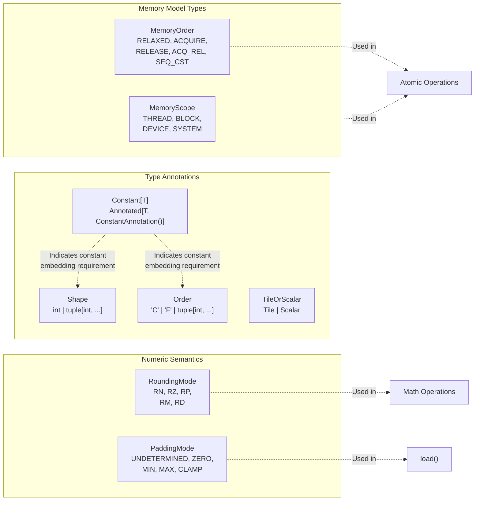
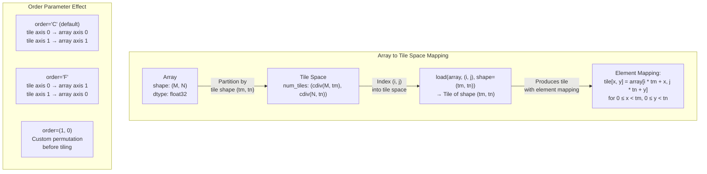

<!-- source: DeepWiki mcp.deepwiki.com · repo NVIDIA/cutile-python · page 3 API Reference · fetched 2026-10-26 -->

# API Reference

<details>
<summary>Relevant source files</summary>

The following files were used as context for generating this wiki page:

- [src/cuda/tile/_ir/ops.py](src/cuda/tile/_ir/ops.py)
- [src/cuda/tile/_stub.py](src/cuda/tile/_stub.py)
- [test/test_cat.py](test/test_cat.py)

</details>


This document provides a comprehensive reference for all operations and classes available in the `cuda.tile` API. It serves as an entry point to detailed documentation on individual operation categories.

For information about the conceptual data model and type system, see [Data Model](#2.1) and [Type System](#2.3). For details on compilation and execution, see [Compilation System](#4).

**Sources:** [src/cuda/tile/_stub.py:1-1901]()

---

## API Organization

The `cuda.tile` API is organized into the following categories, each documented in detail in subsequent sections:

```mermaid
graph TB
    API["cuda.tile API<br/>(ct)"]
    
    subgraph "Core Types"
        Array["Array<br/>Global GPU Memory"]
        Tile["Tile<br/>Block-local Data"]
        DType["DType<br/>Data Types"]
        Scalar["Scalar<br/>int | float | ScalarProtocol"]
    end
    
    subgraph "Memory Operations"
        Load["load()"]
        Store["store()"]
        Gather["gather()"]
        Scatter["scatter()"]
    end
    
    subgraph "Factory Operations"
        Arange["arange()"]
        Full["full()"]
        Ones["ones()"]
        Zeros["zeros()"]
    end
    
    subgraph "Mathematical Operations"
        Binary["add, sub, mul, truediv<br/>floordiv, mod, pow"]
        Comparison["greater, less, equal<br/>greater_equal, less_equal, not_equal"]
        Unary["exp, log, sqrt, sin, cos<br/>floor, ceil, negative"]
        Reduction["sum, max, min, prod<br/>argmax, argmin"]
        Scan["cumsum, cumprod"]
        Bitwise["bitwise_and, bitwise_or<br/>bitwise_xor, bitwise_not<br/>bitwise_lshift, bitwise_rshift"]
        MinMax["minimum, maximum"]
    end
    
    subgraph "Matrix Operations"
        MMA["mma()"]
        MatMul["matmul()"]
    end
    
    subgraph "Shape Operations"
        Reshape["reshape()"]
        Permute["permute()"]
        Transpose["transpose()"]
        ExpandDims["expand_dims()"]
        Cat["cat()"]
        BroadcastTo["broadcast_to()"]
        Extract["extract()"]
    end
    
    subgraph "Type Operations"
        AsType["astype()"]
        Bitcast["bitcast()"]
    end
    
    subgraph "Atomic Operations"
        AtomicCAS["atomic_cas()"]
        AtomicXchg["atomic_xchg()"]
        AtomicAdd["atomic_add()"]
        AtomicMax["atomic_max()"]
        AtomicMin["atomic_min()"]
        AtomicAnd["atomic_and()"]
        AtomicOr["atomic_or()"]
        AtomicXor["atomic_xor()"]
    end
    
    subgraph "Utility Operations"
        BlockInfo["bid(), num_blocks()<br/>num_tiles()"]
        Debug["printf(), assert_()"]
        Select["where()"]
        Util["cdiv()"]
    end
    
    API --> Array
    API --> Tile
    API --> DType
    API --> Scalar
    
    API --> Load
    API --> Store
    API --> Gather
    API --> Scatter
    
    API --> Arange
    API --> Full
    API --> Ones
    API --> Zeros
    
    API --> Binary
    API --> Comparison
    API --> Unary
    API --> Reduction
    API --> Scan
    API --> Bitwise
    API --> MinMax
    
    API --> MMA
    API --> MatMul
    
    API --> Reshape
    API --> Permute
    API --> Transpose
    API --> ExpandDims
    API --> Cat
    API --> BroadcastTo
    API --> Extract
    
    API --> AsType
    API --> Bitcast
    
    API --> AtomicCAS
    API --> AtomicXchg
    API --> AtomicAdd
    API --> AtomicMax
    API --> AtomicMin
    API --> AtomicAnd
    API --> AtomicOr
    API --> AtomicXor
    
    API --> BlockInfo
    API --> Debug
    API --> Select
    API --> Util
```



**Figure: cuda.tile API Organization**

**Sources:** [src/cuda/tile/_stub.py:134-1901]()

---

## Core Data Types

The API operates on three primary data types defined in [src/cuda/tile/_stub.py:134-377]():

### Array

The `Array` class ([src/cuda/tile/_stub.py:134-183]()) represents global GPU memory. Arrays are mutable, support arbitrary shapes and strides, and can be accessed from both host and tile code. Any object implementing the DLPack format or CUDA Array Interface can be used as an `Array` (e.g., PyTorch tensors, CuPy arrays).

**Key Properties:**
- `dtype` ([src/cuda/tile/_stub.py:149-155]()): Data type of elements (returns `DType`, constant)
- `shape` ([src/cuda/tile/_stub.py:157-164]()): Tuple of dimension sizes (returns `tuple[int, ...]`)
- `strides` ([src/cuda/tile/_stub.py:166-173]()): Number of elements to step in each dimension (returns `tuple[int, ...]`)
- `ndim` ([src/cuda/tile/_stub.py:175-182]()): Number of dimensions (returns `int`, constant)

**See:** [Array and Tile Classes](#3.1)

### Tile

The `Tile` class ([src/cuda/tile/_stub.py:185-372]()) represents block-local, immutable data. Tiles are constrained to power-of-2 dimensions and exist only during kernel execution. The contents of a tile do not necessarily have a representation in memory.

**Key Properties:**
- `dtype` ([src/cuda/tile/_stub.py:200-206]()): Data type of elements (returns `DType`, constant)
- `shape` ([src/cuda/tile/_stub.py:208-216]()): Tuple of dimension sizes, all power-of-2 (returns `tuple[const int, ...]`)
- `ndim` ([src/cuda/tile/_stub.py:217-224]()): Number of dimensions (returns `int`, constant)

**Key Methods:**
- `item()` ([src/cuda/tile/_stub.py:226-239]()): Extract scalar (0D Tile) from a single element tile
- `extract(index, shape)` ([src/cuda/tile/_stub.py:241-243]()): Extract sub-tile
- `reshape(shape)` ([src/cuda/tile/_stub.py:245-247]()): Reshape tile
- `permute(axes)` ([src/cuda/tile/_stub.py:249-251]()): Permute axes
- `transpose(axis0, axis1)` ([src/cuda/tile/_stub.py:253-255]()): Transpose two axes
- `astype(dtype)` ([src/cuda/tile/_stub.py:257-259]()): Convert data type
- `__getitem__(index)` ([src/cuda/tile/_stub.py:265-267]()): Syntax sugar for expand_dims

**See:** [Array and Tile Classes](#3.1)

### Scalar

Scalars ([src/cuda/tile/_stub.py:131]()) represent single values and can be Python `int`, `float`, or objects implementing `ScalarProtocol` ([src/cuda/tile/_stub.py:21-129]()). Scalars are interchangeable with 0D tiles in most contexts.

**Sources:** [src/cuda/tile/_stub.py:21-129, 131, 134-372]()

---

## Operation Categories Overview

The following table provides a comprehensive overview of all cuda.tile operations organized by category:

| Category | Operations | Description | Section |
|----------|-----------|-------------|---------|
| **Memory** | `load`, `store`, `gather`, `scatter` | Transfer data between global arrays and tiles | [3.2](#3.2) |
| **Factory** | `arange`, `full`, `ones`, `zeros` | Create new tiles with specific patterns | [3.3](#3.3) |
| **Arithmetic** | `add`, `sub`, `mul`, `truediv`, `floordiv`, `mod`, `pow` | Element-wise arithmetic operations | [3.4](#3.4) |
| **Comparison** | `greater`, `greater_equal`, `less`, `less_equal`, `equal`, `not_equal` | Element-wise comparison operations | [3.4](#3.4) |
| **Unary Math** | `exp`, `exp2`, `log`, `log2`, `sqrt`, `rsqrt`, `sin`, `cos`, `tan`, `sinh`, `cosh`, `tanh`, `floor`, `ceil`, `negative` | Element-wise mathematical functions | [3.4](#3.4) |
| **Reduction** | `sum`, `max`, `min`, `prod`, `argmax`, `argmin` | Reduce along specified axes | [3.4](#3.4) |
| **Scan** | `cumsum`, `cumprod` | Cumulative operations along axes | [3.4](#3.4) |
| **Bitwise** | `bitwise_and`, `bitwise_or`, `bitwise_xor`, `bitwise_not`, `bitwise_lshift`, `bitwise_rshift` | Bitwise operations on integer types | [3.4](#3.4) |
| **Min/Max** | `minimum`, `maximum` | Element-wise min/max operations | [3.4](#3.4) |
| **Matrix** | `mma`, `matmul` | Matrix multiplication operations | [3.5](#3.5) |
| **Shape** | `reshape`, `permute`, `transpose`, `expand_dims`, `cat`, `broadcast_to`, `extract` | Manipulate tile shapes and layouts | [3.6](#3.6) |
| **Type Conversion** | `astype`, `bitcast` | Convert between data types | [3.7](#3.7) |
| **Atomic** | `atomic_cas`, `atomic_xchg`, `atomic_add`, `atomic_max`, `atomic_min`, `atomic_and`, `atomic_or`, `atomic_xor` | Atomic operations on array elements | [3.8](#3.8) |
| **Block Info** | `bid`, `num_blocks`, `num_tiles` | Query block and tile space information | [3.9](#3.9) |
| **Debug** | `printf`, `assert_` | Runtime debugging utilities | [3.9](#3.9) |
| **Selection** | `where` | Conditional element selection | [3.9](#3.9) |
| **Utility** | `cdiv` | Ceiling division utility | [3.9](#3.9) |

**Sources:** [src/cuda/tile/_stub.py:408-1901]()

---

## Type Annotations and Parameter Types

The API uses several type annotations and custom types for parameter specification:



**Figure: Type Annotations and Parameter Types**

### Constant Annotation

The `Constant` type annotation ([src/cuda/tile/_stub.py:384-401]()) indicates that a parameter must be constant-embedded at compile time. This is implemented using `typing.Annotated` with `ConstantAnnotation()` ([src/cuda/tile/_stub.py:384-393]()) metadata.

**Usage Example:**
```python
@ct.kernel
def my_kernel(array: ct.Array, tile_size: Constant[int]):
    tile = ct.load(array, (0,), shape=(tile_size,))
```

**See:** [Constant Embedding](#5.3)

### Shape Type

The `Shape` type ([src/cuda/tile/_stub.py:374]()) represents tile or array dimensions and can be:
- A single `int` for 1D shapes
- A `tuple[int, ...]` for multi-dimensional shapes

### Order Type

The `Order` type ([src/cuda/tile/_stub.py:375]()) specifies axis permutation for memory operations:
- `"C"`: C-order (row-major), equivalent to `(0, 1, 2, ...)`
- `"F"`: Fortran-order (column-major), equivalent to `(..., 2, 1, 0)`
- `tuple[int, ...]`: Explicit axis permutation

**Sources:** [src/cuda/tile/_stub.py:374-401](), [src/cuda/tile/_memory_model.py](), [src/cuda/tile/_numeric_semantics.py]()

---

## Memory Operation Parameters

Memory operations (`load`, `store`, `gather`, `scatter`, and atomic operations) support several performance and correctness parameters:

| Parameter | Type | Operations | Description |
|-----------|------|------------|-------------|
| `latency` | `Optional[int]` | `load`, `store`, `gather`, `scatter` | Hint for DRAM traffic intensity (1=low, 10=high) |
| `allow_tma` | `Optional[bool]` | `load`, `store` | Enable/disable Tensor Memory Accelerator usage |
| `padding_mode` | `PaddingMode` | `load`, `gather` | Value used for out-of-bounds access |
| `check_bounds` | `bool` | `gather`, `scatter`, atomic ops | Enable/disable bounds checking |
| `memory_order` | `MemoryOrder` | Atomic ops | Memory ordering semantics |
| `memory_scope` | `MemoryScope` | Atomic ops | Scope of memory synchronization |

### PaddingMode Enumeration

- `UNDETERMINED`: Padding value is undefined (default for `load`)
- `ZERO`: Pad with zero
- `MIN`: Pad with minimum value for dtype
- `MAX`: Pad with maximum value for dtype
- `CLAMP`: Clamp indices to valid range

### MemoryOrder Enumeration

- `RELAXED`: No synchronization guarantees
- `ACQUIRE`: Synchronize with prior writes
- `RELEASE`: Synchronize with subsequent reads
- `ACQ_REL`: Combine acquire and release
- `SEQ_CST`: Sequential consistency

### MemoryScope Enumeration

- `THREAD`: Thread-local scope
- `BLOCK`: Block-local scope
- `DEVICE`: Device-wide scope
- `SYSTEM`: System-wide scope (includes host)

**See:** [Memory Operations](#3.2), [Atomic Operations](#3.8), [Memory Model](#2.4)

**Sources:** [src/cuda/tile/_stub.py:472-593, 595-867](), [src/cuda/tile/_memory_model.py](), [src/cuda/tile/_numeric_semantics.py]()

---

## Mathematical Operation Parameters

Several mathematical operations support precision and rounding control:

| Parameter | Type | Operations | Description |
|-----------|------|------------|-------------|
| `rounding_mode` | `Optional[RoundingMode]` | `sum`, `prod`, `cumsum`, `cumprod`, `add`, `sub`, `mul`, `truediv`, `sqrt` | Rounding mode for floating-point operations |
| `flush_to_zero` | `bool` | Many math ops | Flush subnormal inputs/results to zero |

### RoundingMode Enumeration

- `RN`: Round to nearest even (default)
- `RZ`: Round toward zero
- `RP`: Round toward positive infinity
- `RM`: Round toward negative infinity
- `RD`: Round down (same as RM for most operations)

**Sources:** [src/cuda/tile/_stub.py:1221-1358, 1422-1778](), [src/cuda/tile/_numeric_semantics.py]()

---

## Operation Signature Patterns

The cuda.tile API follows consistent signature patterns across operation categories:

```mermaid
graph TB
    subgraph "Memory Operations Pattern"
        MemOp["load(array, index, shape, *, order, ...)<br/>store(array, index, tile, *, order, ...)<br/>gather(array, indices, *, ...)<br/>scatter(array, indices, value, *, ...)"]
    end
    
    subgraph "Factory Operations Pattern"
        FactOp["arange(size, *, dtype)<br/>full(shape, fill_value, dtype)<br/>ones(shape, dtype)<br/>zeros(shape, dtype)"]
    end
    
    subgraph "Binary Operations Pattern"
        BinOp["add(x, y, /, *, rounding_mode, flush_to_zero)<br/>mul(x, y, /, *, rounding_mode, flush_to_zero)<br/>Also: +, -, *, /, //, %, **, &, |, ^"]
    end
    
    subgraph "Unary Operations Pattern"
        UnaryOp["exp(x, )<br/>sqrt(x, /, *, rounding_mode, flush_to_zero)<br/>Also: log, sin, cos, floor, ceil, etc."]
    end
    
    subgraph "Reduction Operations Pattern"
        ReduceOp["sum(x, /, axis, *, keepdims, rounding_mode, ...)<br/>max(x, /, axis, *, keepdims, ...)<br/>Also: min, prod, argmax, argmin"]
    end
    
    subgraph "Shape Operations Pattern"
        ShapeOp["reshape(x, /, shape)<br/>permute(x, /, axes)<br/>transpose(x, /, axis0, axis1)<br/>broadcast_to(x, /, shape)"]
    end
    
    subgraph "Atomic Operations Pattern"
        AtomicOp["atomic_add(array, indices, update, /, *,<br/>  check_bounds, memory_order, memory_scope)<br/>Similar: atomic_max, atomic_min, etc."]
    end
    
    subgraph "Matrix Operations Pattern"
        MatOp["mma(x, y, /, acc)<br/>matmul(x, y, )<br/>Also: x @ y"]
    end
```



**Figure: Operation Signature Patterns by Category**

### Common Patterns

1. **Positional-only parameters** (before `/`): Core operands that must be passed positionally
2. **Keyword-only parameters** (after `*`): Optional configuration and hints
3. **Type promotion**: Binary operations promote operand types to a common type
4. **Broadcasting**: Operations support NumPy-style broadcasting rules
5. **Operator overloading**: Many operations have corresponding Python operators (`+`, `-`, `*`, etc.)

**Sources:** [src/cuda/tile/_stub.py:408-1901]()

---

## Data Type Support Matrix

Different operations support different data type combinations:

| Operation Category | Supported Input DTypes | Output DType | Notes |
|-------------------|----------------------|--------------|-------|
| **Arithmetic** | All numeric types | Promoted common type | Type promotion follows NumPy rules |
| **Comparison** | All numeric types | `bool` | Inputs promoted to common type |
| **Bitwise** | Integer and bool types | Same as input | Both operands must have same dtype |
| **Bitwise Shift** | Integer types | Same as input | Both operands must be integers |
| **Math Unary** | Depends on operation | Same as input | Most require floating-point input |
| **Matrix (mma)** | `f16`, `bf16`, `f32`, `f64`, `tf32`, `f8e4m3fn`, `f8e5m2`, `i8`, `u8` | Same as accumulator | See mma dtype table ([src/cuda/tile/_stub.py:956-976]()) |
| **Matrix (matmul)** | `f16`, `bf16`, `f32`, `f64`, `tf32`, `f8e4m3fn`, `f8e5m2`, `i8`, `u8` | Promoted common type | Inputs promoted before multiplication |
| **Reduction** | All numeric types | Same as input | Preserves input dtype |
| **Scan** | All numeric types | Same as input | Preserves input dtype |
| **Atomic** | Integer and floating-point types | Same as array dtype | Operation-specific support |

**See:** [Type System](#2.3) for detailed type promotion rules.

**Sources:** [src/cuda/tile/_stub.py:943-1019](), [src/cuda/tile/_datatype.py](), [src/cuda/tile/_ir/ops.py:796-898]()

---

## Operator Overloading

The `Tile` ([src/cuda/tile/_stub.py:266-371]()) and `Scalar` ([src/cuda/tile/_stub.py:21-129]()) types support Python operator overloading for convenient syntax:

| Python Operator | cuda.tile Function | Tile Method | Description |
|----------------|-------------------|-------------|-------------|
| `x + y` | `add(x, y)` | `__add__`, `__radd__` | Addition |
| `x - y` | `sub(x, y)` | `__sub__`, `__rsub__` | Subtraction |
| `x * y` | `mul(x, y)` | `__mul__`, `__rmul__` | Multiplication |
| `x / y` | `truediv(x, y)` | `__truediv__`, `__rtruediv__` | True division |
| `x // y` | `floordiv(x, y)` | `__floordiv__`, `__rfloordiv__` | Floor division |
| `x % y` | `mod(x, y)` | `__mod__`, `__rmod__` | Modulo |
| `x ** y` | `pow(x, y)` | `__pow__`, `__rpow__` | Power |
| `x & y` | `bitwise_and(x, y)` | `__and__`, `__rand__` | Bitwise AND |
| `x \| y` | `bitwise_or(x, y)` | `__or__`, `__ror__` | Bitwise OR |
| `x ^ y` | `bitwise_xor(x, y)` | `__xor__`, `__rxor__` | Bitwise XOR |
| `x << y` | `bitwise_lshift(x, y)` | N/A | Left shift |
| `x >> y` | `bitwise_rshift(x, y)` | N/A | Right shift |
| `~x` | `bitwise_not(x)` | N/A | Bitwise NOT |
| `-x` | `negative(x)` | N/A | Negation |
| `x > y` | `greater(x, y)` | `__gt__` | Greater than |
| `x >= y` | `greater_equal(x, y)` | `__ge__` | Greater or equal |
| `x < y` | `less(x, y)` | `__lt__` | Less than |
| `x <= y` | `less_equal(x, y)` | `__le__` | Less or equal |
| `x == y` | `equal(x, y)` | `__eq__` | Equal |
| `x != y` | `not_equal(x, y)` | `__ne__` | Not equal |
| `x @ y` | `matmul(x, y)` | N/A | Matrix multiplication |
| `x[None, :]` | `expand_dims(x, 0)` | `__getitem__` | Add dimension |

**Sources:** [src/cuda/tile/_stub.py:21-129, 266-371]()

---

## Tile Space and Index Mapping

Memory operations use the concept of *tile space* to partition arrays into tiles:



**Figure: Tile Space Indexing and Order Parameter**

The `order` parameter in `load` and `store` specifies how tile axes map to array axes:
- `"C"`: Standard row-major mapping (default)
- `"F"`: Transposed column-major mapping
- Tuple: Custom axis permutation

**See:** [Memory Operations](#3.2)

**Sources:** [src/cuda/tile/_stub.py:472-593]()

---

## Quick Reference: Common Operation Patterns

### Loading and Storing Data

```python
# Basic load/store (ct.load: line 472-543, ct.store: line 546-592)
tile = ct.load(array, (bid_x, bid_y), shape=(16, 16))
ct.store(array, (bid_x, bid_y), tile)

# Transposed load (order parameter: line 512-517)
tile = ct.load(array, (bid_x, bid_y), shape=(16, 16), order='F')

# With padding (padding_mode parameter: line 519-521)
tile = ct.load(array, (bid_x, bid_y), shape=(16, 16), 
               padding_mode=ct.PaddingMode.ZERO)

# Non-contiguous access (ct.gather: line 595-632, ct.scatter: line 635-668)
indices_x = ct.arange(32, dtype=ct.int32)
indices_y = ct.full((32,), 5, dtype=ct.int32)
tile = ct.gather(array, (indices_x, indices_y))
ct.scatter(array, (indices_x, indices_y), tile)
```

### Creating Tiles

```python
# Range of values (ct.arange: line 872-886)
tile = ct.arange(32, dtype=ct.float32)

# Constant values (ct.full: line 889-904)
tile = ct.full((16, 16), 3.14, dtype=ct.float32)
tile = ct.ones((8, 8), dtype=ct.int32)  # ct.ones: line 907-921
tile = ct.zeros((4, 4), dtype=ct.float16)  # ct.zeros: line 924-938
```

### Mathematical Operations

```python
# Arithmetic (operator overloading or explicit functions)
result = x + y  # uses Tile.__add__ (line 270)
result = ct.add(x, y, rounding_mode=ct.RoundingMode.RZ)  # ct.add: line 1422-1426

# Reductions (ct.sum: line 1277-1279, ct.max: line 1283-1285)
result = ct.sum(tile, axis=1, keepdims=True)
result = ct.max(tile, axis=0)

# Unary math (ct.exp: line 1674-1676, ct.sqrt: line 1698-1701)
result = ct.exp(tile)
result = ct.sqrt(tile)
```

### Shape Manipulation

```python
# Reshape and transpose (Tile.reshape: line 245-247, Tile.transpose: line 253-255)
reshaped = tile.reshape((32, 8))
transposed = tile.transpose()  # ct.transpose: line 1153-1178
permuted = ct.permute(tile, (2, 0, 1))  # ct.permute: line 1133-1150

# Broadcasting (ct.broadcast_to: line 1078-1098)
broadcasted = ct.broadcast_to(tile, (16, 32))

# Concatenation (ct.cat: line 1050-1075)
concatenated = ct.cat((tile1, tile2), axis=0)
```

### Matrix Operations

```python
# Matrix multiplication (ct.matmul: line 994-1019, operator @)
result = x @ y
result = ct.matmul(x, y)

# Matrix multiply-accumulate (ct.mma: line 943-991)
result = ct.mma(x, y, acc)
```

### Atomic Operations

```python
# Atomic add (ct.atomic_add: line 781-791)
old_value = ct.atomic_add(array, indices, update,
                          memory_order=ct.MemoryOrder.ACQ_REL,
                          memory_scope=ct.MemoryScope.DEVICE)

# Compare-and-swap (ct.atomic_cas: line 674-730)
old_value = ct.atomic_cas(array, indices, expected, desired)
```

**Sources:** [src/cuda/tile/_stub.py:472-867, 872-1019, 1050-1178, 1277-1285, 1422-1701]()

---

## Function Availability: Host vs Tile Code

Most cuda.tile operations are available only in *tile code* (inside `@ct.kernel` decorated functions). A few operations can also be used in *host code*:

| Function | Tile Code | Host Code | Decorator | Notes |
|----------|-----------|-----------|-----------|-------|
| `cdiv` | ✓ | ✓ | `@function(host=True)` ([src/cuda/tile/_stub.py:1532]()) | Ceiling division utility |
| All other operations | ✓ | ✗ | `@function` | Tile code only |

The `@function` decorator ([src/cuda/tile/_execution.py:15-84]()) marks operations for compilation. Operations marked `@function(host=True)` can execute on both CPU and GPU. Operations used in host code execute on the CPU, while operations in tile code are compiled for GPU execution.

**See:** [Execution Model](#2.2) for details on execution spaces.

**Sources:** [src/cuda/tile/_stub.py:1532-1552](), [src/cuda/tile/_execution.py:15-84]()

---

## Detailed API Documentation

For comprehensive documentation on each operation category, see the following sections:

- **[Array and Tile Classes](#3.1)**: Properties and methods of `Array` and `Tile` classes
- **[Memory Operations](#3.2)**: `load`, `store`, `gather`, `scatter` with tile space indexing
- **[Factory Operations](#3.3)**: Tile creation with `arange`, `full`, `ones`, `zeros`
- **[Mathematical Operations](#3.4)**: Arithmetic, comparison, unary, reduction, and scan operations
- **[Matrix Operations](#3.5)**: `mma` and `matmul` for matrix multiplication
- **[Shape Manipulation](#3.6)**: `reshape`, `permute`, `transpose`, `broadcast_to`, and related operations
- **[Type Conversion](#3.7)**: `astype` and `bitcast` for data type conversion
- **[Atomic Operations](#3.8)**: Atomic memory operations with memory model parameters
- **[Utility Operations](#3.9)**: Block information, debugging, and helper utilities

**Sources:** [src/cuda/tile/_stub.py:1-1901]()

---

