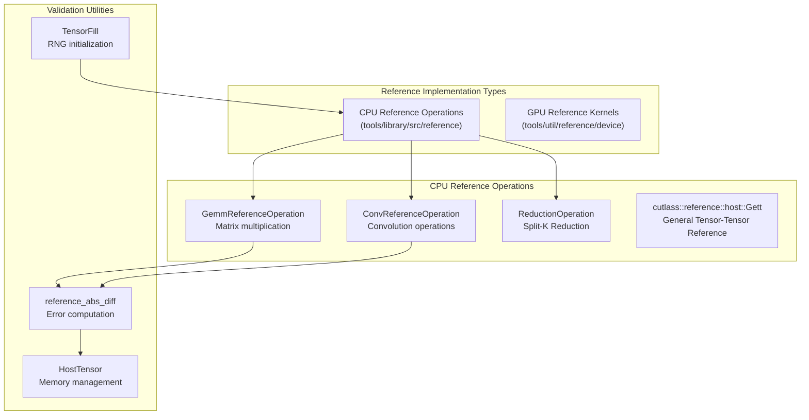
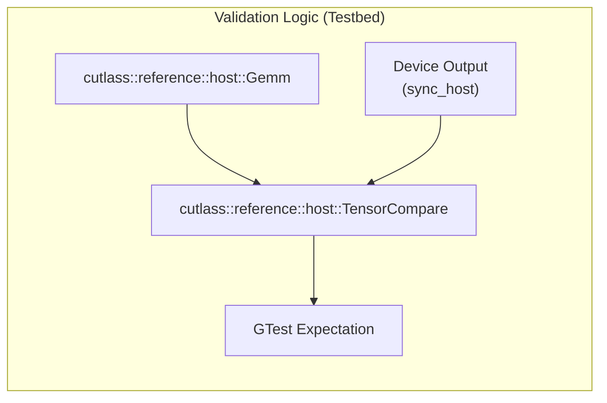

<!-- source: DeepWiki mcp.deepwiki.com · repo NVIDIA/cutlass · page 10.2 Reference Implementations and Validation · fetched 2026-10-26 -->

# Reference Implementations and Validation

<details>
<summary>Relevant source files</summary>

The following files were used as context for generating this wiki page:

- [include/cutlass/gemm/device/default_gemm_configuration.h](include/cutlass/gemm/device/default_gemm_configuration.h)
- [include/cutlass/gemm/warp/default_mma_tensor_op_sm80.h](include/cutlass/gemm/warp/default_mma_tensor_op_sm80.h)
- [include/cutlass/gemm/warp/mma_mixed_input_tensor_op.h](include/cutlass/gemm/warp/mma_mixed_input_tensor_op.h)
- [test/unit/core/fast_numeric_conversion.cu](test/unit/core/fast_numeric_conversion.cu)
- [test/unit/gemm/device/gemm_universal_s4t_s8n_s32t_mixed_input_tensor_op_s32_sm80.cu](test/unit/gemm/device/gemm_universal_s4t_s8n_s32t_mixed_input_tensor_op_s32_sm80.cu)
- [test/unit/gemm/device/gemm_universal_s4t_s8n_s8t_mixed_input_tensor_op_s32_sm80.cu](test/unit/gemm/device/gemm_universal_s4t_s8n_s8t_mixed_input_tensor_op_s32_sm80.cu)
- [test/unit/gemm/device/gemm_universal_s8t_s4n_s32t_mixed_input_tensor_op_s32_sm80.cu](test/unit/gemm/device/gemm_universal_s8t_s4n_s32t_mixed_input_tensor_op_s32_sm80.cu)
- [test/unit/gemm/device/gemm_universal_s8t_s4n_s8t_mixed_input_tensor_op_s32_sm80.cu](test/unit/gemm/device/gemm_universal_s8t_s4n_s8t_mixed_input_tensor_op_s32_sm80.cu)
- [test/unit/gemm/warp/gemm_mixed_input_sm80.cu](test/unit/gemm/warp/gemm_mixed_input_sm80.cu)
- [tools/library/CMakeLists.txt](tools/library/CMakeLists.txt)
- [tools/library/include/cutlass/library/handle.h](tools/library/include/cutlass/library/handle.h)
- [tools/library/include/cutlass/library/library.h](tools/library/include/cutlass/library/library.h)
- [tools/library/src/conv2d_operation.h](tools/library/src/conv2d_operation.h)
- [tools/library/src/conv3d_operation.h](tools/library/src/conv3d_operation.h)
- [tools/library/src/gemm_operation.h](tools/library/src/gemm_operation.h)
- [tools/library/src/handle.cu](tools/library/src/handle.cu)
- [tools/library/src/reduction/reduction_operation.h](tools/library/src/reduction/reduction_operation.h)
- [tools/library/src/reference/conv_reference_operation.h](tools/library/src/reference/conv_reference_operation.h)
- [tools/library/src/reference/gemm_reference_operation.h](tools/library/src/reference/gemm_reference_operation.h)
- [tools/library/src/reference/initialize_reference_operations.cu](tools/library/src/reference/initialize_reference_operations.cu)

</details>


## Purpose and Scope

This document describes the reference implementations used to validate CUTLASS kernel correctness. Reference implementations provide known-correct results computed through straightforward algorithms that serve as ground truth for testing optimized kernels. This page covers the organization of reference operations, validation utilities, and accuracy verification strategies.

For information about the unit test framework and CTest integration, see [Unit Test Framework and CTest Integration](#10.1). For performance measurement, see [Performance Profiling](#10.3).

---

## Reference Implementation Architecture

CUTLASS provides reference implementations depending on operation complexity and validation requirements. These are primarily housed in `tools/library/src/reference/` and `tools/util/include/cutlass/util/reference/`.

Title: Reference System Architecture


**Sources**: [tools/library/src/reference/gemm_reference_operation.h:74-145](), [tools/library/src/reduction/reduction_operation.h:55-95](), [tools/library/src/reference/initialize_reference_operations.cu:84-123]()

---

## CPU Reference Operations for GEMM

CPU reference implementations provide straightforward matrix multiplication implementations used to validate GEMM kernels across various data types and layouts.

### GemmReferenceOperation
The `GemmReferenceOperation` class inherits from `Operation` to provide a standard interface for the CUTLASS Profiler and library handles [tools/library/src/reference/gemm_reference_operation.h:74-86](). It initializes metadata including provider (e.g., `Provider::kReferenceDevice`), data types, and complex transformations [tools/library/src/reference/gemm_reference_operation.h:108-143]().

### Reference Initialization
Reference operations are registered in the library `Manifest` through `initialize_reference_operations(Manifest &manifest)` [tools/library/src/reference/initialize_reference_operations.cu:84-123](). This includes:
- **Integer Variants**: `int4`, `int8` (interleaved 32/64), and mixed-input integer GEMMs [tools/library/src/reference/initialize_reference_operations.cu:88-93]().
- **Floating Point Variants**: FP8 (E4M3, E5M2), FP16, BF16, and FP32 outputs [tools/library/src/reference/initialize_reference_operations.cu:95-103]().
- **Block-Scaled GEMM**: References for FP4 and mixed 8-bit block-scaled operations [tools/library/src/reference/initialize_reference_operations.cu:117-122]().

### Reduction and Convolution References
- **Reduction**: `ReductionOperation` validates split-K reduction kernels by applying elementwise operations (alpha/beta) across partitions [tools/library/src/reduction/reduction_operation.h:55-95]().
- **Convolution**: `initialize_conv2d_reference_operations` and `initialize_conv3d_reference_operations` provide references for 2D and 3D convolution [tools/library/src/reference/initialize_reference_operations.cu:85-86]().

**Sources**: [tools/library/src/reference/gemm_reference_operation.h:74-154](), [tools/library/src/reduction/reduction_operation.h:75-95](), [tools/library/src/reference/initialize_reference_operations.cu:46-81]()

---

## Data Initialization and Filling

Correct validation requires controlled data distributions. CUTLASS provides `HostTensor` for managing dual-residency memory and utilities for filling these tensors.

### TensorFill Utilities
Tensors are typically initialized using `cutlass::reference::host::TensorFill` [test/unit/gemm/warp/gemm_mixed_input_sm80.cu:46-48]().
- **Sequential/Constant**: Fills tensors with fixed values or patterns.
- **Random Gaussian**: Used for floating-point validation to exercise dynamic range.

**Sources**: [test/unit/gemm/warp/gemm_mixed_input_sm80.cu:46-48](), [test/unit/gemm/device/gemm_universal_s4t_s8n_s32t_mixed_input_tensor_op_s32_sm80.cu:42-45]()

---

## Validation Utilities and Error Computation

### Handle and Workspace Management
The `cutlass::library::Handle` class manages device workspace allocations in Global Memory [tools/library/src/handle.cu:49-58]().
- **Device Workspace**: `set_workspace_size(size_t bytes)` performs `cudaMalloc` and `cudaMemset` to ensure a clean state for validation [tools/library/src/handle.cu:163-195]().
- **Scalar Pointer Mode**: Manages whether alpha/beta reside on host or device [tools/library/src/handle.cu:202-209]().

### Accuracy Verification
The comparison logic in testbeds uses absolute difference utilities. For example, `test::gemm::device::TestAllGemmUniversal<Gemm>()` invokes a standard testbed that compares GPU results against `cutlass::reference::host::Gemm` [test/unit/gemm/device/gemm_universal_s4t_s8n_s32t_mixed_input_tensor_op_s32_sm80.cu:89]().

Title: Validation Data Flow


### Numeric Conversion Validation
Specialized utilities like `FastNumericArrayConverter` are validated via unit tests that compare GPU-side conversions against host-side integer casts [test/unit/core/fast_numeric_conversion.cu:54-56](). Tests cover ranges for `s8_to_f32`, `u8_to_f16`, and `s4_to_s8` [test/unit/core/fast_numeric_conversion.cu:152-199]().

**Sources**: [tools/library/src/handle.cu:163-195](), [test/unit/gemm/device/gemm_universal_s4t_s8n_s32t_mixed_input_tensor_op_s32_sm80.cu:89](), [test/unit/core/fast_numeric_conversion.cu:54-87]()

---

## Reference Implementation Organization

### Library and Tooling Integration
The reference operations are built into the `cutlass_library` [tools/library/CMakeLists.txt:103-115](). This library provides the `Operation` interface used by the CUTLASS Profiler to dispatch reference calculations.

Title: Code Entity Mapping
```mermaid
graph TD
    subgraph "Library Space"
        Op["Operation (library.h)"]
        GemmOp["GemmOperation (gemm_operation.h)"]
        RefOp["GemmReferenceOperation (gemm_reference_operation.h)"]
    end
    
    subgraph "Utility Space"
        HT["HostTensor (host_tensor.h)"]
        TC["TensorCompare (tensor_compare.h)"]
    end
    
    Op <|-- GemmOp
    Op <|-- RefOp
    RefOp -.-> HT
    GemmOp -.-> HT
    HT --> TC
```

**Sources**: [tools/library/include/cutlass/library/library.h:83-131](), [tools/library/src/reference/gemm_reference_operation.h:74-75](), [tools/library/CMakeLists.txt:103-115]()

---

