# Page: Overview

# Overview

<details>
<summary>Relevant source files</summary>

The following files were used as context for generating this wiki page:

- [CHANGELOG.md](CHANGELOG.md)
- [CUDA.cmake](CUDA.cmake)
- [Doxyfile](Doxyfile)
- [PUBLICATIONS.md](PUBLICATIONS.md)
- [README.md](README.md)
- [cmake/version_extended.h.in](cmake/version_extended.h.in)
- [examples/02_dump_reg_shmem/CMakeLists.txt](examples/02_dump_reg_shmem/CMakeLists.txt)
- [examples/56_hopper_ptr_array_batched_gemm/CMakeLists.txt](examples/56_hopper_ptr_array_batched_gemm/CMakeLists.txt)
- [include/cutlass/version.h](include/cutlass/version.h)
- [python/CuTeDSL/cutlass/base_dsl/env_manager.py](python/CuTeDSL/cutlass/base_dsl/env_manager.py)
- [python/CuTeDSL/cutlass/base_dsl/runtime/cuda.py](python/CuTeDSL/cutlass/base_dsl/runtime/cuda.py)
- [python/CuTeDSL/cutlass/cute/__init__.py](python/CuTeDSL/cutlass/cute/__init__.py)
- [python/CuTeDSL/cutlass/cute/arch/nvvm_wrappers.py](python/CuTeDSL/cutlass/cute/arch/nvvm_wrappers.py)
- [python/CuTeDSL/cutlass/cute/core.py](python/CuTeDSL/cutlass/cute/core.py)
- [python/CuTeDSL/cutlass/jax/primitive.py](python/CuTeDSL/cutlass/jax/primitive.py)
- [python/CuTeDSL/requirements-cu13.txt](python/CuTeDSL/requirements-cu13.txt)
- [python/CuTeDSL/requirements.txt](python/CuTeDSL/requirements.txt)
- [python/cutlass_cppgen/__init__.py](python/cutlass_cppgen/__init__.py)
- [python/setup_cutlass.py](python/setup_cutlass.py)
- [python/setup_library.py](python/setup_library.py)
- [python/setup_pycute.py](python/setup_pycute.py)

</details>


**Purpose**: This document provides a high-level introduction to CUTLASS, explaining its dual programming models (C++ template library and Python DSL), core capabilities, architectural organization, and key features. It serves as the entry point for understanding the CUTLASS codebase.

For detailed terminology definitions, see [Core Concepts and Terminology](#1.1). For information about repository structure and header organization, see [Library Organization and Header Structure](#1.2). For GPU architecture support details, see [GPU Architecture Support Matrix](#1.3). For version history, see [Version Information and Release Strategy](#1.4).

## What is CUTLASS

CUTLASS is a collection of CUDA C++ template abstractions and Python DSLs for implementing high-performance matrix-matrix multiplication (GEMM), convolution, and related linear algebra operations across NVIDIA GPU architectures (Volta through Blackwell). The library decomposes GPU computation into reusable, modular components operating at multiple levels of the parallelization hierarchy. [README.md:8-15]()

CUTLASS provides two primary programming interfaces:

1.  **C++ Template Library**: Header-only templates offering compile-time specialization and zero-overhead abstractions. [README.md:17-26]()
2.  **CuTe DSL**: Python-native interface for writing high-performance CUDA kernels based on core CUTLASS and CuTe concepts without performance compromises. [README.md:28-30]()

**Current Version**: 4.7.0 (August 2026) [include/cutlass/version.h:41-43](), [README.md:4-6]()

Sources: [README.md:4-30](), [include/cutlass/version.h:41-43]()

## Dual Programming Model Architecture

CUTLASS 4.x supports two distinct programming paradigms that share the same underlying abstractions but differ in compilation strategy and user interface:

### Kernel Development Flow
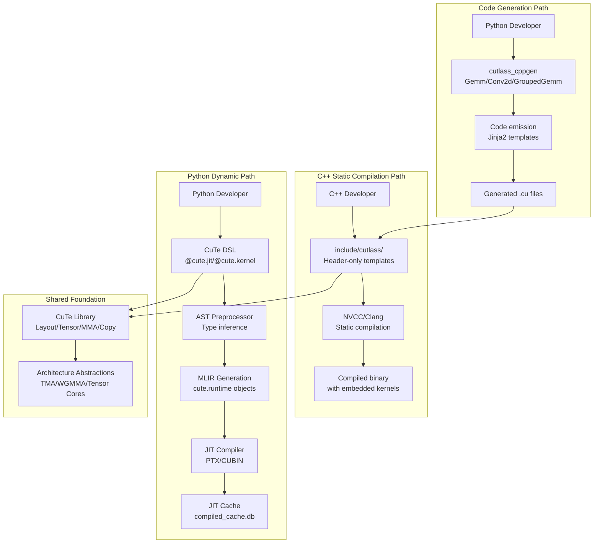
Sources: [README.md:28-44](), [python/cutlass_cppgen/__init__.py:84-146](), [python/cutlass_cppgen/__init__.py:138-142]()

### C++ Template Interface
The C++ interface provides zero runtime overhead by resolving abstractions at compile time. It is a header-only library located in `include/cutlass/` and `include/cute/`. It performs extensive template specialization for tiling sizes, data types, and algorithmic policies across SM70 through SM100+. [README.md:13-26]()

### Python DSL Interface
The Python interface (CuTe DSL) provides JIT compilation from Python code to PTX/CUBIN. It features native integration with DL frameworks (PyTorch, JAX) and intuitive metaprogramming. [README.md:28-30]() Version 4.7 introduces the **Primitives API**, providing a stable wrapper over NVVM operations for lower-level SIMT programming within the DSL. [README.md:49-52](), [CHANGELOG.md:9-11]()

## Repository Organization

### Package Hierarchy
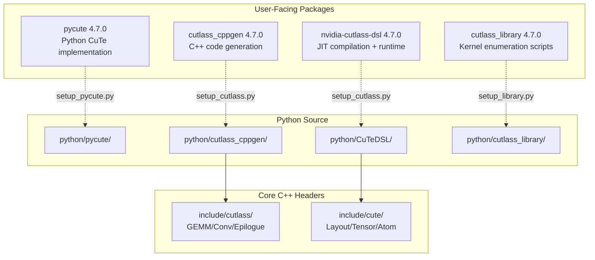
Sources: [python/setup_cutlass.py:52-74](), [python/setup_pycute.py:37-42](), [python/setup_library.py:37-42](), [python/cutlass_cppgen/__init__.py:136-146]()

| Directory | Purpose | Key Contents |
|-----------|---------|--------------|
| `include/cutlass/` | C++ template library | `gemm/`, `conv/`, `epilogue/`, `arch/` |
| `include/cute/` | CuTe core library | `algorithm/`, `arch/`, `atom/`, layout types |
| `python/CuTeDSL/` | CuTe DSL implementation | `cutlass/cute/`, `cutlass/base_dsl/` |
| `python/cutlass_cppgen/` | C++ code generator | `op/`, `emit/`, `backend/` |
| `python/cutlass_library/` | Kernel enumeration | `library.py`, operation classes |
| `examples/` | Tutorial implementations | `77_blackwell_fmha`, `92_blackwell_moe_gemm`, `56_hopper_ptr_array_batched_gemm` |

## Key Components and Data Flow

### Architecture Abstraction Layers
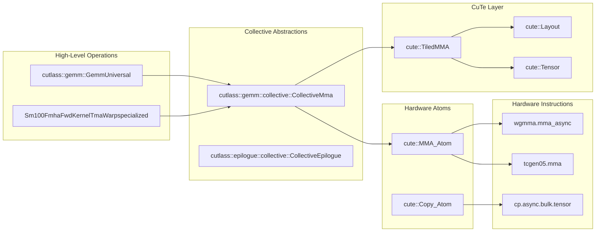
Sources: [README.md:89-105](), [CHANGELOG.md:28-35]()

## Core Features

### Architecture Support
CUTLASS 4.7.0 supports NVIDIA GPU architectures from **Volta (SM70)** through **Blackwell (SM100/SM103/SM120)**. [README.md:26](), [CHANGELOG.md:69-72]()

| Architecture | Key Features |
|--------------|--------------|
| Hopper (SM90) | TMA, WGMMA, Thread Block Clusters [README.md:34]() |
| Blackwell (SM100) | Enhanced TMA, Blockwise Scaling, 2SM MMA [README.md:89-94]() |
| Blackwell (SM103) | 2-kernel FP8 FMHA backward optimization [CHANGELOG.md:28-30]() |
| SM70-SM100+ | Comprehensive numeric type support across generations [README.md:26]() |

### Data Type Support
CUTLASS supports an extensive numeric type system: [README.md:17-26]()
- **Floating Point**: FP64, FP32, TF32, FP16, BF16
- **8b Floating Point**: e5m2 and e4m3 (FP8) [CHANGELOG.md:32]()
- **4b Floating Point**: e2m1 (FP4) support in converters [CHANGELOG.md:73-74]()
- **Block Scaled**: NVIDIA NVFP4, OCP MXFP4, MXFP6, MXFP8 [README.md:23]()
- **Integer**: 4b and 8b signed/unsigned
- **Binary**: 1b data types

### CuTe Library Foundation
CuTe is the core library introduced in CUTLASS 3.0 to describe and manipulate tensors of threads and data. [README.md:30-34]()
- **Layout Algebra**: Hierarchically multidimensional layouts representing Shape and Stride. [README.md:30]()
- **Tensor Objects**: Packaging type, shape, memory space, and layout while handling mechanical indexing. [README.md:30]()

## Version and Build Information
Version information is synchronized across C++ headers and Python setup scripts.
- **C++ Header**: [include/cutlass/version.h:41-43]()
- **Python Version**: [python/setup_cutlass.py:54](), [python/cutlass_cppgen/__init__.py:136]()

**Minimum Requirements**:
- Architecture: Volta (compute capability 7.0) [README.md:26]()
- Compiler: C++17 support
- CUDA Toolkit: 11.8 (Recommended: 13.3 for optimal Blackwell code gen) [CHANGELOG.md:39](), [python/setup_cutlass.py:68]()

Sources: [include/cutlass/version.h:41-86](), [README.md:4-6](), [CHANGELOG.md:5-40]()

---

# Page: Core Concepts and Terminology

# Core Concepts and Terminology

<details>
<summary>Relevant source files</summary>

The following files were used as context for generating this wiki page:

- [CHANGELOG.md](CHANGELOG.md)
- [README.md](README.md)
- [include/cutlass/version.h](include/cutlass/version.h)
- [media/docs/cpp/cute/02_layout_algebra.md](media/docs/cpp/cute/02_layout_algebra.md)
- [media/docs/cpp/cute/03_tensor.md](media/docs/cpp/cute/03_tensor.md)
- [media/docs/cpp/cute/0t_mma_atom.md](media/docs/cpp/cute/0t_mma_atom.md)
- [media/docs/cpp/cute/0x_gemm_tutorial.md](media/docs/cpp/cute/0x_gemm_tutorial.md)
- [python/CuTeDSL/cutlass/base_dsl/env_manager.py](python/CuTeDSL/cutlass/base_dsl/env_manager.py)
- [python/CuTeDSL/cutlass/base_dsl/runtime/cuda.py](python/CuTeDSL/cutlass/base_dsl/runtime/cuda.py)
- [python/CuTeDSL/cutlass/cute/__init__.py](python/CuTeDSL/cutlass/cute/__init__.py)
- [python/CuTeDSL/cutlass/cute/arch/nvvm_wrappers.py](python/CuTeDSL/cutlass/cute/arch/nvvm_wrappers.py)
- [python/CuTeDSL/cutlass/cute/core.py](python/CuTeDSL/cutlass/cute/core.py)
- [python/CuTeDSL/cutlass/jax/primitive.py](python/CuTeDSL/cutlass/jax/primitive.py)
- [python/CuTeDSL/requirements-cu13.txt](python/CuTeDSL/requirements-cu13.txt)
- [python/CuTeDSL/requirements.txt](python/CuTeDSL/requirements.txt)
- [python/cutlass_cppgen/__init__.py](python/cutlass_cppgen/__init__.py)
- [python/setup_cutlass.py](python/setup_cutlass.py)
- [python/setup_library.py](python/setup_library.py)
- [python/setup_pycute.py](python/setup_pycute.py)
- [test/unit/layout/tensor.cu](test/unit/layout/tensor.cu)
- [test/unit/layout/tensor_nhwc.cu](test/unit/layout/tensor_nhwc.cu)

</details>


This page defines fundamental terminology and conceptual building blocks used throughout CUTLASS. Understanding these terms is essential for working with any CUTLASS component, whether using the **C++ template library** or the **CuTe DSL (Python interface)**.

CUTLASS provides two primary programming models:
- **C++ Template API**: Header-only library with compile-time specialization for maximum performance [README.md:17-27]().
- **CuTe DSL**: Python-based domain-specific language with JIT compilation for rapid prototyping and production deployment [README.md:28-44]().

---

## Programming Models

CUTLASS 4.x supports dual programming interfaces that share the same underlying abstractions:

**Programming Model and Execution Flow**
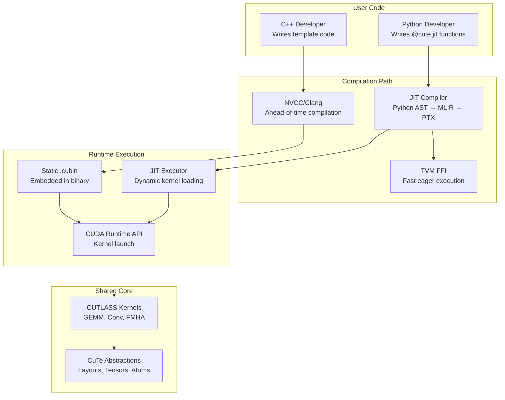
**Sources:** [README.md:1-44](), [python/setup_cutlass.py:52-74]()

| Concept | C++ API | Python DSL | Description |
|---------|---------|------------|-------------|
| **Kernel Definition** | Template class | `@cute.kernel` decorator | Device-side code |
| **Host Function** | Template function | `@cute.jit` decorator | Host-side orchestration |
| **Compilation** | Ahead-of-time (NVCC) | Just-in-time (MLIR) | Code generation strategy |
| **Dispatch** | `cudaLaunchKernel` | `JitExecutor` | Kernel invocation |
| **Optimization** | Template specialization | JIT caching | Performance strategy |

---

## GPU Hardware Terminology

CUTLASS exposes and optimizes for specific CUDA hardware primitives. These terms appear throughout the codebase and API:

### Thread Hierarchy

**Thread and Cluster Hierarchy**
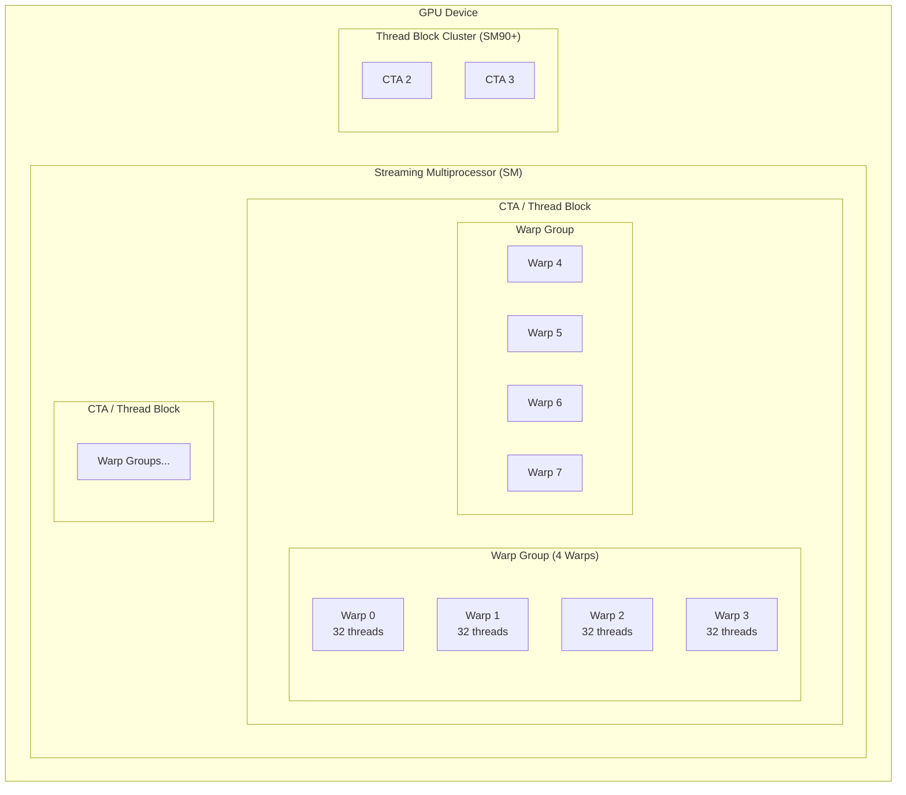
**Sources:** [README.md:88-108](), [CHANGELOG.md:64-64]()

| Term | Abbreviation | Description | Code Representation |
|------|--------------|-------------|---------------------|
| **Thread** | - | Single CUDA execution unit | Single lane in SIMT execution |
| **Warp** | - | Group of 32 threads executing in lockstep | `WARP_SIZE` [python/CuTeDSL/cutlass/cute/arch/nvvm_wrappers.py:34]() |
| **Warp Group** | WG | 4 warps (128 threads) on SM90+, used by WGMMA | `cutlass::gemm::collective::CollectiveMma` |
| **Thread Block** | CTA | Cooperative Thread Array, shares SMEM | `cute::Shape`, kernel launch dimension |
| **Cluster** | - | Group of CTAs on SM90+ sharing distributed SMEM | `cudaLaunchAttributeLaunchCompletionEvent` [CHANGELOG.md:64-64]() |
| **Streaming Multiprocessor** | SM | Hardware execution unit containing cores and memory | Architecture version (SM90, SM100, etc.) |

### Memory Hierarchy

**Memory and Storage Abstractions**
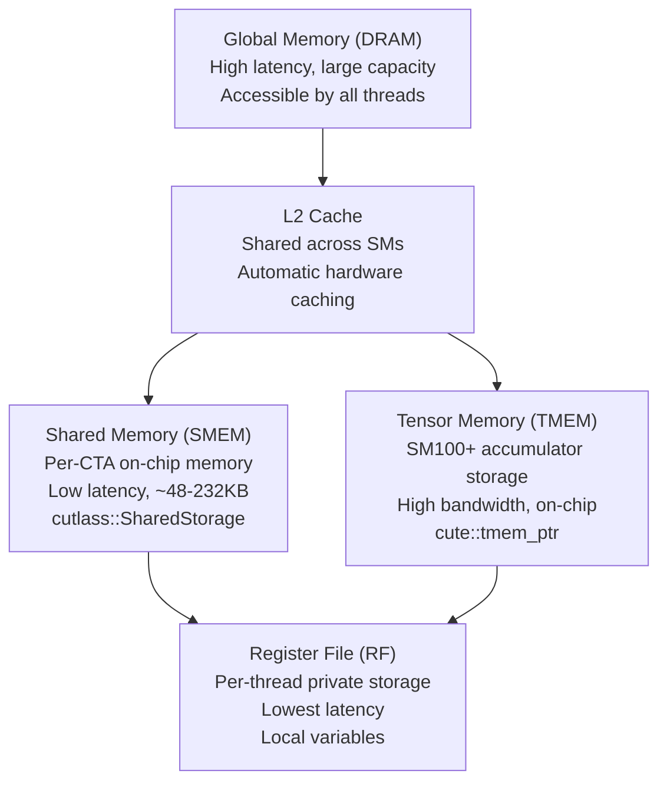
**Sources:** [README.md:88-108](), [CHANGELOG.md:61-61](), [CHANGELOG.md:65-70]()

| Memory Type | Scope | Typical Size | CUTLASS Usage |
|-------------|-------|--------------|---------------|
| **Global Memory** | Device | GBs | Input/output tensors, resident in DRAM |
| **L2 Cache** | Device | MBs | Automatic caching layer |
| **Shared Memory (SMEM)** | CTA | 48-232 KB | Tile buffering, pipeline staging [CHANGELOG.md:84-84]() |
| **Tensor Memory (TMEM)** | Warp Group | SM100+: variable | High-bandwidth accumulator storage |
| **Registers (RF)** | Thread | ~64KB per SM | Fragment storage, compute operands |

### Tensor Core Operations

**Tensor Cores** are specialized hardware units for matrix multiply-accumulate operations, introduced in Volta (SM70) and enhanced in every subsequent architecture [README.md:17-26]().

**Tensor Core Compute Flow**
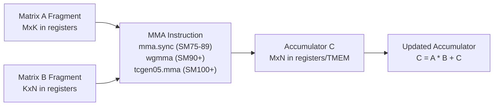
**Sources:** [README.md:81-87](), [CHANGELOG.md:9-13](), [media/docs/cpp/cute/0t_mma_atom.md:1-25]()

| Term | Full Name | Description | Example Instructions |
|------|-----------|-------------|---------------------|
| **MMA** | Matrix Multiply-Accumulate | Core tensor core operation: `D = A * B + C` | `mma.sync.aligned.m16n8k8.f32.f16.f16.f32` [media/docs/cpp/cute/0t_mma_atom.md:93-104]() |
| **WGMMA** | Warp Group MMA | SM90+ instruction operating on 128 threads | `wgmma.mma_async.sync.aligned.m64n128k16.f32.f16.f16` |
| **TCGen05** | 5th Generation Tensor Core | SM100/SM120 enhanced MMA instructions | `tcgen05.mma` Blackwell instruction set [python/CuTeDSL/cutlass/cute/arch/nvvm_wrappers.py:74-80]() |
| **SIMT** | Single Instruction Multiple Thread | Non-tensor-core FP32/FP64 operations | CUDA core arithmetic [CHANGELOG.md:9-10]() |

---

## CUTLASS-Specific Terminology

### Core Abstractions

CUTLASS 3.x and 4.x are built on the **CuTe** abstraction layer, which provides a mathematical framework for describing data layouts and operations [README.md:88-108]().

**CuTe Core Entities**
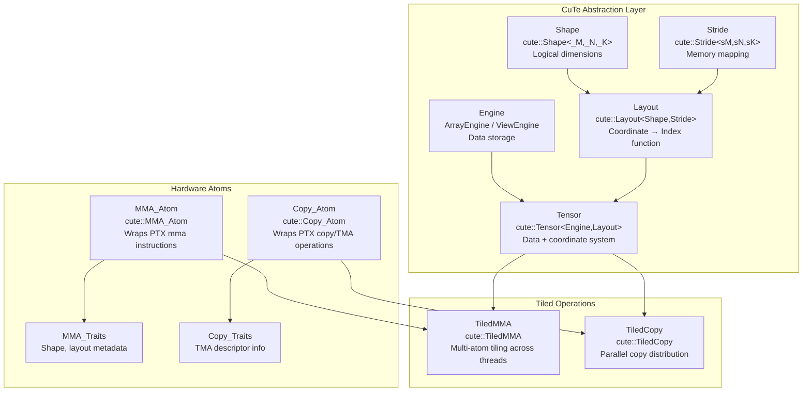
**Sources:** [media/docs/cpp/cute/02_layout_algebra.md:1-12](), [media/docs/cpp/cute/03_tensor.md:1-12](), [media/docs/cpp/cute/0t_mma_atom.md:26-49]()

| Concept | C++ Type | Purpose | Location |
|---------|----------|---------|----------|
| **Layout** | `cute::Layout<Shape, Stride>` | Maps logical coordinates to linear memory indices | `include/cute/layout.hpp` [media/docs/cpp/cute/02_layout_algebra.md:15-18]() |
| **Tensor** | `cute::Tensor<Engine, Layout>` | Data container with coordinate system | `include/cute/tensor.hpp` [media/docs/cpp/cute/03_tensor.md:3-12]() |
| **Atom** | `cute::MMA_Atom`, `cute::Copy_Atom` | Minimal hardware instruction wrapper | `include/cute/atom/` [media/docs/cpp/cute/0t_mma_atom.md:18-21]() |
| **TiledMMA** | `cute::TiledMMA` | Distributes MMA atoms across thread group | `include/cute/atom/mma_atom.hpp` [media/docs/cpp/cute/0t_mma_atom.md:23-25]() |
| **TiledCopy** | `cute::TiledCopy` | Distributes copy operations across threads | `include/cute/atom/copy_atom.hpp` |

### Operation Hierarchy

CUTLASS operations are composed hierarchically from atoms up to complete device functions:

**Operation Composition Hierarchy**
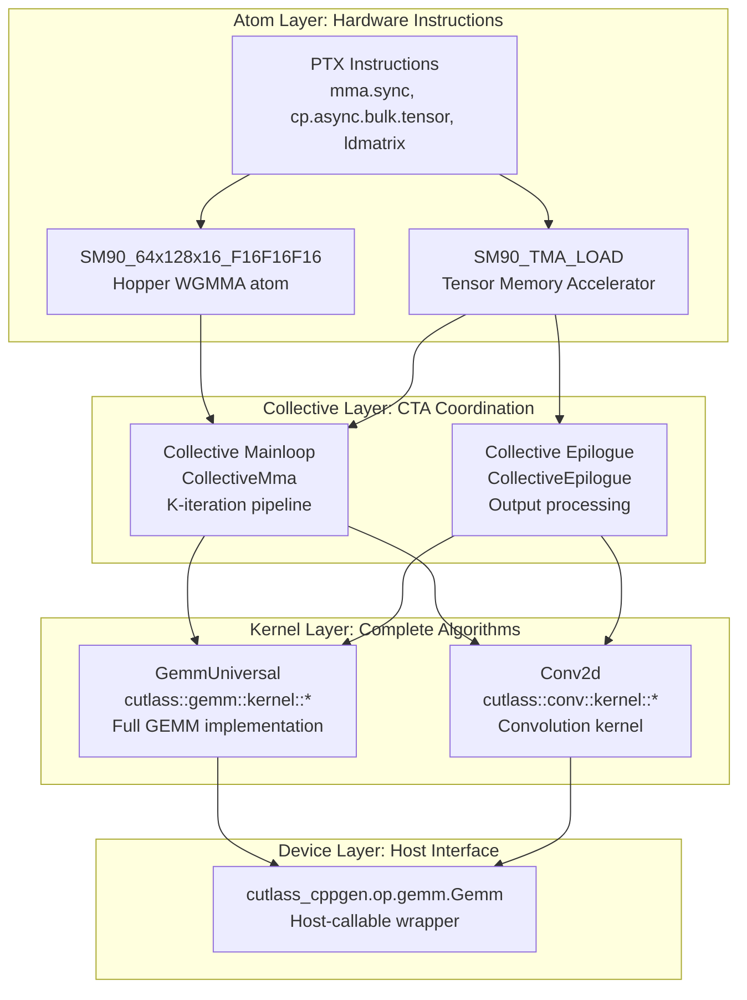
**Sources:** [python/cutlass_cppgen/__init__.py:140-142](), [media/docs/cpp/cute/0t_mma_atom.md:1-25]()

### Dispatch Policies

CUTLASS uses policy types to configure scheduling and specialization:

| Policy Type | Enum/Class | Purpose | Code Location |
|-------------|------------|---------|---------------|
| **KernelScheduleType** | `cutlass_library::KernelScheduleType` | Defines mainloop scheduling strategy | [python/cutlass_cppgen/__init__.py:89]() |
| **EpilogueScheduleType** | `cutlass_library::EpilogueScheduleType` | Defines epilogue scheduling strategy | [python/cutlass_cppgen/__init__.py:88]() |
| **TileSchedulerType** | `cutlass_library::TileSchedulerType` | Work decomposition across CTAs | [python/cutlass_cppgen/__init__.py:94]() |

---

## Architecture-Specific Features

CUTLASS supports multiple NVIDIA GPU architectures with varying capabilities. Architecture names follow the pattern `SM<compute_capability>`:

| Architecture | Compute Capability | Key Features | CUDA Version |
|--------------|-------------------|--------------|--------------|
| Volta | 7.0 | First Tensor Cores (FP16) [media/docs/cpp/cute/0t_mma_atom.md:89-90]() | 11.4+ |
| Ampere | 8.0 | TF32, BF16, Async Copy [README.md:20-21]() | 11.4+ |
| Hopper | 9.0 | TMA, WGMMA, FP8, Clusters [README.md:98-100]() | 11.8+ |
| Blackwell DC | 10.0 | TCGen05, TMEM, Green Context [README.md:92-94]() | 13.3+ [CHANGELOG.md:39-39]() |

### TMA (Tensor Memory Accelerator)

TMA is a hardware DMA engine introduced in Hopper (SM90) that performs asynchronous bulk tensor transfers:

| Feature | Description | Code Entity |
|---------|-------------|-------------|
| **Bulk Transfer** | Hardware-managed copy from GMEM to SMEM | `CopyBulkG2SOp` [CHANGELOG.md:78-78]() |
| **Descriptor** | Metadata object describing tensor layout | `TmaDescriptor` |
| **Multicast** | Load to multiple SMEM locations simultaneously | `CopyBulkG2SMulticastOp` [CHANGELOG.md:78-78]() |
| **Im2col** | Hardware-accelerated convolution transforms | `SM90_TMA_LOAD_IM2COL` |

**Sources:** [CHANGELOG.md:37-37](), [CHANGELOG.md:74-79]()

---

## Data Types and Numeric System

CUTLASS provides extensive support for specialized numeric types used in deep learning and HPC [README.md:17-27]():

| Type | Storage | Description | Header |
|------|---------|-------------|--------|
| **FP32** | 32 bits | IEEE 754 single precision | Standard |
| **FP16** | 16 bits | IEEE 754 half precision | `cutlass/numeric_types.h` |
| **BF16** | 16 bits | Brain Float 16 | `cutlass/numeric_types.h` |
| **FP8** | 8 bits | E4M3 and E5M2 formats [README.md:22]() | `cutlass/float8.h` |
| **FP4** | 4 bits | E2M1 format [CHANGELOG.md:32-33]() | `cutlass/numeric_types.h` |
| **MXFP4/6/8** | Variable | OCP Microscaling formats [README.md:23]() | `cutlass/numeric_types.h` |

**Sources:** [README.md:17-27](), [CHANGELOG.md:32-33]()

---

## Operation Terminology

### GEMM (General Matrix Multiply)

**GEMM** is the fundamental operation computing `D = α * (A @ B) + β * C` where `@` denotes matrix multiplication [README.md:8-11]().

**GEMM Data Flow**
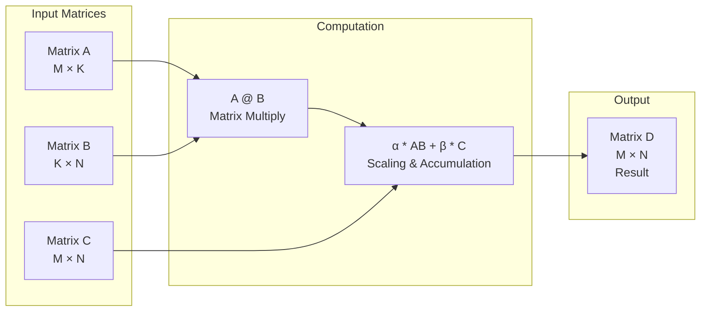
**Sources:** [README.md:8-15](), [python/cutlass_cppgen/op/gemm.py:1-40]()

### StreamK Work Decomposition

**StreamK** (Stream K-splitting) is a dynamic load-balancing scheduler that splits work across CTAs to maximize utilization [README.md:104-108]():

| Concept | Description |
|---------|-------------|
| **SK Block** | Tile split across K-dimension for load balancing |
| **DP Block** | Tile with full K-iteration (Data Parallel) |
| **Reduction** | Combining partial SK results via atomics or separate kernels |

**Sources:** [CHANGELOG.md:35-35]()

---

## Warp Specialization

**Warp specialization** is a programming pattern where different warps within a CTA perform different roles to maximize hardware utilization:

| Role | Responsibility |
|------|----------------|
| **Producer** | Load data from GMEM to SMEM via TMA or Async Copy |
| **Consumer** | Perform matrix multiply-accumulate (MMA) using SMEM data |
| **Task Scheduling** | Framework for static analysis of warp-specialized execution [CHANGELOG.md:12-12]() |

**Sources:** [CHANGELOG.md:12-13](), [CHANGELOG.md:61-61]()

---

## Python DSL Terminology

The CuTe DSL provides Python-native interfaces for writing high-performance CUDA kernels [README.md:28-44]():

| Term | Description |
|------|-------------|
| **@cute.kernel** | Decorator marking device-side kernel functions |
| **@cute.jit** | Decorator marking host-side orchestration functions |
| **Primitives API** | Low-level abstraction for Tensor Core programming through SIMT [CHANGELOG.md:9-11]() |
| **IKET Profiler** | In-Kernel-Event-Tracing for instrumentation-based profiling [CHANGELOG.md:61-61]() |

**Sources:** [README.md:28-44](), [CHANGELOG.md:9-13](), [CHANGELOG.md:61-61]()

---

## Version Information

CUTLASS version is defined programmatically in the header system:

```cpp
// From include/cutlass/version.h
#define CUTLASS_MAJOR 4
#define CUTLASS_MINOR 7
#define CUTLASS_PATCH 0
```
**Sources:** [include/cutlass/version.h:41-43]()

The Python package versions are synchronized with the C++ library:
- `cutlass_cppgen.__version__`: `4.7.0` [python/cutlass_cppgen/__init__.py:136]()
- `pycute`: `4.7.0` [python/setup_pycute.py:39]()
- `cutlass_library`: `4.7.0` [python/setup_library.py:39]()
- `nvidia-cutlass-dsl`: `4.7.0` [python/CuTeDSL/requirements.txt:3]()

---

# Page: Library Organization and Header Structure

# Library Organization and Header Structure

<details>
<summary>Relevant source files</summary>

The following files were used as context for generating this wiki page:

- [CHANGELOG.md](CHANGELOG.md)
- [CMakeLists.txt](CMakeLists.txt)
- [README.md](README.md)
- [include/cute/atom/copy_traits_sm90_im2col.hpp](include/cute/atom/copy_traits_sm90_im2col.hpp)
- [include/cute/atom/copy_traits_sm90_tma.hpp](include/cute/atom/copy_traits_sm90_tma.hpp)
- [include/cutlass/arch/grid_dependency_control.h](include/cutlass/arch/grid_dependency_control.h)
- [include/cutlass/cuda_host_adapter.hpp](include/cutlass/cuda_host_adapter.hpp)
- [include/cutlass/gemm/collective/sm100_mma_warpspecialized_blockwise_scaling.hpp](include/cutlass/gemm/collective/sm100_mma_warpspecialized_blockwise_scaling.hpp)
- [include/cutlass/version.h](include/cutlass/version.h)
- [python/CuTeDSL/cutlass/base_dsl/env_manager.py](python/CuTeDSL/cutlass/base_dsl/env_manager.py)
- [python/CuTeDSL/cutlass/base_dsl/runtime/cuda.py](python/CuTeDSL/cutlass/base_dsl/runtime/cuda.py)
- [python/CuTeDSL/cutlass/cute/__init__.py](python/CuTeDSL/cutlass/cute/__init__.py)
- [python/CuTeDSL/cutlass/cute/arch/nvvm_wrappers.py](python/CuTeDSL/cutlass/cute/arch/nvvm_wrappers.py)
- [python/CuTeDSL/cutlass/cute/core.py](python/CuTeDSL/cutlass/cute/core.py)
- [python/CuTeDSL/cutlass/jax/primitive.py](python/CuTeDSL/cutlass/jax/primitive.py)
- [python/CuTeDSL/requirements-cu13.txt](python/CuTeDSL/requirements-cu13.txt)
- [python/CuTeDSL/requirements.txt](python/CuTeDSL/requirements.txt)
- [python/cutlass_cppgen/__init__.py](python/cutlass_cppgen/__init__.py)
- [python/setup_cutlass.py](python/setup_cutlass.py)
- [python/setup_library.py](python/setup_library.py)
- [python/setup_pycute.py](python/setup_pycute.py)
- [test/unit/CMakeLists.txt](test/unit/CMakeLists.txt)
- [test/unit/conv/device/conv2d_problems.h](test/unit/conv/device/conv2d_problems.h)

</details>


This page documents the directory structure, header file organization, and include path conventions used throughout the CUTLASS repository. It describes how the library is physically organized on disk and how users should include headers in their code.

For information about specific subsystems (GEMM, Convolution, FMHA, etc.), see their respective pages. For information about the Python package structure, see [Python Package Structure and Setup](#9.3). For information about the build system configuration, see [CMake Configuration and Architecture Flags](#9.1).

---

## Directory Structure Overview

CUTLASS follows a modular directory layout that separates public headers, implementation details, tests, tools, and examples:

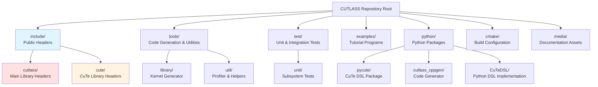

**Sources:** [README.md:8-15](), [python/setup_cutlass.py:52-64](), [python/setup_pycute.py:37-42]()

---

## Include Directory Structure

The `include/` directory contains all public headers for CUTLASS and CuTe. The directory is organized by namespace and subsystem:

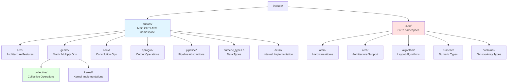

**Sources:** [include/cutlass/gemm/collective/sm100_mma_warpspecialized_blockwise_scaling.hpp:33-49](), [include/cutlass/version.h:37-50](), [include/cute/atom/copy_traits_sm90_tma.hpp:37-46]()

---

## Header Inclusion Patterns

CUTLASS uses consistent header naming and inclusion patterns. Users include headers relative to the `include/` directory:

### Basic Header Inclusion

```cpp
// Main CUTLASS header (core definitions)
#include "cutlass/cutlass.h"

// Core type definitions
#include "cutlass/numeric_types.h"

// Architecture-specific features (e.g., GDC for SM90+)
#include "cutlass/arch/grid_dependency_control.h"

// CuTe core abstractions
#include "cute/tensor.hpp"
#include "cute/atom/mma_atom.hpp"
```

### Architecture-Specific Headers

CUTLASS organizes hardware-specific code by SM architecture. Modern Blackwell (SM100) support is integrated into the collective mainloops:

| Pattern | Architecture | Description |
|---------|--------------|-------------|
| `*_sm70.*` | Volta | First Tensor Core generation [README.md:26-26]() |
| `*_sm80.*` | Ampere | FP64/TF32 Tensor Cores [README.md:26-26]() |
| `*_sm90.*` | Hopper | TMA/WGMMA/Thread Block Clusters [README.md:26-26]() |
| `*_sm100.*` | Blackwell | Enhanced TMA/UMMA and Blockwise Scaling [CHANGELOG.md:69-71]() |

**Sources:** [include/cutlass/arch/grid_dependency_control.h:1-20](), [include/cute/atom/copy_traits_sm90_tma.hpp:45-46](), [CHANGELOG.md:69-71]()

---

## Python Package Organization

With CUTLASS 4.x, the library includes a significant Python infrastructure located in the `python/` directory:

| Package | Purpose |
|---------|---------|
| `pycute` | Python implementation of CuTe layout algebra and tensors. [python/setup_pycute.py:38-41]() |
| `cutlass_library` | Kernel generation scripts and manifests for C++ kernels. [python/setup_library.py:38-41]() |
| `cutlass_cppgen` | High-level Pythonic interface for generating CUTLASS C++ code (Gemm, Conv2d). [python/setup_cutlass.py:53-64]() |
| `CuTeDSL` | The Python-native Domain Specific Language for JIT kernel authoring. [README.md:28-34]() |

**Sources:** [python/setup_cutlass.py:52-74](), [python/setup_pycute.py:36-42](), [python/setup_library.py:36-42](), [python/cutlass_cppgen/__init__.py:139-142]()

---

## Collective and Dispatch Policy Organization

Modern CUTLASS (3.x/4.x) organizes kernel components using "collective" abstractions. A key example is the SM100 mainloop for blockwise scaling:

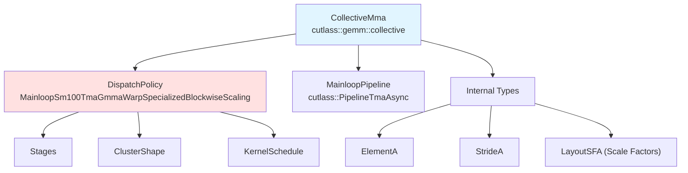

**Sources:** [include/cutlass/gemm/collective/sm100_mma_warpspecialized_blockwise_scaling.hpp:50-100]()

### SM100 Blackwell Enhancements
The Blackwell architecture introduces UMMA and enhanced TMA. Headers for these features include specialized collective mainloops that handle blockwise scaling granularity (e.g., `ScaleGranularityM`, `ScaleGranularityK`).

**Sources:** [include/cutlass/gemm/collective/sm100_mma_warpspecialized_blockwise_scaling.hpp:50-120](), [CHANGELOG.md:69-71]()

---

## Versioning and Compatibility

The library version is defined in `include/cutlass/version.h` and parsed by CMake.

| Macro | Value | Description |
|-------|-------|-------------|
| `CUTLASS_MAJOR` | 4 | Major version [include/cutlass/version.h:41-41]() |
| `CUTLASS_MINOR` | 7 | Minor version [include/cutlass/version.h:42-42]() |
| `CUTLASS_PATCH` | 0 | Patch version [include/cutlass/version.h:43-43]() |
| `CUTLASS_VERSION` | 470 | Integer representation [include/cutlass/version.h:52-52]() |

**Sources:** [include/cutlass/version.h:41-52](), [CMakeLists.txt:46-54]()

### Minimum Requirements
- **Architecture:** Volta (SM70) or higher [README.md:26-26]().
- **Compiler:** C++17 support required [CMakeLists.txt:102-104]().
- **Toolkit:** CUDA 11.4 minimum, CUDA 11.8+ strongly recommended [CMakeLists.txt:86-90]().

---

## CuTe DSL Integration

The CuTe DSL provides a Python-native programming model that maps directly to the C++ abstractions.

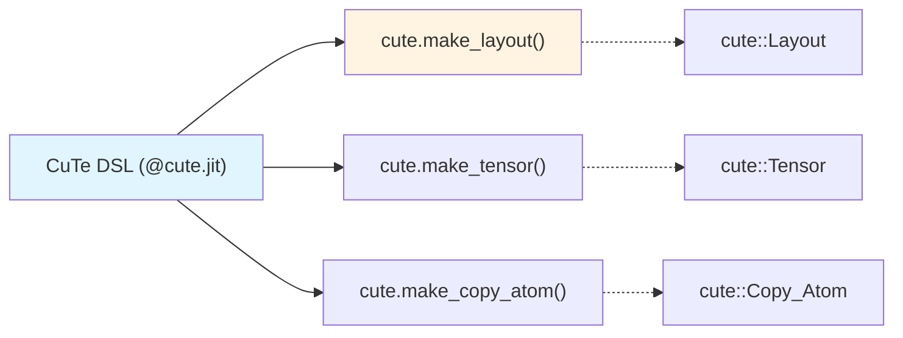

**Sources:** [README.md:28-34](), [python/cutlass_cppgen/__init__.py:138-144](), [python/CuTeDSL/cutlass/cute/core.py:135-140]()

The DSL uses `tvm-ffi` or the `cutlass_cppgen` backend to bridge Python code to executable GPU kernels. The `_NvvmAutoConvertProxy` in `nvvm_wrappers.py` acts as a bridge for lower-level NVVM operations.

**Sources:** [README.md:57-61](), [python/cutlass_cppgen/__init__.py:138-144](), [python/CuTeDSL/cutlass/cute/arch/nvvm_wrappers.py:66-86]()

---

# Page: GPU Architecture Support Matrix

# GPU Architecture Support Matrix

<details>
<summary>Relevant source files</summary>

The following files were used as context for generating this wiki page:

- [CHANGELOG.md](CHANGELOG.md)
- [README.md](README.md)
- [include/cutlass/arch/mma.h](include/cutlass/arch/mma.h)
- [include/cutlass/arch/mma_sm50.h](include/cutlass/arch/mma_sm50.h)
- [include/cutlass/arch/mma_sm60.h](include/cutlass/arch/mma_sm60.h)
- [include/cutlass/arch/mma_sm61.h](include/cutlass/arch/mma_sm61.h)
- [include/cutlass/version.h](include/cutlass/version.h)
- [python/CuTeDSL/cutlass/base_dsl/env_manager.py](python/CuTeDSL/cutlass/base_dsl/env_manager.py)
- [python/CuTeDSL/cutlass/base_dsl/runtime/cuda.py](python/CuTeDSL/cutlass/base_dsl/runtime/cuda.py)
- [python/CuTeDSL/cutlass/cute/__init__.py](python/CuTeDSL/cutlass/cute/__init__.py)
- [python/CuTeDSL/cutlass/cute/arch/nvvm_wrappers.py](python/CuTeDSL/cutlass/cute/arch/nvvm_wrappers.py)
- [python/CuTeDSL/cutlass/cute/core.py](python/CuTeDSL/cutlass/cute/core.py)
- [python/CuTeDSL/cutlass/jax/primitive.py](python/CuTeDSL/cutlass/jax/primitive.py)
- [python/CuTeDSL/requirements-cu13.txt](python/CuTeDSL/requirements-cu13.txt)
- [python/CuTeDSL/requirements.txt](python/CuTeDSL/requirements.txt)
- [python/cutlass_cppgen/__init__.py](python/cutlass_cppgen/__init__.py)
- [python/setup_cutlass.py](python/setup_cutlass.py)
- [python/setup_library.py](python/setup_library.py)
- [python/setup_pycute.py](python/setup_pycute.py)

</details>


This page documents the NVIDIA GPU architectures supported by CUTLASS 4.7.0, providing a comprehensive matrix of compute capabilities, CUDA Toolkit requirements, and architecture-specific features. CUTLASS supports architectures from Volta (2017) through Blackwell (2024-2026), with specialized support for architecture-accelerated instructions on newer hardware.

**Related Pages:**
- Build configuration details: See Build System and CMake Configuration (page 9.1)
- Architecture-specific implementations: See SM90 Hopper Features (7.1), SM100/SM103 Blackwell Datacenter (7.2)
- Kernel selection and dispatch: See GEMM Operations (page 4) and Collective Components (page 5)

---

## Supported GPU Architectures

CUTLASS supports NVIDIA GPUs from Volta (2017) through Blackwell (2024-2026). Minimum compute capability: **7.0** (SM70). Architecture codes map directly to the `CUTLASS_NVCC_ARCHS` CMake variable.

### Architecture Support Matrix

| SM Arch | Compute Cap | CMake Code | Example Products | Min CUDA | Architecture Features | Code Macro |
|---------|-------------|------------|------------------|----------|----------------------|------------|
| **SM70** | 7.0 | `70` | V100, Titan V | 11.4 | Tensor Cores (FP16) | `__CUDA_ARCH__ >= 700` |
| **SM75** | 7.5 | `75` | T4, RTX 20x0 | 11.4 | Tensor Cores (INT8/INT4) | `__CUDA_ARCH__ >= 750` |
| **SM80** | 8.0 | `80` | A100 | 11.4 | Tensor Cores (BF16/TF32), cp.async | `__CUDA_ARCH__ >= 800` |
| **SM89** | 8.9 | `89` | RTX 40x0, L40 | 11.8 | Tensor Cores (FP8) | `__CUDA_ARCH__ >= 890` |
| **SM90** | 9.0 | `90` | H100, H200 | 11.8 | Forward compat only | `__CUDA_ARCH__ >= 900` |
| **SM90a** | 9.0a | `90a` | H100, H200 | 12.0 | TMA, WGMMA, GDC (opt-in) | `__CUDA_ARCH_FEAT_SM90_ALL` |
| **SM100** | 10.0 | `100` | B200 | 12.8 | Forward compat only | `__CUDA_ARCH__ >= 1000` |
| **SM100a** | 10.0a | `100a` | B200 | 12.8 | UMMA, TMEM (256KB), GDC | `__CUDA_ARCH_FEAT_SM100_ALL` |
| **SM103a** | 10.3a | `103a` | B300 (Ultra) | 13.1 | NVFP4 Ultra, Blockscaling | `__CUDA_ARCH__ == 1030` |
| **SM110** | 11.0 | `110` | DRIVE Thor | 13.0 | Forward compat only | `__CUDA_ARCH__ >= 1100` |
| **SM120a** | 12.0a | `120a` | RTX 50x0 | 12.8 | NVFP4, MXFP4/6/8 | `__CUDA_ARCH_FEAT_SM120_ALL` |

**Suffix Meanings:**
- **No suffix** (e.g., `90`): Forward-compatible PTX, limited features.
- **"a" suffix** (e.g., `90a`): Architecture-accelerated, no forward compatibility guarantee.

**Sources:** [README.md:17-26](), [CHANGELOG.md:121-129]()

---

## Architecture Code Hierarchy

Diagram: **CUTLASS Architecture Hierarchy and Instruction Sets**

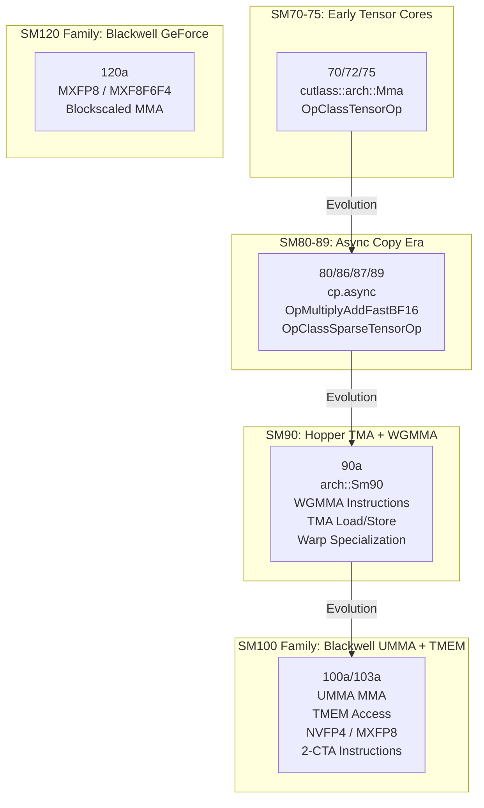

**Key Code Entities by Architecture:**
- **SM70-75**: `cutlass::arch::OpClassSimt`, `cutlass::arch::OpClassTensorOp` [include/cutlass/arch/mma.h:116-121]().
- **SM80-89**: `cutlass::arch::OpMultiplyAddFastBF16`, `cutlass::arch::OpMultiplyAddFastF32` [include/cutlass/arch/mma.h:62-79]().
- **SM90a**: `cutlass::arch::Sm90`, `mma.sync.aligned.m16n8k16.f64` [include/cutlass/arch/mma_sm90.h:182-212]().
- **SM100/120**: `cutlass::arch::OpClassBlockScaledTensorOp`, `MXFP8MMAOP`, `MXF8F6F4MMAOP` [include/cutlass/arch/mma.h:134-137](), [CHANGELOG.md:33-34]().

**Sources:** [include/cutlass/arch/mma.h:52-137](), [include/cutlass/arch/mma_sm90.h:84-212](), [CHANGELOG.md:33-34]()

---

## Architecture-Accelerated vs Regular Compute Capabilities

CUDA 12.0 introduced **architecture-accelerated features** (suffixed with 'a') whose PTX does not have forward compatibility guarantees.

### Key Differences

| Aspect | Regular (e.g., `sm_90`) | Architecture-Accelerated (e.g., `sm_90a`) |
|--------|-------------------------|-------------------------------------------|
| **Forward Compatibility** | PTX is forward compatible | No forward compatibility guarantees |
| **Feature Access** | Limited to standard features | Access to TMA, WGMMA, UMMA, GDC |
| **Use Case** | General deployment | Maximum performance on specific architecture |

**Important:** Kernels compiled for Blackwell SM100 datacenter (`sm_100a`) are **NOT compatible** with RTX 50x0 GPUs (`sm_120a`) despite both being Blackwell architecture.

**Sources:** [CHANGELOG.md:42-50](), [CHANGELOG.md:121-129]()

---

## CUDA Toolkit Version Requirements

CUTLASS 4.7.0 is optimized for **CUDA 13.3 Toolkit**.

| Toolkit Version | Architecture Support / Feature Added |
|-----------------|---------------------------|
| **CUDA 11.4** | Minimum required version for SM70-SM87 |
| **CUDA 11.8** | SM89 (Ada) and SM90 (Hopper forward-compat) |
| **CUDA 12.0** | SM90a (Hopper architecture-accelerated) |
| **CUDA 12.6** | Structured bindings headers in NVRTC [CHANGELOG.md:31-31]() |
| **CUDA 12.8** | SM100a (Blackwell Datacenter) and SM120a (Blackwell GeForce) |
| **CUDA 13.1** | SM103a (Blackwell B300 Ultra) |
| **CUDA 13.3** | Optimal code generation for CUTLASS 4.7 [README.md:80-80]() |

**Sources:** [README.md:80-80](), [CHANGELOG.md:31-31](), [CHANGELOG.md:42-50]()

---

## Architecture-Specific Features

### Feature Evolution and Code Entities

Diagram: **Architecture Features to Code Mapping**

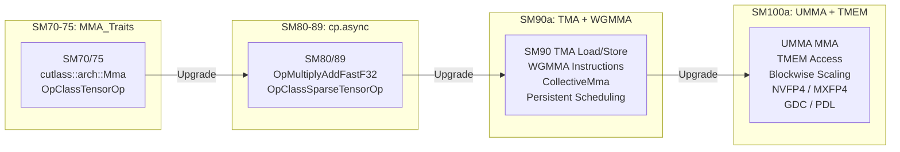

**Code Entity Mapping:**

| Feature | SM Arch | Key Types/Functions | Header File |
|---------|---------|---------------------|-------------|
| **Tensor Cores** | 70+ | `cutlass::arch::Mma` | `cutlass/arch/mma.h` |
| **Fast F32** | 80+ | `cutlass::arch::OpMultiplyAddFastF32` | `cutlass/arch/mma.h` |
| **TMA** | 90+ | `TmaDescriptor`, `cute::copy` | `cute/arch/copy_sm90.hpp` |
| **Block Scaling** | 100+ | `OpClassBlockScaledTensorOp` | `cutlass/arch/mma.h` |
| **GDC / PDL** | 90a+ | `cudaLaunchAttributeProgrammaticEvent` | `CHANGELOG.md:64-64` |
| **FP4 (E2M1)** | 100+ | `NumericArrayConverter`, `_e2m1_to_half_x2` | `CHANGELOG.md:73-74` |

**Sources:** [include/cutlass/arch/mma.h:52-137](), [CHANGELOG.md:32-34](), [CHANGELOG.md:64-64](), [CHANGELOG.md:73-74]()

---

## Versioning and Compatibility

CUTLASS uses a semantic versioning scheme. The current version is **4.7.0**.

### Version Macros
Defined in `include/cutlass/version.h`:
- `CUTLASS_MAJOR`: 4 [include/cutlass/version.h:41]()
- `CUTLASS_MINOR`: 7 [include/cutlass/version.h:42]()
- `CUTLASS_PATCH`: 0 [include/cutlass/version.h:43]()
- `CUTLASS_VERSION`: `(Major * 100 + Minor * 10 + Patch)` [include/cutlass/version.h:52]()

### Python DSL Compatibility
The CuTe DSL in CUTLASS 4.7.0 provides high-level access to hardware features:
- **Architecture Detection:** Handled by `cutlass.GPUArch` and `device_cc()` [python/cutlass_cppgen/__init__.py:123-133]().
- **Blackwell Support:** 2-kernel backward targeting FP8 in FMHA for Blackwell SM103 [CHANGELOG.md:28-30]().
- **Framework Integration:** Native integration with PyTorch and JAX via FFI [CHANGELOG.md:52-52](), [python/setup_cutlass.py:52-74]().
- **NVVM Wrappers:** `_NvvmAutoConvertProxy` allows direct use of `nvvm` operations like `tcgen05_mma_smem_desc` with DSL `Numeric` types [python/CuTeDSL/cutlass/cute/arch/nvvm_wrappers.py:66-86]().

**Sources:** [include/cutlass/version.h:41-52](), [CHANGELOG.md:28-30](), [python/cutlass_cppgen/__init__.py:123-133](), [python/CuTeDSL/cutlass/cute/arch/nvvm_wrappers.py:66-86]()

---

# Page: Version Information and Release Strategy

# Version Information and Release Strategy

<details>
<summary>Relevant source files</summary>

The following files were used as context for generating this wiki page:

- [.gitignore](.gitignore)
- [CHANGELOG.md](CHANGELOG.md)
- [CONTRIBUTORS.md](CONTRIBUTORS.md)
- [README.md](README.md)
- [include/cutlass/gemm/collective/sm90_mma_array_tma_gmma_ss_warpspecialized_fp8.hpp](include/cutlass/gemm/collective/sm90_mma_array_tma_gmma_ss_warpspecialized_fp8.hpp)
- [include/cutlass/version.h](include/cutlass/version.h)
- [python/CuTeDSL/cutlass/base_dsl/env_manager.py](python/CuTeDSL/cutlass/base_dsl/env_manager.py)
- [python/CuTeDSL/cutlass/base_dsl/runtime/cuda.py](python/CuTeDSL/cutlass/base_dsl/runtime/cuda.py)
- [python/CuTeDSL/cutlass/cute/__init__.py](python/CuTeDSL/cutlass/cute/__init__.py)
- [python/CuTeDSL/cutlass/cute/arch/nvvm_wrappers.py](python/CuTeDSL/cutlass/cute/arch/nvvm_wrappers.py)
- [python/CuTeDSL/cutlass/cute/core.py](python/CuTeDSL/cutlass/cute/core.py)
- [python/CuTeDSL/cutlass/jax/primitive.py](python/CuTeDSL/cutlass/jax/primitive.py)
- [python/CuTeDSL/requirements-cu13.txt](python/CuTeDSL/requirements-cu13.txt)
- [python/CuTeDSL/requirements.txt](python/CuTeDSL/requirements.txt)
- [python/cutlass_cppgen/__init__.py](python/cutlass_cppgen/__init__.py)
- [python/cutlass_library/sm90_utils.py](python/cutlass_library/sm90_utils.py)
- [python/setup_cutlass.py](python/setup_cutlass.py)
- [python/setup_library.py](python/setup_library.py)
- [python/setup_pycute.py](python/setup_pycute.py)

</details>


This page documents CUTLASS version numbering conventions, release strategy, and how version information is managed across the C++ library, Python packages, and build system. For information about GPU architecture support and compatibility, see [GPU Architecture Support Matrix](#1.3). For details about library organization and structure, see [Library Organization and Header Structure](#1.2).

## Version Numbering Scheme

CUTLASS follows semantic versioning with the format `MAJOR.MINOR.PATCH[.BUILD]`:

- **MAJOR**: Incremented for significant architectural changes or API-breaking modifications.
- **MINOR**: Incremented for new features and functionality additions.
- **PATCH**: Incremented for bug fixes and minor improvements.
- **BUILD**: Optional build number for development releases.

The version is encoded as an integer using the formula: `CUTLASS_VERSION = (MAJOR * 100) + (MINOR * 10) + PATCH`. For example, version 4.7.0 is encoded as 470.

Sources: [include/cutlass/version.h:41-52](), [README.md:4-6]()

## Current Version: CUTLASS 4.7.0

As of August 2026, the current release is CUTLASS 4.7.0. This version represents a significant milestone in the CUTLASS 4 ecosystem, particularly for the Python DSL:

- **CuTe DSL Primitives API**: Introduced as a transitional lower-level abstraction beneath CuTe, enabling Tensor Core programming through SIMT via thin wrappers over NVVM operations [README.md:49-52](), [CHANGELOG.md:8-11]().
- **Task Scheduling Framework**: Provides static analysis of execution schedules for warp-specialized kernels to detect concurrency issues and visualize resource dependencies [README.md:53](), [CHANGELOG.md:12]().
- **Blackwell FMHA Improvements**: Added a 2-kernel backward implementation targeting FP8 on Blackwell SM103, showing approximately 25% improvement over the 1-kernel variant [README.md:69-71](), [CHANGELOG.md:28-30]().
- **Tooling**: Optimal code generation with CUDA Toolkit 13.3 [README.md:80](), [CHANGELOG.md:39]().

The version is consistent across all components:

| Component | Version | Location |
|-----------|---------|----------|
| C++ Library | 4.7.0 | [include/cutlass/version.h:41-43]() |
| pycute Package | 4.7.0 | [python/setup_pycute.py:39]() |
| cutlass_library Package | 4.7.0 | [python/setup_library.py:39]() |
| cutlass_cppgen Package | 4.7.0 | [python/setup_cutlass.py:54]() |
| nvidia-cutlass-dsl | 4.7.0 | [python/CuTeDSL/requirements.txt:3]() |

Sources: [README.md:4-6](), [include/cutlass/version.h:41-43](), [python/setup_pycute.py:39](), [python/setup_library.py:39](), [python/setup_cutlass.py:54]()

## Major Version Evolution

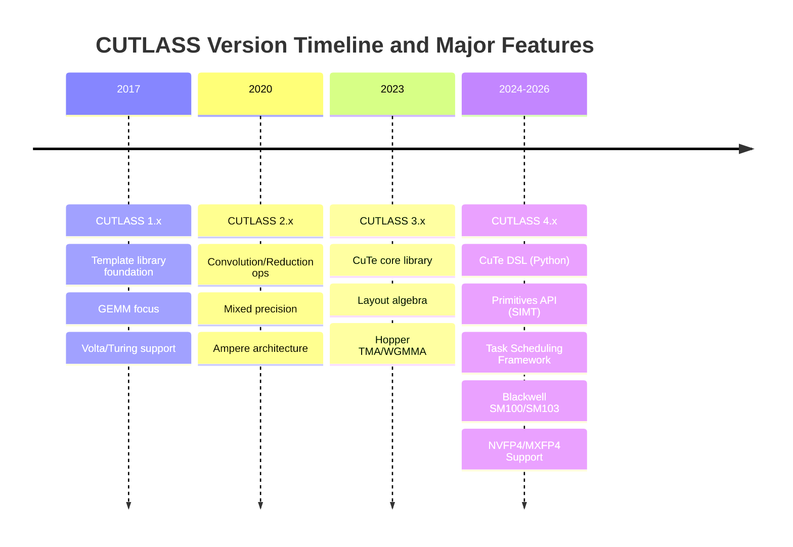

### CUTLASS 1.x & 2.x: Foundation and Expansion (2017-2022)

CUTLASS 1.x and 2.x established the C++ template library foundation for high-performance linear algebra, supporting architectures from Volta through Ampere. These versions introduced primitives for mixed-precision computations (FP64, FP32, TF32, FP16, BF16, INT8, INT4) and specialized data movement like async copies [README.md:17-26]().

### CUTLASS 3.x: CuTe Transformation (2023)

CUTLASS 3.0 introduced **CuTe**, a core library to describe and manipulate tensors of threads and data using hierarchical multidimensional layouts. This replaced ad-hoc indexing with an algebraic system, enabling efficient support for Hopper (SM90) features like TMA and WGMMA.

### CUTLASS 4.x: Python DSL and Blackwell (2024-2026)

CUTLASS 4 adds **CUTLASS DSLs**, specifically the **CuTe DSL**. This allows for metaprogramming that does not require deep C++ expertise while maintaining peak performance [README.md:28-30]().
- **CuTe DSL Primitives**: A thin wrapper over `NVVM` operations to use where CuTe abstractions might reduce development velocity [CHANGELOG.md:9]().
- **Blackwell Support**: Performance utilization of peak theoretical throughput on Blackwell SM100 [README.md:89-94]().
- **Mixed Precision**: Support for NVIDIA NVFP4 and OCP standard MXFP4, MXFP6, and MXFP8 block scaled data types [README.md:23]().
- **Task Scheduling**: Static analysis for warp-specialized kernels to detect hazards and visualize dependencies [README.md:53]().

Sources: [README.md:28-57](), [CHANGELOG.md:3-85]()

## Version Information in Code

### C++ Version Macros

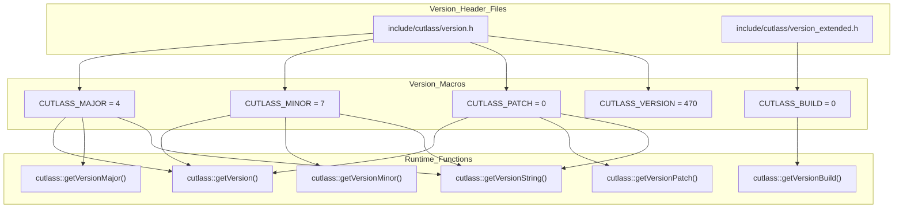

The C++ library defines version information through preprocessor macros and inline functions:

**Compile-Time Macros:**
- `CUTLASS_MAJOR`, `CUTLASS_MINOR`, `CUTLASS_PATCH`: Core version components [include/cutlass/version.h:41-43]().
- `CUTLASS_VERSION`: Combined version integer [include/cutlass/version.h:52]().
- `CUTLASS_BUILD`: Build number, defaults to 0 unless `CUTLASS_VERSIONS_GENERATED` is defined [include/cutlass/version.h:45-50]().

**Runtime Functions:**
- `cutlass::getVersion()`: Returns integer-encoded version [include/cutlass/version.h:56-58]().
- `cutlass::getVersionString()`: Returns a string representation of the version [include/cutlass/version.h:73-79]().

### Python Package Versions

All Python packages maintain synchronized version numbers:

```python
# pycute package
name='pycute',
version='4.7.0' # [python/setup_pycute.py:39]
```

```python
# cutlass_library package
name='cutlass_library',
version='4.7.0' # [python/setup_library.py:39]
```

```python
# cutlass_cppgen package
name='cutlass_cppgen',
version='4.7.0' # [python/setup_cutlass.py:54]
```

The `cutlass_cppgen` package also exposes versioning through its `__init__.py`:
```python
this.__version__ = '4.7.0' # [python/cutlass_cppgen/__init__.py:136]
```

Sources: [python/setup_pycute.py:39](), [python/setup_library.py:39](), [python/setup_cutlass.py:54](), [python/cutlass_cppgen/__init__.py:136]()

## Release Components and Artifacts

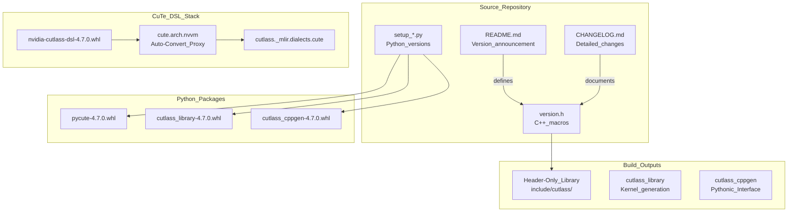

### C++ Library (Header-Only)
The core CUTLASS library remains header-only. Version information is compiled into user code via macros in `include/cutlass/version.h`.

### Python Packages
Three primary Python packages are released:
1. `pycute`: Python implementation of CuTe [python/setup_pycute.py:40]().
2. `cutlass_library`: Generation scripts and manifest management [python/setup_library.py:40]().
3. `cutlass_cppgen`: The "Pythonic Interface" for kernel generation [python/setup_cutlass.py:55]().

### CuTe DSL Stack
The `nvidia-cutlass-dsl` package provides the high-performance Python programming model. It utilizes a `_NvvmAutoConvertProxy` to wrap raw MLIR NVVM operations, allowing users to pass `Numeric` DSL objects directly to hardware-level instructions [python/CuTeDSL/cutlass/cute/arch/nvvm_wrappers.py:66-86]().

## CHANGELOG Organization

The `CHANGELOG.md` documents changes by major version and release date.

**Recent Release Structure:**
- **4.7.0 (2026-08-04)**: Introduction of Primitives API, Task Scheduling framework, and Blackwell FMHA 2-kernel backward [CHANGELOG.md:5-40]().
- **4.6.1 (2026-07-13)**: Bug fixes for Flash Attention v2 on Ampere and Jax FFI registration [CHANGELOG.md:41-53]().
- **4.6.0 (2026-07-01)**: `cute.compile_to` API, IKET (In-Kernel-Event-Tracing) profiler, and SASS dumping support [CHANGELOG.md:54-72]().

Sources: [CHANGELOG.md:1-85]()

## Compatibility Requirements

### System Requirements
- **Architecture**: Volta (SM70) through Blackwell (SM100) [README.md:26]().
- **CUDA Toolkit**: Performs best with **CUDA 13.3** for optimal code generation [README.md:80](), [CHANGELOG.md:39]().
- **Windows Support**: Note that CUTLASS 4.x builds are currently down on Windows platforms for all CUDA toolkits [README.md:82-83]().

### Python Requirements
- **Python**: 3.9+ for RMM support [python/cutlass_cppgen/__init__.py:101]().
- **cuda-python**: Required version `>= 11.8.0` [python/setup_cutlass.py:68]().
- **Package Versions**: Must ensure `cuda-python` version is greater than or equal to the installed `NVCC` version [python/cutlass_cppgen/__init__.py:166-175]().

## Version Query at Runtime

### C++ Runtime Query
```cpp
#include <cutlass/version.h>
// Returns 470
uint32_t version = cutlass::getVersion(); 
// Returns string representation (e.g. "4.7.0")
std::string ver_str = cutlass::getVersionString(); 
```
Sources: [include/cutlass/version.h:56-79]()

### Python Runtime Query
```python
import cutlass_cppgen
# Returns '4.7.0'
print(cutlass_cppgen.__version__)

# Returns NVCC version string (e.g. "13.3")
print(cutlass_cppgen.nvcc_version())
```
Sources: [python/cutlass_cppgen/__init__.py:60-70, 136]()

---

# Page: CuTe Core Abstractions

# CuTe Core Abstractions

<details>
<summary>Relevant source files</summary>

The following files were used as context for generating this wiki page:

- [include/cute/container/tuple.hpp](include/cute/container/tuple.hpp)
- [include/cute/layout.hpp](include/cute/layout.hpp)
- [include/cute/numeric/arithmetic_tuple.hpp](include/cute/numeric/arithmetic_tuple.hpp)
- [include/cute/tensor_impl.hpp](include/cute/tensor_impl.hpp)
- [include/cutlass/detail/helper_macros.hpp](include/cutlass/detail/helper_macros.hpp)
- [include/cutlass/epilogue/collective/sm90_epilogue_tma_warpspecialized.hpp](include/cutlass/epilogue/collective/sm90_epilogue_tma_warpspecialized.hpp)
- [include/cutlass/functional.h](include/cutlass/functional.h)
- [include/cutlass/gemm/collective/sm120_blockscaled_sparse_mma_tma.hpp](include/cutlass/gemm/collective/sm120_blockscaled_sparse_mma_tma.hpp)
- [include/cutlass/wmma_array.h](include/cutlass/wmma_array.h)
- [media/docs/cpp/cute/02_layout_algebra.md](media/docs/cpp/cute/02_layout_algebra.md)
- [media/docs/cpp/cute/03_tensor.md](media/docs/cpp/cute/03_tensor.md)
- [media/docs/cpp/cute/0t_mma_atom.md](media/docs/cpp/cute/0t_mma_atom.md)
- [media/docs/cpp/cute/0x_gemm_tutorial.md](media/docs/cpp/cute/0x_gemm_tutorial.md)
- [test/unit/core/functional.cu](test/unit/core/functional.cu)
- [test/unit/layout/tensor.cu](test/unit/layout/tensor.cu)
- [test/unit/layout/tensor_nhwc.cu](test/unit/layout/tensor_nhwc.cu)

</details>


## Purpose and Scope

This page provides a deep dive into CuTe (CUDA Templates), the foundational abstraction layer that forms the basis of CUTLASS 3.x, 4.x, and beyond. CuTe defines three core abstractions—**Layout**, **Tensor**, and **Atoms**—that compose to create portable, efficient GPU kernels across architectures from Volta (SM70) through Blackwell (SM100).

CuTe's central innovation is treating layouts as mathematical functions from integers to integers, enabling compile-time reasoning about data access patterns, automatic vectorization, and provable correctness guarantees. This page explains how these abstractions work together and their implementation in the CUTLASS codebase.

For detailed information on specific components, see child pages:
- [Layout Algebra](#2.1) — Explain the layout algebra system: Shape, Stride, coalesce, composition, complement, logical_divide, and logical_product operations with examples
- [Tensor Container and Operations](#2.2) — Document the Tensor abstraction, Engine types (ArrayEngine, ViewEngine), memory tagging, make_tensor, and tensor manipulation operations
- [MMA Atoms and TiledMMA](#2.3) — Explain MMA_Atom, MMA_Traits, TiledMMA, ThrMMA abstractions and how they map to hardware matrix multiply-accumulate operations
- [Copy Atoms and TMA Operations](#2.4) — Document Copy_Traits, TMA load/store operations, im2col transformations, asynchronous data movement, and tensor map encoding

Sources: [media/docs/cpp/cute/02_layout_algebra.md:1-11](), [media/docs/cpp/cute/03_tensor.md:1-11](), [media/docs/cpp/cute/0t_mma_atom.md:1-24](), [include/cute/layout.hpp:31-41](), [include/cute/tensor_impl.hpp:31-40]()

## CuTe Philosophy: Layouts as Mathematical Functions

CuTe's foundational principle is that **layouts are functions from integers to integers**. A layout `L : ℕ → ℕ` maps logical coordinates to storage offsets. This mathematical abstraction enables:

- **Compile-time composition**: Layout operations compose like mathematical functions.
- **Zero-cost abstractions**: Static layouts compile to direct offset calculations.
- **Correctness proofs**: Layout algebra satisfies mathematical postconditions.
- **Architecture independence**: Same layout code works across GPU generations.

Title: CuTe Core Abstractions Architecture
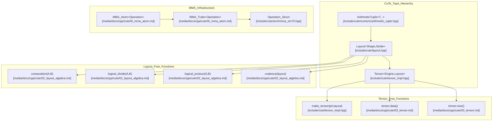

Sources: [media/docs/cpp/cute/02_layout_algebra.md:15-19](), [media/docs/cpp/cute/03_tensor.md:3-11](), [include/cute/numeric/arithmetic_tuple.hpp:44-54](), [include/cute/layout.hpp:98-101]()

## Three-Layer Abstraction System

CuTe's three layers enable progressive refinement from mathematical abstractions to hardware instructions.

### Layer 1: Layout Algebra

A `Layout` is defined by two components that together specify a function from coordinates to offsets:
- **Shape**: Tuple of integers defining logical dimensions (domain of the function).
- **Stride**: Tuple of integers defining storage pattern (how coordinates map to offsets).

The `Layout` class is defined in `include/cute/layout.hpp` and uses the template signature:
`Layout<Shape, Stride>` [include/cute/layout.hpp:98-101]()

**Core Layout Operations**:

| Function | Signature | Postcondition |
|----------|-----------|---------------|
| `coalesce` | `coalesce(Layout A)` | `size(result) == size(A)`, simplifies hierarchy [media/docs/cpp/cute/02_layout_algebra.md:21-25]() |
| `composition` | `composition(A, B)` | `result(i) == A(B(i))` [media/docs/cpp/cute/02_layout_algebra.md:120-123]() |
| `logical_divide` | `logical_divide(A, B)` | Splits layout `A` according to `B` [media/docs/cpp/cute/02_layout_algebra.md:6-7]() |
| `logical_product` | `logical_product(A, B)` | Reproduces layout `A` according to `B` [media/docs/cpp/cute/02_layout_algebra.md:6-7]() |

For details, see [Layout Algebra](#2.1).

Sources: [media/docs/cpp/cute/02_layout_algebra.md:1-12](), [include/cute/layout.hpp:47-60]()

### Layer 2: Tensor Container

The `Tensor` class (defined in `include/cute/tensor_impl.hpp`) combines a `Layout` with an `Engine` to create a multidimensional array:
`Tensor<Engine, Layout>` [include/cute/tensor_impl.hpp:135-137]()

The `Engine` is a wrapper around an iterator or array providing access to data.

**Engine Type Hierarchy**:

| Engine Type | Ownership | Typical Use |
|-------------|-----------|-------------|
| `ArrayEngine<T,N>` | Owning | Register or Shared memory allocations [include/cute/tensor_impl.hpp:70-71]() |
| `ViewEngine<Iter>` | Non-owning | Views of Global/Shared memory [include/cute/tensor_impl.hpp:106-107]() |
| `ConstViewEngine<Iter>` | Non-owning | Read-only views [include/cute/tensor_impl.hpp:119-120]() |

For details, see [Tensor Container and Operations](#2.2).

Sources: [media/docs/cpp/cute/03_tensor.md:41-55](), [include/cute/tensor_impl.hpp:59-68]()

### Layer 3: Atoms and Tiled Operations

Atoms decouple PTX instruction usage from logical operation semantics by pairing an `Operation` struct with a `Traits` specialization.

**MMA Atom Structure**:
`MMA_Atom<Operation>` where `MMA_Traits<Operation>` is specialized to define logical shapes and layouts [media/docs/cpp/cute/0t_mma_atom.md:26-31]().

**Operation Struct Example**:
The `SM70_8x8x4_F32F16F16F32_NT` struct encodes the PTX instruction for Volta 8x8x4 MMA, defining `DRegisters`, `ARegisters`, etc. [media/docs/cpp/cute/0t_mma_atom.md:85-115]().

Title: MMA Atom to Hardware Mapping
```mermaid
graph LR
    subgraph "CuTe_Code_Entity_Space"
        Atom["MMA_Atom&lt;Op&gt;<br/>[media/docs/cpp/0t_mma_atom.md]"]
        Traits["MMA_Traits&lt;Op&gt;<br/>[include/cute/atom/mma_traits_sm70.hpp]"]
        Op["Operation_Struct<br/>[include/cute/arch/mma_sm70.hpp]"]
        fma["fma(...)<br/>Static Member Function"]
    end

    subgraph "Hardware_PTX_Space"
        PTX["mma.sync.aligned.m8n8k4<br/>PTX Instruction"]
        DRegs["DRegisters<br/>float[8]"]
        ARegs["ARegisters<br/>uint32_t[2]"]
    end

    Atom --> Traits
    Traits --> Op
    Op --> fma
    fma --> PTX
    Op -.-> DRegs
    Op -.-> ARegs
```

For details on MMA, see [MMA Atoms and TiledMMA](#2.3). For Copy/TMA, see [Copy Atoms and TMA Operations](#2.4).

Sources: [media/docs/cpp/cute/0t_mma_atom.md:26-50](), [media/docs/cpp/cute/0t_mma_atom.md:111-122](), [media/docs/cpp/cute/0t_mma_atom.md:153-174]()

## Integration with CUTLASS Operations

CuTe abstractions form the implementation layer for CUTLASS 3.x+ kernels. Tutorials demonstrate how these abstractions compose to form full kernels.

**Key Integration Points**:

| CUTLASS Component | CuTe Usage | Reference |
|-------------------|------------|-----------|
| `ProblemShape` | Pack M, N, K into `IntTuple` | [media/docs/cpp/cute/0x_gemm_tutorial.md:59-60]() |
| `make_tensor` | Create GMEM views from raw pointers | [media/docs/cpp/cute/0x_gemm_tutorial.md:72-74]() |
| `CtaTiler` | Shape-based tiling of problem tensors | [media/docs/cpp/cute/0x_gemm_tutorial.md:126-127]() |
| `CollectiveMma` | Orchestrates mainloop using CuTe Tensors | [include/cutlass/gemm/collective/sm120_blockscaled_sparse_mma_tma.hpp:79-94]() |

Sources: [media/docs/cpp/cute/0x_gemm_tutorial.md:1-127](), [include/cutlass/gemm/collective/sm120_blockscaled_sparse_mma_tma.hpp:59-78]()

---

# Page: Layout Algebra

# Layout Algebra

<details>
<summary>Relevant source files</summary>

The following files were used as context for generating this wiki page:

- [examples/55_hopper_mixed_dtype_gemm/CMakeLists.txt](examples/55_hopper_mixed_dtype_gemm/CMakeLists.txt)
- [include/cute/algorithm/axpby.hpp](include/cute/algorithm/axpby.hpp)
- [include/cute/algorithm/tuple_algorithms.hpp](include/cute/algorithm/tuple_algorithms.hpp)
- [include/cute/container/tuple.hpp](include/cute/container/tuple.hpp)
- [include/cute/layout.hpp](include/cute/layout.hpp)
- [include/cute/numeric/arithmetic_tuple.hpp](include/cute/numeric/arithmetic_tuple.hpp)
- [include/cute/tensor_impl.hpp](include/cute/tensor_impl.hpp)
- [include/cutlass/detail/helper_macros.hpp](include/cutlass/detail/helper_macros.hpp)
- [include/cutlass/detail/layout.hpp](include/cutlass/detail/layout.hpp)
- [include/cutlass/epilogue/collective/sm90_epilogue_tma_warpspecialized.hpp](include/cutlass/epilogue/collective/sm90_epilogue_tma_warpspecialized.hpp)
- [include/cutlass/functional.h](include/cutlass/functional.h)
- [include/cutlass/gemm/collective/sm120_blockscaled_sparse_mma_tma.hpp](include/cutlass/gemm/collective/sm120_blockscaled_sparse_mma_tma.hpp)
- [include/cutlass/gemm/gemm.h](include/cutlass/gemm/gemm.h)
- [include/cutlass/wmma_array.h](include/cutlass/wmma_array.h)
- [media/docs/cpp/cute/02_layout_algebra.md](media/docs/cpp/cute/02_layout_algebra.md)
- [media/docs/cpp/cute/03_tensor.md](media/docs/cpp/cute/03_tensor.md)
- [media/docs/cpp/cute/0t_mma_atom.md](media/docs/cpp/cute/0t_mma_atom.md)
- [media/docs/cpp/cute/0x_gemm_tutorial.md](media/docs/cpp/cute/0x_gemm_tutorial.md)
- [test/unit/core/functional.cu](test/unit/core/functional.cu)
- [test/unit/layout/tensor.cu](test/unit/layout/tensor.cu)
- [test/unit/layout/tensor_nhwc.cu](test/unit/layout/tensor_nhwc.cu)
- [tools/util/include/cutlass/util/packed_stride.hpp](tools/util/include/cutlass/util/packed_stride.hpp)

</details>


## Overview

A `Layout` is CuTe's fundamental abstraction for describing data organization. The core principle is:

> **Layouts are functions from integers to integers.**

This function maps logical coordinates (how you think about data) to memory offsets (where data actually lives). The `Layout` class in [include/cute/layout.hpp:98-101]() implements this as a combination of a `Shape` and a `Stride`.

```cpp
template <class Shape, class Stride = LayoutLeft::Apply<Shape>>
struct Layout : private cute::tuple<Shape, Stride> {
  // Function application: coordinate -> offset
  template <class Coord>
  CUTE_HOST_DEVICE constexpr
  auto operator()(Coord const& coord) const;
};
```

### Shape and Stride

A `Layout` is constructed from two hierarchical tuples:

- **Shape**: The domain of the function. Defines the logical extent in each dimension. A shape `(M,N)` means coordinates range from `(0,0)` to `(M-1,N-1)`. [media/docs/cpp/cute/02_layout_algebra.md:15-18]()
- **Stride**: How the function maps coordinates to offsets. For coordinate `(i,j)` and stride `(d0,d1)`, the offset is `i*d0 + j*d1`. [media/docs/cpp/cute/02_layout_algebra.md:43-48]()

Both `Shape` and `Stride` can be:
- **Static integers**: `Int<N>` known at compile time. [include/cute/layout.hpp:48-51]()
- **Dynamic integers**: Runtime values.
- **Nested tuples**: Hierarchical modes like `Shape<_2, Shape<_1, _6>>`. [media/docs/cpp/cute/02_layout_algebra.md:31-32]()

Example from [media/docs/cpp/cute/02_layout_algebra.md:83-103]():

```cpp
// 2D layout: 6x2 matrix
Layout A = make_layout(make_shape(6, 2),        // Shape:  (6,2)
                       make_stride(8, 2));       // Stride: (8,2)

// Evaluation: A(3,1) = 3*8 + 1*2 = 26
```

### The Algebra Operations

The Layout algebra supports combining and transforming these functions:

| Operation | Function | Purpose |
|-----------|----------|---------|
| Simplification | `coalesce` | Reduce modes without changing mapping |
| Composition | `composition` | Chain two layouts as functions |
| Complement | `complement` | Find "rest" elements not in layout |
| Division | `logical_divide` | Split layout into tile and remainder |
| Product | `logical_product` | Replicate layout pattern |

Sources: [include/cute/layout.hpp:98-217](), [media/docs/cpp/cute/02_layout_algebra.md:1-20]()

---

## Fundamental Operations

The layout algebra builds a hierarchy of operations, where primitive operations serve as building blocks for high-level tiling and partitioning.

```mermaid
graph TD
    LayoutClass["Layout&lt;Shape,Stride&gt;<br/>include/cute/layout.hpp"]
    
    PrimitiveOps["Primitive Operations"]
    CoalesceFunc["coalesce(Layout)<br/>media/docs/cpp/cute/02_layout_algebra.md"]
    CompositionFunc["composition(LayoutA, LayoutB)<br/>include/cute/layout.hpp"]
    ComplementFunc["complement(Layout, Size)<br/>media/docs/cpp/cute/02_layout_algebra.md"]
    
    CompositeOps["Composite Operations"]
    LogicalDivideFunc["logical_divide(Layout, Tiler)<br/>media/docs/cpp/cute/02_layout_algebra.md"]
    LogicalProductFunc["logical_product(Layout, Tiler)<br/>media/docs/cpp/cute/02_layout_algebra.md"]
    
    DivideVariants["Division Variants"]
    TiledDivideFunc["tiled_divide()"]
    
    LayoutClass --> PrimitiveOps
    PrimitiveOps --> CoalesceFunc
    PrimitiveOps --> CompositionFunc
    PrimitiveOps --> ComplementFunc
    
    CompositionFunc --> CompositeOps
    ComplementFunc --> CompositeOps
    
    CompositeOps --> LogicalDivideFunc
    CompositeOps --> LogicalProductFunc
    
    LogicalDivideFunc --> DivideVariants
    DivideVariants --> TiledDivideFunc
```

**Diagram: Layout Algebra Operation Hierarchy**

Sources: [media/docs/cpp/cute/02_layout_algebra.md:1-15](), [include/cute/layout.hpp:186-234]()

---

## Coalesce

The `coalesce` operation simplifies a layout by reducing its number of modes while preserving it as a mathematical function. [media/docs/cpp/cute/02_layout_algebra.md:13-18]()

### Function Signature

The postconditions guarantee functional equivalence: [media/docs/cpp/cute/02_layout_algebra.md:21-26]()

```cpp
// @post size(@a result) == size(@a layout)
// @post depth(@a result) <= 1
// @post for all i, 0 <= i < size(@a layout), @a result(i) == @a layout(i)
Layout coalesce(Layout const& layout)
```

### Coalescing Rules

The implementation applies binary transformation rules to adjacent integral modes `s0:d0` and `s1:d1`: [media/docs/cpp/cute/02_layout_algebra.md:43-48]()

| Case | Pattern | Result | Description |
|------|---------|--------|-------------|
| 1 | `s0:d0 ++ _1:d1` | `s0:d0` | Ignore static-1 size modes |
| 2 | `_1:d0 ++ s1:d1` | `s1:d1` | Ignore static-1 size modes |
| 3 | `s0:d0 ++ s1:(s0*d0)` | `(s0*s1):d0` | Merge contiguous modes |
| 4 | `s0:d0 ++ s1:d1` | `(s0,s1):(d0,d1)` | Cannot merge |

Example: [media/docs/cpp/cute/02_layout_algebra.md:31-34]()
```cpp
auto layout = Layout<Shape <_2,Shape <_1,_6>>,
                     Stride<_1,Stride<_6,_2>>>{};
auto result = coalesce(layout);  // Result: _12:_1
```

### By-mode Coalesce
An overload exists to coalesce specific sublayouts while maintaining a target profile (e.g., keeping a layout 2-D). [media/docs/cpp/cute/02_layout_algebra.md:58-60]()

```cpp
Layout coalesce(Layout const& layout, IntTuple const& trg_profile)
```

Sources: [media/docs/cpp/cute/02_layout_algebra.md:13-75]()

---

## Composition

Functional composition `A ∘ B` creates a new layout where `R(c) = A(B(c))`. [media/docs/cpp/cute/02_layout_algebra.md:79-85]()

```mermaid
graph LR
    Input["coord c"]
    LayoutB["LayoutB(c)"]
    LayoutA["LayoutA(offset)"]
    Output["result offset"]
    
    Input --> LayoutB
    LayoutB --> LayoutA
    LayoutA --> Output
    
    B_Entity["B Defines Domain"]
    Output -.-> B_Entity
```

**Diagram: composition(layout_a, layout_b) Data Flow**

### Post-Conditions

```cpp
// @post compatible(@a layout_b, @a result)
// @post for all i, 0 <= i < size(@a layout_b), 
//       @a result(i) == @a layout_a(@a layout_b(i))
Layout composition(LayoutA const& layout_a, LayoutB const& layout_b)
```
[media/docs/cpp/cute/02_layout_algebra.md:120-124]()

### Computing Composition

Composition is computed by distributing over sublayouts. For integral `B = s:d`, it determines a layout that produces every `d`-th element of `A` and keeps the first `s` elements. This often involves "dividing out" elements from the shape of `A`. [media/docs/cpp/cute/02_layout_algebra.md:132-148]()

Sources: [media/docs/cpp/cute/02_layout_algebra.md:77-336](), [include/cute/layout.hpp:189-194]()

---

## Complement

The `complement` operation finds a layout representing elements NOT touched by the input layout, effectively describing "the rest" or "layout of repetitions." [media/docs/cpp/cute/02_layout_algebra.md:338-341]()

```mermaid
graph TB
    LayoutA["layout_a"]
    Cotarget["cotarget"]
    
    Complement["complement(layout_a, cotarget)"]
    
    Result["result"]
    
    LayoutA --> Complement
    Cotarget --> Complement
    Complement --> Result
```

**Diagram: complement() Operation**

### Properties

1. **Bounded Size**: The complement completes the codomain up to `size(cotarget)`. [media/docs/cpp/cute/02_layout_algebra.md:354-358]()
2. **Ordered**: Strides are positive and increasing. [media/docs/cpp/cute/02_layout_algebra.md:347-350]()
3. **Disjoint**: No overlap between `A` and its complement. [media/docs/cpp/cute/02_layout_algebra.md:350-352]()

Sources: [media/docs/cpp/cute/02_layout_algebra.md:338-380]()

---

## Division (Tiling)

Division operations split a layout into tile and rest components. [media/docs/cpp/cute/02_layout_algebra.md:381-385]()

### Logical Divide

$$A \oslash B := A \circ (B, \text{complement}(B, \text{size}(A)))$$
[media/docs/cpp/cute/02_layout_algebra.md:387-390]()

Result structure:
- **Mode 0**: Elements in the tile.
- **Mode 1**: Elements in the rest.

### Usage Pattern: local_tile

The `local_tile` function partitions global tensors across thread blocks. [media/docs/cpp/cute/0x_gemm_tutorial.md:129-132]()

```cpp
// Example from sgemm_1.cu
auto cta_tiler = make_shape(Int<128>{}, Int<128>{}, Int<8>{});
auto cta_coord = make_coord(blockIdx.x, blockIdx.y, _);
Tensor gA = local_tile(mA, cta_tiler, cta_coord, Step<_1, X, _1>{}); 
```
[media/docs/cpp/cute/0x_gemm_tutorial.md:118-127]()

Sources: [media/docs/cpp/cute/02_layout_algebra.md:381-481](), [media/docs/cpp/cute/0x_gemm_tutorial.md:116-132]()

---

## Product (Tiling)

Product operations replicate a layout pattern according to another layout. [media/docs/cpp/cute/02_layout_algebra.md:482-486]()

### Logical Product

$$A \otimes B := (A, \text{complement}(A, \text{size}(A) \cdot \text{cosize}(B)) \circ B)$$
[media/docs/cpp/cute/02_layout_algebra.md:488-491]()

### Blocked vs. Raked Products

- **blocked_product**: Results in contiguous blocks. [media/docs/cpp/cute/02_layout_algebra.md:545-555]()
- **raked_product**: Results in interleaved (cyclical) distribution. [media/docs/cpp/cute/02_layout_algebra.md:557-569]()

Sources: [media/docs/cpp/cute/02_layout_algebra.md:482-583]()

---

## Code Entity Reference

### Mapping to Natural Language Space

```mermaid
classDiagram
    class Layout {
        +Shape shape()
        +Stride stride()
        +operator(Coord) offset
    }
    class Shape {
        <<Tuple>>
        Logical dimensions
    }
    class Stride {
        <<Tuple>>
        Memory step per dimension
    }
    class AlgebraFunctions {
        +coalesce() Simplify
        +composition() Chain
        +complement() Find Gaps
        +logical_divide() Tile
        +logical_product() Repeat
    }
    Layout *-- Shape
    Layout *-- Stride
    AlgebraFunctions ..> Layout : Manipulates
```
**Diagram: Layout Algebra Code Entities**

### Key Classes and Functions

| Entity | Source | Role |
|--------|--------|------|
| `Layout` | [include/cute/layout.hpp:99]() | Core mapping class |
| `coalesce` | [media/docs/cpp/cute/02_layout_algebra.md:25]() | Mode simplification |
| `composition` | [media/docs/cpp/cute/02_layout_algebra.md:123]() | Functional chaining |
| `complement` | [media/docs/cpp/cute/02_layout_algebra.md:344]() | Gap filling |
| `logical_divide` | [media/docs/cpp/cute/02_layout_algebra.md:387]() | Tiling logic |
| `local_tile` | [media/docs/cpp/cute/0x_gemm_tutorial.md:129]() | Tensor partitioning |
| `Tensor` | [media/docs/cpp/cute/03_tensor.md:7]() | Container deploying Layouts |
| `ArithmeticTuple` | [include/cute/numeric/arithmetic_tuple.hpp:45]() | Support for tuple arithmetic in coordinates |

Sources: [media/docs/cpp/cute/02_layout_algebra.md](), [media/docs/cpp/cute/03_tensor.md](), [media/docs/cpp/cute/0x_gemm_tutorial.md](), [include/cute/layout.hpp](), [include/cute/numeric/arithmetic_tuple.hpp]()

---

# Page: Tensor Container and Operations

# Tensor Container and Operations

<details>
<summary>Relevant source files</summary>

The following files were used as context for generating this wiki page:

- [include/cute/algorithm/copy.hpp](include/cute/algorithm/copy.hpp)
- [include/cute/arch/copy.hpp](include/cute/arch/copy.hpp)
- [include/cute/atom/copy_atom.hpp](include/cute/atom/copy_atom.hpp)
- [include/cute/atom/copy_traits.hpp](include/cute/atom/copy_traits.hpp)
- [include/cute/container/tuple.hpp](include/cute/container/tuple.hpp)
- [include/cute/layout.hpp](include/cute/layout.hpp)
- [include/cute/numeric/arithmetic_tuple.hpp](include/cute/numeric/arithmetic_tuple.hpp)
- [include/cute/swizzle_layout.hpp](include/cute/swizzle_layout.hpp)
- [include/cute/tensor.hpp](include/cute/tensor.hpp)
- [include/cute/tensor_impl.hpp](include/cute/tensor_impl.hpp)
- [include/cutlass/detail/helper_macros.hpp](include/cutlass/detail/helper_macros.hpp)
- [include/cutlass/epilogue/collective/sm90_epilogue_tma_warpspecialized.hpp](include/cutlass/epilogue/collective/sm90_epilogue_tma_warpspecialized.hpp)
- [include/cutlass/functional.h](include/cutlass/functional.h)
- [include/cutlass/gemm/collective/sm120_blockscaled_sparse_mma_tma.hpp](include/cutlass/gemm/collective/sm120_blockscaled_sparse_mma_tma.hpp)
- [include/cutlass/wmma_array.h](include/cutlass/wmma_array.h)
- [media/docs/cpp/cute/02_layout_algebra.md](media/docs/cpp/cute/02_layout_algebra.md)
- [media/docs/cpp/cute/03_tensor.md](media/docs/cpp/cute/03_tensor.md)
- [media/docs/cpp/cute/0t_mma_atom.md](media/docs/cpp/cute/0t_mma_atom.md)
- [media/docs/cpp/cute/0x_gemm_tutorial.md](media/docs/cpp/cute/0x_gemm_tutorial.md)
- [test/unit/core/functional.cu](test/unit/core/functional.cu)
- [test/unit/layout/tensor.cu](test/unit/layout/tensor.cu)
- [test/unit/layout/tensor_nhwc.cu](test/unit/layout/tensor_nhwc.cu)

</details>


## Purpose and Scope

This page documents the `Tensor` abstraction in CuTe, which represents multidimensional arrays by combining an `Engine` (data storage) with a `Layout` (indexing function). `Tensor` serves as the primary container for manipulating data in CUTLASS kernels, providing operations for creation, access, tiling, slicing, and partitioning across threads and threadblocks.

For information about the `Layout` algebra that underpins tensor indexing, see [Layout Algebra](2.1). For information about how tensors are used with MMA instructions, see [MMA Atoms and TiledMMA](2.3). For information about tensor movement operations, see [Copy Atoms and TMA](2.4).

## Tensor Structure

A `Tensor` is defined by two template parameters: `Engine` and `Layout` [include/cute/tensor_impl.hpp:135-137](). The `Engine` provides an iterator to data (in global memory, shared memory, or registers), while the `Layout` defines the logical coordinate space and maps coordinates to memory offsets.

Title: Tensor Data Access Pattern
```mermaid
graph TB
    subgraph "Tensor<Engine, Layout>"
        ENGINE["Engine<br/>Iterator to data<br/>.begin(), .data()"]
        LAYOUT["Layout<br/>Shape and Stride<br/>coord -> offset"]
    end
    
    subgraph "Data Storage"
        GMEM["Global Memory<br/>gmem_ptr<T>"]
        SMEM["Shared Memory<br/>smem_ptr<T>"]
        RMEM["Register Memory<br/>T array[N]"]
    end
    
    subgraph "Coordinate Mapping"
        COORD["Logical Coordinate<br/>(m, n, k, ...)"]
        OFFSET["Memory Offset<br/>integer"]
        ELEMENT["Element T"]
    end
    
    ENGINE --> GMEM
    ENGINE --> SMEM
    ENGINE --> RMEM
    
    LAYOUT --> COORD
    COORD -->|"layout(coord)"| OFFSET
    ENGINE -->|"data()[offset]"| ELEMENT
```

Sources: [media/docs/cpp/cute/03_tensor.md:1-11](), [include/cute/tensor_impl.hpp:135-152]()

### Core Components

The fundamental operation of a `Tensor` is element access, implemented by composing the engine's data pointer with the layout's coordinate mapping [media/docs/cpp/cute/03_tensor.md:9-11]().

```cpp
// include/cute/tensor_impl.hpp:196-200
template <class Coord>
CUTE_HOST_DEVICE constexpr
decltype(auto)
operator[](Coord const& coord) const {
  return data()[layout()(coord)];
}
```

This separation allows concerns of data storage to be handled by the `Engine` while indexing logic is encapsulated in the `Layout`.

Sources: [include/cute/tensor_impl.hpp:196-200](), [media/docs/cpp/cute/03_tensor.md:186-192]()

## Engine Types

The `Engine` concept provides a minimal interface for accessing data through an iterator [include/cute/tensor_impl.hpp:62-68](). CuTe defines three primary engine types:

| Engine Type | Ownership | Use Case | Implementation |
|-------------|-----------|----------|----------------|
| `ArrayEngine<T,N>` | Owning | Static allocation (registers, stack) | [include/cute/tensor_impl.hpp:70-84]() |
| `ViewEngine<Iter>` | Non-owning | Mutable view of existing memory | [include/cute/tensor_impl.hpp:106-117]() |
| `ConstViewEngine<Iter>` | Non-owning | Read-only view of existing memory | [include/cute/tensor_impl.hpp:119-129]() |

`ArrayEngine` uses `array_aligned` or `array_subbyte` depending on the bit-width of type `T` to ensure correct memory alignment [include/cute/tensor_impl.hpp:73-75](). CuTe also provides a specialized `ArrayEngine` for `sparse_elem<S,T>` to support block-scaled or sparse tensor core operations [include/cute/tensor_impl.hpp:89-104]().

Sources: [include/cute/tensor_impl.hpp:70-129](), [media/docs/cpp/cute/03_tensor.md:42-56](), [include/cutlass/gemm/collective/sm120_blockscaled_sparse_mma_tma.hpp:89-104]()

### Tagged Iterators

CuTe uses tagged pointers to identify memory spaces, enabling dispatch to optimized instructions and verifying memory safety [media/docs/cpp/cute/03_tensor.md:57-68]().

Title: Memory Space Tagging System
```mermaid
graph LR
    subgraph "Memory Space Tags"
        RAW["Raw Pointer<br/>T*"]
        GMEM["Global Memory<br/>gmem_ptr<T>"]
        SMEM["Shared Memory<br/>smem_ptr<T>"]
    end
    
    subgraph "Tag Functions"
        MAKE_GMEM["make_gmem_ptr(ptr)<br/>make_gmem_ptr<T>(ptr)"]
        MAKE_SMEM["make_smem_ptr(ptr)<br/>make_smem_ptr<T>(ptr)"]
    end
    
    RAW --> MAKE_GMEM
    RAW --> MAKE_SMEM
    MAKE_GMEM --> GMEM
    MAKE_SMEM --> SMEM
    
    subgraph "Benefits"
        DISPATCH["Instruction Dispatch<br/>TMA, cp.async"]
        VERIFY["Type Verification<br/>Static checks"]
    end
    
    GMEM --> DISPATCH
    SMEM --> DISPATCH
    GMEM --> VERIFY
    SMEM --> VERIFY
```

Sources: [media/docs/cpp/cute/03_tensor.md:57-74](), [include/cute/tensor_impl.hpp:47-48]()

## Tensor Creation

### Non-Owning Tensors

Non-owning tensors are views over existing memory, created with `make_tensor(iterator, layout)` [media/docs/cpp/cute/03_tensor.md:95-98]().

```cpp
float* A = ...;

// Untagged pointer
Tensor tensor_8 = make_tensor(A, make_layout(Int<8>{}));

// Global memory (static layout)
Tensor gmem_8 = make_tensor(make_gmem_ptr(A), Int<8>{});

// Shared memory (dynamic layout)
__shared__ float smem[32];
Tensor smem_4x8 = make_tensor(make_smem_ptr(smem), 
                              make_shape(4, 8));
```

Non-owning tensors can have static or dynamic layouts. When copied, they perform a shallow copy of the metadata [media/docs/cpp/cute/03_tensor.md:83-85]().

Sources: [media/docs/cpp/cute/03_tensor.md:94-127]()

### Owning Tensors

Owning tensors allocate storage (analogous to `std::array<T,N>`), created with `make_tensor<T>(layout)` [media/docs/cpp/cute/03_tensor.md:144-148]().

```cpp
// Register memory (static layouts only)
Tensor rmem_4x8_col = make_tensor<float>(Shape<_4,_8>{});
Tensor rmem_4x8_row = make_tensor<float>(Shape<_4,_8>{}, LayoutRight{});

// Make a tensor with same shape as another
Tensor rmem_like = make_tensor_like(rmem_4x8_col);
```

Owning tensors require static shapes and strides for compile-time memory allocation [media/docs/cpp/cute/03_tensor.md:149-152](). When copied, they perform a deep copy of the element data [media/docs/cpp/cute/03_tensor.md:79-81]().

Sources: [media/docs/cpp/cute/03_tensor.md:144-176](), [include/cute/tensor_impl.hpp:70-84]()

Title: Tensor Creation and Copy Semantics
```mermaid
graph TB
    subgraph "Tensor Creation Paths"
        OWNING["make_tensor<T>(Shape)<br/>Owning Tensor"]
        NONOWNING["make_tensor(ptr, Layout)<br/>Non-owning Tensor"]
    end
    
    subgraph "Memory Allocation"
        STATIC["Static Allocation<br/>ArrayEngine<T,N><br/>Registers/Stack"]
        EXISTING["Existing Memory<br/>ViewEngine<Iter><br/>Any memory space"]
    end
    
    subgraph "Requirements"
        STATIC_REQ["Requires:<br/>Static Shape<br/>Static Stride"]
        DYNAMIC_REQ["Allows:<br/>Dynamic Shape<br/>Dynamic Stride"]
    end
    
    OWNING --> STATIC
    NONOWNING --> EXISTING
    STATIC --> STATIC_REQ
    EXISTING --> DYNAMIC_REQ
    
    subgraph "Copy Semantics"
        DEEP["Deep Copy<br/>Copies elements"]
        SHALLOW["Shallow Copy<br/>Copies iterator"]
    end
    
    OWNING --> DEEP
    NONOWNING --> SHALLOW
```

Sources: [media/docs/cpp/cute/03_tensor.md:76-92]()

## Hierarchical Operations

`Tensor` provides a hierarchical interface similar to `Layout` for introspection [media/docs/cpp/cute/03_tensor.md:27-40]():

| Operation | Description | Implementation |
|-----------|-------------|----------------|
| `rank<I...>(tensor)` | Rank of the I-th mode | [include/cute/tensor_impl.hpp:158]() |
| `depth<I...>(tensor)` | Depth of the I-th mode | [media/docs/cpp/cute/03_tensor.md:31]() |
| `shape<I...>(tensor)` | Shape of the I-th mode | [media/docs/cpp/cute/03_tensor.md:33]() |
| `size<I...>(tensor)` | Size of the I-th mode | [media/docs/cpp/cute/03_tensor.md:35]() |
| `layout<I...>(tensor)` | Layout of the I-th mode | [media/docs/cpp/cute/03_tensor.md:37]() |
| `tensor<I...>(tensor)` | Subtensor at the I-th mode | [include/cute/tensor_impl.hpp:161]() |
| `.data()` | Iterator to underlying data | [include/cute/tensor_impl.hpp:180]() |

Sources: [media/docs/cpp/cute/03_tensor.md:13-40](), [include/cute/tensor_impl.hpp:158-188]()

## Accessing Tensor Elements

Tensors support coordinate-based element access through `operator[]` and variadic `operator()` [media/docs/cpp/cute/03_tensor.md:21-25]():

```cpp
Tensor A = make_tensor<float>(Shape<Shape<_4,_5>,Int<13>>{},
                              Stride<Stride<_12,_1>,_64>{});

// Access via operator[] with coordinate tuples
A[make_coord(make_coord(2,3),5)]

// Access via variadic operator()
A(make_coord(2,3), 5)
A(2, 3, 5)  // Equivalent using implicit make_coord
```

Element access is implemented by retrieving the iterator from the engine and offsetting it using the result of the layout's coordinate-to-index mapping [include/cute/tensor_impl.hpp:196-200]().

Sources: [media/docs/cpp/cute/03_tensor.md:178-216](), [include/cute/tensor_impl.hpp:196-224]()

## Tiling and Partitioning Operations

Layout algebra operations apply directly to tensors, transforming the layout while preserving the underlying engine [media/docs/cpp/cute/03_tensor.md:220-222]().

| Operation | Description | Result Shape |
|-----------|-------------|--------------|
| `composition(T, Tiler)` | Extract subtensor according to tiler | `Tiler` shape |
| `logical_divide(T, Tiler)` | Split into tile and rest modes | `((Tile),(Rest))` |
| `zipped_divide(T, Tiler)` | Group tile modes and rest modes | `((Tile),(Rest))` |
| `tiled_divide(T, Tiler)` | Flatten tile, separate rest | `((Tile),Rest...)` |
| `flat_divide(T, Tiler)` | Fully flatten result | `(Tile...,Rest...)` |

Title: Tensor Division Operations
```mermaid
graph TB
    subgraph "Tensor Tiling Operations"
        TENSOR["Tensor<Engine, Layout><br/>Shape: (M, N, K)"]
        TILER["Tiler<br/>Shape: (TileM, TileN, TileK)"]
    end
    
    subgraph "Division Results"
        LOGICAL["logical_divide<br/>((TileM,RestM), (TileN,RestN), (TileK,RestK))"]
        ZIPPED["zipped_divide<br/>((TileM,TileN,TileK), (RestM,RestN,RestK))"]
        TILED["tiled_divide<br/>((TileM,TileN,TileK), RestM, RestN, RestK)"]
        FLAT["flat_divide<br/>(TileM, TileN, TileK, RestM, RestN, RestK)"]
    end
    
    TENSOR --> LOGICAL
    TENSOR --> ZIPPED
    TENSOR --> TILED
    TENSOR --> FLAT
    TILER --> LOGICAL
    TILER --> ZIPPED
    TILER --> TILED
    TILER --> FLAT
```

Sources: [media/docs/cpp/cute/03_tensor.md:220-233](), [media/docs/cpp/cute/02_layout_algebra.md:381-583]()

### Partitioning Strategies

Inner partitioning (`local_tile`) extracts a single tile for a specific agent, retaining tile modes [media/docs/cpp/cute/03_tensor.md:282-286](). Outer partitioning (`local_partition`) assigns elements within a tile to specific agents, retaining rest modes [media/docs/cpp/cute/03_tensor.md:299-302]().

Title: Tensor Partitioning Logic
```mermaid
graph TB
    subgraph "Partitioning Strategies"
        INNER["local_tile(T, Tiler, Coord)<br/>Inner Partition<br/>Returns: Tile shape"]
        OUTER["local_partition(T, Layout, Idx)<br/>Outer Partition<br/>Returns: Rest shape"]
    end
    
    subgraph "Input Tensor"
        TENSOR["Tensor<br/>Shape: (BLK_M, BLK_N)"]
    end
    
    subgraph "Results"
        TILE_RESULT["Tile per Block<br/>Shape: (TILE_M, TILE_N)"]
        PARTITION_RESULT["Partition per Thread<br/>Shape: (BLK_M/THR_M, BLK_N/THR_N)"]
    end
    
    TENSOR --> INNER
    INNER --> TILE_RESULT
    TENSOR --> OUTER
    OUTER --> PARTITION_RESULT
```

Sources: [media/docs/cpp/cute/03_tensor.md:277-332](), [media/docs/cpp/cute/0x_gemm_tutorial.md:282-344]()

## Slicing Operations

Slicing a tensor specifies coordinates for some modes while retaining others using the underscore (`_`) placeholder [media/docs/cpp/cute/03_tensor.md:236-240]().

```cpp
// Slice mode-0 at coordinate 2, keep mode-1
Tensor B = A(2,_);  

// Mixed slicing
Tensor E = A(make_coord(_,1), make_coord(0,_,1));
```

Slicing is implemented by `operator()` when passed an `Underscore` or a tuple containing an `Underscore` [include/cute/layout.hpp:168-170](). This invokes the `slice` function which calculates a new pointer offset and a reduced layout.

Sources: [media/docs/cpp/cute/03_tensor.md:236-275](), [include/cute/layout.hpp:164-175]()

---

**Copyright**

Copyright (c) 2017 - 2026 NVIDIA CORPORATION & AFFILIATES. All rights reserved.
SPDX-License-Identifier: BSD-3-Clause

---

# Page: MMA Atoms and TiledMMA

# MMA Atoms and TiledMMA

<details>
<summary>Relevant source files</summary>

The following files were used as context for generating this wiki page:

- [include/cute/arch/mma_sm80.hpp](include/cute/arch/mma_sm80.hpp)
- [include/cute/arch/mma_sm89.hpp](include/cute/arch/mma_sm89.hpp)
- [include/cute/arch/mma_sm90.hpp](include/cute/arch/mma_sm90.hpp)
- [include/cute/arch/mma_sm90_gmma.hpp](include/cute/arch/mma_sm90_gmma.hpp)
- [include/cute/arch/mma_sm90_gmma_ext.hpp](include/cute/arch/mma_sm90_gmma_ext.hpp)
- [include/cute/arch/mma_sm90_gmma_sparse.hpp](include/cute/arch/mma_sm90_gmma_sparse.hpp)
- [include/cute/arch/mma_sm90_gmma_sparse_ext.hpp](include/cute/arch/mma_sm90_gmma_sparse_ext.hpp)
- [include/cute/atom/mma_atom.hpp](include/cute/atom/mma_atom.hpp)
- [include/cute/atom/mma_traits_sm80.hpp](include/cute/atom/mma_traits_sm80.hpp)
- [include/cute/atom/mma_traits_sm89.hpp](include/cute/atom/mma_traits_sm89.hpp)
- [include/cute/atom/mma_traits_sm90_gmma.hpp](include/cute/atom/mma_traits_sm90_gmma.hpp)
- [include/cute/atom/mma_traits_sm90_gmma_ext.hpp](include/cute/atom/mma_traits_sm90_gmma_ext.hpp)
- [include/cute/atom/mma_traits_sm90_gmma_sparse.hpp](include/cute/atom/mma_traits_sm90_gmma_sparse.hpp)
- [include/cute/atom/mma_traits_sm90_gmma_sparse_ext.hpp](include/cute/atom/mma_traits_sm90_gmma_sparse_ext.hpp)
- [include/cute/container/array_subbyte.hpp](include/cute/container/array_subbyte.hpp)
- [include/cute/numeric/integral_constant.hpp](include/cute/numeric/integral_constant.hpp)
- [test/unit/cute/ampere/cooperative_gemm.cu](test/unit/cute/ampere/cooperative_gemm.cu)

</details>


## Purpose and Scope

This document describes the MMA (Matrix Multiply-Accumulate) abstraction layer in CuTe, which wraps hardware tensor core instructions into composable C++ objects. MMA Atoms encapsulate architecture-specific matrix multiplication operations, while TiledMMA provides utilities for tiling and distributing these atoms across thread groups.

For information about Layout algebra and tensor manipulation, see [2.1 Layout Algebra](). For tensor containers and operations, see [2.2 Tensor Container and Operations](). For copy operations and data movement, see [2.4 Copy Atoms and TMA Operations]().

## Architecture Overview

The MMA abstraction is built in three layers: Operation structs that wrap PTX instructions, `MMA_Traits` that define metadata, and `MMA_Atom`/`TiledMMA` classes that provide high-level interfaces.

### MMA Abstraction Hierarchy

```mermaid
graph TB
    subgraph "Hardware Layer"
        PTX["PTX Instructions<br/>mma.sync.aligned.*<br/>wgmma.mma_async.*<br/>tcgen05.mma.*"]
    end
    
    subgraph "Operation Layer"
        SM80["SM80_16x8x16_F16F16F16F16_TN"]
        SM89["SM89_16x8x32_F32E4M3E4M3F32_TN"]
        SM90["SM90_64x8x16_F16F16F16_SS"]
        SM100["SM100_UMMA_128x128x128"]
    end
    
    subgraph "Traits Layer"
        Traits["MMA_Traits&lt;Operation&gt;<br/>- ValTypeA/B/C/D<br/>- Shape_MNK<br/>- ThrID<br/>- ALayout/BLayout/CLayout"]
    end
    
    subgraph "Atom Layer"
        Atom["MMA_Atom&lt;Operation&gt;<br/>- call(D,A,B,C)<br/>- make_fragment_A/B/C"]
    end
    
    subgraph "Tiled Layer"
        Tiled["TiledMMA&lt;Atom, Tiling, Perm&gt;<br/>- get_slice(tid)<br/>- thrfrg_A/B/C"]
        ThrView["ThrMMA&lt;TiledMMA, Coord&gt;<br/>- partition_A/B/C<br/>- partition_fragment_A/B/C"]
    end
    
    PTX --> SM80
    PTX --> SM89
    PTX --> SM90
    PTX --> SM100
    
    SM80 --> Traits
    SM89 --> Traits
    SM90 --> Traits
    SM100 --> Traits
    
    Traits --> Atom
    Atom --> Tiled
    Tiled --> ThrView
```

Sources: [include/cute/atom/mma_atom.hpp:41-54](), [include/cute/atom/mma_atom.hpp:198-210](), [include/cute/arch/mma_sm80.hpp:92-120](), [include/cute/arch/mma_sm90_gmma.hpp:133-172]()

## Operation Structs

Operation structs are minimal wrappers around PTX MMA instructions. They define register types and provide a static `fma` function that executes the hardware instruction.

### Operation Struct Components

Each Operation struct contains:

| Component | Purpose | Example |
|-----------|---------|---------|
| `DRegisters` | Output register array type | `uint32_t[2]` [include/cute/arch/mma_sm80.hpp:94]() |
| `ARegisters` | A-matrix register array type | `uint32_t[4]` [include/cute/arch/mma_sm80.hpp:95]() |
| `BRegisters` | B-matrix register array type | `uint32_t[2]` [include/cute/arch/mma_sm80.hpp:96]() |
| `CRegisters` | Accumulator register array type | `uint32_t[2]` [include/cute/arch/mma_sm80.hpp:97]() |
| `fma` | Static device function wrapping PTX | Calls `asm volatile(...)` [include/cute/arch/mma_sm80.hpp:105-116]() |

### Naming Convention

Operation struct names encode the instruction specification:
`SM{ARCH}_{M}x{N}x{K}_{TypeD}{TypeA}{TypeB}{TypeC}_{Layout}`

For example, `SM89_16x8x32_F32E4M3E4M3F32_TN`:
- `SM89`: Ada architecture (compute capability 8.9) [include/cute/arch/mma_sm89.hpp:64]()
- `16x8x32`: M=16, N=8, K=32 dimensions
- `F32E4M3E4M3F32`: D=float, A=E4M3, B=E4M3, C=float [include/cute/arch/mma_sm89.hpp:66-69]()
- `TN`: A is transposed (K-major), B is not transposed (N-major)

Sources: [include/cute/arch/mma_sm89.hpp:64-91](), [include/cute/arch/mma_sm80.hpp:92-121]()

## MMA_Traits Specializations

`MMA_Traits` specializations define the logical metadata for each Operation. They describe the value types, operation shape, thread organization, and thread-value layouts.

### MMA_Traits Members

```mermaid
graph TB
    subgraph "MMA_Traits&lt;Operation&gt;"
        Types["Value Types<br/>ValTypeD/A/B/C"]
        Shape["Shape_MNK<br/>Logical MxNxK dimensions"]
        ThrID["ThrID Layout<br/>Maps logical thread ID to<br/>hardware thread index"]
        Layouts["TV Layouts<br/>ALayout: (Thread,Val) -> (M,K)<br/>BLayout: (Thread,Val) -> (N,K)<br/>CLayout: (Thread,Val) -> (M,N)"]
    end
    
    Types --> Shape
    Shape --> ThrID
    ThrID --> Layouts
```

Sources: [include/cute/atom/mma_traits.hpp:42-65](), [include/cute/atom/mma_traits_sm80.hpp:78-92]()

### Thread-Value (TV) Layouts

The `ALayout`, `BLayout`, and `CLayout` members define how threads and values map to matrix coordinates. These are Layout objects with shape `(NumThreads, NumValues)` that map to `(M,K)`, `(N,K)`, or `(M,N)` coordinates respectively.

#### Example: Ampere SM80 Traits

For the `SM80_16x8x16_F16F16F16F16_TN` operation:
- `Shape_MNK = Shape<_16,_8,_16>` [include/cute/atom/mma_traits_sm80.hpp:86]()
- `ThrID = Layout<_32>` (Standard 32-thread warp) [include/cute/atom/mma_traits_sm80.hpp:87]()
- `ALayout`: Maps 32 threads and 8 values to 16x16 coordinates [include/cute/atom/mma_traits_sm80.hpp:87-88]()

Sources: [include/cute/atom/mma_traits_sm80.hpp:78-92]()

## MMA_Atom Class

The `MMA_Atom` class combines an Operation struct with its `MMA_Traits` to provide a complete interface for matrix multiply-accumulate operations.

### Key Methods

#### call Method
The `call` method executes the underlying MMA operation on rank-1 tensors by calling `mma_unpack` [include/cute/atom/mma_atom.hpp:104]().

```cpp
template <class TD, class DLayout, class TA, class ALayout, ...>
CUTE_HOST_DEVICE constexpr void
call(Tensor<TD, DLayout> & D, Tensor<TA, ALayout> const& A, ...) const
```
Sources: [include/cute/atom/mma_atom.hpp:88-105]()

#### Fragment Construction
`make_fragment_A/B/C` construct register tensors appropriate for the MMA operation. If the fragment type is a view (common in GMMA/UMMA), it forwards the tensor; otherwise, it creates a new tensor with a fragment layout [include/cute/atom/mma_atom.hpp:154-165]().

Sources: [include/cute/atom/mma_atom.hpp:129-172]()

## TiledMMA Class

`TiledMMA` replicates and tiles `MMA_Atom`s across multiple threads to create larger matrix multiply operations.

### Thread Layout VMNK
The `TiledMMA` computes a hierarchical thread layout `ThrLayoutVMNK` by combining the atom's thread ID with the tiling layout using `tiled_product` [include/cute/atom/mma_atom.hpp:229]().

- **Mode 0 (V)**: Threads within a single atom.
- **Mode 1 (M)**: Atom tiles in M dimension.
- **Mode 2 (N)**: Atom tiles in N dimension.
- **Mode 3 (K)**: Atom tiles in K dimension.

Sources: [include/cute/atom/mma_atom.hpp:208-236]()

### Tiled Partitioning Logic

```mermaid
graph TB
    Input["Input Tensor (M, N, K)"]
    
    subgraph "TiledMMA::thrfrg_C"
        Perm["1. Apply PermutationMNK"]
        AtomDiv["2. logical_divide by AtomShape_MNK"]
        TVComp["3. Composition with Atom LayoutC_TV"]
        ThrDiv["4. logical_divide by ThrLayoutVMNK"]
    end
    
    Result["Thread-Partitioned Tensor<br/>((ThrV,(ThrM,ThrN)), (FrgV,(RestM,RestN)))"]
    
    Input --> Perm
    Perm --> AtomDiv
    AtomDiv --> TVComp
    TVComp --> ThrDiv
    ThrDiv --> Result
```

Sources: [include/cute/atom/mma_atom.hpp:332-353](), [include/cute/atom/mma_atom.hpp:249-270]()

## ThrMMA: Per-Thread View

`ThrMMA` represents a single thread's view of a `TiledMMA`. It is obtained by calling `get_slice(thr_idx)` [include/cute/atom/mma_atom.hpp:510]().

### Partitioning and Fragments
- `partition_A/B/C`: Extracts the thread's data from a larger tensor [include/cute/atom/mma_atom.hpp:465-481]().
- `partition_fragment_A/B/C`: Partitions the tensor and then calls `make_fragment_A/B/C` to create the register-backed fragment [include/cute/atom/mma_atom.hpp:492-508]().

Sources: [include/cute/atom/mma_atom.hpp:459-520]()

## SM90 Hopper and Modern Abstractions

Modern architectures introduce asynchronous, warpgroup-level instructions.

### WGMMA (SM90 GMMA)
- **Async Execution**: Instructions are non-blocking. Requires `warpgroup_arrive()` [include/cute/arch/mma_sm90_gmma.hpp:49](), `warpgroup_commit_batch()` [include/cute/arch/mma_sm90_gmma.hpp:76](), and `warpgroup_wait<N>()` [include/cute/arch/mma_sm90_gmma.hpp:62]().
- **Shared Memory Access**: Operands are often accessed via 64-bit descriptors [include/cute/arch/mma_sm90_gmma.hpp:147-148]().
- **Layout Atoms**: CuTe provides specialized swizzled layouts like `Layout_K_SW128_Atom` to maximize throughput [include/cute/atom/mma_traits_sm90_gmma.hpp:104]().
- **Sparse Support**: Specialized traits like `MMA_Traits<SM90::GMMA::SPARSE::GMMA_64x24x32_F16F16F16_SS<...>>` handle metadata for structured sparsity [include/cute/atom/mma_traits_sm90_gmma_sparse_ext.hpp:40-59]().

Sources: [include/cute/arch/mma_sm90_gmma.hpp:45-84](), [include/cute/atom/mma_traits_sm90_gmma.hpp:71-104](), [include/cute/atom/mma_traits_sm90_gmma_sparse_ext.hpp:40-59]()

## Architecture-Specific Atoms Table

| Architecture | Example Atom | Dimension | Data Types |
|--------------|--------------|-----------|------------|
| **SM80 (Ampere)** | `SM80_16x8x16_F16F16F16F16_TN` | 16x8x16 | F16 += F16 * F16 |
| **SM89 (Ada)** | `SM89_16x8x32_F32E4M3E4M3F32_TN` | 16x8x32 | F32 += E4M3 * E4M3 |
| **SM90 (Hopper)** | `SM90_64x8x16_F16F16F16_SS` | 64x8x16 | F16 += F16 * F16 (Smem/Smem) |
| **SM90 Sparse** | `GMMA_64x24x32_F16F16F16_SS` | 64x24x32 | Sparse F16 |

Sources: [include/cute/arch/mma_sm80.hpp:92](), [include/cute/arch/mma_sm89.hpp:64](), [include/cute/arch/mma_sm90_gmma.hpp:139](), [include/cute/atom/mma_traits_sm90_gmma_sparse_ext.hpp:40]()

## Summary of Usage in Code

```cpp
// 1. Define the TiledMMA
using MMA_Op = SM80_16x8x16_F16F16F16F16_TN;
TiledMMA tiled_mma = TiledMMA<
    MMA_Atom<MMA_Op>, 
    Layout<Shape<_2,_2,_1>> // 2x2 tiling
>{};

// 2. Get thread slice
auto thr_mma = tiled_mma.get_slice(threadIdx.x);

// 3. Partition and create fragments
auto tC = thr_mma.partition_fragment_C(gC); // gC is a global tensor
auto tA = thr_mma.partition_fragment_A(gA);
auto tB = thr_mma.partition_fragment_B(gB);

// 4. Call MMA
thr_mma.call(tA, tB, tC); 
```

Sources: [test/unit/cute/ampere/cooperative_gemm.cu:47-51](), [include/cute/atom/mma_atom.hpp:510-520](), [include/cute/atom/mma_atom.hpp:92-97]()

---

# Page: Copy Atoms and TMA Operations

# Copy Atoms and TMA Operations

<details>
<summary>Relevant source files</summary>

The following files were used as context for generating this wiki page:

- [CMakeLists.txt](CMakeLists.txt)
- [include/cute/arch/copy_sm75.hpp](include/cute/arch/copy_sm75.hpp)
- [include/cute/arch/copy_sm80.hpp](include/cute/arch/copy_sm80.hpp)
- [include/cute/arch/copy_sm90_desc.hpp](include/cute/arch/copy_sm90_desc.hpp)
- [include/cute/arch/util.hpp](include/cute/arch/util.hpp)
- [include/cute/atom/copy_traits_sm75.hpp](include/cute/atom/copy_traits_sm75.hpp)
- [include/cute/atom/copy_traits_sm90_im2col.hpp](include/cute/atom/copy_traits_sm90_im2col.hpp)
- [include/cute/atom/copy_traits_sm90_tma.hpp](include/cute/atom/copy_traits_sm90_tma.hpp)
- [include/cute/atom/copy_traits_sm90_tma_swizzle.hpp](include/cute/atom/copy_traits_sm90_tma_swizzle.hpp)
- [include/cutlass/arch/grid_dependency_control.h](include/cutlass/arch/grid_dependency_control.h)
- [include/cutlass/arch/memory_sm75.h](include/cutlass/arch/memory_sm75.h)
- [include/cutlass/cuda_host_adapter.hpp](include/cutlass/cuda_host_adapter.hpp)
- [include/cutlass/epilogue/collective/detail.hpp](include/cutlass/epilogue/collective/detail.hpp)
- [include/cutlass/epilogue/collective/sm90_epilogue_array_tma_warpspecialized.hpp](include/cutlass/epilogue/collective/sm90_epilogue_array_tma_warpspecialized.hpp)
- [include/cutlass/gemm/collective/sm100_mma_warpspecialized_blockwise_scaling.hpp](include/cutlass/gemm/collective/sm100_mma_warpspecialized_blockwise_scaling.hpp)
- [include/cutlass/gemm/collective/sm90_mma_array_tma_gmma_ss_warpspecialized.hpp](include/cutlass/gemm/collective/sm90_mma_array_tma_gmma_ss_warpspecialized.hpp)
- [include/cutlass/gemm/kernel/gemm_universal.hpp](include/cutlass/gemm/kernel/gemm_universal.hpp)
- [test/unit/CMakeLists.txt](test/unit/CMakeLists.txt)
- [test/unit/conv/device/conv2d_problems.h](test/unit/conv/device/conv2d_problems.h)
- [test/unit/cute/turing/CMakeLists.txt](test/unit/cute/turing/CMakeLists.txt)
- [test/unit/cute/turing/movm.cu](test/unit/cute/turing/movm.cu)

</details>


## Purpose and Scope

This document describes CuTe's abstractions for data movement operations, including `Copy_Atom` for encapsulating individual copy operations, `TiledCopy` for distributing copies across threads, and Tensor Memory Accelerator (TMA) operations available on SM90+ architectures. This page covers implementation details for `Copy_Traits`, TMA load/store operations, im2col transformations, asynchronous data movement, and tensor map encoding.

## Copy_Atom Structure

`Copy_Atom` encapsulates a single data movement operation with its thread and value layout semantics. It combines a copy operation (e.g., `UniversalCopy`, `SM90_TMA_LOAD`) with type information and layout mappings.

```mermaid
graph TB
    subgraph "Copy_Atom Components"
        CopyOp["Copy Operation<br/>(UniversalCopy, SM90_TMA_LOAD, etc.)"]
        InternalType["Internal Value Type<br/>(CopyInternalType)"]
        Traits["Copy_Traits<br/>Thread and Value Layouts"]
    end
    
    subgraph "Layout Information"
        ThrID["ThrID Layout<br/>thread id → thread index"]
        SrcLayout["SrcLayout<br/>(thr, val) → bit offset"]
        DstLayout["DstLayout<br/>(thr, val) → bit offset"]
        RefLayout["RefLayout<br/>Reference layout for tiling"]
    end
    
    CopyOp --> Traits
    InternalType --> CopyOp
    Traits --> ThrID
    Traits --> SrcLayout
    Traits --> DstLayout
    Traits --> RefLayout
    
    subgraph "Usage"
        Call["call(src_tensor, dst_tensor)<br/>Execute copy operation"]
        With["with(args...)<br/>Add runtime parameters"]
    end
    
    Copy_Atom["Copy_Atom<CopyOp, Type>"]
    Copy_Atom --> Call
    Copy_Atom --> With
```

**Sources:** [include/cute/atom/copy_atom.hpp:44-176]()

### Basic Copy_Atom Definition

A `Copy_Atom` is parameterized by a copy operation and an internal value type:

```cpp
template <class CopyOperation, class CopyInternalType>
struct Copy_Atom : Copy_Traits<CopyOperation, CopyInternalType>
```
[include/cute/atom/copy_atom.hpp:47-49]()

The atom contains:
- **ThrID**: Maps logical thread IDs to thread indices. [include/cute/atom/copy_atom.hpp:58]()
- **ValLayoutSrc/Dst**: Maps `(thread, value)` coordinates to bit offsets in source/destination. [include/cute/atom/copy_atom.hpp:65-66]()
- **ValLayoutRef**: Reference layout for composing with `TiledCopy`. [include/cute/atom/copy_atom.hpp:67]()
- **NumValSrc/Dst**: Number of values per thread in source/destination. [include/cute/atom/copy_atom.hpp:73-74]()

**Sources:** [include/cute/atom/copy_atom.hpp:47-76]()

## Copy_Traits

`Copy_Traits` defines the abstract layout semantics for a copy operation, independent of the actual tensor being copied. Traits specify how threads and values map to bits in memory.

### Copy_Traits Structure

```mermaid
graph LR
    subgraph "Copy_Traits Template"
        CopyOp["Copy Operation Type"]
        Args["Additional Arguments"]
    end
    
    subgraph "Required Layouts"
        ThrID["ThrID: Layout<_1><br/>Single thread or multi-thread"]
        SrcLayout["SrcLayout: (thr, val) → bit<br/>Source bit mapping"]
        DstLayout["DstLayout: (thr, val) → bit<br/>Destination bit mapping"]
        RefLayout["RefLayout: (thr, val) → bit<br/>Reference for transformations"]
    end
    
    CopyTraits["Copy_Traits<CopyOp, Args...>"]
    CopyTraits --> ThrID
    CopyTraits --> SrcLayout
    CopyTraits --> DstLayout
    CopyTraits --> RefLayout
    
    subgraph "Specializations"
        Universal["UniversalCopy<S,D><br/>Generic element copy"]
        TMA_Load["SM90_TMA_LOAD<br/>TMA hardware load"]
        TMA_Store["SM90_TMA_STORE<br/>TMA hardware store"]
        CP_Async["SM80_CP_ASYNC_CACHEALWAYS<br/>Asynchronous Gmem-to-Smem"]
        LDSM["SM75_U32x4_LDSM_N<br/>Load Matrix from Smem"]
    end
    
    CopyTraits -.implements.-> Universal
    CopyTraits -.implements.-> TMA_Load
    CopyTraits -.implements.-> TMA_Store
    CopyTraits -.implements.-> CP_Async
    CopyTraits -.implements.-> LDSM
```

**Sources:** [include/cute/atom/copy_traits.hpp:40-93](), [include/cute/arch/copy_sm80.hpp:47-70](), [include/cute/arch/copy_sm75.hpp:121-139]()

## TiledCopy

`TiledCopy` distributes a `Copy_Atom` across multiple threads and values, enabling parallel data movement across a thread block. It extends a `Copy_Atom` with tiling information.

### TiledCopy Structure

```mermaid
graph TB
    subgraph "TiledCopy Template Parameters"
        CopyAtom["Copy_Atom<br/>Base copy operation"]
        LayoutTV["LayoutCopy_TV<br/>(tid, vid) → coordinate"]
        TilerMN["ShapeTiler_MN<br/>Tile shape in coordinate space"]
    end
    
    subgraph "Derived Information"
        TiledNumThr["TiledNumThr<br/>Total threads in tiled copy"]
        TiledNumVal["TiledNumVal<br/>Total values in tiled copy"]
    end
    
    subgraph "Key Methods"
        GetSlice["get_slice(thr_idx)<br/>Get per-thread ThrCopy"]
        TidFrgS["tidfrg_S(tensor)<br/>Partition source tensor"]
        TidFrgD["tidfrg_D(tensor)<br/>Partition destination tensor"]
    end
    
    TiledCopy["TiledCopy<Atom, TV, MN>"]
    CopyAtom --> TiledCopy
    LayoutTV --> TiledCopy
    TilerMN --> TiledCopy
    
    TiledCopy --> TiledNumThr
    TiledCopy --> TiledNumVal
    TiledCopy --> GetSlice
    TiledCopy --> TidFrgS
    TiledCopy --> TidFrgD
    
    GetSlice --> ThrCopy["ThrCopy<TiledCopy, ThrIdx>"]
    
    subgraph "ThrCopy Methods"
        PartitionS["partition_S(tensor)<br/>Partition source for this thread"]
        PartitionD["partition_D(tensor)<br/>Partition dest for this thread"]
    end
    
    ThrCopy --> PartitionS
    ThrCopy --> PartitionD
```

**Sources:** [include/cute/atom/copy_atom.hpp:182-355]()

## Tensor Memory Accelerator (TMA)

The Tensor Memory Accelerator is a hardware unit on SM90+ GPUs that performs asynchronous data transfers between global memory and shared memory. TMA operations use descriptors created on the host to describe memory layouts and transfer patterns.

### TMA Architecture Overview

```mermaid
graph TB
    subgraph "Host Side"
        TmaDesc["TmaDescriptor<br/>CUtensorMap"]
        DescEncode["cuTensorMapEncodeTiled<br/>or cuTensorMapEncodeIm2col"]
        HostParams["Tensor shape, stride, swizzle<br/>Box dimensions, data type"]
    end
    
    subgraph "Device Side"
        TmaCopy["TMA Copy Operation"]
        Barrier["Shared Memory Barrier<br/>uint64_t mbarrier"]
        GMemTensor["Global Memory Tensor<br/>Coordinated by descriptor"]
        SmemTensor["Shared Memory Tensor<br/>Destination/Source"]
    end
    
    subgraph "TMA Operations"
        Load["SM90_TMA_LOAD<br/>Global → Shared"]
        LoadIm2Col["SM90_TMA_LOAD_IM2COL<br/>Im2Col Global → Shared"]
        Store["SM90_TMA_STORE<br/>Shared → Global"]
    end
    
    HostParams --> DescEncode
    DescEncode --> TmaDesc
    TmaDesc -.device memory.-> TmaCopy
    
    TmaCopy --> Load
    TmaCopy --> LoadIm2Col
    TmaCopy --> Store
    
    Load --> GMemTensor
    Load --> SmemTensor
    Load --> Barrier
    
    LoadIm2Col --> GMemTensor
    LoadIm2Col --> SmemTensor
    LoadIm2Col --> Barrier
```

**Sources:** [include/cute/atom/copy_traits_sm90_tma.hpp:50-58](), [include/cute/atom/copy_traits_sm90_im2col.hpp:108-170](), [include/cutlass/cuda_host_adapter.hpp:151-153]()

## TMA Descriptors and Encoding

TMA descriptors (`TmaDescriptor` or `CUtensorMap`) are opaque structures created on the host that encode memory layout information. [include/cute/arch/copy_sm90_desc.hpp:114]()

### Descriptor Encoding Functions
The `CudaHostAdapter` provides wrappers for the CUDA Driver API to encode these descriptors:
- **`cuTensorMapEncodeTiled`**: Encodes a tensor map for tiled memory access. [include/cutlass/cuda_host_adapter.hpp:152]()
- **`cuTensorMapEncodeIm2col`**: Encodes a tensor map specifically for image-to-column transformations. [include/cutlass/cuda_host_adapter.hpp:153]()

### Im2Col Transformations
`SM90_TMA_LOAD_IM2COL` handles the hardware-accelerated image-to-column loading. [include/cute/atom/copy_traits_sm90_im2col.hpp:106]() It interprets the TMA coordinate as `(c, ([w,h,d]), n, ([s,r,t]))`. [include/cute/atom/copy_traits_sm90_im2col.hpp:73-75]()

## Asynchronous Data Movement

### SM80 CP.ASYNC
For SM80 (Ampere) architectures, CuTe provides `SM80_CP_ASYNC` traits to utilize the `cp.async` instruction for moving data from global to shared memory.
- **`SM80_CP_ASYNC_CACHEALWAYS`**: Uses `cp.async.ca` for caching at all levels. [include/cute/arch/copy_sm80.hpp:47-70]()
- **`SM80_CP_ASYNC_CACHEGLOBAL`**: Uses `cp.async.cg` for caching at the global level. [include/cute/arch/copy_sm80.hpp:74-97]()

### Synchronization and Barriers
SM90 TMA operations rely on `mbarrier` for synchronization. [include/cute/arch/copy_sm90_desc.hpp:56-59]()
- **`initialize_barrier`**: Initializes a 64-bit user-managed barrier in shared memory. [include/cute/arch/copy_sm90_desc.hpp:62-73]()
- **`set_barrier_transaction_bytes`**: Sets the expected transaction size in bytes for the barrier. [include/cute/arch/copy_sm90_desc.hpp:76-87]()
- **`wait_barrier`**: Blocks until the barrier phase bit flips. [include/cute/arch/copy_sm90_desc.hpp:90-110]()

## Blackwell SM100 TMA and Blockwise Scaling
The SM100 architecture introduces enhanced TMA capabilities, particularly for blockwise scaling operations where scale factors are loaded alongside tensor data.
- **`MainloopSm100TmaUmmaWarpSpecializedBlockwiseScaling`**: A dispatch policy for SM100 kernels that use blockwise scaling. [include/cutlass/gemm/collective/sm100_mma_warpspecialized_blockwise_scaling.hpp:82-87]()
- **`ScaleConfig`**: Defines the granularity of scaling across M, N, and K dimensions. [include/cutlass/gemm/collective/sm100_mma_warpspecialized_blockwise_scaling.hpp:147-151]()

## Key Classes and Functions

| Entity | File Location | Description |
|--------|---------------|-------------|
| `Copy_Atom` | [include/cute/atom/copy_atom.hpp:44-176]() | Base copy atom template |
| `SM90_TMA_LOAD` | [include/cute/atom/copy_traits_sm90_tma.hpp:98]() | Non-executable TMA load trait |
| `SM90_TMA_LOAD_IM2COL` | [include/cute/atom/copy_traits_sm90_im2col.hpp:106]() | Im2Col TMA load trait |
| `AuxTmaParams` | [include/cute/atom/copy_traits_sm90_tma.hpp:52-63]() | Strides and swizzles for TMA coord mapping |
| `TMA_LOAD_Unpack` | [include/cute/atom/copy_traits_sm90_tma.hpp:67-92]() | Unpacks TMA arguments for execution |
| `cp_async_fence` | [include/cute/arch/copy_sm80.hpp:162-169]() | Issues `cp.async.commit_group` |
| `cp_async_wait` | [include/cute/arch/copy_sm80.hpp:174-186]() | Issues `cp.async.wait_group` or `wait_all` |
| `SM75_U32x4_LDSM_N` | [include/cute/arch/copy_sm75.hpp:121-139]() | LDMatrix instruction for SM75+ |
| `CudaHostLaunchAttributes` | [include/cutlass/cuda_host_adapter.hpp:168-175]() | Manages `CUlaunchAttribute` for kernel launches |

**Sources:** [include/cute/atom/copy_atom.hpp](), [include/cute/atom/copy_traits_sm90_tma.hpp](), [include/cute/arch/copy_sm80.hpp](), [include/cute/arch/copy_sm90_desc.hpp](), [include/cute/arch/copy_sm75.hpp](), [include/cutlass/cuda_host_adapter.hpp](), [include/cutlass/gemm/collective/sm100_mma_warpspecialized_blockwise_scaling.hpp]()

---

# Page: Python Interface and DSL

# Python Interface and DSL

<details>
<summary>Relevant source files</summary>

The following files were used as context for generating this wiki page:

- [CHANGELOG.md](CHANGELOG.md)
- [README.md](README.md)
- [include/cutlass/version.h](include/cutlass/version.h)
- [python/CuTeDSL/cutlass/base_dsl/dsl.py](python/CuTeDSL/cutlass/base_dsl/dsl.py)
- [python/CuTeDSL/cutlass/base_dsl/env_manager.py](python/CuTeDSL/cutlass/base_dsl/env_manager.py)
- [python/CuTeDSL/cutlass/base_dsl/runtime/cuda.py](python/CuTeDSL/cutlass/base_dsl/runtime/cuda.py)
- [python/CuTeDSL/cutlass/base_dsl/tvm_ffi_builder/tvm_ffi_builder.py](python/CuTeDSL/cutlass/base_dsl/tvm_ffi_builder/tvm_ffi_builder.py)
- [python/CuTeDSL/cutlass/cute/__init__.py](python/CuTeDSL/cutlass/cute/__init__.py)
- [python/CuTeDSL/cutlass/cute/_tvm_ffi_args_spec_converter.py](python/CuTeDSL/cutlass/cute/_tvm_ffi_args_spec_converter.py)
- [python/CuTeDSL/cutlass/cute/arch/nvvm_wrappers.py](python/CuTeDSL/cutlass/cute/arch/nvvm_wrappers.py)
- [python/CuTeDSL/cutlass/cute/core.py](python/CuTeDSL/cutlass/cute/core.py)
- [python/CuTeDSL/cutlass/cute/runtime.py](python/CuTeDSL/cutlass/cute/runtime.py)
- [python/CuTeDSL/cutlass/cutlass_dsl/cuda_jit_executor.py](python/CuTeDSL/cutlass/cutlass_dsl/cuda_jit_executor.py)
- [python/CuTeDSL/cutlass/jax/primitive.py](python/CuTeDSL/cutlass/jax/primitive.py)
- [python/CuTeDSL/requirements-cu13.txt](python/CuTeDSL/requirements-cu13.txt)
- [python/CuTeDSL/requirements.txt](python/CuTeDSL/requirements.txt)
- [python/cutlass_cppgen/__init__.py](python/cutlass_cppgen/__init__.py)
- [python/setup_cutlass.py](python/setup_cutlass.py)
- [python/setup_library.py](python/setup_library.py)
- [python/setup_pycute.py](python/setup_pycute.py)

</details>


CUTLASS provides two distinct Python interfaces for accessing high-performance CUDA kernels. The **CuTe DSL** (Domain-Specific Language) enables writing custom CUDA kernels directly in Python with performance comparable to hand-tuned C++. The **cutlass_cppgen** package provides a higher-level API for instantiating and running pre-defined CUTLASS operations like GEMM and convolution.

This page provides an overview of the Python ecosystem. For detailed information on specific components, see:
- [CuTe DSL Kernel Authoring](#3.1) — Tutorial on writing CUDA kernels in Python using `@cute.jit` and `@cute.kernel` decorators
- [TVM FFI Integration](#3.2) — Explain TVM FFI backend for reduced host overhead and zero-copy framework integration
- [JIT Compilation and Caching](#3.3) — Document the JIT compilation pipeline from Python AST to MLIR to PTX/CUBIN
- [Runtime Tensor Representation](#3.4) — Explain `_Tensor`, `_Pointer`, and `_FakeTensor` classes for bridging Python to MLIR
- [cutlass_cppgen API Reference](#3.5) — Document the package for generating C++ CUTLASS kernels programmatically
- [Operation Enumeration and Code Generation](#3.6) — Explain the kernel generation pipeline using `generator.py` and `cutlass_library`
- [AOT Export and Framework Integration](#3.7) — Document ahead-of-time (AOT) compilation and export of CuTe DSL kernels
- [CUTLASS Operator API](#3.8) — Document the high-level Python Operator API for finding and executing kernels

## Python Ecosystem Architecture

CUTLASS 4.x introduced a comprehensive Python ecosystem with two primary paths for different use cases:

**Dual-Path Architecture Diagram**

```mermaid
graph LR
    subgraph "Python Development Paths"
        ["DSL_USER"] -- "Custom Kernels" --> ["DSL_CODE"]
        ["CPPGEN_USER"] -- "Pre-built Ops" --> ["CPPGEN_API"]
    end
    
    subgraph "CuTe DSL Path"
        ["DSL_CODE"] -- "@cute.jit" --> ["MLIR_PIPELINE"]
        ["MLIR_PIPELINE"] -- "cutlass_compiler" --> ["JIT_CUBIN"]
        ["JIT_CUBIN"] --> ["DSL_EXEC"]
    end
    
    subgraph "cutlass_cppgen Path"
        ["CPPGEN_API"] -- "Gemm/Conv2d" --> ["EMIT_CPP"]
        ["EMIT_CPP"] -- "NVCC" --> ["CPP_SO"]
        ["CPP_SO"] --> ["CPPGEN_EXEC"]
    end
    
    subgraph "Shared Infrastructure"
        ["DSL_EXEC"] --> ["CUDA_RT"]
        ["CPPGEN_EXEC"] --> ["CUDA_RT"]
        ["CUDA_RT"] -- "cuda-python" --> ["GPU_HW"]
        ["RMM"] -- "Memory Pool" --> ["GPU_HW"]
    end

    style DSL_CODE stroke-dasharray: 5 5
    style CPPGEN_API stroke-dasharray: 5 5
```

Sources: [README.md:27-40](), [python/cutlass_cppgen/__init__.py:136-162](), [python/CuTeDSL/cutlass/cute/core.py:33-56]()

### Key Differences

| Aspect | CuTe DSL | cutlass_cppgen |
|--------|----------|----------------|
| **Use Case** | Custom kernel authoring | Pre-built operation instantiation |
| **Programming Model** | Python-native with decorators | High-level API with builder pattern |
| **Compilation** | JIT via MLIR Pipeline | Ahead-of-time NVCC + caching |
| **Compile Time** | Fast (seconds) | Slower (minutes for large sets) |
| **Flexibility** | Full control over kernel logic | Fixed operation templates |
| **Integration** | Native Python AST manipulation | C++ template emission |

Sources: [README.md:27-40](), [CHANGELOG.md:7-14](), [python/cutlass_cppgen/__init__.py:84-95]()

### Package Organization

The Python interface is distributed across several interoperating packages.

```mermaid
graph TD
    subgraph "Repository Structure"
        ["python/cutlass_library"] -- "Enumeration" --> ["cutlass_library_pkg"]
        ["python/cutlass_cppgen"] -- "C++ Gen" --> ["cutlass_cppgen_pkg"]
        ["python/pycute"] -- "Layouts" --> ["pycute_pkg"]
        ["python/CuTeDSL"] -- "DSL/JIT" --> ["nvidia-cutlass-dsl_pkg"]
    end
    
    subgraph "Dependencies"
        ["nvidia-cutlass-dsl_pkg"] --> ["cuda-python"]
        ["nvidia-cutlass-dsl_pkg"] --> ["cutlass_compiler"]
        ["cutlass_cppgen_pkg"] --> ["cutlass_library_pkg"]
    end
```

Sources: [python/setup_library.py:38-42](), [python/setup_pycute.py:38-42](), [python/setup_cutlass.py:52-74](), [python/CuTeDSL/requirements.txt:3-4]()

## Runtime and Compilation Infrastructure

Both Python paths share common runtime infrastructure built on `cuda-python` bindings and the `cutlass_library` core.

### CUDA Context and Memory Management

Context initialization and memory pooling are handled on-demand to avoid overhead during import.

- **Context Initialization**: The `initialize_cuda_context` function ensures version compatibility between the `cuda-python` package and the system `nvcc` [python/cutlass_cppgen/__init__.py:183-209]().
- **Memory Pool**: Uses **RMM** (RAPIDS Memory Manager) if available to manage device memory, defaulting to a pool size of 1GB to 4GB [python/cutlass_cppgen/__init__.py:100-108](), [python/cutlass_cppgen/__init__.py:149-156]().
- **Device Detection**: The `OptionRegistry` uses `device_cc()` to match kernel configurations to the current hardware's compute capability [python/cutlass_cppgen/__init__.py:125-134]().

Sources: [python/cutlass_cppgen/__init__.py:100-209](), [python/CuTeDSL/cutlass/cute/runtime.py:75-115]()

### Runtime Tensor Representations

The DSL uses specialized runtime classes to bridge Python objects (like PyTorch/JAX tensors) to the MLIR compilation pipeline.

- **`_Pointer`**: Runtime representation of a device pointer, tracking `dtype`, `address_space`, and `assumed_align` [python/CuTeDSL/cutlass/cute/runtime.py:54-98]().
- **`_Tensor`**: Adapter for **DLPack**-compatible tensors. It lazily loads a `DLTensorWrapper` to avoid overhead in the critical path [python/CuTeDSL/cutlass/cute/runtime.py:163-209]().
- **Fake Tensors**: Placeholder objects (`_FakeTensor`, `_FakeCompactTensor`) hold metadata for compilation without requiring real data allocations.

For details, see [Runtime Tensor Representation](#3.4).

## CuTe DSL and JIT Compilation

CuTe DSL is a Python-native language for authoring kernels using CuTe abstractions. It uses a sophisticated compiler stack to lower Python AST to hardware-optimized binaries.

### AST Preprocessing and Control Flow
The DSL transforms Python control flow into structured MLIR operations.
- **Loop Transformation**: `for i in range(...)` is lowered to `scf.for` in MLIR.
- **Yield Generation**: Variables modified within dynamic loops are automatically tracked and yielded to maintain SSA form.
- **Primitives API**: Introduced in 4.7.0, this provides a thin wrapper over **NVVM** operations for low-level SIMT programming when CuTe abstractions are not required [CHANGELOG.md:8-11](), [python/CuTeDSL/cutlass/cute/arch/nvvm_wrappers.py:66-86]().

### TVM FFI Integration
For latency-sensitive applications, CuTe DSL supports **TVM FFI** (Foreign Function Interface). This reduces host overhead by providing an optimized calling path for PyTorch and JAX tensors [CHANGELOG.md:81-83]().

For details, see [CuTe DSL Kernel Authoring](#3.1) and [TVM FFI Integration](#3.2).

## Code Generation with cutlass_cppgen

The `cutlass_cppgen` package allows users to programmatically instantiate and compile C++ CUTLASS kernels.

### Operation Classes
It exposes high-level classes for standard operations:
- **`Gemm`**: Standard matrix multiplication [python/cutlass_cppgen/__init__.py:140]().
- **`Conv2d`**: Forward (`Conv2dFprop`), Dgrad, and Wgrad convolutions [python/cutlass_cppgen/__init__.py:141]().
- **`GroupedGemm`**: Support for multiple GEMM problems in a single kernel launch [python/cutlass_cppgen/__init__.py:142]().

### Compilation and Caching
`cutlass_cppgen` emits C++ code that instantiates CUTLASS templates. These are compiled using NVCC and cached in `compiled_cache.db` [python/cutlass_cppgen/__init__.py:84]().

For details, see [cutlass_cppgen API Reference](#3.5) and [Operation Enumeration and Code Generation](#3.6).

## Version and Compatibility

| Component | Specification |
|-----------|---------------|
| **CUTLASS Version** | 4.7.0 [include/cutlass/version.h:41-43]() |
| **Python Support** | 3.8+ (3.9+ for RMM) [python/cutlass_cppgen/__init__.py:101]() |
| **CUDA Python** | >= 11.8.0 [python/setup_cutlass.py:68]() |
| **Architectures** | Volta (SM70) to Blackwell (SM100/SM120) [README.md:26]() |

Sources: [include/cutlass/version.h:41-52](), [python/setup_cutlass.py:52-74](), [python/CuTeDSL/requirements.txt:3]()

---

# Page: CuTe DSL Kernel Authoring

# CuTe DSL Kernel Authoring

<details>
<summary>Relevant source files</summary>

The following files were used as context for generating this wiki page:

- [CHANGELOG.md](CHANGELOG.md)
- [README.md](README.md)
- [include/cutlass/epilogue/dispatch_policy.hpp](include/cutlass/epilogue/dispatch_policy.hpp)
- [include/cutlass/version.h](include/cutlass/version.h)
- [python/CuTeDSL/cutlass/__init__.py](python/CuTeDSL/cutlass/__init__.py)
- [python/CuTeDSL/cutlass/base_dsl/ast_helpers.py](python/CuTeDSL/cutlass/base_dsl/ast_helpers.py)
- [python/CuTeDSL/cutlass/base_dsl/ast_preprocessor.py](python/CuTeDSL/cutlass/base_dsl/ast_preprocessor.py)
- [python/CuTeDSL/cutlass/base_dsl/env_manager.py](python/CuTeDSL/cutlass/base_dsl/env_manager.py)
- [python/CuTeDSL/cutlass/base_dsl/runtime/cuda.py](python/CuTeDSL/cutlass/base_dsl/runtime/cuda.py)
- [python/CuTeDSL/cutlass/base_dsl/utils/logger.py](python/CuTeDSL/cutlass/base_dsl/utils/logger.py)
- [python/CuTeDSL/cutlass/cute/__init__.py](python/CuTeDSL/cutlass/cute/__init__.py)
- [python/CuTeDSL/cutlass/cute/arch/__init__.py](python/CuTeDSL/cutlass/cute/arch/__init__.py)
- [python/CuTeDSL/cutlass/cute/arch/clc.py](python/CuTeDSL/cutlass/cute/arch/clc.py)
- [python/CuTeDSL/cutlass/cute/arch/nvvm_wrappers.py](python/CuTeDSL/cutlass/cute/arch/nvvm_wrappers.py)
- [python/CuTeDSL/cutlass/cute/core.py](python/CuTeDSL/cutlass/cute/core.py)
- [python/CuTeDSL/cutlass/cute/nvgpu/warpgroup/mma.py](python/CuTeDSL/cutlass/cute/nvgpu/warpgroup/mma.py)
- [python/CuTeDSL/cutlass/cute/tensor.py](python/CuTeDSL/cutlass/cute/tensor.py)
- [python/CuTeDSL/cutlass/cute/typing.py](python/CuTeDSL/cutlass/cute/typing.py)
- [python/CuTeDSL/cutlass/cutlass_dsl/__init__.py](python/CuTeDSL/cutlass/cutlass_dsl/__init__.py)
- [python/CuTeDSL/cutlass/jax/primitive.py](python/CuTeDSL/cutlass/jax/primitive.py)
- [python/CuTeDSL/requirements-cu13.txt](python/CuTeDSL/requirements-cu13.txt)
- [python/CuTeDSL/requirements.txt](python/CuTeDSL/requirements.txt)
- [python/cutlass_cppgen/__init__.py](python/cutlass_cppgen/__init__.py)
- [python/setup_cutlass.py](python/setup_cutlass.py)
- [python/setup_library.py](python/setup_library.py)
- [python/setup_pycute.py](python/setup_pycute.py)
- [test/examples/CuTeDSL/test_for_control_flow.py](test/examples/CuTeDSL/test_for_control_flow.py)

</details>


## Purpose and Scope

This page documents the CuTe DSL kernel authoring system, focusing on how Python control flow and CuTe abstractions are transformed into MLIR IR for GPU execution. The system enables writing high-performance CUDA kernels directly in Python using `@cute.jit` and `@cute.kernel` decorators [python/CuTeDSL/cutlass/cute/__init__.py:229-230](). The core of the system consists of:

1.  **DSLPreprocessor**: An AST transformer that rewrites Python `for`, `if`, and `while` statements into a format that can generate MLIR control flow [python/CuTeDSL/cutlass/base_dsl/ast_preprocessor.py:13-33]().
2.  **CuTe Python API**: A set of Python classes and functions that mirror the CuTe C++ library, including Layouts, Tensors, and MMA Atoms [python/CuTeDSL/cutlass/cute/core.py:91-176]().
3.  **MLIR Generation**: A backend that translates the transformed Python code into MLIR dialects like `cute`, `nvgpu`, and `scf` [python/CuTeDSL/cutlass/cute/core.py:33-43]().

The pipeline allows developers to leverage CuTe's layout algebra and hardware-accelerated atoms (like WGMMA on SM90) with the productivity of Python, while maintaining the performance of hand-written C++ kernels [README.md:28-34]().

**Sources**: [README.md:28-34](), [python/CuTeDSL/cutlass/cute/__init__.py:229-230](), [python/CuTeDSL/cutlass/base_dsl/ast_preprocessor.py:13-33](), [python/CuTeDSL/cutlass/cute/core.py:91-176]()

## AST Preprocessing Pipeline

### Transformation Flow

The kernel authoring process begins with the `@cute.kernel` decorator. This triggers the `DSLPreprocessor`, which parses the Python function's source code and rewrites its Abstract Syntax Tree (AST).

**Diagram: Python AST to MLIR Transformation Pipeline**

```mermaid
graph TB
    subgraph "1. Python Source Space"
        PY_SRC["@cute.kernel<br/>def my_kernel(A, B):<br/>for i in range(N):<br/>A[i] = B[i]"]
    end
    
    subgraph "2. AST Transformation Space"
        PARSE["ast.parse()<br/>Build Python AST"]
        VISITOR["DSLPreprocessor.visit()<br/>(ast.NodeTransformer)"]
        SCOPE["ScopeManager<br/>Analyze read/write sets"]
        REWRITE["Rewrite 'for' to<br/>@loop_selector"]
    end
    
    subgraph "3. Code Entity Space"
        EXEC["exec(transformed_ast)<br/>Execute rewritten Python"]
        EXECUTOR["Executor.for_execute()<br/>(cutlass.base_dsl.ast_helpers)"]
        MLIR_GEN["_loop_execute_range_dynamic()<br/>(cutlass.cutlass_dsl.cutlass)"]
    end
    
    subgraph "4. MLIR Dialect Space"
        SCF_FOR["scf.for %i = %0 to %N step %1<br/>iter_args(%A_in = %A)"]
        CUTE_OPS["cute.load / cute.store<br/>(cutlass._mlir.dialects.cute)"]
    end
    
    PY_SRC --> PARSE
    PARSE --> VISITOR
    VISITOR --> SCOPE
    SCOPE --> REWRITE
    REWRITE --> EXEC
    EXEC --> EXECUTOR
    EXECUTOR --> MLIR_GEN
    MLIR_GEN --> SCF_FOR
    MLIR_GEN --> CUTE_OPS
```

**Sources**: [python/CuTeDSL/cutlass/base_dsl/ast_preprocessor.py:13-33](), [python/CuTeDSL/cutlass/base_dsl/ast_helpers.py:35-47]()

### DSLPreprocessor Implementation

The `DSLPreprocessor` class (extending `ast.NodeTransformer`) is responsible for identifying Python constructs that map to GPU hardware or MLIR operations.

*   **For Loops**: Rewrites `for` loops using `range`, `range_dynamic`, or `range_constexpr` [python/CuTeDSL/cutlass/base_dsl/ast_preprocessor.py:19-20]().
*   **Conditionals**: Rewrites `if-elif-else` into `@if_selector` calls [python/CuTeDSL/cutlass/base_dsl/ast_preprocessor.py:21-22]().
*   **Variable Tracking**: Uses `ScopeManager` to identify symbols classified as read-write or write so they can be passed as `iter_args` in MLIR `scf.for` or results of `scf.if` [python/CuTeDSL/cutlass/base_dsl/ast_preprocessor.py:27-28]().
*   **Struct Support**: Handles `@cute.struct` instances across dynamic control flow by implementing the `DynamicExpression` protocol, allowing them to be flattened/unflattened across branch boundaries [python/CuTeDSL/cutlass/cute/core.py:95]().

**Sources**: [python/CuTeDSL/cutlass/base_dsl/ast_preprocessor.py:13-33](), [python/CuTeDSL/cutlass/cute/core.py:95]()

## Core CuTe DSL Abstractions

### Layouts and Tensors

The Python DSL provides a `Tensor` abstraction that wraps MLIR values. These are manipulated using CuTe core functions.

| Function | Description | Source |
| :--- | :--- | :--- |
| `make_layout` | Creates a CuTe Layout (Shape, Stride) | [python/CuTeDSL/cutlass/cute/core.py:135]() |
| `make_tensor` | Creates a Tensor from a Pointer and Layout | [python/CuTeDSL/cutlass/cute/core.py:163]() |
| `recast_ptr` | Changes the element type of a pointer | [python/CuTeDSL/cutlass/cute/core.py:149]() |
| `local_tile` | Partitions a tensor into tiles | [python/CuTeDSL/cutlass/cute/core.py:169]() |
| `coalesce` | Coalesces the modes of a layout | [python/CuTeDSL/cutlass/cute/core.py:142]() |

**Sources**: [python/CuTeDSL/cutlass/cute/core.py:135-169](), [python/CuTeDSL/cutlass/cute/tensor.py:1-20]()

### MMA Atoms and TiledMMA

For hardware acceleration, the DSL exposes MMA atoms. `MmaAtom` handles mapping to hardware instructions like WGMMA on SM90 [python/CuTeDSL/cutlass/cute/atom.py:182]().

**Diagram: MMA Operation mapping**

```mermaid
graph LR
    subgraph "Python DSL"
        MMA_OP["MmaAtom(a_dtype, b_dtype, acc_dtype, ...)<br/>(cutlass.cute.atom)"]
        MMA_CALL["make_mma_atom(atom, ...)<br/>(cutlass.cute.atom)"]
    end
    
    subgraph "MLIR Backend"
        CUTE_NVGPU["_cute_nvgpu_ir.WGMMAOp<br/>(cutlass._mlir.dialects.cute_nvgpu)"]
    end
    
    subgraph "Hardware"
        WGMMA["SM90 WGMMA Instruction"]
    end
    
    MMA_OP --> MMA_CALL
    MMA_CALL --> CUTE_NVGPU
    CUTE_NVGPU --> WGMMA
```

**Sources**: [python/CuTeDSL/cutlass/cute/atom.py:180-204](), [python/CuTeDSL/cutlass/cute/nvgpu/warpgroup/mma.py:1-20]()

## Kernel Authoring Example

A typical CuTe DSL kernel uses `cute.arch` for thread indexing and hardware intrinsics.

```python
import cutlass.cute as cute

@cute.kernel
def vector_add(A: cute.Tensor, B: cute.Tensor, C: cute.Tensor):
    # Use architecture-specific thread indexing
    tidx = cute.arch.thread_idx_x() # [python/CuTeDSL/cutlass/cute/arch/nvvm_wrappers.py:37]()
    
    # Standard Python indexing is transformed to cute.load/store
    if tidx < cute.size(A):
        C[tidx] = A[tidx] + B[tidx]
```

### Architecture-Specific Wrappers

The DSL provides direct access to PTX special registers and instructions via `cute.arch`. The `_NvvmAutoConvertProxy` class automatically converts DSL objects to MLIR values for these calls [python/CuTeDSL/cutlass/cute/arch/nvvm_wrappers.py:66-86]().

| Function | PTX / Description | Source |
| :--- | :--- | :--- |
| `lane_id()` | Returns the lane ID within a warp | [python/CuTeDSL/cutlass/cute/arch/nvvm_wrappers.py:58]() |
| `warp_id()` | Returns the warp ID within a block | [python/CuTeDSL/cutlass/cute/arch/nvvm_wrappers.py:58]() |
| `bar_sync()` | Barrier synchronization for a specified barrier ID | [python/CuTeDSL/cutlass/cute/arch/nvvm_wrappers.py:154]() |
| `make_warp_uniform` | Elects one thread in a warp to be uniform | [python/CuTeDSL/cutlass/cute/arch/elect.py:35]() |
| `issue_clc_query` | Cluster Launch Control (CLC) try_cancel instruction | [python/CuTeDSL/cutlass/cute/arch/clc.py:23]() |

**Sources**: [python/CuTeDSL/cutlass/cute/arch/nvvm_wrappers.py:66-154](), [python/CuTeDSL/cutlass/cute/arch/clc.py:23](), [python/CuTeDSL/cutlass/cute/arch/elect.py:35]()

## Compilation and Runtime Workflow

### The JIT Pipeline

Compilation involves transforming the Python AST to MLIR and then to executable binaries.

1.  **Preprocessing**: The `DSLPreprocessor` rewrites the AST [python/CuTeDSL/cutlass/base_dsl/ast_preprocessor.py:13-33]().
2.  **MLIR Generation**: The `Executor` and `cutlass_dsl` generate MLIR operations [python/CuTeDSL/cutlass/base_dsl/ast_helpers.py:35-47]().
3.  **Compilation**: `cute.compile` and `cute.compile_to` provide control over the compilation stages, from Python AST to PTX/CUBIN [python/CuTeDSL/cutlass/cute/__init__.py:232-233]().

### Hardware and Library Setup

The system manages library versions and CUDA environment initialization.

*   **Version Management**: The package version is defined in `cutlass/version.h` [include/cutlass/version.h:41-43]() and mirrored in Python setup scripts [python/setup_pycute.py:39]().
*   **CUDA Context**: `initialize_cuda_context` ensures the Python CUDA version is compatible with NVCC [python/cutlass_cppgen/__init__.py:183-184]().
*   **NVCC Path**: The system attempts to detect `CUDA_INSTALL_PATH` based on the location of `nvcc` [python/cutlass_cppgen/__init__.py:39-51]().

**Sources**: [include/cutlass/version.h:41-43](), [python/setup_pycute.py:39](), [python/cutlass_cppgen/__init__.py:39-184](), [python/CuTeDSL/cutlass/cute/__init__.py:232-233]()

---

# Page: TVM FFI Integration

# TVM FFI Integration

<details>
<summary>Relevant source files</summary>

The following files were used as context for generating this wiki page:

- [examples/python/CuTeDSL/dsl_tutorials/call_bypass_dlpack.py](examples/python/CuTeDSL/dsl_tutorials/call_bypass_dlpack.py)
- [examples/python/CuTeDSL/dsl_tutorials/call_from_jit.py](examples/python/CuTeDSL/dsl_tutorials/call_from_jit.py)
- [examples/python/CuTeDSL/dsl_tutorials/tvm_ffi/ampere_gemm_with_fake_tensor.py](examples/python/CuTeDSL/dsl_tutorials/tvm_ffi/ampere_gemm_with_fake_tensor.py)
- [media/docs/pythonDSL/guides/tvm_ffi_compilation.rst](media/docs/pythonDSL/guides/tvm_ffi_compilation.rst)
- [python/CuTeDSL/cutlass/base_dsl/tvm_ffi_builder/mlir_builder.py](python/CuTeDSL/cutlass/base_dsl/tvm_ffi_builder/mlir_builder.py)
- [python/CuTeDSL/cutlass/cutlass_dsl/tvm_ffi_provider.py](python/CuTeDSL/cutlass/cutlass_dsl/tvm_ffi_provider.py)

</details>


## Purpose and Scope

This document describes the TVM FFI (Foreign Function Interface) integration in CUTLASS CuTe DSL, which provides an optimized calling path for JIT-compiled kernels with reduced host-side overhead and zero-copy interoperability with machine learning frameworks like PyTorch and JAX.

For information about JIT caching mechanisms, see [JIT Compilation and Caching](3.3). For general CuTe DSL kernel authoring, see [CuTe DSL Kernel Authoring](3.1).

## Overview

Apache TVM FFI is an open ABI and FFI for machine learning systems [media/docs/pythonDSL/guides/tvm_ffi_compilation.rst:7-8](). The CUTLASS integration leverages TVM FFI to:

- **Minimize host-side overhead**: Eliminate explicit DLPack conversions in critical execution paths, which can otherwise become a bottleneck for latency-sensitive applications [media/docs/pythonDSL/guides/tvm_ffi_compilation.rst:49-53]().
- **Enable zero-copy data transfer**: Direct use of `torch.Tensor` objects and JAX arrays as arguments without manual wrapping [media/docs/pythonDSL/guides/tvm_ffi_compilation.rst:157-160]().
- **Support environment stream handling**: Automatic integration with framework stream contexts (e.g., implicitly passing the current PyTorch stream) [media/docs/pythonDSL/guides/tvm_ffi_compilation.rst:61-61]().
- **Provide fast compiled validation**: Type and constraint checking at compiled speed, relying on compiled argument validation instead of slower Python-side attribute validation [media/docs/pythonDSL/guides/tvm_ffi_compilation.rst:62-63]().

Sources: [media/docs/pythonDSL/guides/tvm_ffi_compilation.rst:7-21](), [media/docs/pythonDSL/guides/tvm_ffi_compilation.rst:49-65]()

## System Architecture

The TVM FFI integration bridges the high-level Python DSL with low-level MLIR/LLVM code generation to create highly efficient entry points.

**TVM FFI Pipeline Architecture**

```mermaid
graph TB
    subgraph "User_Code_Space"
        PyFunc["@cute.jit Function"]
        CompileCall["cute.compile(..., options='--enable-tvm-ffi')"]
        TorchTensor["torch.Tensor"]
    end
    
    subgraph "Compilation_Logic_Space"
        ArgsConv["_tvm_ffi_args_spec_converter.py<br/>_convert_single_arg()"]
        SpecGen["spec.py<br/>Tensor/Var/EnvStream"]
        MLIRBuilder["mlir_builder.py<br/>MLIRTypeBuilder"]
        FFIBuilder["tvm_ffi_builder.py<br/>TVMFFIBuilder"]
    end
    
    subgraph "Runtime_Entity_Space"
        FakeTensor["runtime.py<br/>_FakeCompactTensor"]
        FFIFunc["TVM FFI Compiled Function"]
        Executor["tvm_ffi_provider.py<br/>TVMFFICuteCallProvider"]
        KernelLaunch["cudaLaunchKernel"]
    end
    
    PyFunc --> CompileCall
    FakeTensor --> CompileCall
    CompileCall --> ArgsConv
    ArgsConv --> SpecGen
    SpecGen --> FFIBuilder
    FFIBuilder --> MLIRBuilder
    MLIRBuilder --> FFIFunc
    
    TorchTensor --> FFIFunc
    FFIFunc --> Executor
    Executor --> KernelLaunch
```

Sources: [python/CuTeDSL/cutlass/cute/runtime.py:411-520](), [python/CuTeDSL/cutlass/base_dsl/tvm_ffi_builder/tvm_ffi_builder.py:177-212](), [python/CuTeDSL/cutlass/cutlass_dsl/tvm_ffi_provider.py:19-43]()

## Enabling TVM FFI

TVM FFI can be enabled through two primary methods:

### Method 1: Compilation Option
Pass the `--enable-tvm-ffi` flag to `cute.compile()`. The object returned will be a Python function specific to TVM FFI [media/docs/pythonDSL/guides/tvm_ffi_compilation.rst:30-44]().

```python
# Example compilation with FFI enabled
compiled_add = cute.compile(add, a_torch, b_torch, options="--enable-tvm-ffi")
```

### Method 2: Environment Variable
Enable TVM FFI globally for all JIT compilations by setting `CUTE_DSL_ENABLE_TVM_FFI=1` [media/docs/pythonDSL/guides/tvm_ffi_compilation.rst:46-47]().

Sources: [media/docs/pythonDSL/guides/tvm_ffi_compilation.rst:23-48]()

## Compilation with Fake Tensors

To distinguish between the compilation phase and runtime, CuTe DSL provides "fake tensors". These placeholders mimic the interface of real tensors (shape, type, layout) but do not hold data or allow indexing [media/docs/pythonDSL/guides/tvm_ffi_compilation.rst:75-76]().

### Fake Object Reference

| Class | Purpose | Source |
|-------|---------|--------|
| `_FakeTensor` | Placeholder for generic tensors | [python/CuTeDSL/cutlass/cute/runtime.py:411]() |
| `_FakeCompactTensor` | Placeholder for tensors with compact layouts | [python/CuTeDSL/cutlass/cute/runtime.py:465]() |
| `_FakeStream` | Placeholder for CUDA streams | [python/CuTeDSL/cutlass/cute/runtime.py:520]() |

**Fake Tensor Usage Example**
```python
def example_add_one():
    n = cute.sym_int()
    # Create placeholders for compilation
    a_cute = cute.runtime.make_fake_compact_tensor(cute.Float32, (n,))
    b_cute = cute.runtime.make_fake_compact_tensor(cute.Float32, (n,))
    
    # Compile once
    compiled_add_one = cute.compile(add_one, a_cute, b_cute, options="--enable-tvm-ffi")
    
    # Run multiple times with real torch tensors
    a_torch = torch.arange(10, dtype=torch.float32, device="cuda")
    b_torch = torch.empty(10, dtype=torch.float32, device="cuda")
    compiled_add_one(a_torch, b_torch)
```
[media/docs/pythonDSL/guides/tvm_ffi_compilation.rst:102-114]()

Sources: [python/CuTeDSL/cutlass/cute/runtime.py:411-549](), [media/docs/pythonDSL/guides/tvm_ffi_compilation.rst:70-130]()

## Argument Conversion and Validation

The integration uses `_tvm_ffi_args_spec_converter` to transform CuTe Python types into TVM FFI specifications.

### Fast Compiled Validation
When a TVM FFI-compiled function is called, it performs fast checks for:
1. **Shape constraints**: Ensuring dynamic shapes match symbolic integer constraints (e.g., divisibility) [examples/python/CuTeDSL/dsl_tutorials/tvm_ffi/ampere_gemm_with_fake_tensor.py:158-185]().
2. **Type alignment**: Verifying data types and memory alignment [examples/python/CuTeDSL/dsl_tutorials/tvm_ffi/ampere_gemm_with_fake_tensor.py:82-91]().

**Validation Logic Mapping**

```mermaid
graph LR
    subgraph "Validation_Entities"
        ArgCtx["tvm_ffi_builder.py<br/>ArgContext"]
        SpecVar["spec.py<br/>Var(divisibility=16)"]
        Violate["tvm_ffi_provider.py<br/>_CUDA_LAUNCH_VIOLATION_RULES"]
    end

    subgraph "Runtime_Errors"
        TypeErr["Type mismatch"]
        DivErr["Divisibility violation"]
        DimErr["Dimension limit exceeded"]
    end

    SpecVar --> DivErr
    ArgCtx --> TypeErr
    Violate --> DimErr
```

Sources: [python/CuTeDSL/cutlass/base_dsl/tvm_ffi_builder/tvm_ffi_builder.py:30-86](), [python/CuTeDSL/cutlass/cutlass_dsl/tvm_ffi_provider.py:169-211](), [examples/python/CuTeDSL/dsl_tutorials/tvm_ffi/ampere_gemm_with_fake_tensor.py:154-186]()

## Environment Stream Handling

A significant feature of the TVM FFI integration is the ability to work with framework streams (like PyTorch streams) implicitly.

- **`use_tvm_ffi_env_stream=True`**: When set in `make_fake_stream()`, the compiled function will automatically query the environment's current stream at runtime [media/docs/pythonDSL/guides/tvm_ffi_compilation.rst:215-225]().
- **Zero-overhead context**: This avoids the need to manually extract and pass stream pointers from PyTorch to CuTe kernels.

Sources: [media/docs/pythonDSL/guides/tvm_ffi_compilation.rst:210-246](), [python/CuTeDSL/cutlass/cute/runtime.py:520-530]()

## Implementation Details

### MLIR Type Builder
The `MLIRTypeBuilder` class in `mlir_builder.py` provides the foundation for generating the FFI entry points, handling LLVM struct types for `TVMFFIAny` and `TVMFFIObject` [python/CuTeDSL/cutlass/base_dsl/tvm_ffi_builder/mlir_builder.py:21-127]().

### TVM FFI Type Indexes
The integration uses a specific set of type indexes to identify arguments at runtime:
- `kTVMFFIInt` (1)
- `kTVMFFIBool` (2)
- `kTVMFFIDLTensorPtr` (7)
- `kTVMFFITensor` (70)

Sources: [python/CuTeDSL/cutlass/base_dsl/tvm_ffi_builder/tvm_ffi_builder.py:147-175](), [python/CuTeDSL/cutlass/base_dsl/tvm_ffi_builder/mlir_builder.py:129-145]()

---

# Page: JIT Compilation and Caching

# JIT Compilation and Caching

<details>
<summary>Relevant source files</summary>

The following files were used as context for generating this wiki page:

- [python/CuTeDSL/cutlass/base_dsl/compiler.py](python/CuTeDSL/cutlass/base_dsl/compiler.py)
- [python/CuTeDSL/cutlass/base_dsl/dsl.py](python/CuTeDSL/cutlass/base_dsl/dsl.py)
- [python/CuTeDSL/cutlass/base_dsl/tvm_ffi_builder/tvm_ffi_builder.py](python/CuTeDSL/cutlass/base_dsl/tvm_ffi_builder/tvm_ffi_builder.py)
- [python/CuTeDSL/cutlass/cute/_tvm_ffi_args_spec_converter.py](python/CuTeDSL/cutlass/cute/_tvm_ffi_args_spec_converter.py)
- [python/CuTeDSL/cutlass/cute/arch/mbar.py](python/CuTeDSL/cutlass/cute/arch/mbar.py)
- [python/CuTeDSL/cutlass/cute/nvgpu/tcgen05/copy.py](python/CuTeDSL/cutlass/cute/nvgpu/tcgen05/copy.py)
- [python/CuTeDSL/cutlass/cute/nvgpu/tcgen05/mma.py](python/CuTeDSL/cutlass/cute/nvgpu/tcgen05/mma.py)
- [python/CuTeDSL/cutlass/cute/runtime.py](python/CuTeDSL/cutlass/cute/runtime.py)
- [python/CuTeDSL/cutlass/cute/testing.py](python/CuTeDSL/cutlass/cute/testing.py)
- [python/CuTeDSL/cutlass/cutlass_dsl/cuda_jit_executor.py](python/CuTeDSL/cutlass/cutlass_dsl/cuda_jit_executor.py)

</details>


## Purpose and Scope

This document describes the Just-In-Time (JIT) compilation pipeline and caching mechanisms in CuTe DSL. It covers how Python code decorated with `@cute.jit` or `@cute.kernel` is transformed into executable GPU kernels, how compiled artifacts are cached to avoid recompilation, and how cache behavior can be controlled via environment variables and explicit compilation.

For information about TVM FFI integration which provides optimized calling conventions and reduced host overhead, see [TVM FFI Integration](#3.2). For runtime tensor representations used during compilation, see [Runtime Tensor Representation](#3.4).

## JIT Compilation Pipeline

### Overview

The JIT compilation pipeline transforms Python DSL code into executable GPU kernels through multiple stages: AST preprocessing, MLIR IR generation, PTX/CUBIN compilation, and JIT executor creation.

```mermaid
graph TB
    subgraph "Python Source"
        UserCode["@cute.jit decorated<br/>Python function"]
        Invocation["Function call<br/>with runtime args"]
    end
    
    subgraph "AST Preprocessing"
        ASTCapture["Capture function AST<br/>inspect.getsource()"]
        ASTTransform["DSLPreprocessor<br/>AST transformations"]
    end
    
    subgraph "MLIR Generation"
        MLIRContext["ir.Context<br/>MLIR context"]
        MLIRGen["Generate MLIR IR<br/>via dialect builders"]
        MLIRModule["ir.Module<br/>Complete MLIR program"]
    end
    
    subgraph "Compilation"
        MLIRBytecode["MLIR bytecode<br/>with CRC32"]
        PTXGen["MLIR->PTX lowering<br/>via compiler passes"]
        CUBINGen["PTX->CUBIN<br/>device code"]
    end
    
    subgraph "Execution"
        JitExecutor["CudaDialectJitCompiledFunction<br/>Execution wrapper"]
        CudaModule["CudaDialectJitModule<br/>CUDA library handle"]
        Launch["Kernel launch<br/>cudaLaunchKernel"]
    end
    
    UserCode --> Invocation
    Invocation --> ASTCapture
    ASTCapture --> ASTTransform
    ASTTransform --> MLIRContext
    MLIRContext --> MLIRGen
    MLIRGen --> MLIRModule
    MLIRModule --> MLIRBytecode
    MLIRBytecode --> PTXGen
    PTXGen --> CUBINGen
    CUBINGen --> JitExecutor
    JitExecutor --> CudaModule
    CudaModule --> Launch
```

**JIT Compilation Pipeline Stages**

Sources: `[python/CuTeDSL/cutlass/base_dsl/dsl.py:273-364]()`, `[python/CuTeDSL/cutlass/base_dsl/ast_preprocessor.py:13-33]()`, `[python/CuTeDSL/cutlass/cutlass_dsl/cuda_jit_executor.py:74-107]()`

### AST Preprocessing

When a function decorated with `@cute.jit` or `@cute.kernel` is first invoked, the DSL captures the function's source code and applies AST transformations. The `DSLPreprocessor` class performs these transformations to support DSL-specific syntax like dynamic control flow.

The preprocessing stage includes:
- **Control flow transformations**: Rewriting `for` and `if` statements to use `loop_selector` and `if_selector` `[python/CuTeDSL/cutlass/base_dsl/ast_preprocessor.py:13-33]()`.
- **Variable scoping**: Identifying read-only, read-write, and active variables to generate correct MLIR `yield` operations `[python/CuTeDSL/cutlass/base_dsl/ast_preprocessor.py:24-29]()`.
- **Symbol Management**: Tracking symbols across nested scopes to handle loop-carried variables and conditional assignments `[python/CuTeDSL/cutlass/base_dsl/ast_preprocessor.py:141-152]()`.

Sources: `[python/CuTeDSL/cutlass/base_dsl/ast_preprocessor.py:13-33]()`, `[python/CuTeDSL/cutlass/base_dsl/ast_helpers.py:197-238]()`

### MLIR IR Generation

The preprocessed Python AST is transformed into MLIR (Multi-Level Intermediate Representation) through dialect-specific builders. The process creates an `ir.Module` containing operations from:
- `func` dialect for function definitions `[python/CuTeDSL/cutlass/base_dsl/dsl.py:103-103]()`.
- `cute` dialect for layout algebra and tensor operations `[python/CuTeDSL/cutlass/cute/runtime.py:21-22]()`.
- `cute_nvgpu` dialect for hardware-specific atoms like `tcgen05` `[python/CuTeDSL/cutlass/cute/nvgpu/tcgen05/mma.py:21-22]()`.

Sources: `[python/CuTeDSL/cutlass/base_dsl/dsl.py:273-364]()`, `[python/CuTeDSL/cutlass/cute/runtime.py:20-22]()`, `[python/CuTeDSL/cutlass/cute/nvgpu/tcgen05/mma.py:20-22]()`

### PTX and CUBIN Generation

The MLIR module undergoes compilation passes to generate PTX assembly and CUBIN device code. The target GPU architecture is determined by `detect_gpu_arch` which queries compute capability via `get_compute_capability_major_minor` `[python/CuTeDSL/cutlass/base_dsl/env_manager.py:167-190]()`.

The `Compiler` class manages the compilation pipeline:
- **Pass Management**: `pm.run(module.operation)` executes the lowering passes `[python/CuTeDSL/cutlass/base_dsl/compiler.py:144-144]()`.
- **Error Handling**: `CompilerDiagnosticError` captures and formats NVVM errors and IR context for debugging `[python/CuTeDSL/cutlass/base_dsl/compiler.py:44-71]()`.
- **Verification**: Optional IR verification can be enabled via `pm.enable_verifier(enable_verifier)` `[python/CuTeDSL/cutlass/base_dsl/compiler.py:138-138]()`.

Sources: `[python/CuTeDSL/cutlass/base_dsl/env_manager.py:167-190]()`, `[python/CuTeDSL/cutlass/base_dsl/compiler.py:72-184]()`

### JIT Executor Creation

The `CudaDialectJitCompiledFunction` manages the lifecycle of the compiled kernel and handles the interaction with the CUDA driver/runtime.

| Component | Class | Purpose |
|-----------|-------|---------|
| Compiled Function | `CudaDialectJitCompiledFunction` | Holds the IR module and C-API function handle `[python/CuTeDSL/cutlass/cutlass_dsl/cuda_jit_executor.py:77-117]()`. |
| CUDA Module | `CudaDialectJitModule` | Manages `cudaLibrary_t` handles and provides an `unload` method for resource cleanup `[python/CuTeDSL/cutlass/cutlass_dsl/cuda_jit_executor.py:44-58]()`. |
| Initialization | `_mlir_<prefix>_cuda_init` | Symbol looked up from JIT engine to initialize the CUDA library `[python/CuTeDSL/cutlass/cutlass_dsl/cuda_jit_executor.py:150-154]()`. |

Sources: `[python/CuTeDSL/cutlass/cutlass_dsl/cuda_jit_executor.py:41-168]()`

## Caching System Architecture

```mermaid
graph TB
    subgraph "Cache Key Computation"
        IRHash["MLIR bytecode hash<br/>hashlib.sha256()"]
        EnvHash["Environment variables<br/>CUTE_DSL_* settings"]
        CombinedKey["Combined hash key<br/>tuple of all hashes"]
    end
    
    subgraph "In-Memory Cache"
        JitCacheDict["BaseDSL.jit_cache<br/>dict[hash, JitCompiledFunction]"]
        CacheHit{"Cache hit?"}
        ReturnCached["Return cached<br/>JitExecutor"]
    end
    
    subgraph "File-Based Cache"
        CacheDir["Cache directory<br/>CUTE_DSL_CACHE_DIR"]
        BytecodeFile["MLIR bytecode file<br/>with CRC32 checksum"]
        LoadFromFile["read_bytecode_and_check_crc32()"]
        SaveToFile["write_bytecode_with_crc32()"]
    end
    
    subgraph "Compilation"
        CompileNew["Compile new kernel<br/>MLIR -> PTX -> CUBIN"]
        StoreInCache["Store in jit_cache dict"]
    end
    
    IRHash --> CombinedKey
    EnvHash --> CombinedKey
    
    CombinedKey --> CacheHit
    CacheHit -->|Yes| ReturnCached
    CacheHit -->|No| CacheDir
    
    CacheDir --> LoadFromFile
    LoadFromFile -->|Found| JitCacheDict
    LoadFromFile -->|Not found| CompileNew
    
    CompileNew --> StoreInCache
    StoreInCache --> SaveToFile
    StoreInCache --> ReturnCached
```

**Cache System Data Flow**

Sources: `[python/CuTeDSL/cutlass/base_dsl/cache_helpers.py:1-274]()`, `[python/CuTeDSL/cutlass/base_dsl/dsl.py:320-322]()`

### In-Memory Cache

The `BaseDSL` class maintains a `jit_cache` to avoid redundant MLIR generation and compilation within the same process. This is implemented using a dictionary keyed by the computed hash of the function and its specialization parameters `[python/CuTeDSL/cutlass/base_dsl/dsl.py:320-322]()`.

### File-Based Cache

Compiled MLIR bytecode is persisted to disk to speed up subsequent process launches.

**Bytecode Serialization:**
The system uses `write_bytecode_with_crc32` to save the IR module. It appends a 4-byte CRC32 checksum to the bytecode to ensure data integrity during storage and retrieval `[python/CuTeDSL/cutlass/base_dsl/cache_helpers.py:162-185]()`.

**Integrity Verification:**
During loading, `read_bytecode_and_check_crc32` calculates the checksum of the read data and compares it against the stored value. If they mismatch, a `DSLRuntimeError` is raised to prevent execution of corrupted kernels `[python/CuTeDSL/cutlass/base_dsl/cache_helpers.py:188-216]()`.

Sources: `[python/CuTeDSL/cutlass/base_dsl/cache_helpers.py:162-216]()`

### Cache Directory Management

The cache location is determined by `get_default_file_dump_root` `[python/CuTeDSL/cutlass/base_dsl/cache_helpers.py:40-69]()`.

1. **Explicit**: Defined by the `CUTE_DSL_CACHE_DIR` environment variable `[python/CuTeDSL/cutlass/base_dsl/env_manager.py:33-33]()`.
2. **Default**: A directory named `cutlass_python_cache` in the system temporary path `[python/CuTeDSL/cutlass/base_dsl/cache_helpers.py:53-53]()`.

Sources: `[python/CuTeDSL/cutlass/base_dsl/cache_helpers.py:40-69]()`, `[python/CuTeDSL/cutlass/base_dsl/env_manager.py:22-33]()`

## TVM FFI Compilation Pipeline

When TVM FFI is enabled, the pipeline uses an optimized calling path defined in `tvm_ffi_builder.py`.

### Argument Conversion

The `_tvm_ffi_args_spec_converter.py` module translates Python/CuTe types into TVM FFI specifications:
- **Tensors**: Converted to `spec.Tensor` with dynamic shape/stride variable mapping managed by `ConverterContext` `[python/CuTeDSL/cutlass/cute/_tvm_ffi_args_spec_converter.py:234-240]()`.
- **Scalars**: Mapped to `spec.Var` using the `NumericToTVMFFIDtype` map which covers types from `Boolean` to `Float64` `[python/CuTeDSL/cutlass/cute/_tvm_ffi_args_spec_converter.py:62-87]()`.
- **Symbolic Integers**: Handled via `SymIntId` to ensure consistent variable reuse across the kernel signature `[python/CuTeDSL/cutlass/cute/_tvm_ffi_args_spec_converter.py:154-166]()`.

### MLIR Builder for TVM FFI

The `TVMFFIBuilder` (inheriting from `MLIRBuilder`) generates the LLVM-level glue code required for the FFI `[python/CuTeDSL/cutlass/base_dsl/tvm_ffi_builder/tvm_ffi_builder.py:28-29]()`. It handles parameter decoding and error message context via `ArgContext` `[python/CuTeDSL/cutlass/base_dsl/tvm_ffi_builder/tvm_ffi_builder.py:84-143]()`.

Sources: `[python/CuTeDSL/cutlass/cute/_tvm_ffi_args_spec_converter.py:59-240]()`, `[python/CuTeDSL/cutlass/base_dsl/tvm_ffi_builder/tvm_ffi_builder.py:28-143]()`

## Runtime Tensor and Fake Objects

During JIT compilation, "Fake" objects are used to represent tensor properties without requiring physical memory allocation.

| Class | Purpose |
|-------|---------|
| `_Tensor` | Runtime wrapper for DLPack-compatible tensors, supporting lazy `DLTensorWrapper` loading `[python/CuTeDSL/cutlass/cute/runtime.py:163-205]()`. |
| `_Pointer` | Runtime representation of a pointer with alignment and address space tracking `[python/CuTeDSL/cutlass/cute/runtime.py:54-98]()`. |
| `_FakeStream` | Represents a CUDA stream during compilation to handle stream-aware operations in the DSL `[python/CuTeDSL/cutlass/cute/runtime.py:29-32]()`. |
| `_CompileTimeAssertion` | Tracks assertion results during JIT execution by storing them in a `Boolean` tensor `[python/CuTeDSL/cutlass/cute/testing.py:80-116]()`. |

Sources: `[python/CuTeDSL/cutlass/cute/runtime.py:49-205]()`, `[python/CuTeDSL/cutlass/cute/testing.py:80-140]()`

## Environment Variables Reference

| Variable | Default | Description |
|----------|---------|-------------|
| `CUTE_DSL_CACHE_DIR` | `/tmp/...` | Path for file-based JIT cache `[python/CuTeDSL/cutlass/base_dsl/env_manager.py:33-33]()`. |
| `CUTE_DSL_ARCH` | Auto | Overrides GPU architecture detection (e.g., `sm_90a`, `sm_100a`) `[python/CuTeDSL/cutlass/base_dsl/env_manager.py:167-190]()`. |
| `CUTE_DSL_KEEP` | None | Comma-separated list of artifacts to keep (e.g., `ir,ptx,cubin,all`) `[python/CuTeDSL/cutlass/base_dsl/env_manager.py:43-80]()`. |
| `CUTE_DSL_DUMP_SASS` | `0` | If set, dumps SASS assembly for the compiled kernels `[python/CuTeDSL/cutlass/base_dsl/env_manager.py:57-57]()`. |

Sources: `[python/CuTeDSL/cutlass/base_dsl/env_manager.py:33-190]()`

---

# Page: Runtime Tensor Representation

# Runtime Tensor Representation

<details>
<summary>Relevant source files</summary>

The following files were used as context for generating this wiki page:

- [python/CuTeDSL/cutlass/base_dsl/dsl.py](python/CuTeDSL/cutlass/base_dsl/dsl.py)
- [python/CuTeDSL/cutlass/base_dsl/tvm_ffi_builder/tvm_ffi_builder.py](python/CuTeDSL/cutlass/base_dsl/tvm_ffi_builder/tvm_ffi_builder.py)
- [python/CuTeDSL/cutlass/base_dsl/utils/tree_utils.py](python/CuTeDSL/cutlass/base_dsl/utils/tree_utils.py)
- [python/CuTeDSL/cutlass/cute/_tvm_ffi_args_spec_converter.py](python/CuTeDSL/cutlass/cute/_tvm_ffi_args_spec_converter.py)
- [python/CuTeDSL/cutlass/cute/runtime.py](python/CuTeDSL/cutlass/cute/runtime.py)
- [python/CuTeDSL/cutlass/cutlass_dsl/cuda_jit_executor.py](python/CuTeDSL/cutlass/cutlass_dsl/cuda_jit_executor.py)
- [test/examples/CuTeDSL/test_dataclasses.py](test/examples/CuTeDSL/test_dataclasses.py)

</details>


## Purpose and Scope

This page describes the runtime representation classes that bridge Python objects (tensors, pointers, streams) to MLIR types for JIT compilation in CuTe DSL. These classes enable both execution with real data and compilation with symbolic shape information.

For general JIT compilation concepts, see **3.3 JIT Compilation and Caching**. For details on TVM FFI integration, see **3.2 TVM FFI Integration**. For tensor type abstractions in the DSL type system, see **1.1 Core Concepts and Terminology**.

## Overview

The runtime tensor representation system provides two distinct operational modes:

1.  **Execution Mode**: Classes that wrap actual data from frameworks (PyTorch, JAX, NumPy) via DLPack protocol.
2.  **Compilation Mode**: Classes that hold only shape, type, and layout information without requiring real data.

This separation enables zero-copy interoperability with ML frameworks through DLPack, compilation with symbolic shapes before runtime, and efficient argument marshaling for both CUDA Runtime API and TVM FFI paths.

Title: Runtime Representation System Architecture
```mermaid
graph TB
    subgraph "User_Space"
        TorchTensor["torch.Tensor<br/>PyTorch tensor"]
        NumpyArray["numpy.ndarray<br/>NumPy array"]
        SymShape["cute.sym_int()<br/>Symbolic shape"]
    end
    
    subgraph "Runtime_Representations"
        _Tensor["_Tensor<br/>Real data via DLPack"]
        _Pointer["_Pointer<br/>Raw pointer wrapper"]
        _FakeTensor["_FakeTensor<br/>Arbitrary layout placeholder"]
        _FakeCompactTensor["_FakeCompactTensor<br/>Compact layout placeholder"]
        _FakeStream["_FakeStream<br/>Stream placeholder"]
    end
    
    subgraph "MLIR_Generation"
        MLIRType["MLIR Type<br/>cute.MemRefType<br/>cute.PtrType"]
        ArgSpec["Argument Specification<br/>ExecutionArgs"]
        TVMFFISpec["TVM FFI Spec<br/>spec.Tensor<br/>spec.Var"]
    end
    
    TorchTensor -->|"from_dlpack()"| _Tensor
    NumpyArray -->|"from_dlpack()"| _Tensor
    SymShape -->|"make_fake_tensor()"| _FakeTensor
    SymShape -->|"make_fake_compact_tensor()"| _FakeCompactTensor
    
    _Tensor -->|"__get_mlir_types__()"| MLIRType
    _Tensor -->|"__c_pointers__()"| ArgSpec
    _Tensor -->|"__tvm_ffi_opaque_ptr__()"| TVMFFISpec
    
    _Pointer -->|"__get_mlir_types__()"| MLIRType
    _Pointer -->|"__c_pointers__()"| ArgSpec
    
    _FakeTensor -->|"__get_mlir_types__()"| MLIRType
    _FakeCompactTensor -->|"__get_mlir_types__()"| MLIRType
    _FakeStream -->|"mlir_type"| MLIRType
```
Sources: [python/CuTeDSL/cutlass/cute/runtime.py:54-800](), [python/CuTeDSL/cutlass/base_dsl/dsl.py:153-206]()

## Common Protocols

All runtime representation classes implement standard protocols for integration with the JIT compilation system:

| Protocol Method | Purpose | Return Type |
| :--- | :--- | :--- |
| `__get_mlir_types__()` | Generate MLIR type representation | `list[ir.Type]` |
| `__c_pointers__()` | Generate C ABI pointer array | `list[int]` |
| `__new_from_mlir_values__()` | Construct from MLIR values | Python object |
| `mlir_type` (property) | Single MLIR type | `ir.Type` |

For TVM FFI enabled paths:
| Protocol Method | Purpose | Return Type |
| :--- | :--- | :--- |
| `__tvm_ffi_opaque_ptr__()` | Return opaque pointer | `object` |

Sources: [python/CuTeDSL/cutlass/cute/runtime.py:103-123](), [python/CuTeDSL/cutlass/base_dsl/dsl.py:83-90]()

## _Pointer Class

The `_Pointer` class wraps raw pointer values with type and memory space information [python/CuTeDSL/cutlass/cute/runtime.py:54-73]().

**Key Attributes:**
*   `_pointer`: Underlying pointer value (integer address) [python/CuTeDSL/cutlass/cute/runtime.py:82-82]().
*   `_dtype`: Element type (`Type[Numeric]`) [python/CuTeDSL/cutlass/cute/runtime.py:83-83]().
*   `_addr_space`: Memory space (`AddressSpace`) [python/CuTeDSL/cutlass/cute/runtime.py:84-84]().
*   `_assumed_align`: Alignment in bytes [python/CuTeDSL/cutlass/cute/runtime.py:89-89]().

**Construction:**
```python
_Pointer(
    pointer: int,
    dtype: Type[Numeric],
    mem_space: AddressSpace = AddressSpace.generic,
    assumed_align: Optional[int] = None,
)
```
The class validates pointer alignment on construction [python/CuTeDSL/cutlass/cute/runtime.py:95-97]() and generates the appropriate `_cute_ir.PtrType` MLIR representation [python/CuTeDSL/cutlass/cute/runtime.py:118-123]().

Title: _Pointer Class Data Flow
```mermaid
graph LR
    subgraph "Construction"
        RawPtr["Raw Pointer<br/>int address"]
        DType["Data Type<br/>cute.Float32"]
        MemSpace["Memory Space<br/>AddressSpace.gmem"]
    end
    
    subgraph "_Pointer_Instance"
        Validate["Alignment<br/>Validation"]
        Store["Store pointer<br/>dtype<br/>addr_space<br/>assumed_align"]
    end
    
    subgraph "MLIR_Generation"
        GenMLIR["Generate<br/>_cute_ir.PtrType"]
        CPointer["Generate<br/>ctypes.c_void_p"]
    end
    
    RawPtr --> Validate
    DType --> Validate
    MemSpace --> Validate
    Validate --> Store
    
    Store -->|"mlir_type"| GenMLIR
    Store -->|"__c_pointers__()"| CPointer
```
Sources: [python/CuTeDSL/cutlass/cute/runtime.py:75-161]()

## _Tensor Class

The `_Tensor` class wraps real tensor data from frameworks via the DLPack protocol [python/CuTeDSL/cutlass/cute/runtime.py:163-188](). It provides lazy loading of DLTensor information to minimize overhead in the critical execution path [python/CuTeDSL/cutlass/cute/runtime.py:202-208]().

**Key Features:**
*   Zero-copy integration via `__dlpack__` protocol [python/CuTeDSL/cutlass/cute/runtime.py:185-187]().
*   Lazy DLTensor wrapper loading for performance [python/CuTeDSL/cutlass/cute/runtime.py:208-212]().
*   Support for TVM FFI through `_tvm_ffi_tensor` [python/CuTeDSL/cutlass/cute/runtime.py:178-179]().

Title: _Tensor Initialization and Lazy Loading Flow
```mermaid
graph TB
    subgraph "Framework_Tensor"
        PT["torch.Tensor<br/>GPU or CPU"]
        JAX["jax.Array<br/>GPU or CPU"]
        NP["numpy.ndarray<br/>CPU"]
    end
    
    subgraph "_Tensor_Initialization"
        DLPack["__dlpack__() call<br/>stream=-1"]
        Store["Store DLPack capsule<br/>_dlpack_data"]
        TVMWrap{"enable_tvm_ffi?"}
        TVMConvert["tvm_ffi.from_dlpack()<br/>_tvm_ffi_tensor"]
    end
    
    subgraph "Lazy_Loading"
        FirstAccess["First property access"]
        LoadWrapper["DLTensorWrapper<br/>_dltensor_wrapper"]
        ExtractInfo["Extract shape<br/>stride<br/>dtype<br/>memspace"]
    end
    
    subgraph "Dynamic_Marking"
        MarkLayout["mark_layout_dynamic()"]
        MarkCompact["mark_compact_shape_dynamic()"]
        UpdateMask["Update dynamic_shapes_mask<br/>dynamic_strides_mask"]
    end
    
    PT --> DLPack
    JAX --> DLPack
    NP --> DLPack
    
    DLPack --> Store
    Store --> TVMWrap
    TVMWrap -->|Yes| TVMConvert
    TVMWrap -->|No| FirstAccess
    TVMConvert --> FirstAccess
    
    FirstAccess --> LoadWrapper
    LoadWrapper --> ExtractInfo
    
    ExtractInfo --> MarkLayout
    ExtractInfo --> MarkCompact
    MarkLayout --> UpdateMask
    MarkCompact --> UpdateMask
```
Sources: [python/CuTeDSL/cutlass/cute/runtime.py:163-238]()

### Dynamic Layout Marking

The `_Tensor` class supports marking layouts as dynamic for symbolic compilation:

*   **`mark_layout_dynamic(leading_dim=None)`**: Marks the layout as dynamic while optionally setting the stride at `leading_dim` to 1 [python/CuTeDSL/cutlass/cute/runtime.py:240-261]().
*   **`mark_compact_shape_dynamic(mode, stride_order=None, divisibility=1)`**: Marks compact shapes with stride ordering information [python/CuTeDSL/cutlass/cute/runtime.py:270-302]().

Sources: [python/CuTeDSL/cutlass/cute/runtime.py:240-302]()

## Fake Tensor Classes

Fake tensor classes enable compilation without requiring actual data by holding only type, shape, and layout information.

### _FakeCompactTensor Class

The `_FakeCompactTensor` represents a tensor with compact layout specified by stride ordering [python/CuTeDSL/cutlass/cute/runtime.py:411-430]().

**Key Features:**
*   Compact layout defined by `stride_order` tuple [python/CuTeDSL/cutlass/cute/runtime.py:422-422]().
*   Support for `SymInt` symbolic dimensions [python/CuTeDSL/cutlass/cute/runtime.py:420-420]().
*   Provides `__get_mlir_types__` for generating `MemRefType` [python/CuTeDSL/cutlass/cute/runtime.py:456-463]().

Sources: [python/CuTeDSL/cutlass/cute/runtime.py:411-493]()

### _FakeTensor Class

The `_FakeTensor` provides flexibility with explicit shape and stride specification [python/CuTeDSL/cutlass/cute/runtime.py:495-512]().

**Key Features:**
*   Explicit stride specification for non-compact layouts [python/CuTeDSL/cutlass/cute/runtime.py:506-506]().
*   Full symbolic shape/stride support with `SymInt` [python/CuTeDSL/cutlass/cute/runtime.py:504-506]().

Sources: [python/CuTeDSL/cutlass/cute/runtime.py:495-664]()

Title: Fake Tensor Construction and MLIR Generation
```mermaid
graph TB
    subgraph "Construction_Inputs"
        SymShape["Symbolic Shape<br/>(n, m, k)<br/>SymInt values"]
        DType["Data Type<br/>cute.Float16"]
        StrideOrder["Stride Order<br/>(0,1,2) compact"]
        ExplicitStride["Explicit Stride<br/>(1, n, n*m)"]
    end
    
    subgraph "_FakeCompactTensor"
        ParseCompact["Parse shape<br/>+ stride_order"]
        GenOrderedLayout["cute.LayoutType<br/>.get_ordered()"]
        CompactMLIR["MLIR MemRefType<br/>compact layout"]
    end
    
    subgraph "_FakeTensor"
        ParseFull["Parse shape<br/>+ stride"]
        GenArbitraryLayout["cute.LayoutType<br/>.get()"]
        ArbitraryMLIR["MLIR MemRefType<br/>arbitrary layout"]
    end
    
    SymShape --> ParseCompact
    DType --> ParseCompact
    StrideOrder --> ParseCompact
    ParseCompact --> GenOrderedLayout
    GenOrderedLayout --> CompactMLIR
    
    SymShape --> ParseFull
    DType --> ParseFull
    ExplicitStride --> ParseFull
    ParseFull --> GenArbitraryLayout
    GenArbitraryLayout --> ArbitraryMLIR
```
Sources: [python/CuTeDSL/cutlass/cute/runtime.py:411-664]()

## _FakeStream Class

The `_FakeStream` class serves as a placeholder for CUDA stream arguments during compilation [python/CuTeDSL/cutlass/cute/runtime.py:666-672]().

**Key Features:**
*   `use_tvm_ffi_env_stream`: Boolean flag indicating if the stream should be retrieved from the TVM FFI environment [python/CuTeDSL/cutlass/cute/runtime.py:672-672]().
*   `mlir_type`: Returns the `cute.StreamType` [python/CuTeDSL/cutlass/cute/runtime.py:679-681]().

Sources: [python/CuTeDSL/cutlass/cute/runtime.py:666-692]()

## Argument Marshaling and TVM FFI

The DSL converts runtime representations to `spec.Param` objects for TVM FFI function signature generation. The `ConverterContext` manages variable allocation and reuse for symbolic integers (`SymInt`) [python/CuTeDSL/cutlass/cute/_tvm_ffi_args_spec_converter.py:167-203]().

Title: TVM FFI Argument Conversion Pipeline
```mermaid
graph TB
    subgraph "Runtime_Representations"
        RTensor["_Tensor<br/>real tensor"]
        FTensor["_FakeTensor<br/>symbolic tensor"]
        RPointer["_Pointer"]
        FStream["_FakeStream"]
    end
    
    subgraph "Converter_Context"
        SymIntMap["sym_int_id_mapping<br/>Var reuse"]
        DeviceMap["vdevice_to_device_id<br/>Device ID allocation"]
        ShapeAlloc["Shape var allocator<br/>n0, n1, ..."]
        StrideAlloc["Stride var allocator<br/>s0, s1, ..."]
    end
    
    subgraph "TVM_FFI_Spec_Objects"
        SpecTensor["spec.Tensor<br/>shape, stride, dtype"]
        SpecVar["spec.Var<br/>scalar types"]
        SpecPtr["spec.DataPointer<br/>address_space"]
        SpecStream["spec.Stream or<br/>spec.EnvStream"]
    end
    
    subgraph "Function_Signature"
        Signature["tvm_ffi signature<br/>kernel(tensor, var, ...)"]
    end
    
    RTensor --> SymIntMap
    FTensor --> SymIntMap
    SymIntMap --> SpecTensor
    DeviceMap --> SpecTensor
    
    RPointer --> SpecPtr
    FStream --> SpecStream
    
    SpecTensor --> Signature
    SpecVar --> Signature
    SpecPtr --> Signature
    SpecStream --> Signature
```
Sources: [python/CuTeDSL/cutlass/cute/_tvm_ffi_args_spec_converter.py:167-224](), [python/CuTeDSL/cutlass/base_dsl/tvm_ffi_builder/tvm_ffi_builder.py:84-143]()

## Construction Helper Functions

The `runtime` module provides convenience functions for creating runtime representation objects:

*   **`from_dlpack()`**: Constructs `_Tensor` from any DLPack-compatible object [python/CuTeDSL/cutlass/cute/runtime.py:694-716]().
*   **`make_fake_compact_tensor()`**: Constructs `_FakeCompactTensor` for compilation [python/CuTeDSL/cutlass/cute/runtime.py:719-749]().
*   **`make_fake_tensor()`**: Constructs `_FakeTensor` with explicit strides [python/CuTeDSL/cutlass/cute/runtime.py:752-780]().
*   **`make_fake_stream()`**: Constructs `_FakeStream` for stream placeholders [python/CuTeDSL/cutlass/cute/runtime.py:783-800]().

Sources: [python/CuTeDSL/cutlass/cute/runtime.py:694-800]()

---

# Page: cutlass_cppgen API Reference

# cutlass_cppgen API Reference

<details>
<summary>Relevant source files</summary>

The following files were used as context for generating this wiki page:

- [CHANGELOG.md](CHANGELOG.md)
- [README.md](README.md)
- [examples/python/CuTeDSL/cute_ext/blackwell/dense_gemm.py](examples/python/CuTeDSL/cute_ext/blackwell/dense_gemm.py)
- [include/cutlass/epilogue/collective/builders/sm100_builder.inl](include/cutlass/epilogue/collective/builders/sm100_builder.inl)
- [include/cutlass/epilogue/collective/builders/sm120_builder.inl](include/cutlass/epilogue/collective/builders/sm120_builder.inl)
- [include/cutlass/epilogue/collective/sm100_epilogue_array_nosmem.hpp](include/cutlass/epilogue/collective/sm100_epilogue_array_nosmem.hpp)
- [include/cutlass/epilogue/collective/sm100_epilogue_nosmem.hpp](include/cutlass/epilogue/collective/sm100_epilogue_nosmem.hpp)
- [include/cutlass/float8.h](include/cutlass/float8.h)
- [include/cutlass/gemm/collective/builders/sm120_blockscaled_mma_builder.inl](include/cutlass/gemm/collective/builders/sm120_blockscaled_mma_builder.inl)
- [include/cutlass/gemm/collective/builders/sm120_common.inl](include/cutlass/gemm/collective/builders/sm120_common.inl)
- [include/cutlass/version.h](include/cutlass/version.h)
- [python/CuTeDSL/cutlass/base_dsl/env_manager.py](python/CuTeDSL/cutlass/base_dsl/env_manager.py)
- [python/CuTeDSL/cutlass/base_dsl/runtime/cuda.py](python/CuTeDSL/cutlass/base_dsl/runtime/cuda.py)
- [python/CuTeDSL/cutlass/cute/__init__.py](python/CuTeDSL/cutlass/cute/__init__.py)
- [python/CuTeDSL/cutlass/cute/arch/nvvm_wrappers.py](python/CuTeDSL/cutlass/cute/arch/nvvm_wrappers.py)
- [python/CuTeDSL/cutlass/cute/core.py](python/CuTeDSL/cutlass/cute/core.py)
- [python/CuTeDSL/cutlass/cute/nvgpu/cpasync/copy.py](python/CuTeDSL/cutlass/cute/nvgpu/cpasync/copy.py)
- [python/CuTeDSL/cutlass/jax/primitive.py](python/CuTeDSL/cutlass/jax/primitive.py)
- [python/CuTeDSL/requirements-cu13.txt](python/CuTeDSL/requirements-cu13.txt)
- [python/CuTeDSL/requirements.txt](python/CuTeDSL/requirements.txt)
- [python/cutlass_cppgen/__init__.py](python/cutlass_cppgen/__init__.py)
- [python/cutlass_library/generator.py](python/cutlass_library/generator.py)
- [python/setup_cutlass.py](python/setup_cutlass.py)
- [python/setup_library.py](python/setup_library.py)
- [python/setup_pycute.py](python/setup_pycute.py)

</details>


## Purpose and Scope

The `cutlass_cppgen` API provides a Python interface for generating and executing CUTLASS GEMM and convolution kernels through template-based code generation and JIT compilation. This API allows users to configure kernel parameters, generate optimized C++ template instantiations, and execute them without manually writing CUDA code.

This page documents the initialization, configuration, and operation classes of `cutlass_cppgen`. For direct Python kernel authoring using CuTe abstractions, see [CuTe DSL Kernel Authoring (3.1)](). For systematic enumeration of operation variants, see [Operation Enumeration and Code Generation (3.6)]().

**Key Characteristics:**
- Template-based code generation from Python specifications.
- JIT compilation via NVRTC or NVCC.
- Device-specific optimization through `OptionRegistry` [python/cutlass_cppgen/__init__.py:122-134]().
- Support for GEMM, convolution, and grouped GEMM operations [python/cutlass_cppgen/__init__.py:140-142]().
- Optional RMM memory pool integration (Python 3.9+) [python/cutlass_cppgen/__init__.py:101-109]().
- Support for latest Blackwell (SM100/SM120) architectures and data types including FP4, MXFP8, and UE8M0 [CHANGELOG.md:32-33](), [python/cutlass_library/generator.py:103-115]().

Sources: [python/cutlass_cppgen/__init__.py:1-214](), [README.md:28-40](), [CHANGELOG.md:32-33](), [python/cutlass_library/generator.py:103-115]()

---

## API Architecture

The `cutlass_cppgen` module is organized into several key subsystems that handle configuration, code generation, and execution.

**cutlass_cppgen System Architecture**
```mermaid
graph TB
    subgraph "User Interface Layer"
        USER["User Code"]
        GEMM["cutlass_cppgen.op.gemm.Gemm"]
        CONV2D["cutlass_cppgen.op.conv.Conv2d<br/>Conv2dFprop/Dgrad/Wgrad"]
        GROUPED["cutlass_cppgen.op.gemm_grouped.GroupedGemm"]
    end
    
    subgraph "Configuration Layer"
        ENUMS["cutlass_library Enums<br/>DataType, LayoutType<br/>KernelScheduleType<br/>EpilogueScheduleType"]
        OPT_REG["cutlass_cppgen.library_defaults.OptionRegistry<br/>device-specific configs<br/>tile sizes, schedules"]
        TILE_DESC["cutlass_library.TileDescription<br/>warp/CTA configuration"]
    end
    
    subgraph "Code Generation Layer"
        OP_BASE["cutlass_cppgen.op.op.OperationBase<br/>abstract operation"]
        CODE_GEN["C++ Code Generator<br/>emit templates"]
        EVT["cutlass_cppgen.backend.evt.ir.tensor.Tensor<br/>fusion graphs"]
        EMIT_PT["cutlass_cppgen.emit.pytorch.pytorch<br/>PyTorch integration"]
    end
    
    subgraph "Backend Layer"
        DEVICE_CC["cutlass_cppgen.backend.utils.device.device_cc()<br/>query compute capability"]
        JIT["JIT Compilation<br/>NVRTC/NVCC"]
        MEM_POOL["Memory Pool<br/>optional RMM"]
        CUDA_CTX["CUDA Context<br/>initialization"]
    end
    
    subgraph "CUTLASS Templates"
        CPP_TEMPLATES["C++ CUTLASS Headers<br/>GemmUniversal<br/>Conv2d collectives"]
        KERNELS["Compiled Kernels<br/>CUBIN/PTX"]
    end
    
    USER --> GEMM
    USER --> CONV2D
    USER --> GROUPED
    
    GEMM --> OP_BASE
    CONV2D --> OP_BASE
    GROUPED --> OP_BASE
    
    OP_BASE --> ENUMS
    OP_BASE --> OPT_REG
    OP_BASE --> TILE_DESC
    
    OPT_REG --> DEVICE_CC
    
    OP_BASE --> CODE_GEN
    CODE_GEN --> EVT
    CODE_GEN --> EMIT_PT
    
    CODE_GEN --> JIT
    JIT --> CPP_TEMPLATES
    CPP_TEMPLATES --> KERNELS
    
    CUDA_CTX --> MEM_POOL
    MEM_POOL --> KERNELS
    DEVICE_CC --> CUDA_CTX
```

**Architecture Overview**

The API follows a layered design where user-facing operation classes (`Gemm`, `Conv2d`, `GroupedGemm`) inherit from `OperationBase` [python/cutlass_cppgen/__init__.py:140-143]() and leverage configuration from `OptionRegistry` [python/cutlass_cppgen/__init__.py:122-134]() to generate C++ template code. The code generator emits CUTLASS template instantiations, which are then JIT-compiled and executed on the GPU.

Sources: [python/cutlass_cppgen/__init__.py:86-145](), [python/setup_cutlass.py:52-74]()

---

## Initialization and Environment

### Module Initialization

The `cutlass_cppgen` module performs lazy initialization to avoid unnecessary overhead when imported.

**Initialization Sequence**
```mermaid
graph TD
    IMPORT["import cutlass_cppgen"]
    CHECK_VER["cutlass_cppgen.check_cuda_versions()<br/>validate Python CUDA vs NVCC"]
    INIT_CTX["cutlass_cppgen.initialize_cuda_context()"]
    QUERY_DEV["cuDeviceGetCount()<br/>cudaFree(0) for context"]
    SET_DEV["set this._device_id"]
    INIT_POOL["cutlass_cppgen.backend.create_memory_pool()<br/>if RMM available"]
    READY["Module Ready"]
    
    IMPORT --> CHECK_VER
    CHECK_VER --> INIT_CTX
    INIT_CTX --> QUERY_DEV
    QUERY_DEV --> SET_DEV
    SET_DEV --> INIT_POOL
    INIT_POOL --> READY
```

**Initialization Sequence Details**

1. **Version Validation**: Ensures Python `cuda-python` version matches or exceeds NVCC version [python/cutlass_cppgen/__init__.py:166-182]().
2. **Device Context**: Initializes CUDA context via `cudaFree(0)` or RMM [python/cutlass_cppgen/__init__.py:183-213]().
3. **Device Selection**: Uses `CUTLASS_CUDA_DEVICE_ID` environment variable or defaults to device 0 [python/cutlass_cppgen/__init__.py:195-200]().
4. **Memory Pool**: Optionally creates RMM memory pool (1GB initial, 4GB max) [python/cutlass_cppgen/__init__.py:149-156]().

Sources: [python/cutlass_cppgen/__init__.py:166-213]()

### Environment Variables

| Variable | Purpose | Default |
|----------|---------|---------|
| `CUTLASS_PATH` | Path to CUTLASS source directory | `cutlass_library.source_path` [python/cutlass_cppgen/__init__.py:54]() |
| `CUDA_INSTALL_PATH` | CUDA toolkit installation path | Auto-detected from `nvcc` location [python/cutlass_cppgen/__init__.py:81]() |
| `CUTLASS_CUDA_DEVICE_ID` | Target CUDA device ID | `0` [python/cutlass_cppgen/__init__.py:195-200]() |

**CUDA Install Path Detection**

The module automatically detects the CUDA installation path by querying the location of `nvcc` using the `which` utility [python/cutlass_cppgen/__init__.py:39-51]().

Sources: [python/cutlass_cppgen/__init__.py:39-82]()

### Key Module Functions

| Function | Return Type | Description |
|----------|-------------|-------------|
| `cuda_install_path()` | `str` | Returns CUDA toolkit installation path (lazy evaluation) [python/cutlass_cppgen/__init__.py:73-82]() |
| `nvcc_version()` | `str` | Returns NVCC version string (e.g., "12.8") [python/cutlass_cppgen/__init__.py:60-70]() |
| `device_id()` | `int` | Returns current CUDA device ID after context init [python/cutlass_cppgen/__init__.py:214]() |
| `get_option_registry()` | `OptionRegistry` | Returns device-specific configuration registry (lazy init) [python/cutlass_cppgen/__init__.py:126-134]() |
| `get_memory_pool()` | RMM pool or `None` | Returns RMM memory pool if available [python/cutlass_cppgen/__init__.py:149-156]() |
| `set_log_level(level)` | `None` | Sets logging level (default: `logging.ERROR`) [python/cutlass_cppgen/__init__.py:111-120]() |
| `initialize_cuda_context()` | `None` | Explicitly initializes CUDA context [python/cutlass_cppgen/__init__.py:183-213]() |

Sources: [python/cutlass_cppgen/__init__.py:59-214]()

---

## Configuration System

### OptionRegistry

The `OptionRegistry` maintains a mapping from compute capability to valid kernel configurations, including tile sizes, schedules, and data type combinations.

**OptionRegistry Initialization**
```mermaid
graph LR
    subgraph "OptionRegistry Initialization"
        CC_QUERY["cutlass_cppgen.backend.utils.device.device_cc()<br/>query compute capability"]
        BUILD_REG["Build Option Maps<br/>SM80/90/100/120"]
        TILE_MAP["Tile Size Options<br/>128x128, 256x128, etc"]
        SCHED_MAP["Schedule Options<br/>KernelScheduleType<br/>EpilogueScheduleType"]
        DTYPE_MAP["Data Type Options<br/>FP16, BF16, FP8, etc"]
    end
    
    CC_QUERY --> BUILD_REG
    BUILD_REG --> TILE_MAP
    BUILD_REG --> SCHED_MAP
    BUILD_REG --> DTYPE_MAP
```

**OptionRegistry Usage**

The registry is initialized once per session and caches valid configurations for the detected GPU architecture [python/cutlass_cppgen/__init__.py:126-134]().

Sources: [python/cutlass_cppgen/__init__.py:122-134]()

### Enumeration Types

The API imports enumeration types from `cutlass_library` for type-safe configuration [python/cutlass_cppgen/__init__.py:86-95]():

| Enumeration | Purpose | Example Values |
|-------------|---------|----------------|
| `DataType` | Input/output data types | `f16`, `bf16`, `f32`, `e4m3`, `f4` [python/cutlass_cppgen/__init__.py:87]() |
| `LayoutType` | Matrix memory layouts | `RowMajor`, `ColumnMajor`, `TensorNHWC` [python/cutlass_cppgen/__init__.py:91]() |
| `OpcodeClass` | Instruction type | `Simt`, `TensorOp`, `WmmaTensorOp` [python/cutlass_cppgen/__init__.py:92]() |
| `KernelScheduleType` | Mainloop schedule | `ScheduleAuto`, `Multistage`, `Cooperative` [python/cutlass_cppgen/__init__.py:89]() |
| `EpilogueScheduleType` | Epilogue schedule | `ScheduleAuto`, `NoSmemWarpSpecialized` [python/cutlass_cppgen/__init__.py:88]() |
| `TileSchedulerType` | CTA scheduling | `Default`, `Persistent`, `StreamK` [python/cutlass_cppgen/__init__.py:94]() |
| `MathOperation` | Accumulator behavior | `multiply_add`, `multiply_add_fast_bf16` [python/cutlass_cppgen/__init__.py:90]() |

Sources: [python/cutlass_cppgen/__init__.py:86-95]()

---

## Operation Classes

### Operation Class Hierarchy

**Operation Inheritance**
```mermaid
graph TD
    OP_BASE["cutlass_cppgen.op.op.OperationBase<br/>abstract base class<br/>compile(), run()"]
    GEMM["cutlass_cppgen.op.gemm.Gemm<br/>matrix multiplication<br/>D = alpha*A*B + beta*C"]
    CONV_BASE["cutlass_cppgen.op.conv.Conv2d<br/>base convolution"]
    CONV_FPROP["cutlass_cppgen.op.conv.Conv2dFprop<br/>forward propagation"]
    CONV_DGRAD["cutlass_cppgen.op.conv.Conv2dDgrad<br/>data gradient"]
    CONV_WGRAD["cutlass_cppgen.op.conv.Conv2dWgrad<br/>weight gradient"]
    GROUPED["cutlass_cppgen.op.gemm_grouped.GroupedGemm<br/>batched with varying sizes"]
    
    OP_BASE --> GEMM
    OP_BASE --> CONV_BASE
    CONV_BASE --> CONV_FPROP
    CONV_BASE --> CONV_DGRAD
    CONV_BASE --> CONV_WGRAD
    OP_BASE --> GROUPED
```

**Common Operation Interface**

All operation classes inherit from `OperationBase` and provide:
- Configuration through constructor parameters.
- `compile()` method for JIT compilation.
- `run()` method for kernel execution.
- Support for epilogue fusion via EVT [python/cutlass_cppgen/__init__.py:144]().

Sources: [python/cutlass_cppgen/__init__.py:140-144]()

### Gemm Operation

The `Gemm` class provides general matrix multiplication with configurable data types, layouts, and epilogue operations [python/cutlass_cppgen/__init__.py:140]().

**Key Parameters:**

| Parameter | Type | Description |
|-----------|------|-------------|
| `A`, `B`, `C`, `D` | `DataType` | Input/Output data types |
| `element_accumulator`| `DataType` | Accumulator data type (default: `f32`) |
| `layout` | `LayoutType` | Layouts for A, B, C |
| `tile_description` | `TileDescription` | CTA and warp tile configuration |
| `kernel_schedule` | `KernelScheduleType`| Mainloop schedule type |
| `epilogue_schedule`| `EpilogueScheduleType`| Epilogue schedule type |

Sources: [python/cutlass_cppgen/__init__.py:140](), [python/cutlass_cppgen/__init__.py:86-95]()

### Convolution Operations

The convolution API provides three variants corresponding to forward propagation, data gradient, and weight gradient computations [python/cutlass_cppgen/__init__.py:141]().

- **Conv2dFprop**: Computes output activations from input activations and filters.
- **Conv2dDgrad**: Computes input activation gradients from output gradients and filters.
- **Conv2dWgrad**: Computes filter gradients from input activations and output gradients.

Sources: [python/cutlass_cppgen/__init__.py:141]()

### GroupedGemm Operation

The `GroupedGemm` class handles batched GEMM operations where each problem in the batch can have different dimensions [python/cutlass_cppgen/__init__.py:142](). It supports variable M, N, K dimensions across problems and utilizes a problem visitor pattern for work distribution.

Sources: [python/cutlass_cppgen/__init__.py:142]()

---

## Memory Management

### RMM Integration

The `cutlass_cppgen` module optionally integrates with [RAPIDS Memory Manager (RMM)](https://github.com/rapidsai/rmm) for efficient memory pool allocation [python/cutlass_cppgen/__init__.py:101-109]().

- **Initial pool size**: 2^30 bytes (1 GB) [python/cutlass_cppgen/__init__.py:155]().
- **Maximum pool size**: 2^32 bytes (4 GB) [python/cutlass_cppgen/__init__.py:155]().
- **Python version requirement**: 3.9+ [python/cutlass_cppgen/__init__.py:101]().

Sources: [python/cutlass_cppgen/__init__.py:100-156]()

### CUDA Context Management

The module manages CUDA context initialization through lazy evaluation. If RMM is available, memory pool creation initializes the context [python/cutlass_cppgen/__init__.py:189-193](). Otherwise, it calls `cudaFree(0)` to trigger runtime API initialization [python/cutlass_cppgen/__init__.py:202]().

Sources: [python/cutlass_cppgen/__init__.py:183-213]()

---

## Code Generation and Execution Flow

### End-to-End Workflow

**Workflow Phases:**

1. **Configuration**: Query device-specific options and select kernel parameters.
2. **Code Generation**: Emit C++ template instantiation with CUTLASS headers.
3. **Compilation**: JIT compile via NVRTC/NVCC with caching.
4. **Execution**: Allocate memory, launch kernel, retrieve results.

**Compilation Cache**: The API uses SQLite-based persistent caching (cache file: `compiled_cache.db`) to avoid recompilation [python/cutlass_cppgen/__init__.py:84]().

Sources: [python/cutlass_cppgen/__init__.py:84]()

---

## Package Structure

### Module Organization

The `cutlass_cppgen` package is organized into the following submodules [python/setup_cutlass.py:57-64]():

- **op/**: High-level operation classes (`Gemm`, `Conv2d`, `GroupedGemm`).
- **backend/**: Device queries, memory management, EVT IR.
- **emit/**: Framework-specific tensor handling (PyTorch integration via `pytorch.py`).
- **utils/**: Utilities such as lazy module loading.

Sources: [python/cutlass_cppgen/__init__.py:122-145](), [python/setup_cutlass.py:52-74]()

---

## Logging and Debugging

### Log Level Configuration

The module provides configurable logging through the standard Python `logging` module [python/cutlass_cppgen/__init__.py:111-120]().

- **Default Behavior**: Log level is set to `logging.ERROR` [python/cutlass_cppgen/__init__.py:120]().
- **Function**: `set_log_level(level: int)` [python/cutlass_cppgen/__init__.py:111]().

### CUDA Version Validation

The module performs version checking during initialization to ensure Python `cuda-python` version matches or exceeds the NVCC version [python/cutlass_cppgen/__init__.py:166-182](). This prevents runtime errors due to missing CUDA features when JIT-compiling kernels.

Sources: [python/cutlass_cppgen/__init__.py:166-182]()

---

# Page: Operation Enumeration and Code Generation

# Operation Enumeration and Code Generation

<details>
<summary>Relevant source files</summary>

The following files were used as context for generating this wiki page:

- [examples/79_blackwell_geforce_gemm/CMakeLists.txt](examples/79_blackwell_geforce_gemm/CMakeLists.txt)
- [examples/80_blackwell_geforce_sparse_gemm/CMakeLists.txt](examples/80_blackwell_geforce_sparse_gemm/CMakeLists.txt)
- [examples/87_blackwell_geforce_gemm_blockwise/CMakeLists.txt](examples/87_blackwell_geforce_gemm_blockwise/CMakeLists.txt)
- [examples/python/CuTeDSL/cute_ext/blackwell/dense_gemm.py](examples/python/CuTeDSL/cute_ext/blackwell/dense_gemm.py)
- [include/cutlass/epilogue/collective/builders/sm100_builder.inl](include/cutlass/epilogue/collective/builders/sm100_builder.inl)
- [include/cutlass/epilogue/collective/builders/sm120_builder.inl](include/cutlass/epilogue/collective/builders/sm120_builder.inl)
- [include/cutlass/epilogue/collective/sm100_epilogue_array_nosmem.hpp](include/cutlass/epilogue/collective/sm100_epilogue_array_nosmem.hpp)
- [include/cutlass/epilogue/collective/sm100_epilogue_nosmem.hpp](include/cutlass/epilogue/collective/sm100_epilogue_nosmem.hpp)
- [include/cutlass/float8.h](include/cutlass/float8.h)
- [include/cutlass/gemm/collective/builders/sm120_blockscaled_mma_builder.inl](include/cutlass/gemm/collective/builders/sm120_blockscaled_mma_builder.inl)
- [include/cutlass/gemm/collective/builders/sm120_common.inl](include/cutlass/gemm/collective/builders/sm120_common.inl)
- [include/cutlass/gemm/collective/builders/sm1xx_common.inl](include/cutlass/gemm/collective/builders/sm1xx_common.inl)
- [python/CuTeDSL/cutlass/cute/nvgpu/cpasync/copy.py](python/CuTeDSL/cutlass/cute/nvgpu/cpasync/copy.py)
- [python/cutlass_library/generator.py](python/cutlass_library/generator.py)
- [python/cutlass_library/library.py](python/cutlass_library/library.py)
- [tools/library/src/grouped_gemm_operation_3x.hpp](tools/library/src/grouped_gemm_operation_3x.hpp)

</details>


## Purpose and Scope

This document describes the kernel code generation system that creates the CUTLASS library. The system uses Python scripts to enumerate thousands of kernel variants by combining different parameter configurations (data types, tile sizes, architectures, layouts) and generates C++ instantiation code that CMake compiles into static or shared libraries.

This page focuses on:
- The Python-based operation enumeration functions that create kernel specifications.
- The manifest generation process that produces compilation targets.
- CMake integration that invokes the generator and compiles the results.
- Filtering mechanisms that control which kernels are instantiated.

For information about the Python APIs that let users generate C++ code programmatically, see [3.5 cutlass_cppgen API Reference](). For details on numeric type conversions used within kernels, see [8.1 Numeric Type System and Conversions]().

---

## Generation Pipeline Overview

The kernel generation system operates as a multi-stage pipeline that bridges Python enumeration logic to compiled CUDA libraries.

Title: Kernel Generation Pipeline
```mermaid
flowchart TD
    CMake["CMake Configuration<br/>tools/library/CMakeLists.txt"]
    Generator["generator.py<br/>Python Enumeration Script"]
    LibraryPy["library.py<br/>Operation Classes<br/>GemmOperation, Conv2dOperation"]
    ManifestPy["manifest.py<br/>Manifest Class<br/>Filter Logic"]
    
    ManifestCmake["generated/manifest.cmake<br/>List of Source Files"]
    GeneratedSrc["generated/*.cu<br/>Instantiated Kernels"]
    
    CutlassLib["cutlass_library.so/cutlass_library.a<br/>Compiled Library"]
    KernelList["generated_kernels.txt<br/>Selected Kernel List"]
    
    CMake -->|"execute_process"| Generator
    Generator --> LibraryPy
    Generator --> ManifestPy
    
    Generator -->|"Writes"| ManifestCmake
    Generator -->|"Writes"| GeneratedSrc
    Generator -->|"Writes"| KernelList
    
    ManifestCmake -->|"include()"| CMake
    CMake -->|"Compiles"| GeneratedSrc
    GeneratedSrc --> CutlassLib
```

The pipeline consists of:

1.  **CMake Invocation**: CMake executes `generator.py` with configuration parameters specifying target architectures, operation types, and filtering criteria.
2.  **Python Enumeration**: Generator script iterates through parameter combinations, creating operation descriptors using classes from `library.py` [python/cutlass_library/generator.py:91-99]().
3.  **Manifest Creation**: Selected operations are written to `manifest.cmake` with paths to generated source files.
4.  **Code Generation**: C++ instantiation code is emitted to `generated/*.cu` files.
5.  **Compilation**: CMake includes the manifest and compiles all generated kernels into the library.

**Sources:** [python/cutlass_library/generator.py:91-99](), [python/cutlass_library/library.py:58-63]()

---

## Operation Enumeration Functions

The generator provides factory functions that enumerate kernel variants by iterating over parameter combinations. Each function targets a specific operation class (GEMM, Convolution, etc.) and produces multiple `Operation` objects.

### GEMM Operation Creation

#### CreateGemmOperator

The `CreateGemmOperator` function creates legacy 2.x API GEMM kernels:

*   **Inputs**:
    *   `layouts`: List of (LayoutA, LayoutB, LayoutC) tuples.
    *   `tile_descriptions`: List of `TileDescription` objects specifying threadblock/warp/instruction shapes.
    *   `data_type`: Tuple of (element_a, element_b, element_c, element_epilogue) [python/cutlass_library/generator.py:142-149]().
    *   `alignment_constraints`: List of alignment values (can be int or tuple for A/B/C).
*   **Process**:
    *   Iterates over all combinations of layouts, tiles, alignments, and complex transforms [python/cutlass_library/generator.py:158-161]().
    *   Creates `TensorDescription` objects for operands A, B, C with specified types and alignments.
    *   Constructs `GemmOperation` with `GemmKind.Universal` mode.
*   **Filtering**: If `manifest.kernel_filter == ''`, only generates the largest tile and largest alignment to reduce kernel count [python/cutlass_library/generator.py:154-156]().

**Sources:** [python/cutlass_library/generator.py:142-166]()

#### CreateGemmUniversal3xOperator

The `CreateGemmUniversal3xOperator` function creates modern 3.x API kernels with additional features:

*   **3.x API Differences**:
    *   Layouts include alignment: `[(layout, alignment)]` instead of separate alignment list.
    *   Data types specified as dictionaries: `{"a_type": ..., "b_type": ..., "acc_type": ...}`.
    *   Kernel and epilogue schedules: `[[KernelScheduleType, EpilogueScheduleType]]`.
    *   Tile schedulers: `[TileSchedulerType.Default, TileSchedulerType.StreamK, ...]`.
*   **Mixed-Precision and Block-Scaled Support**:
    *   If `"sf_type"` is present in the data\_types dictionary, the generator includes scale factor types for block-scaled operands [python/cutlass_library/generator.py:221-226]().
    *   For Blackwell (SM100/SM120), specialized builders like `CollectiveBuilder` with `arch::OpClassBlockScaledTensorOp` are used [include/cutlass/gemm/collective/builders/sm120_blockscaled_mma_builder.inl:53-81]().

**Sources:** [python/cutlass_library/generator.py:221-226](), [include/cutlass/gemm/collective/builders/sm120_blockscaled_mma_builder.inl:53-81]()

---

## Architecture-Specific Code Generation (SM90/SM120)

For modern architectures (SM90+), the generation pipeline targets `GemmUniversal` templates specialized for Warp-Specialization and TMA (Tensor Memory Accelerator).

### Warp-Specialized Kernels
The pipeline generates instantiations for `GemmUniversal` using specific dispatch policies:
*   **Pingpong**: `KernelTmaWarpSpecializedPingpong` is selected for overlapping TMA loads with compute via a ping-pong buffer strategy [include/cutlass/gemm/collective/builders/sm120_blockscaled_mma_builder.inl:70]().
*   **Cooperative**: `KernelTmaWarpSpecializedCooperative` is selected for scenarios where warps cooperate on the same tile [include/cutlass/gemm/collective/builders/sm120_blockscaled_mma_builder.inl:71]().

### Pointer-Array and Grouped GEMM
Specialized kernels for array-of-pointers or grouped GEMM are enumerated using:
*   `KernelPtrArrayTmaWarpSpecializedPingpong` [include/cutlass/gemm/collective/builders/sm120_blockscaled_mma_builder.inl:72]().
*   `KernelPtrArrayTmaWarpSpecializedCooperative` [include/cutlass/gemm/collective/builders/sm120_blockscaled_mma_builder.inl:73]().

### Block-Scaled Support (SM120)
For SM120, the generator targets collective mainloops that manage complex scale factor (SF) layouts and hardware-specific instructions:
*   **Instruction Selection**: The `CollectiveBuilder` selects hardware instructions such as `MXF4F6F8` based on input types [include/cutlass/gemm/collective/builders/sm120_blockscaled_mma_builder.inl:107-113]().
*   **Smem Copy Selectors**: Architecture-specific shared memory copy atoms like `SM100_SU6_DU8x16_x4_LDSM_N` are selected based on element size and tile shapes [include/cutlass/gemm/collective/builders/sm120_common.inl:55-70]().
*   **Epilogue Builders**: Epilogue dispatch policies for SM120, such as `Sm120TmaWarpSpecialized`, are selected to manage shared memory reuse and TMA store delays [include/cutlass/epilogue/collective/builders/sm120_builder.inl:78-114]().

Title: Code Entity Mapping for WS Kernels
```mermaid
graph LR
    subgraph PythonSpace["Python Enumeration (generator.py)"]
        A["CreateGemmUniversal3xOperator"]
    end
    
    subgraph CodeSpace["C++ Kernel Space"]
        B["GemmUniversal"]
        C["KernelTmaWarpSpecializedPingpong"]
        D["KernelTmaWarpSpecializedCooperative"]
        E["KernelPtrArrayTmaWarpSpecializedPingpong"]
    end
    
    A -->|"Instantiates"| B
    B -->|"Policy: Schedule"| C
    B -->|"Policy: Schedule"| D
    B -->|"Policy: Schedule"| E
```

**Sources:** [include/cutlass/gemm/collective/builders/sm120_blockscaled_mma_builder.inl:70-113](), [include/cutlass/gemm/collective/builders/sm120_common.inl:55-70](), [include/cutlass/epilogue/collective/builders/sm120_builder.inl:78-114]()

---

## Library Operation Classes

The `cutlass_library` contains C++ classes that wrap the generated kernels to provide a uniform runtime interface.

### GemmOperation3xBase
This class provides the foundation for 3.x GEMM operations, mapping C++ template parameters to the library's runtime descriptors [tools/library/src/grouped_gemm_operation_3x.hpp:48-49]().

### GroupedGemmOperation3xBase
Extends the base operation to support grouped GEMM. It manages device-side buffers for problem strides and handles the transition from static template types to runtime problem counts:
*   **Device Buffers**: Manages `strideA_device`, `strideB_device`, `strideC_device`, and `strideD_device` [tools/library/src/grouped_gemm_operation_3x.hpp:85-88]().
*   **Stride Initialization**: The `initialize_strides()` function prepares problem metadata by copying host-side strides to the device [tools/library/src/grouped_gemm_operation_3x.hpp:100-150]().

**Sources:** [tools/library/src/grouped_gemm_operation_3x.hpp:48-150]()

---

## Data Types and Alignment

The enumeration process is heavily dependent on `DataType` tags defined in the library module [python/cutlass_library/library.py:69-116]().

| Category | Data Type Tags | C++ Equivalent |
| :--- | :--- | :--- |
| Floating Point | `f16`, `bf16`, `f32`, `f64` | `cutlass::half_t`, `float`, `double` |
| Integer | `s8`, `s32`, `u8`, `u32` | `int8_t`, `int32_t`, `uint8_t` |
| Sub-byte | `e4m3`, `e5m2` | `cutlass::float_e4m3_t`, `cutlass::float_e5m2_t` |
| Block-Scaled | `ue8m0`, `ue4m3` | `cutlass::float_ue8m0_t`, `cutlass::float_ue4m3_t` |

**Sources:** [python/cutlass_library/library.py:183-212](), [include/cutlass/float8.h:198-207]()

---

# Page: AOT Export and Framework Integration

# AOT Export and Framework Integration

<details>
<summary>Relevant source files</summary>

The following files were used as context for generating this wiki page:

- [examples/python/CuTeDSL/cute/blackwell/kernel/attention/mla/mla_decode_fp16.py](examples/python/CuTeDSL/cute/blackwell/kernel/attention/mla/mla_decode_fp16.py)
- [examples/python/CuTeDSL/cute/blackwell/kernel/attention/mla/mla_decode_fp8.py](examples/python/CuTeDSL/cute/blackwell/kernel/attention/mla/mla_decode_fp8.py)
- [examples/python/CuTeDSL/cute/blackwell/kernel/attention/mla/mla_helpers.py](examples/python/CuTeDSL/cute/blackwell/kernel/attention/mla/mla_helpers.py)
- [examples/python/CuTeDSL/cute/blackwell/tutorial/tutorial_gemm/fp16_gemm_0.py](examples/python/CuTeDSL/cute/blackwell/tutorial/tutorial_gemm/fp16_gemm_0.py)
- [examples/python/CuTeDSL/cute/blackwell/tutorial/tutorial_gemm/fp16_gemm_1.py](examples/python/CuTeDSL/cute/blackwell/tutorial/tutorial_gemm/fp16_gemm_1.py)
- [examples/python/CuTeDSL/cute/blackwell/tutorial/tutorial_gemm/fp16_gemm_2.py](examples/python/CuTeDSL/cute/blackwell/tutorial/tutorial_gemm/fp16_gemm_2.py)
- [examples/python/CuTeDSL/cute/blackwell/tutorial/tutorial_gemm/fp16_gemm_3.py](examples/python/CuTeDSL/cute/blackwell/tutorial/tutorial_gemm/fp16_gemm_3.py)
- [examples/python/CuTeDSL/cute_ext/blackwell/dense_gemm_2sm.py](examples/python/CuTeDSL/cute_ext/blackwell/dense_gemm_2sm.py)
- [examples/python/CuTeDSL/dsl_tutorials/dataclass_immutable.py](examples/python/CuTeDSL/dsl_tutorials/dataclass_immutable.py)
- [examples/python/CuTeDSL/dsl_tutorials/export/run_with_dynamic_loading.cpp](examples/python/CuTeDSL/dsl_tutorials/export/run_with_dynamic_loading.cpp)
- [examples/python/CuTeDSL/dsl_tutorials/export/run_with_static_linking.cpp](examples/python/CuTeDSL/dsl_tutorials/export/run_with_static_linking.cpp)
- [examples/python/CuTeDSL/dsl_tutorials/ffi/tensor.cpp](examples/python/CuTeDSL/dsl_tutorials/ffi/tensor.cpp)
- [python/CuTeDSL/cutlass/jax/__init__.py](python/CuTeDSL/cutlass/jax/__init__.py)
- [python/CuTeDSL/cutlass/jax/ffi.py](python/CuTeDSL/cutlass/jax/ffi.py)

</details>


The Ahead-of-Time (AOT) export and framework integration capabilities in CUTLASS (specifically within the CuTe Python DSL) enable developers to compile high-performance kernels into standalone artifacts. These artifacts can be seamlessly integrated into machine learning frameworks like PyTorch and JAX, minimizing host-side overhead and leveraging optimized calling conventions such as Apache TVM FFI and JAX FFI.

## Overview of Integration Strategies

CUTLASS provides multiple pathways for integrating CuTe DSL kernels into production environments:

1.  **Apache TVM FFI Integration**: Provides an open ABI for fast kernel invocation and direct support for DLPack-compatible tensors (e.g., `torch.Tensor`) [examples/python/CuTeDSL/dsl_tutorials/dataclass_immutable.py:112-115]().
2.  **JAX FFI Integration**: Uses the `cutlass.jax` module to register kernels as JAX FFI targets, allowing them to participate in JAX's JIT and serialization pipelines with support for stateful FFI calls (V2) [python/CuTeDSL/cutlass/jax/ffi.py:44-56]().
3.  **C-Header and Shared Library Export**: Kernels can be exported to C headers and object files for integration into native C++ applications via the `CuteDSLRuntime` [examples/python/CuTeDSL/dsl_tutorials/export/run_with_dynamic_loading.cpp:45-46]().

### Data Flow and System Entities

The following diagram illustrates the relationship between the Python DSL entities and the runtime/export layers.

**CuTe DSL to Framework Integration Flow**
```mermaid
graph TD
    subgraph "DSL_Authoring_Space"
        A["@cute.kernel"] --> B["@cute.jit"]
        C["_FakeTensor / _FakeCompactTensor"] -- "Compilation Hint" --> B
    end

    subgraph "Compilation_Pipeline"
        B -- "cute.compile()" --> D["JitCompiledFunction"]
        D -- "enable_tvm_ffi=True" --> E["TVM-FFI Function"]
    end

    subgraph "Framework_Integration"
        E -- "Direct Call" --> F["torch.Tensor"]
        D -- "cutlass.jax.cutlass_call" --> G["JAX FFI / XLA"]
        H["DLPack"] -- "from_dlpack" --> I["CuTe Tensor (Runtime)"]
    end

    subgraph "Binary_Artifacts"
        D -- "Export to C" --> K["CuteDSLRT_Module_t"]
        K --> L[".o / .so Artifacts"]
    end
```
**Sources:** [examples/python/CuTeDSL/dsl_tutorials/dataclass_immutable.py:108-115](), [python/CuTeDSL/cutlass/jax/ffi.py:168-176](), [examples/python/CuTeDSL/dsl_tutorials/export/run_with_dynamic_loading.cpp:145-152]()

## TVM FFI Integration

Apache TVM FFI is utilized to reduce the CPU host overhead associated with eager kernel invocation. This is particularly critical for latency-sensitive applications where Python-side attribute validation can become a bottleneck.

### Key Features
*   **Direct Tensor Passing**: TVM FFI-compiled functions accept framework tensors (e.g., `torch.Tensor`) directly, relying on the `cute_dsl_runtime` to handle underlying memory pointers [examples/python/CuTeDSL/dsl_tutorials/dataclass_immutable.py:118-122]().
*   **Frozen Dataclasses**: Tensors and static parameters can be grouped into `frozen=True` dataclasses for clean parameter passing from `@cute.jit` to `@cute.kernel` [examples/python/CuTeDSL/dsl_tutorials/dataclass_immutable.py:57-71]().
*   **Reduced Overhead**: By bypassing the standard Python `ctypes` or `pybind11` call overhead, kernels achieve faster dispatch.

**Sources:** [examples/python/CuTeDSL/dsl_tutorials/dataclass_immutable.py:37-41](), [examples/python/CuTeDSL/dsl_tutorials/dataclass_immutable.py:57-71]()

## JAX FFI Integration

Integration with JAX is managed through the `cutlass.jax` module, which supports both V1 (stateless) and V2 (stateful) JAX FFI versions [python/CuTeDSL/cutlass/jax/ffi.py:32-56]().

### JAX FFI Target Registration
The `cute_dsl_runtime` library provides specific entry points for JAX:
*   `CuteDSLRT_NvJaxCutlassCallExecute_v2`: The main execution handler for JAX FFI V2 [python/CuTeDSL/cutlass/jax/ffi.py:47-47]().
*   `CuteDSLRT_NvJaxCutlassCallPrepare_v2`: Handles setup and validation before execution [python/CuTeDSL/cutlass/jax/ffi.py:49-49]().

The registration process maps these C++ symbols to JAX custom call targets via `jax.ffi.register_ffi_target` [python/CuTeDSL/cutlass/jax/ffi.py:165-176]().

**Sources:** [python/CuTeDSL/cutlass/jax/ffi.py:32-56](), [python/CuTeDSL/cutlass/jax/ffi.py:165-176](), [python/CuTeDSL/cutlass/jax/__init__.py:51-73]()

## AOT Export to C/C++

CuTe DSL kernels can be exported as standalone object files (`.o`) or shared libraries (`.so`), accompanied by C headers that define the necessary argument structures.

### Runtime API (`CuteDSLRuntime.h`)
The C++ runtime provides an opaque interface for loading and executing exported modules:
*   `CuteDSLRT_Module_Create_From_Bytes`: Loads a kernel from a buffer of object file bytes [examples/python/CuTeDSL/dsl_tutorials/export/run_with_dynamic_loading.cpp:145-148]().
*   `CuteDSLRT_Function_Run`: Invokes the loaded kernel with a list of argument pointers [examples/python/CuTeDSL/dsl_tutorials/export/run_with_dynamic_loading.cpp:157-157]().

### Argument Mapping
Exported kernels generate C structs for tensors, capturing dynamic shapes and strides:
```cpp
typedef struct {
  void *data;
  int32_t dynamic_shapes[2];
  int64_t dynamic_strides[1];
} print_tensor_Tensor_a_t;
```
**Sources:** [examples/python/CuTeDSL/dsl_tutorials/export/run_with_dynamic_loading.cpp:70-74](), [examples/python/CuTeDSL/dsl_tutorials/export/run_with_dynamic_loading.cpp:145-165](), [examples/python/CuTeDSL/dsl_tutorials/export/run_with_static_linking.cpp:68-72]()

## AOT Compilation with Fake Tensors

To support AOT export without requiring GPU memory allocation during compilation, CUTLASS provides "Fake Tensors" (`make_fake_compact_tensor`). These act as placeholders that encode metadata (shape, stride, data type) and support symbolic dimensions via `cute.sym_int64()` [examples/python/CuTeDSL/dsl_tutorials/dataclass_immutable.py:107-110]().

**Entity Association: Compilation to Code**
```mermaid
graph LR
    subgraph "Code_Entity_Space"
        FT["make_fake_compact_tensor()"]
        SI["cute.sym_int64()"]
        CC["cute.compile()"]
        RT["cute_dsl_runtime"]
    end

    subgraph "Logic_Role"
        SI -- "Provides" --> SymbolicDim["Dynamic Shape"]
        FT -- "Wraps" --> SymbolicDim
        FT -- "Input to" --> CC
        CC -- "Links against" --> RT
    end
```
**Sources:** [examples/python/CuTeDSL/dsl_tutorials/dataclass_immutable.py:107-115](), [python/CuTeDSL/cutlass/jax/ffi.py:95-132]()

## Runtime Representation and DLPack

The `from_dlpack` function serves as the primary bridge between framework tensors (Torch, JAX) and the CuTe runtime. It allows tensors to be marked with dynamic layouts or specific alignments required by hardware instructions like TMA [examples/python/CuTeDSL/cute_ext/blackwell/dense_gemm_2sm.py:93-101]().

| Class / Function | Purpose |
| :--- | :--- |
| `from_dlpack` | Converts framework tensors to CuTe runtime tensors [cutlass/cute/runtime/__init__.py](). |
| `mark_layout_dynamic` | Flags specific dimensions (e.g., leading dimension) as dynamic for the compiler [examples/python/CuTeDSL/cute_ext/blackwell/dense_gemm_2sm.py:93-95](). |
| `CuteDSLRT_Module_t` | C-compatible handle for a compiled CuTe module [examples/python/CuTeDSL/dsl_tutorials/export/run_with_dynamic_loading.cpp:141-141](). |
| `register_ffi` | Registers CUTLASS kernels as JAX FFI targets [python/CuTeDSL/cutlass/jax/ffi.py:193-215](). |

**Sources:** [examples/python/CuTeDSL/cute_ext/blackwell/dense_gemm_2sm.py:93-101](), [python/CuTeDSL/cutlass/jax/ffi.py:193-215](), [examples/python/CuTeDSL/dsl_tutorials/export/run_with_dynamic_loading.cpp:141-165]()

---

# Page: CUTLASS Operator API

# CUTLASS Operator API

<details>
<summary>Relevant source files</summary>

The following files were used as context for generating this wiki page:

- [CHANGELOG.md](CHANGELOG.md)
- [README.md](README.md)
- [include/cutlass/version.h](include/cutlass/version.h)
- [media/docs/operators/overview.rst](media/docs/operators/overview.rst)
- [media/docs/operators/tutorials/index.rst](media/docs/operators/tutorials/index.rst)
- [python/CuTeDSL/cutlass/base_dsl/env_manager.py](python/CuTeDSL/cutlass/base_dsl/env_manager.py)
- [python/CuTeDSL/cutlass/base_dsl/runtime/cuda.py](python/CuTeDSL/cutlass/base_dsl/runtime/cuda.py)
- [python/CuTeDSL/cutlass/cute/__init__.py](python/CuTeDSL/cutlass/cute/__init__.py)
- [python/CuTeDSL/cutlass/cute/arch/nvvm_wrappers.py](python/CuTeDSL/cutlass/cute/arch/nvvm_wrappers.py)
- [python/CuTeDSL/cutlass/cute/core.py](python/CuTeDSL/cutlass/cute/core.py)
- [python/CuTeDSL/cutlass/jax/primitive.py](python/CuTeDSL/cutlass/jax/primitive.py)
- [python/CuTeDSL/requirements-cu13.txt](python/CuTeDSL/requirements-cu13.txt)
- [python/CuTeDSL/requirements.txt](python/CuTeDSL/requirements.txt)
- [python/cutlass_cppgen/__init__.py](python/cutlass_cppgen/__init__.py)
- [python/setup_cutlass.py](python/setup_cutlass.py)
- [python/setup_library.py](python/setup_library.py)
- [python/setup_pycute.py](python/setup_pycute.py)

</details>


The **CUTLASS Operator API** is a high-level Python interface (currently in public beta) designed to provide a kernel-agnostic way to find, inspect, and execute optimized CUTLASS kernels. It abstracts away the complexities of C++ template instantiation and manual kernel configuration, allowing users to interact with CUTLASS through a unified Pythonic interface.

Sources: [README.md:63-67](), [README.md:40-40]()

## System Architecture and Code Entities

The Operator API bridges the gap between high-level Python problem descriptions and the low-level C++ or DSL kernel implementations. It utilizes a registry-based system to match user requirements (data types, layouts, hardware targets) with available kernel implementations.

### Entity Relationship Diagram
This diagram shows how high-level Python entities map to the underlying execution and generation logic.

```mermaid
graph TD
    subgraph "Python User Space"
        UserArgs["GemmArguments / Conv2dArguments"]
        OpRegistry["OptionRegistry"]
        UserOp["Operator (Gemm, Conv2d, etc.)"]
    end

    subgraph "Logic & Code Entities"
        GetOps["get_operators()"]
        OpRun["Operator.run()"]
        CppGen["cutlass_cppgen"]
        Library["cutlass_library"]
    end

    subgraph "Execution Space"
        CudaContext["initialize_cuda_context()"]
        MemPool["get_memory_pool() / RMM"]
        KernelExec["CUDA Kernel Launch"]
    end

    UserArgs --> UserOp
    OpRegistry --> GetOps
    GetOps --> UserOp
    UserOp --> OpRun
    OpRun --> CppGen
    CppGen --> Library
    OpRun --> CudaContext
    CudaContext --> KernelExec
    MemPool --> KernelExec
```
Sources: [python/cutlass_cppgen/__init__.py:122-156](), [python/cutlass_cppgen/__init__.py:138-144]()

## Key Components

### 1. Operation Registry and Discovery
The `OptionRegistry` is the central component for discovering available kernels. It queries the `cutlass_library` to find operations that match specific hardware capabilities (Compute Capability).

*   **`get_option_registry()`**: A helper method for on-demand initialization of the options registry, avoiding overhead during initial import. [python/cutlass_cppgen/__init__.py:126-134]()
*   **`device_cc()`**: Detects the Compute Capability of the current GPU to filter compatible operators. [python/cutlass_cppgen/__init__.py:123-123]()

### 2. Operator Classes
The API provides specialized classes for different linear algebra operations. These classes inherit from `OperationBase`.

| Class | Purpose | Source |
| :--- | :--- | :--- |
| `Gemm` | Standard General Matrix Multiply | [python/cutlass_cppgen/__init__.py:140-140]() |
| `Conv2d` | 2D Convolution (Fprop, Dgrad, Wgrad) | [python/cutlass_cppgen/__init__.py:141-141]() |
| `GroupedGemm` | GEMM with multiple varying problem sizes | [python/cutlass_cppgen/__init__.py:142-142]() |
| `OperationBase` | Base class for all CUTLASS Python operators | [python/cutlass_cppgen/__init__.py:143-143]() |

### 3. Argument Management
Operations are configured using argument structures that mirror the C++ `Arguments` structs.
*   **Data Types**: Handled via `DataType` (e.g., F16, BF16, E4M3, E5M2, FP4). [python/cutlass_cppgen/__init__.py:87-87](), [README.md:73-74]()
*   **Layouts**: Defined via `LayoutType` (RowMajor, ColumnMajor). [python/cutlass_cppgen/__init__.py:91-91]()

Sources: [python/cutlass_cppgen/__init__.py:86-95]()

## Execution Flow

The `Operator.run()` method handles the end-to-end execution of a kernel.

### Execution Sequence Diagram

```mermaid
sequenceDiagram
    participant U as User Script
    participant O as Operator (Gemm)
    participant C as CudaContext
    participant M as MemoryPool (RMM)
    participant K as GPU Kernel

    U->>O: run(arguments, stream)
    O->>C: initialize_cuda_context()
    C->>C: check_cuda_versions()
    O->>M: get_memory_pool()
    M-->>O: workspace_ptr
    O->>K: Launch via CUDA Driver/Runtime API
    K-->>O: Completion
    O-->>U: Result Tensors
```
Sources: [python/cutlass_cppgen/__init__.py:149-156](), [python/cutlass_cppgen/__init__.py:183-190]()

### Memory Management
The Operator API integrates with **RMM (Reallocating Memory Manager)** for efficient device memory allocation.
*   **`get_memory_pool()`**: Initializes a pool (defaulting to 1GiB initial, 4GiB max) if RMM is available. [python/cutlass_cppgen/__init__.py:149-156]()
*   **Workspace**: Many CUTLASS kernels (like StreamK or Grouped GEMM) require temporary device workspace, which the API manages automatically.

### Architecture Portability
The API ensures that kernels are matched to the specific `GPUArch`. For example, it supports specialized features like:
*   **SM90 (Hopper)**: TMA (Tensor Memory Accelerator) and WGMMA instructions. [README.md:97-98]()
*   **SM100 (Blackwell)**: Support for FP4 data types and enhanced TMA. [README.md:91-94](), [README.md:73-74]()

## Custom Epilogue Fusions
As of CUTLASS 4.7, the Operator API supports advanced epilogue fusion enhancements:
*   **Scalar Reductions**: Ability to perform reductions to a scalar value directly in the epilogue. [README.md:65-65](), [CHANGELOG.md:24-24]()
*   **Data Movement Strategy**: Users can specify the movement strategy (e.g., TMA vs. CP.ASYNC) for each operand being loaded or stored. [README.md:66-66](), [CHANGELOG.md:25-25]()

Sources: [README.md:63-67](), [CHANGELOG.md:22-26]()

## Integration with Frameworks
The Operator API is designed to work seamlessly with deep learning frameworks:
*   **PyTorch**: Uses `cutlass_cppgen.emit.pytorch` to generate wrappers. [python/cutlass_cppgen/__init__.py:139-139]()
*   **JAX**: Supported via FFI (Foreign Function Interface) registration. [CHANGELOG.md:52-52]()

Sources: [python/cutlass_cppgen/__init__.py:139-145](), [CHANGELOG.md:52-52]()

---

# Page: GEMM Operations

# GEMM Operations

<details>
<summary>Relevant source files</summary>

The following files were used as context for generating this wiki page:

- [include/cutlass/gemm/collective/builders/sm120_array_mma_builder.inl](include/cutlass/gemm/collective/builders/sm120_array_mma_builder.inl)
- [include/cutlass/gemm/collective/builders/sm120_mma_builder.inl](include/cutlass/gemm/collective/builders/sm120_mma_builder.inl)
- [include/cutlass/gemm/collective/collective_builder.hpp](include/cutlass/gemm/collective/collective_builder.hpp)
- [include/cutlass/gemm/collective/collective_mma.hpp](include/cutlass/gemm/collective/collective_mma.hpp)
- [include/cutlass/gemm/collective/sm120_blockscaled_mma_array_tma.hpp](include/cutlass/gemm/collective/sm120_blockscaled_mma_array_tma.hpp)
- [include/cutlass/gemm/collective/sm120_blockscaled_mma_tma.hpp](include/cutlass/gemm/collective/sm120_blockscaled_mma_tma.hpp)
- [include/cutlass/gemm/collective/sm120_mma_array_tma.hpp](include/cutlass/gemm/collective/sm120_mma_array_tma.hpp)
- [include/cutlass/gemm/collective/sm120_mma_array_tma_blockwise_scaling.hpp](include/cutlass/gemm/collective/sm120_mma_array_tma_blockwise_scaling.hpp)
- [include/cutlass/gemm/collective/sm120_mma_tma.hpp](include/cutlass/gemm/collective/sm120_mma_tma.hpp)
- [include/cutlass/gemm/collective/sm120_mma_tma_blockwise_scaling.hpp](include/cutlass/gemm/collective/sm120_mma_tma_blockwise_scaling.hpp)
- [include/cutlass/gemm/kernel/sm90_gemm_array_tma_warpspecialized_cooperative.hpp](include/cutlass/gemm/kernel/sm90_gemm_array_tma_warpspecialized_cooperative.hpp)
- [include/cutlass/gemm/kernel/sm90_gemm_array_tma_warpspecialized_pingpong.hpp](include/cutlass/gemm/kernel/sm90_gemm_array_tma_warpspecialized_pingpong.hpp)
- [include/cutlass/gemm/kernel/sm90_gemm_tma_warpspecialized_cooperative.hpp](include/cutlass/gemm/kernel/sm90_gemm_tma_warpspecialized_cooperative.hpp)
- [include/cutlass/gemm/kernel/sm90_gemm_tma_warpspecialized_pingpong.hpp](include/cutlass/gemm/kernel/sm90_gemm_tma_warpspecialized_pingpong.hpp)
- [include/cutlass/gemm/kernel/tile_scheduler_params.h](include/cutlass/gemm/kernel/tile_scheduler_params.h)
- [test/unit/gemm/device/sm120_tensorop_gemm/CMakeLists.txt](test/unit/gemm/device/sm120_tensorop_gemm/CMakeLists.txt)
- [test/unit/gemm/device/sm120_tensorop_gemm/sm120_gemm_f8_f8_f32_tensor_op_group_gemm.cu](test/unit/gemm/device/sm120_tensorop_gemm/sm120_gemm_f8_f8_f32_tensor_op_group_gemm.cu)

</details>


## Purpose and Scope

This page documents the General Matrix Multiply (GEMM) operations in CUTLASS, which form the core computational kernel for matrix multiplication: `D = α(A × B) + βC`. GEMM kernels implement highly optimized GPU code across multiple architectures (SM70-SM120+) with support for various problem types, data layouts, and scheduling strategies.

For fused multi-head attention operations that build on GEMM primitives, see [Fused Multi-Head Attention (FMHA)](#6). For the underlying CuTe abstractions used to construct GEMM kernels, see [CuTe Core Abstractions](#2). For collective components that compose into complete GEMM implementations, see [Collective Components](#5).

**Scope**: This page covers GEMM kernel architecture, execution modes, warp specialization patterns, and integration with hardware features like TMA, WGMMA, and UMMA. Child pages provide detailed documentation on specific aspects of GEMM implementations.

---

## GemmUniversal Kernel Template

The `GemmUniversal` kernel template serves as the primary interface for all GEMM operations in CUTLASS. In 3.x and 4.x, it is parameterized by problem shape, collective components, and tile scheduler [include/cutlass/gemm/kernel/sm90_gemm_tma_warpspecialized_cooperative.hpp:59-72]().

```cpp
template <
  class ProblemShape_,
  class CollectiveMainloop_,
  class CollectiveEpilogue_,
  class TileScheduler_
>
class GemmUniversal;
```
[include/cutlass/gemm/kernel/sm90_gemm_tma_warpspecialized_pingpong.hpp:59-70]()

### GemmUniversalAdapter
The `GemmUniversalAdapter` is a stateful, reusable handle that manages the lifetime of the underlying `kernel::Params` struct and exposes APIs to create it from host-facing arguments. It supports both 2.x and 3.x API kernel types by specializing the implementation.

### Core Structures

**Arguments Structure** (Host-side):
- `GemmUniversalMode mode`: Execution mode (Gemm, Batched, Array, Grouped).
- `GemmCoord problem_size`: Problem dimensions (M, N, K).
- `int batch_count`: Number of GEMM operations to perform.
- `EpilogueOutputOp::Params epilogue`: Epilogue parameters like alpha and beta.

**Params Structure** (Device-side):
- Converted from `Arguments` to handle the underlying hardware parameters.
- Contains TMA descriptors (for SM90+), workspace pointers, and scheduler parameters [include/cutlass/gemm/kernel/sm90_gemm_tma_warpspecialized_pingpong.hpp:116-120]().

### Execution Modes

| Mode | Description |
|------|-------------|
| `kGemm` | Single matrix multiplication. |
| `kBatched` | Batch of identically-shaped problems with constant strides between batches. |
| `kArray` | Array of pointers to different matrices, allowing for disjoint memory [include/cutlass/gemm/kernel/sm90_gemm_array_tma_warpspecialized_cooperative.hpp:65-71](). |
| `kGrouped` | Different problem shapes per group, often used for MoE or irregular workloads [include/cutlass/gemm/kernel/sm90_gemm_array_tma_warpspecialized_cooperative.hpp:127](). |

Sources: [include/cutlass/gemm/kernel/sm90_gemm_array_tma_warpspecialized_cooperative.hpp:59-155](), [include/cutlass/gemm/kernel/sm90_gemm_tma_warpspecialized_pingpong.hpp:59-120]()

---

## Problem Shape Hierarchy

```mermaid
graph TB
    subgraph "Problem Shape Types"
        PS_MNK["GemmCoord<br/>(M, N, K)"]
        PS_MNKL["GemmCoord + Batch<br/>(M, N, K, L)"]
        PS_Array["GroupArrayProblemShape<br/>(M, N, K, L)"]
    end
    
    subgraph "Execution Modes"
        Mode_Gemm["GemmUniversalMode::kGemm<br/>Single problem"]
        Mode_Batched["GemmUniversalMode::kBatched<br/>Uniform batch"]
        Mode_Array["GemmUniversalMode::kArray<br/>Pointer array"]
    end
    
    subgraph "Layout and Stride"
        Stride_Normal["StrideA/B/C<br/>Standard strides"]
        Stride_Internal["InternalStrideA/B/C<br/>Element-wise strides"]
        Stride_Ptr["Pointer-to-Stride<br/>For Grouped GEMM"]
    end
    
    PS_MNK --> Mode_Gemm
    PS_MNKL --> Mode_Batched
    PS_Array --> Mode_Array
    
    Mode_Gemm --> Stride_Normal
    Mode_Array --> Stride_Ptr
    Stride_Ptr --> Stride_Internal
```

### Specialized Problem Types
- **Pointer-Array/Grouped GEMM**: Supports matrices where pointers to A, B, C, and D are provided as arrays, and problem shapes can vary per group [include/cutlass/gemm/kernel/sm90_gemm_array_tma_warpspecialized_cooperative.hpp:127-146]().
- **Blockwise Scaling**: Targets SM100/SM120 architectures where inputs are scaled by block factors (e.g., MX formats) [include/cutlass/gemm/collective/sm120_mma_tma_blockwise_scaling.hpp:75-90]().

Sources: [include/cutlass/gemm/kernel/sm90_gemm_array_tma_warpspecialized_cooperative.hpp:88-90](), [include/cutlass/gemm/collective/sm120_mma_array_tma_blockwise_scaling.hpp:135-144]()

---

## Architecture Support Matrix

| Architecture | Implementation Style | Key Features |
|--------------|----------------|--------------|
| **SM70-SM80** | Threadblock-scoped Iterators | Shared memory async copy (SM80), SIMT and Tensor Cores [include/cutlass/gemm/collective/collective_mma.hpp:38-40]() |
| **SM90 (Hopper)** | Warp-Specialized Collective | TMA, WGMMA, Thread block clusters [include/cutlass/gemm/kernel/sm90_gemm_tma_warpspecialized_cooperative.hpp:98-110]() |
| **SM100+ (Blackwell)** | Warp-Specialized Collective | Enhanced TMA, block scaling, UMMA, tcgen05.mma [include/cutlass/gemm/collective/sm120_mma_tma.hpp:75-90]() |

### SM120 (Blackwell) Collective MMA
The `CollectiveMma` for SM120 introduces support for `UMMA` (Unified MMA) and blockwise scaling. It uses `PipelineTmaAsync` for mainloop coordination [include/cutlass/gemm/collective/sm120_mma_tma.hpp:127-128]().

- **Collective Builder**: Automates the selection of `TiledMma`, `SmemLayout`, and `DispatchPolicy` based on architecture and data types [include/cutlass/gemm/collective/builders/sm120_mma_builder.inl:54-78]().
- **Schedules**: Supports `KernelTmaWarpSpecializedCooperativeSm120` and `KernelTmaWarpSpecializedPingpongSm120` [include/cutlass/gemm/collective/builders/sm120_mma_builder.inl:136-138]().

Sources: [include/cutlass/gemm/collective/collective_mma.hpp:74-88](), [include/cutlass/gemm/collective/builders/sm120_mma_builder.inl:80-115](), [include/cutlass/gemm/collective/sm120_mma_array_tma.hpp:75-90]()

---

## Warp Specialization and Scheduling

Modern GEMM kernels (SM90+) separate the roles of warps to maximize throughput and hide latency.

### Warp Roles
- **Scheduler Warp**: Manages tile distribution across the grid [include/cutlass/gemm/kernel/sm90_gemm_tma_warpspecialized_cooperative.hpp:115]().
- **Load Warps (Producers)**: Responsible for data movement from global memory to shared memory via TMA [include/cutlass/gemm/kernel/sm90_gemm_tma_warpspecialized_cooperative.hpp:117]().
- **MMA Warps (Consumers)**: Responsible for math operations (WGMMA/UMMA) [include/cutlass/gemm/kernel/sm90_gemm_tma_warpspecialized_cooperative.hpp:116]().

### Scheduling Strategies
- **Pingpong**: Alternates between two sets of shared memory buffers to overlap load and math [include/cutlass/gemm/kernel/sm90_gemm_tma_warpspecialized_pingpong.hpp:69-70]().
- **Cooperative**: MMA warps cooperate on processing tiles, typically offering better resource utilization for specific tile shapes [include/cutlass/gemm/kernel/sm90_gemm_tma_warpspecialized_cooperative.hpp:65-66]().
- **StreamK**: A grid-level decomposition strategy that balances work across SMs for irregular problem sizes.

Sources: [include/cutlass/gemm/kernel/sm90_gemm_tma_warpspecialized_cooperative.hpp:115-128](), [include/cutlass/gemm/kernel/sm90_gemm_tma_warpspecialized_pingpong.hpp:128-135]()

---

## Summary of GEMM Variants

| Variant | Purpose | Reference Entity |
|---------|---------|------------------|
| **Universal** | Standard GEMM interface | `GemmUniversal` [include/cutlass/gemm/kernel/gemm_universal_decl.h:48]() |
| **Array/Grouped** | Disjoint matrices / varying shapes | `KernelPtrArrayTmaWarpSpecializedCooperative` [include/cutlass/gemm/kernel/sm90_gemm_array_tma_warpspecialized_cooperative.hpp:70]() |
| **Blockwise Scaling** | MX/Block-scaled data types | `MainloopSm120TmaWarpSpecializedBlockwiseScaling` [include/cutlass/gemm/collective/sm120_mma_tma_blockwise_scaling.hpp:76]() |
| **Sparse** | Structured 2:4 sparsity | `CollectiveMma` (Sparse variants) [include/cutlass/gemm/collective/collective_mma.hpp:47-48]() |

For detailed technical guides, refer to the child pages:
- [Universal GEMM Kernel Architecture](#4.1) — Detailed breakdown of `GemmUniversal`.
- [SM90 TMA Warp-Specialized GEMM](#4.2) — Deep dive into Hopper-specific optimizations.
- [StreamK Work Decomposition and Scheduling](#4.3) — Advanced load balancing strategies.
- [Grouped and Batched GEMM](#4.4) — Managing multiple GEMM problems in a single kernel.
- [Sparse GEMM and Block Sparsity](#4.5) — Hardware-accelerated sparse matrix operations.
- [CuTe DSL GEMM Examples and Tutorials](#4.6) — Writing GEMMs using the Python interface.

---

# Page: Universal GEMM Kernel Architecture

# Universal GEMM Kernel Architecture

<details>
<summary>Relevant source files</summary>

The following files were used as context for generating this wiki page:

- [examples/18_ampere_fp64_tensorop_affine2_gemm/ampere_fp64_tensorop_affine2_gemm.cu](examples/18_ampere_fp64_tensorop_affine2_gemm/ampere_fp64_tensorop_affine2_gemm.cu)
- [examples/24_gemm_grouped/gemm_grouped.cu](examples/24_gemm_grouped/gemm_grouped.cu)
- [examples/36_gather_scatter_fusion/gather_scatter_fusion.cu](examples/36_gather_scatter_fusion/gather_scatter_fusion.cu)
- [examples/38_syr2k_grouped/syr2k_grouped.cu](examples/38_syr2k_grouped/syr2k_grouped.cu)
- [examples/65_distributed_gemm/65_distributed_gemm.cu](examples/65_distributed_gemm/65_distributed_gemm.cu)
- [examples/82_blackwell_distributed_gemm/82_blackwell_distributed_gemm.cu](examples/82_blackwell_distributed_gemm/82_blackwell_distributed_gemm.cu)
- [include/cutlass/conv/device/conv_universal_adapter.hpp](include/cutlass/conv/device/conv_universal_adapter.hpp)
- [include/cutlass/coord.h](include/cutlass/coord.h)
- [include/cutlass/experimental/distributed/device/dist_gemm_universal_wrapper.hpp](include/cutlass/experimental/distributed/device/dist_gemm_universal_wrapper.hpp)
- [include/cutlass/gemm/device/gemm_grouped.h](include/cutlass/gemm/device/gemm_grouped.h)
- [include/cutlass/gemm/device/gemm_universal_adapter.h](include/cutlass/gemm/device/gemm_universal_adapter.h)
- [include/cutlass/gemm/device/gemm_universal_base.h](include/cutlass/gemm/device/gemm_universal_base.h)
- [include/cutlass/gemm/kernel/gemm_layernorm_mainloop_fusion.h](include/cutlass/gemm/kernel/gemm_layernorm_mainloop_fusion.h)
- [include/cutlass/gemm/kernel/gemm_planar_complex.h](include/cutlass/gemm/kernel/gemm_planar_complex.h)
- [include/cutlass/gemm/kernel/gemm_planar_complex_array.h](include/cutlass/gemm/kernel/gemm_planar_complex_array.h)
- [include/cutlass/gemm/kernel/gemm_universal.h](include/cutlass/gemm/kernel/gemm_universal.h)
- [include/cutlass/gemm/kernel/gemm_with_fused_epilogue.h](include/cutlass/gemm/kernel/gemm_with_fused_epilogue.h)
- [include/cutlass/tensor_ref.h](include/cutlass/tensor_ref.h)
- [test/unit/gemm/device/testbed_grouped.h](test/unit/gemm/device/testbed_grouped.h)

</details>


## Purpose and Scope

The Universal GEMM architecture provides a unified interface for matrix multiplication operations across different execution modes (single, batched, array) and scheduling strategies (data-parallel, StreamK). The kernel template composes mainloop, epilogue, and threadblock scheduling components into a single, flexible GEMM implementation.

In CUTLASS 3.x and 4.x, this architecture is represented by the `GemmUniversalAdapter`, which provides a stateful, reusable handle around kernels of type `cutlass::gemm::kernel::GemmUniversal`. It manages the lifetime of `kernel::Params` and exposes host-facing APIs to lower `Arguments` into device-side parameters.

**Sources:** [include/cutlass/gemm/device/gemm_universal_adapter.h:69-82](), [include/cutlass/gemm/device/gemm_universal_base.h:31-34]()

---

## Kernel Template Structure

The Universal GEMM kernel is defined by the `GemmUniversal` template. It uses SFINAE to dispatch between CUTLASS 2.x and 3.x/4.x APIs based on the `Mma_` template argument.

### Code Entity Relationship
The following diagram illustrates how the `GemmUniversalAdapter` bridges host-side configuration to the device-side kernel execution.

```mermaid
graph TD
    subgraph "Host_Space_(GemmUniversalAdapter)"
        ADAPTER["GemmUniversalAdapter<br/>(device/gemm_universal_adapter.h)"]
        ARGS["Arguments<br/>(User-facing struct)"]
        PARAMS["Params<br/>(Device-ready configuration)"]
    end
    
    subgraph "Kernel_Space_(GemmUniversal)"
        KERNEL["GemmUniversal<br/>(kernel/gemm_universal.h)"]
        MMA["CollectiveMainloop<br/>(Mma)"]
        EPI["CollectiveEpilogue<br/>(Epilogue)"]
    end
    
    subgraph "Execution_Components"
        SWIZZLE["ThreadblockSwizzle<br/>(CTA-to-Tile Mapping)"]
        SHARED["SharedStorage<br/>(Smem allocation)"]
    end
    
    ADAPTER --> ARGS
    ADAPTER --> PARAMS
    PARAMS --> KERNEL
    KERNEL --> MMA
    KERNEL --> EPI
    KERNEL --> SWIZZLE
    KERNEL --> SHARED
```

**Key Type Definitions:**

| Type | Description | Source Location |
|------|-------------|----------------|
| `ElementA` / `ElementB` | Input matrix element types | [include/cutlass/gemm/kernel/gemm_universal.h:81-83]() |
| `ElementC` / `ElementD` | Output/source matrix element types | [include/cutlass/gemm/kernel/gemm_universal.h:85-86]() |
| `ThreadblockShape` | Tile dimensions (M×N×K) | [include/cutlass/gemm/kernel/gemm_universal.h:93]() |
| `SharedStorage` | Static shared memory requirement | [include/cutlass/gemm/device/gemm_universal_base.h:108-108]() |

**Sources:** [include/cutlass/gemm/kernel/gemm_universal.h:60-108](), [include/cutlass/gemm/device/gemm_universal_adapter.h:123-144]()

---

## Arguments and Params

The architecture uses a two-stage configuration process: `Arguments` (host-side) and `Params` (device-side).

### Arguments Structure
The `Arguments` struct encapsulates all user-specified parameters. It inherits from `UniversalArgumentsBase` to handle problem dimensions and batch factors.

```mermaid
graph LR
    subgraph "Arguments_Members_(kernel/gemm_universal.h)"
        MODE["mode<br/>GemmUniversalMode"]
        SIZE["problem_size<br/>GemmCoord(m,n,k)"]
        BATCH["batch_count"]
        
        PTRS["ptr_A, ptr_B, ptr_C, ptr_D<br/>(Global Memory Pointers)"]
        
        STRIDES["stride_a, stride_b, stride_c, stride_d<br/>(Layout Strides)"]
        
        GATHER["ptr_gather_A_indices<br/>ptr_gather_B_indices<br/>ptr_scatter_D_indices"]
        
        EPILOGUE["epilogue<br/>EpilogueOutputOp::Params"]
    end
    
    MODE --> SIZE
    PTRS --> STRIDES
    GATHER --> |Optional| PTRS
```

**Key Parameters:**

| Parameter | Type | Purpose |
|-----------|------|---------|
| `mode` | `GemmUniversalMode` | Operation mode: `kGemm`, `kBatched`, or `kArray` |
| `problem_size` | `GemmCoord` | Matrix dimensions (M, N, K) |
| `batch_count` | `int` | Number of GEMM operations or split-K factor |
| `ptr_gather_A_indices` | `int const *` | Indices for gather fusion (A matrix) | [include/cutlass/gemm/kernel/gemm_universal.h:142-142]() |

**Sources:** [include/cutlass/gemm/kernel/gemm_universal.h:115-186](), [examples/36_gather_scatter_fusion/gather_scatter_fusion.cu:32-35]()

---

## Execution Modes

The Universal GEMM kernel supports multiple execution modes via the `GemmUniversalMode` enumeration. This allows the same kernel to handle standard GEMM, batched GEMM, and pointer-array GEMM.

### Mode Pointer Logic

| Mode | Pointer Arithmetic | Use Case |
|------|---------------------|----------|
| **kGemm** | Direct pointers: `ptr_A` | Single large matrix multiply. |
| **kBatched** | Strided: `ptr_A + i * batch_stride_A` | Batched GEMM where batches are at regular intervals. |
| **kArray** | Indirect: `((ElementA **)ptr_A)[i]` | Batched GEMM where each batch is at an arbitrary address. |

**Sources:** [include/cutlass/gemm/kernel/gemm_universal.h:159-177](), [include/cutlass/gemm/device/gemm_universal_base.h:33-34]()

---

## Workspace Management

The `GemmUniversalBase` and `GemmUniversalAdapter` manage device-side workspace requirements, particularly for StreamK and synchronization.

**Initialization and Device Properties:**
Before launching, the architecture queries device attributes to determine SM count and occupancy, which informs load balancing.
- `init_device_props()`: Configures SM count and occupancy [include/cutlass/gemm/device/gemm_universal_base.h:129-152]().
- `cudaFuncSetAttribute()`: Used to configure extended dynamic shared memory if `kSharedStorageSize` exceeds 48KB [include/cutlass/gemm/device/gemm_universal_base.h:157-163]().

**Sources:** [include/cutlass/gemm/device/gemm_universal_base.h:112-181]()

---

## Grouped and Distributed GEMM

The Universal architecture extends to specialized variants:

### Grouped GEMM
Used when a batch of GEMM operations has distinct problem sizes. Pointers, leading dimensions, and problem sizes are passed as arrays in Global Memory.
- **Classes:** `GemmGrouped` [include/cutlass/gemm/device/gemm_grouped.h:49-53](), `BaseGrouped`.
- **Logic:** Uses a `GroupProblemVisitor` to schedule work across different problem sizes within a single kernel launch. This is often modeled using a `GemmUniversalAdapter` that specialized for grouped execution [include/cutlass/gemm/device/gemm_universal_adapter.h:790-800]().

**Sources:** [include/cutlass/gemm/device/gemm_grouped.h:49-53](), [examples/24_gemm_grouped/gemm_grouped.cu:35-41](), [include/cutlass/gemm/device/gemm_universal_adapter.h:790-800]()

### Distributed GEMM (Experimental)
Supports Tensor Parallel GEMMs across multiple GPUs using NVLink.
- **Wrapper:** `DistributedGemmUniversalAdapter` [include/cutlass/experimental/distributed/device/dist_gemm_universal_wrapper.hpp:53-56]().
- **Schedules:** `AllGather1D_TilingCD_RotatingA`, `ReduceScatter1D_TilingA_RotatingC` [examples/82_blackwell_distributed_gemm/82_blackwell_distributed_gemm.cu:149-150]().
- **Coordination:** Manages barriers (`ElementBarrier`) and buffer spaces across the `TP` (Tensor Parallel) size [include/cutlass/experimental/distributed/device/dist_gemm_universal_wrapper.hpp:111-118]().

**Sources:** [include/cutlass/experimental/distributed/device/dist_gemm_universal_wrapper.hpp:52-133](), [examples/65_distributed_gemm/65_distributed_gemm.cu:138-149](), [examples/82_blackwell_distributed_gemm/82_blackwell_distributed_gemm.cu:132-150]()

---

## Data Flow and Execution

The `GemmUniversalAdapter` facilitates the launch through architecture-specific dispatch policies. For SM90 (Hopper) and SM100 (Blackwell), it leverages the `ClusterShape` and TMA (Tensor Memory Accelerator).

```mermaid
graph TD
    subgraph "Launch_Pipeline"
        INIT["init_device_props()<br/>(gemm_universal_base.h)"]
        MAP["Lower Arguments to Params<br/>(gemm_universal_adapter.h)"]
        LAUNCH["Kernel Launch<br/>(cluster_launch.hpp / kernel_launch.h)"]
    end
    
    subgraph "Device_Execution"
        PIPE["CollectiveMainloop Pipeline"]
        MMA_OP["WGMMA / UMMA Instruction"]
        EPI_PIPE["CollectiveEpilogue Pipeline"]
    end
    
    INIT --> MAP
    MAP --> LAUNCH
    LAUNCH --> PIPE
    PIPE --> MMA_OP
    MMA_OP --> EPI_PIPE
```

**Sources:** [include/cutlass/gemm/device/gemm_universal_adapter.h:47-51](), [include/cutlass/gemm/device/gemm_universal_base.h:129-132](), [include/cutlass/conv/device/conv_universal_adapter.hpp:38-41]()

---

# Page: SM90 TMA Warp-Specialized GEMM

# SM90 TMA Warp-Specialized GEMM

<details>
<summary>Relevant source files</summary>

The following files were used as context for generating this wiki page:

- [examples/67_hopper_fp8_warp_specialized_gemm_with_blockwise_scaling/67_hopper_fp8_warp_specialized_gemm_with_blockwise_scaling.cu](examples/67_hopper_fp8_warp_specialized_gemm_with_blockwise_scaling/67_hopper_fp8_warp_specialized_gemm_with_blockwise_scaling.cu)
- [examples/67_hopper_fp8_warp_specialized_gemm_with_blockwise_scaling/67_hopper_fp8_warp_specialized_gemm_with_groupwise_scaling.cu](examples/67_hopper_fp8_warp_specialized_gemm_with_blockwise_scaling/67_hopper_fp8_warp_specialized_gemm_with_groupwise_scaling.cu)
- [examples/67_hopper_fp8_warp_specialized_gemm_with_blockwise_scaling/CMakeLists.txt](examples/67_hopper_fp8_warp_specialized_gemm_with_blockwise_scaling/CMakeLists.txt)
- [include/cute/arch/cluster_sm90.hpp](include/cute/arch/cluster_sm90.hpp)
- [include/cutlass/gemm/collective/builders/sm90_gmma_builder.inl](include/cutlass/gemm/collective/builders/sm90_gmma_builder.inl)
- [include/cutlass/gemm/collective/fp8_accumulation.hpp](include/cutlass/gemm/collective/fp8_accumulation.hpp)
- [include/cutlass/gemm/collective/sm120_blockscaled_mma_array_tma.hpp](include/cutlass/gemm/collective/sm120_blockscaled_mma_array_tma.hpp)
- [include/cutlass/gemm/collective/sm120_blockscaled_mma_tma.hpp](include/cutlass/gemm/collective/sm120_blockscaled_mma_tma.hpp)
- [include/cutlass/gemm/collective/sm120_mma_array_tma_blockwise_scaling.hpp](include/cutlass/gemm/collective/sm120_mma_array_tma_blockwise_scaling.hpp)
- [include/cutlass/gemm/collective/sm120_mma_tma.hpp](include/cutlass/gemm/collective/sm120_mma_tma.hpp)
- [include/cutlass/gemm/collective/sm120_mma_tma_blockwise_scaling.hpp](include/cutlass/gemm/collective/sm120_mma_tma_blockwise_scaling.hpp)
- [include/cutlass/gemm/collective/sm90_mma_tma_gmma_rs_warpspecialized.hpp](include/cutlass/gemm/collective/sm90_mma_tma_gmma_rs_warpspecialized.hpp)
- [include/cutlass/gemm/collective/sm90_mma_tma_gmma_ss_warpspecialized.hpp](include/cutlass/gemm/collective/sm90_mma_tma_gmma_ss_warpspecialized.hpp)
- [include/cutlass/gemm/collective/sm90_mma_tma_gmma_ss_warpspecialized_fp8.hpp](include/cutlass/gemm/collective/sm90_mma_tma_gmma_ss_warpspecialized_fp8.hpp)
- [include/cutlass/gemm/collective/sm90_mma_tma_gmma_ss_warpspecialized_fp8_blockwise_scaling.hpp](include/cutlass/gemm/collective/sm90_mma_tma_gmma_ss_warpspecialized_fp8_blockwise_scaling.hpp)
- [include/cutlass/gemm/dispatch_policy.hpp](include/cutlass/gemm/dispatch_policy.hpp)
- [include/cutlass/gemm/kernel/sm90_gemm_array_tma_warpspecialized_cooperative.hpp](include/cutlass/gemm/kernel/sm90_gemm_array_tma_warpspecialized_cooperative.hpp)
- [include/cutlass/gemm/kernel/sm90_gemm_array_tma_warpspecialized_pingpong.hpp](include/cutlass/gemm/kernel/sm90_gemm_array_tma_warpspecialized_pingpong.hpp)
- [include/cutlass/gemm/kernel/sm90_gemm_tma_warpspecialized_cooperative.hpp](include/cutlass/gemm/kernel/sm90_gemm_tma_warpspecialized_cooperative.hpp)
- [include/cutlass/gemm/kernel/sm90_gemm_tma_warpspecialized_pingpong.hpp](include/cutlass/gemm/kernel/sm90_gemm_tma_warpspecialized_pingpong.hpp)
- [include/cutlass/gemm/kernel/tile_scheduler_params.h](include/cutlass/gemm/kernel/tile_scheduler_params.h)
- [include/cutlass/pipeline/sm90_pipeline.hpp](include/cutlass/pipeline/sm90_pipeline.hpp)
- [test/unit/gemm/device/gemm_testbed_3x.hpp](test/unit/gemm/device/gemm_testbed_3x.hpp)
- [tools/profiler/src/options.cu](tools/profiler/src/options.cu)

</details>


## Purpose and Scope

This document describes the SM90 (Hopper architecture) and SM120 (Blackwell architecture) GEMM kernel implementations that leverage **Tensor Memory Accelerator (TMA)** hardware and **warp specialization** for high-performance matrix multiplication. These kernels represent CUTLASS 3.x's approach to exploiting modern architectural features for optimal GEMM performance.

**Scope**: This page covers the warp-specialized TMA-based GEMM kernels for SM90. For GEMM operations on earlier architectures (SM70-SM80), see [SM80 Ampere and Earlier Architectures](#7.4). For StreamK scheduling strategies, see [StreamK Work Decomposition and Scheduling](#4.3).

**Key Features**:
- Warp specialization with distinct Producer and Consumer warp groups.
- Asynchronous TMA loads for efficient data movement.
- Multi-stage pipeline with support for deep buffering (2-7+ stages).
- Two primary scheduling variants: **Pingpong** and **Cooperative**.
- Support for standard GEMM, Ptr-Array GEMM, and Grouped GEMM.
- Advanced support for **Blockwise Scaling** (MX formats) on SM90 and SM120.

---

## Architectural Overview

SM90/SM120 warp-specialized GEMM kernels divide a threadblock's warps into specialized groups, each performing distinct roles to maximize hardware utilization and hide memory latency.

### Warp Group Specialization

```mermaid
graph TB
    subgraph ThreadBlock["Thread Block (384 threads for Pingpong, 512 for Cooperative)"]
        subgraph Producer["Producer Warp Group (1 WG, 128 threads)"]
            MainloopWarp["Mainloop Warp<br/>(ProducerWarpRole::Mainloop)<br/>TMA loads for A & B"]
            EpilogueWarp["Epilogue Warp<br/>(ProducerWarpRole::Epilogue)<br/>TMA loads for C"]
            SchedulerWarp["Scheduler Warp<br/>(ProducerWarpRole::Scheduler)<br/>Work coordination"]
            AuxWarp["Aux Warp<br/>(ProducerWarpRole::MainloopAux)<br/>Auxiliary loads for Block Scaling"]
        end
        
        subgraph Consumer0["Consumer Warp Group 0 (128-256 threads)"]
            MMA0["MMA Operations<br/>WGMMA/UMMA instructions"]
        end
        
        subgraph Consumer1["Consumer Warp Group 1 (128-256 threads)"]
            MMA1["MMA Operations<br/>WGMMA/UMMA instructions"]
        end
    end
    
    subgraph Memory["Memory Hierarchy"]
        GMEM["Global Memory"]
        SMEM["Shared Memory<br/>Multi-stage Pipeline"]
        TMEM["Tensor Memory / Accumulators"]
    end
    
    MainloopWarp -->|"TMA Copy"| SMEM
    EpilogueWarp -->|"TMA Copy"| SMEM
    AuxWarp -->|"cp.async / TMA"| SMEM
    GMEM -->|"Async Transfer"| SMEM
    SMEM -->|"WGMMA/UMMA"| MMA0
    SMEM -->|"WGMMA/UMMA"| MMA1
```

**Sources**: [include/cutlass/gemm/kernel/sm90_gemm_tma_warpspecialized_pingpong.hpp:128-135](), [include/cutlass/gemm/kernel/sm90_gemm_tma_warpspecialized_cooperative.hpp:115-125](), [include/cutlass/gemm/dispatch_policy.hpp:98-105](), [include/cutlass/gemm/collective/sm120_mma_tma_blockwise_scaling.hpp:133-134]()

### Thread Block Configuration

| Configuration | Pingpong Schedule | Cooperative Schedule |
|--------------|-------------------|----------------------|
| **Total Threads** | 384 | 512 |
| **Producer Threads** | 128 (1 warp group) | 128 (1 warp group) |
| **Consumer Threads** | 256 (2 warp groups, 128 each) | 384 (2 warp groups, 192 or 256 each) |
| **MMA Thread Count** | 128 per consumer WG | 256 or 384 total |
| **Register Requirement (MMA)** | ~232-240 (adjustable) | ~232-240 (adjustable) |

**Sources**: [include/cutlass/gemm/kernel/sm90_gemm_tma_warpspecialized_pingpong.hpp:128-140](), [include/cutlass/gemm/kernel/sm90_gemm_tma_warpspecialized_cooperative.hpp:115-125]()

---

## Kernel Variants

SM90/SM120 TMA warp-specialized GEMM provides primary scheduling variants optimized for different tile sizes and problem types.

### Variant Comparison

| Feature | Pingpong Schedule | Cooperative Schedule |
|---------|-------------------|---------------------|
| **Schedule Tag** | `KernelTmaWarpSpecializedPingpong` | `KernelTmaWarpSpecializedCooperative` |
| **MMA Threads** | 128 (single warp group MMA) | 256 (two warp groups MMA together) |
| **Work Distribution** | Consumer WGs alternate tiles | Both consumer WGs collaborate on same tile |
| **File (Standard)** | `sm90_gemm_tma_warpspecialized_pingpong.hpp` | `sm90_gemm_tma_warpspecialized_cooperative.hpp` |
| **File (Ptr-Array)** | `sm90_gemm_array_tma_warpspecialized_pingpong.hpp` | `sm90_gemm_array_tma_warpspecialized_cooperative.hpp` |

**Sources**: [include/cutlass/gemm/kernel/sm90_gemm_tma_warpspecialized_pingpong.hpp:69](), [include/cutlass/gemm/kernel/sm90_gemm_tma_warpspecialized_cooperative.hpp:65](), [include/cutlass/gemm/kernel/sm90_gemm_array_tma_warpspecialized_pingpong.hpp:70](), [include/cutlass/gemm/kernel/sm90_gemm_array_tma_warpspecialized_cooperative.hpp:70]()

### Ptr-Array and Grouped GEMM
These variants support dynamic problem shapes and multiple matrices. They utilize a `GroupScheduler` or specialized `TileScheduler` to handle work distribution across groups.
- **Grouped Scheduler Pipeline**: Benefit from a larger number of stages (e.g., `TileSchedulerStages = 8`).

**Sources**: [include/cutlass/gemm/kernel/sm90_gemm_array_tma_warpspecialized_pingpong.hpp:148-161](), [include/cutlass/gemm/kernel/sm90_gemm_array_tma_warpspecialized_cooperative.hpp:148-161]()

---

## GemmUniversal Kernel Template

The `GemmUniversal` class template is the primary entry point, specialized via SFINAE based on the dispatch policy's schedule.

### Key Type Aliases

```cpp
// include/cutlass/gemm/kernel/sm90_gemm_tma_warpspecialized_pingpong.hpp
using CollectiveMainloop = CollectiveMainloop_;
using TileShape = typename CollectiveMainloop::TileShape;
using TiledMma  = typename CollectiveMainloop::TiledMma;
using ElementAccumulator = typename CollectiveMainloop::ElementAccumulator;

using CollectiveEpilogue = CollectiveEpilogue_;
using TileScheduler = typename detail::TileSchedulerSelector<...>::Scheduler;
```

**Sources**: [include/cutlass/gemm/kernel/sm90_gemm_tma_warpspecialized_pingpong.hpp:81-114]()

---

## Blockwise Scaling (MX Formats)

SM90 and SM120 introduce specialized support for block-scaled GEMM (e.g., FP8/FP4 with shared exponents).

### Scaling Configuration and CollectiveMma
The `CollectiveMma` specialized for blockwise scaling (e.g., `MainloopSm120TmaWarpSpecializedBlockwiseScaling`) manages both the primary TMA data movement and the scale factor (SF) loads.

| Property | SM90 Blockwise FP8 | SM120 Blockwise Scaling |
|----------|-------------------|-------------------------|
| **Policy** | `MainloopSm90TmaGmmaWarpSpecializedBlockwiseFP8` | `MainloopSm120TmaWarpSpecializedBlockwiseScaling` |
| **Scale Granularity** | `ScaleGranularityM/N/K` | `ScaleGranularityM/N/K` |
| **Auxiliary Loads** | Handled by Warp 3 of Producer WG | Handled by Warp 3 of Producer WG |
| **Instruction** | WGMMA (Hopper) | UMMA (Blackwell) |

**Sources**: [include/cutlass/gemm/collective/sm90_mma_tma_gmma_ss_warpspecialized_fp8_blockwise_scaling.hpp:78-105](), [include/cutlass/gemm/collective/sm120_mma_tma_blockwise_scaling.hpp:76-114](), [include/cutlass/gemm/collective/sm120_mma_tma_blockwise_scaling.hpp:127-133]()

### Collective Builder for Blockwise Scaling
The `CollectiveBuilder` for SM120 (`Sm120_blockscaled_mma_builder.inl`) automatically selects the correct UMMA instruction (e.g., `MXF4F6F8`) and calculates permutation tile shapes for optimal layout.

**Sources**: [include/cutlass/gemm/collective/builders/sm120_blockscaled_mma_builder.inl:53-114]()

---

## Pipeline Architecture

SM90 kernels utilize asynchronous pipelines to overlap data movement with computation.

### Pipeline Hierarchy

```mermaid
graph LR
    subgraph Pipelines["Pipeline Entities"]
        MainloopPipe["MainloopPipeline<br/>(cutlass::PipelineTmaAsync)"]
        SchedulerPipe["TileScheduler::Pipeline"]
        EpiLoadPipe["CollectiveEpilogue::LoadPipeline"]
    end

    subgraph Producers["Producers (Load Warps)"]
        LP["Mainloop Load Warp"]
        EP["Epilogue Load Warp"]
    end

    subgraph Consumers["Consumers (MMA Warps)"]
        MWG["Math Warp Groups"]
    end

    LP -- "Stage Producer" --> MainloopPipe
    EP -- "Stage Producer" --> EpiLoadPipe
    MainloopPipe -- "Stage Consumer" --> MWG
    EpiLoadPipe -- "Stage Consumer" --> MWG
```

**Sources**: [include/cutlass/gemm/kernel/sm90_gemm_tma_warpspecialized_pingpong.hpp:118-123](), [include/cutlass/gemm/kernel/sm90_gemm_tma_warpspecialized_pingpong.hpp:378-383](), [include/cutlass/gemm/collective/sm120_mma_tma_blockwise_scaling.hpp:127-130]()

### Shared Memory and Stage Calculation
The number of pipeline stages is either manually specified or calculated based on shared memory capacity.

```cpp
// include/cutlass/gemm/collective/builders/sm90_gmma_builder.inl
template<int capacity_bytes_, class ElementA, class ElementB, class TileShapeMNK, ...>
constexpr int compute_stage_count_or_override(StageCountAutoCarveout<carveout_bytes_> stage_count) {
    // stage_bytes = round_up(A_bits*M*K + B_bits*N*K) + mainloop_pipeline_bytes
    // stages = (capacity - carveout) / stage_bytes
}
```

**Sources**: [include/cutlass/gemm/collective/builders/sm90_gmma_builder.inl:69-85](), [include/cutlass/gemm/collective/builders/sm90_gmma_builder.inl:88-107]()

---

## Register Pressure and Performance

Due to the high register requirements of WGMMA/UMMA and complex epilogues, kernels often adjust register counts.

- **Heavy Register Pressure Detection**: For SM120 blockscaled kernels, register requirements are monitored. If `RegsPerThread >= 128` (on SM120) or `232` (on SM90), the kernel may trigger specific optimization paths or reconfiguration.
- **Register Reconfiguration**: The kernel uses `cutlass::arch::warpgroup_reg_dealloc` and `warpgroup_reg_alloc` (implicitly via architectural tags) to manage the transition between producer and consumer roles.

**Sources**: [include/cutlass/gemm/kernel/sm90_gemm_tma_warpspecialized_cooperative.hpp:141-151](), [include/cutlass/gemm/kernel/sm90_gemm_tma_warpspecialized_pingpong.hpp:143-146]()

---

## Summary of Dispatch Policies

| Policy Tag | Architecture | Schedule | Features |
|------------|--------------|----------|----------|
| `KernelTmaWarpSpecializedPingpong` | SM90 | Pingpong | TMA, WS, Standard GEMM |
| `KernelTmaWarpSpecializedCooperative` | SM90 | Cooperative | TMA, WS, Standard GEMM |
| `KernelPtrArrayTmaWarpSpecializedPingpong` | SM90 | Pingpong | TMA, WS, Ptr-Array/Grouped |
| `MainloopSm90TmaGmmaWarpSpecializedBlockwiseFP8` | SM90 | WS | Blockwise Scaling FP8 |
| `MainloopSm120TmaWarpSpecializedBlockwiseScaling` | SM120 | WS | Blackwell Blockwise Scaling |

**Sources**: [include/cutlass/gemm/dispatch_policy.hpp:119-143](), [include/cutlass/gemm/collective/sm120_mma_tma_blockwise_scaling.hpp:76-78]()

---

# Page: StreamK Work Decomposition and Scheduling

# StreamK Work Decomposition and Scheduling

<details>
<summary>Relevant source files</summary>

The following files were used as context for generating this wiki page:

- [examples/47_ampere_gemm_universal_streamk/CMakeLists.txt](examples/47_ampere_gemm_universal_streamk/CMakeLists.txt)
- [examples/47_ampere_gemm_universal_streamk/ampere_gemm_universal_streamk.cu](examples/47_ampere_gemm_universal_streamk/ampere_gemm_universal_streamk.cu)
- [examples/47_ampere_gemm_universal_streamk/ampere_gemm_universal_streamk_broadcast.cu](examples/47_ampere_gemm_universal_streamk/ampere_gemm_universal_streamk_broadcast.cu)
- [examples/common/helper.h](examples/common/helper.h)
- [include/cutlass/barrier.h](include/cutlass/barrier.h)
- [include/cutlass/block_striped.h](include/cutlass/block_striped.h)
- [include/cutlass/epilogue/threadblock/default_epilogue_with_broadcast.h](include/cutlass/epilogue/threadblock/default_epilogue_with_broadcast.h)
- [include/cutlass/epilogue/threadblock/epilogue.h](include/cutlass/epilogue/threadblock/epilogue.h)
- [include/cutlass/epilogue/threadblock/epilogue_base_streamk.h](include/cutlass/epilogue/threadblock/epilogue_base_streamk.h)
- [include/cutlass/epilogue/threadblock/epilogue_streamk_with_broadcast.h](include/cutlass/epilogue/threadblock/epilogue_streamk_with_broadcast.h)
- [include/cutlass/epilogue/threadblock/epilogue_with_broadcast.h](include/cutlass/epilogue/threadblock/epilogue_with_broadcast.h)
- [include/cutlass/epilogue/threadblock/interleaved_epilogue.h](include/cutlass/epilogue/threadblock/interleaved_epilogue.h)
- [include/cutlass/gemm/device/gemm_universal_streamk_with_broadcast.h](include/cutlass/gemm/device/gemm_universal_streamk_with_broadcast.h)
- [include/cutlass/gemm/kernel/default_gemm_streamk_with_broadcast.h](include/cutlass/gemm/kernel/default_gemm_streamk_with_broadcast.h)
- [include/cutlass/gemm/kernel/gemm_streamk_with_fused_epilogue.h](include/cutlass/gemm/kernel/gemm_streamk_with_fused_epilogue.h)
- [include/cutlass/gemm/kernel/gemm_universal_streamk.h](include/cutlass/gemm/kernel/gemm_universal_streamk.h)
- [include/cutlass/gemm/kernel/grouped_problem_visitor.h](include/cutlass/gemm/kernel/grouped_problem_visitor.h)
- [include/cutlass/gemm/kernel/sm90_tile_scheduler_stream_k.hpp](include/cutlass/gemm/kernel/sm90_tile_scheduler_stream_k.hpp)
- [include/cutlass/gemm/kernel/static_tile_scheduler.hpp](include/cutlass/gemm/kernel/static_tile_scheduler.hpp)
- [include/cutlass/gemm/threadblock/threadblock_swizzle_streamk.h](include/cutlass/gemm/threadblock/threadblock_swizzle_streamk.h)
- [test/unit/conv/device/conv2d_testbed.h](test/unit/conv/device/conv2d_testbed.h)
- [test/unit/conv/device/conv2d_testbed_interleaved.h](test/unit/conv/device/conv2d_testbed_interleaved.h)
- [test/unit/conv/device/conv2d_with_reduction_testbed.h](test/unit/conv/device/conv2d_with_reduction_testbed.h)
- [test/unit/conv/device/conv3d_testbed.h](test/unit/conv/device/conv3d_testbed.h)
- [tools/util/include/cutlass/util/reference/host/gemm_complex.h](tools/util/include/cutlass/util/reference/host/gemm_complex.h)

</details>


## Purpose and Scope

This document describes the StreamK work decomposition and scheduling algorithm used in CUTLASS GEMM kernels to achieve load balancing across thread blocks (CTAs). StreamK enables efficient execution of GEMM operations with irregular problem sizes by dynamically distributing work tiles across streaming multiprocessors (SMs).

For information about the overall GEMM kernel architecture, see [Universal GEMM Kernel Architecture](#4.1). For SM90-specific TMA-based warp-specialized GEMM implementations, see [SM90 TMA Warp-Specialized GEMM](#4.2). For epilogue operations and reduction strategies, see [Collective Epilogue and Output Pipeline](#5.2).

**Sources:** [include/cutlass/gemm/kernel/gemm_universal_streamk.h:1-240]()

---

## Overview of StreamK Algorithm

StreamK (Stream-K decomposition) is a work scheduling strategy that addresses load imbalance in traditional data-parallel GEMM execution. In standard data-parallel scheduling, each thread block computes a complete output tile by iterating through the entire K dimension. This can lead to poor SM utilization when:

1. The number of output tiles is not a multiple of the number of SMs.
2. Problem sizes result in uneven work distribution.
3. The final wave of thread blocks leaves SMs idle.

StreamK solves this by decomposing the GEMM computation into smaller work units that can be distributed across available SMs. The algorithm partitions tiles along the K dimension, allowing multiple thread blocks to collaborate on a single output tile.

**Key characteristics:**

- **Fine-grained work decomposition**: Tiles are split into K-dimension iterations that can be distributed across blocks.
- **Hybrid scheduling**: Combines StreamK blocks (partial tile computation) with data-parallel blocks (full tile computation).
- **Dynamic load balancing**: Work distribution adapts to available SM count and problem size.
- **Cross-block reduction**: Partial results from multiple blocks are combined through shared global workspace using atomic or separate reduction strategies.

**Sources:** [include/cutlass/gemm/kernel/gemm_universal_streamk.h:56-61](), [include/cutlass/gemm/kernel/gemm_universal_streamk.h:118-240](), [examples/47_ampere_gemm_universal_streamk/ampere_gemm_universal_streamk.cu:32-91]()

---

## Work Decomposition Model

### Block Types

StreamK decomposes the grid of thread blocks into several categories based on their role in the computation. The `ThreadblockSwizzleStreamK` class manages these boundaries.

```mermaid
graph TB
    subgraph "StreamK Work Decomposition"
        Grid["Grid of Thread Blocks<br/>(blockIdx.x in kernel launch)"]
        
        SKBlocks["SK Blocks<br/>block_idx < sk_padding_start_block_idx<br/>Partial tile computation"]
        DPBlocks["DP Blocks<br/>dp_start_block_idx ≤ block_idx < reduce_start_block_idx<br/>Full tile computation"]
        ReductionBlocks["Reduction Blocks<br/>reduce_start_block_idx ≤ block_idx<br/>Epilogue-only reduction"]
        PaddingBlocks["Padding Blocks<br/>block_idx ≥ grid_padding_start_block_idx<br/>Early exit"]
        
        Grid --> SKBlocks
        Grid --> DPBlocks
        Grid --> ReductionBlocks
        Grid --> PaddingBlocks
    end
    
    subgraph "Index Boundaries in ThreadblockSwizzleStreamK"
        Calc["sk_padding_start_block_idx = sk_regions × sk_blocks_per_region<br/>dp_start_block_idx = sk_waves × avail_sms<br/>reduce_start_block_idx = dp_start_block_idx + dp_blocks<br/>grid_padding_start_block_idx = reduce_start_block_idx + reduction_blocks"]
    end
```

**SK Blocks (StreamK Blocks)**: Thread blocks that compute a subset of iterations along the K dimension for one or more output tiles. These blocks perform partial matrix multiplication and store intermediate accumulators in global workspace. An SK block may:
- Start at an arbitrary K-iteration within a tile.
- End at an arbitrary K-iteration within a tile.
- Span multiple tiles if its iteration range crosses tile boundaries.

**DP Blocks (Data-Parallel Blocks)**: Thread blocks that compute complete output tiles from K=0 to K=problem_size.k(). These behave like traditional data-parallel GEMM blocks and directly execute the epilogue to write final results. DP blocks are allocated after StreamK work is distributed.

**Reduction Blocks**: Thread blocks dedicated to performing epilogue reduction on tiles computed by multiple SK blocks. Only used when `ReductionStrategy == kMixed` (separate reduction mode). These blocks wait for SK blocks to complete, aggregate partial accumulators, and execute the epilogue.

**Sources:** [include/cutlass/gemm/kernel/gemm_universal_streamk.h:1010-1053](), [include/cutlass/gemm/threadblock/threadblock_swizzle_streamk.h:74-85](), [include/cutlass/gemm/threadblock/threadblock_swizzle_streamk.h:131-159]()

### Iteration Range Assignment

The `ThreadblockSwizzleStreamK` determines the mapping of thread blocks to work units. It calculates boundaries to ensure that every MAC-iteration of the GEMM volume is covered exactly once.

| Parameter | Description |
|-----------|-------------|
| `sk_tiles` | Number of output tiles assigned to StreamK decomposition |
| `sk_waves` | Number of waves of StreamK blocks |
| `sk_blocks_per_region` | Number of SK blocks per region (splitting factor) |
| `sk_regions` | Number of StreamK regions |
| `dp_blocks` | Number of data-parallel blocks |
| `iters_per_tile()` | K-iterations per output tile (problem_size.k / ThreadblockShape::kK) |

**Sources:** [include/cutlass/gemm/threadblock/threadblock_swizzle_streamk.h:138-160](), [include/cutlass/gemm/threadblock/threadblock_swizzle_streamk.h:180-205]()

---

## Tile Work Descriptor

The `WorkTileInfo` structure describes the work assigned to a thread block for a specific tile. In the SM90 StreamK scheduler, this structure is refined to support persistent scheduling and separate reduction units.

```mermaid
classDiagram
    class WorkTileInfo {
        +int32_t M_idx
        +int32_t N_idx
        +int32_t K_idx
        +int32_t L_idx
        +uint32_t k_tile_count
        +uint32_t k_tile_remaining
        +bool is_separate_reduction
        +is_valid() bool
        +is_final_split(k_tiles_per_output_tile) bool
        +setup_separate_reduction(subtile_idx)
    }
    
    class PersistentTileSchedulerSm90StreamK {
        +initial_work_tile_info() WorkTileInfo
        +get_current_work() WorkTileInfo
        +advance_to_next_work()
    }
    
    PersistentTileSchedulerSm90StreamK ..> WorkTileInfo : produces
```

**Field descriptions (SM90):**

- `M_idx`, `N_idx`, `L_idx`: Coordinates of the output tile in the GEMM grid.
- `K_idx`: Starting K-tile index for this work unit.
- `k_tile_count`: Number of K-tiles (iterations) to compute. For StreamK, this can span multiple output tiles.
- `is_separate_reduction`: Flag indicating this work unit is a dedicated reduction/epilogue unit.

**Sources:** [include/cutlass/gemm/kernel/sm90_tile_scheduler_stream_k.hpp:91-154](), [include/cutlass/gemm/kernel/static_tile_scheduler.hpp:55-84]()

---

## Scheduling Parameters and Heuristics

### Arguments Structure

The `Arguments` structure in `GemmUniversalStreamk` and the SM90 variant configures scheduling behavior:

```cpp
struct Arguments {
    int splits = 1;                // Splitting factor (1 defaults to StreamK, >1 forces Split-K)
    int max_swizzle_size = 1;
    RasterOrderOptions raster_order = RasterOrderOptions::Heuristic;
    ReductionMode reduction_mode = ReductionMode::Deterministic;
    DecompositionMode decomposition_mode = DecompositionMode::Heuristic;
};
```

**Heuristics for SM80 (Ampere):**
- `kDpEfficiencyThreshold = 0.92f`: If data-parallel wave-quantization efficiency is above 92%, the scheduler prefers standard DP to avoid StreamK overhead.
- `kMinItersPerSkBlock = 2`: Minimum number of MAC-iterations per StreamK block to ensure sufficient work per CTA.
- `kFixupStartupIterEquiv = 10`: Cost-equivalent number of SM-iterations for fixup I/O overhead.

**Sources:** [include/cutlass/gemm/threadblock/threadblock_swizzle_streamk.h:94-112](), [include/cutlass/gemm/kernel/sm90_tile_scheduler_stream_k.hpp:156-200]()

---

## Workspace Management

StreamK requires global memory workspace for cross-block coordination, specifically for storing partial accumulators and synchronization barriers.

### Workspace Layout

```mermaid
graph TB
    subgraph "Global Workspace Memory"
        Base["workspace pointer<br/>(from user allocation)"]
        
        PartialsStart["Partials Workspace Start<br/>offset = 0"]
        PartialsData["Partial Accumulators<br/>size = sk_blocks × kWorkspaceBytesPerBlock"]
        PartialsEnd["Partials Workspace End"]
        
        BarrierStart["Barrier Workspace Start<br/>offset = partials_workspace_bytes"]
        BarrierData["Synchronization Flags<br/>size = num_flags × sizeof(Barrier::T)"]
        BarrierEnd["Barrier Workspace End"]
        
        Base --> PartialsStart
        PartialsStart --> PartialsData
        PartialsData --> PartialsEnd
        PartialsEnd --> BarrierStart
        BarrierStart --> BarrierData
        BarrierData --> BarrierEnd
    end
```

### Partials and Barrier Storage

- **Partials Workspace**: Stores intermediate accumulator tiles. Each thread block's workspace is calculated as `kWorkspaceBytesPerBlock = max(kThreadCount * sizeof(AccumulatorTile), Epilogue::kWorkspaceBytesPerBlock)`.
- **Barrier Workspace**: Stores `int` flags for synchronization. In `kMixed` reduction mode, the number of flags is typically `max(sk_blocks, reduction_blocks)`.
- **Initialization**: Barriers must be zero-initialized before kernel launch (e.g., via `cudaMemsetAsync`).

**Sources:** [include/cutlass/gemm/kernel/gemm_universal_streamk.h:104-108](), [include/cutlass/barrier.h:79-90]()

---

## Reduction Strategies

StreamK supports multiple reduction strategies to combine partial results:

### 1. Atomic Reduction (`kAtomic`)
Non-deterministic reduction of SK-block partials using atomic aggregation in L2.
- **Mechanism**: The first block to reach a tile initializes the workspace. Subsequent blocks use atomic add operations to aggregate their partials. The final block to arrive reads the total and performs the epilogue.
- **Source**: [include/cutlass/gemm/threadblock/threadblock_swizzle_streamk.h:79-80]()

### 2. Mixed Reduction (`kMixed`)
Deterministic reduction employing either dedicated reduction waves or turnstile-ordered aggregation.
- **Dedicated Reduction Waves**: For scenarios with many SK-blocks per tile, separate "Reduction Blocks" are launched to aggregate results.
- **Turnstile Aggregation**: For few SK-blocks per tile, ordered atomic aggregation ensures determinism.
- **Source**: [include/cutlass/gemm/threadblock/threadblock_swizzle_streamk.h:82-87]()

### 3. Separate Reduction
Used in SM90 kernels where the scheduler explicitly creates `is_separate_reduction` work units.
- **Mechanism**: Computation blocks (`k_tile_count > 0`) store results to workspace. Separate reduction units (`k_tile_count == 0`) are then scheduled to load these partials, reduce them, and execute the final epilogue.
- **Source:** [include/cutlass/gemm/kernel/sm90_tile_scheduler_stream_k.hpp:132-141]()

---

## Implementation Detail: Block-Striped Reduction

The `BlockStripedReduce` utility handles the data movement between registers (accumulator fragments) and the global partials workspace.

```mermaid
graph LR
    subgraph "BlockStripedReduce Utility"
        Regs["Registers<br/>(Accumulator Fragments)"]
        Gmem["Global Workspace<br/>(Block-striped layout)"]
        
        Regs -- "store()" --> Gmem
        Gmem -- "reduce()" --> Gmem
        Gmem -- "load_add()" --> Regs
    end
```

**Key Functions:**
- `store(ptr, frag, thread_idx)`: Writes a thread's fragment to the workspace.
- `reduce(ptr, frag, thread_idx)`: Performs atomic reduction (e.g., `atomicAdd`) from a thread's fragment into the workspace.
- `load_add(ptr, frag, thread_idx)`: Loads from workspace and adds to the local fragment.

**Sources:** [include/cutlass/block_striped.h:206-263](), [include/cutlass/gemm/kernel/gemm_universal_streamk.h:110-114]()

---

## Related Classes and Files

| Component | File Path | Role |
|-----------|-----------|------|
| `GemmUniversalStreamk` | `include/cutlass/gemm/kernel/gemm_universal_streamk.h` | Main kernel template for StreamK. |
| `PersistentTileSchedulerSm90StreamK` | `include/cutlass/gemm/kernel/sm90_tile_scheduler_stream_k.hpp` | SM90 specific persistent scheduler. |
| `ThreadblockSwizzleStreamK` | `include/cutlass/gemm/threadblock/threadblock_swizzle_streamk.h` | Logic for mapping CTA indices to StreamK iterations. |
| `BlockStripedReduce` | `include/cutlass/block_striped.h` | Data movement utilities for partials workspace. |
| `EpilogueBaseStreamK` | `include/cutlass/epilogue/threadblock/epilogue_base_streamk.h` | Base class for epilogues supporting StreamK reduction. |

**Sources:** [include/cutlass/gemm/kernel/gemm_universal_streamk.h:61-72](), [include/cutlass/gemm/kernel/sm90_tile_scheduler_stream_k.hpp:45-49](), [include/cutlass/gemm/threadblock/threadblock_swizzle_streamk.h:62-66]()

---

# Page: Grouped and Batched GEMM

# Grouped and Batched GEMM

<details>
<summary>Relevant source files</summary>

The following files were used as context for generating this wiki page:

- [examples/python/CuTeDSL/cute/hopper/kernel/grouped_gemm/grouped_gemm.py](examples/python/CuTeDSL/cute/hopper/kernel/grouped_gemm/grouped_gemm.py)
- [include/cutlass/block_striped.h](include/cutlass/block_striped.h)
- [include/cutlass/epilogue/threadblock/epilogue.h](include/cutlass/epilogue/threadblock/epilogue.h)
- [include/cutlass/epilogue/threadblock/epilogue_base_streamk.h](include/cutlass/epilogue/threadblock/epilogue_base_streamk.h)
- [include/cutlass/epilogue/threadblock/interleaved_epilogue.h](include/cutlass/epilogue/threadblock/interleaved_epilogue.h)
- [include/cutlass/gemm/device/base_grouped.h](include/cutlass/gemm/device/base_grouped.h)
- [include/cutlass/gemm/kernel/gemm_universal_streamk.h](include/cutlass/gemm/kernel/gemm_universal_streamk.h)
- [include/cutlass/gemm/kernel/grouped_problem_visitor.h](include/cutlass/gemm/kernel/grouped_problem_visitor.h)
- [include/cutlass/gemm/threadblock/threadblock_swizzle_streamk.h](include/cutlass/gemm/threadblock/threadblock_swizzle_streamk.h)
- [tools/util/include/cutlass/util/reference/host/gemm_complex.h](tools/util/include/cutlass/util/reference/host/gemm_complex.h)

</details>


## Purpose and Scope

This document describes CUTLASS support for executing multiple GEMM operations in a single kernel launch, covering both **batched GEMM** (multiple operations with identical shapes but different data) and **grouped GEMM** (multiple operations with varying shapes). These features enable efficient computation of scenarios common in deep learning workloads, such as multi-head attention, mixture-of-experts, and other batched linear algebra operations.

For information about the universal GEMM kernel interface and standard (non-batched) operations, see [Universal GEMM Kernel Architecture](4.1). For StreamK work decomposition across problem dimensions, see [StreamK Work Decomposition and Scheduling](4.3).

## Batched vs Grouped GEMM

CUTLASS distinguishes between three execution modes for handling multiple GEMM problems:

| Mode | Problem Shapes | Data Access | GemmUniversalMode |
|------|---------------|-------------|-------------------|
| **Standard Batched** | Identical (M, N, K) | Batch stride indexing | `kBatched` |
| **Pointer Array** | Identical (M, N, K) | Array of pointers | `kArray` |
| **Grouped** | Varying per problem | Array of pointers + problem descriptors | `kGrouped` |

**Batched GEMM** (Standard): All problems share the same dimensions (M, N, K) and use strided access with a batch dimension L. Each batch accesses data at offsets computed from batch strides `batch_stride_A`, `batch_stride_B`, etc. [include/cutlass/gemm/kernel/gemm_universal_streamk.h:136-139]().

**Pointer Array GEMM**: All problems share dimensions, but each batch has independent base pointers for A, B, C, and D matrices. The kernel receives arrays of pointers rather than computing offsets from strides.

**Grouped GEMM**: Each problem can have different dimensions $(M_i, N_i, K_i)$. The kernel iterates through an array of problem descriptors and handles dynamic problem sizes. This is particularly useful for workloads where padding to a uniform size would be inefficient. [include/cutlass/gemm/device/base_grouped.h:119-125]().

Sources: [include/cutlass/gemm/kernel/gemm_universal_streamk.h:125-151](), [include/cutlass/gemm/device/base_grouped.h:31-34]()

## Grouped GEMM Implementation

Grouped GEMM allows for independent problem sizes for each group. This is implemented via a specialized device-level operator and kernel structure.

### BaseGrouped Class
The `BaseGrouped` class serves as the device-level interface for grouped GEMM operations. It manages workspace allocation, precomputation of scheduling information, and kernel dispatch.

```mermaid
graph TD
    BaseGrouped["BaseGrouped Class"]
    BaseKernel["BaseKernel (e.g., GemmGrouped)"]
    Arguments["Arguments Struct"]
    ProblemVisitor["ProblemVisitor"]
    
    BaseGrouped -->|Uses| BaseKernel
    BaseGrouped -->|Calculates| WorkspaceSize["get_workspace_size()"]
    BaseGrouped -->|Calls| Precompute["precompute()"]
    Precompute -->|Uses| HostPrecompute["ProblemVisitor::host_precompute()"]
    BaseGrouped -->|Launches| Kernel["device_kernel()"]
```

Sources: [include/cutlass/gemm/device/base_grouped.h:66-114](), [include/cutlass/gemm/device/base_grouped.h:145-153]()

### GroupedProblemVisitor
The `GroupedProblemVisitor` is responsible for mapping thread blocks to specific tiles within specific problems in the group. It supports two primary scheduling modes defined in `GroupScheduleMode` [include/cutlass/gemm/kernel/grouped_problem_visitor.h:51-56]().

```mermaid
graph LR
    subgraph "GroupScheduleMode"
        DeviceOnly["kDeviceOnly<br/>(Device-side scan)"]
        HostPrecompute["kHostPrecompute<br/>(Workspace lookup)"]
    end
    
    subgraph "Visitor Roles"
        ProblemInfo["ProblemInfo Struct<br/>(problem_idx, problem_start)"]
        Advance["advance()<br/>Next persistent tile"]
    end
    
    DeviceOnly --> ProblemInfo
    HostPrecompute --> ProblemInfo
    ProblemInfo --> Advance
```

1.  **Device-Only (`kDeviceOnly`)**: Thread blocks scan the problem size array on the device to find their assigned problem. This requires no extra workspace but adds a small runtime overhead for the scan. [include/cutlass/gemm/kernel/grouped_problem_visitor.h:203-207]().
2.  **Host-Precompute (`kHostPrecompute`)**: The host pre-calculates the mapping of thread blocks to problems and stores this in a workspace buffer. The kernel then performs an O(1) lookup. [include/cutlass/gemm/device/base_grouped.h:145-153]().

Sources: [include/cutlass/gemm/kernel/grouped_problem_visitor.h:51-75](), [include/cutlass/gemm/kernel/grouped_problem_visitor.h:150-152](), [include/cutlass/gemm/device/base_grouped.h:109-109]()

## Dynamic TensorMap Updates
In Hopper (SM90) and later architectures, Grouped GEMM implementations utilize CuTe DSL to manage per-group TMA tensor map updates. When the kernel crosses a group boundary, it updates the `tmaDescriptor` to reflect the new problem dimensions and strides.

### Sm90 Grouped GEMM Flow
The kernel uses a `StaticPersistentGroupTileScheduler` to determine when a warp group has finished all tiles of a specific group. Upon boundary detection, the DMA warp group performs the following:
1.  Updates the A and B tensor maps in either Global Memory (GMEM) or Shared Memory (SMEM) [examples/python/CuTeDSL/cute/hopper/kernel/grouped_gemm/grouped_gemm.py:79-87]().
2.  Uses `CpAsyncBulkTensorGlobalToSharedClusterOpWrapper` to issue TMA loads with the updated descriptors [examples/python/CuTeDSL/cute/hopper/kernel/grouped_gemm/grouped_gemm.py:113-123]().

Sources: [examples/python/CuTeDSL/cute/hopper/kernel/grouped_gemm/grouped_gemm.py:75-99](), [examples/python/CuTeDSL/cute/hopper/kernel/grouped_gemm/grouped_gemm.py:156-168]()

## Epilogue and Workspace Management

In grouped or batched scenarios, the epilogue must manage partial reductions if techniques like Stream-K are employed.

### Stream-K Epilogue
The `EpilogueBaseStreamK` provides functionality for cross-block accumulator fragment reduction. It uses a `BlockStriped` transfer utility to share `AccumulatorFragment` data via a global workspace [include/cutlass/epilogue/threadblock/epilogue_base_streamk.h:57-95]().

### Workspace Allocation
- **Grouped GEMM**: Requires workspace for the precomputed schedule if `kHostPrecompute` is used [include/cutlass/gemm/device/base_grouped.h:145-147]().
- **Stream-K**: Requires workspace for partial accumulators. The bytes per thread block are defined by `kWorkspaceBytesPerBlock` [include/cutlass/gemm/kernel/gemm_universal_streamk.h:104-107]().

Sources: [include/cutlass/epilogue/threadblock/epilogue_base_streamk.h:98-100](), [include/cutlass/epilogue/threadblock/epilogue.h:96-101](), [include/cutlass/block_striped.h:150-154]()

## Data Flow and Function Calls

The following diagram illustrates the data flow from host arguments to device kernel execution for a grouped GEMM.

```mermaid
sequenceDiagram
    participant Host as Host Application
    participant DeviceOp as BaseGrouped/GemmGrouped
    participant Visitor as GroupedProblemVisitor
    participant Kernel as GemmGrouped Kernel

    Host->>DeviceOp: Arguments(problem_sizes, ptr_A, ptr_B, ...)
    DeviceOp->>DeviceOp: get_workspace_size()
    DeviceOp->>DeviceOp: precompute()
    DeviceOp->>Visitor: host_precompute(problem_sizes)
    Visitor-->>DeviceOp: Precomputed Schedule (Workspace)
    DeviceOp->>Kernel: Launch(params)
    loop For each Persistent Tile
        Kernel->>Visitor: problem_visitor.advance(grid_size)
        Visitor-->>Kernel: ProblemInfo(problem_idx, problem_start)
        Kernel->>Kernel: problem_size() lookup
        Kernel->>Kernel: MMA + Epilogue
    end
```

Sources: [include/cutlass/gemm/device/base_grouped.h:119-153](), [include/cutlass/gemm/kernel/grouped_problem_visitor.h:150-152](), [include/cutlass/gemm/kernel/grouped_problem_visitor.h:159-165]()

---

# Page: Sparse GEMM and Block Sparsity

# Sparse GEMM and Block Sparsity

<details>
<summary>Relevant source files</summary>

The following files were used as context for generating this wiki page:

- [examples/python/CuTeDSL/cute_ext/blackwell/dense_gemm.py](examples/python/CuTeDSL/cute_ext/blackwell/dense_gemm.py)
- [include/cutlass/arch/memory.h](include/cutlass/arch/memory.h)
- [include/cutlass/epilogue/collective/builders/sm100_builder.inl](include/cutlass/epilogue/collective/builders/sm100_builder.inl)
- [include/cutlass/epilogue/collective/builders/sm120_builder.inl](include/cutlass/epilogue/collective/builders/sm120_builder.inl)
- [include/cutlass/epilogue/collective/sm100_epilogue_array_nosmem.hpp](include/cutlass/epilogue/collective/sm100_epilogue_array_nosmem.hpp)
- [include/cutlass/epilogue/collective/sm100_epilogue_nosmem.hpp](include/cutlass/epilogue/collective/sm100_epilogue_nosmem.hpp)
- [include/cutlass/float8.h](include/cutlass/float8.h)
- [include/cutlass/gemm/collective/builders/sm120_blockscaled_mma_builder.inl](include/cutlass/gemm/collective/builders/sm120_blockscaled_mma_builder.inl)
- [include/cutlass/gemm/collective/builders/sm120_common.inl](include/cutlass/gemm/collective/builders/sm120_common.inl)
- [include/cutlass/numeric_types.h](include/cutlass/numeric_types.h)
- [include/cutlass/transform/kernel/sm90_sparse_gemm_compressor.hpp](include/cutlass/transform/kernel/sm90_sparse_gemm_compressor.hpp)
- [include/cutlass/transform/kernel/sparse_gemm_compressor.hpp](include/cutlass/transform/kernel/sparse_gemm_compressor.hpp)
- [python/CuTeDSL/cutlass/cute/nvgpu/cpasync/copy.py](python/CuTeDSL/cutlass/cute/nvgpu/cpasync/copy.py)
- [python/cutlass_library/generator.py](python/cutlass_library/generator.py)
- [test/unit/transform/CMakeLists.txt](test/unit/transform/CMakeLists.txt)
- [test/unit/transform/device/sm90_sparse_gemm_compressor_legacy.hpp](test/unit/transform/device/sm90_sparse_gemm_compressor_legacy.hpp)
- [tools/library/src/util.cu](tools/library/src/util.cu)

</details>


## Purpose and Scope

This page documents CUTLASS support for sparse GEMM operations, including **structured 2:4 sparsity** and the newer **block-scaled sparsity** patterns introduced for modern architectures. Sparse GEMM exploits zero-valued elements in input matrices to reduce computation and memory bandwidth requirements while maintaining high performance through hardware-accelerated sparse tensor core operations.

**Key Topics Covered:**
- Structured 2:4 sparsity with metadata encoding.
- Sparse GEMM kernel architecture and device-level interfaces.
- Block-scaled GEMM and MX (Microscaling) formats for SM120.
- Implementation constraints and alignment requirements.

For standard dense GEMM operations, see page 4.1. For work decomposition strategies, see page 4.3.

## Structured Sparsity (2:4 Pattern)

**2:4 structured sparsity** is a hardware-accelerated pattern where exactly 2 out of every 4 consecutive elements are non-zero. This pattern is implemented using sparse tensor core instructions (`mma.sp.sync` on SM80, `wgmma.mma_async.sp` on SM90).

**Properties:**
- **50% memory reduction** for sparse matrices (Matrix A). [examples/15_ampere_sparse_tensorop_gemm/ampere_sparse_tensorop_gemm.cu:125]()
- **2x theoretical speedup** through skipping zero computations.
- **Metadata-based encoding**: An additional matrix **E** stores the indices required by the hardware to select the correct elements from the dense Matrix B. [examples/15_ampere_sparse_tensorop_gemm/ampere_sparse_tensorop_gemm.cu:36-42]()

Sources: [examples/15_ampere_sparse_tensorop_gemm/ampere_sparse_tensorop_gemm.cu:32-42](), [include/cutlass/gemm/kernel/sparse_gemm.h:66-72]()

## Sparse GEMM Kernel Architecture

CUTLASS defines sparse GEMM kernels using the `SparseGemm` template. Unlike dense GEMM, these kernels require an additional iterator for the metadata Matrix E.

### Code Entity Relationship

The following diagram illustrates how the sparse GEMM kernel components interact.

```mermaid
graph TD
    subgraph "Kernel Layer"
        SparseGemm["SparseGemm (cutlass::gemm::kernel::SparseGemm)"]
        SparseParams["SparseParamsBase (cutlass::gemm::kernel::SparseParamsBase)"]
    end
    
    subgraph "Mainloop Layer"
        Mma["Mma (Collective/Threadblock)"]
        IterA["IteratorA (Sparse Data)"]
        IterB["IteratorB (Dense Data)"]
        IterE["IteratorE (Metadata)"]
    end

    subgraph "Hardware Layer"
        OpClass["OpClassTensorOp (cutlass::arch::OpClassTensorOp)"]
        SmArch["Sm80 (cutlass::arch::Sm80)"]
    end
    
    SparseGemm --> SparseParams
    SparseGemm --> Mma
    Mma --> IterA
    Mma --> IterB
    Mma --> IterE
    Mma --> OpClass
    Mma --> SmArch
```

**Key Components:**
- `SparseGemm`: The top-level kernel template that coordinates the mainloop and epilogue. [include/cutlass/gemm/kernel/sparse_gemm.h:58-60]()
- `SparseParamsBase`: A base structure for host-side parameters, including problem size and tensor references for A, B, and E. [include/cutlass/gemm/kernel/params_sparse_base.h:57-71]()
- `IteratorE`: A specialized iterator for loading metadata from Matrix E. [include/cutlass/gemm/kernel/sparse_gemm.h:82-83]()

Sources: [include/cutlass/gemm/kernel/sparse_gemm.h:52-88](), [include/cutlass/gemm/kernel/params_sparse_base.h:49-71]()

## Block-Scaled GEMM (SM120)

For Blackwell architectures (SM120), CUTLASS introduces **Block-Scaled GEMM**. This utilizes `OpClassBlockScaledTensorOp` and supports MX (Microscaling) formats where data is scaled by factors stored in separate tensors.

### SM120 Block-Scaled MMA Builder
The `CollectiveBuilder` for SM120 block-scaled operations manages the complexity of selecting the correct hardware instructions and shared memory layouts.

**Key Implementation Details:**
- **Supported Schedules**: Includes `KernelScheduleBlockScaledGemmSm120`, `KernelTmaWarpSpecializedPingpong`, and `KernelTmaWarpSpecializedCooperative`. [include/cutlass/gemm/collective/builders/sm120_blockscaled_mma_builder.inl:69-74]()
- **Layout Constraints**: Only **TN layout** (Row-Major A, Column-Major B) is supported for these operations. [include/cutlass/gemm/collective/builders/sm120_blockscaled_mma_builder.inl:99]()
- **Shared Memory Selection**: The builder uses specialized selectors like `sm120_rr_smem_selector_sparse` to choose the optimal swizzling pattern (e.g., `Layout_K_SW128_SpAtom`). [include/cutlass/gemm/collective/builders/sm120_common.inl:148-166]()

### SM120 Collective Epilogue
The SM120 epilogue for block-scaled GEMM uses `Sm120TmaWarpSpecialized` or `Sm120PtrArrayTmaWarpSpecialized` dispatch policies. [include/cutlass/epilogue/collective/builders/sm120_builder.inl:108-112]()

Sources: [include/cutlass/gemm/collective/builders/sm120_blockscaled_mma_builder.inl:53-112](), [include/cutlass/gemm/collective/builders/sm120_common.inl:145-166](), [include/cutlass/epilogue/collective/builders/sm120_builder.inl:78-114]()

## Sparse GEMM with Epilogue Visitor (EVT)

CUTLASS supports fusing complex epilogue operations with sparse GEMM using the **Visitor** pattern. This is implemented via `SparseGemmWithEpilogueVisitor`.

**Implementation Details:**
- **Mainloop**: Computes the sparse matrix product using Matrix A (sparse), Matrix B (dense), and Matrix E (metadata). [include/cutlass/gemm/kernel/sparse_gemm_with_visitor.h:168-186]()
- **Epilogue Visitor**: Uses `FusionCallbacks` to apply fused operations like bias and activations. [include/cutlass/gemm/kernel/sparse_gemm_with_visitor.h:65-72]()
- **Ampere Specialization**: `DefaultSparseGemmWithVisitor` for SM80 uses `DefaultSparseMma` to define the mainloop component. [include/cutlass/gemm/kernel/default_gemm_sparse_with_visitor.h:164-168]()

Sources: [include/cutlass/gemm/kernel/sparse_gemm_with_visitor.h:52-72](), [include/cutlass/gemm/kernel/default_gemm_sparse_with_visitor.h:158-168]()

## Implementation Constraints and Alignment

### Alignment Requirements
Sparse GEMM kernels have specific alignment requirements:
- **Matrix A (Sparse)**: Must be aligned to `Mma::IteratorA::AccessType::kElements`. [include/cutlass/gemm/kernel/sparse_gemm.h:156]()
- **Matrix E (Metadata)**: Must be aligned to `Mma::IteratorE::AccessType::kElements`. [include/cutlass/gemm/kernel/sparse_gemm.h:159]()
- **Problem Size**: The K-dimension must be a multiple of the threadblock K-tile size. [include/cutlass/gemm/kernel/sparse_gemm.h:189-191]()

### SM120 Specific Constraints
- **Tile N**: Must be at least 8. [include/cutlass/gemm/collective/builders/sm120_blockscaled_mma_builder.inl:105]()
- **Scale Factors**: For block-scaled GEMM, the scale factor types for A and B must be identical. [include/cutlass/gemm/collective/builders/sm120_blockscaled_mma_builder.inl:89]()

Sources: [include/cutlass/gemm/kernel/sparse_gemm.h:148-191](), [include/cutlass/gemm/collective/builders/sm120_blockscaled_mma_builder.inl:87-105]()

## Library Generation and Python DSL

Sparse GEMM operators can be generated via the `cutlass_library` generator or authored using the CuTe Python DSL.

- **CreateSparseGemmOperator**: A utility in the generator to instantiate sparse kernels with specific data types and alignments. [python/cutlass_library/generator.py:175-185]()
- **CuTe DSL**: Provides abstractions like `TmaCopyOp` and `CopyG2STileBaseOp` for authoring TMA-based sparse loads in Python. [python/CuTeDSL/cutlass/cute/nvgpu/cpasync/copy.py:141-160]()

Sources: [python/cutlass_library/generator.py:170-190](), [python/CuTeDSL/cutlass/cute/nvgpu/cpasync/copy.py:141-160]()

---

# Page: CuTe DSL GEMM Examples and Tutorials

# CuTe DSL GEMM Examples and Tutorials

<details>
<summary>Relevant source files</summary>

The following files were used as context for generating this wiki page:

- [examples/cute/tutorial/sgemm_1.cu](examples/cute/tutorial/sgemm_1.cu)
- [examples/cute/tutorial/sgemm_2.cu](examples/cute/tutorial/sgemm_2.cu)
- [examples/cute/tutorial/sgemm_sm70.cu](examples/cute/tutorial/sgemm_sm70.cu)
- [examples/cute/tutorial/sgemm_sm80.cu](examples/cute/tutorial/sgemm_sm80.cu)
- [examples/python/CuTeDSL/cute/blackwell/kernel/attention/mla/mla_decode_fp16.py](examples/python/CuTeDSL/cute/blackwell/kernel/attention/mla/mla_decode_fp16.py)
- [examples/python/CuTeDSL/cute/blackwell/kernel/attention/mla/mla_decode_fp8.py](examples/python/CuTeDSL/cute/blackwell/kernel/attention/mla/mla_decode_fp8.py)
- [examples/python/CuTeDSL/cute/blackwell/kernel/attention/mla/mla_helpers.py](examples/python/CuTeDSL/cute/blackwell/kernel/attention/mla/mla_helpers.py)
- [examples/python/CuTeDSL/cute/blackwell/kernel/rmsnorm/rmsnorm.py](examples/python/CuTeDSL/cute/blackwell/kernel/rmsnorm/rmsnorm.py)
- [examples/python/CuTeDSL/cute/blackwell/tutorial/tutorial_gemm/fp16_gemm_0.py](examples/python/CuTeDSL/cute/blackwell/tutorial/tutorial_gemm/fp16_gemm_0.py)
- [examples/python/CuTeDSL/cute/blackwell/tutorial/tutorial_gemm/fp16_gemm_1.py](examples/python/CuTeDSL/cute/blackwell/tutorial/tutorial_gemm/fp16_gemm_1.py)
- [examples/python/CuTeDSL/cute/blackwell/tutorial/tutorial_gemm/fp16_gemm_2.py](examples/python/CuTeDSL/cute/blackwell/tutorial/tutorial_gemm/fp16_gemm_2.py)
- [examples/python/CuTeDSL/cute/blackwell/tutorial/tutorial_gemm/fp16_gemm_3.py](examples/python/CuTeDSL/cute/blackwell/tutorial/tutorial_gemm/fp16_gemm_3.py)
- [examples/python/CuTeDSL/cute_ext/blackwell/dense_gemm_2sm.py](examples/python/CuTeDSL/cute_ext/blackwell/dense_gemm_2sm.py)
- [examples/python/CuTeDSL/dsl_tutorials/dataclass_immutable.py](examples/python/CuTeDSL/dsl_tutorials/dataclass_immutable.py)
- [examples/python/CuTeDSL/dsl_tutorials/export/run_with_dynamic_loading.cpp](examples/python/CuTeDSL/dsl_tutorials/export/run_with_dynamic_loading.cpp)
- [examples/python/CuTeDSL/dsl_tutorials/export/run_with_static_linking.cpp](examples/python/CuTeDSL/dsl_tutorials/export/run_with_static_linking.cpp)
- [examples/python/CuTeDSL/dsl_tutorials/ffi/tensor.cpp](examples/python/CuTeDSL/dsl_tutorials/ffi/tensor.cpp)
- [test/examples/CuTeDSL/conftest.py](test/examples/CuTeDSL/conftest.py)
- [test/examples/CuTeDSL/hopper/conftest.py](test/examples/CuTeDSL/hopper/conftest.py)
- [test/examples/CuTeDSL/hopper/test_dense_gemm_fp8_2xacc.py](test/examples/CuTeDSL/hopper/test_dense_gemm_fp8_2xacc.py)
- [test/examples/CuTeDSL/hopper/test_grouped_gemm.py](test/examples/CuTeDSL/hopper/test_grouped_gemm.py)
- [test/examples/CuTeDSL/sm_100a/conftest.py](test/examples/CuTeDSL/sm_100a/conftest.py)
- [test/examples/CuTeDSL/sm_100a/test_dense_blockscaled_gemm_persistent_prefetch.py](test/examples/CuTeDSL/sm_100a/test_dense_blockscaled_gemm_persistent_prefetch.py)
- [test/examples/CuTeDSL/sm_100a/test_dense_gemm_persistent_prefetch.py](test/examples/CuTeDSL/sm_100a/test_dense_gemm_persistent_prefetch.py)
- [test/examples/CuTeDSL/sm_100a/test_rmsnorm.py](test/examples/CuTeDSL/sm_100a/test_rmsnorm.py)
- [test/examples/CuTeDSL/sm_100a/test_tutorial_gemm.py](test/examples/CuTeDSL/sm_100a/test_tutorial_gemm.py)

</details>


This page provides a technical guide to implementing General Matrix Multiplication (GEMM) kernels using the CuTe Python DSL. It focuses on the Blackwell (SM100) architecture tutorial series and advanced patterns including persistent scheduling, TMA prefetch, and block-scaled execution.

## 1. Blackwell Tutorial Series (fp16_gemm_0 to 6)

The Blackwell tutorial series provides a step-by-step progression from a basic GEMM to a high-performance kernel utilizing the latest hardware features of the SM100 architecture. These tutorials are exercised through the `test_tutorial_gemm.py` suite [test/examples/CuTeDSL/sm_100a/test_tutorial_gemm.py:29-36]().

### Tutorial Overview

| Tutorial | Key Features Introduced | File Path |
| :--- | :--- | :--- |
| **fp16_gemm_0** | Basic TMA load, `tcgen05.mma`, and TMEM management. | [examples/python/CuTeDSL/cute/blackwell/tutorial/tutorial_gemm/fp16_gemm_0.py:1-1]() |
| **fp16_gemm_1** | 2CTA MMA instructions and TMA multicast (2x1 cluster). | [examples/python/CuTeDSL/cute/blackwell/tutorial/tutorial_gemm/fp16_gemm_1.py:1-1]() |
| **fp16_gemm_2** | Warp Specialization (DMA, MMA, Epilogue) and TMA Store. | [examples/python/CuTeDSL/cute/blackwell/tutorial/tutorial_gemm/fp16_gemm_2.py:1-1]() |
| **fp16_gemm_3** | Static Persistent Tile Scheduling. | [test/examples/CuTeDSL/sm_100a/test_tutorial_gemm.py:32-32]() |
| **fp16_gemm_3_1** | Dynamic Persistent Tile Scheduling. | [test/examples/CuTeDSL/sm_100a/test_tutorial_gemm.py:33-33]() |
| **fp16_gemm_4** | Preferred and Fallback Cluster shapes. | [test/examples/CuTeDSL/sm_100a/test_tutorial_gemm.py:34-34]() |
| **fp16_gemm_5** | TMA Prefetch (Initial and Rolling phases). | [test/examples/CuTeDSL/sm_100a/test_tutorial_gemm.py:35-35]() |
| **fp16_gemm_6** | Programmatic Dependent Launch (PDL). | [test/examples/CuTeDSL/sm_100a/test_tutorial_gemm.py:36-36]() |

### Implementation Details: Warp Specialization
Advanced Blackwell kernels use 2SM `tcgen05.mma` instructions where collaborating CTAs (peer CTAs) are managed by a leader CTA. Data movement is handled by specialized TMA warps while MMA warps perform computation using `tcgen05.mma.f16` instructions.

**Sources:** [test/examples/CuTeDSL/sm_100a/test_tutorial_gemm.py:29-136](), [examples/python/CuTeDSL/cute/blackwell/tutorial/tutorial_gemm/fp16_gemm_2.py:1-1]()

---

## 2. Persistent Scheduling and Dynamic Clusters

Blackwell kernels utilize persistent scheduling where CTAs stay resident on SMs and fetch new work until the problem is complete.

### Static vs. Dynamic Scheduling
*   **Static Scheduler**: Assigns tiles in a deterministic order. While simpler, it is susceptible to workload imbalance if some SM resources are unavailable.
*   **Dynamic Scheduler**: Uses hardware-assisted control to handle workload imbalance dynamically.

### Preferred Clusters
Compute Capability 10.0 (Blackwell) introduces Preferred Clusters. This allows a kernel to launch with a primary (`preferred`) cluster shape and a smaller `fallback` shape to fill idle SMs when hardware resources are constrained.

**Preferred Cluster Logic Diagram**
```mermaid
graph TD
    subgraph "Host_Launch_Configuration"
    A["Set_Preferred_Cluster_Shape"] --> B["Set_Fallback_Cluster_Shape"]
    end
    B --> C{"Check_Hardware_SM_Availability"}
    C -- "Sufficient_Resources" --> D["Launch_Preferred_Cluster"]
    C -- "Resource_Constrained" --> E["Launch_Fallback_Cluster"]
    D --> F["Execute_Persistent_Loop"]
    E --> F
    F --> G["Fetch_Next_Tile_via_Scheduler"]
```
**Sources:** [test/examples/CuTeDSL/sm_100a/test_tutorial_gemm.py:102-136](), [test/examples/CuTeDSL/sm_100a/test_dense_gemm_persistent_prefetch.py:155-162]()

---

## 3. TMA Prefetch and Latency Hiding

TMA Prefetch brings data from DRAM into the L2 cache using hints before the actual TMA load occurs. This is critical for hiding memory latency in high-throughput GEMM kernels [test/examples/CuTeDSL/sm_100a/test_dense_gemm_persistent_prefetch.py:29-37]().

### Prefetch Phases
1.  **Initial Phase**: Before the mainloop starts, the first `prefetch_dist` tiles are prefetched to prime the L2 cache.
2.  **Rolling Phase**: Inside the mainloop, while the current tile is being loaded from L2 to SMEM, a future tile (offset by `prefetch_dist`) is prefetched from DRAM to L2 [test/examples/CuTeDSL/sm_100a/test_dense_gemm_persistent_prefetch.py:91-97]().

**TMA Prefetch Data Flow**
```mermaid
sequenceDiagram
    participant DRAM
    participant L2_Cache
    participant SMEM
    Note over DRAM, SMEM: Initial Phase (Priming)
    DRAM->>L2_Cache: prefetch(tile_0 ... tile_N)
    Note over DRAM, SMEM: Mainloop Rolling Phase
    L2_Cache->>SMEM: tma_load(tile_i)
    DRAM->>L2_Cache: prefetch(tile_i + prefetch_dist)
```
**Sources:** [test/examples/CuTeDSL/sm_100a/test_dense_gemm_persistent_prefetch.py:114-136](), [test/examples/CuTeDSL/sm_100a/test_dense_blockscaled_gemm_persistent_prefetch.py:30-38]()

---

## 4. Hopper and Blackwell Specific Implementations

### FP8 GEMM with 2x Accumulation
On Hopper (SM90), FP8 GEMM kernels utilize `mma_promotion_interval` to periodically promote FP8 accumulators to higher precision (e.g., FP32) to maintain numerical accuracy [test/examples/CuTeDSL/hopper/test_dense_gemm_fp8_2xacc.py:45-54]().

### Grouped GEMM
The Hopper grouped GEMM implementation supports mixed problem sizes across groups in a single kernel launch. It supports two `TensorMap` update modes:
*   **SMEM Mode**: Tensor maps are updated in shared memory for lower latency.
*   **GMEM Mode**: Tensor maps are updated in global memory [test/examples/CuTeDSL/hopper/test_grouped_gemm.py:43-51]().

**GEMM Implementation Mapping**
```mermaid
graph LR
    subgraph "Python_DSL_Space"
    A["Sm100BlockScaledPersistentDenseGemmKernel"] --> B["run_function"]
    C["hopper.kernel.grouped_gemm"] --> D["tensormap_update_mode"]
    end
    subgraph "Code_Entity_Space"
    B --> E["blackwell.kernel.blockscaled_gemm"]
    D --> F["utils.TensorMapUpdateMode.SMEM"]
    D --> G["utils.TensorMapUpdateMode.GMEM"]
    end
```
**Sources:** [test/examples/CuTeDSL/hopper/test_dense_gemm_fp8_2xacc.py:74-101](), [test/examples/CuTeDSL/hopper/test_grouped_gemm.py:69-80]()

---

## 5. Block-Scaled GEMM (MX Formats)

The `Sm100BlockScaledPersistentDenseGemmKernel` demonstrates GEMM using Microscaling (MX) formats like `Float8E5M2`, `Float8E4M3FN`, and `Float4E2M1FN` [test/examples/CuTeDSL/sm_100a/test_dense_blockscaled_gemm_persistent_prefetch.py:44-47]().

### Scale Factors and Vector Sizes
Block-scaled GEMM requires per-block scaling factors (`sf_dtype`). These kernels support various scale factor vector sizes (e.g., 16 or 32 elements) to balance compression and accuracy [test/examples/CuTeDSL/sm_100a/test_dense_blockscaled_gemm_persistent_prefetch.py:88-90]().

### Execution Modes
These kernels support complex cluster shapes (e.g., 2x1, 1x2, 2x2) and various memory layouts (k-major, m-major, n-major) for matrices A, B, and C [test/examples/CuTeDSL/sm_100a/test_dense_blockscaled_gemm_persistent_prefetch.py:103-112]().

**Sources:** [test/examples/CuTeDSL/sm_100a/test_dense_blockscaled_gemm_persistent_prefetch.py:44-47](), [test/examples/CuTeDSL/sm_100a/test_dense_blockscaled_gemm_persistent_prefetch.py:121-148]()

---

## 6. RMSNorm on Blackwell

The Blackwell architecture also supports high-performance normalization layers like `RMSNorm`. The implementation in `blackwell/kernel/rmsnorm/rmsnorm.py` handles various hidden dimensions (N) and batch sizes (M) [test/examples/CuTeDSL/sm_100a/test_rmsnorm.py:69-74]().

### Cluster Path for Large N
For extremely large hidden dimensions (e.g., N=32k, 64k), the kernel utilizes a cluster-based path to distribute work across multiple SMs within a cluster [test/examples/CuTeDSL/sm_100a/test_rmsnorm.py:103-112](). This is supported on SM90+ architectures [test/examples/CuTeDSL/sm_100a/test_rmsnorm.py:59-63]().

**Sources:** [test/examples/CuTeDSL/sm_100a/test_rmsnorm.py:44-48](), [test/examples/CuTeDSL/sm_100a/test_rmsnorm.py:103-123]()

---

# Page: Collective Components

# Collective Components

<details>
<summary>Relevant source files</summary>

The following files were used as context for generating this wiki page:

- [include/cutlass/epilogue/collective/builders/sm90_builder.inl](include/cutlass/epilogue/collective/builders/sm90_builder.inl)
- [include/cutlass/epilogue/fusion/operations.hpp](include/cutlass/epilogue/fusion/operations.hpp)
- [include/cutlass/epilogue/fusion/sm90_callbacks_tma_warpspecialized.hpp](include/cutlass/epilogue/fusion/sm90_callbacks_tma_warpspecialized.hpp)
- [include/cutlass/epilogue/fusion/sm90_visitor_store_tma_warpspecialized.hpp](include/cutlass/epilogue/fusion/sm90_visitor_store_tma_warpspecialized.hpp)
- [include/cutlass/gemm/collective/builders/sm120_array_mma_builder.inl](include/cutlass/gemm/collective/builders/sm120_array_mma_builder.inl)
- [include/cutlass/gemm/collective/builders/sm120_mma_builder.inl](include/cutlass/gemm/collective/builders/sm120_mma_builder.inl)
- [include/cutlass/gemm/collective/collective_builder.hpp](include/cutlass/gemm/collective/collective_builder.hpp)
- [include/cutlass/gemm/collective/collective_mma.hpp](include/cutlass/gemm/collective/collective_mma.hpp)
- [include/cutlass/gemm/collective/sm120_mma_array_tma.hpp](include/cutlass/gemm/collective/sm120_mma_array_tma.hpp)
- [test/unit/gemm/device/sm120_tensorop_gemm/CMakeLists.txt](test/unit/gemm/device/sm120_tensorop_gemm/CMakeLists.txt)
- [test/unit/gemm/device/sm120_tensorop_gemm/sm120_gemm_f8_f8_f32_tensor_op_group_gemm.cu](test/unit/gemm/device/sm120_tensorop_gemm/sm120_gemm_f8_f8_f32_tensor_op_group_gemm.cu)
- [test/unit/gemm/device/sm90_gemm_f16_f16_f16_tensor_op_f32_cluster_warpspecialized_cooperative_aux_store.cu](test/unit/gemm/device/sm90_gemm_f16_f16_f16_tensor_op_f32_cluster_warpspecialized_cooperative_aux_store.cu)

</details>


## Purpose and Scope

Collective components are the fundamental building blocks of CUTLASS 3.x+ kernel implementations. They encapsulate complete data movement and computation patterns for the mainloop (matrix multiply-accumulate) and epilogue (output processing) phases of GEMM and related operations. This page explains how `CollectiveMainloop` and `CollectiveEpilogue` abstractions compose into complete kernel implementations, including their pipeline coordination mechanisms, warp specialization patterns, and shared memory management.

For information about the CuTe library primitives that collectives build upon (TiledMMA, TiledCopy, Copy Atoms, MMA Atoms), see [MMA Atoms and TiledMMA](#2.3) and [Copy Atoms and TMA Operations](#2.4). For details on specific kernel implementations using these collectives, see [GEMM Operations](#4).

## Collective Architecture Overview

The CUTLASS 3.x architecture is hierarchical, where a device-wide kernel template (like `GemmUniversal`) composes a `CollectiveMainloop` and a `CollectiveEpilogue`. These collectives interact through shared memory storage and coordinate via hardware-accelerated pipelines.

Title: Collective Architecture and Kernel Composition
```mermaid
graph TB
    subgraph "Kernel Layer"
        GemmUniversal["GemmUniversal<br/>gemm_universal.hpp"]
        SharedStorage["SharedStorage<br/>TensorStorage + PipelineStorage"]
        Params["Params<br/>MainloopParams + EpilogueParams"]
    end
    
    subgraph "Collective Layer"
        CollectiveMainloop["CollectiveMainloop<br/>CollectiveMma template"]
        CollectiveEpilogue["CollectiveEpilogue<br/>CollectiveEpilogue template"]
        MainloopPipeline["MainloopPipeline<br/>PipelineTmaAsync"]
        EpiLoadPipeline["EpiLoadPipeline<br/>PipelineTmaAsync"]
        EpiStorePipeline["EpiStorePipeline<br/>PipelineTransactionAsync"]
    end
    
    subgraph "Producer-Consumer Pattern"
        ProducerWarp["Producer Warp Group<br/>Load operations"]
        ConsumerWarp["Consumer Warp Groups<br/>MMA + Epilogue"]
        Barriers["Barrier Synchronization<br/>producer_acquire/consumer_wait"]
    end
    
    subgraph "Hardware Operations"
        TMALoad["TMA Load<br/>Async copy GMEM→SMEM"]
        WGMMA["WGMMA / UMMA<br/>Tensor Core MMA"]
        TMAStore["TMA Store<br/>Async copy SMEM→GMEM"]
    end
    
    GemmUniversal --> CollectiveMainloop
    GemmUniversal --> CollectiveEpilogue
    GemmUniversal --> SharedStorage
    
    CollectiveMainloop --> MainloopPipeline
    CollectiveMainloop --> ProducerWarp
    CollectiveMainloop --> ConsumerWarp
    
    CollectiveEpilogue --> EpiLoadPipeline
    CollectiveEpilogue --> EpiStorePipeline
    
    ProducerWarp --> TMALoad
    ConsumerWarp --> WGMMA
    ConsumerWarp --> TMAStore
    
    MainloopPipeline --> Barriers
    EpiLoadPipeline --> Barriers
```

Sources: [include/cutlass/gemm/collective/collective_mma.hpp:33-87](), [include/cutlass/gemm/kernel/gemm_universal.hpp:100-103](), [include/cutlass/gemm/collective/collective_builder.hpp:34-64]()

### Core Abstractions

| Component | Template Parameter | Purpose |
|-----------|-------------------|---------|
| `CollectiveMainloop` | `CollectiveMainloop_` | Encapsulates A/B tensor loading and matrix multiply-accumulate operations. |
| `CollectiveEpilogue` | `CollectiveEpilogue_` | Encapsulates C tensor loading, accumulator processing, and D tensor storing. |
| `TileScheduler` | `TileScheduler_` | Distributes work tiles across CTAs (covered in [StreamK Work Decomposition and Scheduling](#4.3)). |
| `DispatchPolicy` | Part of Collective template | Defines scheduling strategy (Pingpong, Cooperative, etc.) and hardware feature set. |

Sources: [include/cutlass/gemm/collective/collective_mma_decl.hpp:34-50](), [include/cutlass/epilogue/collective/collective_epilogue.hpp:33-50](), [include/cutlass/gemm/dispatch_policy.hpp:33-60]()

## CollectiveMainloop Structure

The `CollectiveMma` class is the primary implementation of the mainloop. It defines how data is moved from global memory to shared memory and how math instructions (like `WGMMA` on SM90 or `UMMA` on SM100/SM120) are issued.

Title: CollectiveMma Template Structure and Methods
```mermaid
graph LR
    subgraph "CollectiveMma Template"
        DispatchPolicy["DispatchPolicy<br/>MainloopSm120ArrayTmaWarpSpecialized"]
        TileShape["TileShape<br/>(BLK_M, BLK_N, BLK_K)"]
        TiledMma["TiledMma<br/>UMMA operations"]
        GmemTiledCopy["GmemTiledCopy<br/>SM90_TMA_LOAD"]
        SmemLayout["SmemLayoutAtom<br/>Shared memory layout"]
    end
    
    subgraph "Mainloop Methods"
        load_init["load_init()<br/>Initialize TMA tensors"]
        load["load()<br/>Producer: TMA copy"]
        mma["mma()<br/>Consumer: UMMA compute"]
    end
    
    subgraph "Shared Memory"
        TensorStorage["SharedStorage<br/>SmemLayoutA, SmemLayoutB"]
        PipelineStorage["PipelineStorage<br/>Barrier state"]
    end
    
    DispatchPolicy --> load
    DispatchPolicy --> mma
    TiledMma --> mma
    GmemTiledCopy --> load
    
    load_init --> TensorStorage
    load --> TensorStorage
    mma --> TensorStorage
    
    load --> PipelineStorage
    mma --> PipelineStorage
```

Sources: [include/cutlass/gemm/collective/sm120_mma_array_tma.hpp:75-114](), [include/cutlass/gemm/collective/builders/sm120_mma_builder.inl:107-145](), [include/cutlass/gemm/collective/collective_mma.hpp:38-87]()

### Mainloop Pipeline Management

Collective mainloops utilize a multi-stage pipeline to overlap data movement with computation. On modern architectures (SM90, SM100, SM120), this is managed via `PipelineTmaAsync` or specialized variants.

1. **Producer Role**: Acquires a pipeline stage, issues a TMA load (e.g., `SM90_TMA_LOAD`), and signals the hardware barrier.
2. **Consumer Role**: Waits for the data to arrive in shared memory, performs the math operation (e.g., `WGMMA`), and releases the stage.

Sources: [include/cutlass/gemm/collective/sm120_mma_array_tma.hpp:121-126](), [include/cutlass/gemm/collective/builders/sm120_mma_builder.inl:128-135]()

## CollectiveEpilogue Structure

The `CollectiveEpilogue` handles the final stage of the GEMM: applying activation functions, scaling, and writing the result to global memory. Modern collectives use **Visitor Trees** (`Sm90EVT`) to represent complex fusion operations.

Title: Epilogue Pipeline and Data Flow
```mermaid
graph TB
    subgraph "Epilogue Components"
        LoadPipeline["LoadPipeline<br/>TMA load C tensor"]
        StorePipeline["StorePipeline<br/>TMA store D tensor"]
        FusionCallbacks["FusionCallbacks<br/>Sm90EVT"]
        ScalingMode["ScalingMode<br/>ScaledAcc / LinearCombination"]
    end
    
    subgraph "Epilogue Operations"
        Sm90AccFetch["Sm90AccFetch<br/>Read Accumulators"]
        Sm90Compute["Sm90Compute<br/>Math Operations"]
        Sm90AuxStore["Sm90AuxStore<br/>TMA Store to GMEM"]
    end
    
    subgraph "Data Flow"
        TMEM["Accumulator (TMEM)<br/>From mainloop"]
        SMEM_C["SMEM C buffer<br/>Optional source"]
        SMEM_D["SMEM D buffer<br/>Store staging"]
        GMEM_D["GMEM D<br/>Output tensor"]
    end
    
    TMEM --> Sm90AccFetch
    Sm90AccFetch --> Sm90Compute
    Sm90Compute --> Sm90AuxStore
    Sm90AuxStore --> GMEM_D
```

Sources: [include/cutlass/epilogue/fusion/sm90_callbacks_tma_warpspecialized.hpp:57-82](), [include/cutlass/epilogue/fusion/sm90_visitor_store_tma_warpspecialized.hpp:70-100](), [include/cutlass/epilogue/fusion/operations.hpp:94-120]()

### Epilogue Fusion and Coordination

The epilogue is highly configurable via specialized builders and dispatch policies. The `Sm90EVT` (Epilogue Visitor Tree) allows for fusing operations like ReLU, GELU, or bias addition directly into the store phase without redundant global memory round-trips.

For details, see [Epilogue Fusion and Activation Functions](#5.3).

Sources: [include/cutlass/epilogue/collective/builders/sm90_builder.inl:64-86](), [include/cutlass/epilogue/fusion/sm90_callbacks_tma_warpspecialized.hpp:182-186]()

## Warp Specialization and Role Assignment

Modern CUTLASS kernels use **Warp Specialization** to separate data movement and compute roles.

- **Producer Warps**: Dedicated to issuing TMA loads for A, B, and C tensors.
- **Consumer Warps**: Dedicated to executing math instructions (MMA/UMMA) and processing the epilogue.

Title: Warp Specialization Roles (SM120 Example)
```mermaid
graph TB
    subgraph "Thread Block Organization"
        WG_Prod["Producer Warp Group<br/>TMA Load Operations"]
        WG_Cons["Consumer Warp Group<br/>MMA + Epilogue"]
    end
    
    subgraph "Operations"
        W_TMA["TMA Load A/B/C<br/>GMEM -> SMEM"]
        W_MMA["MMA/UMMA Compute<br/>SMEM -> TMEM"]
        W_EPI["Epilogue Store<br/>TMEM -> GMEM"]
    end
    
    WG_Prod --> W_TMA
    WG_Cons --> W_MMA
    WG_Cons --> W_EPI
```

Sources: [include/cutlass/gemm/collective/sm120_mma_array_tma.hpp:119-126](), [include/cutlass/epilogue/collective/builders/sm90_builder.inl:112-128](), [test/unit/gemm/device/sm120_tensorop_gemm/sm120_gemm_f8_f8_f32_tensor_op_group_gemm.cu:58-98]()

## Child Pages

For detailed documentation on specific collective behaviors, refer to the following child pages:

- [Collective Mainloop and Pipeline Management](#5.1) — Detailed look at `CollectiveMma`, pipeline stages, and TMA coordination.
- [Collective Epilogue and Output Pipeline](#5.2) — Deep dive into `CollectiveEpilogue`, TMA stores, and accumulator reduction.
- [Epilogue Fusion and Activation Functions](#5.3) — Documentation on `Sm90EVT` and fusing activation functions.
- [Tile Scheduling and Dispatch Policies](#5.4) — Explains how tiles are scheduled across the grid and the role of `TileScheduler`.

## Key Takeaways

1. **Modular Design**: Collectives isolate the "how" of data movement from the "what" of the kernel algorithm.
2. **Hardware Acceleration**: These components leverage architecture features like SM90/SM100/SM120 TMA, WGMMA, and UMMA instructions.
3. **Pipeline overlap**: Through the use of `PipelineTmaAsync`, collectives hide GMEM latency by pre-fetching data into shared memory stages.
4. **Configuration**: The behavior of collectives is determined by a `DispatchPolicy`, allowing the same kernel template to support multiple scheduling strategies (e.g., Pingpong vs. Cooperative).

Sources: [include/cutlass/gemm/collective/collective_mma.hpp:33-87](), [include/cutlass/gemm/collective/sm120_mma_array_tma.hpp:94-114](), [include/cutlass/epilogue/collective/builders/sm90_builder.inl:64-86]()

---

# Page: Collective Mainloop and Pipeline Management

# Collective Mainloop and Pipeline Management

<details>
<summary>Relevant source files</summary>

The following files were used as context for generating this wiki page:

- [examples/54_hopper_fp8_warp_specialized_gemm/54_hopper_fp8_warp_specialized_gemm.cu](examples/54_hopper_fp8_warp_specialized_gemm/54_hopper_fp8_warp_specialized_gemm.cu)
- [include/cutlass/arch/barrier.h](include/cutlass/arch/barrier.h)
- [include/cutlass/gemm/collective/builders/sm120_array_mma_builder.inl](include/cutlass/gemm/collective/builders/sm120_array_mma_builder.inl)
- [include/cutlass/gemm/collective/builders/sm120_mma_builder.inl](include/cutlass/gemm/collective/builders/sm120_mma_builder.inl)
- [include/cutlass/gemm/collective/collective_builder.hpp](include/cutlass/gemm/collective/collective_builder.hpp)
- [include/cutlass/gemm/collective/collective_builder_decl.hpp](include/cutlass/gemm/collective/collective_builder_decl.hpp)
- [include/cutlass/gemm/collective/collective_mma.hpp](include/cutlass/gemm/collective/collective_mma.hpp)
- [include/cutlass/gemm/collective/sm120_blockscaled_mma_array_tma.hpp](include/cutlass/gemm/collective/sm120_blockscaled_mma_array_tma.hpp)
- [include/cutlass/gemm/collective/sm120_blockscaled_mma_tma.hpp](include/cutlass/gemm/collective/sm120_blockscaled_mma_tma.hpp)
- [include/cutlass/gemm/collective/sm120_mma_array_tma.hpp](include/cutlass/gemm/collective/sm120_mma_array_tma.hpp)
- [include/cutlass/gemm/collective/sm120_mma_array_tma_blockwise_scaling.hpp](include/cutlass/gemm/collective/sm120_mma_array_tma_blockwise_scaling.hpp)
- [include/cutlass/gemm/collective/sm120_mma_tma.hpp](include/cutlass/gemm/collective/sm120_mma_tma.hpp)
- [include/cutlass/gemm/collective/sm120_mma_tma_blockwise_scaling.hpp](include/cutlass/gemm/collective/sm120_mma_tma_blockwise_scaling.hpp)
- [include/cutlass/gemm/kernel/sm90_gemm_array_tma_warpspecialized_cooperative.hpp](include/cutlass/gemm/kernel/sm90_gemm_array_tma_warpspecialized_cooperative.hpp)
- [include/cutlass/gemm/kernel/sm90_gemm_array_tma_warpspecialized_pingpong.hpp](include/cutlass/gemm/kernel/sm90_gemm_array_tma_warpspecialized_pingpong.hpp)
- [include/cutlass/gemm/kernel/sm90_gemm_tma_warpspecialized_cooperative.hpp](include/cutlass/gemm/kernel/sm90_gemm_tma_warpspecialized_cooperative.hpp)
- [include/cutlass/gemm/kernel/sm90_gemm_tma_warpspecialized_pingpong.hpp](include/cutlass/gemm/kernel/sm90_gemm_tma_warpspecialized_pingpong.hpp)
- [include/cutlass/gemm/kernel/tile_scheduler_params.h](include/cutlass/gemm/kernel/tile_scheduler_params.h)
- [test/unit/gemm/device/sm120_tensorop_gemm/CMakeLists.txt](test/unit/gemm/device/sm120_tensorop_gemm/CMakeLists.txt)
- [test/unit/gemm/device/sm120_tensorop_gemm/sm120_gemm_f8_f8_f32_tensor_op_group_gemm.cu](test/unit/gemm/device/sm120_tensorop_gemm/sm120_gemm_f8_f8_f32_tensor_op_group_gemm.cu)

</details>


## Purpose and Scope

This document describes the **Collective Mainloop** abstraction and the **pipeline management system** used in CUTLASS SM90+ GEMM kernels, including the latest specializations for SM100 (Blackwell) and SM120. The collective mainloop encapsulates all data movement and matrix multiply-accumulate operations for computing a GEMM tile, coordinating multiple pipelines to overlap asynchronous memory transfers with computation.

**Key topics covered:**
- `CollectiveMma` / `CollectiveMainloop` abstractions and their architecture-specific specializations.
- Multi-stage pipeline architecture for TMA-based data movement.
- Warp specialization patterns (producer/consumer roles).
- Pipeline state management and synchronization via barriers.
- Support for ptr-array (grouped GEMM) and blockwise scaling.

---

## Collective Mainloop Architecture

The collective mainloop is the core abstraction that manages the GEMM computation loop. It coordinates data loading from global memory to shared memory via TMA and consumption of that data by WGMMA (SM90) or UMMA (SM100/SM120) instructions.

### High-Level Data Flow

```mermaid
graph TB
    subgraph "Global Memory"
        [GMEM_A] --> ["Tensor A (M×K×L) or PtrArray"]
        [GMEM_B] --> ["Tensor B (N×K×L) or PtrArray"]
    end
    
    subgraph "CollectiveMainloop"
        [TMA_LOAD] --> ["TMA Load Operations<br/>Producer Warps"]
        [PIPELINE] --> ["MainloopPipeline<br/>Multi-Stage Buffering"]
        [SMEM] --> ["Shared Memory<br/>SmemLayoutA/SmemLayoutB<br/>N Stages"]
        [MMA_OP] --> ["MMA Operations<br/>(WGMMA/UMMA/tcgen05.mma)<br/>Consumer Warps"]
        [ACCUM] --> ["Accumulator Registers<br/>FP32/FP16"]
    end
    
    subgraph "Pipeline Coordination"
        [PRODUCER_STATE] --> ["PipelineState<br/>smem_pipe_write"]
        [CONSUMER_STATE] --> ["PipelineState<br/>smem_pipe_read"]
        [BARRIERS] --> ["Async Copy Barriers<br/>producer_acquire()<br/>consumer_wait()"]
    end
    
    [GMEM_A] --> [TMA_LOAD]
    [GMEM_B] --> [TMA_LOAD]
    [TMA_LOAD] --> [PIPELINE]
    [PIPELINE] --> [SMEM]
    [SMEM] --> [MMA_OP]
    [MMA_OP] --> [ACCUM]
    
    [PRODUCER_STATE] -.-> [TMA_LOAD]
    [CONSUMER_STATE] -.-> [MMA_OP]
    [BARRIERS] -.-> [PIPELINE]
```

**Sources:**
- [include/cutlass/gemm/collective/collective_mma.hpp:33-88]()
- [include/cutlass/gemm/collective/sm120_mma_array_tma.hpp:79-118]()
- [include/cutlass/gemm/collective/sm120_mma_tma_blockwise_scaling.hpp:75-115]()

---

## Pipeline Types and Infrastructure

SM90+ kernels employ multiple independent pipelines. Each pipeline manages its own set of barriers and state tracking to ensure producers do not overwrite data before consumers are finished, and consumers do not read data before it is valid.

### Pipeline Type Summary

| Pipeline | Purpose | Producer | Consumer |
|----------|---------|----------|----------|
| `PipelineTmaAsync` | Standard TMA load from GMEM to SMEM | Load Warp | MMA Warp Groups |
| `PipelineTmaUmmaAsync` | SM100+ UMMA specific pipeline | Load Warp | MMA Warp Groups |
| `EpiLoadPipeline` | Load C from GMEM to SMEM for epilogue | Load Warp | MMA Warp Groups |
| `EpiStorePipeline` | Store D to GMEM | MMA Warp Groups | TMA hardware |

### Pipeline State Management

The `PipelineState` structure tracks the current stage index and phase bit to manage circular buffers. The phase bit is flipped every time the index wraps around the total number of stages, allowing for synchronization without resetting counters.

**Key operations:**
- `producer_acquire(smem_pipe_write)`: Producer waits for a free buffer stage.
- `consumer_wait(smem_pipe_read)`: Consumer waits for data to be ready in a stage.
- `++state`: Advances the index and flips the phase if necessary.

**Sources:**
- [include/cutlass/gemm/collective/sm120_mma_array_tma.hpp:121-127]()
- [include/cutlass/gemm/collective/sm120_mma_tma_blockwise_scaling.hpp:121-125]()
- [include/cutlass/pipeline/pipeline.hpp:1-50]()

---

## Warp Specialization and Roles

CUTLASS 3.x+ uses **warp specialization** where warps are partitioned into producers (data movers) and consumers (compute engines).

### Warp Role Assignment (SM90/SM120)

```mermaid
graph TB
    subgraph "ThreadBlock"
        subgraph "Producer Warp Group"
            [W0] --> ["Warp 0: Mainloop Load<br/>(TMA A/B)"]
            [W1] --> ["Warp 1: TileScheduler"]
            [W2] --> ["Warp 2: Epilogue Load<br/>(TMA C)"]
        end
        
        subgraph "Consumer Warp Group 0"
            [WG0] --> ["Warps 4-7: WGMMA/UMMA"]
        end
        
        subgraph "Consumer Warp Group 1"
            [WG1] --> ["Warps 8-11: WGMMA/UMMA"]
        end
    end
    
    [W0] -->|"Fills SMEM"| [WG0]
    [W0] -->|"Fills SMEM"| [WG1]
```

In **Pingpong** schedules, consumer warp groups alternate processing tiles to hide latency [include/cutlass/gemm/kernel/sm90_gemm_tma_warpspecialized_pingpong.hpp:132](). In **Cooperative** schedules, multiple warp groups work together on the same tile [include/cutlass/gemm/kernel/sm90_gemm_tma_warpspecialized_cooperative.hpp:124]().

**Sources:**
- [include/cutlass/gemm/kernel/sm90_gemm_tma_warpspecialized_pingpong.hpp:128-140]()
- [include/cutlass/gemm/kernel/sm90_gemm_tma_warpspecialized_cooperative.hpp:115-128]()
- [include/cutlass/gemm/kernel/sm90_gemm_array_tma_warpspecialized_cooperative.hpp:163-170]()

---

## Collective Builder and Specializations

The `CollectiveBuilder` is a meta-programming tool that selects the correct `CollectiveMma` implementation based on the architecture (`ArchTag`), operation class, and schedule.

### SM120 Ptr-Array and Blockwise Scaling
SM120 (Blackwell) introduces specific builders for ptr-array GEMM and blockwise scaling, targeting Mixture-of-Experts (MoE) and low-precision workloads.

**Key Constraints for SM120 Builders:**
- **TN layout** (RowMajor A, ColumnMajor B) is the primary supported layout [include/cutlass/gemm/collective/builders/sm120_mma_builder.inl:88]().
- **F8F6F4 MMA** support is central to SM120 [include/cutlass/gemm/collective/builders/sm120_mma_builder.inl:80-81]().
- **Blockwise Scaling**: SM120 mainloops can handle scaling factors (SFA, SFB) loaded alongside data [include/cutlass/gemm/collective/sm120_mma_tma_blockwise_scaling.hpp:98-106]().

**Sources:**
- [include/cutlass/gemm/collective/collective_builder.hpp:55-60]()
- [include/cutlass/gemm/collective/builders/sm120_mma_builder.inl:41-78]()
- [include/cutlass/gemm/collective/sm120_mma_tma_blockwise_scaling.hpp:75-115]()

---

## Synchronization and Barriers

CUTLASS utilizes hardware-accelerated barriers starting with SM90.

### Named Barriers
Hardware provides 16 named barriers (IDs 0-15). CUTLASS reserves specific IDs for internal coordination via `ReservedNamedBarriers`:
- `EpilogueBarrier` = 1
- `TransposeBarrier` = 2
- `TransformBarrier` = 3
- `StreamkBarrier0` = 4
- `TmemAllocBarrier` = 6
- `Sm120MainloopBarrier` = 7

### TMA Transaction Synchronization
TMA hardware self-signals mbarriers upon completion. In SM120 array mainloops, the `NumProducerThreadEvents` is 1 because the TMA hardware handles the arrival signal for the operand tile [include/cutlass/gemm/collective/sm120_mma_array_tma.hpp:126](). In blockwise scaling mainloops, this increases to 33 to account for operand and scale factor tiles [include/cutlass/gemm/collective/sm120_mma_tma_blockwise_scaling.hpp:127]().

**Sources:**
- [include/cutlass/arch/barrier.h:169-180]()
- [include/cutlass/gemm/collective/sm120_mma_array_tma.hpp:126]()
- [include/cutlass/gemm/collective/sm120_mma_tma_blockwise_scaling.hpp:127-134]()

---

## Implementation Example: SM120 Array TMA

The `CollectiveMma` specialization for `MainloopSm120ArrayTmaWarpSpecialized` implements the core logic for Blackwell-based grouped GEMM.

```mermaid
classDiagram
    class CollectiveMma_SM120_Array {
        +DispatchPolicy dispatch_policy
        +MainloopPipeline pipeline
        +SmemLayoutA smem_layout_A
        +SmemLayoutB smem_layout_B
        +TiledMma tiled_mma
        +load(Params, MainloopPipeline, PipelineState)
        +mma(Params, MainloopPipeline, PipelineState, Accumulators)
    }
    CollectiveMma_SM120_Array --|> MainloopSm120ArrayTmaWarpSpecialized
    CollectiveMma_SM120_Array ..> PipelineTmaAsync
```

**Key Features:**
1. **Internal Stride Types**: Handles `InternalStrideA` and `InternalStrideB` which can be pointers for grouped GEMM [include/cutlass/gemm/collective/sm120_mma_array_tma.hpp:98-102]().
2. **Pipeline Configuration**: Uses `PipelineTmaAsync` with a configurable number of stages [include/cutlass/gemm/collective/sm120_mma_array_tma.hpp:121-125]().
3. **Smem Layout**: Employs `tile_to_shape` to map the `TileShape` and `Stages` to a 3D shared memory layout [include/cutlass/gemm/collective/sm120_mma_array_tma.hpp:141-148]().

**Sources:**
- [include/cutlass/gemm/collective/sm120_mma_array_tma.hpp:75-155]()
- [include/cutlass/gemm/kernel/sm90_gemm_array_tma_warpspecialized_cooperative.hpp:97-113]()
- [test/unit/gemm/device/sm120_tensorop_gemm/CMakeLists.txt:31-49]()

---

# Page: Collective Epilogue and Output Pipeline

# Collective Epilogue and Output Pipeline

<details>
<summary>Relevant source files</summary>

The following files were used as context for generating this wiki page:

- [include/cute/arch/copy_sm90_desc.hpp](include/cute/arch/copy_sm90_desc.hpp)
- [include/cute/atom/copy_traits_sm90_tma_swizzle.hpp](include/cute/atom/copy_traits_sm90_tma_swizzle.hpp)
- [include/cute/container/tuple.hpp](include/cute/container/tuple.hpp)
- [include/cute/layout.hpp](include/cute/layout.hpp)
- [include/cute/numeric/arithmetic_tuple.hpp](include/cute/numeric/arithmetic_tuple.hpp)
- [include/cute/tensor_impl.hpp](include/cute/tensor_impl.hpp)
- [include/cutlass/complex.h](include/cutlass/complex.h)
- [include/cutlass/conv/kernel/implicit_gemm_convolution.h](include/cutlass/conv/kernel/implicit_gemm_convolution.h)
- [include/cutlass/conv/kernel/implicit_gemm_convolution_fusion.h](include/cutlass/conv/kernel/implicit_gemm_convolution_fusion.h)
- [include/cutlass/conv/kernel/implicit_gemm_convolution_strided_dgrad.h](include/cutlass/conv/kernel/implicit_gemm_convolution_strided_dgrad.h)
- [include/cutlass/conv/kernel/implicit_gemm_convolution_with_fused_epilogue.h](include/cutlass/conv/kernel/implicit_gemm_convolution_with_fused_epilogue.h)
- [include/cutlass/detail/helper_macros.hpp](include/cutlass/detail/helper_macros.hpp)
- [include/cutlass/epilogue/collective/detail.hpp](include/cutlass/epilogue/collective/detail.hpp)
- [include/cutlass/epilogue/collective/sm90_epilogue_array_tma_warpspecialized.hpp](include/cutlass/epilogue/collective/sm90_epilogue_array_tma_warpspecialized.hpp)
- [include/cutlass/epilogue/collective/sm90_epilogue_tma_warpspecialized.hpp](include/cutlass/epilogue/collective/sm90_epilogue_tma_warpspecialized.hpp)
- [include/cutlass/epilogue/threadblock/default_epilogue_tensor_op.h](include/cutlass/epilogue/threadblock/default_epilogue_tensor_op.h)
- [include/cutlass/epilogue/threadblock/shared_load_iterator_mixed.h](include/cutlass/epilogue/threadblock/shared_load_iterator_mixed.h)
- [include/cutlass/epilogue/warp/tile_iterator_tensor_op_mixed.h](include/cutlass/epilogue/warp/tile_iterator_tensor_op_mixed.h)
- [include/cutlass/functional.h](include/cutlass/functional.h)
- [include/cutlass/gemm/collective/sm120_blockscaled_sparse_mma_tma.hpp](include/cutlass/gemm/collective/sm120_blockscaled_sparse_mma_tma.hpp)
- [include/cutlass/gemm/collective/sm90_mma_array_tma_gmma_ss_warpspecialized.hpp](include/cutlass/gemm/collective/sm90_mma_array_tma_gmma_ss_warpspecialized.hpp)
- [include/cutlass/gemm/device/rank_2k.h](include/cutlass/gemm/device/rank_2k.h)
- [include/cutlass/gemm/device/symm.h](include/cutlass/gemm/device/symm.h)
- [include/cutlass/gemm/kernel/default_gemm.h](include/cutlass/gemm/kernel/default_gemm.h)
- [include/cutlass/gemm/kernel/default_gemm_grouped.h](include/cutlass/gemm/kernel/default_gemm_grouped.h)
- [include/cutlass/gemm/kernel/gemm_universal.hpp](include/cutlass/gemm/kernel/gemm_universal.hpp)
- [include/cutlass/gemm/kernel/gemv.h](include/cutlass/gemm/kernel/gemv.h)
- [include/cutlass/gemm/threadblock/default_mma.h](include/cutlass/gemm/threadblock/default_mma.h)
- [include/cutlass/wmma_array.h](include/cutlass/wmma_array.h)
- [test/unit/core/functional.cu](test/unit/core/functional.cu)

</details>


## Purpose and Scope

The collective epilogue is responsible for transforming accumulator values from the mainloop into final output values, applying post-processing operations (linear scaling, activation functions, type conversions), and writing results to global memory. In modern CUTLASS architectures (SM90+), this is managed by `CollectiveEpilogue` using asynchronous pipelines to overlap memory movement with computation.

For mainloop and pipeline management details, see [Collective Mainloop and Pipeline Management](5.1). For activation function fusion specifics, see [Epilogue Fusion and Activation Functions](5.3).

---

## Epilogue Architecture Overview

The epilogue operates in a hierarchical fashion, transforming per-thread accumulator tiles through multiple stages before writing to global memory. In CUTLASS 3.x, this is orchestrated by the `CollectiveEpilogue` class [include/cutlass/epilogue/collective/sm90_epilogue_tma_warpspecialized.hpp:83-100]().

```mermaid
graph TB
    subgraph "Per-Thread Processing"
        Accum["AccumulatorTile<br/>(Raw MMA output)"]
        ThreadOp["ThreadEpilogueOp<br/>(FusionCallbacks)"]
        Convert["NumericConverter<br/>(Type conversion)"]
    end
    
    subgraph "Threadblock Coordination"
        SharedMemC["SmemLayoutAtomC<br/>(Source Staging)"]
        SharedMemD["SmemLayoutAtomD<br/>(Dest Staging)"]
        CopyOpR2S["CopyOpR2S<br/>(Register to SMEM)"]
    end
    
    subgraph "Global Memory Output"
        TMA_C["CopyOpG2S<br/>(TMA Load C)"]
        TMA_D["CopyOpS2G<br/>(TMA Store D)"]
        GMEM["Global Memory<br/>(Tensors C and D)"]
    end
    
    Accum --> CopyOpR2S
    CopyOpR2S --> SharedMemD
    SharedMemD --> ThreadOp
    TMA_C --> SharedMemC
    SharedMemC --> ThreadOp
    ThreadOp --> Convert
    Convert --> TMA_D
    TMA_D --> GMEM
```

**Diagram: Epilogue Data Flow in SM90+ Collective Epilogue**

Sources: [include/cutlass/epilogue/collective/sm90_epilogue_tma_warpspecialized.hpp:122-139](), [include/cutlass/epilogue/collective/sm90_epilogue_array_tma_warpspecialized.hpp:137-157]()

---

## Collective Epilogue and Pipelines

In SM90 Hopper and SM100 Blackwell architectures, the epilogue uses specialized pipeline abstractions to coordinate data movement between registers, shared memory, and global memory via the Tensor Memory Accelerator (TMA).

### Pipeline Components

1.  **LoadPipeline**: Manages asynchronous TMA loads for the source tensor (C).
2.  **StorePipeline**: Coordinates asynchronous TMA stores for the destination tensor (D).
3.  **FusionCallbacks**: Encapsulates element-wise operations (activations, scaling) applied during the epilogue [include/cutlass/epilogue/collective/sm90_epilogue_tma_warpspecialized.hpp:122-122]().

### TMA Store and Load Coordination

The `CollectiveEpilogue` utilizes `CopyOpG2S` (Global to Shared) and `CopyOpS2G` (Shared to Global) to interface with the TMA hardware [include/cutlass/epilogue/collective/sm90_epilogue_tma_warpspecialized.hpp:123-124]().

```mermaid
graph LR
    subgraph "Code Entities"
        CE["CollectiveEpilogue"]
        FC["FusionCallbacks"]
        TMA_C["CopyOpG2S (TMA Load)"]
        TMA_D["CopyOpS2G (TMA Store)"]
        S2R["CopyOpS2R"]
        R2S["CopyOpR2S"]
    end

    subgraph "Data Movement"
        GMEM_C["GMEM Source C"]
        SMEM_C["SMEM Buffer C"]
        REGS["Registers (Accumulators)"]
        SMEM_D["SMEM Buffer D"]
        GMEM_D["GMEM Dest D"]
    end

    GMEM_C --> TMA_C --> SMEM_C
    SMEM_C --> S2R --> FC
    REGS --> R2S --> SMEM_D
    FC --> R2S
    SMEM_D --> TMA_D --> GMEM_D
```

**Diagram: Mapping Collective Entities to Data Flow**

Sources: [include/cutlass/epilogue/collective/sm90_epilogue_tma_warpspecialized.hpp:105-139](), [include/cute/arch/copy_sm90_desc.hpp:132-150]()

---

## Thread-Level Output Operations

### LinearCombination and Conversions

The fundamental operation in the epilogue is the conversion of accumulator types to output types, often combined with scaling. The `plus`, `minus`, and `multiplies` functors provide basic numeric operations [include/cutlass/functional.h:123-147]().

| Class | Purpose | Source |
|-------|---------|--------|
| `plus` | Basic numeric addition operator | [include/cutlass/functional.h:123-129]() |
| `multiplies` | Basic numeric multiplication operator | [include/cutlass/functional.h:141-147]() |
| `absolute_value_op` | Computes absolute value of a numeric type | [include/cutlass/functional.h:108-114]() |
| `square` | Computes the square of a value with optional conversion | [include/cutlass/functional.h:217-226]() |

### Specialized Iterators

For older architectures or specific kernels, `DefaultIteratorsTensorOp` provides the standard warp and shared memory iterators [include/cutlass/epilogue/threadblock/default_epilogue_tensor_op.h:90-114]().

-   **WarpTileIterator**: Iterates over fragments in registers [include/cutlass/epilogue/threadblock/default_epilogue_tensor_op.h:101-106]().
-   **SharedLoadIterator**: Loads data from shared memory for epilogue processing [include/cutlass/epilogue/threadblock/default_epilogue_tensor_op.h:108-111]().

Sources: [include/cutlass/epilogue/threadblock/default_epilogue_tensor_op.h:90-138](), [include/cutlass/functional.h:123-147]()

---

## StreamK Accumulator Reduction

StreamK kernels decompose the GEMM problem into tiles that may be processed by multiple CTAs. This requires a specialized epilogue that can reduce partial accumulators.

### Accumulator Reduction Flow

1.  **Partial Accumulation**: CTAs compute partial tiles and store them in a workspace.
2.  **Reduction Phase**: A final CTA loads these partial results, sums them, and then applies the standard epilogue (scaling/activation).
3.  **Coordination**: This is managed through hardware-accelerated barriers like `mbarrier` [include/cute/arch/copy_sm90_desc.hpp:62-66]().

```mermaid
graph TD
    subgraph "StreamK CTAs"
        CTA1["CTA 1 (Partial)"]
        CTA2["CTA 2 (Partial)"]
    end
    
    subgraph "Global Workspace"
        WS["Workspace Buffer"]
        SEM["Semaphore (Atomic Sync)"]
    end
    
    subgraph "Final Epilogue"
        RED["Reduction CTA"]
        OUT["Global Memory D"]
    end
    
    CTA1 --> WS
    CTA2 --> WS
    CTA1 --> SEM
    CTA2 --> SEM
    SEM --> RED
    WS --> RED
    RED --> OUT
```

**Diagram: StreamK Reduction Coordination**

Sources: [include/cutlass/epilogue/collective/detail.hpp:148-151](), [include/cute/arch/copy_sm90_desc.hpp:62-87]()

---

## Pointer-Array and Batched Support

For batched GEMMs and Pointer-Array kernels, the epilogue must handle multiple independent tensors. `Sm90PtrArrayTmaWarpSpecialized` provides a dispatch policy for these scenarios [include/cutlass/epilogue/collective/sm90_epilogue_array_tma_warpspecialized.hpp:85-91]().

-   **InternalStride**: Handles the logical layout of individual tensors within the array [include/cutlass/epilogue/collective/sm90_epilogue_array_tma_warpspecialized.hpp:124-127]().
-   **TMA Array Support**: Uses TMA descriptors to manage batch-wide memory movements efficiently [include/cutlass/epilogue/collective/detail.hpp:75-88]().

Sources: [include/cutlass/epilogue/collective/sm90_epilogue_array_tma_warpspecialized.hpp:112-147](), [include/cutlass/epilogue/collective/detail.hpp:75-106]()

---

## Summary of Key Epilogue Classes

| Category | Class | Purpose | Source |
|----------|-------|---------|--------|
| **Collective** | `CollectiveEpilogue` | High-level SM90/SM100 epilogue coordinator | [include/cutlass/epilogue/collective/sm90_epilogue_tma_warpspecialized.hpp:83-100]() |
| **Arithmetic** | `ArithmeticTuple` | Tuple supporting element-wise math for coordinates | [include/cute/numeric/arithmetic_tuple.hpp:44-54]() |
| **Dispatch** | `Sm90TmaWarpSpecialized` | Standard TMA-based warp-specialized policy | [include/cutlass/epilogue/collective/sm90_epilogue_tma_warpspecialized.hpp:105-105]() |
| **Barrier** | `initialize_barrier` | Initializes 64-bit `mbarrier` in shared memory | [include/cute/arch/copy_sm90_desc.hpp:62-73]() |
| **Functional** | `plus`, `multiplies` | Standard numeric operator functors | [include/cutlass/functional.h:123-147]() |

Sources: [include/cutlass/epilogue/collective/sm90_epilogue_tma_warpspecialized.hpp:105-139](), [include/cute/arch/copy_sm90_desc.hpp:132-154](), [include/cute/numeric/arithmetic_tuple.hpp:44-54]()

---

# Page: Epilogue Fusion and Activation Functions

# Epilogue Fusion and Activation Functions

<details>
<summary>Relevant source files</summary>

The following files were used as context for generating this wiki page:

- [examples/00_basic_gemm/basic_gemm.cu](examples/00_basic_gemm/basic_gemm.cu)
- [examples/16_ampere_tensorop_conv2dfprop/ampere_tensorop_conv2dfprop.cu](examples/16_ampere_tensorop_conv2dfprop/ampere_tensorop_conv2dfprop.cu)
- [examples/35_gemm_softmax/gemm_softmax.cu](examples/35_gemm_softmax/gemm_softmax.cu)
- [examples/35_gemm_softmax/gemm_with_softmax.h](examples/35_gemm_softmax/gemm_with_softmax.h)
- [include/cutlass/epilogue/collective/builders/sm90_builder.inl](include/cutlass/epilogue/collective/builders/sm90_builder.inl)
- [include/cutlass/epilogue/fusion/operations.hpp](include/cutlass/epilogue/fusion/operations.hpp)
- [include/cutlass/epilogue/fusion/sm90_callbacks_tma_warpspecialized.hpp](include/cutlass/epilogue/fusion/sm90_callbacks_tma_warpspecialized.hpp)
- [include/cutlass/epilogue/fusion/sm90_visitor_store_tma_warpspecialized.hpp](include/cutlass/epilogue/fusion/sm90_visitor_store_tma_warpspecialized.hpp)
- [include/cutlass/epilogue/thread/activation.h](include/cutlass/epilogue/thread/activation.h)
- [include/cutlass/epilogue/thread/linear_combination.h](include/cutlass/epilogue/thread/linear_combination.h)
- [include/cutlass/epilogue/thread/linear_combination_clamp.h](include/cutlass/epilogue/thread/linear_combination_clamp.h)
- [include/cutlass/epilogue/thread/linear_combination_gelu.h](include/cutlass/epilogue/thread/linear_combination_gelu.h)
- [include/cutlass/epilogue/thread/linear_combination_generic.h](include/cutlass/epilogue/thread/linear_combination_generic.h)
- [include/cutlass/epilogue/thread/linear_combination_hardswish.h](include/cutlass/epilogue/thread/linear_combination_hardswish.h)
- [include/cutlass/epilogue/thread/linear_combination_leaky_relu.h](include/cutlass/epilogue/thread/linear_combination_leaky_relu.h)
- [include/cutlass/epilogue/thread/linear_combination_relu.h](include/cutlass/epilogue/thread/linear_combination_relu.h)
- [include/cutlass/epilogue/thread/linear_combination_relu0.h](include/cutlass/epilogue/thread/linear_combination_relu0.h)
- [include/cutlass/epilogue/thread/linear_combination_sigmoid.h](include/cutlass/epilogue/thread/linear_combination_sigmoid.h)
- [include/cutlass/epilogue/thread/linear_combination_silu.h](include/cutlass/epilogue/thread/linear_combination_silu.h)
- [include/cutlass/fast_math.h](include/cutlass/fast_math.h)
- [test/unit/epilogue/thread/activation.cu](test/unit/epilogue/thread/activation.cu)
- [test/unit/epilogue/thread/linear_combination.cu](test/unit/epilogue/thread/linear_combination.cu)
- [test/unit/gemm/device/sm90_gemm_f16_f16_f16_tensor_op_f32_cluster_warpspecialized_cooperative_aux_store.cu](test/unit/gemm/device/sm90_gemm_f16_f16_f16_tensor_op_f32_cluster_warpspecialized_cooperative_aux_store.cu)

</details>


## Overview

The epilogue fusion system in CUTLASS enables efficient composition of linear combinations with elementwise activation functions in GEMM and convolution kernels. Rather than storing intermediate results to global memory and launching separate activation kernels, epilogue fusion applies activations directly to accumulator values before writing outputs, reducing memory traffic and improving performance.

This page covers:
- **Linear combination operations**: `D = alpha * acc + beta * C` and variants
- **Activation functions**: ReLU, GELU, Sigmoid, SiLU, Tanh, and others
- **Fusion mechanisms**: Both legacy specializations and SM90+ Epilogue Visitor Trees (EVT)

For the overall epilogue architecture, see [Collective Epilogue and Output Pipeline](#5.2). For dispatch policy configuration, see [Tile Scheduling and Dispatch Policies](#5.4).

## Linear Combination Operations

The core epilogue operation is a linear combination with optional activation:

```
D = activation(alpha * accumulator + beta * source)
```

### LinearCombinationGeneric Template

The `LinearCombinationGeneric` class provides a composable template for fusing activations with linear scaling operations.

```mermaid
graph TB
    subgraph "LinearCombinationGeneric Template"
        LCG["LinearCombinationGeneric<br/>&lt;ActivationFunctor, ElementOutput,<br/>Count, ElementAccumulator,<br/>ElementCompute, Scale, Round&gt;"]
    end
    
    subgraph "Template Parameters"
        ACT["ActivationFunctor<br/>e.g., GELU, ReLu, SiLu"]
        ELEM["ElementOutput<br/>Output element type"]
        CNT["Count<br/>Elements per operation"]
        ACC["ElementAccumulator<br/>Accumulator type"]
        COMP["ElementCompute<br/>Computation type"]
        SCALE["ScaleType::Kind<br/>Default/OnlyAlpha/NoBeta"]
        ROUND["FloatRoundStyle<br/>Rounding mode"]
    end
    
    subgraph "Runtime Parameters"
        ALPHA["alpha: ElementCompute<br/>Accumulator scale"]
        BETA["beta: ElementCompute<br/>Source scale"]
        APTR["alpha_ptr: pointer<br/>Load alpha from memory"]
        BPTR["beta_ptr: pointer<br/>Load beta from memory"]
    end
    
    subgraph "Operations"
        OP1["operator()<br/>(accumulator, source)"]
        OP2["operator()<br/>(accumulator)"]
        CHECK["is_source_needed()"]
        KPART["set_k_partition()"]
    end
    
    LCG --> ACT
    LCG --> ELEM
    LCG --> CNT
    LCG --> ACC
    LCG --> COMP
    LCG --> SCALE
    LCG --> ROUND
    
    LCG --> ALPHA
    LCG --> BETA
    LCG --> APTR
    LCG --> BPTR
    
    LCG --> OP1
    LCG --> OP2
    LCG --> CHECK
    LCG --> KPART
```

**Sources**: [include/cutlass/epilogue/thread/linear_combination_generic.h:101-259]()

The template accepts an `ActivationFunctor` template parameter that defines the activation function to apply after the linear combination. The computation flow is:

1. **Convert inputs**: Accumulator and source tensors to compute type using `NumericArrayConverter` [include/cutlass/epilogue/thread/linear_combination_generic.h:193-195]().
2. **Linear scaling**: Apply alpha/beta scaling based on `ScaleType` [include/cutlass/epilogue/thread/linear_combination_generic.h:206-224]().
3. **Activation**: Apply the activation functor (unless skipped by `skip_elementwise_`) [include/cutlass/epilogue/thread/linear_combination_generic.h:227-230]().
4. **Convert output**: Result to output element type with specified rounding [include/cutlass/epilogue/thread/linear_combination_generic.h:233-234]().

### ScaleType Control

The `ScaleType::Kind` enum controls which scaling operations are performed:

| ScaleType | Computation | Use Case |
|-----------|-------------|----------|
| `Default` | `alpha * acc + beta * C` | Standard GEMM epilogue |
| `OnlyAlphaScaling` | `alpha * acc` | No source tensor needed |
| `NoBetaScaling` | `C + alpha * acc` | Source added without scaling |
| `Nothing` | `acc` | Pass-through (no scaling) |

**Sources**: [include/cutlass/epilogue/thread/scale_type.h](), [include/cutlass/epilogue/thread/linear_combination_generic.h:160-168]()

### Activation Arguments

Some activations require runtime parameters. The `GenericActivationTraits` mechanism detects whether an activation defines an `Arguments` struct:

```mermaid
graph LR
    subgraph "Activation with Arguments"
        LEAKY["LeakyReLU::Arguments<br/>leaky_alpha"]
        CLAMP["Clamp::Arguments<br/>lower_bound, upper_bound"]
        SCALE["Scale::Arguments<br/>scale value"]
    end
    
    subgraph "Activation without Arguments"
        RELU["ReLU<br/>No arguments needed"]
        GELU["GELU<br/>No arguments needed"]
        SIGMOID["Sigmoid<br/>No arguments needed"]
    end
    
    subgraph "GenericActivationTraits"
        TRAIT["Detects Arguments type<br/>using SFINAE"]
    end
    
    LEAKY --> TRAIT
    CLAMP --> TRAIT
    SCALE --> TRAIT
    RELU --> TRAIT
    GELU --> TRAIT
    SIGMOID --> TRAIT
```

**Sources**: [include/cutlass/epilogue/thread/linear_combination_generic.h:52-62](), [include/cutlass/epilogue/thread/activation.h:275-289]()

## Activation Functions

CUTLASS provides a comprehensive set of activation functions in the `cutlass::epilogue::thread` namespace.

### Activation Function Catalog

| Activation | Formula | kIsHeavy | Use Case |
|------------|---------|----------|----------|
| `Identity` | `x` | false | Pass-through |
| `ReLu` | `max(x, 0)` | false | Standard rectifier |
| `LeakyReLU` | `x > 0 ? x : alpha * x` | false | Avoids dead neurons |
| `Clamp` | `min(max(x, lower), upper)` | false | Bounded output |
| `GELU` | `0.5 * x * (1 + erf(x / √2))` | true | Transformer networks |
| `GELU_taylor` | Taylor approximation of GELU | true | Faster approximation |
| `Sigmoid` | `1 / (1 + exp(-x))` | true | Binary classification |
| `SiLu` | `x * sigmoid(x)` | true | EfficientNet, YOLOv5 |
| `Tanh` | `tanh(x)` | true | Range [-1, 1] |
| `HardSwish` | `x * min(max(x + 3, 0), 6) / 6` | false | MobileNetV3 |

**Sources**: [include/cutlass/epilogue/thread/activation.h:68-906]()

### The kIsHeavy Flag

Each activation defines a `static const bool kIsHeavy` member indicating computational cost:

- **kIsHeavy = false**: Lightweight operations (comparisons, min/max)
- **kIsHeavy = true**: Expensive transcendental functions (exp, erf, tanh)

The `kIsHeavy_member_or_false` template extracts this value, defaulting to false if not specified:

**Sources**: [include/cutlass/epilogue/thread/activation.h:55-63]()

### Scalar and Array Variants

Most activations support both scalar and vectorized array operations:

```mermaid
graph TB
    subgraph "ReLu&lt;T&gt; - Scalar Version"
        SCALAR_OP["CUTLASS_DEVICE<br/>T operator()(T value)<br/>return max(value, T(0))"]
    end
    
    subgraph "ReLu&lt;Array&lt;T,N&gt;&gt; - Array Version"
        ARRAY_OP["CUTLASS_DEVICE<br/>Array&lt;T,N&gt; operator()<br/>(Array&lt;T,N&gt; const& frag)"]
        LOOP["Unrolled loop over N elements<br/>Apply scalar ReLu to each"]
    end
    
    ARRAY_OP --> LOOP
```

**Sources**: [include/cutlass/epilogue/thread/activation.h:144-186]()

### Common Activation Implementations

#### ReLU (Rectified Linear Unit)

```cpp
template <typename T>
struct ReLu {
  static const bool kIsHeavy = false;
  
  CUTLASS_HOST_DEVICE
  T operator()(T value) const {
    constexpr bool PropagateNaN = true;
    maximum<T, PropagateNaN> mx;
    return mx(value, T(0));
  }
};
```

**Sources**: [include/cutlass/epilogue/thread/activation.h:144-163]()

#### GELU (Gaussian Error Linear Unit)

Two implementations are provided:
1. **GELU**: Uses `erff()` for accuracy.
2. **GELU_taylor**: Taylor series approximation for speed.

```cpp
template <typename T>
struct GELU_taylor {
  static const bool kIsHeavy = true;
  
  CUTLASS_HOST_DEVICE
  T operator()(T const &z) const {
    T k0 = T(0.7978845608028654);  // sqrt(2/π)
    T k1 = T(0.044715);
    return T(0.5 * z * (1 + fast_tanh(k0 * z * (1 + k1 * z * z))));
  }
};
```

**Sources**: [include/cutlass/epilogue/thread/activation.h:628-732]()

## Legacy Epilogue Fusion Specializations

Before SM90, epilogue fusion used specialized class templates that compose linear combinations with specific activations.

### Specialized Linear Combination Templates

| Class | Base Implementation |
|-------|---------------------|
| `LinearCombinationGELU` | `LinearCombinationGeneric<GELU, ...>` |
| `LinearCombinationSilu` | `LinearCombinationGeneric<SiLu, ...>` |
| `LinearCombinationSigmoid` | `LinearCombinationGeneric<Sigmoid, ...>` |
| `LinearCombinationHardSwish` | `LinearCombinationGeneric<HardSwish, ...>` |
| `LinearCombinationClamp` | Custom implementation with clamp logic |
| `LinearCombinationResidualBlock` | Complex pattern: `Unary(Binary(Binary(Act(acc+bias), res1), res2))` |

**Sources**: 
- [include/cutlass/epilogue/thread/linear_combination_gelu.h:63-64]()
- [include/cutlass/epilogue/thread/linear_combination_silu.h:63-64]()
- [include/cutlass/epilogue/thread/linear_combination_sigmoid.h:63-64]()
- [include/cutlass/epilogue/thread/linear_combination_hardswish.h:63-65]()
- [include/cutlass/epilogue/thread/linear_combination_clamp.h:79-114]()
- [include/cutlass/epilogue/thread/linear_combination_residual_block.h:50-171]()

## SM90+ Epilogue Visitor Tree (EVT)

Starting with SM90 (Hopper architecture), CUTLASS 3.x uses the Epilogue Visitor Tree (EVT) system for flexible fusion composition.

### EVT Architecture Overview

```mermaid
graph TB
    subgraph "EVT Node Types"
        COMPUTE["Sm90Compute<br/>Apply operation<br/>multiplies, homogeneous_multiply_add"]
        FETCH["Sm90AccFetch<br/>Load accumulator"]
        SRC["Sm90SrcFetch<br/>Load source tensor C"]
        SCALAR["Sm90ScalarBroadcast<br/>Broadcast alpha/beta"]
    end
    
    subgraph "Tree Composition"
        ROOT["Root Visitor Node"]
        CHILD1["Child Visitor 1"]
        CHILD2["Child Visitor 2"]
        
        ROOT --> CHILD1
        ROOT --> CHILD2
    end
```

**Sources**: [include/cutlass/epilogue/fusion/sm90_callbacks_tma_warpspecialized.hpp:56-134]()

### Common EVT Patterns

#### D = alpha * acc + beta * C

Implementation:
```cpp
template<class ElementOutput, class ElementCompute, ...>
using Sm90LinearCombination =
  Sm90EVT<Sm90Compute<homogeneous_multiply_add, ElementOutput, ElementCompute, RoundStyle>,
    Sm90ScalarBroadcast<ElementScalar, Stride<_0,_0,int64_t>>, // beta
    Sm90SrcFetch<ElementSource>, // C
    Sm90EVT<Sm90Compute<multiplies, ElementCompute, ElementCompute, RoundStyle>,
      Sm90ScalarBroadcast<ElementScalar, Stride<_0,_0,int64_t>>, // alpha
      Sm90AccFetch // acc
    >
  >;
```

**Sources**: [include/cutlass/epilogue/fusion/sm90_callbacks_tma_warpspecialized.hpp:126-134]()

### FusionCallbacks Specialization

EVT nodes are wrapped in `FusionCallbacks` specializations that adapt them to the epilogue dispatch policy:

```mermaid
graph LR
    subgraph "User-Facing API"
        FUSIONOP["Fusion Operation<br/>LinearCombination&lt;...&gt;"]
    end
    
    subgraph "Builder Layer"
        CALLBACK["FusionCallbacks<br/>Sm90TmaWarpSpecialized,<br/>LinearCombination"]
    end
    
    subgraph "Implementation"
        EVT["Sm90LinearCombination<br/>EVT tree implementation"]
        ARGS["Arguments struct<br/>alpha, beta, pointers"]
    end
    
    FUSIONOP --> CALLBACK
    CALLBACK --> EVT
    EVT --> ARGS
```

**Sources**: [include/cutlass/epilogue/fusion/sm90_callbacks_tma_warpspecialized.hpp:150-170]()

## Numeric Conversion and Rounding

The epilogue handles data type conversion from high-precision accumulators (e.g., `float`) to lower-precision output types (e.g., `half_t`, `int8_t`).

### NumericArrayConverter

The `NumericArrayConverter` template is the primary tool for these conversions, supporting various `FloatRoundStyle` modes:

| RoundStyle | Description |
|------------|-------------|
| `round_to_nearest` | Standard IEEE rounding |
| `round_toward_zero` | Truncation |
| `round_half_to_even` | Ties to even |

**Sources**: [include/cutlass/epilogue/thread/linear_combination_generic.h:110](), [include/cutlass/epilogue/thread/linear_combination_clamp.h:77-78]()

### Clamping Logic

For integer outputs, the `LinearCombinationClamp` class ensures results stay within the representable range of the target type to prevent overflow wrapping.

**Sources**: [include/cutlass/epilogue/thread/linear_combination_clamp.h:188-210]()

## Performance Considerations

### Heavy vs Lightweight Activations
The computational cost of activation functions affects epilogue scheduling. Lightweight operations like `ReLU` or `Clamp` (`kIsHeavy = false`) are often computed inline with memory operations, while heavy transcendental functions like `GELU` or `Sigmoid` (`kIsHeavy = true`) may benefit from dedicated warp groups or specialized pipelines.

**Sources**: [include/cutlass/epilogue/thread/activation.h:55-70](), [include/cutlass/epilogue/thread/linear_combination_generic.h:111]()

### Fast Approximations
CUTLASS provides fast approximations for complex functions:
- **`GELU_taylor`**: Uses a tanh-based approximation for faster execution than standard `erf` [include/cutlass/epilogue/thread/activation.h:628-648]().
- **`fast_tanh`**: Optimized hyperbolic tangent implementation [include/cutlass/epilogue/thread/activation.h:640]().

**Sources**: [include/cutlass/epilogue/thread/activation.h:628-732]()

---

# Page: Tile Scheduling and Dispatch Policies

# Tile Scheduling and Dispatch Policies

<details>
<summary>Relevant source files</summary>

The following files were used as context for generating this wiki page:

- [examples/67_hopper_fp8_warp_specialized_gemm_with_blockwise_scaling/67_hopper_fp8_warp_specialized_gemm_with_blockwise_scaling.cu](examples/67_hopper_fp8_warp_specialized_gemm_with_blockwise_scaling/67_hopper_fp8_warp_specialized_gemm_with_blockwise_scaling.cu)
- [examples/67_hopper_fp8_warp_specialized_gemm_with_blockwise_scaling/67_hopper_fp8_warp_specialized_gemm_with_groupwise_scaling.cu](examples/67_hopper_fp8_warp_specialized_gemm_with_blockwise_scaling/67_hopper_fp8_warp_specialized_gemm_with_groupwise_scaling.cu)
- [examples/67_hopper_fp8_warp_specialized_gemm_with_blockwise_scaling/CMakeLists.txt](examples/67_hopper_fp8_warp_specialized_gemm_with_blockwise_scaling/CMakeLists.txt)
- [include/cutlass/block_striped.h](include/cutlass/block_striped.h)
- [include/cutlass/epilogue/threadblock/epilogue.h](include/cutlass/epilogue/threadblock/epilogue.h)
- [include/cutlass/epilogue/threadblock/epilogue_base_streamk.h](include/cutlass/epilogue/threadblock/epilogue_base_streamk.h)
- [include/cutlass/epilogue/threadblock/interleaved_epilogue.h](include/cutlass/epilogue/threadblock/interleaved_epilogue.h)
- [include/cutlass/gemm/collective/builders/sm90_gmma_builder.inl](include/cutlass/gemm/collective/builders/sm90_gmma_builder.inl)
- [include/cutlass/gemm/collective/fp8_accumulation.hpp](include/cutlass/gemm/collective/fp8_accumulation.hpp)
- [include/cutlass/gemm/collective/sm90_mma_tma_gmma_ss_warpspecialized_fp8_blockwise_scaling.hpp](include/cutlass/gemm/collective/sm90_mma_tma_gmma_ss_warpspecialized_fp8_blockwise_scaling.hpp)
- [include/cutlass/gemm/dispatch_policy.hpp](include/cutlass/gemm/dispatch_policy.hpp)
- [include/cutlass/gemm/kernel/gemm_universal_streamk.h](include/cutlass/gemm/kernel/gemm_universal_streamk.h)
- [include/cutlass/gemm/kernel/grouped_problem_visitor.h](include/cutlass/gemm/kernel/grouped_problem_visitor.h)
- [include/cutlass/gemm/kernel/sm90_tile_scheduler_stream_k.hpp](include/cutlass/gemm/kernel/sm90_tile_scheduler_stream_k.hpp)
- [include/cutlass/gemm/kernel/static_tile_scheduler.hpp](include/cutlass/gemm/kernel/static_tile_scheduler.hpp)
- [include/cutlass/gemm/threadblock/threadblock_swizzle_streamk.h](include/cutlass/gemm/threadblock/threadblock_swizzle_streamk.h)
- [test/unit/conv/device/conv2d_testbed.h](test/unit/conv/device/conv2d_testbed.h)
- [test/unit/conv/device/conv2d_testbed_interleaved.h](test/unit/conv/device/conv2d_testbed_interleaved.h)
- [test/unit/conv/device/conv2d_with_reduction_testbed.h](test/unit/conv/device/conv2d_with_reduction_testbed.h)
- [test/unit/conv/device/conv3d_testbed.h](test/unit/conv/device/conv3d_testbed.h)
- [tools/util/include/cutlass/util/reference/host/gemm_complex.h](tools/util/include/cutlass/util/reference/host/gemm_complex.h)

</details>


## Purpose and Scope

This document describes the tile scheduling and dispatch policy systems in CUTLASS kernels for SM90+ architectures. These systems determine how work tiles are distributed across thread blocks, how thread blocks are organized in the GPU grid, and how warps within a thread block are specialized for different roles.

For information about StreamK decomposition specifically, see [4.3](). For collective mainloop and epilogue implementations, see [5.1]() and [5.2](). For FMHA pipeline coordination, see [6.4]().

## Overview

Tile scheduling in CUTLASS involves two primary components:

1.  **Tile Schedulers**: Manage work distribution across thread blocks, computing which output tiles each CTA processes.
2.  **Dispatch Policies**: Define warp specialization patterns (e.g., Pingpong vs. Cooperative) and pipeline configurations within each thread block.

These systems work together to maximize GPU utilization through persistent kernels, optimized memory access patterns, and overlapped computation and data movement.

### Tile Scheduling and Launch Flow

Title: Tile Scheduling and Dispatch Workflow
```mermaid
graph TB
    subgraph "Host-Side Configuration"
        Args["Arguments<br/>problem_shape, hw_info<br/>scheduler args"]
        ToParams["to_underlying_arguments()"]
        Params["Params<br/>scheduler params<br/>grid configuration"]
    end
    
    subgraph "Grid Shape Calculation"
        GetGrid["get_grid_shape()"]
        CalcTiles["Calculate CTA tiles<br/>problem_blocks_m/n/l"]
        Swizzle["Apply swizzling<br/>log_swizzle_size"]
        Raster["Rasterization order<br/>AlongM/AlongN"]
        Occupancy["Occupancy calculation<br/>get_max_cta_occupancy()"]
    end
    
    subgraph "Kernel Launch"
        LaunchGrid["dim3 grid<br/>(x,y,z) blocks"]
        CTAs["Thread Block Grid<br/>Cluster-aware mapping"]
    end
    
    subgraph "Per-CTA Scheduling"
        Scheduler["TileScheduler<br/>initial_work_tile_info()"]
        WorkTile["WorkTileInfo<br/>(M_idx, N_idx, K_idx, L_idx)"]
        FetchNext["fetch_next_work()<br/>advance to next tile"]
    end
    
    Args --> ToParams
    ToParams --> Params
    Params --> GetGrid
    GetGrid --> CalcTiles
    CalcTiles --> Swizzle
    CalcTiles --> Raster
    Swizzle --> Occupancy
    Raster --> Occupancy
    Occupancy --> LaunchGrid
    LaunchGrid --> CTAs
    CTAs --> Scheduler
    Scheduler --> WorkTile
    WorkTile --> FetchNext
```

**Sources**: [include/cutlass/gemm/kernel/tile_scheduler_params.h:86-384](), [include/cutlass/gemm/kernel/sm90_tile_scheduler_stream_k.hpp:156-200]()

## Tile Scheduler Types

CUTLASS provides several tile scheduler implementations for different use cases:

| Scheduler Type | Description | Use Case |
| :--- | :--- | :--- |
| `PersistentTileSchedulerSm90` | Basic persistent scheduler with static work distribution. | Standard GEMM, batched GEMM. |
| `PersistentTileSchedulerSm90StreamK` | StreamK variant with dynamic load balancing across SMs. | Irregular problem sizes, load balancing. |
| `GroupedProblemVisitor` | Per-group scheduling for grouped GEMM. | Dynamic problem shapes per group. |
| `StaticTileScheduler` | Non-persistent scheduler mapping 1:1 CTA to tile. | Simple GEMM, low-occupancy cases. |

### PersistentTileSchedulerSm90

The base persistent scheduler computes a mapping from block IDs to output tiles using fast divmod operations. It supports swizzling to improve L2 locality.

**Key Parameters**:
*   `divmod_batch_`: Division by batch size (L dimension).
*   `blocks_per_problem_`: Total number of CTAs needed for the problem.
*   `log_swizzle_size_`: Log2 of swizzle size for L2 locality.
*   `raster_order_`: Iteration order (Heuristic, AlongM, or AlongN).

### PersistentTileSchedulerSm90StreamK

The StreamK scheduler extends the base scheduler with dynamic work decomposition for load balancing across irregular K dimensions. It splits the problem into "Stream-K units" that can be distributed across SMs.

**Key Components**:
*   `WorkTileInfo`: Tracks `M_idx`, `N_idx`, `K_idx`, and `L_idx`, along with `k_tile_count` for the current unit of work [include/cutlass/gemm/kernel/sm90_tile_scheduler_stream_k.hpp:91-105]().
*   `ReductionMode`: Defines how partial results are combined (Deterministic, Mixed, or Atomic) [include/cutlass/gemm/kernel/sm90_tile_scheduler_stream_k.hpp:88-88]().
*   `DecompositionMode`: Defines the strategy for splitting (Heuristic, DataParallel, SplitK, or StreamK) [include/cutlass/gemm/kernel/sm90_tile_scheduler_stream_k.hpp:89-89]().

Title: Persistent Tile Scheduler Data Flow
```mermaid
graph LR
    subgraph "Scheduler Initialization"
        ProbShape["problem_shape<br/>(M, N, K, L)"]
        TileShape["tile_shape<br/>(BLK_M, BLK_N, BLK_K)"]
        ClusterShape["cluster_shape<br/>(CLUSTER_M, CLUSTER_N)"]
        HwInfo["hw_info<br/>sm_count, max_clusters"]
    end
    
    subgraph "Parameter Computation"
        CalcBlocks["Calculate problem_blocks<br/>ceil_div for M,N,L"]
        RoundUp["Round up by swizzle size<br/>and cluster shape"]
        SetupDivmod["Setup FastDivmod<br/>for efficient division"]
    end
    
    subgraph "Runtime Tile Mapping"
        BlockIdx["blockIdx.x/y/z"]
        ClusterRank["block_rank_in_cluster"]
        ComputeCoord["Compute tile coordinates<br/>(m_idx, n_idx, l_idx)"]
        WorkTileInfo["WorkTileInfo"]
    end
    
    ProbShape --> CalcBlocks
    TileShape --> CalcBlocks
    ClusterShape --> RoundUp
    CalcBlocks --> RoundUp
    RoundUp --> SetupDivmod
    HwInfo --> SetupDivmod
    
    BlockIdx --> ComputeCoord
    ClusterRank --> ComputeCoord
    SetupDivmod --> ComputeCoord
    ComputeCoord --> WorkTileInfo
```

**Sources**: [include/cutlass/gemm/kernel/tile_scheduler_params.h:87-177](), [include/cutlass/gemm/kernel/sm90_tile_scheduler_stream_k.hpp:49-154]()

## Dispatch Policy Types

Dispatch policies define the warp specialization pattern and pipeline configuration. These are typically passed as `KernelSchedule` tags to collective builders.

### KernelTmaWarpSpecialized Pingpong vs Cooperative

The `KernelTmaWarpSpecializedPingpong` and `KernelTmaWarpSpecializedCooperative` policies represent the primary SM90 execution strategies [include/cutlass/gemm/dispatch_policy.hpp:119-124]().

**Pingpong Characteristics**:
*   **Warp Groups**: 1 Producer (Load WG) + 2 Consumers (MMA WG0, MMA WG1).
*   **Pattern**: Consumer0 and Consumer1 process alternating tiles (ping-pong) to hide latency.
*   **Pipeline Stages**: Typically 4-7 stages.

**Cooperative Characteristics**:
*   **Pattern**: Consumer0 and Consumer1 **cooperate** on the **same tile**.
*   **Tile Size Requirement**: Usually requires M dimension ≥ 128 to provide enough work for both warp groups.
*   **Throughput**: Higher compute throughput per tile, beneficial for large tile shapes.

### FP8 and Blockwise Scaling Policies

Specialized policies exist for FP8 and block-scaled GEMM to handle auxiliary data movement:
*   `KernelTmaWarpSpecializedCooperativeFP8Blockwise`: For Hopper FP8 with blockwise scaling [include/cutlass/gemm/dispatch_policy.hpp:130-130]().
*   `MainloopSm90TmaGmmaWarpSpecializedBlockwiseFP8`: Collective MMA policy that handles loading scale factors along with A/B matrices [include/cutlass/gemm/collective/sm90_mma_tma_gmma_ss_warpspecialized_fp8_blockwise_scaling.hpp:78-92]().

In blockwise scaling, the scheduler must account for additional shared memory capacity needed for scale factors. The function `compute_stage_count_with_blockwise_scale` calculates the available pipeline stages by subtracting the carveout for scales from total shared memory [include/cutlass/gemm/collective/builders/sm90_gmma_builder.inl:88-107]().

**Sources**: [include/cutlass/gemm/dispatch_policy.hpp:112-144](), [include/cutlass/gemm/collective/sm90_mma_tma_gmma_ss_warpspecialized_fp8_blockwise_scaling.hpp:96-116](), [include/cutlass/gemm/collective/builders/sm90_gmma_builder.inl:88-107]()

## Grid Shape Calculation and Rasterization

The grid shape determines how many thread blocks to launch. CUTLASS uses heuristics to balance between occupancy and problem size.

### Grid Shape Computation

1.  **Calculate CTA counts**: `cta_m = ceil(M / BLK_M)`, `cta_n = ceil(N / BLK_N)`, `cta_l = L`.
2.  **Apply Swizzling**: Groups adjacent CTAs (e.g., 2x2, 4x4) to improve L2 cache hit rates for A and B operands [include/cutlass/gemm/kernel/tile_scheduler_params.h:312-327]().
3.  **Determine Rasterization Order**:
    *   `RasterOrder::AlongN`: Column-major over tiles. Selected when `tiles_n > tiles_m`.
    *   `RasterOrder::AlongM`: Row-major over tiles. Selected when `tiles_m >= tiles_n`.
4.  **Occupancy Limiting**: The grid size may be truncated based on `max_active_clusters` or hardware limits to ensure the kernel remains persistent [include/cutlass/gemm/kernel/tile_scheduler_params.h:210-309]().

### Swizzle Heuristics

| `log_swizzle_size` | Swizzle Size | Condition |
| :--- | :--- | :--- |
| 3 | 8x8 tiles | `max_swizzle >= 8` and sufficient CTA dimensions. |
| 2 | 4x4 tiles | `max_swizzle >= 4` and sufficient CTA dimensions. |
| 1 | 2x2 tiles | `max_swizzle >= 2`. |
| 0 | No swizzle | Default. |

**Sources**: [include/cutlass/gemm/kernel/tile_scheduler_params.h:312-327](), [include/cutlass/gemm/kernel/static_tile_scheduler.hpp:113-124]()

## Warp Specialization and Thread Roles

In SM90+ warp-specialized kernels, threads are organized into warp groups (128 threads each) with distinct roles.

Title: SM90 Warp Group Roles and Thread Mapping
```mermaid
graph TB
    CTA["CTA (Thread Block)<br/>384 threads total"]
    
    subgraph "Producer Warp Group (WG 0)"
        PW0["Warp 0: Mainloop<br/>TMA loads A/B<br/>32 threads"]
        PW1["Warp 1: Scheduler<br/>(dynamic persistent)<br/>32 threads"]
        PW2["Warp 2: Epilogue<br/>TMA loads C<br/>32 threads"]
        PW3["Warp 3: Aux Load<br/>(e.g., Scale Factors)<br/>32 threads"]
    end
    
    subgraph "Consumer Warp Group 0 (WG 1)"
        CW0["Warp 4-7<br/>WGMMA execution<br/>128 threads"]
    end
    
    subgraph "Consumer Warp Group 1 (WG 2)"
        CW1["Warp 8-11<br/>WGMMA execution<br/>128 threads"]
    end
    
    CTA --> PW0
    CTA --> PW1
    CTA --> PW2
    CTA --> PW3
    CTA --> CW0
    CTA --> CW1
```

### Register Management

To optimize register file usage, CUTLASS deallocates registers for warp groups that don't need the full 255-register file.
*   **Producer WGs**: Typically limited to ~40 registers to allow higher occupancy.
*   **Consumer WGs**: Allocated ~232 registers for accumulator storage and WGMMA operations.
*   **Auxiliary Roles**: In blockwise scaling, an additional producer role handles auxiliary scale factor loads [include/cutlass/gemm/dispatch_policy.hpp:99-103]().

**Sources**: [include/cutlass/gemm/collective/sm90_mma_tma_gmma_ss_warpspecialized_fp8_blockwise_scaling.hpp:146-147](), [include/cutlass/gemm/dispatch_policy.hpp:99-103]()

## Stream-K Dispatch and Reduction

The `PersistentTileSchedulerSm90StreamK` handles work decomposition for Stream-K.

*   **Work Decomposition**: Problem is split into units of work that may cover partial K-tiles.
*   **Reduction Strategy**:
    *   `Deterministic`: Ensures bit-accurate results across runs.
    *   `Atomic`: Uses hardware atomics for performance [include/cutlass/gemm/kernel/sm90_tile_scheduler_stream_k.hpp:88-88]().
*   **Separate Reduction**: Certain work units are designated as `is_separate_reduction`, which perform epilogue-only tasks for tiles with split-K accumulation [include/cutlass/gemm/kernel/sm90_tile_scheduler_stream_k.hpp:105-128]().

**Sources**: [include/cutlass/gemm/kernel/sm90_tile_scheduler_stream_k.hpp:87-105](), [include/cutlass/gemm/kernel/sm90_tile_scheduler_stream_k.hpp:132-142]()

---

# Page: Fused Multi-Head Attention (FMHA)

# Fused Multi-Head Attention (FMHA)

<details>
<summary>Relevant source files</summary>

The following files were used as context for generating this wiki page:

- [examples/77_blackwell_fmha/77_blackwell_fmha.cu](examples/77_blackwell_fmha/77_blackwell_fmha.cu)
- [examples/77_blackwell_fmha/77_blackwell_fmha_gen.cu](examples/77_blackwell_fmha/77_blackwell_fmha_gen.cu)
- [examples/77_blackwell_fmha/77_blackwell_mla.cu](examples/77_blackwell_fmha/77_blackwell_mla.cu)
- [examples/77_blackwell_fmha/CMakeLists.txt](examples/77_blackwell_fmha/CMakeLists.txt)
- [examples/77_blackwell_fmha/collective/fmha_fusion.hpp](examples/77_blackwell_fmha/collective/fmha_fusion.hpp)
- [examples/77_blackwell_fmha/collective/sm100_fmha_fwd_epilogue_tma_warpspecialized.hpp](examples/77_blackwell_fmha/collective/sm100_fmha_fwd_epilogue_tma_warpspecialized.hpp)
- [examples/77_blackwell_fmha/collective/sm100_fmha_fwd_mainloop_tma_warpspecialized.hpp](examples/77_blackwell_fmha/collective/sm100_fmha_fwd_mainloop_tma_warpspecialized.hpp)
- [examples/77_blackwell_fmha/kernel/sm100_fmha_fwd_kernel_tma_warpspecialized.hpp](examples/77_blackwell_fmha/kernel/sm100_fmha_fwd_kernel_tma_warpspecialized.hpp)
- [examples/77_blackwell_fmha/kernel/sm100_fmha_mla_reduction.hpp](examples/77_blackwell_fmha/kernel/sm100_fmha_mla_reduction.hpp)
- [examples/77_blackwell_fmha/reference/fmha_fwd_reference.hpp](examples/77_blackwell_fmha/reference/fmha_fwd_reference.hpp)
- [examples/77_blackwell_fmha/reference/reference_abs_error.hpp](examples/77_blackwell_fmha/reference/reference_abs_error.hpp)
- [examples/python/CuTeDSL/cute/blackwell/kernel/attention/fmha/fmha.py](examples/python/CuTeDSL/cute/blackwell/kernel/attention/fmha/fmha.py)
- [examples/python/CuTeDSL/helpers/fmha_helpers.py](examples/python/CuTeDSL/helpers/fmha_helpers.py)

</details>


This page documents the Fused Multi-Head Attention (FMHA) kernels implemented for NVIDIA's Blackwell (SM100/SM103) and Hopper (SM90) architectures. These kernels fuse the computation of `softmax(Q@K^T)@V` into a single, highly optimized GPU kernel with support for various attention patterns including causal masking, variable sequence lengths, and specialized inference optimizations.

**Scope**: This page covers the forward pass, backward pass, and generation-phase FMHA implementations, as well as the Multi-Head Latent Attention (MLA) variant and State Space Decomposition (SSD) operations.

## Overview

FMHA implementations in CUTLASS target the attention operation commonly used in transformer models:

```
Attention(Q, K, V) = softmax(Q @ K^T / sqrt(d)) @ V
```

The key optimization is fusing the entire operation into a single kernel that avoids materializing the large intermediate attention matrix `S = Q @ K^T` to global memory. Instead, the kernel computes attention scores in tiles and applies online softmax correction to accumulate the final output incrementally.

**Key Features**:
- **Warp Specialization**: Different warp groups handle Load, MMA (matrix multiply), Softmax, Correction, and Epilogue operations concurrently [examples/77_blackwell_fmha/kernel/sm100_fmha_fwd_kernel_tma_warpspecialized.hpp:51-72]().
- **TMA Integration**: Uses Tensor Memory Accelerator for efficient asynchronous data movement [examples/77_blackwell_fmha/collective/sm100_fmha_fwd_mainloop_tma_warpspecialized.hpp:145-155]().
- **Pipeline Coordination**: Multiple producer-consumer pipelines (`PipelineQ`, `PipelineKV`, `PipelineS`, `PipelineC`, `PipelineO`, `PipelineE`) orchestrate data flow [examples/77_blackwell_fmha/collective/sm100_fmha_fwd_mainloop_tma_warpspecialized.hpp:145-168]().
- **Masking Support**: Causal masking (qbegin/qend variants) and residual masking for variable sequence lengths [examples/77_blackwell_fmha/collective/fmha_fusion.hpp:83-210]().
- **Precision Options**: FP8 (E4M3) and FP16 data types with FP32 accumulation [examples/77_blackwell_fmha/77_blackwell_fmha.cu:48-62]().
- **Architecture Specifics**: Support for SM100 Blackwell and SM90 Hopper architectures [examples/77_blackwell_fmha/77_blackwell_fmha.cu:31-33]().

**Sources**: [examples/77_blackwell_fmha/77_blackwell_fmha.cu:31-68](), [examples/77_blackwell_fmha/kernel/sm100_fmha_fwd_kernel_tma_warpspecialized.hpp:1-45]()

## FMHA Forward Pass Implementation

The forward pass implementation for SM100 uses a sophisticated warp-specialized architecture. The `Sm100FmhaFwdKernelTmaWarpspecialized` template coordinates different warp groups to perform tiled matrix multiplication and online softmax.

**Key Components**:
- **Warp Roles**: Defined by `Sm100FmhaCtxKernelWarpspecializedSchedule`, mapping 16 warps to roles like `Load`, `MMA`, `Softmax`, `Correction`, and `Epilogue` [examples/77_blackwell_fmha/kernel/sm100_fmha_fwd_kernel_tma_warpspecialized.hpp:51-72]().
- **Online Softmax**: Uses the `Correction` warp group to adjust partial sums and max values as new K/V tiles are processed, ensuring numerical stability without storing the full attention matrix [examples/77_blackwell_fmha/kernel/sm100_fmha_fwd_kernel_tma_warpspecialized.hpp:56-56]().
- **Shared Storage**: Managed by `SharedStorage` which unions or structs `TensorStorage` for mainloop and epilogue to optimize SMEM usage [examples/77_blackwell_fmha/kernel/sm100_fmha_fwd_kernel_tma_warpspecialized.hpp:167-185]().

For details, see [FMHA Forward Pass Implementation](#6.1).

**Sources**: [examples/77_blackwell_fmha/kernel/sm100_fmha_fwd_kernel_tma_warpspecialized.hpp:51-87](), [examples/77_blackwell_fmha/kernel/sm100_fmha_fwd_kernel_tma_warpspecialized.hpp:135-185]()

## FMHA Masking and Variable Length Support

CUTLASS provides flexible masking strategies to support various model requirements. These are implemented in `fmha_fusion.hpp`.

**Masking Strategies**:
- **Causal Masking**: Implemented via `CausalMask<kIsQBegin>`, supporting both `qbegin` and `qend` alignments (critical for inference where Q length is 1) [examples/77_blackwell_fmha/collective/fmha_fusion.hpp:190-210]().
- **Residual Masking**: Handled by `ResidualMask` to manage cases where sequence lengths do not align with tile boundaries [examples/77_blackwell_fmha/collective/fmha_fusion.hpp:83-133]().
- **Variable Length**: Supported through the `VariableLength` struct, which uses cumulative sequence length pointers to handle batches with heterogeneous sequence lengths [examples/77_blackwell_fmha/77_blackwell_fmha.cu:51-56]().

For details, see [FMHA Masking and Variable Length Support](#6.2).

**Sources**: [examples/77_blackwell_fmha/collective/fmha_fusion.hpp:41-81](), [examples/77_blackwell_fmha/collective/fmha_fusion.hpp:190-210]()

## Multi-Head Latent Attention (MLA)

MLA is an optimization for inference that reduces KV cache memory footprint by projecting keys and values into a lower-dimensional latent space.

**MLA Features**:
- **Latent Dimensions**: Separates dimensions into latent and ROPE (Rotary Positional Embedding) components [examples/77_blackwell_fmha/77_blackwell_mla.cu:74-82]().
- **Paging Support**: Integrated KV cache paging to handle fragmented memory in inference servers [examples/77_blackwell_fmha/77_blackwell_mla.cu:79-82]().
- **Generation Phase**: Specialized for low-latency decoding where the query length is 1 [examples/77_blackwell_fmha/77_blackwell_fmha_gen.cu:31-48]().
- **Reduction**: Uses `Sm100FmhaMlaReductionKernel` for handling split-KV reduction across multiple CTAs [examples/77_blackwell_fmha/kernel/sm100_fmha_mla_reduction.hpp:49-71]().

For details, see [Multi-Head Latent Attention (MLA)](#6.3).

**Sources**: [examples/77_blackwell_fmha/77_blackwell_mla.cu:31-53](), [examples/77_blackwell_fmha/kernel/sm100_fmha_mla_reduction.hpp:49-102]()

## FMHA Pipeline Coordination and Warp Specialization

The SM100 FMHA implementation relies on a multi-pipeline architecture to manage data movement between SMEM, TMEM, and Registers.

### System Pipeline Architecture
```mermaid
graph TD
    subgraph "Producer Warps"
        LoadWarp["Warp 13: Load"]
        MMAWarp["Warp 12: MMA"]
    end

    subgraph "Consumer/Compute Warps"
        SoftmaxWG["Warps 0-7: Softmax0/1"]
        CorrectionWG["Warps 8-11: Correction"]
        EpilogueWarp["Warp 14: Epilogue"]
    end

    subgraph "Pipelines (Coordination)"
        PQ["PipelineQ (cutlass::PipelineTmaUmmaAsync)"]
        PKV["PipelineKV (cutlass::PipelineTmaUmmaAsync)"]
        PS["PipelineS (cutlass::PipelineUmmaAsync)"]
        PC["PipelineC (cutlass::PipelineAsync)"]
        PO["PipelineO (cutlass::PipelineUmmaAsync)"]
        PE["PipelineE (cutlass::PipelineAsync)"]
    end

    LoadWarp --> PQ
    LoadWarp --> PKV
    PQ --> MMAWarp
    PKV --> MMAWarp
    MMAWarp --> PS
    MMAWarp --> PO
    PS --> SoftmaxWG
    SoftmaxWG --> PC
    PC --> CorrectionWG
    PO --> CorrectionWG
    CorrectionWG --> PE
    PE --> EpilogueWarp
```

**Pipeline Roles**:
- `PipelineQ`/`PipelineKV`: Coordinate TMA loads into SMEM for the MMA warp [examples/77_blackwell_fmha/collective/sm100_fmha_fwd_mainloop_tma_warpspecialized.hpp:145-154]().
- `PipelineS`: Transfers attention scores (S) from MMA to Softmax warps in TMEM [examples/77_blackwell_fmha/collective/sm100_fmha_fwd_mainloop_tma_warpspecialized.hpp:159-159]().
- `PipelineC`: Transfers softmax statistics (max, sum) to the Correction warp [examples/77_blackwell_fmha/collective/sm100_fmha_fwd_mainloop_tma_warpspecialized.hpp:162-162]().
- `PipelineO`: Transfers partial PV results to the Correction warp [examples/77_blackwell_fmha/collective/sm100_fmha_fwd_mainloop_tma_warpspecialized.hpp:165-165]().

For details, see [FMHA Pipeline Coordination and Warp Specialization](#6.4).

**Sources**: [examples/77_blackwell_fmha/collective/sm100_fmha_fwd_mainloop_tma_warpspecialized.hpp:145-169](), [examples/77_blackwell_fmha/kernel/sm100_fmha_fwd_kernel_tma_warpspecialized.hpp:51-72]()

## Hopper FMHA and State Space Decomposition (SSD)

While Blackwell introduces new TMA and TMEM optimizations, CUTLASS also provides robust support for Hopper (SM90).

**Key Hopper Features**:
- **GQA/MQA Support**: Efficient handling of Grouped Query Attention and Multi-Query Attention through stride manipulation where KV strides in the head dimension can be zero [examples/77_blackwell_fmha/77_blackwell_fmha.cu:35-43]().
- **State Space Decomposition (SSD)**: Kernels for Mamba2-style models (SSD) are implemented for both Hopper and Blackwell architectures (Examples 111/112).
- **FP8 Support**: Support for E4M3 with FP32 compute using specialized tiling [examples/77_blackwell_fmha/77_blackwell_fmha.cu:61-62]().

For details, see [Hopper FMHA and State Space Decomposition](#6.5).

**Sources**: [examples/77_blackwell_fmha/77_blackwell_fmha.cu:35-43](), [examples/77_blackwell_fmha/77_blackwell_fmha.cu:61-62]()

## Summary of Implementation Files

| Component | Architecture | Implementation File |
|-----------|--------------|---------------------|
| Forward FMHA | SM100 | `kernel/sm100_fmha_fwd_kernel_tma_warpspecialized.hpp` [examples/77_blackwell_fmha/kernel/sm100_fmha_fwd_kernel_tma_warpspecialized.hpp:135]() |
| Backward FMHA | SM100 | `examples/77_blackwell_fmha/77_blackwell_fmha_bwd.cu` [examples/77_blackwell_fmha/CMakeLists.txt:35]() |
| MLA Inference | SM100 | `device/sm100_mla.hpp` [examples/77_blackwell_fmha/77_blackwell_mla.cu:51]() |
| Generation FMHA | SM100 | `kernel/sm100_fmha_gen_kernel_warpspecialized.hpp` [examples/77_blackwell_fmha/77_blackwell_fmha_gen.cu:72]() |
| Forward Epilogue | SM100 | `collective/sm100_fmha_fwd_epilogue_tma_warpspecialized.hpp` [examples/77_blackwell_fmha/collective/sm100_fmha_fwd_epilogue_tma_warpspecialized.hpp:48]() |

**Sources**: [examples/77_blackwell_fmha/kernel/sm100_fmha_fwd_kernel_tma_warpspecialized.hpp:91](), [examples/77_blackwell_fmha/CMakeLists.txt:30-40]()

---

# Page: FMHA Forward Pass Implementation

# FMHA Forward Pass Implementation

<details>
<summary>Relevant source files</summary>

The following files were used as context for generating this wiki page:

- [examples/77_blackwell_fmha/77_blackwell_fmha.cu](examples/77_blackwell_fmha/77_blackwell_fmha.cu)
- [examples/77_blackwell_fmha/77_blackwell_fmha_gen.cu](examples/77_blackwell_fmha/77_blackwell_fmha_gen.cu)
- [examples/77_blackwell_fmha/77_blackwell_mla.cu](examples/77_blackwell_fmha/77_blackwell_mla.cu)
- [examples/77_blackwell_fmha/CMakeLists.txt](examples/77_blackwell_fmha/CMakeLists.txt)
- [examples/77_blackwell_fmha/collective/fmha_fusion.hpp](examples/77_blackwell_fmha/collective/fmha_fusion.hpp)
- [examples/77_blackwell_fmha/collective/sm100_fmha_fwd_epilogue_tma_warpspecialized.hpp](examples/77_blackwell_fmha/collective/sm100_fmha_fwd_epilogue_tma_warpspecialized.hpp)
- [examples/77_blackwell_fmha/collective/sm100_fmha_fwd_mainloop_tma_warpspecialized.hpp](examples/77_blackwell_fmha/collective/sm100_fmha_fwd_mainloop_tma_warpspecialized.hpp)
- [examples/77_blackwell_fmha/kernel/sm100_fmha_fwd_kernel_tma_warpspecialized.hpp](examples/77_blackwell_fmha/kernel/sm100_fmha_fwd_kernel_tma_warpspecialized.hpp)
- [examples/77_blackwell_fmha/kernel/sm100_fmha_mla_reduction.hpp](examples/77_blackwell_fmha/kernel/sm100_fmha_mla_reduction.hpp)
- [examples/77_blackwell_fmha/reference/fmha_fwd_reference.hpp](examples/77_blackwell_fmha/reference/fmha_fwd_reference.hpp)
- [examples/77_blackwell_fmha/reference/reference_abs_error.hpp](examples/77_blackwell_fmha/reference/reference_abs_error.hpp)
- [examples/python/CuTeDSL/cute/blackwell/kernel/attention/fmha/fmha.py](examples/python/CuTeDSL/cute/blackwell/kernel/attention/fmha/fmha.py)
- [examples/python/CuTeDSL/helpers/fmha_helpers.py](examples/python/CuTeDSL/helpers/fmha_helpers.py)

</details>


## Purpose and Scope

This page documents the implementation of the Fused Multi-Head Attention (FMHA) forward pass for NVIDIA Blackwell SM100 architecture. The implementation uses warp specialization, Tensor Memory Accelerator (TMA), and Tensor Memory (TMEM) to achieve high performance for attention computation.

For information about FMHA backward pass, see [FMHA Masking and Variable Length Support](#6.2). For MLA (Multi-Head Latent Attention) operations, see [Multi-Head Latent Attention (MLA)](#6.3). For general collective components, see [Collective Components](#5).

## High-Level Architecture

The FMHA forward pass implements the attention computation: `O = softmax(Q @ K^T) @ V`. The implementation is optimized for SM100 using warp specialization, where different warp groups handle specific tasks concurrently.

### Computation Flow

```mermaid
graph TD
    Input["Input: Q, K, V Tensors<br/>(batch, heads, seq, dim)"]
    LoadWarp["Load Warp<br/>TMA operations"]
    MMAWarp["MMA Warp<br/>Q@K and P@V"]
    Softmax0["Softmax Warp 0<br/>Compute softmax on S0"]
    Softmax1["Softmax Warp 1<br/>Compute softmax on S1"]
    CorrWarp["Correction Warp<br/>Online softmax correction"]
    EpiWarp["Epilogue Warp<br/>Write output"]
    Output["Output: O, LSE"]
    
    Input --> LoadWarp
    LoadWarp -->|"Q tiles"| MMAWarp
    LoadWarp -->|"K tiles"| MMAWarp
    LoadWarp -->|"V tiles"| MMAWarp
    
    MMAWarp -->|"S0 in TMEM"| Softmax0
    MMAWarp -->|"S1 in TMEM"| Softmax1
    
    Softmax0 -->|"P0, stats"| CorrWarp
    Softmax1 -->|"P1, stats"| CorrWarp
    
    MMAWarp -->|"O tiles"| CorrWarp
    CorrWarp -->|"Corrected O"| EpiWarp
    EpiWarp --> Output
```

**Sources:** [examples/77_blackwell_fmha/kernel/sm100_fmha_fwd_kernel_tma_warpspecialized.hpp:51-87](), [examples/77_blackwell_fmha/77_blackwell_fmha.cu:31-100](), [examples/python/CuTeDSL/cute/blackwell/kernel/attention/fmha/fmha.py:65-75]()

## Kernel Architecture

### Warp Role Assignment

The `Sm100FmhaFwdKernelTmaWarpspecialized` kernel uses 16 warps with specialized roles defined by `Sm100FmhaCtxKernelWarpspecializedSchedule`:

| Warp Group | Warp Indices | Role | Responsibility |
|------------|--------------|------|----------------|
| Softmax0 | 0-3 | `WarpRole::Softmax0` | Softmax computation for first half of Q tile |
| Softmax1 | 4-7 | `WarpRole::Softmax1` | Softmax computation for second half of Q tile |
| Correction | 8-11 | `WarpRole::Correction` | Online softmax correction and accumulation |
| MMA | 12 | `WarpRole::MMA` | Matrix multiply-accumulate operations |
| Load | 13 | `WarpRole::Load` | TMA load operations for Q, K, V |
| Epilogue | 14 | `WarpRole::Epilogue` | TMA store operations for output |
| Empty | 15 | `WarpRole::Empty` | Unused |

```mermaid
graph LR
    subgraph "Warp Groups (16 warps)"
        WG0["Softmax0<br/>Warps 0-3"]
        WG1["Softmax1<br/>Warps 4-7"]
        WG2["Correction<br/>Warps 8-11"]
        W12["MMA<br/>Warp 12"]
        W13["Load<br/>Warp 13"]
        W14["Epilogue<br/>Warp 14"]
        W15["Empty<br/>Warp 15"]
    end
    
    W13 -->|"PipelineQ"| W12
    W13 -->|"PipelineKV"| W12
    W12 -->|"PipelineS"| WG0
    W12 -->|"PipelineS"| WG1
    WG0 -->|"PipelineC"| WG2
    WG1 -->|"PipelineC"| WG2
    W12 -->|"PipelineO"| WG2
    WG2 -->|"PipelineE"| W14
```

**Sources:** [examples/77_blackwell_fmha/kernel/sm100_fmha_fwd_kernel_tma_warpspecialized.hpp:51-87](), [examples/77_blackwell_fmha/kernel/sm100_fmha_fwd_kernel_tma_warpspecialized.hpp:135-165](), [examples/77_blackwell_fmha/kernel/sm100_fmha_fwd_kernel_tma_warpspecialized.hpp:63-72]()

### Register Allocation

Warp-specific register allocations optimize resource usage:

| Warp Role | Registers | Notes |
|-----------|-----------|-------|
| Softmax | 192 | High register pressure due to exponential computation |
| Correction | 96 | Moderate for accumulation and scaling |
| MMA/Load/Epilogue | 32 | Lower requirements for pipelined operations |
| Empty | 24 | Minimal allocation |

**Sources:** [examples/77_blackwell_fmha/kernel/sm100_fmha_fwd_kernel_tma_warpspecialized.hpp:79-86](), [examples/77_blackwell_fmha/kernel/sm100_fmha_fwd_kernel_tma_warpspecialized.hpp:119-123]()

## Mainloop Collective Structure

The `Sm100FmhaFwdMainloopTmaWarpspecialized` class implements the core computation loop with template parameters:

```cpp
template<
  class Element_,          // Input data type (e.g., float_e4m3_t, half_t)
  class ElementQK_,        // Q@K accumulator type (float)
  class ElementPV_,        // P@V accumulator type (float)
  class TileShape_,        // Tile dimensions (M, N, K)
  class StrideQ_,          // Q tensor strides
  class StrideK_,          // K tensor strides
  class StrideV_,          // V tensor strides
  class Mask_,             // Masking strategy
  class ThreadShape        // Softmax warp layout
>
struct Sm100FmhaFwdMainloopTmaWarpspecialized
```

### Tile Configuration

The mainloop uses multiple tile shapes for different operations:

- **TileShapeQK**: Tile for Q@K computation (divided by ThreadShape) [examples/77_blackwell_fmha/collective/sm100_fmha_fwd_mainloop_tma_warpspecialized.hpp:86-86]()
- **TileShapePV**: Tile for P@V computation (transpose of TileShapeQK dimensions 0,2,1) [examples/77_blackwell_fmha/collective/sm100_fmha_fwd_mainloop_tma_warpspecialized.hpp:88-88]()

**Sources:** [examples/77_blackwell_fmha/collective/sm100_fmha_fwd_mainloop_tma_warpspecialized.hpp:48-89]()

### Pipeline Configuration

FMHA Forward Pass Pipeline Architecture

```mermaid
graph TB
    subgraph "Pipeline Stages and Buffers"
        PQ["PipelineQ<br/>cutlass::PipelineTmaUmmaAsync<br/>StageCountQ=2<br/>protects smem_q"]
        PKV["PipelineKV<br/>cutlass::PipelineTmaUmmaAsync<br/>StageCountKV=3(FP16) or 4(FP8)<br/>protects smem_k/smem_v"]
        PS0["PipelineS (mma_s0)<br/>cutlass::PipelineUmmaAsync<br/>1 stage<br/>protects tStS0 in TMEM"]
        PS1["PipelineS (mma_s1)<br/>cutlass::PipelineUmmaAsync<br/>1 stage<br/>protects tStS1 in TMEM"]
        PC0["PipelineC (s0_corr)<br/>cutlass::PipelineAsync<br/>1 stage<br/>protects V0 stats"]
        PC1["PipelineC (s1_corr)<br/>cutlass::PipelineAsync<br/>1 stage<br/>protects V1 stats"]
        PO["PipelineO (mma_corr)<br/>cutlass::PipelineUmmaAsync<br/>2 stages<br/>protects tOtO0/tOtO1"]
        PE["PipelineE (corr_epi)<br/>cutlass::PipelineAsync<br/>2 stages<br/>protects smem_o"]
    end
    
    PQ -->|"Q tiles"| PKV
    PKV -->|"K/V tiles"| PS0
    PKV -->|"K/V tiles"| PS1
    PS0 -->|"row_max stats"| PC0
    PS1 -->|"row_max stats"| PC1
    PC0 -->|"correction params"| PO
    PC1 -->|"correction params"| PO
    PO -->|"corrected O"| PE
```

**Pipeline Type Definitions:**
- `PipelineTmaUmmaAsync<StageCount, AtomThrShape>`: Producer/consumer pipeline with TMA transaction tracking and UMMA synchronization [examples/77_blackwell_fmha/collective/sm100_fmha_fwd_mainloop_tma_warpspecialized.hpp:145-154]()
- `PipelineUmmaAsync<StageCount>`: TMEM-based pipeline for tensor core accumulator synchronization [examples/77_blackwell_fmha/collective/sm100_fmha_fwd_mainloop_tma_warpspecialized.hpp:159-165]()
- `PipelineAsync<StageCount>`: Generic async pipeline for general warp-to-warp communication [examples/77_blackwell_fmha/collective/sm100_fmha_fwd_mainloop_tma_warpspecialized.hpp:162-168]()
- `OrderedSequenceBarrier<stages=1, groups=2>`: Synchronizes execution order between Softmax0 and Softmax1 warps [examples/77_blackwell_fmha/collective/sm100_fmha_fwd_mainloop_tma_warpspecialized.hpp:170-171]()

**Sources:** [examples/77_blackwell_fmha/collective/sm100_fmha_fwd_mainloop_tma_warpspecialized.hpp:145-177]()

## Memory Hierarchy and TMEM Allocation

### Shared Memory Layout

The `TensorStorage` structure uses a union to reuse memory between K and V:

```cpp
struct TensorStorage {
    cute::array_aligned<Element, cosize_v<SmemLayoutQ>> smem_q;
    union {
        cute::array_aligned<Element, cosize_v<SmemLayoutK>> smem_k;
        cute::array_aligned<Element, cosize_v<SmemLayoutV>> smem_v;
    };
};
```

**Sources:** [examples/77_blackwell_fmha/collective/sm100_fmha_fwd_mainloop_tma_warpspecialized.hpp:113-119]()

### TMEM Allocation Strategy

The implementation uses Tensor Memory (TMEM) for intermediate results with a carefully planned layout:

```mermaid
graph LR
    subgraph "TMEM Layout (384 elements total)"
        S0["S0<br/>128 elem<br/>Offset 0"]
        P0["P0<br/>32 elem<br/>Offset 32"]
        V0["V0 (stats)<br/>2 elem<br/>Offset 0"]
        S1["S1<br/>128 elem<br/>Offset 128"]
        P1["P1<br/>32 elem<br/>Offset 160"]
        V1["V1 (stats)<br/>2 elem<br/>Offset 128"]
        O0["O0<br/>128 elem<br/>Offset 256"]
        O1["O1<br/>128 elem<br/>Offset 384"]
    end
    
    S0 -.->|"overlaps"| V0
    S0 -.->|"overlaps"| P0
    S1 -.->|"overlaps"| V1
    S1 -.->|"overlaps"| P1
```

The `TmemAllocation` enum defines these offsets:

| Buffer | Offset | Size | Purpose |
|--------|--------|------|---------|
| S0 | 0 | 128 | Attention scores for softmax warp 0 |
| S1 | 128 | 128 | Attention scores for softmax warp 1 |
| P0 | 32 | 32 | Softmax output for warp 0 (overlaps S0) |
| P1 | 160 | 32 | Softmax output for warp 1 (overlaps S1) |
| V0 | 0 | 2 | Statistics storage (overlaps S0) |
| V1 | 128 | 2 | Statistics storage (overlaps S1) |
| O0 | 256 | 128 | Output accumulator 0 |
| O1 | 384 | 128 | Output accumulator 1 |

**Sources:** [examples/77_blackwell_fmha/collective/sm100_fmha_fwd_mainloop_tma_warpspecialized.hpp:121-134]()

## Warp-Specialized Execution

### MMA Warp Flow

The MMA warp orchestrates matrix multiplications and manages pipelines:

```mermaid
sequenceDiagram
    participant Load as Load Warp
    participant MMA as MMA Warp
    participant S0 as Softmax0 Warp
    participant S1 as Softmax1 Warp
    participant Corr as Correction Warp
    
    Load->>MMA: Q1 (PipelineQ)
    Load->>MMA: K1 (PipelineKV)
    MMA->>MMA: Compute Q1@K1 → S0 (TMEM)
    MMA->>S0: Release S0 (PipelineS)
    
    Load->>MMA: Q2 (PipelineQ)
    MMA->>MMA: Compute Q2@K1 → S1 (TMEM)
    MMA->>S1: Release S1 (PipelineS)
    
    Load->>MMA: V1 (PipelineKV)
    S0-->>MMA: Acquire P0 (PipelineS)
    MMA->>MMA: Compute P0@V1 → O0 (TMEM)
    MMA->>Corr: Release O0 (PipelineO)
    
    Note over MMA: Loop continues for remaining K/V tiles
```

**Sources:** [examples/77_blackwell_fmha/collective/sm100_fmha_fwd_mainloop_tma_warpspecialized.hpp:257-511]()

### Softmax Warp Flow

The softmax warps perform online softmax with statistics tracking. This involves vectorized reductions and TMEM stores for statistics.

Softmax Warp Execution Flow

```mermaid
graph TD
    WaitS["pipeline_s.consumer_wait()<br/>Wait for S from MMA"]
    LoadS["SM100_TMEM_LOAD_32dp32b32x<br/>tTMEM_LOADtS → tTMEM_LOADrS<br/>Load S"]
    Mask["Mask.apply_mask(tTMEM_LOADrS)<br/>Residual/CausalMask"]
    RowMax["Vectorized fmax reduction<br/>row_max = max(S)"]
    StoreStats["SM100_TMEM_STORE_32dp32b2x<br/>Store old/new row_max"]
    NotifyCorr["pipeline_c.producer_commit()<br/>Statistics ready"]
    OrderWait["order_s.wait()<br/>OrderBarrierSoftmax sync"]
    ComputeExp["scale * (S - row_max) → exp2f()"]
    AccumScale["acc_scale = exp2f(scale * (old - new))<br/>row_sum *= acc_scale"]
    RowSum["Sum reduction:<br/>row_sum += exp2f(...)"]
    Convert["NumericArrayConverter<br/>FP32 → Element"]
    StoreP["SM100_TMEM_STORE_32dp32b32x<br/>Write P to TMEM"]
    OrderArrive["order_s.arrive()<br/>Release ordering constraint"]
    ReleaseS["pipeline_s.consumer_release()<br/>S buffer available"]
    AcquireC["pipeline_c.producer_acquire()<br/>Wait for correction"]
    StoreFinal["Store final statistics:<br/>kIdxFinalRowSum, kIdxFinalRowMax"]
    
    WaitS --> LoadS
    LoadS --> Mask
    Mask --> RowMax
    RowMax --> StoreStats
    StoreStats --> NotifyCorr
    NotifyCorr --> OrderWait
    OrderWait --> ComputeExp
    ComputeExp --> AccumScale
    AccumScale --> RowSum
    RowSum --> Convert
    Convert --> StoreP
    StoreP --> OrderArrive
    OrderArrive --> ReleaseS
    ReleaseS --> AcquireC
    AcquireC --> StoreFinal
```

**Sources:** [examples/77_blackwell_fmha/collective/sm100_fmha_fwd_mainloop_tma_warpspecialized.hpp:513-703](), [examples/77_blackwell_fmha/collective/sm100_fmha_fwd_mainloop_tma_warpspecialized.hpp:137-142]()

### Correction Warp Flow

The correction warp merges partial outputs across K tiles using online correction factors:

Correction Warp Execution Flow

```mermaid
graph TD
    WaitS0["pipeline_s0_corr.consumer_wait()<br/>Wait for Softmax0 stats"]
    LoadS0["SM100_TMEM_LOAD_32dp32b2x<br/>Load V0 stats"]
    WaitS1["pipeline_s1_corr.consumer_wait()<br/>Wait for Softmax1 stats"]
    LoadS1["SM100_TMEM_LOAD_32dp32b2x<br/>Load V1 stats"]
    ComputeScale["correction_scale = exp2f(scale * (old - new))"]
    WaitO["pipeline_mma_corr.consumer_wait()<br/>Wait for O from MMA"]
    LoadO["SM100_TMEM_LOAD_16dp128b16x<br/>Load O tiles"]
    CorrectO["Vectorized correction:<br/>O *= correction_scale"]
    AccumLSE["Update log-sum-exp stats"]
    StoreO["Accumulate to SMEM:<br/>cute::axpby() with scale_output"]
    NotifyEpi["pipeline_corr_epi.producer_commit()<br/>O ready for epilogue"]
    ReleaseO["pipeline_mma_corr.consumer_release()<br/>O buffer available"]
    
    WaitS0 --> LoadS0
    LoadS0 --> WaitS1
    WaitS1 --> LoadS1
    LoadS1 --> ComputeScale
    ComputeScale --> WaitO
    WaitO --> LoadO
    LoadO --> CorrectO
    CorrectO --> AccumLSE
    AccumLSE --> StoreO
    StoreO --> NotifyEpi
    NotifyEpi --> ReleaseO
```

**Sources:** [examples/77_blackwell_fmha/collective/sm100_fmha_fwd_mainloop_tma_warpspecialized.hpp:705-913](), [examples/77_blackwell_fmha/collective/sm100_fmha_fwd_mainloop_tma_warpspecialized.hpp:781-797]()

### Load Warp Flow

The load warp uses TMA to asynchronously stream tiles into SMEM. It manages `PipelineQ` and `PipelineKV`.

Load Warp TMA Pipeline

```mermaid
graph TD
    Prefetch["prefetch_tma_descriptors()<br/>Q, K, V"]
    Init["Initialize tensor maps<br/>Apply variable_length offsets"]
    TileQ["Local tile for Q"]
    TileKV["Local tile for K/V"]
    LoopStart["For k_tile_idx in range(trip_count)"]
    AcquireQ["pipeline_q.producer_acquire()"]
    IssueQ["cute::copy(tma_load_q, ...)"]
    CommitQ["pipeline_q.producer_commit()"]
    AcquireKV["pipeline_kv.producer_acquire()"]
    IssueK["cute::copy(tma_load_k, ...)"]
    IssueV["cute::copy(tma_load_v, ...)"]
    CommitKV["pipeline_kv.producer_commit()"]
    LoopEnd["k_tile_idx++"]
    
    Prefetch --> Init
    Init --> TileQ
    TileQ --> TileKV
    TileKV --> LoopStart
    LoopStart --> AcquireQ
    AcquireQ --> IssueQ
    IssueQ --> CommitQ
    CommitQ --> AcquireKV
    AcquireKV --> IssueK
    IssueK --> IssueV
    IssueV --> CommitKV
    CommitKV --> LoopEnd
    LoopEnd --> LoopStart
```

**Sources:** [examples/77_blackwell_fmha/collective/sm100_fmha_load_tma_warpspecialized.hpp:46-329](), [examples/77_blackwell_fmha/collective/sm100_fmha_fwd_mainloop_tma_warpspecialized.hpp:242-255]()

### Epilogue Warp Flow

The epilogue warp writes the final output and log-sum-exp statistics using TMA stores.

```mermaid
graph TD
    WaitO["Wait for O from correction<br/>(pipeline.consumer_wait)"]
    IssueStore["Issue TMA store<br/>(tma_store_o)"]
    Arrive["Arrive at TMA completion"]
    WaitComplete["Wait for TMA completion"]
    Release["Release pipeline"]
    
    WaitO --> IssueStore
    IssueStore --> Arrive
    Arrive --> WaitComplete
    WaitComplete --> Release
```

**Sources:** [examples/77_blackwell_fmha/collective/sm100_fmha_fwd_epilogue_tma_warpspecialized.hpp:152-230]()

## Masking and Variable Length Support

### Masking Strategies

The implementation supports multiple masking strategies defined in `fmha_fusion.hpp`:

| Strategy | Implementation | Purpose |
|----------|----------------|---------|
| `NoMask` | [examples/77_blackwell_fmha/collective/fmha_fusion.hpp:41-81]() | Standard attention without masking |
| `ResidualMask` | [examples/77_blackwell_fmha/collective/fmha_fusion.hpp:83-133]() | Handles sequence lengths not divisible by tile size |
| `CausalMask` | [examples/77_blackwell_fmha/collective/fmha_fusion.hpp:190-314]() | Lower-triangular masking for autoregressive models |

### Variable Length Support

Variable sequence length is handled through the `VariableLength` structure and `apply_variable_length` helpers, which adjust tensor maps and offsets based on cumulative sequence length pointers. The `fmha_reference_kernel` also demonstrates how variable length is applied per batch [examples/77_blackwell_fmha/reference/fmha_fwd_reference.hpp:66-78]().

**Sources:** [examples/77_blackwell_fmha/collective/fmha_fusion.hpp:316-382](), [examples/77_blackwell_fmha/77_blackwell_fmha.cu:51-57](), [examples/77_blackwell_fmha/reference/fmha_fwd_reference.hpp:66-78]()

## Key Classes and Files

| Component | File Path | Key Classes |
|-----------|-----------|-------------|
| Kernel | [examples/77_blackwell_fmha/kernel/sm100_fmha_fwd_kernel_tma_warpspecialized.hpp]() | `Sm100FmhaFwdKernelTmaWarpspecialized` |
| Mainloop | [examples/77_blackwell_fmha/collective/sm100_fmha_fwd_mainloop_tma_warpspecialized.hpp]() | `Sm100FmhaFwdMainloopTmaWarpspecialized` |
| Epilogue | [examples/77_blackwell_fmha/collective/sm100_fmha_fwd_epilogue_tma_warpspecialized.hpp]() | `Sm100FmhaFwdEpilogueTmaWarpspecialized` |
| Masking | [examples/77_blackwell_fmha/collective/fmha_fusion.hpp]() | `NoMask`, `ResidualMask`, `CausalMask` |
| Reference | [examples/77_blackwell_fmha/reference/fmha_fwd_reference.hpp]() | `fmha_reference_kernel` |
| MLA Kernel | [examples/77_blackwell_fmha/kernel/sm100_fmha_mla_reduction.hpp]() | `Sm100FmhaMlaReductionKernel` |
| Python DSL | [examples/python/CuTeDSL/cute/blackwell/kernel/attention/fmha/fmha.py]() | `BlackwellFusedMultiHeadAttentionForward` |

**Sources:** [examples/77_blackwell_fmha/kernel/sm100_fmha_fwd_kernel_tma_warpspecialized.hpp:135-135](), [examples/77_blackwell_fmha/collective/sm100_fmha_fwd_mainloop_tma_warpspecialized.hpp:65-65](), [examples/77_blackwell_fmha/collective/sm100_fmha_fwd_epilogue_tma_warpspecialized.hpp:48-48](), [examples/77_blackwell_fmha/collective/fmha_fusion.hpp:41-191](), [examples/77_blackwell_fmha/reference/fmha_fwd_reference.hpp:47-47](), [examples/77_blackwell_fmha/kernel/sm100_fmha_mla_reduction.hpp:49-49](), [examples/python/CuTeDSL/cute/blackwell/kernel/attention/fmha/fmha.py:117-117]()

---

# Page: FMHA Masking and Variable Length Support

# FMHA Masking and Variable Length Support

<details>
<summary>Relevant source files</summary>

The following files were used as context for generating this wiki page:

- [examples/41_fused_multi_head_attention/default_fmha_grouped.h](examples/41_fused_multi_head_attention/default_fmha_grouped.h)
- [examples/41_fused_multi_head_attention/fmha_backward_test.py](examples/41_fused_multi_head_attention/fmha_backward_test.py)
- [examples/41_fused_multi_head_attention/fmha_grouped.h](examples/41_fused_multi_head_attention/fmha_grouped.h)
- [examples/41_fused_multi_head_attention/fused_multi_head_attention_backward.cu](examples/41_fused_multi_head_attention/fused_multi_head_attention_backward.cu)
- [examples/41_fused_multi_head_attention/fused_multihead_attention_fixed_seqlen.cu](examples/41_fused_multi_head_attention/fused_multihead_attention_fixed_seqlen.cu)
- [examples/41_fused_multi_head_attention/fused_multihead_attention_variable_seqlen.cu](examples/41_fused_multi_head_attention/fused_multihead_attention_variable_seqlen.cu)
- [examples/41_fused_multi_head_attention/gemm/custom_mma_multistage.h](examples/41_fused_multi_head_attention/gemm/custom_mma_multistage.h)
- [examples/41_fused_multi_head_attention/gemm/custom_mma_pipelined.h](examples/41_fused_multi_head_attention/gemm/custom_mma_pipelined.h)
- [examples/41_fused_multi_head_attention/gemm/mma_from_smem.h](examples/41_fused_multi_head_attention/gemm/mma_from_smem.h)
- [examples/41_fused_multi_head_attention/gemm_kernel_utils.h](examples/41_fused_multi_head_attention/gemm_kernel_utils.h)
- [examples/41_fused_multi_head_attention/iterators/default_warp_iterator_from_smem.h](examples/41_fused_multi_head_attention/iterators/default_warp_iterator_from_smem.h)
- [examples/41_fused_multi_head_attention/iterators/transpose_warp_iterator.h](examples/41_fused_multi_head_attention/iterators/transpose_warp_iterator.h)
- [examples/41_fused_multi_head_attention/iterators/warp_iterator_from_smem.h](examples/41_fused_multi_head_attention/iterators/warp_iterator_from_smem.h)
- [examples/41_fused_multi_head_attention/kernel_backward.h](examples/41_fused_multi_head_attention/kernel_backward.h)
- [examples/41_fused_multi_head_attention/kernel_forward.h](examples/41_fused_multi_head_attention/kernel_forward.h)
- [examples/41_fused_multi_head_attention/transform/tile_smem_loader.h](examples/41_fused_multi_head_attention/transform/tile_smem_loader.h)
- [examples/77_blackwell_fmha/77_blackwell_fmha.cu](examples/77_blackwell_fmha/77_blackwell_fmha.cu)
- [examples/77_blackwell_fmha/77_blackwell_fmha_gen.cu](examples/77_blackwell_fmha/77_blackwell_fmha_gen.cu)
- [examples/77_blackwell_fmha/77_blackwell_mla.cu](examples/77_blackwell_fmha/77_blackwell_mla.cu)
- [examples/77_blackwell_fmha/CMakeLists.txt](examples/77_blackwell_fmha/CMakeLists.txt)
- [examples/77_blackwell_fmha/collective/fmha_fusion.hpp](examples/77_blackwell_fmha/collective/fmha_fusion.hpp)
- [examples/77_blackwell_fmha/collective/sm100_fmha_fwd_epilogue_tma_warpspecialized.hpp](examples/77_blackwell_fmha/collective/sm100_fmha_fwd_epilogue_tma_warpspecialized.hpp)
- [examples/77_blackwell_fmha/collective/sm100_fmha_fwd_mainloop_tma_warpspecialized.hpp](examples/77_blackwell_fmha/collective/sm100_fmha_fwd_mainloop_tma_warpspecialized.hpp)
- [examples/77_blackwell_fmha/kernel/sm100_fmha_fwd_kernel_tma_warpspecialized.hpp](examples/77_blackwell_fmha/kernel/sm100_fmha_fwd_kernel_tma_warpspecialized.hpp)
- [examples/77_blackwell_fmha/kernel/sm100_fmha_mla_reduction.hpp](examples/77_blackwell_fmha/kernel/sm100_fmha_mla_reduction.hpp)
- [examples/77_blackwell_fmha/reference/fmha_fwd_reference.hpp](examples/77_blackwell_fmha/reference/fmha_fwd_reference.hpp)
- [examples/77_blackwell_fmha/reference/reference_abs_error.hpp](examples/77_blackwell_fmha/reference/reference_abs_error.hpp)

</details>


## Purpose and Scope

This page documents the masking strategies and variable sequence length support for Fused Multi-Head Attention (FMHA) kernels on NVIDIA Blackwell SM100/SM103 architecture. Masking enables causal attention patterns and handling of padded sequences, while variable length support allows efficient batching of sequences with different lengths without padding overhead.

For the forward pass implementation, see [FMHA Forward Pass Implementation](#6.1). For Multi-Head Latent Attention (MLA) operations, see [Multi-Head Latent Attention (MLA)](#6.3). For memory hierarchy and pipeline details, see [FMHA Pipeline Coordination and Warp Specialization](#6.4).

Masking is critical for:
- **Causal attention**: Preventing tokens from attending to future positions (autoregressive models) [examples/77_blackwell_fmha/collective/fmha_fusion.hpp:187-190]().
- **Padding management**: Masking out invalid sequence positions [examples/77_blackwell_fmha/collective/fmha_fusion.hpp:120-124]().
- **Variable length batching**: Supporting different sequence lengths per batch element without padding waste [examples/77_blackwell_fmha/77_blackwell_fmha.cu:51-56]().

## Mask Type Hierarchy

CUTLASS FMHA implements masking through a compile-time policy interface where mask classes define trip count computation and element-wise masking operations:

```mermaid
graph TD
    NoMask["NoMask<br/>No masking applied"]
    ResidualMask["ResidualMask<br/>Masks residual elements<br/>when seqlen % tile != 0"]
    CausalMask["CausalMask&lt;kIsQBegin&gt;<br/>Lower-triangular masking<br/>Two alignment modes"]
    ResidualMaskForBackward["ResidualMaskForBackward<br/>2D residual masking<br/>For backward pass"]
    CausalForBackwardMask["CausalForBackwardMask&lt;kIsQBegin&gt;<br/>Combines causal + residual<br/>For backward pass"]
    
    NoMask -->|"Base"| ResidualMask
    NoMask -->|"Base"| CausalMask
    NoMask -->|"Base"| ResidualMaskForBackward
    CausalMask -->|"Inherits"| CausalForBackwardMask
    ResidualMaskForBackward -->|"Inherits"| CausalForBackwardMask
```

**Diagram: Mask class inheritance hierarchy**

All mask types implement three key methods:
- `get_trip_count()`: Returns total K tiles to process [examples/77_blackwell_fmha/collective/fmha_fusion.hpp:44-50]().
- `get_masked_trip_count()`: Returns K tiles requiring masking [examples/77_blackwell_fmha/collective/fmha_fusion.hpp:52-60]().
- `get_unmasked_trip_count()`: Returns K tiles without masking (optimization) [examples/77_blackwell_fmha/collective/fmha_fusion.hpp:62-70]().
- `apply_mask()`: Applies element-wise masking to attention scores [examples/77_blackwell_fmha/collective/fmha_fusion.hpp:72-80]().

Sources: [examples/77_blackwell_fmha/collective/fmha_fusion.hpp:41-314]()

## NoMask: Baseline Attention

The `NoMask` class implements full attention with no masking applied.

```mermaid
graph LR
    Input["Attention Scores S<br/>Q × K matrix"]
    NoMaskFunc["NoMask::apply_mask()<br/>No operation"]
    Output["Unmodified Scores<br/>All positions valid"]
    
    Input --> NoMaskFunc
    NoMaskFunc --> Output
```

**Diagram: NoMask applies no modifications to attention scores**

### Implementation

```cpp
// From fmha_fusion.hpp lines 41-81
struct NoMask {
  template<class BlkCoord, class TileShape, class ProblemSize>
  CUTLASS_DEVICE int get_trip_count(
      BlkCoord const& blk_coord,
      TileShape const& tile_shape,
      ProblemSize const& problem_size) {
    return ceil_div(get<1>(problem_size), get<1>(tile_shape));
  }
  
  template<class BlkCoord, class TileShape, class ProblemSize>
  CUTLASS_DEVICE int get_masked_trip_count(...) {
    return 0;  // No tiles require masking
  }
  
  template<class AccQK, class IndexQK, class ProblemSize>
  CUTLASS_DEVICE void apply_mask(
      AccQK& acc_qk,
      IndexQK const& index_qk,
      ProblemSize const& problem_size) {
    return;  // No-op
  }
};
```

**Key characteristics:**
- All K tiles are processed as unmasked [examples/77_blackwell_fmha/collective/fmha_fusion.hpp:69-70]().
- `get_masked_trip_count()` returns 0 [examples/77_blackwell_fmha/collective/fmha_fusion.hpp:59-60]().
- `apply_mask()` is a no-op [examples/77_blackwell_fmha/collective/fmha_fusion.hpp:79-80]().

Sources: [examples/77_blackwell_fmha/collective/fmha_fusion.hpp:41-81]()

## ResidualMask: Handling Non-Aligned Sequences

The `ResidualMask` class masks out elements when sequence length does not evenly divide the tile size, preventing softmax computation on invalid positions.

```mermaid
graph TD
    ProblemShape["Problem: seqlen_k = 320<br/>Tile size = 128"]
    TileCount["Total tiles = ceil(320/128) = 3<br/>Tile 0: [0, 128)<br/>Tile 1: [128, 256)<br/>Tile 2: [256, 320)"]
    
    Tile0["Tile 0<br/>Unmasked<br/>128 valid elements"]
    Tile1["Tile 1<br/>Unmasked<br/>128 valid elements"]
    Tile2["Tile 2<br/>Masked<br/>64 valid + 64 masked"]
    
    ProblemShape --> TileCount
    TileCount --> Tile0
    TileCount --> Tile1
    TileCount --> Tile2
```

**Diagram: ResidualMask handles the last tile when seqlen_k % tile_size != 0**

### Implementation

```cpp
// From fmha_fusion.hpp lines 83-133
struct ResidualMask : NoMask {
  using Base = NoMask;
  
  template <class BlkCoord, class TileShape, class ProblemSize>
  CUTLASS_DEVICE int get_masked_trip_count(...) {
    if (get<1>(problem_size) % get<1>(tile_shape) != 0) {
      return 1;  // Last tile requires masking
    }
    return 0;
  }
  
  template<class AccQK, class IndexQK, class ProblemSize>
  CUTLASS_DEVICE void apply_mask(
      AccQK& acc_qk,
      IndexQK const& index_qk,
      ProblemSize const& problem_size) {
    CUTLASS_PRAGMA_UNROLL
    for (int i = 0; i < size(acc_qk); i++) {
      auto pos = index_qk(i);
      if (get<1>(pos) >= get<1>(problem_size)) {
        acc_qk(i) = -INFINITY;  // Mask invalid K positions
      }
    }
  }
};
```

**Masking behavior:**
- Sets attention scores to `-INFINITY` for positions beyond `seqlen_k` [examples/77_blackwell_fmha/collective/fmha_fusion.hpp:128-130]().
- Ensures softmax produces 0 probability for masked positions.
- Only the last tile (if residual) requires element-wise checking [examples/77_blackwell_fmha/collective/fmha_fusion.hpp:93-96]().

Sources: [examples/77_blackwell_fmha/collective/fmha_fusion.hpp:83-133]()

## CausalMask: Autoregressive Attention

The `CausalMask<kIsQBegin>` class implements lower-triangular masking for autoregressive models, with two alignment modes for handling sequences of different lengths.

```mermaid
graph TD
    subgraph "kIsQBegin = true (Default)"
        QBeginMatrix["Q positions align at beginning<br/>Q[0] can attend to K[0]<br/>Used in training"]
        QBeginMask["Mask: q_pos < k_pos<br/>Lower triangular"]
    end
    
    subgraph "kIsQBegin = false (Generation)"
        QEndMatrix["Q positions align at end<br/>Q[last] can attend to K[last]<br/>Used in inference"]
        QEndMask["Mask: q_pos + offset < k_pos<br/>offset = seqlen_k - seqlen_q"]
    end
    
    UseCase["Use Case:<br/>Single token generation<br/>with KV cache"]
    
    QBeginMatrix --> QBeginMask
    QEndMatrix --> QEndMask
    QEndMask --> UseCase
```

**Diagram: CausalMask alignment modes for different use cases**

### Implementation

```cpp
// From fmha_fusion.hpp lines 187-277
template<bool kIsQBegin = true>
struct CausalMask : NoMask {
  static constexpr bool IsQBegin = kIsQBegin;
  
  template<class BlkCoord, class TileShape, class ProblemSize>
  CUTLASS_DEVICE int get_trip_count(...) {
    int max_blocks_k = Base::get_trip_count(...);
    
    if constexpr (IsQBegin) {
      // Q at beginning: limit K tiles by Q position
      int max_blocks_q = ceil_div((get<0>(blk_coord) + 1) * get<0>(tile_shape), 
                                   get<1>(tile_shape));
      return std::min(max_blocks_k, max_blocks_q);
    } else {
      // Q at end: account for offset
      const int offset_q = get<1>(problem_size) - get<0>(problem_size);
      int max_blocks_q = ceil_div((get<0>(blk_coord) + 1) * get<0>(tile_shape) + offset_q,
                                   get<1>(tile_shape));
      return std::min(max_blocks_k, max_blocks_q);
    }
  }
  
  template<class AccQK, class IndexQK, class ProblemSize>
  CUTLASS_DEVICE void apply_mask(...) {
    if constexpr (IsQBegin) {
      for (int i = 0; i < size(acc_qk); i++) {
        auto pos = index_qk(i);
        if ((get<0>(pos) < get<1>(pos)) || 
            (get<1>(pos) >= get<1>(problem_size))) {
          acc_qk(i) = -INFINITY;
        }
      }
    } else {
      const auto offset_q = get<1>(problem_size) - get<0>(problem_size);
      for (int i = 0; i < size(acc_qk); i++) {
        auto pos = index_qk(i);
        if ((get<0>(pos) + offset_q < get<1>(pos)) || 
            (get<1>(pos) >= get<1>(problem_size))) {
          acc_qk(i) = -INFINITY;
        }
      }
    }
  }
};
```

**Key features:**
- **Early exit optimization**: `get_trip_count()` limits K tiles based on causal constraint [examples/77_blackwell_fmha/collective/fmha_fusion.hpp:206-215]().
- **Alignment modes**: `kIsQBegin` controls whether Q aligns at start or end of K [examples/77_blackwell_fmha/collective/fmha_fusion.hpp:190-195]().
- **Residual handling**: Combines causal mask with sequence length check [examples/77_blackwell_fmha/collective/fmha_fusion.hpp:251-255]().

Sources: [examples/77_blackwell_fmha/collective/fmha_fusion.hpp:187-277]()

## Backward Pass Masking Variants

The backward pass requires specialized masking that handles both Q and K dimensions.

```mermaid
graph LR
    ResidualMaskForBackward["ResidualMaskForBackward<br/>2D masking for both Q and K"]
    CausalForBackwardMask["CausalForBackwardMask&lt;kIsQBegin&gt;<br/>Combines causal + residual"]
    
    Forward["Forward pass mask:<br/>1D mask on K dimension"]
    Backward["Backward pass mask:<br/>2D mask on Q × K"]
    
    Forward -.->|"Different requirements"| Backward
    ResidualMaskForBackward --> Backward
    CausalForBackwardMask --> Backward
```

**Diagram: Backward pass requires 2D masking logic**

### ResidualMaskForBackward Implementation

```cpp
// From fmha_fusion.hpp lines 135-185
struct ResidualMaskForBackward : NoMask {
  template<class AccQK, class IndexQK, class ProblemSize>
  CUTLASS_DEVICE void apply_mask(
      AccQK& acc_qk,
      IndexQK const& index_qk,
      ProblemSize const& problem_size) {
    CUTLASS_PRAGMA_UNROLL
    for (int i = 0; i < size(acc_qk); i++) {
      auto pos = index_qk(i);
      // Check both Q and K dimensions
      if (! elem_less(pos, select<0,1>(problem_size))) {
        acc_qk(i) = -INFINITY;
      }
    }
  }
};
```

The key difference: `elem_less(pos, select<0,1>(problem_size))` checks both coordinates against problem bounds [examples/77_blackwell_fmha/collective/fmha_fusion.hpp:179-181]().

### CausalForBackwardMask Implementation

```cpp
// From fmha_fusion.hpp lines 279-314
template<bool kIsQBegin = true>
struct CausalForBackwardMask : CausalMask<kIsQBegin>, ResidualMaskForBackward {
  template<class AccQK, class IndexQK, class ProblemSize>
  CUTLASS_DEVICE void apply_mask(...) {
    int offset_q = 0;
    if constexpr (!kIsQBegin) {
      offset_q = get<1>(problem_size) - get<0>(problem_size);
    }
    
    for (int i = 0; i < size(acc_qk); i++) {
      auto pos = index_qk(i);
      bool masked = (get<0>(pos) + offset_q < get<1>(pos)) || 
                    !elem_less(pos, problem_size);
      if (masked) {
        acc_qk(i) = -INFINITY;
      }
    }
  }
};
```

**Combines:**
- Causal masking: `get<0>(pos) + offset_q < get<1>(pos)` [examples/77_blackwell_fmha/collective/fmha_fusion.hpp:305]().
- 2D residual masking: `!elem_less(pos, problem_size)` [examples/77_blackwell_fmha/collective/fmha_fusion.hpp:306]().

Sources: [examples/77_blackwell_fmha/collective/fmha_fusion.hpp:135-314]()

## VariableLength: Batching Different Sequence Lengths

The `VariableLength` struct enables efficient batching of sequences with different lengths without padding waste.

```mermaid
graph TD
    ProblemShape["ProblemShape with VariableLength struct<br/>Q: VariableLength{max=512, cumulative=[0,128,384,512]}<br/>K: VariableLength{max=256, cumulative=[0,64,192,256]}"]
    
    Batch0["Batch 0:<br/>Q length = 128<br/>K length = 64"]
    Batch1["Batch 1:<br/>Q length = 256<br/>K length = 128"]
    Batch2["Batch 2:<br/>Q length = 128<br/>K length = 64"]
    
    TileScheduler["Tile Scheduler<br/>apply_variable_length(shape, coord, batch_idx)"]
    
    ActualShape["Per-batch actual shape:<br/>Q = cumulative[idx+1] - cumulative[idx]<br/>K = cumulative[idx+1] - cumulative[idx]"]
    
    ProblemShape --> Batch0
    ProblemShape --> Batch1
    ProblemShape --> Batch2
    
    Batch0 --> TileScheduler
    Batch1 --> TileScheduler
    Batch2 --> TileScheduler
    
    TileScheduler --> ActualShape
```

**Diagram: VariableLength enables per-batch sequence length specification**

### VariableLength Structure

```cpp
// From fmha_fusion.hpp lines 316-328
struct VariableLength {
  int max_length;                  // Maximum length across all batches
  int* cumulative_length = nullptr; // [B+1] array of cumulative offsets
  int total_length = -1;           // Sum of all sequence lengths
  
  CUTE_HOST_DEVICE operator int() const {
    return max_length;  // Used for tile shape calculations
  }
};
```

### Type Trait for Detection

```cpp
// From fmha_fusion.hpp lines 326-328
template<class T> struct is_variable_length_impl : std::false_type {};
template<> struct is_variable_length_impl<VariableLength> : std::true_type {};
template<class T> constexpr bool is_variable_length_v = 
    is_variable_length_impl<remove_cvref_t<T>>::value;
```

### Coordinate Transformation

The `apply_variable_length` function transforms global problem shape and coordinates to per-batch values:

```cpp
// From fmha_fusion.hpp lines 344-358
template<class Shape, class Coord, class Idx>
CUTE_HOST_DEVICE constexpr auto
apply_variable_length(Shape const& shape, Coord const& coord, Idx const& idx) {
  auto new_shape = transform_leaf(shape, [&](auto const& s) {
    if constexpr (is_variable_length_v<decltype(s)>) {
      return s.cumulative_length[idx+1] - s.cumulative_length[idx];
    } else {
      return s;
    }
  });
  
  auto new_coord = transform_leaf(shape, coord, [&](auto const& s, auto const& c) {
    if constexpr (is_variable_length_v<decltype(s)>) {
      return cute::make_tuple(c, s.cumulative_length[idx]);
    } else {
      return c;
    }
  });
  
  return cute::make_tuple(new_shape, new_coord);
}
```

**Returns:**
- `new_shape`: Actual sequence length for this batch [examples/77_blackwell_fmha/collective/fmha_fusion.hpp:346-352]().
- `new_coord`: Tuple of (tile_index, global_offset) for addressing [examples/77_blackwell_fmha/collective/fmha_fusion.hpp:354-360]().

Sources: [examples/77_blackwell_fmha/collective/fmha_fusion.hpp:316-396]()

## Integration with FMHA Kernels

Masks are integrated into the FMHA mainloop through template parameters and applied at multiple stages.

```mermaid
graph TD
    MainloopTemplate["Sm100FmhaFwdMainloopTmaWarpspecialized&lt;..., Mask&gt;"]
    
    TripCount["get_trip_count()<br/>Determines K tiles to process"]
    MaskedCount["get_masked_trip_count()<br/>Identifies tiles needing masking"]
    UnmaskedCount["get_unmasked_trip_count()<br/>Tiles with full attention"]
    
    SoftmaxLoop["Softmax Loop<br/>Iterates over K tiles"]
    
    MaskedPath["Masked Tiles:<br/>apply_mask(acc_qk, index_qk, problem_shape)"]
    UnmaskedPath["Unmasked Tiles:<br/>Skip masking for efficiency"]
    
    MainloopTemplate --> TripCount
    MainloopTemplate --> MaskedCount
    MainloopTemplate --> UnmaskedCount
    
    TripCount --> SoftmaxLoop
    
    SoftmaxLoop --> MaskedPath
    SoftmaxLoop --> UnmaskedPath
    
    MaskedCount -->|"Determines"| MaskedPath
    UnmaskedCount -->|"Determines"| UnmaskedPath
```

**Diagram: Mask integration in FMHA mainloop execution**

### Mask Application in Softmax

In the softmax computation, the mask is applied before exponential and normalization:

```cpp
// From sm100_fmha_fwd_mainloop_tma_warpspecialized.hpp
// ... inside the mainloop execution ...
if constexpr (need_apply_mask) {
  Mask{}.apply_mask(tTMEM_LOADrS, tTMEM_LOADcS, problem_shape);
}
```

Sources: [examples/77_blackwell_fmha/collective/sm100_fmha_fwd_mainloop_tma_warpspecialized.hpp:74](), [examples/77_blackwell_fmha/reference/fmha_fwd_reference.hpp:123-124]()

### Mask Selection in Kernel

The mask type is selected at kernel instantiation based on command-line options in the Blackwell examples:

```cpp
// From 77_blackwell_fmha.cu
// Determine mask type from options
if (options.causal) {
    if (options.causal_q_begin) {
        // Use CausalMask<true>
    } else {
        // Use CausalMask<false>
    }
} else if (options.residual) {
    // Use ResidualMask
} else {
    // Use NoMask
}
```

Sources: [examples/77_blackwell_fmha/77_blackwell_fmha.cu:128-131](), [examples/77_blackwell_fmha/77_blackwell_fmha.cu:268-289]()

## VariableLength Integration in Kernels

Variable length sequences require special handling for data addressing and masking.

```mermaid
sequenceDiagram
    participant Scheduler as Tile Scheduler
    participant Kernel as FMHA Kernel
    participant Transform as apply_variable_length()
    participant Load as Load Warp
    participant Mainloop as Mainloop
    
    Scheduler->>Kernel: blk_coord = (q_tile, b_tile)
    Kernel->>Transform: apply_variable_length(problem_shape, coord, b_tile)
    Transform->>Transform: real_shape = cumulative[b+1] - cumulative[b]
    Transform->>Transform: offset = cumulative[b]
    Transform-->>Kernel: (real_shape, offset)
    
    Kernel->>Load: Load Q/K/V with offset
    Load->>Load: TMA descriptor += offset
    
    Kernel->>Mainloop: Run with real_shape
    Mainloop->>Mainloop: apply_mask uses real_shape
```

**Diagram: VariableLength sequence handling in FMHA execution**

### Kernel Batch Transformation

The `Sm100FmhaFwdKernelTmaWarpspecialized` kernel applies variable length transformations per tile:

```cpp
// In operator() kernel body (conceptual):
auto blk_coord = tile_scheduler.get_block_coord();
auto [logical_problem_shape, logical_coord] = apply_variable_length(
    params.problem_shape, blk_coord, get<2,1>(blk_coord));
```

Sources: [examples/77_blackwell_fmha/reference/fmha_fwd_reference.hpp:78-79](), [examples/77_blackwell_fmha/kernel/sm100_fmha_fwd_kernel_tma_warpspecialized.hpp:135-138]()

### TMA Descriptor Offset

For variable length, the TMA store descriptors are adjusted to handle the packed sequence layout:

```cpp
// From sm100_fmha_fwd_epilogue_tma_warpspecialized.hpp
if constexpr (is_variable_length_v<tuple_element_t<0, ProblemShape>>) {
  auto cumulative_length_q = get<0>(problem_shape).cumulative_length;
  if (cumulative_length_q != nullptr) {
      int max_length_q = get<0>(problem_shape).max_length;
      // offset ptr by the amount we add back in later
      ptr_O -= max_length_q * get<0>(dO);
  }
}
```

Sources: [examples/77_blackwell_fmha/collective/sm100_fmha_fwd_epilogue_tma_warpspecialized.hpp:117-127]()

## Test Configuration Matrix

The CUTLASS Blackwell examples include comprehensive test coverage for different masking and variable length scenarios:

| Test Name | Mask Type | Causal Type | VarLen | Head Dim |
|-----------|-----------|-------------|--------|----------|
| TEST_BASIC | no | - | No | 128 |
| TEST_CAUSAL_00 | causal | default | No | 128 |
| TEST_CAUSAL_01 | causal | qend | No | 128 |
| TEST_VARLEN | residual | - | Yes | 128 |
| TEST_VARLEN_06 | causal,residual | - | Yes | 128 |
| TEST_VARLEN_15 | causal | qbegin | Yes | 128 |
| TEST_VARLEN_18 | causal | qend | Yes | 128 |

Sources: [examples/77_blackwell_fmha/CMakeLists.txt:41-70]()

## Performance Considerations

### Mask Impact on Trip Count

The mask's `get_trip_count()` method enables early termination for causal attention:

```mermaid
graph TD
    NoMask_Trip["NoMask:<br/>Process all ceil(K/tile_size) tiles"]
    Causal_Trip["CausalMask:<br/>Process min(ceil(K/tile_size), Q-position-based limit)"]
    
    Example["Example: Q=256, K=1024, tile=128<br/>Q tile 0: Process K tiles 0-1 (early exit at 2/8)<br/>Q tile 1: Process K tiles 0-3 (early exit at 4/8)<br/>Full pass would process 8 tiles"]
    
    Savings["Computation savings:<br/>Causal: ~50% reduction in K tile processing<br/>Load bandwidth: proportional reduction"]
    
    NoMask_Trip -.->|"Baseline"| Example
    Causal_Trip --> Example
    Example --> Savings
```

**Diagram: Causal masking reduces computation through early exit**

Sources: [examples/77_blackwell_fmha/collective/fmha_fusion.hpp:198-215]()

### Masked vs Unmasked Tile Paths

The kernel optimizes by separating masked and unmasked tiles to avoid conditional logic in the main compute loop:

```cpp
// From fmha_fusion.hpp
template<class BlkCoord, class TileShape, class ProblemSize>
CUTLASS_DEVICE int get_unmasked_trip_count(...) {
    // Returns number of tiles that are completely inside the sequence bounds
}
```

Sources: [examples/77_blackwell_fmha/collective/fmha_fusion.hpp:101-111](), [examples/77_blackwell_fmha/collective/fmha_fusion.hpp:226-236]()

## Related Components

- **Forward Pass**: [FMHA Forward Pass Implementation](#6.1) uses masking in softmax computation.
- **MLA**: [Multi-Head Latent Attention (MLA)](#6.3) supports masking and variable length for inference.
- **Pipeline Coordination**: [FMHA Pipeline Coordination and Warp Specialization](#6.4) shows how masking integrates with warp roles.
- **Blackwell Architecture**: [SM100 Blackwell Architecture](#7.2) provides the hardware foundation for these kernels.

---

# Page: Multi-Head Latent Attention (MLA)

# Multi-Head Latent Attention (MLA)

<details>
<summary>Relevant source files</summary>

The following files were used as context for generating this wiki page:

- [examples/77_blackwell_fmha/77_blackwell_fmha.cu](examples/77_blackwell_fmha/77_blackwell_fmha.cu)
- [examples/77_blackwell_fmha/77_blackwell_fmha_gen.cu](examples/77_blackwell_fmha/77_blackwell_fmha_gen.cu)
- [examples/77_blackwell_fmha/77_blackwell_mla.cu](examples/77_blackwell_fmha/77_blackwell_mla.cu)
- [examples/77_blackwell_fmha/CMakeLists.txt](examples/77_blackwell_fmha/CMakeLists.txt)
- [examples/77_blackwell_fmha/collective/fmha_fusion.hpp](examples/77_blackwell_fmha/collective/fmha_fusion.hpp)
- [examples/77_blackwell_fmha/collective/sm100_fmha_fwd_epilogue_tma_warpspecialized.hpp](examples/77_blackwell_fmha/collective/sm100_fmha_fwd_epilogue_tma_warpspecialized.hpp)
- [examples/77_blackwell_fmha/collective/sm100_fmha_fwd_mainloop_tma_warpspecialized.hpp](examples/77_blackwell_fmha/collective/sm100_fmha_fwd_mainloop_tma_warpspecialized.hpp)
- [examples/77_blackwell_fmha/kernel/sm100_fmha_fwd_kernel_tma_warpspecialized.hpp](examples/77_blackwell_fmha/kernel/sm100_fmha_fwd_kernel_tma_warpspecialized.hpp)
- [examples/77_blackwell_fmha/kernel/sm100_fmha_mla_reduction.hpp](examples/77_blackwell_fmha/kernel/sm100_fmha_mla_reduction.hpp)
- [examples/77_blackwell_fmha/reference/fmha_fwd_reference.hpp](examples/77_blackwell_fmha/reference/fmha_fwd_reference.hpp)
- [examples/77_blackwell_fmha/reference/reference_abs_error.hpp](examples/77_blackwell_fmha/reference/reference_abs_error.hpp)
- [examples/python/CuTeDSL/cute/blackwell/kernel/attention/mla/mla_decode_fp16.py](examples/python/CuTeDSL/cute/blackwell/kernel/attention/mla/mla_decode_fp16.py)
- [examples/python/CuTeDSL/cute/blackwell/kernel/attention/mla/mla_decode_fp8.py](examples/python/CuTeDSL/cute/blackwell/kernel/attention/mla/mla_decode_fp8.py)
- [examples/python/CuTeDSL/cute/blackwell/kernel/attention/mla/mla_helpers.py](examples/python/CuTeDSL/cute/blackwell/kernel/attention/mla/mla_helpers.py)
- [examples/python/CuTeDSL/cute/blackwell/tutorial/tutorial_gemm/fp16_gemm_0.py](examples/python/CuTeDSL/cute/blackwell/tutorial/tutorial_gemm/fp16_gemm_0.py)
- [examples/python/CuTeDSL/cute/blackwell/tutorial/tutorial_gemm/fp16_gemm_1.py](examples/python/CuTeDSL/cute/blackwell/tutorial/tutorial_gemm/fp16_gemm_1.py)
- [examples/python/CuTeDSL/cute/blackwell/tutorial/tutorial_gemm/fp16_gemm_2.py](examples/python/CuTeDSL/cute/blackwell/tutorial/tutorial_gemm/fp16_gemm_2.py)
- [examples/python/CuTeDSL/cute/blackwell/tutorial/tutorial_gemm/fp16_gemm_3.py](examples/python/CuTeDSL/cute/blackwell/tutorial/tutorial_gemm/fp16_gemm_3.py)
- [examples/python/CuTeDSL/cute_ext/blackwell/dense_gemm_2sm.py](examples/python/CuTeDSL/cute_ext/blackwell/dense_gemm_2sm.py)
- [examples/python/CuTeDSL/dsl_tutorials/dataclass_immutable.py](examples/python/CuTeDSL/dsl_tutorials/dataclass_immutable.py)
- [examples/python/CuTeDSL/dsl_tutorials/export/run_with_dynamic_loading.cpp](examples/python/CuTeDSL/dsl_tutorials/export/run_with_dynamic_loading.cpp)
- [examples/python/CuTeDSL/dsl_tutorials/export/run_with_static_linking.cpp](examples/python/CuTeDSL/dsl_tutorials/export/run_with_static_linking.cpp)
- [examples/python/CuTeDSL/dsl_tutorials/ffi/tensor.cpp](examples/python/CuTeDSL/dsl_tutorials/ffi/tensor.cpp)

</details>


## Overview

Multi-Head Latent Attention (MLA) is an attention mechanism variant that decomposes the head dimension into two components: a latent subspace and a RoPE (Rotary Position Embedding) subspace. This decomposition enables efficient attention computation by reducing the dimensionality of the value projection while maintaining full expressiveness for query-key interactions. In CUTLASS, MLA is specifically optimized for the NVIDIA Blackwell (SM100) architecture using Tensor Memory (TMEM) and warp-specialized pipelines.

**MLA Dimension Decomposition:**
- Total QK dimension: `D_latent + D_rope` (e.g., 512 + 64 = 576) [examples/python/CuTeDSL/cute/blackwell/kernel/attention/mla/mla_decode_fp8.py:101-102]()
- Value/Output dimension: `D_latent` only (e.g., 512) [examples/python/CuTeDSL/cute/blackwell/kernel/attention/mla/mla_decode_fp8.py:101-102]()
- Attention computation: `S = (Q_latent + Q_rope) × (K_latent + K_rope)^T` [examples/python/CuTeDSL/cute/blackwell/kernel/attention/mla/mla_decode_fp8.py:74-75]()
- Output computation: `O = softmax(S) × V_latent` [examples/77_blackwell_fmha/reference/fmha_fwd_reference.hpp:151-163]()

**Key Features:**
- **Dimension Split**: Separate processing of latent and position-aware components.
- **KV Cache Compression**: Values stored only in latent dimension. [examples/python/CuTeDSL/cute/blackwell/kernel/attention/mla/mla_decode_fp8.py:75-76]()
- **Paging Support**: Support for non-contiguous physical memory via page tables, essential for inference. [examples/python/CuTeDSL/cute/blackwell/kernel/attention/mla/mla_decode_fp16.py:124-131]()
- **Split-KV Parallelization**: K-dimension decomposition to minimize latency when processing long KV sequences. [examples/python/CuTeDSL/cute/blackwell/kernel/attention/mla/mla_decode_fp16.py:72-79]()
- **Generation Phase Optimization**: Optimized single-token inference with cached KV states and Blackwell-specific `tcgen05` instructions. [examples/python/CuTeDSL/cute/blackwell/kernel/attention/mla/mla_decode_fp8.py:69-79]()

Sources: [examples/python/CuTeDSL/cute/blackwell/kernel/attention/mla/mla_decode_fp8.py:69-135](), [examples/77_blackwell_fmha/reference/fmha_fwd_reference.hpp:82-163](), [examples/python/CuTeDSL/cute/blackwell/kernel/attention/mla/mla_decode_fp16.py:69-131]()

## MLA Architecture Overview

### MLA vs Standard Attention Computation

**Diagram: MLA Computation Flow with Code Entities**

```mermaid
graph TB
    subgraph "Standard_Attention"
        STD_Q["mQ: Tensor[Q,D,HB]"]
        STD_K["mK: Tensor[K,D,HB]"]
        STD_V["mV: Tensor[K,D,HB]"]
        STD_S["acc_qk: QK scores"]
        STD_O["mO: Tensor[Q,D,HB]"]
        
        STD_Q --> STD_S
        STD_K --> STD_S
        STD_S --> STD_O
        STD_V --> STD_O
    end
    
    subgraph "MLA_Reference_Implementation [fmha_fwd_reference.hpp]"
        MLA_QL["mQ_latent<br/>Tensor[Q,D_latent,HB]"]
        MLA_QR["mQ_rope<br/>Tensor[Q,D_rope,HB]"]
        MLA_CL["mC_latent<br/>Tensor[K,D_latent,HB]"]
        MLA_KR["mK_rope<br/>Tensor[K,D_rope,HB]"]
        MLA_S1["acc_qk_latent<br/>gemm latent"]
        MLA_S2["acc_qk_rope<br/>gemm rope"]
        MLA_S["acc_qk_combined<br/>element-wise add"]
        MLA_P["softmax_P"]
        MLA_O["mO: Tensor[Q,D_latent,HB]"]
        
        MLA_QL --> MLA_S1
        MLA_CL --> MLA_S1
        MLA_QR --> MLA_S2
        MLA_KR --> MLA_S2
        MLA_S1 --> MLA_S
        MLA_S2 --> MLA_S
        MLA_S --> MLA_P
        MLA_P --> MLA_O
        MLA_CL --> MLA_O
    end
```

**Dimension Characteristics:**

| Component | Dimension | Usage |
|-----------|-----------|-------|
| `D_latent` (`dl`) | 512 (example) | Compressed representation for attention and output [examples/python/CuTeDSL/cute/blackwell/kernel/attention/mla/mla_decode_fp16.py:124]() |
| `D_rope` (`dr`) | 64 (example) | Position-dependent attention contribution [examples/python/CuTeDSL/cute/blackwell/kernel/attention/mla/mla_decode_fp16.py:125]() |
| `D_qk = D_latent + D_rope` | 576 | Total query-key dimension [examples/77_blackwell_fmha/reference/fmha_fwd_reference.hpp:83-84]() |
| `D_vo = D_latent` | 512 | Value and output dimension (reduced) [examples/77_blackwell_fmha/reference/fmha_fwd_reference.hpp:85]() |

Sources: [examples/77_blackwell_fmha/reference/fmha_fwd_reference.hpp:82-158](), [examples/python/CuTeDSL/cute/blackwell/kernel/attention/mla/mla_decode_fp16.py:123-125]()

### Problem Shape and Strides

The MLA implementation uses a specific `ProblemShape` that differentiates between latent and rope dimensions. The kernel utilizes TMA (Tensor Memory Accelerator) to move these tiles efficiently.

| Component | Shape | Description |
|-----------|-------|-------------|
| Q | `(NumHeads, LatentDim/RopeDim, SeqLenQ, BatchSize)` | Query tensor with separate latent/rope modes. [examples/python/CuTeDSL/cute/blackwell/kernel/attention/mla/mla_decode_fp16.py:126]() |
| KV Latent | `(SeqLenK, LatentDim, BatchSize)` | Latent KV cache (compressed). [examples/python/CuTeDSL/cute/blackwell/kernel/attention/mla/mla_decode_fp16.py:127]() |
| KV RoPE | `(SeqLenK, RopeDim, BatchSize)` | RoPE KV cache. [examples/python/CuTeDSL/cute/blackwell/kernel/attention/mla/mla_decode_fp16.py:127]() |
| O | `(NumHeads, LatentDim, SeqLenQ, BatchSize)` | Output tensor (latent dimension only). |

Sources: [examples/python/CuTeDSL/cute/blackwell/kernel/attention/mla/mla_decode_fp16.py:126-128](), [examples/77_blackwell_fmha/collective/sm100_fmha_fwd_epilogue_tma_warpspecialized.hpp:97-104]()

## Generation Phase Architecture

### Inference Optimizations

**Generation Phase Characteristics:**
- **Sequence Length**: Query sequence length is typically 1 (decoding). [examples/python/CuTeDSL/cute/blackwell/kernel/attention/mla/mla_decode_fp16.py:128]()
- **KV Splitting**: Long KV sequences are split across multiple thread blocks to improve occupancy and reduce latency. [examples/python/CuTeDSL/cute/blackwell/kernel/attention/mla/mla_decode_fp16.py:73-74]()
- **Hardware Features**: Uses `tcgen05` (Blackwell Tensor Core) instructions and `TMEM` (Tensor Memory) for accumulation. [examples/python/CuTeDSL/cute/blackwell/kernel/attention/mla/mla_decode_fp8.py:73-75]()

Sources: [examples/python/CuTeDSL/cute/blackwell/kernel/attention/mla/mla_decode_fp16.py:73-131](), [examples/python/CuTeDSL/cute/blackwell/kernel/attention/mla/mla_decode_fp8.py:73-75]()

### Generation Phase Kernel Configuration

The generation phase is implemented using a warp-specialized persistent kernel. It integrates `(Qc + Qr)*(Kc + Kr)^T` matrix multiplication, softmax, and output projection.

**Diagram: MLA Decode Kernel Structure**

```mermaid
graph TB
    subgraph "BlackwellMultiHeadLatentAttentionForward [mla_decode_fp16.py]"
        LOAD["Load Warps<br/>TMA Load Q, K, V<br/>Page Table Lookups"]
        MMA["MMA Warps<br/>tcgen05.mma<br/>Compute S and O"]
        SOFTMAX["Softmax Warps<br/>Online Softmax<br/>LSE Update"]
        CORR["Correction Warps<br/>Rescale Accumulators"]
        EPI["Epilogue Warps<br/>Store O to GMEM"]
        
        LOAD --> MMA
        MMA --> SOFTMAX
        SOFTMAX --> CORR
        CORR --> EPI
    end
```

Sources: [examples/python/CuTeDSL/cute/blackwell/kernel/attention/mla/mla_decode_fp16.py:75-80](), [examples/77_blackwell_fmha/kernel/sm100_fmha_fwd_kernel_tma_warpspecialized.hpp:90-111]()

## MLA Kernel Implementation (SM100)

### Warp Specialization and Role Assignment

The `Sm100FmhaFwdKernelTmaWarpspecialized` defines specific roles for warps to maximize overlap between memory access and computation.

**Warp Roles Assignment (`Sm100MlaFwdCtxKernelWarpspecializedSchedule`):**
- **MMA**: Executes Blackwell Tensor Core instructions (`tcgen05`). [examples/77_blackwell_fmha/kernel/sm100_fmha_fwd_kernel_tma_warpspecialized.hpp:107]()
- **Load**: Handles TMA memory transactions. [examples/77_blackwell_fmha/kernel/sm100_fmha_fwd_kernel_tma_warpspecialized.hpp:108]()
- **Softmax0/1**: Executes online softmax and reduction. [examples/77_blackwell_fmha/kernel/sm100_fmha_fwd_kernel_tma_warpspecialized.hpp:104-105]()
- **Correction**: Rescales values for numerical stability. [examples/77_blackwell_fmha/kernel/sm100_fmha_fwd_kernel_tma_warpspecialized.hpp:106]()
- **Epilogue**: Handles final output storage. [examples/77_blackwell_fmha/kernel/sm100_fmha_fwd_kernel_tma_warpspecialized.hpp:109]()

Sources: [examples/77_blackwell_fmha/kernel/sm100_fmha_fwd_kernel_tma_warpspecialized.hpp:90-111]()

### MLA Computation Pipeline

Coordination is handled through asynchronous pipelines defined in the mainloop.

- **PipelineQ**: Stages Q data from load to MMA. [examples/77_blackwell_fmha/collective/sm100_fmha_fwd_mainloop_tma_warpspecialized.hpp:145]()
- **PipelineKV**: Stages K and V data from load to MMA. [examples/77_blackwell_fmha/collective/sm100_fmha_fwd_mainloop_tma_warpspecialized.hpp:151]()
- **PipelineS**: Pipeline from MMA to softmax warps, protecting S in TMEM. [examples/77_blackwell_fmha/collective/sm100_fmha_fwd_mainloop_tma_warpspecialized.hpp:159]()
- **PipelineE**: Pipeline from correction to epilogue. [examples/77_blackwell_fmha/collective/sm100_fmha_fwd_mainloop_tma_warpspecialized.hpp:168]()

Sources: [examples/77_blackwell_fmha/collective/sm100_fmha_fwd_mainloop_tma_warpspecialized.hpp:145-168]()

## Paging Support and KV Cache

### Page Table Architecture

MLA kernels support page table storage for the KV cache to handle dynamic memory allocation in inference frameworks.

- **Page Size**: Configurable via the `page_size` parameter in the DSL and C++ arguments. [examples/python/CuTeDSL/cute/blackwell/kernel/attention/mla/mla_decode_fp16.py:161](), [examples/77_blackwell_fmha/77_blackwell_mla.cu:81]()
- **Variable Length**: The kernel supports variable-length KV cache sequences per batch using `VariableLength` objects. [examples/77_blackwell_fmha/77_blackwell_fmha.cu:54-56]()

Sources: [examples/python/CuTeDSL/cute/blackwell/kernel/attention/mla/mla_decode_fp16.py:124-131](), [examples/77_blackwell_fmha/77_blackwell_fmha.cu:54-56]()

## Split-KV Parallelization

### Reduction Kernel

When KV sequences are long, they are split into `split_kv` parts. Each part produces a partial output and a Log-Sum-Exp (LSE) value. These are combined using the `Sm100FmhaMlaReductionKernel`.

**Reduction Logic:**
1. **LSE Reduction**: Calculate the global maximum LSE and sum of exponentials across all splits. [examples/77_blackwell_fmha/kernel/sm100_fmha_mla_reduction.hpp:137-161]()
2. **Weighted Sum**: Rescale partial output tensors by `exp(partial_lse - global_lse)` and sum them. [examples/77_blackwell_fmha/kernel/sm100_fmha_mla_reduction.hpp:172]()

Sources: [examples/77_blackwell_fmha/kernel/sm100_fmha_mla_reduction.hpp:41-185]()

### Tile Schedulers

The kernel supports specialized tile schedulers for MLA.

- **MLAStaticTileScheduler**: Schedulers for MLA inference (decode) in Python DSL. [examples/python/CuTeDSL/cute/blackwell/kernel/attention/mla/mla_helpers.py:64]()
- **Sm100MlaPersistentTileScheduler**: Persistent CTA scheduling for MLA. [examples/77_blackwell_fmha/77_blackwell_mla.cu:52]()

Sources: [examples/python/CuTeDSL/cute/blackwell/kernel/attention/mla/mla_helpers.py:64](), [examples/77_blackwell_fmha/77_blackwell_mla.cu:52]()

## Example Usage

### Python DSL (CuTe DSL)

The Python interface allows for high-level configuration of MLA kernels for FP8 or FP16.

```python
# Example configuration for FP8 MLA Decode
kernel = BlackwellMultiHeadLatentAttentionForwardFP8(
    acc_dtype=cutlass.float32,
    lse_dtype=cutlass.float32,
    mma_qk_tiler_mn=(128, 64),
    mma_pv_tiler_mn=(128, 64),
    page_size=64,
    is_persistent=True,
    is_var_seq=True,
    is_var_split_kv=True
)
```

Sources: [examples/python/CuTeDSL/cute/blackwell/kernel/attention/mla/mla_decode_fp8.py:138-151]()

### C++ Example

The `77_blackwell_mla.cu` example demonstrates launching MLA on Blackwell.

```cpp
// Command line usage for MLA example
// --b=batch, --k=kv_len, --page=page_size
./examples/77_blackwell_fmha/77_blackwell_mla --b=32 --k=1024 --page=16 --verify
```

Sources: [examples/77_blackwell_fmha/77_blackwell_mla.cu:180-195]()

---

# Page: FMHA Pipeline Coordination and Warp Specialization

# FMHA Pipeline Coordination and Warp Specialization

<details>
<summary>Relevant source files</summary>

The following files were used as context for generating this wiki page:

- [examples/77_blackwell_fmha/77_blackwell_fmha.cu](examples/77_blackwell_fmha/77_blackwell_fmha.cu)
- [examples/77_blackwell_fmha/77_blackwell_fmha_bwd.cu](examples/77_blackwell_fmha/77_blackwell_fmha_bwd.cu)
- [examples/77_blackwell_fmha/77_blackwell_fmha_gen.cu](examples/77_blackwell_fmha/77_blackwell_fmha_gen.cu)
- [examples/77_blackwell_fmha/77_blackwell_mla.cu](examples/77_blackwell_fmha/77_blackwell_mla.cu)
- [examples/77_blackwell_fmha/CMakeLists.txt](examples/77_blackwell_fmha/CMakeLists.txt)
- [examples/77_blackwell_fmha/collective/fmha_fusion.hpp](examples/77_blackwell_fmha/collective/fmha_fusion.hpp)
- [examples/77_blackwell_fmha/collective/sm100_fmha_fwd_epilogue_tma_warpspecialized.hpp](examples/77_blackwell_fmha/collective/sm100_fmha_fwd_epilogue_tma_warpspecialized.hpp)
- [examples/77_blackwell_fmha/collective/sm100_fmha_fwd_mainloop_tma_warpspecialized.hpp](examples/77_blackwell_fmha/collective/sm100_fmha_fwd_mainloop_tma_warpspecialized.hpp)
- [examples/77_blackwell_fmha/device/fmha_device_bwd.hpp](examples/77_blackwell_fmha/device/fmha_device_bwd.hpp)
- [examples/77_blackwell_fmha/kernel/fmha_kernel_bwd_convert.hpp](examples/77_blackwell_fmha/kernel/fmha_kernel_bwd_convert.hpp)
- [examples/77_blackwell_fmha/kernel/fmha_kernel_bwd_sum_OdO.hpp](examples/77_blackwell_fmha/kernel/fmha_kernel_bwd_sum_OdO.hpp)
- [examples/77_blackwell_fmha/kernel/sm100_fmha_bwd_kernel_tma_warpspecialized.hpp](examples/77_blackwell_fmha/kernel/sm100_fmha_bwd_kernel_tma_warpspecialized.hpp)
- [examples/77_blackwell_fmha/kernel/sm100_fmha_fwd_kernel_tma_warpspecialized.hpp](examples/77_blackwell_fmha/kernel/sm100_fmha_fwd_kernel_tma_warpspecialized.hpp)
- [examples/77_blackwell_fmha/kernel/sm100_fmha_mla_reduction.hpp](examples/77_blackwell_fmha/kernel/sm100_fmha_mla_reduction.hpp)
- [examples/77_blackwell_fmha/reference/fmha_bwd_reference.hpp](examples/77_blackwell_fmha/reference/fmha_bwd_reference.hpp)
- [examples/77_blackwell_fmha/reference/fmha_fwd_reference.hpp](examples/77_blackwell_fmha/reference/fmha_fwd_reference.hpp)
- [examples/77_blackwell_fmha/reference/reference_abs_error.hpp](examples/77_blackwell_fmha/reference/reference_abs_error.hpp)

</details>


This document describes the multi-pipeline architecture and warp specialization strategy used in the Blackwell SM100 FMHA (Fused Multi-Head Attention) implementation. The kernel employs seven distinct pipelines (`PipelineQ`, `PipelineKV`, `PipelineS`, `PipelineC`, `PipelineO`, `PipelineE`, `OrderBarrierSoftmax`) to coordinate data flow between specialized warp groups (Load, MMA, Softmax0, Softmax1, Correction, Epilogue). Each warp group has a dedicated role and register allocation to maximize throughput through overlapped execution.

The coordination relies on a carefully designed TMEM allocation strategy that allows different computation stages to share tensor memory through non-overlapping lifetimes. This enables attention score computation, softmax, and output accumulation to proceed concurrently with minimal synchronization overhead.

For high-level FMHA kernel structure, see [6.1](). For masking and variable length support, see [6.2](). For the MLA variant, see [6.3](). For SM100 Blackwell architecture features, see [7.2]().

---

## Warp Specialization Schedule

The SM100 FMHA kernel divides the 16 warps in a CTA into specialized roles, each with dedicated register allocation and computational responsibilities. This static assignment enables fine-grained pipeline coordination and overlapped execution.

### Warp Role Assignment (Sm100FmhaCtxKernelWarpspecializedSchedule)

Title: Warp Index to Role Mapping

```mermaid
graph LR
    subgraph "Warp Groups (4 warps each)"
        WG0["Warp Group 0<br/>Warps 0-3<br/>WarpRole::Softmax0"]
        WG1["Warp Group 1<br/>Warps 4-7<br/>WarpRole::Softmax1"]
        WG2["Warp Group 2<br/>Warps 8-11<br/>WarpRole::Correction"]
    end
    
    subgraph "Individual Warps"
        W12["Warp 12<br/>WarpRole::MMA"]
        W13["Warp 13<br/>WarpRole::Load"]
        W14["Warp 14<br/>WarpRole::Epilogue"]
        W15["Warp 15<br/>WarpRole::Empty"]
    end
```

**Role Assignment Logic:**
```cpp
// From warp_idx_to_WarpRole() in Sm100FmhaCtxKernelWarpspecializedSchedule
static constexpr WarpRole warp_idx_to_WarpRole(int warp_idx) {
    int wg_idx = warp_idx / 4;
    if (wg_idx == 0) return WarpRole::Softmax0;       // warps 0-3
    if (wg_idx == 1) return WarpRole::Softmax1;       // warps 4-7
    if (wg_idx == 2) return WarpRole::Correction;     // warps 8-11
    if (warp_idx == 12) return WarpRole::MMA;         // warp 12
    if (warp_idx == 13) return WarpRole::Load;        // warp 13
    if (warp_idx == 14) return WarpRole::Epilogue;    // warp 14
    return WarpRole::Empty;                           // warp 15
}
```

**Sources:** [examples/77_blackwell_fmha/kernel/sm100_fmha_fwd_kernel_tma_warpspecialized.hpp:63-72]()

### Register Allocation Per Role

Title: Register Budget by Warp Role

| Warp Role | Warp Count | Registers Per Warp | Purpose |
|-----------|------------|-------------------|---------|
| **Softmax0** | 4 | 192 | Loads S from TMEM, computes softmax, stores P and statistics to TMEM |
| **Softmax1** | 4 | 192 | Same as Softmax0, processes second half of Q tiles |
| **Correction** | 4 | 96 | Reads statistics from both softmax warps, rescales and merges O accumulators |
| **MMA** | 1 | 32 | Executes UMMA instructions for Q×K→S and P×V→O gemms |
| **Load** | 1 | 32 | Issues TMA commands to load Q, K, V from global to shared memory |
| **Epilogue** | 1 | 32 | Issues TMA stores to write O from shared memory to global |
| **Empty** | 1 | 24 | Unused, minimal register allocation |

**Register Allocation Implementation:**
```cpp
static const int NumRegsSoftmax = 192;
static const int NumRegsCorrection = 96;
static const int NumRegsOther = 32;
static const int NumRegsEmpty = 24;
```

**Sources:** [examples/77_blackwell_fmha/kernel/sm100_fmha_fwd_kernel_tma_warpspecialized.hpp:80-86]()

### Warp Role Responsibilities

Title: Warp Role Computational Pipeline

```mermaid
graph TB
    Load["WarpRole::Load<br/>- TMA descriptor prefetch<br/>- Issue TMA loads for Q, K, V<br/>- Multi-stage buffering"]
    
    MMA["WarpRole::MMA<br/>- UMMA Q × K → S (TMEM)<br/>- UMMA P × V → O (TMEM)<br/>- Coordinate with pipelines"]
    
    Soft0["WarpRole::Softmax0<br/>- Load S0 from TMEM<br/>- Compute rowmax, exp, rowsum<br/>- Store P0 and stats to TMEM"]
    
    Soft1["WarpRole::Softmax1<br/>- Load S1 from TMEM<br/>- Compute rowmax, exp, rowsum<br/>- Store P1 and stats to TMEM"]
    
    Corr["WarpRole::Correction<br/>- Read stats from V0, V1<br/>- Merge with global max/sum<br/>- Rescale and accumulate O0, O1<br/>- Write O to SMEM"]
    
    Epi["WarpRole::Epilogue<br/>- Wait for O in SMEM<br/>- TMA store O to global<br/>- Write LSE statistics"]
    
    Load --> MMA
    MMA --> Soft0
    MMA --> Soft1
    Soft0 --> Corr
    Soft1 --> Corr
    MMA --> Corr
    Corr --> Epi
```

**Sources:** [examples/77_blackwell_fmha/kernel/sm100_fmha_fwd_kernel_tma_warpspecialized.hpp:53-61](), [examples/77_blackwell_fmha/collective/sm100_fmha_fwd_mainloop_tma_warpspecialized.hpp:145-168]()

---

## TMEM Allocation Strategy

Tensor memory (TMEM) is organized to support overlapped execution of multiple computation stages. The allocation strategy exploits non-overlapping lifetimes to reuse TMEM regions, maximizing throughput while minimizing synchronization.

### TMEM Address Space Layout and Overlapping

Title: TMEM Region Allocation with Lifetime Overlaps

```mermaid
graph TB
    subgraph "TMEM Address Space (512 total columns)"
        Region0["Offset 0-127<br/>S0 (FP32, 128 cols)<br/>P0 (Element, 32 cols)<br/>V0 (FP32, 2 cols)"]
        Region1["Offset 128-255<br/>S1 (FP32, 128 cols)<br/>P1 (Element, 32 cols)<br/>V1 (FP32, 2 cols)"]
        Region2["Offset 256-383<br/>O0 (FP32, 128 cols)"]
        Region3["Offset 384-511<br/>O1 (FP32, 128 cols)"]
    end
    
    subgraph "Lifetime Phases"
        Phase1["Phase 1: MMA writes S<br/>TmemAllocation::S0, S1"]
        Phase2["Phase 2: Softmax reads S<br/>writes P, V<br/>TmemAllocation::P0, P1<br/>TmemAllocation::V0, V1"]
        Phase3["Phase 3: MMA reads P<br/>writes O<br/>TmemAllocation::O0, O1"]
        Phase4["Phase 4: Correction reads V, O"]
    end
    
    Region0 -.->|"Overlaps"| Phase1
    Region0 -.->|"Overlaps"| Phase2
    Region1 -.->|"Overlaps"| Phase1
    Region1 -.->|"Overlaps"| Phase2
    Region2 -.->|"Overlaps"| Phase3
    Region3 -.->|"Overlaps"| Phase3
```

### TmemAllocation Enum and Memory Reuse

```cpp
enum class TmemAllocation : uint32_t {
    kSizeS = 128,   // Attention scores (FP32)
    kSizeO = 128,   // Output accumulator (FP32)
    kSizeP = 32,    // Softmax probabilities (Element: FP8/FP16)
    S0 = 0,         // Base for first tile
    S1 = S0 + kSizeS,  // 128, base for second tile
    V0 = S0,        // Statistics overlap with S0 base
    V1 = S1,        // Statistics overlap with S1 base
    P0 = S0 + kSizeP,  // 32, overlaps latter part of S0
    P1 = S1 + kSizeP,  // 160, overlaps latter part of S1
    O0 = S1 + kSizeS,  // 256, separate region
    O1 = O0 + kSizeO,  // 384, separate region
    kEnd = O1 + kSizeO // 512
};
```

**Memory Reuse Patterns:**

| TMEM Region | Offset | Phase 1 Usage | Phase 2 Usage | Phase 3 Usage |
|-------------|--------|---------------|---------------|---------------|
| **0-31** | S0 base | S0 scores (FP32) | P0 probs (Element) | - |
| **0-1** | S0 base | S0 scores | V0 stats (rowmax, rowsum) | - |
| **128-159** | S1 base | S1 scores (FP32) | P1 probs (Element) | - |
| **128-129** | S1 base | S1 scores | V1 stats (rowmax, rowsum) | - |
| **256-383** | O0 | - | - | O0 accumulator (FP32) |
| **384-511** | O1 | - | - | O1 accumulator (FP32) |

**Key Design Decisions:**
- **S→P reuse**: Softmax converts FP32 scores to FP8/FP16 probabilities in-place, using only first 32 columns.
- **S→V reuse**: Statistics (2 columns) written to S base address, consumed by correction before next S write.
- **O separation**: Output accumulators allocated separately to avoid conflicts with ongoing P×V operations.
- **Double buffering**: Two sets of S/P/V regions enable Softmax0 and Softmax1 to process different tiles concurrently.

**Sources:** [examples/77_blackwell_fmha/collective/sm100_fmha_fwd_mainloop_tma_warpspecialized.hpp:121-134]()

### Statistics Storage in TMEM

```cpp
// Statistics indices for V0/V1 storage
enum : int {
    kIdxOldRowMax = 0,   // Previous iteration's row max
    kIdxNewRowMax = 1,   // Current iteration's row max
    kIdxFinalRowSum = 0, // Final row sum (reused index)
    kIdxFinalRowMax = 1  // Final row max (reused index)
};
```

**Sources:** [examples/77_blackwell_fmha/collective/sm100_fmha_fwd_mainloop_tma_warpspecialized.hpp:137-142]()

---

## Multi-Pipeline Architecture

The FMHA kernel employs seven coordinated pipelines to orchestrate data flow between warp groups. Each pipeline protects specific memory regions and enforces producer-consumer relationships.

### Pipeline Definitions and Protected Resources

Title: Seven Pipeline System for Warp Coordination

```mermaid
graph TB
    subgraph "TMA-UMMA Pipelines (async barriers)"
        PQ["PipelineQ<br/>Type: PipelineTmaUmmaAsync<br/>Stages: 2<br/>Protects: smem_q"]
        PKV["PipelineKV<br/>Type: PipelineTmaUmmaAsync<br/>Stages: 3-4<br/>Protects: smem_k, smem_v"]
    end
    
    subgraph "UMMA-Compute Pipelines"
        PS["PipelineS (S0/S1)<br/>Type: PipelineUmmaAsync<br/>Stages: 1<br/>Protects: S in TMEM"]
        PO["PipelineO<br/>Type: PipelineUmmaAsync<br/>Stages: 2<br/>Protects: O in TMEM"]
    end
    
    subgraph "Async Pipelines"
        PC["PipelineC (S0/S1)<br/>Type: PipelineAsync<br/>Stages: 1<br/>Protects: V stats in TMEM"]
        PE["PipelineE<br/>Type: PipelineAsync<br/>Stages: 2<br/>Protects: smem_o"]
    end
    
    subgraph "Ordering Barrier"
        OB["OrderBarrierSoftmax<br/>Type: OrderedSequenceBarrier<br/>Groups: 2<br/>Orders: Softmax0, Softmax1"]
    end
    
    Load["Load Warp"] --> PQ
    Load --> PKV
    PQ --> MMA["MMA Warp"]
    PKV --> MMA
    
    MMA --> PS
    PS --> Softmax["Softmax0/1 Warps"]
    Softmax --> PC
    
    MMA --> PO
    PC --> Corr["Correction Warp"]
    PO --> Corr
    
    Corr --> PE
    PE --> Epi["Epilogue Warp"]
    
    Softmax -.-> OB
    OB -.-> Softmax
```

**Sources:** [examples/77_blackwell_fmha/collective/sm100_fmha_fwd_mainloop_tma_warpspecialized.hpp:145-171]()

### Pipeline Type Characteristics

| Pipeline | Type | Stage Count | Protected Resource | Producer | Consumer |
|----------|------|-------------|-------------------|----------|----------|
| `PipelineQ` | `PipelineTmaUmmaAsync` | 2 | `TensorStorage::smem_q` | Load warp | MMA warp |
| `PipelineKV` | `PipelineTmaUmmaAsync` | 3-4 | `TensorStorage::smem_k`, `smem_v` | Load warp | MMA warp |
| `PipelineS` | `PipelineUmmaAsync` | 1 | `TmemAllocation::S0/S1` | MMA warp | Softmax0/1 warps |
| `PipelineC` | `PipelineAsync` | 1 | `TmemAllocation::V0/V1` | Softmax0/1 warps | Correction warp |
| `PipelineO` | `PipelineUmmaAsync` | 2 | `TmemAllocation::O0/O1` | MMA warp | Correction warp |
| `PipelineE` | `PipelineAsync` | 2 | `TensorStorage::smem_o` | Correction warp | Epilogue warp |
| `OrderBarrierSoftmax` | `OrderedSequenceBarrier` | 1 (2 groups) | Execution order | Softmax0 ↔ Softmax1 | - |

**Stage Count Rationale:**
- **PipelineQ (2 stages)**: Q is loaded once and reused across K-tile iterations.
- **PipelineKV (3-4 stages)**: More stages are used for FP8 (4 stages) vs FP16 (3 stages) to better hide TMA latency.
- **PipelineS/C (1 stage)**: Single-stage is sufficient as TMEM regions are partitioned by warp group.

**Sources:** [examples/77_blackwell_fmha/collective/sm100_fmha_fwd_mainloop_tma_warpspecialized.hpp:76-80](), [examples/77_blackwell_fmha/collective/sm100_fmha_fwd_mainloop_tma_warpspecialized.hpp:145-168]()

---

## Pipeline Coordination Patterns

This section details how warp groups coordinate through the seven pipelines to achieve overlapped execution.

### Complete Tile Processing Flow

Title: End-to-End Pipeline Coordination for One K Tile

```mermaid
sequenceDiagram
    participant Load as Load Warp
    participant PQ as PipelineQ
    participant PKV as PipelineKV
    participant MMA as MMA Warp
    participant PS0 as PipelineS (S0)
    participant S0 as Softmax0 Warp
    participant PC0 as PipelineC (S0)
    participant PO as PipelineO
    participant Corr as Correction Warp
    participant PE as PipelineE
    participant Epi as Epilogue Warp
    
    Note over Load,Epi: === Phase 1: Load Q and K ===
    Note over Load: TMA copy Q → smem_q
    Note over Load: TMA copy K → smem_k
    
    Note over Load,Epi: === Phase 2: Q×K Gemm ===
    Note over MMA: UMMA: Q × K → S0 (TMEM)
    
    Note over Load,Epi: === Phase 3: Softmax ===
    Note over S0: Load S0 from TMEM<br/>Compute softmax<br/>Store P0, V0 to TMEM
    
    Note over Load,Epi: === Phase 4: Load V ===
    Note over Load: TMA copy V → smem_v
    
    Note over Load,Epi: === Phase 5: P×V Gemm ===
    Note over MMA: UMMA: P0 × V → O0 (TMEM)
    
    Note over Load,Epi: === Phase 6: Correction ===
    Note over Corr: Read stats from V0<br/>Rescale O0<br/>Accumulate to smem_o
    
    Note over Load,Epi: === Phase 7: Epilogue ===
    Note over Epi: TMA store smem_o → global
```

**Sources:** [examples/77_blackwell_fmha/collective/sm100_fmha_fwd_mainloop_tma_warpspecialized.hpp:145-168](), [examples/77_blackwell_fmha/collective/sm100_fmha_fwd_epilogue_tma_warpspecialized.hpp:159-188]()

---

## SharedStorage Layout and Pipeline Barriers

The `SharedStorage` structure organizes shared memory and pipeline barrier storage, with different layouts for persistent vs. non-persistent execution modes.

### SharedStorage Structure

```cpp
struct SharedStorage {
    using UnionType = union {
      typename CollectiveMainloop::TensorStorage mainloop;
      typename CollectiveEpilogue::TensorStorage epilogue;
    };

    using  StructType = struct {
      typename CollectiveMainloop::TensorStorage mainloop;
      typename CollectiveEpilogue::TensorStorage epilogue;
    };

    static constexpr bool IsPersistent = std::is_same_v<TileScheduler, PersistentTileScheduler> || std::is_same_v<TileScheduler, CausalPersistentTileScheduler>;
    using MainloopEpilogueStorage = std::conditional_t<IsPersistent, 
                                                       std::conditional_t<IsMla, 
                                                                          std::conditional_t<CollectiveMainloop::IsOrderLoadEpilogue, UnionType, StructType>,
                                                                          StructType>,
                                                       UnionType>;

    MainloopEpilogueStorage mainloop_epilogue; 
};
```

**Sources:** [examples/77_blackwell_fmha/kernel/sm100_fmha_fwd_kernel_tma_warpspecialized.hpp:167-184]()

### TensorStorage Contents

```cpp
// From CollectiveMainloop::TensorStorage
struct TensorStorage {
    cute::array_aligned<Element, cute::cosize_v<SmemLayoutQ>> smem_q;
    union {
      cute::array_aligned<Element, cute::cosize_v<SmemLayoutK>> smem_k;
      cute::array_aligned<Element, cute::cosize_v<SmemLayoutV>> smem_v;
    };
};
```

**K/V Union Rationale:**
- K and V are never accessed simultaneously (K during QK gemm, V during PV gemm).
- Union reduces SMEM usage by reusing the same physical storage.

**Sources:** [examples/77_blackwell_fmha/collective/sm100_fmha_fwd_mainloop_tma_warpspecialized.hpp:113-119]()

---

## Backward Pass Pipeline Coordination

The backward FMHA pass (`Sm100FmhaBwdKernelTmaWarpSpecialized`) follows a similar warp specialization strategy but with a different TMEM allocation to handle gradient accumulation for Q, K, and V.

### Backward TMEM Allocation

Title: Bwd TMEM Allocation for Gradient Accumulation

| Region | Offset | Purpose |
|--------|--------|---------|
| `kDK` | 0 | Gradient of K (TileShapeK x TileShapeDQK) |
| `kDV` | 128 | Gradient of V (TileShapeK x TileShapeDVO) |
| `kDQ` | 256 | Gradient of Q (TileShapeQ x TileShapeDQK) |
| `kS` | 384 | Intermediate attention scores |

**Sources:** [examples/77_blackwell_fmha/kernel/sm100_fmha_bwd_kernel_tma_warpspecialized.hpp:71-79]()

### Backward Warp Roles

The backward kernel uses a `kWarpAssignment` bitmask to map 16 warps to `WarpRole::Load`, `Mma`, `Compute`, and `Reduce`.

```cpp
enum class WarpRole {
    Empty = 0x0, Load = 0x1, Mma = 0x2, Compute = 0x3, Reduce = 0x4
};
static constexpr unsigned long long kWarpAssignment = 0x12'3333'3333'4444ull;
```

**Sources:** [examples/77_blackwell_fmha/kernel/sm100_fmha_bwd_kernel_tma_warpspecialized.hpp:86-95]()

---

## Summary Table

| Component | Purpose | Key Files |
|-----------|---------|-----------|
| **Three-level hierarchy** | GMEM → SMEM → TMEM reduces traffic and enables overlap | [examples/77_blackwell_fmha/collective/sm100_fmha_fwd_mainloop_tma_warpspecialized.hpp]() |
| **TmemAllocation** | Address mapping for S, P, O, V in TMEM with overlapping regions | [examples/77_blackwell_fmha/collective/sm100_fmha_fwd_mainloop_tma_warpspecialized.hpp:121-134]() |
| **PipelineQ/KV** | TMA-UMMA async pipelines with multi-stage buffering | [examples/77_blackwell_fmha/collective/sm100_fmha_fwd_mainloop_tma_warpspecialized.hpp:145-154]() |
| **OrderBarrierSoftmax** | Synchronizes Softmax0 and Softmax1 tile processing order | [examples/77_blackwell_fmha/collective/sm100_fmha_fwd_mainloop_tma_warpspecialized.hpp:170-171]() |
| **SharedStorage** | Manages SMEM and pipeline barrier allocation | [examples/77_blackwell_fmha/kernel/sm100_fmha_fwd_kernel_tma_warpspecialized.hpp:167-184]() |

---

# Page: Hopper FMHA and State Space Decomposition

# Hopper FMHA and State Space Decomposition

<details>
<summary>Relevant source files</summary>

The following files were used as context for generating this wiki page:

- [examples/41_fused_multi_head_attention/default_fmha_grouped.h](examples/41_fused_multi_head_attention/default_fmha_grouped.h)
- [examples/41_fused_multi_head_attention/fmha_backward_test.py](examples/41_fused_multi_head_attention/fmha_backward_test.py)
- [examples/41_fused_multi_head_attention/fmha_grouped.h](examples/41_fused_multi_head_attention/fmha_grouped.h)
- [examples/41_fused_multi_head_attention/fused_multi_head_attention_backward.cu](examples/41_fused_multi_head_attention/fused_multi_head_attention_backward.cu)
- [examples/41_fused_multi_head_attention/fused_multihead_attention_fixed_seqlen.cu](examples/41_fused_multi_head_attention/fused_multihead_attention_fixed_seqlen.cu)
- [examples/41_fused_multi_head_attention/fused_multihead_attention_variable_seqlen.cu](examples/41_fused_multi_head_attention/fused_multihead_attention_variable_seqlen.cu)
- [examples/41_fused_multi_head_attention/gemm/custom_mma_multistage.h](examples/41_fused_multi_head_attention/gemm/custom_mma_multistage.h)
- [examples/41_fused_multi_head_attention/gemm/custom_mma_pipelined.h](examples/41_fused_multi_head_attention/gemm/custom_mma_pipelined.h)
- [examples/41_fused_multi_head_attention/gemm/mma_from_smem.h](examples/41_fused_multi_head_attention/gemm/mma_from_smem.h)
- [examples/41_fused_multi_head_attention/gemm_kernel_utils.h](examples/41_fused_multi_head_attention/gemm_kernel_utils.h)
- [examples/41_fused_multi_head_attention/iterators/default_warp_iterator_from_smem.h](examples/41_fused_multi_head_attention/iterators/default_warp_iterator_from_smem.h)
- [examples/41_fused_multi_head_attention/iterators/transpose_warp_iterator.h](examples/41_fused_multi_head_attention/iterators/transpose_warp_iterator.h)
- [examples/41_fused_multi_head_attention/iterators/warp_iterator_from_smem.h](examples/41_fused_multi_head_attention/iterators/warp_iterator_from_smem.h)
- [examples/41_fused_multi_head_attention/kernel_backward.h](examples/41_fused_multi_head_attention/kernel_backward.h)
- [examples/41_fused_multi_head_attention/kernel_forward.h](examples/41_fused_multi_head_attention/kernel_forward.h)
- [examples/41_fused_multi_head_attention/transform/tile_smem_loader.h](examples/41_fused_multi_head_attention/transform/tile_smem_loader.h)
- [examples/python/CuTeDSL/cute/blackwell/kernel/attention/mamba2_ssd/mamba2_ssd.py](examples/python/CuTeDSL/cute/blackwell/kernel/attention/mamba2_ssd/mamba2_ssd.py)
- [examples/python/CuTeDSL/cute/blackwell/kernel/blockwise_gemm/blockwise_gemm.py](examples/python/CuTeDSL/cute/blackwell/kernel/blockwise_gemm/blockwise_gemm.py)
- [examples/python/CuTeDSL/cute/blackwell/kernel/blockwise_gemm/contiguous_grouped_gemm.py](examples/python/CuTeDSL/cute/blackwell/kernel/blockwise_gemm/contiguous_grouped_gemm.py)
- [examples/python/CuTeDSL/cute/blackwell/kernel/blockwise_gemm/masked_grouped_gemm.py](examples/python/CuTeDSL/cute/blackwell/kernel/blockwise_gemm/masked_grouped_gemm.py)

</details>


This section documents the implementation of Fused Multi-Head Attention (FMHA) and State Space Decomposition (SSD/Mamba2) kernels in CUTLASS, specifically focusing on optimizations for the NVIDIA Hopper (SM90) and Blackwell (SM100/111/112) architectures. These implementations leverage warp-specialization, TMA (Tensor Memory Accelerator), and TMEM (Tile Memory) to achieve high performance in LLM inference and training.

## Hopper and Blackwell FMHA Implementation

The FMHA implementation in CUTLASS 3.x utilizes a warp-specialized architecture to pipeline data movement and computation. The kernels support Multi-Head Attention (MHA), Grouped-Query Attention (GQA), and Multi-Query Attention (MQA) through flexible layout strides [examples/41_fused_multi_head_attention/kernel_forward.h:128-150]().

### Forward and Backward Pass Architecture

The forward pass is implemented in `AttentionKernel`, which partitions queries and keys into blocks (e.g., `kQueriesPerBlock`, `kKeysPerBlock`) [examples/41_fused_multi_head_attention/kernel_forward.h:112-128](). It supports online softmax correction, allowing the output to be computed incrementally without storing the full attention matrix in global memory [examples/41_fused_multi_head_attention/fused_multihead_attention_fixed_seqlen.cu:42-55]().

| Warp Role | Responsibility |
| :--- | :--- |
| **Load** | Issues asynchronous TMA loads for Q, K, V, O, dO, and LSE tensors [examples/41_fused_multi_head_attention/kernel_forward.h:171-185]() |
| **Mma** | Executes the core matrix multiplications ($QK^T$, $PV$, and their gradients) using `TiledMma` [examples/41_fused_multi_head_attention/gemm/mma_from_smem.h:157-162]() |
| **Compute** | Handles softmax-derivative calculations and intermediate scaling via `accum_t` (typically `float`) [examples/41_fused_multi_head_attention/kernel_forward.h:137-143]() |
| **Epilogue** | Rescales output based on logsumexp (LSE) and stores to GMEM [examples/41_fused_multi_head_attention/gemm/mma_from_smem.h:55-62]() |

### Hopper Implementation (Example 88)
The Hopper (SM90) implementation provides optimized forward and backward kernels. The backward pass involves several stages, including the summation of $O \cdot dO$ and conversion of accumulated gradients using `GmemTile` for efficient register-to-global-memory transfers [examples/41_fused_multi_head_attention/kernel_backward.h:93-130]().

### Data Flow Diagram: SM90/SM100 FMHA Forward

The following diagram maps the high-level forward pass logic to the specific CUTLASS kernel components and shared memory structures.

Title: FMHA Forward Data Flow and SMEM Mapping
```mermaid
graph TD
    subgraph "Global Memory (GMEM)"
        Q["Q Tensor"]
        K["K Tensor"]
        V["V Tensor"]
        O["O (Output)"]
        LSE["LogSumExp"]
    end

    subgraph "Kernel: AttentionKernel"
        subgraph "Shared Memory (SMEM)"
            S_Q["Query Tile"]
            S_K["Key Tile"]
            S_V["Value Tile"]
            S_Attn["Softmax/P Matrix"]
        end

        subgraph "Computation Stages"
            MMA0["MMA: Q @ K^T"]
            Softmax["Online Softmax Correction"]
            MMA1["MMA: P @ V"]
        end
    end

    Q -- "TMA/Predicated Load" --> S_Q
    K -- "TMA/Predicated Load" --> S_K
    S_Q & S_K --> MMA0
    MMA0 --> S_Attn
    S_Attn --> Softmax
    Softmax --> MMA1
    V -- "Preload/Load" --> S_V
    S_V & S_Attn --> MMA1
    MMA1 -- "Epilogue" --> O
    Softmax -- "Store" --> LSE
```
Sources: [examples/41_fused_multi_head_attention/kernel_forward.h:128-170](), [examples/41_fused_multi_head_attention/fused_multihead_attention_fixed_seqlen.cu:42-67]()

## Masking and Variable Length Support

CUTLASS provides modular masking and sequence handling for both fixed and variable length inputs.

### Variable Length Sequences
Variable length support uses a grouped GEMM approach where each sequence in a batch is treated as a separate problem. The `FMHAGrouped` kernel uses `FMHAGroupedProblemVisitor` to dynamically assign CTAs to different sequences [examples/41_fused_multi_head_attention/fmha_grouped.h:153-157]().

### Masking Types
The kernel supports multiple masking strategies defined in `CustomMaskType` [examples/41_fused_multi_head_attention/kernel_forward.h:129-134]():
*   **NoCustomMask**: Standard attention.
*   **CausalFromTopLeft**: Standard causal masking.
*   **CausalFromBottomRight**: Causal masking relative to the end of the sequence.

Sources: [examples/41_fused_multi_head_attention/fmha_grouped.h:49-53](), [examples/41_fused_multi_head_attention/fused_multihead_attention_variable_seqlen.cu:86-88]()

## State Space Decomposition (SSD / Mamba2)

CUTLASS includes kernels for State Space Decomposition (SSD), used in Mamba2 architectures, implemented using the CuTe Python DSL for Blackwell (SM100).

### SSD Kernel Architecture
The `SSDKernel` class manages a complex pipeline involving multiple MMA stages and specialized warps [examples/python/CuTeDSL/cute/blackwell/kernel/attention/mamba2_ssd/mamba2_ssd.py:72-92]():
*   **Intra-block MMA**: Computes interactions within a local sequence tile.
*   **Inter-block MMA**: Handles state transitions between sequence blocks.
*   **Specialized Warps**: Includes `tma_b_c_warp`, `tma_deltas_x_d_warp`, and `epilog_warp` [examples/python/CuTeDSL/cute/blackwell/kernel/attention/mamba2_ssd/mamba2_ssd.py:121-127]().

### Grouped FMHA and SSD Coordination
The `FMHAGrouped` structure allows for executing multiple attention or SSD problems in a single kernel launch using a `ProblemVisitor` to balance work across CTAs [examples/41_fused_multi_head_attention/fmha_grouped.h:72-82]().

### Code Entity Mapping: Grouped Execution
Title: Grouped FMHA and SSD Entity Mapping
```mermaid
classDiagram
    class FMHAGrouped {
        +MM0 mma0
        +MM1 mma1
        +ProblemVisitor visitor
        +Arguments args
    }
    class FMHAGroupedProblemVisitor {
        +get_problem_index()
        +advance_to_next_problem()
    }
    class Arguments {
        +GemmCoord* problem_sizes0
        +ElementQ** ptr_Q
        +ElementK** ptr_K
        +ElementV** ptr_V
    }

    FMHAGrouped o-- FMHAGroupedProblemVisitor
    FMHAGrouped o-- Arguments
```
Sources: [examples/41_fused_multi_head_attention/fmha_grouped.h:82-195](), [examples/41_fused_multi_head_attention/fused_multihead_attention_variable_seqlen.cu:146-177]()

## FP8 Accumulation and Numerical Stability

For Hopper and Blackwell, FMHA and SSD support FP8 (e4m3/e5m2) inputs.

*   **FP8 in SSD**: The `SSDKernel` supports `Float8E4M3FN` for inputs and uses `Float32` for accumulation to maintain precision during the cumulative sum and state updates [examples/python/CuTeDSL/cute/blackwell/kernel/attention/mamba2_ssd/mamba2_ssd.py:94-101]().
*   **Scaling Factors**: Blockwise scaling is applied where $C = (SFA \cdot A) \cdot (SFB \cdot B)$, ensuring that the dynamic range of FP8 is maximized [examples/python/CuTeDSL/cute/blackwell/kernel/blockwise_gemm/blockwise_gemm.py:47-54]().
*   **Stability**: The forward FMHA kernel uses `accum_t` (float) for the softmax denominator and numerator accumulation to prevent overflow/underflow [examples/41_fused_multi_head_attention/kernel_forward.h:137-143]().

Sources: [examples/python/CuTeDSL/cute/blackwell/kernel/blockwise_gemm/blockwise_gemm.py:111-122](), [examples/41_fused_multi_head_attention/kernel_forward.h:156-158]()

---

# Page: Hardware Architecture Implementations

# Hardware Architecture Implementations

<details>
<summary>Relevant source files</summary>

The following files were used as context for generating this wiki page:

- [examples/77_blackwell_fmha/collective/fmha_common.hpp](examples/77_blackwell_fmha/collective/fmha_common.hpp)
- [examples/93_blackwell_low_latency_gqa/CMakeLists.txt](examples/93_blackwell_low_latency_gqa/CMakeLists.txt)
- [examples/93_blackwell_low_latency_gqa/common.cuh](examples/93_blackwell_low_latency_gqa/common.cuh)
- [examples/93_blackwell_low_latency_gqa/readme.md](examples/93_blackwell_low_latency_gqa/readme.md)
- [examples/93_blackwell_low_latency_gqa/tgv_gqa.cu](examples/93_blackwell_low_latency_gqa/tgv_gqa.cu)
- [examples/93_blackwell_low_latency_gqa/tgv_gqa.cuh](examples/93_blackwell_low_latency_gqa/tgv_gqa.cuh)
- [examples/93_blackwell_low_latency_gqa/tgv_gqa_paged.cuh](examples/93_blackwell_low_latency_gqa/tgv_gqa_paged.cuh)
- [include/cute/arch/mma_sm100_umma.hpp](include/cute/arch/mma_sm100_umma.hpp)
- [include/cute/atom/mma_traits_sm100.hpp](include/cute/atom/mma_traits_sm100.hpp)
- [include/cutlass/gemm/collective/sm120_blockscaled_mma_array_tma.hpp](include/cutlass/gemm/collective/sm120_blockscaled_mma_array_tma.hpp)
- [include/cutlass/gemm/collective/sm120_blockscaled_mma_tma.hpp](include/cutlass/gemm/collective/sm120_blockscaled_mma_tma.hpp)
- [include/cutlass/gemm/collective/sm120_mma_array_tma_blockwise_scaling.hpp](include/cutlass/gemm/collective/sm120_mma_array_tma_blockwise_scaling.hpp)
- [include/cutlass/gemm/collective/sm120_mma_tma.hpp](include/cutlass/gemm/collective/sm120_mma_tma.hpp)
- [include/cutlass/gemm/collective/sm120_mma_tma_blockwise_scaling.hpp](include/cutlass/gemm/collective/sm120_mma_tma_blockwise_scaling.hpp)
- [include/cutlass/gemm/kernel/sm90_gemm_array_tma_warpspecialized_cooperative.hpp](include/cutlass/gemm/kernel/sm90_gemm_array_tma_warpspecialized_cooperative.hpp)
- [include/cutlass/gemm/kernel/sm90_gemm_array_tma_warpspecialized_pingpong.hpp](include/cutlass/gemm/kernel/sm90_gemm_array_tma_warpspecialized_pingpong.hpp)
- [include/cutlass/gemm/kernel/sm90_gemm_tma_warpspecialized_cooperative.hpp](include/cutlass/gemm/kernel/sm90_gemm_tma_warpspecialized_cooperative.hpp)
- [include/cutlass/gemm/kernel/sm90_gemm_tma_warpspecialized_pingpong.hpp](include/cutlass/gemm/kernel/sm90_gemm_tma_warpspecialized_pingpong.hpp)
- [include/cutlass/gemm/kernel/tile_scheduler_params.h](include/cutlass/gemm/kernel/tile_scheduler_params.h)

</details>


This page covers CUTLASS's GPU architecture-specific optimizations, kernel implementations, and hardware dispatch mechanisms. CUTLASS provides specialized kernels and collective operations tailored to different NVIDIA GPU generations to maximize performance by leveraging features like TMA, WGMMA, and UMMA.

## Architecture Support Overview

CUTLASS supports multiple NVIDIA GPU architectures from SM50 (Maxwell) through SM100+ (Blackwell family). Architecture support is determined at compile time through CUDA version requirements and gencode flags configured in CMake.

### Architecture Support Matrix by CUDA Version

**Diagram: CUTLASS Architecture Support and CUDA Requirements**

```mermaid
graph TD
    subgraph "CUDA_11.4+"
        SM70["SM70: Volta<br/>Compute 7.0<br/>First Tensor Cores"]
        SM72["SM72: Xavier<br/>Compute 7.2"]
        SM75["SM75: Turing<br/>Compute 7.5<br/>INT8/INT4 Tensor Cores"]
        SM80["SM80: Ampere<br/>Compute 8.0<br/>FP64 Tensor Cores"]
        SM86["SM86: Ampere GA102<br/>Compute 8.6"]
        SM87["SM87: Jetson Orin<br/>Compute 8.7"]
    end
    
    subgraph "CUDA_11.8+"
        SM89["SM89: Ada Lovelace<br/>Compute 8.9<br/>FP8 Support"]
        SM90["SM90: Hopper<br/>Compute 9.0<br/>TMA/WGMMA"]
    end
    
    subgraph "CUDA_12.0+"
        SM90a["SM90a: Hopper Enhanced<br/>Compute 9.0a<br/>Extended Features"]
    end
    
    subgraph "CUDA_12.8+"
        SM100["SM100: Blackwell<br/>Compute 10.0<br/>UMMA/Blockwise Scaling"]
        SM100a["SM100a: Blackwell Enhanced<br/>Compute 10.0a"]
        SM100f["SM100f: Blackwell Family<br/>Compute 10.0f"]
        SM120["SM120: Blackwell GeForce<br/>Compute 12.0"]
        SM121["SM121: Blackwell Consumer<br/>Compute 12.1"]
    end
    
    subgraph "CUDA_12.9+"
        SM103a["SM103a: Blackwell Variant<br/>Compute 10.3a"]
        SM103f["SM103f: Blackwell Family<br/>Compute 10.3f"]
    end
    
    subgraph "CUDA_13.0+"
        SM110["SM110: Future Architecture<br/>Compute 11.0"]
        SM110a["SM110a: Enhanced<br/>Compute 11.0a"]
    end
```

**Sources:** [CMakeLists.txt:176-207]()

### Compile-Time Architecture Selection

CUTLASS uses CMake gencode flags to configure which architectures are compiled. The build system configures flags through `cutlass_apply_cuda_gencode_flags()` which sets both `-real` (cubin embedding) and `-virtual` (PTX embedding) flags.

| CMake Variable | Purpose |
|----------------|---------|
| `CUTLASS_NVCC_ARCHS` | Requested architectures for compilation |
| `CUTLASS_ENABLE_GDC_FOR_SM100` | Enables Grid Dependency Control for Blackwell |

**Sources:** [CMakeLists.txt:209-221](), [CMakeLists.txt:453-470](), [tools/library/CMakeLists.txt:129-137]()

## SM90 Hopper Architecture Features

SM90 Hopper introduces significant architectural improvements that CUTLASS leverages through specialized kernel implementations. For details, see [SM90 Hopper Architecture Features](#7.1).

### TMA (Tensor Memory Accelerator)

TMA is a hardware unit in Hopper (SM90) and later architectures that provides hardware-accelerated asynchronous data movement between global memory and shared memory with automatic address generation.

**Diagram: TMA Architecture and Copy Operations**

```mermaid
graph TB
    subgraph "TMA Descriptor Creation (Host)"
        HostAPI["CudaHostAdapter"]
        TensorMapEncode["tensorMapEncodeTiled()<br/>tensorMapEncodeIm2col()"]
        TMADesc["TmaDescriptor / Im2ColTmaDescriptor"]
    end
    
    subgraph "TMA Load Operations (Device)"
        TMALoad["SM90_TMA_LOAD<br/>Copy_Traits"]
        TMALoadIm2col["SM90_TMA_LOAD_IM2COL<br/>Convolution support"]
        Barrier["uint64_t smem_mbar<br/>Arrival barrier"]
    end
    
    subgraph "Memory Hierarchy"
        GMEM["Global Memory<br/>TMA coordinates"]
        SMEM["Shared Memory<br/>Swizzled layouts"]
    end
    
    HostAPI --> TensorMapEncode
    TensorMapEncode --> TMADesc
    TMADesc --> TMALoad
    TMADesc --> TMALoadIm2col
    TMALoad --> Barrier
    TMALoad --> GMEM
    GMEM --> SMEM
```

**Sources:** [include/cute/atom/copy_traits_sm90_tma.hpp:98-134](), [include/cute/atom/copy_traits_sm90_im2col.hpp:106-159](), [include/cutlass/cuda_host_adapter.hpp:349-389]()

### Warp Specialization Patterns

SM90 kernels use warp specialization to overlap computation and data movement. Roles are defined by specialized templates like `GemmUniversal` with `KernelTmaWarpSpecializedPingpong`.

| Kernel Type | Threads | Role |
|-------------|---------|------|
| `KernelTmaWarpSpecializedPingpong` | 384 | 2 Math WarpGroups + 1 Load WarpGroup |
| `KernelTmaWarpSpecializedCooperative` | 320 | 2 Math WarpGroups + 1 Load WarpGroup |

**Sources:** [include/cutlass/gemm/kernel/sm90_gemm_tma_warpspecialized_pingpong.hpp:128-140](), [include/cutlass/gemm/kernel/sm90_gemm_tma_warpspecialized_cooperative.hpp:115-125]()

## SM100 Blackwell Architecture Features

SM100 Blackwell introduces UMMA (Unified Matrix Multiply-Accumulate) instructions and blockwise scaling for narrow-precision AI workloads. For details, see [SM100 Blackwell Architecture](#7.2).

### Blockwise Scaling Architecture

Blockwise scaling enables efficient narrow-precision computation by applying per-block scale factors (SFA/SFB) during matrix multiplication. This is implemented in `CollectiveMma` using specialized dispatch policies such as `MainloopSm120TmaWarpSpecializedBlockwiseScaling`.

**Diagram: SM100 Blockwise Scaling Data Flow**

```mermaid
graph TB
    subgraph "Input Tensors with Scale Factors"
        TensorA["Tensor A<br/>ElementA (FP8/FP4)"]
        ScaleA["Scale Factor A (SFA)<br/>ElementSF"]
        TensorB["Tensor B<br/>ElementB (FP8/FP4)"]
        ScaleB["Scale Factor B (SFB)<br/>ElementSF"]
    end
    
    subgraph "Collective Mainloop SM120"
        Mainloop["CollectiveMma<br/>MainloopSm120TmaWarpSpecializedBlockwiseScaling"]
        TMALoad["TMA Load A/B + Scales"]
        UMMA["UMMA Instructions<br/>tcgen05.mma"]
    end
    
    TensorA --> TMALoad
    ScaleA --> TMALoad
    TensorB --> TMALoad
    ScaleB --> TMALoad
    TMALoad --> UMMA
```

**Sources:** [include/cutlass/gemm/collective/sm120_mma_tma_blockwise_scaling.hpp:75-105](), [include/cutlass/gemm/collective/sm120_blockscaled_mma_tma.hpp:76-120]()

## Grid Dependency Control (GDC)

GDC enables programmatic dependent launches (PDL) on SM90+ and SM100+ architectures, allowing kernels to coordinate execution without CPU intervention. For details, see [Grid Dependency Control (GDC)](#7.3).

**GDC API Functions:**

```cpp
namespace cutlass::arch {
  // Hints to launch dependent kernels early
  CUTLASS_DEVICE void launch_dependent_grids();

  // Enforces global memory ordering before dependent kernel access
  CUTLASS_DEVICE void wait_on_dependent_grids();

  // Compile-time query for GDC availability
  static constexpr bool IsGdcGloballyEnabled;
}
```

**Sources:** [include/cutlass/arch/grid_dependency_control.h:78-107](), [include/cutlass/gemm/kernel/sm90_gemm_tma_warpspecialized_pingpong.hpp:78-79]()

## SM80 Ampere and Earlier Architectures

Cover Ampere (SM80), Turing (SM75), and Volta (SM70) architectures, their tensor core capabilities, and implementation differences from modern architectures. For details, see [SM80 Ampere and Earlier Architectures](#7.4).

### Architecture-Specific MMA Implementations

CUTLASS provides a `Mma` template specialized for different architectures and data types to map high-level matrix operations to specific hardware instructions.

| Architecture | Instruction Example | Supported Types |
|--------------|---------------------|-----------------|
| SM90 | `mma.sync.aligned.m16n8k16.row.col.f64` | FP64, FP16, BF16 |
| SM61 | `dp4a.s32.s32` | INT8 (Dot product) |
| SM60 | `__hfma2` | FP16 (SIMD) |
| SM50 | `d[0] = a[0] * b[0] + c[0]` | FP32, FP64, INT32 |

**Diagram: Hardware-to-Code Mapping for MMA**

```mermaid
graph LR
    subgraph "Generic Interface"
        MmaTemplate["arch::Mma<Shape, Threads, ElementA, ...>"]
    end

    subgraph "Architecture Specializations"
        Sm90Mma["mma_sm90.h<br/>mma.sync.aligned.f64"]
        Sm61Mma["mma_sm61.h<br/>dp4a / dp2a"]
        Sm60Mma["mma_sm60.h<br/>__hfma2 (half2)"]
        Sm50Mma["mma_sm50.h<br/>Scalar FMA"]
    end

    MmaTemplate --> Sm90Mma
    MmaTemplate --> Sm61Mma
    MmaTemplate --> Sm60Mma
    MmaTemplate --> Sm50Mma
```

**Sources:** [include/cutlass/arch/mma_sm90.h:98-102](), [include/cutlass/arch/mma_sm61.h:76-78](), [include/cutlass/arch/mma_sm60.h:81-83](), [include/cutlass/arch/mma_sm50.h:74-74]()

### Key Differences
- **Memory Movement**: Uses `cp.async` (SM80) or `ld.shared` instead of TMA.
- **Synchronization**: Uses `__syncthreads()` and `cp.async.wait_all` instead of `mbarrier`.
- **MMA**: Uses `mma.sync` instructions instead of `wgmma` or `tcgen05`.

**Sources:** [python/cutlass_library/generator.py:142-160]()

---

# Page: SM90 Hopper Architecture Features

# SM90 Hopper Architecture Features

<details>
<summary>Relevant source files</summary>

The following files were used as context for generating this wiki page:

- [include/cute/arch/cluster_sm90.hpp](include/cute/arch/cluster_sm90.hpp)
- [include/cute/arch/mma_sm90.hpp](include/cute/arch/mma_sm90.hpp)
- [include/cute/arch/mma_sm90_gmma.hpp](include/cute/arch/mma_sm90_gmma.hpp)
- [include/cute/arch/mma_sm90_gmma_ext.hpp](include/cute/arch/mma_sm90_gmma_ext.hpp)
- [include/cute/arch/mma_sm90_gmma_sparse.hpp](include/cute/arch/mma_sm90_gmma_sparse.hpp)
- [include/cute/arch/mma_sm90_gmma_sparse_ext.hpp](include/cute/arch/mma_sm90_gmma_sparse_ext.hpp)
- [include/cute/atom/mma_traits_sm90_gmma.hpp](include/cute/atom/mma_traits_sm90_gmma.hpp)
- [include/cute/atom/mma_traits_sm90_gmma_ext.hpp](include/cute/atom/mma_traits_sm90_gmma_ext.hpp)
- [include/cute/atom/mma_traits_sm90_gmma_sparse.hpp](include/cute/atom/mma_traits_sm90_gmma_sparse.hpp)
- [include/cute/atom/mma_traits_sm90_gmma_sparse_ext.hpp](include/cute/atom/mma_traits_sm90_gmma_sparse_ext.hpp)
- [include/cute/numeric/integral_constant.hpp](include/cute/numeric/integral_constant.hpp)
- [include/cutlass/arch/mma_sm90.h](include/cutlass/arch/mma_sm90.h)
- [include/cutlass/gemm/collective/sm90_mma_tma_gmma_rs_warpspecialized.hpp](include/cutlass/gemm/collective/sm90_mma_tma_gmma_rs_warpspecialized.hpp)
- [include/cutlass/gemm/collective/sm90_mma_tma_gmma_ss_warpspecialized.hpp](include/cutlass/gemm/collective/sm90_mma_tma_gmma_ss_warpspecialized.hpp)
- [include/cutlass/gemm/collective/sm90_mma_tma_gmma_ss_warpspecialized_fp8.hpp](include/cutlass/gemm/collective/sm90_mma_tma_gmma_ss_warpspecialized_fp8.hpp)
- [include/cutlass/pipeline/sm90_pipeline.hpp](include/cutlass/pipeline/sm90_pipeline.hpp)
- [test/unit/gemm/device/gemm_testbed_3x.hpp](test/unit/gemm/device/gemm_testbed_3x.hpp)
- [tools/profiler/src/options.cu](tools/profiler/src/options.cu)

</details>


## Purpose and Scope

This page documents the NVIDIA Hopper (SM90) architecture-specific features and their implementation in CUTLASS. SM90 introduced transformative capabilities for high-performance computing, including the Tensor Memory Accelerator (TMA) for asynchronous memory operations, Warp Group Matrix Multiply-Accumulate (WGMMA) instructions for larger matrix tiles, and Thread Block Clusters for enhanced parallelism.

For SM100/Blackwell architecture features, see [SM100 Blackwell Architecture](#7.2). For Grid Dependency Control (GDC) programmatic dependent launches, see [Grid Dependency Control (GDC)](#7.3). For earlier architectures (SM80/Ampere and before), see [SM80 Ampere and Earlier Architectures](#7.4).

## Hardware Features Overview

SM90 (Hopper) represents a major architectural leap with compute capability 9.0. CUTLASS support requires CUDA 11.8 or higher, with optimal support in CUDA 12.0+ for advanced features.

**Key SM90 Hardware Capabilities**

| Feature | Description | Minimum CUDA Version |
|---------|-------------|---------------------|
| TMA (Tensor Memory Accelerator) | Hardware-accelerated asynchronous memory transfers | 11.8 |
| WGMMA | Warp Group Matrix Multiply-Accumulate instructions | 11.8 |
| Thread Block Clusters | Up to 8 CTAs cooperative execution | 11.8 |
| Async Copy Barriers | Hardware barrier synchronization for pipelines | 11.8 |
| Sparse WGMMA | 2:4 structured sparsity acceleration | 11.8 |

Sources: [include/cute/arch/mma_sm90.hpp:38-41](), [include/cute/arch/cluster_sm90.hpp:37-40](), [include/cute/arch/mma_sm90_gmma.hpp:38-40]()

### SM90 Architecture Detection

The following diagram illustrates how SM90 features are enabled through the stack, from build-time configuration to runtime validation.

**Hopper Feature Enablement Flow**
```mermaid
graph TB
    subgraph "Build-Time Detection"
        CMake["CMakeLists.txt<br/>CUTLASS_NVCC_ARCHS"]
        ArchList["CUTLASS_NVCC_ARCHS_SUPPORTED<br/>90, 90a"]
    end
    
    subgraph "Compile-Time Macros"
        ArchDefine["__CUDA_ARCH__ >= 900"]
        FeatureMacro["__CUDA_ARCH_FEAT_SM90_ALL"]
        EnableCheck["CUTE_ARCH_MMA_SM90_ENABLED"]
        GmmaEnable["CUTE_ARCH_MMA_SM90A_ENABLED"]
        ClusterEnable["CUTE_ARCH_CLUSTER_SM90_ENABLED"]
    end
    
    subgraph "Runtime Verification"
        QueryDevice["cudaGetDeviceProperties"]
        ComputeCap["major >= 9, minor >= 0"]
        SMCount["Options::Device::get_sm_count"]
    end
    
    ArchList --> ArchDefine
    ArchDefine --> FeatureMacro
    FeatureMacro --> EnableCheck
    FeatureMacro --> GmmaEnable
    FeatureMacro --> ClusterEnable
    
    QueryDevice --> ComputeCap
    ComputeCap --> SMCount
```

Sources: [include/cute/arch/mma_sm90.hpp:38-41](), [include/cute/arch/mma_sm90_gmma.hpp:38-40](), [include/cute/arch/cluster_sm90.hpp:37-40](), [tools/profiler/src/options.cu:127-132](), [tools/profiler/src/options.cu:149-154]()

## Tensor Memory Accelerator (TMA)

TMA is a hardware unit that performs asynchronous bulk data transfers between global memory and shared memory, offloading this work from compute threads.

### TMA Pipeline Coordination

The TMA pipeline uses hardware async barriers that track transaction bytes. The producer issues TMA operations and the barrier automatically decrements as hardware completes transfers. The `PipelineTmaAsync` class manages these transitions using `PipelineState` to track buffer indices and phases.

**TMA Synchronization Logic**
```mermaid
graph LR
    subgraph "cutlass::PipelineState"
        State["index_ / phase_ / count_"]
        Inc["operator++()"]
    end

    subgraph "cutlass::PipelineTmaAsync"
        Arrive["Producer: arrive_and_expect_tx()"]
        Wait["Consumer: wait_prior()"]
        Release["Consumer: release()"]
    end

    State --> Inc
    Inc --> Arrive
    Arrive --> Wait
    Wait --> Release
```

Sources: [include/cutlass/pipeline/sm90_pipeline.hpp:171-213](), [include/cutlass/gemm/collective/sm90_mma_tma_gmma_ss_warpspecialized_fp8.hpp:113-114]()

## Warp Group Matrix Multiply-Accumulate (WGMMA)

WGMMA instructions perform matrix multiply-accumulate on 128 threads (a Warp Group). Unlike previous MMA instructions that source operands from registers, WGMMA can source A and B operands directly from Shared Memory descriptors.

### WGMMA Instruction Variants

CUTLASS supports several WGMMA flavors via `MMA_Atom` specializations:
* **SS (Shared-Shared):** Both operands A and B are in shared memory.
* **RS (Register-Shared):** Operand A is in registers, B is in shared memory.
* **Sparse:** 2:4 structured sparsity acceleration using metadata.

**WGMMA PTX Mapping Example**
```cpp
// Example: F16 SS WGMMA (64x8x16)
asm volatile(
  "wgmma.mma_async.sync.aligned.m64n8k16.f16.f16.f16 "
  "{%0, %1},"
  " %2,"
  " %3,"
  " p,  %5, %6, %7, %8;\n"
  : "+r"(d0), "+r"(d1)
  : "l"(desc_a), "l"(desc_b), "r"(int32_t(scale_D)), ...);
```

Sources: [include/cute/arch/mma_sm90_gmma.hpp:158-167](), [include/cute/arch/mma_sm90_gmma.hpp:205-214](), [include/cute/arch/mma_sm90_gmma_sparse.hpp:76-87]()

### WGMMA Synchronization Primitives

WGMMA operations are asynchronous and require specific fence and wait primitives to coordinate register and memory access:
* `warpgroup_arrive()`: Issues a `wgmma.fence.sync.aligned`.
* `warpgroup_commit_batch()`: Issues a `wgmma.commit_group.sync.aligned`.
* `warpgroup_wait<N>()`: Issues a `wgmma.wait_group.sync.aligned N`, waiting until only `N` batches are outstanding.
* `warpgroup_fence_operand()`: Fences between GMMA destination accumulators and dependent uses to prevent RAW hazards.

Sources: [include/cute/arch/mma_sm90_gmma.hpp:47-57](), [include/cute/arch/mma_sm90_gmma.hpp:61-71](), [include/cute/arch/mma_sm90_gmma.hpp:75-84](), [include/cute/atom/mma_traits_sm90_gmma.hpp:46-66]()

## Thread Block Clusters

Hopper introduces Thread Block Clusters, allowing CTAs within a cluster to share data via Distributed Shared Memory (DSMEM).

### Cluster Primitives
* `cluster_sync()`: Synchronizes all CTAs in a cluster via `barrier.cluster.arrive` and `wait`.
* `cluster_id_in_grid()`: Returns the cluster's coordinates in the grid using `%%clusterid`.
* `block_rank_in_cluster()`: Returns the CTA's linear rank within its cluster using `%%cluster_ctarank`.
* `set_block_rank()`: Uses `mapa.shared::cluster` to map a shared memory address to a specific CTA rank in the cluster.

Sources: [include/cute/arch/cluster_sm90.hpp:75-83](), [include/cute/arch/cluster_sm90.hpp:106-123](), [include/cute/arch/cluster_sm90.hpp:154-163](), [include/cute/arch/cluster_sm90.hpp:166-177]()

## Warp Specialization Patterns

SM90 kernels typically employ "Warp Specialization," where different warps are assigned specific roles (Producers vs. Consumers).

### Collective Mainloop Roles
In a typical `CollectiveMma` for SM90 (e.g., `MainloopSm90TmaGmmaWarpSpecializedFP8`):
1. **Producers:** One thread (or warp) responsible for issuing TMA loads.
2. **Consumers:** One or more Warp Groups (128 threads each) responsible for issuing WGMMA instructions.

**Warp Group Role Assignment**
```mermaid
graph TB
    subgraph "Thread Block (CTA)"
        Producer["Producer Thread<br/>(TMA Load A/B)"]
        subgraph "WarpGroup (Consumer)"
            W1["Warp 1"]
            W2["Warp 2"]
            W3["Warp 3"]
            W4["Warp 4"]
        end
    end
    Producer -- "Barrier: arrive_and_expect_tx" --> W1
    W1 -- "wgmma.mma_async" --> Acc["Accumulators (Registers)"]
```

Sources: [include/cutlass/gemm/collective/sm90_mma_tma_gmma_ss_warpspecialized_fp8.hpp:118-120](), [include/cutlass/gemm/collective/sm90_mma_tma_gmma_ss_warpspecialized_fp8.hpp:74-90]()

## Sparse WGMMA Support

SM90 supports 2:4 structured sparsity for matrix multiplication. This is implemented via specialized `MMA_Traits` that handle the additional metadata (E) operand.

### Sparse MMA Traits
Sparse WGMMA requires a metadata operand (E) which encodes which elements are non-zero. The `MMA_Traits` for sparse operations define the layouts for A, B, C, and E.

| Type | Code Entity | Description |
|------|-------------|-------------|
| **Metadata Type** | `ValTypeE` | Metadata elements (e.g., `sparse_elem<8, uint8_t>`) |
| **Sparse Type** | `ValTypeA` | Sparse elements (e.g., `sparse_elem<2, half_t>`) |
| **Metadata Layout**| `ELayout` | Layout of the sparsity metadata (e.g., `ELayout_64x32`) |

Sources: [include/cute/atom/mma_traits_sm90_gmma_sparse_ext.hpp:42-56](), [include/cute/arch/mma_sm90_gmma_sparse.hpp:47-55]()

## Implementation Reference

### Key Files and Classes

| Entity | File | Role |
|--------|------|------|
| `SM90::GMMA` | [include/cute/arch/mma_sm90_gmma.hpp:105]() | Namespace for Hopper WGMMA PTX wrappers and enums (`Major`, `ScaleOut`) |
| `PipelineTmaAsync` | [include/cutlass/pipeline/sm90_pipeline.hpp:330]() | Hardware-accelerated TMA barrier pipeline implementation |
| `CollectiveMma` | [include/cutlass/gemm/collective/sm90_mma_tma_gmma_ss_warpspecialized_fp8.hpp:74]() | SM90 specialized collective mainloop for FP8 with TMA |
| `MMA_Traits` | [include/cute/atom/mma_traits_sm90_gmma.hpp:39]() | Traits mapping WGMMA instructions to CuTe MMA atoms |
| `cluster_id_in_grid` | [include/cute/arch/cluster_sm90.hpp:106]() | Device-side intrinsic for retrieving cluster positioning in the grid |
| `warpgroup_fence_operand` | [include/cute/atom/mma_traits_sm90_gmma.hpp:46]() | Fences to coordinate async WGMMA accumulator updates |

Sources: [include/cute/arch/mma_sm90_gmma.hpp:105](), [include/cutlass/pipeline/sm90_pipeline.hpp:330](), [include/cutlass/gemm/collective/sm90_mma_tma_gmma_ss_warpspecialized_fp8.hpp:74](), [include/cute/atom/mma_traits_sm90_gmma.hpp:39-46](), [include/cute/arch/cluster_sm90.hpp:106]()

---

# Page: SM100 Blackwell Architecture

# SM100 Blackwell Architecture

<details>
<summary>Relevant source files</summary>

The following files were used as context for generating this wiki page:

- [examples/77_blackwell_fmha/collective/fmha_common.hpp](examples/77_blackwell_fmha/collective/fmha_common.hpp)
- [examples/93_blackwell_low_latency_gqa/CMakeLists.txt](examples/93_blackwell_low_latency_gqa/CMakeLists.txt)
- [examples/93_blackwell_low_latency_gqa/common.cuh](examples/93_blackwell_low_latency_gqa/common.cuh)
- [examples/93_blackwell_low_latency_gqa/readme.md](examples/93_blackwell_low_latency_gqa/readme.md)
- [examples/93_blackwell_low_latency_gqa/tgv_gqa.cu](examples/93_blackwell_low_latency_gqa/tgv_gqa.cu)
- [examples/93_blackwell_low_latency_gqa/tgv_gqa.cuh](examples/93_blackwell_low_latency_gqa/tgv_gqa.cuh)
- [examples/93_blackwell_low_latency_gqa/tgv_gqa_paged.cuh](examples/93_blackwell_low_latency_gqa/tgv_gqa_paged.cuh)
- [include/cute/arch/mma_sm100_umma.hpp](include/cute/arch/mma_sm100_umma.hpp)
- [include/cute/atom/mma_traits_sm100.hpp](include/cute/atom/mma_traits_sm100.hpp)
- [include/cutlass/gemm/collective/sm120_blockscaled_mma_array_tma.hpp](include/cutlass/gemm/collective/sm120_blockscaled_mma_array_tma.hpp)
- [include/cutlass/gemm/collective/sm120_blockscaled_mma_tma.hpp](include/cutlass/gemm/collective/sm120_blockscaled_mma_tma.hpp)
- [include/cutlass/gemm/collective/sm120_mma_array_tma_blockwise_scaling.hpp](include/cutlass/gemm/collective/sm120_mma_array_tma_blockwise_scaling.hpp)
- [include/cutlass/gemm/collective/sm120_mma_tma.hpp](include/cutlass/gemm/collective/sm120_mma_tma.hpp)
- [include/cutlass/gemm/collective/sm120_mma_tma_blockwise_scaling.hpp](include/cutlass/gemm/collective/sm120_mma_tma_blockwise_scaling.hpp)
- [include/cutlass/gemm/kernel/sm90_gemm_array_tma_warpspecialized_cooperative.hpp](include/cutlass/gemm/kernel/sm90_gemm_array_tma_warpspecialized_cooperative.hpp)
- [include/cutlass/gemm/kernel/sm90_gemm_array_tma_warpspecialized_pingpong.hpp](include/cutlass/gemm/kernel/sm90_gemm_array_tma_warpspecialized_pingpong.hpp)
- [include/cutlass/gemm/kernel/sm90_gemm_tma_warpspecialized_cooperative.hpp](include/cutlass/gemm/kernel/sm90_gemm_tma_warpspecialized_cooperative.hpp)
- [include/cutlass/gemm/kernel/sm90_gemm_tma_warpspecialized_pingpong.hpp](include/cutlass/gemm/kernel/sm90_gemm_tma_warpspecialized_pingpong.hpp)
- [include/cutlass/gemm/kernel/tile_scheduler_params.h](include/cutlass/gemm/kernel/tile_scheduler_params.h)
- [python/CuTeDSL/cutlass/base_dsl/compiler.py](python/CuTeDSL/cutlass/base_dsl/compiler.py)
- [python/CuTeDSL/cutlass/cute/arch/mbar.py](python/CuTeDSL/cutlass/cute/arch/mbar.py)
- [python/CuTeDSL/cutlass/cute/nvgpu/tcgen05/copy.py](python/CuTeDSL/cutlass/cute/nvgpu/tcgen05/copy.py)
- [python/CuTeDSL/cutlass/cute/nvgpu/tcgen05/mma.py](python/CuTeDSL/cutlass/cute/nvgpu/tcgen05/mma.py)
- [python/CuTeDSL/cutlass/cute/testing.py](python/CuTeDSL/cutlass/cute/testing.py)

</details>


## Purpose and Scope

This page documents CUTLASS support for NVIDIA's Blackwell datacenter GPU architecture (SM100 family, compute capability 10.0+). It covers SM100-specific hardware features, implementation patterns, and kernel examples. This architecture introduces significant enhancements to the Tensor Memory Accelerator (TMA), the introduction of Unified MMA (UMMA/tcgen05), 2-CTA instructions, and hardware-accelerated blockwise scaling.

**Sources**: [include/cutlass/gemm/kernel/sm90_gemm_tma_warpspecialized_pingpong.hpp:78-78](), [include/cute/atom/mma_traits_sm100.hpp:37-40]()

---

## Architecture Variants and Compute Capabilities

The SM100 Blackwell family includes multiple architecture variants. CUTLASS uses these tags to specialize collective operations, MMA atoms, and kernel schedules.

| Architecture | Compute Capability | ArchTag | Description |
|--------------|-------------------|---------|-------------|
| SM100        | 10.0              | `arch::Sm100` | Base Blackwell datacenter architecture. |
| SM101/SM110  | 11.0              | `arch::Sm110` | Enhanced variant (Thor). |
| SM120        | 12.0              | `arch::Sm120` | Blackwell variant with hardware Blockwise Scaling. |

**Sources**: [include/cutlass/gemm/kernel/sm90_gemm_tma_warpspecialized_cooperative.hpp:145-145](), [include/cutlass/gemm/collective/sm120_mma_tma.hpp:111-111]()

---

## Unified MMA (UMMA) and tcgen05

Blackwell introduces the `tcgen05.mma` instruction set, referred to in CUTLASS as Unified MMA (UMMA). Unlike previous generations where MMA instructions were warp-scoped, SM100 UMMA instructions are launched at a higher scope and interact directly with Tensor Memory (TMEM).

### 2-CTA (2SM) Instructions
A key feature of SM100 is the ability for two CTAs (running on adjacent SMs) to collaborate on a single MMA instruction.
- **Leader CTA**: The CTA that executes the MMA instruction.
- **Peer CTA**: The collaborating CTA.
- **Data Flow**: MMA reads A and B matrices from SMEM or TMEM and writes the accumulator directly to TMEM.

### Code-to-System Mapping: UMMA Implementation
The following diagram maps system-level UMMA concepts to the C++ and Python DSL entities in the codebase.

```mermaid
graph TD
    subgraph "Hardware Instruction Space"
        INST["tcgen05.mma"]
        INST_LD["tcgen05.ld"]
    end

    subgraph "CuTe C++ Space"
        MMA_TRAITS["MMA_Traits&lt;SM100_MMA_...&gt;"]
        UMMA_NS["namespace cute::UMMA"]
        TMEM_ALLOC["cute::TMEM::tmem_frg"]
    end

    subgraph "Python DSL Space"
        PY_MMA["Tcgen05MmaOp"]
        PY_LD["Ld16x64bOp"]
        PY_SOURCE["OperandSource.TMEM / .SMEM"]
    end

    INST --- MMA_TRAITS
    INST_LD --- PY_LD
    PY_MMA --- MMA_TRAITS
    PY_SOURCE --- UMMA_NS
    TMEM_ALLOC --- INST
```

**Sources**: [include/cute/atom/mma_traits_sm100.hpp:37-49](), [python/CuTeDSL/cutlass/cute/nvgpu/tcgen05/mma.py:83-142](), [python/CuTeDSL/cutlass/cute/nvgpu/tcgen05/copy.py:166-172]()

---

## Blockwise Scaling (SM120)

The SM120 architecture provides hardware-accelerated blockwise scaling, allowing high-precision accumulation from low-precision (FP8/FP4) inputs using per-block scale factors.

### Collective Implementation
The `CollectiveMma` for SM120 manages a complex pipeline that loads four distinct tensors: Matrix A, Matrix B, Scale Factor A (SFA), and Scale Factor B (SFB). The `Sm120BlockwiseScaleConfig` defines the granularity of these factors.

```mermaid
graph LR
    subgraph "SM120 Blockwise Scaling Pipeline"
        direction TB
        COLL["CollectiveMma&lt;MainloopSm120...BlockwiseScaling&gt;"]
        SFA["LayoutSFA"]
        SFB["LayoutSFB"]
        CFG["Sm120BlockwiseScaleConfig"]
        
        COLL --> SFA
        COLL --> SFB
        COLL --> CFG
        
        CFG --> GM["ScaleGranularityM"]
        CFG --> GN["ScaleGranularityN"]
        CFG --> GK["ScaleGranularityK"]
    end
```

**Key Code Entities**:
- `MainloopSm120ArrayTmaWarpSpecializedBlockwiseScaling`: The dispatch policy for block-scaled GEMM [include/cutlass/gemm/collective/sm120_mma_array_tma_blockwise_scaling.hpp:94-94]().
- `Sm120BlockwiseScaleConfig`: Defines the granularity (M, N, K) of the scaling factors [include/cutlass/gemm/collective/sm120_mma_tma_blockwise_scaling.hpp:140-144]().
- `SFVecSize`: The vector size of the scale factors, typically defined in the MMA traits [include/cutlass/gemm/collective/sm120_blockscaled_mma_array_tma.hpp:132-133]().

**Sources**: [include/cutlass/gemm/collective/sm120_mma_tma_blockwise_scaling.hpp:94-150](), [include/cutlass/gemm/collective/sm120_blockscaled_mma_array_tma.hpp:95-133]()

---

## Warp Specialization and Resource Management

SM100 kernels utilize a "Warp Specialized" architecture where different warps are assigned specific roles to hide memory latency and maximize throughput.

### Thread and Register Configuration
Due to the complexity of UMMA and block-scaling, these kernels often face high register pressure. CUTLASS includes logic to detect `HeavyRegisterPressure` and reconfigure the register file.

```cpp
// Detect if this is SM120 blockscaled kernel which hits high register pressure
static constexpr bool HeavyRegisterPressure = 
  IsSm120BlockScaled<DispatchPolicy>::value ? (RegsPerThread >= 128) : false;
```
[include/cutlass/gemm/kernel/sm90_gemm_tma_warpspecialized_cooperative.hpp:147-148]()

### Warp Roles in SM100
1. **Scheduler Warp**: Manages tile distribution [include/cutlass/gemm/kernel/sm90_gemm_tma_warpspecialized_pingpong.hpp:128-128]().
2. **Mainloop Load Warp**: Triggers TMA loads for A, B, and scale factors [include/cutlass/gemm/kernel/sm90_gemm_tma_warpspecialized_pingpong.hpp:129-129]().
3. **MMA Warp Groups**: Execute the UMMA instructions (typically 128-256 threads) [include/cutlass/gemm/kernel/sm90_gemm_tma_warpspecialized_pingpong.hpp:134-135]().
4. **Epilogue Load Warp**: Handles data movement for the output phase [include/cutlass/gemm/kernel/sm90_gemm_tma_warpspecialized_pingpong.hpp:130-130]().

**Sources**: [include/cutlass/gemm/kernel/sm90_gemm_tma_warpspecialized_cooperative.hpp:115-128](), [include/cutlass/gemm/kernel/sm90_gemm_tma_warpspecialized_pingpong.hpp:128-140]()

---

## Enhanced TMA Capabilities

SM100 enhances the Tensor Memory Accelerator (TMA) to support multicast patterns specialized for 2-SM instructions.

### 2-SM Multicast TMA
When using 2-SM MMA instructions, the TMA can perform a 2-SM multicast load, ensuring that both collaborating SMs have the necessary data in their respective shared memory banks simultaneously. This is often handled by `SM90_TMA_LOAD_MULTICAST` atoms in the collective mainloop.

**Sources**: [include/cutlass/gemm/collective/sm120_mma_tma.hpp:156-159](), [include/cute/atom/mma_traits_sm100.hpp:42-45]()

---

## Grid Dependency Control (GDC)

Blackwell provides hardware support for programmatic dependent launches (PDL).

- **Purpose**: Allows a grid to wait for a preceding grid or launch a dependent grid without returning control to the host.
- **Implementation**: The kernel template checks `IsGdcEnabled` which defaults to `cutlass::arch::IsGdcGloballyEnabled`.
- **Usage**: Integrated into `GemmUniversal` and the `TileScheduler` to manage inter-grid synchronization.

**Sources**: [include/cutlass/gemm/kernel/sm90_gemm_tma_warpspecialized_pingpong.hpp:78-78](), [include/cutlass/gemm/kernel/sm90_gemm_array_tma_warpspecialized_cooperative.hpp:51-51](), [include/cutlass/gemm/kernel/sm90_gemm_tma_warpspecialized_cooperative.hpp:121-121]()

---

# Page: Grid Dependency Control (GDC)

# Grid Dependency Control (GDC)

<details>
<summary>Relevant source files</summary>

The following files were used as context for generating this wiki page:

- [CMakeLists.txt](CMakeLists.txt)
- [include/cute/atom/copy_traits_sm90_im2col.hpp](include/cute/atom/copy_traits_sm90_im2col.hpp)
- [include/cute/atom/copy_traits_sm90_tma.hpp](include/cute/atom/copy_traits_sm90_tma.hpp)
- [include/cutlass/arch/grid_dependency_control.h](include/cutlass/arch/grid_dependency_control.h)
- [include/cutlass/arch/memory.h](include/cutlass/arch/memory.h)
- [include/cutlass/cuda_host_adapter.hpp](include/cutlass/cuda_host_adapter.hpp)
- [include/cutlass/gemm/collective/sm100_mma_warpspecialized_blockwise_scaling.hpp](include/cutlass/gemm/collective/sm100_mma_warpspecialized_blockwise_scaling.hpp)
- [include/cutlass/numeric_types.h](include/cutlass/numeric_types.h)
- [include/cutlass/transform/kernel/sm90_sparse_gemm_compressor.hpp](include/cutlass/transform/kernel/sm90_sparse_gemm_compressor.hpp)
- [include/cutlass/transform/kernel/sparse_gemm_compressor.hpp](include/cutlass/transform/kernel/sparse_gemm_compressor.hpp)
- [test/unit/CMakeLists.txt](test/unit/CMakeLists.txt)
- [test/unit/conv/device/conv2d_problems.h](test/unit/conv/device/conv2d_problems.h)
- [test/unit/transform/CMakeLists.txt](test/unit/transform/CMakeLists.txt)
- [test/unit/transform/device/sm90_sparse_gemm_compressor_legacy.hpp](test/unit/transform/device/sm90_sparse_gemm_compressor_legacy.hpp)
- [tools/library/src/util.cu](tools/library/src/util.cu)

</details>


Grid Dependency Control (GDC) enables **Programmatic Dependent Launches (PDL)** in CUTLASS kernels, allowing fine-grained control over when dependent GPU kernels launch and how they synchronize memory accesses. GDC provides PTX-level instructions to hint launch timing and enforce memory ordering between dependent kernel grids.

For information about CUDA barriers and synchronization primitives used alongside GDC, see [Collective Mainloop and Pipeline Management](#5.1). For architecture-specific features, see [SM90 Hopper Architecture Features](#7.1) and [SM100 Blackwell Architecture](#7.2).

## Purpose and Scope

GDC addresses two performance concerns in multi-kernel GPU workloads:

1. **Launch Latency**: Dependent kernels may launch too late, leaving GPU resources idle.
2. **Memory Ordering**: Dependent kernels require guarantees that prior kernel writes are visible.

The GDC API consists of two device-side functions that emit specialized PTX instructions:
- `launch_dependent_grids()` - Hints the GPU to launch dependent kernels earlier.
- `wait_on_dependent_grids()` - Enforces memory visibility before proceeding.

**Sources:** [include/cutlass/arch/grid_dependency_control.h:32-34](), [include/cutlass/arch/grid_dependency_control.h:84-99]()

## Architecture Support

GDC is available on Hopper (SM90) and Blackwell (SM100+) architectures with CUDA 12.0 or later. Support is opt-in for SM90 and enabled by default for SM100.

### Architecture Support Matrix

| Architecture | Compute Capability | GDC Default | CUDA Version Required | CMake Flag |
|--------------|-------------------|-------------|----------------------|------------|
| Hopper | SM90 (9.0) | OFF | 12.0+ | `CUTLASS_ENABLE_GDC_FOR_SM90` |
| Blackwell Datacenter | SM100 (10.0), SM101 (10.1), SM103 (10.3) | ON | 12.8+ | `CUTLASS_ENABLE_GDC_FOR_SM100` |
| Blackwell GeForce | SM120 (12.0), SM121 (12.1) | ON | 12.8+ | `CUTLASS_ENABLE_GDC_FOR_SM100` |

**Sources:** [include/cutlass/arch/grid_dependency_control.h:43-74](), [CMakeLists.txt:453-470]()

## Build Configuration

### Enabling GDC via CMake

GDC is controlled by two CMake cache variables that add preprocessor definitions during compilation:

```cmake
# Enable for SM90 Hopper (disabled by default)
set(CUTLASS_ENABLE_GDC_FOR_SM90 OFF CACHE BOOL "Enable GDC for SM90")

# Enable for SM100+ Blackwell (enabled by default)
set(CUTLASS_ENABLE_GDC_FOR_SM100 ON CACHE BOOL "Enable GDC for SM100")
```

To enable GDC for SM90 Hopper:
```bash
cmake -DCUTLASS_ENABLE_GDC_FOR_SM90=ON ...
```

When enabled, the build system adds `-DCUTLASS_ENABLE_GDC_FOR_SM90=1` or `-DCUTLASS_ENABLE_GDC_FOR_SM100=1` to NVCC compiler flags.

**Sources:** [CMakeLists.txt:453-470]()

### GDC Enablement Flow

```mermaid
flowchart TD
    START["Build Configuration"]
    
    CMAKE_SM90["CMake Variable:<br/>CUTLASS_ENABLE_GDC_FOR_SM90"]
    CMAKE_SM100["CMake Variable:<br/>CUTLASS_ENABLE_GDC_FOR_SM100"]
    
    NVCC_FLAG_SM90["-DCUTLASS_ENABLE_GDC_FOR_SM90=1"]
    NVCC_FLAG_SM100["-DCUTLASS_ENABLE_GDC_FOR_SM100=1"]
    
    COMPILE["NVCC Compilation"]
    
    ARCH_CHECK{"Runtime Architecture<br/>Check in Header"}
    
    SM90_CHECK["SM90:<br/>__CUDA_ARCH__ >= 900<br/>+ CUDA 12+<br/>+ CUDA_BARRIER_ENABLED"]
    SM100_CHECK["SM100+:<br/>__CUDA_ARCH__ family 1000/1010/1030/1200/1210<br/>+ CUDA 12.8+"]
    
    GDC_ENABLED["CUTLASS_GDC_ENABLED<br/>defined"]
    GDC_DISABLED["GDC functions<br/>compile to no-ops"]
    
    PTX_EMIT["PTX Instructions:<br/>griddepcontrol.launch_dependents<br/>griddepcontrol.wait"]
    
    START --> CMAKE_SM90
    START --> CMAKE_SM100
    
    CMAKE_SM90 -->|"ON"| NVCC_FLAG_SM90
    CMAKE_SM100 -->|"ON"| NVCC_FLAG_SM100
    
    NVCC_FLAG_SM90 --> COMPILE
    NVCC_FLAG_SM100 --> COMPILE
    
    COMPILE --> ARCH_CHECK
    
    ARCH_CHECK -->|"SM90"| SM90_CHECK
    ARCH_CHECK -->|"SM100+"| SM100_CHECK
    
    SM90_CHECK -->|"All conditions met"| GDC_ENABLED
    SM90_CHECK -->|"Missing requirement"| GDC_DISABLED
    
    SM100_CHECK -->|"All conditions met"| GDC_ENABLED
    SM100_CHECK -->|"Missing requirement"| GDC_DISABLED
    
    GDC_ENABLED --> PTX_EMIT
```

**Sources:** [include/cutlass/arch/grid_dependency_control.h:43-74](), [CMakeLists.txt:453-470]()

## API Reference

The GDC API is defined in the `cutlass::arch` namespace and consists of device-side functions that emit PTX instructions.

### Function: `launch_dependent_grids()`

```cpp
CUTLASS_DEVICE
void cutlass::arch::launch_dependent_grids()
```

Emits the `griddepcontrol.launch_dependents` PTX instruction, hinting the GPU scheduler to launch dependent kernels earlier than it otherwise would. This is a performance optimization hint and does not affect correctness.

**Use Case**: Call near the end of a kernel that produces data for subsequent dependent kernels. The hint allows overlapping computation from the current kernel with launch overhead of dependent kernels.

**Behavior**:
- With GDC enabled: Emits `griddepcontrol.launch_dependents;` PTX instruction via `asm volatile`.
- With GDC disabled: Compiles to no-op.

**Sources:** [include/cutlass/arch/grid_dependency_control.h:84-89]()

### Function: `wait_on_dependent_grids()`

```cpp
CUTLASS_DEVICE
void cutlass::arch::wait_on_dependent_grids()
```

Emits the `griddepcontrol.wait` PTX instruction, enforcing that no global memory accesses issued prior to this instruction are visible. This ensures correctness when a kernel was launched early via PDL.

**Use Case**: Call at the beginning of a dependent kernel before accessing global memory that was written by a prior kernel. This prevents reading stale data.

**Behavior**:
- With GDC enabled: Emits `griddepcontrol.wait;` PTX instruction via `asm volatile`.
- With GDC disabled: Compiles to no-op.

**Sources:** [include/cutlass/arch/grid_dependency_control.h:94-99]()

### Constant: `IsGdcGloballyEnabled`

```cpp
static constexpr bool cutlass::arch::IsGdcGloballyEnabled
```

Compile-time constant indicating whether GDC is enabled for the current compilation. Allows kernels to conditionally enable PDL-specific code paths.

**Value**:
- `true` when `CUTLASS_GDC_ENABLED` is defined.
- `false` otherwise.

**Sources:** [include/cutlass/arch/grid_dependency_control.h:102-106]()

## GDC Data Flow

The following diagram illustrates the relationship between producer and consumer kernels using GDC primitives to coordinate global memory visibility.

```mermaid
flowchart LR
    subgraph Producer_Kernel["Producer Kernel (e.g. GemmUniversal)"]
        COMPUTE_PROD["Compute<br/>Results"]
        WRITE_GMEM["Write to<br/>Global Memory"]
        LAUNCH_HINT["launch_dependent_grids()"]
    end
    
    subgraph GPU_Scheduler["GPU Scheduler"]
        EARLY_LAUNCH["Early Launch<br/>of Dependent Kernel"]
    end
    
    subgraph Consumer_Kernel["Consumer Kernel"]
        WAIT_INST["wait_on_dependent_grids()"]
        READ_GMEM["Read from<br/>Global Memory"]
        COMPUTE_CONS["Compute on<br/>Dependent Data"]
    end
    
    COMPUTE_PROD --> WRITE_GMEM
    WRITE_GMEM --> LAUNCH_HINT
    LAUNCH_HINT -.->|"Hint: Launch Early"| EARLY_LAUNCH
    EARLY_LAUNCH --> WAIT_INST
    WAIT_INST -->|"Enforce Memory<br/>Visibility"| READ_GMEM
    READ_GMEM --> COMPUTE_CONS
```

**Sources:** [include/cutlass/arch/grid_dependency_control.h:84-99]()

## Implementation Details

### Conditional Compilation Logic

The `CUTLASS_GDC_ENABLED` macro is defined through a multi-stage conditional compilation process in `include/cutlass/arch/grid_dependency_control.h`.

#### SM90 Hopper Detection

```cpp
#if (CUDA_BARRIER_ENABLED && \
    defined(CUTLASS_ENABLE_GDC_FOR_SM90) && \
    __CUDACC_VER_MAJOR__ >= 12 && \
    defined(__CUDA_ARCH__) && __CUDA_ARCH__ >= 900 && \
    defined(__CUDA_ARCH_FEAT_SM90_ALL))
  #define CUTLASS_GDC_ENABLED
#endif
```

**Requirements**:
- `CUDA_BARRIER_ENABLED`: CUDA barriers must be available.
- `CUTLASS_ENABLE_GDC_FOR_SM90`: CMake option set.
- `__CUDACC_VER_MAJOR__ >= 12`: CUDA 12 compiler.
- `__CUDA_ARCH__ >= 900`: SM90 architecture.
- `__CUDA_ARCH_FEAT_SM90_ALL`: Full SM90 feature set.

**Sources:** [include/cutlass/arch/grid_dependency_control.h:44-49]()

#### SM100+ Blackwell Detection

GDC is supported across the SM100, SM101, SM103, SM110, SM120, and SM121 architecture variants.

```cpp
#if (defined(CUTLASS_ENABLE_GDC_FOR_SM100) && \
    defined(__CUDA_ARCH__) && \
    ((__CUDA_ARCH__ == 1000 && (defined(__CUDA_ARCH_FEAT_SM100_ALL) || CUDA_ARCH_FAMILY(1000))) || \
     (__CUDA_ARCH__ == 1010 && (defined(__CUDA_ARCH_FEAT_SM101_ALL) || CUDA_ARCH_FAMILY(1010))) || \
     /* ... other Blackwell variants ... */
     (__CUDA_ARCH__ == 1210 && (defined(__CUDA_ARCH_FEAT_SM121_ALL) || CUDA_ARCH_CONDITIONAL_OR_FAMILY(1210)))))
  #define CUTLASS_GDC_ENABLED
#endif
```

**Sources:** [include/cutlass/arch/grid_dependency_control.h:57-75]()

### GDC Detection Decision Tree

```mermaid
flowchart TD
    START["Compilation of grid_dependency_control.h"]
    
    CMAKE_SM90_SET{"CUTLASS_ENABLE_GDC_FOR_SM90<br/>defined?"}
    CMAKE_SM100_SET{"CUTLASS_ENABLE_GDC_FOR_SM100<br/>defined?"}
    
    CUDA_VER_12{"__CUDACC_VER_MAJOR__<br/>>= 12?"}
    
    ARCH_DEFINED{"__CUDA_ARCH__<br/>defined?"}
    
    SM90_ARCH{"__CUDA_ARCH__<br/>>= 900?"}
    SM100_FAMILY{"__CUDA_ARCH__<br/>in Blackwell Family?"}
    
    SM90_FEAT{"__CUDA_ARCH_FEAT_SM90_ALL<br/>defined?"}
    SM100_FEAT{"Architecture-specific<br/>feature macro defined?"}
    
    BARRIER_ENABLED{"CUDA_BARRIER_ENABLED?"}
    
    DEFINE_GDC["#define CUTLASS_GDC_ENABLED"]
    NO_GDC["GDC not enabled<br/>(functions compile to no-ops)"]
    
    START --> CMAKE_SM90_SET
    
    CMAKE_SM90_SET -->|"Yes"| CUDA_VER_12
    CMAKE_SM90_SET -->|"No"| CMAKE_SM100_SET
    
    CMAKE_SM100_SET -->|"Yes"| CUDA_VER_12
    CMAKE_SM100_SET -->|"No"| NO_GDC
    
    CUDA_VER_12 -->|"Yes"| ARCH_DEFINED
    CUDA_VER_12 -->|"No"| NO_GDC
    
    ARCH_DEFINED -->|"Yes"| SM90_ARCH
    ARCH_DEFINED -->|"No"| NO_GDC
    
    SM90_ARCH -->|"Yes"| SM90_FEAT
    SM90_ARCH -->|"No"| SM100_FAMILY
    
    SM90_FEAT -->|"Yes"| BARRIER_ENABLED
    SM90_FEAT -->|"No"| NO_GDC
    
    SM100_FAMILY -->|"Yes"| SM100_FEAT
    SM100_FAMILY -->|"No"| NO_GDC
    
    SM100_FEAT -->|"Yes"| DEFINE_GDC
    SM100_FEAT -->|"No"| NO_GDC
    
    BARRIER_ENABLED -->|"Yes"| DEFINE_GDC
    BARRIER_ENABLED -->|"No"| NO_GDC
```

**Sources:** [include/cutlass/arch/grid_dependency_control.h:43-75]()

## Usage Patterns in CUTLASS

GDC is critical for high-performance multi-kernel workflows, such as those involving the `CudaHostAdapter` and TMA-based collectives.

### Typical Sequence Diagram

```mermaid
sequenceDiagram
    participant Host as Host Code
    participant Kernel1 as Producer Kernel
    participant GPU as GPU Scheduler
    participant Kernel2 as Consumer Kernel
    
    Host->>Kernel1: Launch with PDL
    
    activate Kernel1
    Note over Kernel1: Execute computation
    Note over Kernel1: Write results to GMEM
    Kernel1->>GPU: launch_dependent_grids()
    Note over GPU: Hint: Early launch
    deactivate Kernel1
    
    GPU->>Kernel2: Early launch (PDL)
    activate Kernel2
    Kernel2->>Kernel2: wait_on_dependent_grids()
    Note over Kernel2: Enforce memory visibility
    Note over Kernel2: Read from GMEM
    Note over Kernel2: Execute computation
    deactivate Kernel2
```

### Integration with CUDA Host Adapter

GDC enables programmatic dependent launches, which require host-side setup through CUDA's extended launch API. The `CudaHostAdapter` and `CudaHostLaunchAttributes` structures manage these runtime attributes.

**Key Integration Points**:
- `CUTLASS_ENABLE_GDC_FOR_SM90` and `CUTLASS_ENABLE_GDC_FOR_SM100` control compile-time availability.
- `cutlass::arch::IsGdcGloballyEnabled` allows runtime conditional code paths.
- GDC works in conjunction with TMA (Tensor Memory Accelerator) and cluster launches.

**Sources:** [include/cutlass/cuda_host_adapter.hpp:75-78](), [include/cutlass/arch/grid_dependency_control.h:102-106](), [include/cutlass/cuda_host_adapter.hpp:168-174]()

## Performance Considerations

### When to Use GDC

**Use GDC when**:
- Launching chains of dependent kernels with data dependencies.
- The producer kernel has significant tail latency (e.g., epilogue computations).
- The consumer kernel has non-trivial launch overhead.
- Memory ordering requirements exist between kernels.

### Impact on Kernel Behavior

1. **`launch_dependent_grids()`**: Pure performance hint; does not affect correctness.
2. **`wait_on_dependent_grids()`**: Critical for correctness when using early launches.

The `wait` instruction must be called before any global memory accesses that depend on prior kernel writes to ensure data visibility.

**Sources:** [include/cutlass/arch/grid_dependency_control.h:84-99]()

## Code Entity Reference

### Header Files
- `include/cutlass/arch/grid_dependency_control.h` - Main GDC API definition.

### Functions
- `cutlass::arch::launch_dependent_grids()` [include/cutlass/arch/grid_dependency_control.h:85-89]()
- `cutlass::arch::wait_on_dependent_grids()` [include/cutlass/arch/grid_dependency_control.h:95-99]()

### Compile-Time Constants
- `cutlass::arch::IsGdcGloballyEnabled` [include/cutlass/arch/grid_dependency_control.h:102-106]()

### Preprocessor Macros
- `CUTLASS_GDC_ENABLED`: Defined when GDC is available [include/cutlass/arch/grid_dependency_control.h:43-75]().
- `CUTLASS_ENABLE_GDC_FOR_SM90`: CMake option for SM90.
- `CUTLASS_ENABLE_GDC_FOR_SM100`: CMake option for SM100+.

**Sources:** [include/cutlass/arch/grid_dependency_control.h:1-110](), [CMakeLists.txt:453-470]()

---

# Page: SM80 Ampere and Earlier Architectures

# SM80 Ampere and Earlier Architectures

<details>
<summary>Relevant source files</summary>

The following files were used as context for generating this wiki page:

- [examples/03_visualize_layout/CMakeLists.txt](examples/03_visualize_layout/CMakeLists.txt)
- [examples/06_splitK_gemm/splitk_gemm.cu](examples/06_splitK_gemm/splitk_gemm.cu)
- [examples/07_volta_tensorop_gemm/volta_tensorop_gemm.cu](examples/07_volta_tensorop_gemm/volta_tensorop_gemm.cu)
- [examples/08_turing_tensorop_gemm/turing_tensorop_gemm.cu](examples/08_turing_tensorop_gemm/turing_tensorop_gemm.cu)
- [examples/12_gemm_bias_relu/gemm_bias_relu.cu](examples/12_gemm_bias_relu/gemm_bias_relu.cu)
- [include/cute/arch/mma_sm80.hpp](include/cute/arch/mma_sm80.hpp)
- [include/cute/atom/mma_traits_sm80.hpp](include/cute/atom/mma_traits_sm80.hpp)
- [include/cute/container/array_subbyte.hpp](include/cute/container/array_subbyte.hpp)
- [include/cutlass/arch/mma.h](include/cutlass/arch/mma.h)
- [include/cutlass/arch/mma_sm50.h](include/cutlass/arch/mma_sm50.h)
- [include/cutlass/arch/mma_sm60.h](include/cutlass/arch/mma_sm60.h)
- [include/cutlass/arch/mma_sm61.h](include/cutlass/arch/mma_sm61.h)
- [include/cutlass/arch/mma_sm75.h](include/cutlass/arch/mma_sm75.h)
- [include/cutlass/arch/mma_sm80.h](include/cutlass/arch/mma_sm80.h)
- [tools/util/include/cutlass/util/host_tensor_planar_complex.h](tools/util/include/cutlass/util/host_tensor_planar_complex.h)

</details>


This document covers CUTLASS support for SM80 Ampere architecture and earlier GPU generations including SM75 Turing, SM70 Volta, and legacy SIMT architectures. These architectures use traditional tensor core programming patterns and manual optimization techniques that differ from the automated collective operations and TMA-based data movement in modern architectures. For SM90 Hopper features, see page 7.1. For SM100 Blackwell capabilities, see page 7.2.

CUTLASS supports Ampere and earlier architectures through CUTLASS 2.x and 3.x APIs, with compute capabilities ranging from SM50 (Maxwell) through SM86 (Ampere A10/RTX 30x0 series).

## Supported Architectures

CUTLASS provides extensive support for Ampere and earlier GPU architectures through traditional GEMM kernels and tensor core programming models. These architectures are accessed through CUTLASS 2.x and 3.x APIs, with CuTe providing a unified abstraction layer in 3.x.

| Architecture | Compute Capability | Example GPUs | Key Features | MMA Headers |
|--------------|-------------------|--------------|--------------|-------------|
| Maxwell | SM50 | GTX 980 | SIMT floating point, 1x1x1 GEMM shapes | `mma_sm50.h` |
| Pascal | SM60/61 | P100/P40 | FP16/INT8 vector instructions (dp4a/dp2a) | `mma_sm60.h`, `mma_sm61.h` |
| Volta | SM70 | V100, Titan V | First-generation tensor cores, FP16 mixed-precision, 8x8x4 shapes | `mma.h` |
| Turing | SM75 | T4, RTX 20x0 | Enhanced tensor cores, INT8/INT4 support, 16x8x8/16x8x16 shapes | `mma_sm75.h` |
| Ampere | SM80 | A100 | Async copy (cp.async), BF16, TF32, 16x8x16 tensor cores, FP64 support | `mma_sm80.h` |

Sources: [include/cutlass/arch/mma_sm50.h:61-62](), [include/cutlass/arch/mma_sm60.h:52-61](), [include/cutlass/arch/mma_sm61.h:48-57](), [include/cutlass/arch/mma_sm75.h:78-87](), [include/cutlass/arch/mma_sm80.h:58-60]()

**Ampere and Earlier Architecture Feature Hierarchy**

```mermaid
graph TB
    subgraph "Architecture_Capabilities"
        SM70["SM70 Volta<br/>cutlass::arch::Sm70"]
        SM75["SM75 Turing<br/>cutlass::arch::Sm75"] 
        SM80["SM80 Ampere<br/>cutlass::arch::Sm80"]
    end
    
    subgraph "Programming_Models"
        TradMMA["Mma<br/>Traditional Warp-Level MMA"]
        ManualEpi["EpilogueOp<br/>Manual LinearCombination"]
        ExplicitSync["Explicit Synchronization<br/>cutlass::arch::Semaphore"]
        CPAsync["cp.async Support<br/>SM80+ Async Copy"]
    end
    
    subgraph "Instruction_Patterns"
        Inst16x8x16["16x8x16 Tensor Cores<br/>GemmShape<16, 8, 16>"]
        FP16Support["FP16 Support<br/>cutlass::half_t"]
        BF16Support["BF16 Support<br/>cutlass::bfloat16_t"]
        TF32Support["TF32 Support<br/>cutlass::tfloat32_t"]
        INT8Support["INT8 Support<br/>dp4a / mma.sync"]
    end
    
    SM70 --> TradMMA
    SM70 --> FP16Support
    
    SM75 --> TradMMA
    SM75 --> FP16Support
    SM75 --> INT8Support
    
    SM80 --> TradMMA
    SM80 --> CPAsync
    SM80 --> Inst16x8x16
    SM80 --> FP16Support
    SM80 --> BF16Support
    SM80 --> TF32Support
    
    TradMMA --> ManualEpi
    TradMMA --> ExplicitSync
```

Sources: [examples/12_gemm_bias_relu/gemm_bias_relu.cu:73-121](), [examples/08_turing_tensorop_gemm/turing_tensorop_gemm.cu:58-76](), [include/cutlass/arch/mma.h:142-162]()

## MMA_Traits and Instruction Mapping

CUTLASS exposes tensor core capabilities through `MMA_Traits` specializations that map logical operations to hardware instructions. Each architecture has specific trait definitions that describe the thread layout, value layout, and register mapping for tensor core operations.

### SM80 Ampere MMA_Traits Specializations

Ampere (SM80/SM86) provides several MMA instruction shapes through specialized trait classes in the CuTe library:

**Key SM80 MMA Operations**

| MMA Operation Class | Shape (M×N×K) | ElementA | ElementB | ElementC | Threads |
|---------------------|---------------|----------|----------|----------|---------|
| `SM80_16x8x16_F16F16F16F16_TN` | 16×8×16 | `half_t` | `half_t` | `half_t` | 32 |
| `SM80_16x8x8_F32F16F16F32_TN` | 16×8×8 | `half_t` | `half_t` | `float` | 32 |
| `SM80_16x8x8_F32BF16BF16F32_TN` | 16×8×8 | `bfloat16_t` | `bfloat16_t` | `float` | 32 |
| `SM80_16x8x4_F32TF32TF32F32_TN` | 16×8×4 | `tfloat32_t` | `tfloat32_t` | `float` | 32 |
| `SM80_8x8x4_F64F64F64F64_TN` | 8×8×4 | `double` | `double` | `double` | 32 |

Each `MMA_Traits` specialization defines the `ValType` for all operands and the logical `ALayout`, `BLayout`, and `CLayout` representing how data is distributed across the 32 threads of a warp. For example, `SM80_16x8x8_F16F16F16F16_TN` uses `SM80_16x8_Row` for A and C layouts.

Sources: [include/cute/atom/mma_traits_sm80.hpp:63-75](), [include/cute/atom/mma_traits_sm80.hpp:99-106](), [include/cute/atom/mma_traits_sm80.hpp:123-130](), [include/cute/atom/mma_traits_sm80.hpp:147-160](), [include/cute/atom/mma_traits_sm80.hpp:184-196]()

## Traditional Tensor Core Programming

Legacy architectures use explicit tensor core programming with manual optimization patterns, such as the multi-stage pipeline where data moves from global memory to registers, then to shared memory, and finally back to registers for the MMA instruction.

### Instruction Level Abstractions (arch::Mma)

At the lowest level, CUTLASS provides the `arch::Mma` template specialized for specific hardware instructions. These wrap inline PTX assembly for operations like `mma.sync`.

**Example: SM75 (Turing) mma.sync.aligned.m16n8k8**
```cpp
// From include/cutlass/arch/mma_sm75.h:184-190
asm volatile("mma.sync.aligned.m16n8k8.row.col.f32.f16.f16.f32 {%0,%1,%2,%3}, {%4,%5}, {%6}, {%7,%8,%9,%10};\n"
    : "=f"(D[0]), "=f"(D[1]), "=f"(D[2]), "=f"(D[3])
    : "r"(A[0]), "r"(A[1]), "r"(B[0]), "f"(C[0]), "f"(C[1]), "f"(C[2]), "f"(C[3])
);
```

Sources: [include/cutlass/arch/mma_sm75.h:114-124](), [include/cutlass/arch/mma_sm75.h:184-190](), [include/cute/arch/mma_sm80.hpp:73-82]()

### Mapping Code Entities to Hardware Concepts

The following diagram bridges the high-level C++ templates used in examples to the underlying hardware execution units.

```mermaid
graph TD
    subgraph "C++_Template_Space"
        GemmClass["cutlass::gemm::device::Gemm"]
        MmaClass["cutlass::arch::Mma<Shape, Threads, ...>"]
        EpiClass["cutlass::epilogue::thread::LinearCombinationRelu"]
    end
    
    subgraph "Instruction_Level"
        MmaOp["mma.sync.aligned.m16n8k16"]
        CpAsync["cp.async.ca.shared.global"]
        LdMatrix["ldmatrix.sync.aligned.x4"]
    end
    
    subgraph "Hardware_Execution"
        SM80["SM80 Ampere Core"]
        TC["Tensor Core Unit"]
        Smem["Shared Memory Banks"]
    end
    
    GemmClass --> MmaClass
    GemmClass --> EpiClass
    
    MmaClass -- "wraps assembly" --> MmaOp
    MmaOp -- "executes on" --> TC
    
    CpAsync -- "loads to" --> Smem
    LdMatrix -- "loads from Smem to" --> TC
    
    TC -- "part of" --> SM80
```

Sources: [examples/12_gemm_bias_relu/gemm_bias_relu.cu:107-121](), [include/cutlass/arch/mma_sm75.h:184-190](), [include/cute/arch/mma_sm80.hpp:106-116]()

## Data Flow and Memory Pipeline

In SM80 and earlier architectures, the data flow is managed explicitly by the threadblock. For SM80, the `cp.async` instruction allows for asynchronous data movement from global memory directly to shared memory, bypassing the register file.

### Multi-Stage Pipelining

Turing and Ampere kernels often use multiple "stages" to hide memory latency.
1.  **Stage 1**: Load data from Global Memory to Shared Memory (using `cp.async` on SM80).
2.  **Stage 2**: Load data from Shared Memory to Registers (using `ldmatrix` on SM75+).
3.  **Stage 3**: Execute `mma.sync` on registers.

The number of stages (e.g., `NumStages = 2`) defines how many buffers are allocated in shared memory to allow concurrent loading and computation.

Sources: [examples/12_gemm_bias_relu/gemm_bias_relu.cu:105-121](), [examples/08_turing_tensorop_gemm/turing_tensorop_gemm.cu:81-102]()

### Sub-byte Data Handling

For INT4, INT1, and other sub-byte types, CUTLASS uses specialized containers like `subbyte_reference` and `subbyte_storage_type_t` to manage packed data in memory. The storage type is selected based on bit width.

```cpp
// From include/cute/container/array_subbyte.hpp:49-54
template <class T>
using subbyte_storage_type_t = conditional_t<(cute::sizeof_bits_v<T> <=   8), uint8_t,
                               conditional_t<(cute::sizeof_bits_v<T> <=  16), uint16_t,
                               ...>>>>;
```

Sources: [include/cute/container/array_subbyte.hpp:48-54](), [include/cute/container/array_subbyte.hpp:64-97]()

## Implementation Differences from Modern Architectures

Unlike SM90 (Hopper) which introduces the **Tensor Memory Accelerator (TMA)** and **Warp-Group MMA (WGMMA)**, SM80 and earlier rely on:
-   **Warp-level Synchronization**: All threads in a warp must reach the `mma.sync` instruction together.
-   **Explicit Register Management**: The compiler and developer must manage fragment registers (e.g., `FragmentA`, `FragmentB`) for MMA operands.
-   **Manual Epilogues**: The epilogue (bias, activation) is typically performed by loading the accumulator fragments and applying a `LinearCombination` function before storing to global memory.

### Split-K Work Decomposition
For problems with a large K-dimension but small M/N dimensions (e.g., M=128, N=128, K=4096), SM80 and earlier often use **Split-K**. This partitions the K-dimension across multiple threadblocks (or SMs), each computing a partial sum to increase SM occupancy. A separate reduction kernel or atomic operations in the epilogue then combine these partial sums.

Sources: [examples/06_splitK_gemm/splitk_gemm.cu:36-45](), [examples/06_splitK_gemm/splitk_gemm.cu:95-96]()

## Planar Complex Support

For complex-valued GEMM, earlier architectures often used a "planar complex" representation where real and imaginary components are stored in separate memory buffers. CUTLASS provides `HostTensorPlanarComplex` to manage these allocations and provide `TensorRefPlanarComplex` views for kernels.

Sources: [tools/util/include/cutlass/util/host_tensor_planar_complex.h:59-65](), [tools/util/include/cutlass/util/host_tensor_planar_complex.h:90-96](), [tools/util/include/cutlass/util/host_tensor_planar_complex.h:113-123]()

---

# Page: Data Types and Numeric Operations

# Data Types and Numeric Operations

<details>
<summary>Relevant source files</summary>

The following files were used as context for generating this wiki page:

- [examples/13_two_tensor_op_fusion/device/b2b_implicit_gemm_convolution.h](examples/13_two_tensor_op_fusion/device/b2b_implicit_gemm_convolution.h)
- [include/cute/container/tuple.hpp](include/cute/container/tuple.hpp)
- [include/cute/layout.hpp](include/cute/layout.hpp)
- [include/cute/numeric/arithmetic_tuple.hpp](include/cute/numeric/arithmetic_tuple.hpp)
- [include/cute/tensor_impl.hpp](include/cute/tensor_impl.hpp)
- [include/cutlass/conv/conv2d_problem_size.h](include/cutlass/conv/conv2d_problem_size.h)
- [include/cutlass/conv/conv3d_problem_size.h](include/cutlass/conv/conv3d_problem_size.h)
- [include/cutlass/detail/helper_macros.hpp](include/cutlass/detail/helper_macros.hpp)
- [include/cutlass/epilogue/collective/sm90_epilogue_tma_warpspecialized.hpp](include/cutlass/epilogue/collective/sm90_epilogue_tma_warpspecialized.hpp)
- [include/cutlass/functional.h](include/cutlass/functional.h)
- [include/cutlass/gemm/collective/sm120_blockscaled_sparse_mma_tma.hpp](include/cutlass/gemm/collective/sm120_blockscaled_sparse_mma_tma.hpp)
- [include/cutlass/half.h](include/cutlass/half.h)
- [include/cutlass/integer_subbyte.h](include/cutlass/integer_subbyte.h)
- [include/cutlass/numeric_conversion.h](include/cutlass/numeric_conversion.h)
- [include/cutlass/platform/platform.h](include/cutlass/platform/platform.h)
- [include/cutlass/wmma_array.h](include/cutlass/wmma_array.h)
- [test/unit/core/functional.cu](test/unit/core/functional.cu)
- [test/unit/core/numeric_conversion.cu](test/unit/core/numeric_conversion.cu)

</details>


## Purpose and Scope

This page provides a comprehensive overview of CUTLASS's data type system and numeric conversion infrastructure. It covers the supported numeric types (floating-point, integer, and complex), the conversion mechanisms between types, and the specialized support for mixed-precision operations. For detailed information about specific aspects, see:

- [Numeric Type System and Conversions](#8.1) for detailed conversion APIs and rounding modes.
- [FP8 Type System](#8.2) for FP8-specific accumulation and scaling strategies.
- [Mixed-Precision and Block-Scaled Types](#8.3) for quantization-aware operations and sub-byte integer handling.
- [Layout Types and Memory Formats](#8.4) for tensor layout specifications and memory organization.

Sources: [include/cutlass/numeric_conversion.h:31-50](), [include/cutlass/numeric_types.h:1-100](), [include/cutlass/half.h:31-36]()

## Supported Data Types

CUTLASS supports a comprehensive range of numeric types across multiple precision levels, optimized for different GPU architectures and computational requirements.

### Data Type Categories

```mermaid
graph TB
    subgraph "Floating Point Types"
        FP64["double (FP64)"]
        FP32["float (FP32)"]
        TF32["tfloat32_t<br/>TensorFloat-32"]
        BF16["bfloat16_t<br/>Brain Float-16"]
        FP16["half_t<br/>IEEE FP16"]
    end
    
    subgraph "FP8 Types"
        E4M3["float_e4m3_t<br/>4-bit exponent<br/>3-bit mantissa"]
        E5M2["float_e5m2_t<br/>5-bit exponent<br/>2-bit mantissa"]
    end
    
    subgraph "Integer Types"
        S32["int32_t"]
        S8["int8_t"]
        U8["uint8_t"]
        SUB["integer_subbyte<Bits, Signed><br/>4-bit, 2-bit, 1-bit"]
    end
    
    subgraph "Complex Types"
        CF64["complex<double>"]
        CF32["complex<float>"]
        CF16["complex<half_t>"]
    end
```

Sources: [include/cutlass/numeric_types.h:1-100](), [include/cutlass/half.h:167-174](), [include/cutlass/bfloat16.h:56-64](), [include/cutlass/integer_subbyte.h:50-58]()

### Data Type Properties

| Type | Bits | Range | Primary Use Case | Tensor Core Support |
|------|------|-------|------------------|---------------------|
| `double` | 64 | Full IEEE-754 | High-precision compute | SM80+ (limited) |
| `float` | 32 | Full IEEE-754 | General compute | SM80+ (via TF32) |
| `tfloat32_t` | 19 | Reduced mantissa | TensorFloat-32 MMA | SM80+ |
| `bfloat16_t` | 16 | Wide dynamic range | Training, mixed precision | SM80+ |
| `half_t` | 16 | IEEE FP16 | Inference, training | SM70+ |
| `float_e4m3_t` | 8 | E4M3 format | FP8 training | SM89+, SM90+ |
| `float_e5m2_t` | 8 | E5M2 format | FP8 gradients | SM89+, SM90+ |
| `int8_t` | 8 | [-128, 127] | Quantized inference | SM75+ |
| `integer_subbyte<4>` | 4 | [-8, 7] | Ultra-low precision | SM75+ |

Sources: [include/cutlass/half.h:167-174](), [include/cutlass/bfloat16.h:56-64](), [include/cutlass/integer_subbyte.h:50-66](), [include/cutlass/platform/platform.h:103-116]()

## Numeric Conversion Infrastructure

CUTLASS provides a tiered conversion system optimized for different use cases: basic type conversion, vectorized array conversion, and hardware-accelerated rounding.

### Conversion Hierarchy

```mermaid
graph TB
    NC["NumericConverter<T, S, Round>"]
    NAC["NumericArrayConverter<T, S, N, Round>"]
    FNC["FastNumericArrayConverter<T, S, N, Round>"]
    
    NC -->|"Scalar<br/>conversion"| NAC
    NAC -->|"Vector<br/>conversion"| FNC
    
    NC -->|"Used by"| Epilogue["Epilogue<br/>Operations"]
    NAC -->|"Used by"| Mainloop["Mainloop<br/>Fragment<br/>Conversion"]
    
    subgraph "Rounding Modes"
        RN["round_to_nearest"]
        RZ["round_toward_zero"]
        RS["round_to_nearest_satfinite"]
        RHU["round_half_ulp_truncate"]
    end
    
    RN -.->|"Default"| NC
    RZ -.-> NC
    RS -.-> NC
    RHU -.-> NC
```

Sources: [include/cutlass/numeric_conversion.h:69-91](), [include/cutlass/numeric_conversion.h:56-65](), [test/unit/core/numeric_conversion.cu:51-59]()

### FloatRoundStyle Enumeration

The conversion infrastructure supports multiple rounding strategies defined in `FloatRoundStyle`:

| Mode | Description | Code Symbol |
|------|-------------|-------------|
| **Nearest** | Round to nearest even (IEEE 754) | `FloatRoundStyle::round_to_nearest` |
| **Zero** | Round toward zero (Truncate) | `FloatRoundStyle::round_toward_zero` |
| **SatFinite** | Round to nearest, capping to min/max of destination | `FloatRoundStyle::round_to_nearest_satfinite` |
| **Half ULP** | Add 0.5ulp then round toward zero | `FloatRoundStyle::round_half_ulp_truncate` |

Sources: [include/cutlass/numeric_conversion.h:56-72]()

### Conversion Specializations

CUTLASS provides optimized conversion paths for common type pairs using hardware intrinsics or efficient software fallbacks.

```mermaid
graph TD
    subgraph "Code Entity Space"
        HS["half_t::convert(float)"]
        BFS["bfloat16_t(float)"]
        IS["integer_subbyte<Bits>(int)"]
        NCI["NumericConverter<int8_t, float, round_to_nearest>"]
    end

    subgraph "Hardware Instructions"
        F2H["__float2half_rn"]
        BFH["cvt.rn.bf16.f32"]
        S8C["cvt.rni.sat.s8.f32"]
    end

    HS --> F2H
    BFS --> BFH
    NCI --> S8C
    IS -->|"Bitwise Mask"| BM["bits_mask_"]
```

Sources: [include/cutlass/half.h:195-204](), [include/cutlass/bfloat16.h:116-147](), [include/cutlass/numeric_conversion.h:151-178](), [include/cutlass/integer_subbyte.h:102-116]()

## Mixed-Precision and Sub-byte Types

CUTLASS handles mixed-precision operations where operands A and B have different data types, and provides specialized containers for types smaller than one byte.

### Integer Sub-byte Handling
The `integer_subbyte<Bits, Signed>` template allows representing 4-bit, 2-bit, and 1-bit integers within an 8-bit storage container. It manages sign extension and truncation automatically during conversion via `bits_mask_` and `sign_mask_`.

Sources: [include/cutlass/integer_subbyte.h:50-66](), [include/cutlass/integer_subbyte.h:141-147]()

### Block-Scaled Operations
Modern architectures like SM120 support block-scaled types where elements are scaled by factors (SFA, SFB) to improve precision in low-bitwidth formats. The `CollectiveMma` specializations for `MainloopSm120TmaWarpSpecializedSparseBlockScaled` manage these factors alongside the main matrix data.

Sources: [include/cutlass/gemm/collective/sm120_blockscaled_sparse_mma_tma.hpp:79-108](), [include/cutlass/gemm/collective/sm120_blockscaled_sparse_mma_tma.hpp:125-133]()

## CuTe Numeric Abstractions

The CuTe library within CUTLASS introduces algebraic abstractions for numeric operations on coordinates and tensors.

### Arithmetic Tuple
The `ArithmeticTuple` extends standard tuples with element-wise arithmetic operators (`+`, `-`, `*`), enabling coordinate arithmetic in layout calculations.

Sources: [include/cute/numeric/arithmetic_tuple.hpp:44-54](), [include/cute/numeric/arithmetic_tuple.hpp:89-95]()

### Tensor and Engine
Tensors in CuTe are defined by an `Engine` (data storage) and a `Layout` (mapping). `ArrayEngine` provides owning storage, while `ViewEngine` provides a non-owning view over existing memory.

Sources: [include/cute/tensor_impl.hpp:70-84](), [include/cute/tensor_impl.hpp:106-117](), [include/cute/tensor_impl.hpp:135-152]()

## Platform and Standard Library Support

CUTLASS provides a `platform` namespace to offer C++ features and STL-like functionality that are compatible with both host and device code, especially for environments where the standard library might be restricted (e.g., NVRTC).

- **Type Traits**: Re-implementations of `is_same`, `enable_if`, `conditional`, etc.
- **Functional**: Device-annotated versions of `plus`, `minus`, `multiplies`, `abs`.
- **Keywords**: Macros for `noexcept`, `constexpr`, and `nullptr` to ensure compatibility across compiler versions.

Sources: [include/cutlass/platform/platform.h:38-98](), [include/cutlass/platform/platform.h:172-188](), [include/cutlass/functional.h:108-147]()

---

# Page: Numeric Type System and Conversions

# Numeric Type System and Conversions

<details>
<summary>Relevant source files</summary>

The following files were used as context for generating this wiki page:

- [examples/13_two_tensor_op_fusion/device/b2b_implicit_gemm_convolution.h](examples/13_two_tensor_op_fusion/device/b2b_implicit_gemm_convolution.h)
- [include/cutlass/arch/memory.h](include/cutlass/arch/memory.h)
- [include/cutlass/conv/conv2d_problem_size.h](include/cutlass/conv/conv2d_problem_size.h)
- [include/cutlass/conv/conv3d_problem_size.h](include/cutlass/conv/conv3d_problem_size.h)
- [include/cutlass/half.h](include/cutlass/half.h)
- [include/cutlass/integer_subbyte.h](include/cutlass/integer_subbyte.h)
- [include/cutlass/numeric_conversion.h](include/cutlass/numeric_conversion.h)
- [include/cutlass/numeric_types.h](include/cutlass/numeric_types.h)
- [include/cutlass/platform/platform.h](include/cutlass/platform/platform.h)
- [include/cutlass/transform/kernel/sm90_sparse_gemm_compressor.hpp](include/cutlass/transform/kernel/sm90_sparse_gemm_compressor.hpp)
- [include/cutlass/transform/kernel/sparse_gemm_compressor.hpp](include/cutlass/transform/kernel/sparse_gemm_compressor.hpp)
- [test/unit/core/numeric_conversion.cu](test/unit/core/numeric_conversion.cu)
- [test/unit/transform/CMakeLists.txt](test/unit/transform/CMakeLists.txt)
- [test/unit/transform/device/sm90_sparse_gemm_compressor_legacy.hpp](test/unit/transform/device/sm90_sparse_gemm_compressor_legacy.hpp)
- [tools/library/src/util.cu](tools/library/src/util.cu)

</details>


## Purpose and Scope

This document describes CUTLASS's numeric type conversion infrastructure, which provides comprehensive facilities for converting between numeric types with controlled rounding behavior. The system includes:

- **FloatRoundStyle enumeration**: Defines rounding modes for floating-point conversions.
- **NumericConverter template**: Core conversion facility for single value type conversions.
- **NumericArrayConverter template**: Vectorized conversions for arrays of values.
- **FastNumericArrayConverter template**: Optimized conversions for integer-range-limited values.
- **NumericTypeID enumeration**: Runtime type identification for library generation and profiling.

The conversion system supports all CUTLASS numeric types including FP8 variants, sub-byte integers (int4, int1), standard floating-point formats, and complex types. It provides both device and host implementations with architecture-specific optimizations.

**Sources:** [include/cutlass/numeric_conversion.h:31-97](), [tools/library/src/util.cu:476-562]()

---

## FloatRoundStyle Enumeration

The `FloatRoundStyle` enumeration defines rounding modes used during floating-point conversions. These modes control how values are rounded when converting from higher to lower precision types.

```cpp
enum class FloatRoundStyle {
  round_indeterminate,          ///< rounding mode unknown
  round_toward_zero,            ///< round toward zero
  round_to_nearest,             ///< round to nearest even
  round_to_nearest_satfinite,   ///< round to nearest even, capping value to min and max of destination type
  round_toward_infinity,        ///< round toward infinity
  round_toward_neg_infinity,    ///< round toward negative infinity
  round_half_ulp_truncate,      ///< add 0.5ulp to integer representation then round toward zero
  round_half_ulp_trunc_dntz     ///< like round_half_ulp_truncate, except denorms are rounded *toward* zero
};
```

### Rounding Mode Characteristics

| Mode | Behavior | Use Case |
|------|----------|----------|
| `round_to_nearest` | IEEE round-to-nearest-even | Default for most FP conversions [include/cutlass/numeric_conversion.h:66]() |
| `round_toward_zero` | Truncate fractional part | Fast conversion, deterministic [include/cutlass/numeric_conversion.h:65]() |
| `round_half_ulp_truncate` | Add 0.5 ULP before truncation | BF16 conversion optimization [include/cutlass/numeric_conversion.h:70]() |
| `round_half_ulp_trunc_dntz` | Special denorm handling | TF32 conversion without branches [include/cutlass/numeric_conversion.h:71]() |
| `round_to_nearest_satfinite` | Clamp overflow to finite bounds | Safe integer conversions [include/cutlass/numeric_conversion.h:67]() |

**Sources:** [include/cutlass/numeric_conversion.h:63-72]()

---

## NumericConverter Template

The `NumericConverter` template is the core conversion facility for single-value type conversions. It provides a uniform interface across all type pairs with specialized implementations for efficient conversions.

### Template Declaration

```cpp
template <
  typename T,                                           // Result type
  typename S,                                           // Source type
  FloatRoundStyle Round = FloatRoundStyle::round_to_nearest
>
struct NumericConverter {
  using result_type = T;
  using source_type = S;
  static FloatRoundStyle const round_style = Round;

  CUTLASS_HOST_DEVICE
  static result_type convert(source_type const & s);

  CUTLASS_HOST_DEVICE
  result_type operator()(source_type const &s) const;
};
```

### Generic Conversion
The default implementation performs a simple `static_cast` [include/cutlass/numeric_conversion.h:88-91]().

### Specializations for Float to Integer
Specialized converters for `float` to `int32_t` use hardware intrinsics like `__float2int_rn` on device [include/cutlass/numeric_conversion.h:115]() and `std::fesetround(FE_TONEAREST)` on host [include/cutlass/numeric_conversion.h:117]().

### Specializations for Float to int8_t/uint8_t
These conversions use PTX inline assembly for saturation and rounding on device [include/cutlass/numeric_conversion.h:168]().

```cpp
// int8_t, round to nearest
CUTLASS_HOST_DEVICE
static result_type convert(source_type const & s) {
  #if defined(__CUDA_ARCH__)
  int32_t intermediate;
  asm volatile("cvt.rni.sat.s8.f32 %0, %1;" : "=r"(intermediate) : "f"(s));
  return static_cast<result_type>(intermediate);
  #endif
}
```

**Sources:** [include/cutlass/numeric_conversion.h:76-268]()

---

## NumericArrayConverter Template

`NumericArrayConverter` applies element-wise conversions to `cutlass::Array` containers, with optional conjugation for complex types. It is heavily used in epilogue pipelines and mainloop transformations.

### Vectorized Half-Precision Conversions
Specialized for `Array<half_t, 2>` using packed intrinsics like `__float22half2_rn` to process multiple elements per instruction [include/cutlass/numeric_conversion.h:928]().

### Scaling Support
`NumericArrayConverter` also supports scaling factors, which is critical for FP8 and quantized integer workflows where values must be multiplied or divided by a scale during conversion [test/unit/core/numeric_conversion.cu:98-107]().

**Sources:** [include/cutlass/numeric_conversion.h:842-1186](), [test/unit/core/numeric_conversion.cu:51-59]()

---

## FastNumericArrayConverter Template

`FastNumericArrayConverter` provides optimized conversions for narrow integer types where the input range is limited. These trade generality for performance by making assumptions about input values, such as assuming values fit within a destination's mantissa [include/cutlass/numeric_conversion.h:2819-2830]().

### Mixed-Precision Dataflow

```mermaid
graph TB
    subgraph "Natural Language Space"
        Input["Input Data"]
        Process["Conversion Process"]
        Hardware["GPU Execution"]
    end

    subgraph "Code Entity Space"
        NarrowLoad["cutlass::integer_subbyte"]
        FastConvert["cutlass::FastNumericArrayConverter"]
        WideType["cutlass::half_t"]
        MMA["cutlass::gemm::warp::MmaMixedInputTensorOp"]
    end
    
    Input --> NarrowLoad
    NarrowLoad --> FastConvert
    FastConvert --> Process
    Process --> WideType
    WideType --> MMA
    MMA --> Hardware
```

**Sources:** [include/cutlass/numeric_conversion.h:2819-3567](), [include/cutlass/integer_subbyte.h:50-100]()

---

## NumericTypeID Enumeration

The `NumericTypeID` enumeration provides runtime type identification for library generation, profiling, and the CUTLASS Python interface.

### Common Type IDs

| NumericTypeID | C++ Type | Text | Bit Width |
|---------------|----------|------|-----------|
| `kFE4M3` | `cutlass::float_e4m3_t` | `"fe4m3"` | 8 |
| `kF16` | `cutlass::half_t` | `"f16"` | 16 |
| `kBF16` | `cutlass::bfloat16_t` | `"bf16"` | 16 |
| `kF32` | `float` | `"f32"` | 32 |
| `kS8` | `int8_t` | `"s8"` | 8 |

### Runtime Type System Architecture

```mermaid
graph TD
    subgraph "Natural Language Space"
        RuntimeType["Runtime Data Type"]
        TypeProps["Type Properties"]
        ValueCast["Value Conversion"]
    end

    subgraph "Code Entity Space"
        NumericTypeID["cutlass::library::NumericTypeID"]
        sizeof_bits["cutlass::library::sizeof_bits"]
        is_float_type["cutlass::library::is_float_type"]
        lexical_cast["cutlass::library::lexical_cast"]
        cast_from_double["cutlass::library::cast_from_double"]
    end

    RuntimeType --> NumericTypeID
    NumericTypeID --> TypeProps
    TypeProps --> sizeof_bits
    TypeProps --> is_float_type
    ValueCast --> lexical_cast
    ValueCast --> cast_from_double
    lexical_cast -.-> NumericTypeID
```

**Sources:** [tools/library/src/util.cu:476-721](), [tools/library/src/util.cu:1190-1981]()

---

## Sub-byte Integer Types

CUTLASS defines `integer_subbyte<Bits, Signed>` for handling types smaller than 8 bits (e.g., `int4_t`, `uint1_t`). These are used extensively in structured sparsity and low-precision inference.

- **Storage**: Always uses `uint8_t` as the underlying storage [include/cutlass/integer_subbyte.h:52]().
- **Sign Extension**: The conversion operator to `int` handles sign extension for signed sub-byte types [include/cutlass/integer_subbyte.h:141-147]().
- **Sparsity**: These types are critical for SM90 sparse GEMM compressors, where `ElementAUintCompressed` is defined as a `cute::sparse_elem` of sub-byte types [include/cutlass/transform/kernel/sm90_sparse_gemm_compressor.hpp:75]().

**Sources:** [include/cutlass/integer_subbyte.h:50-199](), [include/cutlass/transform/kernel/sm90_sparse_gemm_compressor.hpp:62-110]()

---

## Usage Examples

### Example: Vectorized Array Conversion
Using `NumericArrayConverter` in a kernel to convert multiple elements simultaneously.

```cpp
template <typename Destination, typename Source, int Count>
__global__ void convert_kernel(
  cutlass::Array<Destination, Count> *destination,
  cutlass::Array<Source, Count> const *source) {

  cutlass::NumericArrayConverter<Destination, Source, Count> convert;
  *destination = convert(*source);
}
```
**Sources:** [test/unit/core/numeric_conversion.cu:51-59]()

### Example: Lexical Cast
The `lexical_cast` utility converts string representations to CUTLASS numeric types, useful for command-line tools and profilers.

```cpp
// tools/library/src/util.cu
template <typename T>
T lexical_cast(std::string const &str);
```
**Sources:** [tools/library/src/util.cu:1190-1200]()

---

# Page: FP8 Type System

# FP8 Type System

<details>
<summary>Relevant source files</summary>

The following files were used as context for generating this wiki page:

- [examples/67_hopper_fp8_warp_specialized_gemm_with_blockwise_scaling/67_hopper_fp8_warp_specialized_gemm_with_blockwise_scaling.cu](examples/67_hopper_fp8_warp_specialized_gemm_with_blockwise_scaling/67_hopper_fp8_warp_specialized_gemm_with_blockwise_scaling.cu)
- [examples/67_hopper_fp8_warp_specialized_gemm_with_blockwise_scaling/67_hopper_fp8_warp_specialized_gemm_with_groupwise_scaling.cu](examples/67_hopper_fp8_warp_specialized_gemm_with_blockwise_scaling/67_hopper_fp8_warp_specialized_gemm_with_groupwise_scaling.cu)
- [examples/67_hopper_fp8_warp_specialized_gemm_with_blockwise_scaling/CMakeLists.txt](examples/67_hopper_fp8_warp_specialized_gemm_with_blockwise_scaling/CMakeLists.txt)
- [examples/python/CuTeDSL/cute_ext/blackwell/dense_gemm.py](examples/python/CuTeDSL/cute_ext/blackwell/dense_gemm.py)
- [include/cutlass/epilogue/collective/builders/sm100_builder.inl](include/cutlass/epilogue/collective/builders/sm100_builder.inl)
- [include/cutlass/epilogue/collective/builders/sm120_builder.inl](include/cutlass/epilogue/collective/builders/sm120_builder.inl)
- [include/cutlass/epilogue/collective/sm100_epilogue_array_nosmem.hpp](include/cutlass/epilogue/collective/sm100_epilogue_array_nosmem.hpp)
- [include/cutlass/epilogue/collective/sm100_epilogue_nosmem.hpp](include/cutlass/epilogue/collective/sm100_epilogue_nosmem.hpp)
- [include/cutlass/float8.h](include/cutlass/float8.h)
- [include/cutlass/gemm/collective/builders/sm120_blockscaled_mma_builder.inl](include/cutlass/gemm/collective/builders/sm120_blockscaled_mma_builder.inl)
- [include/cutlass/gemm/collective/builders/sm120_common.inl](include/cutlass/gemm/collective/builders/sm120_common.inl)
- [include/cutlass/gemm/collective/builders/sm90_gmma_builder.inl](include/cutlass/gemm/collective/builders/sm90_gmma_builder.inl)
- [include/cutlass/gemm/collective/fp8_accumulation.hpp](include/cutlass/gemm/collective/fp8_accumulation.hpp)
- [include/cutlass/gemm/collective/sm90_mma_tma_gmma_ss_warpspecialized_fp8_blockwise_scaling.hpp](include/cutlass/gemm/collective/sm90_mma_tma_gmma_ss_warpspecialized_fp8_blockwise_scaling.hpp)
- [include/cutlass/gemm/dispatch_policy.hpp](include/cutlass/gemm/dispatch_policy.hpp)
- [python/CuTeDSL/cutlass/cute/nvgpu/cpasync/copy.py](python/CuTeDSL/cutlass/cute/nvgpu/cpasync/copy.py)
- [python/cutlass_library/generator.py](python/cutlass_library/generator.py)

</details>


## Purpose and Scope

This page documents the FP8 (8-bit floating-point) type system in CUTLASS, including data type definitions, accumulation strategies, numeric conversion infrastructure, and integration with tensor core operations. FP8 types enable efficient AI workloads by reducing memory bandwidth and increasing compute throughput while maintaining numerical accuracy. 

The system specifically addresses the challenges of low-precision arithmetic on NVIDIA Hopper (SM90) and Blackwell (SM100/SM120) architectures, including specialized handling for **Blockwise Scaling** and **Periodic Promotion** to maintain numerical stability.

---

## FP8 Data Type Formats

CUTLASS defines multiple FP8 formats in `include/cutlass/float8.h`. These types provide 2x memory bandwidth improvement over FP16 and enable significantly higher throughput on modern tensor cores.

### Supported FP8 Formats

| Format | Exponent Bits | Mantissa Bits | Use Case | Type Name |
|--------|--------------|---------------|----------|-----------|
| E4M3 | 4 | 3 | Forward pass, activations | `float_e4m3_t` |
| E5M2 | 5 | 2 | Gradients, weight updates | `float_e5m2_t` |

The FP8 types are enabled for CUDA 11.8+ and SM89+ architectures [include/cutlass/float8.h:43-58](). CUTLASS implements these using the `float8_base` template which handles bit-level manipulation for exponent and mantissa fields [include/cutlass/float8.h:138-176](). Blackwell architecture (SM100/SM120) extends this system to support even lower precision formats like MXF4, MXF6, and NVF4 for block-scaled operations [include/cutlass/gemm/collective/builders/sm120_blockscaled_mma_builder.inl:107-113]().

```mermaid
graph TB
    subgraph "FP8 Type Hierarchy"
        E4M3["float_e4m3_t (cutlass/float8.h)"]
        E5M2["float_e5m2_t (cutlass/float8.h)"]
    end
    
    subgraph "Hardware Acceleration (MMA)"
        SM89["SM89 Ada<br/>FP8 Tensor Cores"]
        SM90["SM90 Hopper<br/>WGMMA + TMA"]
        SM100["SM100 Blackwell<br/>UMMA + Enhanced Scaling"]
    end
    
    subgraph "Numeric Infrastructure"
        NC["NumericConverter (cutlass/numeric_conversion.h)"]
        NAC["NumericArrayConverter"]
    end
    
    E4M3 --> SM89
    E5M2 --> SM89
    E4M3 --> SM90
    E5M2 --> SM90
    E4M3 --> SM100
    
    E4M3 --> NC
    E5M2 --> NC
    NC --> NAC
```

**Sources:**
- [include/cutlass/float8.h:122-176]()
- [include/cutlass/float8.h:43-85]()
- [include/cutlass/gemm/collective/builders/sm120_blockscaled_mma_builder.inl:107-124]()

---

## FP8 Accumulation Strategy

FP8 accumulation in CUTLASS requires careful management to prevent overflow and precision loss. The `GmmaFP8Accumulation` class provides infrastructure for periodically promoting FP8 partial results to higher-precision accumulators (typically FP32).

### The GmmaFP8Accumulation Class

The `GmmaFP8Accumulation` template (defined in `include/cutlass/gemm/collective/fp8_accumulation.hpp`) manages a temporary accumulator and implements periodic promotion logic [include/cutlass/gemm/collective/fp8_accumulation.hpp:46-60]().

```mermaid
graph TD
    subgraph "GmmaFP8Accumulation (fp8_accumulation.hpp)"
        mma_count["mma_count_<br/>Tracks current iterations"]
        interval["accum_promotion_interval_<br/>Max MMAs before promotion"]
        temp_acc["accum_temp_<br/>FP32 Fragment"]
    end
    
    subgraph "Promotion Methods"
        promote["promote_core()"]
        scale_promote["scale_core(scale)"]
        dual_scale["scale_core(scaleA, scaleB)"]
    end

    mma_count --> |"Reached Interval?"| promote
    mma_count --> |"Reached Interval?"| scale_promote
    temp_acc --> promote
    temp_acc --> scale_promote
```

**Sources:**
- [include/cutlass/gemm/collective/fp8_accumulation.hpp:46-133]()

### Periodic Promotion Concept

To maximize performance, CUTLASS keeps partial results in registers using the fastest available accumulator type. However, to maintain accuracy, it periodically "promotes" these results:
1. **Accumulate in Temp**: MMA operations write to `accum_temp_` (FP32).
2. **Check Interval**: Every $N$ K-tiles (defined by `accum_promotion_interval_`), a promotion occurs [include/cutlass/gemm/collective/fp8_accumulation.hpp:166-180]().
3. **Apply Scales**: During promotion, scale factors can be applied to transition from the quantized FP8 space back to the compute space [include/cutlass/gemm/collective/fp8_accumulation.hpp:115-130]().

---

## Blockwise Scaling for FP8

Hopper (SM90) and Blackwell (SM100/SM120) architectures support **Blockwise Scaling** where scale factors are applied at a finer granularity than the entire tensor to improve dynamic range.

### Implementation in CollectiveMma

The `CollectiveMma` specialization for FP8 Blockwise scaling (e.g., `MainloopSm90TmaGmmaWarpSpecializedBlockwiseFP8`) defines how scales are loaded and applied [include/cutlass/gemm/collective/sm90_mma_tma_gmma_ss_warpspecialized_fp8_blockwise_scaling.hpp:78-92]().

Key parameters include:
- `ScaleGranularityM/N/K`: The size of the block over which a single scale factor applies [include/cutlass/gemm/collective/sm90_mma_tma_gmma_ss_warpspecialized_fp8_blockwise_scaling.hpp:123-125]().
- `ScalePromotionInterval`: How often scales are updated/applied relative to the MMA atom [include/cutlass/gemm/collective/sm90_mma_tma_gmma_ss_warpspecialized_fp8_blockwise_scaling.hpp:130-135]().

On Blackwell (SM120), block-scaled GEMM supports specialized instructions like `MXF4F6F8` and uses `OpClassBlockScaledTensorOp` to manage scale factors via `ElementSF` [include/cutlass/gemm/collective/builders/sm120_blockscaled_mma_builder.inl:54-92]().

```mermaid
graph LR
    subgraph "Data Movement (CollectiveMma)"
        TMA_A["TMA Load A<br/>FP8 Data"]
        TMA_B["TMA Load B<br/>FP8 Data"]
        TMA_S["TMA/CP.ASYNC Load Scales<br/>(ElementBlockScale)"]
    end
    
    subgraph "Execution Pipeline"
        MMA_Atom["WGMMA/UMMA Atom<br/>FP8 -> FP32 (Temp)"]
        Accum_Class["GmmaFP8Accumulation<br/>(fp8_accumulation.hpp)"]
        Final_Acc["Main Accumulator<br/>FP32"]
    end
    
    TMA_A --> MMA_Atom
    TMA_B --> MMA_Atom
    TMA_S --> Accum_Class
    MMA_Atom --> Accum_Class
    Accum_Class --> Final_Acc
```

**Sources:**
- [include/cutlass/gemm/collective/sm90_mma_tma_gmma_ss_warpspecialized_fp8_blockwise_scaling.hpp:123-145]()
- [include/cutlass/gemm/collective/builders/sm90_gmma_builder.inl:88-107]()
- [include/cutlass/gemm/collective/builders/sm120_blockscaled_mma_builder.inl:87-113]()

---

## Code Usage and Dispatch Policies

To use FP8 with blockwise scaling, specific kernel schedule policies are used in the collective builder:
- `KernelTmaWarpSpecializedCooperativeFP8Blockwise` [include/cutlass/gemm/dispatch_policy.hpp:130-135]()
- `MainloopSm90TmaGmmaWarpSpecializedBlockwiseFP8` [include/cutlass/gemm/collective/sm90_mma_tma_gmma_ss_warpspecialized_fp8_blockwise_scaling.hpp:96-100]()

These policies trigger the collective builders to select implementations that include scale factor loading and `GmmaFP8Accumulation` logic.

### Example: Collective Builder Configuration
The builder calculates the necessary shared memory stages considering the extra capacity needed for scale factors [include/cutlass/gemm/collective/builders/sm90_gmma_builder.inl:88-100](). For SM120, the builder also selects the appropriate `UMMA` major layout and permute selectors for scale factors [include/cutlass/gemm/collective/builders/sm120_common.inl:168-187]().

```cpp
// Logic for computing stage count with blockwise scale (SM90)
template<int capacity_bytes_, class ElementA, class ElementB, class ElementBlockScale, class TileShapeMNK, int ScaleMsPerTile, int ScaleNsPerTile>
constexpr int compute_stage_count_with_blockwise_scale(...) {
  // Includes A, B, and Scale factor memory requirements
}
```

**Sources:**
- [include/cutlass/gemm/collective/builders/sm90_gmma_builder.inl:88-107]()
- [include/cutlass/gemm/collective/sm90_mma_tma_gmma_ss_warpspecialized_fp8_blockwise_scaling.hpp:96-120]()
- [include/cutlass/gemm/dispatch_policy.hpp:130-143]()
- [include/cutlass/gemm/collective/builders/sm120_common.inl:168-187]()

---

# Page: Mixed-Precision and Block-Scaled Types

# Mixed-Precision and Block-Scaled Types

<details>
<summary>Relevant source files</summary>

The following files were used as context for generating this wiki page:

- [examples/55_hopper_mixed_dtype_gemm/55_hopper_int4_bf16_gemm.cu](examples/55_hopper_mixed_dtype_gemm/55_hopper_int4_bf16_gemm.cu)
- [examples/55_hopper_mixed_dtype_gemm/55_hopper_int4_fp8_gemm.cu](examples/55_hopper_mixed_dtype_gemm/55_hopper_int4_fp8_gemm.cu)
- [examples/55_hopper_mixed_dtype_gemm/55_hopper_mixed_dtype_gemm.cu](examples/55_hopper_mixed_dtype_gemm/55_hopper_mixed_dtype_gemm.cu)
- [examples/55_hopper_mixed_dtype_gemm/README.md](examples/55_hopper_mixed_dtype_gemm/README.md)
- [examples/55_hopper_mixed_dtype_gemm/mixed_dtype_utils.hpp](examples/55_hopper_mixed_dtype_gemm/mixed_dtype_utils.hpp)
- [include/cutlass/detail/collective/mixed_input_utils.hpp](include/cutlass/detail/collective/mixed_input_utils.hpp)
- [include/cutlass/gemm/collective/sm120_blockscaled_mma_array_tma.hpp](include/cutlass/gemm/collective/sm120_blockscaled_mma_array_tma.hpp)
- [include/cutlass/gemm/collective/sm120_blockscaled_mma_tma.hpp](include/cutlass/gemm/collective/sm120_blockscaled_mma_tma.hpp)
- [include/cutlass/gemm/collective/sm120_mma_array_tma_blockwise_scaling.hpp](include/cutlass/gemm/collective/sm120_mma_array_tma_blockwise_scaling.hpp)
- [include/cutlass/gemm/collective/sm120_mma_tma.hpp](include/cutlass/gemm/collective/sm120_mma_tma.hpp)
- [include/cutlass/gemm/collective/sm120_mma_tma_blockwise_scaling.hpp](include/cutlass/gemm/collective/sm120_mma_tma_blockwise_scaling.hpp)
- [include/cutlass/gemm/collective/sm90_mma_tma_gmma_rs_warpspecialized_mixed_input.hpp](include/cutlass/gemm/collective/sm90_mma_tma_gmma_rs_warpspecialized_mixed_input.hpp)
- [include/cutlass/gemm/kernel/sm90_gemm_array_tma_warpspecialized_cooperative.hpp](include/cutlass/gemm/kernel/sm90_gemm_array_tma_warpspecialized_cooperative.hpp)
- [include/cutlass/gemm/kernel/sm90_gemm_array_tma_warpspecialized_pingpong.hpp](include/cutlass/gemm/kernel/sm90_gemm_array_tma_warpspecialized_pingpong.hpp)
- [include/cutlass/gemm/kernel/sm90_gemm_tma_warpspecialized_cooperative.hpp](include/cutlass/gemm/kernel/sm90_gemm_tma_warpspecialized_cooperative.hpp)
- [include/cutlass/gemm/kernel/sm90_gemm_tma_warpspecialized_pingpong.hpp](include/cutlass/gemm/kernel/sm90_gemm_tma_warpspecialized_pingpong.hpp)
- [include/cutlass/gemm/kernel/tile_scheduler_params.h](include/cutlass/gemm/kernel/tile_scheduler_params.h)
- [tools/util/include/cutlass/util/mixed_dtype_utils.hpp](tools/util/include/cutlass/util/mixed_dtype_utils.hpp)

</details>


CUTLASS supports mixed-precision operations where operands of different bit-widths are multiplied together, as well as block-scaled types that store quantized data with per-block scaling factors. These capabilities enable efficient inference by combining narrow-precision operands (4-bit, 8-bit) with higher-precision operands (16-bit) or by quantizing tensors to very low precision (4-bit) while preserving numerical accuracy through block scaling.

This page covers:
- **Mixed-Input GEMM**: Operations combining different operand precisions (e.g., INT8 × FP16, INT4 × BF16).
- **FragmentShuffler**: Register-level data reorganization for mixed-input operations.
- **Block-Scaled Types**: SM120 Blackwell features including blockwise and groupwise scaling.
- **MixedInputMode**: Enumeration controlling upcast and scaling behavior.
- **Numeric Conversion**: Type conversion infrastructure supporting mixed-precision and layout-aware conversions.

## Overview

**Mixed-Precision Operations:**
Mixed-precision GEMM allows multiplying operands of different precisions, typically upcasting the narrower operand to match the wider operand before computation. Common combinations include:

| Narrow Type | Wide Type | Primary Architecture | Use Case |
|-------------|-----------|---------------------|----------|
| INT4 | INT8 | SM80+ | Quantized inference |
| INT4 | BF16 | SM90+ | LLM weight-only quantization |
| INT8 | FP16 | SM80+ | Mixed quantization |
| FP8 | FP16 | SM89+ | AI training/inference |

**Block-Scaled Types:**
Block-scaled types divide tensors into blocks and store a scaling factor per block. This is particularly useful for quantized neural networks where different regions of tensors have different scaling requirements. SM120 (Blackwell) introduces native support for these via `UMMA` (Universal MMA) instructions.

| Format | Bits per Element | Scale Factor Type | Primary Architecture |
|--------|------------------|-------------------|---------------------|
| E4M3 (Scaled) | 8 | FP32 | SM100/SM120 |
| NVFP4 | 4 | FP16/BF16/FP32 | SM100/SM120 |
| MXFP4/6/8 | 4/6/8 | 8-bit exponent | SM100/SM120 |

Sources: [examples/55_hopper_mixed_dtype_gemm/55_hopper_mixed_dtype_gemm.cu:35-38](), [include/cutlass/gemm/collective/sm120_mma_tma_blockwise_scaling.hpp:140-150](), [include/cutlass/gemm/kernel/sm90_gemm_tma_warpspecialized_cooperative.hpp:138-143]()

## Mixed-Input GEMM Operations

Mixed-input GEMM operations multiply matrices with different element types. The narrower type always passes through the register file (Rmem), and the collective will implicitly swap operands A and B in the mainloop if the narrower type is operand B to ensure it can be processed via registers [examples/55_hopper_mixed_dtype_gemm/55_hopper_mixed_dtype_gemm.cu:40-42]().

### MixedInputMode and Conversion Mode

The `MixedInputMode` (often referred to as `MixedDtypeGemmMode` in examples) controls how narrow operands are transformed [examples/55_hopper_mixed_dtype_gemm/mixed_dtype_utils.hpp:50-54](). The `ConversionMode` enumeration in `cutlass::detail` defines the implementation strategy [include/cutlass/gemm/collective/sm90_mma_tma_gmma_rs_warpspecialized_mixed_input.hpp:103-104]().

```mermaid
graph TD
    subgraph "MixedDtypeGemmMode Logic"
        ConvertOnly["ConvertOnly (0)"]
        ScaleOnly["ScaleOnly (1)"]
        ScaleWithZeroPoint["ScaleWithZeroPoint (2)"]
        
        ConvertOnly --> Desc1["Direct type conversion<br/>(A @ B)"]
        ScaleOnly --> Desc2["Apply scaling factor<br/>A @ (scale * B)"]
        ScaleWithZeroPoint --> Desc3["Apply scale and zero-point<br/>A @ (scale * B + zero)"]
    end
```

Sources: [examples/55_hopper_mixed_dtype_gemm/mixed_dtype_utils.hpp:50-54](), [include/cutlass/gemm/collective/sm90_mma_tma_gmma_rs_warpspecialized_mixed_input.hpp:103-104]()

### Layout-Aware Conversion

For extremely narrow types like INT4, CUTLASS provides specialized layout-aware converters. These handle pre-shuffled data (e.g., `[0,2,4,6,1,3,5,7]` order) to allow multiple nibbles to be efficiently extracted and up-converted in parallel using `lop3` instructions [examples/55_hopper_mixed_dtype_gemm/55_hopper_int4_bf16_gemm.cu:50-52]().

**LayoutAwareConvertImpl Specialization:**
The class `LayoutAwareConvertImpl` in `cutlass/detail/collective/mixed_input_utils.hpp` provides optimized paths for `int4b_t` to `bfloat16_t` conversion [include/cutlass/detail/collective/mixed_input_utils.hpp:79-124]().

```mermaid
graph LR
    subgraph "LayoutAwareConvertImpl (INT4 -> BF16)"
        Input["INT4 (8 elements)"] --> Recast["recast&lt;uint32_t&gt;"]
        Recast --> Lop3["lop3.b32 (immLut=0xaa)"]
        Lop3 --> Sub["__hsub2 (lo_bias)"]
        Sub --> Output["BF16 (8 elements)"]
    end
```

Sources: [include/cutlass/detail/collective/mixed_input_utils.hpp:46-124](), [examples/55_hopper_mixed_dtype_gemm/55_hopper_int4_bf16_gemm.cu:50-53]()

## FragmentShuffler and Data Reordering

In mixed-input operations, data must be reorganized in registers to align with the wide operand's layout for Tensor Core instructions.

### Operand Shuffle and Vectorization
Narrow data type tensors can be reordered such that elements read into the register file by the same thread are contiguous in global and shared memory. This promotes vectorization (e.g., a single 64-bit load instead of multiple 8-bit loads) [examples/55_hopper_mixed_dtype_gemm/55_hopper_int4_bf16_gemm.cu:43-48]().

Sources: [examples/55_hopper_mixed_dtype_gemm/55_hopper_int4_bf16_gemm.cu:43-49](), [include/cutlass/detail/collective/mixed_input_utils.hpp:100-115]()

## Block-Scaled GEMM (SM120 Blackwell)

Blackwell architecture (SM120) introduces native support for blockwise scaling via `UMMA`. For a GEMM $D = \alpha (SFA * A) (SFB * B) + \beta C$, scale factor tensors $SFA$ and $SFB$ are applied per-block.

### CollectiveMma for Blockwise Scaling
The `CollectiveMma` specialized for `MainloopSm120TmaWarpSpecializedBlockwiseScaling` manages the loading of operands and their corresponding scale factors [include/cutlass/gemm/collective/sm120_mma_tma_blockwise_scaling.hpp:75-90]().

**Key Implementation Details:**
- **Scale Granularity**: Defined by `ScaleGranularityM`, `ScaleGranularityN`, and `ScaleGranularityK`. These must evenly divide the `TileShape` [include/cutlass/gemm/collective/sm120_mma_tma_blockwise_scaling.hpp:129-142]().
- **ScaleConfig**: A `Sm120BlockwiseScaleConfig` struct maps these granularities to hardware `UMMA` majorness [include/cutlass/gemm/collective/sm120_mma_tma_blockwise_scaling.hpp:146-150]().
- **Shared Memory**: SM120 mainloops require specific `SmemCopyAtom` for A and B operand smem->rmem reads to handle the scale-integrated math [include/cutlass/gemm/collective/sm120_mma_tma_blockwise_scaling.hpp:157-160]().

Sources: [include/cutlass/gemm/collective/sm120_mma_tma_blockwise_scaling.hpp:75-160](), [include/cutlass/gemm/collective/sm120_mma_array_tma_blockwise_scaling.hpp:94-150]()

## Implementation Details

### CollectiveMma for Mixed Input
The SM90 mixed-input collective `CollectiveMma<MainloopSm90TmaGmmaRmemAWarpSpecializedMixedInput>` manages the loading of operands, scales, and zeros [include/cutlass/gemm/collective/sm90_mma_tma_gmma_rs_warpspecialized_mixed_input.hpp:81-125]().

**Key Constraints:**
1. **Layout**: The narrow type must be in K-major format [examples/55_hopper_mixed_dtype_gemm/55_hopper_mixed_dtype_gemm.cu:56]().
2. **Majorness**: Scales and zeros must be MN-major (Column-major if A is scaled, Row-major if B is scaled) [examples/55_hopper_mixed_dtype_gemm/55_hopper_mixed_dtype_gemm.cu:57]().
3. **Alignment**: The `NonVoidStrideScale` must be MN-major [include/cutlass/gemm/collective/sm90_mma_tma_gmma_rs_warpspecialized_mixed_input.hpp:157-158]().

### Mixed-Input Data Flow

```mermaid
graph TD
    subgraph "CollectiveMma (Mixed Input)"
        GmemA["Global Memory A (Narrow)"]
        GmemB["Global Memory B (Wide)"]
        SmemA["Shared Memory A"]
        RmemA["Registers A"]
        
        GmemA -- TMA Load --> SmemA
        SmemA -- LDSM/Copy --> RmemA
        RmemA -- "LayoutAwareConvertImpl" --> RmemA_Upcast["Registers A (Upcast)"]
        
        GmemB -- TMA Load --> SmemB["Shared Memory B"]
        
        RmemA_Upcast -- "wgmma.mma_async" --> Accum["Accumulators"]
        SmemB -- "wgmma.mma_async" --> Accum
    end
```

Sources: [include/cutlass/gemm/collective/sm90_mma_tma_gmma_rs_warpspecialized_mixed_input.hpp:130-160](), [examples/55_hopper_mixed_dtype_gemm/55_hopper_mixed_dtype_gemm.cu:40-45]()

### Quantization-Aware Reference
For validation, CUTLASS provides `initialize_reference_operations.cu` which includes reference implementations for block-scaled GEMM on SM100, supporting various scale granularities and exponent-based scaling (MX formats) [tools/library/src/reference/initialize_reference_operations.cu:64-70]().

Sources: [tools/library/src/reference/initialize_reference_operations.cu:64-70](), [include/cutlass/detail/collective/mixed_input_utils.hpp:118-124]()

---

# Page: Layout Types and Memory Formats

# Layout Types and Memory Formats

<details>
<summary>Relevant source files</summary>

The following files were used as context for generating this wiki page:

- [examples/13_two_tensor_op_fusion/device/b2b_implicit_gemm_convolution.h](examples/13_two_tensor_op_fusion/device/b2b_implicit_gemm_convolution.h)
- [examples/39_gemm_permute/gemm_permute.cu](examples/39_gemm_permute/gemm_permute.cu)
- [include/cutlass/conv/conv2d_problem_size.h](include/cutlass/conv/conv2d_problem_size.h)
- [include/cutlass/conv/conv3d_problem_size.h](include/cutlass/conv/conv3d_problem_size.h)
- [include/cutlass/half.h](include/cutlass/half.h)
- [include/cutlass/integer_subbyte.h](include/cutlass/integer_subbyte.h)
- [include/cutlass/layout/matrix.h](include/cutlass/layout/matrix.h)
- [include/cutlass/layout/permute.h](include/cutlass/layout/permute.h)
- [include/cutlass/numeric_conversion.h](include/cutlass/numeric_conversion.h)
- [include/cutlass/platform/platform.h](include/cutlass/platform/platform.h)
- [test/unit/core/numeric_conversion.cu](test/unit/core/numeric_conversion.cu)

</details>


## Purpose and Scope

This page documents the memory layout types and tensor formats supported by CUTLASS for organizing matrix and tensor data in memory. It covers the `LayoutTypeID` enumeration system, standard matrix layouts (row-major, column-major), interleaved formats for optimized data access patterns, and multi-dimensional tensor formats used in convolution operations. For information about the CuTe layout algebra that operates on these formats, see [Layout Algebra](2.1). For numeric data types themselves, see [Numeric Type System and Conversions](8.1).

## Overview of Layout Type System

CUTLASS represents layout types through the `LayoutTypeID` enumeration, which provides runtime identification of memory layout patterns. Each layout type corresponds to a specific C++ template class in the `cutlass::layout` namespace and defines how multi-dimensional data is linearized in memory [include/cutlass/layout/matrix.h:48-55]().

### Code Entity Mapping: Layout System
The following diagram bridges the high-level layout concepts to the specific code entities that implement them.

```mermaid
graph TB
    subgraph "Runtime Identification Space"
        LID["LayoutTypeID (enum)"]
        LID_RM["kRowMajor"]
        LID_CM["kColumnMajor"]
        LID_NCHW["kTensorNCHW"]
    end
    
    subgraph "Implementation Space (cutlass::layout namespace)"
        CL_RM["RowMajor (class)"]
        CL_CM["ColumnMajor (class)"]
        CL_NCHW["TensorNCHW (class)"]
        CL_NHWC["TensorNHWC (class)"]
    end
    
    subgraph "Utility Space"
        GLSR["get_layout_stride_rank()"]
        TS["to_string(LayoutTypeID)"]
        FS["from_string<LayoutTypeID>()"]
    end
    
    LID_RM -- "maps to" --> CL_RM
    LID_CM -- "maps to" --> CL_CM
    LID_NCHW -- "maps to" --> CL_NCHW
    
    GLSR -- "queries" --> CL_RM
    TS -- "describes" --> LID
    FS -- "parses" --> LID
```

**Sources:** [include/cutlass/layout/matrix.h:58-148](), [include/cutlass/layout/matrix.h:150-235]()

## LayoutTypeID Enumeration

The `LayoutTypeID` enumeration provides runtime type identification for layout formats. Each enumerant corresponds to a specific memory layout pattern and has associated string aliases for human-readable representation.

### Core Enumeration Values

| LayoutTypeID | String Aliases | Description |
|--------------|----------------|-------------|
| `kUnknown` | "unknown", "*" | Unspecified or enumerate-all wildcard |
| `kRowMajor` | "row", "t" | Row-major matrix layout (C-style) |
| `kColumnMajor` | "column", "col", "n" | Column-major matrix layout (Fortran-style) |
| `kInvalid` | "invalid" | Invalid layout identifier |

## Matrix Layouts

Matrix layouts define how 2D matrix data is stored linearly in memory. CUTLASS layouts implement a mapping from `MatrixCoord` (row, column) to a `LongIndex` offset [include/cutlass/layout/matrix.h:105-110]().

### Row-Major vs Column-Major

- **Row-Major (`RowMajor`)**: Elements in the same row are contiguous in memory. For a matrix with leading dimension `ldm`, element `(i,j)` is at offset `i * ldm + j` [include/cutlass/layout/matrix.h:58-110]().
- **Column-Major (`ColumnMajor`)**: Elements in the same column are contiguous in memory. For a matrix with leading dimension `ldm`, element `(i,j)` is at offset `j * ldm + i` [include/cutlass/layout/matrix.h:150-203]().

The `packed()` static method helper returns a layout instance where the stride is equal to the extent of the contiguous dimension [include/cutlass/layout/matrix.h:101-103]().

**Sources:** [include/cutlass/layout/matrix.h:58-148](), [include/cutlass/layout/matrix.h:150-235]()

## Interleaved Matrix Layouts

Interleaved layouts store matrix elements in blocks of $K$ consecutive elements along the inner dimension, improving memory access patterns for certain GPU operations, such as INT8 or mixed-precision tensor core instructions.

### Interleaving Factors

| Interleaving Factor | Column-Major Alias | Row-Major Alias | Typical Use Case |
|---------------------|--------------------|-----------------|------------------|
| K=2 | `nk2` | `tk2` | Small element sizes |
| K=4 | `nk4` | `tk4` | 4-bit and 8-bit data |
| K=16 | `nk16` | `tk16` | INT8 tensor core operations |
| K=32 | `nk32` | `tk32` | FP16/BF16 tensor core operations |
| K=64 | `nk64` | `tk64` | High-throughput operations |

## Tensor Layouts for Convolutions

CUTLASS supports multiple tensor layout formats optimized for convolution operations. These layouts are used by `Conv2dProblemSize` and `Conv3dProblemSize` to map spatial coordinates to memory [include/cutlass/conv/conv2d_problem_size.h:34-46]().

### Standard Tensor Layouts

| Layout | Dimensions | Stride Order | Typical Use |
|--------|------------|--------------|-------------|
| **NCHW** | N, C, H, W | (C×H×W, H×W, W, 1) | PyTorch default |
| **NHWC** | N, H, W, C | (H×W×C, W×C, C, 1) | TensorFlow default, Tensor Core optimized [include/cutlass/conv/conv2d_problem_size.h:35-37]() |
| **NCDHW** | N, C, D, H, W | (C×D×H×W, D×H×W, H×W, W, 1) | 3D convolution (PyTorch) |
| **NDHWC** | N, D, H, W, C | (D×H×W×C, H×W×C, W×C, C, 1) | 3D convolution (TensorFlow) [include/cutlass/conv/conv3d_problem_size.h:35-37]() |

**Sources:** [include/cutlass/conv/conv2d_problem_size.h:34-46](), [include/cutlass/conv/conv3d_problem_size.h:34-46]()

## Stride Rank and Layout Dimensions

The `kStrideRank` constant in a layout class indicates how many stride values are needed to fully specify the layout's memory access pattern [include/cutlass/layout/matrix.h:64]().

- **Rank 1**: Standard matrix layouts like `RowMajor` and `ColumnMajor` require only one stride value (the leading dimension) [include/cutlass/layout/matrix.h:64]().
- **Rank 3**: 4D tensor layouts like NCHW and NHWC typically require three stride values for the outer dimensions.
- **Rank 4**: 5D tensor layouts (NDHWC) require four stride values.

The `get_layout_stride_rank()` utility function provides a mapping from `LayoutTypeID` to these integer ranks.

**Sources:** [include/cutlass/layout/matrix.h:61-64](), [include/cutlass/layout/matrix.h:153-156]()

## Layout Permutations

CUTLASS provides utilities in `include/cutlass/layout/permute.h` for permuting tensor dimensions, often used in GEMM+Permute fusion paths [include/cutlass/layout/permute.h:32-39](). The `cutlass::layout::PermuteBase` provides the foundation for mapping logical coordinates to linear memory under permutation [include/cutlass/layout/permute.h:73-80]().

### Tensor4DPermute0213

The `Tensor4DPermute0213RowMajor` class reshapes a matrix `[M, N]` into `[M/D1, D1, D2, N/D2]` and then performs a `[0, 2, 1, 3]` permutation [include/cutlass/layout/permute.h:126-140](). This is used to implement customized global memory writeout address computation [examples/39_gemm_permute/gemm_permute.cu:37-39]().

```mermaid
graph LR
    subgraph "Logical Space"
        Coord["MatrixCoord (row, col)"]
    end
    
    subgraph "Permutation Logic (Tensor4DPermute0213RowMajor)"
        Reshape["Reshape [M, N] to [M/D1, D1, D2, N/D2]"]
        Swap["Swap Inner Dimensions (1, 2)"]
        Map["Map to Permuted MatrixCoord"]
    end
    
    subgraph "Memory Space"
        Offset["LongIndex (Linear Offset)"]
    end
    
    Coord --> Reshape
    Reshape --> Swap
    Swap --> Map
    Map --> Offset
```

**Sources:** [include/cutlass/layout/permute.h:126-179](), [examples/39_gemm_permute/gemm_permute.cu:37-47]()

## Layout Type to C++ Class Mapping

Each layout identifier maps to a specific template instantiation that defines the coordinate-to-offset transformation.

| LayoutTypeID | C++ Class Template | Header Location |
|--------------|-------------------|-----------------|
| `kRowMajor` | `cutlass::layout::RowMajor` | `cutlass/layout/matrix.h` |
| `kColumnMajor` | `cutlass::layout::ColumnMajor` | `cutlass/layout/matrix.h` |
| `kNoPermute` | `cutlass::layout::NoPermute` | `cutlass/layout/permute.h` |

**Sources:** [include/cutlass/layout/matrix.h:58](), [include/cutlass/layout/matrix.h:150](), [include/cutlass/layout/permute.h:82]()

---

# Page: Build System and Compilation

# Build System and Compilation

<details>
<summary>Relevant source files</summary>

The following files were used as context for generating this wiki page:

- [CMakeLists.txt](CMakeLists.txt)
- [CUDA.cmake](CUDA.cmake)
- [Doxyfile](Doxyfile)
- [PUBLICATIONS.md](PUBLICATIONS.md)
- [cmake/version_extended.h.in](cmake/version_extended.h.in)
- [examples/02_dump_reg_shmem/CMakeLists.txt](examples/02_dump_reg_shmem/CMakeLists.txt)
- [examples/56_hopper_ptr_array_batched_gemm/CMakeLists.txt](examples/56_hopper_ptr_array_batched_gemm/CMakeLists.txt)
- [include/cute/atom/copy_traits_sm90_im2col.hpp](include/cute/atom/copy_traits_sm90_im2col.hpp)
- [include/cute/atom/copy_traits_sm90_tma.hpp](include/cute/atom/copy_traits_sm90_tma.hpp)
- [include/cutlass/arch/grid_dependency_control.h](include/cutlass/arch/grid_dependency_control.h)
- [include/cutlass/cuda_host_adapter.hpp](include/cutlass/cuda_host_adapter.hpp)
- [include/cutlass/gemm/collective/sm100_mma_warpspecialized_blockwise_scaling.hpp](include/cutlass/gemm/collective/sm100_mma_warpspecialized_blockwise_scaling.hpp)
- [test/unit/CMakeLists.txt](test/unit/CMakeLists.txt)
- [test/unit/conv/device/conv2d_problems.h](test/unit/conv/device/conv2d_problems.h)

</details>


## Purpose and Scope

This page documents the CUTLASS build system and compilation infrastructure. It covers CMake configuration, CUDA compilation (NVCC and Clang), architecture detection, compilation flags, host-side kernel setup, and the kernel generation pipeline. For information about testing infrastructure, see [Testing and Validation Infrastructure](#10). For Python JIT compilation in CuTe DSL, see [JIT Compilation and Caching](#3.3).

---

## CMake Build System Overview

The CUTLASS build system is centered around CMake 3.19+ [CMakeLists.txt:29]() with extensive CUDA-specific configuration. The root `CMakeLists.txt` detects CUDA capabilities, configures architecture flags, and provides helper functions for building libraries and executables.

### Root Build Structure

```mermaid
graph TB
    RootCMake["CMakeLists.txt<br/>Version detection<br/>Architecture config"]
    CUDACMake["CUDA.cmake<br/>CUDA language setup<br/>Compiler detection"]
    CustomConfigs["customConfigs.cmake<br/>User overrides"]
    
    CUTLASS["CUTLASS Interface Library<br/>Header-only"]
    
    LibraryCMake["tools/library/CMakeLists.txt<br/>Kernel generation"]
    TestCMake["test/unit/CMakeLists.txt<br/>Test infrastructure"]
    ExamplesCMake["examples/*/CMakeLists.txt<br/>Example programs"]
    
    RootCMake --> CUDACMake
    RootCMake --> CustomConfigs
    CUDACMake --> CUTLASS
    
    RootCMake --> LibraryCMake
    RootCMake --> TestCMake
    RootCMake --> ExamplesCMake
    
    CUTLASS --> LibraryCMake
    CUTLASS --> TestCMake
    CUTLASS --> ExamplesCMake
```

**Key Build Files Structure**

| File | Purpose |
|------|---------|
| `CMakeLists.txt` | Root build configuration, version parsing, architecture setup [CMakeLists.txt:1-170]() |
| `CUDA.cmake` | CUDA language enablement, compiler detection, library targets [CUDA.cmake:1-357]() |
| `customConfigs.cmake` | User-customizable build options [CMakeLists.txt:129]() |
| `test/unit/CMakeLists.txt` | GTest integration for unit tests [test/unit/CMakeLists.txt:1-210]() |

Sources: [CMakeLists.txt:1-170](), [CUDA.cmake:1-357](), [test/unit/CMakeLists.txt:1-210]()

---

## Version Detection and Configuration

CUTLASS parses its version from `include/cutlass/version.h` at CMake configuration time, avoiding duplicate version definitions.

```mermaid
graph LR
    VersionH["include/cutlass/version.h<br/>CUTLASS_MAJOR<br/>CUTLASS_MINOR<br/>CUTLASS_PATCH"]
    CMakeRegex["CMake REGEX MATCH<br/>Extract version numbers"]
    ProjectVersion["project(CUTLASS VERSION x.y.z)"]
    VersionExtended["version_extended.h<br/>CUTLASS_BUILD<br/>CUTLASS_REVISION"]
    
    VersionH --> CMakeRegex
    CMakeRegex --> ProjectVersion
    ProjectVersion --> VersionExtended
```

The root `CMakeLists.txt` reads the version file and extracts version components using `string(REGEX MATCH)` to set the project version [CMakeLists.txt:46-58](). This metadata is also used to generate `version_extended.h` [cmake/version_extended.h.in:31-35]().

Sources: [CMakeLists.txt:44-58](), [cmake/version_extended.h.in:31-35]()

---

## CUDA Architecture Support and Gencode Flags

### Architecture Detection

CUTLASS maintains a list of supported SM architectures based on CUDA Toolkit version. The build system validates requested architectures and generates appropriate gencode flags.

```mermaid
graph TB
    CUDAVersion["CUDA_VERSION<br/>From CUDAToolkit"]
    
    ArchList["CUTLASS_NVCC_ARCHS_SUPPORTED<br/>List of SM architectures"]
    RequestedArchs["CUTLASS_NVCC_ARCHS<br/>User-requested architectures"]
    EnabledArchs["CUTLASS_NVCC_ARCHS_ENABLED<br/>Final build targets"]
    
    Validation["Architecture Validation<br/>Check if supported"]
    GencodeFlags["CUDA_ARCHITECTURES property<br/>SM-real and SM-virtual"]
    
    CUDAVersion --> ArchList
    ArchList --> Validation
    RequestedArchs --> Validation
    Validation --> EnabledArchs
    EnabledArchs --> GencodeFlags
```

**Supported Architectures by CUDA Version**
CUTLASS supports architectures from SM70 through SM100+ (Blackwell) [CMakeLists.txt:176-221](). Specific Blackwell features like `UMMA` and blockwise scaling are supported on SM100/SM103 [include/cutlass/gemm/collective/sm100_mma_warpspecialized_blockwise_scaling.hpp:82-101](). For details on architecture flags and variables like `CUTLASS_NVCC_ARCHS`, see [CMake Configuration and Architecture Flags](#9.1).

Sources: [CMakeLists.txt:176-221](), [CUDA.cmake:43-69](), [include/cutlass/gemm/collective/sm100_mma_warpspecialized_blockwise_scaling.hpp:82-101]()

---

## CUDA Compilation Paths

CUTLASS supports two device compilation paths: NVCC (default) and Clang [CUDA.cmake:55-61]().

### Compiler Detection

```mermaid
graph TB
    EnableCUDA["enable_language(CUDA)<br/>In CUDA.cmake"]
    
    CompilerID["CMAKE_CUDA_COMPILER_ID"]
    
    NVCC["CUTLASS_NVCC_DEVICE_COMPILE<br/>NVIDIA compiler path"]
    Clang["CUTLASS_CLANG_DEVICE_COMPILE<br/>Clang compiler path"]
    
    NVCCFlags["CUTLASS_CUDA_NVCC_FLAGS<br/>--expt-relaxed-constexpr<br/>-ftemplate-backtrace-limit=0"]
    ClangFlags["CUTLASS_CUDA_CLANG_FLAGS<br/>--cuda-path<br/>-mllvm unroll-threshold"]
    
    EnableCUDA --> CompilerID
    CompilerID -->|"nvcc"| NVCC
    CompilerID -->|"clang"| Clang
    
    NVCC --> NVCCFlags
    Clang --> ClangFlags
```

For detailed explanations of `CUDA.cmake`, `CudaHostAdapter` interface, and kernel launching with or without clusters, see [CUDA Compilation and Host Adapter](#9.2).

Sources: [CMakeLists.txt:111-114](), [CUDA.cmake:29-66]()

---

## Build Helper Functions

### Unity Build System

CUTLASS implements a unity build system to reduce compilation time by batching source files into unified compilation units [CUDA.cmake:211-217]().

```mermaid
graph LR
    SourceFiles["Multiple .cu files"]
    UnifyFunc["cutlass_unify_source_files()<br/>BATCH_SIZE parameter"]
    UnityFile["Generated unity file<br/>.unity.hash.cu<br/>#include source files"]
    Target["Final target with<br/>batched sources"]
    
    SourceFiles --> UnifyFunc
    UnifyFunc --> UnityFile
    UnityFile --> Target
```

**Unity Build Configuration:**
- `CUTLASS_UNITY_BUILD_ENABLED` - Enable unity build (default: ON for MSVC) [CUDA.cmake:211-217]().
- `CUTLASS_UNITY_BUILD_BATCH_SIZE` - Files per unity file [CUDA.cmake:221-227]().

Sources: [CUDA.cmake:211-287]()

---

## CUDA Host Adapter

The `CudaHostAdapter` class provides an abstraction layer between CUTLASS device kernels and CUDA Runtime/Driver APIs [include/cutlass/cuda_host_adapter.hpp:33]().

### Host Adapter Architecture

```mermaid
graph TB
    Adapter["CudaHostAdapter<br/>Abstract base class"]
    
    LaunchBasic["launch(grid, block, smem, stream)<br/>Basic kernel launch"]
    LaunchCluster["launch(grid, cluster, block, smem)<br/>Cluster launch"]
    TMAEncode["tensorMapEncodeTiled()<br/>tensorMapEncodeIm2col()<br/>TMA descriptor creation"]
    
    DriverAPI["CUDA Driver API<br/>cuTensorMapEncode*"]
    RuntimeAPI["CUDA Runtime API<br/>cudaGetDriverEntryPoint"]
    
    Adapter --> LaunchBasic
    Adapter --> LaunchCluster
    Adapter --> TMAEncode
    
    TMAEncode --> DriverAPI
    LaunchCluster --> RuntimeAPI
```

The adapter handles `CudaHostLaunchAttributes` [include/cutlass/cuda_host_adapter.hpp:168]() and uses `cudaGetDriverEntryPoint` to resolve driver functions like `cuTensorMapEncodeTiled` and `cuTensorMapEncodeIm2col` [include/cutlass/cuda_host_adapter.hpp:107-154](). This abstraction is critical for SM90/SM100 features such as TMA descriptors and Programmatic Dependent Launches (PDL) via `launch_dependent_grids()` [include/cutlass/arch/grid_dependency_control.h:85-89]().

Sources: [include/cutlass/cuda_host_adapter.hpp:49-427](), [include/cute/atom/copy_traits_sm90_tma.hpp:113-155](), [include/cute/atom/copy_traits_sm90_im2col.hpp:106-170](), [include/cutlass/arch/grid_dependency_control.h:77-109]()

---

## Python Package Structure

CUTLASS includes several Python packages for JIT kernel authoring and code generation. For details on `setup_cutlass.py`, dependencies, and package organization, see [Python Package Structure and Setup](#9.3).

---

## Kernel Library Generation Pipeline

CUTLASS can generate a library containing thousands of pre-instantiated kernel variants using a Python-based generator pipeline.

```mermaid
graph TB
    LibCMake["tools/library/CMakeLists.txt<br/>Invokes generator.py"]
    
    GeneratorPy["generator.py<br/>Kernel enumeration"]
    
    Manifest["manifest.cmake<br/>Generated list of<br/>kernel instantiations"]
    
    SourceGen["Generated .cu files<br/>Kernel instantiations"]
    
    CutlassLib["cutlass_library<br/>Shared/Static library"]
    
    LibCMake --> GeneratorPy
    GeneratorPy --> Manifest
    Manifest --> SourceGen
    SourceGen --> CutlassLib
```

For details on `generator.py`, `CreateGemmOperator`, and `cutlass_library` compilation, see [Kernel Library Generation Pipeline](#9.4).

---

## Test Infrastructure Integration

The build system integrates with CTest via `test/unit/CMakeLists.txt` [test/unit/CMakeLists.txt:29](). It provides helper functions like `cutlass_test_unit_add_executable` to register unit tests with the `cutlass_test_unit_infra` [test/unit/CMakeLists.txt:64-126](). It also supports splitting unit tests into multiple files using `split_test_cmake.py` to reduce memory consumption during parallel builds [test/unit/CMakeLists.txt:129-170]().

Sources: [test/unit/CMakeLists.txt:1-210]()

---

# Page: CMake Configuration and Architecture Flags

# CMake Configuration and Architecture Flags

<details>
<summary>Relevant source files</summary>

The following files were used as context for generating this wiki page:

- [CMakeLists.txt](CMakeLists.txt)
- [CUDA.cmake](CUDA.cmake)
- [Doxyfile](Doxyfile)
- [PUBLICATIONS.md](PUBLICATIONS.md)
- [cmake/version_extended.h.in](cmake/version_extended.h.in)
- [examples/02_dump_reg_shmem/CMakeLists.txt](examples/02_dump_reg_shmem/CMakeLists.txt)
- [examples/56_hopper_ptr_array_batched_gemm/CMakeLists.txt](examples/56_hopper_ptr_array_batched_gemm/CMakeLists.txt)
- [include/cute/atom/copy_traits_sm90_im2col.hpp](include/cute/atom/copy_traits_sm90_im2col.hpp)
- [include/cute/atom/copy_traits_sm90_tma.hpp](include/cute/atom/copy_traits_sm90_tma.hpp)
- [include/cutlass/arch/grid_dependency_control.h](include/cutlass/arch/grid_dependency_control.h)
- [include/cutlass/cuda_host_adapter.hpp](include/cutlass/cuda_host_adapter.hpp)
- [include/cutlass/gemm/collective/sm100_mma_warpspecialized_blockwise_scaling.hpp](include/cutlass/gemm/collective/sm100_mma_warpspecialized_blockwise_scaling.hpp)
- [test/unit/CMakeLists.txt](test/unit/CMakeLists.txt)
- [test/unit/conv/device/conv2d_problems.h](test/unit/conv/device/conv2d_problems.h)

</details>


## Purpose and Scope

This page documents the CMake configuration variables and functions that control GPU architecture targeting, compiler flags, and feature enablement in CUTLASS. This includes architecture selection (SM70-SM121+), gencode flag generation, and CMake functions for applying compilation settings to targets.

For information about CUDA host adapters and kernel launching, see [9.2](). For Python package build configuration, see [9.3](). For kernel library generation control, see [9.4]().

---

## Architecture Selection Variables

CUTLASS supports multiple NVIDIA GPU architectures through CMake configuration variables that determine which compute capabilities are compiled.

### CUTLASS_NVCC_ARCHS_SUPPORTED

This variable is automatically populated based on the detected CUDA version and contains the list of architectures that CUTLASS supports with the current CUDA toolkit.

[CMakeLists.txt:176-207]()

| CUDA Version | Supported Architectures |
|--------------|-------------------------|
| 11.4+ | 70, 72, 75, 80, 86, 87 |
| 11.8+ | +89, 90 |
| 12.0+ | +90a |
| 12.8+ | +100, 100a, 120, 120a, 121, 121a, 100f, 120f, 121f, 103a, 103f |
| 13.0+ | +110, 110a |

### CUTLASS_NVCC_ARCHS

User-configurable cache variable specifying which SM architectures to compile. Defaults to all supported architectures for the current CUDA version.

[CMakeLists.txt:209]()

**Example usage:**
```bash
cmake .. -DCUTLASS_NVCC_ARCHS="80;90;100"
```

### CUTLASS_NVCC_ARCHS_ENABLED

The actual list of architectures that will be compiled. This is used internally and defaults to `CUTLASS_NVCC_ARCHS`.

[CMakeLists.txt:210]()

### Architecture Validation

CUTLASS validates requested architectures against supported ones and issues warnings for unsupported compute capabilities.

[CMakeLists.txt:212-221]()

Sources: [CMakeLists.txt:176-221]()

---

## Architecture Configuration Flow

**Architecture Resolution Logic**
```mermaid
graph TD
    CUDA_VERSION["CUDA_VERSION<br/>(Detected from toolkit)"]
    SUPPORTED["CUTLASS_NVCC_ARCHS_SUPPORTED<br/>(Computed from CUDA version)"]
    REQUESTED["CUTLASS_NVCC_ARCHS<br/>(User-specified or default)"]
    ENABLED["CUTLASS_NVCC_ARCHS_ENABLED<br/>(Final list for compilation)"]
    VALIDATE["Validation Step<br/>(CMakeLists.txt:212-221)"]
    WARNING["Warning for unsupported<br/>architectures"]
    
    CUDA_VERSION --> SUPPORTED
    SUPPORTED --> REQUESTED
    REQUESTED --> VALIDATE
    VALIDATE --> ENABLED
    VALIDATE --> WARNING
    SUPPORTED --> VALIDATE
    
    ENABLED --> GENCODE["cutlass_apply_cuda_gencode_flags()"]
    GENCODE --> TARGET["Target Executables/Libraries"]
```

Sources: [CMakeLists.txt:176-221](), [CMakeLists.txt:634-662]()

---

## Architecture Flag Application Functions

CUTLASS provides CMake functions to apply architecture-specific compilation flags to targets.

### cutlass_apply_cuda_gencode_flags()

This function configures the `CUDA_ARCHITECTURES` target property based on the requested SM architectures. It translates architecture numbers into CMake's architecture specification format.

[CMakeLists.txt:634-662]()

**Function signature:**
```cmake
cutlass_apply_cuda_gencode_flags(TARGET [SM_ARCHS <arch_list>])
```

**Implementation details:**
- For each architecture, generates `-real` suffix for embedded CUBIN (if `CUTLASS_NVCC_EMBED_CUBIN` is ON) [CMakeLists.txt:648-650]()
- Generates `-virtual` suffix for embedded PTX (if `CUTLASS_NVCC_EMBED_PTX` is ON and not using Clang) [CMakeLists.txt:652-654]()
- Sets the `CUDA_ARCHITECTURES` property on the target [CMakeLists.txt:660]()

### cutlass_apply_standard_compile_options()

Applies standard CUTLASS compilation flags to a target, including architecture-specific flags, optimization flags, and debug settings.

[CMakeLists.txt:679-706]()

**What it does:**
1. Links the target with the `CUTLASS` interface library [CMakeLists.txt:683]()
2. Applies compiler-specific flags (`CUTLASS_CUDA_NVCC_FLAGS` or `CUTLASS_CUDA_CLANG_FLAGS`) [CMakeLists.txt:685-690]()
3. Applies build-type-specific flags (Release, RelWithDebInfo, Debug) [CMakeLists.txt:692-700]()
4. Uses generator expressions to apply flags only to CUDA compilation language [CMakeLists.txt:702-705]()

Sources: [CMakeLists.txt:634-706](), [CUDA.cmake:288-369]()

---

## Target Configuration Workflow

**Bridging Natural Language Requirements to Code Entities**
```mermaid
graph TD
    SOURCE["Source Files<br/>(.cu, .cpp)"]
    ADD_EXEC["cutlass_add_executable()<br/>(CUDA.cmake:326)"]
    APPLY_STD["cutlass_apply_standard_compile_options()<br/>(CMakeLists.txt:679)"]
    APPLY_ARCH["cutlass_apply_cuda_gencode_flags()<br/>(CMakeLists.txt:634)"]
    
    LINK_CUTLASS["Link with CUTLASS<br/>interface library"]
    SET_FLAGS["Set compiler flags<br/>__CUTLASS_CUDA_NVCC_FLAGS"]
    SET_ARCHS["Set CUDA_ARCHITECTURES<br/>property"]
    
    COMPILE["Compilation"]
    
    SOURCE --> ADD_EXEC
    ADD_EXEC --> APPLY_STD
    ADD_EXEC --> APPLY_ARCH
    
    APPLY_STD --> LINK_CUTLASS
    APPLY_STD --> SET_FLAGS
    
    APPLY_ARCH --> SET_ARCHS
    
    LINK_CUTLASS --> COMPILE
    SET_FLAGS --> COMPILE
    SET_ARCHS --> COMPILE
```

Sources: [CUDA.cmake:288-369](), [CMakeLists.txt:679-706]()

---

## Feature Control Flags

### Grid Dependency Control (GDC)

Enables programmatic dependent launches (PDL) for SM90 and SM100 architectures. This allows kernels to hint that a dependent kernel can be launched earlier, improving performance by overlapping communication or reducing latency.

| Variable | Default | Description |
|----------|---------|-------------|
| `CUTLASS_ENABLE_GDC_FOR_SM90` | OFF | Enable GDC for Hopper (SM90) kernels |
| `CUTLASS_ENABLE_GDC_FOR_SM100` | ON | Enable GDC for Blackwell (SM100) kernels |

[CMakeLists.txt:453-470]()

When enabled, defines preprocessor macros:
- `CUTLASS_ENABLE_GDC_FOR_SM90=1`
- `CUTLASS_ENABLE_GDC_FOR_SM100=1`

These are used in `include/cutlass/arch/grid_dependency_control.h` to conditionally compile `launch_dependent_grids()` and `wait_on_dependent_grids()` instructions using PTX `griddepcontrol`. [include/cutlass/arch/grid_dependency_control.h:43-99]()

### Tensor Core and MMA Configuration

| Variable | Default | Description |
|----------|---------|-------------|
| `CUTLASS_ENABLE_TENSOR_CORE_MMA` | ON (CUDA 10.1+) | Enable PTX `mma` instruction |
| `CUTLASS_ENABLE_SM90_EXTENDED_MMA_SHAPES` | OFF | Enable extended SM90 WGMMA shapes |

[CMakeLists.txt:383-401]()

### SM100 Family Architecture Flag

Special handling for SM100 family architectures (100f, 101f, 110f) enables family-specific optimizations for Blackwell variants. If any architecture in `CUTLASS_NVCC_ARCHS_ENABLED` belongs to the SM100 family, `CUTLASS_SM100_FAMILY_ARCHS_ENABLED` is set to ON. [CMakeLists.txt:403-409]()

### NVCC Output Control

| Variable | Default | Description |
|----------|---------|-------------|
| `CUTLASS_NVCC_EMBED_CUBIN` | ON | Embed compiled CUDA binaries |
| `CUTLASS_NVCC_EMBED_PTX` | ON | Embed compiled PTX |
| `CUTLASS_NVCC_KEEP` | OFF | Keep intermediate files generated by NVCC |

[CMakeLists.txt:283-286]()

### CPU Feature Flags

| Variable | Default | Description |
|----------|---------|-------------|
| `CUTLASS_ENABLE_F16C` | OFF | Enable F16C x86 extensions for host FP16 |

[CMakeLists.txt:286]()

When enabled, defines `CUTLASS_ENABLE_F16C=1` and adds `-mf16c` (GCC/Clang) or `/arch:AVX2` (MSVC) compiler flags to support hardware-accelerated half-precision conversions on the host. [CMakeLists.txt:516-523]()

Sources: [CMakeLists.txt:283-523](), [include/cutlass/arch/grid_dependency_control.h:43-107]()

---

## Feature Flag Dependencies

**Mapping Configuration Flags to Code Definitions**
```mermaid
graph TD
    SM100_ARCH["CUTLASS_NVCC_ARCHS<br/>contains 100f/101f/110f"]
    SM100_FAMILY["CUTLASS_SM100_FAMILY_ARCHS_ENABLED<br/>(CMakeLists.txt:406)"]
    
    GDC_SM90["CUTLASS_ENABLE_GDC_FOR_SM90"]
    GDC_SM100["CUTLASS_ENABLE_GDC_FOR_SM100"]
    GDC_MACRO_90["CUTLASS_ENABLE_GDC_FOR_SM90=1"]
    GDC_MACRO_100["CUTLASS_ENABLE_GDC_FOR_SM100=1"]
    GDC_CODE["CUTLASS_GDC_ENABLED macro<br/>(grid_dependency_control.h:43)"]
    
    EXTENDED_MMA["CUTLASS_ENABLE_SM90_EXTENDED_MMA_SHAPES"]
    MMA_MACRO["CUTE_SM90_EXTENDED_MMA_SHAPES_ENABLED"]
    MMA_SHAPES["Extended WGMMA shapes<br/>available"]
    
    F16C["CUTLASS_ENABLE_F16C"]
    F16C_MACRO["CUTLASS_ENABLE_F16C=1"]
    F16C_FLAGS["Compiler flags:<br/>-mf16c or /arch:AVX2"]
    
    SM100_ARCH --> SM100_FAMILY
    
    GDC_SM90 --> GDC_MACRO_90
    GDC_SM100 --> GDC_MACRO_100
    GDC_MACRO_90 --> GDC_CODE
    GDC_MACRO_100 --> GDC_CODE
    
    EXTENDED_MMA --> MMA_MACRO
    MMA_MACRO --> MMA_SHAPES
    
    F16C --> F16C_MACRO
    F16C --> F16C_FLAGS
```

Sources: [CMakeLists.txt:403-523](), [include/cutlass/arch/grid_dependency_control.h:43-74]()

---

## Compiler Flag Variables

CUTLASS maintains separate flag lists for different compilers and build configurations to ensure maximum performance and debugging capability.

### Flag Variable Structure

| Variable Base Name | Purpose |
|-------------------|---------|
| `CUTLASS_CUDA_FLAGS` | Common CUDA flags applied to all device targets |
| `CUTLASS_CUDA_NVCC_FLAGS` | NVCC-specific flags (e.g., `--expt-relaxed-constexpr`) |
| `CUTLASS_CUDA_CLANG_FLAGS` | Clang-specific flags for device compilation |

### Common CUDA Flags

Key flags added to `CUTLASS_CUDA_NVCC_FLAGS`:

- `--expt-relaxed-constexpr`: Allows `constexpr` functions to call non-`constexpr` functions in device code. [CMakeLists.txt:111]()
- `-ftemplate-backtrace-limit=0`: Disables the limit on template backtrace depth to aid in debugging complex CuTe templates. [CMakeLists.txt:113]()
- `-lineinfo`: Generates line number information for profiling tools, enabled for non-Release builds. [CMakeLists.txt:547-550]()

### Clang-Specific Flags

Clang is supported for device compilation (requires CMake 3.30+). [CUDA.cmake:75-83]()

Key Clang flags for device compilation [CMakeLists.txt:561-574]():
- `--cuda-path=${CUDA_TOOLKIT_ROOT_DIR}`
- `-D__NV_NO_HOST_COMPILER_CHECK=1`
- `-mllvm -pragma-unroll-threshold=100000`

Sources: [CMakeLists.txt:111-677](), [CUDA.cmake:75-83]()

---

## Kernel Generation Configuration

### CUTLASS_LIBRARY_KERNELS

Comma-delimited list of kernel name filters. Controls which kernel variants are instantiated by the `generator.py` script. [CMakeLists.txt:347]()

### CUTLASS_LIBRARY_OPERATIONS

Comma-delimited list of operation name filters (e.g., `"gemm"`, `"conv2d"`). This restricts the library generation to specific operation classes. [CMakeLists.txt:346]()

### KERNEL_FILTER_FILE

Path to a file containing specific kernel filters. If specified, the file path is made absolute and used by the generation pipeline to filter kernels. [CMakeLists.txt:295-311]()

Sources: [CMakeLists.txt:295-355]()

---

## Build Control Variables

### CUTLASS_UNITY_BUILD_ENABLED

Enables combined source compilation (unity builds) to reduce compilation memory usage and speed up build times. Defaults to ON for MSVC or when `CUTLASS_LIBRARY_KERNELS MATCHES "all"`. [CUDA.cmake:211-217]()

### CUTLASS_CUDA_USE_RESPONSE_FILE

Controls whether NVCC uses response files (`--options-file`) for includes, libraries, and objects to avoid command-line length limits on Windows. [CMakeLists.txt:78-84]()

Sources: [CMakeLists.txt:78-84](), [CUDA.cmake:211-287]()

---

## Summary Table of Key Variables

| Variable | Type | Default | Purpose |
|----------|------|---------|---------|
| `CUTLASS_NVCC_ARCHS_SUPPORTED` | Computed | Based on CUDA version | List of supported SM architectures |
| `CUTLASS_NVCC_ARCHS` | Cache (STRING) | All supported | SM architectures requested by user |
| `CUTLASS_NVCC_EMBED_PTX` | Cache (BOOL) | ON | Embed PTX in binaries |
| `CUTLASS_ENABLE_GDC_FOR_SM100` | Cache (BOOL) | ON | Enable GDC for Blackwell (SM100) |
| `CUTLASS_LIBRARY_KERNELS` | Cache (STRING) | "" | Kernel filter patterns for generation |
| `CUTLASS_UNITY_BUILD_ENABLED` | Cache (BOOL) | Platform-dependent | Enable unity builds to save memory |

Sources: [CMakeLists.txt:78-850](), [CUDA.cmake:211-226]()

---

# Page: CUDA Compilation and Host Adapter

# CUDA Compilation and Host Adapter

<details>
<summary>Relevant source files</summary>

The following files were used as context for generating this wiki page:

- [CMakeLists.txt](CMakeLists.txt)
- [CUDA.cmake](CUDA.cmake)
- [Doxyfile](Doxyfile)
- [PUBLICATIONS.md](PUBLICATIONS.md)
- [cmake/version_extended.h.in](cmake/version_extended.h.in)
- [examples/02_dump_reg_shmem/CMakeLists.txt](examples/02_dump_reg_shmem/CMakeLists.txt)
- [examples/56_hopper_ptr_array_batched_gemm/CMakeLists.txt](examples/56_hopper_ptr_array_batched_gemm/CMakeLists.txt)
- [include/cute/atom/copy_traits_sm90_im2col.hpp](include/cute/atom/copy_traits_sm90_im2col.hpp)
- [include/cute/atom/copy_traits_sm90_tma.hpp](include/cute/atom/copy_traits_sm90_tma.hpp)
- [include/cutlass/arch/grid_dependency_control.h](include/cutlass/arch/grid_dependency_control.h)
- [include/cutlass/cuda_host_adapter.hpp](include/cutlass/cuda_host_adapter.hpp)
- [include/cutlass/gemm/collective/sm100_mma_warpspecialized_blockwise_scaling.hpp](include/cutlass/gemm/collective/sm100_mma_warpspecialized_blockwise_scaling.hpp)
- [test/unit/CMakeLists.txt](test/unit/CMakeLists.txt)
- [test/unit/conv/device/conv2d_problems.h](test/unit/conv/device/conv2d_problems.h)

</details>


This document describes CUTLASS's CUDA compilation infrastructure and the host-side adapter layer that abstracts interactions between device kernels and CUDA APIs. This includes CMake-based compilation configuration, architecture-specific flags, and the host adapter interface for kernel launches and TMA descriptor creation.

For information about device-side kernel execution and GPU architecture features, see [7. Hardware Architecture Implementations](). For details on the Python build system, see [9.3 Python Package Structure and Setup]().

## Overview

CUTLASS provides two primary compilation and runtime components:

1.  **CUDA Compilation System** (`CUDA.cmake`): CMake infrastructure for configuring NVCC/Clang compilation, architecture flags, and source file batching.
2.  **Host Adapter Layer** (`cuda_host_adapter.hpp`): Abstraction for launching kernels and creating TMA descriptors, supporting both CUDA Runtime API and CUDA Driver API.

These systems enable CUTLASS to compile for multiple GPU architectures while providing a uniform interface for host-side operations regardless of the underlying CUDA API.

## CUDA Compilation Configuration

### Compiler Detection and Setup

The compilation system detects and configures CUDA compilers through the `CUDA.cmake` module, which is included at the top level of the build system [CMakeLists.txt:74]().

Title: CUDA Build System Initialization
```mermaid
graph TB
    subgraph "CMake Configuration Entry"
        MAIN["CMakeLists.txt<br/>includes CUDA.cmake"]
    end
    
    subgraph "CUDA.cmake Module"
        ENABLE["enable_language(CUDA)"]
        FIND["find_package(CUDAToolkit)"]
        DETECT["Compiler Detection"]
        LIBS["CUDA Library Setup"]
    end
    
    subgraph "Compiler Paths"
        NVCC["CUTLASS_NVCC_DEVICE_COMPILE<br/>nvcc device compiler"]
        CLANG["CUTLASS_CLANG_DEVICE_COMPILE<br/>clang++ device compiler"]
        HOST_GNU["CUTLASS_GNU_HOST_COMPILE"]
        HOST_CLANG["CUTLASS_CLANG_HOST_COMPILE"]
        HOST_MSVC["CUTLASS_MSVC_HOST_COMPILE"]
    end
    
    subgraph "CUDA Libraries"
        CUDART["nvidia::cudart<br/>CUDA Runtime"]
        DRIVER["nvidia::cuda_driver<br/>CUDA Driver API"]
        NVRTC["nvidia::nvrtc<br/>Runtime Compilation"]
    end
    
    MAIN --> ENABLE
    ENABLE --> FIND
    FIND --> DETECT
    DETECT --> NVCC
    DETECT --> CLANG
    DETECT --> HOST_GNU
    DETECT --> HOST_CLANG
    DETECT --> HOST_MSVC
    FIND --> LIBS
    LIBS --> CUDART
    LIBS --> DRIVER
    LIBS --> NVRTC
```

**Compiler Detection Logic**

The system detects the CUDA device compiler based on `CMAKE_CUDA_COMPILER_ID`:

[CUDA.cmake:73-79]()
```cmake
if (CMAKE_CUDA_COMPILER_ID MATCHES "(nvcc|[Nn][Vv][Ii][Dd][Ii][Aa])")
  set(CUTLASS_NVCC_DEVICE_COMPILE ON CACHE BOOL "Using nvcc tools for device compilation")
elseif (CMAKE_CUDA_COMPILER_ID MATCHES "[Cc]lang")
  set(CUTLASS_CLANG_DEVICE_COMPILE ON CACHE BOOL "Using Clang tools for device compilation")
else()
  message(FATAL_ERROR "Unknown device-side compiler ${CMAKE_CUDA_COMPILER_ID} found. Set CMAKE_CUDA_COMPILER to either nvcc or clang++.")
endif()
```

Host compilers are detected separately in the main project file: [CMakeLists.txt:62-70]().

Sources: [CUDA.cmake:29-79](), [CMakeLists.txt:62-70](), [CMakeLists.txt:74]()

### Architecture Flags and Code Generation

CUTLASS uses `CUTLASS_NVCC_ARCHS` to specify target GPU architectures. The system maps these to specific gencode flags based on the detected CUDA Toolkit version.

Title: Architecture Support Mapping
```mermaid
graph LR
    subgraph "Architecture Configuration"
        SUPPORTED["CUTLASS_NVCC_ARCHS_SUPPORTED<br/>Supported by CUDA version"]
        REQUESTED["CUTLASS_NVCC_ARCHS<br/>User-requested architectures"]
        ENABLED["CUTLASS_NVCC_ARCHS_ENABLED<br/>Final build targets"]
    end
    
    subgraph "Architecture Codes"
        SM70_75["70, 72, 75<br/>Volta/Turing"]
        SM80_89["80, 86, 87, 89<br/>Ampere/Ada"]
        SM90["90, 90a<br/>Hopper"]
        SM100["100, 100a, 100f<br/>103a, 103f<br/>Blackwell SM100"]
        SM120["120, 120a, 120f<br/>121, 121a, 121f<br/>Blackwell SM120"]
    end
    
    subgraph "Code Generation"
        GENCODE["cutlass_apply_cuda_gencode_flags()"]
        EMBED_CUBIN["CUTLASS_NVCC_EMBED_CUBIN<br/>-real flag"]
        EMBED_PTX["CUTLASS_NVCC_EMBED_PTX<br/>-virtual flag"]
        ARCHS["CUDA_ARCHITECTURES<br/>target property"]
    end
    
    SUPPORTED --> REQUESTED
    REQUESTED --> ENABLED
    
    SM70_75 --> ENABLED
    SM80_89 --> ENABLED
    SM90 --> ENABLED
    SM100 --> ENABLED
    SM120 --> ENABLED
    
    ENABLED --> GENCODE
    EMBED_CUBIN --> GENCODE
    EMBED_PTX --> GENCODE
    GENCODE --> ARCHS
```

**Architecture Support Matrix by CUDA Version**

CUTLASS requires CUDA 9.2+ [CUDA.cmake:85-87]() but strongly recommends CUDA 11.8+ for modern architectures.

| CUDA Version | Supported Architectures |
| :--- | :--- |
| 11.4+ | 70, 72, 75, 80, 86, 87 [CMakeLists.txt:86-90]() |
| 11.8+ | + 89, 90 [include/cutlass/cuda_host_adapter.hpp:88-93]() |
| 12.0+ | + 90a (Hopper accelerated) [include/cutlass/cuda_host_adapter.hpp:57-59]() |
| 12.8+ | + 100, 101, 103, 110, 120, 121 [include/cutlass/arch/grid_dependency_control.h:57-75]() |

Sources: [CMakeLists.txt:86-90](), [CUDA.cmake:85-87](), [include/cutlass/arch/grid_dependency_control.h:57-75]()

### Compilation Functions

CUTLASS provides wrapper functions for adding CUDA-compiled targets with consistent configuration, including a "Unity Build" system to speed up compilation.

**Unity Build System**

When `CUTLASS_UNIT_TEST_SPLIT_FILES` is enabled, the build system can split or batch sources to manage memory during high-parallelism builds [test/unit/CMakeLists.txt:129-169](). This is particularly effective for large libraries like `cutlass_library`.

Sources: [test/unit/CMakeLists.txt:64-126](), [test/unit/CMakeLists.txt:129-169]()

## Host Adapter Architecture

The `CudaHostAdapter` class provides an abstraction layer between CUTLASS device kernels and CUDA host APIs, enabling support for both CUDA Runtime API and CUDA Driver API.

### CudaHostAdapter Class Structure

Title: Host Adapter Class Model
```mermaid
graph TB
    subgraph "CudaHostAdapter Base Class"
        HANDLES["kernel_handles[4]<br/>void* array"]
        COUNT["kernel_count<br/>int32_t"]
        ATTRS["launch_attributes<br/>CudaHostLaunchAttributes"]
    end
    
    subgraph "Query Operations"
        QUERY_OCC["query_occupancy()<br/>SM count, occupancy"]
    end
    
    subgraph "Launch Operations"
        LAUNCH_BASIC["launch(grid, block, smem, stream, params)"]
        LAUNCH_CLUSTER["launch(grid, cluster, block, smem, stream, params)"]
        LAUNCH_FALLBACK["launch(grid, cluster, fallback_cluster, block, ...)"]
    end
    
    subgraph "TMA Operations"
        TMA_IM2COL["tensorMapEncodeIm2col()"]
        TMA_TILED["tensorMapEncodeTiled()"]
        TMA_REPLACE["tensorMapReplaceAddress()"]
    end
    
    HANDLES --> QUERY_OCC
    HANDLES --> LAUNCH_BASIC
    HANDLES --> LAUNCH_CLUSTER
    
    ATTRS --> LAUNCH_BASIC
    ATTRS --> LAUNCH_CLUSTER
```

**CudaHostAdapter Declaration**

[include/cutlass/cuda_host_adapter.hpp:204-422]()

The base class defines pure virtual methods that concrete implementations must provide. It manages up to 4 kernel handles [include/cutlass/cuda_host_adapter.hpp:280]() and optional launch attributes.

**Launch Attributes**

The `CudaHostLaunchAttributes` structure wraps CUDA's `CUlaunchAttribute` array. It is enabled for CUDA 11.8+ [include/cutlass/cuda_host_adapter.hpp:51-55]().

```cpp
struct CudaHostLaunchAttributes {
#if defined(CUDA_HOST_ADAPTER_LAUNCH_ATTRIBUTES_ENABLED)
  static constexpr int32_t kMaximumAttributeCount = 5;
  CUlaunchAttribute launch_attributes[kMaximumAttributeCount];
  int32_t attribute_count = 0;
#endif
};
```

Sources: [include/cutlass/cuda_host_adapter.hpp:51-55](), [include/cutlass/cuda_host_adapter.hpp:168-199](), [include/cutlass/cuda_host_adapter.hpp:204-422]()

### Kernel Launch Methods

The adapter provides multiple launch signatures to accommodate different cluster configurations and hardware capabilities.

**Basic and Cluster Launches**

[include/cutlass/cuda_host_adapter.hpp:313-345]()

1.  **Basic Launch**: Standard grid/block launch.
2.  **Cluster Launch**: Includes `cluster_dims` for thread block clusters (SM90+).
3.  **Cluster Launch with Fallback**: Allows runtime selection between a preferred and a fallback cluster shape.

**Occupancy Query**

[include/cutlass/cuda_host_adapter.hpp:306-311]()

```cpp
virtual Status query_occupancy(
  int32_t *device_sms,
  int32_t *sm_occupancy,
  int32_t kernel_index,
  int32_t thread_count,
  int32_t smem_size) const = 0;
```

Sources: [include/cutlass/cuda_host_adapter.hpp:306-345]()

## TMA Descriptor Creation

For SM90+ architectures with Tensor Memory Accelerator (TMA) support, the host adapter provides methods to create and update `CUtensorMap` descriptors.

Title: TMA Descriptor Pipeline
```mermaid
graph TB
    subgraph "TMA Descriptor Operations"
        IM2COL["tensorMapEncodeIm2col()<br/>Convolution im2col mapping"]
        TILED["tensorMapEncodeTiled()<br/>Standard tiled mapping"]
        REPLACE["tensorMapReplaceAddress()<br/>Update base pointer"]
    end
    
    subgraph "Parameters"
        TENSOR_MAP["CUtensorMap*<br/>Output descriptor"]
        DATA_TYPE["CUtensorMapDataType<br/>Element type"]
        RANK["cuuint32_t tensorRank<br/>1-5 dimensions"]
        GLOBAL_ADDR["void* globalAddress<br/>Base pointer"]
    end
    
    TENSOR_MAP --> IM2COL
    TENSOR_MAP --> TILED
    TENSOR_MAP --> REPLACE
    
    DATA_TYPE --> IM2COL
    DATA_TYPE --> TILED
    RANK --> IM2COL
    RANK --> TILED
    GLOBAL_ADDR --> IM2COL
    GLOBAL_ADDR --> TILED
    GLOBAL_ADDR --> REPLACE
```

**Descriptor Methods**

-   `tensorMapEncodeTiled`: Encodes a descriptor for standard tiled memory access patterns [include/cutlass/cuda_host_adapter.hpp:370-382]().
-   `tensorMapEncodeIm2col`: Encodes a descriptor for image-to-column convolution patterns [include/cutlass/cuda_host_adapter.hpp:352-367]().
-   `tensorMapReplaceAddress`: Updates the global memory base address in an existing descriptor [include/cutlass/cuda_host_adapter.hpp:385-387]().

Sources: [include/cutlass/cuda_host_adapter.hpp:352-387]()

## CUDA Driver API Wrappers

CUTLASS provides a wrapper system to invoke CUDA Driver API functions. This system supports both direct linking and runtime symbol lookup via `cudaGetDriverEntryPoint`.

**Wrapper Macro System**

[include/cutlass/cuda_host_adapter.hpp:97-147]()

The `CUTLASS_CUDA_DRIVER_WRAPPER_DECL` macro generates `call_##func` templates. Depending on `CUTLASS_ENABLE_DIRECT_CUDA_DRIVER_CALL`, these either call the function directly or resolve it at runtime using `cudaGetDriverEntryPoint` [include/cutlass/cuda_host_adapter.hpp:116-121]().

**Wrapped TMA Functions**

[include/cutlass/cuda_host_adapter.hpp:151-154]()

```cpp
#if (__CUDACC_VER_MAJOR__ >= 12)
CUTLASS_CUDA_DRIVER_WRAPPER_DECL(cuTensorMapEncodeTiled, 12000);
CUTLASS_CUDA_DRIVER_WRAPPER_DECL(cuTensorMapEncodeIm2col, 12000);
#endif
```

These are invoked using the `CUTLASS_CUDA_DRIVER_WRAPPER_CALL(func)` macro [include/cutlass/cuda_host_adapter.hpp:158]().

Sources: [include/cutlass/cuda_host_adapter.hpp:97-158]()

## Integration with Copy Traits

TMA descriptor management is integrated with CuTe's `Copy_Traits` for SM90 and SM100.

**SM90 TMA Load Traits**

[include/cute/atom/copy_traits_sm90_tma.hpp:103-124]()

The `Copy_Traits<SM90_TMA_LOAD, NumBitsPerTMA, AuxParams_>` holds a `TmaDescriptor`. It provides a `get_tma_descriptor()` method to access the underlying hardware descriptor [include/cute/atom/copy_traits_sm90_tma.hpp:121-123]().

**SM90 Im2col Load Traits**

[include/cute/atom/copy_traits_sm90_im2col.hpp:113-140]()

Similarly, `Copy_Traits<SM90_TMA_LOAD_IM2COL, NumBitsPerTMA, TMATensor>` manages an `Im2ColTmaDescriptor`. These traits are "non-executable" until a memory barrier is attached via the `.with(tma_mbar)` method [include/cute/atom/copy_traits_sm90_im2col.hpp:155-159]().

Sources: [include/cute/atom/copy_traits_sm90_tma.hpp:103-124](), [include/cute/atom/copy_traits_sm90_im2col.hpp:113-159]()

## Grid Dependency Control (GDC)

CUTLASS supports Programmatic Dependent Launches (PDL) via GDC helpers. This allows kernels to hint at or wait for dependent grid launches.

- `launch_dependent_grids()`: Issues the `griddepcontrol.launch_dependents` instruction [include/cutlass/arch/grid_dependency_control.h:85-89]().
- `wait_on_dependent_grids()`: Issues the `griddepcontrol.wait` instruction to enforce memory ordering [include/cutlass/arch/grid_dependency_control.h:95-99]().
- `IsGdcGloballyEnabled`: A static flag indicating if GDC is supported by the current architecture and compiler [include/cutlass/arch/grid_dependency_control.h:102-106]().

Sources: [include/cutlass/arch/grid_dependency_control.h:43-106]()

---

# Page: Python Package Structure and Setup

# Python Package Structure and Setup

<details>
<summary>Relevant source files</summary>

The following files were used as context for generating this wiki page:

- [CHANGELOG.md](CHANGELOG.md)
- [README.md](README.md)
- [include/cutlass/version.h](include/cutlass/version.h)
- [pyproject.toml](pyproject.toml)
- [python/CuTeDSL/cutlass/base_dsl/env_manager.py](python/CuTeDSL/cutlass/base_dsl/env_manager.py)
- [python/CuTeDSL/cutlass/base_dsl/runtime/cuda.py](python/CuTeDSL/cutlass/base_dsl/runtime/cuda.py)
- [python/CuTeDSL/cutlass/cute/__init__.py](python/CuTeDSL/cutlass/cute/__init__.py)
- [python/CuTeDSL/cutlass/cute/arch/nvvm_wrappers.py](python/CuTeDSL/cutlass/cute/arch/nvvm_wrappers.py)
- [python/CuTeDSL/cutlass/cute/core.py](python/CuTeDSL/cutlass/cute/core.py)
- [python/CuTeDSL/cutlass/jax/primitive.py](python/CuTeDSL/cutlass/jax/primitive.py)
- [python/CuTeDSL/requirements-cu13.txt](python/CuTeDSL/requirements-cu13.txt)
- [python/CuTeDSL/requirements.txt](python/CuTeDSL/requirements.txt)
- [python/README.md](python/README.md)
- [python/cutlass_cppgen/__init__.py](python/cutlass_cppgen/__init__.py)
- [python/docs_src/source/install.md](python/docs_src/source/install.md)
- [python/setup_cutlass.py](python/setup_cutlass.py)
- [python/setup_library.py](python/setup_library.py)
- [python/setup_pycute.py](python/setup_pycute.py)
- [setup.cfg](setup.cfg)

</details>


## Purpose and Scope

This page documents the Python package structure, setup scripts, and installation procedures for CUTLASS. It covers the organization of Python packages (`cutlass_cppgen`, `pycute`, `cutlass_library`, and the CuTe DSL package), their setup mechanisms, dependency management, and configuration via environment variables.

For information about building the C++ CUTLASS library and CMake configuration, see [CMake Configuration and Architecture Flags](#9.1). For information about the kernel library generation pipeline, see [Kernel Library Generation Pipeline](#9.4). For details on CuTe DSL Python interface specifics, see [CuTe DSL Kernel Authoring](#3.1) and [TVM FFI Integration](#3.2).

## Package Organization

CUTLASS provides four distinct Python packages that serve different purposes in the ecosystem. With the release of CUTLASS 4.7.0, these packages form a cohesive suite for both C++ kernel generation and Python-native JIT authoring.

```mermaid
graph TB
    subgraph "Python Packages"
        CppGen["cutlass_cppgen<br/>Code generation API<br/>version: 4.7.0"]
        PyCuTe["pycute<br/>Python CuTe implementation<br/>version: 4.7.0"]
        Library["cutlass_library<br/>Kernel generation scripts<br/>version: 4.7.0"]
        DSL["nvidia-cutlass-dsl<br/>CuTe DSL (pip install)<br/>version: 4.7.0"]
    end
    
    subgraph "Setup Scripts"
        MainSetup["setup_cutlass.py<br/>Main coordinator"]
        PyCuTeSetup["setup_pycute.py<br/>perform_setup()"]
        LibrarySetup["setup_library.py<br/>perform_setup()"]
    end
    
    subgraph "Source Locations"
        CppGenSrc["python/cutlass_cppgen/"]
        PyCuTeSrc["python/pycute/"]
        LibrarySrc["python/cutlass_library/"]
        DSLSrc["python/CuTeDSL/cutlass/"]
    end
    
    MainSetup --> PyCuTeSetup
    MainSetup --> LibrarySetup
    MainSetup --> CppGen
    
    PyCuTeSetup --> PyCuTe
    LibrarySetup --> Library
    
    CppGenSrc -.-> CppGen
    PyCuTeSrc -.-> PyCuTe
    LibrarySrc -.-> Library
    DSLSrc -.-> DSL
    
    CppGen --> Library
    CppGen --> PyCuTe
```

**Package Hierarchy and Dependencies**

Sources: [python/setup_cutlass.py:1-75](), [python/setup_pycute.py:1-47](), [python/setup_library.py:1-47]()

## Package Details

### cutlass_cppgen Package

The `cutlass_cppgen` package provides a Pythonic interface for generating C++ CUTLASS kernel code programmatically. It serves as the primary entry point for the offline code generation pipeline.

```mermaid
graph LR
    subgraph "cutlass_cppgen Package Structure"
        Init["__init__.py<br/>version: 4.7.0<br/>CUTLASS_PATH<br/>cuda_install_path()"]
        
        subgraph "Core Modules"
            Op["op/<br/>Gemm, Conv2d<br/>GroupedGemm"]
            Emit["emit/<br/>pytorch emitter"]
            Backend["backend/<br/>Memory pool<br/>Device utils"]
            Utils["utils/<br/>Lazy import helpers"]
        end
        
        subgraph "Dependencies"
            CutlassLib["cutlass_library"]
            PyCuTe["pycute"]
        end
        
        Init --> Op
        Init --> Emit
        Init --> Backend
        Init --> Utils
        Init --> CutlassLib
        Init --> PyCuTe
    end
```

**Key Components:**

| Component | Description | Source |
|-----------|-------------|--------|
| `__version__` | Package version string `'4.7.0'` | [python/cutlass_cppgen/__init__.py:136]() |
| `CUTLASS_PATH` | Environment variable or library source path | [python/cutlass_cppgen/__init__.py:54]() |
| `cuda_install_path()` | Lazy CUDA toolkit path discovery | [python/cutlass_cppgen/__init__.py:73-82]() |
| `nvcc_version()` | NVCC version detection | [python/cutlass_cppgen/__init__.py:60-70]() |
| `device_cc()` | Device compute capability detection | [python/cutlass_cppgen/__init__.py:123]() |

**Package Installation:**

The package is configured with specific dependencies in [python/setup_cutlass.py:52-74]():

```python
# Package structure
packages=[
    'cutlass_cppgen',
    'cutlass_cppgen.emit',
    'cutlass_cppgen.op',
    'cutlass_cppgen.utils',
    'cutlass_cppgen.backend',
    'cutlass_cppgen.backend.utils'
]

# Dependencies
install_requires=[
    'bfloat16',
    'cuda-python>=11.8.0',
    'pybind11',
    'scikit-build',
    'treelib',
    'pydot'
]
```

Sources: [python/cutlass_cppgen/__init__.py:1-214](), [python/setup_cutlass.py:52-74]()

### pycute Package

The `pycute` package provides a pure Python implementation of CuTe concepts (layouts, shapes, strides) for use in code generation and offline layout computation.

**Configuration:**

The setup is minimal with no external dependencies:

```python
# From setup_pycute.py
setup(
    name='pycute',
    version='4.7.0',
    description='Python implementation of CuTe',
    packages=['pycute'],
)
```

Sources: [python/setup_pycute.py:36-43]()

### cutlass_library Package

The `cutlass_library` package contains Python scripts and data structures for kernel generation, enumeration, and the CUTLASS profiler backend. It defines core enumerations such as `DataType`, `LayoutType`, and `MathOperation` [python/cutlass_cppgen/__init__.py:86-95]().

**Configuration:**

```python
# From setup_library.py
setup(
    name='cutlass_library',
    version='4.7.0',
    description='CUTLASS library generation scripts',
    packages=['cutlass_library']
)
```

Sources: [python/setup_library.py:36-43](), [python/cutlass_cppgen/__init__.py:86-95]()

### CuTe DSL Package (nvidia-cutlass-dsl)

The CuTe DSL is distributed as a separate pip-installable package (`nvidia-cutlass-dsl`) for JIT kernel authoring. It supports multiple CUDA versions, including specific requirements for CUDA 13.3+ via `nvidia-cutlass-dsl[cu13]` [python/CuTeDSL/requirements-cu13.txt:3]().

**Key Features (v4.7.0):**
*   **Primitives API:** Experimental thin wrapper over NVVM operations for SIMT-based Tensor Core programming [README.md:50-52]().
*   **Task Scheduling Framework:** Static analysis of execution schedules for warp-specialized kernels to detect concurrency issues [README.md:53]().
*   **Improved Compiler Diagnostics:** Reporting of register spills and local memory usage with source line numbers [README.md:54]().
*   **Fine-grained Compilation:** `cute.compile_to` API for controlling output stages (MLIR, PTX, CUBIN) [CHANGELOG.md:60]().
*   **IKET Profiler:** Instrumentation-based In-Kernel-Event-Tracing for warp-specialized kernel performance analysis [CHANGELOG.md:61]().

Sources: [python/CuTeDSL/requirements.txt:1-4](), [python/CuTeDSL/requirements-cu13.txt:1-4](), [README.md:48-55]()

## Setup Script Execution Flow

The main setup coordinator is `setup_cutlass.py`, which orchestrates the installation of the core code generation packages.

```mermaid
graph TD
    Start["python setup_cutlass.py install"]
    
    ImportSetups["Import setup_pycute<br/>Import setup_library"]
    
    LibrarySetup["setup_library.perform_setup()<br/>Install cutlass_library"]
    
    PyCuTeSetup["setup_pycute.perform_setup()<br/>Install pycute"]
    
    MainSetup["setuptools.setup()<br/>Install cutlass_cppgen"]
    
    subgraph "cutlass_cppgen Configuration"
        Name["name='cutlass_cppgen'"]
        Version["version='4.7.0'"]
        Packages["packages=[cutlass_cppgen, ...]"]
        Deps["install_requires=[...]"]
    end
    
    End["Installation Complete<br/>cutlass_library: 4.7.0<br/>pycute: 4.7.0<br/>cutlass_cppgen: 4.7.0"]
    
    Start --> ImportSetups
    ImportSetups --> LibrarySetup
    LibrarySetup --> PyCuTeSetup
    PyCuTeSetup --> MainSetup
    
    MainSetup --> Name
    MainSetup --> Version
    MainSetup --> Packages
    MainSetup --> Deps
    
    Name --> End
    Version --> End
    Packages --> End
    Deps --> End
```

**Execution Sequence:**

1.  **Import dependent setup modules** [python/setup_cutlass.py:40-41]()
2.  **Install cutlass_library** via `setup_library.perform_setup()` [python/setup_cutlass.py:45]()
3.  **Install pycute** via `setup_pycute.perform_setup()` [python/setup_cutlass.py:49]()
4.  **Install cutlass_cppgen** via main `setup()` call [python/setup_cutlass.py:52-74]()

Sources: [python/setup_cutlass.py:34-74]()

## Environment Variables and Configuration

CUTLASS Python packages use environment variables for configuration, particularly for locating the CUDA toolkit and managing JIT artifacts.

### Key Environment Variables

**CUDA Configuration:**

| Variable | Purpose | Discovery Method |
|----------|---------|------------------|
| `CUDA_INSTALL_PATH` | CUDA toolkit location | `_cuda_install_path_from_nvcc()` [python/cutlass_cppgen/__init__.py:81]() |
| `CUTLASS_PATH` | CUTLASS source root | Defaults to `cutlass_library.source_path` [python/cutlass_cppgen/__init__.py:54]() |

**DSL Runtime Configuration:**

The CuTe DSL supports advanced caching and FFI features:

| Variable | Description | Source |
|----------|-------------|--------|
| `__cache_key__` | Stable, hashable representation for compiled function caching | [CHANGELOG.md:106]() |
| `ENABLE_TVM_FFI` | Enable TVM FFI for reduced host overhead | [python/CuTeDSL/cutlass/cute/__init__.py:245]() |

Sources: [python/cutlass_cppgen/__init__.py:39-82](), [CHANGELOG.md:103-111]()

## Version Management

All CUTLASS components share a synchronized versioning scheme. The version is centrally defined in the C++ headers and mirrored in Python setup scripts.

```mermaid
graph LR
    subgraph "Version Sources"
        CHeader["include/cutlass/version.h<br/>CUTLASS_MAJOR=4<br/>CUTLASS_MINOR=7<br/>CUTLASS_PATCH=0"]
        
        CppGenInit["python/cutlass_cppgen/__init__.py<br/>__version__ = '4.7.0'"]
        
        SetupCutlass["python/setup_cutlass.py<br/>version='4.7.0'"]
        
        SetupPyCuTe["python/setup_pycute.py<br/>version='4.7.0'"]
        
        SetupLibrary["python/setup_library.py<br/>version='4.7.0'"]
    end
    
    Version["Version: 4.7.0<br/>Released: Aug 2026"]
    
    CHeader --> Version
    CppGenInit --> Version
    SetupCutlass --> Version
    SetupPyCuTe --> Version
    SetupLibrary --> Version
```

**Version Calculation:**

The C++ library defines version components:
```cpp
// From include/cutlass/version.h
#define CUTLASS_MAJOR 4
#define CUTLASS_MINOR 7
#define CUTLASS_PATCH 0
#define CUTLASS_VERSION ((CUTLASS_MAJOR)*100 + (CUTLASS_MINOR)*10 + CUTLASS_PATCH)
// = 470
```

Sources: [include/cutlass/version.h:41-52](), [python/cutlass_cppgen/__init__.py:136](), [python/setup_cutlass.py:54](), [python/setup_pycute.py:39](), [python/setup_library.py:39]()

---

# Page: Kernel Library Generation Pipeline

# Kernel Library Generation Pipeline

<details>
<summary>Relevant source files</summary>

The following files were used as context for generating this wiki page:

- [examples/python/CuTeDSL/cute_ext/blackwell/dense_gemm.py](examples/python/CuTeDSL/cute_ext/blackwell/dense_gemm.py)
- [include/cutlass/epilogue/collective/builders/sm100_builder.inl](include/cutlass/epilogue/collective/builders/sm100_builder.inl)
- [include/cutlass/epilogue/collective/builders/sm120_builder.inl](include/cutlass/epilogue/collective/builders/sm120_builder.inl)
- [include/cutlass/epilogue/collective/sm100_epilogue_array_nosmem.hpp](include/cutlass/epilogue/collective/sm100_epilogue_array_nosmem.hpp)
- [include/cutlass/epilogue/collective/sm100_epilogue_nosmem.hpp](include/cutlass/epilogue/collective/sm100_epilogue_nosmem.hpp)
- [include/cutlass/float8.h](include/cutlass/float8.h)
- [include/cutlass/gemm/collective/builders/sm120_blockscaled_mma_builder.inl](include/cutlass/gemm/collective/builders/sm120_blockscaled_mma_builder.inl)
- [include/cutlass/gemm/collective/builders/sm120_common.inl](include/cutlass/gemm/collective/builders/sm120_common.inl)
- [include/cutlass/gemm/device/default_gemm_configuration.h](include/cutlass/gemm/device/default_gemm_configuration.h)
- [include/cutlass/gemm/warp/default_mma_tensor_op_sm80.h](include/cutlass/gemm/warp/default_mma_tensor_op_sm80.h)
- [include/cutlass/gemm/warp/mma_mixed_input_tensor_op.h](include/cutlass/gemm/warp/mma_mixed_input_tensor_op.h)
- [python/CuTeDSL/cutlass/cute/nvgpu/cpasync/copy.py](python/CuTeDSL/cutlass/cute/nvgpu/cpasync/copy.py)
- [python/cutlass_library/generator.py](python/cutlass_library/generator.py)
- [test/unit/core/fast_numeric_conversion.cu](test/unit/core/fast_numeric_conversion.cu)
- [test/unit/gemm/device/gemm_universal_s4t_s8n_s32t_mixed_input_tensor_op_s32_sm80.cu](test/unit/gemm/device/gemm_universal_s4t_s8n_s32t_mixed_input_tensor_op_s32_sm80.cu)
- [test/unit/gemm/device/gemm_universal_s4t_s8n_s8t_mixed_input_tensor_op_s32_sm80.cu](test/unit/gemm/device/gemm_universal_s4t_s8n_s8t_mixed_input_tensor_op_s32_sm80.cu)
- [test/unit/gemm/device/gemm_universal_s8t_s4n_s32t_mixed_input_tensor_op_s32_sm80.cu](test/unit/gemm/device/gemm_universal_s8t_s4n_s32t_mixed_input_tensor_op_s32_sm80.cu)
- [test/unit/gemm/device/gemm_universal_s8t_s4n_s8t_mixed_input_tensor_op_s32_sm80.cu](test/unit/gemm/device/gemm_universal_s8t_s4n_s8t_mixed_input_tensor_op_s32_sm80.cu)
- [test/unit/gemm/warp/gemm_mixed_input_sm80.cu](test/unit/gemm/warp/gemm_mixed_input_sm80.cu)
- [tools/library/CMakeLists.txt](tools/library/CMakeLists.txt)
- [tools/library/include/cutlass/library/handle.h](tools/library/include/cutlass/library/handle.h)
- [tools/library/include/cutlass/library/library.h](tools/library/include/cutlass/library/library.h)
- [tools/library/src/conv2d_operation.h](tools/library/src/conv2d_operation.h)
- [tools/library/src/conv3d_operation.h](tools/library/src/conv3d_operation.h)
- [tools/library/src/gemm_operation.h](tools/library/src/gemm_operation.h)
- [tools/library/src/handle.cu](tools/library/src/handle.cu)
- [tools/library/src/reduction/reduction_operation.h](tools/library/src/reduction/reduction_operation.h)
- [tools/library/src/reference/conv_reference_operation.h](tools/library/src/reference/conv_reference_operation.h)
- [tools/library/src/reference/gemm_reference_operation.h](tools/library/src/reference/gemm_reference_operation.h)
- [tools/library/src/reference/initialize_reference_operations.cu](tools/library/src/reference/initialize_reference_operations.cu)

</details>


## Purpose and Scope

This document describes the kernel library generation pipeline, which transforms high-level operation specifications written in Python into optimized GPU kernel implementations compiled into static libraries and profiler tools. The pipeline handles parameter space enumeration, manifest creation, selective kernel instantiation, and C++ code emission.

For CMake build system configuration and architecture flags, see [CMake Configuration and Architecture Flags](#9.1). For CUDA compilation details, see [CUDA Compilation and Host Adapter](#9.2). For Python package structure, see [Python Package Structure and Setup](#9.3).

## Pipeline Overview

The kernel library generation pipeline transforms operation specifications into compiled GPU binaries through CMake-driven Python code generation:

Title: Library Generation Data Flow
```mermaid
graph TD
    CMAKE_INVOKE["CMake execute_process<br/>tools/library/CMakeLists.txt:329-352"]
    GENERATOR["generator.py<br/>--operations, --architectures<br/>--kernels, --cuda-version"]
    ENUMERATE["Operation Enumeration<br/>CreateGemmOperator()<br/>CreateConv2dOperator()"]
    MANIFEST_PY["Manifest Object<br/>(Python)"]
    EMIT["Code Emission<br/>generate/*.cu files"]
    MANIFEST_CMAKE["manifest.cmake<br/>List of generated sources"]
    INCLUDE["include(manifest.cmake)<br/>Line 362"]
    ADD_LIB["cutlass_add_cutlass_library()<br/>Compile generated sources"]
    CUTLASS_LIB["cutlass_library<br/>(shared/static)"]
    
    CMAKE_INVOKE --> GENERATOR
    GENERATOR --> ENUMERATE
    ENUMERATE --> MANIFEST_PY
    MANIFEST_PY --> EMIT
    EMIT --> MANIFEST_CMAKE
    MANIFEST_CMAKE --> INCLUDE
    INCLUDE --> ADD_LIB
    ADD_LIB --> CUTLASS_LIB
```

**Pipeline Stages:**

1. **CMake Invocation** ([tools/library/CMakeLists.txt:329-352]()): CMake invokes `generator.py` with architecture, kernel filter, and CUDA version parameters.
2. **Operation Enumeration**: Generator functions create operation instances by enumerating parameter combinations.
3. **Manifest Creation**: Operations are collected into a Python `Manifest` object.
4. **Code Emission**: C++ source files (`.cu`) are written to `${CMAKE_CURRENT_BINARY_DIR}/generated/`.
5. **Manifest CMake File**: A `manifest.cmake` file lists all generated source files and their compiler flags.
6. **CMake Integration**: The manifest is included and used to configure library compilation targets.
7. **Compilation**: NVCC compiles generated sources into `cutlass_library` (shared and/or static).

**Sources**: [tools/library/CMakeLists.txt:329-366](), [python/cutlass_library/generator.py:1-100]()

## Operation Definition Functions

The generator provides specialized functions for creating different operation types. Each function accepts parameter specifications and generates operation instances.

### Core Generator Functions

| Function | Purpose | Key Parameters |
|----------|---------|----------------|
| `CreateGemmOperator` | Universal GEMM kernels (2.x API) | layouts, tile_descriptions, data_type, alignment_constraints [python/cutlass_library/generator.py:142-178]() |
| `CreateGemmUniversal3xOperator` | GEMM kernels with 3.x API | layouts, tile_descriptions, data_types, schedules, tile_schedulers [python/cutlass_library/generator.py:181-269]() |
| `CreateSparseGemmOperator` | Sparse GEMM (2.x API) | layouts, tile_descriptions, data_type, alignment_constraints [python/cutlass_library/generator.py:272-317]() |
| `CreateSparseGemmUniversal3xOperator` | Sparse GEMM (3.x API) | layouts, tile_descriptions, data_types, schedules [python/cutlass_library/generator.py:320-355]() |
| `CreateGemmGroupedOperator` | Grouped GEMM operations | layouts, tile_descriptions, data_type, alignment_constraints [python/cutlass_library/generator.py:391-424]() |
| `CreateConv2dOperator` | 2D convolution kernels | layout, tile_descriptions, data_type, conv_kinds [python/cutlass_library/generator.py:573-679]() |
| `CreateConv3dOperator` | 3D convolution kernels | layout, tile_descriptions, data_type, conv_kinds [python/cutlass_library/generator.py:774-846]() |

**Sources**: [python/cutlass_library/generator.py:142-846]()

### GEMM Universal 3.x Operation Creation

Title: CreateGemmUniversal3xOperator Logic
```mermaid
graph TD
    INPUT["CreateGemmUniversal3xOperator inputs"]
    CHECK["Check kernel_filter"]
    SELECT["Select parameter subset"]
    ITERATE["Iterate combinations"]
    BUILD["Build operation objects"]
    APPEND["Append to manifest"]
    
    INPUT --> CHECK
    CHECK --> |"kernel_filter == ''"| LARGEST["Use largest tile only"]
    CHECK --> |"kernel_filter != ''"| ALLT["Use all tiles"]
    LARGEST --> SELECT
    ALLT --> SELECT
    SELECT --> ITERATE
    
    ITERATE --> |"for layout, tile_desc,<br/>data_type, transform,<br/>schedule, tile_scheduler"| BUILD
    
    BUILD --> TENSOR["Create TensorDescription<br/>for A, B, C, D"]
    TENSOR --> EXTRA["Add extra args<br/>(ScaleFactorA/B/D,<br/>MixedInputMode)"]
    EXTRA --> GEMM["Create GemmOperation"]
    GEMM --> APPEND
    APPEND --> ITERATE
```

**Sources**: [python/cutlass_library/generator.py:181-269]()

## Parameter Space Enumeration

Operation generators enumerate combinations of parameters to create a comprehensive library of kernel variants. The enumeration strategy depends on the `kernel_filter` setting.

### Default Filtering Behavior

```python
# From generator.py lines 154-156
if manifest.kernel_filter == '':
    tile_descriptions = [tile_descriptions[0],]
    alignment_constraints = [alignment_constraints[0],]
```

When `kernel_filter` is empty (default), only the largest tile size and largest alignment are instantiated to minimize build times. This produces a baseline library suitable for most use cases.

**Sources**: [python/cutlass_library/generator.py:154-156](), [python/cutlass_library/generator.py:202-206]()

### Full Parameter Space

When `kernel_filter` is non-empty, the generator enumerates all combinations using `itertools.product` and `chain` [python/cutlass_library/generator.py:39]().

Title: Cartesian Product of Parameters
```mermaid
graph LR
    LAYOUTS["Layouts<br/>(RowMajor, ColumnMajor)"]
    TILES["Tile Descriptions<br/>(Thread block shapes,<br/>warp counts, stages)"]
    DTYPES["Data Types<br/>(FP16, BF16, FP32,<br/>TF32, FP8, INT8)"]
    COMPLEX["Complex Transforms<br/>(none, conjugate)"]
    SCHEDULES["Kernel Schedules<br/>(TmaWarpSpecialized,<br/>Multistage, etc.)"]
    TSCHED["Tile Schedulers<br/>(Default, StreamK,<br/>Persistent)"]
    
    LAYOUTS --> PRODUCT
    TILES --> PRODUCT
    DTYPES --> PRODUCT
    COMPLEX --> PRODUCT
    SCHEDULES --> PRODUCT
    TSCHED --> PRODUCT
    
    PRODUCT["itertools.product()<br/>Cartesian product"] --> OPS["Operation Instances"]
```

**Sources**: [python/cutlass_library/generator.py:39](), [python/cutlass_library/generator.py:207-268]()

### Mixed-Input and Block-Scaled Variants

For kernels with mixed-precision inputs or block-scaled formats (like SM100/SM120), the generator creates additional variants:

| Mode | Purpose | Generated Variants |
|------|---------|-------------------|
| `ConvertOnly` | Upcasts narrow type to match wide type | 1 variant |
| `ScaleOnly` | Applies per-element scale factor | 1 variant |
| `ScaleWithZeroPoint` | Applies scale and zero-point | 1 variant |
| `BlockScaled` | SM120 blockwise scaling [include/cutlass/gemm/collective/builders/sm120_blockscaled_mma_builder.inl:53-85]() | Architecture-specific variants |

**Sources**: [python/cutlass_library/generator.py:237-268](), [include/cutlass/gemm/collective/builders/sm120_blockscaled_mma_builder.inl:53-85]()

## Manifest System

The manifest collects operation definitions during generation and provides filtering capabilities.

### Manifest Structure

Title: Manifest Component Interaction
```mermaid
graph TD
    MANIFEST["Manifest Object"]
    FILTER["kernel_filter attribute"]
    OPS["operations list"]
    
    MANIFEST --> FILTER
    MANIFEST --> OPS
    
    GEN1["CreateGemmOperator"] --> |"manifest.append(op)"| OPS
    GEN2["CreateConv2dOperator"] --> |"manifest.append(op)"| OPS
    GEN3["CreateGemmUniversal3xOperator"] --> |"manifest.append(op)"| OPS
    
    FILTER --> |"Controls enumeration"| GEN1
    FILTER --> |"Controls enumeration"| GEN2
    FILTER --> |"Controls enumeration"| GEN3
```

**Sources**: [python/cutlass_library/generator.py:175-176](), [python/cutlass_library/generator.py:266-267]()

## Kernel Filtering with CUTLASS_LIBRARY_KERNELS

The `CUTLASS_LIBRARY_KERNELS` environment variable or CMake option controls which kernel variants are instantiated.

### Filter Specification

Title: Kernel Filtering Workflow
```mermaid
graph TD
    ENV["CUTLASS_LIBRARY_KERNELS<br/>environment variable"]
    CMAKE["CUTLASS_LIBRARY_KERNELS<br/>CMake option"]
    EMPTY["Empty string"]
    PATTERN["Filter pattern"]
    
    ENV --> |"if set"| MANIFEST
    CMAKE --> |"if set"| MANIFEST
    MANIFEST["manifest.kernel_filter"]
    
    MANIFEST --> |"== ''"| MINIMAL["Minimal instantiation<br/>(largest tile/alignment only)"]
    MANIFEST --> |"!= ''"| FILTERED["Filtered instantiation<br/>(matching pattern)"]
    
    FILTERED --> REGEX["Regex or substring<br/>matching against<br/>operation names"]
```

**Sources**: [python/cutlass_library/generator.py:202-206]()

## C++ Code Emission

Python operation definitions are emitted as C++ template instantiations.

### Code Generation Flow

Title: Emission to Source Code
```mermaid
graph TD
    PYDEF["Python Operation Definition<br/>(GemmOperation, Conv2dOperation)"]
    EMIT["operation.emit()<br/>(library.py)"]
    TEMPLATE["C++ Template Instantiation"]
    SOURCE["generated/*.cu<br/>(Kernel Source File)"]
    
    PYDEF --> |"operation.emit()"| EMIT
    EMIT --> HEADER["#include directives"]
    EMIT --> TYPEDEF["Type definitions"]
    EMIT --> INST["Template instantiation"]
    EMIT --> REGISTRY["Operation registration"]
    
    HEADER --> TEMPLATE
    TYPEDEF --> TEMPLATE
    INST --> TEMPLATE
    REGISTRY --> TEMPLATE
    TEMPLATE --> SOURCE
    
    SOURCE --> MANIFEST_CMAKE["manifest.cmake"]
```

**Sources**: [python/cutlass_library/generator.py:172-176]()

## CMake Invocation of Generator

The generator is invoked during CMake configuration via `execute_process`:

```cmake
# From tools/library/CMakeLists.txt:329-352
execute_process(
  WORKING_DIRECTORY ${CMAKE_CURRENT_SOURCE_DIR}/../../python/cutlass_library
  COMMAND ${CMAKE_COMMAND} -E env PYTHONPATH=${CUTLASS_LIBRARY_PACKAGE_DIR}
    ${Python3_EXECUTABLE} ${CUTLASS_SOURCE_DIR}/python/cutlass_library/generator.py
    --operations "${CUTLASS_LIBRARY_OPERATIONS}"
    --build-dir ${PROJECT_BINARY_DIR}
    --curr-build-dir ${CMAKE_CURRENT_BINARY_DIR}
    --generator-target library
    --architectures "${CUTLASS_NVCC_ARCHS_ENABLED}"
    --kernels "${CUTLASS_LIBRARY_KERNELS}"
    --instantiation-level "${CUTLASS_LIBRARY_INSTANTIATION_LEVEL}"
    --ignore-kernels "${CUTLASS_LIBRARY_IGNORE_KERNELS}"
    --exclude-kernels "${CUTLASS_LIBRARY_EXCLUDE_KERNELS}"
    --kernel-filter-file "${KERNEL_FILTER_FILE}"
    --selected-kernel-list "${CUTLASS_LIBRARY_GENERATED_KERNEL_LIST_FILE}"
    --cuda-version "${CUTLASS_GENERATOR_CUDA_COMPILER_VERSION}"
  OUTPUT_FILE ${CMAKE_CURRENT_BINARY_DIR}/library_instance_generation.log
)
```

**Sources**: [tools/library/CMakeLists.txt:329-352]()

## Library Compilation from Generated Sources

The `cutlass_add_cutlass_library()` function defined in [tools/library/CMakeLists.txt:89-223]() creates library targets:

Title: CMake Target Generation
```mermaid
graph TD
    MANIFEST["manifest.cmake<br/>Lists generated sources"]
    FUNC["cutlass_add_cutlass_library()<br/>SUFFIX operations"]
    OBJS["cutlass_library_operations_objs<br/>(OBJECT library)"]
    SHARED["cutlass_library_operations<br/>(SHARED library)"]
    STATIC["cutlass_library_operations_static<br/>(STATIC library)"]
    
    MANIFEST --> |"Invokes"| FUNC
    FUNC --> OBJS
    OBJS --> |"if CUTLASS_BUILD_SHARED_LIBS"| SHARED
    OBJS --> |"if CUTLASS_BUILD_STATIC_LIBS"| STATIC
```

**Large Library Support:** On Linux x86_64, the build system applies `-mcmodel=medium` to handle libraries exceeding 2GB [tools/library/CMakeLists.txt:129-137]().

**Sources**: [tools/library/CMakeLists.txt:89-223](), [tools/library/CMakeLists.txt:129-137]()

## Epilogue and Schedule Configuration

The 3.x API supports configurable kernel schedules and epilogue schedules:

### Blackwell (SM120) Builder Policies

The `CollectiveBuilder` for SM120 selects shared memory atoms and schedules based on input data types and tile shapes.

| Component | Selector Logic |
|-----------|---------------|
| **Mainloop MMA** | `detail::blockscaled::select_instr` for BlockScaled operations [include/cutlass/gemm/collective/builders/sm120_blockscaled_mma_builder.inl:107-112]() |
| **SMEM Copy A** | `sm120_rr_smem_copy_selector_A` handles SU6/SU4 LDSM for FP8/FP6/FP4 [include/cutlass/gemm/collective/builders/sm120_common.inl:55-70]() |
| **Epilogue Policy** | `sm120_get_tma_dispatch_policy` determines TMA stages and reuse strategies [include/cutlass/epilogue/collective/builders/sm120_builder.inl:78-114]() |

**Sources**: [include/cutlass/gemm/collective/builders/sm120_blockscaled_mma_builder.inl:107-112](), [include/cutlass/gemm/collective/builders/sm120_common.inl:55-70](), [include/cutlass/epilogue/collective/builders/sm120_builder.inl:78-114]()

## Architecture-Specific Generation

The generator adapts operation creation based on target GPU architecture and CUDA version.

### CUDA Toolkit Version Checks

Title: Version-Gated Generation
```mermaid
graph TD
    VERSION["CUDA Toolkit Version<br/>(semantic_ver_string)"]
    CHECK["CudaToolkitVersionSatisfies()"]
    
    VERSION --> CHECK
    CHECK --> |">= 11.8"| HOPPER["Hopper Features<br/>(FP8, TMA, WGMMA)"]
    CHECK --> |">= 13.0"| BW["Blackwell Features<br/>(Thor SM110 renumbering)"]
```

**Architecture Renumbering:** CUDA 13.0 renumbered Thor architecture from SM101 to SM110 [python/cutlass_library/generator.py:118-119]().

**Sources**: [python/cutlass_library/generator.py:103-119]()

---

# Page: CuTe IR Compiler Stack

# CuTe IR Compiler Stack

<details>
<summary>Relevant source files</summary>

The following files were used as context for generating this wiki page:

- [CHANGELOG.md](CHANGELOG.md)
- [README.md](README.md)
- [include/cutlass/version.h](include/cutlass/version.h)
- [python/CuTeDSL/cutlass/base_dsl/env_manager.py](python/CuTeDSL/cutlass/base_dsl/env_manager.py)
- [python/CuTeDSL/cutlass/base_dsl/runtime/cuda.py](python/CuTeDSL/cutlass/base_dsl/runtime/cuda.py)
- [python/CuTeDSL/cutlass/base_dsl/tvm_ffi_builder/mlir_builder.py](python/CuTeDSL/cutlass/base_dsl/tvm_ffi_builder/mlir_builder.py)
- [python/CuTeDSL/cutlass/cute/__init__.py](python/CuTeDSL/cutlass/cute/__init__.py)
- [python/CuTeDSL/cutlass/cute/arch/nvvm_wrappers.py](python/CuTeDSL/cutlass/cute/arch/nvvm_wrappers.py)
- [python/CuTeDSL/cutlass/cute/core.py](python/CuTeDSL/cutlass/cute/core.py)
- [python/CuTeDSL/cutlass/cutlass_dsl/tvm_ffi_provider.py](python/CuTeDSL/cutlass/cutlass_dsl/tvm_ffi_provider.py)
- [python/CuTeDSL/cutlass/jax/primitive.py](python/CuTeDSL/cutlass/jax/primitive.py)
- [python/CuTeDSL/requirements-cu13.txt](python/CuTeDSL/requirements-cu13.txt)
- [python/CuTeDSL/requirements.txt](python/CuTeDSL/requirements.txt)
- [python/cutlass_cppgen/__init__.py](python/cutlass_cppgen/__init__.py)
- [python/setup_cutlass.py](python/setup_cutlass.py)
- [python/setup_library.py](python/setup_library.py)
- [python/setup_pycute.py](python/setup_pycute.py)

</details>


The **CuTe IR Compiler Stack** is an MLIR-based infrastructure within the `cutlass_compiler/` directory that bridges the gap between the high-level Python CuTe DSL and the low-level CUDA/PTX execution. It provides a structured Intermediate Representation (IR) to represent CuTe's algebraic abstractions—such as Shapes, Strides, and Layouts—enabling static analysis, optimization, and code generation for complex GPU kernels.

## 1. Dialect Stack Architecture

The stack consists of two primary MLIR dialects that work in tandem to lower high-level tensor operations into executable code.

*   **CuTe Dialect (`cute`):** Captures high-level CuTe abstractions including `Layout`, `Shape`, `Stride`, and `Tensor` [python/CuTeDSL/cutlass/cute/core.py:33-43](). It defines operations for layout algebra (composition, complement, product) and tensor manipulation.
*   **Base Dialect (`base`):** Provides a lower-level abstraction for hardware-specific primitives, memory management, and SIMT execution patterns [python/CuTeDSL/cutlass/cute/core.py:57-59]().

### Compiler Pipeline Data Flow

The following diagram illustrates how a kernel defined in the Python DSL flows through the CuTe IR stack:

**CuTe IR Compilation Workflow**
```mermaid
graph TD
    subgraph "Python DSL Space"
        A["@cute.jit Kernel"] --> B["Python AST Parser"]
        B --> C["CuTe DSL Frontend"]
    end

    subgraph "MLIR Compiler Stack"
        C --> D["cute Dialect IR"]
        D --> E["cute-opt (Passes)"]
        E --> F["cute-to-base Lowering"]
        F --> G["base Dialect IR"]
        G --> H["LLVM/NVVM Dialect"]
    end

    subgraph "Code Generation"
        H --> I["cutegen Library"]
        I --> J["PTX / CUBIN"]
    end

    subgraph "Execution"
        J --> K["TVM FFI / CUDA Driver"]
    end
```
Sources: [python/CuTeDSL/cutlass/cute/core.py:33-56](), [python/CuTeDSL/cutlass/cutlass_dsl/__init__.py:229-234]().

## 2. Core Dialect Types and Ops

The `cute` dialect mirrors the C++ CuTe library's algebraic types to maintain performance parity and mathematical correctness.

### 2.1 CuTe Types
The IR supports the following core types, which are packed into MLIR values:
*   **Shape & Stride:** Represented as nested `IntTuple` structures [python/CuTeDSL/cutlass/cute/core.py:210-225]().
*   **Layout:** A composition of Shape and Stride [python/CuTeDSL/cutlass/cute/core.py:72-77]().
*   **Tensor:** Represents a pointer associated with a Layout and an `AddressSpace` (Global, Shared, or Register) [python/CuTeDSL/cutlass/cute/core.py:78-88]().

### 2.2 Key Operations
The compiler stack implements several critical passes and operations:
*   **fold-static:** A pass that evaluates layout arithmetic at compile-time when shapes and strides are static constants [python/CuTeDSL/cutlass/cute/core.py:97-100]().
*   **expand-ops:** Expands high-level CuTe operations (like `logical_divide` or `composition`) into fundamental coordinate arithmetic [python/CuTeDSL/cutlass/cute/core.py:151-164]().
*   **make-ops:** Specialized builders like `MakeShapeOp`, `MakeStrideOp`, and `MakeLayoutOp` are used to construct these types within the IR [python/CuTeDSL/cutlass/cute/core.py:195-208]().

Sources: [python/CuTeDSL/cutlass/cute/core.py:185-260](), [python/CuTeDSL/cutlass/cute/typing.py:61-88]().

## 3. Tooling and Infrastructure

The compiler stack includes command-line tools for debugging and manual IR manipulation, following the standard MLIR design pattern.

| Tool | Purpose |
| :--- | :--- |
| `cute-opt` | A tool for applying transformations and optimizations to `.mlir` files containing the `cute` dialect. |
| `base-opt` | Applies optimizations to the lower-level `base` dialect. |
| `cutlass-compiler` | The end-to-end driver that consumes CuTe IR and produces PTX or C++ source code. |
| `cutegen` | The core code generation library that implements the backend for the MLIR stack. |

### Integration with Python DSL
The Python DSL uses `cutlass._mlir` to build the IR graph. The `jit` decorator triggers the conversion of Python calls into `cute` dialect operations [python/CuTeDSL/cutlass/cute/core.py:33-35]().

**Code Entity Association: DSL to IR**
```mermaid
classDiagram
    class PythonDSL {
        +make_layout(shape, stride)
        +make_tensor(ptr, layout)
        +copy(src, dst)
    }
    class CuteIR_Dialect {
        +MakeLayoutOp
        +MakeTensorOp
        +CopyOp
    }
    class IR_Builder {
        +_pack_shape()
        +_pack_stride()
        +_pack_layout()
    }

    PythonDSL ..> IR_Builder : calls
    IR_Builder ..> CuteIR_Dialect : generates
```
Sources: [python/CuTeDSL/cutlass/cute/core.py:210-248](), [python/CuTeDSL/cutlass/cute/tensor.py:160-165]().

## 4. Lowering Pipeline

The lowering process transforms algebraic layouts into concrete memory addresses.

1.  **Layout Resolution:** High-level layout compositions are simplified using `coalesce` and `complement` logic [python/CuTeDSL/cutlass/cute/core.py:142-152]().
2.  **Coordinate Mapping:** `crd2idx` and `idx2crd` operations map logical multidimensional coordinates to linear memory offsets [python/CuTeDSL/cutlass/cute/core.py:143-145]().
3.  **Address Generation:** The `base` dialect converts these indices into `llvm.ptr` arithmetic or `nvvm` specific instructions for TMA (Tensor Memory Accelerator) or WGMMA (Warp Group MMA) [python/CuTeDSL/cutlass/cute/arch/nvvm_wrappers.py:74-85]().

### LIT Test Infrastructure
The compiler stack is validated using the **LLVM Integrated Tester (LIT)**. Tests are located in the `test/` subdirectory and verify:
*   Correctness of layout arithmetic.
*   Successful lowering from `cute` to `base` dialects.
*   Static optimization of constant shapes.

Sources: [python/CuTeDSL/cutlass/cute/core.py:142-176](), [python/CuTeDSL/cutlass/cute/arch/nvvm_wrappers.py:66-86]().

---

# Page: Testing and Validation Infrastructure

# Testing and Validation Infrastructure

<details>
<summary>Relevant source files</summary>

The following files were used as context for generating this wiki page:

- [CMakeLists.txt](CMakeLists.txt)
- [examples/python/CuTeDSL/cute/blackwell/kernel/rmsnorm/rmsnorm.py](examples/python/CuTeDSL/cute/blackwell/kernel/rmsnorm/rmsnorm.py)
- [include/cute/atom/copy_traits_sm90_im2col.hpp](include/cute/atom/copy_traits_sm90_im2col.hpp)
- [include/cute/atom/copy_traits_sm90_tma.hpp](include/cute/atom/copy_traits_sm90_tma.hpp)
- [include/cutlass/arch/grid_dependency_control.h](include/cutlass/arch/grid_dependency_control.h)
- [include/cutlass/cuda_host_adapter.hpp](include/cutlass/cuda_host_adapter.hpp)
- [include/cutlass/gemm/collective/sm100_mma_warpspecialized_blockwise_scaling.hpp](include/cutlass/gemm/collective/sm100_mma_warpspecialized_blockwise_scaling.hpp)
- [test/examples/CuTeDSL/conftest.py](test/examples/CuTeDSL/conftest.py)
- [test/examples/CuTeDSL/hopper/conftest.py](test/examples/CuTeDSL/hopper/conftest.py)
- [test/examples/CuTeDSL/hopper/test_dense_gemm_fp8_2xacc.py](test/examples/CuTeDSL/hopper/test_dense_gemm_fp8_2xacc.py)
- [test/examples/CuTeDSL/hopper/test_grouped_gemm.py](test/examples/CuTeDSL/hopper/test_grouped_gemm.py)
- [test/examples/CuTeDSL/sm_100a/conftest.py](test/examples/CuTeDSL/sm_100a/conftest.py)
- [test/examples/CuTeDSL/sm_100a/test_dense_blockscaled_gemm_persistent_prefetch.py](test/examples/CuTeDSL/sm_100a/test_dense_blockscaled_gemm_persistent_prefetch.py)
- [test/examples/CuTeDSL/sm_100a/test_dense_gemm_persistent_prefetch.py](test/examples/CuTeDSL/sm_100a/test_dense_gemm_persistent_prefetch.py)
- [test/examples/CuTeDSL/sm_100a/test_rmsnorm.py](test/examples/CuTeDSL/sm_100a/test_rmsnorm.py)
- [test/examples/CuTeDSL/sm_100a/test_tutorial_gemm.py](test/examples/CuTeDSL/sm_100a/test_tutorial_gemm.py)
- [test/unit/CMakeLists.txt](test/unit/CMakeLists.txt)
- [test/unit/conv/device/conv2d_problems.h](test/unit/conv/device/conv2d_problems.h)

</details>


This document provides an overview of the CUTLASS testing and validation infrastructure. CUTLASS employs a comprehensive testing strategy using Google Test (GTest) for unit tests, reference implementations for correctness validation, CTest integration for automated test execution, and Pytest for the Python-based CuTe DSL. The testing framework covers all operation types (GEMM, convolution, attention), architectures (SM70-SM100), and data types supported by CUTLASS.

For performance profiling and benchmarking, see [Performance Profiling](#10.3). For build system configuration, see [Build System and Compilation](#9).

## Test Organization

CUTLASS tests are organized hierarchically by operation type, with comprehensive coverage across architectures, data types, and kernel configurations.

**Test Directory Structure**:

```mermaid
graph TB
    TEST_ROOT["test/"]
    UNIT["unit/"]
    EXAMPLES["examples/"]
    DSL["CuTeDSL/"]
    CORE["core/"]
    CUTE["cute/"]
    GEMM["gemm/device/"]
    CONV["conv/device_3x/"]
    
    TEST_ROOT --> UNIT
    TEST_ROOT --> EXAMPLES
    EXAMPLES --> DSL
    UNIT --> CORE
    UNIT --> CUTE
    UNIT --> GEMM
    UNIT --> CONV
```

Unit tests are organized under `test/unit/` by subsystem, with device tests for operations (GEMM, convolution), core library tests, and CuTe library tests. Python-based DSL tests reside in `test/examples/CuTeDSL/` and are organized by GPU architecture (e.g., `hopper/`, `sm_100a/`).

Sources: [test/unit/CMakeLists.txt:175-208](), [test/examples/CuTeDSL/conftest.py:41-45]()

### Test Target Categories

| Test Target | Description | Path |
|------------|-------------|------|
| `test_unit_gemm` | GEMM operation tests across all architectures | [test/unit/gemm/]() |
| `test_unit_conv` | Convolution operation tests (fprop, dgrad, wgrad) | [test/unit/conv/]() |
| `test_unit_cute` | CuTe library core functionality tests | [test/unit/cute/]() |
| `test_unit_epilogue` | Epilogue fusion and activation tests | [test/unit/epilogue/]() |
| `test_unit_core` | Core utilities and layout tests | [test/unit/core/]() |
| `test_unit_pipeline` | Pipeline and synchronization tests | [test/unit/pipeline/]() |

Sources: [test/unit/CMakeLists.txt:175-208]()

## Unit Test Framework

CUTLASS uses Google Test (GTest) for comprehensive unit testing. The test framework provides fixture classes, testbed utilities, and automated problem generation to validate kernel correctness across diverse configurations.

**Unit Test Architecture**:

```mermaid
graph TB
    GTEST["GTest Framework"]
    TEST_MAIN["Test Binary Main"]
    TEST_INFRA["cutlass_test_unit_infra"]
    
    TESTBED["Testbed Base Class"]
    GEMM_TESTBED["GemmTestbed"]
    CONV_TESTBED["ConvTestbed"]
    
    PROBLEM_GEN["Problem Generator<br/>TestbedConv2dProblemSizes"]
    
    HOST_TENSOR["HostTensor<br/>Memory Management"]
    DEVICE_MEM["device_memory::allocation"]
    
    REF_IMPL["Reference Implementations<br/>CPU/cuBLAS/cuDNN"]
    
    COMPARATOR["Result Comparator<br/>Tolerance Check"]
    
    GTEST --> TEST_MAIN
    TEST_MAIN --> TEST_INFRA
    TEST_INFRA --> TESTBED
    
    TESTBED --> GEMM_TESTBED
    TESTBED --> CONV_TESTBED
    
    GEMM_TESTBED --> PROBLEM_GEN
    CONV_TESTBED --> PROBLEM_GEN
    
    GEMM_TESTBED --> HOST_TENSOR
    GEMM_TESTBED --> DEVICE_MEM
    CONV_TESTBED --> HOST_TENSOR
    CONV_TESTBED --> DEVICE_MEM
    
    GEMM_TESTBED --> REF_IMPL
    CONV_TESTBED --> REF_IMPL
    
    REF_IMPL --> COMPARATOR
```

GTest provides the test runner framework, `cutlass_test_unit_infra` provides common infrastructure, testbed classes manage problem setup and memory allocation, problem generators create test cases, reference implementations compute expected results, and comparators verify correctness.

Sources: [test/unit/CMakeLists.txt:33-60](), [test/unit/conv/device/conv2d_problems.h:114-161]()

## Python DSL Testing (CuTe DSL)

For the Python interface and CuTe DSL, CUTLASS utilizes `pytest` to validate kernels. These tests often cover complex Blackwell (SM100) and Hopper (SM90) features like TMA prefetch, block-scaled GEMM, and RMSNorm.

**Python Testing Components**:

```mermaid
graph TD
    PYTEST["Pytest Runner"]
    CONFTEST["conftest.py<br/>Environment Setup"]
    K_RUNNER["run() helper<br/>JIT Compile & Launch"]
    
    SM100_TESTS["test_dense_blockscaled_gemm_persistent_prefetch.py"]
    HOPPER_TESTS["test_dense_gemm_fp8_2xacc.py"]
    TUTORIAL_TESTS["test_tutorial_gemm.py"]
    
    TORCH_REF["PyTorch/Einsum Reference"]
    
    PYTEST --> CONFTEST
    PYTEST --> SM100_TESTS
    PYTEST --> HOPPER_TESTS
    PYTEST --> TUTORIAL_TESTS
    
    SM100_TESTS --> K_RUNNER
    HOPPER_TESTS --> K_RUNNER
    K_RUNNER --> TORCH_REF
```

Python tests leverage `torch` for reference comparisons and GPU memory management. The infrastructure includes architecture detection (e.g., `get_sm_version()`) and automatic cache clearing to prevent OOM errors. The `ImmutableSysPath` class is used to prevent test files from modifying the environment [test/examples/CuTeDSL/conftest.py:62-102]().

Sources: [test/examples/CuTeDSL/conftest.py:141-163](), [test/examples/CuTeDSL/sm_100a/test_dense_blockscaled_gemm_persistent_prefetch.py:44-47](), [test/examples/CuTeDSL/sm_100a/test_rmsnorm.py:54-63]()

## Reference Implementations and Validation

CUTLASS validates kernel correctness by comparing against multiple reference implementations, including host-side CPU implementations and vendor-optimized libraries.

**Reference Implementation Hierarchy**:

```mermaid
graph LR
    CUTLASS_KERNEL["CUTLASS Kernel<br/>Device Execution"]
    
    CUBLAS_REF["cuBLAS Reference<br/>NVIDIA Libraries"]
    CUDNN_REF["cuDNN Reference<br/>NVIDIA Libraries"]
    
    DEVICE_REF["CUTLASS Device Reference<br/>GPU-based validation"]
    
    HOST_REF["Host Reference<br/>CPU-based computation"]
    
    COMPARATOR["Result Comparator<br/>Tolerance-based validation"]
    
    CUTLASS_KERNEL --> COMPARATOR
    CUBLAS_REF --> COMPARATOR
    CUDNN_REF --> COMPARATOR
    DEVICE_REF --> COMPARATOR
    HOST_REF --> COMPARATOR
```

CUTLASS kernels are validated against cuBLAS/cuDNN (vendor libraries), CUTLASS device reference implementations (GPU-based), and host reference implementations (CPU-based). For details, see [Reference Implementations and Validation](#10.2).

Sources: [test/unit/conv/device/conv2d_problems.h:1-30](), [tools/util/include/cutlass/util/reference/host/gett.hpp:31-49]()

## CTest Integration

CUTLASS integrates with CMake's CTest framework for automated test discovery and execution.

### Test CMake Functions

| Function | Purpose | Source |
|----------|---------|--------|
| `cutlass_test_unit_add_executable` | Register unit test executable with CTest | [test/unit/CMakeLists.txt:64-126]() |
| `cutlass_test_unit_add_executable_split_file` | Split large test files for parallel compilation | [test/unit/CMakeLists.txt:129-170]() |

The `cutlass_test_unit_add_executable` function handles GTest output configuration and result caching. The `cutlass_test_unit_add_executable_split_file` utility uses `split_test_cmake.py` to break down large `.cu` files into individual tests, reducing memory pressure during builds. For details, see [Unit Test Framework and CTest Integration](#10.1).

Sources: [test/unit/CMakeLists.txt:64-170]()

## Validation Strategies

### Problem Size Generation
The `TestbedConv2dProblemSizes` class generates multiple problem categories (default, rigorous, ResNet-based) to ensure comprehensive test coverage. It includes utilities to `prune()` problem sets based on `InputSizeSpecification` or `StrideSpecification`.

Sources: [test/unit/conv/device/conv2d_problems.h:54-161]()

### Architecture-Specific Validation
Validation tests are often categorized by "Level" (L0, L1, Benchmark) to balance coverage and execution time [test/examples/CuTeDSL/hopper/test_dense_gemm_fp8_2xacc.py:32-54]():
* **L0**: Fast compile-only or small problem size tests.
* **L1**: Thorough correctness tests against references.
* **Bench**: Performance benchmarks (skipped by default).

Sources: [test/examples/CuTeDSL/hopper/test_dense_gemm_fp8_2xacc.py:32-54](), [CMakeLists.txt:121-123]()

### Numeric Validation
Validation utilities like `rmsnorm_host` or `torch.einsum` provide a ground truth for specialized kernels, ensuring that device-side optimizations (like TMA prefetch or two-pass algorithms) maintain numeric parity within defined tolerances. Tests for Blackwell utilize specific markers like `@pytest.mark.arch(["100a"])` to ensure they only run on compatible hardware [test/examples/CuTeDSL/sm_100a/test_dense_blockscaled_gemm_persistent_prefetch.py:51-51]().

Sources: [test/examples/CuTeDSL/sm_100a/test_rmsnorm.py:75-86](), [test/examples/CuTeDSL/sm_100a/test_dense_gemm_persistent_prefetch.py:91-113]()

---

# Page: Unit Test Framework and CTest Integration

# Unit Test Framework and CTest Integration

<details>
<summary>Relevant source files</summary>

The following files were used as context for generating this wiki page:

- [CMakeLists.txt](CMakeLists.txt)
- [include/cute/atom/copy_traits_sm90_im2col.hpp](include/cute/atom/copy_traits_sm90_im2col.hpp)
- [include/cute/atom/copy_traits_sm90_tma.hpp](include/cute/atom/copy_traits_sm90_tma.hpp)
- [include/cutlass/arch/grid_dependency_control.h](include/cutlass/arch/grid_dependency_control.h)
- [include/cutlass/conv/kernel/default_conv2d.h](include/cutlass/conv/kernel/default_conv2d.h)
- [include/cutlass/conv/kernel/default_conv2d_dgrad.h](include/cutlass/conv/kernel/default_conv2d_dgrad.h)
- [include/cutlass/conv/kernel/default_conv2d_fprop_with_broadcast.h](include/cutlass/conv/kernel/default_conv2d_fprop_with_broadcast.h)
- [include/cutlass/conv/kernel/default_conv2d_fprop_with_reduction.h](include/cutlass/conv/kernel/default_conv2d_fprop_with_reduction.h)
- [include/cutlass/conv/kernel/default_conv2d_wgrad.h](include/cutlass/conv/kernel/default_conv2d_wgrad.h)
- [include/cutlass/conv/kernel/default_conv3d_dgrad.h](include/cutlass/conv/kernel/default_conv3d_dgrad.h)
- [include/cutlass/conv/kernel/default_conv3d_wgrad.h](include/cutlass/conv/kernel/default_conv3d_wgrad.h)
- [include/cutlass/cuda_host_adapter.hpp](include/cutlass/cuda_host_adapter.hpp)
- [include/cutlass/gemm/collective/sm100_mma_warpspecialized_blockwise_scaling.hpp](include/cutlass/gemm/collective/sm100_mma_warpspecialized_blockwise_scaling.hpp)
- [include/cutlass/gemm/kernel/gemm_universal_blockwise.h](include/cutlass/gemm/kernel/gemm_universal_blockwise.h)
- [include/cutlass/gemm/threadblock/mma_multistage_blockwise.h](include/cutlass/gemm/threadblock/mma_multistage_blockwise.h)
- [test/unit/CMakeLists.txt](test/unit/CMakeLists.txt)
- [test/unit/conv/device/CMakeLists.txt](test/unit/conv/device/CMakeLists.txt)
- [test/unit/conv/device/conv2d_fprop_implicit_gemm_f16nhwc_f16nhwc_f16nhwc_simt_f16_sm60.cu](test/unit/conv/device/conv2d_fprop_implicit_gemm_f16nhwc_f16nhwc_f16nhwc_simt_f16_sm60.cu)
- [test/unit/conv/device/conv2d_fprop_implicit_gemm_f16nhwc_f16nhwc_f32nhwc_tensor_op_f32_sm70.cu](test/unit/conv/device/conv2d_fprop_implicit_gemm_f16nhwc_f16nhwc_f32nhwc_tensor_op_f32_sm70.cu)
- [test/unit/conv/device/conv2d_fprop_with_broadcast_sm70.cu](test/unit/conv/device/conv2d_fprop_with_broadcast_sm70.cu)
- [test/unit/conv/device/conv2d_problems.h](test/unit/conv/device/conv2d_problems.h)
- [test/unit/gemm/device/CMakeLists.txt](test/unit/gemm/device/CMakeLists.txt)
- [test/unit/gemm/device/gemm_f8t_f8n_bf16t_tensor_op_f32_blockwise_sm89.cu](test/unit/gemm/device/gemm_f8t_f8n_bf16t_tensor_op_f32_blockwise_sm89.cu)

</details>


This page documents CUTLASS's unit test framework infrastructure, including the test directory organization, CMake functions for building test executables, CTest integration, test splitting for parallel builds, and test installation. For information about reference implementations and validation strategies, see page 10.2.

## Test Directory Structure

CUTLASS unit tests are organized under the `test/unit/` directory with subdirectories for different components:

```mermaid
graph TB
    subgraph "test/unit/ Directory Structure"
        ROOT["test/unit/"]
        COMMON["common/<br/>Shared test utilities"]
        CORE["core/<br/>Core library tests"]
        CUTE["cute/<br/>CuTe library tests"]
        GEMM["gemm/<br/>GEMM operation tests"]
        CONV["conv/<br/>Convolution tests"]
        LAYOUT["layout/<br/>Layout tests"]
        TRANSFORM["transform/<br/>Transform tests"]
        EPILOGUE["epilogue/<br/>Epilogue tests"]
        REDUCTION["reduction/<br/>Reduction tests"]
        UTIL["util/<br/>Utility tests"]
        PIPELINE["pipeline/<br/>Pipeline tests"]
        SUBSTRATE["substrate/<br/>Substrate tests"]
        CLUSTER["cluster_launch/<br/>Cluster launch tests"]
        NVRTC["nvrtc/<br/>NVRTC tests (optional)"]
        DATA["data/hashes/<br/>Cached test results"]
    end
    
    ROOT --> COMMON
    ROOT --> CORE
    ROOT --> CUTE
    ROOT --> GEMM
    ROOT --> CONV
    ROOT --> LAYOUT
    ROOT --> TRANSFORM
    ROOT --> EPILOGUE
    ROOT --> REDUCTION
    ROOT --> UTIL
    ROOT --> PIPELINE
    ROOT --> SUBSTRATE
    ROOT --> CLUSTER
    ROOT --> NVRTC
    ROOT --> DATA
```

Each subdirectory contains a `CMakeLists.txt` that registers its tests using the framework described below. The `common/` directory contains shared test infrastructure such as `filter_architecture.cpp` for runtime GPU capability detection.

**Sources:** [test/unit/CMakeLists.txt:175-208]()

## Test Infrastructure Libraries

CUTLASS provides two core test infrastructure libraries that all unit tests link against:

### cutlass_test_unit_infra

An `OBJECT` library providing core test infrastructure:

```cmake
cutlass_add_library(
  cutlass_test_unit_infra 
  OBJECT
  common/filter_architecture.cpp
)
```

This library links against:
- `CUTLASS` - The main CUTLASS interface library
- `cutlass_tools_util_includes` - Utility headers from `tools/util/include`
- `nvidia::cublas` (optional) - cuBLAS for reference implementations
- `GTest::gtest` - Google Test framework
- `cudart` - CUDA Runtime
- `cuda_driver` - CUDA Driver API

The `filter_architecture.cpp` file provides runtime detection of GPU compute capabilities to skip tests on unsupported architectures.

**Sources:** [test/unit/CMakeLists.txt:33-48]()

### cutlass_test_unit_infra_lib

A second `OBJECT` library containing test entry point functionality:

```cmake
cutlass_add_library(
  cutlass_test_unit_infra_lib
  OBJECT
  test_unit.cpp
)

target_link_libraries(
  cutlass_test_unit_infra_lib
  PUBLIC
  cutlass_test_unit_infra
)
```

This library depends on `cutlass_test_unit_infra` and provides the main test execution framework.

**Sources:** [test/unit/CMakeLists.txt:50-60]()

## Test Executable Registration

### cutlass_test_unit_add_executable Function

The primary function for adding unit test executables is `cutlass_test_unit_add_executable`, defined in [test/unit/CMakeLists.txt:64-126](). This function wraps CMake's executable creation with CUTLASS-specific configuration:

**Test Registration Flow:**

```mermaid
graph TB
    SOURCE["Source Files<br/>.cu, .cpp files"]
    FUNC["cutlass_test_unit_add_executable(NAME)"]
    EXEC["cutlass_add_executable(NAME)<br/>BATCH_SOURCES OFF"]
    TARGET_DEF["target_compile_definitions<br/>CUTLASS_TARGET_NAME"]
    INCLUDE["target_include_directories<br/>CUTLASS_UNIT_TEST_COMMON_DIR"]
    LINK["target_link_libraries"]
    CACHE_CHECK["Check for cached_results_*.txt"]
    CTEST["cutlass_add_executable_tests()"]
    
    SOURCE --> FUNC
    FUNC --> EXEC
    EXEC --> TARGET_DEF
    TARGET_DEF --> INCLUDE
    INCLUDE --> LINK
    LINK --> |"WITH_CUDA"| INFRA["cutlass_test_unit_infra<br/>cutlass_test_unit_infra_lib"]
    LINK --> |"WITHOUT_CUDA"| GTEST["GTest::gtest only"]
    INFRA --> CACHE_CHECK
    GTEST --> CACHE_CHECK
    CACHE_CHECK --> CTEST
```

**Function Parameters:**

| Parameter | Type | Description |
|-----------|------|-------------|
| `NAME` | String | Test executable name |
| `WITHOUT_CUDA` | Option | Flag for host-only tests (avoids CUDA dependencies) |
| `DO_NOT_LOWERCASE_TEST_NAME` | Option | Preserves case in CTest registration |
| `TEST_SETS_SUPPORTED` | Multi-value | Test set membership (e.g., "default", "nightly") |
| `EXTRA_INCLUDE_DIRS` | Multi-value | Additional include directories beyond `common/` |

**Example Usage:**

```cmake
cutlass_test_unit_add_executable(
  cutlass_test_unit_gemm_device
  gemm_device_test1.cu
  gemm_device_test2.cu
  TEST_SETS_SUPPORTED default nightly
)
```

**Compile Definitions:**

Each test executable receives a compile definition identifying itself:
```cmake
target_compile_definitions(${NAME} PUBLIC CUTLASS_TARGET_NAME="${NAME}")
```

This allows tests to self-identify in error messages.

**Linking Behavior:**

Tests are linked differently based on whether they require CUDA:

- **WITH CUDA** (default): Links `cutlass_test_unit_infra` and `cutlass_test_unit_infra_lib`.
- **WITHOUT_CUDA**: Links only `GTest::gtest` for pure host-side tests.

**Sources:** [test/unit/CMakeLists.txt:64-126]()

## CTest Integration

### cutlass_add_executable_tests Function

After creating the test executable, `cutlass_test_unit_add_executable` calls `cutlass_add_executable_tests` to register the tests with CTest. This function handles:

1. **Test Discovery:** Identifies individual test cases within the executable.
2. **Test Registration:** Registers each test with CTest using `add_test()`.
3. **Test Sets:** Applies test set filtering based on `TEST_SETS_SUPPORTED`.
4. **Command Options:** Adds GTest command-line options.

**Test Command Options:**

```cmake
set(CUTLASS_TEST_UNIT_TEST_COMMAND_OPTIONS 
  --gtest_output=xml:${NAME_STEM}.gtest.xml)
```

This generates XML output compatible with CI/CD systems like Jenkins, GitLab CI, or GitHub Actions.

**Sources:** [test/unit/CMakeLists.txt:110-124]()

### Result Cache Files

The test framework checks for cached result files to accelerate test execution:

```cmake
set(RESULT_CACHE_FILE "${CUTLASS_TEST_UNIT_RESULTS_CACHE_DIR}/cached_results_${NAME}.txt")

if (EXISTS ${RESULT_CACHE_FILE})
  set(RESULT_CACHE_FILE_ARGS RESULT_CACHE_FILE ${RESULT_CACHE_FILE})
endif()
```

Cache files are stored in `test/unit/data/hashes/` with the naming convention `cached_results_${NAME}.txt`. These files contain hashes of reference computation results to avoid expensive recomputation during testing.

**Cache Directory:**
```cmake
set(CUTLASS_TEST_UNIT_RESULTS_CACHE_DIR ${CMAKE_CURRENT_LIST_DIR}/data/hashes)
```

**Sources:** [test/unit/CMakeLists.txt:62](), [test/unit/CMakeLists.txt:104-108]()

## Test Splitting for Parallel Builds

### cutlass_test_unit_add_executable_split_file Function

To reduce memory consumption during highly parallel builds, CUTLASS provides `cutlass_test_unit_add_executable_split_file`, which automatically splits test source files so that each file contains at most one `TEST()` macro:

**File Splitting Process:**

```mermaid
graph TB
    ORIGINAL["Original Test File<br/>file.cu with multiple TEST() macros"]
    ENABLED{"CUTLASS_UNIT_TEST_SPLIT_FILES<br/>enabled?"}
    PYTHON["split_test_cmake.py<br/>Parse and split tests"]
    SPLIT["Split Files<br/>file_test1.cu<br/>file_test2.cu<br/>file_test3.cu"]
    INCLUDE["Add EXTRA_INCLUDE_DIRS<br/>CMAKE_CURRENT_SOURCE_DIR"]
    REGISTER["cutlass_test_unit_add_executable<br/>with split files"]
    DIRECT["cutlass_test_unit_add_executable<br/>with original files"]
    
    ORIGINAL --> ENABLED
    ENABLED --> |"YES"| PYTHON
    ENABLED --> |"NO"| DIRECT
    PYTHON --> SPLIT
    SPLIT --> INCLUDE
    INCLUDE --> REGISTER
```

**Splitting Logic:**

1. **Invokes Python Script:** Executes `tools/util/scripts/split_test_cmake.py` with the target name and source files.
2. **Output Location:** Writes split files to `CMAKE_CURRENT_BINARY_DIR`.
3. **Output Manifest:** Writes list of new files to `test_split_files.txt`.
4. **Include Path Addition:** Adds `CMAKE_CURRENT_SOURCE_DIR` to include paths because split files are in a different directory but may use relative includes like `#include "../testbed.hpp"`.
5. **Error Handling:** Logs errors to `test_split_error.log` if splitting fails.

**Configuration:**

The splitting is controlled by the CMake variable:
```cmake
set(CUTLASS_UNIT_TEST_SPLIT_FILES ON/OFF)
```

**Sources:** [test/unit/CMakeLists.txt:129-170]()

## Test Configuration

### Test Level Configuration

CUTLASS tests are organized into three levels of thoroughness:

| Test Level | Value | Description | Use Case |
|------------|-------|-------------|----------|
| Sanity | 0 | Basic functionality tests | Quick smoke tests |
| Release-Quality | 1 | Standard test coverage | CI/CD pipelines |
| Exhaustive | 2 | Comprehensive test suite | Nightly/release validation |

The test level is set via the `CUTLASS_TEST_LEVEL` CMake variable:

```cmake
set(CUTLASS_TEST_LEVEL "0" CACHE STRING "Level of tests to compile.")
```

**Sources:** [CMakeLists.txt:121-122]()

### Subsystem-Specific Registration

Individual subsystems like GEMM and Convolution define specialized functions for registering tests to ensure architecture-specific dependencies are handled correctly.

#### GEMM Device Tests
GEMM tests use `cutlass_test_unit_gemm_device_add_executable` to register device-level tests. This function automatically adds dependencies to the `cutlass_test_unit_gemm_device` target.

**Sources:** [test/unit/gemm/device/CMakeLists.txt:42-46]()

#### Convolution Test Specialization
Convolution tests are grouped by architecture and operator class. For example, in `test/unit/conv/device/CMakeLists.txt`, tests are added based on the maximum architecture detected:

```cmake
if (CUTLASS_NVCC_MAX_ARCH GREATER_EQUAL 80)
  add_dependencies(
    cutlass_test_unit_conv_device
    cutlass_test_unit_conv_device_tensorop_f16_sm80
    ...
  )
endif()
```

**Sources:** [test/unit/conv/device/CMakeLists.txt:78-130]()

## Test Execution and CTest Configuration

### Test Custom Targets

CUTLASS provides custom targets for running subsets of unit tests:

**Top-Level Targets:**

```cmake
add_custom_target(cutlass_test_unit)  # All unit tests
add_custom_target(test_unit)          # Alias for convenience
```

**Per-Subsystem Targets:**

Each test subdirectory creates its own target (e.g., `cutlass_test_unit_gemm_device`). These are linked to the top-level targets via dependencies:

```cmake
foreach(SUBDIR ${SUBDIRS})
  add_subdirectory(${SUBDIR})
  add_dependencies(cutlass_test_unit cutlass_test_unit_${SUBDIR})
  add_dependencies(test_unit test_unit_${SUBDIR})
endforeach()
```

**Sources:** [test/unit/CMakeLists.txt:172-208](), [test/unit/gemm/device/CMakeLists.txt:29-30]()

### GTest Integration

CUTLASS unit tests use the Google Test (GTest) framework. The infrastructure links against `GTest::gtest` and uses standard GTest macros like `TEST()` and `EXPECT_TRUE()`.

**Example Test Definition:**
```cpp
TEST(SM60_Device_Conv2d_Fprop_Analytic_ImplicitGemm_f16nhwc_f16nhwc_f16nhwc_simt_f16,
  128x128_8x2_64x64x8) {
  // ... test implementation ...
  EXPECT_TRUE(test::conv::device::TestAllConv2d<Conv2dFprop>());
}
```

**Sources:** [test/unit/conv/device/conv2d_fprop_implicit_gemm_f16nhwc_f16nhwc_f16nhwc_simt_f16_sm60.cu:46-88](), [test/unit/CMakeLists.txt:161-163]()

### NVRTC Test Support

CUTLASS optionally builds tests using NVRTC (NVIDIA Runtime Compilation). This is enabled if both `nvidia::nvrtc` and `nvidia::cuda_driver` targets are found:

```cmake
if(TARGET nvidia::nvrtc AND TARGET nvidia::cuda_driver)
  set(CUTLASS_NVRTC_ENABLE_INIT ON)
endif()
```

**Sources:** [test/unit/CMakeLists.txt:190-194]()

---

# Page: Reference Implementations and Validation

# Reference Implementations and Validation

<details>
<summary>Relevant source files</summary>

The following files were used as context for generating this wiki page:

- [include/cutlass/gemm/device/default_gemm_configuration.h](include/cutlass/gemm/device/default_gemm_configuration.h)
- [include/cutlass/gemm/warp/default_mma_tensor_op_sm80.h](include/cutlass/gemm/warp/default_mma_tensor_op_sm80.h)
- [include/cutlass/gemm/warp/mma_mixed_input_tensor_op.h](include/cutlass/gemm/warp/mma_mixed_input_tensor_op.h)
- [test/unit/core/fast_numeric_conversion.cu](test/unit/core/fast_numeric_conversion.cu)
- [test/unit/gemm/device/gemm_universal_s4t_s8n_s32t_mixed_input_tensor_op_s32_sm80.cu](test/unit/gemm/device/gemm_universal_s4t_s8n_s32t_mixed_input_tensor_op_s32_sm80.cu)
- [test/unit/gemm/device/gemm_universal_s4t_s8n_s8t_mixed_input_tensor_op_s32_sm80.cu](test/unit/gemm/device/gemm_universal_s4t_s8n_s8t_mixed_input_tensor_op_s32_sm80.cu)
- [test/unit/gemm/device/gemm_universal_s8t_s4n_s32t_mixed_input_tensor_op_s32_sm80.cu](test/unit/gemm/device/gemm_universal_s8t_s4n_s32t_mixed_input_tensor_op_s32_sm80.cu)
- [test/unit/gemm/device/gemm_universal_s8t_s4n_s8t_mixed_input_tensor_op_s32_sm80.cu](test/unit/gemm/device/gemm_universal_s8t_s4n_s8t_mixed_input_tensor_op_s32_sm80.cu)
- [test/unit/gemm/warp/gemm_mixed_input_sm80.cu](test/unit/gemm/warp/gemm_mixed_input_sm80.cu)
- [tools/library/CMakeLists.txt](tools/library/CMakeLists.txt)
- [tools/library/include/cutlass/library/handle.h](tools/library/include/cutlass/library/handle.h)
- [tools/library/include/cutlass/library/library.h](tools/library/include/cutlass/library/library.h)
- [tools/library/src/conv2d_operation.h](tools/library/src/conv2d_operation.h)
- [tools/library/src/conv3d_operation.h](tools/library/src/conv3d_operation.h)
- [tools/library/src/gemm_operation.h](tools/library/src/gemm_operation.h)
- [tools/library/src/handle.cu](tools/library/src/handle.cu)
- [tools/library/src/reduction/reduction_operation.h](tools/library/src/reduction/reduction_operation.h)
- [tools/library/src/reference/conv_reference_operation.h](tools/library/src/reference/conv_reference_operation.h)
- [tools/library/src/reference/gemm_reference_operation.h](tools/library/src/reference/gemm_reference_operation.h)
- [tools/library/src/reference/initialize_reference_operations.cu](tools/library/src/reference/initialize_reference_operations.cu)

</details>


## Purpose and Scope

This document describes the reference implementations used to validate CUTLASS kernel correctness. Reference implementations provide known-correct results computed through straightforward algorithms that serve as ground truth for testing optimized kernels. This page covers the organization of reference operations, validation utilities, and accuracy verification strategies.

For information about the unit test framework and CTest integration, see [Unit Test Framework and CTest Integration](#10.1). For performance measurement, see [Performance Profiling](#10.3).

---

## Reference Implementation Architecture

CUTLASS provides reference implementations depending on operation complexity and validation requirements. These are primarily housed in `tools/library/src/reference/` and `tools/util/include/cutlass/util/reference/`.

Title: Reference System Architecture
```mermaid
graph TB
    subgraph "Reference Implementation Types"
        CPURef["CPU Reference Operations<br/>(tools/library/src/reference)"]
        GPURef["GPU Reference Kernels<br/>(tools/util/reference/device)"]
    end
    
    subgraph "CPU Reference Operations"
        GemmRef["GemmReferenceOperation<br/>Matrix multiplication"]
        ConvRef["ConvReferenceOperation<br/>Convolution operations"]
        ReductionRef["ReductionOperation<br/>Split-K Reduction"]
        GettRef["cutlass::reference::host::Gett<br/>General Tensor-Tensor Reference"]
    end
    
    subgraph "Validation Utilities"
        AbsDiff["reference_abs_diff<br/>Error computation"]
        HostTensor["HostTensor<br/>Memory management"]
        Fill["TensorFill<br/>RNG initialization"]
    end
    
    CPURef --> GemmRef
    CPURef --> ConvRef
    CPURef --> ReductionRef
    
    GemmRef --> AbsDiff
    ConvRef --> AbsDiff
    
    AbsDiff --> HostTensor
    Fill --> CPURef
```

**Sources**: [tools/library/src/reference/gemm_reference_operation.h:74-145](), [tools/library/src/reduction/reduction_operation.h:55-95](), [tools/library/src/reference/initialize_reference_operations.cu:84-123]()

---

## CPU Reference Operations for GEMM

CPU reference implementations provide straightforward matrix multiplication implementations used to validate GEMM kernels across various data types and layouts.

### GemmReferenceOperation
The `GemmReferenceOperation` class inherits from `Operation` to provide a standard interface for the CUTLASS Profiler and library handles [tools/library/src/reference/gemm_reference_operation.h:74-86](). It initializes metadata including provider (e.g., `Provider::kReferenceDevice`), data types, and complex transformations [tools/library/src/reference/gemm_reference_operation.h:108-143]().

### Reference Initialization
Reference operations are registered in the library `Manifest` through `initialize_reference_operations(Manifest &manifest)` [tools/library/src/reference/initialize_reference_operations.cu:84-123](). This includes:
- **Integer Variants**: `int4`, `int8` (interleaved 32/64), and mixed-input integer GEMMs [tools/library/src/reference/initialize_reference_operations.cu:88-93]().
- **Floating Point Variants**: FP8 (E4M3, E5M2), FP16, BF16, and FP32 outputs [tools/library/src/reference/initialize_reference_operations.cu:95-103]().
- **Block-Scaled GEMM**: References for FP4 and mixed 8-bit block-scaled operations [tools/library/src/reference/initialize_reference_operations.cu:117-122]().

### Reduction and Convolution References
- **Reduction**: `ReductionOperation` validates split-K reduction kernels by applying elementwise operations (alpha/beta) across partitions [tools/library/src/reduction/reduction_operation.h:55-95]().
- **Convolution**: `initialize_conv2d_reference_operations` and `initialize_conv3d_reference_operations` provide references for 2D and 3D convolution [tools/library/src/reference/initialize_reference_operations.cu:85-86]().

**Sources**: [tools/library/src/reference/gemm_reference_operation.h:74-154](), [tools/library/src/reduction/reduction_operation.h:75-95](), [tools/library/src/reference/initialize_reference_operations.cu:46-81]()

---

## Data Initialization and Filling

Correct validation requires controlled data distributions. CUTLASS provides `HostTensor` for managing dual-residency memory and utilities for filling these tensors.

### TensorFill Utilities
Tensors are typically initialized using `cutlass::reference::host::TensorFill` [test/unit/gemm/warp/gemm_mixed_input_sm80.cu:46-48]().
- **Sequential/Constant**: Fills tensors with fixed values or patterns.
- **Random Gaussian**: Used for floating-point validation to exercise dynamic range.

**Sources**: [test/unit/gemm/warp/gemm_mixed_input_sm80.cu:46-48](), [test/unit/gemm/device/gemm_universal_s4t_s8n_s32t_mixed_input_tensor_op_s32_sm80.cu:42-45]()

---

## Validation Utilities and Error Computation

### Handle and Workspace Management
The `cutlass::library::Handle` class manages device workspace allocations in Global Memory [tools/library/src/handle.cu:49-58]().
- **Device Workspace**: `set_workspace_size(size_t bytes)` performs `cudaMalloc` and `cudaMemset` to ensure a clean state for validation [tools/library/src/handle.cu:163-195]().
- **Scalar Pointer Mode**: Manages whether alpha/beta reside on host or device [tools/library/src/handle.cu:202-209]().

### Accuracy Verification
The comparison logic in testbeds uses absolute difference utilities. For example, `test::gemm::device::TestAllGemmUniversal<Gemm>()` invokes a standard testbed that compares GPU results against `cutlass::reference::host::Gemm` [test/unit/gemm/device/gemm_universal_s4t_s8n_s32t_mixed_input_tensor_op_s32_sm80.cu:89]().

Title: Validation Data Flow
```mermaid
graph LR
    subgraph "Validation Logic (Testbed)"
        HostRef["cutlass::reference::host::Gemm"]
        DevRes["Device Output<br/>(sync_host)"]
        Compare["cutlass::reference::host::TensorCompare"]
        Threshold["GTest Expectation"]
    end
    
    HostRef --> Compare
    DevRes --> Compare
    Compare --> Threshold
```

### Numeric Conversion Validation
Specialized utilities like `FastNumericArrayConverter` are validated via unit tests that compare GPU-side conversions against host-side integer casts [test/unit/core/fast_numeric_conversion.cu:54-56](). Tests cover ranges for `s8_to_f32`, `u8_to_f16`, and `s4_to_s8` [test/unit/core/fast_numeric_conversion.cu:152-199]().

**Sources**: [tools/library/src/handle.cu:163-195](), [test/unit/gemm/device/gemm_universal_s4t_s8n_s32t_mixed_input_tensor_op_s32_sm80.cu:89](), [test/unit/core/fast_numeric_conversion.cu:54-87]()

---

## Reference Implementation Organization

### Library and Tooling Integration
The reference operations are built into the `cutlass_library` [tools/library/CMakeLists.txt:103-115](). This library provides the `Operation` interface used by the CUTLASS Profiler to dispatch reference calculations.

Title: Code Entity Mapping
```mermaid
graph TD
    subgraph "Library Space"
        Op["Operation (library.h)"]
        GemmOp["GemmOperation (gemm_operation.h)"]
        RefOp["GemmReferenceOperation (gemm_reference_operation.h)"]
    end
    
    subgraph "Utility Space"
        HT["HostTensor (host_tensor.h)"]
        TC["TensorCompare (tensor_compare.h)"]
    end
    
    Op <|-- GemmOp
    Op <|-- RefOp
    RefOp -.-> HT
    GemmOp -.-> HT
    HT --> TC
```

**Sources**: [tools/library/include/cutlass/library/library.h:83-131](), [tools/library/src/reference/gemm_reference_operation.h:74-75](), [tools/library/CMakeLists.txt:103-115]()

---

# Page: Performance Profiling

# Performance Profiling

<details>
<summary>Relevant source files</summary>

The following files were used as context for generating this wiki page:

- [include/cute/arch/cluster_sm90.hpp](include/cute/arch/cluster_sm90.hpp)
- [include/cutlass/gemm/collective/sm90_mma_tma_gmma_rs_warpspecialized.hpp](include/cutlass/gemm/collective/sm90_mma_tma_gmma_rs_warpspecialized.hpp)
- [include/cutlass/gemm/collective/sm90_mma_tma_gmma_ss_warpspecialized.hpp](include/cutlass/gemm/collective/sm90_mma_tma_gmma_ss_warpspecialized.hpp)
- [include/cutlass/gemm/collective/sm90_mma_tma_gmma_ss_warpspecialized_fp8.hpp](include/cutlass/gemm/collective/sm90_mma_tma_gmma_ss_warpspecialized_fp8.hpp)
- [include/cutlass/pipeline/sm90_pipeline.hpp](include/cutlass/pipeline/sm90_pipeline.hpp)
- [test/unit/gemm/device/gemm_testbed_3x.hpp](test/unit/gemm/device/gemm_testbed_3x.hpp)
- [tools/library/src/reduction/init_reduction_operations.cu](tools/library/src/reduction/init_reduction_operations.cu)
- [tools/library/src/reduction/reduction_device.cu](tools/library/src/reduction/reduction_device.cu)
- [tools/profiler/src/gemm_operation_profiler.cu](tools/profiler/src/gemm_operation_profiler.cu)
- [tools/profiler/src/options.cu](tools/profiler/src/options.cu)

</details>


## Purpose and Scope

Performance profiling is essential for optimizing CUTLASS kernel implementations and selecting appropriate configurations for production workloads. This document covers profiling techniques, measurement methodologies, and usage of the `cutlass_profiler`. The `cutlass_profiler` is a command-line benchmarking utility that measures kernel performance, verifies correctness, and supports automated parameter tuning across the library's extensive operation space.

This page covers:
- Performance measurement techniques using CUDA events and profiling tools.
- The `cutlass_profiler` architecture, command-line interface, and operation selection.
- Benchmarking modes including exhaustive search for optimal configurations.
- Result interpretation and performance optimization workflows.
- Integration with external profiling tools (NSight Compute, NSight Systems).

---

## Performance Measurement Techniques

### CUDA Event Timing

CUTLASS kernels use CUDA events for precise GPU-side timing measurements. The profiler utilizes `GpuTimer` [tools/profiler/src/gemm_operation_profiler.cu:47]() to record kernel execution time, excluding host-side overhead.

### Key Performance Metrics

| Metric | Formula | Units | Description |
|--------|---------|-------|-------------|
| **Runtime** | CUDA event elapsed time | milliseconds | Kernel execution time. |
| **GFLOPs/s** | `(2 × M × N × K) / (runtime × 1e9)` | billion FLOPs per second | Computational throughput for GEMM. |
| **Bandwidth** | `total_bytes / (runtime × 1e9)` | GiB/s | Memory system utilization. |

For GEMM operations, the FLOPs calculation is typically `2 × M × N × K` (one multiply and one add per element). The profiler reports these in its final performance report [tools/profiler/src/gemm_operation_profiler.cu:87-88]().

### External Profiling Tools

**NSight Compute** provides detailed kernel-level profiling. It is particularly useful for analyzing:
- **TMA Utilization**: On SM90+, monitoring the Tensor Memory Accelerator throughput via `cutlass::PipelineTmaAsync` [include/cutlass/gemm/collective/sm90_mma_tma_gmma_ss_warpspecialized_fp8.hpp:113]().
- **Pipeline Stalls**: Analyzing producer/consumer synchronization in warp-specialized kernels [include/cutlass/pipeline/sm90_pipeline.hpp:59-87]().

---

## cutlass_profiler Architecture and Data Flow

The profiler is built on the CUTLASS Library `Handle` and `Operation` abstractions, allowing it to dynamically discover and execute kernels compiled into the library.

### Profiler System Entity Map

```mermaid
graph TB
    subgraph "Host Space"
        HANDLE["Handle<br/>(tools/library/src/handle.cu)"]
        PROFILER["GemmOperationProfiler<br/>(tools/profiler/src/gemm_operation_profiler.cu)"]
        OPTIONS["Options<br/>(tools/profiler/src/options.cu)"]
    end
    
    subgraph "Library Entity Space"
        OP_BASE["Operation<br/>(tools/library/include/cutlass/library/library.h)"]
        GEMM_OP["GemmOperation<br/>(tools/library/src/gemm_operation.h)"]
        MANIFEST["Manifest<br/>(tools/library/include/cutlass/library/manifest.h)"]
    end
    
    subgraph "Execution Space"
        WORKSPACE["Device Workspace<br/>(cudaMalloc)"]
        KERNEL["GPU Kernel<br/>(GemmUniversal)"]
    end

    OPTIONS --> PROFILER
    PROFILER --> HANDLE
    HANDLE --> OP_BASE
    MANIFEST -- "contains" --> OP_BASE
    OP_BASE <|-- GEMM_OP
    
    GEMM_OP -- "initialize()" --> WORKSPACE
    GEMM_OP -- "run()" --> KERNEL
```

**Sources:** [tools/profiler/src/gemm_operation_profiler.cu:59-85](), [tools/profiler/src/options.cu:59](), [tools/library/src/reduction/init_reduction_operations.cu:56-64]()

### Profiler Data Flow

The `GemmOperationProfiler` [tools/profiler/src/gemm_operation_profiler.cu:59]() orchestrates the benchmarking of GEMM variants. It parses command-line arguments into an `Options` structure [tools/profiler/src/options.cu:59](), which includes device selection and problem sizes.

1.  **Discovery**: The profiler queries the `Singleton` manifest to find all `Operation` objects matching the filter.
2.  **Validation**: For each operation, `can_implement()` is called to check if the kernel supports the specific problem size (M, N, K) and alignment.
3.  **Workspace Allocation**: The profiler determines the required global memory for temporary buffers, such as those used in Split-K reduction [tools/library/src/reduction/reduction_device.cu:67-73]().
4.  **Execution**: The `run()` method launches the kernel on the stream managed by the `Handle`.

**Sources:** [tools/profiler/src/gemm_operation_profiler.cu:59-85](), [tools/profiler/src/options.cu:59-91](), [tools/library/src/reduction/reduction_device.cu:101-112]()

---

## Command-Line Interface

### Core Arguments

The `GemmOperationProfiler` defines several specific arguments for GEMM problems [tools/profiler/src/gemm_operation_profiler.cu:64-83]():

| Argument | Type | Description |
|----------|------|-------------|
| `--m`, `--n`, `--k` | Integer | GEMM problem dimensions (M, N, K). |
| `--A`, `--B`, `--C`, `--D` | Tensor | Tensor descriptors (datatype:layout). |
| `--alpha`, `--beta` | Scalar | Epilogue scaling factors. |
| `--split_k_mode` | Enumerated | Split-K mode: `serial` or `parallel`. |
| `--split_k_slices` | Integer | Number of partitions of the K dimension. |
| `--batch_count` | Integer | Number of GEMMs in a batch. |
| `--use_pdl` | Integer | Use Programmatic Dependent Launches (PDL/GDC). |
| `--swizzle_size` | Integer | Maximum swizzle size to use [test/unit/gemm/device/gemm_testbed_3x.hpp:178-189](). |

### Examples

The profiler provides usage examples for common scenarios [tools/profiler/src/gemm_operation_profiler.cu:103-136]():

```bash
# Profile a specific problem size
$ cutlass_profiler --operation=Gemm --m=1024 --n=1024 --k=128

# Schmoo over problem size and beta
$ cutlass_profiler --operation=Gemm --m=1024:4096:256 --n=1024:4096:256 --k=128:8192:128 --beta=0,1,2.5

# Profile with parallel Split-K
$ cutlass_profiler --operation=Gemm --split_k_mode=parallel --split_k_slices=2 --m=1024 --n=1024 --k=128
```

**Sources:** [tools/profiler/src/gemm_operation_profiler.cu:64-83](), [tools/profiler/src/gemm_operation_profiler.cu:103-136]()

---

## Verification and Reference Implementations

### Verification Workflow

To ensure performance optimizations do not break correctness, the profiler compares kernel outputs against a reference implementation.

```mermaid
graph LR
    subgraph "Verification Flow"
        INPUTS["Input Tensors<br/>(A, B, C)"]
        DEVICE_OP["CUTLASS Kernel<br/>(GemmOperation)"]
        REF_OP["Reference Op<br/>(gett.hpp)"]
        COMPARE["Comparison Utility<br/>(tensor_compare.h)"]
    end

    INPUTS --> DEVICE_OP
    INPUTS --> REF_OP
    DEVICE_OP --> COMPARE
    REF_OP --> COMPARE
    COMPARE --> RESULT["Verification Result<br/>(Passed/Failed)"]
```

### Reference Backends

1.  **Reference Device**: Executes a simple GEMM on the GPU.
2.  **Reference Host**: Executes on the CPU using `cutlass::reference::host::gett` [test/unit/gemm/device/gemm_testbed_3x.hpp:53]().
3.  **cuBLAS**: Uses the cuBLAS library as a high-performance reference provider [tools/profiler/src/gemm_operation_profiler.cu:84]().

**Sources:** [test/unit/gemm/device/gemm_testbed_3x.hpp:49-53](), [tools/profiler/src/gemm_operation_profiler.cu:84-85]()

---

## Advanced Profiling: Warp Specialization and Pipelines

Modern CUTLASS kernels (SM90+) use warp specialization, which complicates profiling as multiple warps perform different roles (Producers vs. Consumers).

### Pipeline Coordination

Profiling these kernels often requires looking at the `MainloopPipeline` [include/cutlass/gemm/collective/sm90_mma_tma_gmma_ss_warpspecialized_fp8.hpp:113](). The `PipelineState` [include/cutlass/pipeline/sm90_pipeline.hpp:171]() tracks the circular buffer index and phase, ensuring that producers [include/cutlass/pipeline/sm90_pipeline.hpp:59]() do not overwrite data currently being used by consumers [include/cutlass/pipeline/sm90_pipeline.hpp:75]().

### SM90 TMA and GMMA

On Hopper (SM90), profiling focuses on the efficiency of `SM90_TMA_LOAD` [include/cutlass/gemm/collective/sm90_mma_tma_gmma_ss_warpspecialized_fp8.hpp:143]() and `GMMA` instructions. The profiler can measure the impact of different `Stages` [include/cutlass/gemm/collective/sm90_mma_tma_gmma_ss_warpspecialized_fp8.hpp:57]() in the asynchronous pipeline to hide memory latency. For FP8 kernels, the `MainloopSm90TmaGmmaWarpSpecializedFP8` policy [include/cutlass/gemm/collective/sm90_mma_tma_gmma_ss_warpspecialized_fp8.hpp:75]() defines specific shared storage layouts for SMEM [include/cutlass/gemm/collective/sm90_mma_tma_gmma_ss_warpspecialized_fp8.hpp:151-153]().

### Hardware-Specific Attributes
The profiler queries device attributes such as SM count and clock rate to normalize performance data [tools/profiler/src/options.cu:149-184](). On SM90, it also accounts for cluster configurations using `cute::cluster_shape()` [include/cute/arch/cluster_sm90.hpp:140-151]().

**Sources:** [include/cutlass/gemm/collective/sm90_mma_tma_gmma_ss_warpspecialized_fp8.hpp:113-114](), [include/cutlass/pipeline/sm90_pipeline.hpp:171-213](), [include/cutlass/gemm/collective/sm90_mma_tma_gmma_ss_warpspecialized_fp8.hpp:139-146](), [tools/profiler/src/options.cu:149-184](), [include/cute/arch/cluster_sm90.hpp:140-151]()

---

# Page: Examples and Tutorials

# Examples and Tutorials

<details>
<summary>Relevant source files</summary>

The following files were used as context for generating this wiki page:

- [examples/23_ampere_gemm_operand_reduction_fusion/CMakeLists.txt](examples/23_ampere_gemm_operand_reduction_fusion/CMakeLists.txt)
- [examples/23_ampere_gemm_operand_reduction_fusion/ampere_gemm_operand_reduction_fusion.cu](examples/23_ampere_gemm_operand_reduction_fusion/ampere_gemm_operand_reduction_fusion.cu)
- [examples/CMakeLists.txt](examples/CMakeLists.txt)
- [examples/cute/tutorial/sgemm_1.cu](examples/cute/tutorial/sgemm_1.cu)
- [examples/cute/tutorial/sgemm_2.cu](examples/cute/tutorial/sgemm_2.cu)
- [examples/cute/tutorial/sgemm_sm70.cu](examples/cute/tutorial/sgemm_sm70.cu)
- [examples/cute/tutorial/sgemm_sm80.cu](examples/cute/tutorial/sgemm_sm80.cu)
- [include/cutlass/epilogue/threadblock/epilogue_gemm_k_reduction.h](include/cutlass/epilogue/threadblock/epilogue_gemm_k_reduction.h)
- [include/cutlass/gemm/device/gemm_with_k_reduction.h](include/cutlass/gemm/device/gemm_with_k_reduction.h)
- [include/cutlass/gemm/kernel/default_gemm_with_k_reduction.h](include/cutlass/gemm/kernel/default_gemm_with_k_reduction.h)
- [include/cutlass/gemm/kernel/gemm_with_k_reduction.h](include/cutlass/gemm/kernel/gemm_with_k_reduction.h)
- [include/cutlass/gemm/threadblock/default_mma_core_with_reduction.h](include/cutlass/gemm/threadblock/default_mma_core_with_reduction.h)
- [include/cutlass/gemm/warp/default_mma_with_reduction_tensor_op.h](include/cutlass/gemm/warp/default_mma_with_reduction_tensor_op.h)
- [include/cutlass/gemm/warp/mma_with_reduction_tensor_op.h](include/cutlass/gemm/warp/mma_with_reduction_tensor_op.h)

</details>


This page provides an overview of the CUTLASS examples directory and tutorial resources. The examples demonstrate progressively complex usage patterns, from basic GEMM kernels to advanced features like fused operations, convolution, batched execution, and attention mechanisms. Each example is a self-contained program that illustrates specific CUTLASS capabilities with commented code and validation logic.

For Python-based kernel authoring, see [CuTe DSL Kernel Authoring](#3.1). For generated kernel library usage, see [cutlass_cppgen API Reference](#3.5). For comprehensive API documentation, see [API Reference](#13).

## Example Organization Structure

The `examples/` directory contains over 70+ numbered examples organized by complexity and feature area. Examples follow a consistent structure with source files, CMake build configuration, and often reference implementations for validation.

```mermaid
graph TB
    subgraph "Entry-Level Examples"
        Ex00["00_basic_gemm<br/>Simple SGEMM kernel<br/>Column-major layout"]
        Ex02["02_dump_reg_shmem<br/>Register/SMEM inspection<br/>Debugging utilities"]
    end
    
    subgraph "Architecture-Specific Examples"
        Ex16["16_ampere_tensorop_conv2dfprop<br/>SM80 Convolution<br/>Implicit GEMM approach"]
        Ex56["56_hopper_ptr_array_batched_gemm<br/>SM90 Batched GEMM<br/>Pointer array mode"]
        Ex77["77_blackwell_fmha<br/>SM100 Attention<br/>TMA warp-specialized"]
        Ex23["23_ampere_gemm_operand_reduction_fusion<br/>K-Reduction Fusion<br/>SM80 Tensor Cores"]
    end
    
    subgraph "Feature Demonstrations"
        ExEpilogue["Various epilogue examples<br/>Activation fusion<br/>LinearCombination variants"]
        ExConv["Convolution examples<br/>Im2Col transformations<br/>Multiple layouts"]
        ExStreamK["StreamK examples<br/>Load balancing<br/>Irregular sizes"]
    end
    
    subgraph "Advanced Topics"
        ExMLA["77_blackwell_mla<br/>Multi-head Latent Attention<br/>KV cache paging"]
        ExGrouped["Grouped GEMM examples<br/>Dynamic problem shapes<br/>Device-side scheduling"]
        ExSparse["Sparse GEMM examples<br/>Structured sparsity<br/>Block patterns"]
    end
    
    Ex00 --> Ex16
    Ex00 --> Ex56
    Ex16 --> Ex77
    Ex56 --> ExMLA
    
    Ex02 -.->|Debugging| Ex16
    ExEpilogue -.->|Fusion| Ex16
    ExConv --> Ex16
    ExStreamK --> Ex56
    ExGrouped --> ExMLA
    Ex23 -.->|Reduction| ExEpilogue
```

Sources: [examples/23_ampere_gemm_operand_reduction_fusion/ampere_gemm_operand_reduction_fusion.cu:32-41](), [examples/CMakeLists.txt:83-178]()

## Common Example Patterns

All CUTLASS examples follow similar patterns for kernel instantiation, problem specification, memory management, and validation. Understanding these patterns accelerates learning.

### Kernel Instantiation Pattern

The C++ API uses template metaprogramming to compose kernels. A typical instantiation involves defining the data types, layouts, and tile shapes before aliasing the final kernel type.

```mermaid
graph LR
    TemplateTypes["Template Type Definitions<br/>ElementA, ElementB, ElementC<br/>LayoutA, LayoutB, LayoutC"]
    TileShapes["Tile Shape Configuration<br/>ThreadblockShape<br/>WarpShape<br/>InstructionShape"]
    Epilogue["Epilogue Configuration<br/>EpilogueOp template<br/>LinearCombination variants"]
    KernelType["Kernel Type Alias<br/>cutlass::gemm::device::Gemm<br/>cutlass::gemm::device::GemmWithKReduction"]
    
    TemplateTypes --> KernelType
    TileShapes --> KernelType
    Epilogue --> KernelType
```

Sources: [examples/23_ampere_gemm_operand_reduction_fusion/ampere_gemm_operand_reduction_fusion.cu:68-138](), [include/cutlass/gemm/kernel/default_gemm_with_k_reduction.h:116-142](), [include/cutlass/gemm/device/gemm_with_k_reduction.h:135-161]()

### Execution Flow Pattern

```mermaid
flowchart TD
    ParseArgs["Parse Command-Line Arguments<br/>Problem size, alpha, beta"]
    AllocDevice["Allocate Device Memory<br/>cudaMalloc for A, B, C, D"]
    InitData["Initialize Input Tensors<br/>Random or patterned data"]
    
    CreateArgs["Create Kernel Arguments<br/>Arguments struct with<br/>pointers, strides, scalars"]
    CheckWorkspace["Query Workspace Size<br/>get_workspace_size()"]
    AllocWorkspace["Allocate Workspace<br/>if required"]
    InitKernel["Initialize Kernel<br/>initialize() method"]
    
    Launch["Launch Kernel<br/>operator() or run()"]
    Sync["Synchronize Device<br/>cudaDeviceSynchronize()"]
    
    RunReference["Run Reference Implementation<br/>CPU or simple GPU kernel"]
    Validate["Validate Results<br/>Compare output tensors"]
    
    Cleanup["Free Memory<br/>cudaFree resources"]
    
    ParseArgs --> AllocDevice
    AllocDevice --> InitData
    InitData --> CreateArgs
    CreateArgs --> CheckWorkspace
    CheckWorkspace --> AllocWorkspace
    AllocWorkspace --> InitKernel
    InitKernel --> Launch
    Launch --> Sync
    Sync --> RunReference
    RunReference --> Validate
    Validate --> Cleanup
```

Sources: [include/cutlass/gemm/kernel/gemm_with_k_reduction.h:109-188](), [include/cutlass/gemm/device/gemm_with_k_reduction.h:135-161]()

## Building and Running Examples

Examples use the CMake build system and are configured with `cutlass_example_add_executable()`. Each example can be built individually or as part of the entire examples suite.

### Build Configuration

```mermaid
graph TB
    ExamplesCMake["examples/CMakeLists.txt<br/>cutlass_example_add_executable function"]
    IndivCMake["Individual example CMakeLists.txt<br/>e.g., examples/23_.../CMakeLists.txt"]
    
    TestConfigs["Test Configuration<br/>TEST_STANDARD<br/>TEST_LARGE_PERFCHECK"]
    CompileFlags["Compilation Settings<br/>Architecture gencode flags<br/>Standard compile options"]
    
    Executable["Executable Binary<br/>23_ampere_gemm_operand_reduction_fusion"]
    
    ExamplesCMake --> IndivCMake
    IndivCMake --> TestConfigs
    IndivCMake --> CompileFlags
    IndivCMake --> Executable
```

| Build Command | Description |
|---------------|-------------|
| `cmake .. -DCUTLASS_NVCC_ARCHS='80;90;100'` | Configure for specific architectures |
| `make 23_ampere_gemm_operand_reduction_fusion` | Build single example |
| `make cutlass_examples` | Build all examples |
| `ctest -R test_examples_23` | Run example tests |

Sources: [examples/CMakeLists.txt:32-80](), [examples/23_ampere_gemm_operand_reduction_fusion/CMakeLists.txt:30-39]()

## CuTe Tutorials and Notebooks

CUTLASS 3.x introduced CuTe, a layout algebra library. Tutorials for CuTe are provided both as C++ source files and Python notebooks.

### CuTe C++ Tutorial Series
A sequence of C++ examples demonstrates CuTe's power in managing complex memory layouts and tiling. These are found in `examples/cute/tutorial/`. Key examples include:

*   **`sgemm_1.cu`**: Basic SGEMM using `local_partition` and simple thread layouts [examples/cute/tutorial/sgemm_1.cu:118-142]().
*   **`sgemm_2.cu`**: Demonstrates `TiledCopy` and `TiledMMA` for hardware-accelerated movement and math [examples/cute/tutorial/sgemm_2.cu:107-142]().
*   **`sgemm_sm70.cu`**: Shows pipelining and register-buffered data movement for Volta [examples/cute/tutorial/sgemm_sm70.cu:107-143]().
*   **`sgemm_sm80.cu`**: Demonstrates Ampere-specific `cp.async` and `SharedStorage` management [examples/cute/tutorial/sgemm_sm80.cu:48-52](), [examples/cute/tutorial/sgemm_sm80.cu:143-150]().

For details, see [CuTe Layout and Tensor Tutorial](#11.2).

Sources: [examples/cute/tutorial/sgemm_1.cu:1-142](), [examples/cute/tutorial/sgemm_2.cu:1-142](), [examples/cute/tutorial/sgemm_sm70.cu:1-143](), [examples/cute/tutorial/sgemm_sm80.cu:1-150]()

## Example Categories by Feature

### Basic GEMM Examples (00-10)

Entry-level examples demonstrating fundamental GEMM operations with various data types and layouts. These examples typically use the `cutlass::gemm::device::Gemm` template.

See [Basic GEMM Examples](#11.1) for detailed walkthrough of `00_basic_gemm` and `02_dump_reg_shmem`.

### Epilogue Fusion and Reduction

Examples demonstrating operations that fuse element-wise logic or reductions with the GEMM mainloop. 

**Key Example: 23_ampere_gemm_operand_reduction_fusion**
This example demonstrates reducing one of the GEMM operands (A or B) along the K-dimension during the computation. The output contains both the result matrix $D$ and an $M \times 1$ or $1 \times N$ reduction vector.

| Component | Code Entity | Role |
|-----------|-------------|------|
| Kernel | `cutlass::gemm::kernel::GemmWithKReduction` | Top-level kernel structure [include/cutlass/gemm/kernel/gemm_with_k_reduction.h:63-63]() |
| Mainloop | `cutlass::gemm::threadblock::DefaultMmaWithReduction` | CTA-level MMA with reduction logic [include/cutlass/gemm/kernel/default_gemm_with_k_reduction.h:121-125]() |
| Epilogue | `cutlass::epilogue::threadblock::EpilogueGemmKReduction` | Stores the reduced vector to memory [include/cutlass/epilogue/threadblock/epilogue_gemm_k_reduction.h:73-73]() |

Sources: [examples/23_ampere_gemm_operand_reduction_fusion/ampere_gemm_operand_reduction_fusion.cu:32-41](), [include/cutlass/gemm/kernel/default_gemm_with_k_reduction.h:130-141](), [include/cutlass/gemm/threadblock/default_mma_core_with_reduction.h:154-156]()

### Convolution Examples (16-20)

Examples using implicit GEMM algorithm for convolution operations. These demonstrate `cutlass::conv::device::ImplicitGemmConvolution` with various tensor layouts.

See [Convolution Examples](#11.3) for detailed coverage of `16_ampere_tensorop_conv2dfprop`.

### Hopper and Blackwell Architecture Examples (50-95)

Examples demonstrating SM90 Hopper and SM100 Blackwell features including TMA (Tensor Memory Accelerator), warp specialization, and advanced attention mechanisms.

See [Hopper Batched GEMM Example](#11.5) and [Blackwell FMHA Examples](#11.4) for details.

Sources: [examples/CMakeLists.txt:131-177]()

## Example-to-Concept Mapping

| Concept | Primary Examples | Key Classes/Functions |
|---------|------------------|----------------------|
| Basic GEMM | `00_basic_gemm` | `cutlass::gemm::device::Gemm` |
| Operand Reduction | `23_ampere_gemm_operand_reduction_fusion` | `GemmWithKReduction` |
| CuTe Layouts | `examples/cute/tutorial/*` | `cute::Layout`, `cute::Tensor` |
| Batched GEMM | `56_hopper_ptr_array_batched_gemm` | Pointer-array batched mode |
| FMHA / Attention | `77_blackwell_fmha`, `88_hopper_fmha` | `Sm100FmhaFwdKernelTmaWarpspecialized` |
| Distributed GEMM | `65_distributed_gemm`, `82_blackwell_distributed_gemm` | NVSHMEM integration |

## Example Validation Strategy

All examples include reference implementations for correctness validation. This typically involves running a CPU-based reference and comparing results using absolute or relative difference utilities.

Sources: [examples/23_ampere_gemm_operand_reduction_fusion/ampere_gemm_operand_reduction_fusion.cu:143-155]()

## Related Documentation

- For Python-based kernel development: [CuTe DSL Kernel Authoring](#3.1)
- For programmatic kernel generation: [cutlass_cppgen API Reference](#3.5)
- For CuTe fundamentals: [CuTe Core Abstractions](#2)
- For testing examples: [Testing and Validation Infrastructure](#10)

---

# Page: Basic GEMM Examples

# Basic GEMM Examples

<details>
<summary>Relevant source files</summary>

The following files were used as context for generating this wiki page:

- [examples/00_basic_gemm/basic_gemm.cu](examples/00_basic_gemm/basic_gemm.cu)
- [examples/03_visualize_layout/CMakeLists.txt](examples/03_visualize_layout/CMakeLists.txt)
- [examples/06_splitK_gemm/splitk_gemm.cu](examples/06_splitK_gemm/splitk_gemm.cu)
- [examples/07_volta_tensorop_gemm/volta_tensorop_gemm.cu](examples/07_volta_tensorop_gemm/volta_tensorop_gemm.cu)
- [examples/08_turing_tensorop_gemm/turing_tensorop_gemm.cu](examples/08_turing_tensorop_gemm/turing_tensorop_gemm.cu)
- [examples/12_gemm_bias_relu/gemm_bias_relu.cu](examples/12_gemm_bias_relu/gemm_bias_relu.cu)
- [examples/16_ampere_tensorop_conv2dfprop/ampere_tensorop_conv2dfprop.cu](examples/16_ampere_tensorop_conv2dfprop/ampere_tensorop_conv2dfprop.cu)
- [include/cutlass/arch/mma_sm75.h](include/cutlass/arch/mma_sm75.h)
- [include/cutlass/arch/mma_sm80.h](include/cutlass/arch/mma_sm80.h)
- [include/cutlass/epilogue/thread/linear_combination_clamp.h](include/cutlass/epilogue/thread/linear_combination_clamp.h)
- [include/cutlass/epilogue/thread/linear_combination_gelu.h](include/cutlass/epilogue/thread/linear_combination_gelu.h)
- [include/cutlass/epilogue/thread/linear_combination_generic.h](include/cutlass/epilogue/thread/linear_combination_generic.h)
- [include/cutlass/epilogue/thread/linear_combination_hardswish.h](include/cutlass/epilogue/thread/linear_combination_hardswish.h)
- [include/cutlass/epilogue/thread/linear_combination_relu.h](include/cutlass/epilogue/thread/linear_combination_relu.h)
- [include/cutlass/epilogue/thread/linear_combination_relu0.h](include/cutlass/epilogue/thread/linear_combination_relu0.h)
- [include/cutlass/epilogue/thread/linear_combination_sigmoid.h](include/cutlass/epilogue/thread/linear_combination_sigmoid.h)
- [include/cutlass/epilogue/thread/linear_combination_silu.h](include/cutlass/epilogue/thread/linear_combination_silu.h)
- [tools/util/include/cutlass/util/host_tensor_planar_complex.h](tools/util/include/cutlass/util/host_tensor_planar_complex.h)

</details>


This document covers the fundamental GEMM (General Matrix Multiply) examples that demonstrate core CUTLASS usage patterns. These examples illustrate the minimal C++ API required to configure, launch, and validate CUTLASS GEMM kernels. The examples progress from basic kernel invocation to exploring epilogue fusion with activations like ReLU, GELU, and SiLU.

## Overview

CUTLASS provides introductory examples demonstrating essential GEMM kernel usage:

| Example | Purpose | Key Concepts |
|---------|---------|--------------|
| `00_basic_gemm` | Fundamental kernel instantiation and launch | Template configuration, argument construction, verification |
| `02_dump_reg_shmem` | Resource usage inspection | Register and shared memory profiling |
| `06_splitK_gemm` | Partitioning K-dimension | Parallelizing GEMM across SMs for small M, N and large K |
| `12_gemm_bias_relu` | Epilogue fusion | Fusing bias addition and ReLU activation into the GEMM kernel |

These examples focus on the device-level API (`cutlass::gemm::device::Gemm` [include/cutlass/gemm/device/gemm.h:1-100]()) rather than lower-level tile or collective operations.

**Sources:** [examples/00_basic_gemm/basic_gemm.cu:32-54](), [examples/12_gemm_bias_relu/gemm_bias_relu.cu:32-48]()

## Example 00_basic_gemm: Fundamental GEMM Usage

The `00_basic_gemm` example serves as the entry point for understanding CUTLASS's device-level GEMM API. It demonstrates the minimal code required to instantiate a CUTLASS GEMM template, construct its arguments, launch the kernel, and verify correctness. The example computes `D = alpha * A * B + beta * C` using single-precision floating-point arithmetic with column-major layout [examples/00_basic_gemm/basic_gemm.cu:79-90]().

### Core API Workflow

The basic GEMM workflow follows a standard pattern:

1. Define a GEMM kernel type with specific data types and layouts [examples/00_basic_gemm/basic_gemm.cu:103-108]().
2. Construct kernel arguments from problem dimensions and tensor pointers [examples/00_basic_gemm/basic_gemm.cu:122-127]().
3. Launch the kernel and handle status codes [examples/00_basic_gemm/basic_gemm.cu:133-141]().
4. Verify results against a reference implementation.

**Sources:** [examples/00_basic_gemm/basic_gemm.cu:78-145]()

### GEMM Kernel Type Definition

#### Type Composition Pattern

CUTLASS GEMM kernels are instantiated through template specialization of `cutlass::gemm::device::Gemm`. The template parameters specify the element types and memory layouts for input and output tensors.

The type definition in [examples/00_basic_gemm/basic_gemm.cu:103-108]() shows the minimal specialization:

| Template Parameter | Value | Purpose |
|-------------------|-------|---------|
| `ElementA` | `float` | Data type of matrix A elements |
| `LayoutA` | `cutlass::layout::ColumnMajor` | Memory layout of matrix A |
| `ElementB` | `float` | Data type of matrix B elements |
| `LayoutB` | `cutlass::layout::ColumnMajor` | Memory layout of matrix B |
| `ElementC` | `float` | Data type of matrix C/D elements |
| `LayoutC` | `cutlass::layout::ColumnMajor` | Memory layout of matrix C/D |

**Sources:** [examples/00_basic_gemm/basic_gemm.cu:101-108]()

### Arguments Structure and Construction

#### Arguments Object Design

CUTLASS follows a design pattern where kernel arguments are constructed in host code and passed to device kernels by value. The `CutlassGemm::Arguments` structure encapsulates all parameters needed for kernel execution.

**GEMM Argument Mapping**

Title: "Mapping Host Arguments to Gemm Kernel Entities"
```mermaid
graph LR
    subgraph "Host Code Space"
        PROBLEM_SIZE["GemmCoord<br/>{M, N, K}"]
        TENSOR_A["TensorRef A<br/>{ptr, lda}"]
        TENSOR_B["TensorRef B<br/>{ptr, ldb}"]
        TENSOR_C["TensorRef C<br/>{ptr, ldc}"]
        TENSOR_D["TensorRef D<br/>{ptr, ldd}"]
        SCALARS["Epilogue Scalars<br/>{alpha, beta}"]
    end
    
    ARGS["cutlass::gemm::device::Gemm::Arguments"]
    
    PROBLEM_SIZE --> ARGS
    TENSOR_A --> ARGS
    TENSOR_B --> ARGS
    TENSOR_C --> ARGS
    TENSOR_D --> ARGS
    SCALARS --> ARGS
    
    ARGS --> KERNEL["cutlass::gemm::device::Gemm::operator()"]
```

The arguments construction in [examples/00_basic_gemm/basic_gemm.cu:122-127]() follows this pattern:

```cpp
CutlassGemm::Arguments args(
  {M, N, K},      // GemmCoord problem_size
  {A, lda},       // TensorRef<ElementA> ref_A
  {B, ldb},       // TensorRef<ElementB> ref_B
  {C, ldc},       // TensorRef<ElementC> ref_C
  {C, ldc},       // TensorRef<ElementC> ref_D (may differ from C)
  {alpha, beta}   // EpilogueOutputOp::Params epilogue
);
```

**Sources:** [examples/00_basic_gemm/basic_gemm.cu:113-127]()

## Example 12: GEMM with Bias and ReLU Fusion

This example demonstrates how to use specialized epilogues to fuse operations like bias addition and activation functions into the GEMM kernel, reducing global memory round-trips.

### Epilogue Fusion Mechanism

The epilogue is the final phase of the GEMM kernel where the accumulated result is scaled and combined with an optional source tensor. By swapping the default `LinearCombination` with `LinearCombinationRelu`, the kernel can compute:
`D = max(0, alpha * (A * B) + beta * C + bias)` [examples/12_gemm_bias_relu/gemm_bias_relu.cu:89-92]().

**Epilogue Data Flow and Code Association**

Title: "Epilogue Pipeline to Code Entity Mapping"
```mermaid
graph TD
    subgraph "Natural Language Space"
        ACC["Accumulator Fragment"]
        SRC["Source Fragment (C)"]
        LC["Linear Combination"]
        ACT["Activation (ReLU/GELU)"]
        OUT["Output Result"]
    end

    ACC --> LC
    SRC --> LC
    LC --> ACT
    ACT --> OUT

    subgraph "Code Entity Space"
        LIN_COMB["cutlass::epilogue::thread::LinearCombinationGeneric"]
        RELU_TRAITS["cutlass::epilogue::thread::GenericActivationTraits"]
        EPILOGUE_OP["cutlass::epilogue::thread::LinearCombinationRelu"]
    end

    LIN_COMB -.-> LC
    RELU_TRAITS -.-> ACT
    EPILOGUE_OP -.-> LC
```

In `12_gemm_bias_relu.cu`, the `EpilogueOp` is configured as follows:
- **ElementOutput**: `float` [examples/12_gemm_bias_relu/gemm_bias_relu.cu:55]()
- **Activation**: `LinearCombinationRelu` [examples/12_gemm_bias_relu/gemm_bias_relu.cu:93]()
- **ScaleType**: `NoBetaScaling` (used when adding a bias vector) [examples/12_gemm_bias_relu/gemm_bias_relu.cu:102]()

**Sources:** [examples/12_gemm_bias_relu/gemm_bias_relu.cu:89-102](), [include/cutlass/epilogue/thread/linear_combination_relu.h:69-79](), [include/cutlass/epilogue/thread/linear_combination_generic.h:113-136]()

### Implementation of Activation Functions

Activation functions are implemented as functors or through `LinearCombinationGeneric` specializations:
- `LinearCombinationRelu`: Applies a linear combination followed by a maximum operation against a threshold (default 0) [include/cutlass/epilogue/thread/linear_combination_relu.h:69-79]().
- `LinearCombinationGELU`: Specialization using the `GELU` activation functor [include/cutlass/epilogue/thread/linear_combination_gelu.h:53-64]().
- `LinearCombinationSilu`: Specialization using the `SiLu` activation functor [include/cutlass/epilogue/thread/linear_combination_silu.h:53-64]().
- `LinearCombinationSigmoid`: Specialization using the `Sigmoid` activation functor [include/cutlass/epilogue/thread/linear_combination_sigmoid.h:53-64]().
- `LinearCombinationClamp`: Clamps values before converting to the output type [include/cutlass/epilogue/thread/linear_combination_clamp.h:69-79]().

**Sources:** [include/cutlass/epilogue/thread/linear_combination_relu.h:69-79](), [include/cutlass/epilogue/thread/linear_combination_gelu.h:53-64](), [include/cutlass/epilogue/thread/linear_combination_silu.h:53-64](), [include/cutlass/epilogue/thread/linear_combination_sigmoid.h:53-64](), [include/cutlass/epilogue/thread/linear_combination_clamp.h:69-79]()

## Example 06_splitK_gemm: Partitioning K-dimension

This example demonstrates the "split-K" strategy to increase SM occupancy for problems with a large K dimension but small M and N.

### Split-K Mechanism
When M and N are small, a standard GEMM might launch only a few threadblocks, leaving most SMs idle. Split-K partitions the K dimension into multiple chunks, each processed by a different threadblock [examples/06_splitK_gemm/splitk_gemm.cu:36-44](). These partial products are then accumulated into the final output matrix.

- **Split-K Factor**: Determines the number of threadblocks per output tile [examples/06_splitK_gemm/splitk_gemm.cu:42-44]().
- **Kernel Choice**: Uses `cutlass::gemm::device::GemmSplitKParallel` [examples/06_splitK_gemm/splitk_gemm.cu:96]().

**Sources:** [examples/06_splitK_gemm/splitk_gemm.cu:32-50](), [examples/06_splitK_gemm/splitk_gemm.cu:92-96]()

## Verification and Testing Infrastructure

### Reference Implementation

The examples use reference implementations to verify correctness.
- `00_basic_gemm` uses a naive triple-nested loop kernel `InitializeMatrix_kernel` and reference checks [examples/00_basic_gemm/basic_gemm.cu:155-168]().
- Advanced examples use `cutlass::HostTensor` to manage memory and provide host-side verification [examples/12_gemm_bias_relu/gemm_bias_relu.cu:133-144]().

### HostTensor and Planar Complex Tensors

For complex numbers, CUTLASS provides `HostTensorPlanarComplex` which manages memory for real and imaginary parts separately (planar) while providing a unified interface for host and device access [tools/util/include/cutlass/util/host_tensor_planar_complex.h:59-124]().

**Sources:** [examples/00_basic_gemm/basic_gemm.cu:155-168](), [tools/util/include/cutlass/util/host_tensor_planar_complex.h:59-124]()

---

# Page: CuTe Layout and Tensor Tutorial

# CuTe Layout and Tensor Tutorial

<details>
<summary>Relevant source files</summary>

The following files were used as context for generating this wiki page:

- [examples/cute/tutorial/sgemm_1.cu](examples/cute/tutorial/sgemm_1.cu)
- [examples/cute/tutorial/sgemm_2.cu](examples/cute/tutorial/sgemm_2.cu)
- [examples/cute/tutorial/sgemm_sm70.cu](examples/cute/tutorial/sgemm_sm70.cu)
- [examples/cute/tutorial/sgemm_sm80.cu](examples/cute/tutorial/sgemm_sm80.cu)
- [media/docs/cpp/cute/02_layout_algebra.md](media/docs/cpp/cute/02_layout_algebra.md)
- [media/docs/cpp/cute/03_tensor.md](media/docs/cpp/cute/03_tensor.md)
- [media/docs/cpp/cute/0t_mma_atom.md](media/docs/cpp/cute/0t_mma_atom.md)
- [media/docs/cpp/cute/0x_gemm_tutorial.md](media/docs/cpp/cute/0x_gemm_tutorial.md)
- [test/unit/layout/tensor.cu](test/unit/layout/tensor.cu)
- [test/unit/layout/tensor_nhwc.cu](test/unit/layout/tensor_nhwc.cu)

</details>


## Purpose and Scope

This tutorial provides hands-on guidance for using CuTe's `Layout` and `Tensor` abstractions through practical examples. It demonstrates how to create layouts, perform layout algebra operations, construct tensors, and partition data across threads. This page focuses on code examples and usage patterns, building from simple to complex scenarios.

For comprehensive reference documentation on layout algebra theory and all operations, see [Layout Algebra](2.1). For detailed Tensor API reference, see [Tensor Container and Operations](2.2). For advanced usage in MMA operations, see [MMA Atoms and TiledMMA](2.3).

## Layout Fundamentals

CuTe `Layout`s are mathematical functions that map logical coordinates to physical offsets in memory. Every `Layout` consists of two components: `Shape` (domain) and `Stride` (function behavior) [media/docs/cpp/cute/03_tensor.md:8-10]().

### Creating Basic Layouts

Title: Layout Structure and Examples
```mermaid
graph LR
    subgraph "Layout Construction"
        Shape["Shape: Logical Dimensions<br/>(M, N)"]
        Stride["Stride: Physical Steps<br/>(dM, dN)"]
        Layout["Layout: Function<br/>coord → offset"]
    end
    
    Shape --> Layout
    Stride --> Layout
    
    subgraph "Example: Row-Major 4x8"
        S1["Shape: (4, 8)<br/>4 rows, 8 columns"]
        St1["Stride: (8, 1)<br/>+8 per row, +1 per col"]
        L1["Layout: (4,8):(8,1)<br/>Row-major matrix"]
    end
    
    S1 --> L1
    St1 --> L1
    
    subgraph "Example: Column-Major 4x8"
        S2["Shape: (4, 8)"]
        St2["Stride: (1, 4)<br/>+1 per row, +4 per col"]
        L2["Layout: (4,8):(1,4)<br/>Column-major matrix"]
    end
    
    S2 --> L2
    St2 --> L2
```

**Creating Layouts with `make_layout`**

Layouts can be constructed with static or dynamic dimensions [media/docs/cpp/cute/03_tensor.md:102-122]():

```cpp
// Static shapes and strides using Int<N>{}
auto layout_static = make_layout(make_shape(Int<4>{}, Int<8>{}),
                                 make_stride(Int<8>{}, Int<1>{}));  // (4,8):(8,1)

// Dynamic shapes and strides
auto layout_dynamic = make_layout(make_shape(4, 8),
                                  make_stride(8, 1));                 // (4,8):(8,1)

// Column-major shorthand
auto layout_col = make_layout(make_shape(Int<4>{}, Int<8>{}));       // (4,8):(1,4)

// Row-major using LayoutRight
auto layout_row = make_layout(make_shape(Int<4>{}, Int<8>{}),
                              LayoutRight{});                         // (4,8):(8,1)
```

**Layout as Function**

A layout maps coordinates to offsets [media/docs/cpp/cute/02_layout_algebra.md:16-17](). The logical domain of the function is the `Shape`, and the mapping is defined by the `Stride` [media/docs/cpp/cute/02_layout_algebra.md:43-48]().

```cpp
auto layout = make_layout(make_shape(4, 8), make_stride(8, 1));  // 4x8 row-major
int offset0 = layout(0, 0);    // offset = 0
int offset1 = layout(1, 0);    // offset = 8  (one row down)
int offset2 = layout(0, 1);    // offset = 1  (one column right)
int offset3 = layout(2, 3);    // offset = 2*8 + 3*1 = 19
```

Sources: [media/docs/cpp/cute/02_layout_algebra.md:1-50](), [media/docs/cpp/cute/03_tensor.md:1-50]()

## Layout Operations

### Coalesce: Simplifying Layouts

`coalesce` simplifies a layout by merging adjacent modes with compatible shapes and strides, reducing computational overhead without changing the function behavior [media/docs/cpp/cute/02_layout_algebra.md:13-18](). It flattens the layout and applies binary operations to adjacent modes [media/docs/cpp/cute/02_layout_algebra.md:50]().

Title: Coalesce Operation Logic
```mermaid
graph TD
    subgraph "Coalesce Operation"
        Before["Before: Nested Layout<br/>(2,(1,6)):(1,(6,2))<br/>Multiple modes"]
        After["After: Simplified Layout<br/>12:1<br/>Single mode, same mapping"]
    end
    
    Before -->|"coalesce()"| After
    
    subgraph "Rules Applied"
        R1["Rule 1: Ignore static-1 modes"]
        R2["Rule 2: Merge s0:d0 with s1:s0*d0"]
        R3["Rule 3: Can't merge → keep separate"]
    end
```

**Example: Full Coalesce**

```cpp
// Complex nested layout
auto layout = make_layout(make_shape(Int<2>{}, make_shape(Int<1>{}, Int<6>{})),
                          make_stride(Int<1>{}, make_stride(Int<6>{}, Int<2>{})));
// layout is (2,(1,6)):(1,(6,2))

auto result = coalesce(layout);  // result is _12:_1 [media/docs/cpp/cute/02_layout_algebra.md:31-34]
```

**Example: By-mode Coalesce**

Sometimes the shape of the layout must be preserved (e.g., keeping it 2-D). An overload of `coalesce` takes a `trg_profile` to specify where to apply the operation [media/docs/cpp/cute/02_layout_algebra.md:54-60]().

```cpp
auto a = Layout<Shape <_2,Shape <_1,_6>>,
                Stride<_1,Stride<_6,_2>>>{};
auto result = coalesce(a, Step<_1,_1>{});   // (_2,_6):(_1,_2) [media/docs/cpp/cute/02_layout_algebra.md:65-67]
```

Sources: [media/docs/cpp/cute/02_layout_algebra.md:13-76]()

### Composition: Reshaping and Reordering

`composition(A, B)` results in a layout `R` such that `R(c) = A(B(c))` [media/docs/cpp/cute/02_layout_algebra.md:84-85](). It is used for partitioning data across threads and extracting tiles [media/docs/cpp/cute/02_layout_algebra.md:9]().

Title: Composition Mapping
```mermaid
graph LR
    subgraph "Composition A o B"
        A["Layout A<br/>(6,2):(8,2)<br/>12 elements"]
        B["Layout B<br/>(4,3):(3,1)<br/>Selector pattern"]
        Result["Result<br/>((2,2),3):((24,2),8)<br/>Selected & reordered"]
    end
    
    A --> Compose["composition(A, B)"]
    B --> Compose
    Compose --> Result
    
    subgraph "Use Cases"
        UC1["Reshape: Interpret 1-D as 2-D"]
        UC2["Tile: Extract subregions"]
        UC3["Permute: Reorder elements"]
    end
```

**Example: Computing Composition**

```cpp
// A = (6,2):(8,2)
// B = (4,3):(3,1)
// R = composition(A, B) = ((2,2),3):((24,2),8) [media/docs/cpp/cute/02_layout_algebra.md:87-109]
```

Sources: [media/docs/cpp/cute/02_layout_algebra.md:77-130]()

## Tensor Fundamentals

A `Tensor` represents a multidimensional array by combining an `Engine` and a `Layout` [media/docs/cpp/cute/03_tensor.md:3-7](). The `Engine` holds the data (via an iterator), and the `Layout` provides the logical-to-physical mapping [media/docs/cpp/cute/03_tensor.md:9-11]().

Title: Tensor Components and Memory
```mermaid
graph LR
    subgraph "Tensor Components"
        Engine["Engine<br/>Iterator/Pointer<br/>value_type, reference"]
        Layout["Layout<br/>Shape + Stride<br/>coord → offset"]
        Tensor["Tensor<br/>= Engine + Layout<br/>Multidimensional array"]
    end
    
    Engine --> Tensor
    Layout --> Tensor
    
    subgraph "Memory Types"
        GMEM["Global Memory<br/>make_gmem_ptr()"]
        SMEM["Shared Memory<br/>make_smem_ptr()"]
        RMEM["Register Memory<br/>make_tensor&lt;T&gt;()"]
    end
    
    GMEM --> Engine
    SMEM --> Engine
    RMEM --> Engine
```

### Creating Tensors

**Nonowning Tensors (Views)**
Nonowning tensors act like raw pointers; copying them does not deep-copy elements [media/docs/cpp/cute/03_tensor.md:83-85]().

```cpp
float* A = ...;

// Untagged pointer [media/docs/cpp/cute/03_tensor.md:106-108]
Tensor tensor_8 = make_tensor(A, make_layout(Int<8>{}));

// Tagged global memory pointer [media/docs/cpp/cute/03_tensor.md:111-112]
Tensor gmem_8s = make_tensor(make_gmem_ptr(A), Int<8>{});

// Tagged shared memory pointer [media/docs/cpp/cute/03_tensor.md:118-120]
__shared__ float smem[32];
Layout smem_layout = make_layout(make_shape(Int<4>{}, Int<8>{}));
Tensor smem_4x8_col = make_tensor(make_smem_ptr(smem), smem_layout);
```

**Owning Tensors (Register Arrays)**
Owning tensors behave like `std::array`; they allocate memory and deep-copy on assignment [media/docs/cpp/cute/03_tensor.md:79-81]().

```cpp
// Allocate register array, 4x8 column-major [media/docs/cpp/cute/03_tensor.md:145-149]
Tensor rmem_4x8_col = make_tensor<float>(Shape<_4,_8>{});

// Allocate with same shape/layout as another tensor
Tensor rmem_like = make_fragment_like(rmem_4x8_col); [examples/cute/tutorial/sgemm_sm70.cu:112]
```

Sources: [media/docs/cpp/cute/03_tensor.md:76-176](), [examples/cute/tutorial/sgemm_sm70.cu:112]()

### Accessing Tensor Elements

Tensors provide hierarchical access operations similar to layouts [media/docs/cpp/cute/03_tensor.md:27-40]().

Title: Tensor Access Flow
```mermaid
graph LR
    subgraph "Tensor Access Methods"
        Coord["Coordinate<br/>(i, j, k)"]
        Tensor["Tensor<br/>Layout + Data"]
        Element["Element<br/>Value at coord"]
    end
    
    Coord --> Access["operator() or operator[]"]
    Tensor --> Access
    Access --> Element
    
    subgraph "Access Patterns"
        Natural["Natural coords:<br/>tensor(i, j, k)"]
        Tuple["Tuple coords:<br/>tensor[make_coord(i,j,k)]"]
        Linear["Linear index:<br/>tensor[idx]"]
    end
```

**Example: Multi-dimensional Access**

```cpp
// Access via operator() with natural coordinates [media/docs/cpp/cute/03_tensor.md:21-25]
A(2, 3) = 3.14f;

// Access via linear index [media/docs/cpp/cute/03_tensor.md:21]
A[15] = 2.71f;
```

Sources: [media/docs/cpp/cute/03_tensor.md:15-40]()

## Practical Example: GEMM Partitioning

This example demonstrates a complete partitioning strategy for a GEMM kernel, showing how `local_tile` and `local_partition` work together [examples/cute/tutorial/sgemm_1.cu:98-142]().

Title: GEMM Data Flow
```mermaid
graph TB
    subgraph "GEMM Partitioning Pipeline"
        Full["Full Matrices<br/>mA: (M,K)<br/>mB: (N,K)<br/>mC: (M,N)"]
        
        CTATile["CTA Tiling<br/>local_tile(cta_tiler, blockIdx)"]
        
        CTAData["CTA Data<br/>gA: (BLK_M,BLK_K,k)<br/>gB: (BLK_N,BLK_K,k)<br/>gC: (BLK_M,BLK_N)"]
        
        CopyPart["Copy Partition<br/>local_partition(tA, threadIdx)"]
        
        ThrCopy["Thread Copy<br/>tAgA: (THR_M,THR_K,k)<br/>tAsA: (THR_M,THR_K)"]
        
        MathPart["Math Partition<br/>local_partition(tC, threadIdx)"]
        
        ThrMath["Thread Math<br/>tCsA: (THR_M,BLK_K)<br/>tCsB: (THR_N,BLK_K)<br/>tCgC: (THR_M,THR_N)"]
    end
    
    Full --> CTATile
    CTATile --> CTAData
    CTAData --> CopyPart
    CTAData --> MathPart
    CopyPart --> ThrCopy
    MathPart --> ThrMath
```

**GEMM Partitioning Implementation**

In `sgemm_1.cu`, global memory is first partitioned into CTA-sized blocks, then further partitioned for individual threads using `local_partition` [media/docs/cpp/cute/0x_gemm_tutorial.md:118-120]().

```cpp
// 1. Represent the full tensors [examples/cute/tutorial/sgemm_1.cu:98-100]
Tensor mA = make_tensor(make_gmem_ptr(A), select<0,2>(shape_MNK), dA); 
Tensor mB = make_tensor(make_gmem_ptr(B), select<1,2>(shape_MNK), dB); 
Tensor mC = make_tensor(make_gmem_ptr(C), select<0,1>(shape_MNK), dC); 

// 2. Get CTA-level tiles [examples/cute/tutorial/sgemm_1.cu:103-106]
auto cta_coord = make_coord(blockIdx.x, blockIdx.y, _);
Tensor gA = local_tile(mA, cta_tiler, cta_coord, Step<_1, X,_1>{}); 
Tensor gB = local_tile(mB, cta_tiler, cta_coord, Step< X,_1,_1>{}); 
Tensor gC = local_tile(mC, cta_tiler, cta_coord, Step<_1,_1, X>{}); 

// 3. Thread-level partitioning for copy [examples/cute/tutorial/sgemm_1.cu:120-124]
Tensor tAgA = local_partition(gA, tA, threadIdx.x); 
Tensor tAsA = local_partition(sA, tA, threadIdx.x); 

// 4. Thread-level partitioning for math [examples/cute/tutorial/sgemm_1.cu:138-142]
Tensor tCsA = local_partition(sA, tC, threadIdx.x, Step<_1, X>{});
Tensor tCsB = local_partition(sB, tC, threadIdx.x, Step< X,_1>{});
Tensor tCgC = local_partition(gC, tC, threadIdx.x, Step<_1,_1>{});
```

Sources: [examples/cute/tutorial/sgemm_1.cu:98-142](), [media/docs/cpp/cute/0x_gemm_tutorial.md:118-143]()

## Summary

CuTe `Layout` and `Tensor` abstractions provide a powerful algebra for managing memory access patterns:

| Component | Purpose | Key Operations |
|-----------|---------|----------------|
| **Layout** | Maps logical coordinates to offsets | `coalesce`, `composition`, `logical_divide`, `logical_product` |
| **Tensor** | Multidimensional view of data | `make_tensor`, `local_tile`, `local_partition`, `make_fragment_like` |
| **Partitioning** | Distributes work across threads/CTAs | `local_tile` (extract blocks), `local_partition` (distribute elements) |

**Key Takeaways:**
- Layouts are pure functions: `coord -> offset` [media/docs/cpp/cute/02_layout_algebra.md:16]().
- Tensors combine these functions with memory pointers [media/docs/cpp/cute/03_tensor.md:7-11]().
- Static layouts (using `Int<N>`) allow the compiler to optimize indexing [media/docs/cpp/cute/03_tensor.md:149]().
- The `local_tile` and `local_partition` utilities automate complex index calculations for GEMM and other tiled algorithms [media/docs/cpp/cute/0x_gemm_tutorial.md:132-143]().

Sources: [media/docs/cpp/cute/02_layout_algebra.md:1-125](), [media/docs/cpp/cute/03_tensor.md:1-176](), [media/docs/cpp/cute/0x_gemm_tutorial.md:1-143]()

---

# Page: Convolution Examples

# Convolution Examples

<details>
<summary>Relevant source files</summary>

The following files were used as context for generating this wiki page:

- [include/cutlass/conv/kernel/default_conv2d.h](include/cutlass/conv/kernel/default_conv2d.h)
- [include/cutlass/conv/kernel/default_conv2d_dgrad.h](include/cutlass/conv/kernel/default_conv2d_dgrad.h)
- [include/cutlass/conv/kernel/default_conv2d_fprop.h](include/cutlass/conv/kernel/default_conv2d_fprop.h)
- [include/cutlass/conv/kernel/default_conv2d_fprop_with_broadcast.h](include/cutlass/conv/kernel/default_conv2d_fprop_with_broadcast.h)
- [include/cutlass/conv/kernel/default_conv2d_fprop_with_reduction.h](include/cutlass/conv/kernel/default_conv2d_fprop_with_reduction.h)
- [include/cutlass/conv/kernel/default_conv2d_wgrad.h](include/cutlass/conv/kernel/default_conv2d_wgrad.h)
- [include/cutlass/conv/kernel/default_conv3d_dgrad.h](include/cutlass/conv/kernel/default_conv3d_dgrad.h)
- [include/cutlass/conv/kernel/default_conv3d_wgrad.h](include/cutlass/conv/kernel/default_conv3d_wgrad.h)
- [include/cutlass/conv/threadblock/conv2d_dgrad_output_gradient_tile_access_iterator_analytic.h](include/cutlass/conv/threadblock/conv2d_dgrad_output_gradient_tile_access_iterator_analytic.h)
- [include/cutlass/conv/threadblock/conv2d_fprop_activation_tile_access_iterator_optimized.h](include/cutlass/conv/threadblock/conv2d_fprop_activation_tile_access_iterator_optimized.h)
- [include/cutlass/conv/threadblock/conv2d_fprop_filter_tile_access_iterator_optimized.h](include/cutlass/conv/threadblock/conv2d_fprop_filter_tile_access_iterator_optimized.h)
- [include/cutlass/conv/threadblock/conv2d_tile_iterator.h](include/cutlass/conv/threadblock/conv2d_tile_iterator.h)
- [test/unit/conv/device/CMakeLists.txt](test/unit/conv/device/CMakeLists.txt)
- [test/unit/conv/device/conv2d_fprop_implicit_gemm_f16nhwc_f16nhwc_f16nhwc_simt_f16_sm60.cu](test/unit/conv/device/conv2d_fprop_implicit_gemm_f16nhwc_f16nhwc_f16nhwc_simt_f16_sm60.cu)
- [test/unit/conv/device/conv2d_fprop_implicit_gemm_f16nhwc_f16nhwc_f16nhwc_tensor_op_f16_sm80.cu](test/unit/conv/device/conv2d_fprop_implicit_gemm_f16nhwc_f16nhwc_f16nhwc_tensor_op_f16_sm80.cu)
- [test/unit/conv/device/conv2d_fprop_implicit_gemm_f16nhwc_f16nhwc_f32nhwc_tensor_op_f32_sm70.cu](test/unit/conv/device/conv2d_fprop_implicit_gemm_f16nhwc_f16nhwc_f32nhwc_tensor_op_f32_sm70.cu)
- [test/unit/conv/device/conv2d_fprop_implicit_gemm_f16nhwc_f16nhwc_f32nhwc_tensor_op_f32_sm75.cu](test/unit/conv/device/conv2d_fprop_implicit_gemm_f16nhwc_f16nhwc_f32nhwc_tensor_op_f32_sm75.cu)
- [test/unit/conv/device/conv2d_fprop_implicit_gemm_tf32nhwc_tf32nhwc_f32nhwc_tensor_op_f32_sm80.cu](test/unit/conv/device/conv2d_fprop_implicit_gemm_tf32nhwc_tf32nhwc_f32nhwc_tensor_op_f32_sm80.cu)
- [test/unit/conv/device/conv2d_fprop_with_broadcast_sm70.cu](test/unit/conv/device/conv2d_fprop_with_broadcast_sm70.cu)
- [test/unit/conv/device/conv2d_strided_dgrad_implicit_gemm_f16nhwc_f16nhwc_f32nhwc_tensor_op_f32_sm80.cu](test/unit/conv/device/conv2d_strided_dgrad_implicit_gemm_f16nhwc_f16nhwc_f32nhwc_tensor_op_f32_sm80.cu)

</details>


This page demonstrates how to use CUTLASS convolution kernels through practical examples. CUTLASS implements convolution operations using the **Implicit GEMM** algorithm, which transforms convolution into matrix multiplication to leverage tensor core hardware. The examples cover Conv2d forward propagation (fprop), kernel configuration, problem size specification, and epilogue fusion.

For general GEMM examples, see [Basic GEMM Examples](#11.1). For information about activation functions that can be fused in the epilogue, see [Epilogue Fusion and Activation Functions](#5.3).

## Overview of Implicit GEMM Convolution

CUTLASS convolution kernels transform the convolution operation into a GEMM (General Matrix Multiply) computation. This approach, known as **Implicit GEMM**, avoids explicit data transformation overhead while enabling the use of tensor cores and optimized GEMM infrastructure.

```mermaid
graph TB
    subgraph "Convolution Problem"
        Input["Input Tensor A<br/>(N,H,W,C)"]
        Filter["Filter Tensor B<br/>(K,R,S,C)"]
        Output["Output Tensor C<br/>(N,P,Q,K)"]
    end
    
    subgraph "Implicit GEMM Transformation"
        ImplicitView["Implicit Im2Col View<br/>No data copy"]
        GemmShape["GEMM Shape<br/>M = N×P×Q<br/>N = K<br/>K = R×S×C"]
    end
    
    subgraph "CUTLASS Kernel Execution"
        TBMapping["Threadblock Mapping<br/>GemmIdentityThreadblockSwizzle"]
        MainLoop["Mainloop<br/>Tensor Core MMA<br/>TileShape(128,128,64)"]
        Epilogue["Epilogue<br/>LinearCombination<br/>Activation fusion"]
    end
    
    Input --> ImplicitView
    Filter --> ImplicitView
    ImplicitView --> GemmShape
    GemmShape --> TBMapping
    TBMapping --> MainLoop
    MainLoop --> Epilogue
    Epilogue --> Output
```

**Sources:** [include/cutlass/conv/kernel/default_conv2d_fprop.h:32-36](), [include/cutlass/conv/kernel/default_conv2d_fprop.h:135-187]()

## Primary Conv2d Fprop Example

The convolution implementation utilizes the `DefaultConv2dFprop` template to compose a kernel for specific architectures and data types.

### Example Structure

```mermaid
graph LR
    subgraph "Type Configuration"
        DataTypes["ElementA = half_t<br/>ElementB = half_t<br/>ElementOutput = float<br/>ElementAccumulator = float"]
        Layouts["LayoutA = TensorNHWC<br/>LayoutB = TensorNHWC<br/>LayoutOutput = TensorNHWC"]
    end
    
    subgraph "Tile Shape Hierarchy"
        ThreadblockShape["ThreadblockShape<br/>(128, 128, 64)"]
        WarpShape["WarpShape<br/>(64, 64, 64)"]
        InstructionShape["InstructionShape<br/>(16, 8, 16)"]
    end
    
    subgraph "Kernel Definition"
        Conv2dFpropKernel["DefaultConv2dFprop<br/>Kernel Properties"]
        ImplicitGemm["ImplicitGemmConvolution<br/>Device Interface"]
    end
    
    DataTypes --> Conv2dFpropKernel
    Layouts --> Conv2dFpropKernel
    ThreadblockShape --> Conv2dFpropKernel
    WarpShape --> Conv2dFpropKernel
    InstructionShape --> Conv2dFpropKernel
    Conv2dFpropKernel --> ImplicitGemm
```

**Sources:** [test/unit/conv/device/conv2d_fprop_implicit_gemm_f16nhwc_f16nhwc_f16nhwc_tensor_op_f16_sm80.cu:59-81](), [include/cutlass/conv/kernel/default_conv2d_fprop.h:61-84]()

### Kernel Configuration Details

The kernel is defined by specifying parameters in the `DefaultConv2dFprop` template:

| Component | Type/Value | Purpose |
|-----------|------------|---------|
| `ElementA` | `cutlass::half_t` | Input activation tensor element type [test/unit/conv/device/conv2d_fprop_implicit_gemm_f16nhwc_f16nhwc_f16nhwc_tensor_op_f16_sm80.cu:52-52]() |
| `ElementB` | `cutlass::half_t` | Filter/weight tensor element type [test/unit/conv/device/conv2d_fprop_implicit_gemm_f16nhwc_f16nhwc_f16nhwc_tensor_op_f16_sm80.cu:53-53]() |
| `ElementC` | `cutlass::half_t` | Output tensor element type [test/unit/conv/device/conv2d_fprop_implicit_gemm_f16nhwc_f16nhwc_f16nhwc_tensor_op_f16_sm80.cu:54-54]() |
| `ElementAccumulator` | `cutlass::half_t` | Accumulation type [test/unit/conv/device/conv2d_fprop_implicit_gemm_f16nhwc_f16nhwc_f16nhwc_tensor_op_f16_sm80.cu:55-55]() |
| `LayoutA` | `TensorNHWC` | Input layout (batch, height, width, channels) [test/unit/conv/device/conv2d_fprop_implicit_gemm_f16nhwc_f16nhwc_f16nhwc_tensor_op_f16_sm80.cu:60-60]() |
| `OperatorClass` | `OpClassTensorOp` | Use tensor cores for computation [test/unit/conv/device/conv2d_fprop_implicit_gemm_f16nhwc_f16nhwc_f16nhwc_tensor_op_f16_sm80.cu:64-64]() |
| `ThreadblockShape` | `GemmShape<128, 128, 64>` | Threadblock tile dimensions [test/unit/conv/device/conv2d_fprop_implicit_gemm_f16nhwc_f16nhwc_f16nhwc_tensor_op_f16_sm80.cu:66-66]() |
| `Stages` | `3` | Pipeline stages for software pipelining [test/unit/conv/device/conv2d_fprop_implicit_gemm_f16nhwc_f16nhwc_f16nhwc_tensor_op_f16_sm80.cu:76-76]() |
| `IteratorAlgorithm` | `kOptimized` | Optimized iterator implementation [test/unit/conv/device/conv2d_fprop_implicit_gemm_f16nhwc_f16nhwc_f16nhwc_tensor_op_f16_sm80.cu:119-119]() |

**Sources:** [include/cutlass/conv/kernel/default_conv2d_fprop.h:61-84](), [test/unit/conv/device/conv2d_fprop_implicit_gemm_f16nhwc_f16nhwc_f16nhwc_tensor_op_f16_sm80.cu:59-81]()

## Conv2d Problem Size Specification

Convolution problems are specified using the `Conv2dProblemSize` structure which encapsulates all dimensions, padding, stride, and dilation parameters.

```mermaid
graph TB
    subgraph "Problem Dimensions"
        InputTensor["Input (A)<br/>N = batch size<br/>H = height<br/>W = width<br/>C = channels"]
        FilterTensor["Filter (B)<br/>K = output channels<br/>R = filter height<br/>S = filter width<br/>C = input channels"]
        OutputTensor["Output (D)<br/>N = batch size<br/>P = output height<br/>Q = output width<br/>K = output channels"]
    end
    
    subgraph "Transformation Parameters"
        Padding["Padding<br/>pad_h, pad_w"]
        Stride["Stride<br/>stride_h, stride_w"]
        Dilation["Dilation<br/>dilation_h, dilation_w"]
    end
    
    subgraph "GEMM Mapping"
        GemmM["GEMM M = N × P × Q"]
        GemmN["GEMM N = K"]
        GemmK["GEMM K = R × S × C"]
    end
    
    InputTensor --> GemmM
    FilterTensor --> GemmN
    FilterTensor --> GemmK
    Padding --> OutputTensor
    Stride --> OutputTensor
    Dilation --> OutputTensor
    OutputTensor -.-> GemmM
```

### Problem Size Creation

The convolution problem is defined with:
- **Input size**: `(N, H, W, C)` [test/unit/conv/device/conv2d_fprop_implicit_gemm_f16nhwc_f16nhwc_f16nhwc_tensor_op_f16_sm80.cu:172-172]()
- **Filter size**: `(K, R, S, C)` [test/unit/conv/device/conv2d_fprop_implicit_gemm_f16nhwc_f16nhwc_f16nhwc_tensor_op_f16_sm80.cu:173-173]()
- **Padding**: `(pad_h, pad_w)` [test/unit/conv/device/conv2d_fprop_implicit_gemm_f16nhwc_f16nhwc_f16nhwc_tensor_op_f16_sm80.cu:174-174]()
- **Stride**: `(stride_h, stride_w)` [test/unit/conv/device/conv2d_fprop_implicit_gemm_f16nhwc_f16nhwc_f16nhwc_tensor_op_f16_sm80.cu:175-175]()
- **Dilation**: `(dilation_h, dilation_w)` [test/unit/conv/device/conv2d_fprop_implicit_gemm_f16nhwc_f16nhwc_f16nhwc_tensor_op_f16_sm80.cu:176-176]()

**Sources:** [test/unit/conv/device/conv2d_fprop_implicit_gemm_f16nhwc_f16nhwc_f16nhwc_tensor_op_f16_sm80.cu:171-177]()

## Epilogue Operations and Activation Fusion

CUTLASS supports fusing epilogue operations like broadcasts and reductions directly into the convolution kernel.

### Fused Epilogue Variants

- **Broadcast**: `DefaultConv2dFpropWithBroadcast` enables fusing element-wise operations with a broadcast vector (e.g., bias addition) [include/cutlass/conv/kernel/default_conv2d_fprop_with_broadcast.h:80-122]().
- **Reduction**: `DefaultConv2dFpropWithReduction` allows performing reductions (e.g., summing along a dimension) as part of the epilogue [include/cutlass/conv/kernel/default_conv2d_fprop_with_reduction.h:81-122]().

**Sources:** [include/cutlass/conv/kernel/default_conv2d_fprop_with_broadcast.h:80-122](), [include/cutlass/conv/kernel/default_conv2d_fprop_with_reduction.h:81-122]()

## Device-Wide Implicit GEMM Interface

The `ImplicitGemmConvolution` class provides the high-level device interface for executing convolutions. It is instantiated with a specific convolution kernel (e.g., from `DefaultConv2dFprop`).

```mermaid
graph LR
    subgraph "Interface Composition"
        DefaultConv2d["DefaultConv2dFprop<br/>(Kernel Template)"]
        ImplicitGemm["ImplicitGemmConvolution<br/>(Device Wrapper)"]
    end
    
    DefaultConv2d --> ImplicitGemm
    ImplicitGemm --> Execute["operator()(Arguments, stream)"]
```

**Sources:** [test/unit/conv/device/conv2d_fprop_implicit_gemm_f16nhwc_f16nhwc_f16nhwc_simt_f16_sm60.cu:58-83](), [test/unit/conv/device/conv2d_fprop_implicit_gemm_f16nhwc_f16nhwc_f16nhwc_simt_f16_sm60.cu:129-129]()

## Test Problem Sets and Validation

CUTLASS includes comprehensive unit tests across various architectures (SM50 to SM89+) and data types (F16, F32, CF32, TF32).

### Architecture Support in Tests

| Arch | Operation Class | Data Types | File Example |
|------|-----------------|------------|--------------|
| SM50 | SIMT | F32, CF32 | `conv2d_fprop_implicit_gemm_f32nhwc...simt_f32_sm50.cu` [test/unit/conv/device/CMakeLists.txt:118-121]() |
| SM60 | SIMT | F16 | `conv2d_fprop_implicit_gemm_f16nhwc...simt_f16_sm60.cu` [test/unit/conv/device/CMakeLists.txt:126-126]() |
| SM75 | TensorOp | F16 | `conv2d_fprop_implicit_gemm_f16nhwc...tensor_op_f32_sm75.cu` [test/unit/conv/device/CMakeLists.txt:177-177]() |
| SM80 | TensorOp | F16, TF32 | `conv2d_fprop_implicit_gemm_f16nhwc...tensor_op_f16_sm80.cu` [test/unit/conv/device/CMakeLists.txt:194-194]() |

**Sources:** [test/unit/conv/device/CMakeLists.txt:46-210](), [test/unit/conv/device/conv2d_fprop_implicit_gemm_f16nhwc_f16nhwc_f16nhwc_simt_f16_sm60.cu:46-88]()

## Key Configuration Trade-offs

| Parameter | Impact |
|-----------|--------|
| `IteratorAlgorithm` | `kAnalytic` provides maximum flexibility for padding/stride [include/cutlass/conv/threadblock/conv2d_dgrad_output_gradient_tile_access_iterator_analytic.h:103-103](); `kOptimized` improves performance for standard layouts [include/cutlass/conv/threadblock/conv2d_fprop_activation_tile_access_iterator_optimized.h:88-88](). |
| `StrideSupport` | `kUnity` assumes unit stride (1x1) for faster coordinate math; `kStrided` supports arbitrary strides but adds coordinate overhead [include/cutlass/conv/kernel/default_conv2d_fprop.h:79-79](). |
| `Alignment` | Higher alignment (e.g., 128-bit) enables vectorized global memory access [include/cutlass/conv/kernel/default_conv2d_fprop.h:81-83](). |

**Sources:** [include/cutlass/conv/kernel/default_conv2d_fprop.h:77-84](), [include/cutlass/conv/threadblock/conv2d_fprop_activation_tile_access_iterator_optimized.h:88-89]()

---

# Page: Blackwell FMHA Examples

# Blackwell FMHA Examples

<details>
<summary>Relevant source files</summary>

The following files were used as context for generating this wiki page:

- [examples/77_blackwell_fmha/77_blackwell_fmha.cu](examples/77_blackwell_fmha/77_blackwell_fmha.cu)
- [examples/77_blackwell_fmha/77_blackwell_fmha_bwd.cu](examples/77_blackwell_fmha/77_blackwell_fmha_bwd.cu)
- [examples/77_blackwell_fmha/77_blackwell_fmha_gen.cu](examples/77_blackwell_fmha/77_blackwell_fmha_gen.cu)
- [examples/77_blackwell_fmha/77_blackwell_mla.cu](examples/77_blackwell_fmha/77_blackwell_mla.cu)
- [examples/77_blackwell_fmha/CMakeLists.txt](examples/77_blackwell_fmha/CMakeLists.txt)
- [examples/77_blackwell_fmha/collective/fmha_fusion.hpp](examples/77_blackwell_fmha/collective/fmha_fusion.hpp)
- [examples/77_blackwell_fmha/collective/sm100_fmha_fwd_epilogue_tma_warpspecialized.hpp](examples/77_blackwell_fmha/collective/sm100_fmha_fwd_epilogue_tma_warpspecialized.hpp)
- [examples/77_blackwell_fmha/collective/sm100_fmha_fwd_mainloop_tma_warpspecialized.hpp](examples/77_blackwell_fmha/collective/sm100_fmha_fwd_mainloop_tma_warpspecialized.hpp)
- [examples/77_blackwell_fmha/device/fmha_device_bwd.hpp](examples/77_blackwell_fmha/device/fmha_device_bwd.hpp)
- [examples/77_blackwell_fmha/kernel/fmha_kernel_bwd_convert.hpp](examples/77_blackwell_fmha/kernel/fmha_kernel_bwd_convert.hpp)
- [examples/77_blackwell_fmha/kernel/fmha_kernel_bwd_sum_OdO.hpp](examples/77_blackwell_fmha/kernel/fmha_kernel_bwd_sum_OdO.hpp)
- [examples/77_blackwell_fmha/kernel/sm100_fmha_bwd_kernel_tma_warpspecialized.hpp](examples/77_blackwell_fmha/kernel/sm100_fmha_bwd_kernel_tma_warpspecialized.hpp)
- [examples/77_blackwell_fmha/kernel/sm100_fmha_fwd_kernel_tma_warpspecialized.hpp](examples/77_blackwell_fmha/kernel/sm100_fmha_fwd_kernel_tma_warpspecialized.hpp)
- [examples/77_blackwell_fmha/kernel/sm100_fmha_mla_reduction.hpp](examples/77_blackwell_fmha/kernel/sm100_fmha_mla_reduction.hpp)
- [examples/77_blackwell_fmha/reference/fmha_bwd_reference.hpp](examples/77_blackwell_fmha/reference/fmha_bwd_reference.hpp)
- [examples/77_blackwell_fmha/reference/fmha_fwd_reference.hpp](examples/77_blackwell_fmha/reference/fmha_fwd_reference.hpp)
- [examples/77_blackwell_fmha/reference/reference_abs_error.hpp](examples/77_blackwell_fmha/reference/reference_abs_error.hpp)

</details>


This document describes the example programs demonstrating Fused Multi-Head Attention (FMHA) kernels for NVIDIA Blackwell (SM100) architecture. These examples showcase context-phase attention, generation-phase attention, Multi-head Latent Attention (MLA), and backward pass implementations with various masking strategies and optimizations.

For FMHA kernel implementation details, see the collective and kernel components referenced below. For general GEMM examples, see [11.1](). For Hopper architecture examples, see [11.5]().

## Example Programs Overview

The `examples/77_blackwell_fmha/` directory contains several main example programs, each demonstrating different aspects of FMHA on Blackwell architecture:

Titled Diagram: Example Program to Code Entity Mapping
```mermaid
graph TB
    subgraph "Example Programs"
        FwdCtx["77_blackwell_fmha.cu<br/>Forward Context Phase"]
        FwdGen["77_blackwell_fmha_gen.cu<br/>Forward Generation Phase"]
        MLA["77_blackwell_mla.cu<br/>Multi-head Latent Attention"]
        Bwd["77_blackwell_fmha_bwd.cu<br/>Backward Pass"]
    end
    
    subgraph "Kernel Entities"
        FwdKernel["Sm100FmhaFwdKernelTmaWarpspecialized<br/>(kernel/sm100_fmha_fwd_kernel_tma_warpspecialized.hpp)"]
        GenKernel["Sm100FmhaGenKernelWarpspecialized<br/>(kernel/sm100_fmha_gen_kernel_warpspecialized.hpp)"]
        BwdKernel["Sm100FmhaBwdKernelTmaWarpSpecialized<br/>(kernel/sm100_fmha_bwd_kernel_tma_warpspecialized.hpp)"]
        MlaKernel["Sm100MlaFwdCtxKernelWarpspecializedSchedule<br/>(kernel/sm100_fmha_fwd_kernel_tma_warpspecialized.hpp)"]
    end
    
    subgraph "Collective Entities"
        FwdMainloop["Sm100FmhaFwdMainloopTmaWarpspecialized<br/>(collective/sm100_fmha_fwd_mainloop_tma_warpspecialized.hpp)"]
        FwdEpilogue["Sm100FmhaFwdEpilogueTmaWarpspecialized<br/>(collective/sm100_fmha_fwd_epilogue_tma_warpspecialized.hpp)"]
        GenMainloop["Sm100FmhaGenMainloopWarpspecialized<br/>(collective/sm100_fmha_gen_mainloop_warpspecialized.hpp)"]
        GenEpilogue["Sm100FmhaGenEpilogueWarpspecialized<br/>(collective/sm100_fmha_gen_epilogue_warpspecialized.hpp)"]
    end
    
    FwdCtx --> FwdKernel
    FwdGen --> GenKernel
    MLA --> MlaKernel
    Bwd --> BwdKernel
    
    FwdKernel --> FwdMainloop
    FwdKernel --> FwdEpilogue
    GenKernel --> GenMainloop
    GenKernel --> GenEpilogue
```

**Sources:** [examples/77_blackwell_fmha/CMakeLists.txt:30-37](), [examples/77_blackwell_fmha/77_blackwell_fmha.cu:31-68](), [examples/77_blackwell_fmha/77_blackwell_fmha_gen.cu:31-48](), [examples/77_blackwell_fmha/77_blackwell_mla.cu:31-33](), [examples/77_blackwell_fmha/77_blackwell_fmha_bwd.cu:31-69]()

### Program Compilation Variants

Each example program is compiled with specific flags to optimize for Blackwell features:

| Executable Flag | Description | File Context |
|-----------------|-------------|--------------|
| `--use_fast_math` | Enables high-performance math intrinsics | [examples/77_blackwell_fmha/CMakeLists.txt:39-39]() |
| `-ftemplate-backtrace-limit=0` | Facilitates debugging complex C++ template expansions | [examples/77_blackwell_fmha/CMakeLists.txt:39-39]() |

**Sources:** [examples/77_blackwell_fmha/CMakeLists.txt:30-40]()

## Command-Line Options and Test Configurations

### Forward Context Phase Options

The forward context phase example (`77_blackwell_fmha.cu`) supports extensive command-line parameters to configure problem geometry and masking:

| Argument | Description | Default |
|----------|-------------|---------|
| `--b` | Batch size | 1 |
| `--h` | Number of query heads | 1 |
| `--h_k` | Number of KV heads (for GQA/MQA) | 1 |
| `--q` | Query sequence length | 256 |
| `--k` | KV sequence length | 256 |
| `--d` | Head dimension | 128 |
| `--varlen` | Enables variable sequence length mode | false |
| `--mask` | Mask type: `no`, `causal`, or `residual` | `no` |

**Sources:** [examples/77_blackwell_fmha/77_blackwell_fmha.cu:114-131](), [examples/77_blackwell_fmha/77_blackwell_fmha.cu:180-193]()

### Backward Pass Options

The backward pass example (`77_blackwell_fmha_bwd.cu`) introduces gradients for query (`dQ`), key (`dK`), value (`dV`), and output (`dO`).

| Option | Description |
|--------|-------------|
| `--d_vo` | Head dimension for V and O tensors (defaults to `--d`) |
| `--skip_reference` | Skips reference check for performance benchmarking |
| `--init_style_do` | Initialization pattern for dO gradients (random, zero, etc.) |

**Sources:** [examples/77_blackwell_fmha/77_blackwell_fmha_bwd.cu:107-138]()

### Pre-configured Test Cases

The CMake configuration defines multiple test scenarios that exercise different functionality:

| Test Name | Configuration | Purpose |
|-----------|---------------|---------|
| `TEST_BASIC` | `--b=1 --h=4 --q=512 --k=512 --d=128 --verify --mask=no` | Basic functionality validation |
| `TEST_CAUSAL_00` | `--b=1 --h=4 --q=512 --k=512 --d=128 --verify --mask=causal` | Causal masking (Q at beginning) |
| `TEST_CAUSAL_01` | `--verify --b=1 --h=1 --h_k=1 --q=1013 --k=1024 --d=128 --mask=causal --causal-type=qend` | Causal masking (Q at end) |
| `TEST_VARLEN` | `--b=1 --h=4 --q=512 --k=512 --d=128 --verify --mask=residual --varlen` | Variable sequence length support |

**Sources:** [examples/77_blackwell_fmha/CMakeLists.txt:42-45]()

## Kernel Architecture and Warp Specialization

### Warp Role Assignment

The forward context kernel uses a 16-warp configuration with specialized roles to maximize throughput:

Titled Diagram: Sm100FmhaCtxKernelWarpspecializedSchedule Role Mapping
```mermaid
graph LR
    subgraph "WarpGroup 0 (Warps 0-3)"
        S0["WarpRole::Softmax0"]
    end
    subgraph "WarpGroup 1 (Warps 4-7)"
        S1["WarpRole::Softmax1"]
    end
    subgraph "WarpGroup 2 (Warps 8-11)"
        COR["WarpRole::Correction"]
    end
    subgraph "Individual Warps"
        W12["Warp 12: WarpRole::MMA"]
        W13["Warp 13: WarpRole::Load"]
        W14["Warp 14: WarpRole::Epilogue"]
        W15["Warp 15: WarpRole::Empty"]
    end
    
    S0 --> REG_S["NumRegsSoftmax: 192"]
    S1 --> REG_S
    COR --> REG_C["NumRegsCorrection: 96"]
    W12 --> REG_O["NumRegsOther: 32"]
    W13 --> REG_O
    W14 --> REG_O
    W15 --> REG_E["NumRegsEmpty: 24"]
```

**Sources:** [examples/77_blackwell_fmha/kernel/sm100_fmha_fwd_kernel_tma_warpspecialized.hpp:53-87]()

### Backward Pass Warp Assignment

The backward pass kernel (`Sm100FmhaBwdKernelTmaWarpSpecialized`) uses a different warp assignment encoded in `kWarpAssignment`:

| Role | Warp Indices (mapped from `kWarpAssignment`) |
|------|--------------|
| `WarpRole::Load` | Warp 1 |
| `WarpRole::Mma` | Warp 2 |
| `WarpRole::Compute` | Warps 3-10 |
| `WarpRole::Reduce` | Warps 11-14 |

**Sources:** [examples/77_blackwell_fmha/kernel/sm100_fmha_bwd_kernel_tma_warpspecialized.hpp:90-95]()

### Pipeline Coordination

The kernel uses multiple pipeline stages to overlap computation and data movement:

| Pipeline Name | Type | Stage Count | Purpose |
|---------------|------|-------------|---------|
| `PipelineQ` | `PipelineTmaUmmaAsync` | 2 | Coordinates TMA load of Q into SMEM |
| `PipelineKV` | `PipelineTmaUmmaAsync` | 3-4 | Coordinates TMA load of K/V into SMEM |
| `PipelineS` | `PipelineUmmaAsync` | 1 | Protects S matrix in TMEM during Softmax |
| `PipelineO` | `PipelineUmmaAsync` | 2 | Protects O matrix in TMEM during Correction |
| `PipelineE` | `PipelineAsync` | 2 | Coordinates Correction output to Epilogue |

**Sources:** [examples/77_blackwell_fmha/collective/sm100_fmha_fwd_mainloop_tma_warpspecialized.hpp:145-168]()

## Masking and Variable Length Support

### Masking Strategies

The examples support multiple masking strategies through polymorphic mask types defined in `fmha_fusion.hpp`:

- **`NoMask`**: No masking applied; used for dense attention. [examples/77_blackwell_fmha/collective/fmha_fusion.hpp:41-81]()
- **`ResidualMask`**: Masks out-of-bounds elements when sequence length is not a multiple of the tile size. [examples/77_blackwell_fmha/collective/fmha_fusion.hpp:83-133]()
- **`CausalMask<bool kIsQBegin>`**: Implements causal attention. `kIsQBegin` handles cases where Q starts at the beginning or end of the matrix. [examples/77_blackwell_fmha/collective/fmha_fusion.hpp:191-208]()

### Variable Length Sequences

Variable length support uses `VariableLength` objects (max_seqlen, cumulative_seqlen_ptr) to handle packed sequences. The `apply_variable_length` utility is used in references and kernels to adjust sequence offsets dynamically.

**Sources:** [examples/77_blackwell_fmha/77_blackwell_fmha.cu:51-56](), [examples/77_blackwell_fmha/reference/fmha_fwd_reference.hpp:78-78]()

## Multi-Head Latent Attention (MLA)

MLA is an inference optimization that uses a latent dimension for KV cache efficiency. The example `77_blackwell_mla.cu` showcases:
- **Latent Dimensions**: Support for `dl` (latent) and `dr` (rope) dimensions. [examples/77_blackwell_fmha/CMakeLists.txt:75-75]()
- **Split-KV**: Parallelizing KV processing using `split_kv` factor. [examples/77_blackwell_fmha/77_blackwell_mla.cu:75-75]()
- **Paged KV Cache**: Support for paged memory layout in inference. [examples/77_blackwell_fmha/77_blackwell_mla.cu:79-82]()

## Mainloop Execution Flow

### Forward Context Mainloop

The mainloop (`Sm100FmhaFwdMainloopTmaWarpspecialized`) implements the attention computation using TMEM for intermediate storage:

1. **TMEM Allocation**: Allocates specific columns for S (Score), O (Output), P (Probability), and V (statistics). [examples/77_blackwell_fmha/collective/sm100_fmha_fwd_mainloop_tma_warpspecialized.hpp:121-134]()
2. **Q and KV Load**: TMA-based asynchronous loads into SMEM. [examples/77_blackwell_fmha/collective/sm100_fmha_fwd_mainloop_tma_warpspecialized.hpp:173-176]()
3. **UMMA Execution**: Matrix multiplies `Q*K` and `P*V` using Blackwell's UMMA instructions. [examples/77_blackwell_fmha/collective/sm100_fmha_fwd_mainloop_tma_warpspecialized.hpp:90-105]()

**Sources:** [examples/77_blackwell_fmha/collective/sm100_fmha_fwd_mainloop_tma_warpspecialized.hpp:121-176]()

## Backward Pass Implementation

The backward pass (`Sm100FmhaBwd`) coordinates multiple sub-kernels:

1. **`FmhaKernelBwdSumOdO`**: Pre-computes dot product of O and dO for softmax gradient scaling. [examples/77_blackwell_fmha/device/fmha_device_bwd.hpp:128-130]()
2. **`Sm100FmhaBwdKernelTmaWarpSpecialized`**: The main backward kernel calculating `dQ`, `dK`, and `dV`. [examples/77_blackwell_fmha/device/fmha_device_bwd.hpp:135-139]()
3. **`FmhaKernelBwdConvert`**: Handles numeric conversion of gradients if necessary. [examples/77_blackwell_fmha/device/fmha_device_bwd.hpp:131-133]()

**Sources:** [examples/77_blackwell_fmha/device/fmha_device_bwd.hpp:128-151]()

## Reference Implementations

The examples include GPU-based reference kernels for validation. These references typically use a simpler, non-warp-specialized approach with shared memory for intermediate results to ensure correctness.

- **Forward Reference**: `fmha_reference_kernel` in `fmha_fwd_reference.hpp`. [examples/77_blackwell_fmha/reference/fmha_fwd_reference.hpp:47-168]()
- **MLA Reference**: `fmha_mla_reference.hpp`. [examples/77_blackwell_fmha/77_blackwell_mla.cu:48-48]()
- **Backward Reference**: `fmha_bwd_reference.hpp`. [examples/77_blackwell_fmha/77_blackwell_fmha_bwd.cu:85-85]()

---

# Page: Hopper Batched GEMM Example

# Hopper Batched GEMM Example

<details>
<summary>Relevant source files</summary>

The following files were used as context for generating this wiki page:

- [CUDA.cmake](CUDA.cmake)
- [Doxyfile](Doxyfile)
- [PUBLICATIONS.md](PUBLICATIONS.md)
- [cmake/version_extended.h.in](cmake/version_extended.h.in)
- [examples/02_dump_reg_shmem/CMakeLists.txt](examples/02_dump_reg_shmem/CMakeLists.txt)
- [examples/05_batched_gemm/batched_gemm.cu](examples/05_batched_gemm/batched_gemm.cu)
- [examples/56_hopper_ptr_array_batched_gemm/CMakeLists.txt](examples/56_hopper_ptr_array_batched_gemm/CMakeLists.txt)
- [include/cutlass/conv/device/implicit_gemm_convolution.h](include/cutlass/conv/device/implicit_gemm_convolution.h)
- [include/cutlass/gemm/device/gemm.h](include/cutlass/gemm/device/gemm.h)
- [include/cutlass/gemm/device/gemm_array.h](include/cutlass/gemm/device/gemm_array.h)
- [include/cutlass/gemm/device/gemm_batched.h](include/cutlass/gemm/device/gemm_batched.h)
- [include/cutlass/gemm/device/gemm_complex.h](include/cutlass/gemm/device/gemm_complex.h)
- [include/cutlass/gemm/device/gemm_sparse.h](include/cutlass/gemm/device/gemm_sparse.h)
- [include/cutlass/reduction/device/reduce_split_k.h](include/cutlass/reduction/device/reduce_split_k.h)

</details>


## Purpose and Scope

This page documents example 56 (`56_hopper_ptr_array_batched_gemm`), which demonstrates pointer-array batched GEMM execution on NVIDIA Hopper (SM90) architecture. This example showcases how to perform multiple independent GEMM operations in a single kernel launch where each batch has different input/output pointers stored in arrays on the device.

**Related pages:**
- For general GEMM kernel architecture, see [Universal GEMM Kernel Architecture](#4.1)
- For SM90-specific optimizations, see [SM90 TMA Warp-Specialized GEMM](#4.2)
- For grouped GEMM with dynamic problem shapes, see [Grouped and Batched GEMM](#4.4)
- For Hopper architecture features, see [SM90 Hopper Architecture Features](#7.1)

## Overview

The `56_hopper_ptr_array_batched_gemm` example demonstrates batched GEMM execution where multiple independent matrix multiplication problems are solved in parallel. Unlike strided batched GEMM where matrices are laid out contiguously in memory with fixed strides, pointer-array batched GEMM uses device-side arrays of pointers to locate each batch's input and output matrices independently.

**Key features demonstrated:**
- Pointer-array batched GEMM execution mode.
- Hopper TMA (Tensor Memory Accelerator) for data movement.
- Warp-specialized kernels with pingpong scheduling.
- Epilogue fusion with alpha/beta scaling.
- Support for various problem sizes including small-K scenarios.

Sources: [examples/56_hopper_ptr_array_batched_gemm/CMakeLists.txt:1-55]()

## Batched GEMM Execution Modes

```mermaid
graph TB
    subgraph "Pointer Array Batched Mode"
        HostPtrArr["Host: Pointer Arrays<br/>ElementA** ptr_A<br/>ElementB** ptr_B<br/>ElementC** ptr_C<br/>ElementD** ptr_D"]
        DevicePtrArr["Device: Pointer Arrays<br/>Copied to GPU memory"]
        Batch0["Batch 0<br/>A[0], B[0], C[0] → D[0]"]
        Batch1["Batch 1<br/>A[1], B[1], C[1] → D[1]"]
        BatchN["Batch N-1<br/>A[N-1], B[N-1], C[N-1] → D[N-1]"]
    end
    
    subgraph "Kernel Configuration"
        GemmUniversal["GemmUniversalAdapter"]
        Arguments["Arguments<br/>ptr_A, ptr_B, ptr_C, ptr_D<br/>problem_size<br/>batch_count"]
        MainloopTMA["Mainloop with TMA<br/>Async data loading<br/>Multi-stage pipeline"]
        EpilogueFusion["Epilogue<br/>Alpha/Beta scaling<br/>Activation fusion"]
    end
    
    HostPtrArr --> DevicePtrArr
    DevicePtrArr --> Batch0
    DevicePtrArr --> Batch1
    DevicePtrArr --> BatchN
    
    Arguments --> GemmUniversal
    GemmUniversal --> MainloopTMA
    MainloopTMA --> EpilogueFusion
```

**Diagram: Pointer-Array Batched GEMM Architecture**

In pointer-array mode, the kernel receives arrays of pointers on the device that point to the memory locations of each batch's matrices. This allows for non-contiguous memory layouts and independent matrix locations per batch. This is distinct from the strided batched mode implemented in `cutlass::gemm::device::GemmUniversalBase` [include/cutlass/gemm/device/gemm.h:58-69](), which accommodates streamk, batched strided, and batched array variants. While older versions of CUTLASS used `GemmArray` [include/cutlass/gemm/device/gemm_array.h:56-79]() and `GemmBatched` [include/cutlass/gemm/device/gemm_batched.h:56-79](), Hopper kernels typically leverage the `GemmUniversalAdapter`.

Sources: [examples/56_hopper_ptr_array_batched_gemm/CMakeLists.txt:30-54](), [include/cutlass/gemm/device/gemm.h:58-69](), [include/cutlass/gemm/device/gemm_array.h:56-79](), [include/cutlass/gemm/device/gemm_batched.h:56-79]()

## Test Configurations

The example includes eight distinct test configurations that exercise different aspects of batched GEMM performance and functionality:

### Configuration Summary Table

| Configuration Name | Problem Size (M×N×K) | Batch Count | Alpha | Beta | Purpose |
|-------------------|---------------------|-------------|-------|------|---------|
| TEST_SQUARE | 2048×2048×2048 | 10 | 1.0 | 0.0 | Basic square matrices |
| TEST_SQUARE_LARGE_BATCH | 2048×2048×2048 | 500 | 1.0 | 0.0 | Large batch count stress test |
| TEST_EPILOGUE | Default | Default | 0.5 | 0.5 | Epilogue scaling validation |
| TEST_EPILOGUE_LARGE_BATCH | Default | 500 | 1.5 | 2.0 | Large batch with epilogue |
| TEST_EPILOGUE_OP | Default | Default | 1.0 | 0.5 | Epilogue operation fusion |
| TEST_EPILOGUE_OP_LARGE_BATCH | Default | 500 | 1.5 | 0.0 | Large batch epilogue ops |
| TEST_SMALLK | 2048×5120×128 | 5 | 1.0 | 0.0 | Small K dimension (128) |
| TEST_SMALLK_LARGE_BATCH | 1024×512×64 | 500 | 1.0 | 0.0 | Small K with large batch |

Sources: [examples/56_hopper_ptr_array_batched_gemm/CMakeLists.txt:30-40]()

### Test Configuration Details

```mermaid
graph LR
    subgraph "Square Tests"
        Sq1["TEST_SQUARE<br/>2048³, L=10"]
        Sq2["TEST_SQUARE_LARGE_BATCH<br/>2048³, L=500"]
    end
    
    subgraph "Epilogue Tests"
        Epi1["TEST_EPILOGUE<br/>α=0.5, β=0.5"]
        Epi2["TEST_EPILOGUE_LARGE_BATCH<br/>α=1.5, β=2.0, L=500"]
        Epi3["TEST_EPILOGUE_OP<br/>β=0.5 + fusion"]
        Epi4["TEST_EPILOGUE_OP_LARGE_BATCH<br/>α=1.5, L=500 + fusion"]
    end
    
    subgraph "Small-K Tests"
        Sk1["TEST_SMALLK<br/>2048×5120×128, L=5"]
        Sk2["TEST_SMALLK_LARGE_BATCH<br/>1024×512×64, L=500"]
    end
```

**Diagram: Test Configuration Categories**

**Square Tests:** Validate performance on balanced problem sizes where M, N, and K dimensions are equal or similar.

**Epilogue Tests:** Exercise epilogue fusion capabilities including linear combination operations ($D = \alpha \times AB + \beta \times C$) and activation functions.

**Small-K Tests:** Target scenarios with small K dimensions ($\le 128$), common in machine learning workloads like attention mechanisms and MoE (Mixture of Experts) layers.

Sources: [examples/56_hopper_ptr_array_batched_gemm/CMakeLists.txt:30-54]()

## Building and Running

### Build Instructions

The example is built using the CMake build system as part of the CUTLASS examples. It requires Hopper architecture support (`sm_90` or `sm_90a`).

```bash
# From CUTLASS root directory
mkdir build && cd build
cmake .. -DCUTLASS_NVCC_ARCHS="90;90a"
make 56_hopper_ptr_array_batched_gemm
```

The executable will be generated at:
`build/examples/56_hopper_ptr_array_batched_gemm/56_hopper_ptr_array_batched_gemm`

Sources: [examples/56_hopper_ptr_array_batched_gemm/CMakeLists.txt:42-54](), [CUDA.cmake:73-88]()

### Command-Line Usage

```mermaid
graph TB
    Exe["56_hopper_ptr_array_batched_gemm"]
    
    subgraph "Problem Size Arguments"
        M["--m=<int><br/>M dimension (default varies)"]
        N["--n=<int><br/>N dimension (default varies)"]
        K["--k=<int><br/>K dimension (default varies)"]
        L["-l=<int> or --batch=<int><br/>Batch count (default varies)"]
    end
    
    subgraph "Epilogue Arguments"
        Alpha["--alpha=<float><br/>Scaling factor for AB (default 1.0)"]
        Beta["--beta=<float><br/>Scaling factor for C (default 0.0)"]
    end
    
    subgraph "Execution Arguments"
        Iter["--iterations=<int><br/>Number of timing runs (default 1)"]
        Verify["--verify<br/>Enable correctness checking"]
    end
    
    Exe --> M
    Exe --> N
    Exe --> K
    Exe --> L
    Exe --> Alpha
    Exe --> Beta
    Exe --> Iter
    Exe --> Verify
```

**Diagram: Command-Line Interface**

### Example Invocations

**Run square problem with 10 batches:**
```bash
./56_hopper_ptr_array_batched_gemm --m=2048 --n=2048 --k=2048 -l=10 --iterations=1
```

**Run with epilogue scaling:**
```bash
./56_hopper_ptr_array_batched_gemm --alpha=0.5 --beta=0.5 --iterations=1
```

**Run small-K configuration:**
```bash
./56_hopper_ptr_array_batched_gemm --m=2048 --n=5120 --k=128 --l=5 --iterations=1
```

**Run large batch stress test:**
```bash
./56_hopper_ptr_array_batched_gemm --m=2048 --n=2048 --k=2048 -l=500 --iterations=1
```

Sources: [examples/56_hopper_ptr_array_batched_gemm/CMakeLists.txt:30-54]()

## Kernel Architecture

### Hopper-Specific Features

The example uses Hopper SM90 architecture features for optimal performance:

```mermaid
graph TB
    subgraph "Memory Hierarchy"
        GMEM["Global Memory<br/>Pointer arrays + matrices"]
        TMA["TMA (Tensor Memory Accelerator)<br/>Asynchronous bulk copy"]
        SMEM["Shared Memory<br/>Multi-stage pipeline<br/>2-7 stage buffering"]
        TMEM["Tensor Memory (TMEM)<br/>WGMMA accumulator"]
    end
    
    subgraph "Warp Specialization"
        ProducerWarp["Producer Warps<br/>TMA loads A, B<br/>Stage management"]
        ConsumerWarp["Consumer Warps<br/>WGMMA execution<br/>MMA operations"]
        EpilogueWarp["Epilogue Warps<br/>Linear combination<br/>TMA stores"]
    end
    
    subgraph "Pipeline Coordination"
        BarrierArrive["Barrier Arrive<br/>Producer signals stage full"]
        BarrierWait["Barrier Wait<br/>Consumer waits for data"]
        PingPong["Pingpong Schedule<br/>Overlap copy + compute"]
    end
    
    GMEM -->|TMA Load| TMA
    TMA --> SMEM
    SMEM --> ConsumerWarp
    ConsumerWarp --> TMEM
    TMEM --> EpilogueWarp
    EpilogueWarp -->|TMA Store| GMEM
    
    ProducerWarp --> BarrierArrive
    BarrierArrive --> BarrierWait
    BarrierWait --> ConsumerWarp
    
    PingPong -.->|Coordinate| ProducerWarp
    PingPong -.->|Coordinate| ConsumerWarp
```

**Diagram: Hopper Warp-Specialized Pipeline**

- **TMA (Tensor Memory Accelerator):** Hardware unit for asynchronous bulk memory copies between global memory and shared memory, eliminating explicit copy instructions from warps.
- **WGMMA (Warp Group Matrix Multiply-Accumulate):** Hopper tensor core instruction that operates on warp groups (128 threads) for larger tile sizes and improved throughput.
- **Warp Specialization:** Division of warps into specialized roles (producer, consumer, epilogue) for optimal pipeline utilization.
- **Pingpong Schedule:** Alternating double-buffering strategy where producer and consumer warps operate on different pipeline stages simultaneously.

Sources: [examples/56_hopper_ptr_array_batched_gemm/CMakeLists.txt:1-55]()

## Pointer Array Management

### Host-to-Device Pointer Array Setup

```mermaid
graph TB
    subgraph "Host Allocation"
        HostMatrices["Host: Allocate Matrices<br/>For each batch i:<br/>A[i], B[i], C[i], D[i]"]
        HostPtrArr["Host: Allocate Pointer Arrays<br/>ElementA** ptr_A_host<br/>ElementB** ptr_B_host<br/>ElementC** ptr_C_host<br/>ElementD** ptr_D_host"]
    end
    
    subgraph "Device Allocation"
        DeviceMatrices["Device: Allocate Matrices<br/>cudaMalloc for each batch"]
        DevicePtrArr["Device: Allocate Pointer Arrays<br/>cudaMalloc(ptr_A_device, ...)<br/>cudaMalloc(ptr_B_device, ...)<br/>cudaMalloc(ptr_C_device, ...)<br/>cudaMalloc(ptr_D_device, ...)"]
    end
    
    subgraph "Copy Operations"
        CopyPtrs["cudaMemcpy<br/>Host ptr arrays → Device ptr arrays<br/>cudaMemcpyHostToDevice"]
    end
    
    subgraph "Kernel Launch"
        Arguments["GemmUniversalAdapter::Arguments<br/>ptr_A = ptr_A_device<br/>ptr_B = ptr_B_device<br/>ptr_C = ptr_C_device<br/>ptr_D = ptr_D_device<br/>batch_count = L"]
        Launch["Run kernel with pointer arrays"]
    end
    
    HostMatrices --> HostPtrArr
    HostMatrices --> DeviceMatrices
    HostPtrArr --> CopyPtrs
    DevicePtrArr --> CopyPtrs
    CopyPtrs --> Arguments
    Arguments --> Launch
```

**Diagram: Pointer Array Setup Flow**

The pointer-array batched mode requires explicit management of arrays containing pointers to each batch's matrices. This example follows the pattern where pointers to matrices in Global Memory are passed to the kernel in an array. While example 56 focuses on Hopper, the pointer-array concept is common in CUTLASS for non-strided batched GEMM and Grouped GEMM.

Sources: [examples/56_hopper_ptr_array_batched_gemm/CMakeLists.txt:42-44](), [examples/05_batched_gemm/batched_gemm.cu:102-139]()

## Performance Considerations

### Batch Count Impact

- **Small Batch ($L \le 10$):** Lower GPU occupancy; may not fully saturate SMs; better for latency-sensitive workloads.
- **Medium Batch ($10 < L \le 100$):** Good balance of occupancy and overhead; efficient SM utilization.
- **Large Batch ($L > 100$):** Maximum GPU occupancy; amortizes kernel launch overhead; best for throughput optimization.

Sources: [examples/56_hopper_ptr_array_batched_gemm/CMakeLists.txt:30-40]()

### Small-K Optimization

Small K dimensions ($K \le 128$) present unique challenges:
- **Reduced arithmetic intensity:** The compute-to-memory ratio is low.
- **Pipeline stages:** Pipeline stages may not be fully utilized due to short mainloop duration.
- **Overhead:** Higher relative overhead from data movement and synchronization.

Optimizations in the example include using specialized tile sizes and adjusting pipeline stages based on the K dimension to maintain high throughput even when $K$ is small.

Sources: [examples/56_hopper_ptr_array_batched_gemm/CMakeLists.txt:39-40]()

### Epilogue Fusion Benefits

```mermaid
graph LR
    subgraph "Without Fusion"
        GEMM1["GEMM Kernel<br/>D_temp = AB"]
        LoadC1["Load C from GMEM"]
        Scale1["Separate Kernel<br/>D = α×D_temp + β×C"]
        Store1["Store D to GMEM"]
        GEMM1 --> Store1
        Store1 --> LoadC1
        LoadC1 --> Scale1
    end
    
    subgraph "With Epilogue Fusion"
        GEMM2["GEMM Kernel<br/>+ Epilogue Fusion"]
        LoadC2["Load C (in epilogue)"]
        FusedOp["Fused: D = α×AB + β×C<br/>Single kernel"]
        Store2["Store D to GMEM"]
        GEMM2 --> LoadC2
        LoadC2 --> FusedOp
        FusedOp --> Store2
    end
```

**Diagram: Epilogue Fusion Advantage**

Epilogue fusion eliminates intermediate memory traffic by combining the matrix multiply with post-processing operations in a single kernel. This reduces global memory accesses and improves overall performance. This technique is a cornerstone of CUTLASS performance, often cited in research for accelerating transformer layers and mixture-of-experts [PUBLICATIONS.md:19-21](), [PUBLICATIONS.md:35-35]().

Sources: [examples/56_hopper_ptr_array_batched_gemm/CMakeLists.txt:33-37](), [PUBLICATIONS.md:19-21](), [PUBLICATIONS.md:35-35]()

## Testing and Validation

### CTest Integration

The example integrates with CTest for automated testing:

```bash
# Run all 56_hopper_ptr_array_batched_gemm tests
ctest -R 56_hopper_ptr_array_batched_gemm

# Run specific test configuration
ctest -R 56_hopper_ptr_array_batched_gemm.*TEST_SQUARE$
```

Each test configuration validates:
1. **Correctness:** Output matches CPU reference implementation.
2. **Performance:** Reports TFLOPS and execution time.
3. **Memory:** Ensures no memory errors or leaks.

Sources: [examples/56_hopper_ptr_array_batched_gemm/CMakeLists.txt:42-54]()

## Key Code Entities

### Main Components

The example source file `56_hopper_ptr_array_batched_gemm.cu` uses modern CUTLASS 3.x components:

- **GemmUniversalAdapter:** Template class that wraps the universal GEMM kernel and provides a unified interface for different execution modes.
- **Arguments Structure:** Defined in the underlying kernel, it contains parameters like pointer arrays, problem dimensions, and epilogue coefficients.
- **CollectiveMma:** Mainloop implementation using TMA and warp specialization for Hopper architecture.
- **CollectiveEpilogue:** Epilogue implementation supporting linear combination and activation fusion.
- **TileScheduler:** Work distribution policy for batched execution, typically `PersistentTileSchedulerSm90`.

Sources: [examples/56_hopper_ptr_array_batched_gemm/CMakeLists.txt:44](), [include/cutlass/gemm/device/gemm.h:167-200]()

## Comparison with Other GEMM Examples

| Example | Architecture | Batching Mode | Key Feature |
|---------|-------------|---------------|-------------|
| 00_basic_gemm | SM70+ | Single | Basic CUTLASS introduction |
| 05_batched_gemm | SM70+ | Strided/Array | Pre-Hopper batched GEMM patterns [examples/05_batched_gemm/batched_gemm.cu:43-46]() |
| 56_hopper_ptr_array_batched_gemm | SM90 | Pointer-array | Hopper TMA + batched execution |

Sources: [examples/56_hopper_ptr_array_batched_gemm/CMakeLists.txt:1-55](), [examples/05_batched_gemm/batched_gemm.cu:43-46]()

---

# Page: Distributed GEMM and Collective Communication Examples

# Distributed GEMM and Collective Communication Examples

<details>
<summary>Relevant source files</summary>

The following files were used as context for generating this wiki page:

- [examples/65_distributed_gemm/65_distributed_gemm.cu](examples/65_distributed_gemm/65_distributed_gemm.cu)
- [examples/82_blackwell_distributed_gemm/82_blackwell_distributed_gemm.cu](examples/82_blackwell_distributed_gemm/82_blackwell_distributed_gemm.cu)
- [examples/python/CuTeDSL/cute/blackwell/kernel/distributed/all_reduce_one_shot_lamport.py](examples/python/CuTeDSL/cute/blackwell/kernel/distributed/all_reduce_one_shot_lamport.py)
- [examples/python/CuTeDSL/cute/blackwell/kernel/distributed/all_reduce_simple.py](examples/python/CuTeDSL/cute/blackwell/kernel/distributed/all_reduce_simple.py)
- [examples/python/CuTeDSL/cute/blackwell/kernel/distributed/all_reduce_tma.py](examples/python/CuTeDSL/cute/blackwell/kernel/distributed/all_reduce_tma.py)
- [examples/python/CuTeDSL/cute/blackwell/kernel/distributed/all_reduce_two_shot_multimem.py](examples/python/CuTeDSL/cute/blackwell/kernel/distributed/all_reduce_two_shot_multimem.py)
- [examples/python/CuTeDSL/cute/blackwell/kernel/distributed/distributed_all_gather_gemm_blackwell.py](examples/python/CuTeDSL/cute/blackwell/kernel/distributed/distributed_all_gather_gemm_blackwell.py)
- [examples/python/CuTeDSL/cute/blackwell/kernel/distributed/distributed_gemm_all_reduce_blackwell.py](examples/python/CuTeDSL/cute/blackwell/kernel/distributed/distributed_gemm_all_reduce_blackwell.py)
- [examples/python/CuTeDSL/cute/blackwell/kernel/distributed/distributed_gemm_all_reduce_lamport_blackwell.py](examples/python/CuTeDSL/cute/blackwell/kernel/distributed/distributed_gemm_all_reduce_lamport_blackwell.py)
- [examples/python/CuTeDSL/cute/blackwell/kernel/distributed/distributed_gemm_all_reduce_ldxstmc_blackwell.py](examples/python/CuTeDSL/cute/blackwell/kernel/distributed/distributed_gemm_all_reduce_ldxstmc_blackwell.py)
- [examples/python/CuTeDSL/cute/blackwell/kernel/distributed/distributed_gemm_blockscaled_all_reduce_ldmcxstmc_blackwell.py](examples/python/CuTeDSL/cute/blackwell/kernel/distributed/distributed_gemm_blockscaled_all_reduce_ldmcxstmc_blackwell.py)
- [examples/python/CuTeDSL/cute/blackwell/kernel/distributed/distributed_gemm_reduce_scatter_blackwell.py](examples/python/CuTeDSL/cute/blackwell/kernel/distributed/distributed_gemm_reduce_scatter_blackwell.py)
- [examples/python/CuTeDSL/dsl_tutorials/jax/elementwise_apply_example.py](examples/python/CuTeDSL/dsl_tutorials/jax/elementwise_apply_example.py)
- [include/cutlass/conv/device/conv_universal_adapter.hpp](include/cutlass/conv/device/conv_universal_adapter.hpp)
- [include/cutlass/experimental/distributed/device/dist_gemm_universal_wrapper.hpp](include/cutlass/experimental/distributed/device/dist_gemm_universal_wrapper.hpp)
- [include/cutlass/gemm/device/gemm_universal_adapter.h](include/cutlass/gemm/device/gemm_universal_adapter.h)

</details>


Distributed GEMM (DistGEMM) in CUTLASS provides experimental support for multi-GPU workloads, specifically targeting Tensor Parallel (TP) patterns like All-Gather + GEMM and GEMM + Reduce-Scatter. These implementations leverage high-speed interconnects (NVLink) and specialized hardware features like TMA (Tensor Memory Accelerator) and Multimem instructions to overlap communication with computation.

## Overview of Distributed GEMM Architecture

The distributed GEMM framework in CUTLASS 3.x utilizes a wrapper-based architecture where a standard local GEMM kernel is encapsulated within distributed logic. This logic manages inter-GPU synchronization, buffer management, and the sharding of problem shapes across a Tensor Parallel (TP) group.

### Key Components and Entities

| Code Entity | Description |
|:---|:---|
| `DistributedGemmUniversalAdapter` | The primary device-side handle that manages local GEMM stages and CUDA graph instantiation for distributed execution. |
| `DistSchedule` | Defines the tiling and sharding strategy (e.g., `AllGather1D_TilingCD_RotatingA`). |
| `multimem` instructions | Hardware instructions used for low-latency reduction and broadcast across GPUs. |
| `NVSHMEM` | Used in Python/CuTe DSL examples for symmetric memory management and remote memory access. |
| `SyncNvlDevices` | A utility class for synchronizing multiple NVIDIA devices using NVL (NVLink) barriers. |

### System Mapping: Host to Device Distributed Execution

The following diagram illustrates how distributed arguments are mapped from the host-side adapter to the underlying kernel parameters across multiple GPUs.

**Title: Distributed GEMM Parameter Mapping**
```mermaid
graph TD
    subgraph "Host Space"
        A["DistributedGemmUniversalAdapter::Arguments"] --> B["DistSchedule (Tiling/Sharding)"]
        B --> C["DistributedGemmState"]
    end

    subgraph "Device Group (TP_)"
        C --> D["Params_Rank_0"]
        C --> E["Params_Rank_1"]
        C --> F["Params_Rank_N"]
    end

    subgraph "Kernel Execution"
        D --> G["GemmUniversal Kernel"]
        E --> H["GemmUniversal Kernel"]
        F --> I["GemmUniversal Kernel"]
    end

    style A fill:none,stroke-dasharray: 5 5
    style G fill:none,stroke-width:2px
```
Sources: [include/cutlass/experimental/distributed/device/dist_gemm_universal_wrapper.hpp:53-152](), [examples/65_distributed_gemm/65_distributed_gemm.cu:149-150](), [include/cutlass/gemm/device/gemm_universal_adapter.h:113-118]()

## Supported Distributed Schedules

CUTLASS supports several 1D decomposition schedules for distributed GEMM, primarily located in the `cutlass::distributed::schedules` namespace.

*   **All-Gather + GEMM**:
    *   `AllGather1D_TilingCD_RotatingA`: Input A is rotated across GPUs while C/D are tiled. [examples/65_distributed_gemm/65_distributed_gemm.cu:149-149]()
    *   `AllGather1D_TilingCD_RotatingB`: Input B is rotated across GPUs. [examples/65_distributed_gemm/65_distributed_gemm.cu:144-144]()
*   **GEMM + Reduce-Scatter**:
    *   `ReduceScatter1D_TilingA_RotatingC`: GEMM followed by a reduction of C across ranks. [examples/65_distributed_gemm/65_distributed_gemm.cu:146-146]()
    *   `ReduceScatter1D_TilingB_RotatingC`: GEMM followed by reduction where B is the tiled operand. [examples/65_distributed_gemm/65_distributed_gemm.cu:147-147]()

Sources: [examples/65_distributed_gemm/65_distributed_gemm.cu:138-149](), [examples/82_blackwell_distributed_gemm/82_blackwell_distributed_gemm.cu:138-149]()

## Blackwell Distributed GEMM (SM100)

On the Blackwell architecture (SM100), distributed GEMM leverages `tcgen05.mma` instructions and TMA multicast. These kernels often use **Warp Specialization** to separate data movement (DMA warps) from computation (MMA warps).

### Reduction Strategies
The Blackwell distributed examples implement several reduction strategies for All-Reduce and Reduce-Scatter:

1.  **LDMC (Reduce-Scatter)**: Each rank processes its owned output tiles. Producers store local GEMM output to global memory. Consumers wait for flags and then use `multimem.ld_reduce` to fetch and reduce data from all ranks. [examples/python/CuTeDSL/cute/blackwell/kernel/distributed/distributed_gemm_reduce_scatter_blackwell.py:91-106]()
2.  **LDMCxSTMC (All-Reduce)**: Producers store local GEMM output and broadcast a flag update. Consumers wait for all ranks, perform `multimem.ld_reduce` to compute the sum, and use `multimem.st` to broadcast the final result back to all ranks. [examples/python/CuTeDSL/cute/blackwell/kernel/distributed/distributed_gemm_all_reduce_blackwell.py:91-105]()
3.  **LDxSTMC (All-Reduce)**: A variant where data is loaded from peers using standard weak global loads (`ld.weak.global.v4.u32`), reduced in registers, and then broadcasted via `multimem.st`. [examples/python/CuTeDSL/cute/blackwell/kernel/distributed/distributed_gemm_all_reduce_ldxstmc_blackwell.py:93-108]()
4.  **Lamport (One-Shot)**: A data-as-flag approach where TMA multicast store fanned out to peers is used. Consumers spin-wait on a sentinel value (-0.0) in the data buffer itself. [examples/python/CuTeDSL/cute/blackwell/kernel/distributed/distributed_gemm_all_reduce_lamport_blackwell.py:97-110]()

### Block-Scaled Distributed GEMM
Blackwell also supports distributed GEMM with block-scaling (e.g., MXFP8/MXFP4). These kernels use `tcgen05.mma` with scale factors and implement the `LDMCxSTMC` all-reduce pattern in the epilogue. [examples/python/CuTeDSL/cute/blackwell/kernel/distributed/distributed_gemm_blockscaled_all_reduce_ldmcxstmc_blackwell.py:58-82]()

**Title: Blackwell Distributed GEMM Pipeline**
```mermaid
sequenceDiagram
    participant GMEM as "Global Memory (All Ranks)"
    participant SMEM as "Shared Memory"
    participant TMEM as "Tensor Memory"
    participant RMEM as "Registers"

    Note over GMEM, RMEM: Mainloop (DMA Warps)
    GMEM->>SMEM: TMA Load (A, B)
    Note over GMEM, RMEM: MMA (MMA Warps)
    SMEM->>TMEM: tcgen05.mma (Compute)
    Note over GMEM, RMEM: Epilogue (Epilogue Warps)
    TMEM->>RMEM: tcgen05.ld (Accumulator)
    RMEM->>GMEM: Multimem Store/Reduce (All-Reduce/Reduce-Scatter)
```
Sources: [examples/python/CuTeDSL/cute/blackwell/kernel/distributed/distributed_gemm_all_reduce_blackwell.py:90-107](), [examples/python/CuTeDSL/cute/blackwell/kernel/distributed/distributed_gemm_reduce_scatter_blackwell.py:91-108](), [examples/python/CuTeDSL/cute/blackwell/kernel/distributed/distributed_all_gather_gemm_blackwell.py:57-72]()

## Distributed Collective Communication Examples

### Example 65: Distributed GEMM for Hopper
This example demonstrates Tensor Parallel GEMMs on SM90. It requires an any-to-any NVLink topology and utilizes `Grid Dependency Control` (GDC) to manage dependent kernel launches across the grid. [examples/65_distributed_gemm/65_distributed_gemm.cu:32-86]()

### Example 82: Distributed GEMM for Blackwell
Similar to Example 65 but specialized for SM100. It utilizes `tcgen05.mma` and is recommended to be built with `CUTLASS_ENABLE_GDC_FOR_SM100`. [examples/82_blackwell_distributed_gemm/82_blackwell_distributed_gemm.cu:32-85]()

### TMA-based All-Reduce (Tutorial)
The `all_reduce_tma.py` example provides a pure communication tutorial. It shows how to use 1D TMA loads to pull data from remote GPU memory (via NVSHMEM) and use TMA multicast to broadcast the sum.
*   **Pipeline**: Uses a 2-stage pipeline to overlap TMA loads across different ranks. [examples/python/CuTeDSL/cute/blackwell/kernel/distributed/all_reduce_tma.py:59-59]()
*   **Alignment**: Requires 16-byte alignment for TMA operations. [examples/python/CuTeDSL/cute/blackwell/kernel/distributed/all_reduce_tma.py:160-160]()

### Multimem Two-Shot All-Reduce
The `all_reduce_two_shot_multimem.py` example demonstrates the use of `multimem_ld_reduce_4xf32` and `multimem_st_4xb32` on symmetric memory. This offloads the reduction and broadcast to the Nvlink Switch (NVLS), reducing traffic by up to 8x. [examples/python/CuTeDSL/cute/blackwell/kernel/distributed/all_reduce_two_shot_multimem.py:73-86]()

## Implementation Constraints

Distributed GEMM kernels have specific hardware and software requirements:
1.  **Topology**: Requires an any-to-any NVLink network for optimal performance. [examples/65_distributed_gemm/65_distributed_gemm.cu:38-38]()
2.  **Alignment**: Contiguous dimensions must be at least 16-byte aligned (e.g., 8 elements for FP16/BF16). [examples/python/CuTeDSL/cute/blackwell/kernel/distributed/distributed_all_gather_gemm_blackwell.py:105-107]()
3.  **Software**: `nvshmem4py` or PyTorch `_symmetric_memory` is required for Python-based distributed examples to manage symmetric memory. [examples/python/CuTeDSL/cute/blackwell/kernel/distributed/all_reduce_two_shot_multimem.py:50-58](), [examples/python/CuTeDSL/cute/blackwell/kernel/distributed/all_reduce_simple.py:79-82]()
4.  **Data Types**: Multimem instructions like `multimem.ld_reduce` do not handle NaN issues for FP8. [examples/python/CuTeDSL/cute/blackwell/kernel/distributed/distributed_gemm_all_reduce_blackwell.py:89-89]()

Sources: [examples/python/CuTeDSL/cute/blackwell/kernel/distributed/distributed_all_gather_gemm_blackwell.py:96-109](), [examples/python/CuTeDSL/cute/blackwell/kernel/distributed/distributed_gemm_reduce_scatter_blackwell.py:101-108](), [examples/python/CuTeDSL/cute/blackwell/kernel/distributed/all_reduce_two_shot_multimem.py:73-87]()

---

# Page: MoE GEMM and Low-Latency GQA Examples

# MoE GEMM and Low-Latency GQA Examples

<details>
<summary>Relevant source files</summary>

The following files were used as context for generating this wiki page:

- [examples/77_blackwell_fmha/collective/fmha_common.hpp](examples/77_blackwell_fmha/collective/fmha_common.hpp)
- [examples/93_blackwell_low_latency_gqa/CMakeLists.txt](examples/93_blackwell_low_latency_gqa/CMakeLists.txt)
- [examples/93_blackwell_low_latency_gqa/common.cuh](examples/93_blackwell_low_latency_gqa/common.cuh)
- [examples/93_blackwell_low_latency_gqa/readme.md](examples/93_blackwell_low_latency_gqa/readme.md)
- [examples/93_blackwell_low_latency_gqa/tgv_gqa.cu](examples/93_blackwell_low_latency_gqa/tgv_gqa.cu)
- [examples/93_blackwell_low_latency_gqa/tgv_gqa.cuh](examples/93_blackwell_low_latency_gqa/tgv_gqa.cuh)
- [examples/93_blackwell_low_latency_gqa/tgv_gqa_paged.cuh](examples/93_blackwell_low_latency_gqa/tgv_gqa_paged.cuh)
- [examples/python/CuTeDSL/cute/blackwell/kernel/attention/mamba2_ssd/mamba2_ssd.py](examples/python/CuTeDSL/cute/blackwell/kernel/attention/mamba2_ssd/mamba2_ssd.py)
- [examples/python/CuTeDSL/cute/blackwell/kernel/blockwise_gemm/blockwise_gemm.py](examples/python/CuTeDSL/cute/blackwell/kernel/blockwise_gemm/blockwise_gemm.py)
- [examples/python/CuTeDSL/cute/blackwell/kernel/blockwise_gemm/contiguous_grouped_gemm.py](examples/python/CuTeDSL/cute/blackwell/kernel/blockwise_gemm/contiguous_grouped_gemm.py)
- [examples/python/CuTeDSL/cute/blackwell/kernel/blockwise_gemm/masked_grouped_gemm.py](examples/python/CuTeDSL/cute/blackwell/kernel/blockwise_gemm/masked_grouped_gemm.py)
- [include/cute/arch/mma_sm100_umma.hpp](include/cute/arch/mma_sm100_umma.hpp)
- [include/cute/atom/mma_traits_sm100.hpp](include/cute/atom/mma_traits_sm100.hpp)

</details>


This section documents the CUTLASS examples for Mixture-of-Experts (MoE) GEMM and low-latency Grouped Query Attention (GQA) specifically optimized for the NVIDIA Blackwell (SM100) architecture. These examples demonstrate advanced scheduling techniques, such as Ragged Contiguous (RC) grouping, and the use of narrow-precision formats like FP4 with blockwise scaling and flash decoding strategies.

## Mixture-of-Experts (MoE) GEMM

Mixture-of-Experts workloads often involve executing many GEMMs with varying problem sizes (ragged) or grouped problem definitions. The Blackwell architecture introduces hardware features like `tcgen05` MMA instructions and Tensor Memory (TMEM) that significantly accelerate these patterns.

### Ragged Contiguous (RC) Grouped GEMM
The RC-grouped GEMM is a specialized variant of Grouped GEMM where problem shapes share certain dimensions (e.g., $M$ and $K$ are constant across experts, while $N$ varies). This is common in MoE layers where the batch size and hidden dimension are fixed, but the number of tokens assigned to each expert differs.

Key implementation details in the Blackwell CuTe DSL examples:
*   **Contiguous Grouped GEMM**: Implements persistent blockwise contiguous grouped dense GEMM where Matrix B has a grouped dimension $L$, and Matrix A/C have valid $M$ dimensions composed of different groups [examples/python/CuTeDSL/cute/blackwell/kernel/blockwise_gemm/contiguous_grouped_gemm.py:49-56]().
*   **Masked Grouped GEMM**: Supports persistent blockwise masked grouped dense GEMM where $L$ is the group dimension for all matrices A, B, and C [examples/python/CuTeDSL/cute/blackwell/kernel/blockwise_gemm/masked_grouped_gemm.py:49-53]().
*   **Warp Roles**: These kernels use specialized warps: a **DMA warp** for TMA loads, a **SCALE warp** for loading scale factors (SFA/SFB), an **MMA warp** for `tcgen05.mma`, and an **EPILOGUE warp** for loading from TMEM to RMEM via `tcgen05.ld` and applying scales [examples/python/CuTeDSL/cute/blackwell/kernel/blockwise_gemm/contiguous_grouped_gemm.py:79-87]().

### Narrow Precision and FP4 Variants
Blackwell supports NVFP4 (4-bit) and MX (Microscaling) formats. These require specific UMMA (Universal MMA) atoms and layouts.

*   **Data Types**: The `BlockwiseGemmKernel` and its grouped variants primarily support `Float8E4M3FN` for inputs and `Float32` for accumulation [examples/python/CuTeDSL/cute/blackwell/kernel/blockwise_gemm/blockwise_gemm.py:123-127]().
*   **Layouts**: Specialized layouts for UMMA shared memory include `Layout_MN_SW128_32B_Atom` which uses `Swizzle<2,5,2>` for optimal memory access on Blackwell [include/cute/atom/mma_traits_sm100.hpp:73-76]().
*   **MMA Atoms**: Blackwell-specific atoms like `SM100_MMA_F16BF16_SS` and `SM100_MMA_F16BF16_TS` (for TMEM-sourced A) are used to target the `tcgen05.mma` hardware [include/cute/arch/mma_sm100_umma.hpp:86-103](), [include/cute/arch/mma_sm100_umma.hpp:171-185]().

### MoE GEMM Implementation Map
The following diagram maps the high-level MoE GEMM concepts to the specific CUTLASS entities used in the Blackwell implementation.

**MoE GEMM Entity Relationship**
```mermaid
graph TD
    subgraph "Python CuTe DSL Space"
        A["BlockwiseContiguousGroupedGemmKernel"] --> B["tcgen05.mma"]
        A --> C["pipeline_init_arrive()"]
        A --> D["TMA Load (A/B)"]
    end

    subgraph "Device Kernel Components"
        B --> E["SM100_MMA_F16BF16_SS"]
        E --> F["tcgen05.mma.cta_group::1"]
        A --> G["SharedStorage"]
    end

    subgraph "Warp Specialization"
        H["DMA Warp"] -- "TMA" --> G
        I["MMA Warp"] -- "Execute" --> B
        J["EPILOGUE Warp"] -- "tcgen05.ld" --> K["RMEM"]
    end

    subgraph "Memory Hierarchy"
        G["SMEM"] --> B
        B --> L["TMEM (Accumulator)"]
        L --> K
    end
```
Sources: [examples/python/CuTeDSL/cute/blackwell/kernel/blockwise_gemm/contiguous_grouped_gemm.py:79-87](), [include/cute/arch/mma_sm100_umma.hpp:105-115](), [include/cute/atom/mma_traits_sm100.hpp:72-75]()

---

## Low-Latency GQA (Flash Decoding)

The Low-Latency GQA example (Example 93) targets the generation phase of LLM inference, where sequence lengths are small (often $Q=1$) but KV caches can be very large. This implementation utilizes "TGV GQA", a CuTe-based kernel optimized for Blackwell [examples/93_blackwell_low_latency_gqa/readme.md:3-6]().

### Flash Decoding and Paged KV Cache
Flash Decoding splits the sequence length (`kvL`) across different thread blocks to increase parallelism, followed by a global reduction of the partial results.

*   **KV Cache Variants**: Supports both contiguous KV cache (`--mode 0`) and paged KV cache (`--mode 1`) [examples/93_blackwell_low_latency_gqa/readme.md:6-7]().
*   **Paged Layout**: The paged variant uses a buffer of shape `(num_pages_total, 2, Page_Size, kvH, dH)` where `2` selects between K and V, and a `page_table` for mapping [examples/93_blackwell_low_latency_gqa/readme.md:7-11]().
*   **Warp Roles**: The kernel uses 7 warps: 1 for `DMA_Q`, 1 for `DMA_KV`, 1 for `MMA`, and 4 for `EPILOG` (softmax + cluster reduction). Warp 3 is unused [examples/93_blackwell_low_latency_gqa/tgv_gqa_paged.cuh:57-65]().

### Cluster Reduction
On Blackwell, clusters perform flash-decoding style reductions. Each cluster works on a single KV head in a batch [examples/93_blackwell_low_latency_gqa/readme.md:46-47]().

*   **Remote Stores**: Uses `st.async.shared::cluster.mbarrier` via `store_shared_remote_f32` to send partial results to reduction CTAs within the cluster [examples/93_blackwell_low_latency_gqa/common.cuh:59-63]().
*   **Fmax/Fsum Reduction**: Threads use `credux` and inter-warp reduction, then store local results to destination CTA's `dsmem` (distributed shared memory) using `get_dsmem_tensor` [examples/93_blackwell_low_latency_gqa/readme.md:66-79](), [examples/93_blackwell_low_latency_gqa/common.cuh:66-77]().
*   **TMEM Management**: Accumulators are stored in TMEM and loaded into RMEM for the epilogue using `tmem_load` (wrapping `tcgen05.ld`) [examples/93_blackwell_low_latency_gqa/common.cuh:81-101]().

### GQA Data Flow and Code Entities
This diagram illustrates the data flow from memory through the warp-specialized pipelines to the final output.

**GQA Flash Decoding Data Flow**
```mermaid
graph LR
    subgraph "Global Memory"
        Q["TensorQ"]
        KVC["Paged KV Cache / Page Table"]
    end

    subgraph "Warp Pipelines (TGV::gqa)"
        DQ["DMA_Q_warp"]
        DKV["DMA_KV_warp"]
        MW["MMA_warp"]
    end

    subgraph "Memory Buffers"
        S["SharedStorage"]
        T["TMEM (tcgen05)"]
    end

    subgraph "Cluster Reduction"
        EW["EPILOG_warp (x4)"]
        DS["dsmem (Remote Cluster Store)"]
    end

    Q --> DQ
    KVC --> DKV
    DQ --> S
    DKV --> S
    S --> MW
    MW --> T
    T --> EW
    EW --> DS
    DS --> OUT["Global Output O"]
```
Sources: [examples/93_blackwell_low_latency_gqa/tgv_gqa_paged.cuh:57-65](), [examples/93_blackwell_low_latency_gqa/readme.md:59-63](), [examples/93_blackwell_low_latency_gqa/common.cuh:59-77]()

---

## Summary of Example Configurations

| Example | Feature | Precision | Architecture |
| :--- | :--- | :--- | :--- |
| **92_blackwell_moe_gemm** | RC-Grouped / Masked | FP8 / BF16 | SM100 |
| **93_blackwell_low_latency_gqa** | Flash Decoding / Paged KV | BF16 / FP8 | SM100 |
| **Mamba2 SSD** | State Space Decomposition | FP16 / BF16 | SM100 |

### Building and Running
Blackwell examples are built with the `100a` architecture flag. The GQA example includes a comprehensive test harness for both contiguous and paged modes [examples/93_blackwell_low_latency_gqa/readme.md:16-20]().

**GQA Example Command:**
```bash
# Run contiguous KV cache (default)
./93_blackwell_low_latency_gqa --kvL 8192 --kvH 8 --qH 64 --BS 1
# Run paged KV cache (mode 1)
./93_blackwell_low_latency_gqa --kvL 8192 --kvH 8 --qH 64 --BS 1 --mode 1
```
Sources: [examples/93_blackwell_low_latency_gqa/readme.md:23-26](), [examples/93_blackwell_low_latency_gqa/tgv_gqa.cu:48-51]()

---

# Page: Research Applications and Publications

# Research Applications and Publications

<details>
<summary>Relevant source files</summary>

The following files were used as context for generating this wiki page:

- [CITATION.cff](CITATION.cff)
- [CUDA.cmake](CUDA.cmake)
- [Doxyfile](Doxyfile)
- [PUBLICATIONS.md](PUBLICATIONS.md)
- [cmake/version_extended.h.in](cmake/version_extended.h.in)
- [examples/02_dump_reg_shmem/CMakeLists.txt](examples/02_dump_reg_shmem/CMakeLists.txt)
- [examples/56_hopper_ptr_array_batched_gemm/CMakeLists.txt](examples/56_hopper_ptr_array_batched_gemm/CMakeLists.txt)
- [tools/util/include/cutlass/util/device_groupnorm.h](tools/util/include/cutlass/util/device_groupnorm.h)

</details>


## Purpose and Scope

This document catalogs the research papers, applications, and publications that have utilized CUTLASS as a foundational library. It organizes the research by application domain, highlights key contributions to the field, and provides guidance on citing CUTLASS in academic work. The publications demonstrate CUTLASS's impact across diverse GPU computing domains including large language models (LLMs), attention mechanisms, sparse computing, mixture-of-experts (MoE) architectures, quantization, and high-performance computing.

For information about CUTLASS examples and tutorials, see [Examples and Tutorials](#11). For build and testing infrastructure, see [Testing and Validation Infrastructure](#10).

---

## Research Impact Overview

CUTLASS has been adopted by the research community since 2020, with publications spanning multiple areas of GPU-accelerated computing. The library has enabled breakthrough work in efficient transformer architectures, sparse neural networks, quantization techniques, and distributed training systems.

**Total Publications Tracked**: 32 papers (2020-2025)

**Primary Application Domains**:
- Large Language Models and Attention Mechanisms
- Sparse Computing and Structured Sparsity
- Mixture of Experts (MoE) Architectures
- Quantization and Mixed Precision Training
- Communication-Computation Overlap
- Graph Analytics and Knowledge Graphs
- Neural Rendering and Computer Graphics
- General GPU Performance Optimization

Sources: [PUBLICATIONS.md:1-105]()

---

## Application Domain Classification

### Domain: Large Language Models and Attention Mechanisms

```mermaid
graph TB
    subgraph "Attention Research Using CUTLASS"
        FlashAttn2["FlashAttention-2<br/>(Dao, 2023)"]
        FlashAttnCase["FlashAttention-2 Case Study<br/>(Bikshandi & Shah, 2023)"]
        ByteTrans["ByteTransformer<br/>(Zhai et al., 2023)"]
        ShadowKV["ShadowKV<br/>(Sun et al., 2024)"]
        NeighAttn["Faster Neighborhood Attention<br/>(Hassani et al., 2024)"]
        GenNeighAttn["Generalized Neighborhood Attention<br/>(Hassani et al., 2025)"]
        DynamicSparse["Dynamic N:M Sparse Attention<br/>(Chen et al., 2023)"]
    end
    
    subgraph "CUTLASS Components Used"
        TMA["TMA Operations<br/>include/cutlass/arch/tma.h"]
        WGMMA["WGMMA Instructions<br/>include/cutlass/arch/wgmma.h"]
        CollectiveMMA["CollectiveMma<br/>include/cutlass/gemm/collective/"]
        SM90Kernel["SM90 Warp-Specialized<br/>include/cutlass/gemm/kernel/sm90_gemm_tma_warpspecialized.hpp"]
        Epilogue["Epilogue Fusion<br/>include/cutlass/epilogue/"]
    end
    
    subgraph "Key Techniques"
        OnlineSoftmax["Online Softmax<br/>Correction"]
        TileScheduling["StreamK Tile<br/>Scheduling"]
        WarpSpec["Warp Specialization<br/>Patterns"]
        Pipeline["Multi-Stage<br/>Pipelines"]
    end
    
    FlashAttn2 --> TMA
    FlashAttn2 --> WGMMA
    FlashAttn2 --> OnlineSoftmax
    FlashAttnCase --> SM90Kernel
    FlashAttnCase --> WarpSpec
    ByteTrans --> CollectiveMMA
    ByteTrans --> TileScheduling
    ShadowKV --> TMA
    NeighAttn --> Pipeline
    DynamicSparse --> WGMMA
    GenNeighAttn --> TMA
```

**Key Publications**:

1. **FlashAttention-2: Faster Attention with Better Parallelism and Work Partitioning** (July 2023)
   - Tri Dao [PUBLICATIONS.md:33]()
   - Demonstrates advanced use of warp specialization and TMA for efficient attention.
   
2. **A Case Study in CUDA Kernel Fusion: Implementing FlashAttention-2 on NVIDIA Hopper Architecture using the CUTLASS Library** (December 2023)
   - Ganesh Bikshandi, Jay Shah [PUBLICATIONS.md:27]()
   - Detailed implementation guide showing how to use CUTLASS 3.x components for attention.

3. **ByteTransformer: A High-Performance Transformer Boosted for Variable-Length Inputs** (May 2023, IPDPS Best Paper)
   - Yujia Zhai et al. [PUBLICATIONS.md:37]()
   - Uses CUTLASS for handling variable-length sequence batching.

4. **Faster Neighborhood Attention: Reducing the O(n^2) Cost of Self Attention at the Threadblock Level** (March 2024)
   - Ali Hassani, Wen-Mei Hwu, Humphrey Shi [PUBLICATIONS.md:23]().

5. **Generalized Neighborhood Attention: Multi-dimensional Sparse Attention at the Speed of Light** (April 2025)
   - Ali Hassani et al. [PUBLICATIONS.md:9]()

Sources: [PUBLICATIONS.md:9](), [PUBLICATIONS.md:15](), [PUBLICATIONS.md:23](), [PUBLICATIONS.md:27](), [PUBLICATIONS.md:33](), [PUBLICATIONS.md:37]()

---

### Domain: Mixture of Experts (MoE)

```mermaid
graph TB
    subgraph "MoE Research"
        MegaBlocks["MegaBlocks<br/>(Gale et al., 2023)"]
        DeepSeekV3["DeepSeek-V3<br/>(DeepSeek-AI, 2024)"]
        Comet["Comet<br/>(Zhang et al., 2025)"]
        WhoSays["Who Says Elephants Can't Run<br/>(Kim et al., 2022)"]
    end
    
    subgraph "CUTLASS Features for MoE"
        GroupedGemm["Grouped GEMM<br/>include/cutlass/gemm/kernel/gemm_grouped.h"]
        DynamicScheduler["Dynamic Problem Visitor<br/>include/cutlass/gemm/kernel/tile_scheduler.hpp"]
        StreamK["StreamK Decomposition<br/>include/cutlass/gemm/kernel/sm90_tile_scheduler_stream_k.hpp"]
        WorkDistribution["Load Balancing<br/>Irregular problem sizes"]
    end
    
    subgraph "MoE Computation Patterns"
        ExpertDispatch["Expert Token<br/>Dispatching"]
        UnbalancedLoad["Unbalanced Expert<br/>Load Handling"]
        CommOverlap["Communication<br/>Overlap"]
    end
    
    MegaBlocks --> GroupedGemm
    MegaBlocks --> WorkDistribution
    DeepSeekV3 --> StreamK
    DeepSeekV3 --> DynamicScheduler
    Comet --> CommOverlap
    Comet --> GroupedGemm
    WhoSays --> GroupedGemm
    
    GroupedGemm --> ExpertDispatch
    StreamK --> UnbalancedLoad
    DynamicScheduler --> UnbalancedLoad
```

**Key Publications**:

1. **DeepSeek-V3 Technical Report** (December 2024)
   - DeepSeek-AI [PUBLICATIONS.md:13]()
   - Large-scale MoE model using CUTLASS for expert computation, specifically leveraging StreamK for load balancing.

2. **Comet: Fine-grained Computation-communication Overlapping for Mixture-of-Experts** (February 2025)
   - Shulai Zhang et al. [PUBLICATIONS.md:5]()
   - Advanced communication-computation overlap techniques using CUTLASS grouped GEMM.

3. **MegaBlocks: Efficient Sparse Training with Mixture-of-Experts** (May 2023)
   - Trevor Gale, Deepak Narayanan, Cliff Young, Matei Zaharia [PUBLICATIONS.md:35]().

Sources: [PUBLICATIONS.md:5](), [PUBLICATIONS.md:13](), [PUBLICATIONS.md:35](), [PUBLICATIONS.md:53]()

---

### Domain: Quantization and Mixed Precision

```mermaid
graph TB
    subgraph "Quantization Research"
        ParetoQ["ParetoQ<br/>Extremely Low-bit LLM<br/>(Liu et al., 2025)"]
        SpeedOdyssey["A Speed Odyssey for<br/>Deployable Quantization<br/>(Li et al., 2023)"]
        MixedPTQ["Mixed Precision PTQ<br/>with Sensitivity Search<br/>(Schaefer et al., 2023)"]
    end
    
    subgraph "CUTLASS Numeric Support"
        FP8Types["FP8 Types<br/>float_e4m3_t, float_e5m2_t<br/>include/cutlass/float8.h"]
        NumericConv["NumericConverter<br/>include/cutlass/numeric_conversion.h"]
        MixedInputGemm["Mixed Input GEMM<br/>8-bit x 16-bit, 4-bit x 16-bit"]
        BlockScale["Block Scaling<br/>include/cutlass/epilogue/fusion/"]
    end
    
    subgraph "Quantization Strategies"
        PerBlock["Per-block<br/>Scaling"]
        IntegerRange["Integer Range<br/>Optimization"]
        Rounding["Rounding Mode<br/>Control"]
    end
    
    ParetoQ --> FP8Types
    ParetoQ --> BlockScale
    SpeedOdyssey --> NumericConv
    SpeedOdyssey --> MixedInputGemm
    MixedPTQ --> BlockScale
    
    FP8Types --> IntegerRange
    NumericConv --> Rounding
    BlockScale --> PerBlock
```

**Key Publications**:

1. **ParetoQ: Scaling Laws in Extremely Low-bit LLM Quantization** (February 2025)
   - Zechun Liu et al. [PUBLICATIONS.md:7]()
   - Uses CUTLASS FP8 support and block scaling.

2. **A Speed Odyssey for Deployable Quantization of LLMs** (November 2023)
   - Qingyuan Li et al. [PUBLICATIONS.md:31]()
   - Fast INT4/INT8 inference using CUTLASS numeric converters.

Sources: [PUBLICATIONS.md:7](), [PUBLICATIONS.md:31](), [PUBLICATIONS.md:43]()

---

### Domain: Sparse Computing

**Key Publications**:

1. **Dynamic N:M Fine-Grained Structured Sparse Attention Mechanism** (February 2023)
   - Zhaodong Chen et al., PPoPP [PUBLICATIONS.md:45]().
   - Uses CUTLASS sparse tensor core operations for N:M sparsity.

2. **Accelerating Sparse DNN Models without Hardware-Support via Tile-Wise Sparsity** (November 2020)
   - Cong Guo et al., SC20 [PUBLICATIONS.md:71]().

Sources: [PUBLICATIONS.md:45](), [PUBLICATIONS.md:71]()

---

### Domain: Communication-Computation Overlap

**Key Publications**:

1. **FLUX: Fast Software-based Communication Overlap On GPUs Through Kernel Fusion** (June 2024)
   - Li-Wen Chang et al. [PUBLICATIONS.md:17]()
   - Uses CUTLASS Grid Dependency Control (GDC) features for dependent launches.

2. **Breaking the Computation and Communication Abstraction Barrier in Distributed Machine Learning Workloads** (February 2022)
   - Abhinav Jangda et al., ASPLOS [PUBLICATIONS.md:59]().

Sources: [PUBLICATIONS.md:17](), [PUBLICATIONS.md:59]()

---

### Domain: Compiler and Code Generation

**Key Publications**:

1. **EVT: Accelerating Deep Learning Training with Epilogue Visitor Tree** (April 2024)
   - Zhaodong Chen et al., ASPLOS [PUBLICATIONS.md:21]().
   - Extends CUTLASS epilogue fusion capabilities.

2. **Graphene: An IR for Optimized Tensor Computations on GPUs** (March 2023)
   - Hagedorn et al., ASPLOS [PUBLICATIONS.md:41]().

Sources: [PUBLICATIONS.md:21](), [PUBLICATIONS.md:41]()

---

## Citation Information

### Official Metadata
If you use CUTLASS in your research, please cite it using the metadata provided in the repository.

**Metadata Summary**:
- **Title**: CUTLASS [CITATION.cff:2]()
- **Version**: 3.0.0 [CITATION.cff:111]()
- **Authors**: Vijay Thakkar, Pradeep Ramani, Cris Cecka, Aniket Shivam, Honghao Lu, Ethan Yan, Jack Kosaian, Mark Hoemmen, Haicheng Wu, Andrew Kerr, Matt Nicely, Duane Merrill, Dustyn Blasig, Aditya Atluri, Fengqi Qiao, Piotr Majcher, Paul Springer, Markus Hohnerbach, Jin Wang, Manish Gupta. [CITATION.cff:7-87]()
- **Affiliation**: NVIDIA (and Google) [CITATION.cff:11,86]()

Sources: [CITATION.cff:1-112]()

### BibTeX Entries

```bibtex
@misc{cutlass,
  author = {NVIDIA Corporation},
  title = {CUTLASS: CUDA Templates for Linear Algebra Subroutines and Solvers},
  year = {2017--2025},
  url = {https://github.com/NVIDIA/cutlass},
  note = {Version 3.x/4.x}
}

@article{osama2023streamk,
  title={Stream-K: Work-centric Parallel Decomposition for Dense Matrix-Matrix Multiplication on the GPU},
  author={Osama, Muhammad and Merrill, Duane and Cecka, Cris and Garland, Michael and Owens, John D.},
  journal={arXiv preprint arXiv:2301.03598},
  year={2023}
}
```

Sources: [PUBLICATIONS.md:47](), [CITATION.cff:1-112]()

---

## Publication Timeline and Adoption Trends

| Year | Publications | Primary Focus Areas |
|------|-------------|---------------------|
| 2025 | 3 | Extreme Quantization (ParetoQ), MoE Overlap (Comet), Sparse Attention |
| 2024 | 6 | LLM Inference (DeepSeek-V3, ShadowKV), Comm Overlap (FLUX), Epilogue Trees (EVT) |
| 2023 | 11 | FlashAttention-2, Stream-K, MegaBlocks, ByteTransformer, Graphene IR |
| 2022 | 5 | GPU Load Balancing, MoE Production, Bolt Auto-tuner, Precision Recovery |
| 2021 | 2 | Fault Tolerance, Neural Radiance Caching |
| 2020 | 3 | Knowledge Graph Analytics, Sparse DNNs, Strassen's Algorithm |

Sources: [PUBLICATIONS.md:3-75]()

---

# Page: API Reference

# API Reference

<details>
<summary>Relevant source files</summary>

The following files were used as context for generating this wiki page:

- [examples/79_blackwell_geforce_gemm/CMakeLists.txt](examples/79_blackwell_geforce_gemm/CMakeLists.txt)
- [examples/80_blackwell_geforce_sparse_gemm/CMakeLists.txt](examples/80_blackwell_geforce_sparse_gemm/CMakeLists.txt)
- [examples/87_blackwell_geforce_gemm_blockwise/CMakeLists.txt](examples/87_blackwell_geforce_gemm_blockwise/CMakeLists.txt)
- [include/cutlass/gemm/collective/builders/sm1xx_common.inl](include/cutlass/gemm/collective/builders/sm1xx_common.inl)
- [python/cutlass_library/library.py](python/cutlass_library/library.py)
- [tools/library/include/cutlass/library/handle.h](tools/library/include/cutlass/library/handle.h)
- [tools/library/include/cutlass/library/library.h](tools/library/include/cutlass/library/library.h)
- [tools/library/src/conv2d_operation.h](tools/library/src/conv2d_operation.h)
- [tools/library/src/conv3d_operation.h](tools/library/src/conv3d_operation.h)
- [tools/library/src/gemm_operation.h](tools/library/src/gemm_operation.h)
- [tools/library/src/grouped_gemm_operation_3x.hpp](tools/library/src/grouped_gemm_operation_3x.hpp)
- [tools/library/src/handle.cu](tools/library/src/handle.cu)
- [tools/library/src/reduction/reduction_operation.h](tools/library/src/reduction/reduction_operation.h)
- [tools/library/src/reference/conv_reference_operation.h](tools/library/src/reference/conv_reference_operation.h)
- [tools/library/src/reference/gemm_reference_operation.h](tools/library/src/reference/gemm_reference_operation.h)

</details>


This page provides a comprehensive reference for CUTLASS library API components, including enumerations, utility functions, and type conversion facilities. This reference covers the runtime library interfaces used for operation configuration, type identification, and data manipulation.

For detailed enumeration descriptions, see [Enumeration Reference](#13.1). For detailed utility function signatures, see [Utility Functions Reference](#13.2). For numeric type system details, see [Numeric Type System and Conversions](#8.1).

## API Organization

The CUTLASS API reference is organized into three major categories:

1.  **Enumerations**: Type-safe identifiers for operations, data types, layouts, and execution modes.
2.  **String Conversion Functions**: Bidirectional conversion between enumerations and string representations.
3.  **Type Query and Conversion Utilities**: Functions for querying type properties and performing data conversions.

All reference implementations are located in [tools/library/src/util.cu:1-2018]() with corresponding header declarations in the library interface files.

## Enumeration System Architecture

The following diagram maps the high-level system categories to the specific enumeration types defined in the codebase.

### System to Code Entity Mapping: Enumerations
```mermaid
graph TB
    subgraph "Operation Classification"
        OperationKind["OperationKind [library.h]<br/>kGemm, kConv2d, kConv3d<br/>kBlockScaledGemm, kGroupedGemm"]
        GemmKind["GemmKind [library.h]<br/>kGemm, kSparse, kUniversal<br/>kGrouped, kPlanarComplex"]
        ConvKind["ConvKind [library.h]<br/>kFprop, kDgrad, kWgrad"]
        RankKKind["RankKKind [library.h]<br/>kUniversal"]
    end
    
    subgraph "Data Type Identification"
        NumericTypeID["NumericTypeID [library.h]<br/>kF16, kBF16, kTF32, kF32, kF64<br/>kFE4M3, kFE5M2, kFE2M3, kFE3M2<br/>kS8, kS16, kS32, kU8, kU16"]
        RuntimeDatatype["RuntimeDatatype [library.h]<br/>kE4M3, kE5M2, kE2M3<br/>kE3M2, kE2M1"]
        LayoutTypeID["LayoutTypeID [library.h]<br/>kRowMajor, kColumnMajor<br/>kColumnMajorInterleavedK4/K16/K32<br/>kTensorNHWC, kTensorNCHW"]
    end
    
    subgraph "Execution Configuration"
        Provider["Provider [library.h]<br/>kCUTLASS, kCUBLAS, kCUDNN<br/>kReferenceHost, kReferenceDevice"]
        OpcodeClassID["OpcodeClassID [library.h]<br/>kSimt, kTensorOp<br/>kWmmaTensorOp, kSparseTensorOp"]
        SplitKMode["SplitKMode [library.h]<br/>kSerial, kParallel"]
        ScalarPointerMode["ScalarPointerMode [library.h]<br/>kHost, kDevice"]
    end
    
    subgraph "Transformation and Status"
        ComplexTransform["ComplexTransform [library.h]<br/>kNone, kConjugate"]
        Status["Status [cutlass.h]<br/>kSuccess, kErrorMisalignedOperand<br/>kErrorInvalidProblem, kErrorNotSupported"]
    end
    
    OperationKind --> GemmKind
    OperationKind --> ConvKind
    RuntimeDatatype -.->|"dynamic_datatype_to_id()"| NumericTypeID
```
Sources: [tools/library/include/cutlass/library/library.h:72-220](), [tools/library/src/util.cu:49-1186]()

## Library Handle and Operation Abstraction

The `cutlass::library` namespace provides an object-oriented approach to managing GPU operations. The `Operation` class serves as the base for all kernels, including GEMM, Convolution, and Reduction.

### System to Code Entity Mapping: Library Objects
```mermaid
graph TD
    subgraph "Host Management"
        Handle["Handle [handle.h]<br/>Manages stream, workspace,<br/>and scalar pointer mode"]
        Singleton["Singleton [singleton.h]<br/>Maintains global operation manifest"]
    end

    subgraph "Operation Hierarchy"
        Operation["Operation [library.h]<br/>Abstract Base Class"]
        GemmOp["GemmOperation [gemm_operation.h]<br/>Standard GEMM"]
        GroupedGemmOp["GroupedGemmOperation3xBase [grouped_gemm_operation_3x.hpp]<br/>SM90+ Grouped GEMM"]
        ReductionOp["ReductionOperation [reduction_operation.h]<br/>Split-K reduction"]
    end

    Handle -->|"executes"| Operation
    Operation <|-- GemmOp
    Operation <|-- GroupedGemmOp
    Operation <|-- ReductionOp
```
Sources: [tools/library/include/cutlass/library/handle.h:48-210](), [tools/library/include/cutlass/library/library.h:83-131](), [tools/library/src/grouped_gemm_operation_3x.hpp:48-82]()

## String Conversion Architecture

All enumerations provide bidirectional string conversion through a consistent interface pattern. This allows the CUTLASS Profiler and Library to parse command-line arguments and generate human-readable reports.

### Conversion Flow: String to Code Entity
```mermaid
graph LR
    subgraph "Conversion Functions"
        ToStringFunc["to_string(enum, bool pretty)<br/>Returns: char const*"]
        FromStringFunc["from_string&lt;T&gt;(string)<br/>Returns: T"]
    end
    
    subgraph "Implementation Pattern"
        EnumTable["Static Lookup Table [util.cu]<br/>{text, pretty, enumerant}[]"]
        TextRep["Text Representation<br/>e.g., 'gemm'"]
        PrettyRep["Pretty Representation<br/>e.g., '&lt;Gemm&gt;'"]
    end
    
    subgraph "Usage Examples"
        ToStr["to_string(OperationKind::kGemm, false)<br/>→ 'gemm'"]
        FromStr["from_string&lt;OperationKind&gt;('gemm')<br/>→ OperationKind::kGemm"]
    end
    
    EnumTable --> ToStringFunc
    EnumTable --> FromStringFunc
    ToStringFunc --> ToStr
    FromStringFunc --> FromStr
    TextRep -.-> EnumTable
    PrettyRep -.-> EnumTable
```
Sources: [tools/library/src/util.cu:64-78](), [tools/library/src/util.cu:81-92](), [tools/library/src/util.cu:349-377]()

## Type Query Functions

CUTLASS provides comprehensive type introspection functions for querying properties of `NumericTypeID` values at runtime.

| Function | Return Type | Purpose | Line Reference |
| :--- | :--- | :--- | :--- |
| `sizeof_bits(NumericTypeID)` | `int` | Returns size in bits for the type | [tools/library/src/util.cu:567-606]() |
| `is_complex_type(NumericTypeID)` | `bool` | Returns true if type is complex-valued | [tools/library/src/util.cu:609-619]() |
| `get_real_type(NumericTypeID)` | `NumericTypeID` | Returns underlying real type from complex type | [tools/library/src/util.cu:622-632]() |
| `is_integer_type(NumericTypeID)` | `bool` | Returns true if type is integer (signed or unsigned) | [tools/library/src/util.cu:635-652]() |
| `is_signed_type(NumericTypeID)` | `bool` | Returns true if type is signed | [tools/library/src/util.cu:655-682]() |
| `is_float_type(NumericTypeID)` | `bool` | Returns true if type is floating-point | [tools/library/src/util.cu:695-721]() |

Sources: [tools/library/src/util.cu:567-721]()

### Type Size Mapping
The `sizeof_bits()` function returns bit sizes for all supported types, including specialized sub-byte and Blackwell-specific formats:

| Type Category | Types | Bit Sizes |
| :--- | :--- | :--- |
| **FP8 Variants** | FE4M3, FE5M2, FE2M3, FE3M2, FUE4M3 | 8, 8, 6, 6, 8 |
| **Sub-byte FP** | F4, F6, FE2M1 | 4, 6, 4 |
| **Standard FP** | F16, BF16, TF32, F32, F64 | 16, 16, 32, 32, 64 |
| **Complex FP** | CF16, CBF16, CTF32, CF32, CF64 | 32, 32, 64, 64, 128 |
| **Integers** | S2, S4, S8, S32, U8, U32 | 2, 4, 8, 32, 8, 32 |

Sources: [tools/library/src/util.cu:567-606]()

## Layout Type System

Layout types specify memory organization patterns for tensor data.

| Layout Category | Code Entities (`LayoutTypeID`) | Stride Rank |
| :--- | :--- | :--- |
| **Matrix** | `kRowMajor`, `kColumnMajor` | 1 |
| **Interleaved** | `kColumnMajorInterleavedK32`, `kRowMajorInterleavedK64` | 1 |
| **Tensor 4D** | `kTensorNCHW`, `kTensorNHWC` | 3 |
| **Tensor 5D** | `kTensorNCDHW`, `kTensorNDHWC` | 4 |

Sources: [tools/library/src/util.cu:725-830]()

## Data Conversion Functions

CUTLASS provides conversion functions for transforming data between different representations, primarily used for initializing tensors from strings or constants.

### Lexical Cast and Casting Functions
-   **`lexical_cast`**: Parses a string into a typed byte array or formats a byte array into a string. [tools/library/src/util.cu:1189-1561]()
-   **`cast_from_int64`**: Casts an `int64_t` value into the target `NumericTypeID` representation. [tools/library/src/util.cu:1564-1697]()
-   **`cast_from_double`**: Casts a `double` value into the target `NumericTypeID` representation. [tools/library/src/util.cu:1836-1981]()

### Runtime to Static Type Mapping
The `dynamic_datatype_to_id()` function converts runtime-determined `RuntimeDatatype` enumerants (often used in SM100 Blackwell kernels) to corresponding `NumericTypeID` values for the library system. [tools/library/src/util.cu:1984-2009]()

## Usage Examples

### String Conversion
```cpp
// Convert enumeration to string
char const* op_name = to_string(OperationKind::kGemm, false);  // Returns "gemm"

// Parse string to enumeration
NumericTypeID type = from_string<NumericTypeID>("f16"); // Returns NumericTypeID::kF16
```

### Type Queries
```cpp
// Query type properties
int bits = sizeof_bits(NumericTypeID::kF16);  // Returns 16
bool is_complex = is_complex_type(NumericTypeID::kCF32);  // Returns true
```

### Data Conversion
```cpp
// String to typed bytes
std::vector<uint8_t> bytes;
bool success = lexical_cast(bytes, NumericTypeID::kF32, "3.14159"); // [tools/library/src/util.cu:1189]()
```

Sources: [tools/library/src/util.cu:1-2018](), [tools/library/include/cutlass/library/handle.h:1-210]()

---

# Page: Enumeration Reference

# Enumeration Reference

<details>
<summary>Relevant source files</summary>

The following files were used as context for generating this wiki page:

- [examples/13_two_tensor_op_fusion/device/b2b_implicit_gemm_convolution.h](examples/13_two_tensor_op_fusion/device/b2b_implicit_gemm_convolution.h)
- [examples/79_blackwell_geforce_gemm/CMakeLists.txt](examples/79_blackwell_geforce_gemm/CMakeLists.txt)
- [examples/80_blackwell_geforce_sparse_gemm/CMakeLists.txt](examples/80_blackwell_geforce_sparse_gemm/CMakeLists.txt)
- [examples/87_blackwell_geforce_gemm_blockwise/CMakeLists.txt](examples/87_blackwell_geforce_gemm_blockwise/CMakeLists.txt)
- [include/cutlass/conv/conv2d_problem_size.h](include/cutlass/conv/conv2d_problem_size.h)
- [include/cutlass/conv/conv3d_problem_size.h](include/cutlass/conv/conv3d_problem_size.h)
- [include/cutlass/gemm/collective/builders/sm1xx_common.inl](include/cutlass/gemm/collective/builders/sm1xx_common.inl)
- [include/cutlass/half.h](include/cutlass/half.h)
- [include/cutlass/integer_subbyte.h](include/cutlass/integer_subbyte.h)
- [include/cutlass/numeric_conversion.h](include/cutlass/numeric_conversion.h)
- [include/cutlass/platform/platform.h](include/cutlass/platform/platform.h)
- [python/cutlass_library/library.py](python/cutlass_library/library.py)
- [test/unit/core/numeric_conversion.cu](test/unit/core/numeric_conversion.cu)
- [tools/library/src/grouped_gemm_operation_3x.hpp](tools/library/src/grouped_gemm_operation_3x.hpp)

</details>


## Purpose and Scope

This page documents all enumeration types defined in the CUTLASS library, their valid values, and associated utility functions for string conversion, type queries, and numeric operations. These enumerations provide type-safe identifiers for operations, data types, layouts, and architectural features throughout CUTLASS.

For information about the actual C++ numeric types these enumerations represent, see [Numeric Type System and Conversions](8.1). For layout implementations, see [Layout Types and Memory Formats](8.4).

## Overview of Enumeration Categories

CUTLASS enumerations are organized into several logical categories based on their purpose within the library:

Title: Enumeration Categories and Relationships
```mermaid
graph TB
    subgraph "Operation Classification"
        OperationKind["OperationKind<br/>Top-level operation types"]
        GemmKind["GemmKind<br/>GEMM variants"]
        ConvKind["ConvKind<br/>Convolution types"]
        RankKKind["RankKKind<br/>Rank-K operations"]
        TrmmKind["TrmmKind<br/>Triangular multiply"]
        SymmKind["SymmKind<br/>Symmetric operations"]
    end
    
    subgraph "Data Type System"
        NumericTypeID["NumericTypeID<br/>Compile-time types"]
        RuntimeDatatype["RuntimeDatatype<br/>Runtime-determined types"]
        LayoutTypeID["LayoutTypeID<br/>Memory layout formats"]
        DataType["DataType<br/>Python library types"]
        FloatRoundStyle["FloatRoundStyle<br/>Rounding modes"]
    end
    
    subgraph "Execution Configuration"
        Provider["Provider<br/>Implementation backend"]
        Status["Status<br/>Operation result codes"]
        OpcodeClassID["OpcodeClassID<br/>Instruction classes"]
        SplitKMode["SplitKMode<br/>Parallelization mode"]
        RasterOrder["RasterOrder<br/>Tile ordering"]
        ScalarPointerMode["ScalarPointerMode<br/>Host/Device scalar location"]
    end
    
    subgraph "BLAS Configuration"
        SideMode["SideMode<br/>Left/Right operand"]
        FillMode["FillMode<br/>Upper/Lower triangle"]
        BlasMode["BlasMode<br/>Symmetric/Hermitian"]
        DiagType["DiagType<br/>Unit/NonUnit diagonal"]
        ComplexTransform["ComplexTransform<br/>None/Conjugate"]
    end
    
    subgraph "Convolution Configuration"
        ConvModeID["ConvModeID<br/>Correlation/Convolution"]
        IteratorAlgorithmID["IteratorAlgorithmID<br/>Iterator strategy"]
        ConvMode["Mode<br/>Conv vs Cross-Correlation"]
    end
```

Sources: [tools/library/src/util.cu:49-1139](), [python/cutlass_library/library.py:58-116](), [include/cutlass/numeric_conversion.h:63-72](), [include/cutlass/conv/conv2d_problem_size.h:71-71]()

## Core Operation Enumerations

### OperationKind

Identifies the top-level operation type being performed. Used for operation dispatch and library manifest organization.

| Enumerant | String Value | Pretty Name | Description |
|-----------|--------------|-------------|-------------|
| `kGemm` | "gemm" | "Gemm" | General matrix multiply |
| `kEqGemm` | "eq_gemm" | "EqGemm" | Equation-based GEMM |
| `kBlockScaledGemm` | "block_scaled_gemm" | "blockScaledGemm" | Block-wise scaled GEMM |
| `kBlockwiseGemm` | "blockwise_gemm" | "blockwiseGemm" | Blockwise GEMM operation |
| `kRankK` | "rank_k" | "RankK" | Rank-K update (SYRK/HERK) |
| `kRank2K` | "rank_2k" | "Rank2K" | Rank-2K update |
| `kTrmm` | "trmm" | "Trmm" | Triangular matrix multiply |
| `kSymm` | "symm" | "Symm" | Symmetric matrix multiply |
| `kConv2d` | "conv2d" | "Conv2d" | 2D convolution |
| `kConv3d` | "conv3d" | "Conv3d" | 3D convolution |
| `kSparseGemm` | "spgemm" | "SparseGemm" | Sparse GEMM |
| `kGroupedGemm` | "grouped_gemm" | "GroupedGemm" | Grouped/batched GEMM |
| `kInvalid` | - | "Invalid" | Invalid/uninitialized |

**Conversion Functions:**
- `char const *to_string(OperationKind, bool pretty)` - Convert to string representation
- `OperationKind from_string<OperationKind>(std::string const &)` - Parse from string

Sources: [tools/library/src/util.cu:329-377](), [tools/library/src/grouped_gemm_operation_3x.hpp:76-76]()

### Status

Reports the execution status of a CUTLASS operation.

| Enumerant | String Value | Pretty Name |
|-----------|--------------|-------------|
| `kSuccess` | "success" | "Success" |
| `kErrorMisalignedOperand` | "misaligned_operand" | "Error: misaligned operand" |
| `kErrorInvalidProblem` | "invalid_problem" | "Error: invalid problem" |
| `kErrorNotSupported` | "not_supported" | "Error: not supported" |
| `kErrorInternal` | "internal" | "Error: internal" |
| `kInvalid` | - | "Invalid" |

**Conversion Functions:**
- `char const *to_string(Status, bool pretty)`
- `Status from_string<Status>(std::string const &)`

Sources: [tools/library/src/util.cu:381-423]()

### Provider

Identifies which implementation backend executes an operation.

| Enumerant | String Value | Pretty Name | Description |
|-----------|--------------|-------------|-------------|
| `kNone` | "none" | "None" | No provider |
| `kCUTLASS` | "cutlass" | "CUTLASS" | CUTLASS implementation |
| `kReferenceHost` | "host" | "reference_host" | CPU reference |
| `kReferenceDevice` | "device" | "reference_device" | GPU reference |
| `kCUBLAS` | "cublas" | "cuBLAS" | cuBLAS library |
| `kCUDNN` | "cudnn" | "cuDNN" | cuDNN library |
| `kInvalid` | - | "Invalid" | Invalid provider |

**Conversion Functions:**
- `char const *to_string(Provider, bool pretty)`
- `Provider from_string<Provider>(std::string const &)`

Sources: [tools/library/src/util.cu:49-92]()

## GEMM and Convolution Enumerations

### GemmKind

Distinguishes between different GEMM operation variants.

| Enumerant | String Value | Pretty Name |
|-----------|--------------|-------------|
| `kGemm` | "gemm" | "<Gemm>" |
| `kSparse` | "spgemm" | "<Sparse>" |
| `kUniversal` | "universal" | "<Universal>" |
| `kPlanarComplex` | "planar_complex" | "<PlanarComplex>" |
| `kPlanarComplexArray` | "planar_complex_array" | "<PlanarComplexArray>" |
| `kGrouped` | "grouped" | "<Grouped>" |

Sources: [tools/library/src/util.cu:97-126](), [tools/library/src/grouped_gemm_operation_3x.hpp:75-75]()

### ConvMode (Convolution Mode)

Defines the mathematical nature of the convolution operation.

| Enumerant | Value | Description |
|-----------|-------|-------------|
| `kConvolution` | 0 | Standard convolution |
| `kCrossCorrelation` | 1 | Cross-correlation (sliding window without kernel flip) |

Sources: [include/cutlass/conv/convolution.h:49-52](), [include/cutlass/conv/conv2d_problem_size.h:71-71]()

### SplitKMode

Determines how split-K decomposition is executed across thread blocks.

| Enumerant | String Value | Pretty Name | Description |
|-----------|--------------|-------------|-------------|
| `kSerial` | "serial" | "<serial>" | Serial reduction across K dimension |
| `kParallel` | "parallel" | "<parallel>" | Parallel reduction with atomics |

Sources: [tools/library/src/util.cu:922-961]()

## Numeric Type System

### NumericTypeID

Comprehensive enumeration of all numeric types supported by CUTLASS, used for compile-time type identification.

Title: NumericTypeID Hierarchy
```mermaid
graph TB
    NumericTypeID["NumericTypeID"]
    
    subgraph "Floating Point Types"
        StandardFP["Standard FP<br/>F64, F32, F16, BF16, TF32"]
        FP8Types["FP8 Variants<br/>FE4M3, FE5M2"]
        ExoticFP["Exotic FP<br/>FE2M3, FE3M2, FE2M1<br/>FUE8M0, FUE4M3"]
        SubNormalFP["Sub-normal sizes<br/>F8, F6, F4"]
    end
    
    subgraph "Integer Types"
        SignedInt["Signed<br/>S2, S4, S8, S16, S32, S64"]
        UnsignedInt["Unsigned<br/>U2, U4, U8, U16, U32, U64"]
        Binary["Binary<br/>B1"]
    end
    
    subgraph "Complex Types"
        ComplexFP["Complex FP<br/>CF16, CF32, CF64<br/>CBF16, CTF32"]
    end
    
    NumericTypeID --> StandardFP
    NumericTypeID --> FP8Types
    NumericTypeID --> ExoticFP
    NumericTypeID --> SubNormalFP
    NumericTypeID --> SignedInt
    NumericTypeID --> UnsignedInt
    NumericTypeID --> Binary
    NumericTypeID --> ComplexFP
```

Sources: [tools/library/src/util.cu:476-562](), [include/cutlass/gemm/collective/builders/sm1xx_common.inl:66-90](), [include/cutlass/numeric_types.h:72-89]()

### FloatRoundStyle

Defines the rounding mode for numeric conversions, supporting standard and hardware-specific options.

| Enumerant | Description |
|-----------|-------------|
| `round_indeterminate` | Rounding mode unknown |
| `round_toward_zero` | Truncate toward zero |
| `round_to_nearest` | Round to nearest even (standard) |
| `round_to_nearest_satfinite` | Round to nearest even, capping to destination min/max |
| `round_toward_infinity` | Round toward positive infinity |
| `round_toward_neg_infinity` | Round toward negative infinity |
| `round_half_ulp_truncate` | Add 0.5ulp then truncate |

Sources: [include/cutlass/numeric_conversion.h:63-72]()

### Python Library DataType

The `DataType` enum in the Python library maps Python identifiers to C++ type tags for code generation.

| Enumerant | C++ Tag |
|-----------|---------|
| `DataType.f16` | `cutlass::half_t` |
| `DataType.bf16` | `cutlass::bfloat16_t` |
| `DataType.f32` | `float` |
| `DataType.e4m3` | `cutlass::float_e4m3_t` |
| `DataType.e5m2` | `cutlass::float_e5m2_t` |
| `DataType.s32` | `int32_t` |
| `DataType.f8` | `cutlass::type_erased_dynamic_float8_t` |

Sources: [python/cutlass_library/library.py:69-116](), [python/cutlass_library/library.py:183-222]()

## Layout and Memory Format Enumerations

### LayoutTypeID

Identifies memory layout formats for matrices and tensors.

| Enumerant | Aliases | Description |
|-----------|---------|-------------|
| `kRowMajor` | "row", "t" | Row-major layout |
| `kColumnMajor` | "column", "col", "n" | Column-major layout |
| `kTensorNHWC` | "nhwc" | Batch, height, width, channel |
| `kTensorNDHWC` | "ndhwc" | Batch, depth, height, width, channel |
| `kColumnMajorInterleavedK32` | "nk32" | Column-major with K=32 interleaving |

Sources: [tools/library/src/util.cu:725-830](), [include/cutlass/gemm/collective/builders/sm1xx_common.inl:93-134]()

## Architecture and Instruction Enumerations

### OpcodeClassID

Identifies the instruction class used for computation.

| Enumerant | String | Description |
|-----------|--------|-------------|
| `kSimt` | "simt" | Single instruction, multiple threads (CUDA cores) |
| `kTensorOp` | "tensorop" | Tensor Core operations |
| `kWmmaTensorOp` | "wmmatensorop" | WMMA Tensor Core operations |
| `kSparseTensorOp` | "sptensorop" | Sparse Tensor Core operations |

Sources: [tools/library/src/util.cu:834-876]()

### UMMA::Major

Hopper/Blackwell specific enumeration for UMMA (Unstructured MMA) layout majorness.

| Enumerant | Mapping |
|-----------|---------|
| `cute::UMMA::Major::K` | Maps to `RowMajor` for Matrix A or `ColumnMajor` for Matrix B |
| `cute::UMMA::Major::MN` | Maps to `ColumnMajor` for Matrix A or `RowMajor` for Matrix B |

Sources: [include/cutlass/gemm/collective/builders/sm1xx_common.inl:94-134]()

## String Conversion and Utility Functions

### Conversion Function Pattern

All enumerations follow a consistent pattern for string conversion:

Title: Enumeration String Conversion Workflow
```mermaid
graph LR
    Enum["Enumeration Value"]
    ToString["to_string(enum, pretty)"]
    FromString["from_string&lt;T&gt;(string)"]
    
    Enum --> ToString
    ToString --> TextRep["Text Representation"]
    
    StringInput["String Input"] --> FromString
    FromString --> Enum
```

**Function Signatures:**

```cpp
// Convert enumeration to string
char const *to_string(EnumType enumerant, bool pretty = false);

// Parse string to enumeration
template <>
EnumType from_string<EnumType>(std::string const &str);
```

Sources: [tools/library/src/util.cu:49-1139]()

### Numeric Type Utility Functions

| Function | Purpose |
|----------|---------|
| `sizeof_bits(NumericTypeID)` | Returns the size in bits of the specified numeric type. |
| `is_complex_type(NumericTypeID)` | Returns true if the type is a complex number variant. |
| `is_integer_type(NumericTypeID)` | Returns true for any signed or unsigned integer type. |
| `is_float_type(NumericTypeID)` | Returns true for any floating-point type (F64 to FP4). |
| `get_real_type(NumericTypeID)` | Returns the underlying real type for a complex type. |

Sources: [tools/library/src/util.cu:566-721]()

### Lexical Cast (String ↔ Numeric)

The `lexical_cast` functions bridge the gap between human-readable strings and internal byte representations of numeric types.

```cpp
// Parse string into byte representation
bool lexical_cast(std::vector<uint8_t> &bytes, 
                  NumericTypeID type, 
                  std::string const &str);

// Convert byte representation to string
std::string lexical_cast(std::vector<uint8_t> &bytes, 
                          NumericTypeID type);
```

Sources: [tools/library/src/util.cu:1189-1561]()

## Summary Table: All Enumeration Types

| Enumeration | Purpose | Key Enumerants |
|-------------|---------|----------------|
| `OperationKind` | Top-level operation classification | kGemm, kConv2d, kGroupedGemm |
| `Status` | Operation result codes | kSuccess, kErrorNotSupported |
| `Provider` | Implementation backend | kCUTLASS, kReferenceDevice |
| `GemmKind` | GEMM variant type | kUniversal, kSparse, kGrouped |
| `NumericTypeID` | Compile-time numeric types | kF32, kF16, kFE4M3, kS8 |
| `LayoutTypeID` | Memory layout format | kRowMajor, kColumnMajor, kTensorNHWC |
| `OpcodeClassID` | Instruction class | kSimt, kTensorOp |
| `ComplexTransform` | Complex operand transformation | kNone, kConjugate |
| `FloatRoundStyle` | Conversion rounding behavior | round_to_nearest, round_toward_zero |
| `ConvMode` | Convolution mathematical mode | kConvolution, kCrossCorrelation |

Sources: [tools/library/src/util.cu:1-2018](), [include/cutlass/numeric_conversion.h:63-72](), [include/cutlass/conv/convolution.h:49-52]()

---

# Page: Utility Functions Reference

# Utility Functions Reference

<details>
<summary>Relevant source files</summary>

The following files were used as context for generating this wiki page:

- [examples/55_hopper_mixed_dtype_gemm/CMakeLists.txt](examples/55_hopper_mixed_dtype_gemm/CMakeLists.txt)
- [include/cute/algorithm/axpby.hpp](include/cute/algorithm/axpby.hpp)
- [include/cute/algorithm/tuple_algorithms.hpp](include/cute/algorithm/tuple_algorithms.hpp)
- [include/cutlass/detail/layout.hpp](include/cutlass/detail/layout.hpp)
- [include/cutlass/gemm/gemm.h](include/cutlass/gemm/gemm.h)
- [include/cutlass/uint128.h](include/cutlass/uint128.h)
- [test/unit/core/CMakeLists.txt](test/unit/core/CMakeLists.txt)
- [test/unit/core/uint128.cu](test/unit/core/uint128.cu)
- [tools/util/include/cutlass/util/packed_stride.hpp](tools/util/include/cutlass/util/packed_stride.hpp)

</details>


This page documents the utility functions provided by CUTLASS for working with enumerations, numeric types, data conversions, and specialized arithmetic. These functions are primarily used by the library infrastructure for string parsing, type introspection, and runtime type conversions.

## Overview

The CUTLASS library provides a comprehensive set of utility functions in the `cutlass::library` namespace for runtime operations on types and enumerations. These utilities support command-line parsing, profiling tools, kernel generation, and dynamic dispatch. Additionally, CUTLASS includes core arithmetic utilities like `uint128_t` for high-precision indexing and CuTe-based stride packing for kernel configuration.

## Specialized Arithmetic and Sub-byte Types

CUTLASS defines specialized types to handle precision requirements and memory constraints that standard C++ types do not cover, such as 128-bit integers and sub-byte integers (e.g., 4-bit, 2-bit).

### uint128_t Implementation

The implementation uses a union to support native 128-bit types (like `unsigned __int128` in GCC) when available, falling back to a structure of two 64-bit integers (`lo` and `hi`). [include/cutlass/uint128.h:124-142]()

Title: cutlass::uint128_t Data Layout
```mermaid
graph TD
    subgraph "cutlass::uint128_t Structure [include/cutlass/uint128.h:124]"
        Union["union [line 136]"]
        Hilo["struct hilo_ { uint64_t lo; uint64_t hi; } [line 129]"]
        Native["unsigned __int128 native [line 140]"]
    end

    Union --> Hilo
    Union --> Native
    
    OpAdd["operator+ [line 185]"] --> Hilo
    OpSub["operator- [line 199]"] --> Hilo
    OpMul["operator* [line 213]"] --> umul128["umul128() [line 64]"]
    OpDiv["operator/ [line 231]"] --> udiv128["udiv128() [line 96]"]
```

- **umul128**: Multiplies two 64-bit integers to produce a 128-bit result. [include/cutlass/uint128.h:64-92]()
- **udiv128**: Divides a 128-bit value (high/low 64-bit pair) by a 64-bit divisor to produce a 64-bit quotient. [include/cutlass/uint128.h:96-119]()

### integer_subbyte

The `integer_subbyte` template allows representing integers smaller than 8 bits (e.g., `int4_t`, `uint2_t`) using a `uint8_t` storage backing. It provides bitmasking and sign-extension logic for conversions to standard `int` or `unsigned`. [include/cutlass/integer_subbyte.h:51-66]()

**Sources:** [include/cutlass/uint128.h:124-210](), [include/cutlass/integer_subbyte.h:51-199]()

## Numeric Conversion and Rounding

CUTLASS provides a robust numeric conversion system, `NumericConverter`, which supports various rounding styles and hardware-accelerated instructions (e.g., PTX `cvt` instructions).

### NumericConverter and Rounding Styles

The `NumericConverter` template [include/cutlass/numeric_conversion.h:74-90]() supports the following `FloatRoundStyle` modes:

| Mode | Description |
|------|-------------|
| `round_toward_zero` | Standard truncation. |
| `round_to_nearest` | Round to nearest even (default). |
| `round_half_ulp_truncate` | Specialized rounding for fixed-point/integer mapping. |

For `float` to `int8_t` conversion on NVIDIA GPUs, CUTLASS uses inline assembly to invoke `cvt.rni.sat.s8.f32` (round to nearest, saturate). [include/cutlass/numeric_conversion.h:161-162]()

### Array Conversion

`NumericArrayConverter` allows for vectorized conversions of `cutlass::Array` types, often mapping to vectorized instructions like `__half22float2`. [include/cutlass/numeric_conversion.h:565-585]()

Title: Numeric Array Conversion Data Flow
```mermaid
graph TD
    subgraph "Numeric Conversion Flow [include/cutlass/numeric_conversion.h]"
        Source["cutlass::Array&lt;T_Source, N&gt;"]
        Conv["NumericArrayConverter&lt;T_Dest, T_Source, N&gt; [line 565]"]
        Dest["cutlass::Array&lt;T_Dest, N&gt;"]
    end

    Source --> Conv
    Conv -->|"Vectorized HW Op (e.g. cvt)"| Dest
```

**Sources:** [include/cutlass/numeric_conversion.h:56-200](), [test/unit/core/numeric_conversion.cu:51-60]()

## Enumeration String Conversion

All major enumeration types in CUTLASS provide bidirectional conversion between their enumerants and string representations. Each enumeration supports two string formats: a short text format suitable for command-line arguments and a pretty-printed format for display.

### Conversion Function Pattern

Title: Enumeration String Mapping System
```mermaid
graph LR
    Enum["NumericTypeID::kF16 [tools/library/src/util.cu:105]"]
    Text["'f16' (short)"]
    Pretty["'F16' (pretty)"]
    
    Enum -->|"to_string(enum, false) [line 104]"| Text
    Enum -->|"to_string(enum, true) [line 104]"| Pretty
    Text -->|"from_string&lt;NumericTypeID&gt;(str) [line 277]"| Enum
    Pretty -->|"from_string&lt;NumericTypeID&gt;(str) [line 277]"| Enum
```

**Sources:** [tools/library/src/util.cu:1-2018]()

### Supported Enumerations

The following table lists major enumerations with string conversion support:

| Enumeration Type | Purpose | Example Text | Example Pretty |
|-----------------|---------|--------------|----------------|
| `Provider` | Kernel implementation provider | "cutlass" | "CUTLASS" |
| `OperationKind` | Type of operation | "gemm" | "Gemm" |
| `NumericTypeID` | Numeric data type identifier | "f16" | "F16" |
| `LayoutTypeID` | Memory layout identifier | "row" | (same) |
| `OpcodeClassID` | Instruction class | "tensorop" | "<tensorop>" |
| `GemmKind` | GEMM variant | "universal" | "<Universal>" |

**Sources:** [tools/library/src/util.cu:49-472]()

## Layout and Stride Utilities

### `make_cute_packed_stride`

In CUTLASS 3.x, kernels use CuTe layouts. The `make_cute_packed_stride` utility constructs canonical CuTe stride types for mainloop parameters, handling cases with and without batch modes. It ensures that the stride for the minor dimension is always `Int<1>` (packed). [tools/util/include/cutlass/util/packed_stride.hpp:49-135]()

| Function Variant | Stride Result Type | Use Case |
|------------------|-------------------|----------|
| No Batch | `Stride<IntT, Int<1>>` | Standard 2D Row-Major |
| With Batch | `Stride<IntT, Int<1>, int64_t>` | Batched GEMM (M, K, L) |
| Group Mode | `Stride<IntT, Int<1>, Int<0>>` | Grouped GEMM |

**Sources:** [tools/util/include/cutlass/util/packed_stride.hpp:49-135]()

### Stride Mapping for Convolutions

Specializations of `make_cute_packed_stride` handle the mapping of 4D/5D convolution tensors (e.g., `NHWC`, `NDHWC`) into the rank-3 strides required by GEMM-based collective mainloops. [tools/util/include/cutlass/util/packed_stride.hpp:146-168]()

## Problem Size Utilities

CUTLASS provides structures to manage and validate problem dimensions for GEMM and Convolution.

- **Conv2dProblemSize**: Manages `N, H, W, C, K, R, S` and derived `P, Q`. [include/cutlass/conv/conv2d_problem_size.h:64-75]()
- **Conv3dProblemSize**: Extends 2D with `D, T, Z` dimensions. [include/cutlass/conv/conv3d_problem_size.h:59-75]()

These structures include constructors that automatically compute output dimensions based on padding, stride, and dilation. [include/cutlass/conv/conv2d_problem_size.h:174-177]()

## Platform and Type Traits

The `cutlass/platform/platform.h` header provides a compatibility layer for STL features in CUDA device code. It includes:
- **Type Traits**: `is_same`, `enable_if`, `conditional`, `is_integral`. [include/cutlass/platform/platform.h:72-94]()
- **Functional**: `plus`, `less`, `greater`, `min`, `max`. [include/cutlass/platform/platform.h:61-65]()

**Sources:** [include/cutlass/platform/platform.h:32-134]()

## Tuple and Tensor Algorithms

CUTLASS leverages CuTe's tuple algorithms for meta-programming and runtime tensor manipulation.
- **for_each**: Iterates over tuple elements, supporting nested tuples. [include/cute/algorithm/tuple_algorithms.hpp:171-183]()
- **axpby**: Implements $y = \alpha x + \beta y$ for CuTe Tensors, handling complex and real types with zero-beta optimizations. [include/cute/algorithm/axpby.hpp:62-92]()

**Sources:** [include/cute/algorithm/tuple_algorithms.hpp:171-183](), [include/cute/algorithm/axpby.hpp:62-92]()

## Usage Context

These utility functions are primarily used by:
1.  **Unit Tests**: Initializing tensors and verifying results (e.g., `numeric_conversion.cu`). [test/unit/core/numeric_conversion.cu:81-84]()
2.  **Profiler**: Parsing command-line arguments and formatting performance results via `to_string`/`from_string`.
3.  **Kernel Infrastructure**: Mapping high-level layout tags to CuTe stride objects for SM90+ kernels using `TagToStrideA` and `make_cute_packed_stride`. [include/cutlass/gemm/gemm.h:59-64](), [include/cutlass/detail/layout.hpp:53-63]()

**Sources:** [tools/library/src/util.cu:1-2018](), [include/cutlass/uint128.h:1-210](), [tools/util/include/cutlass/util/packed_stride.hpp:1-135](), [include/cutlass/numeric_conversion.h:1-200]()

---

# Page: Contributing and Development Guidelines

# Contributing and Development Guidelines

<details>
<summary>Relevant source files</summary>

The following files were used as context for generating this wiki page:

- [.github/ISSUE_TEMPLATE/documentation_request.md](.github/ISSUE_TEMPLATE/documentation_request.md)
- [.github/ISSUE_TEMPLATE/submit_question.md](.github/ISSUE_TEMPLATE/submit_question.md)
- [.github/workflows/labeler.yml](.github/workflows/labeler.yml)
- [.github/workflows/new-issues-to-triage-projects.yml](.github/workflows/new-issues-to-triage-projects.yml)
- [.github/workflows/stale.yml](.github/workflows/stale.yml)
- [.gitignore](.gitignore)
- [CONTRIBUTORS.md](CONTRIBUTORS.md)
- [include/cutlass/gemm/collective/sm90_mma_array_tma_gmma_ss_warpspecialized_fp8.hpp](include/cutlass/gemm/collective/sm90_mma_array_tma_gmma_ss_warpspecialized_fp8.hpp)
- [python/cutlass_library/sm90_utils.py](python/cutlass_library/sm90_utils.py)

</details>


## Purpose and Scope

This page provides guidelines for developing, building, testing, and contributing to the CUTLASS project. It covers environment setup, build system configuration, coding standards, testing procedures, and submission process. For information about using CUTLASS as a library, see [Overview](#1). For details on specific components like GEMM operations or CuTe abstractions, see [GEMM Operations](#4) and [CuTe Core Abstractions](#2).

---

## Development Environment Requirements

### System Prerequisites

CUTLASS development requires specific compiler, operating system, and CUDA toolkit versions to ensure compatibility across the supported GPU architectures.

**Minimum Requirements:**

| Component | Requirement |
|-----------|-------------|
| Architecture | Volta (compute capability 7.0) or newer |
| Compiler | C++17 support required |
| CUDA Toolkit | 11.4 minimum, 12.8+ recommended |
| CMake | 3.18+ |

**Supported Operating Systems:**

| Operating System | Tested Compiler |
|-----------------|-----------------|
| Ubuntu 18.04 | GCC 7.5.0 |
| Ubuntu 20.04 | GCC 10.3.0 |
| Ubuntu 22.04 | GCC 11.2.0 |

**Important Compiler Notes:**
- GCC 8.5.0 has known regressions with fold expressions and overloaded operators.
- GCC 7.5.0 or GCC >= 9 recommended.
- Windows builds currently have known issues across all CUDA toolkits.

### CUDA Toolkit Configuration

The `CUDACXX` environment variable must point to the NVCC compiler in your CUDA toolkit installation. The build system uses utilities like `CudaToolkitVersionSatisfies` to ensure the environment meets feature requirements (e.g., SM90/SM100 features require specific CUDA versions).

Sources: [python/cutlass_library/sm90_utils.py:57-70]()

---

## Build System Architecture

### CMake Configuration Overview

CUTLASS uses a CMake-based build system with custom functions for managing CUDA compilation, unity builds, and architecture-specific code generation.

```mermaid
graph TB
    subgraph "CMake_Entry_Point"
        ["CMakeLists.txt"]
    end
    
    subgraph "CUDA_Detection"
        ["CUDA.cmake"]
        ["NVCC_version_validation"]
    end
    
    subgraph "Build_Configuration"
        ["CUTLASS_NVCC_ARCHS"]
        ["CUTLASS_UNITY_BUILD_ENABLED"]
    end
    
    subgraph "Target_Creation"
        ["cutlass_add_library"]
        ["cutlass_add_executable"]
        ["cutlass_unify_source_files"]
    end
    
    subgraph "Output_Artifacts"
        ["cutlass_lib.a"]
        ["test_unit_binaries"]
        ["example_binaries"]
    end
    
    "CMakeLists.txt" --> "CUDA.cmake"
    "CUDA.cmake" --> "NVCC_version_validation"
    
    "CMakeLists.txt" --> "CUTLASS_NVCC_ARCHS"
    "CMakeLists.txt" --> "CUTLASS_UNITY_BUILD_ENABLED"
    
    "CUTLASS_NVCC_ARCHS" --> "cutlass_add_library"
    "CUTLASS_UNITY_BUILD_ENABLED" --> "cutlass_unify_source_files"
    
    "cutlass_add_library" --> "cutlass_lib.a"
    "cutlass_add_executable" --> "test_unit_binaries"
    "cutlass_add_executable" --> "example_binaries"
```

**Figure: CMake Build System Architecture**

### Architecture Target Specification

CUTLASS uses the `CUTLASS_NVCC_ARCHS` CMake variable to specify target GPU architectures. This is critical for architecture-accelerated features.

**Architecture Flag Syntax:**

| Architecture | Flag | Notes |
|--------------|------|-------|
| Hopper GH100 | `90a` | Architecture-accelerated features |
| Blackwell SM100 | `100a` | Datacenter products |
| Blackwell SM103 | `103a` | B300 GPUs |
| Ampere | `80` | Standard PTX |

The `a` suffix (e.g., `90a`, `100a`) enables architecture-accelerated PTX instructions that do not have forward compatibility guarantees.

---

## Project Structure and Organization

### Header-Only Library Design

CUTLASS is a header-only template library. All core logic resides in the `include/` directory.

```
include/                     # Client applications target this directory
  cutlass/                   # CUDA Templates for Linear Algebra Subroutines
    arch/                    # Architecture-specific features
    gemm/                    # GEMM operations and kernels
    numeric_types.h          # Numeric type definitions
    trace.h                  # Debugging and tracing
    version.h                # Version macros
    
  cute/                      # CuTe abstractions (CUTLASS 3.x+)
    arch/                    # PTX wrapper structs
    atom/                    # MMA and Copy atoms
      mma_atom.hpp           # Mma_Atom and TiledMMA
      copy_atom.hpp          # Copy_Atom and TiledCopy
    tensor.hpp               # CuTe Tensor abstraction
```

Sources: [include/cutlass/gemm/collective/sm90_mma_array_tma_gmma_ss_warpspecialized_fp8.hpp:34-46]()

### Python Package Organization

CUTLASS includes several Python packages. Version information is centrally managed, and packages are organized to support both the C++ generator and the CuTe DSL.

| Package | Purpose |
|---------|---------|
| `cutlass_library` | Kernel enumeration and library generation |
| `pycute` | Python CuTe implementation |
| `cutlass_cppgen` | C++ code generation utilities |

Sources: [python/cutlass_library/sm90_utils.py:33-54](), [.gitignore:1-4]()

---

## Submission and Issue Management

### Issue Triage and Labeling

The repository uses GitHub Actions for automated triage and labeling. Issues and Pull Requests are automatically categorized based on content and activity.

```mermaid
graph LR
    subgraph "Issue_Ingestion"
        ["Issue_Opened"]
        ["Parse_Issue_Body"]
    end

    subgraph "Automated_Labeling"
        ["labeler.yml"]
        ["Map_Component_Labels"]
    end

    subgraph "Project_Assignment"
        ["new-issues-to-triage-projects.yml"]
        ["Assign_to_Needs_prioritizing"]
    end

    "Issue_Opened" --> "Parse_Issue_Body"
    "Parse_Issue_Body" --> "labeler.yml"
    "labeler.yml" --> "Map_Component_Labels"
    "Map_Component_Labels" --> "new-issues-to-triage-projects.yml"
    "new-issues-to-triage-projects.yml" --> "Assign_to_Needs_prioritizing"
```

**Figure: Issue Triage Workflow**

**Labeling Rules:**
- **Components:** Issues are automatically labeled by the `labeler.yml` workflow which triages pull requests. [.github/workflows/labeler.yml:1-12]()
- **Triage Status:** New issues are processed and tagged with `? - Needs Triage`. [.github/workflows/new-issues-to-triage-projects.yml:17-31]()
- **Stale Policy:** Issues with no activity for 30 days are labeled `inactive-30d`. After 90 days, they are labeled `inactive-90d`. [.github/workflows/stale.yml:11-32]()

Sources: [.github/workflows/labeler.yml:1-12](), [.github/workflows/stale.yml:11-32](), [.github/workflows/new-issues-to-triage-projects.yml:15-35]()

### Issue Templates

Contributors should use the appropriate template for their submission:
- **Documentation Request:** For reporting incorrect or missing documentation. [.github/ISSUE_TEMPLATE/documentation_request.md:10-36]()
- **Submit Question:** For general queries using the `[QST]` prefix. [.github/ISSUE_TEMPLATE/submit_question.md:1-11]()

---

## Coding Standards and Conventions

### License Headers

All files must include the BSD-3-Clause license header. The copyright year should be updated to include the current year (e.g., `2017 - 2026`).

Sources: [CONTRIBUTORS.md:175-176](), [python/cutlass_library/sm90_utils.py:3-4](), [include/cutlass/gemm/collective/sm90_mma_array_tma_gmma_ss_warpspecialized_fp8.hpp:2-3]()

### SM90/SM100 Kernel Enumeration

When contributing new kernels, especially for SM90+, developers should follow the "Global Level" generation pattern. This system uses a single integer to control multiple generator parameters (WGMMA shapes, cluster sizes, etc.).

**Global Level Mapping:**
- **WGMMA Level:** `global_level % 10` [python/cutlass_library/sm90_utils.py:90-91]()
- **MMA Multiplier Level:** `(global_level // 10) % 10` [python/cutlass_library/sm90_utils.py:94-95]()
- **Cluster Level:** `(global_level // 100) % 10` [python/cutlass_library/sm90_utils.py:98-99]()

Sources: [python/cutlass_library/sm90_utils.py:71-103]()

---

## Testing Requirements

### Unit Testing Strategy

New features must include unit tests. Tests should be added to the `test/unit/` directory. For SM90+ kernels, testing often involves verifying complex collective mainloops.

**Example: Collective MMA FP8 Test Configuration**
Collective components like `CollectiveMma` for SM90 FP8 require validation of:
- `MainloopPipeline` stages (e.g., `PipelineTmaAsync`). [include/cutlass/gemm/collective/sm90_mma_array_tma_gmma_ss_warpspecialized_fp8.hpp:115]()
- `SmemLayout` atom compatibility. [include/cutlass/gemm/collective/sm90_mma_array_tma_gmma_ss_warpspecialized_fp8.hpp:123-130]()
- `TMA_A` and `TMA_B` copy atom specifications using `make_tma_copy`. [include/cutlass/gemm/collective/sm90_mma_array_tma_gmma_ss_warpspecialized_fp8.hpp:151-163]()

Sources: [include/cutlass/gemm/collective/sm90_mma_array_tma_gmma_ss_warpspecialized_fp8.hpp:115-150]()

### Python Development and Testing

Python code should follow standard `__pycache__` exclusion rules. Package setup is handled via scripts in the `python/` directory.

Sources: [.gitignore:1-4]()

---

## Contributors

The project maintains a list of contributors in [CONTRIBUTORS.md](), categorized by their primary area of impact:
- **CUTLASS C++ Developers:** Core library and template developers. [CONTRIBUTORS.md:5-69]()
- **CUTLASS DSL Developers:** Python DSL and JIT infrastructure. [CONTRIBUTORS.md:73-110]()
- **CuTe Developers:** Core algebraic abstraction developers. [CONTRIBUTORS.md:115-118]()
- **Product Management:** Matthew Nicely. [CONTRIBUTORS.md:121-123]()

Sources: [CONTRIBUTORS.md:5-124]()

---

# Page: Glossary

# Glossary

<details>
<summary>Relevant source files</summary>

The following files were used as context for generating this wiki page:

- [CHANGELOG.md](CHANGELOG.md)
- [README.md](README.md)
- [include/cutlass/gemm/collective/sm120_blockscaled_mma_array_tma.hpp](include/cutlass/gemm/collective/sm120_blockscaled_mma_array_tma.hpp)
- [include/cutlass/gemm/collective/sm120_blockscaled_mma_tma.hpp](include/cutlass/gemm/collective/sm120_blockscaled_mma_tma.hpp)
- [include/cutlass/gemm/collective/sm120_mma_array_tma_blockwise_scaling.hpp](include/cutlass/gemm/collective/sm120_mma_array_tma_blockwise_scaling.hpp)
- [include/cutlass/gemm/collective/sm120_mma_tma.hpp](include/cutlass/gemm/collective/sm120_mma_tma.hpp)
- [include/cutlass/gemm/collective/sm120_mma_tma_blockwise_scaling.hpp](include/cutlass/gemm/collective/sm120_mma_tma_blockwise_scaling.hpp)
- [include/cutlass/gemm/kernel/sm90_gemm_array_tma_warpspecialized_cooperative.hpp](include/cutlass/gemm/kernel/sm90_gemm_array_tma_warpspecialized_cooperative.hpp)
- [include/cutlass/gemm/kernel/sm90_gemm_array_tma_warpspecialized_pingpong.hpp](include/cutlass/gemm/kernel/sm90_gemm_array_tma_warpspecialized_pingpong.hpp)
- [include/cutlass/gemm/kernel/sm90_gemm_tma_warpspecialized_cooperative.hpp](include/cutlass/gemm/kernel/sm90_gemm_tma_warpspecialized_cooperative.hpp)
- [include/cutlass/gemm/kernel/sm90_gemm_tma_warpspecialized_pingpong.hpp](include/cutlass/gemm/kernel/sm90_gemm_tma_warpspecialized_pingpong.hpp)
- [include/cutlass/gemm/kernel/tile_scheduler_params.h](include/cutlass/gemm/kernel/tile_scheduler_params.h)
- [include/cutlass/version.h](include/cutlass/version.h)
- [media/docs/cpp/cute/02_layout_algebra.md](media/docs/cpp/cute/02_layout_algebra.md)
- [media/docs/cpp/cute/03_tensor.md](media/docs/cpp/cute/03_tensor.md)
- [media/docs/cpp/cute/0t_mma_atom.md](media/docs/cpp/cute/0t_mma_atom.md)
- [media/docs/cpp/cute/0x_gemm_tutorial.md](media/docs/cpp/cute/0x_gemm_tutorial.md)
- [python/CuTeDSL/cutlass/base_dsl/env_manager.py](python/CuTeDSL/cutlass/base_dsl/env_manager.py)
- [python/CuTeDSL/cutlass/base_dsl/runtime/cuda.py](python/CuTeDSL/cutlass/base_dsl/runtime/cuda.py)
- [python/CuTeDSL/cutlass/cute/__init__.py](python/CuTeDSL/cutlass/cute/__init__.py)
- [python/CuTeDSL/cutlass/cute/arch/nvvm_wrappers.py](python/CuTeDSL/cutlass/cute/arch/nvvm_wrappers.py)
- [python/CuTeDSL/cutlass/cute/core.py](python/CuTeDSL/cutlass/cute/core.py)
- [python/CuTeDSL/cutlass/jax/primitive.py](python/CuTeDSL/cutlass/jax/primitive.py)
- [python/CuTeDSL/requirements-cu13.txt](python/CuTeDSL/requirements-cu13.txt)
- [python/CuTeDSL/requirements.txt](python/CuTeDSL/requirements.txt)
- [python/cutlass_cppgen/__init__.py](python/cutlass_cppgen/__init__.py)
- [python/setup_cutlass.py](python/setup_cutlass.py)
- [python/setup_library.py](python/setup_library.py)
- [python/setup_pycute.py](python/setup_pycute.py)
- [test/unit/layout/tensor.cu](test/unit/layout/tensor.cu)
- [test/unit/layout/tensor_nhwc.cu](test/unit/layout/tensor_nhwc.cu)

</details>


This glossary defines codebase-specific terms, hardware-centric jargon, and domain concepts essential for navigating the CUTLASS repository. CUTLASS (CUDA Templates for Linear Algebra Subroutines and Solvers) is a collection of CUDA C++ and Python DSL abstractions for high-performance matrix-matrix multiplication (GEMM) and related computations [README.md:8-11]().

## Core Architectural Concepts

### GEMM (General Matrix Multiply)
The fundamental operation $C = \alpha AB + \beta C$. CUTLASS implements GEMM using a hierarchical decomposition strategy that maps to GPU hardware structures (Grid, Cluster, Threadblock, Warp, Thread) [README.md:8-15]().

### TMA (Tensor Memory Accelerator)
A hardware feature introduced in the NVIDIA Hopper (SM90) and Blackwell (SM100) architectures. TMA allows for asynchronous, multidimensional data movement between Global Memory (GMEM) and Shared Memory (SMEM) or TMEM without requiring thread-level address calculation [README.md:26-34]().
*   **TmaDescriptor**: A 128-byte hardware structure describing the shape, stride, and data type of a tensor for TMA operations. The library includes logic to detect TMA creation driver bugs related to tensor compactness [README.md:77-78]().
*   **TMA Multicast**: A feature where a single TMA load can broadcast data to multiple threadblocks within a cluster [README.md:97-99]().

### WGMMA / UMMA
*   **WGMMA (Warp Group MMA)**: SM90+ instructions that perform matrix multiply-accumulate operations at the warp-group level (128 threads).
*   **UMMA / tcgen05.mma**: Enhanced MMA instructions for the Blackwell architecture. CUTLASS 4.7 includes optimized support for these instructions to leverage Blackwell's increased throughput [README.md:30-34]().

### Warp Specialization
A software architecture pattern where different warps within a threadblock are assigned distinct roles, such as "Producers" (loading data via TMA) and "Consumers" (performing MMA math) [include/cutlass/gemm/kernel/sm90_gemm_tma_warpspecialized_pingpong.hpp:128-135]().
*   **Pingpong Schedule**: A scheduling policy where producers and consumers alternate work to overlap data movement and computation [include/cutlass/gemm/kernel/sm90_gemm_tma_warpspecialized_pingpong.hpp:69-70]().
*   **Cooperative Schedule**: A policy where multiple warp groups cooperate on a single large tile to maximize throughput [include/cutlass/gemm/kernel/sm90_gemm_array_tma_warpspecialized_cooperative.hpp:70-71]().

## CuTe (CUDA Layouts and Tensors)
CuTe is the foundational library for CUTLASS 3.x and 4.x, providing an algebraic approach to describing layouts and tensors [README.md:30-34]().

### Layout Algebra
*   **Shape**: The logical dimensions of a tensor [media/docs/cpp/cute/02_layout_algebra.md:31-33]().
*   **Stride**: The mapping from logical coordinates to physical memory offsets [media/docs/cpp/cute/02_layout_algebra.md:31-33]().
*   **Coalesce**: A "simplify" operation on layouts that reduces the number of modes without changing the logical function [media/docs/cpp/cute/02_layout_algebra.md:13-26]().
*   **Composition**: Applying one layout to another (e.g., $R(c) = A(B(c))$), used to create complex mappings like tiling or partitioning [media/docs/cpp/cute/02_layout_algebra.md:77-85]().

### MMA Atom & TiledMMA
*   **MMA Atom**: The smallest hardware-level MMA operation supported by the architecture.
*   **TiledMMA**: A CuTe abstraction that tiles an MMA Atom across a threadblock or warp group to form a larger logical operation [include/cutlass/gemm/kernel/sm90_gemm_array_tma_warpspecialized_cooperative.hpp:99]().

## Memory Hierarchy Symbols

| Symbol | Description | Code Pointer |
| :--- | :--- | :--- |
| **GMEM** | Global Memory (Device VRAM) | `ElementA`, `ElementB` pointers in `GemmUniversal` |
| **SMEM** | Shared Memory (On-chip, per-CTA) | `TileSchedulerStorage` [include/cutlass/gemm/kernel/sm90_gemm_tma_warpspecialized_pingpong.hpp:120]() |
| **TMEM** | Blackwell-specific Tensor Memory | Used for high-speed accumulator storage in SM100 kernels. |
| **RMEM** | Register Memory (Per-thread) | `RegsPerThread` calculation [include/cutlass/gemm/kernel/sm90_gemm_tma_warpspecialized_pingpong.hpp:143-144]() |

## Data Types and Formats

### MX Formats & Blockwise Scaling
NVIDIA Blackwell (SM100) and OCP standard formats (MXFP4, MXFP6, MXFP8) that use block-level scale factors to maintain high dynamic range at low precision [README.md:23-26]().
*   **BlockwiseScaling**: Implementation where inputs are scaled by shared exponents at a granular block level (e.g., 1x32 or 1x16 blocks) [include/cutlass/gemm/collective/sm120_mma_tma_blockwise_scaling.hpp:1-20]().
*   **NVF4 / FP4**: 4-bit floating point types (e2m1) supported on Blackwell, including optimized LUT decode helpers [README.md:73-74]().

### Mixed Precision
Operations where inputs (A, B) and accumulators/outputs (C, D) have different types. CUTLASS 4.7 adds enhanced support for FP8 (e4m3/e5m2) and FP4 (e2m1) [README.md:73-74]().

## Advanced Kernel Architectures

### StreamK
A work-decomposition strategy that improves load balancing by allowing "split-K" work to be dynamically scheduled across SMs, minimizing tail effect on irregular problem sizes.
*   **DP Blocks**: Data-parallel blocks that process a whole tile.
*   **SK Blocks**: Stream-K blocks that process partial tiles and require a reduction step.
*   **Heuristics**: CUTLASS 4.7 updated StreamK heuristics to optimize kernels with mixed cluster sizes [README.md:76]().

### FMHA (Fused Multi-Head Attention)
Highly optimized kernels for Transformer attention, fusing Softmax and MMA operations.
*   **MLA (Multi-head Latent Attention)**: A variant used in DeepSeek-style models, utilizing latent dimensions to reduce KV cache size.
*   **GQA / MQA**: Grouped-Query and Multi-Query Attention variants.
*   **2-Kernel Backward**: A Blackwell-specific optimization providing ~25% improvement over 1-kernel implementations at FP8 [README.md:69-71]().

### GDC (Grid Dependency Control) / PDL
A feature for programmatic dependent launches (PDL) allowing grids to wait on or trigger other grids directly on the GPU hardware [include/cutlass/gemm/kernel/sm90_gemm_array_tma_warpspecialized_cooperative.hpp:51]().

### Green Context
A Blackwell feature that supports SM partitioning, enabling the launch of GEMM on a stream with a partial SM allocation.

## Software Engineering & Build

### Collective
A design pattern where a group of threads (Warp or Warp Group) performs a coordinated operation.
*   **CollectiveMma**: Handles the loading of A/B tiles and the MMA math loop [include/cutlass/gemm/kernel/sm90_gemm_array_tma_warpspecialized_cooperative.hpp:97]().
*   **CollectiveEpilogue**: Handles the processing of accumulators and storing to C/D [include/cutlass/gemm/kernel/sm90_gemm_array_tma_warpspecialized_cooperative.hpp:115]().

### EVT (Epilogue Visitor Tree)
A flexible tree-based abstraction for defining complex fused operations in the GEMM epilogue (e.g., adding bias, applying activation functions, then quantizing).

### Dispatch Policy
A template parameter that determines the hardware-specific execution strategy [include/cutlass/gemm/kernel/sm90_gemm_array_tma_warpspecialized_cooperative.hpp:107]().

## System Mapping Diagrams

### Code Entity Space: GEMM Universal Hierarchy
The following diagram maps high-level GEMM concepts to specific C++ class templates in the CUTLASS 3.x/4.x hierarchy.

```mermaid
graph TD
    subgraph ["Natural Language Space"]
        A["Problem Specification"]
        B["Work Distribution"]
        C["Math Execution"]
        D["Output Processing"]
    end

    subgraph ["Code Entity Space"]
        A1["cutlass::gemm::kernel::GemmUniversal"]
        B1["cutlass::gemm::kernel::detail::TileSchedulerSelector"]
        C1["CollectiveMainloop"]
        D1["CollectiveEpilogue"]
        
        A --> A1
        B --> B1
        C --> C1
        D --> D1
        
        A1 --> B1
        A1 --> C1
        A1 --> D1
    end
```
*Sources: [include/cutlass/gemm/kernel/sm90_gemm_array_tma_warpspecialized_cooperative.hpp:65-123]()*

### Code Entity Space: Python DSL Compilation Pipeline
Mapping of the CuTe DSL components from Python to hardware execution.

```mermaid
graph LR
    subgraph ["Python DSL Space"]
        DSL["@cute.jit / @cute.kernel"]
        FFI["TVM FFI / DLPack"]
    end

    subgraph ["Compiler Stack"]
        IR["CuTe IR (MLIR Dialect)"]
        CppGen["cutlass_cppgen"]
        NVCC["NVCC / NVRTC"]
    end

    subgraph ["Runtime Space"]
        Executor["cute.compile_to"]
        CudaRuntime["cuda-python"]
    end

    DSL --> IR
    IR --> CppGen
    CppGen --> NVCC
    NVCC --> Executor
    FFI --> Executor
    Executor --> CudaRuntime
```
*Sources: [python/cutlass_cppgen/__init__.py:136-161](), [CHANGELOG.md:58-65]()*

## Glossary Table

| Term | Code Pointer | Context |
| :--- | :--- | :--- |
| **cutlass_cppgen** | `python/cutlass_cppgen/__init__.py` | Python package for generating C++ CUTLASS kernels [python/cutlass_cppgen/__init__.py:53](). |
| **pycute** | `python/setup_pycute.py` | Python implementation of CuTe core abstractions [python/setup_pycute.py:38-41](). |
| **cutlass_library** | `python/setup_library.py` | Scripts and manifests for kernel library generation [python/setup_library.py:38-41](). |
| **Primitives API** | `README.md:49-52` | Low-level SIMT wrapper over NVVM operations in CuTe DSL. |
| **IKET** | `CHANGELOG.md:61-62` | In-Kernel-Event-Tracing profiler for intra-kernel activity. |
| **StreamK** | `include/cutlass/gemm/kernel/sm90_tile_scheduler.hpp` | Dynamic work-balancing tile scheduler for SM90+ [include/cutlass/gemm/kernel/sm90_gemm_array_tma_warpspecialized_cooperative.hpp:49](). |
| **EVT** | `python/cutlass_cppgen/backend/evt/ir/tensor.py` | Epilogue Visitor Tree for fused operations [python/cutlass_cppgen/__init__.py:144](). |

*Sources: [README.md:46-80](), [CHANGELOG.md:5-40](), [python/cutlass_cppgen/__init__.py:136-146]()*