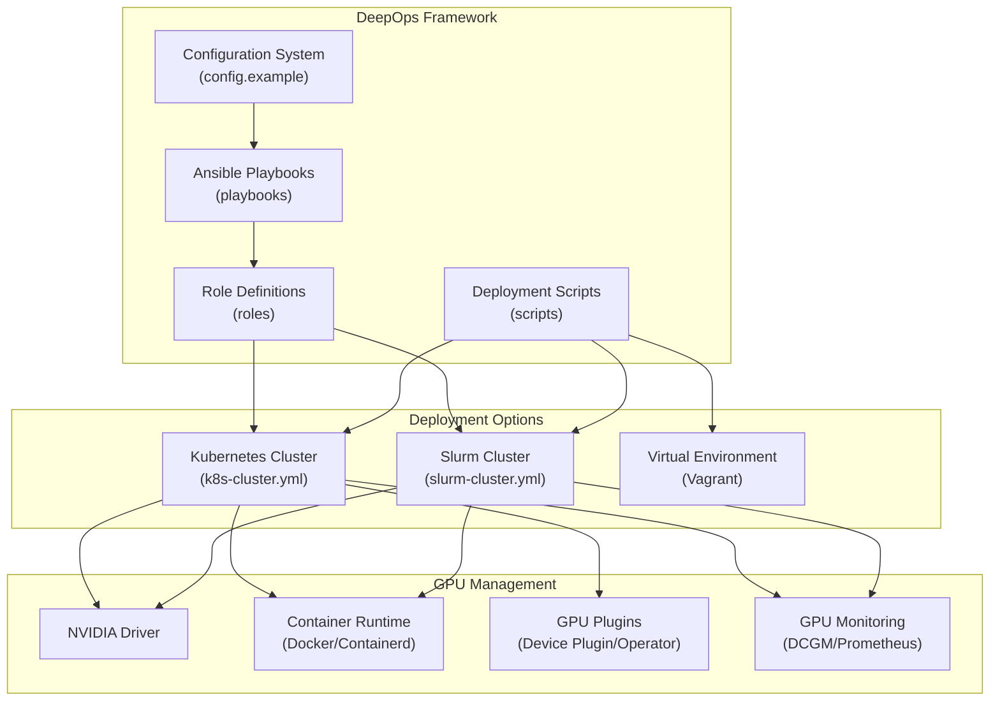
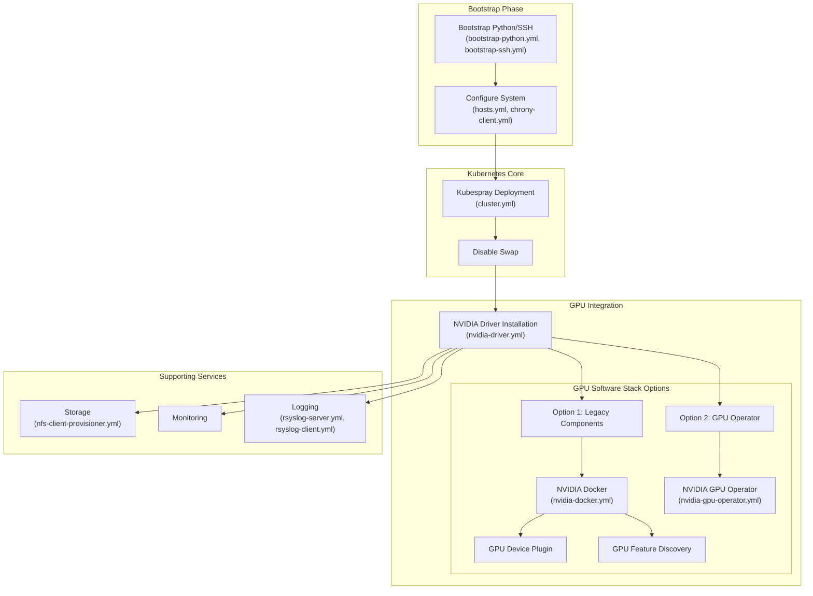
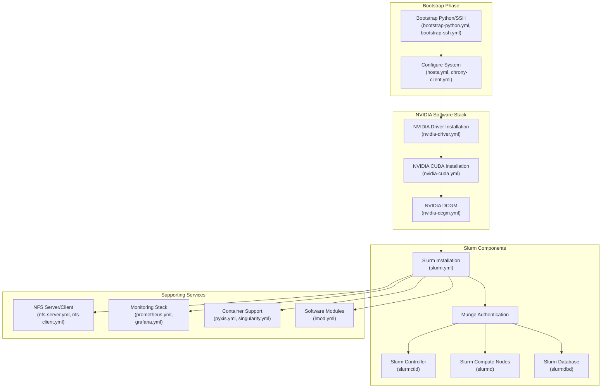
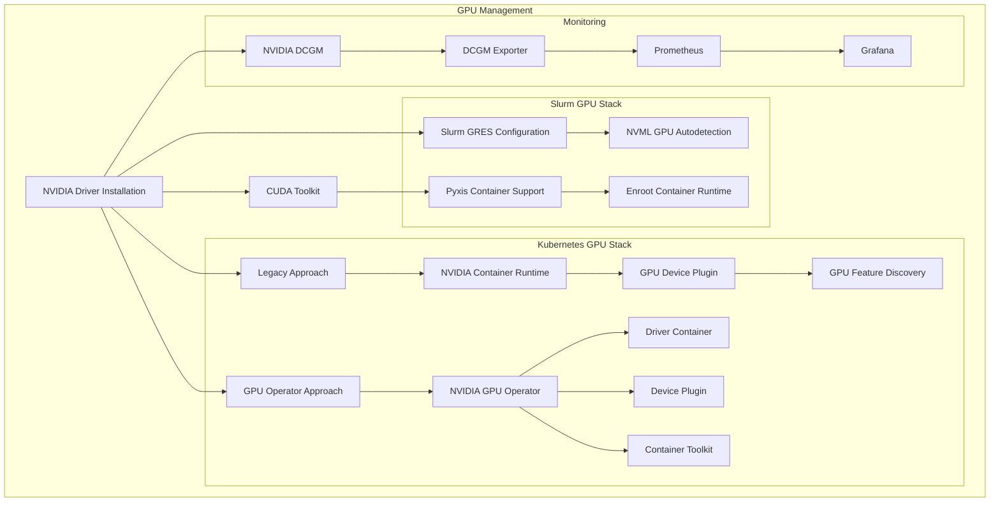
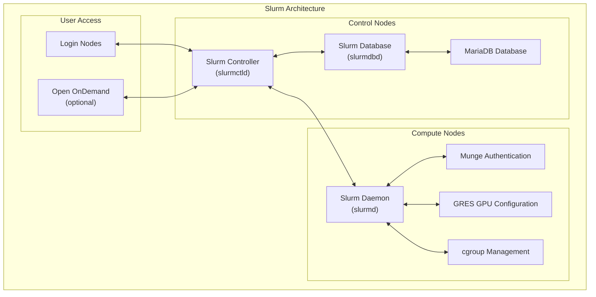
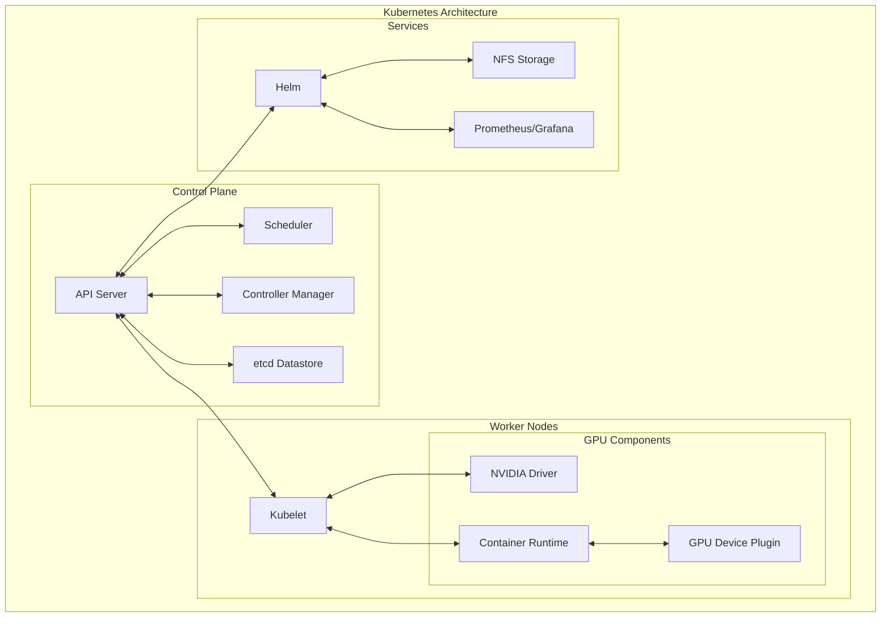
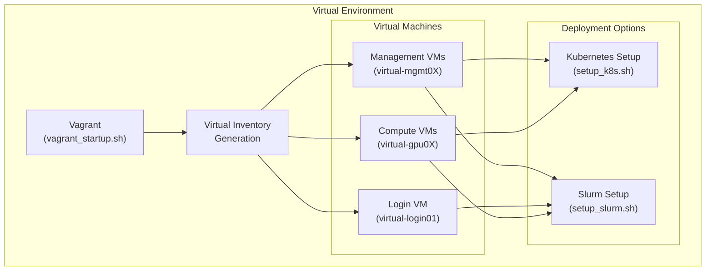

<!-- source: DeepWiki mcp.deepwiki.com · repo NVIDIA/deepops · page 1 DeepOps Overview · fetched 2026-10-26 -->

# DeepOps Overview

Relevant source files

The following files were used as context for generating this wiki page:

- [CONTRIBUTING.md](CONTRIBUTING.md)
- [README.md](README.md)
- [config.example/group_vars/all.yml](config.example/group_vars/all.yml)
- [config.example/group_vars/k8s-cluster.yml](config.example/group_vars/k8s-cluster.yml)
- [config.example/group_vars/slurm-cluster.yml](config.example/group_vars/slurm-cluster.yml)
- [playbooks/k8s-cluster.yml](playbooks/k8s-cluster.yml)
- [playbooks/slurm-cluster.yml](playbooks/slurm-cluster.yml)
- [playbooks/slurm-cluster/alertmanager.yml](playbooks/slurm-cluster/alertmanager.yml)
- [roles/pyxis/defaults/main.yml](roles/pyxis/defaults/main.yml)
- [roles/pyxis/tasks/main.yml](roles/pyxis/tasks/main.yml)
- [roles/pyxis/tasks/pyxis.yml](roles/pyxis/tasks/pyxis.yml)
- [roles/slurm/defaults/main.yml](roles/slurm/defaults/main.yml)
- [roles/slurm/tasks/compute.yml](roles/slurm/tasks/compute.yml)
- [roles/slurm/tasks/controller.yml](roles/slurm/tasks/controller.yml)
- [roles/slurm/tasks/main.yml](roles/slurm/tasks/main.yml)
- [roles/slurm/tasks/munge.yml](roles/slurm/tasks/munge.yml)
- [roles/slurm/vars/redhat.yml](roles/slurm/vars/redhat.yml)
- [roles/slurm/vars/ubuntu.yml](roles/slurm/vars/ubuntu.yml)
- [scripts/k8s/install_helm.sh](scripts/k8s/install_helm.sh)

DeepOps is a comprehensive infrastructure automation framework for deploying and managing GPU-accelerated Kubernetes and Slurm clusters. It encapsulates best practices for setting up high-performance computing environments with NVIDIA GPUs, providing a modular approach that can be used for complete end-to-end deployments or selective component integration.

For information on getting started with DeepOps, see [Getting Started](#1.1). For details on configuring DeepOps, see [Configuration System](#1.2).

## Core Concepts

DeepOps provides tooling for two distinct cluster deployment approaches:

1. **Kubernetes-based clusters**: For containerized workloads, microservices, and cloud-native applications
2. **Slurm-based clusters**: For traditional HPC (High-Performance Computing) workloads and batch scheduling

Both deployment paths include support for NVIDIA GPUs, monitoring, storage integration, and user management, tailored to their respective environments.

Sources: [README.md:22-31](), [playbooks/k8s-cluster.yml:1-3](), [playbooks/slurm-cluster.yml:1-3]()

## System Architecture

The following diagram illustrates the high-level architecture of DeepOps:

Sources: [README.md:22-30](), [playbooks/k8s-cluster.yml:1-294](), [playbooks/slurm-cluster.yml:1-163](), [config.example/group_vars/all.yml:1-308]()

## Deployment Paths

### Kubernetes Deployment

The Kubernetes deployment in DeepOps leverages Kubespray for orchestration and includes specialized components for GPU support in containerized environments.

Sources: [playbooks/k8s-cluster.yml:14-309](), [config.example/group_vars/k8s-cluster.yml:1-96]()

### Slurm Deployment

The Slurm deployment provides a traditional HPC environment with job scheduling, GPU integration, and software module management.

Sources: [playbooks/slurm-cluster.yml:1-163](), [config.example/group_vars/slurm-cluster.yml:1-201](), [roles/slurm/tasks/main.yml:1-49]()

## Key Components

### Configuration System

DeepOps uses a hierarchical configuration system based on Ansible's group_vars structure. This allows for customization at different levels:

| Configuration Level | Description | Location |
|---------------------|-------------|----------|
| Global | Settings applied to all nodes | `config.example/group_vars/all.yml` |
| Kubernetes | Settings specific to Kubernetes clusters | `config.example/group_vars/k8s-cluster.yml` |
| Slurm | Settings specific to Slurm clusters | `config.example/group_vars/slurm-cluster.yml` |
| Node-specific | Settings for specific node types | Inventory-specific files |

Key configuration categories include:

- Network settings
- Storage configuration
- Authentication/user management
- GPU settings
- Container runtime options
- Monitoring parameters

Sources: [config.example/group_vars/all.yml:1-308](), [config.example/group_vars/k8s-cluster.yml:1-96](), [config.example/group_vars/slurm-cluster.yml:1-201]()

### GPU Integration

DeepOps provides extensive GPU integration for both Kubernetes and Slurm deployments:

Sources: [playbooks/k8s-cluster.yml:169-293](), [playbooks/slurm-cluster.yml:43-54](), [config.example/group_vars/all.yml:124-143](), [roles/slurm/defaults/main.yml:47-50](), [roles/pyxis/tasks/main.yml:1-46]()

### Role of the Slurm Cluster

The Slurm cluster deployment provides a traditional HPC environment with:

1. **Job scheduling and resource allocation**: Managed by the Slurm controller (`slurmctld`)
2. **Compute node management**: Handled by Slurm daemon (`slurmd`) on worker nodes
3. **User and accounting database**: Provided by Slurm database daemon (`slurmdbd`)
4. **GPU integration**: Through GRES (Generic Resource) configuration
5. **Node health checking**: Optional health checks for compute nodes
6. **Software environment modules**: Via Lmod or similar tools
7. **Container support**: Through Singularity, Enroot, and Pyxis

Sources: [roles/slurm/tasks/controller.yml:1-201](), [roles/slurm/tasks/compute.yml:1-211](), [config.example/group_vars/slurm-cluster.yml:1-201]()

### Role of the Kubernetes Cluster

The Kubernetes cluster deployment enables container orchestration with:

1. **Container orchestration**: Core Kubernetes components deployed via Kubespray
2. **GPU support**: Through NVIDIA GPU Operator or legacy device plugin
3. **Networking**: With options for different CNI plugins
4. **Storage**: With support for NFS and other storage options
5. **Monitoring**: Via Prometheus and Grafana
6. **Logging**: Through rsyslog or other logging solutions
7. **Cluster access**: Through kubectl and kubeconfig management

Sources: [playbooks/k8s-cluster.yml:114-116](), [playbooks/k8s-cluster.yml:169-293](), [config.example/group_vars/k8s-cluster.yml:1-96]()

## Virtual Testing Environment

DeepOps includes a virtual testing environment using Vagrant, allowing users to test deployments on a single machine before applying them to actual hardware.

Sources: [README.md:82-86]()

## Deployable Components

DeepOps enables the deployment of various components depending on the cluster type:

| Component | Kubernetes Cluster | Slurm Cluster | Description |
|-----------|:------------------:|:-------------:|-------------|
| NVIDIA Drivers | ✓ | ✓ | GPU drivers |
| CUDA Toolkit | ✓ | ✓ | NVIDIA CUDA for GPU computing |
| Container Runtime | Docker/Containerd | Enroot/Singularity | Container execution environment |
| Monitoring | Prometheus/Grafana | Prometheus/Grafana | System and GPU monitoring |
| Storage | NFS | NFS | Shared storage |
| Logging | rsyslog | rsyslog | Log aggregation |
| GPU Management | GPU Operator/Device Plugin | GRES/NVML | GPU resource management |
| Authentication | Kubernetes RBAC | Munge | Authentication system |
| Software Management | Helm | Lmod | Software deployment/environment |

Sources: [config.example/group_vars/all.yml:124-175](), [playbooks/k8s-cluster.yml:169-309](), [playbooks/slurm-cluster.yml:43-163]()

## Workflow Integration

A key benefit of DeepOps is its integration with common AI/ML and HPC workflows:

1. **Kubernetes for AI/ML workflows**:
   - Kubeflow integration
   - RAPIDS and Dask support
   - GPU sharing and MIG capabilities
   - Helm chart deployment

2. **Slurm for HPC workflows**:
   - MPI job support
   - GPU-aware scheduling
   - Container integration via Pyxis/Enroot
   - Software modules via Lmod
   - HPC SDK integration

DeepOps provides the infrastructure foundation for these workflows, enabling researchers and data scientists to focus on their applications rather than infrastructure management.

Sources: [playbooks/slurm-cluster.yml:79-163](), [config.example/group_vars/slurm-cluster.yml:55-132]()

## Project Information

DeepOps is an open-source project maintained by NVIDIA. Contributions to the project follow a standard pull request workflow with signed commits, as detailed in the [CONTRIBUTING.md]() file.

Sources: [README.md:92-104](), [CONTRIBUTING.md:1-59]()

---

