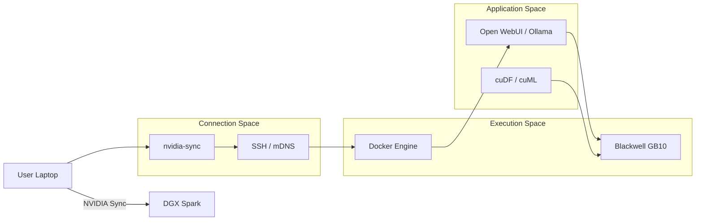

<!-- source: DeepWiki mcp.deepwiki.com · repo NVIDIA/dgx-spark-playbooks · page 1 Overview · fetched 2026-10-26 -->

# Overview

<details>
<summary>Relevant source files</summary>

The following files were used as context for generating this wiki page:

- [README.md](README.md)
- [nvidia/connect-to-your-spark/README.md](nvidia/connect-to-your-spark/README.md)
- [nvidia/cuda-x-data-science/README.md](nvidia/cuda-x-data-science/README.md)
- [nvidia/cuda-x-data-science/assets/cudf_pandas_demo.ipynb](nvidia/cuda-x-data-science/assets/cudf_pandas_demo.ipynb)
- [nvidia/cuda-x-data-science/assets/cuml_sklearn_demo.ipynb](nvidia/cuda-x-data-science/assets/cuml_sklearn_demo.ipynb)
- [nvidia/open-webui/README.md](nvidia/open-webui/README.md)

</details>


## Purpose and Scope

The DGX Spark Playbooks repository provides a comprehensive collection of over 40 step-by-step deployment guides for AI/ML workloads on NVIDIA DGX Spark devices with Blackwell GPU architecture. This documentation serves as a technical reference for configuring inference engines, fine-tuning frameworks, development environments, networking infrastructure, and end-to-end AI applications on the ARM64-based DGX Spark platform with Unified Memory Architecture (UMA).

Each playbook includes specific prerequisites, step-by-step instructions, troubleshooting guidance, and example code [README.md:18-18](). This overview covers the repository's organization and high-level categorization. For detailed technical specifications, see [Hardware Platform](#1.1). For specific category navigation, see [Playbook Categories](#1.2).

**Sources:** [README.md:1-20]()

## Hardware Platform Context

The DGX Spark device features the NVIDIA Blackwell architecture (specifically the `NVIDIA GB10` GPU) [nvidia/cuda-x-data-science/assets/cudf_pandas_demo.ipynb:57-57](). It utilizes a Unified Memory Architecture (UMA) that enables dynamic memory sharing between the CPU and GPU. The platform is built on ARM64 (aarch64) processors and typically ships with CUDA 13.0 and Driver Version 580.82.09 [nvidia/cuda-x-data-science/assets/cuml_sklearn_demo.ipynb:57-57]().

Key hardware attributes addressed in the playbooks:
- **GPU Architecture**: Blackwell GB10 with native support for FP4 and FP8 precision [nvidia/nvfp4-quantization/README.md:1-5]().
- **Memory**: Unified Memory Architecture (UMA) for efficient model loading and large dataset processing.
- **Networking**: Support for local network access via mDNS (`.local` hostnames) and high-speed QSFP connections for multi-node clusters [nvidia/connect-to-your-spark/README.md:38-41]().

For detailed hardware specifications, see [Hardware Platform](#1.1).

**Sources:** [README.md:8-9](), [nvidia/cuda-x-data-science/assets/cudf_pandas_demo.ipynb:49-70](), [nvidia/connect-to-your-spark/README.md:38-41]()

## Repository Structure

The repository organizes playbooks under the `nvidia/` directory. Each playbook is contained within its own subdirectory, usually featuring a `README.md` and associated assets like Jupyter notebooks or shell scripts.

### Playbook Organization Diagram
The following diagram maps the high-level categories to their primary code entities and directory structures.

```mermaid
graph TB
    Root["dgx-spark-playbooks/"]
    NvidiaDir["nvidia/"]
    
    subgraph "Infrastructure & Connectivity"
        Connect["connect-to-your-spark/"]
        MultiNode["connect-two-sparks/"]
        Cluster["multi-sparks-through-switch/"]
        VPN["tailscale/"]
    end
    
    subgraph "Development Environments"
        Dash["dgx-dashboard/"]
        IDE["vscode/"]
        Agent["openshell/"]
        JAX["jax/"]
    end
    
    subgraph "Inference & Serving"
        VLLM["vllm/"]
        TRT["trt-llm/"]
        OLL["ollama/"]
        WebUI["open-webui/"]
        NIM["nim-llm/"]
    end
    
    subgraph "Fine-tuning & Training"
        Factory["llama-factory/"]
        NeMo["nemo-fine-tune/"]
        Unsloth["unsloth/"]
        Flux["flux-finetuning/"]
    end

    subgraph "Data Science"
        CUDAX["cuda-x-data-science/"]
    end
    
    Root --> NvidiaDir
    NvidiaDir --> Infrastructure & Connectivity
    NvidiaDir --> Development Environments
    NvidiaDir --> Inference & Serving
    NvidiaDir --> Fine-tuning & Training
    NvidiaDir --> Data Science
```

**Sources:** [README.md:22-63]()

## Playbook Categories

The available playbooks are organized into functional categories to help users navigate based on their specific goals. For an exhaustive list and navigation guide, see [Playbook Categories](#1.2).

| Category | Primary Purpose | Key Playbooks |
| :--- | :--- | :--- |
| **Getting Started** | Initial connectivity and first-run apps | `connect-to-your-spark`, `open-webui` |
| **Development** | IDEs, coding agents, and interactive labs | `vscode`, `vibe-coding`, `openshell`, `jupyterlab` |
| **Inference** | Optimized model serving engines | `vllm`, `trt-llm`, `nim-llm`, `sglang` |
| **Fine-tuning** | Training models on custom data | `llama-factory`, `unsloth`, `nemo-fine-tune` |
| **Data Science** | GPU-accelerated analytics | `cuda-x-data-science`, `portfolio-optimization` |
| **Multi-Node** | Scaling workloads across multiple Sparks | `connect-three-sparks`, `nccl` |

**Sources:** [README.md:22-63]()

## Key Technical Characteristics

### NVIDIA Sync Integration
Many playbooks utilize **NVIDIA Sync**, a desktop application for macOS, Windows, and Linux that streamlines SSH access, port forwarding, and application launching [nvidia/connect-to-your-spark/README.md:75-81](). It automates SSH key generation and management, allowing users to connect to their Spark using mDNS hostnames (e.g., `spark-abcd.local`) [nvidia/connect-to-your-spark/README.md:150-156]().

### Accelerated Data Science (CUDA-X)
The platform supports zero-code-change acceleration for standard Python libraries through **CUDA-X Data Science** (formerly RAPIDS) [nvidia/cuda-x-data-science/README.md:21-21]().
- **cuDF**: Accelerates `pandas` workflows using the `%load_ext cudf.pandas` magic command [nvidia/cuda-x-data-science/assets/cudf_pandas_demo.ipynb:10-15]().
- **cuML**: Accelerates `scikit-learn` algorithms (UMAP, HDBSCAN, SVC) via `%load_ext cuml.accel` [nvidia/cuda-x-data-science/assets/cuml_sklearn_demo.ipynb:103-107]().

### Container-First Deployment
Most AI applications, such as **Open WebUI**, are deployed as Docker containers [nvidia/open-webui/README.md:105-137](). The playbooks provide specific `docker run` configurations optimized for Spark, including GPU passthrough (`--gpus=all`) and persistent volume mounts for model weights and data [nvidia/open-webui/README.md:132-135]().

### User Workflow Diagram
This diagram illustrates how a user typically moves from initial setup to running an accelerated application.



**Sources:** [nvidia/connect-to-your-spark/README.md:75-81](), [nvidia/open-webui/README.md:132-135](), [nvidia/cuda-x-data-science/README.md:21-21]()

## Resources and Support

- **Documentation**: [Official DGX Spark Docs](https://www.nvidia.com/en-us/products/workstations/dgx-spark)
- **Community**: [NVIDIA Developer Forum](https://forums.developer.nvidia.com/c/accelerated-computing/dgx-spark-gb10)
- **License**: The repository is governed by the [LICENSE]() and [LICENSE-3rd-party]() files.

**Sources:** [README.md:65-75]()

---

