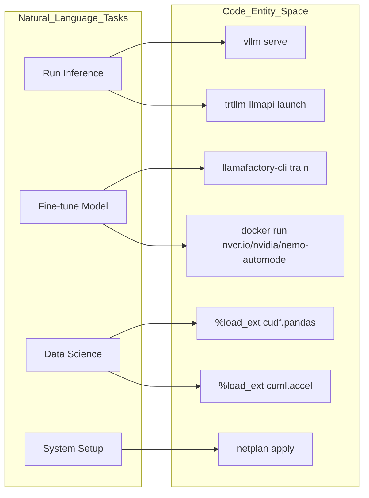

<!-- source: DeepWiki mcp.deepwiki.com · repo NVIDIA/dgx-spark-playbooks · page 10 Reference · fetched 2026-10-26 -->

# Reference

<details>
<summary>Relevant source files</summary>

The following files were used as context for generating this wiki page:

- [README.md](README.md)
- [nvidia/cuda-x-data-science/README.md](nvidia/cuda-x-data-science/README.md)
- [nvidia/cuda-x-data-science/assets/cudf_pandas_demo.ipynb](nvidia/cuda-x-data-science/assets/cudf_pandas_demo.ipynb)
- [nvidia/cuda-x-data-science/assets/cuml_sklearn_demo.ipynb](nvidia/cuda-x-data-science/assets/cuml_sklearn_demo.ipynb)
- [nvidia/llama-factory/README.md](nvidia/llama-factory/README.md)
- [nvidia/nemo-fine-tune/README.md](nvidia/nemo-fine-tune/README.md)

</details>


## Purpose and Scope

This section provides quick reference materials for working with DGX Spark Playbooks. Unlike the tutorial-oriented playbook sections, these pages are designed for rapid lookup of terminology, commands, and resources. Use this section when you need to:

- Look up the definition of a technical term or acronym.
- Find the correct syntax for a commonly-used command.
- Locate external documentation or community resources.

For step-by-step tutorials and detailed explanations, refer to the main playbook sections ([Inference Systems](#4), [Fine-tuning Frameworks](#5), [Development Environments](#3)).

## Reference Materials Organization

This Reference section serves as a gateway to detailed technical data:

| Section | Purpose | Use When You Need To |
|---------|---------|---------------------|
| [Terminology Glossary](#10.1) | Definitions of technical terms and concepts | Understand what LoRA, QLoRA, PagedAttention, UMA, or NVFP4 mean. |
| [Command Reference](#10.2) | Command syntax patterns and examples | Copy-paste `docker` commands, model downloads, or `llamafactory-cli` usage. |
| [Configuration Files](#10.3) | Reference for YAML, Compose, and Netplan | Configure training recipes or network interfaces. |
| [External Resources](#10.4) | Links to documentation and forums | Find official NVIDIA docs, Hugging Face models, or community support. |

## Concept Taxonomy

The following diagram organizes key concepts by functional area, showing the relationships between terms and technologies used throughout the playbooks:

```mermaid
graph TB
    subgraph "Hardware_Space"
        [DGX_Spark] --> [Blackwell_Architecture]
        [DGX_Spark] --> [UMA_Unified_Memory]
        [DGX_Spark] --> [ARM64_CPU]
    end
    
    subgraph "Inference_Entity_Space"
        [vLLM_serve] --> [PagedAttention]
        [vLLM_serve] --> [Continuous_Batching]
        [TRT_LLM] --> [Speculative_Decoding]
        [NIM_Microservices] --> [nvcr_io]
        [Ollama] --> [GGUF_Format]
    end
    
    subgraph "Fine_tuning_Entity_Space"
        [PEFT] --> [LoRA]
        [LoRA] --> [QLoRA]
        [llamafactory_cli] --> [SFT_Supervised_Fine_Tuning]
        [NeMo_AutoModel] --> [FP8_Precision]
        [Unsloth] --> [Triton_Kernels]
    end
    
    subgraph "Quantization_Precision"
        [NVFP4] --> [FP4_Format]
        [FP8_Optimization] --> [Blackwell_GPU]
        [BF16] --> [Training_Standard]
    end
    
    subgraph "Distributed_Computing"
        [NCCL] --> [QSFP_200GbE]
        [Tensor_Parallelism] --> [NCCL]
        [Ray_Cluster] --> [vLLM_serve]
        [Docker_Swarm] --> [TRT_LLM]
    end

    [Blackwell_Architecture] -.-> [FP8_Optimization]
    [UMA_Unified_Memory] -.-> [vLLM_serve]
```
**Sources:** [README.md:1-63](), [nvidia/nemo-fine-tune/README.md:13-22](), [nvidia/llama-factory/README.md:13-26]()

## Playbook-to-Command Mapping

This diagram bridges natural language tasks to specific code entities and CLI tools:


**Sources:** [nvidia/vllm/README.md:1-100](), [nvidia/llama-factory/README.md:142-142](), [nvidia/nemo-fine-tune/README.md:100-113](), [nvidia/cuda-x-data-science/assets/cudf_pandas_demo.ipynb:15-15](), [nvidia/cuda-x-data-science/assets/cuml_sklearn_demo.ipynb:114-114]()

## Common File System Conventions

The DGX Spark playbooks follow consistent conventions for model caching and workspace management:

| Location | Purpose | Example Usage |
|----------|---------|---------------|
| `~/.cache/huggingface/` | HF model cache, shared across containers | Mounted via `-v $HOME/.cache/huggingface:/root/.cache/huggingface` |
| `~/models/` | User model storage directory | Custom model checkpoints, quantized models |
| `~/datasets/` | Training and inference datasets | Fine-tuning datasets (JSON/JSONL) |
| `/workspace/` | In-container working directory | Default `WORKDIR` in most Docker containers |
| `/opt/Automodel` | NeMo AutoModel source | Default location inside `nemo-automodel` container [nvidia/nemo-fine-tune/README.md:122-122]() |

## Port Allocation Scheme

Standard port assignments used across DGX Spark playbooks for remote access and service discovery:

| Port | Service | Playbook Context |
|------|---------|------------------|
| `8000` | vLLM / TRT-LLM API | [vLLM for Inference](nvidia/vllm) |
| `8080` | Open WebUI / Marimo | [Open WebUI with Ollama](nvidia/open-webui) |
| `8888` | Jupyter Notebook | [CUDA-X Data Science](nvidia/cuda-x-data-science) |
| `11000` | DGX Dashboard | [DGX Dashboard](nvidia/dgx-dashboard) |
| `11434` | Ollama API | [Ollama](nvidia/ollama) |

### Port Forwarding Syntax
To access these services from a local browser, use SSH tunneling:
`ssh -L <local_port>:localhost:<remote_port> <user>@<spark_ip>` [nvidia/cuda-x-data-science/README.md:79-79]()

## External Resource Ecosystem

- **Official Product Page**: [NVIDIA DGX Spark](https://www.nvidia.com/en-us/products/workstations/dgx-spark) [README.md:67-67]()
- **Developer Forum**: [DGX Spark (GB10) Forum](https://forums.developer.nvidia.com/c/accelerated-computing/dgx-spark-gb10) [README.md:68-68]()
- **Container Registry**: [NVIDIA NGC Catalog (nvcr.io)](https://catalog.ngc.nvidia.com)
- **Hugging Face Hub**: [Model & Dataset Repository](https://huggingface.co)

**Sources:** [README.md:65-70]()

---

