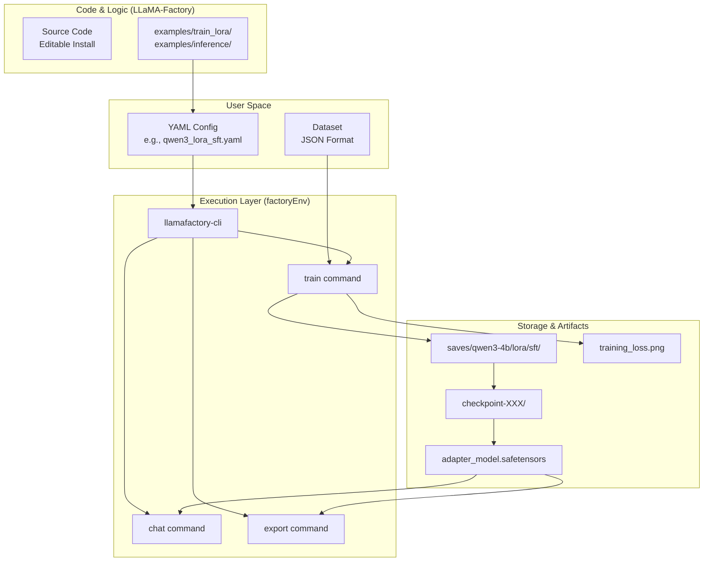
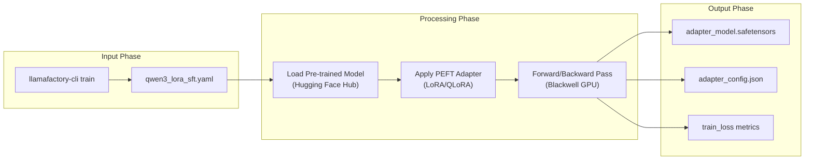

<!-- source: DeepWiki mcp.deepwiki.com · repo NVIDIA/dgx-spark-playbooks · page 5.2 LLaMA Factory · fetched 2026-10-26 -->

# LLaMA Factory

<details>
<summary>Relevant source files</summary>

The following files were used as context for generating this wiki page:

- [nvidia/llama-factory/README.md](nvidia/llama-factory/README.md)
- [nvidia/nemo-fine-tune/README.md](nvidia/nemo-fine-tune/README.md)

</details>


## Purpose and Scope

LLaMA Factory is an open-source framework that simplifies the process of training and fine-tuning large language models (LLMs). It provides a unified interface for cutting-edge methods such as Supervised Fine-Tuning (SFT), Reinforcement Learning from Human Feedback (RLHF), and Parameter-Efficient Fine-Tuning (PEFT) techniques like LoRA and QLoRA. This framework supports a wide range of architectures including LLaMA, Mistral, and Qwen, optimized for execution on NVIDIA Spark devices with Blackwell architecture. [nvidia/llama-factory/README.md:1-20]()

## Framework Architecture

LLaMA Factory operates through a CLI-driven workflow, abstracting complex training logic into YAML configuration files. On DGX Spark, it is installed within a Python virtual environment with specialized PyTorch builds supporting CUDA 13. [nvidia/llama-factory/README.md:67-69]()

### Component Stack and Data Flow

The following diagram illustrates the relationship between the CLI tools, configuration files, and the resulting model artifacts.

**LLaMA Factory System Entity Map**



**Implementation Details**
The framework is installed in editable mode (`pip install -e .`), allowing the `llamafactory-cli` to reference logic directly within the cloned repository. Training state and model weights are persisted in the `saves/` directory, organized by model name and fine-tuning stage. [nvidia/llama-factory/README.md:113-123](), [nvidia/llama-factory/README.md:161-169]()

Sources: [nvidia/llama-factory/README.md:108-123](), [nvidia/llama-factory/README.md:142-169]()

## Installation and Environment Setup

LLaMA Factory on Spark utilizes a `venv`-based setup to ensure compatibility with Blackwell's requirements, specifically targeting PyTorch with CUDA 13 support. [nvidia/llama-factory/README.md:67-68]()

### Environment Initialization

```bash
# Create and activate environment
python3 -m venv factoryEnv
source ./factoryEnv/bin/activate

# Install Blackwell-optimized PyTorch
pip3 install torch torchvision torchaudio --index-url https://download.pytorch.org/whl/cu130
```

Sources: [nvidia/llama-factory/README.md:87-98]()

### Verification Logic
Before initiating training, the system verifies GPU accessibility and CUDA runtime version to prevent initialization failures during the heavy compute phase. [nvidia/llama-factory/README.md:72-81](), [nvidia/llama-factory/README.md:100-106]()

## Training Pipeline

LLaMA Factory follows a declarative training approach where the `llamafactory-cli train` command consumes a YAML recipe. [nvidia/llama-factory/README.md:125-143]()

### Fine-Tuning Execution Flow

The following diagram maps the CLI execution to the internal processes of model adaptation.

**Training Logic Flow**



**Key Execution Parameters**
- **LoRA (Low-Rank Adaptation):** Reduces trainable parameters by inserting low-rank matrices into transformer layers. [nvidia/llama-factory/README.md:151-154]()
- **QLoRA:** Further optimizes memory by quantizing the base model to 4-bit while keeping adapters in higher precision. [nvidia/llama-factory/README.md:18-20]()

Sources: [nvidia/llama-factory/README.md:15-20](), [nvidia/llama-factory/README.md:142-155]()

## Model Management

### Validation and Inference
After training, the framework provides an interactive chat interface to validate the model's behavior. This uses the `chat` command which dynamically loads the base model and the newly created adapters. [nvidia/llama-factory/README.md:171-179]()

```bash
llamafactory-cli chat examples/inference/qwen3_lora_sft.yaml
```

### Export for Production
For deployment in high-throughput engines like vLLM or TensorRT-LLM, the adapters must be merged into the base model. The `export` command performs this weight fusion. [nvidia/llama-factory/README.md:181-185]()

```bash
llamafactory-cli export examples/merge_lora/qwen3_lora_sft.yaml
```

Sources: [nvidia/llama-factory/README.md:176-185]()

## Resource and Memory Optimization

DGX Spark utilizes a Unified Memory Architecture (UMA). While this allows for flexible memory addressing, training large models still requires careful VRAM management. [nvidia/llama-factory/README.md:210-218]()

| Optimization Strategy | Implementation | Effect |
| :--- | :--- | :--- |
| **Gradient Accumulation** | Increase `gradient_accumulation_steps` | Reduces peak VRAM by processing smaller micro-batches. |
| **Batch Size Reduction** | Decrease `per_device_train_batch_size` | Prevents CUDA Out of Memory (OOM) errors. |
| **UMA Cache Flush** | `echo 3 > /proc/sys/vm/drop_caches` | Clears system page cache to free up memory for GPU buffers. |

Sources: [nvidia/llama-factory/README.md:203-218]()

---

