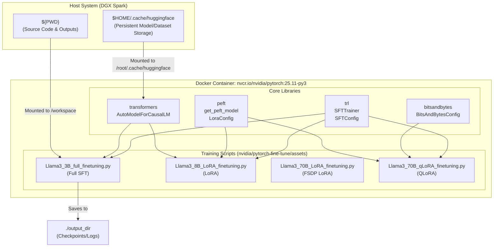
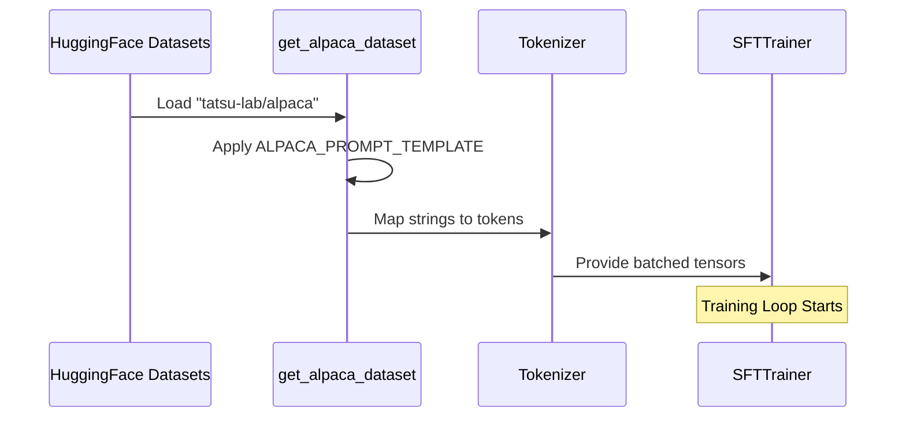
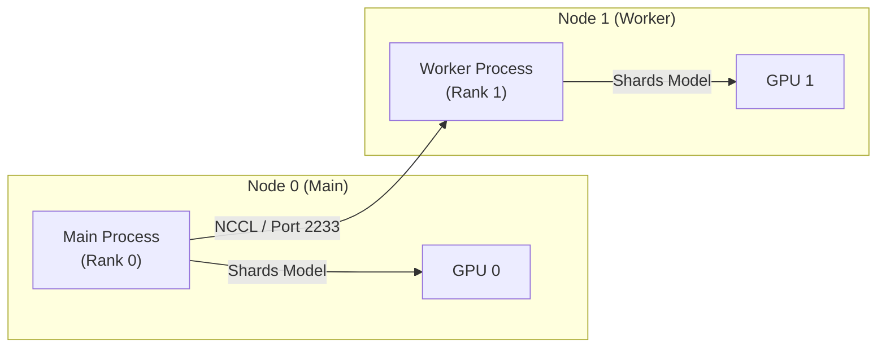

<!-- source: DeepWiki mcp.deepwiki.com · repo NVIDIA/dgx-spark-playbooks · page 5.3 PyTorch Fine-tuning · fetched 2026-10-26 -->

# PyTorch Fine-tuning

<details>
<summary>Relevant source files</summary>

The following files were used as context for generating this wiki page:

- [nvidia/multi-agent-chatbot/README.md](nvidia/multi-agent-chatbot/README.md)
- [nvidia/pytorch-fine-tune/README.md](nvidia/pytorch-fine-tune/README.md)
- [nvidia/pytorch-fine-tune/assets/Llama3_3B_full_finetuning.py](nvidia/pytorch-fine-tune/assets/Llama3_3B_full_finetuning.py)
- [nvidia/pytorch-fine-tune/assets/Llama3_70B_LoRA_finetuning.py](nvidia/pytorch-fine-tune/assets/Llama3_70B_LoRA_finetuning.py)
- [nvidia/pytorch-fine-tune/assets/Llama3_70B_qLoRA_finetuning.py](nvidia/pytorch-fine-tune/assets/Llama3_70B_qLoRA_finetuning.py)
- [nvidia/pytorch-fine-tune/assets/Llama3_8B_LoRA_finetuning.py](nvidia/pytorch-fine-tune/assets/Llama3_8B_LoRA_finetuning.py)
- [nvidia/pytorch-fine-tune/assets/configs/config_finetuning.yaml](nvidia/pytorch-fine-tune/assets/configs/config_finetuning.yaml)
- [nvidia/pytorch-fine-tune/assets/configs/config_fsdp_lora.yaml](nvidia/pytorch-fine-tune/assets/configs/config_fsdp_lora.yaml)
- [nvidia/pytorch-fine-tune/assets/install-requirements](nvidia/pytorch-fine-tune/assets/install-requirements)
- [nvidia/pytorch-fine-tune/assets/pytorch-ft-entrypoint.sh](nvidia/pytorch-fine-tune/assets/pytorch-ft-entrypoint.sh)
- [nvidia/pytorch-fine-tune/assets/run-multi-llama_3b](nvidia/pytorch-fine-tune/assets/run-multi-llama_3b)
- [nvidia/pytorch-fine-tune/assets/run-multi-llama_70b](nvidia/pytorch-fine-tune/assets/run-multi-llama_70b)

</details>


## Purpose and Scope

This page documents the PyTorch-based fine-tuning framework for large language models (LLMs) on DGX Spark. The framework provides flexible training scripts optimized for different model sizes and memory constraints, supporting **Full Supervised Fine-tuning (SFT)**, **LoRA**, and **QLoRA**. The implementation leverages the NVIDIA PyTorch container and standard Hugging Face libraries (`transformers`, `peft`, `trl`) to enable rapid adaptation of models ranging from 3B to 70B parameters.

For alternative frameworks, see [LLaMA Factory](5.2) for a GUI-based approach, [NeMo AutoModel](5.4) for enterprise-scale distributed training, or [Unsloth](5.5) for optimized Triton kernels.

---

## Architecture and Data Flow

The PyTorch fine-tuning workflow operates within a high-performance containerized environment. It bridges the gap between raw model weights and task-specific adapters or fully fine-tuned checkpoints.

### Code Entity Space to System Architecture


**Sources:** [nvidia/pytorch-fine-tune/README.md:80-90](), [nvidia/pytorch-fine-tune/README.md:115-125](), [nvidia/pytorch-fine-tune/assets/Llama3_8B_LoRA_finetuning.py:21-23]()

---

## Training Methods and Model Support

The playbook provides four primary recipes tailored to specific Llama 3.x model variants. Each script is a standalone Python entry point that handles model loading, dataset preprocessing, and trainer initialization.

### Training Recipe Matrix

| Script | Target Model | Method | Trainable Params | Key Features |
| :--- | :--- | :--- | :--- | :--- |
| `Llama3_3B_full_finetuning.py` | Llama 3.2 3B | Full SFT | 100% | `torch.compile` support, `gradient_checkpointing` |
| `Llama3_8B_LoRA_finetuning.py` | Llama 3.1 8B | LoRA | ~0.5% | Rank-8 adapters, `SFTTrainer` integration |
| `Llama3_70B_LoRA_finetuning.py` | Llama 3.1 70B | LoRA | < 0.1% | FSDP support for distributed memory |
| `Llama3_70B_qLoRA_finetuning.py` | Llama 3.1 70B | QLoRA | < 0.1% | 4-bit `nf4` quantization, `BitsAndBytesConfig` |

**Sources:** [nvidia/pytorch-fine-tune/README.md:115-125](), [nvidia/pytorch-fine-tune/assets/Llama3_3B_full_finetuning.py:59-63](), [nvidia/pytorch-fine-tune/assets/Llama3_70B_qLoRA_finetuning.py:57-64]()

---

## Implementation Details

### Data Processing Flow
The scripts utilize the `tatsu-lab/alpaca` dataset by default. The `get_alpaca_dataset` function transforms raw instruction-input-output triplets into formatted text strings using the `ALPACA_PROMPT_TEMPLATE`.


**Sources:** [nvidia/pytorch-fine-tune/assets/Llama3_8B_LoRA_finetuning.py:27-44](), [nvidia/pytorch-fine-tune/assets/Llama3_8B_LoRA_finetuning.py:70-71]()

### Parameter-Efficient Fine-Tuning (PEFT)
For LoRA and QLoRA, the `LoraConfig` class defines the adaptation strategy. In the 8B and 70B scripts, adapters are typically targeted at all linear layers to maximize learning capacity while minimizing VRAM footprint.

*   **LoRA Rank (`r`):** Defaults to 8, adjustable via `--lora_rank` [nvidia/pytorch-fine-tune/assets/Llama3_8B_LoRA_finetuning.py:151-152]().
*   **Target Modules:** Includes `q_proj`, `k_proj`, `v_proj`, `o_proj`, `gate_proj`, `up_proj`, and `down_proj` [nvidia/pytorch-fine-tune/assets/Llama3_8B_LoRA_finetuning.py:61]().
*   **Quantization:** `Llama3_70B_qLoRA_finetuning.py` uses `BitsAndBytesConfig` with `load_in_4bit=True` and `bnb_4bit_quant_type='nf4'` to fit the 70B model into DGX Spark's unified memory [nvidia/pytorch-fine-tune/assets/Llama3_70B_qLoRA_finetuning.py:58-64]().

### Performance Optimization
*   **Torch Compile:** Scripts like the 3B and 8B variants use `torch.compile(model)` to optimize the compute graph before training [nvidia/pytorch-fine-tune/assets/Llama3_3B_full_finetuning.py:90]().
*   **Gradient Checkpointing:** Enabled via `--gradient_checkpointing` to trade compute for memory, essential for full fine-tuning or high-sequence lengths [nvidia/pytorch-fine-tune/assets/Llama3_3B_full_finetuning.py:147-148]().
*   **Mixed Precision:** All scripts default to `bfloat16` (`dtype="bfloat16"`) to leverage the Blackwell architecture's performance [nvidia/pytorch-fine-tune/assets/Llama3_8B_LoRA_finetuning.py:134-136]().

---

## Distributed Fine-tuning (Multi-Node)

The framework supports distributed training across two DGX Spark nodes using **Fully Sharded Data Parallel (FSDP)**.

### Distributed Configuration
The setup uses `accelerate launch` combined with YAML configuration files:
*   **`config_finetuning.yaml`**: Configured for FSDP with `FULL_SHARD` strategy and `LlamaDecoderLayer` wrapping [nvidia/pytorch-fine-tune/assets/configs/config_finetuning.yaml:3-13]().
*   **`config_fsdp_lora.yaml`**: Specifically tuned for LoRA on 70B models, enabling `fsdp_cpu_ram_efficient_loading` to prevent OOM during model initialization [nvidia/pytorch-fine-tune/assets/configs/config_fsdp_lora.yaml:9-12]().

### Multi-Node Data Flow

**Sources:** [nvidia/pytorch-fine-tune/assets/configs/config_finetuning.yaml:15-27](), [nvidia/pytorch-fine-tune/assets/pytorch-ft-entrypoint.sh:21]()

---

## Operational Guide

### 1. Environment Preparation
Pull the NVIDIA PyTorch container and install specific PEFT/TRL dependencies:
```bash
docker pull nvcr.io/nvidia/pytorch:25.11-py3
# Inside container:
pip install "transformers>=4.57.1" peft datasets "trl>=0.25.1" "bitsandbytes>=0.48.2"
```
**Sources:** [nvidia/pytorch-fine-tune/README.md:80-95](), [nvidia/pytorch-fine-tune/assets/install-requirements:18]()

### 2. Execution
Run a fine-tuning script with custom parameters:
```bash
python Llama3_8B_LoRA_finetuning.py \
  --model_name "meta-llama/Llama-3.1-8B-Instruct" \
  --batch_size 4 \
  --num_epochs 3 \
  --lora_rank 16 \
  --output_dir "./finetuned_llama"
```
**Sources:** [nvidia/pytorch-fine-tune/README.md:171-176](), [nvidia/pytorch-fine-tune/assets/Llama3_8B_LoRA_finetuning.py:128-164]()

### 3. Memory Management
DGX Spark's Unified Memory Architecture (UMA) allows for dynamic sharing, but manual intervention may be needed to clear the buffer cache if memory fragmentation occurs:
```bash
sudo sh -c 'sync; echo 3 > /proc/sys/vm/drop_caches'
```
**Sources:** [nvidia/multi-agent-chatbot/README.md:151-152]()

---

## Summary of Key Functions

| Function / Class | File | Role |
| :--- | :--- | :--- |
| `SFTTrainer` | `trl` | Orchestrates the training loop, logging, and evaluation [nvidia/pytorch-fine-tune/assets/Llama3_8B_LoRA_finetuning.py:108-113](). |
| `get_peft_model` | `peft` | Wraps the base model with trainable LoRA layers [nvidia/pytorch-fine-tune/assets/Llama3_8B_LoRA_finetuning.py:65](). |
| `prepare_model_for_kbit_training` | `peft` | Configures the model for 4-bit/8-bit gradient updates [nvidia/pytorch-fine-tune/assets/Llama3_70B_qLoRA_finetuning.py:77](). |
| `AutoModelForCausalLM.from_pretrained` | `transformers` | Loads model weights with `device_map="auto"` or `balanced` sharding [nvidia/pytorch-fine-tune/assets/Llama3_8B_LoRA_finetuning.py:50-54](). |

**Sources:** [nvidia/pytorch-fine-tune/assets/Llama3_8B_LoRA_finetuning.py:21-23](), [nvidia/pytorch-fine-tune/assets/Llama3_70B_qLoRA_finetuning.py:24]()

---

