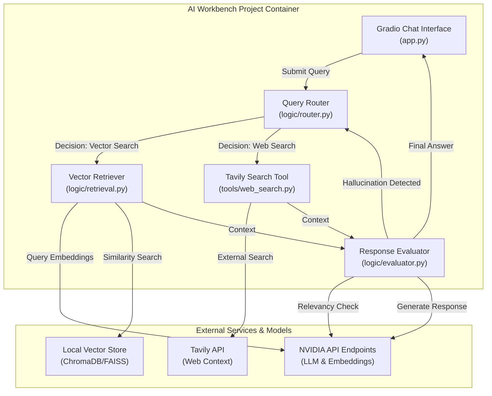
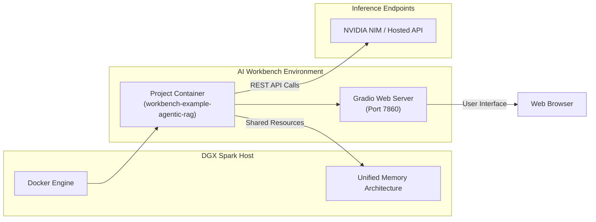

<!-- source: DeepWiki mcp.deepwiki.com · repo NVIDIA/dgx-spark-playbooks · page 6.2 RAG Applications in AI Workbench · fetched 2026-10-26 -->

# RAG Applications in AI Workbench

Relevant source files

The following files were used as context for generating this wiki page:

- [nvidia/comfy-ui/README.md](nvidia/comfy-ui/README.md)
- [nvidia/rag-ai-workbench/README.md](nvidia/rag-ai-workbench/README.md)
- [nvidia/vscode/README.md](nvidia/vscode/README.md)

## Purpose and Scope

This document describes how to build and deploy Retrieval Augmented Generation (RAG) applications on DGX Spark using NVIDIA AI Workbench. RAG applications combine document retrieval with large language model generation to provide factually grounded responses based on custom knowledge bases.

This page covers AI Workbench project setup, agentic RAG architectures, integration with Spark inference systems, and deployment patterns. For general chat interfaces without retrieval, see [Chat Interfaces](6.1). For multi-agent orchestration patterns, see [Multi-Agent Chatbot](6.3). For inference system selection, see [Choosing an Inference Engine](4.1).

Sources: [nvidia/rag-ai-workbench/README.md:1-29]()

## AI Workbench Overview

NVIDIA AI Workbench is a unified development environment for building, testing, and deploying AI applications. It provides:

- Project templates for common AI workflows including Agentic RAG [nvidia/rag-ai-workbench/README.md:17-21]().
- Container-based development environments with GPU access [nvidia/rag-ai-workbench/README.md:36-37]().
- Integration with local and remote compute resources (DGX Spark) [nvidia/rag-ai-workbench/README.md:66-74]().
- One-click deployment of web applications like Gradio [nvidia/rag-ai-workbench/README.md:113-119]().

Projects are defined by configuration files that specify environment dependencies, data sources, and application entrypoints. AI Workbench ensures reproducibility by containerizing the entire development stack [nvidia/rag-ai-workbench/README.md:59-60]().

Sources: [nvidia/rag-ai-workbench/README.md:13-74]()

## Agentic RAG Architecture

The implementation in AI Workbench utilizes an **Agentic RAG** pattern. Unlike standard RAG, which is a linear pipeline, an agentic system intelligently routes queries, evaluates responses for relevancy and hallucinations, and iterates through generation cycles until a high-quality answer is produced [nvidia/rag-ai-workbench/README.md:17-21]().

### Data and Logic Flow

The following diagram bridges the Natural Language concepts to the code entities and services used in the `workbench-example-agentic-rag` project.

Title: Agentic RAG System Architecture

Sources: [nvidia/rag-ai-workbench/README.md:17-29](), [nvidia/rag-ai-workbench/README.md:131-139]()

## Component Selection and Setup

### 1. Project Initialization
Users clone pre-built projects directly into the AI Workbench environment. For agentic RAG, the repository `https://github.com/NVIDIA/workbench-example-agentic-rag` is used [nvidia/rag-ai-workbench/README.md:90-98]().

### 2. Secret Management
AI Workbench provides a "Project Secrets" mechanism to handle sensitive API keys without hardcoding them into the container images [nvidia/rag-ai-workbench/README.md:100-111]().

| Secret Name | Purpose | Source |
|-------------|---------|--------|
| `NVIDIA_API_KEY` | Access to hosted LLMs (e.g., Llama-3) and Embedding models | [NGC API Keys](https://org.ngc.nvidia.com/setup/api-keys) |
| `TAVILY_API_KEY` | Access to real-time web search for query routing | [Tavily](https://tavily.com) |

Sources: [nvidia/rag-ai-workbench/README.md:80-111]()

### 3. Deployment on DGX Spark
The application is launched as a "Project Container App" [nvidia/rag-ai-workbench/README.md:113-117]().

Title: Service Mapping on DGX Spark

Sources: [nvidia/rag-ai-workbench/README.md:113-120](), [nvidia/comfy-ui/README.md:192-198]()

## Implementation Details

### Iterative Refinement Cycle
The agentic system performs the following steps programmatically:
1.  **Routing**: Determines if the query requires local documentation (Vector Store) or general web knowledge (Tavily) [nvidia/rag-ai-workbench/README.md:17-21]().
2.  **Retrieval**: Fetches relevant chunks.
3.  **Evaluation**: An LLM acts as a "Grader" to check if the retrieved context is relevant to the question.
4.  **Generation**: Produces the answer.
5.  **Hallucination Check**: Validates if the answer is supported by the context. If not, it re-runs the retrieval step [nvidia/rag-ai-workbench/README.md:17-21]().

### Monitoring the Agent
AI Workbench exposes the internal reasoning of the agent through a "Monitor" tab in the Gradio interface, allowing developers to see the decision-making process (e.g., "Router decided to search web") [nvidia/rag-ai-workbench/README.md:131-139]().

Sources: [nvidia/rag-ai-workbench/README.md:17-21](), [nvidia/rag-ai-workbench/README.md:131-139]()

## Performance and Memory Optimization

DGX Spark utilizes a **Unified Memory Architecture (UMA)**, allowing the GPU and CPU to share a common memory pool [nvidia/comfy-ui/README.md:192-198](). 

- **Memory Management**: If the RAG application or embedding models encounter memory pressure, the buffer cache can be manually flushed:
  `sudo sh -c 'sync; echo 3 > /proc/sys/vm/drop_caches'` [nvidia/comfy-ui/README.md:195-198]().
- **Architecture Support**: AI Workbench on Spark is configured for `aarch64` (ARM64) [nvidia/vscode/README.md:60-64](). Ensure all custom container components are compiled for ARM64.

Sources: [nvidia/comfy-ui/README.md:192-198](), [nvidia/vscode/README.md:60-64]()

## Troubleshooting

| Symptom | Potential Cause | Resolution |
|---------|----------------|------------|
| `401 Unauthorized` | Invalid or expired API key | Update `NVIDIA_API_KEY` in Project Secrets [nvidia/rag-ai-workbench/README.md:182](). |
| `Docker is not running` | Container tool state error | Reboot the DGX Spark and restart AI Workbench [nvidia/rag-ai-workbench/README.md:76-79](). |
| `Tavily API Error` | DNS or Network connectivity issues | Verify internet access from the Spark device [nvidia/rag-ai-workbench/README.md:181](). |
| `403 Unauthorized` | Missing "Public API Endpoints" permissions | Regenerate NGC key with correct scopes [nvidia/rag-ai-workbench/README.md:85-87](). |

Sources: [nvidia/rag-ai-workbench/README.md:76-79](), [nvidia/rag-ai-workbench/README.md:177-184]()

---

