# Page: Overview

# Overview

<details>
<summary>Relevant source files</summary>

The following files were used as context for generating this wiki page:

- [README.md](README.md)
- [nvidia/connect-to-your-spark/README.md](nvidia/connect-to-your-spark/README.md)
- [nvidia/cuda-x-data-science/README.md](nvidia/cuda-x-data-science/README.md)
- [nvidia/cuda-x-data-science/assets/cudf_pandas_demo.ipynb](nvidia/cuda-x-data-science/assets/cudf_pandas_demo.ipynb)
- [nvidia/cuda-x-data-science/assets/cuml_sklearn_demo.ipynb](nvidia/cuda-x-data-science/assets/cuml_sklearn_demo.ipynb)
- [nvidia/open-webui/README.md](nvidia/open-webui/README.md)

</details>


## Purpose and Scope

The DGX Spark Playbooks repository provides a comprehensive collection of over 40 step-by-step deployment guides for AI/ML workloads on NVIDIA DGX Spark devices with Blackwell GPU architecture. This documentation serves as a technical reference for configuring inference engines, fine-tuning frameworks, development environments, networking infrastructure, and end-to-end AI applications on the ARM64-based DGX Spark platform with Unified Memory Architecture (UMA).

Each playbook includes specific prerequisites, step-by-step instructions, troubleshooting guidance, and example code [README.md:18-18](). This overview covers the repository's organization and high-level categorization. For detailed technical specifications, see [Hardware Platform](#1.1). For specific category navigation, see [Playbook Categories](#1.2).

**Sources:** [README.md:1-20]()

## Hardware Platform Context

The DGX Spark device features the NVIDIA Blackwell architecture (specifically the `NVIDIA GB10` GPU) [nvidia/cuda-x-data-science/assets/cudf_pandas_demo.ipynb:57-57](). It utilizes a Unified Memory Architecture (UMA) that enables dynamic memory sharing between the CPU and GPU. The platform is built on ARM64 (aarch64) processors and typically ships with CUDA 13.0 and Driver Version 580.82.09 [nvidia/cuda-x-data-science/assets/cuml_sklearn_demo.ipynb:57-57]().

Key hardware attributes addressed in the playbooks:
- **GPU Architecture**: Blackwell GB10 with native support for FP4 and FP8 precision [nvidia/nvfp4-quantization/README.md:1-5]().
- **Memory**: Unified Memory Architecture (UMA) for efficient model loading and large dataset processing.
- **Networking**: Support for local network access via mDNS (`.local` hostnames) and high-speed QSFP connections for multi-node clusters [nvidia/connect-to-your-spark/README.md:38-41]().

For detailed hardware specifications, see [Hardware Platform](#1.1).

**Sources:** [README.md:8-9](), [nvidia/cuda-x-data-science/assets/cudf_pandas_demo.ipynb:49-70](), [nvidia/connect-to-your-spark/README.md:38-41]()

## Repository Structure

The repository organizes playbooks under the `nvidia/` directory. Each playbook is contained within its own subdirectory, usually featuring a `README.md` and associated assets like Jupyter notebooks or shell scripts.

### Playbook Organization Diagram
The following diagram maps the high-level categories to their primary code entities and directory structures.

```mermaid
graph TB
    Root["dgx-spark-playbooks/"]
    NvidiaDir["nvidia/"]
    
    subgraph "Infrastructure & Connectivity"
        Connect["connect-to-your-spark/"]
        MultiNode["connect-two-sparks/"]
        Cluster["multi-sparks-through-switch/"]
        VPN["tailscale/"]
    end
    
    subgraph "Development Environments"
        Dash["dgx-dashboard/"]
        IDE["vscode/"]
        Agent["openshell/"]
        JAX["jax/"]
    end
    
    subgraph "Inference & Serving"
        VLLM["vllm/"]
        TRT["trt-llm/"]
        OLL["ollama/"]
        WebUI["open-webui/"]
        NIM["nim-llm/"]
    end
    
    subgraph "Fine-tuning & Training"
        Factory["llama-factory/"]
        NeMo["nemo-fine-tune/"]
        Unsloth["unsloth/"]
        Flux["flux-finetuning/"]
    end

    subgraph "Data Science"
        CUDAX["cuda-x-data-science/"]
    end
    
    Root --> NvidiaDir
    NvidiaDir --> Infrastructure & Connectivity
    NvidiaDir --> Development Environments
    NvidiaDir --> Inference & Serving
    NvidiaDir --> Fine-tuning & Training
    NvidiaDir --> Data Science
```

**Sources:** [README.md:22-63]()

## Playbook Categories

The available playbooks are organized into functional categories to help users navigate based on their specific goals. For an exhaustive list and navigation guide, see [Playbook Categories](#1.2).

| Category | Primary Purpose | Key Playbooks |
| :--- | :--- | :--- |
| **Getting Started** | Initial connectivity and first-run apps | `connect-to-your-spark`, `open-webui` |
| **Development** | IDEs, coding agents, and interactive labs | `vscode`, `vibe-coding`, `openshell`, `jupyterlab` |
| **Inference** | Optimized model serving engines | `vllm`, `trt-llm`, `nim-llm`, `sglang` |
| **Fine-tuning** | Training models on custom data | `llama-factory`, `unsloth`, `nemo-fine-tune` |
| **Data Science** | GPU-accelerated analytics | `cuda-x-data-science`, `portfolio-optimization` |
| **Multi-Node** | Scaling workloads across multiple Sparks | `connect-three-sparks`, `nccl` |

**Sources:** [README.md:22-63]()

## Key Technical Characteristics

### NVIDIA Sync Integration
Many playbooks utilize **NVIDIA Sync**, a desktop application for macOS, Windows, and Linux that streamlines SSH access, port forwarding, and application launching [nvidia/connect-to-your-spark/README.md:75-81](). It automates SSH key generation and management, allowing users to connect to their Spark using mDNS hostnames (e.g., `spark-abcd.local`) [nvidia/connect-to-your-spark/README.md:150-156]().

### Accelerated Data Science (CUDA-X)
The platform supports zero-code-change acceleration for standard Python libraries through **CUDA-X Data Science** (formerly RAPIDS) [nvidia/cuda-x-data-science/README.md:21-21]().
- **cuDF**: Accelerates `pandas` workflows using the `%load_ext cudf.pandas` magic command [nvidia/cuda-x-data-science/assets/cudf_pandas_demo.ipynb:10-15]().
- **cuML**: Accelerates `scikit-learn` algorithms (UMAP, HDBSCAN, SVC) via `%load_ext cuml.accel` [nvidia/cuda-x-data-science/assets/cuml_sklearn_demo.ipynb:103-107]().

### Container-First Deployment
Most AI applications, such as **Open WebUI**, are deployed as Docker containers [nvidia/open-webui/README.md:105-137](). The playbooks provide specific `docker run` configurations optimized for Spark, including GPU passthrough (`--gpus=all`) and persistent volume mounts for model weights and data [nvidia/open-webui/README.md:132-135]().

### User Workflow Diagram
This diagram illustrates how a user typically moves from initial setup to running an accelerated application.

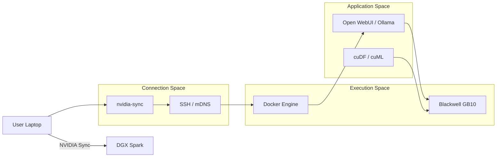

**Sources:** [nvidia/connect-to-your-spark/README.md:75-81](), [nvidia/open-webui/README.md:132-135](), [nvidia/cuda-x-data-science/README.md:21-21]()

## Resources and Support

- **Documentation**: [Official DGX Spark Docs](https://www.nvidia.com/en-us/products/workstations/dgx-spark)
- **Community**: [NVIDIA Developer Forum](https://forums.developer.nvidia.com/c/accelerated-computing/dgx-spark-gb10)
- **License**: The repository is governed by the [LICENSE]() and [LICENSE-3rd-party]() files.

**Sources:** [README.md:65-75]()

---

# Page: Hardware Platform

# Hardware Platform

<details>
<summary>Relevant source files</summary>

The following files were used as context for generating this wiki page:

- [README.md](README.md)
- [nvidia/connect-two-sparks/README.md](nvidia/connect-two-sparks/README.md)
- [nvidia/cuda-x-data-science/README.md](nvidia/cuda-x-data-science/README.md)
- [nvidia/cuda-x-data-science/assets/cudf_pandas_demo.ipynb](nvidia/cuda-x-data-science/assets/cudf_pandas_demo.ipynb)
- [nvidia/cuda-x-data-science/assets/cuml_sklearn_demo.ipynb](nvidia/cuda-x-data-science/assets/cuml_sklearn_demo.ipynb)
- [nvidia/multi-modal-inference/README.md](nvidia/multi-modal-inference/README.md)
- [nvidia/nccl/README.md](nvidia/nccl/README.md)

</details>


## Purpose and Scope

This page describes the NVIDIA DGX Spark hardware specifications and architecture, including the Blackwell GPU, ARM64 processors, and Unified Memory Architecture (UMA). Understanding these hardware characteristics is essential for optimizing workloads, troubleshooting performance issues, and selecting appropriate container images.

For information about connecting to your Spark device over the network, see [Set Up Local Network Access](). For system management and monitoring, see [DGX Dashboard](). For advanced memory management techniques, see [Memory Management]().

---

## Hardware Architecture Overview

The DGX Spark is a high-performance workstation built on the NVIDIA Blackwell architecture, designed for local AI development, inference, and fine-tuning.

| Component | Specification | Code/System Entity |
| :--- | :--- | :--- |
| **GPU** | NVIDIA Blackwell (GB10) | `NVIDIA GB10` in `nvidia-smi` [nvidia/cuda-x-data-science/assets/cudf_pandas_demo.ipynb:57-57]() |
| **CPU** | ARM64 (AArch64) | `aarch64` in `uname -m` [nvidia/nccl/README.md:76-76]() |
| **Memory** | 128GB Unified Memory (UMA) | Shared pool for CPU/GPU [nvidia/multi-modal-inference/README.md:43-43]() |
| **Networking** | 200Gbps CX-7 Interconnect | `enp1s0f1np1` / `enp1s0f0np0` [nvidia/connect-two-sparks/README.md:92-97]() |

### System Architecture Diagram

Title: DGX Spark Hardware-to-Code Mapping
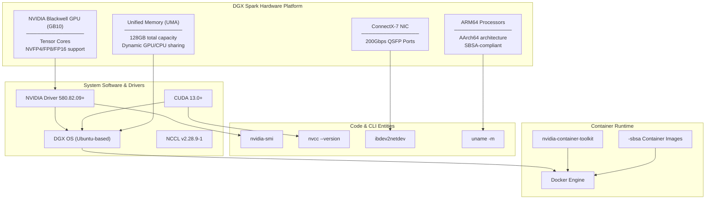

**Sources:** [README.md:8](), [nvidia/cuda-x-data-science/README.md:43-53](), [nvidia/nccl/README.md:17-20, 38-40, 48-48](), [nvidia/connect-two-sparks/README.md:85-97](), [nvidia/cuda-x-data-science/assets/cudf_pandas_demo.ipynb:51-60]()

---

## Blackwell GPU Architecture

The DGX Spark features the NVIDIA Blackwell GPU architecture (specifically the GB10 variant), which introduces advanced tensor acceleration and new precision formats.

### GPU Specifications and Precision

| Feature | Specification | Impact on Playbooks |
| :--- | :--- | :--- |
| **Compute Capability** | 10.x+ | Requires CUDA 13.0 [nvidia/cuda-x-data-science/README.md:51-51]() |
| **NVFP4 Support** | 4-bit Floating Point | Optimized inference [nvidia/multi-modal-inference/README.md:24-26]() |
| **FP8 Support** | 8-bit Floating Point | Standard for Blackwell inference [nvidia/multi-modal-inference/README.md:145-150]() |
| **VRAM Requirement** | ~48GB+ for large models | Critical for Flux.1 Schnell [nvidia/multi-modal-inference/README.md:163-164]() |

### GPU Verification
To verify the Blackwell GPU status and driver version:
```bash
nvidia-smi
```
Expected output identifies the device as `NVIDIA GB10` with `Driver Version: 580.82.09` and `CUDA Version: 13.0` [nvidia/cuda-x-data-science/assets/cudf_pandas_demo.ipynb:51-57]().

**Sources:** [nvidia/cuda-x-data-science/README.md:43-43](), [nvidia/multi-modal-inference/README.md:24-26, 163-164](), [nvidia/cuda-x-data-science/assets/cudf_pandas_demo.ipynb:49-70]()

---

## ARM64 Processor Architecture

DGX Spark utilizes the ARM64 (AArch64) architecture. This is a critical distinction for software compatibility, as standard x86_64 binaries and container images will not function.

### Architecture Implications for Containers
When pulling images from registries like NGC or Docker Hub, users must ensure the images are built for the ARM64 platform.

*   **SBSA Images:** Look for tags containing `-sbsa` (Server Base System Architecture) [nvidia/multi-modal-inference/README.md:45-45]().
*   **AArch64 Pathing:** System libraries are typically located in `/usr/lib/aarch64-linux-gnu/` [nvidia/nccl/README.md:76-76]().

### Verification Command
```bash
uname -m
# Output: aarch64
```

**Sources:** [nvidia/nccl/README.md:76-76](), [nvidia/multi-modal-inference/README.md:45-45]()

---

## Unified Memory Architecture (UMA)

DGX Spark implements a Unified Memory Architecture (UMA), where the CPU and GPU share a single physical pool of 128GB memory.

### Memory Characteristics
*   **Dynamic Sharing:** There is no fixed "VRAM" vs "System RAM" partition. Memory is allocated dynamically based on workload needs [nvidia/multi-modal-inference/README.md:43-43]().
*   **Buffer Management:** The Linux kernel may use free memory for buffer caches, which can occasionally conflict with large GPU allocations.
*   **Manual Cache Flushing:** To ensure maximum availability for large models, users may need to flush the system cache:
    ```bash
    sudo sh -c 'sync; echo 3 > /proc/sys/vm/drop_caches'
    ```

### Container Resource Limits
For UMA to function correctly within Docker, specific ulimits must be set to allow the container to lock and manage memory effectively:
```bash
docker run --gpus all --ipc=host --ulimit memlock=-1 --ulimit stack=67108864 ...
```
[nvidia/multi-modal-inference/README.md:98-101]()

**Sources:** [nvidia/multi-modal-inference/README.md:43-43, 98-101]()

---

## Multi-Node Connectivity

DGX Spark devices support high-speed inter-node communication via ConnectX-7 (CX-7) network interfaces and QSFP cabling.

### Physical Interconnect
Title: Multi-Spark Physical and Logical Connectivity
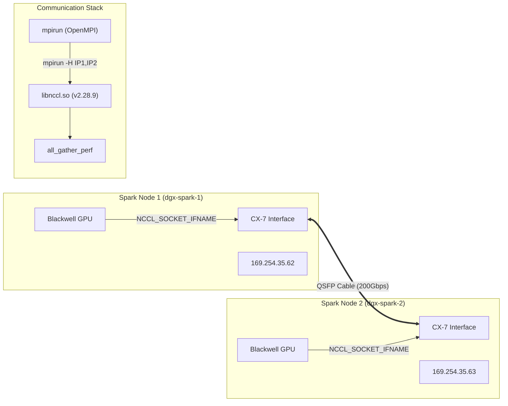

### Network Interface Identification
The primary high-speed interfaces are identified using the `ibdev2netdev` tool. Common interface names include:
*   `enp1s0f0np0`
*   `enp1s0f1np1` [nvidia/connect-two-sparks/README.md:92-97]()

### Collective Communication (NCCL)
For multi-node distributed training and inference, the NVIDIA Collective Communication Library (NCCL) must be built with Blackwell support (`sm_121` or `compute_121`) [nvidia/nccl/README.md:72-72]().

**Sources:** [nvidia/nccl/README.md:17-20, 70-79, 98-107, 141-150](), [nvidia/connect-two-sparks/README.md:85-97]()

---

## System Software Stack

The hardware is supported by a specialized software stack optimized for Blackwell and ARM64.

| Layer | Requirement | Verification |
| :--- | :--- | :--- |
| **Operating System** | DGX OS (Ubuntu-based) | `cat /etc/os-release` |
| **NVIDIA Driver** | 580.82.09+ | `nvidia-smi` [nvidia/cuda-x-data-science/assets/cudf_pandas_demo.ipynb:51-51]() |
| **CUDA Toolkit** | 13.0+ | `nvcc --version` [nvidia/nccl/README.md:39-39]() |
| **Container Engine** | Docker with `nvidia-container-runtime` | `docker ps` [nvidia/multi-modal-inference/README.md:82-82]() |

### Docker Configuration
To manage GPU workloads without root privileges, the user must be added to the `docker` group:
```bash
sudo usermod -aG docker $USER
newgrp docker
```
[nvidia/multi-modal-inference/README.md:88-89]()

**Sources:** [nvidia/nccl/README.md:38-40](), [nvidia/multi-modal-inference/README.md:39-41, 82-89](), [nvidia/cuda-x-data-science/assets/cudf_pandas_demo.ipynb:51-51]()

---

# Page: Playbook Categories

# Playbook Categories

<details>
<summary>Relevant source files</summary>

The following files were used as context for generating this wiki page:

- [README.md](README.md)
- [nvidia/cuda-x-data-science/README.md](nvidia/cuda-x-data-science/README.md)
- [nvidia/cuda-x-data-science/assets/cudf_pandas_demo.ipynb](nvidia/cuda-x-data-science/assets/cudf_pandas_demo.ipynb)
- [nvidia/cuda-x-data-science/assets/cuml_sklearn_demo.ipynb](nvidia/cuda-x-data-science/assets/cuml_sklearn_demo.ipynb)
- [nvidia/live-vlm-webui/README.md](nvidia/live-vlm-webui/README.md)
- [nvidia/nemotron/README.md](nvidia/nemotron/README.md)
- [nvidia/portfolio-optimization/README.md](nvidia/portfolio-optimization/README.md)
- [nvidia/single-cell/README.md](nvidia/single-cell/README.md)
- [nvidia/single-cell/assets/scRNA_analysis_preprocessing.ipynb](nvidia/single-cell/assets/scRNA_analysis_preprocessing.ipynb)

</details>


## Purpose and Scope

This document provides an organized overview of the playbook categories available in the DGX Spark Playbooks repository. It helps users navigate to relevant playbooks based on their objectives—whether setting up infrastructure, developing AI applications, running inference, fine-tuning models, or deploying complete solutions.

For hardware specifications, see [Hardware Platform](#1.1). For initial setup instructions, see [Getting Started](#2).

---

## Overview of Categories

The DGX Spark Playbooks are organized into functional categories that span from initial setup through model deployment and optimization.

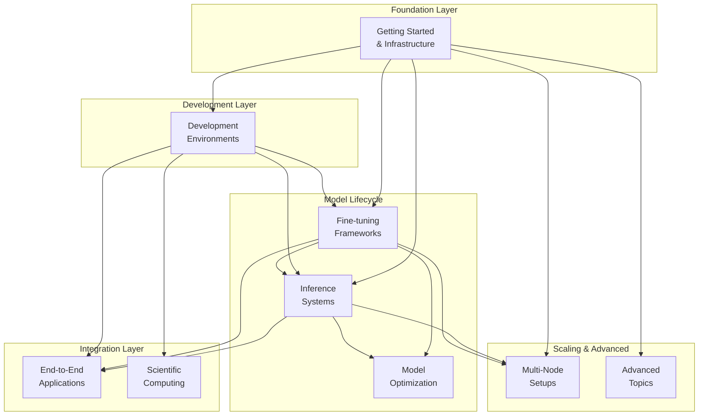

**Category Architecture**

The diagram above illustrates how categories build upon each other. The **Foundation Layer** (Getting Started) must be completed first. **Development Environments** provide tools for prototyping. The **Model Lifecycle** categories (Fine-tuning, Inference, Optimization) represent the core AI workflow. **Integration Layer** (Applications and Scientific Computing) combines multiple components into solutions. **Scaling & Advanced** categories address production requirements.

Sources: [README.md:1-63]()

---

## Category Details

### 1. Getting Started & Infrastructure

**Purpose**: Establish connectivity, access, and system management capabilities.

**Playbooks**:

| Playbook | Directory | Purpose |
|----------|-----------|---------|
| Set Up Local Network Access | `nvidia/connect-to-your-spark/` | SSH access, mDNS hostname resolution | [README.md:26]() |
| Set up Tailscale | `nvidia/tailscale/` | Encrypted P2P VPN for remote access | [README.md:56]() |
| DGX Dashboard | `nvidia/dgx-dashboard/` | Web-based system management (port 11000) | [README.md:29]() |

---

### 2. Development Environments

**Purpose**: Provide interactive development tools with GPU acceleration for coding and data science.

**Playbooks**:

| Playbook | Directory | Purpose |
|----------|-----------|---------|
| Vibe Coding in VS Code | `nvidia/vibe-coding/` | VS Code + Continue extension + Ollama | [README.md:60]() |
| CUDA-X Data Science | `nvidia/cuda-x-data-science/` | cuDF (pandas-like), cuML (sklearn-like) | [README.md:28]() |
| Optimized JAX | `nvidia/jax/` | XLA-optimized NumPy-like API with marimo | [README.md:32]() |
| LM Studio | `nvidia/lm-studio/` | Headless LLM serving and remote access | [README.md:35]() |

**Development Environment Architecture**:

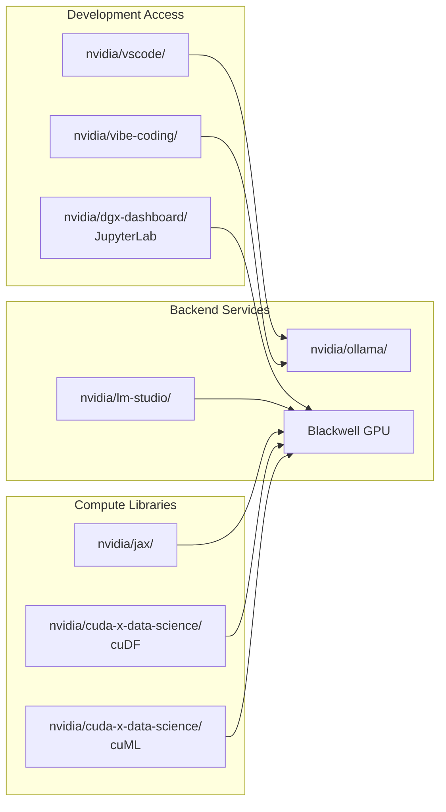

This diagram maps directory paths to development components. The `nvidia/vscode/` and `nvidia/vibe-coding/` playbooks set up remote development, while `nvidia/jax/` and `nvidia/cuda-x-data-science/` provide GPU-accelerated libraries. `nvidia/cuda-x-data-science/` specifically leverages `cuDF` for data preparation and `cuML` for machine learning algorithms like `UMAP` and `HDBSCAN` [nvidia/cuda-x-data-science/README.md:18-19]().

Sources: [README.md:28,32,35,60,62](), [nvidia/cuda-x-data-science/README.md:18-19]()

---

### 3. Inference Systems

**Purpose**: Deploy production-ready model serving infrastructure with different optimization strategies.

**Playbooks**:

| Playbook | Directory | Purpose |
|----------|-----------|---------|
| vLLM | `nvidia/vllm/` | PagedAttention, continuous batching | [README.md:61]() |
| TensorRT-LLM | `nvidia/trt-llm/` | Kernel optimization, FP8/NVFP4 | [README.md:57]() |
| NIM on Spark | `nvidia/nim-llm/` | Containerized microservices | [README.md:43]() |
| Ollama | `nvidia/ollama/` | Simplified API, local model management | [README.md:45]() |
| SGLang | `nvidia/sglang/` | High-throughput LLM and VLM serving | [README.md:52]() |

Sources: [README.md:43,45,52,57,61]()

---

### 4. Fine-tuning Frameworks

**Purpose**: Adapt pre-trained models to specific tasks and datasets.

**Playbooks**:

| Playbook | Directory | Purpose |
|----------|-----------|---------|
| LLaMA Factory | `nvidia/llama-factory/` | Unified CLI/WebUI for SFT, LoRA, QLoRA | [README.md:34]() |
| PyTorch Fine-tune | `nvidia/pytorch-fine-tune/` | Custom scripts with PEFT library | [README.md:50]() |
| NeMo Fine-tune | `nvidia/nemo-fine-tune/` | Enterprise-scale distributed training | [README.md:40]() |
| Unsloth | `nvidia/unsloth/` | Memory-efficient fine-tuning kernels | [README.md:59]() |
| FLUX.1 Dreambooth | `nvidia/flux-finetuning/` | Custom image generation fine-tuning | [README.md:30]() |

Sources: [README.md:30,34,40,50,59]()

---

### 5. End-to-End Applications

**Purpose**: Complete examples combining inference, fine-tuning, and logic into functional solutions.

**Playbooks**:

| Playbook | Directory | Purpose |
|----------|-----------|---------|
| Open WebUI | `nvidia/open-webui/` | Chat interface with Ollama integration | [README.md:46]() |
| Video Search & Summarization | `nvidia/vss/` | DeepStream CV + VLM analysis | [README.md:63]() |
| Live VLM WebUI | `nvidia/live-vlm-webui/` | Real-time webcam streaming to VLM | [README.md:33]() |
| Nemotron with llama.cpp | `nvidia/nemotron/` | NVIDIA MoE model serving | [README.md:42]() |
| Text to Knowledge Graph | `nvidia/txt2kg/` | Convert text to structured graphs | [README.md:58]() |
| Spark & Reachy | `nvidia/spark-reachy-photo-booth/` | Robotics + AI photo booth | [README.md:54]() |

**Application Logic Flow**:

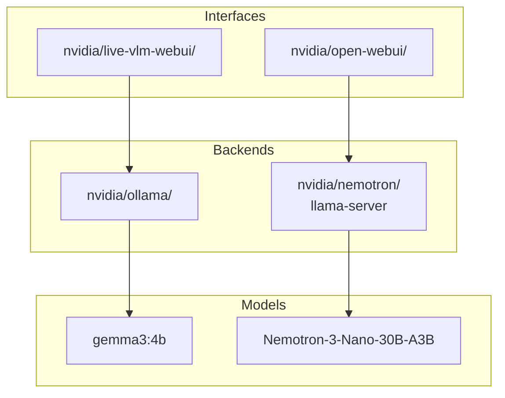

`nvidia/live-vlm-webui/` provides a WebRTC interface for real-time analysis using backends like Ollama [nvidia/live-vlm-webui/README.md:21-23](). `nvidia/nemotron/` uses `llama-server` to serve the 30B parameter MoE model [nvidia/nemotron/README.md:122-134]().

Sources: [nvidia/live-vlm-webui/README.md:21-23](), [nvidia/nemotron/README.md:122-134](), [README.md:33,42,46,54,58,63]()

---

### 6. Scientific Computing

**Purpose**: GPU-accelerated applications for domain-specific research.

**Playbooks**:

| Playbook | Directory | Purpose |
|----------|-----------|---------|
| Portfolio Optimization | `nvidia/portfolio-optimization/` | cuOpt + cuML for Mean-CVaR models | [README.md:49]() |
| Single-cell RNA Sequencing | `nvidia/single-cell/` | RAPIDS-singlecell for genomic analysis | [README.md:53]() |
| Isaac Sim/Lab | `nvidia/isaac/` | Robotics simulation and RL | [README.md:31]() |

**Scientific Data Flow**:

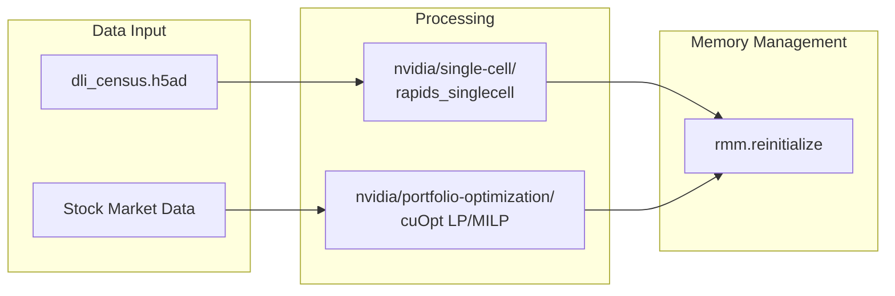

`nvidia/single-cell/` uses `rapids-singlecell` to process large genomic datasets, leveraging the RAPIDS Memory Manager (`rmm`) for VRAM optimization [nvidia/single-cell/assets/scRNA_analysis_preprocessing.ipynb:63,92](). `nvidia/portfolio-optimization/` uses `cuOpt` solvers for risk modeling and strategy backtesting [nvidia/portfolio-optimization/README.md:17-24]().

Sources: [nvidia/single-cell/assets/scRNA_analysis_preprocessing.ipynb:63,92](), [nvidia/portfolio-optimization/README.md:17-24](), [README.md:31,49,53]()

---

### 7. Multi-Node Setups

**Purpose**: Configure distributed workloads across multiple DGX Spark devices.

**Playbooks**:

| Playbook | Directory | Purpose |
|----------|-----------|---------|
| Connect Two Sparks | `nvidia/connect-two-sparks/` | Physical and network setup | [README.md:27]() |
| Multi-Sparks through Switch | `nvidia/multi-sparks-through-switch/` | Automated cluster configuration | [README.md:38]() |
| NCCL for Two Sparks | `nvidia/nccl/` | GPU-to-GPU communication config | [README.md:39]() |

Sources: [README.md:27,38,39]()

---

### 8. Model Optimization

**Purpose**: Reduce model memory footprint and increase inference speed.

**Playbooks**:

| Playbook | Directory | Purpose |
|----------|-----------|---------|
| NVFP4 Quantization | `nvidia/nvfp4-quantization/` | 4-bit floating point quantization | [README.md:44]() |
| Speculative Decoding | `nvidia/speculative-decoding/` | Draft model acceleration | [README.md:55]() |

Sources: [README.md:44,55]()

---

# Page: Getting Started

# Getting Started

<details>
<summary>Relevant source files</summary>

The following files were used as context for generating this wiki page:

- [nvidia/connect-to-your-spark/README.md](nvidia/connect-to-your-spark/README.md)
- [nvidia/dgx-dashboard/README.md](nvidia/dgx-dashboard/README.md)
- [nvidia/jax/README.md](nvidia/jax/README.md)
- [nvidia/open-webui/README.md](nvidia/open-webui/README.md)
- [nvidia/sglang/README.md](nvidia/sglang/README.md)
- [nvidia/txt2kg/README.md](nvidia/txt2kg/README.md)
- [nvidia/unsloth/README.md](nvidia/unsloth/README.md)

</details>


This page guides you through the initial setup and configuration required to use the DGX Spark Playbooks. It covers hardware prerequisites, network access configuration, and the deployment of your first AI applications using the unique Blackwell Unified Memory Architecture (UMA).

For detailed remote access setup, see [Connecting to Your Spark](#2.2). For system monitoring and JupyterLab, see [DGX Dashboard](#2.4). To deploy your first chat interface, see [Your First Application: Open WebUI](#2.5).

## Prerequisites and System Requirements

Before beginning, ensure your environment meets the following requirements:

### Hardware Requirements
| Component | Requirement | Notes |
|:---|:---|:---|
| **DGX Spark** | Powered on | NVIDIA Grace Blackwell GB10 Superchip System [nvidia/dgx-dashboard/README.md:31]() |
| **Architecture** | ARM64 (AArch64) | Required for container compatibility [nvidia/jax/README.md:45]() |
| **Memory** | Unified Memory | Enables dynamic sharing between GPU and CPU [nvidia/txt2kg/README.md:167-168]() |
| **Network** | Local or VPN | Same network as your client laptop for mDNS/SSH [nvidia/connect-to-your-spark/README.md:61]() |

### Software Requirements
| Software | Version | Purpose |
|:---|:---|:---|
| **NVIDIA Drivers** | Latest | GPU acceleration (`nvidia-smi`) [nvidia/sglang/README.md:41]() |
| **Docker Engine** | Latest | Containerized workload execution [nvidia/sglang/README.md:40]() |
| **Container Toolkit** | Configured | GPU passthrough to Docker [nvidia/sglang/README.md:42]() |
| **CUDA Toolkit** | 13.0+ | Kernel compilation and execution [nvidia/unsloth/README.md:42]() |

Sources: [nvidia/connect-to-your-spark/README.md:58-64](), [nvidia/sglang/README.md:38-45](), [nvidia/unsloth/README.md:39-44]()

## Connection Workflow

The following diagram illustrates the relationship between your local machine, the connection tools, and the core system entities on the DGX Spark.

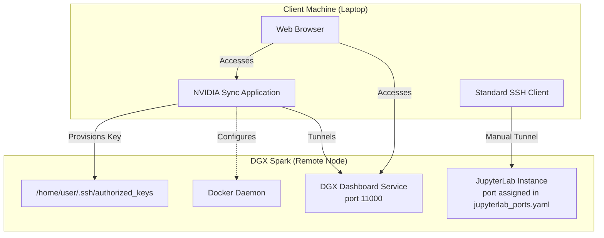
Sources: [nvidia/connect-to-your-spark/README.md:146-156](), [nvidia/dgx-dashboard/README.md:65-99]()

## Connecting to Your Spark

There are three primary methods to access your device. **NVIDIA Sync** is the recommended approach as it automates SSH key provisioning and manages port forwarding for you.

1.  **NVIDIA Sync (Recommended):** A desktop app for macOS, Windows, and Ubuntu that provides a "one-click" connection to your Spark. It handles the generation of SSH keys and their deployment to `~/.ssh/authorized_keys` [nvidia/connect-to-your-spark/README.md:73-156]().
2.  **Manual SSH:** For users who prefer standard terminal tools. You can connect via the mDNS hostname (e.g., `spark-abcd.local`) or direct IP [nvidia/connect-to-your-spark/README.md:216-275]().
3.  **Tailscale:** Used for secure remote access when you are not on the same local network as the Spark device.

For details, see [Connecting to Your Spark](#2.2) and [Setting Up Remote Access with Tailscale](#2.3).

## DGX Dashboard and JupyterLab

The **DGX Dashboard** is a pre-installed web application running on port `11000` [nvidia/dgx-dashboard/README.md:63](). It serves as the central hub for:
*   **System Monitoring:** Real-time GPU and CPU utilization tracking [nvidia/dgx-dashboard/README.md:187-192]().
*   **JupyterLab Management:** Launching isolated Python environments with pre-configured AI/ML libraries [nvidia/dgx-dashboard/README.md:112-125]().
*   **System Updates:** Managing firmware and OS packages.

For details, see [DGX Dashboard](#2.4).

## Running Your First Application

To validate your setup, we recommend deploying **Open WebUI with Ollama**. This application provides a ChatGPT-like interface running entirely on your local hardware.

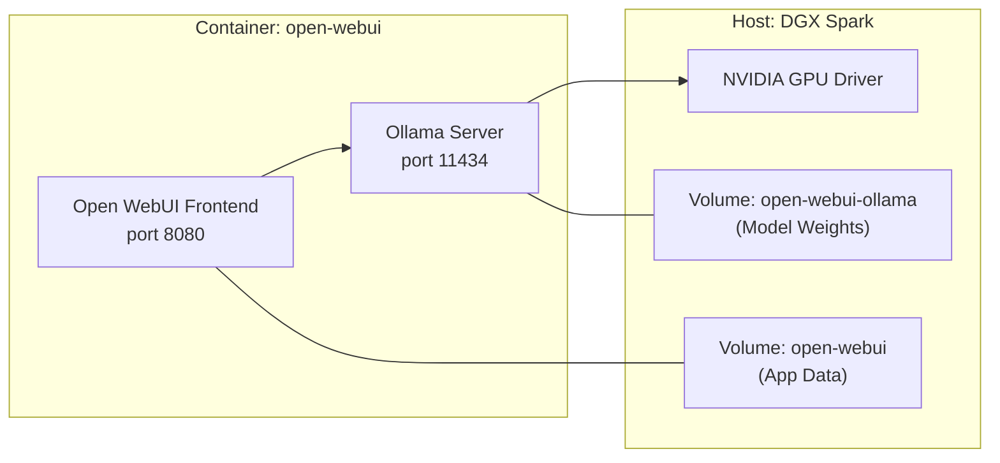
Sources: [nvidia/open-webui/README.md:131-136](), [nvidia/txt2kg/README.md:21-25]()

The deployment involves:
1.  **Docker Configuration:** Ensuring your user is in the `docker` group to run containers without `sudo` [nvidia/open-webui/README.md:59-64]().
2.  **Container Launch:** Running the `ghcr.io/open-webui/open-webui:ollama` image with GPU access [nvidia/open-webui/README.md:106-136]().
3.  **Model Pulling:** Using the UI or CLI to download models like `gpt-oss:20b` [nvidia/open-webui/README.md:170-174]().

For details, see [Your First Application: Open WebUI](#2.5).

## Unified Memory Architecture (UMA) Note

DGX Spark features a **Unified Memory Architecture**, allowing the GPU and CPU to share a single high-bandwidth memory pool [nvidia/txt2kg/README.md:167-168](). 

> [!IMPORTANT]
> If you encounter "Out of Memory" errors despite having capacity, it may be due to the Linux buffer cache. You can manually flush this cache using:
> `sudo sh -c 'sync; echo 3 > /proc/sys/vm/drop_caches'` [nvidia/txt2kg/README.md:170-172]().

Sources: [nvidia/txt2kg/README.md:167-173](), [nvidia/unsloth/README.md:144-149]()

---

# Page: Prerequisites and System Requirements

# Prerequisites and System Requirements

<details>
<summary>Relevant source files</summary>

The following files were used as context for generating this wiki page:

- [README.md](README.md)
- [nvidia/connect-to-your-spark/README.md](nvidia/connect-to-your-spark/README.md)
- [nvidia/cuda-x-data-science/README.md](nvidia/cuda-x-data-science/README.md)
- [nvidia/cuda-x-data-science/assets/cudf_pandas_demo.ipynb](nvidia/cuda-x-data-science/assets/cudf_pandas_demo.ipynb)
- [nvidia/cuda-x-data-science/assets/cuml_sklearn_demo.ipynb](nvidia/cuda-x-data-science/assets/cuml_sklearn_demo.ipynb)
- [nvidia/open-webui/README.md](nvidia/open-webui/README.md)

</details>


## Purpose and Scope

This page documents the hardware, software, network, and credential requirements needed before using any playbook in this repository. All playbooks assume these prerequisites are met unless explicitly stated otherwise in individual playbook documentation. These requirements ensure compatibility with the **NVIDIA Blackwell** architecture and the **ARM64** ecosystem integrated into the DGX Spark.

For instructions on connecting to your Spark device after meeting these prerequisites, see [Connecting to Your Spark](#2.2).

---

## Hardware Requirements

### NVIDIA DGX Spark Device

All playbooks in this repository target the NVIDIA DGX Spark platform with the following specifications:

| Component | Requirement | Notes |
|-----------|-------------|-------|
| GPU Architecture | NVIDIA Blackwell (GB10) | Tensor Cores + Ray Tracing capabilities [nvidia/cuda-x-data-science/assets/cudf_pandas_demo.ipynb:57]() |
| CPU Architecture | ARM64 (AArch64) | SBSA-optimized containers required [README.md:8]() |
| Unified Memory | 128GB | Shared dynamically between GPU and CPU [nvidia/vllm/README.md:191-197]() |
| Storage | Sufficient space | Required for container images and model weights [nvidia/open-webui/README.md:33]() |
| Network Interface | Ethernet or QSFP | QSFP required for multi-node/ring topologies [README.md:25-27]() |

**Sources:** [README.md:6-9](), [nvidia/cuda-x-data-science/assets/cudf_pandas_demo.ipynb:57-60]()

### Multi-Node Considerations

For playbooks involving distributed workloads (Section 7):

- **Two-Node**: Requires direct QSFP cabling [README.md:27]().
- **Three+ Nodes**: Requires a QSFP switch and `spark_cluster_setup.py` for ring topology configuration [README.md:25-38]().

---

## System Software Requirements

### Operating System and Drivers

The following software stack is required on the DGX Spark device to support the Blackwell architecture:

| Component | Minimum Version | Verification Command |
|-----------|----------------|---------------------|
| NVIDIA Drivers | 580.82+ | `nvidia-smi` [nvidia/cuda-x-data-science/assets/cudf_pandas_demo.ipynb:51]() |
| CUDA | 13.0 | `nvcc --version` [nvidia/cuda-x-data-science/README.md:43]() |
| Python | 3.12 | `python3 --version` [nvidia/cuda-x-data-science/README.md:51]() |
| Docker Engine | 20.10+ | `docker --version` [nvidia/open-webui/README.md:56]() |

### Code Entity Mapping: System Verification

The following diagram maps the physical system requirements to the commands and entities used in the playbooks to verify readiness.

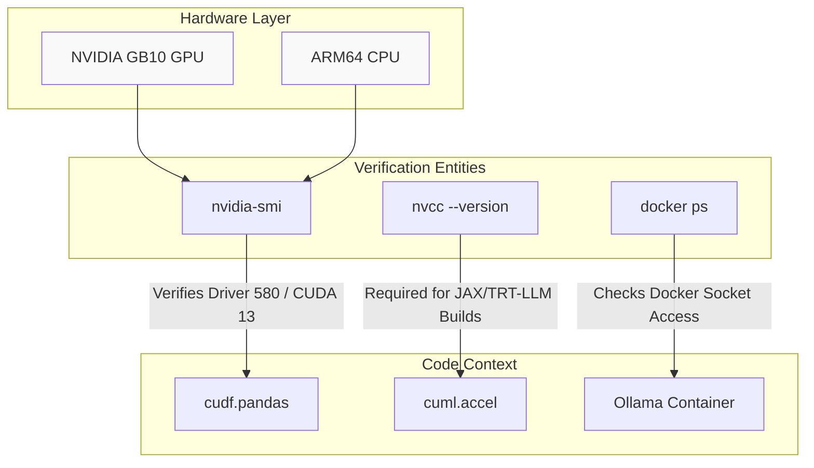
**Sources:** [nvidia/cuda-x-data-science/README.md:42-45](), [nvidia/cuda-x-data-science/assets/cudf_pandas_demo.ipynb:49-60](), [nvidia/open-webui/README.md:53-57]()

---

## Network and Access Requirements

### Local Network Access

The Spark device must be reachable from your development machine (laptop/workstation).

| Access Method | Requirement | Notes |
|--------------|-------------|-------|
| **mDNS** | Avahi/Bonjour | Connect via `spark-abcd.local` [nvidia/connect-to-your-spark/README.md:38-41]() |
| **NVIDIA Sync** | Desktop App | Recommended for SSH and port tunneling [nvidia/connect-to-your-spark/README.md:23-24]() |
| **SSH** | Port 22 | Key-based auth is configured by NVIDIA Sync [nvidia/connect-to-your-spark/README.md:150-154]() |

### Port Requirements for Playbooks

Standard ports used across the playbook collection:

| Port | Service | Playbook Context |
|------|---------|------------------|
| **11000** | DGX Dashboard | System Management [nvidia/connect-to-your-spark/README.md:122]() |
| **12000** | Open WebUI | Local Chat Interface [nvidia/open-webui/README.md:97]() |
| **8888** | Jupyter Notebook | Data Science / RAPIDS [nvidia/cuda-x-data-science/README.md:68-71]() |

**Sources:** [nvidia/connect-to-your-spark/README.md:32-41](), [nvidia/open-webui/README.md:90-100]()

---

## Authentication and External Credentials

### 1. NVIDIA GPU Cloud (NGC) API Key
Required to pull optimized Blackwell containers (TensorRT-LLM, NIM, NeMo).
- **Username**: `$oauthtoken`
- **Password**: Your API Key

### 2. Kaggle API Key
Required specifically for the **CUDA-X Data Science** playbooks to download datasets (e.g., LinkedIn jobs dataset).
- **File**: `kaggle.json` must be placed in the notebook folder [nvidia/cuda-x-data-science/README.md:45]().

### 3. Hugging Face Token
Required for gated models (LLaMA 3, etc.) used in Fine-tuning and Inference playbooks.

---

## Implementation Detail: Docker Permissions

Many playbooks (e.g., Open WebUI) require running Docker without `sudo` for NVIDIA Sync integration.

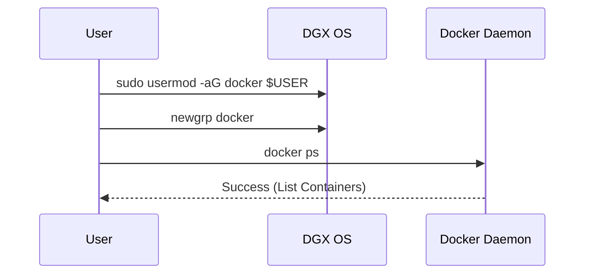
**Sources:** [nvidia/open-webui/README.md:59-64]()

---

## Unified Memory Architecture (UMA) Considerations

DGX Spark uses UMA where 128GB is shared. Playbooks often require memory management to prevent OOM (Out of Memory) errors during large model loads.

**Key Practice: Buffer Cache Flushing**
When switching between heavy workloads (e.g., from Fine-tuning to Inference), it is recommended to flush the system buffer cache to reclaim UMA space.
```bash
sudo sh -c 'sync; echo 3 > /proc/sys/vm/drop_caches'
```
**Sources:** [nvidia/vllm/README.md:191-197]() (Note: Reference to memory management strategies in associated inference playbooks).

---

## Summary Checklist

Before starting any playbook, verify the following:
1. [ ] `nvidia-smi` shows Driver `580.xx` and `CUDA 13.0`.
2. [ ] `docker ps` runs without `sudo`.
3. [ ] `nvidia-sync` is installed on your laptop for remote access.
4. [ ] NGC API Key is configured via `docker login nvcr.io`.
5. [ ] For Data Science: `kaggle.json` is available.

**Sources:** [nvidia/cuda-x-data-science/README.md:42-45](), [nvidia/open-webui/README.md:49-64](), [nvidia/connect-to-your-spark/README.md:75-80]()

---

# Page: Connecting to Your Spark

# Connecting to Your Spark

<details>
<summary>Relevant source files</summary>

The following files were used as context for generating this wiki page:

- [nvidia/connect-to-your-spark/README.md](nvidia/connect-to-your-spark/README.md)
- [nvidia/open-webui/README.md](nvidia/open-webui/README.md)

</details>


This page covers local network access methods for connecting to your DGX Spark device from a laptop or desktop computer on the same network. You will learn how to use NVIDIA Sync for streamlined device management, or configure manual SSH access for direct command-line control. Both methods enable terminal sessions, port forwarding, and remote application access.

For secure remote access from outside your local network, see [Setting Up Remote Access with Tailscale](2.3).

## Connection Architecture

The DGX Spark device provides multiple connection pathways depending on your workflow requirements. All methods operate over your local network and require the device to be on the same subnet as your client machine.

**Connection Overview Diagram**
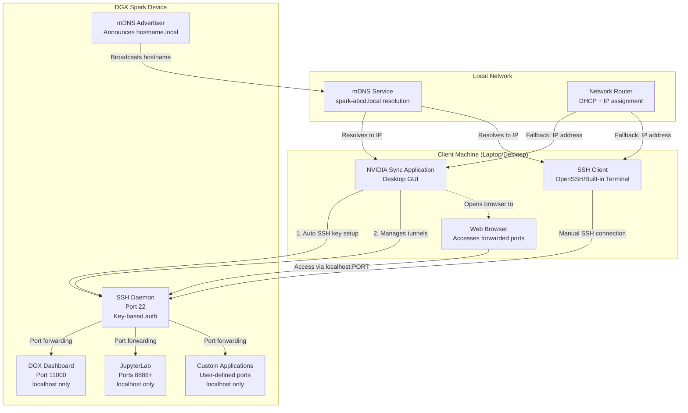

**Sources:** [nvidia/connect-to-your-spark/README.md:14-66]()

## Network Discovery: mDNS Resolution

DGX Spark devices advertise their presence on the local network using mDNS (Multicast DNS), allowing hostname-based discovery without manual IP configuration. The hostname follows the pattern `spark-<identifier>.local`, where the identifier is printed on the Quick Start Guide included with your device [nvidia/connect-to-your-spark/README.md:38-41]().

**mDNS Resolution Sequence**
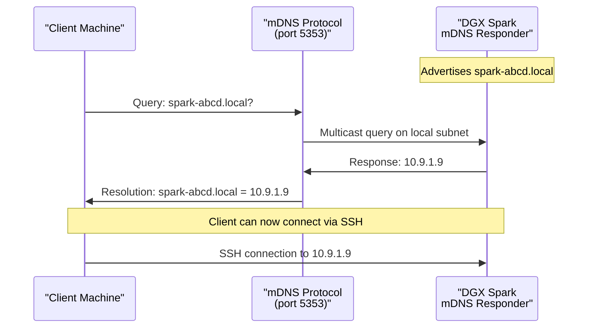

### Testing mDNS Availability

mDNS may not function in complex corporate networks with multicast filtering. Test hostname resolution before proceeding:

```bash
ping spark-abcd.local
```

Successful resolution shows IP address responses. If resolution fails, you must use the device's IP address directly, which can be found in Ubuntu's network settings or the DGX Dashboard [nvidia/connect-to-your-spark/README.md:132-138]().

**Sources:** [nvidia/connect-to-your-spark/README.md:38-41](), [nvidia/connect-to-your-spark/README.md:132-138]()

## NVIDIA Sync Connection Method

NVIDIA Sync is a desktop application that automates SSH key provisioning and manages persistent connections for development tools [nvidia/connect-to-your-spark/README.md:77-80]().

**NVIDIA Sync Component Architecture**
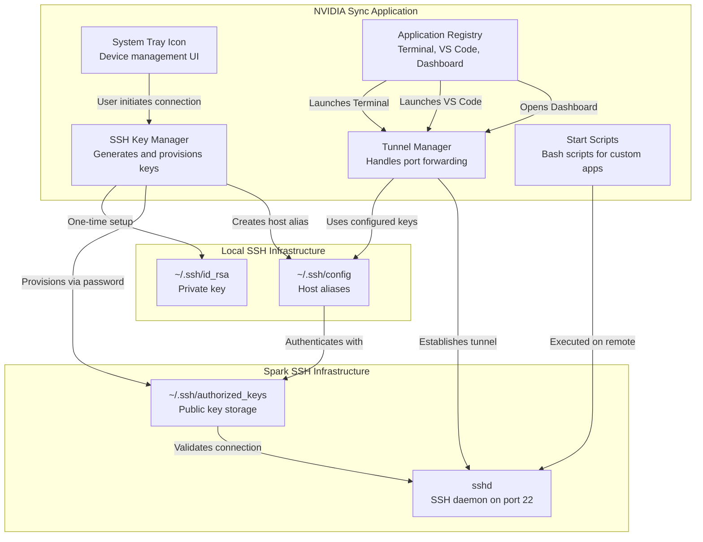

### Device Provisioning Workflow

When adding a DGX Spark device, NVIDIA Sync executes the following sequence:

1. **Key Generation**: Creates SSH key pair on your laptop [nvidia/connect-to-your-spark/README.md:152]().
2. **Password Authentication**: Uses provided password for initial connection only [nvidia/connect-to-your-spark/README.md:153]().
3. **Key Provisioning**: Adds public key to `~/.ssh/authorized_keys` on Spark [nvidia/connect-to-your-spark/README.md:154]().
4. **Alias Creation**: Creates a local SSH alias for future connections [nvidia/connect-to-your-spark/README.md:155]().
5. **Credential Disposal**: Discards username and password after setup [nvidia/connect-to-your-spark/README.md:156]().

**Sources:** [nvidia/connect-to-your-spark/README.md:73-160]()

## SSH Port Forwarding and Custom Apps

SSH tunneling (port forwarding) securely maps a port on your laptop to a port on the DGX Spark where an app is listening [nvidia/connect-to-your-spark/README.md:32-34]().

### Custom Application Integration

NVIDIA Sync allows users to define "Custom Ports" with associated bash start scripts. These scripts manage the lifecycle of Docker containers on the remote Spark device.

**Custom App Data Flow**
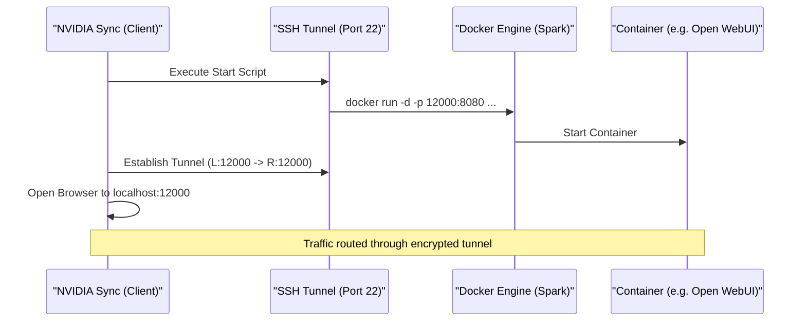

A typical start script, such as the one used for Open WebUI, follows this pattern [nvidia/open-webui/README.md:101-142]():
- **Cleanup Trap**: Uses `trap cleanup INT TERM HUP QUIT EXIT` to ensure containers stop when the tunnel closes [nvidia/open-webui/README.md:113]().
- **Container Management**: Checks if the container is already running or exists before attempting `docker run` [nvidia/open-webui/README.md:122-137]().
- **Persistence**: Keeps the script alive with a sleep loop to maintain the SSH session [nvidia/open-webui/README.md:141]().

**Sources:** [nvidia/connect-to-your-spark/README.md:32-36](), [nvidia/open-webui/README.md:99-142]()

## Manual SSH Connection Method

Manual SSH provides direct command-line control. Users can manually forward ports using the `-L` flag:

```bash
ssh -L <LOCAL_PORT>:localhost:<REMOTE_PORT> <USERNAME>@spark-abcd.local
```

| Service | Remote Port | Manual Forwarding Command |
|---------|-------------|---------------------------|
| DGX Dashboard | 11000 | `ssh -L 11000:localhost:11000 user@spark-abcd.local` |
| JupyterLab | 8888 | `ssh -L 8888:localhost:8888 user@spark-abcd.local` |
| Open WebUI | 8080 | `ssh -L 12000:localhost:8080 user@spark-abcd.local` |

**Sources:** [nvidia/connect-to-your-spark/README.md:32-36](), [nvidia/open-webui/README.md:132-135]()

## Troubleshooting

### Docker Permissions
If NVIDIA Sync fails to launch containers, ensure the user on the Spark device is in the `docker` group:
```bash
sudo usermod -aG docker $USER
newgrp docker
```
This allows running `docker ps` and other commands without `sudo`, which is required for NVIDIA Sync's automated scripts [nvidia/open-webui/README.md:59-70]().

### Connection Delays
After the first system setup, the device may take several minutes to become available on the network. If NVIDIA Sync fails, wait 3-4 minutes and retry [nvidia/connect-to-your-spark/README.md:158-160]().

**Sources:** [nvidia/connect-to-your-spark/README.md:158-160](), [nvidia/open-webui/README.md:51-70]()

---

# Page: Setting Up Remote Access with Tailscale

# Setting Up Remote Access with Tailscale

<details>
<summary>Relevant source files</summary>

The following files were used as context for generating this wiki page:

- [nvidia/nim-llm/README.md](nvidia/nim-llm/README.md)
- [nvidia/tailscale/README.md](nvidia/tailscale/README.md)
- [nvidia/vss/README.md](nvidia/vss/README.md)

</details>


## Purpose and Scope

This page documents the setup and configuration of Tailscale VPN on DGX Spark devices to enable secure remote access from anywhere. Tailscale creates an encrypted peer-to-peer mesh network (tailnet) that eliminates the need for port forwarding, dynamic DNS, or complex firewall configurations. After setup, users can SSH into their Spark device, access the DGX Dashboard, and reach containerized services using stable private IP addresses and hostnames regardless of physical network location.

For local network access using mDNS and SSH without VPN, see [Connecting to Your Spark](#2.2). For managing JupyterLab and system monitoring after establishing connectivity, see [DGX Dashboard](#2.4).

**Sources:** [nvidia/tailscale/README.md:1-43]()

## System Overview

Tailscale operates as a mesh VPN layer that sits between remote client devices and the DGX Spark infrastructure. Unlike traditional VPN architectures that route traffic through a central server, Tailscale establishes direct peer-to-peer connections between devices when possible, with automatic NAT traversal and relay fallback when direct connections cannot be established.

### Tailscale Network Architecture for DGX Spark Remote Access

```mermaid
graph TB
    subgraph "Remote_Locations"
        ["Remote Laptop<br/>Tailscale Client"] -- "Encrypted P2P Tunnel" --> TAILSCALED
        ["Work Desktop<br/>Tailscale Client"] -- "Encrypted P2P Tunnel" --> TAILSCALED
        ["Mobile Device<br/>Tailscale Client"] -- "Encrypted P2P Tunnel" --> TAILSCALED
    end
    
    subgraph "Tailscale_Control_Plane"
        COORD["Tailscale Coordination Server<br/>login.tailscale.com"]
        AUTH["Identity Provider<br/>Google/GitHub/Microsoft"]
    end
    
    subgraph "Home_Network"
        ROUTER["Home Router<br/>NAT Gateway"]
        
        subgraph "DGX_Spark_Device"
            TAILSCALED["tailscaled Service<br/>systemd unit"]
            SSHD["sshd<br/>OpenSSH Server"]
            DASHBOARD["DGX Dashboard<br/>Port 11000"]
            CONTAINERS["Docker Containers<br/>Inference/Development"]
        end
    end
    
    ["Remote Laptop<br/>Tailscale Client"] -->|"Auth via"| COORD
    ["Work Desktop<br/>Tailscale Client"] -->|"Auth via"| COORD
    ["Mobile Device<br/>Tailscale Client"] -->|"Auth via"| COORD
    TAILSCALED -->|"Register"| COORD
    
    COORD -->|"OAuth"| AUTH
    
    TAILSCALED --> SSHD
    TAILSCALED --> DASHBOARD
    TAILSCALED --> CONTAINERS
    
    ROUTER -->|"Outbound only"| COORD
```

The architecture eliminates the need for inbound port forwarding on the home router. All devices authenticate with the Tailscale coordination server, which facilitates peer discovery and key exchange. Once authenticated, devices establish encrypted tunnels directly to the Spark device, bypassing the router's NAT for inbound connections.

**Sources:** [nvidia/tailscale/README.md:28-42]()

## Network Topology and Address Assignment

Tailscale assigns each device on the tailnet a stable IP address from the `100.64.0.0/10` CGNAT range and provides DNS hostname resolution within the network.

### Tailnet IP Address Assignment and Mesh Connectivity

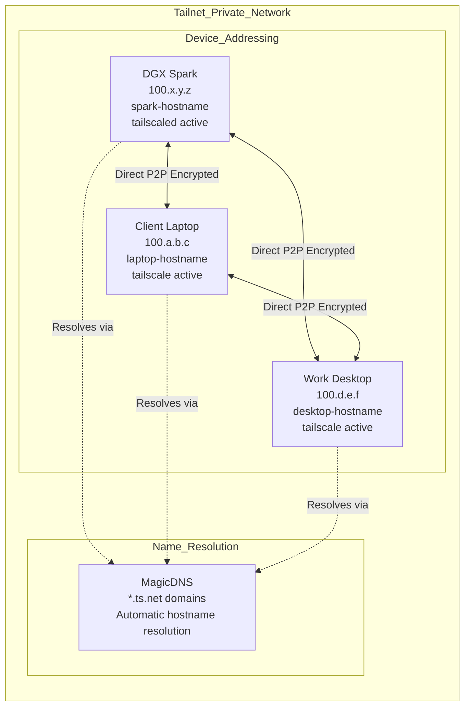

Key addressing characteristics:
- Stable IP addresses persist across network changes. [nvidia/tailscale/README.md:33-36]()
- Hostnames are derived from device names set during authentication. [nvidia/tailscale/README.md:33-36]()
- MagicDNS provides automatic name resolution without `/etc/hosts` modifications.
- All connections use WireGuard protocol for encryption.

**Sources:** [nvidia/tailscale/README.md:28-36](), [nvidia/tailscale/README.md:236-246]()

## Installation Components and File Structure

The Tailscale installation on DGX Spark (ARM64 architecture) involves multiple system components and configuration files.

### Tailscale Installation Components and File Dependencies

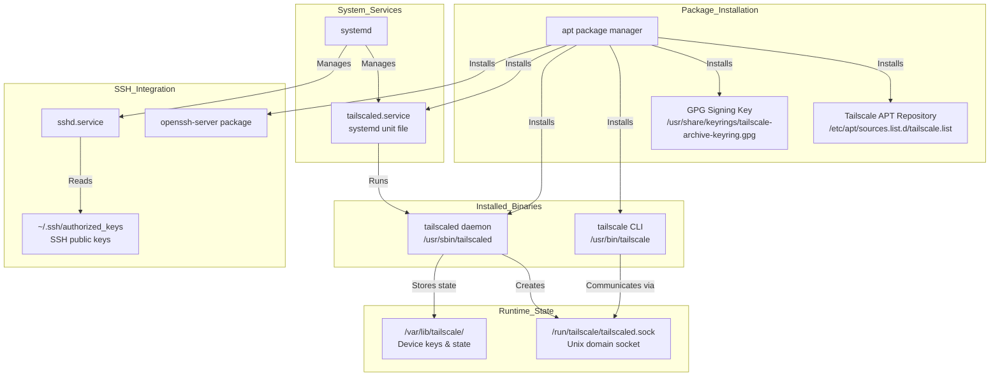

Installation creates system-level integration with the DGX OS through systemd service management. The `tailscaled` daemon runs continuously, managing network interfaces and encryption, while the `tailscale` CLI provides user-facing commands for configuration and status checking. [nvidia/tailscale/README.md:151-162]()

**Sources:** [nvidia/tailscale/README.md:116-149](), [nvidia/tailscale/README.md:98-121]()

## Authentication and Device Registration Flow

Tailscale uses OAuth-based authentication through external identity providers to establish device identity and authorization within the tailnet.

### Tailscale Authentication and Device Registration Sequence

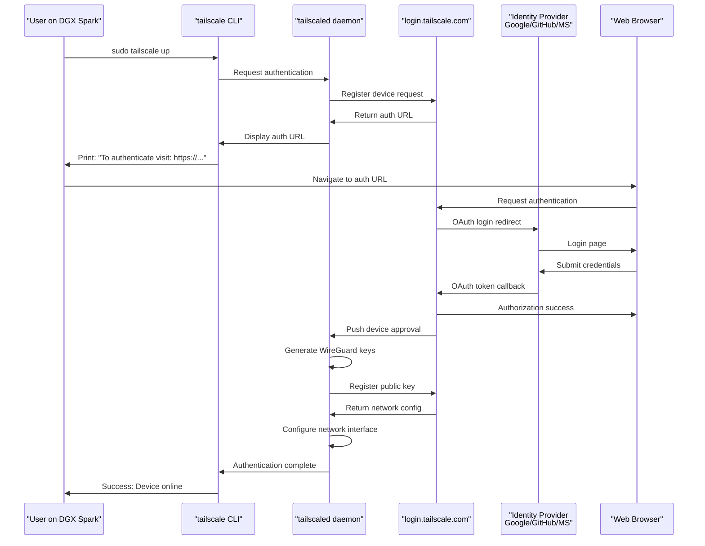

The authentication flow separates device registration from user identity verification. The `tailscale up` command initiates registration, but actual authentication occurs out-of-band through a web browser using OAuth. [nvidia/tailscale/README.md:164-175]()

**Sources:** [nvidia/tailscale/README.md:164-175](), [nvidia/tailscale/README.md:213-230]()

## SSH Key Authentication Setup

While Tailscale provides network-level connectivity, SSH requires separate key-based authentication for secure shell access. [nvidia/tailscale/README.md:248-251]()

### SSH Key Generation and Authorization Setup

```mermaid
graph TB
    subgraph "Client_Device"
        SSH_KEYGEN["ssh-keygen -t ed25519<br/>Generate key pair"]
        PRIVATE_KEY["~/.ssh/tailscale_spark<br/>Private key file<br/>chmod 600"]
        PUBLIC_KEY["~/.ssh/tailscale_spark.pub<br/>Public key file"]
    end
    
    subgraph "Transfer_Methods"
        MANUAL["Manual copy/paste<br/>cat public key"]
        SCP["scp transfer<br/>If password auth enabled"]
    end
    
    subgraph "DGX_Spark_Device"
        AUTHORIZED["~/.ssh/authorized_keys<br/>Append public key<br/>chmod 600"]
        SSH_DIR["~/.ssh/<br/>chmod 700"]
        SSHD_PROCESS["sshd process<br/>Validates keys"]
    end
    
    subgraph "SSH_Connection"
        SSH_CLIENT["ssh -i ~/.ssh/tailscale_spark<br/>user@spark-hostname"]
        SSH_AUTH["Public key authentication"]
    end
    
    SSH_KEYGEN -->|"Creates"| PRIVATE_KEY
    SSH_KEYGEN -->|"Creates"| PUBLIC_KEY
    
    PUBLIC_KEY --> MANUAL
    PUBLIC_KEY --> SCP
    
    MANUAL --> AUTHORIZED
    SCP --> AUTHORIZED
    
    AUTHORIZED -.->|"Inside"| SSH_DIR
    
    SSH_CLIENT -->|"Uses"| PRIVATE_KEY
    SSH_CLIENT -->|"Connects to"| SSHD_PROCESS
    SSHD_PROCESS -->|"Validates against"| AUTHORIZED
    SSHD_PROCESS -->|"Grants access"| SSH_AUTH
```

The SSH key setup is independent of Tailscale configuration but relies on Tailscale for network connectivity. The private key remains on the client device. The public key must be added to `~/.ssh/authorized_keys` on the Spark device with correct permissions. [nvidia/tailscale/README.md:248-287]()

**Sources:** [nvidia/tailscale/README.md:248-271](), [nvidia/tailscale/README.md:273-287]()

## Connection Workflow

Once configured, the complete connection workflow from a remote client to DGX Spark services follows this pattern:

### Remote Connection Workflow via Tailscale

```mermaid
graph TB
    subgraph "Client_Device_Operations"
        TAILSCALE_STATUS["tailscale status<br/>Verify connectivity"]
        TAILSCALE_PING["tailscale ping spark-hostname<br/>Test P2P connection"]
        SSH_CONNECT["ssh -i ~/.ssh/tailscale_spark<br/>user@spark-hostname<br/>Establish shell"]
        SSH_TUNNEL["ssh -L local:remote<br/>Port forwarding"]
        SCP_TRANSFER["scp -i key file user@host:path<br/>File transfer"]
    end
    
    subgraph "Network_Path"
        TAILNET["Tailscale Encrypted Tunnel<br/>WireGuard protocol"]
    end
    
    subgraph "DGX_Spark_Services"
        SSHD_LISTEN["sshd listening on port 22"]
        DASHBOARD_PORT["DGX Dashboard port 11000"]
        JUPYTER_PORT["JupyterLab ports 1100-1199"]
        VLLM_PORT["vLLM inference port 8000"]
        WEBUI_PORT["Open WebUI port 3000"]
    end
    
    TAILSCALE_STATUS -.->|"Check"| TAILNET
    TAILSCALE_PING -.->|"Test"| TAILNET
    
    SSH_CONNECT -->|"Via"| TAILNET
    SSH_TUNNEL -->|"Via"| TAILNET
    SCP_TRANSFER -->|"Via"| TAILNET
    
    TAILNET --> SSHD_LISTEN
    
    SSH_CONNECT -->|"Access"| SSHD_LISTEN
    SSH_TUNNEL -->|"Forward"| DASHBOARD_PORT
    SSH_TUNNEL -->|"Forward"| JUPYTER_PORT
    SSH_TUNNEL -->|"Forward"| VLLM_PORT
    SSH_TUNNEL -->|"Forward"| WEBUI_PORT
    
    SCP_TRANSFER -->|"Uses"| SSHD_LISTEN
```

Common connection patterns include:
- **Direct SSH**: `ssh -i ~/.ssh/tailscale_spark user@spark-hostname` for terminal access. [nvidia/tailscale/README.md:289-305]()
- **Port Forwarding**: Forwarding ports like 11000 for the DGX Dashboard. [nvidia/tailscale/README.md:338-344]()
- **File Transfer**: `scp` for data movement.

**Sources:** [nvidia/tailscale/README.md:273-305](), [nvidia/tailscale/README.md:338-344]()

## Installation Process

The complete installation process consists of four main phases:

### Phase 1: DGX Spark Setup
1. **Verify prerequisites**: Check Ubuntu version, internet connectivity, and sudo access. [nvidia/tailscale/README.md:81-96]()
2. **Install SSH server**: Ensure OpenSSH server is running via `systemctl`. [nvidia/tailscale/README.md:98-121]()
3. **Install Tailscale**: Add Tailscale APT repository and install the package. [nvidia/tailscale/README.md:123-149]()
4. **Authenticate device**: Run `sudo tailscale up` and complete OAuth flow. [nvidia/tailscale/README.md:164-175]()

### Phase 2: Client Device Setup
1. **Install Tailscale client**: Platform-specific installation (macOS App Store, Windows MSI, Linux APT). [nvidia/tailscale/README.md:177-211]()
2. **Authenticate client**: Connect using the same identity provider account. [nvidia/tailscale/README.md:213-230]()

### Phase 3: Connectivity Verification
1. **Check tailnet status**: Run `tailscale status` to verify both devices appear. [nvidia/tailscale/README.md:232-246]()
2. **Test P2P connectivity**: Use `tailscale ping <hostname>` to confirm direct connection. [nvidia/tailscale/README.md:232-246]()

### Phase 4: SSH Configuration
1. **Generate SSH keys**: Create an ed25519 key pair on the client device. [nvidia/tailscale/README.md:248-260]()
2. **Add public key**: Append to `~/.ssh/authorized_keys` on the Spark device. [nvidia/tailscale/README.md:262-271]()
3. **Test SSH connection**: Verify `ssh -i ~/.ssh/tailscale_spark user@spark-hostname` works. [nvidia/tailscale/README.md:273-287]()

**Sources:** [nvidia/tailscale/README.md:81-287]()

## Integration with DGX Spark Services

Tailscale provides the network layer for accessing all DGX Spark services remotely.

| Service | Local Port | Access Method | Example Command |
|---------|-----------|---------------|-----------------|
| SSH | 22 | Direct connection | `ssh user@spark-hostname` |
| DGX Dashboard | 11000 | Port forwarding | `ssh -L 11000:localhost:11000 user@spark-hostname` |
| JupyterLab | 1100-1199 | Port forwarding | `ssh -L 8888:localhost:1102 user@spark-hostname` |
| vLLM Inference | 8000 | Port forwarding | `ssh -L 8000:localhost:8000 user@spark-hostname` |
| Open WebUI | 3000 | Port forwarding | `ssh -L 3000:localhost:3000 user@spark-hostname` |
| Ollama | 11434 | Port forwarding | `ssh -L 11434:localhost:11434 user@spark-hostname` |

**Sources:** [nvidia/tailscale/README.md:338-344]()

## Security Considerations

Tailscale implements multiple security layers:
1. **Device Authentication**: OAuth-based registration through trusted identity providers. [nvidia/tailscale/README.md:164-175]()
2. **Network Encryption**: WireGuard protocol with automatic key rotation.
3. **SSH Authentication**: Separate key-based authentication layer for shell access. [nvidia/tailscale/README.md:248-251]()
4. **Service Isolation**: SSH required for accessing containerized services.

**Sources:** [nvidia/tailscale/README.md:28-36](), [nvidia/tailscale/README.md:248-251]()

## Troubleshooting

Common issues and resolutions when setting up Tailscale on DGX Spark:

| Symptom | Cause | Resolution |
|---------|-------|------------|
| `tailscale up` authentication fails | Network connectivity to `login.tailscale.com` blocked | Verify internet connectivity. [nvidia/tailscale/README.md:92]() |
| SSH connection refused | SSH daemon not running | Run `sudo systemctl enable ssh --now`. [nvidia/tailscale/README.md:117]() |
| SSH authentication failure | Public key not in `authorized_keys` | Verify key and permissions. [nvidia/tailscale/README.md:262-271]() |
| Cannot ping Spark hostname | DNS resolution failure | Use IP from `tailscale status`. [nvidia/tailscale/README.md:232-246]() |

**Sources:** [nvidia/tailscale/README.md:346-355]()

## Cleanup and Removal

To completely remove Tailscale from DGX Spark:
```bash
sudo tailscale down
sudo apt remove tailscale
```
Tailscale can be completely removed and all network routing automatically reverts to default settings. [nvidia/tailscale/README.md:75]()

**Sources:** [nvidia/tailscale/README.md:75](), [nvidia/tailscale/README.md:312-335]()

---

# Page: DGX Dashboard

# DGX Dashboard

<details>
<summary>Relevant source files</summary>

The following files were used as context for generating this wiki page:

- [nvidia/dgx-dashboard/README.md](nvidia/dgx-dashboard/README.md)
- [nvidia/jax/README.md](nvidia/jax/README.md)
- [nvidia/sglang/README.md](nvidia/sglang/README.md)
- [nvidia/txt2kg/README.md](nvidia/txt2kg/README.md)
- [nvidia/unsloth/README.md](nvidia/unsloth/README.md)

</details>


The DGX Dashboard is a web-based management interface that provides system administration, GPU monitoring, and JupyterLab orchestration capabilities for DGX Spark devices. It serves as the primary tool for managing system updates, launching isolated development environments, and monitoring hardware resources on port 11000. [nvidia/dgx-dashboard/README.md:1-17]()

This page covers the dashboard's architecture, access methods, authentication flow, and JupyterLab management.

## Architecture Overview

The DGX Dashboard operates as a privileged system service with direct access to package management, firmware updates, and JupyterLab process orchestration. The service manages per-user JupyterLab instances with isolated port assignments and virtual environments. [nvidia/dgx-dashboard/README.md:17-21]()

### System Component Map
The following diagram maps high-level dashboard features to their underlying code-level entities and configuration files.

```mermaid
graph TB
    subgraph "Access_Layer"
        Desktop["'Desktop Shortcut'"]
        NVIDIASync["'NVIDIA Sync'"]
        ManualSSH["'Manual SSH Tunnel'"]
    end
    
    subgraph "DGX_Dashboard_Service"
        WebApp["'Web Application'<br/>Port 11000"]
        PortManager["'jupyterlab_ports.yaml'"]
        ProcessMgr["'JupyterLab Lifecycle'"]
        UpdateMgr["'Update Manager'<br/>apt/firmware"]
        Monitor["'GPU Telemetry'<br/>nvidia-smi"]
    end
    
    subgraph "User_Environments"
        UserJL["'JupyterLab Instance'<br/>/home/user/jupyterlab"]
        VenvMgr["'Virtual Environment'<br/>requirements.txt"]
    end
    
    subgraph "System_Resources"
        GPU["'Blackwell GPU'<br/>nvidia-smi"]
        Packages["'System Packages'<br/>apt update"]
    end
    
    Desktop --> WebApp
    NVIDIASync --> WebApp
    ManualSSH --> WebApp
    
    WebApp --> PortManager
    WebApp --> ProcessMgr
    WebApp --> UpdateMgr
    WebApp --> Monitor
    
    PortManager --> UserJL
    ProcessMgr --> UserJL
    ProcessMgr --> VenvMgr
    
    Monitor --> GPU
    UpdateMgr --> Packages
```
**Diagram 1: DGX Dashboard System Architecture**

Sources: [nvidia/dgx-dashboard/README.md:17-21](), [nvidia/dgx-dashboard/README.md:77-86]()

## Access Methods

Three distinct methods provide access to the dashboard, each with different network topology and authentication requirements. [nvidia/dgx-dashboard/README.md:52-54]()

### Access Method Topology
This diagram illustrates how external connections reach the `dgx-dashboard-service` via different transport mechanisms.

```mermaid
graph LR
    subgraph "Local_Access"
        AppLauncher["'Ubuntu App Launcher'"]
        LocalBrowser["'Browser'<br/>localhost:11000"]
    end
    
    subgraph "Remote_Access_Sync"
        SyncTray["'NVIDIA Sync Tray'"]
        AutoTunnel["'Automatic SSH Tunnel'"]
    end
    
    subgraph "Remote_Access_Manual"
        SSHClient["'SSH Client'"]
        ManualTunnel["'ssh -L 11000:localhost:11000'"]
    end
    
    subgraph "DGX_Spark_Host"
        DashboardSvc["'dgx-dashboard-service'<br/>Port 11000"]
        Config["'/opt/nvidia/dgx-dashboard-service/jupyterlab_ports.yaml'"]
    end
    
    AppLauncher --> LocalBrowser
    LocalBrowser --> DashboardSvc
    
    SyncTray --> AutoTunnel
    AutoTunnel --> DashboardSvc
    
    SSHClient --> Config
    Config --> ManualTunnel
    ManualTunnel --> DashboardSvc
```
**Diagram 2: Access Method Topologies**

Sources: [nvidia/dgx-dashboard/README.md:56-101]()

### Port Discovery and Manual Tunneling
For manual remote access, users must discover their assigned JupyterLab port from a specific system configuration file. [nvidia/dgx-dashboard/README.md:77-81]()

1. **Port Discovery**: Run `cat /opt/nvidia/dgx-dashboard-service/jupyterlab_ports.yaml` to find the mapping for your username. [nvidia/dgx-dashboard/README.md:83-86]()
2. **Tunnel Creation**: 
   ```bash
   ssh -L 11000:localhost:11000 -L <ASSIGNED_PORT>:localhost:<ASSIGNED_PORT> <USERNAME>@<SPARK_DEVICE_IP>
   ```
   [nvidia/dgx-dashboard/README.md:92-93]()

## Authentication and Environment Management

### User Authentication
The dashboard uses system-level credentials for access. [nvidia/dgx-dashboard/README.md:102-108]()
* **Username**: DGX Spark system username.
* **Password**: System password.

### JupyterLab Lifecycle
The dashboard manages the lifecycle of JupyterLab instances, transitioning through `Starting`, `Preparing`, and `Running` states. [nvidia/dgx-dashboard/README.md:112-119]()

| Phase | Actions Performed |
|:---|:---|
| **Starting** | Process initialization. |
| **Preparing** | Creates `/home/<USERNAME>/jupyterlab` and sets up a Python virtual environment. |
| **Running** | JupyterLab server active on the assigned port. |

Sources: [nvidia/dgx-dashboard/README.md:116-123]()

### Virtual Environment Configuration
A default `requirements.txt` is automatically created in the working directory. Users can isolate environments by changing the working directory path in the dashboard interface and restarting the instance. [nvidia/dgx-dashboard/README.md:121-125]()

## System Monitoring and Updates

### GPU Telemetry
The dashboard provides a real-time monitoring panel for GPU utilization. This is particularly useful during heavy workloads like Stable Diffusion XL (SDXL) generation. [nvidia/dgx-dashboard/README.md:187-193]()

### System Maintenance
The dashboard is the primary interface for performing system updates, including:
* **Package Updates**: Orchestrating `apt` updates. [nvidia/dgx-dashboard/README.md:17-18]()
* **Firmware**: Managing system firmware upgrades. [nvidia/dgx-dashboard/README.md:17-18]()

> [!IMPORTANT]
> DGX Spark uses a Unified Memory Architecture (UMA). If memory pressure occurs, you can manually flush the buffer cache using:
> `sudo sh -c 'sync; echo 3 > /proc/sys/vm/drop_caches'`
> [nvidia/dgx-dashboard/README.md:233-238]()

## Sample AI Workload: SDXL
To verify the JupyterLab environment and GPU access, the dashboard provides a sample Stable Diffusion XL script. [nvidia/dgx-dashboard/README.md:126-128]()

**Code Entity Reference**: `nvidia/dgx-dashboard/assets/jupyter-cell.py` [nvidia/dgx-dashboard/README.md:39]()

The script utilizes the `diffusers` library and `torch.float16` to generate a 1024x1024 image on the Blackwell GPU. [nvidia/dgx-dashboard/README.md:135-182]()

## Troubleshooting

| Symptom | Potential Cause | Fix |
|:---|:---|:---|
| **Login Fails** | Incorrect system credentials | Ensure you are using the OS-level username/password. [nvidia/dgx-dashboard/README.md:106-108]() |
| **JupyterLab Startup Hang** | First-time setup delay | The first launch can take several minutes to build the venv. [nvidia/dgx-dashboard/README.md:118-119]() |
| **GPU Not Detected** | Driver or UMA cache issue | Flush buffer cache with `sync; echo 3 > /proc/sys/vm/drop_caches`. [nvidia/dgx-dashboard/README.md:237-238]() |
| **Remote Access Denied** | SSH Tunnel missing | Ensure both port 11000 and the user-specific Jupyter port are forwarded. [nvidia/dgx-dashboard/README.md:92-93]() |

Sources: [nvidia/dgx-dashboard/README.md:118-119](), [nvidia/dgx-dashboard/README.md:233-238]()

---

# Page: Your First Application: Open WebUI

# Your First Application: Open WebUI

<details>
<summary>Relevant source files</summary>

The following files were used as context for generating this wiki page:

- [nvidia/connect-to-your-spark/README.md](nvidia/connect-to-your-spark/README.md)
- [nvidia/ollama/README.md](nvidia/ollama/README.md)
- [nvidia/open-webui/README.md](nvidia/open-webui/README.md)

</details>


## Purpose and Scope

This page guides you through deploying Open WebUI with Ollama as your first AI application on DGX Spark. It demonstrates core concepts including Docker container management, GPU passthrough, port forwarding, and persistent storage that apply to most applications in this repository. 

For information about SSH and network connectivity setup, see [Connecting to Your Spark](nvidia/connect-to-your-spark/README.md:1-43)(). For general system management and monitoring, see [DGX Dashboard](nvidia/connect-to-your-spark/README.md:122-122)(). For deploying other inference engines beyond Ollama, see [Inference Systems](nvidia/ollama/README.md:210-222)().

---

## System Overview

Open WebUI is a self-hosted web interface for interacting with large language models through a chat-based UI. This deployment uses the integrated Ollama variant, which packages both the Open WebUI frontend and the Ollama model server in a single container.

**Core Components:**

- **Open WebUI**: Web application serving the chat interface on port 8080 [nvidia/open-webui/README.md:132-132]().
- **Ollama**: Local model server handling model downloads, quantization, and inference [nvidia/open-webui/README.md:167-168]().
- **Docker Container**: `ghcr.io/open-webui/open-webui:ollama` image from GitHub Container Registry [nvidia/open-webui/README.md:77-77]().
- **Persistent Volumes**: `open-webui` (application data) and `open-webui-ollama` (model storage) [nvidia/open-webui/README.md:133-134]().
- **GPU Access**: NVIDIA Container Toolkit passes GPU through to container via `--gpus=all` flag [nvidia/open-webui/README.md:132-132]().

**Access Methods:**

1. **Direct Access**: Container exposes port 8080, accessible via SSH tunnel to `localhost:8080`.
2. **NVIDIA Sync**: Managed port forwarding to `localhost:12000` with automatic container lifecycle management [nvidia/open-webui/README.md:90-98]().

Sources: [nvidia/open-webui/README.md:1-40](), [nvidia/open-webui/README.md:132-135]()

---

## Architecture: Container Components

```mermaid
graph TB
    subgraph "Host System (DGX Spark)"
        DOCKER["Docker Engine"]
        GPU["Blackwell GPU<br/>via --gpus=all"]
        
        subgraph "Container: open-webui"
            WEBUI["Open WebUI Frontend<br/>Port 8080"]
            OLLAMA_SERVER["Ollama Server<br/>Model Management"]
            BACKEND["Backend Data<br/>/app/backend/data"]
            MODELS["Model Storage<br/>/root/.ollama"]
        end
        
        VOL_DATA["Docker Volume<br/>open-webui"]
        VOL_OLLAMA["Docker Volume<br/>open-webui-ollama"]
    end
    
    subgraph "Client Machine"
        BROWSER["Web Browser<br/>localhost:8080 or :12000"]
        SSH_TUNNEL["SSH Tunnel<br/>Port Forwarding"]
    end
    
    DOCKER --> GPU
    DOCKER --> VOL_DATA
    DOCKER --> VOL_OLLAMA
    
    GPU --> OLLAMA_SERVER
    VOL_DATA --> BACKEND
    VOL_OLLAMA --> MODELS
    
    WEBUI --> OLLAMA_SERVER
    OLLAMA_SERVER --> MODELS
    
    SSH_TUNNEL --> WEBUI
    BROWSER --> SSH_TUNNEL
```

**Component Mapping to Docker Configuration:**

| Component | Docker Construct | Purpose |
|-----------|-----------------|---------|
| `open-webui` | Container name (`--name`) | Instance identifier for lifecycle management [nvidia/open-webui/README.md:135-135]() |
| `ghcr.io/open-webui/open-webui:ollama` | Image reference | Combined Open WebUI + Ollama distribution [nvidia/open-webui/README.md:106-106]() |
| `-p 12000:8080` | Port mapping | Exposes container port 8080 to host port 12000 [nvidia/open-webui/README.md:132-132]() |
| `--gpus=all` | GPU passthrough | Grants container access to Blackwell GPU [nvidia/open-webui/README.md:132-132]() |
| `-v open-webui:/app/backend/data` | Volume mount | Persists user accounts, chat history, settings [nvidia/open-webui/README.md:133-133]() |
| `-v open-webui-ollama:/root/.ollama` | Volume mount | Persists downloaded models and configurations [nvidia/open-webui/README.md:134-134]() |

Sources: [nvidia/open-webui/README.md:101-142]()

---

## Architecture: Deployment Flow

```mermaid
sequenceDiagram
    participant User
    participant Docker as "Docker Engine"
    participant GHCR as "ghcr.io Registry"
    participant Container as "open-webui Container"
    participant GPU as "Blackwell GPU"
    participant Volume as "Docker Volumes"
    
    User->>Docker: docker pull ghcr.io/open-webui/open-webui:ollama
    Docker->>GHCR: Pull image request
    GHCR-->>Docker: Image layers
    
    User->>Docker: docker run -d -p 12000:8080 --gpus=all<br/>-v open-webui:/app/backend/data<br/>-v open-webui-ollama:/root/.ollama<br/>--name open-webui
    Docker->>Volume: Create volumes if not exist
    Docker->>Container: Start container with GPU access
    Container->>GPU: Initialize CUDA runtime
    Container->>Volume: Mount volumes
    Container-->>Docker: Container ID
    
    User->>Container: Access via SSH tunnel to localhost:12000
    Container-->>User: Open WebUI interface
    
    User->>Container: Pull model via Ollama (e.g., gpt-oss:20b)
    Container->>Volume: Store model in open-webui-ollama volume
    Container->>GPU: Load model for inference
```

Sources: [nvidia/open-webui/README.md:76-78](), [nvidia/open-webui/README.md:132-135](), [nvidia/open-webui/README.md:170-175]()

---

## Deployment Option 1: Manual Docker

This approach directly uses Docker commands on the DGX Spark device. It requires SSH access and manual port forwarding.

### Prerequisites Verification

Ensure Docker group membership to avoid requiring `sudo` for every command [nvidia/open-webui/README.md:51-51]():

```bash
# Test Docker access
docker ps

# If permission denied, add user to docker group
sudo usermod -aG docker $USER
newgrp docker

# Verify access
docker ps
```

Sources: [nvidia/open-webui/README.md:49-70]()

### Container Deployment

Pull the image from GitHub Container Registry [nvidia/open-webui/README.md:77-77]():

```bash
docker pull ghcr.io/open-webui/open-webui:ollama
```

Start the container with GPU access and persistent volumes [nvidia/open-webui/README.md:132-135]():

```bash
docker run -d -p 8080:8080 --gpus=all \
  -v open-webui:/app/backend/data \
  -v open-webui-ollama:/root/.ollama \
  --name open-webui ghcr.io/open-webui/open-webui:ollama
```

**Runtime Configuration Flags:**

| Flag | Value | Effect |
|------|-------|--------|
| `-d` | N/A | Detached mode - container runs in background |
| `-p` | `8080:8080` | Maps container port 8080 to host port 8080 |
| `--gpus` | `all` | Grants access to all GPUs [nvidia/open-webui/README.md:132-132]() |
| `-v` | `open-webui:/app/backend/data` | Named volume for application data persistence [nvidia/open-webui/README.md:133-133]() |
| `-v` | `open-webui-ollama:/root/.ollama` | Named volume for Ollama model storage [nvidia/open-webui/README.md:134-134]() |
| `--name` | `open-webui` | Container identifier for lifecycle commands [nvidia/open-webui/README.md:135-135]() |

Sources: [nvidia/open-webui/README.md:72-81](), [nvidia/open-webui/README.md:132-135]()

### Port Forwarding Setup

Establish SSH tunnel from local machine to access the web interface [nvidia/connect-to-your-spark/README.md:32-36]():

```bash
# From your local machine, not on DGX Spark
ssh -L 8080:localhost:8080 <USERNAME>@<SPARK_HOSTNAME>.local
```

Access the interface at `http://localhost:8080` in your local browser.

Sources: [nvidia/connect-to-your-spark/README.md:18-41]()

---

## Deployment Option 2: NVIDIA Sync Custom Port

NVIDIA Sync automates container lifecycle management and port forwarding through a start script [nvidia/open-webui/README.md:90-91]().

### Start Script Architecture

```mermaid
graph TB
    subgraph "NVIDIA Sync Client"
        TRAY["System Tray Icon"]
        SETTINGS["Settings > Custom Tab"]
        CUSTOM_PORT["Custom Port: Open WebUI<br/>Port 12000"]
    end
    
    subgraph "Start Script Execution (on DGX Spark)"
        SCRIPT_START["Script Start"]
        DOCKER_CHECK["Check docker info"]
        CONTAINER_CHECK["Check container status:<br/>docker ps -q --filter name=open-webui"]
        
        RUNNING{"Already<br/>running?"}
        EXISTS{"Container<br/>exists?"}
        
        START_EXISTING["docker start open-webui"]
        CREATE_NEW["docker run -d -p 12000:8080 --gpus=all<br/>-v open-webui:/app/backend/data<br/>-v open-webui-ollama:/root/.ollama<br/>--name open-webui"]
        
        WAIT_SIGNAL["while :; do sleep 86400; done<br/>Wait for termination signal"]
        CLEANUP["trap cleanup INT TERM HUP QUIT EXIT<br/>docker stop open-webui"]
    end
    
    subgraph "SSH Tunnel"
        FORWARD["localhost:12000 -> spark:12000"]
    end
    
    TRAY --> CUSTOM_PORT
    CUSTOM_PORT --> SCRIPT_START
    
    SCRIPT_START --> DOCKER_CHECK
    DOCKER_CHECK --> CONTAINER_CHECK
    CONTAINER_CHECK --> RUNNING
    
    RUNNING -->|Yes| WAIT_SIGNAL
    RUNNING -->|No| EXISTS
    
    EXISTS -->|Yes| START_EXISTING
    EXISTS -->|No| CREATE_NEW
    
    START_EXISTING --> WAIT_SIGNAL
    CREATE_NEW --> WAIT_SIGNAL
    
    WAIT_SIGNAL -.->|User clicks X| CLEANUP
    
    CUSTOM_PORT -.->|Automatic| FORWARD
```

Sources: [nvidia/open-webui/README.md:102-142]()

### Custom Port Configuration

Configure the custom port in NVIDIA Sync Settings [nvidia/open-webui/README.md:83-87]():

**Form Values:**

- **Name**: `Open WebUI` [nvidia/open-webui/README.md:96-96]()
- **Port**: `12000` [nvidia/open-webui/README.md:97-97]()
- **Auto open in browser**: Enabled [nvidia/open-webui/README.md:98-98]()
- **Start Script**: [nvidia/open-webui/README.md:102-142]()

**Key Script Components:**

| Script Section | Lines | Purpose |
|----------------|-------|---------|
| Signal handlers | [nvidia/open-webui/README.md:108-113]() | Trap termination signals to stop container cleanly |
| Docker availability check | [nvidia/open-webui/README.md:116-119]() | Verify Docker daemon is reachable |
| Container status logic | [nvidia/open-webui/README.md:122-137]() | Start existing or create new container as needed |
| Keep-alive loop | [nvidia/open-webui/README.md:141-141]() | Maintain script execution for tunnel lifetime |

Sources: [nvidia/open-webui/README.md:101-142]()

---

## Initial Configuration

### Administrator Account Creation

On first access, Open WebUI requires creating an initial administrator account [nvidia/open-webui/README.md:159-159]().

1. Click "Get Started" button in the interface [nvidia/open-webui/README.md:161-161]()
2. Fill out account creation form (username, email, password) [nvidia/open-webui/README.md:162-162]()
3. Click registration button to access the main interface [nvidia/open-webui/README.md:163-163]()

Sources: [nvidia/open-webui/README.md:157-164]()

### Model Download via Ollama

Models are downloaded through the UI and stored in the `open-webui-ollama` volume [nvidia/open-webui/README.md:167-168]().

**Example: Downloading `gpt-oss:20b`**

1. Click "Select a model" dropdown [nvidia/open-webui/README.md:170-170]()
2. Type model name in search field (e.g., `gpt-oss:20b`) [nvidia/open-webui/README.md:171-171]()
3. Click "Pull 'gpt-oss:20b' from Ollama.com" button [nvidia/open-webui/README.md:172-172]()
4. Monitor download progress and select once complete [nvidia/open-webui/README.md:173-174]()

**Model Storage Architecture:**

```mermaid
graph LR
    UI["Open WebUI Interface<br/>Model Selection"]
    OLLAMA["Ollama Server<br/>in Container"]
    REGISTRY["Ollama Registry<br/>ollama.com"]
    VOLUME["Docker Volume<br/>open-webui-ollama<br/>/root/.ollama"]
    GPU["GPU Memory<br/>Loaded Model"]
    
    UI --> OLLAMA
    OLLAMA --> REGISTRY
    REGISTRY -.->|Download| OLLAMA
    OLLAMA --> VOLUME
    VOLUME -.->|Load on inference| GPU
```

Sources: [nvidia/open-webui/README.md:165-175](), [nvidia/ollama/README.md:81-101]()

---

## Post-Deployment Operations

### Testing Inference

Verify the complete stack by sending a test prompt [nvidia/open-webui/README.md:177-178]():

1. Ensure model is selected in dropdown [nvidia/open-webui/README.md:174-174]()
2. Enter prompt: `Write me a haiku about GPUs` [nvidia/open-webui/README.md:180-180]()
3. Press Enter and observe response [nvidia/open-webui/README.md:181-181]()

Sources: [nvidia/open-webui/README.md:177-182]()

### Stopping the Application

To reclaim resources, stop the Open WebUI server [nvidia/open-webui/README.md:183-184]():

1. Click NVIDIA Sync system tray icon [nvidia/open-webui/README.md:187-187]()
2. Click the `x` icon on the right of the "Open WebUI" entry [nvidia/open-webui/README.md:188-188]()
3. This closes the tunnel and stops the Docker container [nvidia/open-webui/README.md:189-189]()

Sources: [nvidia/open-webui/README.md:183-190]()

---

## Troubleshooting

| Symptom | Cause | Resolution |
|---------|-------|------------|
| `Permission denied` on `docker ps` | User not in `docker` group | Execute `sudo usermod -aG docker $USER && newgrp docker` [nvidia/open-webui/README.md:59-64]() |
| Page fails to load on first launch | Model download in progress | Wait and refresh the page [nvidia/open-webui/README.md:154-154]() |
| `ollama` command not found | Ollama not installed | Run `curl -fsSL https://ollama.com/install.sh | sh` [nvidia/ollama/README.md:76-76]() |

Sources: [nvidia/open-webui/README.md:59-64](), [nvidia/open-webui/README.md:153-155](), [nvidia/ollama/README.md:61-76]()

---

# Page: Development Environments

# Development Environments

<details>
<summary>Relevant source files</summary>

The following files were used as context for generating this wiki page:

- [nvidia/comfy-ui/README.md](nvidia/comfy-ui/README.md)
- [nvidia/rag-ai-workbench/README.md](nvidia/rag-ai-workbench/README.md)
- [nvidia/vibe-coding/README.md](nvidia/vibe-coding/README.md)
- [nvidia/vscode/README.md](nvidia/vscode/README.md)

</details>


This page provides an overview of development tools and interfaces available for DGX Spark, including AI-assisted coding, interactive notebooks, and GPU-accelerated data science environments. These environments leverage the NVIDIA Grace Blackwell GB10 Superchip and its Unified Memory Architecture (UMA) for high-performance development.

For detailed setup instructions, see the child pages: [VS Code and Vibe Coding](#3.1), [JupyterLab](#3.2), [Optimized JAX](#3.3), [CUDA-X Data Science](#3.4), [LM Studio](#3.5), and [CLI Coding Agent and OpenShell Sandbox](#3.6).

## Architecture Overview

DGX Spark development environments are architected to support both local and remote workflows. The system utilizes containerization and specialized drivers to expose Blackwell GPU capabilities to high-level IDEs and frameworks.

### Development Environment Stack

```mermaid
graph TB
    subgraph "Hardware & OS"
        Hardware["DGX Spark<br/>GB10 Superchip<br/>128GB UMA"]
        OS["Ubuntu Desktop<br/>ARM64 / aarch64"]
        Drivers["NVIDIA Drivers<br/>CUDA 13.0+"]
    end

    subgraph "Execution Layer"
        Docker["Docker Engine<br/>nvidia-container-toolkit"]
        OllamaSvc["Ollama Service<br/>Port 11434"]
        DashboardSvc["dgx-dashboard-service<br/>Port 11000"]
    end

    subgraph "Interfaces"
        VSCode["VS Code / Continue.dev<br/>(Local or Remote)"]
        Jupyter["JupyterLab<br/>(via Dashboard)"]
        CLI["CLI Agents<br/>(OpenShell/NemoClaw)"]
        WebUI["Web Interfaces<br/>(ComfyUI/Open WebUI)"]
    end

    Hardware --> OS
    OS --> Drivers
    Drivers --> Docker
    Drivers --> OllamaSvc
    Docker --> DashboardSvc
    OllamaSvc --> VSCode
    DashboardSvc --> Jupyter
    Docker --> CLI
    Docker --> WebUI
```

Sources: [nvidia/vibe-coding/README.md:33-36](), [nvidia/vscode/README.md:61-63](), [nvidia/comfy-ui/README.md:37-46](), [nvidia/rag-ai-workbench/README.md:40-48]()

## Core Development Environments

### VS Code and Vibe Coding
DGX Spark supports "Vibe Coding"—using AI-assisted development tools like the **Continue** extension paired with local LLMs. You can install VS Code directly on the ARM64 Spark system or connect remotely from a workstation using **NVIDIA Sync**. By running **Ollama** with large models like `gpt-oss:120b`, the system acts as a high-performance private coding assistant.

For details, see [VS Code and Vibe Coding](#3.1).

### JupyterLab
Accessible via the **DGX Dashboard** at port `11000`, JupyterLab provides a managed environment for interactive Python development. It automatically handles GPU passthrough and per-user port assignments, making it the primary interface for rapid prototyping and experimentation.

For details, see [JupyterLab](#3.2).

### Optimized JAX
JAX on Spark is optimized using XLA (Accelerated Linear Algebra) to target Blackwell GPUs. This environment is typically deployed via Docker containers and includes the **marimo** reactive notebook interface for scientific computing and ML research.

For details, see [Optimized JAX](#3.3).

### CUDA-X Data Science
This environment focuses on the RAPIDS ecosystem, including `cuDF` for pandas-like GPU-accelerated dataframes and `cuML` for scikit-learn-like machine learning. It leverages the Unified Memory Architecture to process datasets larger than traditional VRAM limits.

For details, see [CUDA-X Data Science](#3.4).

### LM Studio and LM Link
For developers needing a headless LLM serving solution, **LM Studio** (`llmster`) can be deployed on Spark. Using **LM Link**, developers can establish encrypted tunnels to access these models from their local laptops as if the models were running locally.

For details, see [LM Studio](#3.5).

### CLI Coding Agents and Sandboxing
For autonomous development, Spark supports CLI-based agents like **OpenClaw** and **NemoClaw**. These agents operate within an **OpenShell** sandbox, providing a secure, kernel-level isolated environment for AI to execute code and manage system tasks without risking the host OS.

For details, see [CLI Coding Agent and OpenShell Sandbox](#3.6).

## Connectivity and Port Mapping

Most development tools on Spark expose web interfaces or APIs. Accessing these requires understanding the default port allocations:

| Service | Port | Access Method |
| :--- | :--- | :--- |
| **DGX Dashboard** | `11000` | System Management / JupyterLab |
| **Ollama API** | `11434` | VS Code / Continue / Open WebUI |
| **ComfyUI** | `8188` | Diffusion Workflows |
| **Open WebUI** | `8080` | LLM Chat Interface |
| **JupyterLab** | Dynamic | Assigned in `jupyterlab_ports.yaml` |

### Remote Access Logic

```mermaid
graph LR
    subgraph "Remote Workstation"
        Laptop["Laptop VS Code"]
        SyncClient["NVIDIA Sync Client"]
    end

    subgraph "DGX Spark"
        SSH["SSH Server"]
        Ollama["Ollama (0.0.0.0:11434)"]
        Dashboard["Dashboard (11000)"]
    end

    Laptop -- "Configures" --> SyncClient
    SyncClient -- "SSH Tunnel" --> SSH
    SSH -- "Port Forward" --> Ollama
    SSH -- "Port Forward" --> Dashboard
```

Sources: [nvidia/vibe-coding/README.md:64-78](), [nvidia/vscode/README.md:175-183](), [nvidia/comfy-ui/README.md:139-143]()

## Unified Memory Considerations
DGX Spark uses a **Unified Memory Architecture (UMA)**, allowing the GPU and CPU to share the system's 128GB of memory dynamically. While this allows running massive models like `gpt-oss:120b`, developers should occasionally manually flush the buffer cache to maintain optimal performance:

```bash
sudo sh -c 'sync; echo 3 > /proc/sys/vm/drop_caches'
```

Sources: [nvidia/vibe-coding/README.md:179-184](), [nvidia/comfy-ui/README.md:192-197]()

## Next Steps
- To set up your IDE, go to [VS Code and Vibe Coding](#3.1).
- To start a notebook, go to [JupyterLab](#3.2).
- To build RAG applications, see [RAG Applications in AI Workbench](#6.2).

---

# Page: VS Code and Vibe Coding

# VS Code and Vibe Coding

<details>
<summary>Relevant source files</summary>

The following files were used as context for generating this wiki page:

- [nvidia/comfy-ui/README.md](nvidia/comfy-ui/README.md)
- [nvidia/rag-ai-workbench/README.md](nvidia/rag-ai-workbench/README.md)
- [nvidia/vibe-coding/README.md](nvidia/vibe-coding/README.md)
- [nvidia/vscode/README.md](nvidia/vscode/README.md)

</details>


This page documents setting up Visual Studio Code with the Continue extension and Ollama for AI-assisted "Vibe Coding" on DGX Spark devices. Vibe Coding provides context-aware code completion, chat-based assistance, and inline editing powered by large language models running locally on Spark's Blackwell GPU.

For general SSH access configuration, see page 2.2 and 2.3. For other development environments, see page 3.2 (JupyterLab), 3.3 (JAX), and 3.4 (CUDA-X Data Science).

---

## Overview

### What is Vibe Coding

Vibe Coding refers to AI-assisted development using the Continue extension in VS Code, backed by LLMs served through Ollama. This playbook walks through setting up DGX Spark as a **Vibe Coding assistant** locally or as a remote companion [nvidia/vibe-coding/README.md:19-22](). Continue provides:

- **Autocomplete**: Context-aware code suggestions as you type [nvidia/vibe-coding/README.md:164-164]().
- **Chat**: Conversational interface for asking coding questions [nvidia/vibe-coding/README.md:162-162]().
- **Edit**: Inline code refactoring and generation [nvidia/vibe-coding/README.md:163-163]().
- **Codebase context**: Automatically includes relevant files in prompts.

The DGX Spark serves as both the development target and the LLM inference backend, enabling AI assistance without cloud dependencies [nvidia/vibe-coding/README.md:21-22]().

### Architecture Options

Two deployment patterns for Vibe Coding on DGX Spark:

| Pattern | VS Code Location | Continue Extension | Ollama Server | Use Case |
|---------|------------------|-------------------|---------------|----------|
| **Local Development** | Running on Spark | Installed on Spark | Localhost on Spark | Working directly on Spark with display attached [nvidia/vibe-coding/README.md:103-108]() |
| **Remote Development** | Running on workstation | Installed on workstation | Exposed on network | Remote coding with AI assistance [nvidia/vibe-coding/README.md:128-130]() |

Sources: [nvidia/vibe-coding/README.md:19-45](), [nvidia/vscode/README.md:17-22]()

---

## Vibe Coding Architecture

### Local Development Pattern

```mermaid
graph TB
    subgraph "SparkLocal[DGX Spark (Local)]"
        "VSCodeLocal[VS Code ARM64 .deb]"
        "ContinueExt[Continue Extension]"
        "OllamaService[Ollama Service Port 11434]"
        "OllamaModels[Model: gpt-oss:120b]"
        "GPU[Blackwell GPU 128GB UMA]"
    end
    
    "VSCodeLocal" --> "ContinueExt"
    "ContinueExt" -->|"localhost:11434"| "OllamaService"
    "OllamaService" --> "OllamaModels"
    "OllamaModels" --> "GPU"
```

**Local Development Flow**: VS Code runs directly on Spark using the Linux ARM64 version [nvidia/vibe-coding/README.md:103-104](). The Continue extension sends code context to the local Ollama service at `localhost:11434` [nvidia/vibe-coding/README.md:119-126]().

Sources: [nvidia/vibe-coding/README.md:48-124](), [nvidia/vscode/README.md:76-98]()

### Remote Development Pattern

```mermaid
graph TB
    subgraph "Workstation[Developer Workstation]"
        "VSCodeRemote[VS Code]"
        "ContinueConfig[config.yaml]"
    end
    
    subgraph "SparkRemote[DGX Spark (Remote)]"
        "OllamaExposed[Ollama Service]"
        "UFW[ufw allow 11434/tcp]"
        "OllamaModels2[Model: gpt-oss:120b]"
        "GPU2[Blackwell GPU]"
    end
    
    "VSCodeRemote" -->|"apiBase: http://YOUR_SPARK_IP:11434"| "OllamaExposed"
    "OllamaExposed" --> "UFW"
    "UFW" --> "OllamaModels2"
    "OllamaModels2" --> "GPU2"
```

**Remote Development Flow**: VS Code runs on a workstation. The `config.yaml` in Continue is modified to point `apiBase` to the Spark's IP address [nvidia/vibe-coding/README.md:159-159](). The Ollama service on Spark is configured with `OLLAMA_HOST=0.0.0.0:11434` to allow external connections [nvidia/vibe-coding/README.md:76-76]().

Sources: [nvidia/vibe-coding/README.md:61-96](), [nvidia/vibe-coding/README.md:128-166]()

### Continue Configuration Structure

```mermaid
graph LR
    subgraph "ContinueConfig[Continue config.yaml]"
        "Assistants[assistants: name: default]"
        "Models[models: name: OllamaSpark]"
        "Provider[provider: ollama]"
        "ModelID[model: gpt-oss:120b]"
        "API[apiBase: http://YOUR_SPARK_IP:11434]"
    end
    
    "Assistants" --> "Models"
    "Models" --> "Provider"
    "Models" --> "ModelID"
    "Models" --> "API"
```

**Configuration Mapping**: The `config.yaml` file defines how Continue communicates with the LLM backend. Key fields include `provider`, `model`, and `apiBase` [nvidia/vibe-coding/README.md:155-160]().

Sources: [nvidia/vibe-coding/README.md:146-165]()

---

## Installation and Configuration

### Prerequisites

| Component | Requirement | Notes |
|-----------|-------------|-------|
| **DGX Spark** | 128GB unified memory recommended | [nvidia/vibe-coding/README.md:33-33]() |
| **Ollama** | Latest version | [nvidia/vibe-coding/README.md:34-34]() |
| **LLM Model** | e.g., `gpt-oss:120b` | [nvidia/vibe-coding/README.md:34-34]() |
| **VS Code** | Linux ARM64 (for Spark) | [nvidia/vibe-coding/README.md:103-104]() |
| **Continue Extension** | From Marketplace | [nvidia/vibe-coding/README.md:114-116]() |

Sources: [nvidia/vibe-coding/README.md:31-41]()

### Step 1: Install Ollama

On DGX Spark, install Ollama using the official script:

```bash
curl -fsSL https://ollama.com/install.sh | sh
```
[nvidia/vibe-coding/README.md:56-56]()

Pull the high-capacity coding model:

```bash
ollama pull gpt-oss:120b
```
[nvidia/vibe-coding/README.md:61-61]()

### Step 2: Configure Remote Access (Optional)

To allow remote connections from a workstation, edit the Ollama service:

```bash
sudo systemctl edit ollama
```
[nvidia/vibe-coding/README.md:69-69]()

Add these lines to set the host and origins:
```ini
[Service]
Environment="OLLAMA_HOST=0.0.0.0:11434"
Environment="OLLAMA_ORIGINS=*"
```
[nvidia/vibe-coding/README.md:75-77]()

Reload and restart:
```bash
sudo systemctl daemon-reload
sudo systemctl restart ollama
```
[nvidia/vibe-coding/README.md:83-84]()

Open the firewall port:
```bash
sudo ufw allow 11434/tcp
```
[nvidia/vibe-coding/README.md:90-90]()

### Step 3: Install VS Code and Continue

**Direct Installation on Spark**:
Download the Linux ARM64 `.deb` package and install:
```bash
sudo dpkg -i vscode-arm64.deb
```
[nvidia/vscode/README.md:83-94]()

**Continue Extension**:
1. Open VS Code Extensions view.
2. Search for **Continue** by Continue.dev and install [nvidia/vibe-coding/README.md:114-116]().
3. Click the Continue icon and select **Ollama** as the provider [nvidia/vibe-coding/README.md:120-122]().

---

## Configuration

### Remote Workstation Setup

If connecting from a laptop to the Spark device:
1. Open the Continue extension settings (gear icon) [nvidia/vibe-coding/README.md:139-139]().
2. Click **Models** and open `config.yaml` [nvidia/vibe-coding/README.md:140-142]().
3. Replace the model entry with the following, using your Spark's IP:

```yaml
models:
  - name: OllamaSpark
    provider: ollama
    model: gpt-oss:120b
    apiBase: http://YOUR_SPARK_IP:11434
    title: gpt-oss:120b
    roles:
      - chat
      - edit
      - autocomplete
```
[nvidia/vibe-coding/README.md:155-165]()

---

## Performance and Memory

### Unified Memory Architecture (UMA)

DGX Spark uses UMA for dynamic memory sharing between GPU and CPU [nvidia/vibe-coding/README.md:180-180](). Large models like `gpt-oss:120b` leverage this to run effectively. If memory issues occur, manually flush the buffer cache:

```bash
sudo sh -c 'sync; echo 3 > /proc/sys/vm/drop_caches'
```
[nvidia/vibe-coding/README.md:183-185]()

### Troubleshooting

| Symptom | Cause | Fix |
|---------|-------|-----|
| Ollama not starting | GPU drivers issue | Run `nvidia-smi` to check drivers [nvidia/vibe-coding/README.md:174-174]() |
| Connection failed | Firewall blocking | Run `ss -tuln \| grep 11434` and check `ufw` [nvidia/vibe-coding/README.md:175-175]() |
| High memory usage | Model too large | Use smaller models like `gpt-oss:20b` [nvidia/vibe-coding/README.md:177-177]() |

Sources: [nvidia/vibe-coding/README.md:172-185](), [nvidia/vscode/README.md:203-207]()

---

# Page: JupyterLab

# JupyterLab

<details>
<summary>Relevant source files</summary>

The following files were used as context for generating this wiki page:

- [nvidia/dgx-dashboard/README.md](nvidia/dgx-dashboard/README.md)
- [nvidia/jax/README.md](nvidia/jax/README.md)
- [nvidia/sglang/README.md](nvidia/sglang/README.md)
- [nvidia/txt2kg/README.md](nvidia/txt2kg/README.md)
- [nvidia/unsloth/README.md](nvidia/unsloth/README.md)

</details>


This document describes how to access and use JupyterLab on DGX Spark through the DGX Dashboard. JupyterLab provides interactive Python development with GPU acceleration, isolated virtual environments per working directory, and user-specific port assignments. For information about the DGX Dashboard management interface, see [DGX Dashboard](#2.4). For alternative development environments, see [VS Code and Vibe Coding](#3.1), [Optimized JAX](#3.3), or [CUDA-X Data Science](#3.4).

## Purpose and Scope

JupyterLab on DGX Spark provides interactive notebook-based development with direct GPU access, managed through the DGX Dashboard web interface. Each user receives a dedicated port assignment and can create multiple isolated Python environments by switching working directories. This document covers JupyterLab access methods, virtual environment management, GPU configuration, and integration with the DGX Dashboard lifecycle.

## Architecture Overview

JupyterLab instances are managed by the DGX Dashboard service, which handles port allocation, virtual environment creation, and process lifecycle. Each user account is assigned a unique port for their JupyterLab server, enabling multiple users to run concurrent sessions without port conflicts.

```mermaid
graph TB
    subgraph "DGX Dashboard Service"
        DASHBOARD["DGX Dashboard<br/>Port 11000"]
        PORT_YAML["/opt/nvidia/dgx-dashboard-service/<br/>jupyterlab_ports.yaml"]
        LIFECYCLE["JupyterLab Lifecycle Manager"]
    end
    
    subgraph "User Access Methods"
        LOCAL["Local Access<br/>Desktop Shortcut"]
        SYNC["NVIDIA Sync<br/>Auto SSH Tunnel"]
        MANUAL["Manual SSH Tunnel<br/>-L 11000:localhost:11000<br/>-L PORT:localhost:PORT"]
    end
    
    subgraph "JupyterLab Instance"
        JUPYTER["JupyterLab Server<br/>User-specific Port"]
        WORKDIR["/home/USERNAME/jupyterlab"]
        VENV["Virtual Environment<br/>requirements.txt"]
        GPU_ACCESS["GPU Access<br/>nvidia-smi visible"]
    end
    
    subgraph "Browser Interface"
        DASHBOARD_UI["Dashboard UI<br/>Start/Stop Controls"]
        JUPYTER_UI["JupyterLab UI<br/>Notebooks & Terminal"]
    end
    
    LOCAL --> DASHBOARD
    SYNC --> DASHBOARD
    MANUAL --> DASHBOARD
    
    DASHBOARD --> PORT_YAML
    DASHBOARD --> LIFECYCLE
    
    LIFECYCLE --> JUPYTER
    JUPYTER --> WORKDIR
    JUPYTER --> VENV
    JUPYTER --> GPU_ACCESS
    
    DASHBOARD --> DASHBOARD_UI
    JUPYTER --> JUPYTER_UI
    
    PORT_YAML -.->|"username: port mapping"| MANUAL
```

**JupyterLab Architecture through DGX Dashboard**

The DGX Dashboard manages JupyterLab instances by reading port assignments from a YAML configuration file and orchestrating the server lifecycle through state transitions.

Sources: [nvidia/dgx-dashboard/README.md:15-18](), [nvidia/dgx-dashboard/README.md:77-81]()

## Port Assignment System

Each user account on the DGX Spark receives a dedicated port for their JupyterLab server, stored in `/opt/nvidia/dgx-dashboard-service/jupyterlab_ports.yaml`. This port assignment persists across sessions and is required for SSH tunnel configuration when accessing remotely.

```mermaid
graph LR
    subgraph "Port Assignment Flow"
        USER["User Login<br/>username"]
        YAML_FILE["/opt/nvidia/dgx-dashboard-service/<br/>jupyterlab_ports.yaml"]
        PORT_MAP["Port Mapping<br/>username: port_number"]
        JUPYTER_SERVER["JupyterLab Server<br/>Bound to assigned port"]
    end
    
    subgraph "SSH Tunnel Configuration"
        LOCAL_PORT["localhost:PORT"]
        REMOTE_PORT["spark-device:PORT"]
        TUNNEL["ssh -L PORT:localhost:PORT<br/>username@spark-device"]
    end
    
    USER --> YAML_FILE
    YAML_FILE --> PORT_MAP
    PORT_MAP --> JUPYTER_SERVER
    
    PORT_MAP -.->|"port number"| TUNNEL
    TUNNEL --> LOCAL_PORT
    LOCAL_PORT --> REMOTE_PORT
    REMOTE_PORT --> JUPYTER_SERVER
```

**Port Allocation and SSH Tunnel Mapping**

To determine your assigned port:

```bash
cat /opt/nvidia/dgx-dashboard-service/jupyterlab_ports.yaml
```

The YAML file contains mappings like:

```yaml
username1: 8888
username2: 8889
username3: 8890
```

For manual SSH tunnel setup:

```bash
ssh -L 11000:localhost:11000 -L <ASSIGNED_PORT>:localhost:<ASSIGNED_PORT> <USERNAME>@<SPARK_DEVICE_IP>
```

Sources: [nvidia/dgx-dashboard/README.md:77-92]()

## Access Methods

### Local Access via Desktop Shortcut

When physically present at the Spark device or using remote desktop:

1. Launch Ubuntu app launcher from bottom left corner [nvidia/dgx-dashboard/README.md:61-61]()
2. Click the DGX Dashboard shortcut [nvidia/dgx-dashboard/README.md:62-62]()
3. Browser opens to `http://localhost:11000` [nvidia/dgx-dashboard/README.md:63-63]()
4. Enter system username and password [nvidia/dgx-dashboard/README.md:106-108]()

Sources: [nvidia/dgx-dashboard/README.md:56-64](), [nvidia/dgx-dashboard/README.md:106-108]()

### Remote Access via NVIDIA Sync

NVIDIA Sync provides automatic SSH tunnel management:

1. Click NVIDIA Sync icon in system tray [nvidia/dgx-dashboard/README.md:69-69]()
2. Select Spark device from list [nvidia/dgx-dashboard/README.md:70-70]()
3. Click "Connect" [nvidia/dgx-dashboard/README.md:71-71]()
4. Click "DGX Dashboard" button [nvidia/dgx-dashboard/README.md:72-72]()
5. Dashboard opens at `http://localhost:11000` via auto-created tunnel [nvidia/dgx-dashboard/README.md:73-73]()

The tunnel forwards both port 11000 (Dashboard) and the user's assigned JupyterLab port automatically.

Sources: [nvidia/dgx-dashboard/README.md:65-75]()

### Remote Access via Manual SSH Tunnel

For remote access without NVIDIA Sync:

```bash
# Step 1: Determine assigned port
ssh <USERNAME>@<SPARK_IP>
cat /opt/nvidia/dgx-dashboard-service/jupyterlab_ports.yaml
exit

# Step 2: Create tunnel with both ports
ssh -L 11000:localhost:11000 -L <ASSIGNED_PORT>:localhost:<ASSIGNED_PORT> <USERNAME>@<SPARK_IP>

# Step 3: Navigate to http://localhost:11000
```

Sources: [nvidia/dgx-dashboard/README.md:77-99]()

## JupyterLab Lifecycle Management

The DGX Dashboard manages JupyterLab instances through a state machine with automatic environment provisioning.

```mermaid
stateDiagram-v2
    [*] --> Stopped
    Stopped --> Starting: Click Start Button
    Starting --> Preparing: Launch Server Process
    Preparing --> Running: Environment Ready
    Running --> Stopped: Click Stop Button
    
    note right of Starting
        Bind to assigned port
        Create working directory
    end note
    
    note right of Preparing
        Create virtual environment
        Install requirements.txt
        Initialize JupyterLab
    end note
    
    note right of Running
        Server accessible
        GPU visible
        "Open In Browser" enabled
    end note
```

**JupyterLab State Transitions**

### Starting a JupyterLab Instance

From the DGX Dashboard:

1. Click "Start" button in the right panel [nvidia/dgx-dashboard/README.md:116-116]()
2. Monitor status transitions: `Starting` → `Preparing` → `Running` [nvidia/dgx-dashboard/README.md:117-117]()
3. Wait for "Running" status (first launch may take several minutes) [nvidia/dgx-dashboard/README.md:118-118]()
4. Click "Open In Browser" if pop-up was blocked [nvidia/dgx-dashboard/README.md:119-119]()

On first start, the following occurs automatically:
- Default working directory created at `/home/<USERNAME>/jupyterlab` [nvidia/dgx-dashboard/README.md:121-121]()
- Virtual environment provisioned with pip [nvidia/dgx-dashboard/README.md:121-121]()
- `requirements.txt` generated with installed packages [nvidia/dgx-dashboard/README.md:122-122]()

Sources: [nvidia/dgx-dashboard/README.md:112-122]()

### Stopping a JupyterLab Instance

To terminate a running session:

1. Return to DGX Dashboard tab
2. Click "Stop" button in JupyterLab panel [nvidia/dgx-dashboard/README.md:124-124]()
3. Status changes from "Running" to "Stopped"

Sources: [nvidia/dgx-dashboard/README.md:124-124]()

## Virtual Environment Management

Each working directory maintains an isolated Python virtual environment, enabling project-specific dependencies without conflicts.

```mermaid
graph TB
    subgraph "Working Directory Structure"
        WORKDIR["/home/USERNAME/jupyterlab"]
        VENV["venv/<br/>Virtual Environment"]
        REQS["requirements.txt<br/>Package List"]
        NOTEBOOKS["*.ipynb<br/>Notebook Files"]
    end
    
    subgraph "Environment Creation"
        START["Click Start Button"]
        CHECK_VENV["Check for existing venv"]
        CREATE_VENV["python -m venv venv"]
        INSTALL_DEPS["pip install -r requirements.txt"]
    end
    
    subgraph "Environment Isolation"
        PROJ1["/home/USERNAME/project1<br/>venv + requirements.txt"]
        PROJ2["/home/USERNAME/project2<br/>venv + requirements.txt"]
        PROJ3["/home/USERNAME/jupyterlab<br/>venv + requirements.txt"]
    end
    
    WORKDIR --> VENV
    WORKDIR --> REQS
    WORKDIR --> NOTEBOOKS
    
    START --> CHECK_VENV
    CHECK_VENV -->|"Not Found"| CREATE_VENV
    CREATE_VENV --> INSTALL_DEPS
    CHECK_VENV -->|"Found"| INSTALL_DEPS
    
    INSTALL_DEPS --> VENV
    REQS --> INSTALL_DEPS
```

**Virtual Environment Structure and Creation Flow**

### Changing Working Directory

To create a new isolated environment for a different project:

1. Click "Stop" button to halt current instance [nvidia/dgx-dashboard/README.md:124-124]()
2. Change the working directory path in the JupyterLab panel [nvidia/dgx-dashboard/README.md:124-124]()
3. Click "Start" button [nvidia/dgx-dashboard/README.md:124-124]()
4. A new virtual environment is created in the specified directory [nvidia/dgx-dashboard/README.md:124-124]()

Sources: [nvidia/dgx-dashboard/README.md:121-125]()

### Inspecting Installed Packages

The `requirements.txt` file lists all packages installed in the virtual environment:

```bash
# View from JupyterLab terminal
cat /home/<USERNAME>/jupyterlab/requirements.txt
```

Sources: [nvidia/dgx-dashboard/README.md:121-122]()

## GPU Access Configuration

JupyterLab instances have direct access to the Blackwell GPU through the NVIDIA driver stack. GPU availability can be verified within notebooks using standard NVIDIA utilities.

```mermaid
graph TB
    subgraph "GPU Access Stack"
        JUPYTER_PROC["JupyterLab Process"]
        PYTHON_ENV["Python Virtual Environment"]
        NVIDIA_DRIVER["NVIDIA Driver"]
        CUDA["CUDA 13"]
        BLACKWELL["Blackwell GPU<br/>UMA"]
    end
    
    subgraph "Verification Methods"
        NVIDIA_SMI["nvidia-smi<br/>System utility"]
        TORCH_CUDA["torch.cuda.is_available()<br/>PyTorch check"]
        GPU_LIBS["cuDF, cuML<br/>RAPIDS libraries"]
    end
    
    subgraph "Common Libraries"
        PYTORCH["PyTorch<br/>torch.cuda"]
        TF["TensorFlow"]
        JAX["JAX<br/>jax.devices"]
        DIFFUSERS["Diffusers<br/>pipe.to('cuda')"]
    end
    
    JUPYTER_PROC --> PYTHON_ENV
    PYTHON_ENV --> NVIDIA_DRIVER
    NVIDIA_DRIVER --> CUDA
    CUDA --> BLACKWELL
    
    PYTHON_ENV --> NVIDIA_SMI
    PYTHON_ENV --> TORCH_CUDA
    PYTHON_ENV --> GPU_LIBS
    
    PYTORCH --> CUDA
    TF --> CUDA
    JAX --> CUDA
    DIFFUSERS --> CUDA
```

**GPU Access Architecture from JupyterLab**

### Verifying GPU Access

From a JupyterLab notebook cell:

```python
# System-level check
!nvidia-smi

# PyTorch check
import torch
print(f"CUDA available: {torch.cuda.is_available()}")
```

### GPU Memory Management on UMA

DGX Spark uses Unified Memory Architecture (UMA), enabling dynamic memory sharing between GPU and CPU [nvidia/dgx-dashboard/README.md:167-167](). Applications may require manual buffer cache flushing if memory pressure occurs [nvidia/dgx-dashboard/README.md:168-169]():

```bash
# From JupyterLab terminal
sudo sh -c 'sync; echo 3 > /proc/sys/vm/drop_caches'
```

Sources: [nvidia/dgx-dashboard/README.md:167-172](), [nvidia/jax/README.md:193-196](), [nvidia/unsloth/README.md:143-149]()

## Example Workflow: Stable Diffusion XL

The DGX Dashboard documentation provides a sample workflow demonstrating GPU-accelerated image generation in JupyterLab.

### Creating a New Notebook

1. In JupyterLab: `File` → `New` → `Notebook` [nvidia/dgx-dashboard/README.md:130-130]()
2. Select "Python 3 (ipykernel)" as the kernel [nvidia/dgx-dashboard/README.md:131-131]()
3. Create a new code cell [nvidia/dgx-dashboard/README.md:132-132]()

### Image Generation Code

The following example demonstrates GPU utilization with Stable Diffusion XL:

```python
import warnings
warnings.filterwarnings('ignore', message='.*cuda capability.*')
import tqdm.auto
tqdm.auto.tqdm = tqdm.std.tqdm

from diffusers import DiffusionPipeline
import torch
from PIL import Image
from datetime import datetime
from IPython.display import display

## --- Model setup ---
MODEL_ID = "stabilityai/stable-diffusion-xl-base-1.0"
dtype = torch.float16 if torch.cuda.is_available() else torch.float32

pipe = DiffusionPipeline.from_pretrained(
    MODEL_ID,
    torch_dtype=dtype,
    variant="fp16" if dtype==torch.float16 else None,
)
pipe = pipe.to("cuda" if torch.cuda.is_available() else "cpu")

## --- Prompt setup ---
prompt = "a cozy modern reading nook with a big window, soft natural light, photorealistic"
negative_prompt = "low quality, blurry, distorted, text, watermark"

## --- Generation settings ---
height = 1024
width = 1024
steps = 30
guidance = 7.0

## --- Generate ---
result = pipe(
    prompt=prompt,
    negative_prompt=negative_prompt,
    num_inference_steps=steps,
    guidance_scale=guidance,
    height=height,
    width=width,
)

## --- Save to file ---
image: Image.Image = result.images[0]
display(image)
image.save(f"sdxl_output.png")
print(f"Saved image as sdxl_output.png")
```

Run the cell with `Shift+Enter` [nvidia/dgx-dashboard/README.md:184-184](). The first execution downloads the model and may take several minutes [nvidia/dgx-dashboard/README.md:185-185]().

### Monitoring GPU Utilization

While the generation is running:

1. Switch to the DGX Dashboard browser tab [nvidia/dgx-dashboard/README.md:191-191]()
2. Observe GPU telemetry data in monitoring panels [nvidia/dgx-dashboard/README.md:110-110]()

Sources: [nvidia/dgx-dashboard/README.md:128-186]()

## File System Layout

JupyterLab working directories follow a consistent structure enabling reproducibility and environment isolation.

```mermaid
graph TB
    subgraph "Home Directory"
        HOME["/home/USERNAME"]
    end
    
    subgraph "Default Working Directory"
        DEFAULT["/home/USERNAME/jupyterlab"]
        DEFAULT_VENV["venv/<br/>Python virtual environment"]
        DEFAULT_REQS["requirements.txt"]
        DEFAULT_NOTEBOOKS["*.ipynb<br/>Notebook files"]
    end
    
    subgraph "Custom Project Directory"
        CUSTOM["/home/USERNAME/my-project"]
        CUSTOM_VENV["venv/<br/>Different dependencies"]
        CUSTOM_REQS["requirements.txt"]
        CUSTOM_NOTEBOOKS["*.ipynb<br/>Project notebooks"]
    end
    
    HOME --> DEFAULT
    HOME --> CUSTOM
    
    DEFAULT --> DEFAULT_VENV
    DEFAULT --> DEFAULT_REQS
    DEFAULT --> DEFAULT_NOTEBOOKS
    
    CUSTOM --> CUSTOM_VENV
    CUSTOM --> CUSTOM_REQS
    CUSTOM --> CUSTOM_NOTEBOOKS
```

**JupyterLab File System Structure**

Each working directory is self-contained with its own virtual environment and dependencies, preventing package conflicts between projects [nvidia/dgx-dashboard/README.md:121-125]().

Sources: [nvidia/dgx-dashboard/README.md:121-125]()

## Integration with Other Development Tools

JupyterLab complements other development environments available on DGX Spark.

| Development Tool | Primary Use Case | Access Method | GPU Access |
|-----------------|------------------|---------------|------------|
| **JupyterLab** | Interactive notebooks, data exploration | DGX Dashboard | Yes, direct |
| **VS Code + Continue** | Code development, AI-assisted coding | SSH + Tailscale | Yes, via Docker |
| **JAX Container** | ML research, NumPy-like GPU computing | Docker port 8080 | Yes, via `--gpus all` |
| **SGLang** | High-performance LLM/VLM serving | Docker port 30000 | Yes, via `--gpus all` |

### Shared File Access

All development tools can access the same home directory files:

```bash
# Files created in JupyterLab
/home/<USERNAME>/jupyterlab/output.pkl

# Can be accessed from JAX container
docker run --gpus all -v /home/<USERNAME>:/workspace jax-on-spark
```

Sources: [nvidia/jax/README.md:117-121](), [nvidia/sglang/README.md:131-136]()

## Troubleshooting

### JupyterLab Won't Start

| Symptom | Cause | Fix |
|---------|-------|-----|
| Status stuck in "Starting" | Issue with current virtual environment | Change working directory path in Dashboard panel and start new instance [nvidia/dgx-dashboard/README.md:124-124]() |
| "Port already in use" error | Previous instance not cleaned up | Stop instance via Dashboard, wait 30 seconds, retry [nvidia/dgx-dashboard/README.md:124-124]() |

### GPU Memory Pressure

| Symptom | Cause | Fix |
|---------|-------|-----|
| Out of memory errors | Linux buffer cache consuming memory | Flush buffer cache: `sudo sync; sudo sh -c 'echo 3 > /proc/sys/vm/drop_caches'` [nvidia/dgx-dashboard/README.md:170-172]() |
| Performance degradation | VRAM contention | Set `OLLAMA_MAX_LOADED_MODELS=1` if using Ollama concurrently [nvidia/txt2kg/README.md:161-161]() |

Sources: [nvidia/dgx-dashboard/README.md:167-172](), [nvidia/txt2kg/README.md:161-162](), [nvidia/unsloth/README.md:143-149]()

## Cleanup and Rollback

### Removing JupyterLab Environments

To delete a JupyterLab working directory and its environment:

```bash
# Stop instance via Dashboard first
# Then from terminal:
rm -rf /home/<USERNAME>/jupyterlab
```

### Resetting to Default State

To return to a fresh JupyterLab setup:

1. Stop all running JupyterLab instances via Dashboard [nvidia/dgx-dashboard/README.md:124-124]()
2. Remove all working directories: `rm -rf /home/<USERNAME>/jupyterlab*`
3. Click "Start" in Dashboard to create new default environment [nvidia/dgx-dashboard/README.md:116-116]()

Sources: [nvidia/dgx-dashboard/README.md:116-124]()

---

# Page: Optimized JAX

# Optimized JAX

<details>
<summary>Relevant source files</summary>

The following files were used as context for generating this wiki page:

- [nvidia/dgx-dashboard/README.md](nvidia/dgx-dashboard/README.md)
- [nvidia/jax/README.md](nvidia/jax/README.md)
- [nvidia/jax/assets/00-toc.py](nvidia/jax/assets/00-toc.py)
- [nvidia/jax/assets/Dockerfile](nvidia/jax/assets/Dockerfile)
- [nvidia/jax/assets/jax-intro.py](nvidia/jax/assets/jax-intro.py)
- [nvidia/jax/assets/numpy-som.py](nvidia/jax/assets/numpy-som.py)
- [nvidia/jax/assets/som-jax.py](nvidia/jax/assets/som-jax.py)
- [nvidia/sglang/README.md](nvidia/sglang/README.md)
- [nvidia/txt2kg/README.md](nvidia/txt2kg/README.md)
- [nvidia/unsloth/README.md](nvidia/unsloth/README.md)

</details>


This document describes the JAX development environment on DGX Spark, which enables high-performance machine learning research using NumPy-like APIs with GPU acceleration via XLA compilation. The environment runs in a containerized setup with marimo notebooks for interactive development.

For general Python notebook development with GPU access, see [JupyterLab](#3.2). For GPU-accelerated data science with pandas/scikit-learn-like APIs, see [CUDA-X Data Science](#3.4).

## Architecture Overview

The JAX environment integrates into the DGX Spark development stack as a specialized container for ML research workflows. The setup prioritizes XLA optimization for Blackwell GPU architecture.

### JAX Container Architecture

The system maps host hardware resources into a containerized environment running the `marimo` reactive notebook server.

```mermaid
graph TB
    subgraph "Host_System"
        SPARK["DGX Spark Host<br/>ARM64 Architecture<br/>Blackwell GPU"]
        DOCKER["Docker Runtime<br/>with GPU Passthrough"]
        PORT["Port 8080<br/>Host Network"]
    end
    
    subgraph "JAX_Container"
        BASE["Base Image<br/>nvcr.io/nvidia/cuda:13.0.1-runtime-ubuntu24.04"]
        PYTHON["Python Environment<br/>JAX + Dependencies"]
        MARIMO["Marimo Server<br/>Interactive Notebooks"]
        XLA["XLA Compiler<br/>Blackwell Optimizations"]
    end
    
    subgraph "Development_Artifacts"
        INTRO["jax-intro.py<br/>Programming Model"]
        NUMPY_SOM["numpy-som.py<br/>NumPy Baseline"]
        JAX_SOM["som-jax.py<br/>JAX Optimizations"]
    end
    
    subgraph "User_Access"
        BROWSER["Web Browser<br/>localhost:8080"]
    end
    
    SPARK --> DOCKER
    DOCKER --> BASE
    BASE --> PYTHON
    PYTHON --> MARIMO
    PYTHON --> XLA
    
    XLA --> SPARK
    
    MARIMO --> INTRO
    MARIMO --> NUMPY_SOM
    MARIMO --> JAX_SOM
    
    PORT --> MARIMO
    BROWSER --> PORT
```

**Sources:** [nvidia/jax/README.md:1-198](), [nvidia/jax/assets/Dockerfile:21-33]()

### JAX Execution Model

JAX transforms NumPy-style code into optimized GPU kernels using the XLA (Accelerated Linear Algebra) backend.

```mermaid
graph LR
    subgraph "User_Code"
        NUMPY_CODE["NumPy-style Code<br/>jax.numpy arrays"]
        TRANSFORMS["Function Transforms<br/>jit/grad/vmap/pmap"]
    end
    
    subgraph "JAX_Runtime"
        TRACER["JAX Tracer<br/>Operation Graph"]
        DISPATCHER["Device Dispatcher<br/>GPU Selection"]
    end
    
    subgraph "XLA_Backend"
        GRAPH["XLA HLO Graph<br/>High-Level Ops"]
        OPTIMIZER["XLA Optimizer<br/>Fusion & Layout"]
        CODEGEN["Kernel Generator<br/>PTX/SASS"]
    end
    
    subgraph "Hardware"
        GPU["Blackwell GPU<br/>Tensor Cores"]
        UMA["Unified Memory Architecture"]
    end
    
    NUMPY_CODE --> TRANSFORMS
    TRANSFORMS --> TRACER
    TRACER --> DISPATCHER
    DISPATCHER --> GRAPH
    GRAPH --> OPTIMIZER
    OPTIMIZER --> CODEGEN
    CODEGEN --> GPU
    GPU --> UMA
```

**Sources:** [nvidia/jax/README.md:17-26](), [nvidia/jax/assets/jax-intro.py:39-43]()

## Container Configuration

The JAX environment is defined by a `Dockerfile` that configures ARM64-specific dependencies and XLA optimizations for Blackwell architecture.

### Base Image and Dependencies

The container builds from NVIDIA's CUDA 13.0.1 runtime image with Ubuntu 24.04, targeting ARM64 (AArch64) architecture. It uses the `uv` package manager for fast environment initialization.

[nvidia/jax/assets/Dockerfile:21-33]()

Key configuration elements:

| Component | Specification | Purpose |
|-----------|--------------|---------|
| Base Image | `nvcr.io/nvidia/cuda:13.0.1-runtime-ubuntu24.04` | CUDA 13.0 support for Blackwell [nvidia/jax/assets/Dockerfile:21]() |
| Architecture | ARM64 (AArch64) | DGX Spark processor architecture [nvidia/jax/README.md:82]() |
| Python | 3.12 | Modern JAX compatibility [nvidia/jax/assets/Dockerfile:29]() |
| JAX | `jax[cuda13]==0.7.2` | GPU-accelerated JAX with CUDA 13 support [nvidia/jax/assets/Dockerfile:29]() |
| Marimo | `0.16.5` | Reactive notebook interface [nvidia/jax/assets/Dockerfile:29]() |

**Sources:** [nvidia/jax/README.md:43-49](), [nvidia/jax/assets/Dockerfile:21-33]()

### Docker Runtime Configuration

The container requires specific runtime flags for GPU access and memory management:

```bash
docker run --gpus all --rm -it \
    --shm-size=1g \
    --ulimit memlock=-1 \
    --ulimit stack=67108864 \
    -p 8080:8080 \
    jax-on-spark
```

Runtime flag purposes:

| Flag | Value | Purpose |
|------|-------|---------|
| `--gpus all` | All GPUs | Enable GPU passthrough via NVIDIA Container Toolkit [nvidia/jax/README.md:117]() |
| `--shm-size` | 1g | Shared memory for inter-process communication [nvidia/jax/README.md:118]() |
| `--ulimit memlock` | -1 (unlimited) | Allow memory locking for GPU operations [nvidia/jax/README.md:118]() |
| `--ulimit stack` | 67108864 | Increase stack size for deep JAX traces [nvidia/jax/README.md:118]() |
| `-p 8080:8080` | Port mapping | Expose marimo notebook server [nvidia/jax/README.md:119]() |

**Sources:** [nvidia/jax/README.md:110-121]()

## Development Workflow

### Marimo Notebook Interface

The JAX environment uses `marimo` for interactive development. Unlike traditional notebooks, `marimo` is reactive; changing a cell automatically triggers updates in dependent cells.

```mermaid
graph TB
    subgraph "Container_Startup"
        BUILD["docker build -t jax-on-spark"]
        RUN["docker run --gpus all -p 8080:8080"]
    end
    
    subgraph "Marimo_Server"
        SERVER["Marimo Process<br/>Port 8080"]
        TOC["00-toc.py<br/>Table of Contents"]
    end
    
    subgraph "Tutorial_Notebooks"
        INTRO_NB["jax-intro.py<br/>Programming Model"]
        NUMPY_NB["numpy-som.py<br/>NumPy Baseline"]
        JAX_NB["som-jax.py<br/>JAX Optimizations"]
    end
    
    BUILD --> RUN
    RUN --> SERVER
    SERVER --> TOC
    TOC --> INTRO_NB
    TOC --> NUMPY_NB
    TOC --> JAX_NB
```

**Sources:** [nvidia/jax/README.md:121-131](), [nvidia/jax/assets/00-toc.py:45-51](), [nvidia/jax/assets/Dockerfile:33]()

### Tutorial Progression

The tutorial notebooks follow an iterative optimization workflow:

| Notebook | File | Content | Purpose |
|----------|------|---------|---------|
| Introduction | `jax-intro.py` | JAX fundamentals, `jit`, `grad`, and immutable arrays [nvidia/jax/assets/jax-intro.py:39-43]() | Establish JAX fundamentals |
| NumPy Baseline | `numpy-som.py` | Self-organized map (SOM) training algorithm in NumPy [nvidia/jax/assets/numpy-som.py:47-51]() | Establish performance baseline |
| JAX Optimizations | `som-jax.py` | Porting SOM to JAX, using `jax.random`, and `jnp` [nvidia/jax/assets/som-jax.py:42-47]() | Demonstrate progressive optimization |

**Sources:** [nvidia/jax/README.md:55-58](), [nvidia/jax/README.md:133-166]()

## JAX Programming Model

### Function Transformations

JAX provides four primary function transformations:

*   `jit`: Compiles functions into fast GPU code via XLA [nvidia/jax/README.md:21]().
*   `grad`: Automatic differentiation for gradients [nvidia/jax/README.md:22]().
*   `vmap`: Automatic vectorization across batches [nvidia/jax/README.md:23]().
*   `pmap`: Parallel execution across multiple GPUs [nvidia/jax/README.md:24]().

### Immutable Array Updates

In JAX, arrays are immutable. Instead of in-place updates like `zna[3] = 5.0` in NumPy [nvidia/jax/assets/jax-intro.py:168-171](), JAX uses functional updates:

```python
# JAX functional update
za_1 = za.at[3].set(5.0)
```
**Sources:** [nvidia/jax/assets/jax-intro.py:180-184]()

## Performance Optimization Example

### Self-Organized Map (SOM) Implementation

The tutorial demonstrates progressive optimization using a SOM training algorithm as a case study. The process moves from standard NumPy [nvidia/jax/assets/numpy-som.py:151-191]() to JAX implementations that utilize GPU memory [nvidia/jax/assets/som-jax.py:103-106]().

### Optimization Techniques Applied

| Technique | Implementation | Impact |
|-----------|----------------|--------|
| Array replacement | Replace `numpy` with `jax.numpy` | Enable GPU execution [nvidia/jax/assets/som-jax.py:53-57]() |
| Random Number Generation | `jax.random.PRNGKey` | Purely functional, reproducible RNG for parallelization [nvidia/jax/assets/som-jax.py:63-67]() |
| Asynchronous Execution | `.block_until_ready()` | Ensures GPU computation finishes for accurate timing [nvidia/jax/assets/jax-intro.py:141-145]() |
| Device Placement | `jax.device_put()` | Explicitly moves data to GPU memory [nvidia/jax/assets/jax-intro.py:108-112]() |

**Sources:** [nvidia/jax/assets/som-jax.py:53-191](), [nvidia/jax/assets/jax-intro.py:108-145]()

## Memory Management

### Unified Memory Architecture Considerations

DGX Spark uses Unified Memory Architecture (UMA), where GPU and CPU share 128GB dynamically. This impacts JAX workloads, particularly regarding the Linux buffer cache.

**Problem:** Large file operations (like model downloads) populate the buffer cache, which UMA may count against total available memory, leading to OOM errors [nvidia/jax/README.md:191-197]().

**Solution:** Manually flush the buffer cache before running memory-intensive JAX workloads:

```bash
sudo sh -c 'sync; echo 3 > /proc/sys/vm/drop_caches'
```

**Sources:** [nvidia/jax/README.md:191-197](), [nvidia/txt2kg/README.md:166-172]()

## System Prerequisites

### Verification Steps

Before starting, confirm the system environment:

```bash
# Verify GPU access
nvidia-smi

# Verify ARM64 architecture  
uname -m

# Check Docker GPU support
docker run --gpus all --rm nvcr.io/nvidia/cuda:13.0.1-runtime-ubuntu24.04 nvidia-smi
```

**Sources:** [nvidia/jax/README.md:72-86]()

## Troubleshooting

| Symptom | Cause | Solution |
|---------|-------|----------|
| `nvidia-smi` not found | Missing NVIDIA drivers | Install NVIDIA drivers for ARM64 [nvidia/jax/README.md:187]() |
| Container fails to access GPU | Missing NVIDIA Container Toolkit | Install `nvidia-container-toolkit` [nvidia/jax/README.md:188]() |
| JAX only uses CPU | CUDA/JAX version mismatch | Ensure JAX is installed with `cuda13` support [nvidia/jax/README.md:189]() |
| Port 8080 unavailable | Port already in use | Use `-p 8081:8080` or kill process on 8080 [nvidia/jax/README.md:190]() |
| Out of memory | Buffer cache pressure | Flush cache with `sync; echo 3 > /proc/sys/vm/drop_caches` [nvidia/jax/README.md:191-197]() |

**Sources:** [nvidia/jax/README.md:181-197]()

## Build and Deployment

### Container Build and Launch

```bash
# Clone repository
git clone https://github.com/NVIDIA/dgx-spark-playbooks
cd dgx-spark-playbooks/nvidia/jax/assets

# Build container image
docker build -t jax-on-spark .

# Launch with GPU support
docker run --gpus all --rm -it \
    --shm-size=1g --ulimit memlock=-1 --ulimit stack=67108864 \
    -p 8080:8080 \
    jax-on-spark
```

**Sources:** [nvidia/jax/README.md:93-121]()

---

# Page: CUDA-X Data Science

# CUDA-X Data Science

<details>
<summary>Relevant source files</summary>

The following files were used as context for generating this wiki page:

- [README.md](README.md)
- [nvidia/cuda-x-data-science/README.md](nvidia/cuda-x-data-science/README.md)
- [nvidia/cuda-x-data-science/assets/cudf_pandas_demo.ipynb](nvidia/cuda-x-data-science/assets/cudf_pandas_demo.ipynb)
- [nvidia/cuda-x-data-science/assets/cuml_sklearn_demo.ipynb](nvidia/cuda-x-data-science/assets/cuml_sklearn_demo.ipynb)

</details>


## Purpose and Scope

This page documents GPU-accelerated data science on DGX Spark using CUDA-X Data Science libraries (formerly RAPIDS). These libraries provide drop-in replacements for pandas (`cuDF`) and scikit-learn (`cuML`) operations, enabling zero-code-change acceleration of data processing and machine learning workflows. This playbook demonstrates how to maximize performance on the DGX Spark's Blackwell architecture using existing Python code.

**Sources:** [nvidia/cuda-x-data-science/README.md:1-24](), [nvidia/cuda-x-data-science/assets/cudf_pandas_demo.ipynb:10-18]()

---

## Overview

CUDA-X Data Science is an open-source collection of GPU-accelerated libraries that provides:

- **NVIDIA cuDF**: GPU-accelerated DataFrame operations compatible with the pandas API. It includes a "pandas accelerator mode" (`cudf.pandas`) for zero-code-change acceleration.
- **NVIDIA cuML**: GPU-accelerated machine learning algorithms compatible with the scikit-learn API, including LinearSVC, UMAP, and HDBSCAN.
- **Zero Code Changes**: Accelerated computing for existing workflows by simply loading a Jupyter magic extension.
- **Apache Arrow Backend**: Uses a columnar memory format for efficient GPU processing.

| Library | CPU Equivalent | Primary Use Cases | API Compatibility |
|---------|---------------|-------------------|-------------------|
| **cuDF** | pandas | DataFrame operations, string processing, data merging | pandas API |
| **cuML** | scikit-learn | LinearSVC, UMAP, HDBSCAN clustering | scikit-learn API |
| **cudf.pandas** | pandas | Automatic GPU acceleration with magic extension | 100% pandas API |

**Sources:** [nvidia/cuda-x-data-science/README.md:14-21](), [nvidia/cuda-x-data-science/assets/cudf_pandas_demo.ipynb:10-15](), [nvidia/cuda-x-data-science/assets/cuml_sklearn_demo.ipynb:18-22]()

---

## System Architecture

### Component Stack and Execution Flow

The following diagram illustrates how the CUDA-X libraries intercept standard Python calls and route them to the Blackwell GPU.

```mermaid
graph TB
    subgraph "User Code Space"
        USER_CODE["User Python Script/Notebook"]
        IMPORT_PD["import pandas as pd"]
        IMPORT_SK["import sklearn"]
    end
    
    subgraph "Accelerator Layer (Code Entities)"
        MAGIC_LOAD["%load_ext cudf.pandas<br/>(Intercepts pandas)"]
        CUML_ACCEL["%load_ext cuml.accel<br/>(Intercepts sklearn/UMAP)"]
    end
    
    subgraph "CUDA-X Implementation"
        CUDF_LIB["cuDF Library<br/>(Apache Arrow)"]
        CUML_LIB["cuML Library<br/>(LinearSVC, HDBSCAN)"]
    end
    
    subgraph "Fallback Mechanism"
        CPU_PD["Original pandas (CPU)"]
        CPU_SK["Original scikit-learn (CPU)"]
    end
    
    subgraph "Hardware (DGX Spark)"
        BLACKWELL_GPU["Blackwell GPU<br/>(128GB Unified Memory)"]
    end
    
    USER_CODE --> IMPORT_PD
    USER_CODE --> IMPORT_SK
    
    IMPORT_PD --> MAGIC_LOAD
    IMPORT_SK --> CUML_ACCEL
    
    MAGIC_LOAD --> CUDF_LIB
    MAGIC_LOAD -.->|"Unsupported Ops"| CPU_PD
    
    CUML_ACCEL --> CUML_LIB
    CUML_ACCEL -.->|"Unsupported Algos"| CPU_SK
    
    CUDF_LIB --> BLACKWELL_GPU
    CUML_LIB --> BLACKWELL_GPU
```

**Architecture Flow:**
1. **Interception**: The magic commands `%load_ext cudf.pandas` and `%load_ext cuml.accel` enable automatic dispatching of operations to the GPU.
2. **Execution**: Supported estimators and DataFrame operations are executed on the Blackwell GPU using high-speed memory.
3. **Fallback**: Any operations or algorithms not yet accelerated by RAPIDS seamlessly fall back to CPU execution (pandas/scikit-learn) without user intervention.

**Sources:** [nvidia/cuda-x-data-science/assets/cudf_pandas_demo.ipynb:10-15](), [nvidia/cuda-x-data-science/assets/cuml_sklearn_demo.ipynb:102-107](), [nvidia/cuda-x-data-science/README.md:14-24]()

---

## Installation and Environment Setup

### Environment Creation Workflow

```mermaid
graph LR
    subgraph "Prerequisites"
        CUDA_VER["CUDA 13.0+<br/>(nvcc --version)"]
        CONDA_BIN["conda / miniconda3"]
        KAGGLE_JSON["kaggle.json API Key"]
    end
    
    subgraph "Setup Process"
        ENV_CREATE["conda create -n rapids-test"]
        CHANNELS["Channels: rapidsai, conda-forge, nvidia"]
        PKGS["rapids=25.10, python=3.12, jupyter"]
    end
    
    subgraph "Activation"
        ACTIVATE["conda activate rapids-test"]
    end
    
    CUDA_VER --> ENV_CREATE
    CONDA_BIN --> ENV_CREATE
    ENV_CREATE --> CHANNELS
    CHANNELS --> PKGS
    PKGS --> ACTIVATE
```

### Setup Commands

**Step 1: Verify System Requirements**
Ensure CUDA 13 is installed and accessible.
```bash
nvcc --version
nvidia-smi
```

**Step 2: Create the Conda Environment**
Install the RAPIDS suite along with specific machine learning libraries used in the demos.
```bash
conda create -n rapids-test -c rapidsai -c conda-forge -c nvidia \
    rapids=25.10 python=3.12 'cuda-version=13.0' \
    jupyter hdbscan umap-learn
```

**Step 3: Prepare Data Credentials**
The demos require a Kaggle API key. Place the `kaggle.json` file in the `nvidia/cuda-x-data-science/assets` directory.

**Sources:** [nvidia/cuda-x-data-science/README.md:42-63]()

---

## Data Processing with cuDF

The `cudf_pandas_demo.ipynb` notebook demonstrates accelerating a workflow involving 4GB+ of string data (LinkedIn job postings).

### Key Code Entities and Performance

| Code Operation | Logic | Source |
|----------------|-------|--------|
| `%load_ext cudf.pandas` | Activates zero-code-change acceleration | [cudf_pandas_demo.ipynb:15]() |
| `pd.read_csv("job_summary.csv")` | GPU-accelerated CSV parsing | [cudf_pandas_demo.ipynb:245]() |
| `df['job_summary'].str.len()` | Massively parallel string length calculation | [cudf_pandas_demo.ipynb:336]() |
| `pd.merge(..., how="left")` | GPU-based hash joins | [cudf_pandas_demo.ipynb:568]() |
| `df.groupby(...).agg(...)` | High-throughput data aggregation | [cudf_pandas_demo.ipynb:706]() |

**Performance Highlight**: String operations on the Blackwell GPU often see speedups exceeding 200x compared to standard CPU-based pandas.

**Sources:** [nvidia/cuda-x-data-science/assets/cudf_pandas_demo.ipynb:10-18](), [nvidia/cuda-x-data-science/assets/cudf_pandas_demo.ipynb:336-706]()

---

## Machine Learning with cuML

The `cuml_sklearn_demo.ipynb` notebook illustrates GPU-accelerated classical machine learning for classification, clustering, and dimensionality reduction.

### Accelerator Mapping

```mermaid
graph LR
    subgraph "Natural Language"
        CLASS["Classification"]
        CLUST["Clustering"]
        DIM_RED["Dimensionality Reduction"]
    end

    subgraph "Code Entity (Standard)"
        SVC["sklearn.svm.LinearSVC"]
        HDBS["hdbscan.HDBSCAN"]
        UMAP_L["umap.UMAP"]
    end

    subgraph "Code Entity (Accelerated)"
        CUML_SVC["cuml.LinearSVC"]
        CUML_HDBS["cuml.cluster.hdbscan"]
        CUML_UMAP["cuml.manifold.UMAP"]
    end

    CLASS --> SVC
    CLUST --> HDBS
    DIM_RED --> UMAP_L

    SVC -.->|"Intercepted by cuml.accel"| CUML_SVC
    HDBS -.->|"Intercepted by cuml.accel"| CUML_HDBS
    UMAP_L -.->|"Intercepted by cuml.accel"| CUML_UMAP
```

### Usage in Notebooks
1. **Enable Acceleration**: Use `%load_ext cuml.accel` at the start of the session.
2. **Standard Import**: `from sklearn.svm import LinearSVC`.
3. **Execution**: Call `.fit()` and `.predict()` as usual; the computation is transparently offloaded to the GPU.

**Sources:** [nvidia/cuda-x-data-science/assets/cuml_sklearn_demo.ipynb:18-22](), [nvidia/cuda-x-data-science/assets/cuml_sklearn_demo.ipynb:102-114](), [nvidia/cuda-x-data-science/assets/cuml_sklearn_demo.ipynb:139-143]()

---

## Execution Instructions

### Local Execution
1. Activate the environment: `conda activate rapids-test`.
2. Launch Jupyter: `jupyter notebook cudf_pandas_demo.ipynb`.
3. Access via `localhost:8888` in your browser.

### Remote Execution (SSH Tunneling)
If accessing the DGX Spark remotely, forward the Jupyter port:
```bash
ssh -N -L 8888:localhost:8888 username@remote_host
```
- `-N`: Do not execute remote commands.
- `-L`: Local port forwarding.

**Sources:** [nvidia/cuda-x-data-science/README.md:68-84]()

---

## Troubleshooting and Risks

| Risk / Issue | Description | Mitigation |
|--------------|-------------|------------|
| **Network Issues** | Data download (Kaggle) may fail or be slow. | Ensure stable internet connection or manual download. |
| **API Failure** | Kaggle API key generation or placement. | Verify `kaggle.json` is in the notebook folder. |
| **Memory Limits** | Processing massive datasets. | DGX Spark's Unified Memory handles paging, but ensure enough swap/disk space. |
| **CUDA Version** | Library/Driver mismatch. | Use `nvidia-smi` to confirm Driver 580+ and CUDA 13.0. |

**Sources:** [nvidia/cuda-x-data-science/README.md:31-45]()

---

# Page: LM Studio

# LM Studio

<details>
<summary>Relevant source files</summary>

The following files were used as context for generating this wiki page:

- [nvidia/lm-studio/README.md](nvidia/lm-studio/README.md)

</details>


LM Studio on DGX Spark provides a streamlined, headless environment for discovering, running, and serving Large Language Models (LLMs) with full GPU acceleration. By utilizing `llmster`—the terminal-native daemon for LM Studio—users can transform a DGX Spark into a high-performance LLM server accessible via REST APIs or the LM Studio SDK. Additionally, **LM Link** enables encrypted, remote access to these models, allowing a laptop to treat the Spark's GPU resources as if they were local, even across different networks.

## System Architecture and Data Flow

The deployment architecture consists of the `llmster` daemon running on the DGX Spark's NVIDIA DGX OS. The daemon manages model lifecycle (download, loading, and unloading) and exposes an OpenAI-compatible REST API. 

### Model Serving Logic
When a request is initiated from a client (e.g., a laptop), it can reach the Spark through two primary paths:
1.  **Direct LAN Access**: The server binds to `0.0.0.0` [nvidia/lm-studio/README.md:124-128](), allowing any device on the local network to reach the API via the Spark's IP address.
2.  **LM Link (Encrypted Mesh)**: Utilizing a Tailscale-powered mesh VPN, LM Link creates an end-to-end encrypted tunnel [nvidia/lm-studio/README.md:57-63](). This allows the client to address `localhost:1234` on their own machine, which the Link transparently routes to the Spark [nvidia/lm-studio/README.md:65-66]().

### Technical Data Flow Diagram
The following diagram illustrates the relationship between the CLI entities and the network flow.

"LM Studio Component Interaction"
```mermaid
graph TD
    subgraph "Client Space (Laptop)"
        A["Client Script (run.py/run.js)"] -- "REST Request" --> B["LM Studio SDK / API Client"]
        B -- "localhost:1234 (via LM Link)" --> C["LM Link Tunnel"]
    end

    subgraph "NVIDIA DGX Spark (Server)"
        C -- "Encrypted Traffic" --> D["llmster Daemon"]
        E["lms CLI"] -- "Control Commands" --> D
        D -- "Load/Inference" --> F["Blackwell GPU / UMA"]
        D -- "Storage" --> G["Models Directory (~/.cache/lm-studio)"]
    end

    style D stroke-width:2px
    style E stroke-width:2px
```
Sources: [nvidia/lm-studio/README.md:17-35](), [nvidia/lm-studio/README.md:88-105](), [nvidia/lm-studio/README.md:141-146]()

## Implementation Details

### The llmster Daemon
The core of the headless deployment is `llmster`. It is installed via a shell script that configures the environment for ARM64 architecture [nvidia/lm-studio/README.md:88-98](). Once installed, the `lms` binary acts as the primary interface for managing the background process and model operations [nvidia/lm-studio/README.md:105-105]().

### Connectivity Options
The system supports multiple interaction patterns, summarized in the table below:

| Method | Configuration | Use Case |
| :--- | :--- | :--- |
| **Local API** | `lms server start --bind 0.0.0.0` | High-speed inference within the same LAN [nvidia/lm-studio/README.md:124-128]() |
| **LM Link** | `lmstudio.ai/link` | Secure remote access without port forwarding [nvidia/lm-studio/README.md:57-66]() |
| **SDK Access** | `run.js` / `run.py` | Programmatic integration into custom applications [nvidia/lm-studio/README.md:107-120]() |

### Code Entity Mapping
This diagram maps the physical command-line tools and scripts to their functional roles within the Spark environment.

"Code Entity to System Function Map"
```mermaid
graph LR
    subgraph "Command Line Interface"
        LMS["lms CLI tool"]
        INSTALL["install.sh"]
    end

    subgraph "Application Logic"
        RUN_PY["run.py (Python Client)"]
        RUN_JS["run.js (JS Client)"]
        RUN_SH["run.sh (Bash Client)"]
    end

    subgraph "Service Layer"
        SERVER["lms server start"]
        LINK["LM Link (Tailscale Mesh)"]
    end

    INSTALL -- "Deploys" --> LMS
    LMS -- "Invokes" --> SERVER
    RUN_PY -- "Targets" --> SERVER
    RUN_JS -- "Targets" --> SERVER
    SERVER -- "Exposes via" --> LINK
```
Sources: [nvidia/lm-studio/README.md:88-105](), [nvidia/lm-studio/README.md:107-120](), [nvidia/lm-studio/README.md:124-128]()

## Deployment Workflow

### 1. Installation and Setup
The installation process targets the ARM64 DGX OS environment. The `llmster` daemon is lightweight and designed for headless operation, removing the need for a GUI or X11 forwarding [nvidia/lm-studio/README.md:88-93]().

### 2. Model Management
Models (such as gpt-oss 120B) are downloaded and stored locally on the Spark. Due to the Unified Memory Architecture (UMA) of the DGX Spark, LM Studio can leverage large memory pools (70GB+ recommended) to host high-parameter models [nvidia/lm-studio/README.md:46-49]().

### 3. Server Execution
The server is typically initialized with a specific bind address and port to facilitate network discovery:
```bash
lms server start --bind 0.0.0.0 --port 1234
```
[nvidia/lm-studio/README.md:127-127]()

### 4. Remote Integration (LM Link)
LM Link functions as a zero-config VPN. By signing into the same Link account on both the Spark and a laptop, the Spark's models are automatically advertised to the laptop's local LM Studio instance or any tool pointing to `localhost:1234` [nvidia/lm-studio/README.md:57-66]().

## Hardware and Software Prerequisites

| Requirement | Specification |
| :--- | :--- |
| **Architecture** | ARM64 / Blackwell GPU [nvidia/lm-studio/README.md:47-47]() |
| **GPU Memory** | 65GB minimum; 70GB+ recommended [nvidia/lm-studio/README.md:48-48]() |
| **Storage** | 65GB+ available space [nvidia/lm-studio/README.md:49-49]() |
| **OS** | NVIDIA DGX OS [nvidia/lm-studio/README.md:52-52]() |

Sources: [nvidia/lm-studio/README.md:44-56]()

---

# Page: CLI Coding Agent and OpenShell Sandbox

# CLI Coding Agent and OpenShell Sandbox

<details>
<summary>Relevant source files</summary>

The following files were used as context for generating this wiki page:

- [nvidia/nemoclaw/README.md](nvidia/nemoclaw/README.md)
- [nvidia/openclaw/README.md](nvidia/openclaw/README.md)
- [nvidia/openshell/README.md](nvidia/openshell/README.md)

</details>


The DGX Spark platform provides a high-performance environment for running autonomous AI coding agents. To mitigate the security risks associated with agents accessing local files and executing code, this playbook utilizes **OpenShell**, a kernel-level sandboxing runtime. By combining OpenShell with **OpenClaw** and **NemoClaw**, developers can deploy persistent, tool-using assistants that operate within strictly defined security policies while leveraging the Spark's 128GB of unified memory for large local models.

### System Architecture and Data Flow

The architecture transitions from a Natural Language Space (user intent) to a Code Entity Space (sandboxed execution). OpenShell acts as the mediation layer, enforcing declarative YAML policies on the agent's runtime.

**Agent Execution Pipeline**
1.  **User Input**: Commands provided via the OpenClaw Dashboard.
2.  **OpenShell Gateway**: A k3s-based controller running inside Docker that manages sandbox lifecycles [nvidia/openshell/README.md:73-74]().
3.  **Sandbox Environment**: An isolated container with restricted syscalls, filesystem access, and network egress [nvidia/openshell/README.md:20-22]().
4.  **Local Inference**: Requests are routed to **Ollama** or **LM Studio** running on the host, ensuring data privacy [nvidia/openclaw/README.md:109-111]().

**Entity Mapping: Intent to Execution**

| Intent | Code/System Entity | Implementation Detail |
| :--- | :--- | :--- |
| **Sandbox Management** | `openshell` CLI | Manages `gateway` and `sandbox` objects [nvidia/openshell/README.md:73-74]() |
| **Agent Logic** | `OpenClaw` | Persistent assistant with memory and skills [nvidia/openclaw/README.md:17-19]() |
| **Secure Onboarding** | `nemoclaw` | Plugin for automated setup and policy generation [nvidia/nemoclaw/README.md:29-31]() |
| **Inference Provider** | `Ollama` / `LM Studio` | Local LLM serving backends [nvidia/openclaw/README.md:113-115]() |

**Sources:** [nvidia/openshell/README.md:18-22](), [nvidia/openclaw/README.md:17-23](), [nvidia/nemoclaw/README.md:29-31]()

---

### Implementation Detail: OpenShell Sandboxing

OpenShell provides four distinct layers of isolation to protect the DGX Spark host system during agent execution.

#### Isolation Layers

| Layer | Mechanism | Scope |
| :--- | :--- | :--- |
| **Filesystem** | Declarative YAML Policies | Prevents R/W outside allowed paths; locked at creation [nvidia/nemoclaw/README.md:69-69]() |
| **Network** | Egress Filtering | Blocks unauthorized outbound connections; hot-reloadable [nvidia/nemoclaw/README.md:70-70]() |
| **Process** | Syscall Filtering | Blocks privilege escalation and dangerous syscalls [nvidia/nemoclaw/README.md:71-71]() |
| **Inference** | API Routing | Reroutes model calls to local backends (Ollama/LM Studio) [nvidia/nemoclaw/README.md:72-72]() |

**OpenShell Control Flow**

```mermaid
graph TD
    User["User Interface (Dashboard)"] -- "Commands" --> OC["OpenClaw Agent"]
    subgraph "OpenShell Sandbox"
        OC -- "Syscalls/File Access" --> OS_Kernel["Kernel-Level Isolation"]
        OS_Kernel -- "Denied" --> Audit["openshell term (Audit Log)"]
        OS_Kernel -- "Allowed" --> FS["Restricted Filesystem"]
    end
    OC -- "Inference Request" --> GW["OpenShell Gateway"]
    GW -- "Local Route" --> Ollama["Ollama/LM Studio (Host)"]
    
    style OS_Kernel stroke-dasharray: 5 5
```

**Sources:** [nvidia/openshell/README.md:20-22](), [nvidia/openshell/README.md:80-81](), [nvidia/nemoclaw/README.md:67-72]()

---

### NemoClaw: Automated Agent Deployment

NemoClaw simplifies the deployment of OpenClaw within an OpenShell sandbox specifically for the DGX Spark. It includes a specialized `onboard` wizard to configure the environment.

#### Deployment Workflow
1.  **Cgroup Configuration**: DGX Spark requires `default-cgroupns-mode: host` in `/etc/docker/daemon.json` for the k3s-based gateway to initialize [nvidia/nemoclaw/README.md:140-152]().
2.  **Plugin Installation**: Uses `npm` to install the `nemoclaw` CLI tool [nvidia/nemoclaw/README.md:36-38]().
3.  **Wizard Execution**: The `nemoclaw onboard` command triggers the creation of the sandbox and policy files [nvidia/nemoclaw/README.md:37-38]().

**NemoClaw System Interaction**

```mermaid
sequenceDiagram
    participant User
    participant NC as "nemoclaw onboard"
    participant OS as "openshell CLI"
    participant Docker as "Docker Engine"
    
    User->>NC: Run onboard wizard
    NC->>OS: openshell gateway start
    OS->>Docker: Start k3s-gateway container
    NC->>OS: openshell sandbox create
    OS->>Docker: Initialize isolated agent environment
    NC->>User: Provide Dashboard URL & Token
```

**Sources:** [nvidia/nemoclaw/README.md:122-152](), [nvidia/nemoclaw/README.md:29-31]()

---

### Local Inference Integration

To maintain a "private-first" posture, the agents are configured to route all LLM requests to local backends on the DGX Spark.

*   **Ollama**: Recommended for simplified deployment and support for `gpt-oss` models using MXFP4 quantization [nvidia/openshell/README.md:100-101]().
*   **LM Studio**: Recommended for maximum raw performance via `llama.cpp` [nvidia/openclaw/README.md:115-119]().

#### Configuration for OpenClaw
When running the OpenClaw installer (`curl -fsSL https://openclaw.ai/install.sh`), users select **Quickstart** but **Skip** the initial model provider to manually route to `localhost:11434` (Ollama) or `localhost:1234` (LM Studio) once the sandbox is active [nvidia/openclaw/README.md:89-91]().

**Sources:** [nvidia/openclaw/README.md:75-107](), [nvidia/openclaw/README.md:109-125]()

---

### Security Best Practices

Despite sandboxing, AI agents pose inherent risks. The following measures are implemented within the playbooks:
1.  **Isolated Environment**: Run only on a clean DGX OS instance without sensitive host data [nvidia/openshell/README.md:27-29]().
2.  **Minimal Permissions**: OpenShell policies should follow the principle of least privilege, restricting network egress to specific model endpoints [nvidia/openshell/README.md:53-67]().
3.  **Real-time Monitoring**: Use `openshell term` to monitor denied connection attempts and `openshell logs` for debugging policy violations [nvidia/openshell/README.md:80-81]().

**Sources:** [nvidia/openshell/README.md:39-51](), [nvidia/openshell/README.md:108-112](), [nvidia/openclaw/README.md:38-55]()

---

# Page: Inference Systems

# Inference Systems

<details>
<summary>Relevant source files</summary>

The following files were used as context for generating this wiki page:

- [nvidia/nim-llm/README.md](nvidia/nim-llm/README.md)
- [nvidia/tailscale/README.md](nvidia/tailscale/README.md)
- [nvidia/trt-llm/README.md](nvidia/trt-llm/README.md)
- [nvidia/vllm/README.md](nvidia/vllm/README.md)
- [nvidia/vss/README.md](nvidia/vss/README.md)

</details>


## Purpose and Scope

This page provides a high-level overview of the inference engines available for serving Large Language Models (LLMs) and Vision-Language Models (VLMs) on DGX Spark. It introduces the core technologies—vLLM, TensorRT-LLM, NVIDIA NIM, SGLang, and Ollama—and helps users determine the best engine for their specific production or development requirements.

For detailed guides on each system, see the following child pages:
- [Choosing an Inference Engine](#4.1) — Comparison matrix and selection criteria.
- [vLLM](#4.2) — High-throughput serving with PagedAttention [nvidia/vllm/README.md:19-23]().
- [TensorRT-LLM](#4.3) — Low-latency optimization with TensorRT kernels [nvidia/trt-llm/README.md:36-40]().
- [NVIDIA NIM](#4.4) — Enterprise-ready microservices for rapid deployment [nvidia/nim-llm/README.md:23-27]().
- [Ollama and Open WebUI](#4.5) — Simplified local model management and chat interfaces.
- [SGLang](#4.6) — High-performance serving with FlashInfer backend.
- [Multi-modal Inference](#4.7) — Serving VLMs and diffusion models [nvidia/vss/README.md:17-21]().

---

## Inference Engine Overview

Inference engines on DGX Spark translate trained model weights into interactive services. These engines leverage the Blackwell GPU architecture and Unified Memory Architecture (UMA) to handle models ranging from small 8B parameter instructors to massive 405B parameter models across multi-node clusters.

### Core Engines

*   **vLLM**: Focuses on maximizing throughput using **PagedAttention** and **continuous batching** [nvidia/vllm/README.md:19-23](). It is ideal for high-concurrency environments and supports distributed inference via Ray clusters [nvidia/vllm/README.md:163-174]().
*   **TensorRT-LLM**: An open-source library for deep kernel-level optimizations. It provides the lowest possible latency by compiling models into optimized TensorRT engines [nvidia/trt-llm/README.md:36-40](). It supports advanced quantization formats like **NVFP4** and **MXFP4** [nvidia/trt-llm/README.md:78-80]().
*   **NVIDIA NIM**: Provides containerized microservices that are pre-optimized for NVIDIA hardware. NIMs are designed for "drop-in" production use with standardized APIs [nvidia/nim-llm/README.md:23-27]().
*   **Ollama**: Prioritizes ease of use and local development, utilizing the GGUF format for efficient execution on a variety of hardware configurations.
*   **SGLang**: A fast serving framework specifically optimized for complex prompting workflows and high-performance attention backends.

**Diagram: Inference System to Code Entity Mapping**

```mermaid
graph TB
    subgraph "Natural Language Space"
        UserRequest["User Prompt / API Call"]
        ModelChoice["Model Selection (Llama/Qwen)"]
    end

    subgraph "Code Entity Space: Inference Backends"
        VLLM_Serve["vllm serve<br/>(nvidia/vllm/README.md:133)"]
        TRT_Serve["trtllm-serve<br/>(nvidia/trt-llm/README.md:344)"]
        NIM_Container["nim-llm-demo<br/>(nvidia/nim-llm/README.md:101)"]
        VSS_Pipeline["VLM Pipeline<br/>(nvidia/vss/README.md:21)"]
    end

    subgraph "Infrastructure & Protocols"
        OpenAI_API["/v1/chat/completions<br/>(Standard Port 8000/8355)"]
        NCCL["NCCL_SOCKET_IFNAME<br/>(nvidia/vllm/README.md:172)"]
        Docker_Gpus["--gpus all<br/>(nvidia/nim-llm/README.md:117)"]
    end

    UserRequest --> OpenAI_API
    ModelChoice --> VLLM_Serve
    ModelChoice --> TRT_Serve
    
    VLLM_Serve --> OpenAI_API
    TRT_Serve --> OpenAI_API
    NIM_Container --> OpenAI_API
    
    VLLM_Serve --> NCCL
    TRT_Serve --> Docker_Gpus
    VSS_Pipeline --> Docker_Gpus
```

**Sources:** [nvidia/vllm/README.md:19-23](), [nvidia/trt-llm/README.md:36-40](), [nvidia/nim-llm/README.md:23-27](), [nvidia/vss/README.md:17-21]()

---

## Deployment Architectures

DGX Spark supports two primary deployment modes for inference: Single-Node and Multi-Node.

### Single-Node Inference
Most models up to 70B parameters (when quantized) can run on a single DGX Spark node. Engines typically run within Docker containers, mapping internal ports (e.g., 8000 for vLLM or 8355 for TRT-LLM) to the host for application access [nvidia/vllm/README.md:131-134](), [nvidia/trt-llm/README.md:64-65]().

### Multi-Node Distributed Inference
For ultra-large models like Llama-3.1-405B or Qwen3-235B, the workload is distributed across multiple Spark nodes using **Tensor Parallelism** [nvidia/vllm/README.md:222-225](), [nvidia/trt-llm/README.md:595-606](). This requires high-speed networking via QSFP cables and specialized orchestration:
*   **vLLM** uses a Ray cluster to manage distributed workers [nvidia/vllm/README.md:163-174]().
*   **TensorRT-LLM** utilizes Docker Swarm and OpenMPI for process synchronization [nvidia/trt-llm/README.md:488-523]().

**Diagram: Distributed Inference Flow**

```mermaid
graph LR
    subgraph "Primary Node (Head)"
        Head_Proc["Primary Process<br/>(vllm serve / mpirun)"]
        GPU_0["Blackwell GPU 0"]
    end

    subgraph "Secondary Node (Worker)"
        Worker_Proc["Worker Process<br/>(ray worker / trtllm-mn-entrypoint.sh)"]
        GPU_1["Blackwell GPU 1"]
    end

    Network["QSFP 200GbE<br/>(enP2p1s0f1np1)"]
    
    Head_Proc <--> Network
    Worker_Proc <--> Network
    
    Head_Proc --- GPU_0
    Worker_Proc --- GPU_1

    subgraph "Code Components"
        Hostfile["openmpi-hostfile<br/>(nvidia/trt-llm/README.md:555)"]
        TP_Param["--tensor-parallel-size 2<br/>(nvidia/vllm/README.md:223)"]
    end

    Head_Proc -.-> Hostfile
    Head_Proc -.-> TP_Param
```

**Sources:** [nvidia/vllm/README.md:163-174](), [nvidia/vllm/README.md:222-225](), [nvidia/trt-llm/README.md:488-523](), [nvidia/trt-llm/README.md:555-557]()

---

## Key Features and Compatibility

| Feature | vLLM | TensorRT-LLM | NVIDIA NIM |
| :--- | :--- | :--- | :--- |
| **Primary Goal** | Throughput & Memory [nvidia/vllm/README.md:19]() | Latency & Kernels [nvidia/trt-llm/README.md:36]() | Production Readiness [nvidia/nim-llm/README.md:23]() |
| **Quantization** | FP8, NVFP4, AWQ [nvidia/vllm/README.md:54-76]() | NVFP4, MXFP4, FP8 [nvidia/trt-llm/README.md:78-95]() | Pre-optimized [nvidia/nim-llm/README.md:27]() |
| **API Type** | OpenAI Compatible [nvidia/vllm/README.md:23]() | OpenAI Compatible [nvidia/trt-llm/README.md:64]() | OpenAI Compatible [nvidia/nim-llm/README.md:184]() |
| **Orchestration** | Ray Cluster [nvidia/vllm/README.md:163]() | Docker Swarm/MPI [nvidia/trt-llm/README.md:488]() | Kubernetes/Docker [nvidia/nim-llm/README.md:186]() |

### Memory Management
Due to the Blackwell architecture's Unified Memory, managing the system cache is critical. Users often need to clear the host buffer cache to free up memory for large model weights:
`sudo sh -c 'sync; echo 3 > /proc/sys/vm/drop_caches'` [nvidia/vllm/README.md:357-359]().

**Sources:** [nvidia/vllm/README.md:19-23](), [nvidia/vllm/README.md:54-76](), [nvidia/trt-llm/README.md:36-40](), [nvidia/trt-llm/README.md:78-95](), [nvidia/nim-llm/README.md:23-27](), [nvidia/vllm/README.md:357-359]()

---

# Page: Choosing an Inference Engine

# Choosing an Inference Engine

<details>
<summary>Relevant source files</summary>

The following files were used as context for generating this wiki page:

- [nvidia/dgx-dashboard/README.md](nvidia/dgx-dashboard/README.md)
- [nvidia/jax/README.md](nvidia/jax/README.md)
- [nvidia/sglang/README.md](nvidia/sglang/README.md)
- [nvidia/trt-llm/README.md](nvidia/trt-llm/README.md)
- [nvidia/txt2kg/README.md](nvidia/txt2kg/README.md)
- [nvidia/unsloth/README.md](nvidia/unsloth/README.md)
- [nvidia/vllm/README.md](nvidia/vllm/README.md)

</details>


## Purpose and Scope

This page compares the inference engines available on DGX Spark—vLLM, TensorRT-LLM, NVIDIA NIM, SGLang, and Ollama—to help you select the right one for your specific workload. The comparison focuses on throughput vs. latency tradeoffs, quantization support (including Blackwell-specific NVFP4), ease of deployment, and multi-node scaling capabilities.

---

## Engine Overview

DGX Spark supports five distinct inference engines, each optimized for different stages of the AI lifecycle:

| Engine | Primary Optimization | Target Use Case | API Compatibility |
|--------|---------------------|-----------------|-------------------|
| **vLLM** | Throughput | High-concurrency serving, batch processing | OpenAI-compatible |
| **TensorRT-LLM** | Latency | Low-latency inference, real-time applications | OpenAI-compatible |
| **NVIDIA NIM** | Enterprise Simplicity | Production deployments, managed services | OpenAI-compatible |
| **SGLang** | Speed & Control | High-throughput LLM/VLM serving with FlashInfer | OpenAI-compatible |
| **Ollama** | Developer Ease | Local development, prototyping, RAG | OpenAI-compatible |

Sources: [nvidia/vllm/README.md:17-23](), [nvidia/trt-llm/README.md:34-40](), [nvidia/sglang/README.md:18-22](), [nvidia/txt2kg/README.md:21-24]()

---

## Decision Framework

### Decision Tree: Selecting an Inference Engine

```mermaid
graph TB
    Start["Choose Inference Engine"]
    
    Start --> Q1{"Production or<br/>Development?"}
    
    Q1 -->|Development| Q2{"Need GPU-accelerated<br/>code completion?"}
    Q1 -->|Production| Q3{"Primary constraint?"}
    
    Q2 -->|Yes| Ollama["Ollama<br/>━━━━━━━━<br/>Simple setup<br/>Continue.dev integration<br/>Local model management"]
    Q2 -->|No| Q3
    
    Q3 --> Q4{"Latency or<br/>Throughput?"}
    
    Q4 -->|Latency| Q5{"Need extreme<br/>quantization (NVFP4)?"}
    Q4 -->|Throughput| Q6{"Batch size / Complexity?"}
    
    Q5 -->|Yes| TRT["TensorRT-LLM<br/>━━━━━━━━<br/>Lowest latency<br/>FP8/NVFP4 support<br/>Kernel optimization"]
    Q5 -->|No| Q7{"Need enterprise<br/>support?"}
    
    Q6 -->|Large batches| vLLM["vLLM<br/>━━━━━━━━<br/>Highest throughput<br/>PagedAttention<br/>Continuous batching"]
    Q6 -->|VLM / Complex| SGL["SGLang<br/>━━━━━━━━<br/>Fast VLM serving<br/>FlashInfer backend<br/>Controllable frontend"]
    
    Q7 -->|Yes| NIM["NVIDIA NIM<br/>━━━━━━━━<br/>Enterprise microservices<br/>NGC managed<br/>Model-specific containers"]
    Q7 -->|No| TRT
```

Sources: [nvidia/vllm/README.md:17-23](), [nvidia/trt-llm/README.md:34-40](), [nvidia/sglang/README.md:18-28](), [nvidia/txt2kg/README.md:21-24]()

---

## Technical Architecture Comparison

### Deployment Command and API Comparison

```mermaid
graph LR
    subgraph vLLM["vLLM Architecture"]
        vLLM_CMD["vllm serve MODEL<br/>[nvidia/vllm/README.md:131-133]"]
        vLLM_API["API: http://localhost:8000<br/>/v1/chat/completions"]
        vLLM_MN["Multi-node: run_cluster.sh<br/>Ray coordination"]
        
        vLLM_CMD --> vLLM_API
        vLLM_CMD --> vLLM_MN
    end
    
    subgraph TRT["TensorRT-LLM Architecture"]
        TRT_CMD["trtllm-serve MODEL<br/>[nvidia/trt-llm/README.md:345-350]"]
        TRT_API["API: http://localhost:8355<br/>/v1/chat/completions"]
        TRT_MN["Multi-node: Docker Swarm<br/>MPI coordination"]
        
        TRT_CMD --> TRT_API
        TRT_CMD --> TRT_MN
    end
    
    subgraph SGL["SGLang Architecture"]
        SGL_CMD["sglang.launch_server<br/>[nvidia/sglang/README.md:146-153]"]
        SGL_API["API: http://localhost:30000<br/>/generate"]
        SGL_BACK["Backend: FlashInfer"]
        
        SGL_CMD --> SGL_API
        SGL_CMD --> SGL_BACK
    end
    
    subgraph OLLAMA["Ollama Architecture"]
        OLLAMA_CMD["ollama serve<br/>[nvidia/txt2kg/README.md:81-82]"]
        OLLAMA_API["API: http://localhost:11434<br/>/api/chat"]
        OLLAMA_RAG["App: txt2kg frontend"]
        
        OLLAMA_CMD --> OLLAMA_API
        OLLAMA_CMD --> OLLAMA_RAG
    end
```

Sources: [nvidia/vllm/README.md:131-144](), [nvidia/trt-llm/README.md:345-350](), [nvidia/sglang/README.md:146-169](), [nvidia/txt2kg/README.md:81-113]()

---

## Quantization Support Matrix

Quantization is critical on DGX Spark to leverage the Blackwell architecture's performance.

| Quantization Format | vLLM | TensorRT-LLM | SGLang | Ollama | Memory Savings |
|---------------------|------|--------------|--------|--------|----------------|
| **FP16 / BF16** | ✅ | ✅ | ✅ | ✅ | Baseline |
| **FP8** | ✅ | ✅ | ✅ | ❌ | ~50% |
| **NVFP4 (Blackwell)**| ✅ | ✅ | ✅ | ❌ | ~75% |
| **INT4 (AWQ)** | ✅ | ✅ | ✅ | ✅ | ~75% |
| **GGUF** | ❌ | ❌ | ❌ | ✅ | Variable |

### Blackwell-Specific Support (NVFP4)
Both vLLM and TensorRT-LLM provide extensive support for `NVFP4` quantized models on Spark, such as:
* **Nemotron-3-Super-120B** [nvidia/vllm/README.md:56]()
* **Llama-3.3-70B-Instruct** [nvidia/trt-llm/README.md:83]()
* **Qwen3-32B** [nvidia/vllm/README.md:66]()

Sources: [nvidia/vllm/README.md:54-76](), [nvidia/trt-llm/README.md:76-96](), [nvidia/sglang/README.md:54-71]()

---

## Multi-Node Deployment Architecture

DGX Spark playbooks provide automation for scaling inference across multiple devices using QSFP connections.

### Scaling Strategies

```mermaid
graph TB
    subgraph Cluster["DGX Spark Cluster"]
        Node1["Spark Node 1<br/>(Head/Primary)"]
        Node2["Spark Node 2<br/>(Worker/Secondary)"]
    end

    subgraph vLLM_Scaling["vLLM Ray Scaling"]
        RayHead["ray.init() on Node 1"]
        RayWorker["ray.worker on Node 2"]
        VLLM_TP["Tensor Parallel (TP=2)"]
        
        Node1 --- RayHead
        Node2 --- RayWorker
        RayHead <--> RayWorker
    end

    subgraph TRT_Scaling["TRT-LLM Swarm Scaling"]
        Swarm["Docker Swarm Manager"]
        MPI["OpenMPI Hostfile<br/>[nvidia/trt-llm/README.md:445-450]"]
        Entry["trtllm-mn-entrypoint.sh<br/>[nvidia/trt-llm/README.md:70]"]
        
        Node1 --- Swarm
        Swarm --- MPI
        MPI --- Entry
    end
```

### Capability Comparison

| Feature | vLLM (Ray) | TensorRT-LLM (MPI) |
|---------|------------|--------------------|
| **Orchestration** | `run_cluster.sh` | Docker Swarm |
| **Model Size** | Up to 405B (Quantized) | Up to 235B (NVFP4) |
| **Complexity** | Lower (Script-based) | Higher (Stack-based) |
| **Communication** | NCCL over Ray | NCCL over MPI |

Sources: [nvidia/vllm/README.md:9-10](), [nvidia/trt-llm/README.md:413-430](), [nvidia/trt-llm/README.md:95]()

---

## Performance Characteristics

### Key Features by Engine

*   **vLLM**: Uses **PagedAttention** to handle long sequences and **continuous batching** to keep GPUs fully utilized [nvidia/vllm/README.md:21-22]().
*   **TensorRT-LLM**: Achieves low latency through **kernel-level optimizations**, efficient memory layouts, and fused operations [nvidia/trt-llm/README.md:45-46]().
*   **SGLang**: Optimized for speed with a **FlashInfer** attention backend and co-designed frontend/backend for controllable generation [nvidia/sglang/README.md:18-22]().
*   **Ollama**: Optimized for ease of use in local RAG applications like **txt2kg**, using Subject-Predicate-Object extraction [nvidia/txt2kg/README.md:21-24]().

---

## Common Infrastructure Requirements

All engines on DGX Spark share the following system requirements:

*   **Architecture**: ARM64 (AArch64) processor [nvidia/jax/README.md:45]().
*   **GPU**: Blackwell architecture with CUDA 13.0+ [nvidia/vllm/README.md:41-42]().
*   **Memory Management**: Due to the **Unified Memory Architecture (UMA)**, users may need to manually flush the buffer cache if memory pressure occurs [nvidia/unsloth/README.md:143-149]().

```bash
# Manual flush for UMA buffer management
sudo sh -c 'sync; echo 3 > /proc/sys/vm/drop_caches'
```

Sources: [nvidia/vllm/README.md:41-45](), [nvidia/unsloth/README.md:143-149](), [nvidia/jax/README.md:45]()

---

# Page: vLLM

# vLLM

<details>
<summary>Relevant source files</summary>

The following files were used as context for generating this wiki page:

- [nvidia/trt-llm/README.md](nvidia/trt-llm/README.md)
- [nvidia/vllm/README.md](nvidia/vllm/README.md)

</details>


This page documents vLLM as a high-throughput LLM inference engine for DGX Spark. vLLM implements PagedAttention memory management, continuous batching, and OpenAI-compatible APIs for serving language models. The platform supports Blackwell architecture optimizations including FP8 and NVFP4 quantization for models ranging from 1.5B to 120B+ parameters on a single node, and up to 405B in multi-node configurations.

For fine-tuning models before inference, see [Fine-tuning Frameworks](). For alternative inference engines, see [TensorRT-LLM]() and [NVIDIA NIM]().

---

## Core Architecture

vLLM optimizes LLM inference through three key mechanisms: PagedAttention for memory efficiency, continuous batching for GPU utilization, and native support for advanced Blackwell data types (NVFP4/FP8).

### Memory Management with PagedAttention
PagedAttention manages key-value (KV) cache memory by dividing it into fixed-size blocks. This prevents memory fragmentation during autoregressive generation and enables efficient memory sharing between sequences. [nvidia/vllm/README.md:21-21]()

### Continuous Batching Strategy
New requests can be added to a batch already in process through continuous batching. This keeps GPUs fully utilized by not waiting for all sequences in a static batch to complete before starting new ones. [nvidia/vllm/README.md:22-22]()

### Blackwell Architecture Support
The vLLM implementation on DGX Spark is optimized for ARM64 and Blackwell GPUs, supporting high-performance quantization formats like NVFP4 and FP8 to maximize throughput and minimize memory footprint. [nvidia/vllm/README.md:27-29]()

**Sources:** [nvidia/vllm/README.md:15-23]()

---

## Model Support Matrix

The following models are verified for vLLM on DGX Spark. Many utilize NVFP4 (NVIDIA Floating Point 4-bit) to achieve high performance on Blackwell hardware.

| Model | Quantization | HF Handle |
|-------|-------------|-----------|
| **Nemotron-3-Super-120B** | NVFP4 | `nvidia/NVIDIA-Nemotron-3-Super-120B-A12B-NVFP4` |
| **Llama-3.3-70B-Instruct** | NVFP4 | `nvidia/Llama-3.3-70B-Instruct-NVFP4` |
| **Llama-3.1-8B-Instruct** | FP8 / NVFP4 | `nvidia/Llama-3.1-8B-Instruct-FP8` |
| **Qwen3-32B** | NVFP4 | `nvidia/Qwen3-32B-NVFP4` |
| **Qwen2.5-VL-7B-Instruct** | NVFP4 | `nvidia/Qwen2.5-VL-7B-Instruct-NVFP4` |
| **Phi-4-multimodal-instruct** | FP8 / NVFP4 | `nvidia/Phi-4-multimodal-instruct-NVFP4` |

> [!NOTE]
> Multimodal models like Phi-4 require the `--trust-remote-code` flag when launching the server. [nvidia/vllm/README.md:78-80]()

**Sources:** [nvidia/vllm/README.md:50-77]()

---

## Single-Node Deployment

Single-node deployment utilizes the official NVIDIA vLLM container optimized for DGX Spark.

### Container Architecture

```mermaid
graph TB
    subgraph Host["DGX Spark Host"]
        Docker["Docker Engine"]
        HFCache["~/.cache/huggingface/<br/>Model Weights"]
        GPU["Blackwell GPU<br/>128GB UMA"]
    end
    
    subgraph Container["nvcr.io/nvidia/vllm:26.02-py3"]
        VLLMServer["vllm serve<br/>Process"]
        ModelLoader["Model Loader<br/>(transformers/vllm)"]
        AttentionKernels["PagedAttention<br/>Blackwell Kernels"]
        APIServer["OpenAI-Compatible API<br/>Port 8000"]
    end
    
    Client["Client<br/>curl/Open WebUI"]
    
    Docker --> Container
    HFCache --> ModelLoader
    GPU --> AttentionKernels
    
    ModelLoader --> VLLMServer
    AttentionKernels --> VLLMServer
    VLLMServer --> APIServer
    
    Client --> APIServer
```
**vLLM Container Entity Mapping**

**Sources:** [nvidia/vllm/README.md:113-134]()

### Deployment Steps

1.  **Configure Permissions**: Ensure your user is in the `docker` group to run commands without `sudo`. [nvidia/vllm/README.md:109-110]()
2.  **Pull Image**: Fetch the latest optimized container. [nvidia/vllm/README.md:118-123]()
    ```bash
    export LATEST_VLLM_VERSION=26.02-py3
    docker pull nvcr.io/nvidia/vllm:${LATEST_VLLM_VERSION}
    ```
3.  **Launch Server**: Run the container with GPU access. [nvidia/vllm/README.md:131-134]()
    ```bash
    docker run -it --gpus all -p 8000:8000 \
      nvcr.io/nvidia/vllm:${LATEST_VLLM_VERSION} \
      vllm serve "Qwen/Qwen2.5-Math-1.5B-Instruct"
    ```

### Testing the API
vLLM provides an OpenAI-compatible API at `/v1/chat/completions`. [nvidia/vllm/README.md:23-23]()

```bash
curl http://localhost:8000/v1/chat/completions \
-H "Content-Type: application/json" \
-d '{
    "model": "Qwen/Qwen2.5-Math-1.5B-Instruct",
    "messages": [{"role": "user", "content": "12*17"}],
    "max_tokens": 500
}'
```
**Sources:** [nvidia/vllm/README.md:144-151]()

---

## Multi-Node Deployment with Ray

For massive models like Llama-3.1-405B, vLLM uses a Ray cluster to distribute layers across multiple DGX Spark nodes using Tensor Parallelism (TP).

### Ray Cluster Architecture

```mermaid
graph TB
    subgraph Node1["Node 1 (Head)"]
        RayHead["ray start --head"]
        VLLM_API["vllm serve<br/>--tensor-parallel-size 2"]
        GPU1["Blackwell GPU 0"]
    end
    
    subgraph Node2["Node 2 (Worker)"]
        RayWorker["ray start --address=Node1"]
        VLLM_Proc["vLLM Worker Process"]
        GPU2["Blackwell GPU 1"]
    end
    
    subgraph Networking["QSFP 200GbE"]
        NCCL["NCCL / UCX<br/>Interface: enP2p1s0f1np1"]
    end
    
    RayHead <--> RayWorker
    VLLM_API <--> VLLM_Proc
    GPU1 <--> NCCL
    GPU2 <--> NCCL
```
**Multi-Node Ray Cluster Entity Mapping**

**Sources:** [nvidia/vllm/README.md:158-193]()

### Distributed Configuration
Multi-node communication requires binding to the high-speed QSFP network interface (`enP2p1s0f1np1`). Key environment variables include: [nvidia/vllm/README.md:162-171]()

*   `NCCL_SOCKET_IFNAME=enP2p1s0f1np1`: For GPU-to-GPU collective communication.
*   `UCX_NET_DEVICES=enP2p1s0f1np1`: For unified communication transport.
*   `VLLM_HOST_IP`: The local node IP address.

### Launching 405B Inference
To run Llama-3.1-405B (quantized), the Ray cluster must be initialized on both nodes using `run_cluster.sh`. [nvidia/vllm/README.md:174-184]()

Once the cluster is ready, launch the server from the head node: [nvidia/vllm/README.md:223-225]()
```bash
vllm serve meta-llama/Llama-3.1-405B-Instruct-AWQ-INT4 \
  --tensor-parallel-size 2 \
  --max-model-len 2048
```

**Sources:** [nvidia/vllm/README.md:158-225]()

---

## Performance and Memory Management

### Unified Memory Architecture (UMA)
DGX Spark's UMA allows the GPU to access system RAM dynamically. However, Linux page caches can sometimes conflict with large GPU allocations. If Out-of-Memory (OOM) errors occur despite available RAM, flush the system caches: [nvidia/vllm/README.md:353-359]()

```bash
sudo sh -c 'sync; echo 3 > /proc/sys/vm/drop_caches'
```

### Key Serving Parameters
Fine-tuning these parameters in `vllm serve` impacts performance and memory: [nvidia/vllm/README.md:246-267]()

| Parameter | Description | Recommendation |
|-----------|-------------|----------------|
| `--gpu-memory-utilization` | Fraction of GPU memory to reserve | 0.9 (default), 1.0 for 405B |
| `--max-model-len` | Maximum sequence length | Reduce if OOM occurs |
| `--max-num-seqs` | Max concurrent sequences | Reduce for very long context |

**Sources:** [nvidia/vllm/README.md:246-267](), [nvidia/vllm/README.md:353-359]()

---

## Troubleshooting

*   **Permissions**: If `docker ps` fails, ensure your user is added to the `docker` group via `sudo usermod -aG docker $USER`. [nvidia/vllm/README.md:106-109]()
*   **Gated Models**: Ensure `HF_TOKEN` is set for models like Llama-3.3. [nvidia/vllm/README.md:210-211]()
*   **Ray Connectivity**: Verify node communication using `ray status` inside the container. [nvidia/vllm/README.md:204-204]()
*   **Blackwell Support**: Ensure you are using CUDA 13.0+ and the `26.02-py3` (or later) container for full Blackwell optimization. [nvidia/vllm/README.md:42-45]()

**Sources:** [nvidia/vllm/README.md:336-359]()

---

# Page: TensorRT-LLM

# TensorRT-LLM

<details>
<summary>Relevant source files</summary>

The following files were used as context for generating this wiki page:

- [nvidia/trt-llm/README.md](nvidia/trt-llm/README.md)
- [nvidia/trt-llm/assets/trtllm-mn-entrypoint.sh](nvidia/trt-llm/assets/trtllm-mn-entrypoint.sh)
- [nvidia/vllm/README.md](nvidia/vllm/README.md)

</details>


## Purpose and Scope

This document covers TensorRT-LLM deployment on DGX Spark for optimized low-latency LLM inference. TensorRT-LLM is NVIDIA's inference optimization library that achieves superior latency through kernel fusion, efficient memory layouts, and advanced quantization techniques (FP8, NVFP4, MXFP4). This page documents both single-node and multi-node distributed deployment configurations.

For comparing TensorRT-LLM with other inference engines (vLLM, NIM, Ollama), see [Choosing an Inference Engine](#4.1). For multi-node networking setup, see [Connecting Two Sparks](#7.1). For deploying Open WebUI as a frontend, see [Ollama and Open WebUI](#4.5).

**Sources:** [nvidia/trt-llm/README.md:1-41](), [nvidia/trt-llm/README.md:72-101]()

---

## Architecture Overview

TensorRT-LLM provides two deployment architectures: single-node for models up to 120B parameters and multi-node for larger models requiring tensor parallelism.

### Deployment Architecture

```mermaid
graph TB
    subgraph "Single-Node Deployment"
        SG_CONTAINER["nvcr.io/nvidia/tensorrt-llm/release:1.2.0rc6"]
        SG_TRTLLM["trtllm-serve command"]
        SG_GPU["Blackwell GPU<br/>128GB UMA"]
        SG_API["OpenAI API<br/>Port 8355/8356"]
        
        SG_CONTAINER --> SG_TRTLLM
        SG_TRTLLM --> SG_GPU
        SG_TRTLLM --> SG_API
    end
    
    subgraph "Multi-Node Deployment"
        MN_SWARM["Docker Swarm<br/>Orchestration"]
        MN_NODE1["Node 1<br/>Container"]
        MN_NODE2["Node 2<br/>Container"]
        MN_ENTRYPOINT["trtllm-mn-entrypoint.sh"]
        MN_MPI["OpenMPI<br/>Coordination"]
        MN_NCCL["NCCL<br/>GPU Communication"]
        MN_HOSTFILE["/etc/openmpi-hostfile"]
        MN_API["OpenAI API<br/>Port 8355"]
        
        MN_SWARM --> MN_NODE1
        MN_SWARM --> MN_NODE2
        MN_NODE1 --> MN_ENTRYPOINT
        MN_NODE2 --> MN_ENTRYPOINT
        MN_ENTRYPOINT --> MN_MPI
        MN_MPI --> MN_HOSTFILE
        MN_MPI --> MN_NCCL
        MN_MPI --> MN_API
    end
    
    subgraph "Model Sources"
        HF["Hugging Face Hub<br/>HF_TOKEN required"]
        HF_CACHE["$HOME/.cache/huggingface/"]
    end
    
    HF --> HF_CACHE
    HF_CACHE --> SG_CONTAINER
    HF_CACHE --> MN_NODE1
    HF_CACHE --> MN_NODE2
```

**Single-Node Architecture:** The container runs `trtllm-serve` directly with the model handle, exposing an OpenAI-compatible API on port 8355 (LLM) or 8356 (VLM). Models are downloaded via `hf download` and cached locally. [nvidia/trt-llm/README.md:149-171](), [nvidia/trt-llm/README.md:320-394]()

**Multi-Node Architecture:** Docker Swarm deploys containers to multiple nodes with GPU resource advertising. The `trtllm-mn-entrypoint.sh` script installs an OpenSSH server and keeps containers alive for MPI access. [nvidia/trt-llm/assets/trtllm-mn-entrypoint.sh:23-59]() OpenMPI coordinates distributed inference using the hostfile, and NCCL handles GPU-to-GPU communication. The `trtllm-llmapi-launch` wrapper starts `trtllm-serve` with tensor parallelism (`--tp_size 2`). [nvidia/trt-llm/README.md:586-618]()

**Sources:** [nvidia/trt-llm/README.md:43-64](), [nvidia/trt-llm/README.md:413-523](), [nvidia/trt-llm/assets/trtllm-mn-entrypoint.sh:1-59]()

---

## Configuration Files and Scripts

### Key Configuration Entities

```mermaid
graph LR
    subgraph "Single-Node Config"
        SN_EXTRA["extra-llm-api-config.yml"]
        SN_KV["kv_cache_config<br/>free_gpu_memory_fraction: 0.9"]
        SN_CUDA["cuda_graph_config<br/>enable_padding: true"]
        SN_DISABLE["disable_overlap_scheduler: true"]
        
        SN_EXTRA --> SN_KV
        SN_EXTRA --> SN_CUDA
        SN_EXTRA --> SN_DISABLE
    end
    
    subgraph "Multi-Node Config"
        MN_COMPOSE["docker-compose.yml"]
        MN_ENTRYPOINT["trtllm-mn-entrypoint.sh"]
        MN_HOSTFILE["/etc/openmpi-hostfile"]
        MN_DAEMON["/etc/docker/daemon.json"]
        MN_RUNTIME["/etc/nvidia-container-runtime/config.toml"]
        
        MN_COMPOSE --> MN_ENTRYPOINT
        MN_DAEMON --> MN_GPU_ADV["node-generic-resources:<br/>NVIDIA_GPU=GPU-UUID"]
        MN_RUNTIME --> MN_SWARM_RES["swarm-resource = 'DOCKER_RESOURCE_GPU'"]
    end
    
    subgraph "Environment Variables"
        ENV_MODEL["MODEL_HANDLE"]
        ENV_HF["HF_TOKEN"]
        ENV_TIKTOKEN["TIKTOKEN_ENCODINGS_BASE"]
        
        ENV_MODEL --> SN_EXTRA
        ENV_HF --> MN_HOSTFILE
    end
```

### Configuration File Details

| File | Purpose | Key Settings |
|------|---------|--------------|
| `extra-llm-api-config.yml` | TensorRT-LLM runtime config | `free_gpu_memory_fraction: 0.9`, `enable_padding: true`, `disable_overlap_scheduler: true` |
| `docker-compose.yml` | Multi-node service definition | Image, volumes, entrypoint script mount |
| `trtllm-mn-entrypoint.sh` | Multi-node container entrypoint | SSH server on port 2233, keeps container alive |
| `/etc/openmpi-hostfile` | MPI node registry | Contains IP addresses from `docker node ls` |
| `/etc/docker/daemon.json` | Docker daemon GPU config | `node-generic-resources` with GPU UUID |
| `/etc/nvidia-container-runtime/config.toml` | NVIDIA runtime config | `swarm-resource` line for GPU advertising |

**Sources:** [nvidia/trt-llm/README.md:335-348](), [nvidia/trt-llm/README.md:452-483](), [nvidia/trt-llm/README.md:514-523](), [nvidia/trt-llm/README.md:568-577](), [nvidia/trt-llm/assets/trtllm-mn-entrypoint.sh:21-44]()

---

## Single-Node Deployment Flow

### Deployment Process

```mermaid
graph TB
    START["Start"] --> DOCKER_PERMS["Configure Docker permissions<br/>usermod -aG docker"]
    DOCKER_PERMS --> VERIFY_GPU["Verify GPU access<br/>nvidia-smi"]
    VERIFY_GPU --> SET_ENV["Set HF_TOKEN<br/>export HF_TOKEN=token"]
    SET_ENV --> VALIDATE["Validate installation<br/>import tensorrt_llm"]
    VALIDATE --> CREATE_CACHE["Create cache directory<br/>mkdir ~/.cache/huggingface"]
    CREATE_CACHE --> QUICKSTART["Run quickstart<br/>quickstart_advanced.py"]
    QUICKSTART --> SERVE["Start API server<br/>trtllm-serve"]
    SERVE --> TEST_API["Test API<br/>curl /v1/chat/completions"]
    TEST_API --> END["API running on port 8355"]
    
    QUICKSTART -.->|"For VLMs"| QUICKSTART_VLM["quickstart_multimodal.py"]
    QUICKSTART_VLM -.-> SERVE
```

### Command Mapping

| Step | Primary Command | Key Parameters |
|------|----------------|----------------|
| Docker permissions | `sudo usermod -aG docker $USER` | Add user to docker group [nvidia/trt-llm/README.md:125-126]() |
| GPU verification | `docker run --rm --gpus all $IMAGE nvidia-smi` | Test GPU passthrough [nvidia/trt-llm/README.md:139]() |
| Installation test | `python -c "import tensorrt_llm"` | Verify TRT-LLM import [nvidia/trt-llm/README.md:159]() |
| Model download | `hf download $MODEL_HANDLE` | Uses HF_TOKEN for auth [nvidia/trt-llm/README.md:320]() |
| Quickstart LLM | `python examples/llm-api/quickstart_advanced.py` | `--model_dir`, `--prompt`, `--max_tokens` [nvidia/trt-llm/README.md:188-192]() |
| Quickstart VLM | `python examples/llm-api/quickstart_multimodal.py` | `--model_dir`, `--modality`, `--media`, `--prompt` [nvidia/trt-llm/README.md:261-267]() |
| Serve model | `trtllm-serve "$MODEL_HANDLE"` | `--max_batch_size 64`, `--port 8355`, `--extra_llm_api_options` [nvidia/trt-llm/README.md:342-348]() |

**Sources:** [nvidia/trt-llm/README.md:112-171](), [nvidia/trt-llm/README.md:188-319](), [nvidia/trt-llm/README.md:320-394]()

---

## Multi-Node Deployment Flow

### Multi-Node Setup Process

```mermaid
graph TB
    START["Start"] --> NETWORK["Configure network<br/>QSFP cables, IP setup"]
    NETWORK --> DOCKER_PERMS["Configure Docker permissions<br/>Both nodes"]
    DOCKER_PERMS --> NGC_TOOLKIT["Install NGC Toolkit<br/>Both nodes"]
    NGC_TOOLKIT --> GPU_UUID["Get GPU UUID<br/>nvidia-smi -a | grep UUID"]
    GPU_UUID --> DAEMON_JSON["Edit /etc/docker/daemon.json<br/>Add node-generic-resources"]
    DAEMON_JSON --> CONFIG_TOML["Uncomment swarm-resource<br/>/etc/nvidia-container-runtime/config.toml"]
    CONFIG_TOML --> RESTART_DOCKER["Restart Docker daemon<br/>Both nodes"]
    RESTART_DOCKER --> SWARM_INIT["Initialize Swarm<br/>docker swarm init"]
    SWARM_INIT --> SWARM_JOIN["Join worker nodes<br/>docker swarm join"]
    SWARM_JOIN --> DOWNLOAD_ASSETS["Download assets<br/>trtllm-mn-entrypoint.sh<br/>docker-compose.yml"]
    DOWNLOAD_ASSETS --> CHMOD["Make executable<br/>chmod +x trtllm-mn-entrypoint.sh"]
    CHMOD --> DEPLOY_STACK["Deploy stack<br/>docker stack deploy"]
    DEPLOY_STACK --> CREATE_HOSTFILE["Create hostfile<br/>docker node ls > openmpi-hostfile"]
    CREATE_HOSTFILE --> COPY_HOSTFILE["Copy to container<br/>docker cp openmpi-hostfile"]
    COPY_HOSTFILE --> GENERATE_CONFIG["Generate config<br/>extra-llm-api-config.yml"]
    GENERATE_CONFIG --> DOWNLOAD_MODEL["Download model<br/>mpirun hf download"]
    DOWNLOAD_MODEL --> SERVE["Serve model<br/>mpirun trtllm-llmapi-launch"]
    SERVE --> TEST_API["Test API<br/>curl /v1/chat/completions"]
    TEST_API --> END["API running on port 8355"]
```

### MPI Command Structure

The multi-node deployment uses nested `mpirun` commands for distributed operations:

```bash
# Download model across nodes
mpirun -np 2 --hostfile /etc/openmpi-hostfile -x HF_TOKEN bash -c "huggingface-cli download $MODEL"

# Launch distributed server
mpirun -np 2 --hostfile /etc/openmpi-hostfile -x HF_TOKEN trtllm-llmapi-launch trtllm-serve $MODEL --tp_size 2
```

Key parameters for distributed serving:
- `--tp_size 2`: Tensor parallelism across 2 nodes [nvidia/trt-llm/README.md:609]()
- `--backend pytorch`: Use PyTorch backend [nvidia/trt-llm/README.md:611]()
- `--max_num_tokens 32768`: Maximum context length [nvidia/trt-llm/README.md:613]()
- `--max_batch_size 4`: Concurrent requests [nvidia/trt-llm/README.md:614]()
- `--extra_llm_api_options /tmp/extra-llm-api-config.yml`: Runtime config [nvidia/trt-llm/README.md:615]()

**Sources:** [nvidia/trt-llm/README.md:413-649](), [nvidia/trt-llm/assets/trtllm-mn-entrypoint.sh:1-59]()

---

## Model Support Matrix

### Supported Models and Quantization

TensorRT-LLM on DGX Spark supports multiple quantization formats optimized for Blackwell architecture:

| Quantization | Precision | Memory Efficiency | Supported Architectures |
|--------------|-----------|-------------------|------------------------|
| **NVFP4** | 4-bit NVIDIA format | Highest (4x reduction) | LLaMA, Qwen, Phi, Nemotron |
| **FP8** | 8-bit floating point | High (2x reduction) | LLaMA, Qwen, Phi |
| **MXFP4** | 4-bit mixed precision | Highest | GPT-OSS |

### Key Model Families

**Language Models (LLM):**
- **Nemotron-3-Super-120B** (NVFP4) [nvidia/trt-llm/README.md:78]()
- **Llama-3.1-8B-Instruct** (FP8/NVFP4) [nvidia/trt-llm/README.md:81-82]()
- **Llama-3.3-70B-Instruct** (NVFP4) [nvidia/trt-llm/README.md:83]()
- **Qwen3-8B/14B/32B** (FP8/NVFP4) [nvidia/trt-llm/README.md:84-88]()
- **Qwen3-235B-A22B** (NVFP4, requires 2 Sparks) [nvidia/trt-llm/README.md:95]()
- **GPT-OSS-20B/120B** (MXFP4) [nvidia/trt-llm/README.md:79-80]()

**Vision-Language Models (VLM):**
- **Phi-4-multimodal-instruct** (FP8/NVFP4) [nvidia/trt-llm/README.md:89-90]()

**Sources:** [nvidia/trt-llm/README.md:72-101]()

---

## API Interface

### OpenAI-Compatible Endpoints

TensorRT-LLM exposes an OpenAI-compatible API for seamless integration with existing tools:

| Endpoint | Port | Model Type | Notes |
|----------|------|------------|-------|
| `/v1/chat/completions` | 8355 | LLM | Standard chat completion [nvidia/trt-llm/README.md:386]() |
| `/v1/completions` | 8355 | LLM | Raw text completion |
| `/v1/chat/completions` | 8356 | VLM | Multimodal with images [nvidia/trt-llm/README.md:64]() |

### API Request Structure

```json
{
  "model": "nvidia/Llama-3.1-8B-Instruct-FP4",
  "messages": [
    {"role": "user", "content": "Paris is great because"}
  ],
  "max_tokens": 64
}
```

For VLM requests, the `content` field can include image URLs or base64-encoded images. The API is compatible with OpenAI client libraries and tools expecting the `/v1/chat/completions` endpoint. [nvidia/trt-llm/README.md:386-394](), [nvidia/trt-llm/README.md:619-628]()

**Sources:** [nvidia/trt-llm/README.md:64](), [nvidia/trt-llm/README.md:386-394](), [nvidia/trt-llm/README.md:619-628]()

---

## Integration with Open WebUI

### Open WebUI Connection Architecture

```mermaid
graph LR
    BROWSER["Browser<br/>localhost:8080"] --> OPENWEBUI["open-webui container<br/>ghcr.io/open-webui/open-webui:main"]
    OPENWEBUI --> ENV_VAR["OPENAI_API_BASE_URL<br/>http://localhost:8355/v1"]
    ENV_VAR --> TRTLLM_API["TensorRT-LLM API<br/>Port 8355"]
    TRTLLM_API --> TRTLLM_SERVER["trtllm-serve<br/>Model inference"]
    
    OPENWEBUI -.->|"Persists data"| VOLUME["Docker volume<br/>open-webui:/app/backend/data"]
```

### Deployment Command

```bash
docker run -d \
  -e OPENAI_API_BASE_URL="http://localhost:8355/v1" \
  -v open-webui:/app/backend/data \
  --network host \
  --add-host=host.docker.internal:host-gateway \
  --name open-webui \
  --restart always \
  ghcr.io/open-webui/open-webui:main
```

Key configuration:
- `OPENAI_API_BASE_URL`: Points to TensorRT-LLM API endpoint [nvidia/trt-llm/README.md:691]()
- `--network host`: Enables access to localhost:8355 [nvidia/trt-llm/README.md:693]()
- `--add-host`: Docker internal hostname resolution [nvidia/trt-llm/README.md:694]()
- Volume mount: Persists chat history and configurations [nvidia/trt-llm/README.md:692]()

**Sources:** [nvidia/trt-llm/README.md:651-719]()

---

## Memory Management and UMA Considerations

### Unified Memory Architecture Handling

DGX Spark uses Unified Memory Architecture (UMA) with 128GB shared between CPU and GPU. TensorRT-LLM-specific considerations:

| Configuration | Purpose | Default Value |
|--------------|---------|---------------|
| `free_gpu_memory_fraction` | GPU memory allocation limit | 0.9 (90%) [nvidia/trt-llm/README.md:337]() |
| `ulimit memlock=-1` | Unlimited locked memory | Required for PyTorch |
| `ulimit stack=67108864` | Stack size (64MB) | Required for large models |
| `--ipc=host` | Shared memory namespace | Enables efficient IPC [nvidia/trt-llm/README.md:520]() |

### Manual Cache Flushing

Due to UMA architecture, buffer cache may need manual flushing during model downloads or first run:

```bash
sudo sh -c 'sync; echo 3 > /proc/sys/vm/drop_caches'
```

This command:
1. `sync`: Flushes file system buffers
2. `echo 3 > /proc/sys/vm/drop_caches`: Clears pagecache, dentries, and inodes [nvidia/trt-llm/README.md:752]()

**When to flush:** OOM errors during model loading, weight downloads, or initial inference despite sufficient total memory. [nvidia/trt-llm/README.md:314-318](), [nvidia/trt-llm/README.md:748-754]()

**Sources:** [nvidia/trt-llm/README.md:314-318](), [nvidia/trt-llm/README.md:337](), [nvidia/trt-llm/README.md:520](), [nvidia/trt-llm/README.md:748-754]()

---

## Quickstart Examples

### LLM Quickstart: quickstart_advanced.py

The `examples/llm-api/quickstart_advanced.py` script validates end-to-end inference setup:

```bash
python examples/llm-api/quickstart_advanced.py \
  --model_dir nvidia/Llama-3.1-8B-Instruct-FP4 \
  --prompt "Paris is great because" \
  --max_tokens 64
```

For GPT-OSS models, tiktoken encodings must be downloaded and pointed to via `TIKTOKEN_ENCODINGS_BASE`. [nvidia/trt-llm/README.md:215-224]()

### VLM Quickstart: quickstart_multimodal.py

The `examples/llm-api/quickstart_multimodal.py` script tests vision-language models:

```bash
python3 examples/llm-api/quickstart_multimodal.py \
  --model_dir nvidia/Qwen2.5-VL-7B-Instruct-FP4 \
  --modality image \
  --media "https://huggingface.co/datasets/YiYiXu/testing-images/resolve/main/seashore.png" \
  --prompt "What is happening in this image?"
```

For Phi-4-multimodal, LoRA loading is required with `--load_lora`. [nvidia/trt-llm/README.md:295]()

**Sources:** [nvidia/trt-llm/README.md:188-260](), [nvidia/trt-llm/README.md:261-311]()

---

## Troubleshooting

### Common Single-Node Issues

| Symptom | Cause | Resolution |
|---------|-------|------------|
| `Cannot access gated repo` | Missing HF token | Verify `echo $HF_TOKEN` and model access [nvidia/trt-llm/README.md:723]() |
| OOM during weight loading | Parallel loading pressure | `export TRT_LLM_DISABLE_LOAD_WEIGHTS_IN_PARALLEL=1` [nvidia/trt-llm/README.md:731]() |
| `CUDA out of memory` | Insufficient VRAM | Reduce `free_gpu_memory_fraction` from 0.9 [nvidia/trt-llm/README.md:337]() |
| `import tensorrt_llm` fails | Container runtime | Restart Docker: `sudo systemctl restart docker` [nvidia/trt-llm/README.md:741]() |

### Common Multi-Node Issues

| Symptom | Cause | Resolution |
|---------|-------|------------|
| MPI returns single hostname | Network connectivity | Verify both nodes reachable via ping [nvidia/trt-llm/README.md:745]() |
| Container exits immediately | Missing entrypoint script | Verify `trtllm-mn-entrypoint.sh` exists and is executable [nvidia/trt-llm/README.md:531]() |
| Docker state "Pending" | GPU not advertised | Verify `/etc/docker/daemon.json` and restart daemon [nvidia/trt-llm/README.md:465]() |

**Sources:** [nvidia/trt-llm/README.md:721-754]()

---

## Cleanup Procedures

### Single-Node Cleanup

Remove cached models and containers:
```bash
docker stop trtllm-server
docker rm trtllm-server
sudo rm -rf $HOME/.cache/huggingface/
```

### Multi-Node Cleanup

Stop and remove swarm stack:
```bash
docker stack rm trtllm-multinode
```

**Warning:** Cleanup removes all downloaded models and cached data. Re-downloading may be required for future use. [nvidia/trt-llm/README.md:396-411](), [nvidia/trt-llm/README.md:630-645]()

**Sources:** [nvidia/trt-llm/README.md:396-411](), [nvidia/trt-llm/README.md:630-645](), [nvidia/trt-llm/README.md:709-719]()

---

# Page: NVIDIA NIM

# NVIDIA NIM

<details>
<summary>Relevant source files</summary>

The following files were used as context for generating this wiki page:

- [nvidia/nim-llm/README.md](nvidia/nim-llm/README.md)
- [nvidia/tailscale/README.md](nvidia/tailscale/README.md)
- [nvidia/vss/README.md](nvidia/vss/README.md)

</details>


This document describes NVIDIA NIM (NVIDIA Inference Microservices), a containerized inference system for serving large language models on DGX Spark devices. NIM provides enterprise-ready, model-specific microservices that expose OpenAI-compatible API endpoints for GPU-accelerated inference.

For information about choosing between different inference engines (vLLM, TensorRT-LLM, NIM, Ollama), see [Choosing an Inference Engine](#4.1). For alternative inference systems, see [vLLM](#4.2), [TensorRT-LLM](#4.3), and [Ollama and Open WebUI](#4.5).

---

## Architecture Overview

NVIDIA NIM delivers inference capabilities through pre-built, model-specific Docker containers distributed via NVIDIA GPU Cloud (NGC). Each NIM container packages a specific model with an optimized inference runtime, eliminating the need for manual model compilation or optimization steps [nvidia/nim-llm/README.md:23-27]().

### Container-Based Deployment Model

NIM containers follow a standardized structure that separates model assets from runtime components. The container image includes the inference engine and model metadata, while model weights are downloaded and cached locally on first run [nvidia/nim-llm/README.md:126-127](). This architecture enables rapid deployment and version management.

**NIM Container Architecture**

```mermaid
graph TB
    subgraph NGC["NGC Registry (nvcr.io)"]
        IMG["NIM Container Image<br/>nvcr.io/nim/meta/llama-3.1-8b-instruct-dgx-spark"]
        CATALOG["Model Catalog<br/>Model-specific containers"]
    end
    
    subgraph Auth["Authentication Layer"]
        API_KEY["NGC_API_KEY<br/>Environment variable"]
        DOCKER_LOGIN["docker login nvcr.io<br/>--username '$oauthtoken'"]
    end
    
    subgraph Runtime["Container Runtime"]
        NVIDIA_RUNTIME["--runtime=nvidia<br/>GPU passthrough"]
        GPU_ALLOC["--gpus all<br/>GPU allocation"]
        SHM["--shm-size=16GB<br/>Shared memory"]
    end
    
    subgraph Storage["Local Storage"]
        CACHE_DIR["LOCAL_NIM_CACHE<br/>~/.cache/nim"]
        MODEL_ASSETS["/opt/nim/.cache<br/>Model weights"]
    end
    
    subgraph Container["NIM Container"]
        INFERENCE_ENGINE["Inference Engine<br/>Model-specific runtime"]
        API_SERVER["HTTP API Server<br/>Port 8000"]
    end
    
    subgraph Client["Client Applications"]
        OPENAI_API["OpenAI-compatible API<br/>v1/chat/completions"]
        CURL["curl / HTTP clients"]
    end
    
    API_KEY --> DOCKER_LOGIN
    DOCKER_LOGIN --> IMG
    IMG --> NVIDIA_RUNTIME
    NVIDIA_RUNTIME --> Container
    GPU_ALLOC --> Container
    SHM --> Container
    CACHE_DIR --> MODEL_ASSETS
    MODEL_ASSETS --> INFERENCE_ENGINE
    INFERENCE_ENGINE --> API_SERVER
    API_SERVER --> OPENAI_API
    OPENAI_API --> CURL
    CATALOG -.->|"Multiple models available"| IMG
```

Sources: [nvidia/nim-llm/README.md:23-27](), [nvidia/nim-llm/README.md:91-94](), [nvidia/nim-llm/README.md:101-104](), [nvidia/nim-llm/README.md:116-124]()

### NGC Registry Integration

NIM containers are distributed through the NGC registry at `nvcr.io`. Authentication requires an NGC API key obtained from the NGC portal [nvidia/nim-llm/README.md:46-49](). The registry hosts model-specific containers optimized for DGX Spark's ARM64 architecture and Blackwell GPU [nvidia/nim-llm/README.md:27-28]().

| Component | Purpose | Configuration |
|-----------|---------|---------------|
| NGC API Key | Registry authentication | Set as `NGC_API_KEY` environment variable |
| Container Image | Model-specific runtime | Format: `nvcr.io/nim/<org>/<model>-dgx-spark:latest` |
| Model Cache | Local weight storage | Mounted at `/opt/nim/.cache` |
| Service Port | API endpoint | Exposed on port 8000 |

Sources: [nvidia/nim-llm/README.md:46-50](), [nvidia/nim-llm/README.md:91-94](), [nvidia/nim-llm/README.md:101-104](), [nvidia/nim-llm/README.md:122]()

---

## Container Configuration

### Environment Variables

NIM containers require specific environment variables for authentication and operation:

| Variable | Purpose | Example Value |
|----------|---------|---------------|
| `NGC_API_KEY` | NGC registry authentication | 86-character base64 string |
| `CONTAINER_NAME` | Container identifier | `nim-llm-demo` |
| `IMG_NAME` | Container image reference | `nvcr.io/nim/meta/llama-3.1-8b-instruct-dgx-spark:latest` |
| `LOCAL_NIM_CACHE` | Model cache directory | `~/.cache/nim` |

Sources: [nvidia/nim-llm/README.md:91-104]()

### Volume Mounts

The container requires a volume mount to persist downloaded model weights across container restarts. The local cache directory must have appropriate permissions to allow the container process to write model files [nvidia/nim-llm/README.md:106-109]().

```bash
# Cache directory setup from nvidia/nim-llm/README.md:103-109
export LOCAL_NIM_CACHE=~/.cache/nim
export LOCAL_NIM_WORKSPACE=~/.local/share/nim/workspace
mkdir -p "$LOCAL_NIM_WORKSPACE"
chmod -R a+w "$LOCAL_NIM_WORKSPACE"
mkdir -p "$LOCAL_NIM_CACHE"
chmod -R a+w "$LOCAL_NIM_CACHE"
```

The mount specification maps the local cache to the container's internal model storage:
- `-v "$LOCAL_NIM_CACHE:/opt/nim/.cache"` [nvidia/nim-llm/README.md:120]()
- `-v "$LOCAL_NIM_WORKSPACE:/opt/nim/workspace"` [nvidia/nim-llm/README.md:121]()

Sources: [nvidia/nim-llm/README.md:103-109](), [nvidia/nim-llm/README.md:120-121]()

### GPU and Resource Allocation

NIM containers require specific Docker runtime flags for GPU access and memory management [nvidia/nim-llm/README.md:116-124]():

| Flag | Purpose | Value |
|------|---------|-------|
| `--gpus all` | Allocate all available GPUs | All GPUs on device |
| `--shm-size` | Shared memory allocation | `16GB` minimum |
| `-p 8000:8000` | Port mapping | Exposes API to host |

Sources: [nvidia/nim-llm/README.md:116-124]()

---

## Authentication and Registry Access

### NGC API Key Generation

An NGC API key is required to pull NIM containers from the NGC registry. The key can be generated at [https://ngc.nvidia.com/setup/api-key](). The key format is an 86-character base64-encoded string ending with `==` [nvidia/nim-llm/README.md:46-49]().

**Authentication Flow**

```mermaid
sequenceDiagram
    participant User
    participant NGC_Portal as "NGC Portal<br/>(ngc.nvidia.com)"
    participant Local_Docker as "Local Docker<br/>(docker login)"
    participant NGC_Registry as "NGC Registry<br/>(nvcr.io)"
    participant Container as "NIM Container"
    
    User->>NGC_Portal: "Request API key"
    NGC_Portal->>User: "86-character key"
    User->>Local_Docker: "export NGC_API_KEY=..."
    User->>Local_Docker: "docker login nvcr.io<br/>--username '$oauthtoken'"
    Local_Docker->>NGC_Registry: "Authenticate with NGC_API_KEY"
    NGC_Registry->>Local_Docker: "Authentication success"
    User->>Local_Docker: "docker run IMG_NAME"
    Local_Docker->>NGC_Registry: "Pull container image"
    NGC_Registry->>Local_Docker: "Download image layers"
    Local_Docker->>Container: "Start container with NGC_API_KEY"
    Container->>NGC_Registry: "Download model weights (first run)"
    NGC_Registry->>Container: "Model assets"
```

Sources: [nvidia/nim-llm/README.md:46-49](), [nvidia/nim-llm/README.md:91-94](), [nvidia/nim-llm/README.md:116-124]()

### Docker Login Process

The NGC API key is used as a password with the special username `$oauthtoken` [nvidia/nim-llm/README.md:93]():

```bash
# From nvidia/nim-llm/README.md:92-93
export NGC_API_KEY="<YOUR_NGC_API_KEY>"
echo "$NGC_API_KEY" | docker login nvcr.io --username '$oauthtoken' --password-stdin
```

Sources: [nvidia/nim-llm/README.md:92-93]()

---

## Model Selection and Caching

### Available NIM Containers

NIM provides model-specific containers optimized for DGX Spark. Each container is tagged for the platform [nvidia/nim-llm/README.md:27-28]():

| Model | Container Image | Notes |
|-------|----------------|-------|
| Llama 3.1 8B Instruct | `nvcr.io/nim/meta/llama-3.1-8b-instruct-dgx-spark:latest` | Default example model [nvidia/nim-llm/README.md:102]() |
| Qwen3-32B | `nvcr.io/nim/teams/qwen/containers/qwen3-32b-dgx-spark` | High-parameter option [nvidia/nim-llm/README.md:27]() |

Sources: [nvidia/nim-llm/README.md:27-28](), [nvidia/nim-llm/README.md:102]()

### Model Caching Mechanism

On first container startup, NIM downloads model weights to the mounted cache directory. Subsequent runs use the cached weights, significantly reducing startup time [nvidia/nim-llm/README.md:126-127]().

**Model Download and Caching Flow**

```mermaid
graph LR
    subgraph "First Run"
        START1["docker run IMG_NAME"]
        CHECK1["Check /opt/nim/.cache"]
        DOWNLOAD["Download model from NGC<br/>10-50GB depending on model"]
        CACHE["Save to LOCAL_NIM_CACHE"]
        LOAD1["Load model into GPU"]
        READY1["Service ready on port 8000"]
    end
    
    subgraph "Subsequent Runs"
        START2["docker run IMG_NAME"]
        CHECK2["Check /opt/nim/.cache"]
        LOAD2["Load cached model"]
        READY2["Service ready (faster)"]
    end
    
    START1 --> CHECK1
    CHECK1 -->|"Empty"| DOWNLOAD
    DOWNLOAD --> CACHE
    CACHE --> LOAD1
    LOAD1 --> READY1
    
    START2 --> CHECK2
    CHECK2 -->|"Found"| LOAD2
    LOAD2 --> READY2
```

Sources: [nvidia/nim-llm/README.md:50-53](), [nvidia/nim-llm/README.md:120-127]()

### Disk Space Requirements

Model cache requirements vary by model size. Typical requirements range from 10-50GB per model [nvidia/nim-llm/README.md:50](). Users should verify available disk space before deployment:

```bash
# From nvidia/nim-llm/README.md:52
df -h ~
```

Sources: [nvidia/nim-llm/README.md:50-52]()

---

## API Interface

### OpenAI-Compatible Endpoints

NIM exposes an OpenAI-compatible HTTP API on port 8000. The primary endpoint for chat interactions is `/v1/chat/completions` [nvidia/nim-llm/README.md:136]().

| Endpoint | Method | Purpose |
|----------|--------|---------|
| `/v1/chat/completions` | POST | Generate chat completions [nvidia/nim-llm/README.md:136]() |

Sources: [nvidia/nim-llm/README.md:135-136]()

### Request and Response Validation

Test the deployed service with a basic completion request [nvidia/nim-llm/README.md:135-157]():

```bash
# From nvidia/nim-llm/README.md:135-157
curl -X 'POST' \
    'http://0.0.0.0:8000/v1/chat/completions' \
    -H 'accept: application/json' \
    -H 'Content-Type: application/json' \
    -d '{
      "model": "meta/llama-3.1-8b-instruct",
      "messages": [
        {"role":"system", "content":"detailed thinking on"},
        {"role":"user", "content":"Can you write me a song?"}
      ],
      "max_tokens": 15
    }'
```

Expected output is a JSON response containing generated text [nvidia/nim-llm/README.md:161]().

Sources: [nvidia/nim-llm/README.md:135-161]()

---

## Deployment Workflow

### Complete Deployment Process

**NIM Deployment Steps**

```mermaid
graph TB
    subgraph Prerequisites["Prerequisites"]
        VERIFY["nvidia-smi<br/>docker --version<br/>df -h"]
        NGC_KEY["Obtain NGC_API_KEY<br/>from ngc.nvidia.com"]
    end
    
    subgraph Authentication["Authentication (Step 2)"]
        EXPORT["export NGC_API_KEY"]
        LOGIN["docker login nvcr.io"]
    end
    
    subgraph Configuration["Configuration (Step 3)"]
        SET_NAME["export CONTAINER_NAME"]
        SET_IMG["export IMG_NAME"]
        SET_CACHE["export LOCAL_NIM_CACHE"]
        MKDIR["mkdir -p LOCAL_NIM_CACHE"]
        CHMOD["chmod -R a+w LOCAL_NIM_CACHE"]
    end
    
    subgraph Launch["Launch (Step 4)"]
        DOCKER_RUN["docker run<br/>--gpus all<br/>--shm-size=16GB<br/>-e NGC_API_KEY<br/>-v cache mount<br/>-p 8000:8000"]
        DOWNLOAD["Model download<br/>(first run only)"]
        STARTUP["Container startup<br/>Service ready message"]
    end
    
    subgraph Validation["Validation (Step 5)"]
        CURL_TEST["curl POST /v1/chat/completions"]
        CHECK_RESPONSE["Verify JSON response"]
    end
    
    VERIFY --> NGC_KEY
    NGC_KEY --> EXPORT
    EXPORT --> LOGIN
    LOGIN --> SET_NAME
    SET_NAME --> SET_IMG
    SET_IMG --> SET_CACHE
    SET_CACHE --> MKDIR
    MKDIR --> CHMOD
    CHMOD --> DOCKER_RUN
    DOCKER_RUN --> DOWNLOAD
    DOWNLOAD --> STARTUP
    STARTUP --> CURL_TEST
    CURL_TEST --> CHECK_RESPONSE
```

Sources: [nvidia/nim-llm/README.md:70-161]()

### Container Launch

The primary launch command uses Docker with GPU acceleration [nvidia/nim-llm/README.md:116-124]():

```bash
docker run -it --rm --name=$CONTAINER_NAME \
  --gpus all \
  --shm-size=16GB \
  -e NGC_API_KEY=$NGC_API_KEY \
  -v "$LOCAL_NIM_CACHE:/opt/nim/.cache" \
  -v "$LOCAL_NIM_WORKSPACE:/opt/nim/workspace" \
  -p 8000:8000 \
  $IMG_NAME
```

Sources: [nvidia/nim-llm/README.md:116-124]()

---

## Integration and Cleanup

### Remote Access Integration

NIM endpoints can be accessed securely over a remote network using Tailscale. Once Tailscale is authenticated on the Spark device [nvidia/tailscale/README.md:171](), the HTTP endpoint on port 8000 can be reached via the Spark's Tailscale IP or hostname [nvidia/tailscale/README.md:42-43]().

Sources: [nvidia/tailscale/README.md:42-43](), [nvidia/tailscale/README.md:171]()

### Cleanup and Rollback

Stop and remove the container to free GPU resources [nvidia/nim-llm/README.md:171-172]():

```bash
docker stop $CONTAINER_NAME
docker rm $CONTAINER_NAME
```

To free disk space, remove the cached models [nvidia/nim-llm/README.md:177]():

```bash
rm -rf "$LOCAL_NIM_CACHE"
```

Sources: [nvidia/nim-llm/README.md:171-177]()

---

## Troubleshooting

| Symptom | Cause | Fix |
|---------|--------|-----|
| Container fails to start with GPU error | NVIDIA Container Toolkit not configured | Configure `nvidia-ctk` and restart Docker [nvidia/nim-llm/README.md:195]() |
| "Invalid credentials" during docker login | Incorrect NGC API key format | Verify API key from NGC portal [nvidia/nim-llm/README.md:196]() |
| Model download hangs or fails | Network connectivity or insufficient disk space | Check `df -h` and internet connection [nvidia/nim-llm/README.md:197]() |
| API returns 404 or connection refused | Container not fully started or wrong port | Wait for startup completion, verify port 8000 [nvidia/nim-llm/README.md:198]() |
| Permission denied for Docker | User not in docker group | Run `sudo usermod -aG docker $USER` [nvidia/nim-llm/README.md:83-84]() |

Sources: [nvidia/nim-llm/README.md:83-84](), [nvidia/nim-llm/README.md:193-199]()

---

# Page: Ollama and Open WebUI

# Ollama and Open WebUI

<details>
<summary>Relevant source files</summary>

The following files were used as context for generating this wiki page:

- [nvidia/connect-to-your-spark/README.md](nvidia/connect-to-your-spark/README.md)
- [nvidia/ollama/README.md](nvidia/ollama/README.md)
- [nvidia/open-webui/README.md](nvidia/open-webui/README.md)

</details>


## Purpose and Scope

This document covers Ollama as an inference engine and its integration with Open WebUI for chat-based interaction with language models on DGX Spark. Ollama provides simplified local model management with an OpenAI-compatible API, optimized for ease of use and rapid deployment. This page focuses on Ollama's architecture, deployment via NVIDIA Sync, and integration with Open WebUI as a user interface layer.

For production-optimized inference with throughput focus, see [vLLM](#4.2). For latency-optimized inference, see [TensorRT-LLM](#4.3). For enterprise microservices, see [NVIDIA NIM](#4.4).

## Ollama Architecture

Ollama is a lightweight inference server that simplifies running large language models locally. It provides automatic model quantization, a built-in model registry, and an HTTP API.

### Core Components

```mermaid
graph TB
    subgraph "Ollama System [nvidia/ollama/README.md]"
        OLLAMA_CLI["ollama CLI<br/>Model management"]
        OLLAMA_SERVICE["ollama.service<br/>systemd unit"]
        OLLAMA_SERVER["Ollama API Server<br/>Port 11434"]
        MODEL_STORAGE["Model Storage<br/>/usr/share/ollama"]
    end
    
    subgraph "NVIDIA Sync Integration [nvidia/ollama/README.md]"
        CUSTOM_APP["Custom App: Ollama Server"]
        SSH_TUNNEL["SSH Tunnel<br/>localhost:11434 -> Spark:11434"]
    end
    
    subgraph "Client Access"
        LOCAL_CURL["curl http://localhost:11434/api/chat"]
        EXTERNAL_APP["External AI Tools"]
    end
    
    OLLAMA_CLI --> OLLAMA_SERVER
    OLLAMA_SERVICE --> OLLAMA_SERVER
    OLLAMA_SERVER --> MODEL_STORAGE
    CUSTOM_APP --> SSH_TUNNEL
    SSH_TUNNEL --> OLLAMA_SERVER
    LOCAL_CURL --> SSH_TUNNEL
    EXTERNAL_APP --> SSH_TUNNEL
```

**Ollama System Architecture and Connectivity**

The Ollama server typically runs as a systemd service [`ollama.service`] that exposes an HTTP API on port 11434 [nvidia/ollama/README.md:112-123](). While the server runs on the DGX Spark, NVIDIA Sync's Custom App feature allows users to map `localhost:11434` on their laptop directly to the Spark device via an SSH tunnel [nvidia/ollama/README.md:127-135]().

Sources: [nvidia/ollama/README.md:15-21](), [nvidia/ollama/README.md:112-135]()

### API Endpoints

Ollama exposes several REST API endpoints for interaction:

| Endpoint | Purpose | Example |
|----------|---------|---------|
| `/api/chat` | Chat completion (OpenAI-compatible) | `curl http://localhost:11434/api/chat` |
| `/api/tags` | List downloaded models | `curl http://localhost:11434/api/tags` |
| `/api/pull` | Download new models | Handled via CLI or API |

Sources: [nvidia/ollama/README.md:142-184]()

## Installation and Configuration

### Native Installation

Ollama is installed on the DGX Spark using the official installation script:

```bash
curl -fsSL https://ollama.com/install.sh | sh
```

This script installs the Ollama binary and configures the systemd service [nvidia/ollama/README.md:70-79]().

### Model Management

Models are pulled directly to the Spark device's storage. For Blackwell GPUs, optimized models like Qwen2.5 are recommended:

```bash
ollama pull qwen2.5:32b
```

Sources: [nvidia/ollama/README.md:81-88]()

## Open WebUI Deployment

Open WebUI is a web-based chat interface that integrates with Ollama. It provides a ChatGPT-like experience running entirely on the DGX Spark.

### Containerized Deployment

Open WebUI is deployed as a Docker container, often using an image that includes an integrated Ollama instance.

```mermaid
graph TB
    subgraph "DGX Spark Host [nvidia/open-webui/README.md]"
        DOCKER_ENGINE["Docker Engine"]
        GPU_RESOURCES["Blackwell GPUs<br/>--gpus=all"]
    end
    
    subgraph "open-webui Container [ghcr.io/open-webui/open-webui:ollama]"
        WEB_SERVER["Web UI Server<br/>Port 8080"]
        INTERNAL_OLLAMA["Integrated Ollama<br/>Port 11434"]
    end
    
    subgraph "Persistence [nvidia/open-webui/README.md]"
        VOL_DATA["Volume: open-webui<br/>/app/backend/data"]
        VOL_MODELS["Volume: open-webui-ollama<br/>/root/.ollama"]
    end

    DOCKER_ENGINE --> WEB_SERVER
    WEB_SERVER --> GPU_RESOURCES
    WEB_SERVER --> INTERNAL_OLLAMA
    WEB_SERVER --> VOL_DATA
    INTERNAL_OLLAMA --> VOL_MODELS
```

**Open WebUI Container Architecture**

Sources: [nvidia/open-webui/README.md:105-137](), [nvidia/open-webui/README.md:18-23]()

### NVIDIA Sync Deployment Script

NVIDIA Sync automates the deployment of Open WebUI using a "Custom Port" configuration [nvidia/open-webui/README.md:88-145](). The start script manages the container lifecycle:

```bash
# Snippet of logic from the start script
if [ -n "$(docker ps -aq --filter "name=^${NAME}$")" ]; then
    docker start "${NAME}"
else
    docker run -d -p 12000:8080 --gpus=all \
      -v open-webui:/app/backend/data \
      -v open-webui-ollama:/root/.ollama \
      --name "${NAME}" "${IMAGE}"
fi
```

This script ensures that:
1. The container runs with all available GPUs (`--gpus=all`) [nvidia/open-webui/README.md:132]().
2. Data is persisted in Docker volumes (`open-webui` and `open-webui-ollama`) [nvidia/open-webui/README.md:133-134]().
3. The Web UI is mapped to port 12000 on the host [nvidia/open-webui/README.md:132]().

Sources: [nvidia/open-webui/README.md:101-142]()

## Integration and Usage

### Accessing the Interface

Once deployed via NVIDIA Sync, the interface is accessible on the user's laptop at `http://localhost:12000` [nvidia/open-webui/README.md:151]().

### First-Time Setup

1. **Admin Account**: Users must create a local administrator account upon first launch [nvidia/open-webui/README.md:157-163]().
2. **Model Retrieval**: Models can be pulled directly through the Web UI by searching the Ollama library (e.g., `gpt-oss:20b`) [nvidia/open-webui/README.md:165-174]().

### API Usage via Tunnel

For developers who want to use Ollama's API from their local machine (e.g., in a Python script or VS Code extension), the NVIDIA Sync tunnel provides a direct link to the Spark's inference engine [nvidia/ollama/README.md:139-151]().

```bash
curl http://localhost:11434/api/chat -d '{
  "model": "qwen2.5:32b",
  "messages": [{"role": "user", "content": "Write me a haiku."}],
  "stream": false
}'
```

Sources: [nvidia/ollama/README.md:142-151]()

## Configuration Reference

### Port Assignments

| Port | Purpose | Source |
|------|---------|--------|
| 11434 | Native Ollama API | [nvidia/ollama/README.md:120]() |
| 8080 | Open WebUI (Internal Container Port) | [nvidia/open-webui/README.md:132]() |
| 12000 | Open WebUI (NVIDIA Sync Host Port) | [nvidia/open-webui/README.md:97]() |

### Cleanup and Rollback

To remove Ollama from the DGX Spark:
```bash
sudo systemctl stop ollama
sudo systemctl disable ollama
sudo rm /usr/local/bin/ollama
sudo rm -rf /usr/share/ollama
sudo userdel ollama
```

Sources: [nvidia/ollama/README.md:199-206]()

To stop Open WebUI:
Click the `x` icon in the NVIDIA Sync "Custom" section to close the tunnel and stop the container [nvidia/open-webui/README.md:183-189]().

---

# Page: SGLang

# SGLang

<details>
<summary>Relevant source files</summary>

The following files were used as context for generating this wiki page:

- [nvidia/dgx-dashboard/README.md](nvidia/dgx-dashboard/README.md)
- [nvidia/jax/README.md](nvidia/jax/README.md)
- [nvidia/sglang/README.md](nvidia/sglang/README.md)
- [nvidia/sglang/assets/offline-inference.py](nvidia/sglang/assets/offline-inference.py)
- [nvidia/txt2kg/README.md](nvidia/txt2kg/README.md)
- [nvidia/unsloth/README.md](nvidia/unsloth/README.md)

</details>


SGLang is a high-performance serving framework designed for Large Language Models (LLMs) and Vision Language Models (VLMs). It optimizes inference by co-designing the backend runtime and the frontend language, enabling faster and more controllable model interactions [nvidia/sglang/README.md:18-22](). On DGX Spark, SGLang utilizes the `flashinfer` attention backend to maximize throughput on Blackwell architecture [nvidia/sglang/README.md:141-153]().

## System Architecture

The SGLang deployment on DGX Spark consists of an optimized NGC container environment that interfaces with the Blackwell GPU. The system supports two primary operational modes: **Server Mode**, which exposes an OpenAI-compatible HTTP API, and **Offline Inference Mode**, which uses the `sglang.Engine` for direct Python-based execution [nvidia/sglang/README.md:26-28]().

### Inference Flow and Components

The following diagram illustrates the data flow from a client request through the SGLang runtime components to the GPU hardware.

**SGLang Runtime and Data Flow**
```mermaid
graph TD
    subgraph "Client Space"
        A["HTTP Client (curl/requests)"]
        B["Python Script (sglang.Engine)"]
    end

    subgraph "SGLang Container (nvcr.io/nvidia/sglang:26.02-py3)"
        C["sglang.launch_server"]
        D["sglang.Engine"]
        E["FlashInfer Backend"]
        F["Model Weights (HF/SafeTensors)"]
    end

    subgraph "Hardware Layer"
        G["Blackwell GPU"]
    end

    A -- "POST /generate" --> C
    C -- "Internal Dispatch" --> D
    B -- "Direct Call" --> D
    D -- "Kernel Execution" --> E
    E -- "Optimized Attention" --> G
    F -- "Load" --> D
```
Sources: [nvidia/sglang/README.md:119-123](), [nvidia/sglang/README.md:141-153](), [nvidia/sglang/assets/offline-inference.py:18-27]()

## Implementation Details

### Server Deployment
The server is initiated using the `sglang.launch_server` module. Key parameters for Spark optimization include:
*   `--attention-backend flashinfer`: Specifically chosen for high-performance attention kernels on NVIDIA hardware [nvidia/sglang/README.md:152-152]().
*   `--mem-fraction-static 0.75`: Reserves 75% of GPU memory for the KV cache and model weights, leaving room for dynamic allocations [nvidia/sglang/README.md:153-153]().
*   `--tp 1`: Configures Tensor Parallelism (set to 1 for single-device Spark setups) [nvidia/sglang/README.md:151-151]().

### Model Support Matrix
SGLang on Spark supports a variety of optimized formats, including FP8 and NVFP4 (ModelOpt) for Blackwell [nvidia/sglang/README.md:52-70]().

| Model Category | Example HF Handle | Quantization |
| :--- | :--- | :--- |
| **Llama-3.1-8B** | `nvidia/Llama-3.1-8B-Instruct-FP4` | NVFP4 [nvidia/sglang/README.md:59-59]() |
| **Llama-3.3-70B** | `nvidia/Llama-3.3-70B-Instruct-FP4` | NVFP4 [nvidia/sglang/README.md:60-60]() |
| **Qwen3-32B** | `nvidia/Qwen3-32B-FP4` | NVFP4 [nvidia/sglang/README.md:65-65]() |
| **Phi-4-Multimodal** | `nvidia/Phi-4-multimodal-instruct-FP8` | FP8 [nvidia/sglang/README.md:66-66]() |

Sources: [nvidia/sglang/README.md:52-71]()

## Code Entity Mapping

The following diagram bridges the high-level serving concepts to the specific code entities and CLI arguments used in the playbook.

**Code Entity and CLI Mapping**
```mermaid
graph LR
    subgraph "CLI Entrypoints"
        ENTRY["python3 -m sglang.launch_server"]
    end

    subgraph "Logic & Parameters"
        MODEL["--model-path"]
        BACKEND["--attention-backend"]
        QUANT["--quantization"]
    end

    subgraph "Python Classes"
        ENGINE["sglang.Engine"]
        GEN["Engine.generate()"]
    end

    ENTRY --> MODEL
    ENTRY --> BACKEND
    ENTRY --> QUANT
    
    MODEL -.-> ENGINE
    ENGINE --> GEN
```
Sources: [nvidia/sglang/README.md:146-153](), [nvidia/sglang/assets/offline-inference.py:18-26]()

## Operational Instructions

### 1. Launching the Server
The server must be launched within the SGLang container with GPU access enabled.

```bash
python3 -m sglang.launch_server \
  --model-path deepseek-ai/DeepSeek-V2-Lite \
  --host 0.0.0.0 \
  --port 30000 \
  --trust-remote-code \
  --tp 1 \
  --attention-backend flashinfer \
  --mem-fraction-static 0.75 &
```
[nvidia/sglang/README.md:146-153]()

### 2. Offline Inference Implementation
For batch processing or embedded applications, the `sglang.Engine` class is used directly.

```python
import sglang as sgl

def main():
    llm = sgl.Engine(model_path="deepseek-ai/DeepSeek-V2-Lite", trust_remote_code=True)
    prompt = "What does NVIDIA love?"
    sampling_params = {"temperature": 0.7, "max_new_tokens": 100}
    output = llm.generate(prompt, sampling_params)
    print(f"Output: {output}")
```
[nvidia/sglang/assets/offline-inference.py:18-27]()

## Troubleshooting and Memory Management

Due to the **Unified Memory Architecture (UMA)** on DGX Spark, memory pressure can occur when switching models or during heavy inference loads if the Linux buffer cache consumes significant GPU-addressable memory [nvidia/sglang/README.md:213-216]().

| Issue | Resolution |
| :--- | :--- |
| **VRAM Exhaustion** | Flush the buffer cache using: `sudo sh -c 'sync; echo 3 > /proc/sys/vm/drop_caches'` [nvidia/sglang/README.md:218-220]() |
| **Connection Refused** | Ensure the container is started with `-p 30000:30000` and the server has finished initializing (check `/health` endpoint) [nvidia/sglang/README.md:132-136](), [nvidia/sglang/README.md:159-159]() |
| **NVFP4 Model Load Failure** | Ensure the `--quantization modelopt_fp4` flag is included in the launch command [nvidia/sglang/README.md:71-71]() |

Sources: [nvidia/sglang/README.md:71-71](), [nvidia/sglang/README.md:132-159](), [nvidia/sglang/README.md:213-220]()

---

# Page: Multi-modal Inference

# Multi-modal Inference

<details>
<summary>Relevant source files</summary>

The following files were used as context for generating this wiki page:

- [nvidia/connect-two-sparks/README.md](nvidia/connect-two-sparks/README.md)
- [nvidia/live-vlm-webui/README.md](nvidia/live-vlm-webui/README.md)
- [nvidia/multi-modal-inference/README.md](nvidia/multi-modal-inference/README.md)
- [nvidia/nccl/README.md](nvidia/nccl/README.md)
- [nvidia/nemotron/README.md](nvidia/nemotron/README.md)
- [nvidia/portfolio-optimization/README.md](nvidia/portfolio-optimization/README.md)
- [nvidia/single-cell/README.md](nvidia/single-cell/README.md)
- [nvidia/single-cell/assets/scRNA_analysis_preprocessing.ipynb](nvidia/single-cell/assets/scRNA_analysis_preprocessing.ipynb)

</details>


This page covers deploying and using Vision-Language Models (VLMs) and diffusion models for image and video understanding and generation tasks on DGX Spark. For text-only LLM inference, see [vLLM]() and [TensorRT-LLM](). For fine-tuning vision-language models, see [Vision-Language Model Fine-tuning]().

## Purpose and Scope

Multi-modal inference combines different data types, such as **text, images, and audio**, within a single model pipeline to generate or interpret richer outputs [nvidia/multi-modal-inference/README.md:17-18](). Instead of processing one input type at a time, these systems use shared representations for tasks like **text-to-image generation**, **image captioning**, or **vision-language reasoning** [nvidia/multi-modal-inference/README.md:18-19]().

**Covered topics:**
- Deployment of Flux.1 and SDXL diffusion models using TensorRT [nvidia/multi-modal-inference/README.md:24-26]().
- Real-time VLM interaction with webcam streaming via WebRTC [nvidia/live-vlm-webui/README.md:21-23]().
- Optimized VLM serving with TensorRT-LLM [nvidia/trt-llm/README.md:261-311]().
- Quantization formats (FP16, BF16, FP8, FP4) for multi-modal workloads [nvidia/multi-modal-inference/README.md:25-26]().

## Architecture Overview

Multi-modal systems on DGX Spark leverage the Blackwell GPU architecture for parallel processing across modalities [nvidia/multi-modal-inference/README.md:20-21]().

### Multi-modal Inference Flow

```mermaid
graph TB
    subgraph "Input Layer"
        IMG["Image Input<br/>(Webcam/URL/Base64)"]
        TXT["Text Prompt"]
    end
    
    subgraph "Model Components"
        VIS_ENC["Vision Encoder<br/>(CLIP/SigLIP/ViT)"]
        TXT_ENC["Text Encoder<br/>(LLM Tokenizer/T5)"]
        FUSION["Cross-Attention Fusion"]
        BACKBONE["Model Backbone<br/>(Transformer/Diffusion)"]
    end
    
    subgraph "Inference Engine (TensorRT/Ollama)"
        PREPROCESS["Preprocessing<br/>(Resize/Normalize)"]
        VISION_KERNEL["Vision Kernel<br/>(FP8/NVFP4/BF16)"]
        TEXT_KERNEL["Text Kernel<br/>(Optimized Attention)"]
        GENERATE["Generation/Sampling Loop"]
    end
    
    subgraph "Output"
        RESPONSE["Generated Content<br/>(Text or Image)"]
    end
    
    IMG --> PREPROCESS
    PREPROCESS --> VIS_ENC
    TXT --> TXT_ENC
    
    VIS_ENC --> VISION_KERNEL
    TXT_ENC --> TEXT_KERNEL
    
    VISION_KERNEL --> FUSION
    TEXT_KERNEL --> FUSION
    
    FUSION --> BACKBONE
    BACKBONE --> GENERATE
    GENERATE --> RESPONSE
```

Sources: [nvidia/multi-modal-inference/README.md:17-21](), [nvidia/live-vlm-webui/README.md:21-24](), [nvidia/trt-llm/README.md:261-311]()

## Diffusion Model Inference (TensorRT)

TensorRT is used to run optimized versions of Flux.1 and SDXL diffusion models. This involves using the `demo_txt2img_flux.py` and `demo_txt2img_xl.py` scripts from the TensorRT repository [nvidia/multi-modal-inference/README.md:49-53]().

### Supported Precision Formats

| Model Variant | Precision | Command Flag | VRAM Requirement |
|---------------|-----------|--------------|------------------|
| Flux.1 Dev | BF16 | `--bf16` | High |
| Flux.1 Dev | FP8 | `--fp8 --quantization-level 4` | Medium |
| Flux.1 Dev | FP4 | `--fp4` | Low |
| Flux.1 Schnell | FP16 | Native Export | >48GB [nvidia/multi-modal-inference/README.md:164-165]() |
| Flux.1 Schnell | FP8 | `--fp8` | Medium |

Sources: [nvidia/multi-modal-inference/README.md:138-187]()

### Implementation Workflow

```mermaid
sequenceDiagram
    participant User
    participant Container as "PyTorch Container (25.11-py3)"
    participant TRT as "TensorRT Repo"
    participant HF as "Hugging Face"
    
    User->>Container: docker run --gpus all
    Container->>TRT: git clone (demo/Diffusion)
    Container->>Container: pip install nvidia-modelopt
    User->>Container: python3 demo_txt2img_flux.py --fp4
    Container->>HF: Download ONNX models (HF_TOKEN)
    HF-->>Container: Model Weights
    Container->>Container: Build TRT Engine
    Container-->>User: Generated Image (.png)
```

Sources: [nvidia/multi-modal-inference/README.md:92-158]()

## Real-time VLM Interaction

The `live-vlm-webui` tool provides a universal interface for real-time VLM interaction using WebRTC-based video streaming [nvidia/live-vlm-webui/README.md:21-23]().

### System Components

- **Frontend**: Web browser accessing `https://<SPARK_IP>:8090` [nvidia/live-vlm-webui/README.md:55]().
- **Backend**: Ollama (recommended), vLLM, SGLang, or NIM [nvidia/live-vlm-webui/README.md:57-62]().
- **Protocol**: WebRTC for low-latency video transmission [nvidia/live-vlm-webui/README.md:23]().

### Deployment with Ollama

1. **Install Ollama**: `curl -fsSL https://ollama.com/install.sh | sh` [nvidia/live-vlm-webui/README.md:93]().
2. **Download VLM**: `ollama pull gemma3:4b` or `qwen2.5-vl:7b` [nvidia/live-vlm-webui/README.md:105-109]().
3. **Launch UI**: `pip install live-vlm-webui && live-vlm-webui` [nvidia/live-vlm-webui/README.md:128-137]().

Sources: [nvidia/live-vlm-webui/README.md:87-145]()

## Memory Management and UMA

Multi-modal workloads are highly memory-intensive on DGX Spark.

### Memory Allocation Considerations
- **Diffusion Models**: Flux.1 Schnell in FP16 requires more than 48GB of VRAM [nvidia/multi-modal-inference/README.md:164-165]().
- **VLM Inference**: Qwen2.5-VL-7B-Instruct-FP8/FP4 variants are optimized for the Blackwell architecture [nvidia/trt-llm/README.md:106-107]().
- **Unified Memory**: DGX Spark's UMA allows dynamic sharing, but high VRAM requirements can still lead to Out-Of-Memory (OOM) errors during native model exports [nvidia/multi-modal-inference/README.md:61]().

### Buffer Management
To prevent memory fragmentation and clear the OS page cache before loading large multi-modal models:
```bash
sudo sh -c 'sync; echo 3 > /proc/sys/vm/drop_caches'
```
Sources: [nvidia/trt-llm/README.md:314-319](), [nvidia/multi-modal-inference/README.md:43]()

## Integration with Applications

### Open WebUI Multi-modal Setup
Open WebUI can be configured to use separate ports for standard LLMs and VLMs.

```bash
# Example routing logic
OPENAI_API_BASE_URLS="http://localhost:8355/v1;http://localhost:8356/v1"
```
By convention, port **8356** is often used for VLM inference servers like `trtllm-serve` to avoid conflicts with text-only servers on **8355** [nvidia/trt-llm/README.md:76]().

### Application Port Convention

| Service | Port | Description |
|---------|------|-------------|
| Text LLM (vLLM/TRT-LLM) | 8355 | Standard chat completions |
| VLM (TRT-LLM/Ollama) | 8356 | Image/Video understanding |
| Live VLM WebUI | 8090 | WebRTC streaming interface |
| Open WebUI | 8080 | Unified frontend |

Sources: [nvidia/trt-llm/README.md:76](), [nvidia/live-vlm-webui/README.md:55]()

## Troubleshooting

| Issue | Cause | Solution |
|-------|-------|----------|
| `OOM during Flux export` | FP16 requires >48GB VRAM | Use FP8 or FP4 quantization [nvidia/multi-modal-inference/README.md:164-165](). |
| `Webcam access denied` | HTTP used instead of HTTPS | Access via `https://<SPARK_IP>:8090` [nvidia/live-vlm-webui/README.md:191](). |
| `Permission denied (Docker)` | User not in docker group | Run `sudo usermod -aG docker $USER && newgrp docker` [nvidia/multi-modal-inference/README.md:88-89](). |
| `HF Model access error` | Missing token or permissions | Configure `export HF_TOKEN=<token>` and ensure access to Black Forest Labs models [nvidia/multi-modal-inference/README.md:41-42](). |

Sources: [nvidia/multi-modal-inference/README.md:59-62](), [nvidia/live-vlm-webui/README.md:191-204]()

---

# Page: Fine-tuning Frameworks

# Fine-tuning Frameworks

<details>
<summary>Relevant source files</summary>

The following files were used as context for generating this wiki page:

- [nvidia/llama-factory/README.md](nvidia/llama-factory/README.md)
- [nvidia/multi-agent-chatbot/README.md](nvidia/multi-agent-chatbot/README.md)
- [nvidia/nemo-fine-tune/README.md](nvidia/nemo-fine-tune/README.md)
- [nvidia/pytorch-fine-tune/README.md](nvidia/pytorch-fine-tune/README.md)

</details>


## Purpose and Scope

This document provides an overview of fine-tuning options available on DGX Spark for adapting pre-trained models to specific tasks and datasets. Fine-tuning allows users to customize Large Language Models (LLMs), Vision-Language Models (VLMs), and Diffusion models to domain-specific requirements using the Blackwell GPU architecture and Unified Memory Architecture (UMA) [nvidia/pytorch-fine-tune/README.md:24-33](), [nvidia/nemo-fine-tune/README.md:13-21]().

This is a **parent page**. For detailed implementation guides, refer to the following child pages:
- [Choosing a Fine-tuning Framework](#5.1) — Comparison of LLaMA Factory, PyTorch, NeMo, and Unsloth.
- [LLaMA Factory](#5.2) — Quick experimentation with SFT, LoRA, QLoRA, and RLHF via CLI or WebUI [nvidia/llama-factory/README.md:15-20]().
- [PyTorch Fine-tuning](#5.3) — Flexible scripts supporting LoRA, QLoRA, and full fine-tuning [nvidia/pytorch-fine-tune/README.md:113-125]().
- [NeMo AutoModel](#5.4) — Enterprise-scale fine-tuning with distributed training and FP8 precision [nvidia/nemo-fine-tune/README.md:13-21]().
- [Unsloth Fine-tuning](#5.5) — Accelerated training using custom Triton kernels.
- [FLUX.1 Dreambooth LoRA](#5.6) — Fine-tuning diffusion models for custom image generation.
- [Vision-Language Model Fine-tuning](#5.7) — Adapting VLMs like Qwen2.5-VL and InternVL3.

---

## Fine-tuning Architecture and Code Entities

The following diagram maps the natural language concepts of the fine-tuning workflow to the specific code entities and scripts found in the repository.

### Logic to Code Mapping
```mermaid
graph TD
    subgraph "Entry Points (CLI/Scripts)"
        LF_CLI["llamafactory-cli"]
        PT_3B["Llama3_3B_full_finetuning.py"]
        PT_8B["Llama3_8B_LoRA_finetuning.py"]
        PT_70B_Q["Llama3_70B_qLoRA_finetuning.py"]
        NEMO_FT["examples/llm_finetune/finetune.py"]
    end

    subgraph "Configuration Space"
        LF_YAML["qwen3_lora_sft.yaml"]
        NEMO_YAML["llama3_2_1b_squad_peft.yaml"]
        PT_ARGS["--lora_rank / --learning_rate"]
    end

    subgraph "Core Libraries"
        PEFT["PEFT (LoRA/QLoRA)"]
        TRL["TRL (SFT/RLHF)"]
        BNB["bitsandbytes (4-bit)"]
        NEMO_CORE["NeMo AutoModel Core"]
    end

    LF_CLI --> LF_YAML
    PT_8B --> PT_ARGS
    PT_70B_Q --> BNB
    PT_8B --> PEFT
    NEMO_FT --> NEMO_YAML
    NEMO_FT --> NEMO_CORE
```
**Sources**: [nvidia/pytorch-fine-tune/README.md:113-125](), [nvidia/nemo-fine-tune/README.md:156-164](), [nvidia/llama-factory/README.md:125-132]()

---

## Framework Overview

The DGX Spark playbooks provide several paths for model adaptation depending on the user's requirements for ease-of-use versus granular control.

### Framework Comparison Table

| Framework | Best For | Key Script/Entry Point | Optimization Features |
| :--- | :--- | :--- | :--- |
| **LLaMA Factory** | Rapid Prototyping | `llamafactory-cli` | Unified YAML, WebUI, Multi-model support [nvidia/llama-factory/README.md:15-20]() |
| **PyTorch** | Custom Research | `Llama3_8B_LoRA_finetuning.py` | Native PEFT, DeepSpeed/FSDP support [nvidia/pytorch-fine-tune/README.md:113-125]() |
| **NeMo** | Enterprise Scale | `finetune.py` | FP8 precision, Distributed Training [nvidia/nemo-fine-tune/README.md:13-21]() |
| **Unsloth** | Max Performance | `unsloth` kernels | 2x faster, 70% less memory |

### System Entity Relationship
This diagram illustrates how the fine-tuning frameworks interact with the DGX Spark system resources.

```mermaid
graph LR
    subgraph "Hardware & OS"
        GPU["Blackwell GPU"]
        UMA["Unified Memory (128GB)"]
        BUF["Buffer Cache"]
    end

    subgraph "Framework Execution"
        DOCKER["Docker Container<br/>nvcr.io/nvidia/pytorch:25.11-py3"]
        VENV["Python venv<br/>factoryEnv"]
    end

    subgraph "Data & Models"
        HF_CACHE["$HOME/.cache/huggingface"]
        SAVES["./saves/ (Checkpoints)"]
    end

    DOCKER -- "Mounts" --> HF_CACHE
    VENV -- "Writes" --> SAVES
    DOCKER -- "Access" --> GPU
    DOCKER -- "UMA Management" --> BUF
```
**Sources**: [nvidia/pytorch-fine-tune/README.md:83-90](), [nvidia/llama-factory/README.md:87-90](), [nvidia/multi-agent-chatbot/README.md:148-153]()

---

## Common Fine-tuning Techniques

The playbooks support several methodologies for adapting models on DGX Spark:

1.  **Full Supervised Fine-tuning (SFT)**: Updates all parameters. Best for smaller models like Llama 3.2 3B [nvidia/pytorch-fine-tune/README.md:121]().
2.  **LoRA (Low-Rank Adaptation)**: Parameter-efficient method that injects trainable rank decomposition matrices. Supported for models up to 70B [nvidia/pytorch-fine-tune/README.md:123]().
3.  **QLoRA (Quantized LoRA)**: Reduces memory requirements by using 4-bit quantization for the base model while keeping adapters in high precision. Ideal for large 70B models on a single Spark node [nvidia/pytorch-fine-tune/README.md:124]().
4.  **FP8 Training**: High-performance training using 8-bit floating point precision, specifically optimized for Blackwell GPUs via NeMo AutoModel [nvidia/nemo-fine-tune/README.md:13-21]().

---

## Memory Management on DGX Spark

DGX Spark uses a **Unified Memory Architecture (UMA)**, allowing the GPU and CPU to share the 128GB system memory [nvidia/multi-agent-chatbot/README.md:148-150](). However, fine-tuning large models (especially 70B variants) can still hit limits.

**Best Practices for Fine-tuning Memory**:
*   **Flush Buffer Cache**: Manually clear the system cache between runs using `sudo sh -c 'sync; echo 3 > /proc/sys/vm/drop_caches'` [nvidia/multi-agent-chatbot/README.md:151-153]().
*   **Gradient Checkpointing**: Use the `--gradient_checkpointing` flag in PyTorch scripts to trade compute for memory [nvidia/pytorch-fine-tune/README.md:155]().
*   **Batch Size Tuning**: Reduce `per_device_train_batch_size` or increase `gradient_accumulation_steps` if OOM (Out of Memory) occurs [nvidia/llama-factory/README.md:205]().

**Sources**: [nvidia/multi-agent-chatbot/README.md:148-153](), [nvidia/pytorch-fine-tune/README.md:155](), [nvidia/llama-factory/README.md:205]()

---

# Page: Choosing a Fine-tuning Framework

# Choosing a Fine-tuning Framework

<details>
<summary>Relevant source files</summary>

The following files were used as context for generating this wiki page:

- [nvidia/llama-factory/README.md](nvidia/llama-factory/README.md)
- [nvidia/multi-agent-chatbot/README.md](nvidia/multi-agent-chatbot/README.md)
- [nvidia/nemo-fine-tune/README.md](nvidia/nemo-fine-tune/README.md)
- [nvidia/pytorch-fine-tune/README.md](nvidia/pytorch-fine-tune/README.md)

</details>


## Purpose and Scope

This document compares the primary fine-tuning frameworks available on DGX Spark: **LLaMA Factory**, **PyTorch**, and **NeMo AutoModel**. It provides technical guidance on selecting the appropriate framework based on requirements for ease-of-use, flexibility, scale, and supported techniques. For implementation details on each framework, see the respective leaf pages in Section 5.

Sources: [nvidia/pytorch-fine-tune/README.md:1-34](), [nvidia/nemo-fine-tune/README.md:1-22](), [nvidia/llama-factory/README.md:1-26]()

---

## Framework Overview

Three distinct fine-tuning frameworks are available in the playbooks repository, each targeting different developer profiles and use cases:

| Framework | Primary Focus | Interface | Precision Support |
|-----------|--------------|-----------|-------------------|
| **LLaMA Factory** | Rapid experimentation | CLI + WebUI | BF16, FP16, INT4 |
| **PyTorch** | Custom research/scripts | Python scripts | BF16, FP16, FP32 |
| **NeMo AutoModel** | Production scale & Multi-node | YAML + Python | FP8, BF16, FP16 |

**LLaMA Factory** simplifies the training process for a wide range of architectures (LLaMA, Mistral, Qwen) using a unified interface for SFT, RLHF, and QLoRA [nvidia/llama-factory/README.md:16-20](). It is ideal for users who want to adapt models without writing extensive training code.

**PyTorch Fine-tune** provides the highest degree of flexibility by using the `transformers`, `peft`, `datasets`, and `trl` libraries directly [nvidia/pytorch-fine-tune/README.md:95-96](). It includes optimized scripts for Llama 3.1/3.2 models ranging from 3B to 70B parameters [nvidia/pytorch-fine-tune/README.md:119-124]().

**NeMo AutoModel** is designed for enterprise-scale fine-tuning. It supports distributed training across single GPU to multi-node clusters and includes optimized kernels for ARM64 architecture and Blackwell GPUs [nvidia/nemo-fine-tune/README.md:17-18](). It specifically offers FP8 precision optimizations for Blackwell systems [nvidia/nemo-fine-tune/README.md:21-22]().

Sources: [nvidia/llama-factory/README.md:16-26](), [nvidia/pytorch-fine-tune/README.md:28-34](), [nvidia/nemo-fine-tune/README.md:17-22]()

---

## Framework Architecture and Code Entities

The following diagram maps the logical components of each framework to the specific code entities and containers used in the playbooks.

**Fine-tuning Framework Implementation Map**

```mermaid
graph TD
    subgraph "Container Space"
        PT_BASE["nvcr.io/nvidia/pytorch:25.11-py3"]
        NEMO_BASE["nvcr.io/nvidia/nemo-automodel:26.02"]
    end

    subgraph "LLaMA Factory (CLI/WebUI)"
        LF_CLI["llamafactory-cli"]
        LF_YAML["qwen3_lora_sft.yaml"]
        LF_ENTRY["train_lora/"]
        
        PT_BASE --> LF_CLI
        LF_CLI --> LF_YAML
        LF_YAML --> LF_ENTRY
    end

    subgraph "PyTorch (Script-based)"
        PT_SCRIPTS["Llama3_8B_LoRA_finetuning.py"]
        PT_SCRIPTS_70B["Llama3_70B_qLoRA_finetuning.py"]
        PT_LIBS["peft + trl + bitsandbytes"]
        
        PT_BASE --> PT_LIBS
        PT_LIBS --> PT_SCRIPTS
        PT_LIBS --> PT_SCRIPTS_70B
    end

    subgraph "NeMo AutoModel (Config-driven)"
        NEMO_YAML["llama3_2_1b_squad_peft.yaml"]
        NEMO_EXEC["examples/llm_finetune/finetune.py"]
        
        NEMO_BASE --> NEMO_EXEC
        NEMO_EXEC --> NEMO_YAML
    end

    subgraph "Output Space"
        ADAPTER["adapter_config.json"]
        CHECKPOINT["checkpoint-N/"]
    end

    LF_ENTRY --> CHECKPOINT
    PT_SCRIPTS --> ADAPTER
    NEMO_EXEC --> CHECKPOINT
```

Sources: [nvidia/llama-factory/README.md:130-142](), [nvidia/pytorch-fine-tune/README.md:80-124](), [nvidia/nemo-fine-tune/README.md:100-164]()

---

## Training Technique Support Matrix

DGX Spark's 128GB Unified Memory Architecture (UMA) allows for various fine-tuning strategies depending on model size and framework capabilities.

| Technique | LLaMA Factory | PyTorch | NeMo AutoModel | DGX Spark Benefit |
|-----------|---------------|---------|----------------|-------------------|
| **Full SFT** | ✅ Supported | ✅ `Llama3_3B_full_finetuning.py` | ✅ Supported | UMA allows larger models for full SFT |
| **LoRA** | ✅ Supported | ✅ `Llama3_8B_LoRA_finetuning.py` | ✅ Supported | Efficient parameter updates |
| **QLoRA** | ✅ Supported | ✅ `Llama3_70B_qLoRA_finetuning.py` | ✅ Supported | Fine-tune 70B models in 128GB RAM |
| **FP8 Training** | ❌ Limited | ❌ Limited | ✅ Native Support | Blackwell-specific acceleration |
| **Multi-Node** | ❌ No | ✅ Docker Swarm/FSDP | ✅ Native Distributed | Scale across multiple Sparks |

**Full Supervised Fine-tuning (SFT)**: Updates all parameters. Recommended for models up to 8B parameters on a single Spark node [nvidia/pytorch-fine-tune/README.md:121]().

**LoRA/QLoRA**: Parameter-efficient methods. QLoRA (4-bit quantization) is mandatory for fine-tuning 70B models like Llama 3.1 70B on a single DGX Spark node [nvidia/pytorch-fine-tune/README.md:124]().

**Distributed Training**: NeMo AutoModel is the preferred framework for multi-node setups, though PyTorch supports distributed runs via Docker Swarm and FSDP (Fully Sharded Data Parallel) [nvidia/pytorch-fine-tune/README.md:9-19](), [nvidia/nemo-fine-tune/README.md:17-18]().

Sources: [nvidia/pytorch-fine-tune/README.md:119-124](), [nvidia/nemo-fine-tune/README.md:17-22](), [nvidia/llama-factory/README.md:16-20]()

---

## Data Flow and Execution Logic

The following diagram illustrates how data flows from Hugging Face through the selected framework to produce a fine-tuned artifact on the DGX Spark filesystem.

**Fine-tuning Data Flow**

```mermaid
sequenceDiagram
    participant HF as Hugging Face Hub
    participant DS as Local Dataset (JSON/Alpaca)
    participant FW as Framework (LLaMA Factory/PyTorch/NeMo)
    participant GPU as Blackwell GPU (UMA)
    participant FS as Local Filesystem

    Note over FW: User selects Framework
    FW->>HF: Authenticate (hf auth login)
    HF-->>FW: Download Base Model Weights
    DS->>FW: Load Training Samples
    
    loop Training Epochs
        FW->>GPU: Load Tensors (UMA dynamic sharing)
        GPU->>GPU: Compute Gradients (FP8/BF16)
        GPU-->>FW: Update Weights/Adapters
    end

    FW->>FS: Save adapter_config.json / Checkpoints
    Note right of FS: Saves to /workspace or /opt/Automodel
```

Sources: [nvidia/pytorch-fine-tune/README.md:98-113](), [nvidia/nemo-fine-tune/README.md:134-164](), [nvidia/llama-factory/README.md:135-143]()

---

## Selection Guidelines

### 1. Choose LLaMA Factory if:
* You want a **WebUI** or a simple **CLI** for quick experimentation [nvidia/llama-factory/README.md:16-20]().
* You need to perform **RLHF** or use architectures like **Mistral/Qwen** with minimal setup [nvidia/llama-factory/README.md:18-19]().
* You are comfortable with a virtual environment (`venv`) based setup [nvidia/llama-factory/README.md:68]().

### 2. Choose PyTorch if:
* You need to **customize the training loop** or use specific `trl` or `peft` features [nvidia/pytorch-fine-tune/README.md:33-37]().
* You are working with **Llama 3.1/3.2** specifically and want standalone scripts [nvidia/pytorch-fine-tune/README.md:119-124]().
* You prefer working inside the standard **NVIDIA PyTorch Container** (`nvcr.io/nvidia/pytorch:25.11-py3`) [nvidia/pytorch-fine-tune/README.md:80]().

### 3. Choose NeMo AutoModel if:
* You require **FP8 precision** to maximize performance on Blackwell GPUs [nvidia/nemo-fine-tune/README.md:21-22]().
* You are planning to scale to **multi-node clusters** [nvidia/nemo-fine-tune/README.md:17-18]().
* You prefer a **YAML-driven** configuration for reproducibility [nvidia/nemo-fine-tune/README.md:154-164]().
* You need a dedicated container with pre-installed **NeMo** optimizations [nvidia/nemo-fine-tune/README.md:100]().

---

## System Resource Considerations

DGX Spark uses a **Unified Memory Architecture (UMA)**. This allows the GPU to access system RAM dynamically. However, users must be aware of the following:

* **Buffer Flushing**: If memory issues occur, manually flush the buffer cache using `sudo sh -c 'sync; echo 3 > /proc/sys/vm/drop_caches'` [nvidia/multi-agent-chatbot/README.md:151-152]().
* **Disk Space**: Fine-tuning requires significant storage (>50GB) for base models and checkpoints [nvidia/llama-factory/README.md:48]().
* **Docker Permissions**: All frameworks require the user to be in the `docker` group to manage containers effectively [nvidia/pytorch-fine-tune/README.md:70-73](), [nvidia/nemo-fine-tune/README.md:90-95]().

Sources: [nvidia/multi-agent-chatbot/README.md:148-152](), [nvidia/llama-factory/README.md:48-50](), [nvidia/pytorch-fine-tune/README.md:60-76]()

---

# Page: LLaMA Factory

# LLaMA Factory

<details>
<summary>Relevant source files</summary>

The following files were used as context for generating this wiki page:

- [nvidia/llama-factory/README.md](nvidia/llama-factory/README.md)
- [nvidia/nemo-fine-tune/README.md](nvidia/nemo-fine-tune/README.md)

</details>


## Purpose and Scope

LLaMA Factory is an open-source framework that simplifies the process of training and fine-tuning large language models (LLMs). It provides a unified interface for cutting-edge methods such as Supervised Fine-Tuning (SFT), Reinforcement Learning from Human Feedback (RLHF), and Parameter-Efficient Fine-Tuning (PEFT) techniques like LoRA and QLoRA. This framework supports a wide range of architectures including LLaMA, Mistral, and Qwen, optimized for execution on NVIDIA Spark devices with Blackwell architecture. [nvidia/llama-factory/README.md:1-20]()

## Framework Architecture

LLaMA Factory operates through a CLI-driven workflow, abstracting complex training logic into YAML configuration files. On DGX Spark, it is installed within a Python virtual environment with specialized PyTorch builds supporting CUDA 13. [nvidia/llama-factory/README.md:67-69]()

### Component Stack and Data Flow

The following diagram illustrates the relationship between the CLI tools, configuration files, and the resulting model artifacts.

**LLaMA Factory System Entity Map**

```mermaid
graph TD
    subgraph "User Space"
        Config["YAML Config<br/>e.g., qwen3_lora_sft.yaml"]
        Dataset["Dataset<br/>JSON Format"]
    end

    subgraph "Execution Layer (factoryEnv)"
        CLI["llamafactory-cli"]
        Train["train command"]
        Chat["chat command"]
        Export["export command"]
    end

    subgraph "Code & Logic (LLaMA-Factory)"
        Src["Source Code<br/>Editable Install"]
        Examples["examples/train_lora/<br/>examples/inference/"]
    end

    subgraph "Storage & Artifacts"
        Saves["saves/qwen3-4b/lora/sft/"]
        Checkpoints["checkpoint-XXX/"]
        Adapter["adapter_model.safetensors"]
        Metrics["training_loss.png"]
    end

    Config --> CLI
    Dataset --> Train
    CLI --> Train
    CLI --> Chat
    CLI --> Export
    
    Examples --> Config
    Train --> Saves
    Saves --> Checkpoints
    Checkpoints --> Adapter
    Train --> Metrics
    
    Adapter --> Chat
    Adapter --> Export
```

**Implementation Details**
The framework is installed in editable mode (`pip install -e .`), allowing the `llamafactory-cli` to reference logic directly within the cloned repository. Training state and model weights are persisted in the `saves/` directory, organized by model name and fine-tuning stage. [nvidia/llama-factory/README.md:113-123](), [nvidia/llama-factory/README.md:161-169]()

Sources: [nvidia/llama-factory/README.md:108-123](), [nvidia/llama-factory/README.md:142-169]()

## Installation and Environment Setup

LLaMA Factory on Spark utilizes a `venv`-based setup to ensure compatibility with Blackwell's requirements, specifically targeting PyTorch with CUDA 13 support. [nvidia/llama-factory/README.md:67-68]()

### Environment Initialization

```bash
# Create and activate environment
python3 -m venv factoryEnv
source ./factoryEnv/bin/activate

# Install Blackwell-optimized PyTorch
pip3 install torch torchvision torchaudio --index-url https://download.pytorch.org/whl/cu130
```

Sources: [nvidia/llama-factory/README.md:87-98]()

### Verification Logic
Before initiating training, the system verifies GPU accessibility and CUDA runtime version to prevent initialization failures during the heavy compute phase. [nvidia/llama-factory/README.md:72-81](), [nvidia/llama-factory/README.md:100-106]()

## Training Pipeline

LLaMA Factory follows a declarative training approach where the `llamafactory-cli train` command consumes a YAML recipe. [nvidia/llama-factory/README.md:125-143]()

### Fine-Tuning Execution Flow

The following diagram maps the CLI execution to the internal processes of model adaptation.

**Training Logic Flow**

```mermaid
graph LR
    subgraph "Input Phase"
        CLI_Train["llamafactory-cli train"]
        YAML["qwen3_lora_sft.yaml"]
    end

    subgraph "Processing Phase"
        Load["Load Pre-trained Model<br/>(Hugging Face Hub)"]
        Apply["Apply PEFT Adapter<br/>(LoRA/QLoRA)"]
        Compute["Forward/Backward Pass<br/>(Blackwell GPU)"]
    end

    subgraph "Output Phase"
        Weights["adapter_model.safetensors"]
        Config["adapter_config.json"]
        Logs["train_loss metrics"]
    end

    CLI_Train --> YAML
    YAML --> Load
    Load --> Apply
    Apply --> Compute
    Compute --> Weights
    Compute --> Config
    Compute --> Logs
```

**Key Execution Parameters**
- **LoRA (Low-Rank Adaptation):** Reduces trainable parameters by inserting low-rank matrices into transformer layers. [nvidia/llama-factory/README.md:151-154]()
- **QLoRA:** Further optimizes memory by quantizing the base model to 4-bit while keeping adapters in higher precision. [nvidia/llama-factory/README.md:18-20]()

Sources: [nvidia/llama-factory/README.md:15-20](), [nvidia/llama-factory/README.md:142-155]()

## Model Management

### Validation and Inference
After training, the framework provides an interactive chat interface to validate the model's behavior. This uses the `chat` command which dynamically loads the base model and the newly created adapters. [nvidia/llama-factory/README.md:171-179]()

```bash
llamafactory-cli chat examples/inference/qwen3_lora_sft.yaml
```

### Export for Production
For deployment in high-throughput engines like vLLM or TensorRT-LLM, the adapters must be merged into the base model. The `export` command performs this weight fusion. [nvidia/llama-factory/README.md:181-185]()

```bash
llamafactory-cli export examples/merge_lora/qwen3_lora_sft.yaml
```

Sources: [nvidia/llama-factory/README.md:176-185]()

## Resource and Memory Optimization

DGX Spark utilizes a Unified Memory Architecture (UMA). While this allows for flexible memory addressing, training large models still requires careful VRAM management. [nvidia/llama-factory/README.md:210-218]()

| Optimization Strategy | Implementation | Effect |
| :--- | :--- | :--- |
| **Gradient Accumulation** | Increase `gradient_accumulation_steps` | Reduces peak VRAM by processing smaller micro-batches. |
| **Batch Size Reduction** | Decrease `per_device_train_batch_size` | Prevents CUDA Out of Memory (OOM) errors. |
| **UMA Cache Flush** | `echo 3 > /proc/sys/vm/drop_caches` | Clears system page cache to free up memory for GPU buffers. |

Sources: [nvidia/llama-factory/README.md:203-218]()

---

# Page: PyTorch Fine-tuning

# PyTorch Fine-tuning

<details>
<summary>Relevant source files</summary>

The following files were used as context for generating this wiki page:

- [nvidia/multi-agent-chatbot/README.md](nvidia/multi-agent-chatbot/README.md)
- [nvidia/pytorch-fine-tune/README.md](nvidia/pytorch-fine-tune/README.md)
- [nvidia/pytorch-fine-tune/assets/Llama3_3B_full_finetuning.py](nvidia/pytorch-fine-tune/assets/Llama3_3B_full_finetuning.py)
- [nvidia/pytorch-fine-tune/assets/Llama3_70B_LoRA_finetuning.py](nvidia/pytorch-fine-tune/assets/Llama3_70B_LoRA_finetuning.py)
- [nvidia/pytorch-fine-tune/assets/Llama3_70B_qLoRA_finetuning.py](nvidia/pytorch-fine-tune/assets/Llama3_70B_qLoRA_finetuning.py)
- [nvidia/pytorch-fine-tune/assets/Llama3_8B_LoRA_finetuning.py](nvidia/pytorch-fine-tune/assets/Llama3_8B_LoRA_finetuning.py)
- [nvidia/pytorch-fine-tune/assets/configs/config_finetuning.yaml](nvidia/pytorch-fine-tune/assets/configs/config_finetuning.yaml)
- [nvidia/pytorch-fine-tune/assets/configs/config_fsdp_lora.yaml](nvidia/pytorch-fine-tune/assets/configs/config_fsdp_lora.yaml)
- [nvidia/pytorch-fine-tune/assets/install-requirements](nvidia/pytorch-fine-tune/assets/install-requirements)
- [nvidia/pytorch-fine-tune/assets/pytorch-ft-entrypoint.sh](nvidia/pytorch-fine-tune/assets/pytorch-ft-entrypoint.sh)
- [nvidia/pytorch-fine-tune/assets/run-multi-llama_3b](nvidia/pytorch-fine-tune/assets/run-multi-llama_3b)
- [nvidia/pytorch-fine-tune/assets/run-multi-llama_70b](nvidia/pytorch-fine-tune/assets/run-multi-llama_70b)

</details>


## Purpose and Scope

This page documents the PyTorch-based fine-tuning framework for large language models (LLMs) on DGX Spark. The framework provides flexible training scripts optimized for different model sizes and memory constraints, supporting **Full Supervised Fine-tuning (SFT)**, **LoRA**, and **QLoRA**. The implementation leverages the NVIDIA PyTorch container and standard Hugging Face libraries (`transformers`, `peft`, `trl`) to enable rapid adaptation of models ranging from 3B to 70B parameters.

For alternative frameworks, see [LLaMA Factory](5.2) for a GUI-based approach, [NeMo AutoModel](5.4) for enterprise-scale distributed training, or [Unsloth](5.5) for optimized Triton kernels.

---

## Architecture and Data Flow

The PyTorch fine-tuning workflow operates within a high-performance containerized environment. It bridges the gap between raw model weights and task-specific adapters or fully fine-tuned checkpoints.

### Code Entity Space to System Architecture

```mermaid
graph TB
    subgraph "Host System (DGX Spark)"
        HF_CACHE["$HOME/.cache/huggingface<br/>(Persistent Model/Dataset Storage)"]
        WORKSPACE["${PWD}<br/>(Source Code & Outputs)"]
    end

    subgraph "Docker Container: nvcr.io/nvidia/pytorch:25.11-py3"
        direction TB
        subgraph "Core Libraries"
            TRANSFORMERS["transformers<br/>AutoModelForCausalLM"]
            PEFT_LIB["peft<br/>get_peft_model<br/>LoraConfig"]
            TRL_LIB["trl<br/>SFTTrainer<br/>SFTConfig"]
            BNB["bitsandbytes<br/>BitsAndBytesConfig"]
        end

        subgraph "Training Scripts (nvidia/pytorch-fine-tune/assets)"
            SCRIPT_3B["Llama3_3B_full_finetuning.py<br/>(Full SFT)"]
            SCRIPT_8B["Llama3_8B_LoRA_finetuning.py<br/>(LoRA)"]
            SCRIPT_70B_L["Llama3_70B_LoRA_finetuning.py<br/>(FSDP LoRA)"]
            SCRIPT_70B_Q["Llama3_70B_qLoRA_finetuning.py<br/>(QLoRA)"]
        end
    end

    HF_CACHE -- "Mounted to /root/.cache/huggingface" --> TRANSFORMERS
    WORKSPACE -- "Mounted to /workspace" --> SCRIPT_3B
    
    TRANSFORMERS --> SCRIPT_3B
    TRANSFORMERS --> SCRIPT_8B
    
    PEFT_LIB --> SCRIPT_8B
    PEFT_LIB --> SCRIPT_70B_Q
    
    BNB --> SCRIPT_70B_Q
    
    TRL_LIB --> SCRIPT_3B
    TRL_LIB --> SCRIPT_8B
    TRL_LIB --> SCRIPT_70B_Q
    
    SCRIPT_3B -- "Saves to" --> OUTPUT["./output_dir<br/>(Checkpoints/Logs)"]
```
**Sources:** [nvidia/pytorch-fine-tune/README.md:80-90](), [nvidia/pytorch-fine-tune/README.md:115-125](), [nvidia/pytorch-fine-tune/assets/Llama3_8B_LoRA_finetuning.py:21-23]()

---

## Training Methods and Model Support

The playbook provides four primary recipes tailored to specific Llama 3.x model variants. Each script is a standalone Python entry point that handles model loading, dataset preprocessing, and trainer initialization.

### Training Recipe Matrix

| Script | Target Model | Method | Trainable Params | Key Features |
| :--- | :--- | :--- | :--- | :--- |
| `Llama3_3B_full_finetuning.py` | Llama 3.2 3B | Full SFT | 100% | `torch.compile` support, `gradient_checkpointing` |
| `Llama3_8B_LoRA_finetuning.py` | Llama 3.1 8B | LoRA | ~0.5% | Rank-8 adapters, `SFTTrainer` integration |
| `Llama3_70B_LoRA_finetuning.py` | Llama 3.1 70B | LoRA | < 0.1% | FSDP support for distributed memory |
| `Llama3_70B_qLoRA_finetuning.py` | Llama 3.1 70B | QLoRA | < 0.1% | 4-bit `nf4` quantization, `BitsAndBytesConfig` |

**Sources:** [nvidia/pytorch-fine-tune/README.md:115-125](), [nvidia/pytorch-fine-tune/assets/Llama3_3B_full_finetuning.py:59-63](), [nvidia/pytorch-fine-tune/assets/Llama3_70B_qLoRA_finetuning.py:57-64]()

---

## Implementation Details

### Data Processing Flow
The scripts utilize the `tatsu-lab/alpaca` dataset by default. The `get_alpaca_dataset` function transforms raw instruction-input-output triplets into formatted text strings using the `ALPACA_PROMPT_TEMPLATE`.

```mermaid
sequenceDiagram
    participant D as HuggingFace Datasets
    participant P as get_alpaca_dataset
    participant T as Tokenizer
    participant S as SFTTrainer

    D->>P: Load "tatsu-lab/alpaca"
    P->>P: Apply ALPACA_PROMPT_TEMPLATE
    P->>T: Map strings to tokens
    T->>S: Provide batched tensors
    Note over S: Training Loop Starts
```
**Sources:** [nvidia/pytorch-fine-tune/assets/Llama3_8B_LoRA_finetuning.py:27-44](), [nvidia/pytorch-fine-tune/assets/Llama3_8B_LoRA_finetuning.py:70-71]()

### Parameter-Efficient Fine-Tuning (PEFT)
For LoRA and QLoRA, the `LoraConfig` class defines the adaptation strategy. In the 8B and 70B scripts, adapters are typically targeted at all linear layers to maximize learning capacity while minimizing VRAM footprint.

*   **LoRA Rank (`r`):** Defaults to 8, adjustable via `--lora_rank` [nvidia/pytorch-fine-tune/assets/Llama3_8B_LoRA_finetuning.py:151-152]().
*   **Target Modules:** Includes `q_proj`, `k_proj`, `v_proj`, `o_proj`, `gate_proj`, `up_proj`, and `down_proj` [nvidia/pytorch-fine-tune/assets/Llama3_8B_LoRA_finetuning.py:61]().
*   **Quantization:** `Llama3_70B_qLoRA_finetuning.py` uses `BitsAndBytesConfig` with `load_in_4bit=True` and `bnb_4bit_quant_type='nf4'` to fit the 70B model into DGX Spark's unified memory [nvidia/pytorch-fine-tune/assets/Llama3_70B_qLoRA_finetuning.py:58-64]().

### Performance Optimization
*   **Torch Compile:** Scripts like the 3B and 8B variants use `torch.compile(model)` to optimize the compute graph before training [nvidia/pytorch-fine-tune/assets/Llama3_3B_full_finetuning.py:90]().
*   **Gradient Checkpointing:** Enabled via `--gradient_checkpointing` to trade compute for memory, essential for full fine-tuning or high-sequence lengths [nvidia/pytorch-fine-tune/assets/Llama3_3B_full_finetuning.py:147-148]().
*   **Mixed Precision:** All scripts default to `bfloat16` (`dtype="bfloat16"`) to leverage the Blackwell architecture's performance [nvidia/pytorch-fine-tune/assets/Llama3_8B_LoRA_finetuning.py:134-136]().

---

## Distributed Fine-tuning (Multi-Node)

The framework supports distributed training across two DGX Spark nodes using **Fully Sharded Data Parallel (FSDP)**.

### Distributed Configuration
The setup uses `accelerate launch` combined with YAML configuration files:
*   **`config_finetuning.yaml`**: Configured for FSDP with `FULL_SHARD` strategy and `LlamaDecoderLayer` wrapping [nvidia/pytorch-fine-tune/assets/configs/config_finetuning.yaml:3-13]().
*   **`config_fsdp_lora.yaml`**: Specifically tuned for LoRA on 70B models, enabling `fsdp_cpu_ram_efficient_loading` to prevent OOM during model initialization [nvidia/pytorch-fine-tune/assets/configs/config_fsdp_lora.yaml:9-12]().

### Multi-Node Data Flow
```mermaid
graph LR
    subgraph "Node 0 (Main)"
        M_PROC["Main Process<br/>(Rank 0)"]
        M_GPU["GPU 0"]
    end
    subgraph "Node 1 (Worker)"
        W_PROC["Worker Process<br/>(Rank 1)"]
        W_GPU["GPU 1"]
    end
    
    M_PROC -- "NCCL / Port 2233" --> W_PROC
    M_PROC -- "Shards Model" --> M_GPU
    W_PROC -- "Shards Model" --> W_GPU
```
**Sources:** [nvidia/pytorch-fine-tune/assets/configs/config_finetuning.yaml:15-27](), [nvidia/pytorch-fine-tune/assets/pytorch-ft-entrypoint.sh:21]()

---

## Operational Guide

### 1. Environment Preparation
Pull the NVIDIA PyTorch container and install specific PEFT/TRL dependencies:
```bash
docker pull nvcr.io/nvidia/pytorch:25.11-py3
# Inside container:
pip install "transformers>=4.57.1" peft datasets "trl>=0.25.1" "bitsandbytes>=0.48.2"
```
**Sources:** [nvidia/pytorch-fine-tune/README.md:80-95](), [nvidia/pytorch-fine-tune/assets/install-requirements:18]()

### 2. Execution
Run a fine-tuning script with custom parameters:
```bash
python Llama3_8B_LoRA_finetuning.py \
  --model_name "meta-llama/Llama-3.1-8B-Instruct" \
  --batch_size 4 \
  --num_epochs 3 \
  --lora_rank 16 \
  --output_dir "./finetuned_llama"
```
**Sources:** [nvidia/pytorch-fine-tune/README.md:171-176](), [nvidia/pytorch-fine-tune/assets/Llama3_8B_LoRA_finetuning.py:128-164]()

### 3. Memory Management
DGX Spark's Unified Memory Architecture (UMA) allows for dynamic sharing, but manual intervention may be needed to clear the buffer cache if memory fragmentation occurs:
```bash
sudo sh -c 'sync; echo 3 > /proc/sys/vm/drop_caches'
```
**Sources:** [nvidia/multi-agent-chatbot/README.md:151-152]()

---

## Summary of Key Functions

| Function / Class | File | Role |
| :--- | :--- | :--- |
| `SFTTrainer` | `trl` | Orchestrates the training loop, logging, and evaluation [nvidia/pytorch-fine-tune/assets/Llama3_8B_LoRA_finetuning.py:108-113](). |
| `get_peft_model` | `peft` | Wraps the base model with trainable LoRA layers [nvidia/pytorch-fine-tune/assets/Llama3_8B_LoRA_finetuning.py:65](). |
| `prepare_model_for_kbit_training` | `peft` | Configures the model for 4-bit/8-bit gradient updates [nvidia/pytorch-fine-tune/assets/Llama3_70B_qLoRA_finetuning.py:77](). |
| `AutoModelForCausalLM.from_pretrained` | `transformers` | Loads model weights with `device_map="auto"` or `balanced` sharding [nvidia/pytorch-fine-tune/assets/Llama3_8B_LoRA_finetuning.py:50-54](). |

**Sources:** [nvidia/pytorch-fine-tune/assets/Llama3_8B_LoRA_finetuning.py:21-23](), [nvidia/pytorch-fine-tune/assets/Llama3_70B_qLoRA_finetuning.py:24]()

---

# Page: NeMo AutoModel

# NeMo AutoModel

<details>
<summary>Relevant source files</summary>

The following files were used as context for generating this wiki page:

- [nvidia/llama-factory/README.md](nvidia/llama-factory/README.md)
- [nvidia/nemo-fine-tune/README.md](nvidia/nemo-fine-tune/README.md)

</details>


This page documents NVIDIA NeMo AutoModel, an enterprise-scale fine-tuning framework for large language models (LLMs) and vision-language models (VLMs) on DGX Spark devices. NeMo AutoModel provides GPU-accelerated training with distributed capabilities, FP8 precision optimizations, and native Hugging Face model support without conversion delays.

For comparison of fine-tuning frameworks and guidance on selecting between NeMo AutoModel, LLaMA Factory, or PyTorch, see [Choosing a Fine-tuning Framework](#5.1). For image generation fine-tuning, see [Unsloth Fine-tuning](#5.5). For VLM-specific workflows, see [Vision-Language Model Fine-tuning](#5.7).

**Sources:** [nvidia/nemo-fine-tune/README.md:1-43]()

---

## Purpose and Scope

NeMo AutoModel targets production-scale fine-tuning workloads requiring:
- **Distributed training**: Single GPU to multi-node clusters with tensor parallelism [nvidia/nemo-fine-tune/README.md:17-17]().
- **Memory efficiency**: FP8 precision, gradient checkpointing, and packed sequence training [nvidia/nemo-fine-tune/README.md:21-21]().
- **Enterprise features**: Reproducible recipes, checkpoint management, and HF Hub integration [nvidia/nemo-fine-tune/README.md:17-21]().
- **ARM64 optimization**: Optimized kernels specifically designed for ARM64 architecture and Blackwell GPU systems [nvidia/nemo-fine-tune/README.md:17-17]().

The framework supports supervised fine-tuning (SFT), parameter-efficient fine-tuning (PEFT) with LoRA/QLoRA, and full fine-tuning for models ranging from 1B to 70B+ parameters [nvidia/nemo-fine-tune/README.md:21-21]().

**Sources:** [nvidia/nemo-fine-tune/README.md:15-31]()

---

## System Architecture

NeMo AutoModel consists of the container environment, the training framework, configuration recipes, and checkpoint artifacts.

```mermaid
graph TB
    subgraph ContainerEnv["Container Environment"]
        NeMoContainer["nvcr.io/nvidia/nemo-automodel:26.02<br/>CUDA 12.0+<br/>Python 3.10+"]
        AutoModelRepo["/opt/Automodel repository<br/>github.com/NVIDIA-NeMo/Automodel"]
    end
    
    subgraph TrainingFramework["Training Framework"]
        NeMoCore["nemo_automodel Python package<br/>Core training logic"]
        TEIntegration["TransformerEngine integration<br/>FP8 precision kernels"]
        BitsAndBytes["bitsandbytes<br/>QLoRA quantization"]
    end
    
    subgraph RecipeSystem["Recipe System"]
        YAMLConfigs["YAML Configuration Files<br/>Model-specific recipes"]
        ExamplesDir["examples/ directory<br/>llm_finetune/<br/>vlm_finetune/"]
        OverrideCLI["Command-line overrides<br/>--model.pretrained_model_name_or_path<br/>--step_scheduler.max_steps"]
    end
    
    subgraph Artifacts["Training Artifacts"]
        CheckpointDir["checkpoints/LATEST/<br/>Symlink to latest checkpoint"]
        ModelWeights["model/ directory<br/>Fine-tuned weights"]
        TrainingState["optim/, rng/, dataloader/<br/>Resumable training state"]
    end
    
    NeMoContainer --> AutoModelRepo
    AutoModelRepo --> NeMoCore
    
    NeMoCore --> TEIntegration
    NeMoCore --> BitsAndBytes
    
    YAMLConfigs --> ExamplesDir
    ExamplesDir --> OverrideCLI
    
    NeMoCore --> CheckpointDir
    CheckpointDir --> ModelWeights
    CheckpointDir --> TrainingState
```

**System Layers:**

| Layer | Purpose | Key Components |
|-------|---------|----------------|
| **Container Environment** | Provides CUDA, PyTorch, and dependencies | `nvcr.io/nvidia/nemo-automodel:26.02` [nvidia/nemo-fine-tune/README.md:100-100]() |
| **Training Framework** | Executes distributed training with optimizations | `nemo_automodel` package, TransformerEngine, bitsandbytes [nvidia/nemo-fine-tune/README.md:17-21]() |
| **Recipe System** | Manages training configurations and parameters | YAML files in `examples/`, CLI overrides [nvidia/nemo-fine-tune/README.md:154-164]() |
| **Artifacts** | Stores checkpoints and training state | `checkpoints/LATEST/` directory structure [nvidia/nemo-fine-tune/README.md:281-302]() |

The framework executes via `python3 examples/llm_finetune/finetune.py` with configuration sourced from YAML recipes and command-line overrides [nvidia/nemo-fine-tune/README.md:159-164]().

**Sources:** [nvidia/nemo-fine-tune/README.md:100-164](), [nvidia/nemo-fine-tune/README.md:281-302]()

---

## Installation and Launch Workflow

NeMo AutoModel uses a pre-built Docker container for DGX Spark Blackwell architecture.

```mermaid
graph LR
    subgraph HostSystem["Host System"]
        Docker["Docker runtime<br/>--gpus all"]
        NVIDIASMI["nvidia-smi<br/>Driver 580+"]
    end
    
    subgraph Container["NeMo AutoModel Container"]
        PullImage["docker pull<br/>nemo-automodel:26.02"]
        RunContainer["docker run --gpus all<br/>--ulimit memlock=-1"]
        ExamplesList["ls /opt/Automodel/examples/<br/>llm_finetune/"]
    end
    
    subgraph Execution["Execution"]
        ExportToken["export HF_TOKEN"]
        RunFinetune["python3 finetune.py<br/>-c recipe.yaml"]
    end
    
    Docker --> PullImage
    NVIDIASMI --> Docker
    
    PullImage --> RunContainer
    RunContainer --> ExamplesList
    
    ExamplesList --> ExportToken
    ExportToken --> RunFinetune
```

**Launch Steps:**

1. **Pull Image**: `docker pull nvcr.io/nvidia/nemo-automodel:26.02` [nvidia/nemo-fine-tune/README.md:100-100]().
2. **Container Launch**: `docker run --gpus all --ulimit memlock=-1 -it --rm nvcr.io/nvidia/nemo-automodel:26.02` [nvidia/nemo-fine-tune/README.md:108-113]().
3. **Verify Recipes**: Navigate to `/opt/Automodel` and list examples [nvidia/nemo-fine-tune/README.md:121-125]().
4. **Auth**: Export `HF_TOKEN` for gated models like Llama-3.1 [nvidia/nemo-fine-tune/README.md:138-141]().

The `--ulimit memlock=-1` and `--ulimit stack=67108864` flags are required for high-performance memory management on Blackwell systems [nvidia/nemo-fine-tune/README.md:110-111]().

**Sources:** [nvidia/nemo-fine-tune/README.md:100-141]()

---

## Recipe Directory Structure

Training recipes are organized by model family and training method (PEFT vs SFT).

```mermaid
graph TB
    AutomodelRoot["/opt/Automodel/"]
    
    Examples["examples/"]
    LLMFinetune["llm_finetune/"]
    VLMFinetune["vlm_finetune/"]
    
    Llama3_2["llama3_2/<br/>llama3_2_1b_squad_peft.yaml"]
    Llama3_1["llama3_1/<br/>llama3_1_8b_squad_qlora.yaml"]
    Qwen["qwen/<br/>qwen3_8b_squad_spark.yaml"]
    
    FinetuneScript["finetune.py<br/>Main entry point"]
    
    AutomodelRoot --> Examples
    Examples --> LLMFinetune
    Examples --> VLMFinetune
    
    LLMFinetune --> Llama3_2
    LLMFinetune --> Llama3_1
    LLMFinetune --> Qwen
    LLMFinetune --> FinetuneScript
```

**Recipe Categories:**

| Path | Contents | Purpose |
|------|----------|---------|
| `examples/llm_finetune/llama3_2/` | Llama 3.2 configs | PEFT recipes for 1B/3B models [nvidia/nemo-fine-tune/README.md:160-160]() |
| `examples/llm_finetune/llama3_1/` | Llama 3.1 configs | QLoRA recipes for 8B/70B models [nvidia/nemo-fine-tune/README.md:203-203]() |
| `examples/llm_finetune/qwen/` | Qwen configs | Optimized recipes for Qwen3-8B on Spark [nvidia/nemo-fine-tune/README.md:226-226]() |

**Sources:** [nvidia/nemo-fine-tune/README.md:125-226]()

---

## Training Execution Patterns

NeMo AutoModel supports parameter-efficient fine-tuning (PEFT) and full supervised fine-tuning (SFT).

**Example: LoRA Fine-tuning**
```bash
python3 examples/llm_finetune/finetune.py \
  -c examples/llm_finetune/llama3_2/llama3_2_1b_squad_peft.yaml \
  --model.pretrained_model_name_or_path meta-llama/Llama-3.1-8B \
  --packed_sequence.packed_sequence_size 1024 \
  --step_scheduler.max_steps 20
```
[nvidia/nemo-fine-tune/README.md:159-164]()

**Key Parameters:**
- `--model.pretrained_model_name_or_path`: Selects the model from Hugging Face [nvidia/nemo-fine-tune/README.md:167-167]().
- `--packed_sequence.packed_sequence_size`: Enables packed sequence training for higher throughput [nvidia/nemo-fine-tune/README.md:168-168]().
- `--step_scheduler.max_steps`: Controls training duration [nvidia/nemo-fine-tune/README.md:169-169]().

**Comparison of Methods:**

| Method | Recipe Example | Use Case |
|--------|----------------|----------|
| **LoRA** | `llama3_2_1b_squad_peft.yaml` | PEFT for 8B models [nvidia/nemo-fine-tune/README.md:160-160]() |
| **QLoRA** | `llama3_1_8b_squad_qlora.yaml` | Memory-constrained 70B models [nvidia/nemo-fine-tune/README.md:203-203]() |
| **Full SFT** | `qwen3_8b_squad_spark.yaml` | Maximum performance/adaptation [nvidia/nemo-fine-tune/README.md:226-226]() |

**Sources:** [nvidia/nemo-fine-tune/README.md:159-226]()

---

## Checkpoint Management

Checkpoints are stored in a structured directory containing the model weights and training state.

```mermaid
graph TB
    CheckpointsRoot["checkpoints/"]
    
    Latest["LATEST/<br/>Symlink to latest"]
    
    ConfigYAML["config.yaml<br/>Recipe snapshot"]
    ModelDir["model/<br/>Weights/Adapters"]
    OptimDir["optim/<br/>Optimizer state"]
    
    CheckpointsRoot --> Latest
    Latest --> ConfigYAML
    Latest --> ModelDir
    Latest --> OptimDir
```

**Checkpoint Contents:**
- `model/`: Contains the fine-tuned weights or adapters [nvidia/nemo-fine-tune/README.md:295-295]().
- `optim/`: Stores optimizer states for resuming training [nvidia/nemo-fine-tune/README.md:296-296]().
- `config.yaml`: A snapshot of the exact configuration used for the run [nvidia/nemo-fine-tune/README.md:294-294]().

**Sources:** [nvidia/nemo-fine-tune/README.md:281-302]()

---

## Troubleshooting

| Symptom | Cause | Fix |
|---------|-------|-----|
| Permission denied for Docker | User not in docker group | `sudo usermod -aG docker $USER` [nvidia/nemo-fine-tune/README.md:93-94]() |
| CUDA Out of Memory | Batch size too large | Reduce `--step_scheduler.local_batch_size` [nvidia/nemo-fine-tune/README.md:386-386]() |
| Gated model access error | Missing HF_TOKEN | `export HF_TOKEN=<token>` [nvidia/nemo-fine-tune/README.md:138-141]() |
| UMA Memory allocation failure | Buffer cache full | `sync; echo 3 > /proc/sys/vm/drop_caches` [nvidia/nemo-fine-tune/README.md:391-391]() |

**Sources:** [nvidia/nemo-fine-tune/README.md:72-391]()

---

# Page: Unsloth Fine-tuning

# Unsloth Fine-tuning

<details>
<summary>Relevant source files</summary>

The following files were used as context for generating this wiki page:

- [nvidia/dgx-dashboard/README.md](nvidia/dgx-dashboard/README.md)
- [nvidia/jax/README.md](nvidia/jax/README.md)
- [nvidia/sglang/README.md](nvidia/sglang/README.md)
- [nvidia/spark-reachy-photo-booth/README.md](nvidia/spark-reachy-photo-booth/README.md)
- [nvidia/spark-reachy-photo-booth/assets/architecture-diagram.png](nvidia/spark-reachy-photo-booth/assets/architecture-diagram.png)
- [nvidia/spark-reachy-photo-booth/assets/setup.jpg](nvidia/spark-reachy-photo-booth/assets/setup.jpg)
- [nvidia/spark-reachy-photo-booth/assets/teaser.jpg](nvidia/spark-reachy-photo-booth/assets/teaser.jpg)
- [nvidia/txt2kg/README.md](nvidia/txt2kg/README.md)
- [nvidia/unsloth/README.md](nvidia/unsloth/README.md)
- [nvidia/unsloth/assets/test_unsloth.py](nvidia/unsloth/assets/test_unsloth.py)

</details>


Accelerated Large Language Model (LLM) fine-tuning on DGX Spark is powered by Unsloth, a framework that utilizes custom Triton kernels to significantly increase training throughput while reducing VRAM overhead. This playbook enables efficient adaptation of models like Llama 3.1, Mistral, and Phi-3.5 using Parameter-Efficient Fine-Tuning (PEFT) techniques such as LoRA and QLoRA.

## Overview

Unsloth provides a performance-first approach to fine-tuning on Blackwell architecture, claiming up to 2× faster training on single GPUs and substantial memory reductions [nvidia/unsloth/README.md:17-17](). The implementation focuses on:
*   **Kernel-level optimizations**: Hand-optimized math and Triton-based compute kernels [nvidia/unsloth/README.md:18-18]().
*   **Memory Efficiency**: Support for 4-bit and 16-bit dynamic quantization to retain accuracy while fitting larger models or batch sizes [nvidia/unsloth/README.md:19-19]().
*   **Broad Compatibility**: Support for major model families including Llama, Mistral, Qwen, and DeepSeek [nvidia/unsloth/README.md:20-20]().

### Data Flow and System Architecture

The fine-tuning process involves loading a pre-quantized base model, applying PEFT adapters, and executing a supervised fine-tuning (SFT) loop.

**Fine-tuning Execution Flow**
```mermaid
graph TD
    subgraph "Input Space"
        A["Hugging Face Dataset"] --> D["SFTTrainer"]
        B["Base Model (4-bit/16-bit)"] --> C["FastLanguageModel"]
    end

    subgraph "Unsloth Optimization"
        C -->|"get_peft_model()"| E["LoRA Adapters"]
        E -->|"Triton Kernels"| F["Optimized Model"]
    end

    subgraph "Training Loop"
        D -->|"train()"| G["Gradient Checkpointing (Unsloth)"]
        G --> H["Backpropagation"]
        H --> I["Model Checkpoints"]
    end

    subgraph "Export Space"
        I --> J["GGUF (Ollama/vLLM)"]
        I --> K["Hugging Face Hub"]
    end
```
Sources: [nvidia/unsloth/README.md:18-21](), [nvidia/unsloth/assets/test_unsloth.py:48-90]()

## Implementation Details

The fine-tuning implementation is centered around the `FastLanguageModel` and `FastModel` classes provided by the Unsloth library [nvidia/unsloth/assets/test_unsloth.py:18-18]().

### Model Loading and Patching
Models are loaded with specific optimizations for the Blackwell GPU. The `FastModel.from_pretrained` function handles the initial loading, often utilizing 4-bit quantization to prevent Out-Of-Memory (OOM) errors [nvidia/unsloth/assets/test_unsloth.py:48-55]().

### PEFT Configuration
The system applies LoRA (Low-Rank Adaptation) by patching specific target modules. In the provided validation script, the following parameters are utilized:
*   **Rank (r)**: 16 [nvidia/unsloth/assets/test_unsloth.py:60-60]().
*   **Target Modules**: Includes `q_proj`, `k_proj`, `v_proj`, `o_proj`, `gate_proj`, `up_proj`, and `down_proj` [nvidia/unsloth/assets/test_unsloth.py:61-62]().
*   **Gradient Checkpointing**: Set to `"unsloth"`, which uses 30% less VRAM than standard implementations [nvidia/unsloth/assets/test_unsloth.py:66-67]().

**Code Entity Mapping: Unsloth Framework**
```mermaid
graph LR
    subgraph "Code Entities"
        FLM["FastLanguageModel"]
        SFTT["SFTTrainer"]
        SFTC["SFTConfig"]
    end

    subgraph "System Roles"
        PATCH["Model Patching & LoRA"]
        LOOP["Training Orchestration"]
        HYPER["Hyperparameter Definition"]
    end

    FLM ---|"get_peft_model()"| PATCH
    SFTT ---|"trainer.train()"| LOOP
    SFTC ---|"optim='adamw_8bit'"| HYPER
```
Sources: [nvidia/unsloth/assets/test_unsloth.py:18-20](), [nvidia/unsloth/assets/test_unsloth.py:58-89]()

## Deployment and Execution

Unsloth is deployed on DGX Spark using the NVIDIA PyTorch container (`nvcr.io/nvidia/pytorch:25.11-py3`) [nvidia/unsloth/README.md:79-84]().

### Setup Steps
1.  **Container Launch**: Start the container with GPU access and optimized memory limits (`--ulimit memlock=-1`) [nvidia/unsloth/README.md:84-85]().
2.  **Dependency Installation**: Install `unsloth`, `unsloth_zoo`, and `bitsandbytes` [nvidia/unsloth/README.md:90-92]().
3.  **Validation**: Execute `test_unsloth.py` to confirm the Triton kernels are correctly patching the environment for "2x faster free finetuning" [nvidia/unsloth/README.md:110-114]().

### Configuration Reference

| Parameter | Default/Example | Description |
| :--- | :--- | :--- |
| `max_seq_length` | 2048 | Maximum context window for training [nvidia/unsloth/assets/test_unsloth.py:22-22]() |
| `load_in_4bit` | `True` | Enables BitsAndBytes 4-bit quantization [nvidia/unsloth/assets/test_unsloth.py:51-51]() |
| `optim` | `adamw_8bit` | Uses 8-bit AdamW optimizer to save VRAM [nvidia/unsloth/assets/test_unsloth.py:86-86]() |
| `per_device_train_batch_size` | 2 | Number of samples per GPU per step [nvidia/unsloth/assets/test_unsloth.py:80-80]() |

Sources: [nvidia/unsloth/README.md:84-92](), [nvidia/unsloth/assets/test_unsloth.py:22-88]()

## Troubleshooting and Memory Management

Due to the Unified Memory Architecture (UMA) on DGX Spark, memory pressure can occur if the Linux buffer cache consumes resources required by the GPU [nvidia/unsloth/README.md:144-145]().

**Manual Memory Flush Command:**
```bash
sudo sh -c 'sync; echo 3 > /proc/sys/vm/drop_caches'
```
[nvidia/unsloth/README.md:147-149]()

Common issues include:
*   **Triton Compiler Mismatches**: May occur if versions are inconsistent between the container and the installed library [nvidia/unsloth/README.md:54-54]().
*   **CUDA Toolkit Errors**: Ensure `nvcc --version` reports CUDA 13.0 for compatibility with Blackwell optimizations [nvidia/unsloth/README.md:42-42](), [nvidia/unsloth/README.md:68-70]().

Sources: [nvidia/unsloth/README.md:42-70](), [nvidia/unsloth/README.md:144-149]()

---

# Page: FLUX.1 Dreambooth LoRA

# FLUX.1 Dreambooth LoRA

<details>
<summary>Relevant source files</summary>

The following files were used as context for generating this wiki page:

- [nvidia/flux-finetuning/README.md](nvidia/flux-finetuning/README.md)
- [nvidia/flux-finetuning/assets/README.md](nvidia/flux-finetuning/assets/README.md)
- [nvidia/flux-finetuning/assets/launch_train.sh](nvidia/flux-finetuning/assets/launch_train.sh)

</details>


## Purpose and Scope

This document describes the FLUX.1 Dreambooth LoRA fine-tuning system for customizing the FLUX.1-dev 12B diffusion model to generate images with user-defined concepts, characters, and styles. The system implements Low-Rank Adaptation (LoRA) fine-tuning using the Dreambooth technique, enabling efficient training on DGX Spark's 128GB unified memory architecture.

This page covers the technical architecture, training pipeline, inference integration with ComfyUI, and configuration of the FLUX.1 fine-tuning system.

**Sources:** [nvidia/flux-finetuning/README.md:1-21](), [nvidia/flux-finetuning/README.md:41-52]()

## System Overview

The FLUX.1 Dreambooth LoRA system fine-tunes the FLUX.1-dev 12B model to learn custom concepts from small image datasets (5-10 images per concept). The system loads multiple large models simultaneously in unified memory: the Diffusion Transformer, CLIP Text Encoder, T5 Text Encoder, and Autoencoder. Training produces LoRA weight adapters that can be applied during inference to generate high-resolution images (1024px+) incorporating the learned concepts.

The system is split into two Docker-based environments: a training container for Dreambooth LoRA fine-tuning and an inference container running ComfyUI with the trained LoRA weights for visual workflow-based generation.

**Key Capabilities:**
- Multi-concept training (e.g., "tjtoy" toy and "sparkgpu" GPU) from small image datasets. [nvidia/flux-finetuning/README.md:27-28]()
- LoRA fine-tuning reducing memory requirements compared to full fine-tuning. [nvidia/flux-finetuning/README.md:17-20]()
- High-resolution (1024px) image generation during training and inference. [nvidia/flux-finetuning/README.md:21-29]()
- ComfyUI integration for visual workflow composition. [nvidia/flux-finetuning/README.md:30-30]()
- Docker containerization for reproducible environments. [nvidia/flux-finetuning/README.md:31-31]()

**Sources:** [nvidia/flux-finetuning/README.md:13-32]()

## System Architecture

### Component Overview Diagram

```mermaid
graph TB
    subgraph "Storage Layer"
        HF_MODEL["black-forest-labs/FLUX.1-dev<br/>HuggingFace Model Repository"]
        FLUX_DATA["flux_data/<br/>Training Images by Concept"]
        DATA_TOML["flux_data/data.toml<br/>Dataset Configuration"]
        MODELS_LORAS["models/loras/<br/>Trained LoRA Checkpoints"]
    end
    
    subgraph "Training Environment"
        TRAIN_DOCKERFILE["Dockerfile.train"]
        LAUNCH_TRAIN["launch_train.sh"]
        TRAIN_CONTAINER["flux-train Container<br/>Dreambooth LoRA Training"]
    end
    
    subgraph "Inference Environment"
        INFERENCE_DOCKERFILE["Dockerfile.inference"]
        LAUNCH_COMFY["launch_comfyui.sh"]
        COMFY_CONTAINER["flux-comfyui Container<br/>ComfyUI Server :8188"]
        BASE_WORKFLOW["base_flux.json<br/>Base Model Workflow"]
        FINETUNED_WORKFLOW["finetuned_flux.json<br/>LoRA-Enhanced Workflow"]
    end
    
    subgraph "Setup Scripts"
        DOWNLOAD_SH["download.sh<br/>Model Download Script"]
    end
    
    HF_MODEL --> DOWNLOAD_SH
    DOWNLOAD_SH --> MODELS_LORAS
    
    FLUX_DATA --> DATA_TOML
    DATA_TOML --> TRAIN_CONTAINER
    MODELS_LORAS --> TRAIN_CONTAINER
    TRAIN_CONTAINER --> MODELS_LORAS
    
    MODELS_LORAS --> COMFY_CONTAINER
    BASE_WORKFLOW --> COMFY_CONTAINER
    FINETUNED_WORKFLOW --> COMFY_CONTAINER
    
    TRAIN_DOCKERFILE --> TRAIN_CONTAINER
    LAUNCH_TRAIN --> TRAIN_CONTAINER
    
    INFERENCE_DOCKERFILE --> COMFY_CONTAINER
    LAUNCH_COMFY --> COMFY_CONTAINER
```

This diagram shows the file structure and container relationships. The storage layer contains HuggingFace models, training data organized by concept, and trained LoRA weights. Two separate Docker environments handle training and inference, with shared access to the LoRA checkpoint directory.

**Sources:** [nvidia/flux-finetuning/README.md:72-90](), [nvidia/flux-finetuning/README.md:96-106](), [nvidia/flux-finetuning/README.md:144-152]()

### Training Pipeline and Code Entities

```mermaid
graph LR
    subgraph "Input Data"
        CONCEPT1["flux_data/tjtoy/"]
        CONCEPT2["flux_data/sparkgpu/"]
        CONFIG["flux_data/data.toml<br/>[[datasets.subsets]]"]
    end
    
    subgraph "Training Logic (flux-train)"
        LAUNCHER["launch_train.sh"]
        TRAIN_SCRIPT["flux_train_network.py"]
        LORA_MODULE["networks.lora_flux"]
    end
    
    subgraph "Model Components"
        CHECKPOINT["models/checkpoints/flux1-dev.safetensors"]
        CLIP["models/text_encoders/clip_l.safetensors"]
        T5["models/text_encoders/t5xxl_fp16.safetensors"]
        VAE["models/vae/ae.safetensors"]
    end
    
    subgraph "Output"
        LORA_OUT["models/loras/flux_dreambooth.safetensors"]
    end
    
    CONCEPT1 --> CONFIG
    CONCEPT2 --> CONFIG
    CONFIG --> TRAIN_SCRIPT
    
    LAUNCHER --> TRAIN_SCRIPT
    TRAIN_SCRIPT --> LORA_MODULE
    
    CHECKPOINT --> TRAIN_SCRIPT
    CLIP --> TRAIN_SCRIPT
    T5 --> TRAIN_SCRIPT
    VAE --> TRAIN_SCRIPT
    
    LORA_MODULE --> LORA_OUT
```

The training pipeline uses `accelerate launch` to execute `flux_train_network.py`. It utilizes the `networks.lora_flux` module to inject low-rank matrices into the base model. Configuration is managed via `flux_data/data.toml`.

**Sources:** [nvidia/flux-finetuning/assets/launch_train.sh:18-52](), [nvidia/flux-finetuning/assets/README.md:128-143]()

### Inference Workflow Architecture

```mermaid
graph TB
    subgraph "ComfyUI Interface (:8188)"
        JSON_LOADER["Workflow Loader"]
        PROMPT_NODE["CLIP Text Encode (Prompt)"]
    end
    
    subgraph "Backend Execution"
        LAUNCH_SCRIPT["launch_comfyui.sh"]
        COMFY_APP["ComfyUI Server"]
    end
    
    subgraph "Model Weights"
        BASE_FLUX["flux1-dev.safetensors"]
        LORA_WEIGHTS["models/loras/*.safetensors"]
    end
    
    subgraph "Generation Result"
        IMAGE_OUT["1024px Generated Image"]
    end
    
    JSON_LOADER --> COMFY_APP
    PROMPT_NODE --> COMFY_APP
    LAUNCH_SCRIPT --> COMFY_APP
    
    BASE_FLUX --> COMFY_APP
    LORA_WEIGHTS --> COMFY_APP
    
    COMFY_APP --> IMAGE_OUT
```

ComfyUI provides a node-based visual interface for image generation. The system loads two workflow configurations: `base_flux.json` for generation without LoRA, and `finetuned_flux.json` for generation with trained LoRA weights applied.

**Sources:** [nvidia/flux-finetuning/README.md:106-113](), [nvidia/flux-finetuning/assets/README.md:76-85]()

## Key Components

### Directory Structure

| Directory/File | Purpose |
|----------------|---------|
| `assets/` | Working directory for Docker operations |
| `assets/flux_data/` | Training image datasets organized by concept |
| `assets/flux_data/data.toml` | Dataset configuration with concept definitions |
| `assets/models/loras/` | Storage for trained LoRA checkpoint files |
| `assets/download.sh` | Script to download FLUX.1-dev from HuggingFace |
| `assets/Dockerfile.train` | Training container definition |
| `assets/Dockerfile.inference` | ComfyUI inference container definition |
| `assets/launch_train.sh` | Training container launch script |
| `assets/launch_comfyui.sh` | ComfyUI container launch script |

**Sources:** [nvidia/flux-finetuning/assets/README.md:48-60](), [nvidia/flux-finetuning/assets/README.md:128-139]()

### Dataset Configuration Format

The `data.toml` file defines training datasets using TOML format. Each subset represents one concept to be learned. The `image_dir` points to a directory containing 5-10 images. The `class_tokens` field specifies the trigger phrase, typically formatted as `<concept_name> <class_type>`.

**Example Configuration:**
- **TJToy Concept**: `image_dir = "flux_data/tjtoy"`, `class_tokens = "tjtoy toy"` [nvidia/flux-finetuning/README.md:128-129]()
- **SparkGPU Concept**: `image_dir = "flux_data/sparkgpu"`, `class_tokens = "sparkgpu gpu"` [nvidia/flux-finetuning/README.md:133-134]()

**Sources:** [nvidia/flux-finetuning/README.md:140-143](), [nvidia/flux-finetuning/assets/README.md:141-143]()

## Training Execution

### Model Download Process

The FLUX.1-dev model is gated on HuggingFace. Users must accept terms on the model card and generate a `HF_TOKEN`. The `download.sh` script downloads the following:
- `flux1-dev.safetensors` (~23.8GB) [nvidia/flux-finetuning/assets/README.md:43-43]()
- `ae.safetensors` (~335MB) [nvidia/flux-finetuning/assets/README.md:44-44]()
- `clip_l.safetensors` (~246MB) [nvidia/flux-finetuning/assets/README.md:45-45]()
- `t5xxl_fp16.safetensors` (~9.8GB) [nvidia/flux-finetuning/assets/README.md:46-46]()

**Sources:** [nvidia/flux-finetuning/README.md:80-90](), [nvidia/flux-finetuning/assets/README.md:21-46]()

### Training Parameters

The `launch_train.sh` script defines the training environment and hyperparameters:
- **Optimizer**: `Prodigy` [nvidia/flux-finetuning/assets/launch_train.sh:36-36]()
- **Network Dim/Alpha**: `256` [nvidia/flux-finetuning/assets/launch_train.sh:33-34]()
- **Precision**: `bf16` [nvidia/flux-finetuning/assets/launch_train.sh:43-43]()
- **Epochs**: `100` (Default for ~90 mins) [nvidia/flux-finetuning/assets/launch_train.sh:41-41]()
- **Gradient Checkpointing**: Enabled to save memory [nvidia/flux-finetuning/assets/launch_train.sh:39-39]()
- **Caching**: Latents and text encoder outputs are cached to disk to accelerate training [nvidia/flux-finetuning/assets/launch_train.sh:49-52]()

**Sources:** [nvidia/flux-finetuning/assets/launch_train.sh:18-52]()

## Memory Management

### Unified Memory and Cache Management

DGX Spark's architecture allows simultaneous loading of multiple large models. However, it is critical to manage the system buffer cache when switching between heavy training and inference tasks.

**Buffer Cache Flushing:**
To reclaim memory after stopping a container:
```bash
sudo sh -c 'sync; echo 3 > /proc/sys/vm/drop_caches'
```
This is recommended after interrupting the ComfyUI server or completing a training run.

**Sources:** [nvidia/flux-finetuning/README.md:116-121](), [nvidia/flux-finetuning/assets/README.md:101-104]()

## Troubleshooting

| Symptom | Cause | Fix |
|---------|-------|-----|
| Docker permission denied | User not in docker group | `sudo usermod -aG docker $USER` then `newgrp docker` [nvidia/flux-finetuning/README.md:65-70]() |
| Gated model error | No HF access | Accept terms on HuggingFace model card and export `HF_TOKEN` [nvidia/flux-finetuning/README.md:82-85]() |
| Out of Memory | Cache saturation | Run the `drop_caches` command provided in the Memory Management section [nvidia/flux-finetuning/README.md:118-121]() |
| `torchaudio` import errors | Optional dependency | Can be safely ignored during ComfyUI launch [nvidia/flux-finetuning/README.md:103-103]() |

**Sources:** [nvidia/flux-finetuning/README.md:55-71](), [nvidia/flux-finetuning/README.md:116-121](), [nvidia/flux-finetuning/assets/README.md:77-78]()

---

# Page: Vision-Language Model Fine-tuning

# Vision-Language Model Fine-tuning

<details>
<summary>Relevant source files</summary>

The following files were used as context for generating this wiki page:

- [nvidia/flux-finetuning/README.md](nvidia/flux-finetuning/README.md)

</details>


## Purpose and Scope

This document covers fine-tuning Vision-Language Models (VLMs) on DGX Spark for multimodal understanding tasks. VLMs combine visual encoders with language models to process and reason about images and videos. This playbook demonstrates two distinct fine-tuning workflows:

1.  **Image VLM Fine-tuning**: Using Qwen2.5-VL-7B with GRPO (Generalized Reward Preference Optimization) for image classification and reasoning tasks.
2.  **Video VLM Fine-tuning**: Using InternVL3-8B with LoRA for temporal video understanding and structured metadata generation.

For text-to-image generation fine-tuning (FLUX.1), see [FLUX.1 Dreambooth LoRA](#5.6). For general text-only LLM fine-tuning, see [PyTorch Fine-tuning](#5.3).

Sources: [nvidia/vlm-finetuning/README.md:1-24]()

---

## Architecture Overview

VLM fine-tuning on DGX Spark leverages the Unified Memory Architecture (UMA) to load multiple large components simultaneously: visual encoders, language model layers, and training data. The two workflows diverge in training techniques and inference strategies but share containerization and UI patterns.

### Complete VLM Fine-tuning Ecosystem

```mermaid
graph TB
    subgraph "Models"
        Qwen["Qwen2.5-VL-7B-Instruct<br/>Image Understanding"]
        Intern["InternVL3-8B<br/>Video Understanding"]
    end
    
    subgraph "Training Techniques"
        GRPO["GRPO Training<br/>Preference Optimization<br/>Reasoning Rewards"]
        LoRA["LoRA Fine-tuning<br/>Parameter-Efficient<br/>Layer Selection"]
    end
    
    subgraph "Datasets"
        ImageData["Wildfire Dataset<br/>Satellite Imagery<br/>Binary Classification"]
        VideoData["Dashcam Dataset<br/>videos/*.mp4<br/>metadata.jsonl"]
    end
    
    subgraph "Inference Engines"
        vLLM_Inf["vLLM Server<br/>Optimized Inference<br/>Base + Fine-tuned"]
        HF_Inf["HuggingFace Direct<br/>Transformers Library<br/>Video Frame Processing"]
    end
    
    subgraph "Interactive UIs"
        StreamlitImage["Image_VLM.py<br/>:8501<br/>Training + Inference"]
        StreamlitVideo["Video_VLM.py<br/>:8501<br/>Inference Only"]
        JupyterTrain["video_vlm.ipynb<br/>:8888<br/>Training Only"]
    end
    
    subgraph "Storage"
        SavedModel["saved_model/<br/>Checkpoints<br/>Merged LoRA Weights"]
        Cache["~/.cache/huggingface/<br/>Base Model Weights"]
    end
    
    Qwen --> GRPO
    Intern --> LoRA
    
    ImageData --> GRPO
    VideoData --> LoRA
    
    GRPO --> SavedModel
    LoRA --> SavedModel
    
    SavedModel --> vLLM_Inf
    SavedModel --> HF_Inf
    Cache --> vLLM_Inf
    Cache --> HF_Inf
    
    vLLM_Inf --> StreamlitImage
    HF_Inf --> StreamlitVideo
    
    GRPO -.Training UI.-> StreamlitImage
    LoRA -.Training UI.-> JupyterTrain
    
    style "Training Techniques" fill:#e3f2fd
    style "Inference Engines" fill:#fff9c4
    style "Interactive UIs" fill:#f3e5f5
```

**Key Architectural Distinctions:**

| Aspect | Image VLM (Qwen2.5-VL) | Video VLM (InternVL3) |
| :--- | :--- | :--- |
| Training Method | GRPO (preference optimization) | LoRA (parameter-efficient) |
| Training Interface | Streamlit interactive UI | Jupyter notebook |
| Inference Engine | vLLM (optimized serving) | HuggingFace Transformers (direct) |
| Input Processing | Single image per inference | 12-16 frames per video |
| Output Format | Reasoning steps + answer | Structured JSON metadata |
| Training Duration | 30-60 mins (100 steps) to 16 hrs (1000 steps) | 24+ hours for production quality |

Sources: [nvidia/vlm-finetuning/README.md:20-24](), [nvidia/vlm-finetuning/README.md:110-324]()

---

## Image VLM Fine-tuning: Qwen2.5-VL with GRPO

### Workflow Architecture

```mermaid
graph LR
    subgraph "Data Preparation"
        KaggleDS["Kaggle Dataset<br/>wildfire-prediction-dataset"]
        DataDir["ui_image/data/<br/>Satellite Images<br/>Unzipped"]
    end
    
    subgraph "Base Model"
        QwenBase["Qwen2.5-VL-7B-Instruct<br/>~/.cache/huggingface/<br/>hf download"]
    end
    
    subgraph "Training Phase"
        StreamlitUI["Image_VLM.py<br/>Training Section<br/>Parameter Configuration"]
        GRPOTrainer["GRPO Engine<br/>Reward Calculation<br/>Format + Correctness"]
        LossMonitor["Live Loss Table<br/>Step Tracking<br/>Reward Metrics"]
    end
    
    subgraph "Model Merging"
        LoRAMerge["LoRA Weight Merge<br/>Adapter → Base<br/>~5 minutes"]
        Checkpoint["saved_model/checkpoint-*/"]
    end
    
    subgraph "Inference Phase"
        vLLMBase["vLLM Server<br/>Base Model<br/>Port Assignment"]
        vLLMFT["vLLM Server<br/>Fine-tuned Model<br/>Port Assignment"]
        SideBySide["Side-by-Side Comparison<br/>Chat Interface<br/>Image Upload"]
    end
    
    KaggleDS --> DataDir
    QwenBase --> StreamlitUI
    DataDir --> StreamlitUI
    
    StreamlitUI --> GRPOTrainer
    GRPOTrainer --> LossMonitor
    GRPOTrainer --> LoRAMerge
    
    LoRAMerge --> Checkpoint
    
    QwenBase --> vLLMBase
    Checkpoint --> vLLMFT
    
    vLLMBase --> SideBySide
    vLLMFT --> SideBySide
    
    style "Training Phase" fill:#e3f2fd
    style "Inference Phase" fill:#fff9c4
```

Sources: [nvidia/vlm-finetuning/README.md:110-217]()

### GRPO Training Configuration

GRPO (Generalized Reward Preference Optimization) trains the model to generate reasoning chains and provides rewards based on output quality. The `Image_VLM.py` Streamlit interface exposes the following configuration parameters:

#### Fine-tuning Method Selection

| Parameter | Options | Description |
| :--- | :--- | :--- |
| `Finetuning Method` | Full Finetuning, LoRA | Training approach |
| `LoRA Rank` | 8-64 | Adapter dimension |
| `LoRA Alpha` | 8-64 | Scaling factor |
| `Layer Selection` | Toggle checkboxes | Vision encoder, language model layers |

#### Training Hyperparameters

| Parameter | Range | Purpose |
| :--- | :--- | :--- |
| `Steps` | 1-1000 | Total training iterations |
| `Batch Size` | 1, 2, 4, 8, 16 | Samples per gradient update |
| `Learning Rate` | 1e-6 to 1e-2 | Optimizer step size |
| `Optimizer` | AdamW, Adafactor | Weight update algorithm |

#### GRPO-Specific Rewards

```mermaid
graph TD
    ModelGen["Model Generates<br/>4 Candidate Outputs"]
    FormatCheck["Format Validation<br/>Reasoning Structure"]
    CorrectCheck["Answer Validation<br/>Ground Truth Match"]
    
    FormatReward["Format Reward<br/>+2.0 points"]
    CorrectReward["Correctness Reward<br/>+5.0 points"]
    
    TotalReward["Total Reward<br/>Preference Signal"]
    PolicyUpdate["Policy Gradient Update<br/>Maximize Expected Reward"]
    
    ModelGen --> FormatCheck
    ModelGen --> CorrectCheck
    
    FormatCheck --> FormatReward
    CorrectCheck --> CorrectReward
    
    FormatReward --> TotalReward
    CorrectReward --> TotalReward
    
    TotalReward --> PolicyUpdate
```

The GRPO training process generates 4 candidate outputs per sample and assigns rewards:
*   **Format Reward (2.0)**: Awarded when the model produces proper reasoning markdown structure.
*   **Correctness Reward (5.0)**: Awarded when the final answer matches ground truth.
*   **Number of Generations (4)**: Multiple candidates enable preference ranking.

Sources: [nvidia/vlm-finetuning/README.md:170-191]()

### Training Execution Flow

```mermaid
sequenceDiagram
    participant User
    participant StreamlitUI as Image_VLM.py
    participant Trainer as GRPO Trainer
    participant vLLM as vLLM Servers
    participant FS as File System
    
    User->>StreamlitUI: Configure parameters
    User->>StreamlitUI: Click "Start Finetuning"
    StreamlitUI->>Trainer: Launch training process
    
    loop Every Training Step
        Trainer->>Trainer: Generate 4 candidates
        Trainer->>Trainer: Calculate rewards
        Trainer->>StreamlitUI: Update loss table
        Trainer->>FS: Save checkpoint
    end
    
    User->>StreamlitUI: Click "Stop Finetuning"
    StreamlitUI->>Trainer: Interrupt training
    Trainer->>FS: Merge LoRA weights
    Note over Trainer,FS: ~5 minutes merge time
    
    StreamlitUI->>vLLM: Spin up base model server
    StreamlitUI->>vLLM: Spin up fine-tuned server
    Note over vLLM: ~15 minutes startup
    
    vLLM-->>StreamlitUI: Servers ready
    StreamlitUI-->>User: Inference UI active
```

The training process displays live metrics in a table on the Streamlit UI, including loss values, training step numbers, and GRPO reward scores. Training can be interrupted with the "Stop Finetuning" button, though this may not guarantee proper checkpoint storage.

Sources: [nvidia/vlm-finetuning/README.md:167-199]()

---

## Video VLM Fine-tuning: InternVL3

### Workflow Architecture

Video VLM fine-tuning processes temporal sequences rather than single images, requiring specialized data preparation and training approaches.

```mermaid
graph TB
    subgraph "Dataset Structure"
        VideoDir["dataset/videos/<br/>*.mp4 files"]
        Metadata["dataset/metadata.jsonl<br/>Structured JSON rows"]
    end
    
    subgraph "Model Preparation"
        InternBase["InternVL3-8B<br/>~/.cache/huggingface/<br/>hf download"]
    end
    
    subgraph "Training Pipeline"
        JupyterNB["video_vlm.ipynb<br/>:8888<br/>Jupyter Notebook"]
        FrameSampler["Frame Extraction<br/>12-16 frames/video<br/>Uniform Temporal Sampling"]
        LoRATrainer["LoRA Fine-tuning<br/>Efficient Parameter Updates"]
        MetricsLog["Training Metrics<br/>Continuous Notebook Output"]
    end
    
    subgraph "Trained Model"
        VideoCheckpoint["saved_model/InternVL3 + LoRA<br/>24+ hours training"]
    end
    
    subgraph "Inference Pipeline"
        StreamlitVideo["Video_VLM.py<br/>:8501<br/>Inference Only"]
        VideoGallery["Dashcam Gallery<br/>Video Selection"]
        HFLoader["HuggingFace Transformers<br/>Direct Model Loading"]
        StructuredOutput["Structured JSON Output<br/>Database Export"]
    end
    
    VideoDir --> JupyterNB
    Metadata --> JupyterNB
    InternBase --> JupyterNB
    
    JupyterNB --> FrameSampler
    FrameSampler --> LoRATrainer
    LoRATrainer --> MetricsLog
    LoRATrainer --> VideoCheckpoint
    
    VideoCheckpoint --> HFLoader
    InternBase --> HFLoader
    
    HFLoader --> StreamlitVideo
    VideoGallery --> StreamlitVideo
    StreamlitVideo --> StructuredOutput
    
    style "Training Pipeline" fill:#e3f2fd
    style "Inference Pipeline" fill:#fff9c4
```

Sources: [nvidia/vlm-finetuning/README.md:218-324]()

### Dataset Preparation

Video VLM training requires a structured dataset with video files and corresponding metadata.

**Required Directory Structure:**
```
dataset/
├── videos/
│   ├── video1.mp4
│   ├── video2.mp4
│   └── ...
└── metadata.jsonl
```

The `metadata.jsonl` file contains structured JSON data for each video, with each row representing one training example. This structured format trains the model to generate database-compatible outputs.

Sources: [nvidia/vlm-finetuning/README.md:226-236]()

### Training Configuration

Training is performed through `video_vlm.ipynb` accessed via Jupyter notebook at port 8888. Key parameters:

| Parameter | Value/Range | Purpose |
| :--- | :--- | :--- |
| `Model` | InternVL3-8B | Base architecture |
| `Video Frames` | 12-16 frames | Temporal sampling density |
| `Sampling Mode` | Uniform | Frame selection strategy |
| `LoRA Configuration` | Rank/Alpha customizable | Parameter-efficient updates |
| `Dataset Path` | User-configurable | Location of video dataset |
| `Training Duration` | 24+ hours | Minimum for production quality |

The notebook requires setting the dataset path in the appropriate cell:
```python
dataset_path = "/path/to/your/dataset"
```

Training metrics are displayed continuously in the notebook output, enabling real-time monitoring.

Sources: [nvidia/vlm-finetuning/README.md:274-298]()

---

## Docker Container Architecture

Both image and video VLM workflows share the same Docker container, built with unified dependencies.

### Container Build Process

```mermaid
graph TB
    subgraph "Build Arguments"
        HFToken["HF_TOKEN<br/>Environment Variable<br/>Gated Model Access"]
    end
    
    subgraph "Dockerfile"
        BaseImage["Base Image<br/>PyTorch Container<br/>CUDA Support"]
        Dependencies["Dependencies<br/>transformers, vLLM<br/>FFmpeg, Decord<br/>Streamlit, Jupyter"]
        TokenInject["Token Injection<br/>--build-arg HF_TOKEN"]
    end
    
    subgraph "Built Image"
        VLMDemo["vlm_demo<br/>Unified Container<br/>Image + Video Support"]
    end
    
    subgraph "Launch Configuration"
        LaunchScript["launch.sh<br/>GPU Passthrough<br/>Volume Mounts<br/>Port Mapping"]
        Container["Running Container<br/>/vlm_finetuning/<br/>Working Directory"]
    end
    
    HFToken --> TokenInject
    BaseImage --> Dependencies
    Dependencies --> TokenInject
    TokenInject --> VLMDemo
    
    VLMDemo --> LaunchScript
    LaunchScript --> Container
    
    style "Built Image" fill:#e3f2fd
    style "Running Container" fill:#fff9c4
```

**Build Command:**
```bash
docker build --build-arg HF_TOKEN=$HF_TOKEN -t vlm_demo .
```

**Launch Script:** `launch.sh` handles GPU passthrough, volume mounts for persistent storage, and port mappings for Streamlit (8501) and Jupyter (8888).

Sources: [nvidia/vlm-finetuning/README.md:85-108]()

### Volume Mount Strategy

The container mounts critical directories to enable model caching and checkpoint persistence:

| Host Path | Container Path | Purpose |
| :--- | :--- | :--- |
| `$HOME/.cache/huggingface/` | `/root/.cache/huggingface/` | Model weight caching |
| `./assets/` | `/vlm_finetuning/` | Working directory |
| `./saved_model/` | `/vlm_finetuning/saved_model/` | Training checkpoints |

Sources: [nvidia/vlm-finetuning/README.md:98-108]()

---

## Unified Memory Architecture Considerations

DGX Spark's Unified Memory Architecture (UMA) enables both VLM workflows but requires careful memory management. The 128GB UMA allows simultaneous loading of visual encoders, language model weights (7B-8B parameters), and training data batches.

### Memory Flush Requirement

Due to UMA's dynamic buffer caching, applications may encounter memory issues even when total capacity is sufficient. Manual buffer cache flushing is required after stopping GPU-intensive processes:

```bash
sudo sh -c 'sync; echo 3 > /proc/sys/vm/drop_caches'
```

This command should be executed:
1.  After interrupting the Streamlit UI during training.
2.  After shutting down a Jupyter kernel.
3.  Before launching vLLM inference servers.
4.  When switching between image and video VLM workflows.

The `sync` command flushes file system buffers to disk, while `echo 3 > /proc/sys/vm/drop_caches` clears page cache, dentries, and inodes.

Sources: [nvidia/vlm-finetuning/README.md:327-333](), [nvidia/flux-finetuning/README.md:116-120](), [nvidia/flux-finetuning/README.md:177-183]()

---

## Performance Characteristics

### Image VLM Training Time

| Configuration | Steps | Duration | Quality |
| :--- | :--- | :--- | :--- |
| Quick test | 100 | 30-60 minutes | Reasonable |
| Default | 100 | 2 hours | Good |
| High quality | 1000 | 16 hours | Best |

The playbook achieves best accuracy with ~1000 steps of training.

### Video VLM Training Time

Video VLM requires significantly longer training due to spatio-temporal complexity:
*   **Minimum**: 24 hours
*   **Production**: 48+ hours
*   **Factors**: Video frame count, dataset size, temporal sampling density.

Sources: [nvidia/vlm-finetuning/README.md:47-56](), [nvidia/vlm-finetuning/README.md:155-199](), [nvidia/vlm-finetuning/README.md:257-324]()

---

## Prerequisites and Setup

### System Requirements

*   DGX Spark device with Blackwell GPU.
*   No other GPU processes running during training/inference.
*   Sufficient disk space for model weights (~30GB), datasets, and checkpoints.
*   NVIDIA Docker with GPU passthrough configured.
*   HuggingFace token with gated model access (Qwen2.5-VL is gated).

### Docker Group Configuration

Add user to `docker` group to avoid `sudo` requirement:

```bash
sudo usermod -aG docker $USER
newgrp docker
```

Sources: [nvidia/vlm-finetuning/README.md:36-43](), [nvidia/vlm-finetuning/README.md:60-75]()

---

# Page: End-to-End Applications

# End-to-End Applications

<details>
<summary>Relevant source files</summary>

The following files were used as context for generating this wiki page:

- [nvidia/multi-agent-chatbot/README.md](nvidia/multi-agent-chatbot/README.md)
- [nvidia/nim-llm/README.md](nvidia/nim-llm/README.md)
- [nvidia/pytorch-fine-tune/README.md](nvidia/pytorch-fine-tune/README.md)
- [nvidia/tailscale/README.md](nvidia/tailscale/README.md)
- [nvidia/vss/README.md](nvidia/vss/README.md)

</details>


This document covers complete application examples that demonstrate how to combine inference engines, fine-tuning frameworks, and specialized microservices into integrated solutions on DGX Spark. These applications leverage the 128GB Unified Memory Architecture (UMA) to run complex, multi-model workflows locally.

For details on the underlying components, see [Inference Systems](#4), [Fine-tuning Frameworks](#5), and [Development Environments](#3).

---

## Architecture Overview

End-to-end applications on DGX Spark typically integrate multiple layers, from data ingestion to user interface, often orchestrated via Docker Compose.

### Logical Service Mapping
This diagram bridges the "Natural Language Space" of application features to the "Code Entity Space" found in the playbooks.

```mermaid
graph TB
    subgraph "Interface Layer"
        OpenWebUI["Open WebUI<br/>Port 8080"]
        VSSUI["Alert Inspector UI<br/>VSS Blueprint"]
        CustomFE["Next.js Frontend<br/>txt2kg Port 3001"]
    end
    
    subgraph "Orchestration & Logic"
        Supervisor["gpt-oss-120B<br/>Supervisor Agent"]
        VSSBridge["Alert Bridge<br/>VSS Logic"]
        Txt2KGLogic["start.sh<br/>txt2kg Initialization"]
    end
    
    subgraph "Inference Services"
        Ollama["Ollama Service<br/>ollama-compose"]
        vLLM["vLLM Engine<br/>High Throughput"]
        NIM["NIM Container<br/>nim-llm-demo"]
        LlamaCpp["llama.cpp server<br/>GGUF Serving"]
    end
    
    subgraph "Storage & Data"
        ArangoDB["ArangoDB<br/>Graph Store"]
        HFCache["~/.cache/huggingface<br/>Shared Volume"]
        NIMCache["~/.cache/nim<br/>Model Assets"]
    end

    OpenWebUI --> Ollama
    VSSUI --> VSSBridge
    VSSBridge --> NIM
    CustomFE --> Txt2KGLogic
    Txt2KGLogic --> Ollama
    Txt2KGLogic --> ArangoDB
    
    Supervisor --> LlamaCpp
    HFCache --> Ollama
    NIMCache --> NIM
```
**Sources:** [nvidia/txt2kg/README.md:14-81](), [nvidia/multi-agent-chatbot/README.md:17-33](), [nvidia/nim-llm/README.md:96-109](), [nvidia/vss/README.md:13-22]()

---

## Application Catalog

### Chat Interfaces
Deploy interactive environments for model interaction. This includes [Ollama and Open WebUI](#4.5) for a ChatGPT-like experience and [Chat Interfaces](#6.1) for generative image workflows. These interfaces often serve as the primary entry point for testing fine-tuned models.
For details, see [Chat Interfaces](#6.1).

### RAG Applications in AI Workbench
Build Retrieval Augmented Generation (RAG) systems using NVIDIA AI Workbench. This playbook focuses on the "Inference-Storage-UI" pipeline, where documents are indexed into vector databases and retrieved to provide context for LLM queries.
For details, see [RAG Applications in AI Workbench](#6.2).

### Multi-Agent Chatbot
Deploy a system where a supervisor agent (e.g., `gpt-oss-120B`) orchestrates specialized agents for coding, RAG, and image understanding.
- **Supervisor**: Powered by `gpt-oss-120B` [nvidia/multi-agent-chatbot/README.md:20-20]().
- **Tooling**: Uses MCP (Model Context Protocol) servers as tools [nvidia/multi-agent-chatbot/README.md:32-32]().
- **Memory**: Utilizes ~120GB of the 128GB UMA [nvidia/multi-agent-chatbot/README.md:41-42]().
For details, see [Multi-Agent Chatbot](#6.3).

### Video Search and Summarization (VSS)
Deploy NVIDIA's VSS AI Blueprint to transform raw video into actionable insights.
- **Pipelines**: Includes VLM pipelines (Cosmos-Reason2-8B) and optional DeepStream CV pipelines [nvidia/vss/README.md:21-21]().
- **Deployment**: Supports "Event Reviewer" (completely local) or "Standard VSS" (hybrid with remote endpoints) [nvidia/vss/README.md:152-161]().
For details, see [Video Search and Summarization](#6.4).

### Text to Knowledge Graph
Convert unstructured text into structured knowledge graphs using LLMs and ArangoDB.
- **Extraction**: Uses Ollama (`ollama-compose`) for GPU-accelerated triple extraction [nvidia/txt2kg/README.md:69-72]().
- **Visualization**: Interactive 2D/3D graph rendering using Three.js WebGPU [nvidia/txt2kg/README.md:14-18]().
For details, see [Text to Knowledge Graph](#6.5).

### Live VLM WebUI and Nemotron
Real-time vision-language model inference. This application features WebRTC streaming for webcam feeds and runs high-efficiency models like Nemotron-3-Nano MoE via `llama.cpp`.
For details, see [Live VLM WebUI and Nemotron](#6.6).

### Spark Reachy Photo Booth
A multimodal robotics application. It integrates LLMs, image generation (diffusion models), and speech microservices to control a Reachy Mini robot on DGX Spark.
For details, see [Spark Reachy Photo Booth](#6.7).

### Scientific Computing Applications
GPU-accelerated workloads beyond LLMs, including:
- **Finance**: Portfolio optimization with `cuOpt` and `cuML`.
- **Bioinformatics**: Single-cell RNA sequencing via `RAPIDS-singlecell`.
- **Folding**: Protein structure prediction.
For details, see [Scientific Computing Applications](#6.8).

### Isaac Sim and Isaac Lab
Robotics simulation and reinforcement learning. This playbook guides the source-build and execution of NVIDIA Isaac Sim and Isaac Lab on the ARM64 Blackwell architecture of DGX Spark.
For details, see [Isaac Sim and Isaac Lab](#6.9).

---

## Common Deployment Patterns

### Containerized Service Orchestration
Most applications use Docker Compose to manage dependencies. A critical pattern is the reservation of GPU resources and shared volume mounting for model weights.

```mermaid
graph LR
    subgraph "Docker Compose Service"
        App["App Container"]
        Inference["Inference Container<br/>(vLLM/Ollama/NIM)"]
    end
    
    subgraph "Host Resources"
        GPU["Blackwell GPU<br/>--gpus all"]
        Weights["Model Cache<br/>~/.cache/huggingface"]
    end

    App -- "REST/gRPC" --> Inference
    Inference -- "Device Mapping" --> GPU
    Inference -- "Volume Mount" --> Weights
```
**Sources:** [nvidia/txt2kg/README.md:69-81](), [nvidia/nim-llm/README.md:116-124](), [nvidia/pytorch-fine-tune/README.md:83-90]()

### UMA Memory Management
Because DGX Spark uses Unified Memory Architecture, applications may occasionally face memory pressure if the Linux buffer cache is not managed.
- **Symptom**: Memory issues even when within 128GB capacity [nvidia/multi-agent-chatbot/README.md:148-150]().
- **Fix**: Manually flush the buffer cache using:
  `sudo sh -c 'sync; echo 3 > /proc/sys/vm/drop_caches'` [nvidia/multi-agent-chatbot/README.md:151-153]().

**Sources:** [nvidia/multi-agent-chatbot/README.md:148-153](), [nvidia/txt2kg/README.md:149-165]()

---

# Page: Chat Interfaces

# Chat Interfaces

<details>
<summary>Relevant source files</summary>

The following files were used as context for generating this wiki page:

- [nvidia/comfy-ui/README.md](nvidia/comfy-ui/README.md)
- [nvidia/connect-to-your-spark/README.md](nvidia/connect-to-your-spark/README.md)
- [nvidia/open-webui/README.md](nvidia/open-webui/README.md)
- [nvidia/rag-ai-workbench/README.md](nvidia/rag-ai-workbench/README.md)
- [nvidia/vscode/README.md](nvidia/vscode/README.md)

</details>


This page covers the deployment and technical implementation of chat interfaces on DGX Spark, specifically focusing on **Open WebUI** for LLM interactions and **ComfyUI** for node-based generative AI workflows. These interfaces serve as the primary frontend for interacting with models served by various inference backends.

## Overview

Chat interfaces on DGX Spark act as a bridge between the user and the high-performance inference engines running on the Blackwell GPU. They are typically deployed as containerized applications or within Python virtual environments to ensure isolation and reproducibility.

| Interface | Primary Use Case | Deployment Method | Default Port |
|-----------|------------------|-------------------|--------------|
| **Open WebUI** | Conversational AI, RAG, Model Management | Docker Container | 8080 |
| **ComfyUI** | Node-based Image/Video Generation | Host Python Venv | 8188 |

**Sources:** [nvidia/open-webui/README.md:1-23](), [nvidia/comfy-ui/README.md:1-25]()

---

## Open WebUI Architecture

Open WebUI is deployed using a specialized Docker image that includes an integrated **Ollama** server. This allows for a self-contained "all-in-one" AI interface that manages both the UI and the model lifecycle.

### Data Flow and Persistence

The following diagram maps the logical components to their specific code-level entities and storage volumes used in the deployment.

**Open WebUI System Mapping**
```mermaid
graph TD
    subgraph "Host Space"
        SYNC["NVIDIA Sync<br/>Custom Port: 12000"]
        BROWSER["Web Browser<br/>localhost:12000"]
    end

    subgraph "Docker Container: open-webui"
        IMAGE["ghcr.io/open-webui/open-webui:ollama"]
        SVELTE["Frontend UI<br/>(SvelteKit)"]
        FASTAPI["Backend API<br/>(Python FastAPI)"]
        OLLAMA_SRV["Ollama Server<br/>(Go/C++)"]
    end

    subgraph "Persistence Space (Docker Volumes)"
        WEBUI_DATA["Volume: open-webui<br/>Path: /app/backend/data"]
        OLLAMA_MODELS["Volume: open-webui-ollama<br/>Path: /root/.ollama"]
    end

    BROWSER --> SYNC
    SYNC -- "SSH Tunnel" --> FASTAPI
    FASTAPI --> SVELTE
    FASTAPI --> OLLAMA_SRV
    FASTAPI --> WEBUI_DATA
    OLLAMA_SRV --> OLLAMA_MODELS
    OLLAMA_SRV -- "CUDA Passthrough" --> GPU["Blackwell GPU"]
```

**Implementation Details:**
- **Container Name**: `open-webui` [nvidia/open-webui/README.md:105]()
- **Image**: `ghcr.io/open-webui/open-webui:ollama` [nvidia/open-webui/README.md:106]()
- **GPU Access**: Enabled via `--gpus=all` flag in the `docker run` command [nvidia/open-webui/README.md:132]().
- **Volumes**: 
    - `open-webui`: Persists the local administrator account and chat history [nvidia/open-webui/README.md:133]().
    - `open-webui-ollama`: Persists large model weights (e.g., `gpt-oss:20b`) downloaded from the Ollama registry [nvidia/open-webui/README.md:134]().

**Sources:** [nvidia/open-webui/README.md:101-142](), [nvidia/open-webui/README.md:170-175]()

### NVIDIA Sync Lifecycle Management

To streamline access, Open WebUI is often managed via an NVIDIA Sync "Custom Port" script. This script ensures idempotency (not starting multiple instances) and handles clean shutdowns.

**Lifecycle Script Logic**
```mermaid
graph LR
    START["NVIDIA Sync Launch"] --> CHECK_DOCKER{"docker info"}
    CHECK_DOCKER -- "Fail" --> ERR["Error: Daemon unreachable"]
    CHECK_DOCKER -- "Pass" --> CHECK_RUNNING{"docker ps<br/>--filter name=open-webui"}
    
    CHECK_RUNNING -- "Running" --> ALIVE["Keep Script Alive<br/>(while :; do sleep)"]
    CHECK_RUNNING -- "Stopped" --> D_START["docker start open-webui"]
    CHECK_RUNNING -- "Missing" --> D_RUN["docker run -d..."]
    
    D_START --> ALIVE
    D_RUN --> ALIVE
    
    ALIVE -- "Ctrl+C / Close" --> TRAP["trap cleanup INT TERM"]
    TRAP --> D_STOP["docker stop open-webui"]
```

**Key Functions/Commands:**
- `cleanup()`: Function trapped to signals `INT`, `TERM`, `HUP`, `QUIT`, `EXIT` to ensure the container stops when the NVIDIA Sync tunnel is closed [nvidia/open-webui/README.md:108-113]().
- `docker run`: Executed with `-p 12000:8080` to map the standard Open WebUI port to the NVIDIA Sync preferred port [nvidia/open-webui/README.md:132]().

**Sources:** [nvidia/open-webui/README.md:101-142]()

---

## ComfyUI Implementation

ComfyUI is installed directly on the host within a Python virtual environment to leverage the Blackwell architecture's native performance and Unified Memory Architecture (UMA).

### Technical Stack
- **Entry Point**: `main.py` [nvidia/comfy-ui/README.md:55]()
- **Runtime**: Python 3.8+ [nvidia/comfy-ui/README.md:43]()
- **Acceleration**: PyTorch with CUDA 13.0 support [nvidia/comfy-ui/README.md:99]()
- **Default Port**: 8188 [nvidia/comfy-ui/README.md:48]()

### Model Management and Data Flow
ComfyUI workflows connect functional "nodes" (Loaders, Samplers, Encoders) to process tensors through diffusion models.

**ComfyUI Node-to-Code Mapping**
```mermaid
graph TB
    subgraph "Natural Language Space"
        PROMPT["User Text Prompt<br/>'A cyberpunk city'"]
    end

    subgraph "ComfyUI Application Space"
        CLIP["CLIP Text Encode Node"]
        K_SAMP["KSampler Node"]
        VAE["VAE Decode Node"]
    end

    subgraph "Code Entity Space (DGX Spark)"
        VENV["Python Venv: comfyui-env"]
        TORCH["PyTorch (CUDA 13.0)"]
        SAFEMODEL["v1-5-pruned-emaonly-fp16.safetensors"]
        UMA["Unified Memory Architecture"]
    end

    PROMPT --> CLIP
    CLIP --> K_SAMP
    K_SAMP --> VAE
    
    K_SAMP -- "Tensors" --> TORCH
    TORCH -- "Memory Management" --> UMA
    K_SAMP -- "Load Weights" --> SAFEMODEL
    VENV --> TORCH
```

**Implementation Steps:**
1. **Environment Setup**: Creation of `comfyui-env` using `python3 -m venv` [nvidia/comfy-ui/README.md:88]().
2. **GPU Optimization**: Installation of `torch` and `torchvision` via the index URL `https://download.pytorch.org/whl/cu130` to target Blackwell's CUDA 13.0 capabilities [nvidia/comfy-ui/README.md:99]().
3. **Model Storage**: Checkpoints are stored in `models/checkpoints/` [nvidia/comfy-ui/README.md:128]().
4. **Execution**: The server is launched using `python main.py --listen 0.0.0.0` to allow external access [nvidia/comfy-ui/README.md:140]().

**Sources:** [nvidia/comfy-ui/README.md:83-143]()

---

## System Integration and Memory Management

Both interfaces run on DGX Spark's **Unified Memory Architecture (UMA)**. This enables dynamic sharing between CPU and GPU memory, which is critical for large models like Stable Diffusion XL or 20B+ parameter LLMs.

### UMA Buffer Management
When switching between large models in Open WebUI or ComfyUI, users may need to manually clear the system cache to ensure the UMA manager can reallocate memory effectively.

**Command:**
```bash
sudo sh -c 'sync; echo 3 > /proc/sys/vm/drop_caches'
```
**Sources:** [nvidia/comfy-ui/README.md:193-198]()

### Troubleshooting Connectivity

| Symptom | Code/System Entity | Resolution |
|---------|-------------------|------------|
| Web interface inaccessible | Firewall / Port 8188 or 12000 | Ensure `--listen 0.0.0.0` is used for host-run apps [nvidia/comfy-ui/README.md:189](). |
| Permission Denied | `docker.sock` | Add user to `docker` group via `sudo usermod -aG docker $USER` [nvidia/open-webui/README.md:62](). |
| PyTorch CUDA unavailable | `nvcc` / `nvidia-smi` | Verify `torch` was installed with the correct `--index-url` [nvidia/comfy-ui/README.md:187](). |

**Sources:** [nvidia/comfy-ui/README.md:183-191](), [nvidia/open-webui/README.md:59-64]()

---

# Page: RAG Applications in AI Workbench

# RAG Applications in AI Workbench

<details>
<summary>Relevant source files</summary>

The following files were used as context for generating this wiki page:

- [nvidia/comfy-ui/README.md](nvidia/comfy-ui/README.md)
- [nvidia/rag-ai-workbench/README.md](nvidia/rag-ai-workbench/README.md)
- [nvidia/vscode/README.md](nvidia/vscode/README.md)

</details>


## Purpose and Scope

This document describes how to build and deploy Retrieval Augmented Generation (RAG) applications on DGX Spark using NVIDIA AI Workbench. RAG applications combine document retrieval with large language model generation to provide factually grounded responses based on custom knowledge bases.

This page covers AI Workbench project setup, agentic RAG architectures, integration with Spark inference systems, and deployment patterns. For general chat interfaces without retrieval, see [Chat Interfaces](6.1). For multi-agent orchestration patterns, see [Multi-Agent Chatbot](6.3). For inference system selection, see [Choosing an Inference Engine](4.1).

Sources: [nvidia/rag-ai-workbench/README.md:1-29]()

## AI Workbench Overview

NVIDIA AI Workbench is a unified development environment for building, testing, and deploying AI applications. It provides:

- Project templates for common AI workflows including Agentic RAG [nvidia/rag-ai-workbench/README.md:17-21]().
- Container-based development environments with GPU access [nvidia/rag-ai-workbench/README.md:36-37]().
- Integration with local and remote compute resources (DGX Spark) [nvidia/rag-ai-workbench/README.md:66-74]().
- One-click deployment of web applications like Gradio [nvidia/rag-ai-workbench/README.md:113-119]().

Projects are defined by configuration files that specify environment dependencies, data sources, and application entrypoints. AI Workbench ensures reproducibility by containerizing the entire development stack [nvidia/rag-ai-workbench/README.md:59-60]().

Sources: [nvidia/rag-ai-workbench/README.md:13-74]()

## Agentic RAG Architecture

The implementation in AI Workbench utilizes an **Agentic RAG** pattern. Unlike standard RAG, which is a linear pipeline, an agentic system intelligently routes queries, evaluates responses for relevancy and hallucinations, and iterates through generation cycles until a high-quality answer is produced [nvidia/rag-ai-workbench/README.md:17-21]().

### Data and Logic Flow

The following diagram bridges the Natural Language concepts to the code entities and services used in the `workbench-example-agentic-rag` project.

Title: Agentic RAG System Architecture
```mermaid
graph TB
    subgraph "AI Workbench Project Container"
        UI["Gradio Chat Interface<br/>(app.py)"]
        ROUTER["Query Router<br/>(logic/router.py)"]
        RETRIEVER["Vector Retriever<br/>(logic/retrieval.py)"]
        EVALUATOR["Response Evaluator<br/>(logic/evaluator.py)"]
        WEB_SEARCH["Tavily Search Tool<br/>(tools/web_search.py)"]
    end
    
    subgraph "External Services & Models"
        NV_API["NVIDIA API Endpoints<br/>(LLM & Embeddings)"]
        TAVILY_API["Tavily API<br/>(Web Context)"]
        LOCAL_VDB["Local Vector Store<br/>(ChromaDB/FAISS)"]
    end

    UI -->|"Submit Query"| ROUTER
    ROUTER -->|"Decision: Vector Search"| RETRIEVER
    ROUTER -->|"Decision: Web Search"| WEB_SEARCH
    
    RETRIEVER -->|"Query Embeddings"| NV_API
    RETRIEVER -->|"Similarity Search"| LOCAL_VDB
    
    WEB_SEARCH -->|"External Search"| TAVILY_API
    
    RETRIEVER -->|"Context"| EVALUATOR
    WEB_SEARCH -->|"Context"| EVALUATOR
    
    EVALUATOR -->|"Relevancy Check"| NV_API
    EVALUATOR -->|"Generate Response"| NV_API
    
    EVALUATOR -->|"Final Answer"| UI
    EVALUATOR -->|"Hallucination Detected"| ROUTER
```

Sources: [nvidia/rag-ai-workbench/README.md:17-29](), [nvidia/rag-ai-workbench/README.md:131-139]()

## Component Selection and Setup

### 1. Project Initialization
Users clone pre-built projects directly into the AI Workbench environment. For agentic RAG, the repository `https://github.com/NVIDIA/workbench-example-agentic-rag` is used [nvidia/rag-ai-workbench/README.md:90-98]().

### 2. Secret Management
AI Workbench provides a "Project Secrets" mechanism to handle sensitive API keys without hardcoding them into the container images [nvidia/rag-ai-workbench/README.md:100-111]().

| Secret Name | Purpose | Source |
|-------------|---------|--------|
| `NVIDIA_API_KEY` | Access to hosted LLMs (e.g., Llama-3) and Embedding models | [NGC API Keys](https://org.ngc.nvidia.com/setup/api-keys) |
| `TAVILY_API_KEY` | Access to real-time web search for query routing | [Tavily](https://tavily.com) |

Sources: [nvidia/rag-ai-workbench/README.md:80-111]()

### 3. Deployment on DGX Spark
The application is launched as a "Project Container App" [nvidia/rag-ai-workbench/README.md:113-117]().

Title: Service Mapping on DGX Spark
```mermaid
graph LR
    subgraph "DGX Spark Host"
        DOCKER["Docker Engine"]
        UMA["Unified Memory Architecture"]
    end

    subgraph "AI Workbench Environment"
        CONT["Project Container<br/>(workbench-example-agentic-rag)"]
        GRADIO["Gradio Web Server<br/>(Port 7860)"]
    end

    subgraph "Inference Endpoints"
        NIM["NVIDIA NIM / Hosted API"]
    end

    DOCKER --> CONT
    CONT --> GRADIO
    CONT -->|"REST API Calls"| NIM
    CONT -->|"Shared Resources"| UMA
    GRADIO -->|"User Interface"| BROWSER["Web Browser"]
```

Sources: [nvidia/rag-ai-workbench/README.md:113-120](), [nvidia/comfy-ui/README.md:192-198]()

## Implementation Details

### Iterative Refinement Cycle
The agentic system performs the following steps programmatically:
1.  **Routing**: Determines if the query requires local documentation (Vector Store) or general web knowledge (Tavily) [nvidia/rag-ai-workbench/README.md:17-21]().
2.  **Retrieval**: Fetches relevant chunks.
3.  **Evaluation**: An LLM acts as a "Grader" to check if the retrieved context is relevant to the question.
4.  **Generation**: Produces the answer.
5.  **Hallucination Check**: Validates if the answer is supported by the context. If not, it re-runs the retrieval step [nvidia/rag-ai-workbench/README.md:17-21]().

### Monitoring the Agent
AI Workbench exposes the internal reasoning of the agent through a "Monitor" tab in the Gradio interface, allowing developers to see the decision-making process (e.g., "Router decided to search web") [nvidia/rag-ai-workbench/README.md:131-139]().

Sources: [nvidia/rag-ai-workbench/README.md:17-21](), [nvidia/rag-ai-workbench/README.md:131-139]()

## Performance and Memory Optimization

DGX Spark utilizes a **Unified Memory Architecture (UMA)**, allowing the GPU and CPU to share a common memory pool [nvidia/comfy-ui/README.md:192-198](). 

- **Memory Management**: If the RAG application or embedding models encounter memory pressure, the buffer cache can be manually flushed:
  `sudo sh -c 'sync; echo 3 > /proc/sys/vm/drop_caches'` [nvidia/comfy-ui/README.md:195-198]().
- **Architecture Support**: AI Workbench on Spark is configured for `aarch64` (ARM64) [nvidia/vscode/README.md:60-64](). Ensure all custom container components are compiled for ARM64.

Sources: [nvidia/comfy-ui/README.md:192-198](), [nvidia/vscode/README.md:60-64]()

## Troubleshooting

| Symptom | Potential Cause | Resolution |
|---------|----------------|------------|
| `401 Unauthorized` | Invalid or expired API key | Update `NVIDIA_API_KEY` in Project Secrets [nvidia/rag-ai-workbench/README.md:182](). |
| `Docker is not running` | Container tool state error | Reboot the DGX Spark and restart AI Workbench [nvidia/rag-ai-workbench/README.md:76-79](). |
| `Tavily API Error` | DNS or Network connectivity issues | Verify internet access from the Spark device [nvidia/rag-ai-workbench/README.md:181](). |
| `403 Unauthorized` | Missing "Public API Endpoints" permissions | Regenerate NGC key with correct scopes [nvidia/rag-ai-workbench/README.md:85-87](). |

Sources: [nvidia/rag-ai-workbench/README.md:76-79](), [nvidia/rag-ai-workbench/README.md:177-184]()

---

# Page: Multi-Agent Chatbot

# Multi-Agent Chatbot

<details>
<summary>Relevant source files</summary>

The following files were used as context for generating this wiki page:

- [nvidia/multi-agent-chatbot/README.md](nvidia/multi-agent-chatbot/README.md)
- [nvidia/multi-agent-chatbot/assets/Dockerfile.llamacpp](nvidia/multi-agent-chatbot/assets/Dockerfile.llamacpp)
- [nvidia/pytorch-fine-tune/README.md](nvidia/pytorch-fine-tune/README.md)

</details>


## Purpose and Scope

This document covers the deployment and architecture of multi-agent chatbot systems on DGX Spark. Multi-agent chatbots orchestrate multiple specialized LLM instances ("agents") to handle complex workflows that require reasoning chains, tool usage, and coordinated decision-making. 

The DGX Spark platform, with its 128GB of unified memory, is uniquely suited to run multiple Large Language Models (LLMs) and Vision-Language Models (VLMs) in parallel, enabling sophisticated local agent interactions [nvidia/multi-agent-chatbot/README.md:17-18]().

For basic chat interfaces without orchestration, see [Chat Interfaces](#6.1). For document-based question answering, see [RAG Applications in AI Workbench](#6.2).

**Sources:** [nvidia/multi-agent-chatbot/README.md:1-22]()

---

## System Overview

The multi-agent system implemented in this playbook utilizes a hierarchical orchestration strategy. A high-parameter "Supervisor" agent (typically **gpt-oss-120B**) manages specialized downstream agents for coding, retrieval-augmented generation (RAG), and image understanding [nvidia/multi-agent-chatbot/README.md:20-22]().

### Core Components and Memory Usage
Due to the high memory requirements of running multiple large models, this system utilizes approximately 120GB of the 128GB available on DGX Spark [nvidia/multi-agent-chatbot/README.md:41]().

| Component | Implementation | Memory Impact |
|-----------|----------------|---------------|
| **Supervisor Agent** | gpt-oss-120B (GGUF) | ~63GB [nvidia/multi-agent-chatbot/README.md:89]() |
| **Coding Agent** | Deepseek-Coder:6.7B-Instruct | ~7GB [nvidia/multi-agent-chatbot/README.md:89]() |
| **Embedding Model** | Qwen3-Embedding-4B | ~4GB [nvidia/multi-agent-chatbot/README.md:89]() |
| **Inference Backend** | `llama-server` (llama.cpp) | Shared UMA [nvidia/multi-agent-chatbot/assets/Dockerfile.llamacpp:76]() |

### Code-to-System Mapping
The following diagram bridges the logical agent roles to the specific containerized services and model files defined in the deployment configuration.

```mermaid
graph TB
    subgraph "Frontend Layer [Port 3000]"
        UI["Web Browser Interface"]
    end

    subgraph "Backend Orchestration [Port 8000]"
        API["Backend API Server"]
        SUP["Supervisor Logic<br/>(gpt-oss-120B)"]
    end

    subgraph "Model Service Layer (llama.cpp)"
        LS_SUP["llama-server: Supervisor<br/>(gpt-oss-120B.gguf)"]
        LS_CODE["llama-server: Coder<br/>(deepseek-coder.gguf)"]
        LS_EMB["llama-server: Embedder<br/>(qwen3-emb.gguf)"]
    end

    subgraph "Tool & Data Layer"
        MCP["MCP Servers<br/>(Model Context Protocol)"]
        PG["PostgreSQL<br/>(Vector/Chat Data)"]
    end

    UI <--> API
    API <--> SUP
    SUP <--> LS_SUP
    SUP <--> LS_CODE
    SUP <--> LS_EMB
    SUP <--> MCP
    API <--> PG
```

**Sources:** [nvidia/multi-agent-chatbot/README.md:20-32](), [nvidia/multi-agent-chatbot/README.md:81-108](), [nvidia/multi-agent-chatbot/assets/Dockerfile.llamacpp:70-77]()

---

## Deployment Implementation

### Containerization Strategy
The system uses a custom `Dockerfile.llamacpp` to build a specialized inference server for the DGX Spark's Blackwell architecture (Compute Capability 12.1/121) [nvidia/multi-agent-chatbot/assets/Dockerfile.llamacpp:26-37](). 

Key build flags for Spark optimization include:
- `GGML_CUDA_ENABLE_UNIFIED_MEMORY=1`: Enables the server to leverage the Spark's Unified Memory Architecture [nvidia/multi-agent-chatbot/assets/Dockerfile.llamacpp:39]().
- `GGML_CUDA=ON`: Ensures GPU acceleration for inference [nvidia/multi-agent-chatbot/assets/Dockerfile.llamacpp:39]().

### Data Flow and Initialization
The deployment follows a sequential lifecycle:

1. **Model Acquisition**: `model_download.sh` pulls GGUF files from HuggingFace [nvidia/multi-agent-chatbot/README.md:84-85]().
2. **Service Orchestration**: `docker compose` launches the model servers, backend, and frontend [nvidia/multi-agent-chatbot/README.md:96]().
3. **Tool Integration**: The Supervisor agent utilizes **MCP (Model Context Protocol)** servers as tools to interact with external data or code environments [nvidia/multi-agent-chatbot/README.md:32]().

```mermaid
sequenceDiagram
    participant User
    participant Frontend
    participant Backend
    participant Supervisor
    participant Agent_Coder
    participant Tool_MCP

    User->>Frontend: Submit complex query
    Frontend->>Backend: POST /chat
    Backend->>Supervisor: Process Task
    Supervisor->>Supervisor: Analyze intent
    alt Needs Code
        Supervisor->>Agent_Coder: Generate/Review Code
        Agent_Coder-->>Supervisor: Code snippet
    else Needs Search/Tool
        Supervisor->>Tool_MCP: Execute Tool
        Tool_MCP-->>Supervisor: Tool Result
    end
    Supervisor-->>Backend: Final Synthesized Response
    Backend-->>Frontend: Stream result
    Frontend-->>User: Display Response
```

**Sources:** [nvidia/multi-agent-chatbot/README.md:20-32](), [nvidia/multi-agent-chatbot/README.md:119-122](), [nvidia/multi-agent-chatbot/assets/Dockerfile.llamacpp:36-40]()

---

## Memory Management and UMA

Because the multi-agent system pushes the limits of the 128GB capacity, it relies heavily on the **Unified Memory Architecture (UMA)** of the DGX Spark [nvidia/multi-agent-chatbot/README.md:148](). 

### Buffer Flushing
If memory issues occur due to applications not yet fully optimized for dynamic UMA sharing, the system cache can be manually flushed to free up pages:
```bash
sudo sh -c 'sync; echo 3 > /proc/sys/vm/drop_caches'
```
[nvidia/multi-agent-chatbot/README.md:151-152]()

### Resource Cleanup
To free resources for other playbooks (like [Fine-tuning Frameworks](#5)), the following command sequence is used to tear down the multi-agent stack and remove persistent volumes:
```bash
docker compose -f docker-compose.yml -f docker-compose-models.yml down
docker volume rm "$(basename "$PWD")_postgres_data"
```
[nvidia/multi-agent-chatbot/README.md:130-133]()

**Sources:** [nvidia/multi-agent-chatbot/README.md:147-154](), [nvidia/multi-agent-chatbot/README.md:123-133]()

---

## Use Case: RAG Agent Integration
The system includes a specialized RAG agent that can process uploaded documents (e.g., the NVIDIA Blackwell Whitepaper) [nvidia/multi-agent-chatbot/README.md:120]().

1. **Ingestion**: Documents are uploaded via the "Upload Documents" UI [nvidia/multi-agent-chatbot/README.md:121]().
2. **Embedding**: The `qwen3-embedding-4b` model generates vector representations [nvidia/multi-agent-chatbot/README.md:89]().
3. **Retrieval**: The Supervisor routes retrieval tasks to the RAG agent, which queries the PostgreSQL vector store to provide context for the final response [nvidia/multi-agent-chatbot/README.md:30-32]().

**Sources:** [nvidia/multi-agent-chatbot/README.md:119-122](), [nvidia/multi-agent-chatbot/README.md:89]()

---

# Page: Video Search and Summarization

# Video Search and Summarization

<details>
<summary>Relevant source files</summary>

The following files were used as context for generating this wiki page:

- [nvidia/nim-llm/README.md](nvidia/nim-llm/README.md)
- [nvidia/tailscale/README.md](nvidia/tailscale/README.md)
- [nvidia/vss/README.md](nvidia/vss/README.md)

</details>


**Purpose**: This page documents the Video Search and Summarization (VSS) Agent, an end-to-end application that performs content analysis, indexing, and summarization of video data on DGX Spark. VSS combines vision-language models (VLMs) with inference optimization to enable semantic video search and automated summarization workflows.

**Scope**: This page covers the VSS application architecture, its integration with inference engines and VLM capabilities, deployment patterns, and typical use cases. It specifically highlights the deployment of NVIDIA's VSS AI Blueprint on Blackwell architecture.

---

## System Overview

VSS is an end-to-end application that enables semantic search and summarization across video content. The system transforms raw video content into real-time actionable insights with video summarization, Q&A, and real-time alerts [nvidia/vss/README.md:17-18]().

### Core Capabilities

| Capability | Description | Technology Stack |
|------------|-------------|------------------|
| **Video Frame Extraction** | Temporal sampling and frame preprocessing | FFmpeg, Decord [nvidia/vlm-finetuning/README.md:286-295]() |
| **Visual Understanding** | Scene analysis, object detection, activity recognition | Vision-Language Models (VLMs) like Cosmos-Reason2-8B [nvidia/vss/README.md:158-159]() |
| **Semantic Indexing** | Embedding generation for searchable video segments | Transformer models, vector databases |
| **Natural Language Summarization** | Automated summary generation from video content | LLMs (Llama 3.1) with visual grounding [nvidia/vss/README.md:158-159]() |
| **Real-time Alerts** | Automated video analysis and event review | Alert Bridge, Alert Inspector UI [nvidia/vss/README.md:21-22]() |

### VSS Application Architecture

The following diagram maps high-level system components to the specific code entities and services defined in the VSS Blueprint.

```mermaid
graph TB
    subgraph "Ingestion & CV Pipeline"
        VST["Video Storage Toolkit (VST)"]
        CV_Pipe["CV Event Detector<br/>(DeepStream)"]
    end
    
    subgraph "Reasoning & Logic"
        VLM_Pipe["VLM Pipeline<br/>(Cosmos-Reason2-8B)"]
        Alert_Bridge["Alert Bridge<br/>(Service)"]
    end
    
    subgraph "User Interface"
        Alert_Inspector["Alert Inspector UI"]
        VSS_WebUI["VSS WebUI<br/>(Streamlit/FastAPI)"]
    end

    subgraph "Infrastructure"
        VSS_Net["vss-shared-network<br/>(Docker Network)"]
        Cache_Cleaner["sys_cache_cleaner.sh"]
    end
    
    VST --> CV_Pipe
    CV_Pipe --> Alert_Bridge
    Alert_Bridge --> VLM_Pipe
    VLM_Pipe --> Alert_Bridge
    Alert_Bridge --> Alert_Inspector
    VSS_WebUI --> VLM_Pipe
```

**Sources**: [nvidia/vss/README.md:21-22](), [nvidia/vss/README.md:123-133](), [nvidia/vss/README.md:158-159]()

---

## Deployment Scenarios

The VSS Blueprint supports two primary deployment patterns on DGX Spark hardware [nvidia/vss/README.md:21-22]().

### 1. VSS Event Reviewer (Completely Local)
This scenario is optimized for DGX Spark's local processing capabilities, keeping all data and inference on-device.

*   **VLM**: Local Cosmos-Reason2-8B [nvidia/vss/README.md:158-159]()
*   **LLM/Embedding**: Not used in this mode [nvidia/vss/README.md:158-159]()
*   **CV Pipeline**: Local DeepStream-based detection [nvidia/vss/README.md:158-159]()
*   **Location**: `deploy/docker/event_reviewer/` [nvidia/vss/README.md:172-173]()

### 2. Standard VSS (Hybrid)
A hybrid deployment utilizing local vision processing and potentially remote LLM endpoints for high-parameter reasoning.

*   **VLM**: Local Cosmos-Reason2-8B [nvidia/vss/README.md:158-159]()
*   **LLM**: Remote (70B) or Local (8B Llama 3.1) [nvidia/vss/README.md:158-159]()
*   **Embedding**: Remote or Local endpoints [nvidia/vss/README.md:158-159]()

**Sources**: [nvidia/vss/README.md:156-161]()

---

## Technical Implementation

### Infrastructure Requirements
VSS on Spark requires specific driver and CUDA versions to support the Blackwell architecture and Cosmos VLM performance requirements.

*   **Driver**: 580.95.05 or higher [nvidia/vss/README.md:34-35]()
*   **CUDA**: 13.0 [nvidia/vss/README.md:35-36]()
*   **Storage**: >10GB recommended in `/tmp/` for video processing [nvidia/vss/README.md:40-41]()

### Data Flow: Event Reviewer Workflow
The following diagram bridges the logical data flow with the specific services and configuration files used in the `event_reviewer` deployment.

```mermaid
sequenceDiagram
    participant VST as "Video Storage Toolkit"
    participant CV as "CV Event Detector"
    participant AB as "Alert Bridge"
    participant VLM as "VLM Pipeline (Cosmos)"
    participant UI as "Alert Inspector UI"

    Note over VST, UI: Shared Network: vss-shared-network
    
    VST->>CV: RTSP Stream
    CV->>AB: JSON Event (Detection)
    AB->>VLM: Request Summarization/Reasoning
    VLM-->>AB: Natural Language Insight
    AB->>UI: Update Alert Dashboard
```

**Sources**: [nvidia/vss/README.md:21-22](), [nvidia/vss/README.md:131-133](), [nvidia/vss/README.md:45-46]()

---

## Memory and Performance Optimization

### System Cache Management
Because VLM and CV pipelines are memory-intensive, the VSS deployment includes a dedicated cache cleaner script to optimize memory usage during container operations [nvidia/vss/README.md:118-119]().

**Execution**:
```bash
sudo sh deploy/scripts/sys_cache_cleaner.sh
```
[nvidia/vss/README.md:123-124]()

### Shared Networking
To minimize data transfer latency between the CV detector, the Video Storage Toolkit, and the VLM pipeline, a dedicated Docker bridge network is used [nvidia/vss/README.md:127-129]().

**Command**:
```bash
docker network create vss-shared-network
```
[nvidia/vss/README.md:132-133]()

---

## Model Serving and NIM Integration

VSS can leverage NVIDIA NIM (NVIDIA Inference Microservices) for serving the LLM components. NIM provides a containerized, OpenAI-compatible HTTP endpoint optimized for DGX Spark [nvidia/nim-llm/README.md:23-27]().

### NIM Configuration for VSS
When using a local Llama 3.1 8B NIM for summarization tasks within VSS, the following environment setup is typical:

| Parameter | Value | Source |
|-----------|-------|--------|
| **Image** | `nvcr.io/nim/meta/llama-3.1-8b-instruct-dgx-spark:latest` | [nvidia/nim-llm/README.md:102]() |
| **Cache** | `~/.cache/nim` | [nvidia/nim-llm/README.md:103]() |
| **Port** | `8000` | [nvidia/nim-llm/README.md:122]() |
| **SHM Size** | `16GB` | [nvidia/nim-llm/README.md:118]() |

**Sources**: [nvidia/nim-llm/README.md:101-124]()

---

## Remote Access and Review

For remote monitoring of the **Alert Inspector UI** or **VSS WebUI**, Tailscale provides an encrypted peer-to-peer mesh network [nvidia/tailscale/README.md:31-33](). This allows security personnel or administrators to review video alerts from any location without port forwarding [nvidia/tailscale/README.md:41-43]().

**Sources**: [nvidia/tailscale/README.md:31-43]()

---

## Troubleshooting

| Symptom | Cause | Fix |
|---------|-------|-----|
| Permission denied on `docker ps` | User not in docker group | `sudo usermod -aG docker $USER` [nvidia/vss/README.md:91-92]() |
| `vss-shared-network` error | Network already exists | `docker network rm vss-shared-network` [nvidia/vss/README.md:136-137]() |
| VLM startup hangs | Large model download | Check internet speed; Cosmos Reason 2 is a large asset [nvidia/vss/README.md:52-53]() |
| NIM GPU error | Container Toolkit missing | `sudo nvidia-ctk runtime configure --runtime=docker` [nvidia/nim-llm/README.md:195-199]() |

**Sources**: [nvidia/vss/README.md:88-137](), [nvidia/nim-llm/README.md:191-199]()

---

# Page: Text to Knowledge Graph

# Text to Knowledge Graph

<details>
<summary>Relevant source files</summary>

The following files were used as context for generating this wiki page:

- [LICENSE-3rd-party](LICENSE-3rd-party)
- [nvidia/dgx-dashboard/README.md](nvidia/dgx-dashboard/README.md)
- [nvidia/jax/README.md](nvidia/jax/README.md)
- [nvidia/sglang/README.md](nvidia/sglang/README.md)
- [nvidia/txt2kg/README.md](nvidia/txt2kg/README.md)
- [nvidia/txt2kg/assets/README.md](nvidia/txt2kg/assets/README.md)
- [nvidia/txt2kg/assets/deploy/README.md](nvidia/txt2kg/assets/deploy/README.md)
- [nvidia/txt2kg/assets/deploy/compose/docker-compose.complete.yml](nvidia/txt2kg/assets/deploy/compose/docker-compose.complete.yml)
- [nvidia/txt2kg/assets/deploy/compose/docker-compose.vllm.yml](nvidia/txt2kg/assets/deploy/compose/docker-compose.vllm.yml)
- [nvidia/txt2kg/assets/deploy/compose/docker-compose.yml](nvidia/txt2kg/assets/deploy/compose/docker-compose.yml)
- [nvidia/txt2kg/assets/deploy/services/gpu-viz/Dockerfile](nvidia/txt2kg/assets/deploy/services/gpu-viz/Dockerfile)
- [nvidia/txt2kg/assets/deploy/services/gpu-viz/README.md](nvidia/txt2kg/assets/deploy/services/gpu-viz/README.md)
- [nvidia/txt2kg/assets/deploy/services/gpu-viz/requirements.txt](nvidia/txt2kg/assets/deploy/services/gpu-viz/requirements.txt)
- [nvidia/txt2kg/assets/deploy/services/gpu-viz/unified_gpu_service.py](nvidia/txt2kg/assets/deploy/services/gpu-viz/unified_gpu_service.py)
- [nvidia/txt2kg/assets/frontend/README.md](nvidia/txt2kg/assets/frontend/README.md)
- [nvidia/txt2kg/assets/start.sh](nvidia/txt2kg/assets/start.sh)
- [nvidia/unsloth/README.md](nvidia/unsloth/README.md)

</details>


## Purpose and Scope

This document describes the Text to Knowledge Graph (`txt2kg`) application, which converts unstructured text documents into structured knowledge graphs using Large Language Models (LLMs) and ArangoDB. The application provides an end-to-end pipeline for document ingestion, knowledge triple extraction, graph storage, and interactive GPU-accelerated visualization using Three.js WebGPU.

For chat-based interactions with models, see [Chat Interfaces](6.1). For document question-answering with semantic search, see [RAG Applications in AI Workbench](6.2).

Sources: [nvidia/txt2kg/README.md:1-24](), [nvidia/txt2kg/assets/README.md:1-6]()

## Overview

The `txt2kg` playbook transforms unstructured text (Markdown, Text, CSV) into structured knowledge graphs. By representing information as nodes (entities) and edges (relationships), the system enables complex relationship traversal and superior downstream GraphRAG performance compared to traditional vector-only RAG approaches.

### Key Components

| Component | Technology | Role |
|-----------|------------|------|
| **LLM Inference** | **Ollama** (Default) / **vLLM** | Extracts subject-predicate-object triples from text chunks. |
| **Graph Database** | **ArangoDB** | Stores entities and relationships with support for BM25 search and relationship traversal. |
| **Visualization** | **Three.js WebGPU** | Interactive 2D/3D graph rendering in the browser. |
| **Frontend** | **Next.js** | Web interface for document management, graph editing, and querying. |
| **GPU Acceleration**| **cuGraph / RAPIDS** | Optional backend for large-scale graph layout and clustering. |

Sources: [nvidia/txt2kg/README.md:21-36](), [nvidia/txt2kg/assets/README.md:39-67]()

## System Architecture

The application is fully containerized and orchestrated via Docker Compose. It leverages the DGX Spark Unified Memory Architecture (UMA) to run larger models (e.g., Llama 3.1 70B) which produce higher-quality triples.

```mermaid
graph TB
    subgraph "Client Layer (Browser)"
        UI["Next.js Frontend"]
        VIZ["Three.js WebGPU Renderer"]
    end

    subgraph "Application Layer (Docker)"
        APP["Next.js API Server"]
        GPU_VIZ["Unified GPU Service<br/>(unified_gpu_service.py)"]
    end

    subgraph "Inference & Data Layer"
        OLLAMA["Ollama Service<br/>(ollama-compose)"]
        ARANGO["ArangoDB<br/>(txt2kg database)"]
        VLLM["vLLM Service<br/>(Optional)"]
    end

    UI --> APP
    APP --> OLLAMA
    APP --> ARANGO
    APP --> GPU_VIZ
    GPU_VIZ --> CUGRAPH["RAPIDS cuGraph"]
    VIZ --> APP
```
**Figure 1: Text to Knowledge Graph System Architecture**

Sources: [nvidia/txt2kg/README.md:76-89](), [nvidia/txt2kg/assets/deploy/compose/docker-compose.complete.yml:1-130](), [nvidia/txt2kg/assets/deploy/services/gpu-viz/README.md:11-25]()

## Knowledge Extraction Pipeline

The core workflow involves processing documents into a queryable graph format.

1.  **Document Upload**: Users upload files via the web UI at `http://localhost:3001`.
2.  **Chunking**: Documents are automatically segmented into chunks for LLM processing.
3.  **Triple Extraction**: The system uses **Ollama** (running `llama3.1:8b` by default) to extract subject-predicate-object relationships.
4.  **Storage**: Triples are stored in **ArangoDB**. The database is initialized with a `txt2kg` collection using deterministic keys to prevent duplicate entities.
5.  **GraphRAG**: Users ask questions; the system performs graph traversal in ArangoDB to enrich the LLM context with entity relationships.

Sources: [nvidia/txt2kg/README.md:115-135](), [nvidia/txt2kg/assets/deploy/compose/docker-compose.complete.yml:51-63](), [nvidia/txt2kg/assets/README.md:70-79]()

## GPU-Accelerated Visualization

While the standard frontend uses Three.js for rendering, the playbook includes an optional **Unified GPU Graph Visualization Service** for advanced large-scale graph processing.

### Unified GPU Service (`unified_gpu_service.py`)
This FastAPI-based service provides high-performance graph algorithms by wrapping **RAPIDS cuGraph**.

| Feature | GPU Implementation | CPU Fallback |
|---------|--------------------|--------------|
| **Layout** | `cugraph.force_atlas2` | NetworkX |
| **Clustering** | `cugraph.leiden` / `louvain` | Scikit-learn |
| **Centrality** | `cugraph.pagerank` | NetworkX |

```mermaid
graph LR
    subgraph "unified_gpu_service.py"
        REQ["API Request<br/>/api/visualize"]
        PROC["LocalGPUProcessor Class"]
        MODE{"Check HAS_RAPIDS"}
        GPU_EXEC["cuGraph Execution"]
        CPU_EXEC["NetworkX Fallback"]
    end

    REQ --> PROC
    PROC --> MODE
    MODE -- "True" --> GPU_EXEC
    MODE -- "False" --> CPU_EXEC
    GPU_EXEC --> RES["JSON Response<br/>(Positions, Clusters)"]
    CPU_EXEC --> RES
```
**Figure 2: GPU Visualization Service Logic Flow**

Sources: [nvidia/txt2kg/assets/deploy/services/gpu-viz/unified_gpu_service.py:62-104](), [nvidia/txt2kg/assets/deploy/services/gpu-viz/unified_gpu_service.py:135-181](), [nvidia/txt2kg/assets/deploy/services/gpu-viz/README.md:11-19]()

## Deployment on DGX Spark

### Quick Start
The deployment is managed by a `start.sh` script which handles environment checks and Docker orchestration.

```bash
cd dgx-spark-playbooks/nvidia/txt2kg/assets
./start.sh
```
Sources: [nvidia/txt2kg/README.md:67-82]()

### Service Configuration
The default setup uses the following environment variables within the `docker-compose` environment:

*   `OLLAMA_BASE_URL`: `http://ollama:11434/v1` [nvidia/txt2kg/assets/deploy/compose/docker-compose.complete.yml:20]()
*   `ARANGODB_URL`: `http://arangodb:8529` [nvidia/txt2kg/assets/deploy/compose/docker-compose.complete.yml:9]()
*   `OLLAMA_FLASH_ATTENTION`: `1` [nvidia/txt2kg/assets/deploy/compose/docker-compose.complete.yml:104]()
*   `OLLAMA_GPU_MEMORY_FRACTION`: `0.9` [nvidia/txt2kg/assets/deploy/compose/docker-compose.complete.yml:112]()

### Model Management
To use larger models enabled by Spark's Unified Memory (e.g., 70B models), execute:
```bash
docker exec ollama-compose ollama pull llama3.1:70b
```
Sources: [nvidia/txt2kg/README.md:95-101]()

## Performance Optimization and Troubleshooting

### Memory Management
DGX Spark uses Unified Memory Architecture (UMA). If memory pressure occurs when switching between large models, the buffer cache should be manually flushed:
```bash
sudo sync; sudo sh -c 'echo 3 > /proc/sys/vm/drop_caches'
```
Sources: [nvidia/txt2kg/README.md:161-172]()

### Ollama Tuning
For optimal performance on Blackwell GPUs, the following environment variables are recommended:
*   `OLLAMA_FLASH_ATTENTION=1`: Enables faster attention kernels.
*   `OLLAMA_KV_CACHE_TYPE=q8_0`: Reduces VRAM usage for the KV cache with minimal accuracy loss.
*   `OLLAMA_KEEP_ALIVE=30m`: Prevents frequent model unloading.

Sources: [nvidia/txt2kg/README.md:159-161](), [nvidia/txt2kg/assets/deploy/compose/docker-compose.complete.yml:103-110]()

### GPU Visualization Service
The `unified_gpu_service.py` runs on port `8080` and uses the `nvcr.io/nvidia/pyg:25.08-py3` container, which includes pre-installed RAPIDS libraries. It can be verified via the `/api/health` endpoint.

Sources: [nvidia/txt2kg/assets/deploy/services/gpu-viz/Dockerfile:1-39](), [nvidia/txt2kg/assets/deploy/services/gpu-viz/README.md:181-193]()

---

# Page: Live VLM WebUI and Nemotron

# Live VLM WebUI and Nemotron

<details>
<summary>Relevant source files</summary>

The following files were used as context for generating this wiki page:

- [nvidia/live-vlm-webui/README.md](nvidia/live-vlm-webui/README.md)
- [nvidia/nemotron/README.md](nvidia/nemotron/README.md)
- [nvidia/portfolio-optimization/README.md](nvidia/portfolio-optimization/README.md)
- [nvidia/single-cell/README.md](nvidia/single-cell/README.md)
- [nvidia/single-cell/assets/scRNA_analysis_preprocessing.ipynb](nvidia/single-cell/assets/scRNA_analysis_preprocessing.ipynb)

</details>


This section covers the deployment of real-time Vision-Language Model (VLM) inference using WebRTC for low-latency streaming and the execution of the Nemotron-3-Nano Mixture of Experts (MoE) model using the `llama.cpp` framework.

## Live VLM WebUI

The Live VLM WebUI is a universal interface designed for real-time interaction with VLMs. It leverages WebRTC to stream webcam frames from a client browser to the DGX Spark, where a VLM backend (such as Ollama or vLLM) processes the frames and returns natural language analysis [nvidia/live-vlm-webui/README.md:17-23]().

### System Architecture and Data Flow

The application functions as a bridge between the user's hardware (webcam) and the Blackwell GPU's inference capabilities.

1.  **Stream Initialization**: The client browser establishes a secure HTTPS connection (required for camera access) and initiates a WebRTC stream to the server on port 8090 [nvidia/live-vlm-webui/README.md:133-143]().
2.  **Frame Capture**: Video frames are captured and sent to the `live-vlm-webui` server [nvidia/live-vlm-webui/README.md:21-23]().
3.  **Inference Request**: The server forwards these frames along with customizable prompts to a VLM backend, typically **Ollama** running locally [nvidia/live-vlm-webui/README.md:57-58]().
4.  **GPU Acceleration**: The VLM backend utilizes the Blackwell GPU to perform vision-language reasoning [nvidia/live-vlm-webui/README.md:99-99]().
5.  **Feedback Loop**: Analysis is streamed back to the WebUI for real-time display [nvidia/live-vlm-webui/README.md:29-29]().

### Implementation Components

| Component | Description | Citation |
| :--- | :--- | :--- |
| **Ollama** | Local model serving engine for VLMs like `gemma3:4b` or `qwen2.5-vl` | [nvidia/live-vlm-webui/README.md:87-97]() |
| **WebRTC Server** | Handles low-latency video ingestion and synchronization | [nvidia/live-vlm-webui/README.md:142-142]() |
| **SSL Handler** | Auto-generates self-signed certificates to satisfy browser security for `getUserMedia()` | [nvidia/live-vlm-webui/README.md:141-141]() |
| **GPU Monitor** | Integrated real-time monitoring of Blackwell GPU utilization | [nvidia/live-vlm-webui/README.md:31-31]() |

### VLM WebUI Logic Flow
The following diagram illustrates how the `live-vlm-webui` command orchestrates the connection between the browser and the inference backend.

**Title: WebRTC to VLM Backend Flow**
```mermaid
graph TD
    subgraph "Client Browser"
        A["getUserMedia()"] -- "Video Frames" --> B["WebRTC_PeerConnection"]
        G["UI_Display"] -- "User Prompts" --> H["API_Request"]
    end

    subgraph "DGX Spark Server"
        B -- "SRTP Stream" --> C["live-vlm-webui_Server"]
        H -- "HTTPS:8090" --> C
        C -- "OpenAI-Compatible API" --> D["Ollama_Service"]
        
        subgraph "Hardware"
            D -- "CUDA Kernels" --> E["Blackwell_GPU"]
        end
    end

    D -- "JSON Response" --> C
    C -- "SSE/WebSocket" --> G
```
Sources: [nvidia/live-vlm-webui/README.md:17-34](), [nvidia/live-vlm-webui/README.md:87-110](), [nvidia/live-vlm-webui/README.md:133-157]()

---

## Nemotron-3-Nano with llama.cpp

Nemotron-3-Nano-30B-A3B is a Mixture of Experts (MoE) model with 30 billion total parameters, of which only 3 billion are active during any single inference pass [nvidia/nemotron/README.md:17-17](). This architecture is specifically optimized for the DGX Spark's GB10 GPU using `llama.cpp` to provide high-throughput inference with built-in reasoning capabilities [nvidia/nemotron/README.md:17-19]().

### Compilation and Optimization

To run Nemotron efficiently, `llama.cpp` is built from source with specific optimizations for the Blackwell architecture.

*   **Compute Architecture**: The build targets `sm_121` (Blackwell) to ensure CUDA kernels are optimized for the specific hardware [nvidia/nemotron/README.md:100-104]().
*   **Quantization**: The model uses `Q8_K_XL` (8-bit) quantization to balance model weights (~38GB) against the available VRAM on the GB10 [nvidia/nemotron/README.md:111-115]().
*   **Layer Offloading**: The `--n-gpu-layers 99` flag ensures the entire MoE architecture resides in GPU memory for maximum performance [nvidia/nemotron/README.md:131-131]().

### Inference Server Configuration

The `llama-server` binary provides an OpenAI-compatible endpoint [nvidia/nemotron/README.md:122-124]().

**Title: Nemotron llama-server Entity Map**
```mermaid
graph LR
    subgraph "llama.cpp Framework"
        LS["llama-server"]
        K["CUDA Kernels (sm_121)"]
    end

    subgraph "Model Assets"
        GGUF["Nemotron-3-Nano-30B-A3B-UD-Q8_K_XL.gguf"]
    end

    subgraph "API Endpoints"
        C["/v1/chat/completions"]
    end

    LS -- "loads" --> GGUF
    LS -- "executes" --> K
    LS -- "exposes" --> C
    
    U["curl/Client"] -- "POST" --> C
```
Sources: [nvidia/nemotron/README.md:100-106](), [nvidia/nemotron/README.md:111-118](), [nvidia/nemotron/README.md:127-134]()

### Reasoning and Tool Calling
Nemotron-3-Nano supports a "thinking mode" where it generates `reasoning_content` before the final `content` [nvidia/nemotron/README.md:172-174](). This is handled via specific chat templates within the GGUF file that `llama-server` interprets to manage multi-turn reasoning and potential tool invocations [nvidia/nemotron/README.md:19-20]().

### Deployment Parameters
The server is typically launched with the following configuration to maximize DGX Spark utilization:
*   `--ctx-size 8192`: Standard context, expandable to 1M tokens [nvidia/nemotron/README.md:132-132]().
*   `--host 0.0.0.0`: Enables network-wide access for integration with other Spark playbooks [nvidia/nemotron/README.md:137-137]().

Sources: [nvidia/nemotron/README.md:13-28](), [nvidia/nemotron/README.md:136-142](), [nvidia/nemotron/README.md:152-192]()

---

# Page: Spark Reachy Photo Booth

# Spark Reachy Photo Booth

<details>
<summary>Relevant source files</summary>

The following files were used as context for generating this wiki page:

- [nvidia/spark-reachy-photo-booth/README.md](nvidia/spark-reachy-photo-booth/README.md)
- [nvidia/spark-reachy-photo-booth/assets/architecture-diagram.png](nvidia/spark-reachy-photo-booth/assets/architecture-diagram.png)
- [nvidia/spark-reachy-photo-booth/assets/setup.jpg](nvidia/spark-reachy-photo-booth/assets/setup.jpg)
- [nvidia/spark-reachy-photo-booth/assets/teaser.jpg](nvidia/spark-reachy-photo-booth/assets/teaser.jpg)
- [nvidia/unsloth/assets/test_unsloth.py](nvidia/unsloth/assets/test_unsloth.py)

</details>


The Spark & Reachy Photo Booth is an interactive, event-driven demonstration that integrates the **NVIDIA DGX Spark™** with the **Reachy Mini** (or Reachy Mini Lite) robot to showcase a multimodal AI experience [nvidia/spark-reachy-photo-booth/README.md:25-39](). The system performs real-time processing of natural language, computer vision, and high-fidelity image generation entirely on local edge hardware [nvidia/spark-reachy-photo-booth/README.md:41-43]().

## System Capabilities
The photo booth implements several advanced AI features:
*   **Multimodal Agent:** Orchestrated via the `NeMo Agent Toolkit` using a ReAct loop [nvidia/spark-reachy-photo-booth/README.md:27-28]().
*   **LLM Inference:** Driven by `openai/gpt-oss-20b` optimized with `TensorRT-LLM` [nvidia/spark-reachy-photo-booth/README.md:28-28]().
*   **Voice Interaction:** Automatic Speech Recognition (ASR) via `nvidia/riva-parakeet-ctc-1.1B` and Text-to-Speech (TTS) via `hexgrad/Kokoro-82M` [nvidia/spark-reachy-photo-booth/README.md:29-29]().
*   **Image Generation:** Image-to-image restyling using `black-forest-labs/FLUX.1-Kontext-dev` [nvidia/spark-reachy-photo-booth/README.md:30-30]().
*   **Computer Vision:** User position tracking utilizing `facebookresearch/detectron2` and `FoundationVision/ByteTrack` [nvidia/spark-reachy-photo-booth/README.md:31-31]().
*   **Data Management:** `MinIO` handles storage and sharing of captured and generated images via QR codes [nvidia/spark-reachy-photo-booth/README.md:32-32]().

Sources: [nvidia/spark-reachy-photo-booth/README.md:25-43]()

## Architecture and Data Flow

The system is composed of several microservices communicating through a **Redpanda** message bus [nvidia/spark-reachy-photo-booth/README.md:34-36](). This decoupled architecture allows the robot to handle physical interactions while the DGX Spark processes heavy inference workloads in parallel.

### Logical Service Architecture
The following diagram maps the high-level system components to the specific models and software entities defined in the codebase.

**System Entity Mapping**
```mermaid
graph TD
    subgraph "Natural Language & Logic"
        LLM["openai/gpt-oss-20b"]
        Agent["NeMo Agent Toolkit"]
    end

    subgraph "Perception & Vision"
        CV["Detectron2 / ByteTrack"]
        ASR["Parakeet 1.1b CTC"]
    end

    subgraph "Generation & Output"
        Flux["FLUX.1-Kontext-dev"]
        TTS["Kokoro-82M"]
    end

    subgraph "Infrastructure"
        Bus["Redpanda Message Bus"]
        Storage["MinIO / S3"]
    end

    Agent -->|"ReAct Loop"| LLM
    Bus <--> Agent
    Bus <--> CV
    Bus <--> ASR
    Bus <--> Flux
    Bus <--> TTS
    Flux --> Storage
```
Sources: [nvidia/spark-reachy-photo-booth/README.md:27-36](), [nvidia/spark-reachy-photo-booth/README.md:84-84]()

### Request-Response Flow
When a user interacts with the photo booth, the data flows through the message bus to trigger specific AI behaviors.

**Interaction Flow Diagram**
```mermaid
sequenceDiagram
    participant User
    participant Reachy as "Reachy Mini Robot"
    participant Bus as "Redpanda Bus"
    participant Agent as "NeMo Agent"
    participant Vision as "CV Service"
    participant ImageGen as "FLUX Service"

    User->>Vision: User Enters Frame
    Vision->>Bus: publish("user_detected")
    Bus->>Agent: consume("user_detected")
    Agent->>Bus: publish("speech_request", "Hello!")
    Bus->>Reachy: Speak/Move
    User->>Reachy: "Take my photo"
    Reachy->>Bus: publish("capture_photo")
    Bus->>ImageGen: consume("capture_photo")
    ImageGen->>Bus: publish("image_ready", "minio_url")
```
Sources: [nvidia/spark-reachy-photo-booth/README.md:25-36]()

## Deployment and Configuration

### Environment Setup
The deployment requires an NVIDIA API Key for NIM microservices and a Hugging Face token for model access [nvidia/spark-reachy-photo-booth/README.md:62-63]().

1.  **Clone the Repository:**
    ```bash
    git clone https://github.com/NVIDIA/spark-reachy-photo-booth.git
    cd spark-reachy-photo-booth
    ```
    [nvidia/spark-reachy-photo-booth/README.md:109-111]()

2.  **Configure Environment Variables:**
    Copy the example file and set `NVIDIA_API_KEY` and `HF_TOKEN` [nvidia/spark-reachy-photo-booth/README.md:119-124]().
    ```bash
    cp .env.example .env
    ```

3.  **Accept Model Licenses:**
    Users must manually accept the license agreements for `FLUX.1-Kontext-dev` and `FLUX.1-Kontext-dev-onnx` on Hugging Face [nvidia/spark-reachy-photo-booth/README.md:128-128]().

### Hardware Integration
The system expects a Reachy Mini robot connected to the same network as the DGX Spark. The Spark acts as the central compute node, serving the following containers:
*   **TensorRT-LLM:** For high-performance LLM serving [nvidia/spark-reachy-photo-booth/README.md:84-84]().
*   **Riva/Parakeet:** For low-latency speech-to-text [nvidia/spark-reachy-photo-booth/README.md:84-84]().
*   **FLUX.1-Kontext NIM:** For optimized image generation [nvidia/spark-reachy-photo-booth/README.md:84-84]().

Sources: [nvidia/spark-reachy-photo-booth/README.md:52-64](), [nvidia/spark-reachy-photo-booth/README.md:119-128]()

## Technical Implementation Details

### Model Quantization and Optimization
The LLM and Image Generation components leverage DGX Spark's architecture through specific optimizations:
*   **TensorRT-LLM:** Used for the `gpt-oss-20b` model to maximize throughput on the Spark's GPUs [nvidia/spark-reachy-photo-booth/README.md:28-28]().
*   **ONNX/NIM:** The FLUX models are served via NIM containers or ONNX runtimes to utilize hardware acceleration [nvidia/spark-reachy-photo-booth/README.md:84-84]().

### Image Storage and Sharing
Captured photos are stored in **MinIO**. The system can generate QR codes pointing to the `EXTERNAL_MINIO_BASE_URL` defined in the `.env` file, allowing users to download their AI-augmented photos directly to their mobile devices [nvidia/spark-reachy-photo-booth/README.md:32-32](), [nvidia/spark-reachy-photo-booth/README.md:125-125]().

Sources: [nvidia/spark-reachy-photo-booth/README.md:28-32](), [nvidia/spark-reachy-photo-booth/README.md:84-84](), [nvidia/spark-reachy-photo-booth/README.md:125-125]()

---

# Page: Scientific Computing Applications

# Scientific Computing Applications

<details>
<summary>Relevant source files</summary>

The following files were used as context for generating this wiki page:

- [nvidia/live-vlm-webui/README.md](nvidia/live-vlm-webui/README.md)
- [nvidia/nemotron/README.md](nvidia/nemotron/README.md)
- [nvidia/portfolio-optimization/README.md](nvidia/portfolio-optimization/README.md)
- [nvidia/portfolio-optimization/assets/README.md](nvidia/portfolio-optimization/assets/README.md)
- [nvidia/portfolio-optimization/assets/assets/arch_diagram.png](nvidia/portfolio-optimization/assets/assets/arch_diagram.png)
- [nvidia/portfolio-optimization/assets/assets/cvar.png](nvidia/portfolio-optimization/assets/assets/cvar.png)
- [nvidia/portfolio-optimization/assets/cvar_basic.ipynb](nvidia/portfolio-optimization/assets/cvar_basic.ipynb)
- [nvidia/portfolio-optimization/assets/setup/CONTRIBUTING.md](nvidia/portfolio-optimization/assets/setup/CONTRIBUTING.md)
- [nvidia/portfolio-optimization/assets/setup/LICENSE](nvidia/portfolio-optimization/assets/setup/LICENSE)
- [nvidia/portfolio-optimization/assets/setup/LICENSE-3rd-party.txt](nvidia/portfolio-optimization/assets/setup/LICENSE-3rd-party.txt)
- [nvidia/single-cell/README.md](nvidia/single-cell/README.md)
- [nvidia/single-cell/assets/scRNA_analysis_preprocessing.ipynb](nvidia/single-cell/assets/scRNA_analysis_preprocessing.ipynb)

</details>


This section details GPU-accelerated scientific computing workflows on the NVIDIA DGX Spark, focusing on high-performance optimization, genomics, and structural biology. These playbooks leverage the Blackwell architecture's unified memory and specialized kernels to accelerate high-dimensional numerical problems.

## Portfolio Optimization with cuOpt and cuML

This application demonstrates an end-to-end GPU-accelerated workflow for solving large-scale portfolio optimization problems using the **Mean-CVaR (Conditional Value-at-Risk)** model [nvidia/portfolio-optimization/README.md:17-17](). Portfolio Optimization (PO) involves high-dimensional, non-linear numerical optimization to balance risk and return across thousands of assets [nvidia/portfolio-optimization/README.md:19-19]().

### Implementation Details
The pipeline uses a combination of specialized libraries to handle the computational heavy lifting:
*   **cuOpt LP/MILP Solvers:** Used for GPU-accelerated optimization of the risk-return tradeoff [nvidia/portfolio-optimization/README.md:24-24]().
*   **NVIDIA cuML:** Implements GPU-accelerated **Kernel Density Estimation (KDE)** to model asset return distributions and generate scenarios [nvidia/portfolio-optimization/README.md:25-26]().
*   **cuFolio:** A purpose-built library for quantitative finance that integrates `cuOpt`, `cuML`, and `cuGraph` [nvidia/portfolio-optimization/assets/README.md:10-10]().

The workflow reformulates the risk-return tradeoff as a scenario-based linear program where problem size scales with the number of scenarios, making GPU acceleration critical for near real-time execution [nvidia/portfolio-optimization/README.md:17-17](), [nvidia/portfolio-optimization/README.md:47-47]().

### Portfolio Optimization Data Flow
The diagram below illustrates the flow from raw financial data to an optimized portfolio.

**Diagram: Portfolio Optimization Pipeline**
```mermaid
graph TD
    subgraph "Data Preparation"
        A["Raw Market Data"] --> B["Preprocessing (cuDF)"]
    end

    subgraph "Risk Modeling"
        B --> C["Scenario Generation (cuML KDE)"]
        C --> D["CVaR Reformulation"]
    end

    subgraph "Optimization Engine"
        D --> E["cuOpt LP/MILP Solver"]
        F["Constraints (Leverage, Turnover, Cardinality)"] --> E
    end

    subgraph "Evaluation"
        E --> G["Portfolio Construction"]
        G --> H["Backtesting & Visualization"]
    end
```
Sources: [nvidia/portfolio-optimization/README.md:23-28](), [nvidia/portfolio-optimization/assets/README.md:14-21]()

## Single-Cell RNA Sequencing Analysis

Single-cell RNA sequencing (scRNA-seq) allows researchers to study gene activity at the individual cell level. These datasets are high-dimensional and require significant compute power to process sparse count matrices [nvidia/single-cell/README.md:17-17]().

### Key Components and Workflow
The playbook utilizes the **RAPIDS-singlecell** library, which provides a GPU-accelerated implementation of the **scverse** ecosystem (specifically the **Scanpy** API) [nvidia/single-cell/README.md:19-19]().

1.  **Memory Management:** The workflow uses the **RAPIDS Memory Manager (RMM)**. Users can choose between `pool_allocator` (when data fits in VRAM) or `managed_memory` (for oversubscription/unified memory) [nvidia/single-cell/assets/scRNA_analysis_preprocessing.ipynb:77-77]().
2.  **Preprocessing:** Data loading into `AnnData` objects, Quality Control (QC) visualization, and filtering [nvidia/single-cell/assets/scRNA_analysis_preprocessing.ipynb:16-22]().
3.  **Clustering & Visualization:**
    *   **PCA:** Principal Component Analysis for dimensionality reduction [nvidia/single-cell/assets/scRNA_analysis_preprocessing.ipynb:24-24]().
    *   **Nearest Neighbors:** GPU implementation computes the **exact graph**, unlike the approximate search used in CPU-based Scanpy [nvidia/single-cell/README.md:36-36]().
    *   **UMAP/t-SNE:** Non-linear dimensionality reduction for visualization [nvidia/single-cell/assets/scRNA_analysis_preprocessing.ipynb:25-28]().

### System Architecture Mapping
The following diagram bridges the biological analysis steps to the specific code entities and libraries used on DGX Spark.

**Diagram: scRNA-seq Code Entity Mapping**
```mermaid
graph LR
    subgraph "Python / scverse API"
        AN["AnnData Object"]
        SC["Scanpy API"]
    end

    subgraph "GPU Accelerated Backend"
        RSC["'rapids_singlecell' (rsc)"]
        RMM["'rmm' (Memory Manager)"]
        CU["'cupy' (cp)"]
    end

    subgraph "Processing Logic"
        AN --> RSC
        RSC --> CU
        RMM --> CU
        SC -- "Orchestration" --> RSC
    end

    subgraph "Operations"
        RSC -- "calls" --> PCA["'rsc.pp.pca'"]
        RSC -- "calls" --> NBR["'rsc.pp.neighbors'"]
        RSC -- "calls" --> UMAP["'rsc.tl.umap'"]
    end
```
Sources: [nvidia/single-cell/assets/scRNA_analysis_preprocessing.ipynb:59-63](), [nvidia/single-cell/assets/scRNA_analysis_preprocessing.ipynb:89-97](), [nvidia/single-cell/README.md:35-36]()

## Inference for Scientific Reasoning

The repository includes support for **Nemotron-3-Nano-30B-A3B**, an NVIDIA language model featuring a Mixture of Experts (MoE) architecture [nvidia/nemotron/README.md:17-17](). While primarily a language model, its specialized "thinking mode" and reasoning capabilities are applied to scientific problem-solving and step-by-step logic [nvidia/nemotron/README.md:19-19](), [nvidia/nemotron/README.md:195-202]().

### Technical Implementation
*   **llama.cpp Backend:** The model is run using `llama.cpp`, which compiles CUDA kernels specifically for the Blackwell `sm_121` compute architecture [nvidia/nemotron/README.md:100-104]().
*   **MoE Efficiency:** The model has 30 billion parameters but only 3 billion are active during inference, allowing it to fit within the GPU memory of a single DGX Spark node (~38GB VRAM for Q8 quantization) [nvidia/nemotron/README.md:17-17](), [nvidia/nemotron/README.md:112-112]().

### Scientific Reasoning Service Mapping
This diagram shows how the `llama-server` interacts with the hardware and the API.

**Diagram: Nemotron-3-Nano Inference Stack**
```mermaid
graph TD
    subgraph "Client Layer"
        CURL["'curl' API Request"]
        OA["OpenAI-Compatible Tools"]
    end

    subgraph "Server Layer (llama.cpp)"
        LS["'bin/llama-server'"]
        GGUF["'Nemotron-3-Nano-30B-A3B-UD-Q8_K_XL.gguf'"]
    end

    subgraph "Hardware Acceleration"
        CUDA["CUDA Kernels (sm_121)"]
        GB10["GB10 Blackwell GPU"]
    end

    CURL --> LS
    OA --> LS
    LS -- "loads" --> GGUF
    LS -- "executes" --> CUDA
    CUDA -- "targets" --> GB10
```
Sources: [nvidia/nemotron/README.md:100-104](), [nvidia/nemotron/README.md:127-134](), [nvidia/nemotron/README.md:154-162]()

## Summary of Scientific Playbooks

| Application | Primary Libraries | Key Hardware Feature |
| :--- | :--- | :--- |
| **Portfolio Optimization** | `cuOpt`, `cuML`, `cuFolio` | Parallel Linear Programming solvers |
| **scRNA Sequencing** | `RAPIDS-singlecell`, `RMM` | Unified Memory for sparse matrices |
| **Scientific Reasoning** | `llama.cpp`, `CUDA` | MoE architecture on Blackwell |

Sources: [nvidia/portfolio-optimization/README.md:24-26](), [nvidia/single-cell/README.md:19-19](), [nvidia/nemotron/README.md:17-19]()

---

# Page: Isaac Sim and Isaac Lab

# Isaac Sim and Isaac Lab

<details>
<summary>Relevant source files</summary>

The following files were used as context for generating this wiki page:

- [nvidia/isaac/README.md](nvidia/isaac/README.md)
- [nvidia/multi-agent-chatbot/assets/frontend/package-lock.json](nvidia/multi-agent-chatbot/assets/frontend/package-lock.json)
- [nvidia/multi-agent-chatbot/assets/frontend/package.json](nvidia/multi-agent-chatbot/assets/frontend/package.json)
- [nvidia/txt2kg/assets/deploy/services/sentence-transformers/requirements.txt](nvidia/txt2kg/assets/deploy/services/sentence-transformers/requirements.txt)

</details>


This page provides a technical guide for building and running NVIDIA Isaac Sim and Isaac Lab from source on the DGX Spark platform. Isaac Sim is a robotics simulation toolkit built on NVIDIA Omniverse, while Isaac Lab is a reinforcement learning (RL) framework optimized for robotics training.

## Overview

Isaac Sim utilizes GPU-accelerated physics to provide photorealistic and physically accurate simulations [nvidia/isaac/README.md:18-20](). Isaac Lab extends these capabilities by providing a unified framework for reinforcement learning, featuring pre-built environments for tasks such as locomotion and manipulation [nvidia/isaac/README.md:18-20]().

On DGX Spark, these tools are built from source to leverage the Grace Blackwell architecture and ARM64-specific optimizations [nvidia/isaac/README.md:24-24](), [nvidia/isaac/README.md:37-37]().

### System Architecture and Data Flow

The following diagram illustrates the relationship between the source repositories, the build artifacts, and the execution environment on DGX Spark.

**Isaac Simulation and Training Stack**
```mermaid
graph TD
    subgraph "Source Code Entities"
        IS_REPO["IsaacSim Repository (develop branch)"]
        IL_REPO["IsaacLab Repository (develop branch)"]
    end

    subgraph "Build & Environment"
        BUILD_SH["build.sh (Isaac Sim)"]
        ISAAC_LAB_SH["isaaclab.sh --install"]
        SYM_LINK["_isaac_sim (Symbolic Link)"]
    end

    subgraph "Runtime Configuration"
        IS_PATH["ISAACSIM_PATH"]
        IS_PYTHON["ISAACSIM_PYTHON_EXE"]
        LD_PRELOAD["LD_PRELOAD (libgomp.so.1)"]
    end

    subgraph "Execution"
        TRAIN_PY["train.py (rsl_rl)"]
        HEADLESS["--headless mode"]
    end

    IS_REPO --> BUILD_SH
    BUILD_SH --> IS_PATH
    IS_PATH --> SYM_LINK
    IL_REPO --> ISAAC_LAB_SH
    SYM_LINK --> ISAAC_LAB_SH
    IS_PATH --> IS_PYTHON
    IS_PYTHON --> TRAIN_PY
    LD_PRELOAD --> TRAIN_PY
    TRAIN_PY --> HEADLESS
```
Sources: [nvidia/isaac/README.md:83-83](), [nvidia/isaac/README.md:98-98](), [nvidia/isaac/README.md:109-110](), [nvidia/isaac/README.md:150-150](), [nvidia/isaac/README.md:179-179]()

## Isaac Sim Installation

The installation requires specific toolchains and large file handling via Git LFS.

### 1. Toolchain Setup
Isaac Sim requires the GCC 11 compiler on DGX OS [nvidia/isaac/README.md:42-42]().
* **Command:** `sudo apt install -y gcc-11 g++-11` [nvidia/isaac/README.md:69-69]()
* **Configuration:** Alternatives are set to prioritize version 11 for the `gcc` and `g++` commands [nvidia/isaac/README.md:70-71]().

### 2. Source Acquisition
The repository is cloned using the `develop` branch for early developer access [nvidia/isaac/README.md:83-83](). Git LFS is required to pull the heavy simulation assets [nvidia/isaac/README.md:89-90]().

### 3. Build Process
The `build.sh` script compiles the engine for the `linux-aarch64` architecture [nvidia/isaac/README.md:98-98](), [nvidia/isaac/README.md:109-109]().
* **Artifact Location:** `_build/linux-aarch64/release` [nvidia/isaac/README.md:109-109]()
* **Success Indicator:** "BUILD (RELEASE) SUCCEEDED" [nvidia/isaac/README.md:101-101]()

**Component Interaction Map**
```mermaid
graph LR
    subgraph "System Dependencies"
        GCC["gcc-11"]
        LFS["git-lfs"]
        X11["libx11-dev"]
    end

    subgraph "Isaac Sim Components"
        ISAAC_SH["isaac-sim.sh"]
        PY_SH["python.sh"]
    end

    subgraph "Isaac Lab Components"
        LAB_SH["isaaclab.sh"]
        RL_SCRIPTS["scripts/reinforcement_learning/"]
    end

    GCC --> ISAAC_SH
    LFS --> ISAAC_SH
    ISAAC_SH --> PY_SH
    PY_SH --> LAB_SH
    X11 --> LAB_SH
    LAB_SH --> RL_SCRIPTS
```
Sources: [nvidia/isaac/README.md:69-72](), [nvidia/isaac/README.md:110-110](), [nvidia/isaac/README.md:119-119](), [nvidia/isaac/README.md:160-160](), [nvidia/isaac/README.md:166-166]()

## Isaac Lab Configuration

Isaac Lab sits on top of Isaac Sim and requires a symbolic link to the Sim installation to resolve dependencies.

### Environment Integration
A symbolic link named `_isaac_sim` must be created within the Isaac Lab directory pointing to the `ISAACSIM_PATH` [nvidia/isaac/README.md:150-150](). This allows the `isaaclab.sh` script to locate the underlying Omniverse binaries.

### Dependency Installation
Isaac Lab requires several X11 and OpenGL development libraries to build UI components like `imgui_bundle` from source [nvidia/isaac/README.md:156-161]():
* `libx11-dev`, `libxrandr-dev`, `libxinerama-dev`, `libxcursor-dev`, `libxi-dev`, `libgl1-mesa-dev`.

## Running Reinforcement Learning Tasks

Training is typically performed using the `rsl_rl` library integrated into Isaac Lab.

### Execution Modes
| Mode | Command Flag | Description |
| :--- | :--- | :--- |
| **Headless** | `--headless` | Optimized for DGX Spark performance; no GUI rendering [nvidia/isaac/README.md:179-179](). |
| **Visualized** | (None) | Real-time monitoring of the agent within the Isaac Sim environment [nvidia/isaac/README.md:188-189](). |

### Runtime Requirements
To avoid threading issues with OpenMP, `libgomp.so.1` must be preloaded [nvidia/isaac/README.md:178-178]().

**Example Task:** `Isaac-Velocity-Rough-H1-v0` (Humanoid Locomotion) [nvidia/isaac/README.md:179-179]().

## Technical Reference

### Key Environment Variables
| Variable | Purpose |
| :--- | :--- |
| `ISAACSIM_PATH` | Path to the release build: `_build/linux-aarch64/release` [nvidia/isaac/README.md:109-109]() |
| `ISAACSIM_PYTHON_EXE` | Path to the Isaac Sim-bundled Python environment: `${ISAACSIM_PATH}/python.sh` [nvidia/isaac/README.md:110-110]() |
| `LD_PRELOAD` | Used to load `/lib/aarch64-linux-gnu/libgomp.so.1` [nvidia/isaac/README.md:118-118]() |

### Build Specifications
* **Architecture:** linux-aarch64 [nvidia/isaac/README.md:109-109]()
* **Storage Requirement:** ~50GB [nvidia/isaac/README.md:38-38]()
* **Typical Build Time:** 10-15 minutes [nvidia/isaac/README.md:54-54]()

Sources: [nvidia/isaac/README.md:38-38](), [nvidia/isaac/README.md:54-54](), [nvidia/isaac/README.md:109-110](), [nvidia/isaac/README.md:118-118]()

---

# Page: Multi-Node Setups

# Multi-Node Setups

<details>
<summary>Relevant source files</summary>

The following files were used as context for generating this wiki page:

- [nvidia/connect-two-sparks/README.md](nvidia/connect-two-sparks/README.md)
- [nvidia/multi-modal-inference/README.md](nvidia/multi-modal-inference/README.md)
- [nvidia/multi-sparks-through-switch/README.md](nvidia/multi-sparks-through-switch/README.md)
- [nvidia/multi-sparks-through-switch/assets/spark_cluster_setup/README.md](nvidia/multi-sparks-through-switch/assets/spark_cluster_setup/README.md)
- [nvidia/multi-sparks-through-switch/assets/spark_cluster_setup/spark_cluster_setup.py](nvidia/multi-sparks-through-switch/assets/spark_cluster_setup/spark_cluster_setup.py)
- [nvidia/multi-sparks-through-switch/assets/spark_cluster_setup/spark_cluster_setup.sh](nvidia/multi-sparks-through-switch/assets/spark_cluster_setup/spark_cluster_setup.sh)
- [nvidia/nccl/README.md](nvidia/nccl/README.md)

</details>


This document provides a high-level guide for connecting and configuring multiple NVIDIA DGX Spark devices for distributed inference and training. Multi-node configurations allow workloads to scale beyond the 128GB unified memory of a single node, enabling the execution of massive models like Llama-3.1-405B or high-throughput parallel processing.

For detailed implementation guides, see the following child pages:
- **[Connecting Two Sparks](#7.1)** — Physical and network setup for direct QSFP connection.
- **[Multi-Sparks Through a Switch](#7.2)** — Automated cluster setup for 3+ nodes using `spark_cluster_setup.py`.
- **[vLLM Ray Cluster](#7.3)** — Distributed LLM inference using Ray.
- **[TensorRT-LLM Distributed Inference](#7.4)** — High-performance distributed inference via Docker Swarm or MPI.
- **[NCCL Configuration](#7.5)** — Optimization of the NVIDIA Collective Communications Library for Blackwell architecture.

---

## Multi-Node Connectivity Options

DGX Spark supports two primary physical connectivity patterns for multi-node clusters: direct back-to-back connection and switched fabric.

| Setup Type | Hardware Required | Use Case | Scalability |
|------------|-------------------|----------|-------------|
| **Direct Connect** | 1x QSFP Cable | 2-node inference/fine-tuning | Fixed (2 nodes) |
| **Switched Fabric** | 1x QSFP Cable per node + QSFP Switch | Large-scale clusters (3+ nodes) | High (limited by switch ports) |

### Physical to Code Mapping (Direct Connect)

The following diagram bridges physical hardware components to the logical interface names used in scripts like `run_cluster.sh` or `spark_cluster_setup.py`.

```mermaid
graph TD
    subgraph Physical_Hardware["Physical Hardware Space"]
        CABLE["QSFP56-DD Cable<br/>(200Gbps)"]
        PORT1["Physical Port 1"]
        PORT2["Physical Port 2"]
    end

    subgraph Code_Entity_Space["Code Entity Space (OS/Drivers)"]
        IF_P1_L1["enp1s0f0np0<br/>(Logical Port 1-A)"]
        IF_P1_L2["enp1s0f1np1<br/>(Logical Port 1-B)"]
        IF_P2_L1["enP2p1s0f0np0<br/>(Logical Port 2-A)"]
        IF_P2_L2["enP2p1s0f1np1<br/>(Logical Port 2-B)"]
    end

    PORT1 --- IF_P1_L1
    PORT1 --- IF_P1_L2
    PORT2 --- IF_P2_L1
    PORT2 --- IF_P2_L2
    
    CABLE === PORT2
    
    style IF_P2_L2 stroke-width:4px
    note["Scripts typically use enP2p1s0f1np1<br/>for 200Gbps Multi-Node traffic"]
```

**Sources:** [nvidia/connect-two-sparks/README.md:83-101](), [nvidia/multi-sparks-through-switch/README.md:97-113]()

---

## Automated Cluster Setup

For clusters involving three or more nodes, or for users preferring automation, the repository provides a Python-based orchestration suite. The `spark_cluster_setup.py` script automates the detection of network topology, IP assignment via Netplan, and passwordless SSH configuration.

### Cluster Orchestration Workflow

```mermaid
graph LR
    subgraph Admin_Node["Admin Node (Node 1)"]
        CONFIG["spark_config.json<br/>(IPs, User, Pass)"]
        WRAPPER["spark_cluster_setup.sh"]
        PY_SCRIPT["spark_cluster_setup.py"]
    end

    subgraph Cluster_Nodes["Target Cluster (Nodes 1-N)"]
        NET_SCRIPT["detect_and_configure_cluster_networking.py"]
        SSH_KEY["id_ed25519_shared"]
        NCCL_BUILD["NCCL Source Build<br/>(sm_121 support)"]
    end

    CONFIG --> PY_SCRIPT
    WRAPPER --> PY_SCRIPT
    PY_SCRIPT -- "1. Push Scripts" --> NET_SCRIPT
    PY_SCRIPT -- "2. Distribute Keys" --> SSH_KEY
    PY_SCRIPT -- "3. Trigger Build" --> NCCL_BUILD
    PY_SCRIPT -- "4. Run Test" --> NCCL_TEST["all_gather_perf"]
```

**Key Automation Entities:**
- `spark_config.json`: Defines node credentials and management IPs [nvidia/multi-sparks-through-switch/assets/spark_cluster_setup/README.md:21-37]().
- `spark_cluster_setup.sh`: Wrapper that manages the Python virtual environment and dependencies [nvidia/multi-sparks-through-switch/assets/spark_cluster_setup/spark_cluster_setup.sh:20-32]().
- `NCCL_ENV`: Sets critical paths for `CUDA_HOME`, `MPI_HOME`, and `NCCL_HOME` to ensure Blackwell compatibility [nvidia/multi-sparks-through-switch/assets/spark_cluster_setup/spark_cluster_setup.py:56-56]().

**Sources:** [nvidia/multi-sparks-through-switch/assets/spark_cluster_setup/README.md:58-64](), [nvidia/multi-sparks-through-switch/assets/spark_cluster_setup/spark_cluster_setup.py:38-56]()

---

## Distributed Runtime Comparison

Different inference engines utilize different distributed backends. Choosing the right one depends on the model architecture and required throughput.

| Engine | Distributed Backend | Coordination Method | Key Scaling Parameter |
|--------|---------------------|---------------------|----------------------|
| **vLLM** | Ray | Ray Head/Worker | `--tensor-parallel-size 2` |
| **TensorRT-LLM** | MPI / Docker Swarm | `mpirun` + SSH | `--tp_size 2` |
| **PyTorch/NeMo** | NCCL / Torchrun | Master/Worker | `devices=2`, `num_nodes=2` |

For details on Ray setup, see [vLLM Ray Cluster](#7.3). For Docker Swarm and MPI details, see [TensorRT-LLM Distributed Inference](#7.4).

---

## High-Performance GPU Communication (NCCL)

The NVIDIA Collective Communications Library (NCCL) is the backbone of multi-node performance on Spark. To achieve 200Gbps line rate between nodes, NCCL must be built from source with Blackwell (`sm_121`) support.

### NCCL Setup Requirements:
1. **Blackwell Support**: Build using `NVCC_GENCODE="-gencode=arch=compute_121,code=sm_121"` [nvidia/nccl/README.md:72-72]().
2. **Interface Selection**: Export `NCCL_SOCKET_IFNAME` and `UCX_NET_DEVICES` pointing to the active QSFP interface (e.g., `enp1s0f1np1`) [nvidia/nccl/README.md:141-143]().
3. **Topology Detection**: Use `ibdev2netdev` to identify "Up" logical interfaces before running tests [nvidia/nccl/README.md:92-109]().

For the full optimization guide, see [NCCL Configuration](#7.5).

**Sources:** [nvidia/nccl/README.md:13-26](), [nvidia/nccl/README.md:62-79]()

---

# Page: Connecting Two Sparks

# Connecting Two Sparks

<details>
<summary>Relevant source files</summary>

The following files were used as context for generating this wiki page:

- [nvidia/connect-two-sparks/README.md](nvidia/connect-two-sparks/README.md)
- [nvidia/connect-two-sparks/assets/cx7-netplan.yaml](nvidia/connect-two-sparks/assets/cx7-netplan.yaml)
- [nvidia/connect-two-sparks/assets/discover-sparks](nvidia/connect-two-sparks/assets/discover-sparks)
- [nvidia/multi-modal-inference/README.md](nvidia/multi-modal-inference/README.md)
- [nvidia/nccl/README.md](nvidia/nccl/README.md)

</details>


This document covers the physical and network setup required to connect two DGX Spark devices for distributed workloads. This includes QSFP cable connection, network interface configuration, passwordless SSH authentication, and connectivity verification. This setup is a prerequisite for distributed systems such as vLLM Ray clusters, TensorRT-LLM multi-node deployments, and NCCL-based distributed training.

---

## Overview

Multi-node DGX Spark configurations enable distributed inference and training by connecting two devices via high-speed 200GbE direct QSFP connections. This creates a low-latency network link for tensor parallelism and model partitioning across Blackwell GPUs. The setup involves:

1. Physical QSFP cable connection between devices.
2. Network interface identification and IP assignment (Automatic or Manual).
3. Passwordless SSH configuration for automated orchestration.
4. Validation via NCCL communication tests or standard network tools.

**Architecture Diagram: Two-Node Topology**

```mermaid
graph TB
    subgraph Spark1["DGX Spark Node 1"]
        GPU1["Blackwell GPU"]
        NIC1_0["enp1s0f0np0<br/>Port 1 (Down/Up)"]
        NIC1_1["enp1s0f1np1<br/>Port 2 (Up)<br/>IP: 169.254.x.x or 192.168.x.x"]
    end
    
    subgraph Spark2["DGX Spark Node 2"]
        GPU2["Blackwell GPU"]
        NIC2_0["enp1s0f0np0<br/>Port 1 (Down/Up)"]
        NIC2_1["enp1s0f1np1<br/>Port 2 (Up)<br/>IP: 169.254.x.x or 192.168.x.x"]
    end
    
    QSFP["QSFP Cable<br/>200GbE Direct Link"]
    
    NIC1_1 <--> QSFP
    QSFP <--> NIC2_1
    
    GPU1 -.->|NCCL / UCX| NIC1_1
    GPU2 -.->|NCCL / UCX| NIC2_1
    
    SSH["Passwordless SSH<br/>Shared Key: id_ed25519_shared"]
    
    NIC1_1 -.->|Auth| SSH
    SSH -.->|Auth| NIC2_1
```

Sources: [nvidia/connect-two-sparks/README.md:15-25](), [nvidia/nccl/README.md:15-20](), [nvidia/connect-two-sparks/assets/discover-sparks:98-102]()

---

## Hardware Requirements and Physical Connection

### Prerequisites
- Two DGX Spark systems with Blackwell GPU architecture [nvidia/connect-two-sparks/README.md:35-39]().
- One QSFP cable for direct 200GbE connection [nvidia/connect-two-sparks/README.md:36-36]().
- Identical usernames on both systems (e.g., `nvidia`) [nvidia/connect-two-sparks/README.md:39-39]().

### Physical Setup
Connect the QSFP cable between any QSFP interface on each device. Each physical port on the ConnectX-7 (CX-7) adapter has two names (e.g., `enp1s0f1np1` and `enP2p1s0f1np1`). Users are advised to use the `enp1<...>` naming convention [nvidia/connect-two-sparks/README.md:83-101]().

**Interface Detection Diagram**

```mermaid
graph LR
    subgraph CLI["System Commands"]
        CMD1["ibdev2netdev"]
        CMD2["ip addr show"]
    end
    
    subgraph Logic["discover-sparks.sh logic"]
        PARSE["awk '/Up\)/ {print $5}'"]
        CLEAN["tr -d '()'"]
    end

    subgraph Entities["Code Entities"]
        IF_UP["Active Interface<br/>(e.g. enp1s0f1np1)"]
    end
    
    CMD1 --> PARSE
    PARSE --> CLEAN
    CLEAN --> IF_UP
    IF_UP --> CMD2
```

Sources: [nvidia/connect-two-sparks/README.md:91-97](), [nvidia/connect-two-sparks/assets/discover-sparks:34-39](), [nvidia/nccl/README.md:92-109]()

---

## Network Configuration Options

There are three primary methods to configure the network interfaces for the 200GbE link.

### Option 1: Automatic Link-Local (Netplan)
Best for single-cable setups. It uses IPv4 link-local addressing (169.254.x.x).
- **File**: `/etc/netplan/40-cx7.yaml`
- **Implementation**: Set `link-local: [ ipv4 ]` for `enp1s0f0np0` and `enp1s0f1np1` [nvidia/connect-two-sparks/README.md:118-127]().

### Option 2: Manual Static IP (Netplan)
Required for multi-cable setups to ensure all four interfaces (including the `enP2p` aliases) are addressed for full bandwidth [nvidia/connect-two-sparks/README.md:107-110]().
- **Node 1 Example**: `192.168.100.10/24` on `enp1s0f0np0` [nvidia/connect-two-sparks/README.md:141-161]().
- **Node 2 Example**: `192.168.100.11/24` on `enp1s0f0np0` [nvidia/connect-two-sparks/README.md:172-193]().

### Option 3: Manual Command Line (Non-persistent)
Quick setup using `ip addr add` and `ip link set ... up` [nvidia/connect-two-sparks/README.md:225-237]().

---

## SSH and Node Discovery

To enable distributed execution, nodes must trust each other via passwordless SSH. The `discover-sparks.sh` script automates this process using mDNS/Avahi.

### Automated Discovery Flow
The script `discover-sparks.sh` performs the following steps:
1. **Interface Detection**: Uses `ibdev2netdev` to find interfaces in the "Up" state [nvidia/connect-two-sparks/assets/discover-sparks:34-43]().
2. **Service Discovery**: Uses `avahi-browse -r -t _ssh._tcp` to find other Spark devices on the high-speed network [nvidia/connect-two-sparks/assets/discover-sparks:55-67]().
3. **Key Generation**: Creates a shared key `~/.ssh/id_ed25519_shared` [nvidia/connect-two-sparks/assets/discover-sparks:98-102]().
4. **Distribution**: Copies the shared key to all discovered nodes and updates `~/.ssh/config` to use this key by default for all hosts [nvidia/connect-two-sparks/assets/discover-sparks:119-159]().

**SSH Configuration Sequence**

```mermaid
sequenceDiagram
    participant S as discover-sparks.sh
    participant L as Local Node
    participant R as Remote Node
    
    S->>L: Generate id_ed25519_shared
    S->>L: Add to authorized_keys
    S->>L: Update ~/.ssh/config (IdentityFile)
    S->>R: scp shared key to remote
    S->>R: ssh remote 'chmod 600 key && add to authorized_keys'
    Note over L,R: Nodes now have mutual trust
```

Sources: [nvidia/connect-two-sparks/assets/discover-sparks:97-164]()

---

## Validating the Connection (NCCL)

Once networking and SSH are established, the NVIDIA Collective Communication Library (NCCL) is used to validate the high-bandwidth link.

### Step 1: Build NCCL and Tests
NCCL must be built with Blackwell support (`sm_121`) on both nodes [nvidia/nccl/README.md:62-79]().
```bash
make -j src.build NVCC_GENCODE="-gencode=arch=compute_121,code=sm_121"
```

### Step 2: Run Performance Test
Use `mpirun` to execute the `all_gather_perf` test across both nodes. You must specify the active interface via environment variables [nvidia/nccl/README.md:131-150]().

| Variable | Value | Purpose |
| :--- | :--- | :--- |
| `UCX_NET_DEVICES` | `enp1s0f1np1` | Directs UCX to use the CX-7 interface |
| `NCCL_SOCKET_IFNAME` | `enp1s0f1np1` | Directs NCCL socket traffic |
| `OMPI_MCA_btl_tcp_if_include` | `enp1s0f1np1` | Includes interface for OpenMPI TCP |

**Execution Command**:
```bash
mpirun -np 2 -H <IP_Node1>:1,<IP_Node2>:1 \
  --mca plm_rsh_agent "ssh -o StrictHostKeyChecking=no" \
  -x LD_LIBRARY_PATH=$LD_LIBRARY_PATH \
  $HOME/nccl-tests/build/all_gather_perf -b 16G -e 16G -f 2
```
Sources: [nvidia/nccl/README.md:140-164]()

---

## Troubleshooting

| Issue | Potential Cause | Solution |
| :--- | :--- | :--- |
| `ibdev2netdev` shows all "Down" | Physical connection or driver issue | Reseat QSFP cable; reboot both systems [nvidia/connect-two-sparks/README.md:99-101](). |
| `mpirun` hangs | SSH authentication failure | Verify `ssh <remote_ip>` works without a password [nvidia/nccl/README.md:187-187](). |
| Low bandwidth in tests | Single cable with partial config | If using two cables, ensure all four interface names are assigned IPs [nvidia/nccl/README.md:133-135](). |
| `avahi-browse` fails | Missing dependencies | Install `avahi-utils` [nvidia/connect-two-sparks/assets/discover-sparks:49-53](). |

Sources: [nvidia/connect-two-sparks/README.md:99-110](), [nvidia/nccl/README.md:133-189](), [nvidia/connect-two-sparks/assets/discover-sparks:49-53]()

---

# Page: Multi-Sparks Through a Switch

# Multi-Sparks Through a Switch

<details>
<summary>Relevant source files</summary>

The following files were used as context for generating this wiki page:

- [nvidia/multi-sparks-through-switch/README.md](nvidia/multi-sparks-through-switch/README.md)
- [nvidia/multi-sparks-through-switch/assets/cx7-netplan-link-local.yaml](nvidia/multi-sparks-through-switch/assets/cx7-netplan-link-local.yaml)
- [nvidia/multi-sparks-through-switch/assets/spark_cluster_setup/README.md](nvidia/multi-sparks-through-switch/assets/spark_cluster_setup/README.md)
- [nvidia/multi-sparks-through-switch/assets/spark_cluster_setup/config/spark_config_b2b.json](nvidia/multi-sparks-through-switch/assets/spark_cluster_setup/config/spark_config_b2b.json)
- [nvidia/multi-sparks-through-switch/assets/spark_cluster_setup/config/spark_config_ring.json](nvidia/multi-sparks-through-switch/assets/spark_cluster_setup/config/spark_config_ring.json)
- [nvidia/multi-sparks-through-switch/assets/spark_cluster_setup/config/spark_config_switch.json](nvidia/multi-sparks-through-switch/assets/spark_cluster_setup/config/spark_config_switch.json)
- [nvidia/multi-sparks-through-switch/assets/spark_cluster_setup/node_scripts/detect_and_configure_cluster_networking.py](nvidia/multi-sparks-through-switch/assets/spark_cluster_setup/node_scripts/detect_and_configure_cluster_networking.py)
- [nvidia/multi-sparks-through-switch/assets/spark_cluster_setup/requirements.txt](nvidia/multi-sparks-through-switch/assets/spark_cluster_setup/requirements.txt)
- [nvidia/multi-sparks-through-switch/assets/spark_cluster_setup/spark_cluster_setup.py](nvidia/multi-sparks-through-switch/assets/spark_cluster_setup/spark_cluster_setup.py)
- [nvidia/multi-sparks-through-switch/assets/spark_cluster_setup/spark_cluster_setup.sh](nvidia/multi-sparks-through-switch/assets/spark_cluster_setup/spark_cluster_setup.sh)

</details>


This page details the automated setup for connecting three or more NVIDIA DGX Spark devices using a QSFP switch. This configuration enables high-speed inter-node communication at 200Gbps per node, supporting distributed workloads such as multi-node inference and fine-tuning [nvidia/multi-sparks-through-switch/README.md:21-26]().

## Overview

The setup process utilizes a suite of automation scripts to handle network interface discovery, IP assignment, passwordless SSH configuration, and NCCL (NVIDIA Collective Communications Library) validation [nvidia/multi-sparks-through-switch/assets/spark_cluster_setup/README.md:59-64](). While manual configuration is possible, the `spark_cluster_setup.py` utility streamlines the deployment for clusters of any size [nvidia/multi-sparks-through-switch/README.md:38-40]().

### Hardware Requirements
*   **Three or more DGX Spark systems** updated to the latest OS and Firmware [nvidia/multi-sparks-through-switch/README.md:40-48]().
*   **QSFP Switch** with at least 200Gbps ports (QSFP56-DD or QSFP56) [nvidia/multi-sparks-through-switch/README.md:41-41]().
*   **QSFP Cables** (one per Spark) [nvidia/multi-sparks-through-switch/README.md:42-44]().

**Sources:** [nvidia/multi-sparks-through-switch/README.md:21-48](), [nvidia/multi-sparks-through-switch/assets/spark_cluster_setup/README.md:59-64]()

## Automated Setup Implementation

The automation is driven by `spark_cluster_setup.sh`, which wraps a Python-based orchestration engine [nvidia/multi-sparks-through-switch/assets/spark_cluster_setup/spark_cluster_setup.sh:30-30](). The orchestration logic executes commands across the cluster nodes using `paramiko` for SSH and `scp` for file distribution [nvidia/multi-sparks-through-switch/assets/spark_cluster_setup/spark_cluster_setup.py:21-25]().

### Configuration Workflow

The user provides a JSON configuration file containing management IP addresses and credentials for all nodes in the cluster [nvidia/multi-sparks-through-switch/assets/spark_cluster_setup/README.md:15-37]().

**Cluster Setup Orchestration Logic**
```mermaid
graph TD
    A["spark_cluster_setup.sh"] --> B["Python Venv Setup"]
    B --> C["spark_cluster_setup.py"]
    C --> D["Pre-validation (check SSH/Sudo)"]
    D --> E["Distribute node_scripts/"]
    E --> F["Remote Execution: detect_and_configure_cluster_networking.py"]
    F --> G["Topology Discovery (L2 Broadcasts)"]
    G --> H["Netplan Generation & Application"]
    H --> I["SSH Key Distribution (id_ed25519_shared)"]
    I --> J["NCCL Bandwidth Validation"]
```
**Sources:** [nvidia/multi-sparks-through-switch/assets/spark_cluster_setup/spark_cluster_setup.sh:20-30](), [nvidia/multi-sparks-through-switch/assets/spark_cluster_setup/spark_cluster_setup.py:46-47](), [nvidia/multi-sparks-through-switch/assets/spark_cluster_setup/README.md:59-64]()

## Network Discovery and Topology

The core of the network configuration is the `detect_and_configure_cluster_networking.py` script, which is pushed to and executed on every node [nvidia/multi-sparks-through-switch/assets/spark_cluster_setup/spark_cluster_setup.py:46-47](). It uses raw AF_PACKET sockets to send and receive L2 discovery frames [nvidia/multi-sparks-through-switch/assets/spark_cluster_setup/node_scripts/detect_and_configure_cluster_networking.py:89-94]().

### Key Code Entities

| Entity | Role |
| :--- | :--- |
| `DISCOVERY_INTERFACES` | List of interfaces (`enp1s0f0np0`, `enp1s0f1np1`) used for L2 broadcasts [node_scripts/detect_and_configure_cluster_networking.py:30-30](). |
| `ETHERTYPE` | Custom EtherType `0x88B5` used for topology discovery frames [node_scripts/detect_and_configure_cluster_networking.py:50-50](). |
| `DISCOVERY_MAGIC` | Unique byte string `TOPO_DISCOVER_2NODE_V2` to identify cluster frames [node_scripts/detect_and_configure_cluster_networking.py:53-53](). |
| `sender_thread` | Periodically broadcasts the node's `machine_id` (lowest MAC) [node_scripts/detect_and_configure_cluster_networking.py:118-145](). |
| `listener_thread` | Captures neighbor info to build a map of the physical topology [node_scripts/detect_and_configure_cluster_networking.py:159-216](). |

**Discovery Data Flow**
```mermaid
sequenceDiagram
    participant NodeA [Node A (detect_and_configure_cluster_networking.py)]
    participant Switch [QSFP Switch]
    participant NodeB [Node B (detect_and_configure_cluster_networking.py)]
    
    Note over NodeA, NodeB: sender_thread() starts
    NodeA->>Switch: L2 Broadcast (MachineID_A, EtherType 0x88B5)
    NodeB->>Switch: L2 Broadcast (MachineID_B, EtherType 0x88B5)
    Switch-->>NodeB: Forward Node A Frame
    Switch-->>NodeA: Forward Node B Frame
    Note over NodeA, NodeB: listener_thread() records neighbors_info
    NodeA->>NodeA: build_netplan_yaml()
    NodeB->>NodeB: build_netplan_yaml()
```
**Sources:** [nvidia/multi-sparks-through-switch/assets/spark_cluster_setup/node_scripts/detect_and_configure_cluster_networking.py:30-222]()

## Execution and Validation

To deploy the cluster, the user executes the wrapper script with a JSON config file.

### Configuration Example
For a 4-node switch setup, the `spark_config_switch.json` file must be populated with management details for all units [nvidia/multi-sparks-through-switch/assets/spark_cluster_setup/config/spark_config_switch.json:1-28]().

### Deployment Commands
```bash
# Full automated setup
bash spark_cluster_setup.sh -c config/spark_config_switch.json --run-setup

# Run only NCCL bandwidth tests
bash spark_cluster_setup.sh -c config/spark_config_switch.json --run-nccl-test
```
[nvidia/multi-sparks-through-switch/assets/spark_cluster_setup/README.md:43-54]()

### NCCL Validation
The script validates the high-speed interconnect by running NCCL tests. It expects a minimum bandwidth of **175 Gbps** for standard switch topologies or **80 Gbps** if a ring topology is detected [nvidia/multi-sparks-through-switch/assets/spark_cluster_setup/spark_cluster_setup.py:53-54](). The environment is configured to use the Spark-specific NCCL build located at `$HOME/nccl_spark_cluster/build/` [nvidia/multi-sparks-through-switch/assets/spark_cluster_setup/spark_cluster_setup.py:56-56]().

**Sources:** [nvidia/multi-sparks-through-switch/assets/spark_cluster_setup/spark_cluster_setup.py:53-56](), [nvidia/multi-sparks-through-switch/assets/spark_cluster_setup/README.md:43-54]()

## Troubleshooting Link Speed

A common issue in switch-based setups is auto-negotiation failing to reach the full 200Gbps speed [nvidia/multi-sparks-through-switch/README.md:117-117]().

1.  **Verify Speed:** Run `sudo ethtool <interface> | grep Speed` on all nodes [nvidia/multi-sparks-through-switch/README.md:121-126]().
2.  **Manual Configuration:** If speed is 100Gbps or lower, auto-negotiation must be disabled on the switch side, and the port must be manually set to 200Gbps (e.g., `200G-baseCR4`) [nvidia/multi-sparks-through-switch/README.md:117-118]().
3.  **Interface Up Status:** Use `ibdev2netdev` to ensure logical interfaces (e.g., `enp1s0f1np1`) are in the `Up` state [nvidia/multi-sparks-through-switch/README.md:104-109]().

**Sources:** [nvidia/multi-sparks-through-switch/README.md:104-126]()

---

# Page: vLLM Ray Cluster

# vLLM Ray Cluster

<details>
<summary>Relevant source files</summary>

The following files were used as context for generating this wiki page:

- [nvidia/trt-llm/README.md](nvidia/trt-llm/README.md)
- [nvidia/vllm/README.md](nvidia/vllm/README.md)

</details>


## Purpose and Scope

This page describes how to configure a distributed Ray cluster for vLLM inference across two DGX Spark nodes using tensor parallelism. This enables serving large language models (70B+ parameters) that require GPU resources from multiple devices by distributing model weights and computation.

For single-node vLLM deployment, see [vLLM](#4.2). For physical network setup between Spark devices, see [Connecting Two Sparks](#7.1). For TensorRT-LLM multi-node deployment using Docker Swarm or MPI, see [TensorRT-LLM Distributed Inference](#7.4).

Sources: [nvidia/vllm/README.md:1-11](), [nvidia/vllm/README.md:117-128]()

## Architecture Overview

The vLLM Ray cluster architecture consists of a head node that coordinates the cluster and serves the OpenAI-compatible API endpoint, and worker nodes that provide additional GPU resources for tensor parallelism.

### Ray Cluster Topology

Title: Distributed vLLM Ray Cluster Topology
```mermaid
graph TB
    subgraph Node_1 ["Node 1: 192.168.100.10"]
        HEAD["Ray Head Node<br/>(Docker container: 'node')"]
        HEAD_GPU["Blackwell GPU"]
        HEAD_API["vLLM API Server<br/>Port 8000"]
        RAY_DASHBOARD["Ray Dashboard<br/>Port 8265"]
        HF_CACHE_1["~/.cache/huggingface<br/>Model cache volume"]
    end
    
    subgraph Node_2 ["Node 2: 192.168.100.11"]
        WORKER["Ray Worker Node<br/>(Docker container: 'node')"]
        WORKER_GPU["Blackwell GPU"]
        HF_CACHE_2["~/.cache/huggingface<br/>Model cache volume"]
    end
    
    subgraph Network_Interface ["Network Interface: enP2p1s0f1np1"]
        QSFP["QSFP Cable Connection"]
        NCCL_LINK["NCCL GPU-to-GPU<br/>Communication"]
    end
    
    subgraph Client_Access ["Client Access"]
        CLIENT["HTTP Client"]
        CURL["curl/Python requests"]
    end
    
    HEAD --> HEAD_GPU
    HEAD --> HEAD_API
    HEAD --> RAY_DASHBOARD
    HEAD --> HF_CACHE_1
    
    WORKER --> WORKER_GPU
    WORKER --> HF_CACHE_2
    
    HEAD --- QSFP
    WORKER --- QSFP
    
    HEAD_GPU -.->|"NCCL"| NCCL_LINK
    WORKER_GPU -.->|"NCCL"| NCCL_LINK
    
    CLIENT --> HEAD_API
    CURL --> HEAD_API
    
    WORKER -->|"ray start --address"| HEAD
```

**Ray Cluster Communication Flow**: The head node runs the Ray coordinator and the `vllm serve` process. Worker nodes connect to the head via the Ray protocol to register Blackwell GPU resources. Tensor-parallel operations distribute model layers across both GPUs, with NCCL handling inter-GPU communication over the high-speed QSFP network interface.

Sources: [nvidia/vllm/README.md:158-194](), [nvidia/vllm/README.md:217-225]()

### Container and Script Components

Title: vLLM Multi-Node Code Entity Mapping
```mermaid
graph LR
    subgraph NGC_Registry ["NGC Registry"]
        NGC_IMAGE["nvcr.io/nvidia/vllm:26.02-py3"]
    end
    
    subgraph vLLM_Assets ["vLLM Assets"]
        CLUSTER_SCRIPT["run_cluster.sh<br/>Ray orchestration script"]
    end
    
    subgraph Node_1_Container ["Node 1 Container"]
        CONTAINER_1["Docker container 'node'"]
        RAY_HEAD["ray start --head"]
        VLLM_SERVER["vllm serve<br/>--tensor-parallel-size 2"]
        RAY_CLI["ray status"]
    end
    
    subgraph Node_2_Container ["Node 2 Container"]
        CONTAINER_2["Docker container 'node'"]
        RAY_WORKER["ray start --address"]
    end
    
    NGC_IMAGE -->|"docker pull"| CONTAINER_1
    NGC_IMAGE -->|"docker pull"| CONTAINER_2
    CLUSTER_SCRIPT -->|"--head"| CONTAINER_1
    CLUSTER_SCRIPT -->|"--worker"| CONTAINER_2
    
    CONTAINER_1 --> RAY_HEAD
    CONTAINER_1 --> VLLM_SERVER
    CONTAINER_1 --> RAY_CLI
    
    CONTAINER_2 --> RAY_WORKER
    
    RAY_WORKER -->|"connects to"| RAY_HEAD
    
    VLLM_SERVER -->|"distributes via"| RAY_HEAD
```

**Deployment Script Workflow**: The `run_cluster.sh` script launches the latest NGC vLLM container (e.g., `26.02-py3`) on each node. On the head node, it starts Ray in head mode. On worker nodes, it connects to the head's Ray cluster using the provided IP address. The `vllm serve` command is then executed on the head node with `--tensor-parallel-size 2`.

Sources: [nvidia/vllm/README.md:113-124](), [nvidia/vllm/README.md:158-194]()

## Network Configuration

### Required Environment Variables

The Ray cluster requires specific environment variables to coordinate network communication across distributed components. These variables ensure all frameworks (NCCL, UCX, GLOO, Ray) use the correct high-speed network interface.

| Environment Variable | Purpose | Value |
|---------------------|---------|-------|
| `MN_IF_NAME` | Multi-node network interface name | `enP2p1s0f1np1` |
| `VLLM_HOST_IP` | Node's IP address for vLLM binding | Head: `192.168.100.10`<br/>Worker: `192.168.100.11` |
| `UCX_NET_DEVICES` | UCX communication library interface | `$MN_IF_NAME` |
| `NCCL_SOCKET_IFNAME` | NCCL collective operations interface | `$MN_IF_NAME` |
| `OMPI_MCA_btl_tcp_if_include` | OpenMPI TCP transport interface | `$MN_IF_NAME` |
| `GLOO_SOCKET_IFNAME` | Gloo collective operations interface | `$MN_IF_NAME` |
| `TP_SOCKET_IFNAME` | Tensor parallelism communication interface | `$MN_IF_NAME` |
| `RAY_memory_monitor_refresh_ms` | Ray memory monitoring interval (0=disabled) | `0` |
| `MASTER_ADDR` | Ray head node address | `192.168.100.10` |

Sources: [nvidia/vllm/README.md:162-193]()

## Deployment Procedures

### Prerequisites

Before deploying the Ray cluster, ensure:
- Physical network connectivity is established between Spark devices via QSFP.
- Passwordless SSH is configured between nodes.
- Docker is installed and the user is added to the `docker` group on both nodes [nvidia/vllm/README.md:109-111]().
- The latest vLLM container image is pulled on both nodes [nvidia/vllm/README.md:123-124]().
- Hugging Face authentication is configured for model downloads.

Sources: [nvidia/vllm/README.md:39-48](), [nvidia/vllm/README.md:109-124]()

### Head Node Startup

The head node initialization sequence:

Title: Head Node Initialization Sequence
```mermaid
sequenceDiagram
    participant User
    participant run_cluster_sh as run_cluster.sh
    participant Docker
    participant RayHead as Ray Head Process
    participant NGC as NGC Registry
    
    User->>NGC: docker pull nvcr.io/nvidia/vllm:26.02-py3
    NGC-->>User: Container image
    
    User->>run_cluster_sh: bash run_cluster.sh $VLLM_IMAGE 192.168.100.10 --head
    run_cluster_sh->>Docker: docker run with environment variables
    Docker->>RayHead: Start container named 'node'
    RayHead->>RayHead: ray start --head
    RayHead-->>User: Ray dashboard available at :8265
    
    User->>RayHead: docker exec -it node /bin/bash
    User->>RayHead: vllm serve <model> --tensor-parallel-size 2
    RayHead-->>User: API server listening on :8000
```

**Head Node Command Sequence**:

```bash
# Export environment variables
export MN_IF_NAME=enP2p1s0f1np1
export VLLM_IMAGE=nvcr.io/nvidia/vllm:26.02-py3

# Start Ray head node
bash run_cluster.sh $VLLM_IMAGE 192.168.100.10 --head ~/.cache/huggingface \
-e VLLM_HOST_IP=192.168.100.10 \
-e UCX_NET_DEVICES=$MN_IF_NAME \
-e NCCL_SOCKET_IFNAME=$MN_IF_NAME \
-e OMPI_MCA_btl_tcp_if_include=$MN_IF_NAME \
-e GLOO_SOCKET_IFNAME=$MN_IF_NAME \
-e TP_SOCKET_IFNAME=$MN_IF_NAME \
-e RAY_memory_monitor_refresh_ms=0 \
-e MASTER_ADDR=192.168.100.10
```

Sources: [nvidia/vllm/README.md:158-174]()

### Worker Node Startup

The worker node joins the existing Ray cluster:

```bash
# Export environment variables (same as head)
export MN_IF_NAME=enP2p1s0f1np1
export VLLM_IMAGE=nvcr.io/nvidia/vllm:26.02-py3

# Start Ray worker node
bash run_cluster.sh $VLLM_IMAGE 192.168.100.10 --worker ~/.cache/huggingface \
-e VLLM_HOST_IP=192.168.100.11 \
-e UCX_NET_DEVICES=$MN_IF_NAME \
-e NCCL_SOCKET_IFNAME=$MN_IF_NAME \
-e OMPI_MCA_btl_tcp_if_include=$MN_IF_NAME \
-e GLOO_SOCKET_IFNAME=$MN_IF_NAME \
-e TP_SOCKET_IFNAME=$MN_IF_NAME \
-e RAY_memory_monitor_refresh_ms=0 \
-e MASTER_ADDR=192.168.100.10
```

Sources: [nvidia/vllm/README.md:177-193]()

### Cluster Verification

After both nodes are started, verify cluster status from the head node:

```bash
# Check Ray cluster composition
docker exec node ray status
```

Expected output indicates 2 nodes with available Blackwell GPU resources.

Sources: [nvidia/vllm/README.md:196-204]()

## Model Serving Configuration

### Tensor Parallelism and Model Loading

When running with `--tensor-parallel-size 2`, vLLM uses Ray to orchestrate model loading across both nodes. The `PagedAttention` mechanism and continuous batching work across the distributed setup to maximize throughput.

Title: Distributed Model Execution
```mermaid
graph LR
    subgraph Model_Weights ["Model: Llama-3.3-70B-Instruct-NVFP4"]
        LAYERS["Transformer Layers"]
    end
    
    subgraph TP_Distribution ["Tensor Parallel Distribution"]
        TP_0["Shard 0<br/>Node 1 GPU"]
        TP_1["Shard 1<br/>Node 2 GPU"]
    end
    
    subgraph vLLM_Config ["vLLM Serve Config"]
        TP_SIZE["--tensor-parallel-size 2"]
        DTYPE["--dtype bfloat16"]
    end
    
    LAYERS --> TP_SIZE
    TP_SIZE --> TP_0
    TP_SIZE --> TP_1
    
    TP_0 <-->|"NCCL Collective"| TP_1
```

Sources: [nvidia/vllm/README.md:19-23](), [nvidia/vllm/README.md:217-225]()

### Supported Models for Multi-Node

The following high-parameter models are ideal for multi-node Ray clusters on DGX Spark:

| Model | Quantization | HF Handle |
|-------|--------------|-----------|
| **Nemotron-3-Super-120B** | NVFP4 | `nvidia/NVIDIA-Nemotron-3-Super-120B-A12B-NVFP4` |
| **GPT-OSS-120B** | MXFP4 | `openai/gpt-oss-120b` |
| **Llama-3.3-70B-Instruct** | NVFP4 | `nvidia/Llama-3.3-70B-Instruct-NVFP4` |

Sources: [nvidia/vllm/README.md:54-76]()

### Launching 405B Inference Server (Optional)

For extremely large models like Llama 3.1 405B, significant memory constraints apply even across two nodes. vLLM must be configured with strict limits:

```bash
# Launching quantized 405B on two nodes
vllm serve "hugging-quants/Meta-Llama-3.1-405B-Instruct-AWQ-INT4" \
--tensor-parallel-size 2 \
--max-model-len 256 \
--gpu-memory-utilization 1.0 \
--max-num-seqs 1 \
--max_num_batched_tokens 256
```

Sources: [nvidia/vllm/README.md:246-267]()

## Monitoring and Management

### Ray Dashboard
The Ray dashboard is accessible at `http://192.168.100.10:8265` on the head node. It provides real-time visualization of:
- Node status and Blackwell GPU utilization.
- Ray actor placement (vLLM workers).
- System logs and resource usage.

Sources: [nvidia/vllm/README.md:320-331]()

### Troubleshooting

- **Connection Refused**: Ensure the worker node can reach the head node's IP (192.168.100.10) on the QSFP interface.
- **NCCL Timeout**: Verify `NCCL_SOCKET_IFNAME` is set correctly to the multi-node interface (`enP2p1s0f1np1`).
- **Memory Errors**: DGX Spark uses Unified Memory Architecture (UMA). If memory errors occur, flush the buffer cache: `sudo sh -c 'sync; echo 3 > /proc/sys/vm/drop_caches'`.

Sources: [nvidia/vllm/README.md:343-359]()

---

# Page: TensorRT-LLM Distributed Inference

# TensorRT-LLM Distributed Inference

<details>
<summary>Relevant source files</summary>

The following files were used as context for generating this wiki page:

- [nvidia/trt-llm/README.md](nvidia/trt-llm/README.md)
- [nvidia/trt-llm/assets/trtllm-mn-entrypoint.sh](nvidia/trt-llm/assets/trtllm-mn-entrypoint.sh)
- [nvidia/vllm/README.md](nvidia/vllm/README.md)

</details>


## Purpose and Scope

This document describes the distributed inference capabilities of TensorRT-LLM across multiple DGX Spark devices. It covers Docker Swarm orchestration, MPI-based coordination, tensor parallelism configuration, and multi-node model serving. This configuration is essential for running extremely large models, such as the 235B parameter Qwen3 or 120B parameter Nemotron-3, which exceed the memory capacity of a single Blackwell GPU. [nvidia/trt-llm/README.md:1-46](), [nvidia/trt-llm/README.md:74-96]()

For single-node TensorRT-LLM inference, see [TensorRT-LLM](#4.3). For physical network connectivity between Spark devices, see [Connecting Two Sparks](#7.1). For NCCL tuning and GPU communication optimization, see [TensorRT-LLM Distributed Inference](#7.4). For distributed vLLM inference using Ray clusters, see [Multi-Sparks Through a Switch](#7.2).

Sources: [nvidia/trt-llm/README.md:1-96]()

---

## Architecture Overview

TensorRT-LLM distributed inference uses Docker Swarm for container orchestration and OpenMPI for inter-process communication. The system enables tensor parallelism by splitting model weights across multiple GPU nodes and coordinating inference through MPI collectives and NCCL. [nvidia/trt-llm/README.md:36-40](), [nvidia/trt-llm/README.md:543-564]()

### Distributed Inference Pattern

```mermaid
graph TB
    subgraph "Primary_Node_(Manager)"
        MGR_DOCKER["docker_swarm_init"]
        MGR_STACK["docker_stack_deploy<br/>-c_docker-compose.yml"]
        MGR_CONTAINER["trtllm-multinode_trtllm.1<br/>Container"]
        MGR_TRTLLM["trtllm-llmapi-launch"]
        MGR_API["OpenAI_API_Server<br/>Port_8355"]
    end
    
    subgraph "Worker_Node"
        WRK_DOCKER["docker_swarm_join"]
        WRK_CONTAINER["trtllm-multinode_trtllm.2<br/>Container"]
        WRK_TRTLLM["trtllm-serve_worker"]
    end
    
    subgraph "MPI_Coordination_Layer"
        HOSTFILE["/etc/openmpi-hostfile"]
        MPIRUN["mpirun_-x_HF_TOKEN<br/>trtllm-llmapi-launch"]
    end
    
    subgraph "Model_Storage"
        HF_CACHE["~/.cache/huggingface/<br/>Model_Weights"]
    end
    
    subgraph "NCCL_Communication"
        NCCL["GPU-to-GPU_via<br/>QSFP_Cables"]
    end
    
    MGR_DOCKER --> MGR_STACK
    MGR_STACK --> MGR_CONTAINER
    MGR_STACK --> WRK_CONTAINER
    WRK_DOCKER --> WRK_CONTAINER
    
    MGR_CONTAINER --> MGR_TRTLLM
    MGR_CONTAINER --> HOSTFILE
    WRK_CONTAINER --> WRK_TRTLLM
    WRK_CONTAINER --> HOSTFILE
    
    MGR_TRTLLM --> MPIRUN
    WRK_TRTLLM --> MPIRUN
    
    MPIRUN --> HF_CACHE
    MGR_TRTLLM --> MGR_API
    
    MGR_CONTAINER --> NCCL
    WRK_CONTAINER --> NCCL
    
    CLIENT["curl_http://localhost:8355/v1/chat/completions"] --> MGR_API
```

**Distributed Inference Architecture**: Docker Swarm manages container placement across nodes. The primary node runs `docker stack deploy` with `docker-compose.yml` to launch containers on both manager and worker nodes. Each container runs the same image `nvcr.io/nvidia/tensorrt-llm/release:1.2.0rc6` but is coordinated through MPI. The `/etc/openmpi-hostfile` contains all node addresses. The `mpirun` command launches `trtllm-llmapi-launch trtllm-serve` with `--tp_size 2` for tensor parallelism. NCCL handles GPU-to-GPU communication over QSFP cables. Only the primary node exposes the OpenAI-compatible API on port 8355. [nvidia/trt-llm/README.md:149-150](), [nvidia/trt-llm/README.md:543-607]()

Sources: [nvidia/trt-llm/README.md:149-150](), [nvidia/trt-llm/README.md:543-607]()

---

## Infrastructure Components

### Docker Swarm Setup

Docker Swarm provides the orchestration layer for distributed container deployment. The setup requires specific GPU resource advertising and runtime configuration. [nvidia/trt-llm/README.md:441-486]()

```mermaid
graph TB
    subgraph "Manager_Node"
        INIT["docker_swarm_init<br/>--advertise-addr_enp1s0f0np0"]
        TOKEN["Worker_Join_Token<br/>Generated"]
        DEPLOY["docker_stack_deploy<br/>-c_docker-compose.yml<br/>trtllm-multinode"]
    end
    
    subgraph "Worker_Node"
        JOIN["docker_swarm_join<br/>--token_&lt;worker-token&gt;"]
        STATUS["Docker_Swarm_Member"]
    end
    
    subgraph "GPU_Configuration_(Both_Nodes)"
        DAEMON_JSON["/etc/docker/daemon.json"]
        CONFIG_TOML["/etc/nvidia-container-runtime/config.toml"]
        GPU_UUID["nvidia-smi_-a_|_grep_UUID"]
        
        DAEMON_JSON_CONTENT["node-generic-resources:<br/>NVIDIA_GPU=GPU-&lt;uuid&gt;"]
        CONFIG_CONTENT["swarm-resource_=_DOCKER_RESOURCE_GPU"]
        
        RESTART["sudo_systemctl_restart_docker"]
    end
    
    subgraph "Container_Services"
        SERVICE1["trtllm-multinode_trtllm.1<br/>NODE:_spark-1d84"]
        SERVICE2["trtllm-multinode_trtllm.2<br/>NODE:_spark-1b3b"]
    end
    
    INIT --> TOKEN
    TOKEN --> JOIN
    JOIN --> STATUS
    
    GPU_UUID --> DAEMON_JSON_CONTENT
    DAEMON_JSON_CONTENT --> DAEMON_JSON
    CONFIG_CONTENT --> CONFIG_TOML
    DAEMON_JSON --> RESTART
    CONFIG_TOML --> RESTART
    
    DEPLOY --> SERVICE1
    DEPLOY --> SERVICE2
    
    RESTART --> DEPLOY
```

**Docker Swarm Infrastructure**: The `docker swarm init` command on the manager node creates a cluster and generates a worker join token. Worker nodes execute `docker swarm join` with this token. Both nodes require `/etc/docker/daemon.json` with `node-generic-resources` containing the GPU UUID from `nvidia-smi`. The `/etc/nvidia-container-runtime/config.toml` must have the `swarm-resource` line uncommented. After configuration, `sudo systemctl restart docker` applies changes. The `docker stack deploy` command deploys services defined in `docker-compose.yml`, creating replicas on both nodes. [nvidia/trt-llm/README.md:441-486](), [nvidia/trt-llm/README.md:489-541]()

Sources: [nvidia/trt-llm/README.md:441-541]()

---

### Container Configuration

The distributed deployment relies on two key files: `docker-compose.yml` for service definition and `trtllm-mn-entrypoint.sh` for container initialization.

#### docker-compose.yml Structure

```mermaid
graph LR
    subgraph "docker-compose.yml"
        VERSION["version:_'3.8'"]
        SERVICES["services:<br/>trtllm:"]
        IMAGE["image:_nvcr.io/nvidia/.../release:1.2.0rc6"]
        REPLICAS["deploy:<br/>replicas:_2"]
        PLACEMENT["placement:<br/>max_replicas_per_node:_1"]
        RESOURCES["generic_resources:<br/>-_NVIDIA_GPU=1"]
        ENTRYPOINT["entrypoint:<br/>/root/trtllm-mn-entrypoint.sh"]
        VOLUMES["volumes:<br/>~/.cache/huggingface<br/>~/trtllm-mn-entrypoint.sh"]
        NETWORK["network_mode:_host"]
        IPC["ipc:_host"]
    end
    
    VERSION --> SERVICES
    SERVICES --> IMAGE
    SERVICES --> REPLICAS
    REPLICAS --> PLACEMENT
    REPLICAS --> RESOURCES
    SERVICES --> ENTRYPOINT
    SERVICES --> VOLUMES
    SERVICES --> NETWORK
    SERVICES --> IPC
```

The `docker-compose.yml` defines a service named `trtllm` with 2 replicas, ensuring one container per node through `max_replicas_per_node: 1`. Each container requests 1 GPU through `generic_resources`. The `entrypoint` points to `/root/trtllm-mn-entrypoint.sh` which is mounted from the host. The `network_mode: host` and `ipc: host` settings enable efficient MPI communication. [nvidia/trt-llm/README.md:520-526]()

Sources: [nvidia/trt-llm/README.md:520-526]()

#### Entrypoint Script Flow

```mermaid
graph TB
    START["trtllm-mn-entrypoint.sh<br/>Container_Start"]
    SSHD["Start_sshd_on_port_2233"]
    AUTH["Configure_Key-based_Auth"]
    LOOP["Infinite_sleep_loop<br/>tail_-f_/dev/null"]
    
    START --> SSHD
    SSHD --> AUTH
    AUTH --> LOOP
    
    EXTERNAL["External_Commands"]
    EXEC1["docker_exec_mpirun..."]
    EXEC2["docker_exec_trtllm-serve..."]
    
    LOOP --> EXTERNAL
    EXTERNAL --> EXEC1
    EXTERNAL --> EXEC2
```

The `trtllm-mn-entrypoint.sh` script prepares the environment for multi-node MPI execution. It installs and starts an SSH server on port 2233, configures root login and public key authentication, and disables host key checking to allow seamless MPI communication between containers. [nvidia/trt-llm/assets/trtllm-mn-entrypoint.sh:21-56]()

Sources: [nvidia/trt-llm/assets/trtllm-mn-entrypoint.sh:1-59](), [nvidia/trt-llm/README.md:514-518]()

---

### MPI Hostfile Generation

The MPI hostfile enables OpenMPI to coordinate processes across containers. [nvidia/trt-llm/README.md:543-557]()

```mermaid
graph TB
    subgraph "Hostfile_Generation"
        NODE_LS["docker_node_ls<br/>--format_'{{.ID}}'"]
        INSPECT["docker_node_inspect<br/>--format_'{{_.Status.Addr_}}'"]
        HOSTFILE_LOCAL["~/openmpi-hostfile<br/>(on_host)"]
        DOCKER_CP["docker_cp_~/openmpi-hostfile<br/>container:/etc/openmpi-hostfile"]
        HOSTFILE_CONTAINER["/etc/openmpi-hostfile<br/>(in_container)"]
    end
    
    subgraph "Hostfile_Contents"
        ADDR1["192.168.1.1"]
        ADDR2["192.168.1.2"]
    end
    
    subgraph "MPI_Usage"
        MPIRUN_CMD["mpirun_-x_HF_TOKEN<br/>trtllm-llmapi-launch<br/>trtllm-serve_..._--tp_size_2"]
    end
    
    NODE_LS --> INSPECT
    INSPECT --> HOSTFILE_LOCAL
    HOSTFILE_LOCAL --> ADDR1
    HOSTFILE_LOCAL --> ADDR2
    HOSTFILE_LOCAL --> DOCKER_CP
    DOCKER_CP --> HOSTFILE_CONTAINER
    HOSTFILE_CONTAINER --> MPIRUN_CMD
```

**MPI Hostfile Creation**: The command `docker node ls --format '{{.ID}}' | xargs -n1 docker node inspect --format '{{ .Status.Addr }}'` extracts all Swarm node IP addresses and writes them to `~/openmpi-hostfile`. The `docker cp` command copies this file into the primary container at `/etc/openmpi-hostfile`. When `mpirun` executes `trtllm-llmapi-launch`, it uses this hostfile to spawn processes across both nodes with `--tp_size 2` for tensor parallelism. [nvidia/trt-llm/README.md:543-564]()

Sources: [nvidia/trt-llm/README.md:543-564]()

---

## Deployment Process

### Service Stack Deployment

The deployment sequence follows a specific order to ensure proper container orchestration and configuration. [nvidia/trt-llm/README.md:520-607]()

```mermaid
sequenceDiagram
    participant Host as Manager Host
    participant Swarm as Docker Swarm
    participant Container1 as Container (Node 1)
    participant Container2 as Container (Node 2)
    participant Storage as HF Cache
    
    Host->>Swarm: docker stack deploy<br/>-c docker-compose.yml<br/>trtllm-multinode
    Swarm->>Container1: Create trtllm-multinode_trtllm.1
    Swarm->>Container2: Create trtllm-multinode_trtllm.2
    Container1->>Container1: Run trtllm-mn-entrypoint.sh<br/>Start sshd:2233
    Container2->>Container2: Run trtllm-mn-entrypoint.sh<br/>Start sshd:2233
    
    Host->>Swarm: docker node ls --format '{{.ID}}'
    Swarm->>Host: Return node IDs
    Host->>Swarm: docker node inspect --format '{{ .Status.Addr }}'
    Swarm->>Host: Return node addresses
    Host->>Host: Generate ~/openmpi-hostfile
    Host->>Container1: docker cp ~/openmpi-hostfile<br/>container:/etc/openmpi-hostfile
    
    Host->>Container1: docker exec...<br/>mpirun huggingface-cli download
    Container1->>Storage: Download model to ~/.cache/huggingface
    Container2->>Storage: Access shared model
    
    Host->>Container1: docker exec...<br/>mpirun trtllm-llmapi-launch<br/>trtllm-serve ... --tp_size 2
    Container1->>Container2: MPI coordination<br/>Distribute model shards
    Container1->>Container1: Start API server :8355
```

**Deployment Sequence**: After `docker stack deploy` creates containers on both nodes, each runs `trtllm-mn-entrypoint.sh` to start SSH daemons. The host generates `/etc/openmpi-hostfile` by querying Swarm node addresses and copies it into containers. Model download uses `mpirun huggingface-cli download` to fetch weights into `~/.cache/huggingface/`. Finally, `mpirun trtllm-llmapi-launch trtllm-serve` with `--tp_size 2` starts the inference server, distributing model shards across GPUs via tensor parallelism. [nvidia/trt-llm/README.md:520-607]()

Sources: [nvidia/trt-llm/README.md:520-607]()

---

## Model Serving Configuration

### trtllm-serve Command Structure

The `trtllm-serve` command orchestrates distributed model serving with specific configuration for tensor parallelism and API settings. [nvidia/trt-llm/README.md:594-607]()

```mermaid
graph TB
    subgraph "docker_exec_Command"
        EXEC["docker_exec_-e_MODEL=..._-e_HF_TOKEN=..."]
        CONTAINER["$TRTLLM_MN_CONTAINER"]
    end
    
    subgraph "MPI_Launch"
        MPIRUN["mpirun_-x_HF_TOKEN"]
        LAUNCHER["trtllm-llmapi-launch"]
    end
    
    subgraph "trtllm-serve_Arguments"
        MODEL_ARG["$MODEL<br/>(e.g._nvidia/Qwen3-235B-A22B-FP4)"]
        TP_SIZE["--tp_size_2"]
        BACKEND["--backend_pytorch"]
        MAX_TOKENS["--max_num_tokens_32768"]
        BATCH_SIZE["--max_batch_size_4"]
        CONFIG["--extra_llm_api_options<br/>/tmp/extra-llm-api-config.yml"]
        PORT["--port_8355"]
    end
    
    subgraph "extra-llm-api-config.yml"
        PRINT_LOG["print_iter_log:_false"]
        KV_CACHE["kv_cache_config:<br/>dtype:_auto<br/>free_gpu_memory_fraction:_0.9"]
        CUDA_GRAPH["cuda_graph_config:<br/>enable_padding:_true"]
    end
    
    EXEC --> CONTAINER
    CONTAINER --> MPIRUN
    MPIRUN --> LAUNCHER
    LAUNCHER --> MODEL_ARG
    LAUNCHER --> TP_SIZE
    LAUNCHER --> BACKEND
    LAUNCHER --> MAX_TOKENS
    LAUNCHER --> BATCH_SIZE
    LAUNCHER --> CONFIG
    LAUNCHER --> PORT
    
    CONFIG --> PRINT_LOG
    CONFIG --> KV_CACHE
    CONFIG --> CUDA_GRAPH
```

**Command Structure**: The `docker exec` command passes environment variables `MODEL` and `HF_TOKEN` to the container. The `mpirun -x HF_TOKEN` propagates the token to all MPI processes. `trtllm-llmapi-launch` wraps `trtllm-serve` for multi-node coordination. The `--tp_size 2` parameter enables tensor parallelism across 2 GPUs. The `--backend pytorch` specifies the execution backend. The `--extra_llm_api_options` points to `/tmp/extra-llm-api-config.yml` containing KV cache settings with `free_gpu_memory_fraction: 0.9` and CUDA graph configuration with `enable_padding: true`. The `--port 8355` exposes the OpenAI-compatible API. [nvidia/trt-llm/README.md:566-607]()

Sources: [nvidia/trt-llm/README.md:566-607]()

---

### Tensor Parallelism Configuration

Tensor parallelism splits model layers across multiple GPUs for models that exceed single-GPU capacity. [nvidia/trt-llm/README.md:36-40]()

| Parameter | Value | Purpose |
|-----------|-------|---------|
| `--tp_size` | `2` | Number of GPUs for tensor parallelism (matches number of Spark nodes) |
| `--backend` | `pytorch` | Execution backend for weight loading and inference |
| `--max_num_tokens` | `32768` | Maximum sequence length supported |
| `--max_batch_size` | `4` | Maximum concurrent requests per batch |
| `free_gpu_memory_fraction` | `0.9` | Fraction of GPU memory allocated to KV cache |

The `--tp_size 2` configuration enables serving models like `nvidia/Qwen3-235B-A22B-FP4` that require 2 GPUs. NCCL handles communication between GPU shards. The `--backend pytorch` allows direct loading of Hugging Face model weights without pre-conversion. [nvidia/trt-llm/README.md:594-606]()

Sources: [nvidia/trt-llm/README.md:594-606]()

---

## API Server Interface

### OpenAI-Compatible Endpoints

The distributed TensorRT-LLM server exposes OpenAI-compatible endpoints for inference. [nvidia/trt-llm/README.md:615-628]()

```mermaid
graph LR
    subgraph "Client_Request"
        CURL["curl_http://localhost:8355/v1/chat/completions"]
        HEADERS["-H_'Content-Type:_application/json'"]
        PAYLOAD["-d_'{<br/>model:_nvidia/Qwen3-235B-A22B-FP4<br/>messages:_[{role:_user,_content:_...}]<br/>max_tokens:_64<br/>}'"]
    end
    
    subgraph "Server_Processing"
        API["OpenAI_API_:8355"]
        TRTLLM["TensorRT-LLM_Engine"]
        GPU1["GPU_1_(Shard_1)"]
        GPU2["GPU_2_(Shard_2)"]
        NCCL_COMM["NCCL_All-Reduce"]
    end
    
    subgraph "Response"
        JSON["JSON_Response<br/>{<br/>id:_chatcmpl-...<br/>choices:_[{message:_{content:_...}}]<br/>}"]
    end
    
    CURL --> HEADERS
    HEADERS --> PAYLOAD
    PAYLOAD --> API
    API --> TRTLLM
    TRTLLM --> GPU1
    TRTLLM --> GPU2
    GPU1 --> NCCL_COMM
    GPU2 --> NCCL_COMM
    NCCL_COMM --> API
    API --> JSON
```

**API Request Flow**: The client sends a POST request to `http://localhost:8355/v1/chat/completions` with JSON payload containing `model`, `messages`, and `max_tokens`. The TensorRT-LLM engine distributes computation across GPU shards, using NCCL for gradient synchronization. The response follows OpenAI's JSON schema with `id`, `choices`, and generated `content`. [nvidia/trt-llm/README.md:615-628]()

Sources: [nvidia/trt-llm/README.md:615-628]()

---

## Supported Models

The following table lists models tested and verified for distributed inference across two Spark devices: [nvidia/trt-llm/README.md:74-96]()

| Model | Quantization | HF Handle | TP Size Required |
|-------|-------------|-----------|------------------|
| **Qwen3-235B-A22B** | NVFP4 | `nvidia/Qwen3-235B-A22B-FP4` | 2 |
| **Nemotron-3-Super-120B** | NVFP4 | `nvidia/NVIDIA-Nemotron-3-Super-120B-A12B-NVFP4` | 1-2 |
| **GPT-OSS-120B** | MXFP4 | `openai/gpt-oss-120b` | 1-2 |
| **Llama-3.3-70B-Instruct** | NVFP4 | `nvidia/Llama-3.3-70B-Instruct-FP4` | 1-2 |

The `Qwen3-235B-A22B` model specifically requires `--tp_size 2` due to its size. Smaller models like `Llama-3.3-70B-Instruct` can run on a single GPU but benefit from tensor parallelism for higher throughput or larger context windows. [nvidia/trt-llm/README.md:95](), [nvidia/trt-llm/README.md:108]()

Sources: [nvidia/trt-llm/README.md:74-109]()

---

## Troubleshooting Distributed Deployments

### Common Multi-Node Issues

| Symptom | Cause | Resolution |
|---------|-------|-----------|
| Container state stuck in "Pending" with "no suitable node" | Docker daemon not configured for GPU | Verify `/etc/docker/daemon.json` contains `node-generic-resources` with GPU UUID. Confirm `swarm-resource` uncommented in `/etc/nvidia-container-runtime/config.toml`. Run `sudo systemctl restart docker`. [nvidia/trt-llm/README.md:734-746]() |
| "invalid mount config for type 'bind'" | Missing `trtllm-mn-entrypoint.sh` | Verify file exists on both nodes: `ls -la $HOME/trtllm-mn-entrypoint.sh`. Ensure executable: `chmod +x $HOME/trtllm-mn-entrypoint.sh`. |
| "task: non-zero exit (255)" | Container startup failure | Check logs: `docker ps -a --filter "name=trtllm-multinode_trtllm"`, then `docker logs <container_id>`. Common cause: port 2233 already in use. |
| MPI hostname test returns single hostname | Network connectivity issues | Verify QSFP cable connection. Check IP reachability: `ping <node_ip>`. Confirm `/etc/openmpi-hostfile` contains both node addresses. |
| "Error response from daemon: error while validating Root CA Certificate" | System clock out of sync | Sync time: `sudo timedatectl set-ntp true`. Verify with `timedatectl status`. |
| "CUDA out of memory" during inference | Insufficient GPU memory allocation | Reduce `free_gpu_memory_fraction` in `/tmp/extra-llm-api-config.yml` from `0.9` to `0.8`. Decrease `--max_batch_size` from `4` to `2`. Lower `--max_num_tokens` from `32768` to `16384`. |

Sources: [nvidia/trt-llm/README.md:734-746]()

---

### Diagnostic Commands

```mermaid
graph TB
    subgraph "Swarm_Status"
        NODE_LS["docker_node_ls"]
        STACK_PS["docker_stack_ps_trtllm-multinode"]
        NODE_INSPECT["docker_node_inspect_&lt;node_id&gt;"]
    end
    
    subgraph "Container_Inspection"
        PS_A["docker_ps_-a<br/>--filter_name=trtllm-multinode"]
        LOGS["docker_logs_&lt;container_id&gt;"]
        INSPECT_CONTAINER["docker_inspect_&lt;container_id&gt;"]
    end
    
    subgraph "Network_Verification"
        PING["ping_&lt;node_ip&gt;"]
        HOSTFILE_CHECK["docker_exec_cat_/etc/openmpi-hostfile"]
        GPU_UUID["nvidia-smi_-a_|_grep_UUID"]
    end
    
    subgraph "Configuration_Files"
        DAEMON_JSON["cat_/etc/docker/daemon.json"]
        CONFIG_TOML["cat_/etc/nvidia-container-runtime/config.toml"]
        COMPOSE_YML["cat_$HOME/docker-compose.yml"]
    end
```

**Diagnostic Workflow**: Use `docker stack ps trtllm-multinode` to check service health. If containers are not running, use `docker ps -a --filter "name=trtllm-multinode"` to find stopped containers and `docker logs <container_id>` for error messages. Verify network connectivity with `ping <node_ip>` and check that `/etc/openmpi-hostfile` contains both node addresses via `docker exec cat /etc/openmpi-hostfile`. Confirm GPU configuration in `/etc/docker/daemon.json` includes the correct GPU UUID from `nvidia-smi -a | grep UUID`. [nvidia/trt-llm/README.md:721-746]()

Sources: [nvidia/trt-llm/README.md:721-746]()

---

## Cleanup Procedures

### Removing Multi-Node Deployment

```bash
# Stop and remove stack services
docker stack rm trtllm-multinode

# Remove cached models (run on primary node)
rm -rf $HOME/.cache/huggingface/hub/models--nvidia--Qwen3*

# Leave swarm (on worker nodes)
docker swarm leave

# Disable swarm (on manager node)
docker swarm leave --force
```

The `docker stack rm` command stops all containers across nodes and removes the stack. Cached models in `~/.cache/huggingface/` should be removed to free disk space. Worker nodes should execute `docker swarm leave` before the manager runs `docker swarm leave --force`. [nvidia/trt-llm/README.md:630-649]()

Sources: [nvidia/trt-llm/README.md:630-649]()

---

## Integration with Open WebUI

TensorRT-LLM distributed inference integrates with Open WebUI for chat interfaces. [nvidia/trt-llm/README.md:651-704]()

```bash
# Launch Open WebUI connected to TRT-LLM API
docker run -d \
  -e OPENAI_API_BASE_URL="http://localhost:8355/v1" \
  -v open-webui:/app/backend/data \
  --network host \
  --add-host=host.docker.internal:host-gateway \
  --name open-webui \
  --restart always \
  ghcr.io/open-webui/open-webui:main
```

The `OPENAI_API_BASE_URL` environment variable points to the TensorRT-LLM API at port 8355. The `--network host` enables local communication. Open WebUI becomes accessible at `http://localhost:8080` for interactive model testing. [nvidia/trt-llm/README.md:690-704]()

Sources: [nvidia/trt-llm/README.md:651-704]()

---

# Page: NCCL Configuration

# NCCL Configuration

<details>
<summary>Relevant source files</summary>

The following files were used as context for generating this wiki page:

- [nvidia/connect-two-sparks/README.md](nvidia/connect-two-sparks/README.md)
- [nvidia/multi-modal-inference/README.md](nvidia/multi-modal-inference/README.md)
- [nvidia/nccl/README.md](nvidia/nccl/README.md)

</details>


This page describes how to configure the NVIDIA Collective Communications Library (NCCL) for high-performance GPU-to-GPU communication across multiple DGX Spark devices. NCCL is the foundational library for distributed training and inference workloads, enabling collective operations like all-reduce, broadcast, and gather over high-speed interconnects.

---

## Overview

NCCL (NVIDIA Collective Communication Library) enables high-bandwidth communication between GPUs across multiple nodes. On DGX Spark systems with Blackwell architecture, NCCL must be specifically built and configured to utilize the 200GbE QSFP direct connections for optimal performance in distributed workloads.

### Key Objectives
- **Blackwell Support**: Building NCCL from source with `sm_121` support.
- **Topology Awareness**: Ensuring NCCL detects the correct GPU-to-network topology.
- **Interface Selection**: Explicitly routing traffic through high-speed CX-7 interfaces rather than standard management Ethernet.

Sources: [nvidia/nccl/README.md:13-26](), [nvidia/nccl/README.md:62-65]()

---

## System Architecture and Data Flow

The following diagram illustrates how NCCL bridges the gap between high-level distributed frameworks (like MPI or Ray) and the physical hardware interfaces on DGX Spark.

### NCCL Communication Path
```mermaid
graph TD
    subgraph "Node 1 (dgx-spark-1)"
        App1["Distributed App (vLLM/TRT-LLM)"]
        NCCL1["NCCL Library (v2.28.9-1)"]
        GPU1["Blackwell GPU (sm_121)"]
        IF1["CX-7 Interface (enp1s0f1np1)"]
    end

    subgraph "Node 2 (dgx-spark-2)"
        App2["Distributed App (vLLM/TRT-LLM)"]
        NCCL2["NCCL Library (v2.28.9-1)"]
        GPU2["Blackwell GPU (sm_121)"]
        IF2["CX-7 Interface (enp1s0f1np1)"]
    end

    App1 --> NCCL1
    App2 --> NCCL2
    NCCL1 <--> GPU1
    NCCL2 <--> GPU2
    
    NCCL1 -- "NCCL_SOCKET_IFNAME" --> IF1
    NCCL2 -- "NCCL_SOCKET_IFNAME" --> IF2
    
    IF1 <-->|"200GbE QSFP Cable"| IF2
```

**Interface Mapping**: While physical ports may appear with multiple names (e.g., `enp1s0f1np1` and `enP2p1s0f1np1`), it is recommended to use the `enp1<...>` naming convention for NCCL configuration.

Sources: [nvidia/nccl/README.md:109-115](), [nvidia/connect-two-sparks/README.md:87-97]()

---

## Implementation: Building NCCL for Blackwell

To support the Blackwell architecture (`sm_121`) on DGX Spark, NCCL should be built from source.

### Build Steps
The build process targets the specific compute capability of the Blackwell GPUs found in Spark systems.

```bash
# Clone specific version
git clone -b v2.28.9-1 https://github.com/NVIDIA/nccl.git ~/nccl/
cd ~/nccl/

# Build with Blackwell support
make -j src.build NVCC_GENCODE="-gencode=arch=compute_121,code=sm_121"
```

### Environment Configuration
After building, the following environment variables must be exported to ensure the system uses the optimized build:

| Variable | Path / Value |
|----------|--------------|
| `CUDA_HOME` | `/usr/local/cuda` |
| `MPI_HOME` | `/usr/lib/aarch64-linux-gnu/openmpi` |
| `NCCL_HOME` | `$HOME/nccl/build/` |
| `LD_LIBRARY_PATH` | Includes `$NCCL_HOME/lib` and `$MPI_HOME/lib` |

Sources: [nvidia/nccl/README.md:67-79]()

---

## Network Interface Configuration

NCCL must be told which network interface to use for the "bootstrap" connection and data transfer. On DGX Spark, this is typically a CX-7 interface connected via QSFP.

### Identifying the Active Interface
Use `ibdev2netdev` to find the interface that is currently `(Up)`.

```bash
ibdev2netdev
# Example Output:
# roceP2p1s0f1 port 1 ==> enP2p1s0f1np1 (Up)
# rocep1s0f1 port 1 ==> enp1s0f1np1 (Up)
```

### Execution Variables
When running a distributed workload (e.g., via `mpirun`), these variables force NCCL and the underlying transport (UCX/MPI) to use the high-speed link.

```bash
export UCX_NET_DEVICES=enp1s0f1np1
export NCCL_SOCKET_IFNAME=enp1s0f1np1
export OMPI_MCA_btl_tcp_if_include=enp1s0f1np1
```

Sources: [nvidia/nccl/README.md:92-109](), [nvidia/nccl/README.md:140-144]()

---

## Performance Validation

The `nccl-tests` suite is used to validate the installation and measure actual inter-node bandwidth.

### Running the All-Gather Test
This test measures the performance of the `all_gather` collective operation across two nodes.

```bash
mpirun -np 2 -H <Node1_IP>:1,<Node2_IP>:1 \
  --mca plm_rsh_agent "ssh -o UserKnownHostsFile=/dev/null -o StrictHostKeyChecking=no" \
  -x LD_LIBRARY_PATH=$LD_LIBRARY_PATH \
  $HOME/nccl-tests/build/all_gather_perf -b 16G -e 16G -f 2
```

### Bandwidth Considerations
- **Single Cable**: Full bandwidth can be achieved with one QSFP cable if configured correctly.
- **Dual Cables**: If two QSFP cables are used, all four interfaces must have IP addresses assigned to reach maximum aggregate bandwidth.

Sources: [nvidia/nccl/README.md:133-152](), [nvidia/connect-two-sparks/README.md:107-110]()

---

## Troubleshooting

### Common NCCL Issues on DGX Spark

| Issue | Code Entity / Symbol | Solution |
|-------|----------------------|----------|
| **Hanging `mpirun`** | `plm_rsh_agent` | Verify passwordless SSH between nodes. |
| **Interface Not Found** | `NCCL_SOCKET_IFNAME` | Ensure the interface name matches the `(Up)` entry in `ibdev2netdev`. |
| **Build Failure** | `NVCC_GENCODE` | Verify CUDA toolkit is installed (`nvcc --version`) and matches `sm_121`. |
| **Low Bandwidth** | `UCX_NET_DEVICES` | Ensure the variable points to the 200GbE interface, not the 1GbE management port. |

### Code-to-System Mapping
```mermaid
graph LR
    subgraph "Environment Variables"
        E1["NCCL_SOCKET_IFNAME"]
        E2["UCX_NET_DEVICES"]
        E3["LD_LIBRARY_PATH"]
    end

    subgraph "Code Entities"
        C1["nccl-tests/build/all_gather_perf"]
        C2["nccl/src.build"]
    end

    subgraph "Hardware/OS"
        H1["enp1s0f1np1 (CX-7)"]
        H2["sm_121 (Blackwell)"]
    end

    E1 -.->|Points to| H1
    E2 -.->|Points to| H1
    C2 -.->|Targets| H2
    C1 -.->|Uses| E1
    C1 -.->|Uses| E2
    C1 -.->|Links| E3
```

Sources: [nvidia/nccl/README.md:183-195](), [nvidia/nccl/README.md:74-79]()

---

# Page: Model Optimization

# Model Optimization

<details>
<summary>Relevant source files</summary>

The following files were used as context for generating this wiki page:

- [nvidia/nvfp4-quantization/README.md](nvidia/nvfp4-quantization/README.md)
- [nvidia/speculative-decoding/README.md](nvidia/speculative-decoding/README.md)

</details>


## Purpose and Scope

This section covers techniques for optimizing model performance, memory usage, and inference speed on DGX Spark devices. Model optimization is critical for deploying large language models on single-node or multi-node Spark configurations, particularly given the Unified Memory Architecture (UMA) that enables 128GB dynamic GPU/CPU memory sharing.

The three primary optimization categories are:
- **Quantization Techniques** ([Quantization Techniques](#8.1)): Applying NVFP4, FP8, and other methods to reduce memory footprint.
- **Speculative Decoding** ([Speculative Decoding](#8.2)): Implementing EAGLE-3 and Draft-Target methods for faster inference.
- **Memory Management** ([Memory Management](#8.3)): Strategies for managing batch sizes, KV caches, and UMA buffer flushing.

For information about deploying optimized models, see Inference Systems ([Inference Systems](#4)). For multi-node optimization strategies, see Multi-Node Setups ([Multi-Node Setups](#7)).

## Why Optimization Matters on DGX Spark

The DGX Spark hardware platform, featuring the NVIDIA Blackwell architecture, presents unique optimization opportunities:

| Hardware Feature | Optimization Implication |
|-----------------|-------------------------|
| **Blackwell GPU** | Native support for NVFP4 and FP8 precision in Tensor Cores [nvidia/nvfp4-quantization/README.md:17-20]() |
| **128GB Unified Memory** | Sufficient for models like GPT-OSS-120B with optimization, but requires careful management [nvidia/speculative-decoding/README.md:39-41]() |
| **Tensor Parallelism (TP)** | Enables splitting models across multiple Sparks via QSFP cables [nvidia/speculative-decoding/README.md:41-43]() |
| **High Dynamic Range** | NVFP4 maintains floating-point semantics for stable convergence compared to INT4 [nvidia/nvfp4-quantization/README.md:18-19]() |

Sources: [nvidia/nvfp4-quantization/README.md:17-25](), [nvidia/speculative-decoding/README.md:37-45]()

## Optimization Pipeline

The following diagram associates optimization stages with the specific tools and scripts provided in the repository.

### Optimization Workflow to Code Mapping
```mermaid
graph TB
    subgraph "Quantization Space"
        MODEL_OPT["TensorRT Model Optimizer<br/>(nvcr.io/nvidia/tensorrt-llm)"]
        QUANT_SCRIPT["huggingface_example.sh<br/>--quant nvfp4"]
    end
    
    subgraph "Inference Acceleration"
        TRT_SERVE["trtllm-serve<br/>(Speculative Decoding)"]
        EAGLE_CONFIG["extra-llm-api-config.yml<br/>decoding_type: Eagle"]
    end

    subgraph "Memory Management"
        UMA["Unified Memory Architecture"]
        KV_CONFIG["kv_cache_config<br/>free_gpu_memory_fraction"]
    end

    MODEL_OPT --> QUANT_SCRIPT
    QUANT_SCRIPT --> TRT_SERVE
    TRT_SERVE --> EAGLE_CONFIG
    EAGLE_CONFIG --> KV_CONFIG
    UMA -.-> KV_CONFIG
```
Sources: [nvidia/nvfp4-quantization/README.md:112-132](), [nvidia/speculative-decoding/README.md:114-141]()

## Optimization Technique Overview

### Quantization Techniques (8.1)

Quantization reduces model memory footprint by using lower-precision numerical formats. On Blackwell GPUs, **NVFP4** is a primary focus, providing a 4-bit floating-point format with a shared exponent [nvidia/nvfp4-quantization/README.md:17-18]().

- **Memory Reduction**: Cuts memory use ~3.5x vs FP16 and ~1.8x vs FP8 [nvidia/nvfp4-quantization/README.md:23-23]().
- **Accuracy**: Maintains accuracy close to FP8 (usually <1% loss) [nvidia/nvfp4-quantization/README.md:24-24]().
- **Implementation**: Uses the `huggingface_example.sh` script within the TensorRT-LLM container [nvidia/nvfp4-quantization/README.md:126-131]().

For details, see [Quantization Techniques](#8.1).

### Speculative Decoding (8.2)

Speculative decoding speeds up text generation by using a small, fast model (or head) to draft tokens that a larger model then verifies [nvidia/speculative-decoding/README.md:29-30]().

- **EAGLE-3**: Uses a built-in drafting head that fuses features from multiple layers, improving acceptance rates [nvidia/speculative-decoding/README.md:160-162]().
- **Draft-Target**: Uses a separate, smaller model (e.g., Llama-3.2-1B) to speculate for a larger target model [nvidia/speculative-decoding/README.md:166-168]().
- **Configuration**: Managed via `speculative_config` in the YAML configuration passed to `trtllm-serve` [nvidia/speculative-decoding/README.md:125-128]().

For details, see [Speculative Decoding](#8.2).

### Memory Management (8.3)

Effective memory management is critical when dealing with large models on the 128GB Spark system.

- **KV Cache Tuning**: Adjusting `free_gpu_memory_fraction` (e.g., setting to 0.9) to balance model weights and context memory [nvidia/speculative-decoding/README.md:131-131]().
- **Multi-Node Expansion**: Connecting two Sparks doubles available memory to 256GB, enabling models like Qwen3-235B-A22B [nvidia/speculative-decoding/README.md:41-43]().
- **System Limits**: Configuring `memlock` and `stack` ulimits is required for high-performance inference containers [nvidia/nvfp4-quantization/README.md:117-117]().

For details, see [Memory Management](#8.3).

## Engine-Specific Optimization

### TensorRT-LLM Speculative Configuration
The `trtllm-serve` binary utilizes a YAML configuration to define optimization parameters at runtime.

```mermaid
classDiagram
    class TrtLlmServe {
        +String model_path
        +String backend
        +int tp_size
        +File extra_llm_api_options
    }
    class SpeculativeConfig {
        +String decoding_type
        +int max_draft_len
        +String speculative_model_dir
    }
    class KvCacheConfig {
        +float free_gpu_memory_fraction
        +boolean enable_block_reuse
    }
    TrtLlmServe --> SpeculativeConfig : uses
    TrtLlmServe --> KvCacheConfig : configures
```
Sources: [nvidia/speculative-decoding/README.md:119-141]()

### Optimization Decision Matrix

| Scenario | Primary Concern | Recommended Technique | Tool/Script |
| :--- | :--- | :--- | :--- |
| **Model > 100B on 1 Spark** | Memory Footprint | NVFP4 Quantization | `huggingface_example.sh --quant nvfp4` |
| **High Latency/Slow Gen** | Inference Speed | EAGLE-3 Speculative | `trtllm-serve --extra_llm_api_options` |
| **Model > 200B** | Memory Capacity | Multi-Node TP=2 | `OpenMPI` + `NCCL` |
| **High Batch Workloads** | Throughput | FP8 Quantization | `Model-Optimizer` |

Sources: [nvidia/nvfp4-quantization/README.md:22-34](), [nvidia/speculative-decoding/README.md:39-45]()

## Optimization Workflow Example: NVFP4 Quantization

To quantize a model like `DeepSeek-R1-Distill-Llama-8B` for Spark:
1. **Prepare**: Create an output directory and export `HF_TOKEN` [nvidia/nvfp4-quantization/README.md:96-107]().
2. **Execute**: Run the `nvcr.io/nvidia/tensorrt-llm` container with the Model Optimizer [nvidia/nvfp4-quantization/README.md:117-121]().
3. **Quantize**: Use the `huggingface_example.sh` script with `--quant nvfp4` and `--export_fmt hf` [nvidia/nvfp4-quantization/README.md:126-130]().
4. **Deploy**: Load the resulting `.safetensors` or `.bin` files into your inference engine [nvidia/nvfp4-quantization/README.md:160-171]().

Sources: [nvidia/nvfp4-quantization/README.md:91-172]()

---

# Page: Quantization Techniques

# Quantization Techniques

<details>
<summary>Relevant source files</summary>

The following files were used as context for generating this wiki page:

- [nvidia/nvfp4-quantization/README.md](nvidia/nvfp4-quantization/README.md)

</details>


## Purpose and Scope

This document describes quantization techniques available on DGX Spark for reducing model memory footprint and increasing inference throughput. It covers the quantization formats supported by TensorRT-LLM (NVFP4, FP8, MXFP4) and practical implementation details for applying quantization to production workloads, including custom quantization workflows using the NVIDIA TensorRT Model Optimizer.

For general inference configuration, see [Inference Systems](#4). For memory management strategies beyond quantization, see [Memory Management](#8.3). For speculative decoding optimizations, see [Speculative Decoding](#8.2).

---

## Overview

Quantization reduces numerical precision of model weights and activations, trading minimal accuracy loss for substantial memory savings and performance gains. On DGX Spark's Blackwell architecture with 128GB Unified Memory, quantization enables fitting larger models (70B-235B parameters) and serving multiple concurrent requests within available memory.

### Quantization Format Comparison

| Format | Bits per Weight | Memory Reduction | Accuracy Impact | Hardware Support | Typical Use Case |
|--------|----------------|------------------|-----------------|------------------|------------------|
| **FP16** | 16 | Baseline (1.0x) | None | Universal | Development/debugging |
| **FP8** | 8 | 2.0x | Minimal (<1% loss) | Blackwell native | Production inference |
| **NVFP4** | 4 | 4.0x | Low (1-3% loss) | Blackwell optimized | Large models (70B+) |
| **MXFP4** | 4 | 4.0x | Variable | Experimental | Research workloads |
| **INT8** | 8 | 2.0x | Low-Medium | Legacy GPUs | Compatibility |

**Key Benefits of NVFP4 on Blackwell:**
- Reduces memory usage by approximately 3.5x vs FP16 and 1.8x vs FP8 [nvidia/nvfp4-quantization/README.md:23]().
- Maintains accuracy close to FP8, typically with less than 1% loss [nvidia/nvfp4-quantization/README.md:24]().
- Utilizes native Blackwell Tensor Core support for mixed-precision execution (FP4 weights/activations with FP16 accumulation) [nvidia/nvfp4-quantization/README.md:19-20]().

Sources: [nvidia/trt-llm/README.md:84-115](), [nvidia/nvfp4-quantization/README.md:13-26]()

---

## Custom Quantization with TensorRT Model Optimizer

While many pre-quantized models are available, users can quantize custom models to NVFP4 using the `TensorRT-Model-Optimizer` inside a TensorRT-LLM container [nvidia/nvfp4-quantization/README.md:30-31]().

### Workflow: Custom NVFP4 Quantization

```mermaid
graph TD
    subgraph "Host Environment"
        DIR["Create output_models/"]
        HF_TOKEN["Export HF_TOKEN"]
    end

    subgraph "TensorRT-LLM Container [nvcr.io/nvidia/tensorrt-llm/release:spark-single-gpu-dev]"
        CLONE["git clone Model-Optimizer"]
        INSTALL["pip install -e '.[dev]'"]
        
        subgraph "Quantization Script [huggingface_example.sh]"
            LOAD["Load HF Model"]
            CALIB["Quantization Calibration"]
            EXPORT["Export to HF Format"]
        end
    end

    subgraph "Output Files"
        BIN["*.bin / *.safetensors"]
        CFG["config.json"]
    end

    DIR --> CLONE
    HF_TOKEN --> LOAD
    CLONE --> INSTALL
    INSTALL --> LOAD
    LOAD --> CALIB
    CALIB --> EXPORT
    EXPORT --> BIN
    EXPORT --> CFG
```

**Implementation Steps:**
1. **Environment Prep**: Create a local directory and mount it to `/workspace/output_models` to persist results [nvidia/nvfp4-quantization/README.md:93-98]().
2. **Execution**: Run the container with `--ipc=host` and `--ulimit memlock=-1` for optimal GPU performance [nvidia/nvfp4-quantization/README.md:117-121]().
3. **Quantization Command**: Execute the `huggingface_example.sh` script with `--quant nvfp4` [nvidia/nvfp4-quantization/README.md:126-131]().

Sources: [nvidia/nvfp4-quantization/README.md:73-132]()

---

## Quantization in TensorRT-LLM

TensorRT-LLM provides pre-quantized model checkpoints and runtime quantization capabilities. The playbooks primarily use pre-quantized checkpoints from NVIDIA's model repository for simplicity and reliability.

### Architecture: Quantized Model Serving

```mermaid
graph TB
    subgraph "Model Repository"
        HF_FP16["Hugging Face<br/>Base Model (FP16)"]
        NVIDIA_FP8["nvidia/Model-FP8<br/>Pre-quantized"]
        NVIDIA_FP4["nvidia/Model-FP4<br/>Pre-quantized"]
    end
    
    subgraph "TensorRT-LLM Container"
        HF_CLI["huggingface-cli download"]
        TRTLLM_SERVE["trtllm-serve"]
        
        subgraph "Runtime Components"
            MODEL_LOADER["Model Loader"]
            ENGINE_BUILD["Engine Builder"]
            INFERENCE_ENGINE["Inference Engine"]
        end
        
        subgraph "Configuration"
            CONFIG_YML["extra-llm-api-config.yml"]
            KV_CACHE["kv_cache_config"]
            CUDA_GRAPH["cuda_graph_config"]
        end
    end
    
    subgraph "Memory Layout"
        GPU_MEM["GPU Memory<br/>128GB UMA"]
        WEIGHTS["Model Weights<br/>4-8 bits per param"]
        KV_MEM["KV Cache<br/>dtype: auto"]
        ACTIVATIONS["Activations<br/>FP8/FP16"]
    end
    
    NVIDIA_FP8 --> HF_CLI
    NVIDIA_FP4 --> HF_CLI
    HF_FP16 --> HF_CLI
    
    HF_CLI --> MODEL_LOADER
    MODEL_LOADER --> ENGINE_BUILD
    ENGINE_BUILD --> INFERENCE_ENGINE
    
    CONFIG_YML --> KV_CACHE
    CONFIG_YML --> CUDA_GRAPH
    KV_CACHE --> INFERENCE_ENGINE
    CUDA_GRAPH --> INFERENCE_ENGINE
    
    INFERENCE_ENGINE --> WEIGHTS
    INFERENCE_ENGINE --> KV_MEM
    INFERENCE_ENGINE --> ACTIVATIONS
    
    WEIGHTS --> GPU_MEM
    KV_MEM --> GPU_MEM
    ACTIVATIONS --> GPU_MEM
```

**Component Roles:**
- `huggingface-cli download`: Retrieves quantized checkpoint from model hub [nvidia/trt-llm/README.md:334]().
- `trtllm-serve`: High-level serving command that handles model loading and API server [nvidia/trt-llm/README.md:344]().
- `Model Loader`: Parses quantized weights and configuration.
- `Engine Builder`: Constructs optimized inference engine with quantization-aware kernels.
- `extra-llm-api-config.yml`: Runtime configuration for KV cache and memory management [nvidia/trt-llm/README.md:335]().

Sources: [nvidia/trt-llm/README.md:320-350](), [nvidia/trt-llm/README.md:155-186]()

---

## Pre-Quantized Model Matrix

TensorRT-LLM supports the following pre-quantized models on DGX Spark. These models are production-ready and optimized for Blackwell architecture.

### Language Models

| Model Family | Size | FP8 Handle | NVFP4 Handle | MXFP4 Handle |
|-------------|------|------------|--------------|--------------|
| **LLaMA 3.1** | 8B | `nvidia/Llama-3.1-8B-Instruct-FP8` | `nvidia/Llama-3.1-8B-Instruct-FP4` | - |
| **LLaMA 3.3** | 70B | - | `nvidia/Llama-3.3-70B-Instruct-FP4` | - |
| **LLaMA 3.3 Nemotron** | 49B | `nvidia/Llama-3_3-Nemotron-Super-49B-v1_5-FP8` | - | - |
| **LLaMA 4 Scout** | 17B | - | `nvidia/Llama-4-Scout-17B-16E-Instruct-FP4` | - |
| **Qwen3** | 8B | `nvidia/Qwen3-8B-FP8` | `nvidia/Qwen3-8B-FP4` | - |
| **Qwen3** | 14B | `nvidia/Qwen3-14B-FP8` | `nvidia/Qwen3-14B-FP4` | - |
| **Qwen3** | 32B | - | `nvidia/Qwen3-32B-FP4` | - |
| **Qwen3** | 235B (2-node) | - | `nvidia/Qwen3-235B-A22B-FP4` | - |
| **Qwen3-30B-A3B** | 30B | - | `nvidia/Qwen3-30B-A3B-FP4` | - |
| **Phi-4 Reasoning** | - | `nvidia/Phi-4-reasoning-plus-FP8` | `nvidia/Phi-4-reasoning-plus-FP4` | - |
| **GPT-OSS** | 20B | - | - | `openai/gpt-oss-20b` (MXFP4) |
| **GPT-OSS** | 120B | - | - | `openai/gpt-oss-120b` (MXFP4) |

### Vision-Language Models

| Model | Size | FP8 Handle | NVFP4 Handle |
|-------|------|------------|--------------|
| **Qwen2.5-VL** | 7B | `nvidia/Qwen2.5-VL-7B-Instruct-FP8` | `nvidia/Qwen2.5-VL-7B-Instruct-FP4` |
| **Phi-4 Multimodal** | - | `nvidia/Phi-4-multimodal-instruct-FP8` | `nvidia/Phi-4-multimodal-instruct-FP4` |

Sources: [nvidia/trt-llm/README.md:88-110]()

---

## Implementation Patterns

### Pattern 1: Single-Node FP8 Inference

Serving an FP8-quantized model on a single DGX Spark device:

**Implementation:**

Environment variables are set for authentication and model selection [nvidia/trt-llm/README.md:160-161]():
```bash
export HF_TOKEN=<your-huggingface-token>
export MODEL_HANDLE="nvidia/Llama-3.1-8B-Instruct-FP8"
```

Configuration controls memory allocation [nvidia/trt-llm/README.md:335-343]():
```yaml
print_iter_log: false
kv_cache_config:
  dtype: "auto"
  free_gpu_memory_fraction: 0.9
cuda_graph_config:
  enable_padding: true
disable_overlap_scheduler: true
```

The serving command launches the API server [nvidia/trt-llm/README.md:344-348]():
```bash
trtllm-serve "$MODEL_HANDLE" \
  --max_batch_size 64 \
  --trust_remote_code \
  --port 8355 \
  --extra_llm_api_options /tmp/extra-llm-api-config.yml
```

Sources: [nvidia/trt-llm/README.md:324-350]()

---

### Pattern 2: Single-Node NVFP4 Inference

NVFP4 quantization provides 4-bit precision, enabling larger models like LLaMA 3.3 70B to fit comfortably on a single node.

**Implementation for 70B Model:**

The NVFP4 checkpoint is specified [nvidia/trt-llm/README.md:94]():
```bash
export MODEL_HANDLE="nvidia/Llama-3.3-70B-Instruct-FP4"
```

**Memory calculation:**
- 70B parameters × 16 bits (FP16) ÷ 8 bits/byte = 140GB (Exceeds single node capacity)
- 70B parameters × 8 bits (FP8) ÷ 8 bits/byte = 70GB (Fits with tight margin)
- 70B parameters × 4 bits (NVFP4) ÷ 8 bits/byte = 35GB (Fits comfortably)

Sources: [nvidia/trt-llm/README.md:94](), [nvidia/trt-llm/README.md:324-350]()

---

### Pattern 3: Multi-Node NVFP4 Inference

For models exceeding single-node capacity (e.g., 235B parameters), tensor parallelism distributes the quantized model across two DGX Spark devices.

**Implementation:**

Docker Swarm orchestrates multi-node deployment [nvidia/trt-llm/README.md:520-523](). Tensor parallelism splits the model across GPUs [nvidia/trt-llm/README.md:595-606]():
```bash
mpirun -x HF_TOKEN trtllm-llmapi-launch trtllm-serve $MODEL \
  --tp_size 2 \
  --backend pytorch \
  --max_num_tokens 32768 \
  --max_batch_size 4 \
  --extra_llm_api_options /tmp/extra-llm-api-config.yml \
  --port 8355
```

**Memory Distribution:**
- 235B parameters × 4 bits (NVFP4) ÷ 8 bits/byte = 117.5GB total
- With `--tp_size 2`: ~59GB per GPU (fits within 64GB per node)

Sources: [nvidia/trt-llm/README.md:580-606](), [nvidia/trt-llm/README.md:109]()

---

## Configuration Parameters

### KV Cache Configuration

The KV cache stores key-value pairs from attention layers. Its dtype and size significantly impact memory usage [nvidia/trt-llm/README.md:336-339]():

```yaml
kv_cache_config:
  dtype: "auto"  # Options: auto, fp8, fp16
  free_gpu_memory_fraction: 0.9  # Reserve 90% for KV cache after model load
```

- **dtype: auto**: Matches model precision (FP8 models use FP8 KV cache).
- **free_gpu_memory_fraction**: Controls memory allocation for KV cache after model weights are loaded.

Sources: [nvidia/trt-llm/README.md:336-339]()

### Batch Size Tuning

The `--max_batch_size` parameter controls concurrent request processing [nvidia/trt-llm/README.md:345-346]():
- **FP8 models (8B-14B)**: `--max_batch_size 64`
- **NVFP4 models (32B-70B)**: `--max_batch_size 16-32`
- **Large NVFP4 models (120B+)**: `--max_batch_size 4-8`

Sources: [nvidia/trt-llm/README.md:345-346](), [nvidia/trt-llm/README.md:602]()

---

## Troubleshooting Quantization Issues

| Symptom | Cause | Solution |
|---------|-------|----------|
| `CUDA out of memory` during model load | Quantized model still too large | Increase quantization (FP8→NVFP4) or reduce `free_gpu_memory_fraction` |
| `pynvml.NVMLError_NotSupported` | Environment limitation | Expected in some environments; does not affect results [nvidia/nvfp4-quantization/README.md:134](). |
| `CUDA out of memory` during inference | KV cache exhausted | Reduce `--max_batch_size` or `free_gpu_memory_fraction` |
| Slow first request | Engine build/optimization | Expected; subsequent requests use cached engine |

Sources: [nvidia/trt-llm/README.md:725-733](), [nvidia/nvfp4-quantization/README.md:134-135]()

---

## Summary

Quantization on DGX Spark follows a tiered strategy:
1. **FP8** for models up to 32B parameters (optimal performance, minimal accuracy loss).
2. **NVFP4** for models 32B-70B on single node (4× memory reduction).
3. **NVFP4 with tensor parallelism** for models >70B across two nodes.
4. **Custom Quantization** using TensorRT Model Optimizer for specific needs.

Pre-quantized checkpoints from NVIDIA simplify deployment, while the `TensorRT-Model-Optimizer` provides flexibility for custom models. All quantized formats maintain compatibility with the OpenAI-compatible API exposed by `trtllm-serve`.

Sources: [nvidia/trt-llm/README.md:1-755](), [nvidia/nvfp4-quantization/README.md:1-132]()

---

# Page: Speculative Decoding

# Speculative Decoding

<details>
<summary>Relevant source files</summary>

The following files were used as context for generating this wiki page:

- [nvidia/speculative-decoding/README.md](nvidia/speculative-decoding/README.md)

</details>


## Purpose and Scope

Speculative decoding is a performance optimization technique that accelerates Large Language Model (LLM) inference by using a small, fast "draft" model to predict multiple tokens ahead, which are then verified or corrected by a larger "target" model in a single forward pass [nvidia/speculative-decoding/README.md:27-30](). This approach significantly reduces latency without compromising the output quality of the larger model [nvidia/speculative-decoding/README.md:30-35]().

This page covers the implementation of speculative decoding on NVIDIA DGX Spark using two primary methods: **EAGLE-3** (internal drafting head) and **Draft-Target** (separate models) [nvidia/speculative-decoding/README.md:34-35]().

**Sources**: [nvidia/speculative-decoding/README.md:25-35]()

---

## Core Concepts

Speculative decoding addresses the memory-bandwidth bottleneck of autoregressive generation. Instead of the large model predicting every token step-by-step, the system follows a "draft-then-verify" workflow.

### Implementation Methods on Spark

| Method | Description | Key Advantage |
| :--- | :--- | :--- |
| **EAGLE-3** | Uses a built-in drafting head that fuses features from multiple model layers [nvidia/speculative-decoding/README.md:160-163](). | Higher accuracy and simpler deployment (no separate model) [nvidia/speculative-decoding/README.md:160-165](). |
| **Draft-Target** | Uses a separate, smaller model (e.g., Llama-3.2-1B) to draft tokens for a larger target (e.g., Llama-3.3-70B). | Flexible pairing of different model sizes. |

### Hardware Scaling
A single DGX Spark (128 GB Unified Memory) can run models like **GPT-OSS-120B** with EAGLE-3 or **Llama-3.3-70B** with Draft-Target [nvidia/speculative-decoding/README.md:39](). For larger models like **Qwen3-235B-A22B**, two Sparks can be linked via QSFP to provide 256 GB of memory using Tensor Parallelism (TP=2) [nvidia/speculative-decoding/README.md:41-43]().

**Sources**: [nvidia/speculative-decoding/README.md:37-45](), [nvidia/speculative-decoding/README.md:158-165]()

---

## Implementation: EAGLE-3

EAGLE-3 integrates the drafting mechanism directly into the model architecture. It verifies multiple tokens in parallel per forward pass, cutting down the latency of autoregressive inference [nvidia/speculative-decoding/README.md:164-165]().

### Data Flow and Configuration

```mermaid
graph TD
    subgraph "Container: nvcr.io/nvidia/tensorrt-llm"
        CONFIG["extra-llm-api-config.yml"]
        SERVER["trtllm-serve"]
        
        subgraph "Speculative Logic"
            TYPE["decoding_type: Eagle"]
            LEN["max_draft_len: 5"]
            HEAD["Eagle3 Draft Head"]
        end
        
        subgraph "Model Components"
            BASE["Target Model: GPT-OSS-120B"]
            FEAT["Multi-layer Feature Fusion"]
        end
    end

    API_REQ["curl /v1/completions"] --> SERVER
    SERVER --> CONFIG
    CONFIG --> TYPE
    TYPE --> HEAD
    HEAD --> FEAT
    FEAT --> BASE
    BASE -->|"Parallel Verification"| SERVER
    SERVER --> API_RES["Fast Token Stream"]
```
**Diagram: EAGLE-3 Internal Drafting and Verification Flow**

### Execution Example
To run EAGLE-3 with the `GPT-OSS-120B` model, use the `trtllm-serve` backend with a specific speculative configuration file [nvidia/speculative-decoding/README.md:104-142]().

```bash
# Configuration snippet (extra-llm-api-config.yml)
speculative_config:
    decoding_type: Eagle
    max_draft_len: 5
    speculative_model_dir: /opt/gpt-oss-120b-Eagle3/
```
[nvidia/speculative-decoding/README.md:125-128]()

**Sources**: [nvidia/speculative-decoding/README.md:104-142](), [nvidia/speculative-decoding/README.md:158-165]()

---

## Implementation: Draft-Target

This method pairs a high-capacity target model with a lightweight draft model. The draft model generates a sequence of "speculative" tokens, which the target model then validates in a single batch [nvidia/speculative-decoding/README.md:29-30]().

### System Architecture

```mermaid
graph LR
    subgraph "Inference Engine"
        DRAFT_RUNNER["Draft Model Runner<br/>(e.g., Llama-1B)"]
        TARGET_RUNNER["Target Model Runner<br/>(e.g., Llama-70B)"]
        VERIFIER["Token Verifier"]
    end

    INPUT["Prompt"] --> DRAFT_RUNNER
    DRAFT_RUNNER -->|"K Speculative Tokens"| TARGET_RUNNER
    TARGET_RUNNER -->|"Logits/Probabilities"| VERIFIER
    VERIFIER -->|"Accepted Tokens"| OUTPUT["Final Output"]
    VERIFIER -.->|"Feedback Loop"| DRAFT_RUNNER
```
**Diagram: Draft-Target Component Interaction**

**Sources**: [nvidia/speculative-decoding/README.md:25-35]()

---

## Multi-Node Speculative Decoding

For models exceeding 128 GB (e.g., **Qwen3-235B-A22B**), two Sparks are connected to act as a single logical instance [nvidia/speculative-decoding/README.md:41-43]().

### Configuration Steps
1.  **Network Setup**: Connect nodes via QSFP cable and configure IP addresses [nvidia/speculative-decoding/README.md:13]().
2.  **Tensor Parallelism**: Set `TP=2` to split model weights across both devices [nvidia/speculative-decoding/README.md:43]().
3.  **Communication**: Use **NCCL** and **OpenMPI** for high-bandwidth intermediate result exchange [nvidia/speculative-decoding/README.md:43]().
4.  **Hostfile**: Configure an OpenMPI hostfile to define the primary and secondary Spark nodes [nvidia/speculative-decoding/README.md:16]().

### Performance Benefits
*   **Double Memory**: 256 GB total capacity [nvidia/speculative-decoding/README.md:41]().
*   **Parallel Verification**: Speculative decoding (Eagle3) runs on top of the distributed TP setup to further accelerate generation [nvidia/speculative-decoding/README.md:45]().

**Sources**: [nvidia/speculative-decoding/README.md:37-45](), [nvidia/speculative-decoding/README.md:11-20]()

---

## Configuration Reference

### Key Parameters for `extra-llm-api-config.yml`

| Parameter | Description | Recommended Value |
| :--- | :--- | :--- |
| `decoding_type` | Specifies the speculative algorithm. | `Eagle` or `DraftTarget` |
| `max_draft_len` | Number of tokens to predict ahead. | `5` [nvidia/speculative-decoding/README.md:127]() |
| `free_gpu_memory_fraction` | Fraction of GPU memory reserved for KV cache. | `0.9` [nvidia/speculative-decoding/README.md:131]() |
| `cuda_graph_config` | Optimization for static execution graphs. | `max_batch_size: 1` [nvidia/speculative-decoding/README.md:124]() |

**Sources**: [nvidia/speculative-decoding/README.md:119-133]()

---

## Troubleshooting

*   **Memory Exhaustion**: Large models + KV cache + Eagle3 heads can exceed 128 GB. Use FP4 quantization or a multi-node setup [nvidia/speculative-decoding/README.md:41]().
*   **Permission Denied**: Ensure the user is in the `docker` group using `sudo usermod -aG docker $USER` [nvidia/speculative-decoding/README.md:87-92]().
*   **Network Timeouts**: Model downloads for 100B+ parameter models are significant; ensure stable connectivity or pre-download models to a shared volume [nvidia/speculative-decoding/README.md:69]().

**Sources**: [nvidia/speculative-decoding/README.md:66-70](), [nvidia/speculative-decoding/README.md:77-92]()

---

# Page: Memory Management

# Memory Management

<details>
<summary>Relevant source files</summary>

The following files were used as context for generating this wiki page:

- [nvidia/multi-agent-chatbot/README.md](nvidia/multi-agent-chatbot/README.md)
- [nvidia/pytorch-fine-tune/README.md](nvidia/pytorch-fine-tune/README.md)
- [nvidia/trt-llm/README.md](nvidia/trt-llm/README.md)
- [nvidia/vllm/README.md](nvidia/vllm/README.md)

</details>


This document covers memory management strategies for running inference and training workloads on DGX Spark. It explains the Unified Memory Architecture, buffer cache management, batch sizing, KV cache configuration, Docker memory limits, and techniques for avoiding out-of-memory (OOM) errors during model loading and inference.

---

## Unified Memory Architecture (UMA)

DGX Spark uses Unified Memory Architecture, which enables dynamic memory sharing between the GPU and CPU from a single 128GB memory pool. Unlike traditional discrete GPU systems with separate CPU RAM and GPU VRAM, UMA allows the system to allocate memory flexibly based on workload demands [nvidia/multi-agent-chatbot/README.md:148-150]().

### UMA Characteristics

| Aspect | Traditional Architecture | DGX Spark UMA |
|--------|-------------------------|---------------|
| Total Memory | CPU RAM + GPU VRAM (separate pools) | 128GB unified pool |
| Memory Transfer | Explicit copy operations required | Transparent sharing |
| Allocation | Static per-device limits | Dynamic based on demand |
| Management | Application-controlled | System-managed with manual override |

### Buffer Cache Behavior

The Linux kernel maintains a buffer cache that can occupy significant memory. With UMA, applications may not immediately see freed memory after processes terminate because the kernel retains cached data for performance. This behavior can lead to apparent out-of-memory conditions even when total system capacity is sufficient [nvidia/multi-agent-chatbot/README.md:148-150]().

**Manual Buffer Cache Flushing**

All playbooks include this cache-clearing command for memory recovery:

```bash
sudo sh -c 'sync; echo 3 > /proc/sys/vm/drop_caches'
```
[nvidia/multi-agent-chatbot/README.md:151-153]()

This command performs three operations:
1. `sync` - Writes cached data to disk.
2. `echo 3` - Clears page cache, dentries, and inodes.
3. Redirection to `/proc/sys/vm/drop_caches` - Executes the flush.

**When to Flush Buffer Cache:**
- Before launching large model inference servers.
- After stopping containers or processes.
- When encountering OOM errors despite available capacity [nvidia/multi-agent-chatbot/README.md:149-150]().
- Between training runs or fine-tuning sessions.

Sources: [nvidia/multi-agent-chatbot/README.md:148-153]()

---

## Memory Management Components

```mermaid
graph TB
    subgraph "System Memory Pool"
        UMA["Unified Memory Architecture<br/>128GB Total"]
    end
    
    subgraph "Kernel Layer"
        BUFFER_CACHE["Linux Buffer Cache<br/>Page cache + dentries + inodes"]
        MEMLOCK["Memory Locking<br/>ulimit memlock settings"]
        IPC["IPC Shared Memory<br/>Docker --ipc=host"]
    end
    
    subgraph "Application Layer"
        GPU_ALLOC["GPU Memory Allocation<br/>CUDA malloc"]
        CPU_ALLOC["CPU Memory Allocation<br/>System malloc"]
        CACHED_MODELS["Cached Model Weights<br/>~/.cache/huggingface/"]
    end
    
    subgraph "Inference Memory (vLLM/TRT-LLM)"
        KV_CACHE["KV Cache<br/>PagedAttention / free_gpu_memory_fraction"]
        MODEL_WEIGHTS["Model Weights<br/>static allocation"]
        BATCH_MEM["Batch Processing<br/>Continuous Batching"]
    end
    
    subgraph "Training Memory (PyTorch)"
        WEIGHTS_TRAIN["Model Weights"]
        GRADIENTS["Gradients<br/>gradient_checkpointing"]
        OPTIMIZER_STATE["Optimizer States<br/>PEFT/LoRA/QLoRA"]
        ACTIVATION["Activation Memory<br/>batch_size dependent"]
    end
    
    UMA --> BUFFER_CACHE
    UMA --> GPU_ALLOC
    UMA --> CPU_ALLOC
    
    BUFFER_CACHE --> CACHED_MODELS
    
    GPU_ALLOC --> MODEL_WEIGHTS
    GPU_ALLOC --> KV_CACHE
    GPU_ALLOC --> BATCH_MEM
    
    GPU_ALLOC --> WEIGHTS_TRAIN
    GPU_ALLOC --> GRADIENTS
    GPU_ALLOC --> OPTIMIZER_STATE
    GPU_ALLOC --> ACTIVATION
    
    MEMLOCK --> GPU_ALLOC
    IPC --> GPU_ALLOC
```

**Memory Component Hierarchy on DGX Spark**

This diagram shows how the 128GB unified memory pool is accessed by different system layers. The kernel buffer cache sits between UMA and applications. Inference engines like `vLLM` [nvidia/vllm/README.md:19-23]() and `TensorRT-LLM` [nvidia/trt-llm/README.md:38-40]() manage memory through specific optimization techniques like PagedAttention and efficient kernels.

Sources: [nvidia/vllm/README.md:19-23](), [nvidia/trt-llm/README.md:36-40](), [nvidia/multi-agent-chatbot/README.md:148-150]()

---

## Docker Memory Configuration

Container runtime memory limits must be configured properly for GPU workloads on DGX Spark.

### Memory Lock Limits

The `memlock` (memory lock) ulimit controls how much memory a process can lock into RAM, preventing it from being swapped to disk. GPU applications require unlimited memlock to pin memory for DMA transfers.

```bash
docker run --ulimit memlock=-1 --ulimit stack=67108864 ...
```

| Parameter | Value | Purpose |
|-----------|-------|---------|
| `--ulimit memlock=-1` | Unlimited | Allows GPU memory pinning for DMA |
| `--ulimit stack=67108864` | 64MB | Stack size for deep call chains |

### IPC Namespace Sharing

PyTorch uses shared memory for efficient multi-process data loading and tensor operations. The `--ipc=host` flag enables the container to use the host's IPC namespace, avoiding shared memory limitations.

```bash
docker run --ipc=host ...
```
[nvidia/pytorch-fine-tune/README.md:86-90]()

**Without `--ipc=host`:** Default shared memory is limited to 64MB, which often causes errors in training scripts like `Llama3_70B_LoRA_finetuning.py` [nvidia/pytorch-fine-tune/README.md:123]().

### Code References for Docker Memory Configuration

**PyTorch Fine-tuning:**
```bash
docker run --gpus all -it --rm --ipc=host \
-v $HOME/.cache/huggingface:/root/.cache/huggingface \
-v ${PWD}:/workspace -w /workspace \
nvcr.io/nvidia/pytorch:25.11-py3
```
[nvidia/pytorch-fine-tune/README.md:86-90]()

**TensorRT-LLM single-node inference:**
The TRT-LLM environment relies on the NVIDIA Container Toolkit to manage GPU resources within Docker [nvidia/trt-llm/README.md:60]().

Sources: [nvidia/pytorch-fine-tune/README.md:86-90](), [nvidia/trt-llm/README.md:60]()

---

## Inference Memory Management

### vLLM Memory Configuration

vLLM uses **PagedAttention** to handle long sequences without running out of GPU memory [nvidia/vllm/README.md:21](). It also implements **continuous batching** to keep GPUs fully utilized [nvidia/vllm/README.md:22]().

```mermaid
graph LR
    subgraph "vLLM CLI Parameters"
        MODEL_PATH["vllm serve 'model_path'"]
        TP_SIZE["--tensor-parallel-size"]
        TRUST_REMOTE["--trust-remote-code"]
    end
    
    subgraph "Memory Allocation"
        MODEL_WEIGHTS_VLLM["Model Weights<br/>(FP8/NVFP4/BF16)"]
        KV_CACHE_POOL["KV Cache Pool<br/>PagedAttention blocks"]
        BATCH_BUFFER["Continuous Batching Buffer"]
    end
    
    subgraph "Hardware Target"
        BLACKWELL["Blackwell GPU"]
        UMA_POOL["128GB Unified Memory"]
    end
    
    MODEL_PATH --> MODEL_WEIGHTS_VLLM
    TP_SIZE --> UMA_POOL
    MODEL_WEIGHTS_VLLM --> UMA_POOL
    KV_CACHE_POOL --> UMA_POOL
    BATCH_BUFFER --> UMA_POOL
```

**vLLM Memory and Model Serving**

The `vllm serve` command [nvidia/vllm/README.md:131-133]() initiates the model loading process. For very large models like **Nemotron-3-Super-120B**, memory management is critical as the model size approaches the Spark memory limit [nvidia/vllm/README.md:56]().

**Quantization for Memory Savings:**
Using NVFP4 or FP8 quantization significantly reduces the memory footprint of weights [nvidia/vllm/README.md:82](). For example, `Llama-3.3-70B-Instruct-NVFP4` [nvidia/vllm/README.md:61]() consumes much less memory than the BF16 equivalent.

Sources: [nvidia/vllm/README.md:19-23](), [nvidia/vllm/README.md:56-76](), [nvidia/vllm/README.md:131-133]()

### TensorRT-LLM Memory Configuration

TensorRT-LLM achieves efficiency through highly efficient kernels and advanced memory layouts [nvidia/trt-llm/README.md:38-40]().

**Multi-node Memory Considerations:**
When running on two Sparks, the memory workload is distributed. For example, `Qwen3-235B-A22B` requires two Sparks to fit the model parameters into the unified memory pool [nvidia/trt-llm/README.md:95]().

Sources: [nvidia/trt-llm/README.md:38-40](), [nvidia/trt-llm/README.md:95]()

---

## Training Memory Management

Training workloads in PyTorch require memory for model weights, gradients, optimizer states, and activations.

### Parameter-Efficient Fine-Tuning (PEFT)

PEFT techniques like **LoRA** and **QLoRA** are the primary strategies for managing memory during fine-tuning on Spark [nvidia/pytorch-fine-tune/README.md:32-33]().

| Technique | Script Example | Target Model | Memory Benefit |
|-----------|----------------|--------------|----------------|
| **LoRA** | `Llama3_8B_LoRA_finetuning.py` | Llama 3.1 8B | Only trains adapter weights [nvidia/pytorch-fine-tune/README.md:122]() |
| **QLoRA** | `Llama3_70B_qLoRA_finetuning.py` | Llama 3.1 70B | 4-bit quantization of base model [nvidia/pytorch-fine-tune/README.md:124]() |
| **Full SFT**| `Llama3_3B_full_finetuning.py` | Llama 3.2 3B | Limited to smaller models [nvidia/pytorch-fine-tune/README.md:121]() |

### Memory Reduction Parameters

The PyTorch scripts support arguments to tune memory usage:
- `--batch_size`: Controls activation memory per device [nvidia/pytorch-fine-tune/README.md:150]().
- `--gradient_accumulation_steps`: Simulates larger batches without increasing memory [nvidia/pytorch-fine-tune/README.md:153]().
- `--gradient_checkpointing`: Trades compute for memory by not storing all activations [nvidia/pytorch-fine-tune/README.md:155]().
- `--lora_rank`: Lower rank reduces the number of trainable parameters [nvidia/pytorch-fine-tune/README.md:158]().

Sources: [nvidia/pytorch-fine-tune/README.md:119-125](), [nvidia/pytorch-fine-tune/README.md:141-155]()

---

## Model Download and Cache Management

Large models consume significant disk space and can cause memory pressure during the download/loading phase.

### Hugging Face Cache

Models are typically cached in:
```bash
$HOME/.cache/huggingface
```
[nvidia/pytorch-fine-tune/README.md:87]()

**Download Impact:**
Downloading models like `gpt-oss-120B` (~63GB) can take significant time and requires substantial disk space [nvidia/multi-agent-chatbot/README.md:50]().

### Automated Download Scripts

The `model_download.sh` script in the multi-agent playbook automates the retrieval of GGUF files to the local filesystem [nvidia/multi-agent-chatbot/README.md:84-86]().

Sources: [nvidia/pytorch-fine-tune/README.md:87](), [nvidia/multi-agent-chatbot/README.md:50](), [nvidia/multi-agent-chatbot/README.md:84-86]()

---

## Troubleshooting Memory Issues

### Common OOM Scenarios and Solutions

| Symptom | Cause | Fix |
|---------|-------|-----|
| OOM during multi-agent startup | Total memory usage exceeds 128GB | Switch to a smaller supervisor model like `gpt-oss-20B` [nvidia/multi-agent-chatbot/README.md:42](). |
| Permission denied for Docker | User not in `docker` group | `sudo usermod -aG docker $USER` [nvidia/vllm/README.md:109](). |
| Apparent OOM despite available capacity | Linux buffer cache holding memory | `sudo sh -c 'sync; echo 3 > /proc/sys/vm/drop_caches'` [nvidia/multi-agent-chatbot/README.md:152](). |
| Training crash on 70B model | Full SFT attempted on large model | Use `Llama3_70B_qLoRA_finetuning.py` [nvidia/pytorch-fine-tune/README.md:124](). |

### Verification Commands

**Check GPU Memory Usage:**
```bash
nvidia-smi
```
[nvidia/trt-llm/README.md:136]()

**Check Container Status:**
```bash
docker ps --format "table {{.ID}}\t{{.Names}}\t{{.Status}}"
```
[nvidia/multi-agent-chatbot/README.md:103]()

Sources: [nvidia/multi-agent-chatbot/README.md:41-43](), [nvidia/multi-agent-chatbot/README.md:148-153](), [nvidia/vllm/README.md:101-111](), [nvidia/pytorch-fine-tune/README.md:119-125]()

---

# Page: Advanced Topics

# Advanced Topics

<details>
<summary>Relevant source files</summary>

The following files were used as context for generating this wiki page:

- [nvidia/connect-two-sparks/README.md](nvidia/connect-two-sparks/README.md)
- [nvidia/multi-modal-inference/README.md](nvidia/multi-modal-inference/README.md)
- [nvidia/nccl/README.md](nvidia/nccl/README.md)
- [nvidia/nim-llm/README.md](nvidia/nim-llm/README.md)
- [nvidia/tailscale/README.md](nvidia/tailscale/README.md)
- [nvidia/vss/README.md](nvidia/vss/README.md)

</details>


This section provides a high-level overview of advanced system architecture, multi-node configurations, and deep-dive technical topics for the NVIDIA DGX Spark. It serves as a gateway to specialized child pages covering memory architecture, container orchestration, and complex troubleshooting.

For fundamental single-node setups, refer to [Inference Systems](#4). For initial connectivity, see [Getting Started](#2).

---

## System Architecture and Multi-Node Infrastructure

Advanced workloads on DGX Spark often span multiple nodes to accommodate models that exceed single-device memory or to increase throughput via tensor parallelism. This infrastructure relies on high-speed physical interconnects and specific software bindings.

### Physical and Network Layer
Multi-node configurations utilize 200GbE ConnectX-7 interfaces for direct peer-to-peer communication. Each physical port on the DGX Spark is presented with dual naming conventions, though playbooks standardize on the `enp1` prefix [nvidia/connect-two-sparks/README.md:83-98]().

```mermaid
graph TB
    subgraph "Node_1_Manager [192.168.100.10]"
        N1_CX7["ConnectX-7 Port: enp1s0f1np1"]
        N1_Service["Inference Service: vllm_serve"]
    end
    
    subgraph "Node_2_Worker [192.168.100.11]"
        N2_CX7["ConnectX-7 Port: enp1s0f1np1"]
        N2_Shard["Model Shard: trtllm_engine"]
    end
    
    subgraph "Interconnect"
        QSFP["QSFP28/112 Cable<br/>200GbE Direct Link"]
    end
    
    N1_CX7 <--> QSFP
    QSFP <--> N2_CX7
    
    N1_Service -. "NCCL/UCX Traffic" .-> N2_Shard
```
**Sources:** [nvidia/connect-two-sparks/README.md:17-25](), [nvidia/nccl/README.md:92-109]()

### Communication Frameworks
Distributed execution is powered by four primary libraries, each requiring explicit binding to the high-speed interface via environment variables [nvidia/vllm/README.md:164-174]():
*   **NCCL**: Handles GPU-to-GPU collective operations (`NCCL_SOCKET_IFNAME`).
*   **UCX**: Provides high-performance point-to-point communication for Ray (`UCX_NET_DEVICES`).
*   **GLOO**: Manages CPU-side coordination for PyTorch distributed groups (`GLOO_SOCKET_IFNAME`).
*   **OpenMPI**: Facilitates process launching across nodes via `mpirun` (`OMPI_MCA_btl_tcp_if_include`).

For details on interface configuration and automated discovery, see [Network Configuration](#9.3).

---

## Unified Memory Architecture (UMA)

The DGX Spark features a Unified Memory Architecture where the Blackwell GPU and ARM64 CPU share a high-bandwidth 128GB memory pool. While this enables running massive models like Llama 3.3 70B via Tensor Parallelism [nvidia/vllm/README.md:220-224](), it introduces unique challenges regarding the Linux Buffer Cache.

### Memory Pressure and Cache Management
The system's shared pool is susceptible to "Memory Pressure" where the OS page cache (buffer cache) competes with GPU allocations. This often manifests as Out-of-Memory (OOM) errors during model loading or switching [nvidia/vllm/README.md:353-359]().

```mermaid
graph LR
    subgraph "Unified_Memory_Pool [128GB]"
        GPU_Alloc["GPU_Working_Set<br/>Weights + KV_Cache"]
        CPU_Alloc["CPU_Working_Set<br/>OS + Apps"]
        Buffer_Cache["Linux_Buffer_Cache<br/>File_System_Cache"]
    end

    User_Action["huggingface-cli download"] --> Buffer_Cache
    Load_Model["vllm_serve"] --> GPU_Alloc
    
    Buffer_Cache -- "Competes for space" --- GPU_Alloc
    
    Flush_Cmd["echo 3 > /proc/sys/vm/drop_caches"] -. "Reclaims" .-> Buffer_Cache
```
**Sources:** [nvidia/vllm/README.md:353-359](), [nvidia/trt-llm/README.md:748-754]()

For optimization strategies and UMA best practices, see [Unified Memory Architecture](#9.1).

---

## Advanced Container Orchestration

Deploying production-grade AI services on DGX Spark involves advanced Docker configurations, including GPU resource advertising for Docker Swarm and complex volume mounting for model persistence.

### Orchestration Patterns
1.  **Ray Clusters**: Primarily used for `vLLM` to manage distributed inference across nodes [nvidia/vllm/README.md:129-193]().
2.  **Docker Swarm + MPI**: Utilized by `TensorRT-LLM` for launching multi-node processes while managing GPU UUID advertising [nvidia/trt-llm/README.md:443-503]().

### Resource Advertising
To enable Swarm to recognize Blackwell GPUs, the `nvidia-container-runtime` must be configured to advertise specific GPU UUIDs as generic resources [nvidia/trt-llm/README.md:443-483]().

| Feature | Configuration File | Purpose |
| :--- | :--- | :--- |
| **GPU UUID** | `/etc/docker/daemon.json` | Registers `NVIDIA_GPU` as a swarm resource |
| **Swarm Resource** | `/etc/nvidia-container-runtime/config.toml` | Enables `swarm-resource` flag for discovery |
| **IPC Mode** | `docker-compose.yml` | Sets `ipc: host` for high-speed shared memory |

For details on Swarm setup and GPU passthrough, see [Docker and Container Configuration](#9.2).

---

## Troubleshooting and System Maintenance

Advanced usage inevitably encounters edge cases involving network timeouts, container registry authentication, or hardware-specific driver issues.

### Common Failure Points
*   **Gated Model Access**: Issues with `HF_TOKEN` when accessing Llama or Nemotron models [nvidia/vllm/README.md:347-349]().
*   **Port Conflicts**: Overlapping service ports (e.g., multiple containers attempting to bind to `:8000`) [nvidia/trt-llm/README.md:653-708]().
*   **Build Failures**: Missing Blackwell-specific LLVM patches when attempting to build vLLM from source [nvidia/vllm/README.md:337-341]().

For a comprehensive matrix of symptoms and solutions, see the [Troubleshooting Guide](#9.4).

**Sources:**
*   [nvidia/connect-two-sparks/README.md:1-254]()
*   [nvidia/nccl/README.md:1-189]()
*   [nvidia/vllm/README.md:1-359]()
*   [nvidia/trt-llm/README.md:1-754]()
*   [nvidia/tailscale/README.md:1-210]()

---

# Page: Unified Memory Architecture

# Unified Memory Architecture

<details>
<summary>Relevant source files</summary>

The following files were used as context for generating this wiki page:

- [nvidia/multi-agent-chatbot/README.md](nvidia/multi-agent-chatbot/README.md)
- [nvidia/nvfp4-quantization/README.md](nvidia/nvfp4-quantization/README.md)
- [nvidia/pytorch-fine-tune/README.md](nvidia/pytorch-fine-tune/README.md)

</details>


## Purpose and Scope

This document provides a technical overview of the Unified Memory Architecture (UMA) in DGX Spark devices. It explains how dynamic CPU-GPU memory sharing works, its implementation within the Blackwell architecture, and provides technical guidance on managing the Linux buffer cache to prevent memory contention. This page serves as a deep dive into the system behavior described in the [Hardware Platform](1.1) and [Troubleshooting Guide](9.4) sections.

---

## Architecture Overview

DGX Spark implements a Unified Memory Architecture (UMA) that enables dynamic memory sharing between the CPU and GPU. Unlike traditional discrete GPU systems where GPU VRAM and system RAM are separate pools connected via PCIe, UMA provides a single 128GB memory pool accessible by both the Blackwell GPU and the ARM64 CPU cores.

The UMA design eliminates the traditional PCIe bottleneck for data transfers, enabling seamless memory access patterns. This is particularly critical for Large Language Models (LLMs) and Vision-Language Models (VLMs) that require substantial memory capacity for weights, KV caches, and activations.

Sources: [nvidia/multi-agent-chatbot/README.md:17-22](), [nvidia/nvfp4-quantization/README.md:17-20](), [nvidia/pytorch-fine-tune/README.md:32-34]()

### Technical Comparison: Discrete vs. Unified

#### Traditional Discrete GPU Architecture
In discrete systems, data must be explicitly copied between system RAM and GPU VRAM using CUDA memory management APIs (e.g., `cudaMemcpy`).

**Discrete Data Flow:**
```mermaid
graph LR
    subgraph "Host Space (CPU)"
        RAM["System RAM<br/>(DDR4/5)"]
    end
    
    subgraph "Interconnect"
        PCIe["PCIe Bus<br/>(Bottleneck)"]
    end
    
    subgraph "Device Space (GPU)"
        VRAM["GPU VRAM<br/>(HBM)"]
    end
    
    RAM <--> PCIe
    PCIe <--> VRAM
    
    style PCIe stroke-dasharray: 5 5
```

#### DGX Spark Unified Memory Architecture
In DGX Spark, the Blackwell GPU and ARM64 CPU access the same physical memory pool. There is no "Host-to-Device" copy overhead in the traditional sense.

**UMA Data Flow (Code Entity Mapping):**
```mermaid
graph TB
    subgraph "DGX Spark Hardware"
        CPU["ARM64 CPU Cores"]
        GPU["Blackwell GPU<br/>(Blackwell Tensor Cores)"]
        UMA["Unified Memory Pool<br/>(128GB Shared)"]
    end

    subgraph "Software/Code Entities"
        TRT["TensorRT-LLM<br/>(nvcr.io/nvidia/tensorrt-llm)"]
        PT["PyTorch<br/>(nvcr.io/nvidia/pytorch)"]
        Ollama["Ollama Server<br/>(ollama.service)"]
    end

    CPU <--> UMA
    GPU <--> UMA
    
    PT -- "Allocates" --> UMA
    TRT -- "Allocates" --> UMA
    Ollama -- "Allocates" --> UMA
```

Sources: [nvidia/nvfp4-quantization/README.md:17-20](), [nvidia/pytorch-fine-tune/README.md:80-90](), [nvidia/multi-agent-chatbot/README.md:148-150]()

---

## Memory Capacity and Model Support

The 128GB unified pool allows DGX Spark to handle models that typically require multi-GPU setups. 

| Model Size | Precision | Memory Usage (Est.) | Capability |
|------------|-----------|---------------------|------------|
| 3B - 8B    | FP16/BF16 | 12GB - 18GB         | Full Fine-tuning / High-throughput Inference |
| 8B         | NVFP4     | ~5GB - 6GB          | Ultra-low footprint inference |
| 70B        | LoRA/QLoRA| 40GB - 80GB         | Parameter-efficient fine-tuning (PEFT) |
| 120B+      | GGUF/Quant| 100GB - 120GB       | Large model serving (e.g., gpt-oss-120B) |

### Quantization Benefits (NVFP4)
The Blackwell architecture natively supports **NVFP4** (4-bit floating point), which cuts memory use by ~3.5x compared to FP16 while maintaining accuracy within 1% of FP8. This is essential for fitting massive models like DeepSeek-R1-Distill-Llama-8B or larger variants into the 128GB pool.

Sources: [nvidia/nvfp4-quantization/README.md:17-25](), [nvidia/pytorch-fine-tune/README.md:119-124](), [nvidia/multi-agent-chatbot/README.md:40-43]()

---

## Buffer Cache Management

### The Memory Contention Challenge
A side effect of UMA is that the Linux kernel's **Buffer Cache** (which caches disk I/O to improve filesystem performance) competes for the same 128GB pool as the GPU. When large models are downloaded or processed, the kernel may fill the UMA pool with cached file data, leading to `CUDA Out of Memory` errors even if the GPU isn't actively using that memory.

**Buffer Cache Conflict Diagram:**
```mermaid
graph TD
    subgraph "Unified Memory Pool (128GB)"
        Active["Active GPU Memory<br/>(Weights/Activations)"]
        Kernel["Kernel/OS Reserved"]
        Cache["Linux Buffer Cache<br/>(File I/O leftovers)"]
        Free["Available Memory"]
    end

    Download["Model Download<br/>(model_download.sh)"] --> Cache
    IO["File Operations<br/>(Datasets/Logs)"] --> Cache
    
    Cache -- "Encroaches" --> Free
    
    subgraph "Code Mitigation"
        Flush["sudo sh -c 'sync; echo 3 > /proc/sys/vm/drop_caches'"]
    end
    
    Flush -- "Purges" --> Cache
    Cache -- "Returns to" --> Free
```

Sources: [nvidia/multi-agent-chatbot/README.md:148-153](), [nvidia/nvfp4-quantization/README.md:65-66](), [nvidia/pytorch-fine-tune/README.md:52-53]()

### Best Practices for Memory Flushing
To ensure maximum availability for GPU workloads, the buffer cache should be manually flushed in the following scenarios:
1. **After Model Downloads**: Commands like `model_download.sh` pull tens of gigabytes (e.g., gpt-oss-120B at ~63GB), which stay in the buffer cache.
2. **Before Training/Inference**: Especially when running large scripts like `Llama3_70B_qLoRA_finetuning.py`.
3. **Between Model Switches**: When moving from one LLM to another in the multi-agent chatbot.

**The Flush Command:**
```bash
sudo sh -c 'sync; echo 3 > /proc/sys/vm/drop_caches'
```

Sources: [nvidia/multi-agent-chatbot/README.md:81-90, 151-153](), [nvidia/pytorch-fine-tune/README.md:124-125]()

---

## Implementation in Playbooks

### PyTorch Fine-tuning
In the PyTorch playbook, UMA allows for Supervised Fine-Tuning (SFT) and Parameter-Efficient Fine-Tuning (PEFT) of models up to 70B.
- **Full SFT**: Supported for 3B models (e.g., `Llama3_3B_full_finetuning.py`).
- **LoRA/QLoRA**: Required for 70B models to stay within the 128GB UMA limit (e.g., `Llama3_70B_qLoRA_finetuning.py`).

Sources: [nvidia/pytorch-fine-tune/README.md:119-124, 131-138]()

### Multi-Agent Systems
The multi-agent chatbot leverages UMA to run a supervisor model (e.g., gpt-oss-120B) alongside downstream agents (Deepseek-Coder, Qwen-Embedding).
- **Memory Pressure**: This workload uses ~120GB of the 128GB pool.
- **Monitoring**: Users are advised to check `nvidia-smi` to ensure no other processes are consuming the shared pool.

Sources: [nvidia/multi-agent-chatbot/README.md:17-22, 40-43]()

---

## Troubleshooting Memory Issues

| Symptom | Probable Cause | Fix |
|---------|----------------|-----|
| `CUDA Out of Memory` during model load | Buffer cache is full from previous downloads. | Run the `sync; echo 3` flush command. |
| `pynvml.NVMLError_NotSupported` | Expected behavior in some Blackwell environments. | Ignore; it does not affect quantization results. |
| Model download takes 2+ hours | Network bottleneck filling cache slowly. | Ensure stable connection; flush cache after completion. |
| Slow training performance | Swapping or memory contention with other containers. | Stop all other containers using `docker stop $(docker ps -q)`. |

Sources: [nvidia/multi-agent-chatbot/README.md:143-153](), [nvidia/nvfp4-quantization/README.md:134-135](), [nvidia/pytorch-fine-tune/README.md:52-53]()

---

# Page: Docker and Container Configuration

# Docker and Container Configuration

<details>
<summary>Relevant source files</summary>

The following files were used as context for generating this wiki page:

- [nvidia/multi-agent-chatbot/README.md](nvidia/multi-agent-chatbot/README.md)
- [nvidia/pytorch-fine-tune/README.md](nvidia/pytorch-fine-tune/README.md)
- [nvidia/pytorch-fine-tune/assets/docker-compose.yml](nvidia/pytorch-fine-tune/assets/docker-compose.yml)

</details>


## Purpose and Scope

This page covers advanced Docker and container configuration required for running AI workloads on DGX Spark. It documents GPU passthrough, memory management, volume mounting strategies, network configuration, and multi-node orchestration. This includes specific configurations for the Unified Memory Architecture (UMA) and Docker Swarm for distributed training and inference.

---

## Docker Permissions and User Configuration

All playbooks require proper Docker permissions to run containers without `sudo`. The standard pattern across the codebase adds users to the `docker` group.

**Permission Setup Pattern**

```bash
# Test current permissions
docker ps

# Add user to docker group if permission denied
sudo usermod -aG docker $USER
newgrp docker
```

This pattern is critical for maintaining correct file permissions on volume mounts and is documented in [nvidia/pytorch-fine-tune/README.md:60-75]() and [nvidia/multi-agent-chatbot/README.md:57-72]().

**Sources:** [nvidia/pytorch-fine-tune/README.md:60-75](), [nvidia/multi-agent-chatbot/README.md:57-72]()

---

## GPU Passthrough Configuration

All inference and training workloads require GPU access through the NVIDIA Container Toolkit. The repository uses consistent patterns for GPU passthrough to ensure CUDA visibility.

### GPU Access Architecture

```mermaid
graph LR
    subgraph "Host_System"["Host System"]
        Driver["NVIDIA Driver"]
        Toolkit["NVIDIA Container Toolkit"]
    end
    
    subgraph "Docker_Config"["Docker Configuration"]
        Daemon["/etc/docker/daemon.json"]
        GenericRes["node-generic-resources"]
    end
    
    subgraph "Container_Runtime"["Container Runtime"]
        GPUFlag["--gpus all"]
        ResSpec["discrete_resource_spec"]
    end
    
    subgraph "Application_Layer"["Application Layer"]
        CUDALibs["CUDA Libraries"]
        PyTorch["PyTorch / NCCL"]
    end
    
    Driver --> Toolkit
    Toolkit --> Daemon
    Daemon --> GenericRes
    GenericRes --> ResSpec
    GPUFlag --> CUDALibs
    ResSpec --> PyTorch
```

**Standard GPU Passthrough Flags**

The playbook for PyTorch fine-tuning demonstrates the standard CLI approach for single-node GPU access:
`docker run --gpus all -it --rm --ipc=host` [nvidia/pytorch-fine-tune/README.md:86]().

For multi-node or Swarm deployments, the configuration shifts to `discrete_resource_spec` within a Compose file:
```yaml
reservations:
  generic_resources:
    - discrete_resource_spec:
        kind: 'NVIDIA_GPU'
        value: 1
```
[nvidia/pytorch-fine-tune/assets/docker-compose.yml:14-18]()

**Sources:** [nvidia/pytorch-fine-tune/README.md:86-90](), [nvidia/pytorch-fine-tune/assets/docker-compose.yml:13-18]()

---

## Volume Mounts and Data Persistence

Containers are ephemeral, so volume mounts provide persistent storage for models (often >50GB), datasets, and fine-tuning outputs.

### Volume Mount Mapping

| Use Case | Host Path | Container Path | Reference |
|----------|-----------|----------------|-----------|
| HuggingFace Cache | `~/.cache/huggingface/` | `/root/.cache/huggingface/` | [nvidia/pytorch-fine-tune/assets/docker-compose.yml:31]() |
| Workspace/Code | `${PWD}` | `/workspace` | [nvidia/pytorch-fine-tune/README.md:88]() |
| SSH Keys (RO) | `~/.ssh` | `/tmp/.ssh:ro` | [nvidia/pytorch-fine-tune/assets/docker-compose.yml:32]() |
| Postgres Data | Named Volume | `/var/lib/postgresql/data` | [nvidia/multi-agent-chatbot/README.md:132]() |

**Best Practices**
1. **Model Persistence**: Always mount the HuggingFace cache to avoid multi-hour downloads for large models like `gpt-oss-120B` [nvidia/multi-agent-chatbot/README.md:89-90]().
2. **Read-Only Mounts**: Sensitive files like SSH keys should be mounted as read-only (`:ro`) [nvidia/pytorch-fine-tune/assets/docker-compose.yml:32]().

**Sources:** [nvidia/pytorch-fine-tune/README.md:86-90](), [nvidia/pytorch-fine-tune/assets/docker-compose.yml:28-32](), [nvidia/multi-agent-chatbot/README.md:132]()

---

## Memory Management and UMA Configuration

DGX Spark's Unified Memory Architecture (UMA) requires specific container configurations to prevent allocation failures and optimize performance.

### Memory Optimization Pattern

```mermaid
graph TB
    subgraph "UMA_Resource_Management"["UMA Resource Management"]
        LockedMem["--ulimit memlock=-1"]
        StackSize["--ulimit stack=67108864"]
        SharedMem["--ipc=host"]
    end

    subgraph "Code_Entities"["Code Entities"]
        Compose["docker-compose.yml"]
        RunCmd["docker run"]
        FlushCmd["drop_caches"]
    end

    LockedMem --> Compose
    StackSize --> Compose
    SharedMem --> RunCmd
    
    Compose -.->|defines| Ulimit_Entry["ulimits: memlock: -1"]
    RunCmd -.->|uses| IPC_Flag["--ipc=host"]
    FlushCmd -.->|manual| VM_Sync["/proc/sys/vm/drop_caches"]
```

**Required Memory Flags**
- **`memlock: -1`**: Disables the limit on locked memory, essential for CUDA pinned memory allocations [nvidia/pytorch-fine-tune/assets/docker-compose.yml:34]().
- **`stack: 67108864`**: Increases the stack size to 64MB to handle deep recursion in complex LLM frameworks [nvidia/pytorch-fine-tune/assets/docker-compose.yml:35]().
- **`--ipc=host`**: Allows the container to use the host's shared memory, which is critical for multi-process training (e.g., PyTorch DataLoaders) [nvidia/pytorch-fine-tune/README.md:86]().

**Buffer Cache Management**
Due to UMA sharing memory between CPU and GPU, the Linux buffer cache can occasionally starve GPU processes. Manual flushing is recommended:
`sudo sh -c 'sync; echo 3 > /proc/sys/vm/drop_caches'` [nvidia/multi-agent-chatbot/README.md:152]().

**Sources:** [nvidia/pytorch-fine-tune/README.md:86-90](), [nvidia/pytorch-fine-tune/assets/docker-compose.yml:33-35](), [nvidia/multi-agent-chatbot/README.md:148-153]()

---

## Multi-Node Container Orchestration (Docker Swarm)

For workloads spanning multiple DGX Spark devices, Docker Swarm is used to manage container placement and networking.

### Distributed Training Configuration

When running on two or more Sparks, the environment must be configured for the specific network interface used for GPU-to-GPU communication (e.g., `enp1s0f1np1`).

**Environment Variables for Distributed Workloads:**
- `UCX_NET_DEVICES`: Specifies the network interface for UCX communication [nvidia/pytorch-fine-tune/assets/docker-compose.yml:20]().
- `NCCL_SOCKET_IFNAME`: Defines the interface for the NVIDIA Collective Communications Library [nvidia/pytorch-fine-tune/assets/docker-compose.yml:21]().
- `NCCL_DEBUG=INFO`: Enables verbose logging for troubleshooting interconnect issues [nvidia/pytorch-fine-tune/assets/docker-compose.yml:22]().

**Swarm Deployment Workflow:**
1. **Initialize Swarm**: On the manager node [nvidia/pytorch-fine-tune/README.md:14]().
2. **Resource Advertising**: Configure `daemon.json` to advertise the GPU as a generic resource [nvidia/pytorch-fine-tune/README.md:13]().
3. **Deploy Stack**: Use `docker stack deploy` with a Compose file specifying replicas and resource reservations [nvidia/pytorch-fine-tune/assets/docker-compose.yml:6-18]().

**Sources:** [nvidia/pytorch-fine-tune/README.md:9-19](), [nvidia/pytorch-fine-tune/assets/docker-compose.yml:19-26]()

---

## Network Configuration and Port Mapping

Containers interact with the host and other nodes via specific network modes.

| Mode | Usage | Reference |
|------|-------|-----------|
| `host` | Used for multi-node training to eliminate network abstraction overhead. | [nvidia/pytorch-fine-tune/assets/docker-compose.yml:37]() |
| `bridge` | Default for local multi-container apps (e.g., Chatbot UI + API). | [nvidia/multi-agent-chatbot/README.md:96]() |

**Common Port Allocations:**
- **3000**: Frontend UI for Multi-Agent Chatbot [nvidia/multi-agent-chatbot/README.md:108]().
- **8000**: Backend API for Multi-Agent Chatbot [nvidia/multi-agent-chatbot/README.md:111]().

**Sources:** [nvidia/pytorch-fine-tune/assets/docker-compose.yml:36-47](), [nvidia/multi-agent-chatbot/README.md:108-113]()

---

## Troubleshooting Container Issues

| Symptom | Probable Cause | Fix |
|---------|----------------|-----|
| `Permission denied` on `docker ps` | User not in `docker` group | Run `sudo usermod -aG docker $USER` [nvidia/pytorch-fine-tune/README.md:73](). |
| Out of Memory (OOM) | UMA Buffer cache saturation | Run `sync; echo 3 > /proc/sys/vm/drop_caches` [nvidia/multi-agent-chatbot/README.md:152](). |
| NCCL Connection Timeout | Incorrect `NCCL_SOCKET_IFNAME` | Verify interface name with `ip addr` and update Compose [nvidia/pytorch-fine-tune/assets/docker-compose.yml:21](). |
| Container cannot find GPU | Missing `--gpus all` flag | Ensure NVIDIA runtime is default or flag is present [nvidia/pytorch-fine-tune/README.md:86](). |

**Sources:** [nvidia/pytorch-fine-tune/README.md:70-75](), [nvidia/multi-agent-chatbot/README.md:148-153](), [nvidia/pytorch-fine-tune/assets/docker-compose.yml:21]()

---

# Page: Network Configuration

# Network Configuration

<details>
<summary>Relevant source files</summary>

The following files were used as context for generating this wiki page:

- [nvidia/connect-two-sparks/README.md](nvidia/connect-two-sparks/README.md)
- [nvidia/connect-two-sparks/assets/performance_benchmarking_guide.md](nvidia/connect-two-sparks/assets/performance_benchmarking_guide.md)
- [nvidia/multi-modal-inference/README.md](nvidia/multi-modal-inference/README.md)
- [nvidia/nccl/README.md](nvidia/nccl/README.md)

</details>


This page provides advanced technical details for configuring networking on DGX Spark systems, focusing on multi-node connectivity, high-speed interface management via ConnectX-7 (CX-7), and optimization of the NVIDIA Collective Communications Library (NCCL).

## Network Interface Architecture

DGX Spark devices utilize ConnectX-7 (CX-7) adapters providing 200GbE throughput. A critical aspect of the configuration is identifying the correct logical interface associated with the physical QSFP ports.

### Physical to Logical Mapping

Each physical QSFP port is represented by two sets of interface names in the OS. For consistent configuration, the primary naming convention (`enp1...`) should be used.

| Physical Port | Primary Interface Name | Alternate Interface Name | RoCE Device |
| :--- | :--- | :--- | :--- |
| **QSFP Port 0** | `enp1s0f0np0` | `enP2p1s0f0np0` | `rocep1s0f0` |
| **QSFP Port 1** | `enp1s0f1np1` | `enP2p1s0f1np1` | `rocep1s0f1` |

**Sources:** [nvidia/connect-two-sparks/README.md:84-102](), [nvidia/nccl/README.md:92-109]()

### Interface Discovery and Status
The `ibdev2netdev` utility is the authoritative tool for mapping InfiniBand/RoCE devices to Ethernet interfaces and checking link status.

```mermaid
graph TD
    subgraph "Hardware Layer"
        P0["QSFP Port 0"]
        P1["QSFP Port 1"]
    end

    subgraph "Code Entity Space (OS Kernel/Drivers)"
        IB["ibdev2netdev (Tool)"]
        roce0["rocep1s0f0"]
        roce1["rocep1s0f1"]
        eth0["enp1s0f0np0"]
        eth1["enp1s0f1np1"]
    end

    P0 --- roce0
    P1 --- roce1
    IB -->|Queries| roce0
    IB -->|Queries| roce1
    roce0 --- eth0
    roce1 --- eth1
    
    style IB stroke-dasharray: 5 5
```
**Sources:** [nvidia/connect-two-sparks/README.md:92-97](), [nvidia/nccl/README.md:92-107]()

---

## Multi-Node Setup and IP Assignment

Connecting multiple Spark devices requires specific IP configurations to enable NCCL and MPI communication.

### Configuration Methods

#### 1. Netplan (Persistent)
Netplan is used for persistent configuration across reboots. For two-node setups, manual static assignment is recommended to ensure deterministic addressing for `mpirun` and `Ray` clusters.

**Example Static Config (`/etc/netplan/40-cx7.yaml`):**
```yaml
network:
  version: 2
  ethernets:
    enp1s0f1np1:
      addresses:
        - 192.168.100.10/24
      dhcp4: no
```
**Sources:** [nvidia/connect-two-sparks/README.md:136-168]()

#### 2. Runtime Assignment (Ephemeral)
For testing, IPs can be assigned directly via the `ip` utility. This configuration is lost upon reboot.
```bash
sudo ip addr add 192.168.100.10/24 dev enp1s0f1np1
sudo ip link set enp1s0f1np1 up
```
**Sources:** [nvidia/connect-two-sparks/README.md:203-238]()

---

## NCCL and Communication Frameworks

The NVIDIA Collective Communication Library (NCCL) is the backbone for multi-node GPU workloads. On DGX Spark, NCCL must be built with Blackwell architecture support (`sm_121`).

### Building NCCL for Blackwell
To enable high-performance communication on Spark, NCCL must be compiled targeting the Blackwell compute capability.

```bash
git clone -b v2.28.9-1 https://github.com/NVIDIA/nccl.git
cd nccl/
make -j src.build NVCC_GENCODE="-gencode=arch=compute_121,code=sm_121"
```
**Sources:** [nvidia/nccl/README.md:62-79]()

### Environment Variable Optimization
To ensure traffic flows over the 200GbE CX-7 interfaces rather than the 1GbE management network, several environment variables must be explicitly exported.

| Variable | Recommended Value | Description |
| :--- | :--- | :--- |
| `NCCL_SOCKET_IFNAME` | `enp1s0f1np1` | Forces NCCL to use the CX-7 interface for socket bootstrap. |
| `UCX_NET_DEVICES` | `enp1s0f1np1` | Directs UCX (Unified Communication X) to the high-speed port. |
| `OMPI_MCA_btl_tcp_if_include` | `enp1s0f1np1` | Ensures OpenMPI traffic stays on the high-speed fabric. |

**Sources:** [nvidia/nccl/README.md:140-150]()

### Multi-Node Data Flow

```mermaid
sequenceDiagram
    participant N1_GPU as Node 1 GPU
    participant N1_NCCL as Node 1 NCCL (sm_121)
    participant CX7 as ConnectX-7 (200GbE)
    participant N2_NCCL as Node 2 NCCL (sm_121)
    participant N2_GPU as Node 2 GPU

    Note over N1_NCCL, N2_NCCL: Environment: NCCL_SOCKET_IFNAME=enp1s0f1np1
    
    N1_GPU->>N1_NCCL: all_gather_perf (Data Buffer)
    N1_NCCL->>CX7: RDMA/TCP over enp1s0f1np1
    CX7->>N2_NCCL: Receive Data
    N2_NCCL->>N2_GPU: Update Local Tensors
```
**Sources:** [nvidia/nccl/README.md:131-165](), [nvidia/connect-two-sparks/assets/performance_benchmarking_guide.md:34-35]()

---

## Port Management and Firewall

When running distributed inference (e.g., vLLM or TensorRT-LLM), specific ports must be open between nodes.

| Service / Framework | Port Range | Protocol | Description |
| :--- | :--- | :--- | :--- |
| **SSH** | `22` | TCP | Required for `mpirun` and `discover-sparks.sh`. |
| **vLLM / TRT-LLM** | `8000` | TCP | Standard OpenAI-compatible API port. |
| **Ray (Head Node)** | `6379` | TCP | GCS Service for distributed scheduling. |
| **Ray Dashboard** | `8265` | TCP | Web UI for cluster monitoring. |

### Passwordless SSH
Multi-node playbooks require passwordless SSH between the same username on all nodes. The `discover-sparks.sh` script automates the distribution of `~/.ssh/id_rsa.pub` to the `authorized_keys` of peer nodes.

**Sources:** [nvidia/connect-two-sparks/README.md:60-81](), [nvidia/connect-two-sparks/assets/discover-sparks:1-45]()

---

## Troubleshooting and Validation

### Connectivity Verification
Before running large-scale workloads, validate the raw bandwidth between nodes using `nccl-tests`.

```bash
# Example mpirun for bandwidth validation
mpirun -np 2 -H <IP_NODE1>:1,<IP_NODE2>:1 \
  -x NCCL_SOCKET_IFNAME=enp1s0f1np1 \
  $HOME/nccl-tests/build/all_gather_perf -b 8G -e 16G -f 2
```
**Sources:** [nvidia/nccl/README.md:145-165]()

### Common Failure Modes

| Symptom | Probable Cause | Resolution |
| :--- | :--- | :--- |
| `mpirun` hangs | SSH key mismatch or Firewall | Verify `ssh <remote_ip>` works without a password. |
| Low bandwidth (<10 Gbps) | Traffic routed to 1GbE | Check `NCCL_SOCKET_IFNAME` and `UCX_NET_DEVICES`. |
| Interface "Down" | Physical cable or driver | Re-seat QSFP cable; check `ibdev2netdev`. |

**Sources:** [nvidia/nccl/README.md:181-190](), [nvidia/connect-two-sparks/README.md:99-101]()

---

# Page: Troubleshooting Guide

# Troubleshooting Guide

<details>
<summary>Relevant source files</summary>

The following files were used as context for generating this wiki page:

- [nvidia/connect-to-your-spark/README.md](nvidia/connect-to-your-spark/README.md)
- [nvidia/open-webui/README.md](nvidia/open-webui/README.md)
- [nvidia/trt-llm/README.md](nvidia/trt-llm/README.md)
- [nvidia/vllm/README.md](nvidia/vllm/README.md)

</details>


## Purpose and Scope

This page provides systematic troubleshooting procedures for common issues encountered on DGX Spark devices. It covers diagnostic commands, root cause analysis, and resolution steps for memory management, container operations, GPU access, networking, and service-specific problems.

For advanced networking configuration beyond basic troubleshooting, see [9.3 Network Configuration](). For understanding the underlying Unified Memory Architecture behavior, see [9.1 Unified Memory Architecture](). For Docker configuration beyond troubleshooting, see [9.2 Docker and Container Configuration]().

---

## Diagnostic Workflow

The following diagram illustrates the systematic approach to diagnosing and resolving common DGX Spark issues:

**Systematic Diagnosis Flow**
```mermaid
graph TB
    START["Issue Reported"]
    
    CHECK_GPU["Run nvidia-smi"]
    GPU_OK{"GPU visible?"}
    
    CHECK_MEM["Check memory:<br/>free -h<br/>nvidia-smi"]
    MEM_OK{"Memory available?"}
    
    CHECK_DOCKER["Run docker ps"]
    DOCKER_OK{"Docker accessible?"}
    
    CHECK_NET["Test connectivity:<br/>ping/curl<br/>ss -tuln"]
    NET_OK{"Network OK?"}
    
    CHECK_SERVICE["Check service:<br/>systemctl status<br/>docker logs"]
    
    FIX_DRIVER["Install/update<br/>NVIDIA drivers<br/>580+"]
    FIX_TOOLKIT["Install<br/>nvidia-container-toolkit"]
    
    FIX_UMA["Flush buffer cache:<br/>sync; echo 3 > drop_caches"]
    FIX_MEMLOCK["Set ulimit -l unlimited<br/>Configure memlock"]
    
    FIX_PERMS["Add user to docker group:<br/>usermod -aG docker"]
    FIX_DAEMON["Start Docker:<br/>systemctl start docker"]
    
    FIX_PORT["Check port conflicts:<br/>lsof -i:<br/>Open firewall"]
    FIX_SSH["Configure SSH tunnel<br/>or Tailscale"]
    
    FIX_SERVICE["Restart service<br/>Check logs<br/>Verify config"]
    
    RESOLVED["Issue Resolved"]
    ESCALATE["Consult logs<br/>Check GitHub issues<br/>Contact support"]
    
    START --> CHECK_GPU
    CHECK_GPU --> GPU_OK
    
    GPU_OK -->|No| FIX_DRIVER
    GPU_OK -->|Yes| CHECK_MEM
    FIX_DRIVER --> CHECK_GPU
    
    CHECK_MEM --> MEM_OK
    MEM_OK -->|No| FIX_UMA
    MEM_OK -->|Yes| CHECK_DOCKER
    FIX_UMA --> CHECK_MEM
    
    CHECK_DOCKER --> DOCKER_OK
    DOCKER_OK -->|No| FIX_PERMS
    DOCKER_OK -->|Yes| CHECK_NET
    FIX_PERMS --> FIX_DAEMON
    FIX_DAEMON --> CHECK_DOCKER
    
    CHECK_NET --> NET_OK
    NET_OK -->|No| FIX_PORT
    NET_OK -->|Yes| CHECK_SERVICE
    FIX_PORT --> FIX_SSH
    FIX_SSH --> CHECK_NET
    
    CHECK_SERVICE --> FIX_SERVICE
    FIX_SERVICE --> RESOLVED
    
    FIX_DRIVER -.->|Persistent| ESCALATE
    FIX_UMA -.->|Persistent| FIX_MEMLOCK
    FIX_MEMLOCK -.->|Persistent| ESCALATE
    FIX_SERVICE -.->|Persistent| ESCALATE
```

**Sources:** 
- [nvidia/vllm/README.md:11-12]()
- [nvidia/trt-llm/README.md:28]()
- [nvidia/connect-to-your-spark/README.md:10]()
- [nvidia/open-webui/README.md:10]()

---

## Memory Management Issues

DGX Spark's Unified Memory Architecture (UMA) enables dynamic memory sharing between GPU and CPU, but requires manual intervention for optimal performance due to buffer cache behavior.

### Symptom: Out of Memory Errors Despite Available Capacity

**Root Cause:** Buffer cache not releasing memory to applications.

**Diagnostic Commands:**
```bash
# Check total memory status
free -h

# Check GPU memory specifically
nvidia-smi
```

**Resolution:**
```bash
# Flush buffer cache (requires sudo)
sudo sh -c 'sync; echo 3 > /proc/sys/vm/drop_caches'
```

### Symptom: Container Fails with "Cannot allocate memory"

**Root Cause:** Memory locking (`memlock`) limits too restrictive for large model loading or lack of shared memory.

**Resolution:**

Add `--ulimit memlock=-1` and increase `--shm-size` to Docker run commands. For high-throughput inference like vLLM, ensuring sufficient shared memory is critical [nvidia/vllm/README.md:158-164]().

---

## Docker and Container Issues

### Docker Permission Errors

The following table summarizes Docker permission issues and their resolutions:

| Symptom | Diagnostic Command | Root Cause | Resolution |
|---------|-------------------|------------|------------|
| `permission denied while trying to connect to Docker daemon socket` | `docker ps` | User not in `docker` group | `sudo usermod -aG docker $USER && newgrp docker` [nvidia/vllm/README.md:108-111]() |
| `Cannot connect to Docker daemon` | `systemctl status docker` | Docker service not running | `sudo systemctl start docker` |

**Sources:**
- [nvidia/vllm/README.md:106-111]()
- [nvidia/trt-llm/README.md:122-127]()
- [nvidia/open-webui/README.md:59-64]()

### GPU Not Accessible in Container

**Diagnostic Workflow:**

**Container GPU Access Logic**
```mermaid
graph TD
    subgraph "Host Space"
    H_SMI["nvidia-smi"]
    H_DRV["NVIDIA Driver 580+"]
    end

    subgraph "Container Space"
    C_RUN["docker run --gpus all"]
    C_IMG["nvcr.io/nvidia/vllm:26.02-py3"]
    C_SMI["nvidia-smi (inside)"]
    end

    H_DRV --> H_SMI
    H_SMI -- "If success" --> C_RUN
    C_RUN -- "Passthrough" --> C_IMG
    C_IMG --> C_SMI
```

**Sources:**
- [nvidia/vllm/README.md:131-133]()
- [nvidia/trt-llm/README.md:135-141]()

### Container Build Failures

| Symptom | Cause | Resolution |
|---------|-------|------------|
| `Cannot access gated repo` | Missing `HF_TOKEN` | Set `export HF_TOKEN=<your-token>` [nvidia/trt-llm/README.md:147]() |
| `ARM64 errors` | Using x86_64 image | Ensure image is for ARM64/SBSA architecture [nvidia/vllm/README.md:41]() |

---

## GPU Driver Issues

### NVIDIA Driver Not Found

**Symptom:** `nvidia-smi` command fails or shows no devices.

**Diagnostic Commands:**
```bash
# Check if drivers are installed
nvidia-smi

# Check toolkit version
nvcc --version
```

**Sources:**
- [nvidia/vllm/README.md:42]()
- [nvidia/trt-llm/README.md:59]()

---

## Network and Connectivity Issues

### SSH and mDNS Failures

**Symptom:** Cannot connect via `spark-abcd.local`.

**Diagnostic Commands:**
```bash
# Test mDNS resolution
ping spark-abcd.local

# Verify SSH alias (if using NVIDIA Sync)
cat ~/.ssh/config
```

**Sources:**
- [nvidia/connect-to-your-spark/README.md:38-42]()
- [nvidia/connect-to-your-spark/README.md:132-137]()

### Port Conflicts

**Common Port Mappings:**
- **DGX Dashboard:** 11000 [nvidia/connect-to-your-spark/README.md:136]()
- **vLLM:** 8000 [nvidia/vllm/README.md:131]()
- **TensorRT-LLM:** 8355 (LLM), 8356 (VLM) [nvidia/trt-llm/README.md:64]()
- **Open WebUI:** 12000 [nvidia/open-webui/README.md:97]()

---

## Service-Specific Issues

### vLLM Loading Issues

**Symptom:** vLLM fails to load specific models.

**Checklist:**
1. **Trust Remote Code:** Phi-4 models require `--trust-remote-code` [nvidia/vllm/README.md:78-79]().
2. **Quantization Support:** Ensure architecture supports NVFP4 if using it [nvidia/vllm/README.md:84]().

### Open WebUI Delay

**Symptom:** Web interface shows 404 or fails to load on first launch.

**Root Cause:** Model downloads occurring in background [nvidia/open-webui/README.md:153-155]().

**Resolution:** Wait 5-10 minutes and refresh the browser [nvidia/open-webui/README.md:154]().

---

## Diagnostic Commands Reference

### Code Entity Association

**Diagnostic Entity Map**
```mermaid
graph LR
    subgraph "CLI Tools"
    D_SMI["nvidia-smi"]
    D_DKR["docker ps"]
    D_NVCC["nvcc --version"]
    end

    subgraph "Configuration Files"
    F_SSH["~/.ssh/authorized_keys"]
    F_DASH["jupyterlab_ports.yaml"]
    end

    subgraph "Playbook Context"
    P_SYNC["NVIDIA Sync"]
    P_VLLM["vLLM Serve"]
    P_TRT["trtllm-mn-entrypoint.sh"]
    end

    P_SYNC --> F_SSH
    P_VLLM --> D_SMI
    P_TRT --> D_DKR
```

**Sources:**
- [nvidia/connect-to-your-spark/README.md:154]()
- [nvidia/vllm/README.md:133]()
- [nvidia/trt-llm/README.md:70]()

### Quick Reference Table

| Task | Command | Source |
|------|---------|--------|
| Check Docker | `docker ps` | [nvidia/vllm/README.md:103]() |
| Test vLLM API | `curl http://localhost:8000/v1/chat/completions` | [nvidia/vllm/README.md:144]() |
| Check GPU Driver | `nvidia-smi` | [nvidia/trt-llm/README.md:136]() |
| Verify TRT-LLM | `python -c "import tensorrt_llm"` | [nvidia/trt-llm/README.md:157]() |

**Sources:**
- [nvidia/vllm/README.md:103-144]()
- [nvidia/trt-llm/README.md:136-157]()

---

# Page: Reference

# Reference

<details>
<summary>Relevant source files</summary>

The following files were used as context for generating this wiki page:

- [README.md](README.md)
- [nvidia/cuda-x-data-science/README.md](nvidia/cuda-x-data-science/README.md)
- [nvidia/cuda-x-data-science/assets/cudf_pandas_demo.ipynb](nvidia/cuda-x-data-science/assets/cudf_pandas_demo.ipynb)
- [nvidia/cuda-x-data-science/assets/cuml_sklearn_demo.ipynb](nvidia/cuda-x-data-science/assets/cuml_sklearn_demo.ipynb)
- [nvidia/llama-factory/README.md](nvidia/llama-factory/README.md)
- [nvidia/nemo-fine-tune/README.md](nvidia/nemo-fine-tune/README.md)

</details>


## Purpose and Scope

This section provides quick reference materials for working with DGX Spark Playbooks. Unlike the tutorial-oriented playbook sections, these pages are designed for rapid lookup of terminology, commands, and resources. Use this section when you need to:

- Look up the definition of a technical term or acronym.
- Find the correct syntax for a commonly-used command.
- Locate external documentation or community resources.

For step-by-step tutorials and detailed explanations, refer to the main playbook sections ([Inference Systems](#4), [Fine-tuning Frameworks](#5), [Development Environments](#3)).

## Reference Materials Organization

This Reference section serves as a gateway to detailed technical data:

| Section | Purpose | Use When You Need To |
|---------|---------|---------------------|
| [Terminology Glossary](#10.1) | Definitions of technical terms and concepts | Understand what LoRA, QLoRA, PagedAttention, UMA, or NVFP4 mean. |
| [Command Reference](#10.2) | Command syntax patterns and examples | Copy-paste `docker` commands, model downloads, or `llamafactory-cli` usage. |
| [Configuration Files](#10.3) | Reference for YAML, Compose, and Netplan | Configure training recipes or network interfaces. |
| [External Resources](#10.4) | Links to documentation and forums | Find official NVIDIA docs, Hugging Face models, or community support. |

## Concept Taxonomy

The following diagram organizes key concepts by functional area, showing the relationships between terms and technologies used throughout the playbooks:

```mermaid
graph TB
    subgraph "Hardware_Space"
        [DGX_Spark] --> [Blackwell_Architecture]
        [DGX_Spark] --> [UMA_Unified_Memory]
        [DGX_Spark] --> [ARM64_CPU]
    end
    
    subgraph "Inference_Entity_Space"
        [vLLM_serve] --> [PagedAttention]
        [vLLM_serve] --> [Continuous_Batching]
        [TRT_LLM] --> [Speculative_Decoding]
        [NIM_Microservices] --> [nvcr_io]
        [Ollama] --> [GGUF_Format]
    end
    
    subgraph "Fine_tuning_Entity_Space"
        [PEFT] --> [LoRA]
        [LoRA] --> [QLoRA]
        [llamafactory_cli] --> [SFT_Supervised_Fine_Tuning]
        [NeMo_AutoModel] --> [FP8_Precision]
        [Unsloth] --> [Triton_Kernels]
    end
    
    subgraph "Quantization_Precision"
        [NVFP4] --> [FP4_Format]
        [FP8_Optimization] --> [Blackwell_GPU]
        [BF16] --> [Training_Standard]
    end
    
    subgraph "Distributed_Computing"
        [NCCL] --> [QSFP_200GbE]
        [Tensor_Parallelism] --> [NCCL]
        [Ray_Cluster] --> [vLLM_serve]
        [Docker_Swarm] --> [TRT_LLM]
    end

    [Blackwell_Architecture] -.-> [FP8_Optimization]
    [UMA_Unified_Memory] -.-> [vLLM_serve]
```
**Sources:** [README.md:1-63](), [nvidia/nemo-fine-tune/README.md:13-22](), [nvidia/llama-factory/README.md:13-26]()

## Playbook-to-Command Mapping

This diagram bridges natural language tasks to specific code entities and CLI tools:

```mermaid
graph LR
    subgraph "Natural_Language_Tasks"
        T1["Run Inference"]
        T2["Fine-tune Model"]
        T3["Data Science"]
        T4["System Setup"]
    end
    
    subgraph "Code_Entity_Space"
        direction LR
        VLLM["vllm serve"]
        T_LLM["trtllm-llmapi-launch"]
        LF_CLI["llamafactory-cli train"]
        NEMO["docker run nvcr.io/nvidia/nemo-automodel"]
        CUDF["%load_ext cudf.pandas"]
        CUML["%load_ext cuml.accel"]
        NETPLAN["netplan apply"]
    end
    
    T1 --> VLLM
    T1 --> T_LLM
    T2 --> LF_CLI
    T2 --> NEMO
    T3 --> CUDF
    T3 --> CUML
    T4 --> NETPLAN
```
**Sources:** [nvidia/vllm/README.md:1-100](), [nvidia/llama-factory/README.md:142-142](), [nvidia/nemo-fine-tune/README.md:100-113](), [nvidia/cuda-x-data-science/assets/cudf_pandas_demo.ipynb:15-15](), [nvidia/cuda-x-data-science/assets/cuml_sklearn_demo.ipynb:114-114]()

## Common File System Conventions

The DGX Spark playbooks follow consistent conventions for model caching and workspace management:

| Location | Purpose | Example Usage |
|----------|---------|---------------|
| `~/.cache/huggingface/` | HF model cache, shared across containers | Mounted via `-v $HOME/.cache/huggingface:/root/.cache/huggingface` |
| `~/models/` | User model storage directory | Custom model checkpoints, quantized models |
| `~/datasets/` | Training and inference datasets | Fine-tuning datasets (JSON/JSONL) |
| `/workspace/` | In-container working directory | Default `WORKDIR` in most Docker containers |
| `/opt/Automodel` | NeMo AutoModel source | Default location inside `nemo-automodel` container [nvidia/nemo-fine-tune/README.md:122-122]() |

## Port Allocation Scheme

Standard port assignments used across DGX Spark playbooks for remote access and service discovery:

| Port | Service | Playbook Context |
|------|---------|------------------|
| `8000` | vLLM / TRT-LLM API | [vLLM for Inference](nvidia/vllm) |
| `8080` | Open WebUI / Marimo | [Open WebUI with Ollama](nvidia/open-webui) |
| `8888` | Jupyter Notebook | [CUDA-X Data Science](nvidia/cuda-x-data-science) |
| `11000` | DGX Dashboard | [DGX Dashboard](nvidia/dgx-dashboard) |
| `11434` | Ollama API | [Ollama](nvidia/ollama) |

### Port Forwarding Syntax
To access these services from a local browser, use SSH tunneling:
`ssh -L <local_port>:localhost:<remote_port> <user>@<spark_ip>` [nvidia/cuda-x-data-science/README.md:79-79]()

## External Resource Ecosystem

- **Official Product Page**: [NVIDIA DGX Spark](https://www.nvidia.com/en-us/products/workstations/dgx-spark) [README.md:67-67]()
- **Developer Forum**: [DGX Spark (GB10) Forum](https://forums.developer.nvidia.com/c/accelerated-computing/dgx-spark-gb10) [README.md:68-68]()
- **Container Registry**: [NVIDIA NGC Catalog (nvcr.io)](https://catalog.ngc.nvidia.com)
- **Hugging Face Hub**: [Model & Dataset Repository](https://huggingface.co)

**Sources:** [README.md:65-70]()

---

# Page: Terminology Glossary

# Terminology Glossary

<details>
<summary>Relevant source files</summary>

The following files were used as context for generating this wiki page:

- [nvidia/llama-factory/README.md](nvidia/llama-factory/README.md)
- [nvidia/nemo-fine-tune/README.md](nvidia/nemo-fine-tune/README.md)
- [nvidia/nvfp4-quantization/README.md](nvidia/nvfp4-quantization/README.md)
- [nvidia/speculative-decoding/README.md](nvidia/speculative-decoding/README.md)
- [nvidia/trt-llm/README.md](nvidia/trt-llm/README.md)
- [nvidia/vllm/README.md](nvidia/vllm/README.md)

</details>


This glossary defines key technical terms used throughout the DGX Spark Playbooks. Terms are organized by category for easy reference. For detailed implementation guides, see the individual playbook pages referenced in each definition.

---

## Hardware & Architecture Terms

### ARM64
The 64-bit ARM processor architecture used by DGX Spark devices. Requires ARM64-compatible container images and may have package availability differences compared to x86_64 systems. Referenced in [nvidia/vllm/README.md:29-41]() and [nvidia/nemo-fine-tune/README.md:17-18]().

**Sources:** [nvidia/vllm/README.md:29-41](), [nvidia/nemo-fine-tune/README.md:17-18]()

### Blackwell GPU Architecture
NVIDIA's GPU architecture featured in DGX Spark devices, providing advanced AI acceleration capabilities. Supports native FP4/FP8 precision formats and Unified Memory Architecture.

**Sources:** [nvidia/vllm/README.md:27-41](), [nvidia/nvfp4-quantization/README.md:17-20](), [nvidia/nemo-fine-tune/README.md:17-18]()

### DGX Spark
NVIDIA's workstation-class AI development platform featuring Blackwell GPU architecture, ARM64 processors, and Unified Memory Architecture with 128GB total memory capacity.

**Sources:** [nvidia/vllm/README.md:27-41](), [nvidia/trt-llm/README.md:3-4](), [nvidia/speculative-decoding/README.md:39-41]()

### QSFP (Quad Small Form-factor Pluggable)
High-speed network interface standard used for 200GbE direct connections between DGX Spark nodes. Used to double available memory (to 256GB) and enable tensor parallelism across two devices.

**Sources:** [nvidia/speculative-decoding/README.md:41-43](), [nvidia/vllm/README.md:9-10]()

### UMA (Unified Memory Architecture)
Memory architecture that enables dynamic sharing between CPU and GPU on DGX Spark. A single Spark has 128GB of unified memory. While enabling flexible allocation, it may require manual buffer cache flushing on some systems to reclaim memory.

**Sources:** [nvidia/speculative-decoding/README.md:39-41](), [nvidia/llama-factory/README.md:210-211]()

**DGX Spark Hardware Stack to Code Entities**
```mermaid
graph TB
    subgraph "DGX Spark Hardware Stack"
        ARM64["ARM64 Architecture<br/>'aarch64' processor"]
        Blackwell["Blackwell GPU<br/>'SM_121a' CUDA compute"]
        UMA["UMA 128GB<br/>Dynamic CPU-GPU sharing"]
        QSFP["QSFP Interface<br/>High-speed interconnect"]
    end
    
    subgraph "Code & Environment Entities"
        ARM64Containers["ARM64 Images<br/>'nvcr.io/nvidia/vllm:26.02-py3'"]
        CUDAVersion["CUDA 13.0+<br/>'nvcc --version'"]
        BufferMgmt["Memory Management<br/>'drop_caches' for UMA"]
        TPConfig["Tensor Parallelism<br/>'--tp_size 2'"]
    end
    
    ARM64 --> ARM64Containers
    Blackwell --> CUDAVersion
    UMA --> BufferMgmt
    QSFP --> TPConfig
```
**Sources:** [nvidia/vllm/README.md:27-45](), [nvidia/speculative-decoding/README.md:39-43](), [nvidia/llama-factory/README.md:210-211]()

---

## Inference Engines & Techniques

### Continuous Batching
vLLM optimization technique that allows new inference requests to be dynamically added to batches already in process, maximizing GPU utilization by avoiding idle time between batches.

**Sources:** [nvidia/vllm/README.md:22]()

### EAGLE-3
A speculative decoding method that uses a built-in drafting head to generate speculative tokens internally by fusing features from multiple layers. It provides faster generation and better accuracy than standard draft models.

**Sources:** [nvidia/speculative-decoding/README.md:104-165]()

### PagedAttention
Memory-efficient attention algorithm used by vLLM that manages KV cache in non-contiguous memory blocks (pages), enabling efficient handling of long sequences without memory fragmentation.

**Sources:** [nvidia/vllm/README.md:21]()

### Speculative Decoding
Inference acceleration technique using a small, fast model (or draft head) to predict several tokens ahead, which are then verified by the larger target model in a single forward pass.

**Sources:** [nvidia/speculative-decoding/README.md:29-31]()

### Tensor Parallelism (TP)
Technique for distributing model layers across multiple GPUs or nodes. Each node holds a portion of every layer's weight matrices. Configured via `--tp_size` (TRT-LLM) or `--tensor-parallel-size` (vLLM).

**Sources:** [nvidia/speculative-decoding/README.md:41-43](), [nvidia/vllm/README.md:139]()

### TRT-LLM (TensorRT-LLM)
NVIDIA's open-source library for optimizing LLM inference. It provides efficient kernels, memory management, and parallelism strategies (tensor, pipeline, sequence).

**Sources:** [nvidia/trt-llm/README.md:36-40]()

### vLLM
High-throughput inference engine designed to run large models efficiently using PagedAttention and continuous batching. Supports an OpenAI-compatible API.

**Sources:** [nvidia/vllm/README.md:19-23]()

**Inference Engine Components to Code Entities**
```mermaid
graph LR
    subgraph "Inference Engines"
        vLLM["vLLM Engine<br/>'vllm serve'"]
        TRTLLM["TensorRT-LLM<br/>'trtllm-serve'"]
    end
    
    subgraph "Optimization Techniques"
        PagedAttn["PagedAttention<br/>'vllm.attention'"]
        SpecDec["Speculative Decoding<br/>'speculative_config'"]
        Quant["Quantization<br/>'--quant nvfp4'"]
    end
    
    subgraph "API & Protocols"
        OpenAIAPI["OpenAI API<br/>'/v1/chat/completions'"]
        TP["Tensor Parallelism<br/>'--tp' / '--tp_size'"]
    end
    
    vLLM --> PagedAttn
    vLLM --> OpenAIAPI
    TRTLLM --> SpecDec
    TRTLLM --> Quant
    TRTLLM --> TP
    vLLM --> TP
```
**Sources:** [nvidia/vllm/README.md:19-23](), [nvidia/trt-llm/README.md:36-40](), [nvidia/speculative-decoding/README.md:125-141](), [nvidia/nvfp4-quantization/README.md:128-129]()

---

## Fine-tuning Methods

### LoRA (Low-Rank Adaptation)
Parameter-efficient fine-tuning (PEFT) technique that trains small adapter matrices instead of full model weights. Supported by NeMo, LLaMA Factory, and Unsloth.

**Sources:** [nvidia/nemo-fine-tune/README.md:151-164](), [nvidia/llama-factory/README.md:24-25]()

### QLoRA (Quantized LoRA)
Memory-efficient fine-tuning combining 4-bit quantization of the base model with LoRA adapters. This allows fine-tuning 70B+ parameter models on single Spark devices.

**Sources:** [nvidia/nemo-fine-tune/README.md:51](), [nvidia/llama-factory/README.md:18-20]()

### SFT (Supervised Fine-Tuning)
The process of fine-tuning a pre-trained model on a labeled dataset of instruction-response pairs.

**Sources:** [nvidia/nemo-fine-tune/README.md:21](), [nvidia/llama-factory/README.md:18]()

### NeMo AutoModel
NVIDIA framework providing GPU-accelerated, end-to-end training for Hugging Face models with native PyTorch support. Supports distributed training and FP8 precision optimizations.

**Sources:** [nvidia/nemo-fine-tune/README.md:17-21]()

---

## Model Optimization & Formats

### FP4 / NVFP4
A 4-bit floating-point format introduced with NVIDIA Blackwell GPUs. It reduces memory usage by ~3.5x vs FP16 while maintaining accuracy close to FP8. Native Blackwell Tensor Cores support mixed-precision execution using FP4.

**Sources:** [nvidia/nvfp4-quantization/README.md:17-25]()

### FP8 (8-bit Floating Point)
8-bit precision format that provides a balance between memory savings (50% vs FP16) and model accuracy. Supported natively by Blackwell GPUs.

**Sources:** [nvidia/vllm/README.md:59](), [nvidia/nemo-fine-tune/README.md:21]()

### GGUF
Model format commonly used with Ollama and llama.cpp for quantized model storage and execution.

**Sources:** (Referenced in context of Unsloth export and Ollama support)

### MoE (Mixture of Experts)
A model architecture where only a subset of parameters (experts) are activated for each input token, allowing for larger total parameter counts with lower computational cost per token. Examples include Nemotron-3-Nano.

**Sources:** [nvidia/vllm/README.md:75-76]()

### Quantization
The process of reducing the numerical precision of model weights and activations (e.g., from FP16 to FP8 or FP4) to reduce memory footprint and increase throughput.

**Sources:** [nvidia/nvfp4-quantization/README.md:17-20](), [nvidia/trt-llm/README.md:46]()

---

## Communication & Networking

### NCCL (NVIDIA Collective Communications Library)
GPU-optimized communication library for multi-GPU and multi-node operations. It enables high-bandwidth communication over QSFP links for tensor parallelism.

**Sources:** [nvidia/speculative-decoding/README.md:41-43]()

### OpenMPI
An implementation of the Message Passing Interface (MPI) used by TensorRT-LLM to coordinate distributed inference processes across multiple nodes using a `hostfile`.

**Sources:** [nvidia/trt-llm/README.md:12-19](), [nvidia/speculative-decoding/README.md:16-17]()

### Unified Memory Management
On DGX Spark, the 128GB of memory is shared. Large models like GPT-OSS-120B can run on a single Spark, but models like Qwen3-235B require two Sparks (256GB) to accommodate weights, KV cache, and draft heads.

**Sources:** [nvidia/speculative-decoding/README.md:39-41]()

---

## Key Configuration Files & Tools

| Tool/File | Purpose | Source |
|-----------|---------|--------|
| `nvidia-smi` | Monitor GPU utilization and memory | [nvidia/vllm/README.md:136]() |
| `nvcc --version` | Check CUDA toolkit version | [nvidia/vllm/README.md:42]() |
| `HF_TOKEN` | Environment variable for Hugging Face authentication | [nvidia/trt-llm/README.md:147]() |
| `hostfile` | List of node IPs for OpenMPI/TRT-LLM multi-node | [nvidia/trt-llm/README.md:12-15]() |
| `finetune.py` | NeMo AutoModel entry point for fine-tuning | [nvidia/nemo-fine-tune/README.md:159]() |
| `llamafactory-cli` | Command line interface for LLaMA Factory | [nvidia/llama-factory/README.md:142]() |
| `Model-Optimizer` | Tool for NVFP4 quantization | [nvidia/nvfp4-quantization/README.md:123]() |

**Sources:** [nvidia/vllm/README.md:42-136](), [nvidia/trt-llm/README.md:12-147](), [nvidia/nemo-fine-tune/README.md:159](), [nvidia/llama-factory/README.md:142](), [nvidia/nvfp4-quantization/README.md:123]()

---

# Page: Command Reference

# Command Reference

<details>
<summary>Relevant source files</summary>

The following files were used as context for generating this wiki page:

- [nvidia/connect-to-your-spark/README.md](nvidia/connect-to-your-spark/README.md)
- [nvidia/connect-two-sparks/README.md](nvidia/connect-two-sparks/README.md)
- [nvidia/multi-modal-inference/README.md](nvidia/multi-modal-inference/README.md)
- [nvidia/nccl/README.md](nvidia/nccl/README.md)
- [nvidia/open-webui/README.md](nvidia/open-webui/README.md)

</details>


This page provides a quick reference of commonly used commands for managing DGX Spark systems, covering Docker operations, GPU monitoring, model management, networking, and multi-node configurations. Commands are extracted from actual playbooks and organized by functional category for rapid lookup during deployment and troubleshooting.

For detailed step-by-step procedures, see the relevant playbook pages: inference systems ([4]()), fine-tuning ([5]()), and multi-node setups ([7]()). For system architecture and configuration details, see [Docker and Container Configuration](#9.2) and [Troubleshooting Guide](#9.4).

---

## Docker Container Management

### Basic Container Operations

| Operation | Command | Purpose |
|-----------|---------|---------|
| **Pull Image** | `docker pull ghcr.io/open-webui/open-webui:ollama` | Download container from registry |
| **Run Interactive** | `docker run -it --gpus all --rm <image> bash` | Start container with shell access |
| **List Running** | `docker ps` | Show active containers |
| **Add User to Group** | `sudo usermod -aG docker $USER` | Allow running docker without sudo |
| **Apply Group** | `newgrp docker` | Apply group changes to current session |
| **View Logs** | `docker logs <container>` | Display container output |

**Sources:** [nvidia/open-webui/README.md:77-78](), [nvidia/open-webui/README.md:62-64](), [nvidia/multi-modal-inference/README.md:81-83]()

### GPU-Enabled Container Patterns

```bash
# Standard GPU access with all GPUs
docker run --gpus all <image>

# Container with memory limits and stack size for Blackwell UMA
docker run --gpus all --ipc=host --ulimit memlock=-1 \
--ulimit stack=67108864 -it --rm \
-v $HOME/.cache/huggingface:/root/.cache/huggingface \
nvcr.io/nvidia/pytorch:25.11-py3
```

**Sources:** [nvidia/multi-modal-inference/README.md:98-102](), [nvidia/open-webui/README.md:132-135]()

---

## GPU and System Monitoring

### Core Monitoring Commands

| Command | Purpose | Output |
|---------|---------|--------|
| `nvidia-smi` | GPU status overview | Utilization, memory, temperature |
| `ibdev2netdev` | Check QSFP interface status | Network port availability (Up/Down) |
| `ip addr show <interface>` | View IP configuration | IP address for specific network port |
| `whoami` | Verify current user | Current logged-in username |

**Sources:** [nvidia/multi-modal-inference/README.md:44](), [nvidia/nccl/README.md:98-99](), [nvidia/connect-two-sparks/README.md:66](), [nvidia/nccl/README.md:113-115]()

```mermaid
graph TB
    subgraph "System Monitoring Commands"
        NVIDIA_SMI["nvidia-smi"]
        IBDEV["ibdev2netdev"]
        IP_ADDR["ip addr show"]
        
        NVIDIA_SMI --> GPU_STATUS["GPU VRAM/Util<br/>Blackwell Architecture"]
        IBDEV --> NET_STATUS["QSFP Port Status<br/>enp1s0f1np1 (Up/Down)"]
        IP_ADDR --> IP_VAL["Interface IP<br/>e.g. 169.254.35.62"]
    end
    
    subgraph "Code Entity Space"
        NCCL_README["nvidia/nccl/README.md"]
        SPARK_CONNECT["nvidia/connect-two-sparks/README.md"]
    end
    
    IBDEV -.->|"Line 98"| NCCL_README
    IP_ADDR -.->|"Line 113"| NCCL_README
    NVIDIA_SMI -.->|"Line 44"| NCCL_README
```

**Diagram: System Monitoring Command Flow**
**Sources:** [nvidia/nccl/README.md:98-115](), [nvidia/connect-two-sparks/README.md:92-97]()

---

## Model Management

### Hugging Face Hub Operations

```bash
# Set Hugging Face token environment variable
export HF_TOKEN=<YOUR_HUGGING_FACE_TOKEN>

# Download models using Python scripts (Multi-modal example)
python3 demo_txt2img_flux.py "prompt" --hf-token=$HF_TOKEN --download-onnx-models --bf16

# Open WebUI model pull (via UI/Ollama)
# Search: gpt-oss:20b
```

**Sources:** [nvidia/multi-modal-inference/README.md:131-132](), [nvidia/multi-modal-inference/README.md:141-142](), [nvidia/open-webui/README.md:171-172]()

### Model Cache Management

| Operation | Command | Purpose |
|-----------|---------|---------|
| **Mount Cache** | `-v $HOME/.cache/huggingface:/root/.cache/huggingface` | Persistent storage for models |
| **Volume Mount** | `-v open-webui-ollama:/root/.ollama` | Docker volume for Ollama models |
| **Cleanup** | `rm -rf ~/nccl/ && rm -rf ~/nccl-tests/` | Remove build artifacts |

**Sources:** [nvidia/multi-modal-inference/README.md:100](), [nvidia/open-webui/README.md:134](), [nvidia/nccl/README.md:173-174]()

---

## Network and SSH

### SSH Configuration

```bash
# Add public key to authorized_keys (Manual)
echo "ssh-ed25519 AAA..." >> ~/.ssh/authorized_keys

# NVIDIA Sync Automatic Setup
# 1. Generates SSH key pair on laptop
# 2. Adds public key to ~/.ssh/authorized_keys
# 3. Creates local SSH alias
```

**Sources:** [nvidia/connect-to-your-spark/README.md:69](), [nvidia/connect-to-your-spark/README.md:152-155]()

### Network Interface Configuration (Multi-Node)

```bash
# Option 1: Netplan Automatic Link-Local (enp1s0f0np0, enp1s0f1np1)
sudo tee /etc/netplan/40-cx7.yaml <<EOF
network:
  version: 2
  ethernets:
    enp1s0f0np0:
      link-local: [ ipv4 ]
    enp1s0f1np1:
      link-local: [ ipv4 ]
EOF
sudo netplan apply

# Option 2: Manual IP via CLI
sudo ip addr add 192.168.100.10/24 dev enp1s0f1np1
sudo ip link set enp1s0f1np1 up
```

**Sources:** [nvidia/connect-two-sparks/README.md:119-133](), [nvidia/connect-two-sparks/README.md:228-229]()

---

## Multi-Node Operations

### NCCL Performance Testing

```bash
# Set network interface environment variables
export UCX_NET_DEVICES=enp1s0f1np1
export NCCL_SOCKET_IFNAME=enp1s0f1np1
export OMPI_MCA_btl_tcp_if_include=enp1s0f1np1

# Run all_gather test across two nodes
mpirun -np 2 -H <IP_Node1>:1,<IP_Node2>:1 \
  --mca plm_rsh_agent "ssh -o UserKnownHostsFile=/dev/null -o StrictHostKeyChecking=no" \
  -x LD_LIBRARY_PATH=$LD_LIBRARY_PATH \
  $HOME/nccl-tests/build/all_gather_perf -b 16G -e 16G -f 2
```

**Sources:** [nvidia/nccl/README.md:141-150](), [nvidia/nccl/README.md:161-164]()

```mermaid
graph LR
    subgraph "NCCL Multi-Node Workflow"
        NET_CFG["Netplan / ip addr"]
        NCCL_BUILD["make src.build<br/>NVCC_GENCODE=sm_121"]
        MPI_RUN["mpirun -np 2"]
        
        NET_CFG -->|"Establish Link"| NCCL_BUILD
        NCCL_BUILD -->|"Generate Libs"| MPI_RUN
        MPI_RUN -->|"Execute"| TEST_BIN["all_gather_perf"]
    end
    
    subgraph "Code Entity Space"
        NCCL_REPO["~/nccl/"]
        NCCL_TESTS["~/nccl-tests/"]
        NETPLAN_FILE["/etc/netplan/40-cx7.yaml"]
    end
    
    NCCL_BUILD -.->|"Step 2"| NCCL_REPO
    TEST_BIN -.->|"Step 3"| NCCL_TESTS
    NET_CFG -.->|"Step 3"| NETPLAN_FILE
```

**Diagram: NCCL Setup and Test Execution**
**Sources:** [nvidia/nccl/README.md:62-90](), [nvidia/connect-two-sparks/README.md:119-133]()

---

## Service Management

### NVIDIA Sync App Configuration

| Application | Port | Action |
|-------------|------|--------|
| **DGX Dashboard** | 11000 | System management & JupyterLab |
| **Open WebUI** | 12000 | Custom port mapping to container 8080 |
| **Terminal** | 22 | Automatic SSH connection |

**Sources:** [nvidia/connect-to-your-spark/README.md:122-124](), [nvidia/open-webui/README.md:97-135]()

### Docker Cleanup

```bash
# Stop and remove specific container
docker stop open-webui
docker rm open-webui

# Stop script execution (NVIDIA Sync)
# Ctrl+C in terminal stops the tunnel and container via trap
```

**Sources:** [nvidia/open-webui/README.md:108-113](), [nvidia/open-webui/README.md:188-189]()

---

## Quick Reference Tables

### Common Interface Names

| Physical Port | Logical Name 1 | Logical Name 2 | Status |
|---------------|----------------|----------------|--------|
| Port 1 | `enp1s0f0np0` | `enP2p1s0f0np0` | Management/Data |
| Port 2 | `enp1s0f1np1` | `enP2p1s0f1np1` | Management/Data |

**Sources:** [nvidia/connect-two-sparks/README.md:92-97](), [nvidia/nccl/README.md:103-106]()

### Multi-modal Precision Formats

| Format | VRAM Requirement | Script Flag |
|--------|------------------|-------------|
| BF16 | ~48GB (Flux Schnell) | `--bf16` |
| FP8 | Lower | `--fp8 --quantization-level 4` |
| FP4 | Lowest | `--fp4` |

**Sources:** [nvidia/multi-modal-inference/README.md:142-157](), [nvidia/multi-modal-inference/README.md:164-166]()

---

**Sources:**
- `nvidia/connect-to-your-spark/README.md`
- `nvidia/multi-modal-inference/README.md`
- `nvidia/nccl/README.md`
- `nvidia/open-webui/README.md`
- `nvidia/connect-two-sparks/README.md`

---

# Page: Configuration Files

# Configuration Files

<details>
<summary>Relevant source files</summary>

The following files were used as context for generating this wiki page:

- [nvidia/multi-sparks-through-switch/assets/cx7-netplan-link-local.yaml](nvidia/multi-sparks-through-switch/assets/cx7-netplan-link-local.yaml)
- [nvidia/multi-sparks-through-switch/assets/spark_cluster_setup/config/spark_config_b2b.json](nvidia/multi-sparks-through-switch/assets/spark_cluster_setup/config/spark_config_b2b.json)
- [nvidia/multi-sparks-through-switch/assets/spark_cluster_setup/config/spark_config_ring.json](nvidia/multi-sparks-through-switch/assets/spark_cluster_setup/config/spark_config_ring.json)
- [nvidia/multi-sparks-through-switch/assets/spark_cluster_setup/config/spark_config_switch.json](nvidia/multi-sparks-through-switch/assets/spark_cluster_setup/config/spark_config_switch.json)
- [nvidia/multi-sparks-through-switch/assets/spark_cluster_setup/node_scripts/detect_and_configure_cluster_networking.py](nvidia/multi-sparks-through-switch/assets/spark_cluster_setup/node_scripts/detect_and_configure_cluster_networking.py)
- [nvidia/multi-sparks-through-switch/assets/spark_cluster_setup/requirements.txt](nvidia/multi-sparks-through-switch/assets/spark_cluster_setup/requirements.txt)
- [nvidia/pytorch-fine-tune/assets/configs/config_finetuning.yaml](nvidia/pytorch-fine-tune/assets/configs/config_finetuning.yaml)
- [nvidia/pytorch-fine-tune/assets/configs/config_fsdp_lora.yaml](nvidia/pytorch-fine-tune/assets/configs/config_fsdp_lora.yaml)
- [nvidia/pytorch-fine-tune/assets/install-requirements](nvidia/pytorch-fine-tune/assets/install-requirements)
- [nvidia/pytorch-fine-tune/assets/pytorch-ft-entrypoint.sh](nvidia/pytorch-fine-tune/assets/pytorch-ft-entrypoint.sh)
- [nvidia/pytorch-fine-tune/assets/run-multi-llama_3b](nvidia/pytorch-fine-tune/assets/run-multi-llama_3b)
- [nvidia/pytorch-fine-tune/assets/run-multi-llama_70b](nvidia/pytorch-fine-tune/assets/run-multi-llama_70b)

</details>


This page documents the configuration files used throughout the DGX Spark Playbooks. These files control container runtime behavior, inference engine parameters, fine-tuning recipes, cluster networking, and system-level GPU access. Understanding these configuration files is essential for customizing deployments and optimizing performance.

For information about command-line interfaces and shell commands, see [Command Reference](10.2). For terminology used in configuration parameters, see [Terminology Glossary](10.1).

---

## Overview of Configuration File Types

The playbooks utilize several categories of configuration files, each serving different purposes in the system architecture.

```mermaid
graph TB
    subgraph "System Level"
        DAEMON["/etc/docker/daemon.json<br/>Docker GPU Configuration"]
        RUNTIME["/etc/nvidia-container-runtime/config.toml<br/>NVIDIA Runtime Settings"]
        NETPLAN["cx7-netplan-link-local.yaml<br/>CX7 Network Config"]
    end
    
    subgraph "Cluster Management"
        SPARK_CONFIG["spark_config_switch.json<br/>Node Inventory & Credentials"]
        NET_DETECT["detect_and_configure_cluster_networking.py<br/>Topology Discovery Logic"]
    end
    
    subgraph "Inference & Fine-tuning"
        TRTLLM_CONFIG["extra-llm-api-config.yml<br/>TensorRT-LLM API Settings"]
        ACCEL_CONFIG["config_fsdp_lora.yaml<br/>PyTorch FSDP Settings"]
        NEMO_RECIPES["*.yaml Recipe Files<br/>NeMo Hyperparameters"]
    end
    
    DAEMON --> TRTLLM_CONFIG
    NETPLAN --> NET_DETECT
    SPARK_CONFIG --> NET_DETECT
    ACCEL_CONFIG -->|accelerate launch| TRAIN_SCRIPT["Llama3_70B_LoRA_finetuning.py"]
```

**Configuration File Hierarchy**

Sources: [nvidia/multi-sparks-through-switch/assets/spark_cluster_setup/config/spark_config_switch.json:1-28](), [nvidia/pytorch-fine-tune/assets/configs/config_fsdp_lora.yaml:1-29](), [nvidia/multi-sparks-through-switch/assets/cx7-netplan-link-local.yaml:18-24]()

---

## Cluster and Network Configuration

For multi-node setups, Spark utilizes specific JSON and YAML files to define node relationships and network interface behaviors.

### Spark Cluster Inventory
Files: `spark_config_b2b.json`, `spark_config_ring.json`, `spark_config_switch.json`

These files define the management IP addresses, SSH ports, and credentials for the nodes in a Spark cluster. They are consumed by the setup scripts to orchestrate multi-node configuration.

| File | Topology | Nodes | Reference |
|------|----------|-------|-----------|
| `spark_config_b2b.json` | Back-to-Back | 2 | [nvidia/multi-sparks-through-switch/assets/spark_cluster_setup/config/spark_config_b2b.json:1-16]() |
| `spark_config_ring.json` | Ring | 3 | [nvidia/multi-sparks-through-switch/assets/spark_cluster_setup/config/spark_config_ring.json:1-22]() |
| `spark_config_switch.json` | Switched | 4+ | [nvidia/multi-sparks-through-switch/assets/spark_cluster_setup/config/spark_config_switch.json:1-28]() |

### Netplan for ConnectX-7 (CX7)
File: `cx7-netplan-link-local.yaml`

This configuration enables IPv4 link-local addressing on the high-speed ConnectX-7 interfaces used for GPU-to-GPU communication.

```yaml
network:
  version: 2
  ethernets:
    enp1s0f1np1:
      link-local: [ ipv4 ]
    enP2p1s0f1np1:
      link-local: [ ipv4 ]
```
Sources: [nvidia/multi-sparks-through-switch/assets/cx7-netplan-link-local.yaml:18-24]()

### Topology Discovery Logic
File: `detect_and_configure_cluster_networking.py`

This script uses L2 broadcast discovery to map physical connections. It targets specific interfaces defined in `DISCOVERY_INTERFACES` [nvidia/multi-sparks-through-switch/assets/spark_cluster_setup/node_scripts/detect_and_configure_cluster_networking.py:30]() and maps them to configuration interfaces in `DISCOVERY_TO_CONFIG_IFACES` [nvidia/multi-sparks-through-switch/assets/spark_cluster_setup/node_scripts/detect_and_configure_cluster_networking.py:34-37]().

---

## PyTorch and Accelerate Configuration

Fine-tuning large models (e.g., Llama-3 70B) across multiple Spark nodes requires Fully Sharded Data Parallel (FSDP) configurations.

### FSDP LoRA Configuration
File: `config_fsdp_lora.yaml`

This file configures the `accelerate` environment for distributed LoRA fine-tuning.

| Parameter | Value | Purpose |
|-----------|-------|---------|
| `distributed_type` | `FSDP` | Enables Fully Sharded Data Parallel [nvidia/pytorch-fine-tune/assets/configs/config_fsdp_lora.yaml:3]() |
| `fsdp_sharding_strategy` | `FULL_SHARD` | Shards parameters, gradients, and optimizer states [nvidia/pytorch-fine-tune/assets/configs/config_fsdp_lora.yaml:12]() |
| `mixed_precision` | `bf16` | Uses BFloat16 for memory efficiency [nvidia/pytorch-fine-tune/assets/configs/config_fsdp_lora.yaml:20]() |
| `num_machines` | `2` | Number of Spark nodes in the cluster [nvidia/pytorch-fine-tune/assets/configs/config_fsdp_lora.yaml:21]() |

Sources: [nvidia/pytorch-fine-tune/assets/configs/config_fsdp_lora.yaml:1-29]()

---

## Container Environment and Entrypoints

### PyTorch Fine-Tuning Entrypoint
File: `pytorch-ft-entrypoint.sh`

This script handles the secure initialization of the fine-tuning container, specifically setting up SSH for inter-node communication.

**Key Actions:**
1. Configures SSH on a non-standard port (default `2233`) [nvidia/pytorch-fine-tune/assets/pytorch-ft-entrypoint.sh:21-43]().
2. Sets up root SSH keys and permissions [nvidia/pytorch-fine-tune/assets/pytorch-ft-entrypoint.sh:28-36]().
3. Disables strict host key checking for the `pyt-ft` cluster [nvidia/pytorch-fine-tune/assets/pytorch-ft-entrypoint.sh:50-51]().

### Fine-Tuning Execution Scripts
Files: `run-multi-llama_3b`, `run-multi-llama_70b`

These bash scripts execute the training inside the container using the `accelerate launch` command with the appropriate config files.

```bash
# Example for 70B model
accelerate launch --config_file=/workspace/configs/config_fsdp_lora.yaml /workspace/Llama3_70B_LoRA_finetuning.py
```
Sources: [nvidia/pytorch-fine-tune/assets/run-multi-llama_70b:18-22](), [nvidia/pytorch-fine-tune/assets/run-multi-llama_3b:18-22]()

---

## Docker Daemon and Runtime Configuration

The Docker daemon configuration enables GPU access and resource advertising.

### daemon.json
File location: `/etc/docker/daemon.json`

Configures the NVIDIA Container Runtime and advertises GPU UUIDs to Docker Swarm.

| Field | Purpose |
|-------|---------|
| `default-runtime` | Sets `nvidia` as the default for all containers. |
| `node-generic-resources` | Advertises specific GPU UUIDs for Swarm scheduling. |

### config.toml
File location: `/etc/nvidia-container-runtime/config.toml`

The critical setting is `swarm-resource`, which must be enabled to allow the NVIDIA runtime to handle Swarm-allocated GPU resources.

---

## Environment Variable Reference

### Multi-Node Network Variables
Used primarily for vLLM and distributed PyTorch communication.

| Variable | Purpose | Reference |
|----------|---------|-----------|
| `MN_IF_NAME` | Primary network interface for cluster traffic | [nvidia/multi-sparks-through-switch/assets/spark_cluster_setup/node_scripts/detect_and_configure_cluster_networking.py:30]() |
| `HF_TOKEN` | Hugging Face token for model downloads | [nvidia/pytorch-fine-tune/assets/run-multi-llama_70b:19]() |
| `SSH_PORT` | Port for inter-container SSH communication | [nvidia/pytorch-fine-tune/assets/pytorch-ft-entrypoint.sh:21]() |

### Training Requirements
File: `requirements.txt` / `install-requirements`

Defines the Python dependencies required for the environment.
- `paramiko`, `scp`, `invoke`: Used for remote node orchestration [nvidia/multi-sparks-through-switch/assets/spark_cluster_setup/requirements.txt:1-8]().
- `transformers`, `peft`, `bitsandbytes`: Used for LLM fine-tuning [nvidia/pytorch-fine-tune/assets/install-requirements:18]().

Sources: [nvidia/multi-sparks-through-switch/assets/spark_cluster_setup/requirements.txt:1-9](), [nvidia/pytorch-fine-tune/assets/install-requirements:1-19]()

---

# Page: External Resources

# External Resources

<details>
<summary>Relevant source files</summary>

The following files were used as context for generating this wiki page:

- [LICENSE](LICENSE)
- [README.md](README.md)
- [nvidia/cuda-x-data-science/README.md](nvidia/cuda-x-data-science/README.md)
- [nvidia/cuda-x-data-science/assets/cudf_pandas_demo.ipynb](nvidia/cuda-x-data-science/assets/cudf_pandas_demo.ipynb)
- [nvidia/cuda-x-data-science/assets/cuml_sklearn_demo.ipynb](nvidia/cuda-x-data-science/assets/cuml_sklearn_demo.ipynb)
- [nvidia/dgx-dashboard/assets/jupyter-cell.py](nvidia/dgx-dashboard/assets/jupyter-cell.py)

</details>


This page provides a comprehensive reference to external documentation, container registries, model repositories, and community support channels used throughout the DGX Spark playbooks. These resources are essential for obtaining container images, downloading models, accessing API credentials, and troubleshooting issues.

For information about internal configuration files and environment variables used in playbooks, see [Configuration Files](nvidia/Reference/10.3_Configuration_Files.md). For commonly used commands when interacting with these resources, see [Command Reference](nvidia/Reference/10.2_Command_Reference.md).

## Overview: External Resource Ecosystem

The DGX Spark playbooks depend on multiple external registries and services for container images, pre-trained models, and authentication. Understanding how these resources interconnect helps diagnose issues and optimize downloads.

### External Resource Flow

```mermaid
graph TB
    subgraph "Authentication"
        NGC_API_KEY["NGC_API_KEY<br/>Environment Variable"]
        HF_TOKEN["HUGGING_FACE_HUB_TOKEN<br/>Environment Variable"]
    end
    
    subgraph "Container Registries"
        NVCR["nvcr.io<br/>NVIDIA NGC Registry"]
        GHCR["ghcr.io<br/>GitHub Container Registry"]
        DOCKER_HUB["docker.io<br/>Docker Hub"]
    end
    
    subgraph "Model Repositories"
        HF_HUB["huggingface.co<br/>Hugging Face Hub"]
        NGC_MODELS["catalog.ngc.nvidia.com<br/>NGC Model Catalog"]
        OLLAMA_LIB["ollama.com/library<br/>Ollama Model Library"]
    end
    
    subgraph "Local System"
        DOCKER_PULL["docker pull<br/>Container Images"]
        HF_DOWNLOAD["huggingface-cli download<br/>Model Weights"]
        OLLAMA_PULL["ollama pull<br/>Model Files"]
        LOCAL_CACHE["/home/USER/.cache<br/>Local Storage"]
    end
    
    NGC_API_KEY --> NVCR
    NGC_API_KEY --> NGC_MODELS
    HF_TOKEN --> HF_HUB
    
    NVCR --> DOCKER_PULL
    GHCR --> DOCKER_PULL
    DOCKER_HUB --> DOCKER_PULL
    
    HF_HUB --> HF_DOWNLOAD
    NGC_MODELS --> HF_DOWNLOAD
    OLLAMA_LIB --> OLLAMA_PULL
    
    DOCKER_PULL --> LOCAL_CACHE
    HF_DOWNLOAD --> LOCAL_CACHE
    OLLAMA_PULL --> LOCAL_CACHE
```

**Sources:** [README.md:65-70]()

## Official NVIDIA Resources

### Product Documentation

| Resource | URL | Purpose |
|----------|-----|---------|
| **DGX Spark Product Page** | https://www.nvidia.com/en-us/products/workstations/dgx-spark/ | Official product specifications, features, and purchasing information |
| **DGX Spark Downloads** | https://www.nvidia.com/en-us/data-center/dgx-spark/downloads/ | Firmware updates, driver packages, and system software |
| **DGX OS Documentation** | https://docs.nvidia.com/dgx/dgx-os-7-user-guide/ | Operating system configuration and administration guides |
| **CUDA Documentation** | https://docs.nvidia.com/cuda/ | CUDA toolkit documentation for GPU programming |

### NVIDIA NGC Platform

| Resource | URL | Purpose |
|----------|-----|---------|
| **NGC Catalog** | https://catalog.ngc.nvidia.com/ | Browse containers, models, Helm charts, and resources |
| **NGC Setup Guide** | https://docs.ngc.nvidia.com/cli/index.html | CLI installation and configuration |
| **NGC API Documentation** | https://docs.ngc.nvidia.com/ngc/api/ | REST API reference for programmatic access |
| **NGC Private Registry** | https://docs.ngc.nvidia.com/ngc/ngc-private-registry-user-guide/ | Private container registry setup |

### Support and Community

| Resource | URL | Purpose |
|----------|-----|---------|
| **DGX Spark Developer Forum** | https://forums.developer.nvidia.com/c/accelerated-computing/dgx-spark-gb10 | Community support, questions, and discussions |
| **NVIDIA Support Portal** | https://www.nvidia.com/en-us/support/ | Enterprise support ticket submission |
| **NVIDIA Developer Blog** | https://developer.nvidia.com/blog/ | Technical articles and announcements |

**Sources:** [README.md:65-70]()

## Container Registries

Container images for inference engines, fine-tuning frameworks, and applications are pulled from multiple registries. Each requires specific authentication and naming conventions.

### Registry Configuration Map

```mermaid
graph LR
    subgraph "NGC Registry: nvcr.io"
        VLLM_NGC["nvcr.io/nvidia/vllm:25.01.arm64sbsa"]
        TRTLLM_NGC["nvcr.io/nvidia/tritonserver:25.01-trtllm-python-py3"]
        NIM_NGC["nvcr.io/nim/meta/llama-3.1-70b-instruct:latest"]
        NEMO_NGC["nvcr.io/nvidia/nemo:25.01.framework"]
        JAX_NGC["nvcr.io/nvidia/jax:25.01-py3"]
    end
    
    subgraph "GitHub Container Registry: ghcr.io"
        LLAMAFACTORY["ghcr.io/hiyouga/llama-factory:latest"]
        OPEN_WEBUI["ghcr.io/open-webui/open-webui:main"]
        COMFYUI["ghcr.io/ai-dock/comfyui:latest-cuda"]
    end
    
    subgraph "Docker Hub: docker.io"
        OLLAMA["ollama/ollama:latest"]
        TAILSCALE["tailscale/tailscale:latest"]
        REDIS["redis/redis-stack:latest"]
    end
    
    subgraph "Authentication Required"
        NGC_API_KEY_REQ["NGC_API_KEY<br/>for nvcr.io"]
    end
    
    subgraph "No Authentication"
        NO_AUTH["Public access<br/>for ghcr.io, docker.io"]
    end
    
    NGC_API_KEY_REQ --> VLLM_NGC
    NGC_API_KEY_REQ --> TRTLLM_NGC
    NGC_API_KEY_REQ --> NIM_NGC
    NGC_API_KEY_REQ --> NEMO_NGC
    NGC_API_KEY_REQ --> JAX_NGC
    
    NO_AUTH --> LLAMAFACTORY
    NO_AUTH --> OPEN_WEBUI
    NO_AUTH --> COMFYUI
    NO_AUTH --> OLLAMA
    NO_AUTH --> TAILSCALE
    NO_AUTH --> REDIS
```

### NVIDIA NGC Registry (nvcr.io)

**Primary Container Source:** NVIDIA-optimized containers for inference, training, and data science.

| Component | Image Pattern | Documentation |
|-----------|---------------|---------------|
| **vLLM** | `nvcr.io/nvidia/vllm:YY.MM.arm64sbsa` | https://docs.nvidia.com/nim/large-language-models/latest/getting-started.html |
| **TensorRT-LLM** | `nvcr.io/nvidia/tritonserver:YY.MM-trtllm-python-py3` | https://github.com/triton-inference-server/tensorrtllm_backend |
| **NIM** | `nvcr.io/nim/<org>/<model>:<tag>` | https://docs.nvidia.com/nim/ |
| **NeMo Framework** | `nvcr.io/nvidia/nemo:YY.MM.framework` | https://docs.nvidia.com/nemo-framework/ |
| **JAX** | `nvcr.io/nvidia/jax:YY.MM-py3` | https://github.com/NVIDIA/JAX-Toolbox |
| **RAPIDS** | `nvcr.io/nvidia/rapidsai/base:YY.MM-cuda12.6-py3.12` | https://docs.rapids.ai/ |

**Authentication:** Requires `NGC_API_KEY` environment variable. Obtain from https://ngc.nvidia.com/setup/api-key

**ARM64 SBSA Note:** DGX Spark requires `-arm64sbsa` or `.arm64sbsa` tagged images. Standard `x86_64` images will not run.

### GitHub Container Registry (ghcr.io)

**Open Source Projects:** Community-maintained containers for popular AI tools.

| Project | Image | Repository |
|---------|-------|------------|
| **LLaMA Factory** | `ghcr.io/hiyouga/llama-factory:latest` | https://github.com/hiyouga/LLaMA-Factory |
| **Open WebUI** | `ghcr.io/open-webui/open-webui:main` | https://github.com/open-webui/open-webui |
| **ComfyUI** | `ghcr.io/ai-dock/comfyui:latest-cuda` | https://github.com/ai-dock/comfyui |
| **Continue.dev** | `ghcr.io/continuedev/continue:latest` | https://github.com/continuedev/continue |

**Authentication:** Public access, no credentials required.

### Docker Hub (docker.io)

**Standard Tools:** General-purpose utilities and databases.

| Tool | Image | Documentation |
|------|-------|---------------|
| **Ollama** | `ollama/ollama:latest` | https://ollama.com/download |
| **Tailscale** | `tailscale/tailscale:latest` | https://tailscale.com/kb/1282/docker |
| **Redis Stack** | `redis/redis-stack:latest` | https://redis.io/docs/latest/operate/oss_and_stack/install/install-stack/docker/ |
| **MariaDB** | `mariadb:latest` | https://hub.docker.com/_/mariadb |

**Authentication:** Public access, no credentials required.

**Sources:** [README.md:24-63]()

## Model Repositories

Pre-trained models and fine-tuned checkpoints are downloaded from multiple hubs, each with different access patterns and requirements.

### Hugging Face Hub

**Primary Model Source:** Largest repository of open-source LLMs, VLMs, and diffusion models.

| Model Family | Repository Pattern | Gated Access |
|--------------|-------------------|--------------|
| **Meta LLaMA 3/3.1** | `meta-llama/Llama-3.1-70B-Instruct` | Yes - Requires HF token |
| **Meta LLaMA 3.3** | `meta-llama/Llama-3.3-70B-Instruct` | Yes - Requires HF token |
| **Qwen 2.5/3** | `Qwen/Qwen2.5-72B-Instruct` | No |
| **FLUX.1** | `black-forest-labs/FLUX.1-dev` | Yes - Requires HF token |
| **Qwen2-VL** | `Qwen/Qwen2.5-VL-7B-Instruct` | No |
| **InternVL3** | `OpenGVLab/InternVL3-76B-InternVL3` | No |

**Access URLs:**
- Browse: https://huggingface.co/models
- Download CLI: `huggingface-cli download <model-id>`
- Python API: `from transformers import AutoModel`

**Authentication:**
- Public models: No token required
- Gated models (LLaMA, FLUX): Requires `HUGGING_FACE_HUB_TOKEN`
- Token creation: https://huggingface.co/settings/tokens

**Download Location:** `/home/$USER/.cache/huggingface/hub/`

### NGC Model Catalog

**NVIDIA-Optimized Models:** Pre-converted checkpoints for TensorRT-LLM and NIM.

| Model Type | Catalog URL | Authentication |
|------------|-------------|----------------|
| **NIM Models** | https://catalog.ngc.nvidia.com/models?filters=nimModels | NGC_API_KEY required |
| **TensorRT-LLM Engines** | https://catalog.ngc.nvidia.com/models?filters=trtllm | NGC_API_KEY required |
| **NeMo Checkpoints** | https://catalog.ngc.nvidia.com/models?filters=nemo | NGC_API_KEY required |

**Download Methods:**
- CLI: `ngc registry model download-version <org/model:version>`
- Docker: Automatic pull via NIM containers
- Python: `from nemo.collections import nlp`

### Ollama Model Library

**Simplified Local Serving:** Pre-quantized models for quick local deployment.

| Model | Pull Command | Size |
|-------|-------------|------|
| **LLaMA 3.1 8B** | `ollama pull llama3.1` | 4.7GB |
| **LLaMA 3.3 70B** | `ollama pull llama3.3` | 43GB |
| **Qwen 2.5 7B** | `ollama pull qwen2.5` | 4.7GB |
| **Qwen 2.5 Coder 32B** | `ollama pull qwen2.5-coder:32b` | 19GB |

**Access:** https://ollama.com/library

**Download Location:** `/usr/share/ollama/.ollama/models/`

**Sources:** [README.md:43-46]()

## Framework Documentation

### Inference Frameworks

| Framework | Official Documentation | GitHub Repository |
|-----------|----------------------|-------------------|
| **vLLM** | https://docs.vllm.ai/ | https://github.com/vllm-project/vllm |
| **TensorRT-LLM** | https://nvidia.github.io/TensorRT-LLM/ | https://github.com/NVIDIA/TensorRT-LLM |
| **Triton Inference Server** | https://docs.nvidia.com/deeplearning/triton-inference-server/ | https://github.com/triton-inference-server/server |
| **NVIDIA NIM** | https://docs.nvidia.com/nim/ | https://build.nvidia.com/explore/discover |
| **Ollama** | https://github.com/ollama/ollama/blob/main/README.md | https://github.com/ollama/ollama |

### Fine-tuning Frameworks

| Framework | Official Documentation | GitHub Repository |
|-----------|----------------------|-------------------|
| **LLaMA Factory** | https://llamafactory.readthedocs.io/ | https://github.com/hiyouga/LLaMA-Factory |
| **PyTorch PEFT** | https://huggingface.co/docs/peft/ | https://github.com/huggingface/peft |
| **NeMo Framework** | https://docs.nvidia.com/nemo-framework/ | https://github.com/NVIDIA/NeMo |
| **Unsloth** | https://github.com/unslothai/unsloth/blob/main/README.md | https://github.com/unslothai/unsloth |
| **Diffusers** | https://huggingface.co/docs/diffusers/ | https://github.com/huggingface/diffusers |

### Development Frameworks

| Framework | Official Documentation | GitHub Repository |
|-----------|----------------------|-------------------|
| **JAX** | https://jax.readthedocs.io/ | https://github.com/google/jax |
| **RAPIDS cuDF** | https://docs.rapids.ai/api/cudf/ | https://github.com/rapidsai/cudf |
| **RAPIDS cuML** | https://docs.rapids.ai/api/cuml/ | https://github.com/rapidsai/cuml |
| **DeepStream** | https://docs.nvidia.com/metropolis/deepstream/ | https://github.com/NVIDIA-AI-IOT/deepstream_python_apps |
| **Marimo** | https://docs.marimo.io/ | https://github.com/marimo-team/marimo |

**Sources:** [nvidia/cuda-x-data-science/README.md:13-21](), [README.md:28-32]()

## Application and UI Documentation

| Application | Official Documentation | GitHub Repository |
|------------|----------------------|-------------------|
| **Open WebUI** | https://docs.openwebui.com/ | https://github.com/open-webui/open-webui |
| **ComfyUI** | https://github.com/comfyanonymous/ComfyUI/wiki | https://github.com/comfyanonymous/ComfyUI |
| **Continue.dev** | https://docs.continue.dev/ | https://github.com/continuedev/continue |
| **AI Workbench** | https://docs.nvidia.com/ai-workbench/ | https://www.nvidia.com/en-us/deep-learning-ai/solutions/data-science/workbench/ |
| **Jupyter** | https://jupyter.org/documentation | https://github.com/jupyter |
| **Gradio** | https://www.gradio.app/docs | https://github.com/gradio-app/gradio |

**Sources:** [README.md:24-63]()

## Infrastructure and Networking

| Tool | Official Documentation | Purpose |
|------|----------------------|---------|
| **Tailscale** | https://tailscale.com/kb/ | VPN mesh network for remote access |
| **Docker** | https://docs.docker.com/ | Container runtime and orchestration |
| **Docker Compose** | https://docs.docker.com/compose/ | Multi-container application definition |
| **NCCL** | https://docs.nvidia.com/deeplearning/nccl/ | Multi-GPU communication library |
| **OpenMPI** | https://www.open-mpi.org/doc/ | MPI implementation for distributed computing |
| **Ray** | https://docs.ray.io/ | Distributed computing framework |

**Sources:** [README.md:38-39](), [README.md:56]()

## Legal and Terms of Service

| Document | URL | Purpose |
|----------|-----|---------|
| **NVIDIA API Trial Terms** | https://assets.ngc.nvidia.com/products/api-catalog/legal/NVIDIA%20API%20Trial%20Terms%20of%20Service.pdf | Legal terms for using NVIDIA APIs and services |
| **NGC Terms of Use** | https://www.nvidia.com/en-us/about-nvidia/terms-of-use/ | Terms for NGC platform access |
| **Hugging Face Terms** | https://huggingface.co/terms-of-service | Terms for Hugging Face Hub usage |

**Sources:** [README.md:69]()

## Community Support Channels

### Official NVIDIA Support

| Channel | URL | Response Time |
|---------|-----|---------------|
| **DGX Spark Forum** | https://forums.developer.nvidia.com/c/accelerated-computing/dgx-spark-gb10 | Community-driven (hours to days) |
| **Enterprise Support** | Available with purchase | 24/7 for enterprise customers |
| **Developer Zone** | https://developer.nvidia.com/ | Documentation and tutorials |

### Framework Communities

| Framework | Primary Support Channel |
|-----------|------------------------|
| **vLLM** | GitHub Issues: https://github.com/vllm-project/vllm/issues |
| **TensorRT-LLM** | GitHub Discussions: https://github.com/NVIDIA/TensorRT-LLM/discussions |
| **LLaMA Factory** | GitHub Issues: https://github.com/hiyouga/LLaMA-Factory/issues |
| **NeMo** | GitHub Issues: https://github.com/NVIDIA/NeMo/issues |
| **Ollama** | Discord: https://discord.gg/ollama |
| **Open WebUI** | Discord: https://discord.gg/5rJgQTnV4s |

### General AI/ML Communities

| Community | URL | Focus |
|-----------|-----|-------|
| **Hugging Face Forums** | https://discuss.huggingface.co/ | Model usage, fine-tuning, deployment |
| **Reddit r/LocalLLaMA** | https://reddit.com/r/LocalLLaMA | Local LLM deployment and optimization |
| **NVIDIA Developer Forums** | https://forums.developer.nvidia.com/ | GPU computing and CUDA |

**Sources:** [README.md:68]()

## Quick Reference: Common URLs by Use Case

### Setting Up Your Spark

| Task | Resource | URL |
|------|----------|-----|
| Download firmware updates | DGX Spark Downloads | https://www.nvidia.com/en-us/data-center/dgx-spark/downloads/ |
| Get NGC API key | NGC Setup | https://ngc.nvidia.com/setup/api-key |
| Get Hugging Face token | HF Settings | https://huggingface.co/settings/tokens |
| Install Tailscale | Tailscale Download | https://tailscale.com/download |

### Running Inference

| Task | Resource | URL |
|------|----------|-----|
| Browse vLLM models | NGC Catalog | https://catalog.ngc.nvidia.com/orgs/nvidia/containers/vllm |
| Browse NIM models | NIM Catalog | https://build.nvidia.com/explore/discover |
| Pull Ollama models | Ollama Library | https://ollama.com/library |
| vLLM documentation | vLLM Docs | https://docs.vllm.ai/ |

### Fine-tuning Models

| Task | Resource | URL |
|------|----------|-----|
| LLaMA Factory docs | ReadTheDocs | https://llamafactory.readthedocs.io/ |
| PEFT documentation | HF PEFT | https://huggingface.co/docs/peft/ |
| NeMo tutorials | NeMo Framework | https://docs.nvidia.com/nemo-framework/ |
| Find base models | HF Models | https://huggingface.co/models |

### Building Applications

| Task | Resource | URL |
|------|----------|-----|
| Open WebUI setup | OpenWebUI Docs | https://docs.openwebui.com/ |
| AI Workbench | NVIDIA AI Workbench | https://docs.nvidia.com/ai-workbench/ |
| DeepStream SDK | Metropolis Docs | https://docs.nvidia.com/metropolis/deepstream/ |
| Gradio documentation | Gradio Docs | https://www.gradio.app/docs |

**Sources:** [README.md:24-63]()