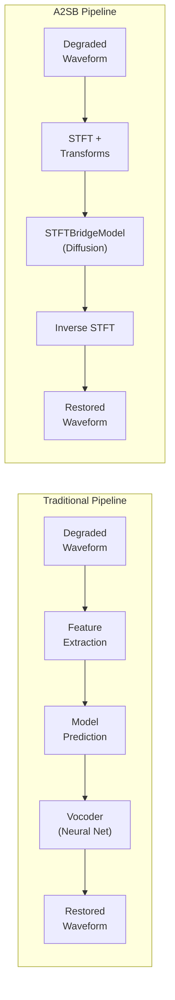
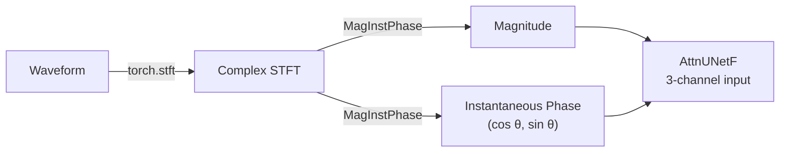
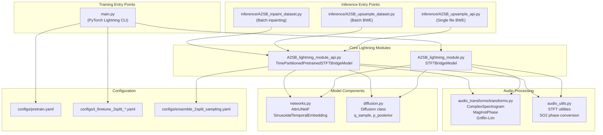
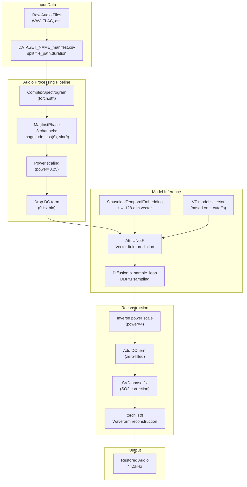

<!-- source: DeepWiki mcp.deepwiki.com · repo NVIDIA/diffusion-audio-restoration · page 1 Home · fetched 2026-10-26 -->

# Home

<details>
<summary>Relevant source files</summary>

The following files were used as context for generating this wiki page:

- [README.md](README.md)

</details>


This wiki documents the Audio-to-Audio Schrödinger Bridge (A2SB) audio restoration system, a state-of-the-art diffusion-based model for high-resolution music restoration at 44.1kHz. This page provides an overview of the system's capabilities, architecture, and key features.

For installation and setup instructions, see [Installation and Environment Setup](#2.1). For getting started with inference, see [Inference Guide](#3). For training your own models, see [Training Guide](#4).

## Purpose and Scope

A2SB is designed to restore degraded high-resolution music through two primary tasks:
- **Bandwidth Extension (BWE)**: Predicting high-frequency components above a cutoff frequency to upsample audio
- **Inpainting**: Regenerating missing temporal segments within audio

The system achieves state-of-the-art results on out-of-distribution music test sets while being capable of processing hour-long audio files without boundary artifacts.

**Sources:** [README.md:17-25]()

## Key Capabilities

### Multi-Task Audio Restoration

A2SB performs two complementary restoration tasks using a unified model architecture:

| Task | Description | Key Parameters | Use Case |
|------|-------------|----------------|----------|
| **Bandwidth Extension** | Predicts high-frequency content above a cutoff frequency | `cutoff_freq` (e.g., 4000 Hz) | Upsampling low-bandwidth audio to 44.1kHz |
| **Inpainting** | Regenerates missing temporal segments | `inp_len` (segment length), `inp_every` (interval) | Restoring corrupted or missing audio segments |

Both tasks operate on 44.1kHz audio and can process arbitrarily long inputs through a windowing mechanism with multidiffusion fusion.

**Sources:** [README.md:19-19](), [README.md:64-69]()

### End-to-End Vocoder-Free Architecture

Unlike traditional audio restoration systems that require separate vocoders for waveform reconstruction, A2SB operates end-to-end:



The system uses Short-Time Fourier Transform (STFT) with `torch.istft` for waveform reconstruction, eliminating the need for a learned vocoder and reducing potential artifacts.

**Sources:** [README.md:21-21]()

### Hour-Long Audio Processing

A2SB is the first diffusion-based audio restoration model capable of processing hour-long audio files without boundary artifacts. This is achieved through:

- **Windowed Processing**: Audio is processed in overlapping windows via the `ComplexSpectrogram` transform
- **Multidiffusion Fusion**: Overlapping predictions are combined using multidiffusion averaging
- **Memory-Efficient Sampling**: The `TimePartitionedPretrainedSTFTBridgeModel` class handles long-form inference

**Sources:** [README.md:23-24]()

## What Makes A2SB State-of-the-Art

### 1. Schrödinger Bridge Diffusion

A2SB uses the Schrödinger Bridge formulation of diffusion models, implemented in the `Diffusion` class. This approach learns a direct transport path between degraded and restored audio distributions, rather than through a standard Gaussian prior.

The diffusion process is parameterized by timestep `t ∈ [0, 1]` and trained to predict vector fields that transport samples along optimal paths.

For details, see [Schrödinger Bridge Diffusion](#5.2).

**Sources:** [README.md:21-21]()

### 2. Factorized Audio Representation

A2SB represents audio using a factorized STFT representation that separates magnitude and phase information:



The phase is represented using instantaneous phase (cosine and sine components) rather than traditional unwrapped phase, enabling better gradient flow and avoiding discontinuities. The representation uses SO(2) rotation matrices internally for phase handling.

For technical details, see [Audio Representation](#5.3).

**Sources:** [README.md:21-21]()

### 3. Time-Partitioned Ensemble Training

A2SB employs a novel 2-split training strategy where separate models specialize in different diffusion timestep ranges:

| Split | Timestep Range | Purpose |
|-------|---------------|---------|
| Split 1 | `t ∈ [0.0, 0.5]` | Early diffusion steps (high noise) |
| Split 2 | `t ∈ [0.5, 1.0]` | Late diffusion steps (low noise) |

During inference, the `TimePartitionedPretrainedSTFTBridgeModel` automatically selects the appropriate model based on the current timestep using `t_cutoffs` configuration.

For training details, see [T-Finetuning and Split Training](#4.3).

**Sources:** [README.md:53-57]()

## System Architecture Overview

### Main Entry Points and Code Modules



**Sources:** [README.md:45-75]()

### Data Flow Architecture

The following diagram shows how data flows through the A2SB system from input audio to restored output:



**Sources:** [README.md:29-41]()

## Quick Navigation

### For Users

- **Getting started with inference**: Start with [Single File API](#3.1) for processing individual files
- **Processing datasets**: See [Batch Processing Datasets](#3.2) for bulk processing
- **Understanding bandwidth extension**: Read [Bandwidth Extension](#3.3)
- **Understanding inpainting**: Read [Inpainting](#3.4)

### For Researchers and Developers

- **Understanding the architecture**: Begin with [A2SB Model Overview](#5.1)
- **Training your own models**: Start with [Training Overview](#4.1)
- **Understanding the diffusion process**: See [Schrödinger Bridge Diffusion](#5.2)
- **Audio representation details**: Read [Audio Representation](#5.3)

### For Contributors

- **Setting up development environment**: See [Development Environment](#7.1)
- **Code reference**: Browse [Technical Reference](#6)
- **License and terms**: Review [License](#7.3)

## Performance and Benchmarks

A2SB achieves state-of-the-art performance on multiple out-of-distribution music test sets. The model is trained on permissively licensed subsets of the following datasets:

- FMA (Free Music Archive)
- Medley-Solos-DB
- MUSAN
- Musical Instrument
- MusicNet
- Slakh
- FreeSound
- FSD50K
- GTZAN
- NSynth

The pretrained checkpoints are available on HuggingFace Hub in both 1-split and 2-split ensemble configurations.

**Sources:** [README.md:43-43]()

## System Requirements

A2SB requires the following key dependencies:

| Component | Version/Requirement |
|-----------|-------------------|
| **PyTorch** | 2.2.2+ with CUDA 12.1 |
| **Python Libraries** | numpy, scipy, matplotlib, jsonargparse, librosa, soundfile, torchaudio, einops, pytorch_lightning, rotary_embedding_torch, ssr_eval |
| **CUDA** | 12.1 with cuDNN 8 |
| **Docker** | Recommended for reproducible environment |

For detailed setup instructions, see [Installation and Environment Setup](#2.1).

**Sources:** [README.md:77-82]()

## License and Terms of Use

A2SB is provided under the **NVIDIA OneWay NonCommercial License** for the model weights, and the code is under the **NVIDIA Source Code License - Non Commercial**.

- The training code is adapted from [I2SB](https://github.com/NVlabs/I2SB) under NVIDIA Source Code License
- The model architecture is adapted from [Improved Diffusion](https://github.com/openai/improved-diffusion) under MIT License

For business inquiries and commercial licensing, visit [NVIDIA Research Licensing](https://www.nvidia.com/en-us/research/inquiries).

For complete details, see [License](#7.3).

**Sources:** [README.md:94-99]()

## Citation

If you use A2SB in your research, please cite:

```
@article{kong2025a2sb,
  title={A2SB: Audio-to-Audio Schrodinger Bridges},
  author={Kong, Zhifeng and Shih, Kevin J and Nie, Weili and Vahdat, Arash and 
          Lee, Sang-gil and Santos, Joao Felipe and Jukic, Ante and 
          Valle, Rafael and Catanzaro, Bryan},
  journal={arXiv preprint arXiv:2501.11311},
  year={2025}
}
```

**Sources:** [README.md:84-92]()

---

