# Page: Home

# Home

<details>
<summary>Relevant source files</summary>

The following files were used as context for generating this wiki page:

- [README.md](README.md)

</details>


This wiki documents the Audio-to-Audio Schrödinger Bridge (A2SB) audio restoration system, a state-of-the-art diffusion-based model for high-resolution music restoration at 44.1kHz. This page provides an overview of the system's capabilities, architecture, and key features.

For installation and setup instructions, see [Installation and Environment Setup](#2.1). For getting started with inference, see [Inference Guide](#3). For training your own models, see [Training Guide](#4).

## Purpose and Scope

A2SB is designed to restore degraded high-resolution music through two primary tasks:
- **Bandwidth Extension (BWE)**: Predicting high-frequency components above a cutoff frequency to upsample audio
- **Inpainting**: Regenerating missing temporal segments within audio

The system achieves state-of-the-art results on out-of-distribution music test sets while being capable of processing hour-long audio files without boundary artifacts.

**Sources:** [README.md:17-25]()

## Key Capabilities

### Multi-Task Audio Restoration

A2SB performs two complementary restoration tasks using a unified model architecture:

| Task | Description | Key Parameters | Use Case |
|------|-------------|----------------|----------|
| **Bandwidth Extension** | Predicts high-frequency content above a cutoff frequency | `cutoff_freq` (e.g., 4000 Hz) | Upsampling low-bandwidth audio to 44.1kHz |
| **Inpainting** | Regenerates missing temporal segments | `inp_len` (segment length), `inp_every` (interval) | Restoring corrupted or missing audio segments |

Both tasks operate on 44.1kHz audio and can process arbitrarily long inputs through a windowing mechanism with multidiffusion fusion.

**Sources:** [README.md:19-19](), [README.md:64-69]()

### End-to-End Vocoder-Free Architecture

Unlike traditional audio restoration systems that require separate vocoders for waveform reconstruction, A2SB operates end-to-end:

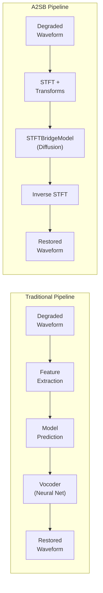

The system uses Short-Time Fourier Transform (STFT) with `torch.istft` for waveform reconstruction, eliminating the need for a learned vocoder and reducing potential artifacts.

**Sources:** [README.md:21-21]()

### Hour-Long Audio Processing

A2SB is the first diffusion-based audio restoration model capable of processing hour-long audio files without boundary artifacts. This is achieved through:

- **Windowed Processing**: Audio is processed in overlapping windows via the `ComplexSpectrogram` transform
- **Multidiffusion Fusion**: Overlapping predictions are combined using multidiffusion averaging
- **Memory-Efficient Sampling**: The `TimePartitionedPretrainedSTFTBridgeModel` class handles long-form inference

**Sources:** [README.md:23-24]()

## What Makes A2SB State-of-the-Art

### 1. Schrödinger Bridge Diffusion

A2SB uses the Schrödinger Bridge formulation of diffusion models, implemented in the `Diffusion` class. This approach learns a direct transport path between degraded and restored audio distributions, rather than through a standard Gaussian prior.

The diffusion process is parameterized by timestep `t ∈ [0, 1]` and trained to predict vector fields that transport samples along optimal paths.

For details, see [Schrödinger Bridge Diffusion](#5.2).

**Sources:** [README.md:21-21]()

### 2. Factorized Audio Representation

A2SB represents audio using a factorized STFT representation that separates magnitude and phase information:

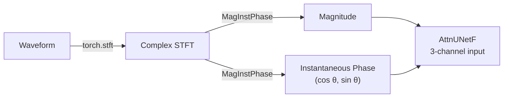

The phase is represented using instantaneous phase (cosine and sine components) rather than traditional unwrapped phase, enabling better gradient flow and avoiding discontinuities. The representation uses SO(2) rotation matrices internally for phase handling.

For technical details, see [Audio Representation](#5.3).

**Sources:** [README.md:21-21]()

### 3. Time-Partitioned Ensemble Training

A2SB employs a novel 2-split training strategy where separate models specialize in different diffusion timestep ranges:

| Split | Timestep Range | Purpose |
|-------|---------------|---------|
| Split 1 | `t ∈ [0.0, 0.5]` | Early diffusion steps (high noise) |
| Split 2 | `t ∈ [0.5, 1.0]` | Late diffusion steps (low noise) |

During inference, the `TimePartitionedPretrainedSTFTBridgeModel` automatically selects the appropriate model based on the current timestep using `t_cutoffs` configuration.

For training details, see [T-Finetuning and Split Training](#4.3).

**Sources:** [README.md:53-57]()

## System Architecture Overview

### Main Entry Points and Code Modules

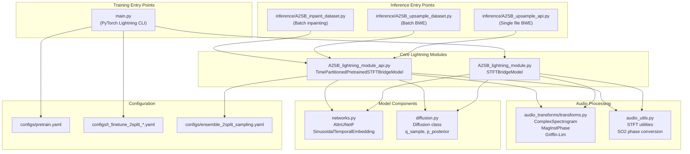

**Sources:** [README.md:45-75]()

### Data Flow Architecture

The following diagram shows how data flows through the A2SB system from input audio to restored output:

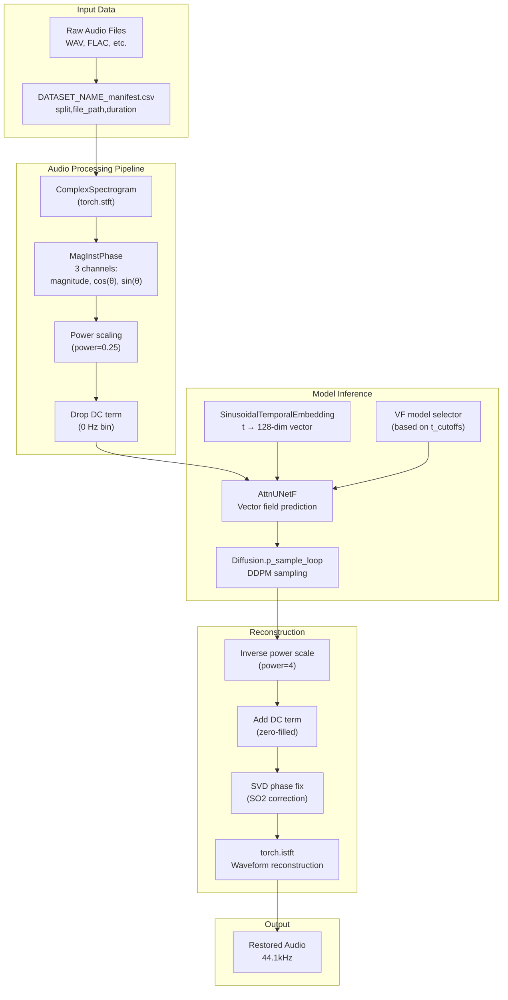

**Sources:** [README.md:29-41]()

## Quick Navigation

### For Users

- **Getting started with inference**: Start with [Single File API](#3.1) for processing individual files
- **Processing datasets**: See [Batch Processing Datasets](#3.2) for bulk processing
- **Understanding bandwidth extension**: Read [Bandwidth Extension](#3.3)
- **Understanding inpainting**: Read [Inpainting](#3.4)

### For Researchers and Developers

- **Understanding the architecture**: Begin with [A2SB Model Overview](#5.1)
- **Training your own models**: Start with [Training Overview](#4.1)
- **Understanding the diffusion process**: See [Schrödinger Bridge Diffusion](#5.2)
- **Audio representation details**: Read [Audio Representation](#5.3)

### For Contributors

- **Setting up development environment**: See [Development Environment](#7.1)
- **Code reference**: Browse [Technical Reference](#6)
- **License and terms**: Review [License](#7.3)

## Performance and Benchmarks

A2SB achieves state-of-the-art performance on multiple out-of-distribution music test sets. The model is trained on permissively licensed subsets of the following datasets:

- FMA (Free Music Archive)
- Medley-Solos-DB
- MUSAN
- Musical Instrument
- MusicNet
- Slakh
- FreeSound
- FSD50K
- GTZAN
- NSynth

The pretrained checkpoints are available on HuggingFace Hub in both 1-split and 2-split ensemble configurations.

**Sources:** [README.md:43-43]()

## System Requirements

A2SB requires the following key dependencies:

| Component | Version/Requirement |
|-----------|-------------------|
| **PyTorch** | 2.2.2+ with CUDA 12.1 |
| **Python Libraries** | numpy, scipy, matplotlib, jsonargparse, librosa, soundfile, torchaudio, einops, pytorch_lightning, rotary_embedding_torch, ssr_eval |
| **CUDA** | 12.1 with cuDNN 8 |
| **Docker** | Recommended for reproducible environment |

For detailed setup instructions, see [Installation and Environment Setup](#2.1).

**Sources:** [README.md:77-82]()

## License and Terms of Use

A2SB is provided under the **NVIDIA OneWay NonCommercial License** for the model weights, and the code is under the **NVIDIA Source Code License - Non Commercial**.

- The training code is adapted from [I2SB](https://github.com/NVlabs/I2SB) under NVIDIA Source Code License
- The model architecture is adapted from [Improved Diffusion](https://github.com/openai/improved-diffusion) under MIT License

For business inquiries and commercial licensing, visit [NVIDIA Research Licensing](https://www.nvidia.com/en-us/research/inquiries).

For complete details, see [License](#7.3).

**Sources:** [README.md:94-99]()

## Citation

If you use A2SB in your research, please cite:

```
@article{kong2025a2sb,
  title={A2SB: Audio-to-Audio Schrodinger Bridges},
  author={Kong, Zhifeng and Shih, Kevin J and Nie, Weili and Vahdat, Arash and 
          Lee, Sang-gil and Santos, Joao Felipe and Jukic, Ante and 
          Valle, Rafael and Catanzaro, Bryan},
  journal={arXiv preprint arXiv:2501.11311},
  year={2025}
}
```

**Sources:** [README.md:84-92]()

---

# Page: Getting Started

# Getting Started

<details>
<summary>Relevant source files</summary>

The following files were used as context for generating this wiki page:

- [DockerFile](DockerFile)
- [README.md](README.md)

</details>


## Purpose and Scope

This page provides an initial orientation to the A2SB (Audio-to-Audio Schrödinger Bridge) system and guides you through the first steps of setup and usage. It covers the high-level system structure, prerequisites, and typical workflows for both training and inference tasks.

For detailed installation instructions, see [Installation and Environment Setup](#2.1). For data format specifications, see [Data Preparation](#2.2). For ready-to-run examples, see [Quick Start Examples](#2.3).

For architectural details and theoretical concepts, see [Architecture and Core Concepts](#5).

Sources: [README.md:1-104]()

## What is A2SB?

A2SB is an end-to-end, vocoder-free audio restoration model designed for high-resolution music at 44.1kHz. The system performs two main restoration tasks:

| Task | Description | Key Feature |
|------|-------------|-------------|
| **Bandwidth Extension** | Predicts high-frequency components (upsampling) | Automatic rolloff detection |
| **Inpainting** | Re-generates missing temporal segments | Configurable gap parameters |

The system is capable of processing hour-long audio files without boundary artifacts, using a Schrödinger Bridge diffusion formulation operating on STFT representations.

Sources: [README.md:19-24]()

## System Architecture Overview

The A2SB system consists of two distinct operational modes with separate code paths:

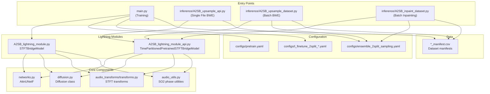

**Entry Point to Code Entity Mapping**

Sources: [README.md:27-76]()

## Directory Structure

The repository is organized as follows:

| Directory/File | Purpose | Key Contents |
|----------------|---------|--------------|
| `main.py` | Training entry point | PyTorch Lightning CLI orchestration |
| `inference/` | Inference scripts | `A2SB_upsample_api.py`, `A2SB_upsample_dataset.py`, `A2SB_inpaint_dataset.py` |
| `configs/` | YAML configuration files | `pretrain.yaml`, `t_finetune_*.yaml`, `ensemble_2split_sampling.yaml` |
| `A2SB_lightning_module.py` | Training Lightning module | `STFTBridgeModel` class |
| `A2SB_lightning_module_api.py` | Inference Lightning module | `TimePartitionedPretrainedSTFTBridgeModel` class |
| `networks.py` | Neural network architectures | `AttnUNetF`, `SinusoidalTemporalEmbedding` |
| `diffusion.py` | Diffusion process implementation | `Diffusion` class, `q_sample`, `p_posterior` |
| `audio_transforms/` | Audio processing transforms | STFT, magnitude-phase conversions, Griffin-Lim |
| `audio_utils.py` | Audio utility functions | STFT helpers, SO(2) phase matrices |
| `DockerFile` | Container definition | PyTorch 2.2.2, CUDA 12.1, dependencies |

Sources: [README.md:1-104](), [DockerFile:1-11]()

## Prerequisites

### Hardware Requirements

- **GPU**: NVIDIA GPU with CUDA support (CUDA 12.1 compatible)
- **Memory**: Sufficient VRAM for batch processing (configuration-dependent)
- **Storage**: Space for datasets, model checkpoints, and output audio

### Software Requirements

The system requires:

- **Docker** (recommended) or manual environment setup
- **PyTorch 2.2.2** with CUDA 12.1 and cuDNN 8
- **Python packages**: See dependency list below

### Python Dependencies

```
numpy, scipy, matplotlib, jsonargparse, librosa, soundfile
torch, torchaudio, einops, pytorch_lightning
rotary_embedding_torch, ssr_eval
```

Sources: [README.md:77-81](), [DockerFile:1-11]()

## Typical Workflows

The system supports two primary workflows:

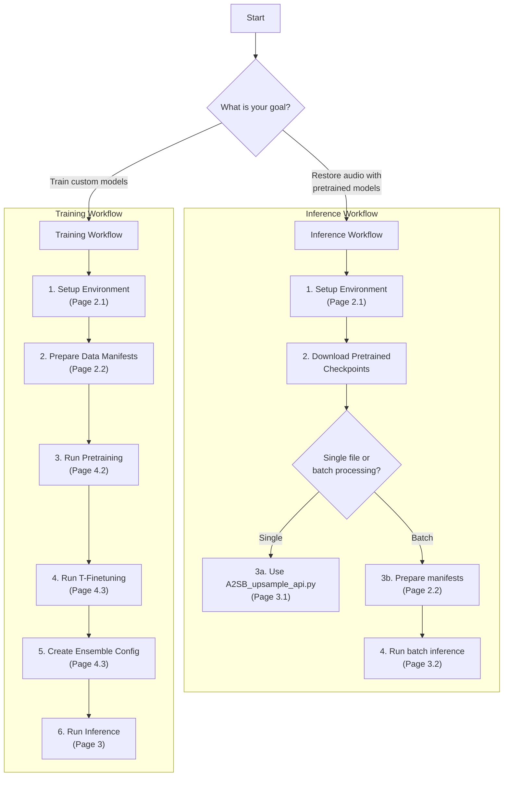

**Workflow Decision Tree**

Sources: [README.md:27-76]()

## Configuration System Overview

A2SB uses YAML configuration files to control all aspects of training and inference:

### Training Configurations

| Configuration File | Purpose | Key Parameters |
|-------------------|---------|----------------|
| `configs/pretrain.yaml` | Initial pretraining phase | Full `t` range [0.0, 1.0], all datasets |
| `configs/t_finetune_2split_0.0_0.5.yaml` | First split T-finetuning | `model.train_t_min=0.0`, `model.train_t_max=0.5` |
| `configs/t_finetune_2split_0.5_1.0.yaml` | Second split T-finetuning | `model.train_t_min=0.5`, `model.train_t_max=1.0` |

### Inference Configuration

| Configuration File | Purpose | Key Parameters |
|-------------------|---------|----------------|
| `configs/ensemble_2split_sampling.yaml` | Ensemble inference with multiple models | `t_cutoffs`, checkpoint paths, sampling parameters |

**Configuration Flow Diagram**

```mermaid
graph LR
    subgraph "Phase 1: Pretraining"
        pretrain_yaml["pretrain.yaml"]
        pretrain_run["python main.py fit<br/>--config pretrain.yaml"]
        pretrain_ckpt["pretrain_checkpoint.ckpt"]
        
        pretrain_yaml --> pretrain_run
        pretrain_run --> pretrain_ckpt
    end
    
    subgraph "Phase 2: T-Finetuning"
        tfinetune1_yaml["t_finetune_2split_0.0_0.5.yaml<br/>train_t_min: 0.0<br/>train_t_max: 0.5"]
        tfinetune2_yaml["t_finetune_2split_0.5_1.0.yaml<br/>train_t_min: 0.5<br/>train_t_max: 1.0"]
        
        tfinetune1_run["python main.py fit<br/>--config t_finetune_*.yaml"]
        tfinetune2_run["python main.py fit<br/>--config t_finetune_*.yaml"]
        
        split1_ckpt["split1_checkpoint.ckpt"]
        split2_ckpt["split2_checkpoint.ckpt"]
        
        pretrain_ckpt --> tfinetune1_yaml
        pretrain_ckpt --> tfinetune2_yaml
        
        tfinetune1_yaml --> tfinetune1_run
        tfinetune2_yaml --> tfinetune2_run
        
        tfinetune1_run --> split1_ckpt
        tfinetune2_run --> split2_ckpt
    end
    
    subgraph "Phase 3: Inference"
        ensemble_yaml["ensemble_2split_sampling.yaml<br/>checkpoint_list: [split1, split2]<br/>t_cutoffs: [0.5]"]
        inference_run["A2SB_upsample_*.py<br/>-exp ensemble_2split_sampling"]
        output["Restored Audio"]
        
        split1_ckpt --> ensemble_yaml
        split2_ckpt --> ensemble_yaml
        ensemble_yaml --> inference_run
        inference_run --> output
    end
```

**Training to Inference Pipeline with Configurations**

Sources: [README.md:45-76]()

## Two-Phase Training Strategy

A2SB employs a unique two-phase training approach:

### Phase 1: Pretraining

Train a single model across the full diffusion timestep range `t ∈ [0.0, 1.0]` using:

```bash
python main.py fit --config configs/pretrain.yaml
```

See [Pretraining](#4.2) for detailed guidance.

### Phase 2: T-Finetuning (Time-Partitioned Training)

Train specialized models for different timestep ranges. For the 2-split approach:

**Split 1** (`t ∈ [0.0, 0.5]`):
```bash
python main.py fit --config configs/t_finetune_2split_0.0_0.5.yaml
```

**Split 2** (`t ∈ [0.5, 1.0]`):
Modify configuration with `model.train_t_min=0.5` and `model.train_t_max=1.0`, then run training.

See [T-Finetuning and Split Training](#4.3) for detailed guidance.

### Why Time Partitioning?

Different diffusion timesteps have different restoration characteristics:
- Early steps (`t ≈ 1.0`): High-level structure and global features
- Late steps (`t ≈ 0.0`): Fine details and local refinement

Training separate models allows each to specialize in its timestep range, improving overall quality.

Sources: [README.md:47-58]()

## Data Format Requirements

A2SB uses CSV manifest files to organize datasets. Each manifest must follow this format:

```
split,file_path,duration
train,PATH/TO/AUDIO.wav,10.0
train,PATH/TO/AUDIO2.wav,15.2
validation,PATH/TO/VAL_AUDIO.wav,10.0
test,PATH/TO/TEST_AUDIO.wav,8.5
```

**Manifest Structure:**
- **Column 1 (`split`)**: Dataset split identifier (`train`, `validation`, or `test`)
- **Column 2 (`file_path`)**: Absolute or relative path to audio file
- **Column 3 (`duration`)**: Audio duration in seconds

Multiple manifests can be used for different datasets, and various audio formats are supported (WAV, FLAC, etc.) as long as `SoundFile` can read them.

See [Data Preparation](#2.2) for complete specifications and examples.

Sources: [README.md:29-43]()

## Pretrained Checkpoints

NVIDIA provides pretrained checkpoints on HuggingFace:

- **1-split model**: [nvidia/audio_to_audio_schrodinger_bridge](https://huggingface.co/nvidia/audio_to_audio_schrodinger_bridge)
- **2-split ensemble**: [nvidia/audio_to_audio_schrodinger_bridge](https://huggingface.co/nvidia/audio_to_audio_schrodinger_bridge)

These checkpoints are trained on permissively licensed datasets including FMA, Medley-Solos-DB, MUSAN, Musical Instrument, MusicNet, Slakh, FreeSound, FSD50K, GTZAN, and NSynth.

Sources: [README.md:13-14](), [README.md:43]()

## Quick Reference Commands

### Inference Commands

**Single file bandwidth extension:**
```bash
cd inference/
python A2SB_upsample_api.py -f DEGRADED.wav -o RESTORED.wav -n N_STEPS
```

**Batch bandwidth extension:**
```bash
cd inference/
python A2SB_upsample_dataset.py -dn DATASET_NAME -exp ensemble_2split_sampling -cf 4000
```

**Batch inpainting:**
```bash
cd inference/
python A2SB_inpaint_dataset.py -dn DATASET_NAME -exp ensemble_2split_sampling -inp_len 0.3 -inp_every 5.0
```

### Training Commands

**Pretraining:**
```bash
python main.py fit --config configs/pretrain.yaml
```

**T-finetuning:**
```bash
python main.py fit --config configs/t_finetune_2split_0.0_0.5.yaml
```

See [Quick Start Examples](#2.3) for detailed parameter explanations.

Sources: [README.md:47-75]()

## Next Steps

Now that you understand the system structure and workflows, proceed to:

1. **[Installation and Environment Setup](#2.1)** - Set up Docker and dependencies
2. **[Data Preparation](#2.2)** - Format your datasets as manifest CSV files
3. **[Quick Start Examples](#2.3)** - Run your first inference or training job

For deeper understanding:
- **[Inference Guide](#3)** - Comprehensive inference documentation
- **[Training Guide](#4)** - Complete training workflow
- **[Architecture and Core Concepts](#5)** - Theoretical foundations

Sources: [README.md:1-104]()

## License and Ethical Considerations

**License**: The model is provided under the NVIDIA OneWay NonCommercial License. The code is under the NVIDIA Source Code License - Non Commercial. Some components are adapted from other sources under their respective licenses (I2SB, Improved Diffusion).

**Ethical Considerations**: NVIDIA believes Trustworthy AI is a shared responsibility. Developers should work with their internal teams to ensure models meet requirements for their industry and use case. Report security vulnerabilities or AI concerns through NVIDIA's official channels.

For business inquiries, visit [NVIDIA Research Licensing](https://www.nvidia.com/en-us/research/inquiries).

Sources: [README.md:94-104]()

---

# Page: Installation and Environment Setup

# Installation and Environment Setup

<details>
<summary>Relevant source files</summary>

The following files were used as context for generating this wiki page:

- [DockerFile](DockerFile)
- [README.md](README.md)

</details>


## Purpose and Scope

This page provides detailed instructions for setting up the development and runtime environment for the A2SB Audio Restoration System. It covers Docker-based installation (recommended), manual installation, dependency management, and environment verification. For information about preparing audio datasets and manifest files after installation, see [Data Preparation](#2.2). For running your first inference or training job, see [Quick Start Examples](#2.3).

## System Requirements

### Hardware Requirements

| Component | Minimum | Recommended |
|-----------|---------|-------------|
| **GPU** | NVIDIA GPU with CUDA Compute Capability ≥ 7.0 | NVIDIA A100 or H100 |
| **VRAM** | 16 GB | 40+ GB for large batch training |
| **RAM** | 32 GB | 64+ GB |
| **Storage** | 100 GB free | 500+ GB for datasets and checkpoints |

### Software Requirements

| Component | Version |
|-----------|---------|
| **CUDA** | 12.1 |
| **cuDNN** | 8.x |
| **Docker** | 20.10+ (if using Docker setup) |
| **Python** | 3.8+ (if using manual setup) |

**Sources:** [DockerFile:1](), [README.md:78-81]()

---

## Docker-Based Setup (Recommended)

The A2SB system provides a pre-configured Docker environment that ensures reproducibility and eliminates dependency conflicts. This is the recommended setup method.

### Docker Environment Architecture

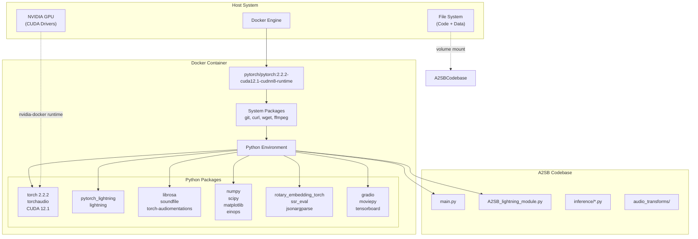

**Sources:** [DockerFile:1-11]()

### Building the Docker Image

1. **Clone the repository:**
   ```bash
   git clone https://github.com/NVIDIA/diffusion-audio-restoration.git
   cd diffusion-audio-restoration
   ```

2. **Build the Docker image:**
   ```bash
   docker build -t a2sb:latest -f DockerFile .
   ```

   The build process installs:
   - Base PyTorch image with CUDA 12.1 and cuDNN 8
   - System packages: `git`, `curl`, `wget`, `bzip2`, `libx11-6`, `ca-certificates`
   - Python packages via pip (see [Dependency Overview](#dependency-overview))
   - `ffmpeg` via conda

3. **Run the container:**
   ```bash
   docker run --gpus all \
     -v /path/to/audio/data:/data \
     -v /path/to/experiment/outputs:/outputs \
     -v $(pwd):/workspace/a2sb \
     -it a2sb:latest bash
   ```

   Volume mount recommendations:
   - Mount your audio dataset directory to `/data`
   - Mount experiment output directory to `/outputs`
   - Mount the A2SB codebase to `/workspace/a2sb`

**Sources:** [DockerFile:1-11]()

### Docker Environment Layers

```mermaid
graph LR
    subgraph "Layer 1: Base OS"
        Ubuntu["Ubuntu<br/>(from PyTorch base)"]
    end
    
    subgraph "Layer 2: CUDA Stack"
        CUDA["CUDA 12.1"]
        cuDNN["cuDNN 8"]
    end
    
    subgraph "Layer 3: Python Runtime"
        Python["Python 3.x"]
        Conda["Conda"]
    end
    
    subgraph "Layer 4: PyTorch"
        PyTorchCore["torch 2.2.2"]
        TorchAudio["torchaudio"]
    end
    
    subgraph "Layer 5: ML/Audio Libraries"
        Lightning["lightning"]
        Librosa["librosa"]
        SoundFile["soundfile"]
    end
    
    subgraph "Layer 6: A2SB Dependencies"
        Rotary["rotary_embedding_torch"]
        SSR["ssr_eval"]
        JsonArg["jsonargparse"]
        Einops["einops"]
    end
    
    subgraph "Layer 7: Optional Tools"
        TensorBoard["tensorboard"]
        Gradio["gradio"]
        FFmpeg["ffmpeg"]
    end
    
    Ubuntu --> CUDA
    CUDA --> cuDNN
    cuDNN --> Python
    Python --> Conda
    Conda --> PyTorchCore
    PyTorchCore --> TorchAudio
    TorchAudio --> Lightning
    Lightning --> Librosa
    Librosa --> SoundFile
    SoundFile --> Rotary
    Rotary --> SSR
    SSR --> JsonArg
    JsonArg --> Einops
    Einops --> TensorBoard
    TensorBoard --> Gradio
    Gradio --> FFmpeg
```

**Sources:** [DockerFile:1-11]()

---

## Manual Installation

For users who prefer not to use Docker or need to integrate A2SB into an existing environment, manual installation is possible.

### Prerequisites

Ensure the following are installed on your system:
- NVIDIA GPU drivers with CUDA 12.1 support
- Python 3.8 or later
- pip package manager
- Conda (optional, for ffmpeg)

### Installation Steps

1. **Install PyTorch with CUDA support:**
   ```bash
   pip install torch==2.2.2 torchaudio --index-url https://download.pytorch.org/whl/cu121
   ```

2. **Install core dependencies:**
   ```bash
   pip install pytorch-lightning lightning numpy scipy matplotlib
   ```

3. **Install audio processing libraries:**
   ```bash
   pip install librosa soundfile torch-audiomentations
   ```

4. **Install A2SB-specific dependencies:**
   ```bash
   pip install rotary-embedding-torch \
                jsonargparse[signatures] \
                einops \
                ssr_eval
   ```

5. **Install optional packages:**
   ```bash
   pip install tensorboard gradio moviepy inflect lmdb h5py
   ```

6. **Install ffmpeg (required for audio I/O):**
   ```bash
   # Using conda (recommended)
   conda install ffmpeg
   
   # Or using apt (Ubuntu/Debian)
   sudo apt-get install ffmpeg
   ```

### Dependency Installation Workflow

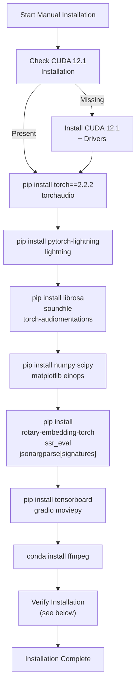

**Sources:** [README.md:78-81](), [DockerFile:9-10]()

---

## Dependency Overview

The A2SB system depends on multiple categories of packages, each serving a specific role in the training and inference pipeline.

### Dependency Categories and Code Mapping

| Category | Packages | Used By (Code Entities) |
|----------|----------|-------------------------|
| **Deep Learning Framework** | `torch` 2.2.2, `torchaudio` | All modules, especially [networks.py](), [diffusion.py]() |
| **Training Orchestration** | `pytorch_lightning`, `lightning` | [main.py](), [A2SB_lightning_module.py](), [A2SB_lightning_module_api.py]() |
| **Audio Processing** | `librosa`, `soundfile`, `torch-audiomentations` | [audio_utils.py](), [audio_transforms/transforms.py]() |
| **Numerical Computing** | `numpy`, `scipy` | [audio_utils.py](), phase computation functions |
| **Model Components** | `rotary_embedding_torch`, `einops` | [networks.py]() (AttnUNetF architecture) |
| **Audio Evaluation** | `ssr_eval` | [A2SB_lightning_module.py]() validation methods |
| **Configuration** | `jsonargparse[signatures]` | [main.py]() CLI argument parsing |
| **Visualization** | `matplotlib`, `tensorboard` | Training logging and debugging |
| **Audio I/O** | `ffmpeg` (via conda) | Backend for `librosa` and `torchaudio` |
| **Optional Tools** | `gradio`, `moviepy`, `inflect`, `lmdb`, `h5py` | Demos, video processing, data storage |

### Package-to-Module Mapping

```mermaid
graph TB
    subgraph "Core A2SB Modules"
        Main["main.py<br/>(Entry Point)"]
        LMTrain["A2SB_lightning_module.py<br/>(Training)"]
        LMAPI["A2SB_lightning_module_api.py<br/>(Inference)"]
        Networks["networks.py<br/>(AttnUNetF)"]
        Diffusion["diffusion.py<br/>(Schrödinger Bridge)"]
        AudioUtils["audio_utils.py<br/>(STFT, SO2 Phase)"]
        Transforms["audio_transforms/transforms.py<br/>(ComplexSpectrogram, etc.)"]
    end
    
    subgraph "Deep Learning"
        Torch["torch 2.2.2"]
        TorchAudio["torchaudio"]
        Lightning["pytorch_lightning"]
    end
    
    subgraph "Audio Processing"
        Librosa["librosa"]
        SoundFile["soundfile"]
        FFmpeg["ffmpeg"]
        TorchAudiomentations["torch-audiomentations"]
    end
    
    subgraph "Scientific Computing"
        NumPy["numpy"]
        SciPy["scipy"]
    end
    
    subgraph "Model Utilities"
        Rotary["rotary_embedding_torch"]
        Einops["einops"]
    end
    
    subgraph "Evaluation & Config"
        SSR["ssr_eval"]
        JsonArg["jsonargparse"]
    end
    
    subgraph "Visualization"
        TensorBoard["tensorboard"]
        Matplotlib["matplotlib"]
    end
    
    Main --> Lightning
    Main --> JsonArg
    
    LMTrain --> Lightning
    LMTrain --> SSR
    LMTrain --> TensorBoard
    
    LMAPI --> Lightning
    
    Networks --> Torch
    Networks --> Rotary
    Networks --> Einops
    
    Diffusion --> Torch
    Diffusion --> NumPy
    
    AudioUtils --> TorchAudio
    AudioUtils --> NumPy
    AudioUtils --> SciPy
    
    Transforms --> TorchAudio
    Transforms --> Librosa
    Transforms --> SoundFile
    Transforms --> TorchAudiomentations
    
    Librosa --> FFmpeg
    TorchAudio --> FFmpeg
```

**Sources:** [README.md:78-81](), [DockerFile:9-10]()

---

## Verifying Installation

After installation (Docker or manual), verify that all components are properly configured.

### Verification Checklist

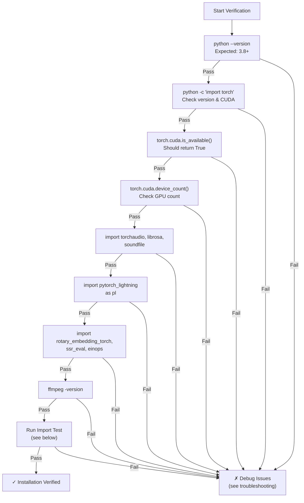

### 1. Check Python and PyTorch

```bash
python -c "import torch; print(f'PyTorch: {torch.__version__}')"
python -c "import torch; print(f'CUDA Available: {torch.cuda.is_available()}')"
python -c "import torch; print(f'CUDA Version: {torch.version.cuda}')"
python -c "import torch; print(f'GPU Count: {torch.cuda.device_count()}')"
```

Expected output:
```
PyTorch: 2.2.2+cu121
CUDA Available: True
CUDA Version: 12.1
GPU Count: 1 (or more)
```

### 2. Check Audio Libraries

```bash
python -c "import torchaudio; print(f'TorchAudio: {torchaudio.__version__}')"
python -c "import librosa; print(f'Librosa: {librosa.__version__}')"
python -c "import soundfile; print('SoundFile: OK')"
ffmpeg -version | head -n 1
```

### 3. Check A2SB Dependencies

```bash
python -c "import pytorch_lightning as pl; print(f'Lightning: {pl.__version__}')"
python -c "import rotary_embedding_torch; print('Rotary Embedding: OK')"
python -c "import ssr_eval; print('SSR Eval: OK')"
python -c "import einops; print('Einops: OK')"
python -c "from jsonargparse import CLI; print('JsonArgParse: OK')"
```

### 4. Run A2SB Import Test

Create a test script `test_imports.py`:

```python
# test_imports.py
import torch
import torchaudio
import pytorch_lightning as pl
from networks import AttnUNetF, SinusoidalTemporalEmbedding
from diffusion import Diffusion
from A2SB_lightning_module import STFTBridgeModel
from audio_transforms.transforms import ComplexSpectrogram
from audio_utils import compute_stft, inverse_stft

print("✓ All A2SB modules imported successfully")
print(f"  PyTorch: {torch.__version__}")
print(f"  CUDA: {torch.cuda.is_available()}")
print(f"  Lightning: {pl.__version__}")
```

Run the test:
```bash
python test_imports.py
```

### 5. Verify GPU Memory

```bash
python -c "import torch; print(torch.cuda.get_device_properties(0))"
```

This displays GPU name, compute capability, and total memory. For training, ensure at least 16 GB VRAM is available.

**Sources:** [README.md:78-81]()

---

## Environment Configuration

### Environment Variables

The A2SB system respects standard PyTorch and CUDA environment variables:

| Variable | Purpose | Recommended Value |
|----------|---------|-------------------|
| `CUDA_VISIBLE_DEVICES` | Restrict visible GPUs | `"0,1,2,3"` (for multi-GPU) |
| `PYTORCH_CUDA_ALLOC_CONF` | CUDA memory allocator settings | `"max_split_size_mb:512"` |
| `OMP_NUM_THREADS` | OpenMP threads for CPU ops | `"8"` |
| `NUMEXPR_NUM_THREADS` | NumExpr threads | `"8"` |

Example `.bashrc` or container startup:
```bash
export CUDA_VISIBLE_DEVICES=0,1,2,3
export PYTORCH_CUDA_ALLOC_CONF=max_split_size_mb:512
export OMP_NUM_THREADS=8
export NUMEXPR_NUM_THREADS=8
```

### File System Structure

After installation, the recommended directory structure is:

```
workspace/
├── a2sb/                          # A2SB codebase (this repo)
│   ├── main.py
│   ├── A2SB_lightning_module.py
│   ├── networks.py
│   ├── diffusion.py
│   ├── audio_utils.py
│   ├── audio_transforms/
│   ├── inference/
│   └── configs/
├── data/                          # Audio datasets
│   ├── manifests/
│   │   ├── dataset1_manifest.csv
│   │   └── dataset2_manifest.csv
│   └── audio_files/
└── experiments/                   # Training outputs
    ├── pretrain/
    │   └── checkpoints/
    ├── t_finetune_split1/
    │   └── checkpoints/
    └── t_finetune_split2/
        └── checkpoints/
```

**Sources:** [README.md:29-41]()

---

## Troubleshooting

### Common Issues

**Issue: `torch.cuda.is_available()` returns `False`**

- **Docker:** Ensure `nvidia-docker` runtime is installed and container is launched with `--gpus all`
- **Manual:** Verify NVIDIA drivers match CUDA 12.1 requirements
- Check: `nvidia-smi` should show GPUs and CUDA version ≥ 12.1

**Issue: `ImportError: libsndfile.so` or similar audio library errors**

- **Docker:** Rebuild image to ensure system packages installed
- **Manual:** Install system audio libraries:
  ```bash
  sudo apt-get install libsndfile1 libsndfile1-dev
  ```

**Issue: `ffmpeg` not found**

- **Docker:** Verify `conda install ffmpeg` completed successfully in DockerFile
- **Manual:** Install via `conda install ffmpeg` or `apt-get install ffmpeg`

**Issue: Out of memory during training**

- Reduce `batch_size` in config files under [configs/]()
- Increase `accumulate_grad_batches` in config files
- Ensure `PYTORCH_CUDA_ALLOC_CONF=max_split_size_mb:512` is set

**Issue: `jsonargparse` configuration errors**

- Ensure `jsonargparse[signatures]` is installed (note the `[signatures]` extra)
- Verify YAML config files syntax (see [Configuration Files](#4.4) for details)

**Sources:** [DockerFile:1-11](), [README.md:59]()

---

## Next Steps

After successfully installing and verifying the environment:

1. **Prepare your data:** Follow [Data Preparation](#2.2) to create manifest CSV files for your audio datasets
2. **Run inference:** See [Quick Start Examples](#2.3) for simple bandwidth extension and inpainting examples
3. **Train models:** Refer to [Training Guide](#4) for pretraining and T-finetuning workflows

For detailed information about the development workflow and contributing to the codebase, see [Development Environment](#7.1).

**Sources:** [README.md:27-76]()

---

# Page: Data Preparation

# Data Preparation

<details>
<summary>Relevant source files</summary>

The following files were used as context for generating this wiki page:

- [README.md](README.md)

</details>


## Purpose and Scope

This document explains how to prepare audio datasets for training and inference with A2SB. It covers the manifest CSV format, supported audio formats, configuration file setup, and best practices for organizing your data. For information about running training with prepared data, see [Training Overview](#4.1). For inference workflows, see [Inference Guide](#3).

---

## Manifest CSV Format

A2SB uses CSV manifest files to organize audio datasets. Each manifest file acts as an index that maps audio files to their splits (train/validation/test) and metadata.

### Required Columns

All manifest files must contain exactly three columns in the following order:

| Column Name | Type | Description |
|------------|------|-------------|
| `split` | string | Dataset split: `train`, `validation`, or `test` |
| `file_path` | string | Absolute or relative path to the audio file |
| `duration` | float | Audio duration in seconds |

### Example Manifest File

```csv
split,file_path,duration
train,/datasets/fma/audio/000/000002.mp3,166.0
train,/datasets/fma/audio/000/000005.mp3,262.0
validation,/datasets/fma/audio/000/000010.mp3,230.0
validation,/datasets/fma/audio/000/000017.mp3,248.0
test,/datasets/fma/audio/000/000134.mp3,219.0
test,/datasets/fma/audio/000/000137.mp3,252.0
```

### Naming Convention

Manifest files must follow the naming pattern:
```
{DATASET_NAME}_manifest.csv
```

For example:
- `fma_manifest.csv`
- `musicnet_manifest.csv`
- `slakh_manifest.csv`

The `DATASET_NAME` portion will be referenced in configuration files and inference scripts.

**Sources:** [README.md:29-43]()

---

## Creating Manifest Files

### Step 1: Collect Audio File Paths

Gather all audio files you want to include in your dataset. A2SB supports any audio format that the `SoundFile` library can read, including:

- WAV (`.wav`)
- FLAC (`.flac`)
- MP3 (`.mp3`)
- OGG (`.ogg`)
- Other formats supported by libsndfile

### Step 2: Calculate Durations

For each audio file, calculate its duration in seconds. You can use libraries like `librosa`, `soundfile`, or `torchaudio`:

```python
import soundfile as sf

# Get duration
info = sf.info('path/to/audio.wav')
duration = info.duration  # in seconds
```

### Step 3: Assign Splits

Decide which files belong to which split:
- **`train`**: Files used for model training (typically 70-90% of data)
- **`validation`**: Files used for validation during training (typically 5-15% of data)
- **`test`**: Files held out for final evaluation (typically 5-15% of data)

### Step 4: Generate CSV

Create the CSV file with proper formatting:

```python
import csv
import soundfile as sf
from pathlib import Path

def create_manifest(audio_dir, output_csv, split_ratios=(0.8, 0.1, 0.1)):
    """
    Create a manifest CSV from a directory of audio files.
    
    Args:
        audio_dir: Directory containing audio files
        output_csv: Output manifest CSV path
        split_ratios: Tuple of (train, validation, test) ratios
    """
    audio_files = list(Path(audio_dir).rglob('*.wav'))
    
    # Shuffle and split
    import random
    random.shuffle(audio_files)
    
    n_train = int(len(audio_files) * split_ratios[0])
    n_val = int(len(audio_files) * split_ratios[1])
    
    splits = ['train'] * n_train + ['validation'] * n_val + ['test'] * (len(audio_files) - n_train - n_val)
    
    with open(output_csv, 'w', newline='') as f:
        writer = csv.writer(f)
        writer.writerow(['split', 'file_path', 'duration'])
        
        for audio_file, split in zip(audio_files, splits):
            info = sf.info(str(audio_file))
            writer.writerow([split, str(audio_file.absolute()), info.duration])
```

**Sources:** [README.md:29-43]()

---

## Manifest Data Flow

The following diagram shows how manifest files flow through the A2SB system:

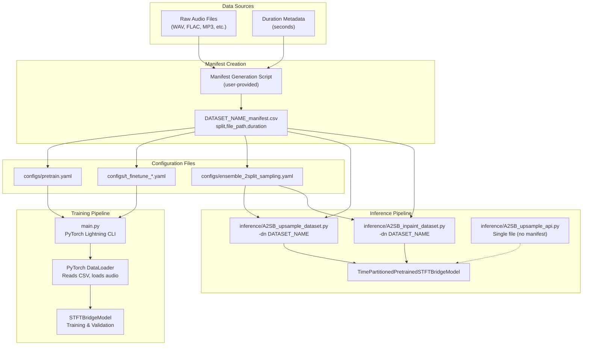

**Sources:** [README.md:29-43](), [README.md:47-58](), [README.md:64-75]()

---

## Multi-Dataset Configuration

A2SB supports training on multiple datasets simultaneously. Each dataset requires its own manifest file, and all datasets are specified in the configuration files.

### Multiple Manifest Files

Organize your manifests in a consistent location:

```
/data/manifests/
├── fma_manifest.csv
├── musicnet_manifest.csv
├── slakh_manifest.csv
├── medley_solos_db_manifest.csv
└── musan_manifest.csv
```

### Configuration File Integration

Configuration files under `configs/` specify which manifests to use. While the exact structure of the config files is covered in [Configuration Files](#4.4), the key concept is that you reference both the dataset name and the manifest path.

Example conceptual structure:
```yaml
data:
  datasets:
    - name: fma
      manifest: /data/manifests/fma_manifest.csv
    - name: musicnet
      manifest: /data/manifests/musicnet_manifest.csv
    - name: slakh
      manifest: /data/manifests/slakh_manifest.csv
```

During training, the system will load and combine samples from all specified datasets. During inference, you specify which dataset to process using the `-dn DATASET_NAME` flag.

**Sources:** [README.md:41-43](), [README.md:67-68]()

---

## Dataset Organization Best Practices

### Directory Structure

Recommended organization for clarity and maintainability:

```
project_root/
├── data/
│   ├── raw_audio/
│   │   ├── fma/
│   │   │   └── audio/
│   │   │       ├── 000/
│   │   │       ├── 001/
│   │   │       └── ...
│   │   ├── musicnet/
│   │   │   ├── train/
│   │   │   ├── validation/
│   │   │   └── test/
│   │   └── slakh/
│   └── manifests/
│       ├── fma_manifest.csv
│       ├── musicnet_manifest.csv
│       └── slakh_manifest.csv
├── configs/
│   ├── pretrain.yaml
│   ├── t_finetune_2split_0.0_0.5.yaml
│   └── ensemble_2split_sampling.yaml
└── experiments/
    └── [training outputs]
```

### File Path Considerations

**Absolute vs Relative Paths:** 
- **Absolute paths** (e.g., `/data/audio/file.wav`) are more portable across different execution contexts
- **Relative paths** (e.g., `../data/audio/file.wav`) can work but may break if scripts are run from different directories

**Recommendation:** Use absolute paths in manifest files for maximum reliability.

### Split Distribution Guidelines

| Split | Recommended Ratio | Purpose |
|-------|------------------|---------|
| `train` | 70-90% | Model learns from these samples during training |
| `validation` | 5-15% | Used for hyperparameter tuning and early stopping |
| `test` | 5-15% | Final evaluation on unseen data |

For smaller datasets (< 1000 files), consider using a higher validation/test ratio to ensure robust evaluation.

**Sources:** [README.md:29-43]()

---

## Supported Audio Formats

A2SB processes audio files through the `SoundFile` library, which provides an interface to libsndfile. The following formats are supported:

| Format | Extensions | Notes |
|--------|-----------|-------|
| WAV | `.wav` | Uncompressed, lossless |
| FLAC | `.flac` | Compressed, lossless |
| OGG Vorbis | `.ogg` | Lossy compression |
| MP3 | `.mp3` | Lossy compression (via ffmpeg backend) |

### Sample Rate Handling

A2SB is designed for **44.1 kHz** audio. During processing:
- Input audio at different sample rates will be resampled to 44.1 kHz
- Output audio is always at 44.1 kHz
- The system handles resampling automatically during the STFT transform pipeline

### Audio Quality Recommendations

For best results:
- Use lossless formats (WAV, FLAC) when possible
- If using lossy formats (MP3, OGG), use high bitrates (≥320 kbps)
- Ensure audio files are not corrupted (verify with `soundfile` or similar tools)
- Minimum recommended duration: 1-2 seconds per file
- Maximum duration: No hard limit; A2SB can process hour-long audio

**Sources:** [README.md:41](), Architecture diagrams (44.1kHz specification)

---

## Training Datasets Reference

The original A2SB models were trained on permissively licensed subsets of the following datasets:

| Dataset | Type | Description |
|---------|------|-------------|
| FMA | Music | Free Music Archive |
| Medley-Solos-DB | Music | Solo instrument recordings |
| MUSAN | Music/Noise/Speech | Multi-genre audio dataset |
| Musical Instrument | Music | Instrument samples |
| MusicNet | Music | Classical music with annotations |
| Slakh | Music | Multi-track MIDI-synthesized music |
| FreeSound | General Audio | User-uploaded sound effects |
| FSD50K | General Audio | Freesound Dataset 50K |
| GTZAN | Music | Genre classification dataset |
| NSynth | Music | Neural audio synthesis dataset |

**Note:** These datasets are listed for reference. You can train A2SB on any audio dataset by following the manifest creation process described in this document.

**Sources:** [README.md:43]()

---

## Manifest Validation

Before using manifests for training or inference, validate them to catch common issues:

### Validation Checklist

- [ ] CSV file has exactly 3 columns: `split`, `file_path`, `duration`
- [ ] All file paths exist and are accessible
- [ ] All audio files can be opened by `soundfile`
- [ ] Durations match actual audio file lengths
- [ ] Splits are spelled correctly: `train`, `validation`, `test` (case-sensitive)
- [ ] No missing values in any column
- [ ] File paths don't contain special characters that could cause issues

### Example Validation Script

```python
import csv
import soundfile as sf
from pathlib import Path

def validate_manifest(manifest_path):
    """Validate a manifest CSV file."""
    errors = []
    
    with open(manifest_path, 'r') as f:
        reader = csv.DictReader(f)
        
        # Check header
        if reader.fieldnames != ['split', 'file_path', 'duration']:
            errors.append(f"Invalid header: {reader.fieldnames}")
            return errors
        
        for i, row in enumerate(reader, start=2):  # Line 2 is first data row
            # Check split validity
            if row['split'] not in ['train', 'validation', 'test']:
                errors.append(f"Line {i}: Invalid split '{row['split']}'")
            
            # Check file exists
            file_path = Path(row['file_path'])
            if not file_path.exists():
                errors.append(f"Line {i}: File not found: {row['file_path']}")
                continue
            
            # Check file can be opened and duration matches
            try:
                info = sf.info(str(file_path))
                stated_duration = float(row['duration'])
                if abs(info.duration - stated_duration) > 0.1:  # 100ms tolerance
                    errors.append(
                        f"Line {i}: Duration mismatch - "
                        f"stated {stated_duration}s, actual {info.duration}s"
                    )
            except Exception as e:
                errors.append(f"Line {i}: Error reading audio: {e}")
    
    return errors
```

**Sources:** [README.md:29-43]()

---

## CSV to PyTorch DataLoader Pipeline

The following diagram shows how manifest CSV files are processed into training batches:

```mermaid
graph LR
    subgraph "Manifest File"
        CSV["DATASET_NAME_manifest.csv"]
    end
    
    subgraph "Config YAML"
        Config["configs/pretrain.yaml<br/>or t_finetune_*.yaml"]
        DatasetList["data.datasets list<br/>[{name, manifest}, ...]"]
    end
    
    subgraph "Data Loading"
        Reader["CSV Reader<br/>pandas/csv module"]
        Filter["Split Filter<br/>(train/validation/test)"]
        AudioLoader["SoundFile Loader<br/>Load waveform"]
        Sampler["Random Sampler<br/>Batch construction"]
    end
    
    subgraph "Audio Processing"
        Waveform["Raw Waveform<br/>44.1kHz tensor"]
        STFT["ComplexSpectrogram<br/>STFT Transform"]
        MagPhase["MagInstPhase<br/>Magnitude + cos/sin"]
        Batch["Training Batch<br/>[B, C, F, T]"]
    end
    
    CSV --> Config
    Config --> DatasetList
    DatasetList --> Reader
    Reader --> Filter
    Filter --> AudioLoader
    AudioLoader --> Sampler
    Sampler --> Waveform
    Waveform --> STFT
    STFT --> MagPhase
    MagPhase --> Batch
```

This pipeline is executed by PyTorch Lightning's data loading system when you run training via `main.py`. For detailed information on the audio transform pipeline, see [Audio Processing Pipeline](#6.2).

**Sources:** [README.md:29-43](), [README.md:47-58]()

---

## Inference Dataset Usage

When running inference on datasets, you specify the dataset name (without the `_manifest.csv` suffix):

### Bandwidth Extension on Dataset

```bash
cd inference/
python A2SB_upsample_dataset.py -dn DATASET_NAME -exp ensemble_2split_sampling -cf 4000
```

### Inpainting on Dataset

```bash
cd inference/
python A2SB_inpaint_dataset.py -dn DATASET_NAME -exp ensemble_2split_sampling -inp_len 0.3 -inp_every 5.0
```

The `-dn` flag tells the inference script which manifest to load. The script will:
1. Look for `DATASET_NAME_manifest.csv` in the configured manifest directory
2. Filter for the `test` split (typically)
3. Process each audio file in that split
4. Save restored audio to the output directory

For processing single files without a manifest, see [Single File API](#3.1).

**Sources:** [README.md:64-69]()

---

## Summary

Data preparation for A2SB involves:

1. **Creating manifest CSV files** with columns: `split`, `file_path`, `duration`
2. **Naming manifests** as `DATASET_NAME_manifest.csv`
3. **Supporting multiple datasets** by creating multiple manifests
4. **Referencing manifests** in configuration files under `configs/`
5. **Using standard audio formats** (WAV, FLAC, MP3, etc.) at any sample rate
6. **Validating manifests** before training/inference

Once manifests are prepared, you can proceed to [Quick Start Examples](#2.3) to begin training or inference, or dive deeper into [Training Guide](#4) and [Inference Guide](#3).

---

# Page: Quick Start Examples

# Quick Start Examples

<details>
<summary>Relevant source files</summary>

The following files were used as context for generating this wiki page:

- [README.md](README.md)
- [configs/ensemble_2split_sampling.yaml](configs/ensemble_2split_sampling.yaml)

</details>


This page provides copy-paste command examples to get started with A2SB quickly. It covers the most common use cases for both inference (audio restoration) and training (model development).

For detailed setup instructions, see [Installation and Environment Setup](#2.1). For data preparation requirements, see [Data Preparation](#2.2). For comprehensive inference documentation, see [Inference Guide](#3). For comprehensive training documentation, see [Training Guide](#4).

## Prerequisites

Before running these examples, ensure you have:

1. Installed the Docker environment or all dependencies (see [Installation and Environment Setup](#2.1))
2. Downloaded pretrained checkpoints from [HuggingFace](https://huggingface.co/nvidia/audio_to_audio_schrodinger_bridge)
3. Prepared your data manifests in CSV format (see [Data Preparation](#2.2))

## Inference Examples

Most users will want to start with inference to restore degraded audio using pretrained models.

### Single File Bandwidth Extension

The simplest way to restore a single audio file with automatic rolloff frequency detection:

```bash
cd inference/
python A2SB_upsample_api.py -f input_degraded.wav -o output_restored.wav -n 50
```

**Key Parameters:**
- `-f`: Path to input degraded audio file
- `-o`: Path to output restored audio file
- `-n`: Number of diffusion steps (higher = better quality, slower; typical range: 20-100)

The `A2SB_upsample_api.py` script automatically detects the rolloff frequency of the input audio and performs bandwidth extension to restore high-frequency content up to 22.05 kHz (Nyquist frequency for 44.1 kHz sampling rate).

Sources: [README.md:72-75](), [inference/A2SB_upsample_api.py]()

### Batch Dataset Bandwidth Extension

To process an entire dataset listed in a manifest CSV file:

```bash
cd inference/
python A2SB_upsample_dataset.py -dn DATASET_NAME -exp ensemble_2split_sampling -cf 4000
```

**Key Parameters:**
- `-dn`: Dataset name (must match the key in your config file's `mix_dataset_config`)
- `-exp`: Experiment config name (corresponds to `configs/ensemble_2split_sampling.yaml`)
- `-cf`: Cutoff frequency in Hz (frequency below which audio is preserved, above which it's restored)

Sources: [README.md:64-68]()

### Batch Dataset Inpainting

To restore missing audio segments (e.g., removing artifacts or filling gaps):

```bash
cd inference/
python A2SB_inpaint_dataset.py -dn DATASET_NAME -exp ensemble_2split_sampling -inp_len 0.3 -inp_every 5.0
```

**Key Parameters:**
- `-dn`: Dataset name (must match the key in your config file's `mix_dataset_config`)
- `-exp`: Experiment config name (corresponds to `configs/ensemble_2split_sampling.yaml`)
- `-inp_len`: Length of each missing segment in seconds (e.g., 0.3 = 300ms gaps)
- `-inp_every`: Interval between missing segments in seconds (e.g., 5.0 = gaps every 5 seconds)

Sources: [README.md:64-68]()

### Inference Workflow Diagram

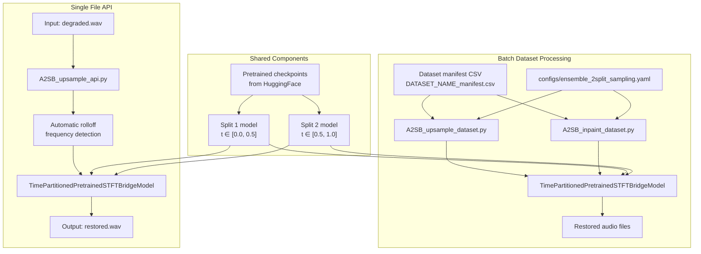

Sources: [README.md:64-75](), [configs/ensemble_2split_sampling.yaml](), [inference/A2SB_upsample_api.py](), [inference/A2SB_upsample_dataset.py](), [inference/A2SB_inpaint_dataset.py]()

## Training Examples

These examples show how to train A2SB models from scratch using the two-phase training strategy.

### Phase 1: Pretraining

Train a single model across the full diffusion timestep range `t ∈ [0.0, 1.0]`:

```bash
python main.py fit --config configs/pretrain.yaml
```

This creates a checkpoint that will be used as initialization for t-finetuning. The pretrained model learns general audio restoration capabilities across all diffusion timesteps.

**Before running:** Ensure `configs/pretrain.yaml` contains:
- Correct paths to your training data manifests in `data.mix_dataset_config`
- Appropriate `model.train_t_min: 0.0` and `model.train_t_max: 1.0`
- Hardware configuration matching your setup (batch size, num devices, num nodes)

Sources: [README.md:47-49](), [main.py]()

### Phase 2: T-Finetuning (2-Split Strategy)

After pretraining, train two specialized models for different diffusion timestep ranges.

#### Split 1: Early Timesteps (t ∈ [0.0, 0.5])

```bash
# First, copy pretrained checkpoint to t-finetune experiment folder
cp experiments/pretrain/checkpoints/last.ckpt experiments/t_finetune_split1/checkpoints/

# Run t-finetuning for split 1
python main.py fit --config configs/t_finetune_2split_0.0_0.5.yaml
```

#### Split 2: Late Timesteps (t ∈ [0.5, 1.0])

```bash
# Copy pretrained checkpoint to second split experiment folder
cp experiments/pretrain/checkpoints/last.ckpt experiments/t_finetune_split2/checkpoints/

# Create config file t_finetune_2split_0.5_1.0.yaml with modified parameters:
# - model.train_t_min: 0.5
# - model.train_t_max: 1.0
# - Different experiment name/path

# Run t-finetuning for split 2
python main.py fit --config configs/t_finetune_2split_0.5_1.0.yaml
```

**Key Configuration Differences:**
- Split 1: `model.train_t_min: 0.0`, `model.train_t_max: 0.5`
- Split 2: `model.train_t_min: 0.5`, `model.train_t_max: 1.0`
- Each split should have a unique experiment folder path

Sources: [README.md:51-57]()

### Training Workflow Diagram

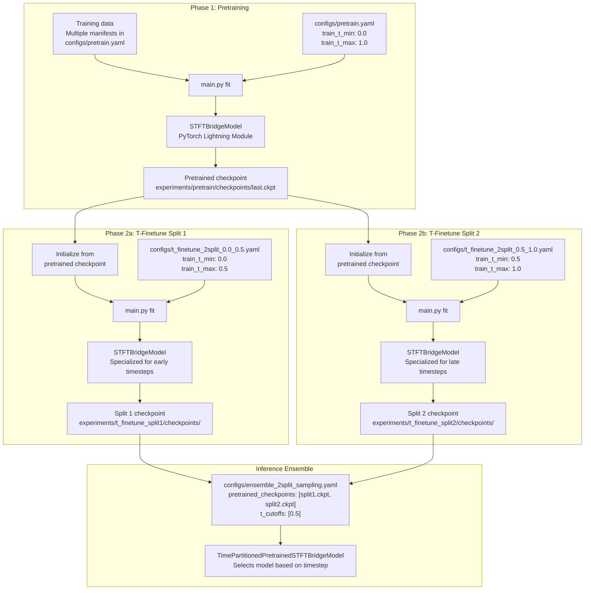

Sources: [README.md:45-57](), [main.py](), [A2SB_lightning_module.py]()

## Common Parameter Reference

### Inference Parameters

| Parameter | Script | Description | Typical Values |
|-----------|--------|-------------|----------------|
| `-n` / `--n_steps` | `A2SB_upsample_api.py` | Number of diffusion steps | 20-100 (50 recommended) |
| `-cf` / `--cutoff_freq` | `A2SB_upsample_dataset.py` | Cutoff frequency for bandwidth extension (Hz) | 4000, 8000, 11025 |
| `-inp_len` | `A2SB_inpaint_dataset.py` | Duration of missing segments (seconds) | 0.1-1.0 |
| `-inp_every` | `A2SB_inpaint_dataset.py` | Interval between missing segments (seconds) | 2.0-10.0 |
| `-dn` / `--dataset_name` | `A2SB_upsample_dataset.py`, `A2SB_inpaint_dataset.py` | Dataset identifier from config | Any key from `mix_dataset_config` |
| `-exp` / `--experiment` | `A2SB_upsample_dataset.py`, `A2SB_inpaint_dataset.py` | Config file name (without .yaml) | `ensemble_2split_sampling` |

Sources: [inference/A2SB_upsample_api.py](), [inference/A2SB_upsample_dataset.py](), [inference/A2SB_inpaint_dataset.py]()

### Training Configuration Parameters

| Parameter | Location in Config | Description | Pretrain Value | T-Finetune Values |
|-----------|-------------------|-------------|----------------|-------------------|
| `model.train_t_min` | `model` section | Minimum diffusion timestep for training | 0.0 | Split 1: 0.0, Split 2: 0.5 |
| `model.train_t_max` | `model` section | Maximum diffusion timestep for training | 1.0 | Split 1: 0.5, Split 2: 1.0 |
| `trainer.devices` | `trainer` section | Number of GPUs per node | 8 (adjust to hardware) | 8 (adjust to hardware) |
| `trainer.num_nodes` | `trainer` section | Number of compute nodes | 1-4 (adjust to hardware) | 1-4 (adjust to hardware) |
| `data.batch_size` | `data` section | Batch size per device | 4-8 (adjust to GPU memory) | 4-8 (adjust to GPU memory) |
| `trainer.accumulate_grad_batches` | `trainer` section | Gradient accumulation steps | 2-4 | 2-4 |

Sources: [configs/pretrain.yaml](), [configs/t_finetune_2split_0.0_0.5.yaml]()

## Command-Line Parameter Flow

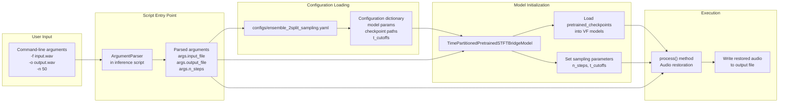

Sources: [inference/A2SB_upsample_api.py](), [A2SB_lightning_module_api.py](), [configs/ensemble_2split_sampling.yaml]()

## Hardware Considerations

The examples above may need adjustment based on your hardware:

**GPU Memory Requirements:**
- Pretraining: ~32GB per GPU (batch_size=4, accumulate_grad_batches=2)
- T-finetuning: ~32GB per GPU (batch_size=4, accumulate_grad_batches=2)
- Inference: ~16GB for batch processing, ~8GB for single-file API

**Adjusting for Different Hardware:**

If you have less GPU memory:
```yaml
# In config files:
data:
  batch_size: 2  # Reduce from 4 to 2
trainer:
  accumulate_grad_batches: 4  # Increase from 2 to 4 to maintain effective batch size
```

If you have more GPUs:
```yaml
# In config files:
trainer:
  devices: 8  # Set to number of GPUs per node
  num_nodes: 2  # Set to number of compute nodes
  strategy: ddp  # Distributed Data Parallel
```

Sources: [README.md:59](), [configs/pretrain.yaml](), [configs/ensemble_2split_sampling.yaml]()

## Next Steps

After running these quick start examples:

- For detailed inference options and advanced features, see [Inference Guide](#3)
  - [Single File API](#3.1) for automatic rolloff detection details
  - [Batch Processing Datasets](#3.2) for manifest-based processing
  - [Bandwidth Extension](#3.3) for BWE best practices
  - [Inpainting](#3.4) for inpainting best practices

- For comprehensive training documentation, see [Training Guide](#4)
  - [Training Overview](#4.1) for the two-phase strategy explanation
  - [Pretraining](#4.2) for pretraining configuration details
  - [T-Finetuning and Split Training](#4.3) for split strategy details
  - [Configuration Files](#4.4) for all available parameters

- For understanding the underlying architecture, see [Architecture and Core Concepts](#5)
  - [A2SB Model Overview](#5.1) for high-level architecture
  - [Schrödinger Bridge Diffusion](#5.2) for diffusion theory
  - [Time-Partitioned Ensemble](#5.4) for why the 2-split strategy works

Sources: [README.md:27-76]()

---

# Page: Inference Guide

# Inference Guide

<details>
<summary>Relevant source files</summary>

The following files were used as context for generating this wiki page:

- [A2SB_lightning_module_api.py](A2SB_lightning_module_api.py)
- [README.md](README.md)

</details>


This document provides comprehensive guidance for using A2SB models to perform audio restoration tasks. It covers the inference architecture, available inference modes, configuration options, and practical usage examples.

For detailed information about specific restoration tasks, see [Bandwidth Extension](#3.3) and [Inpainting](#3.4). For information about training models from scratch, see [Training Guide](#4). For architectural details about the underlying diffusion process, see [Schrödinger Bridge Diffusion](#5.2).

## Overview

A2SB inference uses pretrained models to restore degraded audio through iterative refinement via the Schrödinger Bridge diffusion process. The system supports two primary restoration tasks:

| Task | Description | Entry Point |
|------|-------------|-------------|
| Bandwidth Extension | Predict high-frequency content to upsample audio | `inference/A2SB_upsample_api.py`, `inference/A2SB_upsample_dataset.py` |
| Inpainting | Restore missing temporal segments in audio | `inference/A2SB_inpaint_dataset.py` |

All inference modes operate in the STFT (spectrogram) domain and produce end-to-end waveform outputs without requiring a separate vocoder. The system is capable of processing hour-long audio files by leveraging multidiffusion techniques.

**Sources:** [README.md:19-24](), [README.md:62-75]()

## Inference Architecture

### TimePartitionedPretrainedSTFTBridgeModel

The inference system is centered around `TimePartitionedPretrainedSTFTBridgeModel`, a specialized Lightning module that loads multiple pretrained vector field models and selects between them based on diffusion timestep values.

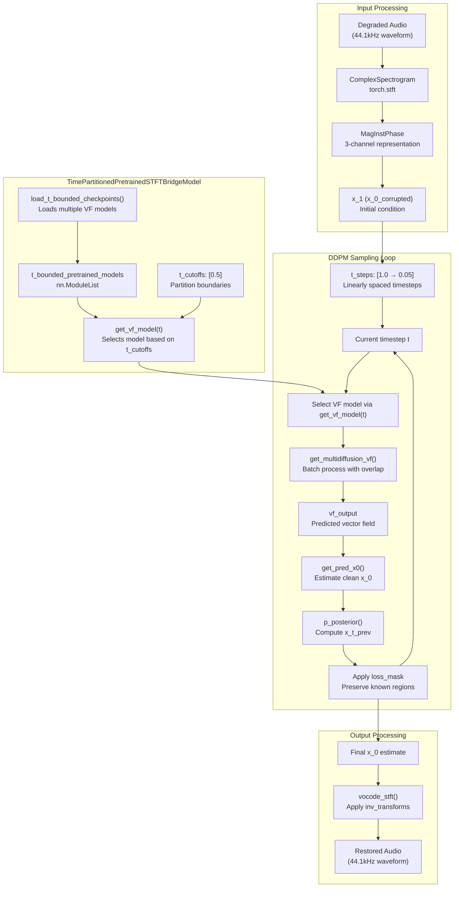

**TimePartitionedPretrainedSTFTBridgeModel Architecture**

**Sources:** [A2SB_lightning_module_api.py:35-89]()

### Key Components

The inference architecture consists of the following components:

| Component | Type | Purpose |
|-----------|------|---------|
| `pretrained_checkpoints` | List[str] | Paths to pretrained model checkpoints |
| `t_cutoffs` | List[float] | Timestep boundaries for model selection (e.g., `[0.5]` for 2-split) |
| `t_bounded_pretrained_models` | nn.ModuleList | Loaded vector field models |
| `get_vf_model(t)` | Method | Returns appropriate VF model for timestep `t` |
| `ddpm_sample()` | Method | Executes iterative DDPM sampling |
| `vocode_stft()` | Method | Converts spectrogram to waveform |

The `get_vf_model(t)` method [A2SB_lightning_module_api.py:84-89]() implements the time-partitioning logic:

```python
def get_vf_model(self, t: float):
    model_idx = 0
    for idx, thresh in enumerate(self.t_cutoffs):
        if t >= thresh:
            model_idx = idx + 1
    return self.t_bounded_pretrained_models[model_idx]
```

For a 2-split ensemble with `t_cutoffs=[0.5]`:
- `t ∈ [0.5, 1.0]` uses `model_idx=1` (trained on high-t range)
- `t ∈ [0.0, 0.5)` uses `model_idx=0` (trained on low-t range)

**Sources:** [A2SB_lightning_module_api.py:35-89](), [A2SB_lightning_module_api.py:67-89]()

### Sampling Methods

The model provides two sampling strategies:

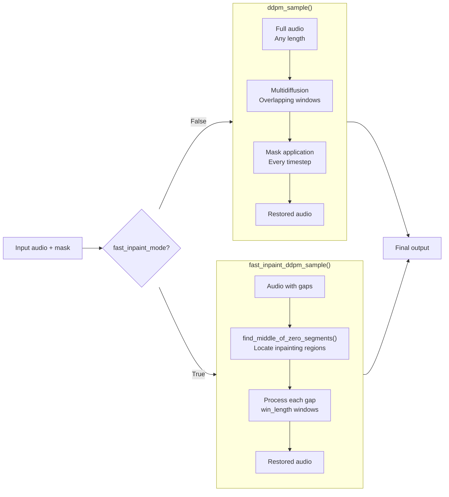

**Inference Sampling Strategy Selection**

| Method | When to Use | Efficiency |
|--------|-------------|------------|
| `ddpm_sample()` | General purpose, bandwidth extension, dense inpainting | Standard |
| `fast_inpaint_ddpm_sample()` | Sparse inpainting with well-separated gaps | Optimized |

**Sources:** [A2SB_lightning_module_api.py:106-149](), [A2SB_lightning_module_api.py:152-183]()

## Sampling Process Details

### DDPM Sampling Loop

The core sampling logic in `ddpm_sample()` [A2SB_lightning_module_api.py:106-149]() performs iterative refinement:

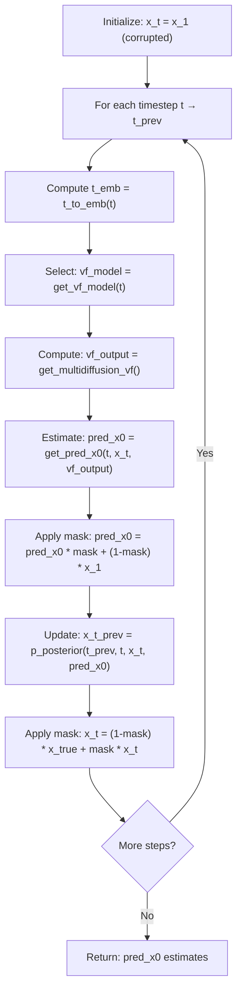

**DDPM Sampling Loop Flow**

The sampling process uses the following key operations:

| Step | Function | Purpose |
|------|----------|---------|
| Time embedding | `t_to_emb(t)` | Convert scalar timestep to 128-dim embedding |
| Model selection | `get_vf_model(t)` | Select appropriate VF model for current timestep |
| Vector field | `get_multidiffusion_vf()` | Predict denoising direction with overlapping windows |
| Clean estimate | `get_pred_x0(t, x_t, vf_output)` | Estimate clean spectrogram from noisy input |
| Posterior | `p_posterior(t_prev, t, x_t, pred_x0)` | Compute x_{t_prev} from x_t |
| Masking | Preserve known regions | Enforce boundary conditions |

**Sources:** [A2SB_lightning_module_api.py:106-149]()

### Multidiffusion for Long Audio

The `get_multidiffusion_vf()` function [diffusion.py]() enables processing of arbitrarily long audio by:

1. **Padding:** Add temporal padding to input via `multidiffusion_pad_inputs()` [diffusion.py]()
2. **Windowing:** Process audio in overlapping windows of size `win_length`
3. **Stride:** Advance by `hop_length` samples per window
4. **Aggregation:** Average predictions in overlapping regions
5. **Unpadding:** Remove padding via `multidiffusion_unpad_outputs()` [diffusion.py]()

When `hop_length < win_length`, overlapping predictions are averaged, reducing boundary artifacts. This allows processing hour-long audio without memory constraints.

**Sources:** [A2SB_lightning_module_api.py:106-149](), [diffusion.py:1-200]()

### Fast Inpainting Mode

The `fast_inpaint_ddpm_sample()` method [A2SB_lightning_module_api.py:152-183]() optimizes for sparse inpainting:

```mermaid
graph TB
    Input["Input: x_1, mask, t_steps"]
    FindGaps["find_middle_of_zero_segments(1-mask)<br/>Returns center indices of gaps"]
    ForEach["For each gap center"]
    DefineWindow["Define window: [center - win_length/2, center + win_length/2]"]
    Bounds["Handle boundaries:<br/>Shift window if at edges"]
    Extract["Extract: curr_x_1, curr_mask"]
    Sample["Call ddpm_sample() on window"]
    Insert["Insert result back into x_1"]
    NextGap{"More gaps?"}
    Return["Return: [x_1]"]
    
    Input --> FindGaps
    FindGaps --> ForEach
    ForEach --> DefineWindow
    DefineWindow --> Bounds
    Bounds --> Extract
    Extract --> Sample
    Sample --> Insert
    Insert --> NextGap
    NextGap -->|Yes| ForEach
    NextGap -->|No| Return
```

**Fast Inpainting Process Flow**

This mode assumes:
- Each masked segment is shorter than `win_length`
- Gaps are sufficiently separated
- Most of the audio is known (not masked)

Under these conditions, it processes only the windowed regions around gaps rather than the entire audio, significantly reducing computation.

**Sources:** [A2SB_lightning_module_api.py:152-183](), [utils.py:find_middle_of_zero_segments]()

## Configuration

Inference configuration is specified via YAML files. The reference configuration is `configs/ensemble_2split_sampling.yaml`.

### Essential Parameters

```mermaid
graph TB
    subgraph Model["Model Configuration"]
        Checkpoints["pretrained_checkpoints:<br/>[checkpoint1.ckpt, checkpoint2.ckpt]"]
        TCutoffs["t_cutoffs: [0.5]"]
        BetaMax["beta_max: 0.3"]
        ODE["use_ot_ode: false"]
    end
    
    subgraph Sampling["Sampling Parameters"]
        NSteps["predict_n_steps: 50"]
        WinLength["predict_win_length: 256"]
        HopLength["predict_hop_length: 128"]
        BatchSize["predict_batch_size: 16"]
    end
    
    subgraph Audio["Audio Processing"]
        InvTransforms["inv_transforms:<br/>Audio transform pipeline"]
        SamplingRate["sampling_rate: 44100"]
    end
    
    Config["inference config YAML"] --> Model
    Config --> Sampling
    Config --> Audio
```

**Inference Configuration Structure**

| Parameter | Type | Purpose | Typical Value |
|-----------|------|---------|---------------|
| `pretrained_checkpoints` | List[str] | Paths to model checkpoints | `["path/to/split0.ckpt", "path/to/split1.ckpt"]` |
| `t_cutoffs` | List[float] | Time partition boundaries | `[0.5]` for 2-split |
| `predict_n_steps` | int | Number of diffusion steps | `50` (more = higher quality, slower) |
| `predict_win_length` | int | Window size (temporal frames) | `256` |
| `predict_hop_length` | int | Stride between windows | `128` (overlap = win - hop) |
| `predict_batch_size` | int | Batch size for multidiffusion | `16` |
| `beta_max` | float | Maximum noise schedule value | `0.3` |
| `use_ot_ode` | bool | Use ODE vs SDE formulation | `false` |
| `fast_inpaint_mode` | bool | Enable fast inpainting | `false` (set `true` for sparse gaps) |

**Sources:** [A2SB_lightning_module_api.py:35-49](), [README.md:62-75]()

### Audio Transforms Configuration

The `inv_transforms` list specifies the inverse transformation pipeline to convert model outputs (spectrograms) back to waveforms. This typically includes:

1. Power descaling (inverse of power=0.25 scaling)
2. DC term restoration
3. SO(2) phase correction via `audio_utils.svd_fix_phase_channels()`
4. Complex spectrogram reconstruction
5. Inverse STFT via `torch.istft()`

For details on the audio processing pipeline, see [Audio Processing Pipeline](#6.2).

**Sources:** [A2SB_lightning_module_api.py:92-103](), [audio_transforms/transforms.py:1-300]()

## Inference Modes

### Single File API

For processing individual audio files with automatic rolloff detection, use `inference/A2SB_upsample_api.py`:

```bash
cd inference/
python A2SB_upsample_api.py -f DEGRADED.wav -o RESTORED.wav -n N_STEPS
```

| Argument | Description | Example |
|----------|-------------|---------|
| `-f`, `--input-file` | Path to degraded input audio | `degraded.wav` |
| `-o`, `--output-file` | Path to save restored audio | `restored.wav` |
| `-n`, `--n-steps` | Number of diffusion steps | `50` |

This API automatically:
1. Detects the rolloff frequency in the input
2. Constructs an appropriate loss mask for bandwidth extension
3. Loads the ensemble model
4. Performs inference
5. Saves the restored waveform

For detailed usage, see [Single File API](#3.1).

**Sources:** [README.md:71-75]()

### Batch Dataset Processing

For processing entire datasets, two scripts are provided:

#### Bandwidth Extension

```bash
cd inference/
python A2SB_upsample_dataset.py -dn DATASET_NAME -exp ensemble_2split_sampling -cf 4000
```

| Argument | Description | Example |
|----------|-------------|---------|
| `-dn`, `--dataset-name` | Dataset manifest name | `test_set` |
| `-exp`, `--experiment` | Config name (in `configs/`) | `ensemble_2split_sampling` |
| `-cf`, `--cutoff-freq` | Bandwidth limit (Hz) | `4000` |

This script:
1. Loads the dataset manifest (`DATASET_NAME_manifest.csv`)
2. For each audio file, creates a low-pass filtered version (cutoff at `cf` Hz)
3. Constructs a frequency mask above the cutoff
4. Runs inference to restore high frequencies
5. Saves restored audio to the output directory

For detailed usage, see [Batch Processing Datasets](#3.2) and [Bandwidth Extension](#3.3).

**Sources:** [README.md:66-68]()

#### Inpainting

```bash
cd inference/
python A2SB_inpaint_dataset.py -dn DATASET_NAME -exp ensemble_2split_sampling -inp_len 0.3 -inp_every 5.0
```

| Argument | Description | Example |
|----------|-------------|---------|
| `-dn`, `--dataset-name` | Dataset manifest name | `test_set` |
| `-exp`, `--experiment` | Config name | `ensemble_2split_sampling` |
| `-inp_len` | Gap duration (seconds) | `0.3` |
| `-inp_every` | Gap spacing (seconds) | `5.0` |

This script:
1. Loads the dataset manifest
2. For each audio file, creates gaps of duration `inp_len` every `inp_every` seconds
3. Constructs a temporal mask for the gaps
4. Runs inference to inpaint the missing segments
5. Saves restored audio to the output directory

For detailed usage, see [Batch Processing Datasets](#3.2) and [Inpainting](#3.4).

**Sources:** [README.md:68-69]()

## Predict Step

The Lightning module's `predict_step()` method [A2SB_lightning_module_api.py:186-210]() is called for each batch during prediction:

```mermaid
graph TB
    Input["predict_step(batch, batch_idx)"]
    Extract["Extract: x_0_clean, x_0_corrupted, loss_mask"]
    CreateDir["Create output directory"]
    TSteps["Create t_steps: [1.0 → 0.05]"]
    CheckMode{"fast_inpaint_mode?"}
    StdSample["Call ddpm_sample()"]
    FastSample["Call fast_inpaint_ddpm_sample()"]
    GetLast["Extract final x_0 from x_0s[-1]"]
    Vocode["Call vocode_stft() to get waveform"]
    WriteWav["Write output_audio_filename"]
    
    Input --> Extract
    Extract --> CreateDir
    CreateDir --> TSteps
    TSteps --> CheckMode
    CheckMode -->|False| StdSample
    CheckMode -->|True| FastSample
    StdSample --> GetLast
    FastSample --> GetLast
    GetLast --> Vocode
    Vocode --> WriteWav
```

**predict_step() Execution Flow**

The `predict_step()` assumes:
- Batch size of 1 (processes one audio file at a time)
- Input batch contains `x_0_clean`, `x_0_corrupted`, `loss_mask`, `outdir`, `output_sr`

The restored audio is written to `self.output_audio_filename`, which is set during model initialization.

**Sources:** [A2SB_lightning_module_api.py:186-210]()

## Memory and Performance Considerations

### Window Size Trade-offs

| Parameter | Small Value | Large Value |
|-----------|-------------|-------------|
| `predict_win_length` | Faster, less memory, more boundary artifacts | Slower, more memory, fewer artifacts |
| `predict_hop_length` | More overlap, smoother, slower | Less overlap, faster, potential discontinuities |
| `predict_batch_size` | Lower memory usage | Higher throughput |

Recommended configurations:

| Use Case | win_length | hop_length | batch_size |
|----------|------------|------------|------------|
| High quality, ample GPU memory | 512 | 256 | 32 |
| Balanced | 256 | 128 | 16 |
| Limited memory | 128 | 128 | 8 |

**Sources:** [A2SB_lightning_module_api.py:106-149]()

### Number of Steps

The `predict_n_steps` parameter controls the diffusion trajectory discretization:

- **Fewer steps (e.g., 25):** Faster inference, slightly lower quality
- **More steps (e.g., 50-100):** Higher quality, slower inference

The timestep schedule is linear from `t=1.0` to `t=0.05` [A2SB_lightning_module_api.py:195](). The minimum value of 0.05 (not 0.0) is used to avoid numerical instability.

**Sources:** [A2SB_lightning_module_api.py:195-203]()

## Masking Strategy

The inference system uses `loss_mask` (also called `fill_mask`) to control which regions are restored:

```mermaid
graph LR
    Mask["loss_mask tensor<br/>(B x C x H x W)"]
    
    subgraph Values["Mask Values"]
        One["1.0: Restore this region<br/>(unknown/corrupted)"]
        Zero["0.0: Keep original<br/>(known/clean)"]
    end
    
    subgraph Application["Mask Application"]
        PredX0["pred_x0 = pred_x0 * mask + (1-mask) * x_1"]
        XT["x_t = (1-mask) * x_true + mask * x_t"]
    end
    
    Mask --> Values
    Values --> Application
```

**Mask Application Strategy**

During sampling:
1. **After prediction:** `pred_x0` is masked to preserve known regions [A2SB_lightning_module_api.py:137]()
2. **After posterior update:** `x_t` is masked to maintain boundary conditions [A2SB_lightning_module_api.py:142-147]()

For bandwidth extension, the mask is typically:
- `1.0` in high-frequency regions (above cutoff)
- `0.0` in low-frequency regions (below cutoff)

For inpainting, the mask is:
- `1.0` in temporal gaps
- `0.0` in known segments

**Sources:** [A2SB_lightning_module_api.py:106-149]()

## Output Format

All inference modes output audio in WAV format at 44.1kHz sampling rate. The output directory structure depends on the inference mode:

| Mode | Output Path |
|------|-------------|
| Single file API | Specified via `-o` argument |
| Batch processing | `{experiment_dir}/{dataset_name}/{outdir}/recon.wav` |

The restored audio is full-resolution (44.1kHz) and does not require any post-processing vocoder.

**Sources:** [A2SB_lightning_module_api.py:205-209](), [README.md:19-24]()

---

# Page: Single File API

# Single File API

<details>
<summary>Relevant source files</summary>

The following files were used as context for generating this wiki page:

- [A2SB_lightning_module_api.py](A2SB_lightning_module_api.py)
- [README.md](README.md)

</details>


## Purpose and Scope

This page documents the single file API (`A2SB_upsample_api.py`) for processing individual audio files using A2SB. This API is designed for interactive use and supports automatic rolloff frequency detection for bandwidth extension tasks. It can handle arbitrarily long audio files without boundary artifacts.

For batch processing of multiple files from a manifest, see [Batch Processing Datasets](#3.2). For detailed parameter tuning and task-specific guidance, see [Bandwidth Extension](#3.3) and [Inpainting](#3.4).

## Overview

The single file API provides a command-line interface for restoring individual audio files. It is primarily designed for bandwidth extension (upsampling low-resolution audio to 44.1kHz) but can be configured for other restoration tasks. The API automatically detects the rolloff frequency of degraded input and applies the appropriate restoration model.

**Key Features:**
- Processes single audio files via command line
- Automatic rolloff frequency detection
- Handles hour-long audio without boundary artifacts
- Uses time-partitioned ensemble models for improved quality
- Supports multidiffusion for long sequences
- Configurable number of diffusion steps

## Command-Line Usage

### Basic Invocation

```bash
cd inference/
python A2SB_upsample_api.py -f DEGRADED.wav -o RESTORED.wav -n N_STEPS
```

### Parameters

| Parameter | Short Flag | Description | Default |
|-----------|------------|-------------|---------|
| `--input_file` | `-f` | Path to input degraded audio file | Required |
| `--output_file` | `-o` | Path to output restored audio file | Required |
| `--n_steps` | `-n` | Number of diffusion sampling steps | 50 |
| `--cutoff_freq` | `-cf` | Manual rolloff frequency (Hz) for bandwidth extension | Auto-detected |
| `--config` | | Path to configuration YAML file | `configs/ensemble_2split_sampling.yaml` |

Sources: [README.md:71-75](), [inference/A2SB_upsample_api.py]()

## High-Level Workflow

```mermaid
graph TB
    Input["Input Audio File<br/>(DEGRADED.wav)"]
    LoadAPI["Load A2SB_upsample_api.py"]
    DetectRolloff["Automatic Rolloff Detection<br/>(or use -cf parameter)"]
    LoadConfig["Load Configuration<br/>ensemble_2split_sampling.yaml"]
    LoadModels["Load Time-Partitioned Models<br/>TimePartitionedPretrainedSTFTBridgeModel"]
    PrepareData["Prepare Data Batch<br/>- Apply forward STFT transforms<br/>- Create loss_mask<br/>- Set x_0_corrupted"]
    RunInference["Run predict_step()<br/>- Select VF model by timestep<br/>- DDPM sampling with multidiffusion"]
    Vocode["Vocode STFT to Waveform<br/>vocode_stft() → apply_audio_transforms()"]
    WriteOutput["Write Output Audio<br/>(RESTORED.wav)"]
    
    Input --> LoadAPI
    LoadAPI --> DetectRolloff
    DetectRolloff --> LoadConfig
    LoadConfig --> LoadModels
    LoadModels --> PrepareData
    PrepareData --> RunInference
    RunInference --> Vocode
    Vocode --> WriteOutput
    
    classDef inputClass fill:#f9f9f9,stroke:#333
    classDef processClass fill:#f0f0f0,stroke:#333
    classDef outputClass fill:#f9f9f9,stroke:#333
    
    class Input,DetectRolloff inputClass
    class LoadAPI,LoadConfig,LoadModels,PrepareData,RunInference,Vocode processClass
    class WriteOutput outputClass
```

Sources: [A2SB_lightning_module_api.py:35-210](), [README.md:71-75]()

## Core Components

### TimePartitionedPretrainedSTFTBridgeModel

The single file API is built on the `TimePartitionedPretrainedSTFTBridgeModel` class, which provides inference capabilities with time-partitioned ensemble models.

```mermaid
graph TB
    subgraph "TimePartitionedPretrainedSTFTBridgeModel"
        Constructor["__init__()<br/>- Load checkpoints<br/>- Initialize diffusion<br/>- Setup transforms"]
        LoadCkpt["load_t_bounded_checkpoints()<br/>Load split models from paths"]
        GetVF["get_vf_model(t)<br/>Select model based on t_cutoffs"]
        DDPMSample["ddpm_sample()<br/>Iterative refinement with multidiffusion"]
        FastInpaint["fast_inpaint_ddpm_sample()<br/>Optimized for short segments"]
        Vocode["vocode_stft()<br/>STFT → Waveform conversion"]
        PredictStep["predict_step()<br/>Main inference entry point"]
    end
    
    subgraph "Dependencies"
        VFModel["vf_model<br/>AttnUNetF network"]
        Diffusion["ddpm<br/>Diffusion class"]
        TimeEmb["t_to_emb<br/>SinusoidalTemporalEmbedding"]
        InvTransforms["inv_transforms<br/>Audio transform chain"]
    end
    
    Constructor --> LoadCkpt
    Constructor --> Diffusion
    Constructor --> TimeEmb
    PredictStep --> GetVF
    PredictStep --> DDPMSample
    PredictStep --> FastInpaint
    PredictStep --> Vocode
    
    GetVF --> VFModel
    DDPMSample --> VFModel
    DDPMSample --> Diffusion
    DDPMSample --> TimeEmb
    Vocode --> InvTransforms
```

Sources: [A2SB_lightning_module_api.py:35-210]()

### Key Methods

#### Initialization

The model is initialized with configuration parameters including pretrained checkpoint paths and time cutoffs:

```python
TimePartitionedPretrainedSTFTBridgeModel(
    vf_model: torch.nn.Module,
    pretrained_checkpoints: List[str],  # Paths to split models
    t_cutoffs: List[float],             # e.g., [0.5] for 2-split
    predict_n_steps: int,               # Number of diffusion steps
    predict_hop_length: int,            # Multidiffusion hop length
    predict_win_length: int,            # Multidiffusion window length
    predict_batch_size: int,            # Batch size for processing
    output_audio_filename: str          # Output file path
)
```

Sources: [A2SB_lightning_module_api.py:36-49]()

#### Model Selection by Timestep

The `get_vf_model()` method selects the appropriate vector field model based on the current diffusion timestep:

```python
def get_vf_model(self, t: float):
    """
    Selects model based on t_cutoffs.
    For 2-split with t_cutoffs=[0.5]:
    - t < 0.5: returns model 0
    - t >= 0.5: returns model 1
    """
```

Sources: [A2SB_lightning_module_api.py:84-89]()

#### DDPM Sampling with Multidiffusion

The `ddpm_sample()` method implements the iterative refinement process with multidiffusion support for long audio:

```mermaid
graph LR
    Input["x_1<br/>(corrupted input)"]
    Pad["multidiffusion_pad_inputs()<br/>Add padding for windows"]
    Loop["Iterative Loop<br/>for each timestep"]
    SelectModel["get_vf_model(t)<br/>Choose model by t"]
    GetVF["get_multidiffusion_vf()<br/>Compute VF with overlapping windows"]
    PredX0["get_pred_x0()<br/>Predict clean signal"]
    Posterior["p_posterior()<br/>Compute x_t_prev"]
    Mask["Apply loss_mask<br/>Preserve known regions"]
    Unpad["multidiffusion_unpad_outputs()<br/>Remove padding"]
    Output["x_0<br/>(restored output)"]
    
    Input --> Pad
    Pad --> Loop
    Loop --> SelectModel
    SelectModel --> GetVF
    GetVF --> PredX0
    PredX0 --> Posterior
    Posterior --> Mask
    Mask --> Loop
    Loop --> Unpad
    Unpad --> Output
```

**Key Parameters:**
- `win_length`: Temporal window length of input spectrogram (default: 256)
- `hop_length`: Step size for multidiffusion; if `hop_length < win_length`, overlapping windows are used
- `batch_size`: Number of windows processed in parallel

Sources: [A2SB_lightning_module_api.py:106-149](), [diffusion.py]()

#### Vocoding

The `vocode_stft()` method converts the restored STFT representation back to waveform:

```python
def vocode_stft(self, spec_out):
    """
    Applies inverse transforms to map spectrograms to waveforms.
    Processes each sample in the batch individually.
    Returns: List of waveform tensors
    """
```

The method iterates through batch samples and applies the inverse transform chain defined in `self.inv_transforms`.

Sources: [A2SB_lightning_module_api.py:92-103]()

## Processing Pipeline

### Data Flow Through predict_step()

```mermaid
graph TB
    Batch["Input Batch Dictionary<br/>- x_0_clean<br/>- x_0_corrupted<br/>- loss_mask<br/>- outdir<br/>- output_sr"]
    
    ExtractBatch["Extract batch data<br/>batch['x_0_corrupted']<br/>batch['loss_mask']"]
    
    CreateTSteps["Create timestep schedule<br/>t_steps = linspace(1, 0.05, n_steps)"]
    
    ChooseSampler{"fast_inpaint_mode?"}
    
    StandardSampler["ddpm_sample()<br/>Standard multidiffusion sampling"]
    
    FastSampler["fast_inpaint_ddpm_sample()<br/>Optimized for short segments"]
    
    GetX0["Get final x_0<br/>x_0s[-1]"]
    
    VocodeSpec["vocode_stft(x_0)<br/>STFT → Waveform"]
    
    WriteWav["write_wav()<br/>output_audio_filename"]
    
    Batch --> ExtractBatch
    ExtractBatch --> CreateTSteps
    CreateTSteps --> ChooseSampler
    ChooseSampler -->|"No"| StandardSampler
    ChooseSampler -->|"Yes"| FastSampler
    StandardSampler --> GetX0
    FastSampler --> GetX0
    GetX0 --> VocodeSpec
    VocodeSpec --> WriteWav
```

Sources: [A2SB_lightning_module_api.py:186-210]()

### Batch Structure

The input batch dictionary contains:

| Key | Type | Description |
|-----|------|-------------|
| `x_0_clean` | Tensor | Clean reference spectrogram (B × C × H × W) |
| `x_0_corrupted` | Tensor | Degraded input spectrogram (B × C × H × W) |
| `loss_mask` | Tensor | Binary mask indicating regions to restore (1=restore, 0=preserve) |
| `outdir` | List[str] | Output directory paths |
| `output_sr` | int | Output sample rate (44100 Hz) |
| `x_0_wav` | Tensor | Clean reference waveform (optional, for metrics) |

Sources: [A2SB_lightning_module_api.py:186-210]()

## Configuration

### Configuration File Structure

The API loads configuration from YAML files (typically `configs/ensemble_2split_sampling.yaml`):

```yaml
model:
  class_path: A2SB_lightning_module_api.TimePartitionedPretrainedSTFTBridgeModel
  init_args:
    pretrained_checkpoints:
      - path/to/split1_checkpoint.ckpt
      - path/to/split2_checkpoint.ckpt
    t_cutoffs: [0.5]
    predict_n_steps: 50
    predict_hop_length: 128
    predict_win_length: 256
    predict_batch_size: 16
    beta_max: 0.3
    use_ot_ode: false
    fast_inpaint_mode: false
    sampling_rate: 44100
    n_timestep_channels: 128
    inv_transforms:
      # Transform chain configuration
```

### Key Configuration Parameters

| Parameter | Description | Typical Value |
|-----------|-------------|---------------|
| `pretrained_checkpoints` | List of checkpoint paths for ensemble models | 2 paths for 2-split |
| `t_cutoffs` | Timestep boundaries for model selection | `[0.5]` for 2-split |
| `predict_n_steps` | Number of diffusion sampling steps | 50 (higher = better quality) |
| `predict_win_length` | STFT window length for multidiffusion | 256 |
| `predict_hop_length` | Hop length for multidiffusion | 128 (smaller = more overlap) |
| `predict_batch_size` | Batch size for parallel processing | 16 |
| `beta_max` | Diffusion noise schedule parameter | 0.3 |
| `use_ot_ode` | Use ODE formulation instead of SDE | false |
| `fast_inpaint_mode` | Enable fast inpainting optimization | false |

Sources: [A2SB_lightning_module_api.py:36-49](), [configs/ensemble_2split_sampling.yaml]()

## Code Entity Relationships

```mermaid
graph TB
    subgraph "Entry Point"
        APIScript["A2SB_upsample_api.py<br/>Command-line script"]
    end
    
    subgraph "Lightning Module"
        TPPSB["TimePartitionedPretrainedSTFTBridgeModel<br/>Main inference class"]
        LoadCkpts["load_t_bounded_checkpoints()<br/>Lines 67-81"]
        GetModel["get_vf_model()<br/>Lines 84-89"]
        DDPM["ddpm_sample()<br/>Lines 106-149"]
        FastInpaint["fast_inpaint_ddpm_sample()<br/>Lines 152-183"]
        PredictStep["predict_step()<br/>Lines 186-210"]
        Vocode["vocode_stft()<br/>Lines 92-103"]
    end
    
    subgraph "Core Models"
        VFModels["t_bounded_pretrained_models<br/>ModuleList of AttnUNetF"]
        TimeEmb["t_to_emb<br/>SinusoidalTemporalEmbedding"]
    end
    
    subgraph "Diffusion"
        DiffusionClass["Diffusion class<br/>diffusion.py"]
        QSample["q_sample()"]
        PPosterior["p_posterior()"]
        GetPredX0["get_pred_x0()"]
        MultiDiff["get_multidiffusion_vf()"]
    end
    
    subgraph "Audio Processing"
        InvTransforms["inv_transforms<br/>Transform chain"]
        ApplyTransforms["apply_audio_transforms()<br/>audio_transforms/transforms.py"]
        STFTUtils["audio_utils.py<br/>STFT utilities"]
    end
    
    subgraph "Output"
        WriteWav["write_wav()<br/>scipy.io.wavfile"]
    end
    
    APIScript --> TPPSB
    TPPSB --> LoadCkpts
    TPPSB --> PredictStep
    PredictStep --> GetModel
    PredictStep --> DDPM
    PredictStep --> FastInpaint
    PredictStep --> Vocode
    
    LoadCkpts --> VFModels
    GetModel --> VFModels
    DDPM --> GetModel
    DDPM --> TimeEmb
    DDPM --> MultiDiff
    DDPM --> GetPredX0
    DDPM --> PPosterior
    
    MultiDiff --> VFModels
    GetPredX0 --> DiffusionClass
    PPosterior --> DiffusionClass
    
    Vocode --> ApplyTransforms
    ApplyTransforms --> InvTransforms
    ApplyTransforms --> STFTUtils
    
    Vocode --> WriteWav
```

Sources: [A2SB_lightning_module_api.py:35-210](), [diffusion.py](), [audio_transforms/transforms.py](), [audio_utils.py]()

## Multidiffusion for Long Audio

The API handles arbitrarily long audio files through a multidiffusion approach that processes audio in overlapping windows and blends the results.

### Multidiffusion Processing Steps

```mermaid
graph TB
    LongAudio["Long Audio Input<br/>Width > win_length"]
    
    Pad["multidiffusion_pad_inputs()<br/>Add symmetric padding"]
    
    CreateWindows["Create overlapping windows<br/>win_length × hop_length grid"]
    
    BatchProcess["Process windows in parallel<br/>batch_size windows at a time"]
    
    VFCompute["Compute VF for each window<br/>get_multidiffusion_vf()"]
    
    Blend["Blend overlapping predictions<br/>Weighted average in overlap regions"]
    
    Unpad["multidiffusion_unpad_outputs()<br/>Remove padding"]
    
    Output["Restored long audio<br/>No boundary artifacts"]
    
    LongAudio --> Pad
    Pad --> CreateWindows
    CreateWindows --> BatchProcess
    BatchProcess --> VFCompute
    VFCompute --> Blend
    Blend --> Unpad
    Unpad --> Output
```

### Window Parameters

The relationship between `win_length` and `hop_length` determines the overlap:

- **`hop_length == win_length`**: No overlap, standard processing
- **`hop_length < win_length`**: Overlapping windows, multidiffusion blending enabled
- **Overlap amount**: `win_length - hop_length` frames

**Example with 2-split ensemble:**
- `win_length = 256`: Each window is 256 STFT frames (~1.5 seconds at 44.1kHz)
- `hop_length = 128`: 50% overlap between consecutive windows
- `batch_size = 16`: Process 16 windows simultaneously

Sources: [A2SB_lightning_module_api.py:106-149](), [diffusion.py]()

## Fast Inpainting Mode

When `fast_inpaint_mode=True`, the API uses an optimized algorithm that processes only the regions around gaps rather than the entire audio:

### Fast Inpaint Algorithm

1. Identifies middle points of zero segments in the mask
2. For each gap, extracts a window centered on the gap
3. Runs standard `ddpm_sample()` only on that window
4. Stitches the restored segments back into the full audio

**Use Case:** Efficient for tasks where missing segments are short and well-separated (e.g., click removal, short dropout restoration).

**Limitation:** Assumes each masked segment is shorter than `win_length` and sufficiently separated from other segments.

Sources: [A2SB_lightning_module_api.py:152-183](), [utils.py]()

## Example Workflow

### Bandwidth Extension Example

```bash
# Process a 16kHz degraded file, upsample to 44.1kHz
python A2SB_upsample_api.py \
    -f degraded_16k.wav \
    -o restored_44k.wav \
    -n 50 \
    -cf 8000  # Specify rolloff at 8kHz
```

**Processing Steps:**
1. Load degraded audio
2. Apply forward STFT transforms
3. Create bandwidth extension mask (frequencies above 8kHz)
4. Load 2-split ensemble models
5. Run 50-step DDPM sampling with multidiffusion
6. Apply inverse STFT transforms
7. Write restored 44.1kHz audio

### Hour-Long Audio Example

```bash
# Process hour-long concert recording
python A2SB_upsample_api.py \
    -f concert_degraded.wav \
    -o concert_restored.wav \
    -n 100  # More steps for higher quality
```

**Key Features:**
- Multidiffusion handles the long duration seamlessly
- No boundary artifacts between windows
- Memory-efficient processing through batched window computation

Sources: [README.md:71-75](), [A2SB_lightning_module_api.py:106-149]()

## Performance Considerations

### Computational Trade-offs

| Parameter | Effect on Quality | Effect on Speed | Recommended Range |
|-----------|-------------------|-----------------|-------------------|
| `predict_n_steps` | Higher = better quality | Lower = faster | 50-100 |
| `predict_hop_length` | Smaller = smoother blending | Smaller = slower | 64-256 |
| `predict_batch_size` | No direct effect | Higher = faster (GPU memory permitting) | 8-32 |

### Memory Usage

Memory consumption scales with:
- `predict_win_length`: Larger windows require more memory
- `predict_batch_size`: More parallel windows increase GPU memory usage
- Audio length: Managed automatically through batched processing

**Recommended for Long Audio:**
- Use default `win_length=256`, `hop_length=128`
- Reduce `batch_size` if encountering OOM errors
- The API automatically handles arbitrarily long files through windowing

Sources: [A2SB_lightning_module_api.py:106-149]()

## Integration with Other Components

```mermaid
graph LR
    API["A2SB_upsample_api.py"]
    Config["ensemble_2split_sampling.yaml"]
    TPPSB["TimePartitionedPretrainedSTFTBridgeModel"]
    Checkpoints["Pretrained Checkpoints<br/>Split 1 & Split 2"]
    Transforms["audio_transforms<br/>Forward & Inverse"]
    AudioUtils["audio_utils<br/>STFT utilities"]
    Diffusion["diffusion.py<br/>Sampling logic"]
    
    API --> Config
    Config --> TPPSB
    TPPSB --> Checkpoints
    TPPSB --> Transforms
    TPPSB --> Diffusion
    Transforms --> AudioUtils
```

**Related Systems:**
- For batch processing, see [Batch Processing Datasets](#3.2)
- For training these models, see [Training Guide](#4)
- For understanding the architecture, see [A2SB Model Overview](#5.1)
- For the 2-split strategy, see [Time-Partitioned Ensemble](#5.4)

Sources: [A2SB_lightning_module_api.py:35-210](), [configs/](), [audio_transforms/transforms.py](), [audio_utils.py](), [diffusion.py]()

---

# Page: Batch Processing Datasets

# Batch Processing Datasets

<details>
<summary>Relevant source files</summary>

The following files were used as context for generating this wiki page:

- [A2SB_lightning_module_api.py](A2SB_lightning_module_api.py)
- [README.md](README.md)

</details>


This page describes how to process entire datasets of audio files using A2SB's batch processing scripts. These scripts leverage PyTorch Lightning's prediction pipeline to efficiently restore multiple audio files in parallel, organizing outputs in a structured manner.

For processing individual audio files with automatic rolloff detection, see [Single File API](#3.1). For detailed information about the bandwidth extension and inpainting tasks themselves, see [Bandwidth Extension](#3.3) and [Inpainting](#3.4).

## Overview

A2SB provides two batch processing scripts for dataset-level audio restoration:

| Script | Purpose | Task Type |
|--------|---------|-----------|
| `inference/A2SB_upsample_dataset.py` | Batch bandwidth extension | Upsampling from low-frequency to full-frequency audio |
| `inference/A2SB_inpaint_dataset.py` | Batch inpainting | Filling in missing/corrupted temporal segments |

Both scripts use the same underlying architecture:
- Read audio file paths from manifest CSV files
- Load pretrained ensemble models via `TimePartitionedPretrainedSTFTBridgeModel`
- Process files through PyTorch Lightning's `Trainer.predict()` pipeline
- Write restored audio to organized output directories

**Sources:** [README.md:64-69]()

## Batch Processing Architecture

```mermaid
graph TB
    subgraph "Input Layer"
        Manifest["Manifest CSV<br/>DATASET_NAME_manifest.csv<br/>(split, file_path, duration)"]
        ConfigYAML["Inference Config<br/>ensemble_2split_sampling.yaml"]
        Checkpoints["Pretrained Checkpoints<br/>Split 1 & Split 2 Models"]
    end
    
    subgraph "PyTorch Lightning Pipeline"
        Trainer["lightning.Trainer<br/>(predict mode)"]
        DataLoader["Predict DataLoader<br/>(batch_size=1)"]
        LightningModule["TimePartitionedPretrainedSTFTBridgeModel<br/>.predict_step()"]
    end
    
    subgraph "Processing Components"
        VFSelector["VF Model Selector<br/>.get_vf_model(t)"]
        Sampler["DDPM Sampler<br/>.ddpm_sample() or<br/>.fast_inpaint_ddpm_sample()"]
        Vocoder["Vocoding<br/>.vocode_stft()"]
    end
    
    subgraph "Output Layer"
        OutDir["Output Directory Structure<br/>outdir/dataset/split/file/"]
        WavFiles["Restored Audio Files<br/>recon.wav"]
    end
    
    Manifest --> DataLoader
    ConfigYAML --> LightningModule
    Checkpoints --> LightningModule
    DataLoader --> Trainer
    Trainer --> LightningModule
    
    LightningModule --> VFSelector
    LightningModule --> Sampler
    Sampler --> Vocoder
    
    Vocoder --> WavFiles
    WavFiles --> OutDir
    
    classDef inputClass fill:#f9f9f9,stroke:#333
    classDef pipelineClass fill:#f0f0f0,stroke:#333
    classDef processClass fill:#e8e8e8,stroke:#333
    classDef outputClass fill:#e0e0e0,stroke:#333
    
    class Manifest,ConfigYAML,Checkpoints inputClass
    class Trainer,DataLoader,LightningModule pipelineClass
    class VFSelector,Sampler,Vocoder processClass
    class OutDir,WavFiles outputClass
```

**Sources:** [A2SB_lightning_module_api.py:35-210](), [README.md:64-69]()

## Bandwidth Extension Dataset Processing

### Command Line Usage

The `A2SB_upsample_dataset.py` script processes entire datasets for bandwidth extension:

```bash
cd inference/
python A2SB_upsample_dataset.py -dn DATASET_NAME -exp ensemble_2split_sampling -cf 4000
```

**Parameters:**

| Parameter | Flag | Description | Default |
|-----------|------|-------------|---------|
| Dataset Name | `-dn` | Name matching `DATASET_NAME_manifest.csv` | Required |
| Experiment Config | `-exp` | Config file name (without `.yaml`) | Required |
| Cutoff Frequency | `-cf` | Low-pass cutoff frequency in Hz | Required |

### Processing Flow

```mermaid
graph LR
    subgraph "Per-File Processing"
        LoadAudio["Load Audio<br/>(from manifest path)"]
        CreateDegraded["Create Degraded Version<br/>(low-pass filter @ cf Hz)"]
        ToSTFT["Convert to STFT<br/>(ComplexSpectrogram)"]
        CreateMask["Create Loss Mask<br/>(1 for freq > cf)"]
        Predict["predict_step()<br/>(DDPM sampling)"]
        WriteOutput["Write recon.wav<br/>(44.1kHz full-bandwidth)"]
        
        LoadAudio --> CreateDegraded
        CreateDegraded --> ToSTFT
        ToSTFT --> CreateMask
        CreateMask --> Predict
        Predict --> WriteOutput
    end
```

The script creates a degraded version by applying a low-pass filter at the specified cutoff frequency, then uses the model to predict the missing high-frequency content. The loss mask is set to 1 for frequencies above the cutoff, indicating which spectral regions need restoration.

**Sources:** [README.md:64-68](), [A2SB_lightning_module_api.py:186-210]()

## Inpainting Dataset Processing

### Command Line Usage

The `A2SB_inpaint_dataset.py` script processes datasets for temporal inpainting:

```bash
cd inference/
python A2SB_inpaint_dataset.py -dn DATASET_NAME -exp ensemble_2split_sampling -inp_len 0.3 -inp_every 5.0
```

**Parameters:**

| Parameter | Flag | Description | Default |
|-----------|------|-------------|---------|
| Dataset Name | `-dn` | Name matching `DATASET_NAME_manifest.csv` | Required |
| Experiment Config | `-exp` | Config file name (without `.yaml`) | Required |
| Inpaint Length | `-inp_len` | Duration of each gap in seconds | Required |
| Inpaint Interval | `-inp_every` | Interval between gaps in seconds | Required |

### Fast Inpainting Mode

The inpainting script can operate in two modes:

1. **Standard Mode:** Uses full multidiffusion with overlapping windows for high quality
2. **Fast Inpainting Mode:** Processes each gap independently for faster inference

The mode is controlled by the `fast_inpaint_mode` parameter in the config YAML and affects which method is called:

```mermaid
graph TB
    PredictStep["predict_step()"]
    CheckMode{"fast_inpaint_mode<br/>enabled?"}
    FastMethod["fast_inpaint_ddpm_sample()<br/>(process gaps independently)"]
    StandardMethod["ddpm_sample()<br/>(full multidiffusion)"]
    
    PredictStep --> CheckMode
    CheckMode -->|"True"| FastMethod
    CheckMode -->|"False"| StandardMethod
    
    FastMethod --> Output["Restored Audio"]
    StandardMethod --> Output
```

**Sources:** [A2SB_lightning_module_api.py:64](), [A2SB_lightning_module_api.py:152-183](), [A2SB_lightning_module_api.py:196-203]()

## Core Prediction Pipeline

The batch processing scripts delegate the actual restoration to the `predict_step()` method of `TimePartitionedPretrainedSTFTBridgeModel`:

```mermaid
graph TB
    subgraph "predict_step Method Flow"
        Input["Batch Input<br/>(batch_size=1)"]
        ExtractBatch["Extract Tensors:<br/>x_0_clean (target)<br/>x_0_corrupted (input)<br/>loss_mask (fill-mask)"]
        CreateSteps["Create Time Steps<br/>linspace(1, 0.05, n_steps)"]
        SelectSampler{"fast_inpaint_mode?"}
        FastSample["fast_inpaint_ddpm_sample()"]
        StandardSample["ddpm_sample()"]
        VocodeMerge["Vocoding Merge Point"]
        Vocode["vocode_stft()<br/>(STFT → Waveform)"]
        WriteWav["write_wav()<br/>(output_audio_filename)"]
        
        Input --> ExtractBatch
        ExtractBatch --> CreateSteps
        CreateSteps --> SelectSampler
        SelectSampler -->|"True"| FastSample
        SelectSampler -->|"False"| StandardSample
        FastSample --> VocodeMerge
        StandardSample --> VocodeMerge
        VocodeMerge --> Vocode
        Vocode --> WriteWav
    end
```

Key implementation details from `predict_step()`:

- **Batch Size:** Only supports `batch_size=1` for now [A2SB_lightning_module_api.py:188]()
- **Output Directory:** Organized by batch's `outdir` field [A2SB_lightning_module_api.py:190]()
- **Sampling Steps:** Defaults to `predict_n_steps` parameter (e.g., 50) [A2SB_lightning_module_api.py:195]()
- **Multidiffusion Parameters:** Uses `predict_win_length` and `predict_hop_length` [A2SB_lightning_module_api.py:198-199]()

**Sources:** [A2SB_lightning_module_api.py:186-210]()

## DDPM Sampling Methods

The batch processing uses sophisticated sampling strategies for long audio:

### Standard DDPM Sampling

The `ddpm_sample()` method implements multidiffusion for processing arbitrarily long spectrograms:

```mermaid
graph LR
    subgraph "Multidiffusion Processing"
        PadInput["Pad Input<br/>multidiffusion_pad_inputs()"]
        IterateSteps["Iterate Over Time Steps<br/>(t=1.0 → t=0.05)"]
        GetVF["get_vf_model(t)<br/>(select Split 1 or 2)"]
        MultiVF["get_multidiffusion_vf()<br/>(windowed inference)"]
        PredX0["Predict x_0<br/>(current estimate)"]
        ApplyMask["Apply Mask<br/>(preserve known regions)"]
        Posterior["p_posterior()<br/>(reverse step)"]
        UnpadOutput["Unpad Output<br/>multidiffusion_unpad_outputs()"]
        
        PadInput --> IterateSteps
        IterateSteps --> GetVF
        GetVF --> MultiVF
        MultiVF --> PredX0
        PredX0 --> ApplyMask
        ApplyMask --> Posterior
        Posterior --> IterateSteps
        IterateSteps --> UnpadOutput
    end
```

**Key Features:**
- **Window Length:** `predict_win_length` (default 256 frames) [A2SB_lightning_module_api.py:107]()
- **Hop Length:** `predict_hop_length` (default 128 frames) [A2SB_lightning_module_api.py:108]()
- **Batch Processing:** Vector field computed in batches of `predict_batch_size` (default 16) [A2SB_lightning_module_api.py:109]()
- **Padding:** Input padded to ensure complete coverage [A2SB_lightning_module_api.py:118-119]()

### Fast Inpainting Sampling

The `fast_inpaint_ddpm_sample()` method optimizes for sparse inpainting:

```mermaid
graph TB
    FindGaps["find_middle_of_zero_segments()<br/>(locate masked regions)"]
    PadFull["Pad Full Input<br/>(with padding_constant=0)"]
    IterateGaps["Iterate Over Each Gap Center"]
    ExtractWindow["Extract Window<br/>(center ± win_length/2)"]
    ProcessWindow["ddpm_sample()<br/>(process this window only)"]
    WriteBack["Write Result Back<br/>(to gap location)"]
    UnpadFinal["Unpad Final Output"]
    
    FindGaps --> PadFull
    PadFull --> IterateGaps
    IterateGaps --> ExtractWindow
    ExtractWindow --> ProcessWindow
    ProcessWindow --> WriteBack
    WriteBack --> IterateGaps
    IterateGaps --> UnpadFinal
```

**Assumptions:**
- Each masked segment is shorter than `win_length` [A2SB_lightning_module_api.py:157]()
- Masked segments are sufficiently separated [A2SB_lightning_module_api.py:157]()
- Faster than standard mode but may have lower quality at gap boundaries

**Sources:** [A2SB_lightning_module_api.py:106-149](), [A2SB_lightning_module_api.py:152-183]()

## Configuration Parameters

Both batch processing scripts load configuration from YAML files (e.g., `ensemble_2split_sampling.yaml`). Key parameters:

### Model Configuration

| Parameter | Description | Typical Value |
|-----------|-------------|---------------|
| `pretrained_checkpoints` | List of checkpoint paths for ensemble | `[split1.ckpt, split2.ckpt]` |
| `t_cutoffs` | Time partition boundaries | `[0.5]` for 2-split |
| `predict_n_steps` | Number of diffusion steps | 50 |
| `beta_max` | Maximum noise schedule parameter | 0.3 |
| `use_ot_ode` | Use ODE vs SDE formulation | False (SDE) |

### Processing Configuration

| Parameter | Description | Typical Value |
|-----------|-------------|---------------|
| `predict_win_length` | Temporal window size (frames) | 256 |
| `predict_hop_length` | Multidiffusion hop size (frames) | 128 |
| `predict_batch_size` | Batch size for VF computation | 16 |
| `fast_inpaint_mode` | Use fast inpainting optimization | False |
| `output_audio_filename` | Template for output paths | `"output/recon.wav"` |

**Sources:** [A2SB_lightning_module_api.py:36-49](), [README.md:41-42]()

## Output Organization

The batch processing scripts organize outputs in a structured directory hierarchy:

```
output_dir/
├── DATASET_NAME/
│   ├── train/
│   │   ├── file1/
│   │   │   └── recon.wav
│   │   ├── file2/
│   │   │   └── recon.wav
│   ├── validation/
│   │   └── ...
│   └── test/
│       └── ...
```

The directory structure is determined by:
- `predict_output_dir`: Base output directory [A2SB_lightning_module_api.py:51]()
- `batch['outdir']`: Per-sample subdirectory path [A2SB_lightning_module_api.py:190]()
- `output_audio_filename`: Final output filename [A2SB_lightning_module_api.py:207]()

Each processed file gets its own subdirectory containing the restored audio at 44.1kHz sampling rate.

**Sources:** [A2SB_lightning_module_api.py:190-191](), [A2SB_lightning_module_api.py:207]()

## Data Preparation Requirements

Both batch processing scripts require properly formatted manifest files. See [Data Preparation](#2.2) for details on the manifest CSV format:

```csv
split,file_path,duration
train,PATH/TO/AUDIO.wav,10.0
validation,PATH/TO/AUDIO.wav,10.0
test,PATH/TO/AUDIO.wav,10.0
```

The scripts will process files from the specified split (train/validation/test) as defined in the manifest.

**Sources:** [README.md:30-40]()

## Performance Considerations

### Memory Management

- **Batch Size 1:** Current implementation processes one file at a time to handle arbitrarily long audio [A2SB_lightning_module_api.py:188]()
- **Multidiffusion Batching:** VF model operates on `predict_batch_size` windows simultaneously [A2SB_lightning_module_api.py:132-134]()
- **GPU Memory:** Adjust `predict_batch_size` based on available VRAM

### Computational Efficiency

- **Fast Inpainting:** Use `fast_inpaint_mode=True` for sparse inpainting with multiple small gaps [A2SB_lightning_module_api.py:200-203]()
- **Standard Mode:** Better quality for dense inpainting or overlapping gaps [A2SB_lightning_module_api.py:196-199]()
- **Multi-GPU:** PyTorch Lightning's DDP strategy can be configured for distributed processing

**Sources:** [A2SB_lightning_module_api.py:188](), [A2SB_lightning_module_api.py:109](), [A2SB_lightning_module_api.py:196-203]()

---

# Page: Bandwidth Extension

# Bandwidth Extension

<details>
<summary>Relevant source files</summary>

The following files were used as context for generating this wiki page:

- [A2SB_lightning_module_api.py](A2SB_lightning_module_api.py)
- [README.md](README.md)
- [configs/ensemble_2split_sampling.yaml](configs/ensemble_2split_sampling.yaml)

</details>


## Purpose and Scope

This page provides a technical deep-dive into the **bandwidth extension** (BWE) task in A2SB, including its formulation, key parameters, and implementation details. Bandwidth extension is one of two primary restoration tasks supported by A2SB, where the model predicts missing high-frequency components to restore full-bandwidth audio from low-pass filtered inputs.

For practical usage instructions, see [Single File API](#3.1) for processing individual files or [Batch Processing Datasets](#3.2) for processing entire datasets. For implementation details of the other restoration task, see [Inpainting](#3.4). For the underlying diffusion formulation, see [Schrödinger Bridge Diffusion](#5.2).

**Sources:** [README.md:19-19](), [README.md:64-75]()

## Overview of Bandwidth Extension

Bandwidth extension restores high-frequency content in audio signals that have been degraded by low-pass filtering or bandwidth limitations. This is particularly relevant for:

- **Telephony audio**: Restoring music or speech recorded through bandwidth-limited channels
- **Compressed audio**: Recovering frequencies lost in lossy compression
- **Historical recordings**: Enhancing old recordings with limited frequency response
- **Real-world degradations**: Handling audio captured with equipment limitations

A2SB formulates bandwidth extension as a **conditional diffusion problem** where the model generates high-frequency components while preserving the existing low-frequency information. The task operates entirely in the STFT (spectrogram) domain, treating frequency bands above a specified cutoff as missing data to be inpainted.

**Key characteristics:**
- **Frequency-selective**: Only regenerates content above the cutoff frequency
- **Conditional preservation**: Low-frequency content is kept intact through masking
- **End-to-end**: Operates directly on spectrograms without requiring a separate vocoder
- **Arbitrary length**: Can process hour-long audio through multidiffusion

**Sources:** [README.md:17-25](), [A2SB_lightning_module_api.py:105-149]()

## Task Formulation as Masked Diffusion

Bandwidth extension is formulated as a **frequency-masked diffusion problem** where:

```mermaid
graph LR
    subgraph "Input Space"
        LowPass["Low-pass Filtered Audio<br/>(Missing high frequencies)"]
        Cutoff["Cutoff Frequency<br/>e.g., 4000 Hz"]
    end
    
    subgraph "STFT Domain Representation"
        X0Corrupted["x_0_corrupted<br/>STFT with freq > cutoff = noise"]
        Mask["loss_mask<br/>1 for freq > cutoff<br/>0 for freq ≤ cutoff"]
        X0Clean["x_0_clean<br/>Target full-bandwidth STFT"]
    end
    
    subgraph "Diffusion Process"
        NoiseSchedule["Schrödinger Bridge<br/>t ∈ [1, 0]"]
        VectorField["Vector Field Model<br/>AttnUNetF"]
        Sampling["DDPM Sampling<br/>50-100 steps"]
    end
    
    subgraph "Output Space"
        Restored["Restored Audio<br/>Full bandwidth 0-22050 Hz"]
    end
    
    LowPass --> X0Corrupted
    Cutoff --> Mask
    X0Corrupted --> NoiseSchedule
    X0Clean --> NoiseSchedule
    Mask --> NoiseSchedule
    NoiseSchedule --> VectorField
    VectorField --> Sampling
    Sampling --> Restored
```

### Mask Structure

The bandwidth extension mask is a **binary frequency mask** in the STFT domain:

| Frequency Component | Mask Value | Behavior |
|---------------------|------------|----------|
| Below cutoff frequency | `0` (False) | Preserved from input |
| Above cutoff frequency | `1` (True) | Generated by diffusion |
| DC term (0 Hz) | Removed | Handled separately |

The mask is applied as:
- **During sampling**: `x_t = (1 - mask) * x_t_true + mask * x_t_predicted` at each timestep
- **On predictions**: `pred_x0 = pred_x0 * mask + (1 - mask) * x_1` to ensure low frequencies remain unchanged

**Sources:** [A2SB_lightning_module_api.py:106-149](), [A2SB_lightning_module_api.py:186-209]()

## Key Parameters

### Cutoff Frequency (`-cf`, `cutoff_freq`)

The **cutoff frequency** defines the boundary between preserved and restored frequency content:

| Parameter | Typical Values | Effect |
|-----------|---------------|--------|
| `-cf 4000` | 4000 Hz | Restore frequencies above 4 kHz (telephony-like) |
| `-cf 8000` | 8000 Hz | Restore frequencies above 8 kHz (more challenging) |
| `-cf 11025` | 11025 Hz (Nyquist/2) | Extreme bandwidth extension |

The cutoff frequency is converted to a **frequency bin index** in the STFT representation:
```
cutoff_bin = int(cutoff_freq * n_fft / sampling_rate)
```

For A2SB's default settings (44.1 kHz, 2048 FFT):
- 4000 Hz → bin ~186 (out of 1024 frequency bins)
- 8000 Hz → bin ~372
- 11025 Hz → bin ~512

**Sources:** [README.md:67-68]()

### Number of Sampling Steps (`-n`, `predict_n_steps`)

The number of diffusion steps controls the quality-speed tradeoff:

| Steps | Quality | Speed | Use Case |
|-------|---------|-------|----------|
| 25-50 | Good | Fast | Quick previews, real-time applications |
| 50-100 | Better | Medium | Standard quality restoration |
| 100-200 | Best | Slow | Maximum quality, offline processing |

The timestep schedule is typically linear: `t ∈ [1.0, 1.0/n_steps]`

**Sources:** [A2SB_lightning_module_api.py:43-43](), [A2SB_lightning_module_api.py:195-195]()

### Multidiffusion Parameters

For processing long audio without boundary artifacts:

| Parameter | Default | Description |
|-----------|---------|-------------|
| `predict_win_length` | 256 | Temporal window length in STFT frames |
| `predict_hop_length` | 128 | Step size (< win_length enables overlap) |
| `predict_batch_size` | 16 | GPU batch size for parallel windows |

When `hop_length < win_length`, overlapping windows are averaged, eliminating discontinuities in hour-long audio.

**Sources:** [A2SB_lightning_module_api.py:44-46](), [A2SB_lightning_module_api.py:105-134](), [configs/ensemble_2split_sampling.yaml:1-123]()

## Implementation Architecture

The bandwidth extension pipeline involves several components working together:

```mermaid
graph TB
    subgraph "Input Processing"
        InputWav["Input Audio<br/>Low-pass filtered WAV"]
        STFT["ComplexSpectrogram<br/>n_fft=2048, hop=512"]
        MagPhase["ComplexToMagInstPhase<br/>3-channel representation"]
        DropDC["SpectrogramDropDCTerm<br/>Remove 0 Hz"]
        Power["PowerScaleSpectrogram<br/>power=0.25"]
    end
    
    subgraph "Mask Creation"
        DetectCutoff["Detect Cutoff Frequency<br/>(A2SB_upsample_api.py)"]
        CreateMask["Create Frequency Mask<br/>mask[freq > cutoff] = 1"]
    end
    
    subgraph "Conditional Diffusion"
        X0Corr["x_0_corrupted<br/>Noisy high frequencies"]
        TimePartModel["TimePartitionedPretrainedSTFTBridgeModel"]
        Split1["VF Model Split 1<br/>t ∈ [0.0, 0.5]"]
        Split2["VF Model Split 2<br/>t ∈ [0.5, 1.0]"]
        DDPMSample["ddpm_sample()<br/>Iterative refinement"]
        Multidiff["Multidiffusion<br/>Long audio support"]
    end
    
    subgraph "Output Processing"
        AddDC["SpectrogramAddDCTerm<br/>Restore 0 Hz"]
        SVDFix["SVDFixMagInstPhase<br/>SO2 phase correction"]
        ToComplex["MagInstPhaseToComplex"]
        ISTFT["InverseComplexSpectrogram"]
        OutputWav["Restored Audio<br/>Full-bandwidth WAV"]
    end
    
    InputWav --> STFT
    STFT --> MagPhase
    MagPhase --> DropDC
    DropDC --> Power
    
    Power --> DetectCutoff
    DetectCutoff --> CreateMask
    
    Power --> X0Corr
    CreateMask --> X0Corr
    X0Corr --> TimePartModel
    TimePartModel --> Split1
    TimePartModel --> Split2
    Split1 --> DDPMSample
    Split2 --> DDPMSample
    DDPMSample --> Multidiff
    
    Multidiff --> AddDC
    AddDC --> SVDFix
    SVDFix --> ToComplex
    ToComplex --> ISTFT
    ISTFT --> OutputWav
```

**Sources:** [A2SB_lightning_module_api.py:35-90](), [configs/ensemble_2split_sampling.yaml:63-78](), [configs/ensemble_2split_sampling.yaml:105-119]()

## Frequency Domain Masking Details

### STFT Representation

A2SB represents audio as a **3-channel STFT tensor** with shape `[batch, 3, height, width]`:

| Channel | Content | Range |
|---------|---------|-------|
| 0 | Magnitude (scaled) | [0, ∞) after power scaling |
| 1 | Instantaneous phase (cos) | [-1, 1] |
| 2 | Instantaneous phase (sin) | [-1, 1] |

Where:
- `height` = 1023 frequency bins (DC term removed, Nyquist included)
- `width` = number of temporal frames

**Sources:** [configs/ensemble_2split_sampling.yaml:105-119]()

### Frequency Mask Application

The mask has the same spatial dimensions as the STFT:

```mermaid
graph LR
    subgraph "Mask Structure"
        FreqDim["Frequency Dimension<br/>(1023 bins)"]
        TimeDim["Time Dimension<br/>(N frames)"]
        BinLow["Bins 0 to cutoff_bin<br/>mask = 0 (preserve)"]
        BinHigh["Bins cutoff_bin to 1022<br/>mask = 1 (generate)"]
    end
    
    subgraph "Conditional Sampling"
        Preserve["Low-freq bins<br/>copied from input"]
        Generate["High-freq bins<br/>predicted by model"]
        Combine["Combined output<br/>seamless across cutoff"]
    end
    
    FreqDim --> BinLow
    FreqDim --> BinHigh
    TimeDim --> BinLow
    TimeDim --> BinHigh
    
    BinLow --> Preserve
    BinHigh --> Generate
    Preserve --> Combine
    Generate --> Combine
```

The mask ensures **perfect preservation** of low-frequency content while allowing the diffusion model to generate high-frequency content that is:
- **Coherent** with the low-frequency components
- **Temporally consistent** across frames
- **Perceptually plausible** for the given musical context

**Sources:** [A2SB_lightning_module_api.py:136-147]()

## Ensemble Model Selection

For bandwidth extension, the **time-partitioned ensemble** automatically selects the appropriate vector field model based on the diffusion timestep:

```mermaid
graph TB
    subgraph "Diffusion Timeline"
        T1["t = 1.0<br/>(Start: mostly noise)"]
        T05["t = 0.5<br/>(Midpoint)"]
        T0["t = 0.0<br/>(End: clean estimate)"]
    end
    
    subgraph "Model Selection"
        Check["get_vf_model(t)"]
        Split2Model["Split 2 Model<br/>Handles t ∈ [0.5, 1.0]"]
        Split1Model["Split 1 Model<br/>Handles t ∈ [0.0, 0.5]"]
    end
    
    T1 --> Check
    T05 --> Check
    T0 --> Check
    
    Check -->|"t ≥ 0.5"| Split2Model
    Check -->|"t < 0.5"| Split1Model
```

This specialization allows each model to focus on a specific phase of the restoration:
- **Split 2** (high t): Coarse structure and overall frequency content
- **Split 1** (low t): Fine details and perceptual quality refinement

The cutoffs are configurable via `t_cutoffs` in the configuration file.

**Sources:** [A2SB_lightning_module_api.py:83-89](), [A2SB_lightning_module_api.py:131-131](), [configs/ensemble_2split_sampling.yaml:83-86]()

## Conditional Sampling Algorithm

The core sampling loop implements **masked Schrödinger Bridge sampling**:

```mermaid
graph TB
    Start["Initialize x_t = x_0_corrupted<br/>(noisy high-freq input)"]
    Loop["For each timestep t → t_prev"]
    
    subgraph "Sampling Step"
        GetModel["vf_model = get_vf_model(t)"]
        Multidiff["vf_output = get_multidiffusion_vf()<br/>(process overlapping windows)"]
        PredX0["pred_x0 = get_pred_x0(t, x_t, vf_output)"]
        MaskPred["pred_x0 = mask * pred_x0 + (1-mask) * x_1<br/>(preserve low frequencies)"]
        Posterior["x_t_prev = p_posterior(t_prev, t, x_t, pred_x0)"]
        CondNoise["if SDE: x_t_true = x_1 + noise"]
        MaskXt["x_t = (1-mask) * x_t_true + mask * x_t_prev<br/>(apply conditioning)"]
    end
    
    End["Return pred_x0 sequence"]
    
    Start --> Loop
    Loop --> GetModel
    GetModel --> Multidiff
    Multidiff --> PredX0
    PredX0 --> MaskPred
    MaskPred --> Posterior
    Posterior --> CondNoise
    CondNoise --> MaskXt
    MaskXt -->|"Next step"| Loop
    Loop -->|"All steps done"| End
```

**Key implementation details:**

1. **Model selection**: `get_vf_model(t)` chooses between split models based on current timestep
2. **Multidiffusion**: Processes long audio in overlapping windows, averaging predictions
3. **Masked prediction**: Ensures low frequencies are never modified in `pred_x0`
4. **Conditional update**: Reintroduces low-frequency ground truth at each step
5. **SDE vs ODE**: Optionally adds noise for stochastic sampling (controlled by `use_ot_ode`)

**Sources:** [A2SB_lightning_module_api.py:105-149](), [diffusion.py:compute_gaussian_product_coef](), [diffusion.py:get_multidiffusion_vf]()

## Multidiffusion for Long Audio

To process arbitrarily long audio without boundary artifacts, A2SB employs **multidiffusion** with overlapping windows:

```mermaid
graph TB
    subgraph "Long STFT Input"
        Frame0["Frames 0-255"]
        Frame128["Frames 128-383"]
        Frame256["Frames 256-511"]
        FrameN["Frames N-255 to N"]
    end
    
    subgraph "Window Processing"
        Win1["Window 1<br/>Frames 0-255"]
        Win2["Window 2<br/>Frames 128-383<br/>(overlap: 128)"]
        Win3["Window 3<br/>Frames 256-511<br/>(overlap: 128)"]
        WinN["Window N"]
    end
    
    subgraph "Batched VF Inference"
        Batch1["Batch 1<br/>Windows 1-16"]
        Batch2["Batch 2<br/>Windows 17-32"]
        BatchM["Batch M"]
    end
    
    subgraph "Averaging Overlaps"
        Avg["Average predictions<br/>in overlap regions"]
        Seamless["Seamless output<br/>no boundary artifacts"]
    end
    
    Frame0 --> Win1
    Frame128 --> Win2
    Frame256 --> Win3
    FrameN --> WinN
    
    Win1 --> Batch1
    Win2 --> Batch1
    Win3 --> Batch2
    WinN --> BatchM
    
    Batch1 --> Avg
    Batch2 --> Avg
    BatchM --> Avg
    Avg --> Seamless
```

**Algorithm parameters:**
- `win_length`: 256 frames (default) ≈ 3 seconds at 44.1 kHz
- `hop_length`: 128 frames (50% overlap)
- `batch_size`: 16 windows processed in parallel on GPU

This approach enables hour-long audio restoration while maintaining:
- **Temporal coherence**: Overlapping windows ensure smooth transitions
- **GPU efficiency**: Batched processing maximizes hardware utilization  
- **Memory efficiency**: Processes audio in chunks rather than full sequence

**Sources:** [A2SB_lightning_module_api.py:105-149](), [diffusion.py:get_multidiffusion_vf](), [diffusion.py:multidiffusion_pad_inputs](), [diffusion.py:multidiffusion_unpad_outputs]()

## Usage Examples

### Single File Processing

See [Single File API](#3.1) for complete documentation. Basic usage:

```bash
cd inference/
python A2SB_upsample_api.py -f degraded_audio.wav -o restored_audio.wav -n 50
```

The API automatically detects the cutoff frequency in the input audio.

### Batch Dataset Processing

See [Batch Processing Datasets](#3.2) for complete documentation. Basic usage:

```bash
cd inference/
python A2SB_upsample_dataset.py -dn DATASET_NAME -exp ensemble_2split_sampling -cf 4000
```

Processes all test samples in the specified dataset manifest with a 4 kHz cutoff.

**Sources:** [README.md:64-75]()

## Configuration Reference

Key configuration options for bandwidth extension in `ensemble_2split_sampling.yaml`:

| Section | Parameter | Value | Purpose |
|---------|-----------|-------|---------|
| `model` | `pretrained_checkpoints` | List of paths | Paths to split model checkpoints |
| `model` | `t_cutoffs` | `[0.5]` | Timestep boundaries for model selection |
| `model` | `predict_n_steps` | 50 | Number of diffusion sampling steps |
| `model` | `predict_win_length` | 256 | Multidiffusion window size |
| `model` | `predict_hop_length` | 128 | Multidiffusion hop size |
| `model` | `predict_batch_size` | 16 | Parallel window batch size |
| `model` | `beta_max` | 1.0 | Maximum noise schedule parameter |
| `model` | `use_ot_ode` | false | Use ODE (true) or SDE (false) sampling |
| `model` | `sampling_rate` | 44100 | Output audio sampling rate |

**Sources:** [configs/ensemble_2split_sampling.yaml:46-86]()

## Performance Characteristics

### Computational Requirements

| Audio Length | Processing Time (A100) | Peak Memory | Multidiffusion |
|--------------|------------------------|-------------|----------------|
| 10 seconds | ~5-10 seconds | <8 GB | Optional |
| 1 minute | ~30-60 seconds | <8 GB | Recommended |
| 1 hour | ~30-45 minutes | <16 GB | Required |

Times assume 50 sampling steps with default multidiffusion parameters.

### Quality Considerations

Bandwidth extension quality depends on:

1. **Cutoff frequency**: Lower cutoffs (more missing content) are more challenging
2. **Input audio complexity**: Dense polyphonic music is harder than simple tones
3. **Number of steps**: More steps generally improve quality with diminishing returns
4. **Training data**: Model performs best on music similar to training distribution

**Sources:** [README.md:17-25]()

## Relationship to Other Components

```mermaid
graph TB
    BWE["Bandwidth Extension<br/>(This Page)"]
    
    subgraph "Related Pages"
        API["Single File API<br/>(3.1)"]
        Batch["Batch Processing<br/>(3.2)"]
        Inpaint["Inpainting<br/>(3.4)"]
        Bridge["Schrödinger Bridge<br/>(5.2)"]
        Audio["Audio Representation<br/>(5.3)"]
        Ensemble["Time-Partitioned Ensemble<br/>(5.4)"]
    end
    
    BWE --> API
    BWE --> Batch
    BWE -.Similar task.-> Inpaint
    BWE --> Bridge
    BWE --> Audio
    BWE --> Ensemble
```

**Sources:** [README.md:1-123]()

---

# Page: Inpainting

# Inpainting

<details>
<summary>Relevant source files</summary>

The following files were used as context for generating this wiki page:

- [A2SB_lightning_module_api.py](A2SB_lightning_module_api.py)
- [README.md](README.md)

</details>


## Purpose and Scope

This page provides detailed information about the inpainting task in A2SB, which regenerates missing temporal segments of audio. For information about bandwidth extension (predicting high-frequency components), see [Bandwidth Extension](#3.3). For general inference setup and dataset preparation, see [Batch Processing Datasets](#3.2).

Inpainting in A2SB uses diffusion sampling with masking to reconstruct arbitrary-length gaps in audio signals while maintaining natural transitions and acoustic consistency with surrounding context.

Sources: [README.md:1-105]()

## What is Inpainting?

Inpainting is the task of reconstructing missing temporal segments within an audio signal. Unlike bandwidth extension which focuses on frequency content, inpainting operates on the time axis to fill in gaps where audio data has been removed or corrupted.

```mermaid
graph LR
    subgraph "Input Audio with Gaps"
        A1["Audio Segment 1"]
        G1["GAP (masked)"]
        A2["Audio Segment 2"]
        G2["GAP (masked)"]
        A3["Audio Segment 3"]
    end
    
    subgraph "Inpainting Process"
        M["Mask Definition<br/>1 = inpaint<br/>0 = keep original"]
        D["Diffusion Sampling<br/>with Masking"]
    end
    
    subgraph "Output Audio"
        O["Complete Audio<br/>with Filled Gaps"]
    end
    
    A1 --> D
    G1 --> M
    A2 --> D
    G2 --> M
    A3 --> D
    M --> D
    D --> O
```

Sources: [README.md:19-19](), [A2SB_lightning_module_api.py:186-210]()

## Mask-Based Inpainting Process

The inpainting process relies on a binary mask that defines which regions of the audio spectrogram should be regenerated. The mask, referred to as `loss_mask` in the code, has the following semantics:

| Mask Value | Meaning | Diffusion Behavior |
|------------|---------|-------------------|
| `1` | Region to inpaint | Model predicts this region |
| `0` | Known audio | Original audio is preserved |

During the diffusion sampling process, masked regions undergo iterative refinement while unmasked regions are replaced with the original (corrupted) audio at each timestep. This ensures that the generated content respects the boundary conditions provided by the surrounding context.

### Mask Application During Sampling

At each diffusion timestep `t`, the sampling process applies masking in two locations:

1. **Predicted x0 Masking** (optional): After predicting the clean audio, the prediction is masked to preserve original content in unmasked regions:
   ```
   pred_x0 = pred_x0 * mask + (1 - mask) * x_1
   ```

2. **Intermediate State Masking**: After computing the posterior, the intermediate diffusion state is constrained:
   ```
   x_t = (1 - mask) * x_true + mask * x_t
   ```

This dual masking strategy ensures both the final prediction and the diffusion trajectory respect the known audio regions.

Sources: [A2SB_lightning_module_api.py:136-147](), [A2SB_lightning_module_api.py:178-180]()

## Inpainting Modes

A2SB provides two inpainting modes optimized for different use cases.

### Standard Inpainting with Multidiffusion

The standard inpainting mode processes the entire audio using the multidiffusion algorithm, which enables long-form audio processing by dividing the spectrogram into overlapping windows.

```mermaid
graph TD
    Input["Input: x_1, mask, t_steps"]
    Pad["multidiffusion_pad_inputs<br/>Add padding for windows"]
    Loop["For each diffusion timestep t"]
    GetVF["get_multidiffusion_vf<br/>Process with overlapping windows"]
    PredX0["Predict clean audio: pred_x0"]
    MaskPred["mask_pred_x0=True:<br/>pred_x0 = pred_x0 * mask + (1-mask) * x_1"]
    Posterior["Compute p_posterior<br/>x_t_prev = posterior(t, t_prev, x_t, pred_x0)"]
    MaskState["Mask intermediate state:<br/>x_t = (1-mask) * x_true + mask * x_t"]
    Unpad["multidiffusion_unpad_outputs<br/>Remove padding"]
    Output["Output: all_pred_x0s"]
    
    Input --> Pad
    Pad --> Loop
    Loop --> GetVF
    GetVF --> PredX0
    PredX0 --> MaskPred
    MaskPred --> Posterior
    Posterior --> MaskState
    MaskState --> Loop
    Loop --> Unpad
    Unpad --> Output
```

**Key characteristics:**
- Handles arbitrary-length gaps at any location
- Processes the full spectrogram width with overlapping windows
- Window size controlled by `predict_win_length` parameter
- Overlap controlled by `predict_hop_length` parameter
- Suitable for complex masking patterns with multiple gaps

Sources: [A2SB_lightning_module_api.py:106-149]()

### Fast Inpainting Mode

Fast inpainting mode (`fast_inpaint_mode=True`) is an optimized variant that assumes each masked segment is shorter than the window length and well-separated from other masked segments.

```mermaid
graph TD
    Input["Input: x_1, mask, t_steps"]
    Pad["multidiffusion_pad_inputs<br/>padding_constant=0 for mask"]
    FindMiddle["find_middle_of_zero_segments<br/>Locate centers of masked regions"]
    LoopSegments["For each masked segment"]
    ExtractWindow["Extract window around center:<br/>l_idx = center - win_length/2<br/>r_idx = center + win_length/2"]
    Bounds["Adjust bounds if needed:<br/>l_idx >= 0, r_idx <= width"]
    DDPMSample["ddpm_sample on window:<br/>curr_x_1, curr_mask"]
    Replace["Replace window in full audio:<br/>x_1[:,:,:,l_idx:r_idx] = new_x_0[-1]"]
    Unpad["multidiffusion_unpad_outputs"]
    Output["Output: [x_1]"]
    
    Input --> Pad
    Pad --> FindMiddle
    FindMiddle --> LoopSegments
    LoopSegments --> ExtractWindow
    ExtractWindow --> Bounds
    Bounds --> DDPMSample
    DDPMSample --> Replace
    Replace --> LoopSegments
    LoopSegments --> Unpad
    Unpad --> Output
```

**Key characteristics:**
- Only processes small windows around each masked segment
- Significantly faster than standard mode for sparse gaps
- Requires: each gap < `win_length`, gaps sufficiently separated
- Uses `find_middle_of_zero_segments` to locate gap centers
- Returns a single result rather than trajectory of intermediate predictions

**Performance trade-off:** Fast mode is more efficient but less flexible. Use standard mode for overlapping gaps or when gap length approaches window size.

Sources: [A2SB_lightning_module_api.py:40-41](), [A2SB_lightning_module_api.py:152-183](), [A2SB_lightning_module_api.py:196-203]()

## Inference Pipeline

The complete inpainting inference pipeline implemented in `TimePartitionedPretrainedSTFTBridgeModel.predict_step`:

```mermaid
graph TB
    subgraph "Input Batch"
        Batch["batch<br/>x_0_clean<br/>x_0_corrupted<br/>loss_mask<br/>outdir<br/>output_sr"]
    end
    
    subgraph "Setup Phase"
        ExtractData["Extract batch data<br/>x_0_clean, x_0_corrupted, mask"]
        CreateOutDir["Create output directory<br/>os.path.join(predict_output_dir, outdir)"]
        GenSteps["Generate timesteps<br/>torch.linspace(1, 0.05, predict_n_steps)"]
    end
    
    subgraph "Sampling Phase"
        CheckMode{"fast_inpaint_mode?"}
        FastInpaint["fast_inpaint_ddpm_sample<br/>win_length, hop_length, batch_size"]
        StandardInpaint["ddpm_sample<br/>win_length, hop_length, batch_size"]
        GetPredX0["Get final prediction: x_0s[-1]"]
    end
    
    subgraph "Vocoding Phase"
        Vocode["vocode_stft<br/>Apply inv_transforms<br/>STFT → Waveform"]
        VocodeInput["vocode_stft for input audio"]
    end
    
    subgraph "Output Phase"
        WriteRecon["write_wav(output_audio_filename,<br/>output_sr, reconstructed_audio)"]
    end
    
    Batch --> ExtractData
    ExtractData --> CreateOutDir
    CreateOutDir --> GenSteps
    GenSteps --> CheckMode
    CheckMode -->|"Yes"| FastInpaint
    CheckMode -->|"No"| StandardInpaint
    FastInpaint --> GetPredX0
    StandardInpaint --> GetPredX0
    GetPredX0 --> Vocode
    x_0_corrupted --> VocodeInput
    Vocode --> WriteRecon
```

**Pipeline steps:**

1. **Input Extraction**: Extract spectrogram representations and mask from batch
2. **Output Directory Setup**: Create output directory structure based on `batch['outdir']`
3. **Timestep Schedule**: Generate linearly spaced timesteps from 1.0 to 0.05
4. **Mode Selection**: Choose between fast and standard inpainting based on `fast_inpaint_mode` flag
5. **Diffusion Sampling**: Execute the selected sampling algorithm with multidiffusion parameters
6. **Waveform Reconstruction**: Apply inverse transforms to convert final spectrogram to waveform
7. **Audio Writing**: Save reconstructed audio to disk at specified sample rate

Sources: [A2SB_lightning_module_api.py:186-210]()

## Parameters and Configuration

### Core Inpainting Parameters

The following table describes key parameters for configuring inpainting behavior:

| Parameter | Type | Location | Description |
|-----------|------|----------|-------------|
| `inp_len` | float | CLI argument | Length of each inpainted segment in seconds |
| `inp_every` | float | CLI argument | Spacing between inpainted segments in seconds |
| `fast_inpaint_mode` | bool | Model config | Enable fast inpainting optimization |
| `predict_n_steps` | int | Model config | Number of diffusion sampling steps (default: 50) |
| `predict_win_length` | int | Model config | Window length for multidiffusion (default: 256) |
| `predict_hop_length` | int | Model config | Hop length for multidiffusion (default: 128) |
| `predict_batch_size` | int | Model config | Batch size for multidiffusion windows (default: 16) |

### inp_len

The `inp_len` parameter specifies the duration (in seconds) of each segment to be inpainted. This parameter directly controls the temporal extent of gaps that will be regenerated in the audio.

**Typical values:**
- `0.1` - 0.5 seconds: Short gaps, suitable for removing brief artifacts
- `0.3` seconds: Recommended default for general-purpose inpainting
- `0.5` - 1.0 seconds: Longer gaps for more substantial restoration

**Relationship to spectrogram:**
```
num_frames = inp_len * sampling_rate / hop_length_stft
```

For 44.1kHz audio with 512-sample hop:
- `inp_len=0.3` → ~26 frames in spectrogram

Sources: [README.md:68-68]()

### inp_every

The `inp_every` parameter controls the spacing (in seconds) between consecutive inpainted segments. This creates a regular pattern of gaps throughout the audio.

**Usage patterns:**

1. **Regular interval testing:**
   ```
   inp_every = 5.0  # Inpaint every 5 seconds
   ```
   Creates gaps at: 0-0.3s, 5-5.3s, 10-10.3s, etc.

2. **Dense inpainting:**
   ```
   inp_every = 1.0  # Frequent gaps
   ```
   More challenging restoration task

3. **Sparse inpainting:**
   ```
   inp_every = 10.0  # Infrequent gaps
   ```
   Easier restoration with more context

**Important constraint for fast mode:**
```
inp_every > inp_len + margin
```
Where margin ensures gaps don't overlap or come too close together.

Sources: [README.md:68-68]()

### Multidiffusion Parameters

These parameters control how long audio is processed using overlapping windows:

**predict_win_length:**
- Specifies the width (in spectrogram frames) of each processing window
- Default: 256 frames (~3 seconds at 44.1kHz with 512 hop)
- Must be ≥ maximum gap length for fast inpainting mode
- Larger values: more context but more memory usage

**predict_hop_length:**
- Specifies the step size between consecutive windows
- Default: 128 frames (50% overlap)
- When `hop_length < win_length`, multidiffusion blending is applied
- Smaller values: smoother transitions but slower processing

**predict_batch_size:**
- Number of windows processed in parallel during multidiffusion
- Default: 16
- Adjust based on GPU memory availability
- Does not affect output quality, only processing speed

Sources: [A2SB_lightning_module_api.py:43-46]()

## Usage Examples

### Basic Dataset Inpainting

Inpaint gaps on an entire dataset using standard mode:

```bash
cd inference/
python A2SB_inpaint_dataset.py \
    -dn DATASET_NAME \
    -exp ensemble_2split_sampling \
    -inp_len 0.3 \
    -inp_every 5.0
```

This command:
- Processes all test split files in `DATASET_NAME_manifest.csv`
- Inpaints 0.3-second gaps every 5 seconds
- Uses the 2-split ensemble model configuration
- Outputs restored audio to experiment directory

Sources: [README.md:68-68]()

### Fast Inpainting Mode

For sparse, short gaps, enable fast mode in the configuration YAML:

```yaml
model:
  class_path: A2SB_lightning_module_api.TimePartitionedPretrainedSTFTBridgeModel
  init_args:
    fast_inpaint_mode: true
    predict_win_length: 256
    # Ensure inp_len * sr / hop_length < predict_win_length
```

Fast mode is appropriate when:
- Each gap is shorter than the window length
- Gaps are well-separated (spacing > window length)
- Processing speed is critical

Sources: [A2SB_lightning_module_api.py:40-41](), [A2SB_lightning_module_api.py:64-64]()

### Custom Timestep Schedule

Modify the number of sampling steps in `predict_step` logic:

```python
# In TimePartitionedPretrainedSTFTBridgeModel.predict_step
t_steps = torch.linspace(1, 0.05, int(self.predict_n_steps))
```

Higher `predict_n_steps` values:
- More refinement iterations
- Better quality but slower inference
- Typical range: 25-100 steps

Sources: [A2SB_lightning_module_api.py:195-195]()

## Best Practices and Recommendations

### Choosing Inpainting Parameters

**For short, sparse gaps:**
- Use `fast_inpaint_mode=True`
- Set `inp_len=0.1` to `0.3` seconds
- Set `inp_every=5.0` to `10.0` seconds
- Use default window parameters

**For longer or dense gaps:**
- Use standard inpainting mode
- Set `inp_len=0.3` to `1.0` seconds  
- Set `inp_every=1.0` to `3.0` seconds
- Consider increasing `predict_win_length` to 512

**For complex masking patterns:**
- Standard mode required (fast mode won't work)
- Prepare custom mask in dataset preprocessing
- Ensure mask is properly aligned with STFT frame boundaries

### Memory and Performance Optimization

**GPU Memory Management:**
- Reduce `predict_batch_size` if encountering OOM errors
- Reduce `predict_win_length` for very long audio files
- Process very long files in segments with overlap

**Speed Optimization:**
- Use fast inpainting mode when applicable (10-50x speedup possible)
- Increase `predict_hop_length` toward `predict_win_length` (less overlap)
- Decrease `predict_n_steps` to minimum acceptable quality (25-50 steps often sufficient)

**Quality Optimization:**
- Increase `predict_n_steps` to 100+ for highest quality
- Use smaller `predict_hop_length` (64-128) for smoother transitions
- Use 2-split ensemble models rather than 1-split models
- Ensure adequate context around gaps (at least 1-2 seconds on each side)

### Mask Design Guidelines

When creating custom masks:

1. **Binary values:** Mask should contain only 0.0 (keep) and 1.0 (inpaint)
2. **Spectrogram alignment:** Mask dimensions must match spectrogram: `[B, C, H, W]`
3. **Temporal dimension:** Inpainting operates on width dimension (time axis)
4. **Smooth boundaries:** Abrupt mask transitions are handled naturally by diffusion
5. **Context preservation:** Leave sufficient unmasked context around gaps

### Common Pitfalls

**Fast mode limitations:**
- Will not work correctly if gaps overlap or are too close
- Assumes gaps are shorter than window length
- May miss gaps if spacing is irregular

**Multidiffusion artifacts:**
- Can occur if `hop_length` is too large relative to `win_length`
- Use at least 25-50% overlap (e.g., hop=128, win=256)

**Boundary effects:**
- Audio at file boundaries may have reduced quality
- Use padding in dataset preparation if needed

**Mask synchronization:**
- Ensure mask is generated at correct STFT frame rate
- Verify mask dimensions match processed spectrogram

Sources: [A2SB_lightning_module_api.py:106-210]()

---

## Code Entity Reference

Key classes and functions for inpainting:

| Entity | Location | Purpose |
|--------|----------|---------|
| `TimePartitionedPretrainedSTFTBridgeModel` | [A2SB_lightning_module_api.py:35-211]() | Main inference model with ensemble support |
| `predict_step` | [A2SB_lightning_module_api.py:186-210]() | Entry point for inference pipeline |
| `ddpm_sample` | [A2SB_lightning_module_api.py:106-149]() | Standard diffusion sampling with masking |
| `fast_inpaint_ddpm_sample` | [A2SB_lightning_module_api.py:152-183]() | Optimized sampling for sparse gaps |
| `get_multidiffusion_vf` | [diffusion.py]() | Process vector field with overlapping windows |
| `find_middle_of_zero_segments` | [utils.py]() | Locate centers of masked regions |
| `multidiffusion_pad_inputs` | [diffusion.py]() | Add padding for window processing |
| `multidiffusion_unpad_outputs` | [diffusion.py]() | Remove padding after processing |
| `vocode_stft` | [A2SB_lightning_module_api.py:92-103]() | Convert spectrograms to waveforms |
| `apply_audio_transforms` | [audio_transforms/transforms.py]() | Apply inverse transform pipeline |

Sources: [A2SB_lightning_module_api.py:1-535]()

---

# Page: Training Guide

# Training Guide

<details>
<summary>Relevant source files</summary>

The following files were used as context for generating this wiki page:

- [A2SB_lightning_module.py](A2SB_lightning_module.py)
- [README.md](README.md)

</details>


This document provides a comprehensive guide to training A2SB models from scratch. It covers the two-phase training process (pretraining and T-finetuning), configuration parameters, and practical considerations for training on your own datasets.

For information about using pre-trained models for inference, see [Inference Guide](#3). For theoretical background on the 2-split ensemble approach, see [Time-Partitioned Ensemble](#5.4).

---

## Training Overview

A2SB uses a two-phase training strategy that enables the model to specialize across different diffusion timestep ranges:

1. **Pretraining Phase**: Train a single model on the full diffusion timestep range `t ∈ [0, 1]`
2. **T-Finetuning Phase**: Train separate specialized models for specific timestep ranges (e.g., `t ∈ [0.0, 0.5]` and `t ∈ [0.5, 1.0]`)

The T-finetuning phase creates an ensemble of models that can be combined during inference, where each model handles its specialized timestep range more effectively than a single model trained on the full range.

### Training Flow Diagram

```mermaid
graph TB
    subgraph "Phase 1: Pretraining"
        PC["configs/pretrain.yaml<br/>train_t_min=0<br/>train_t_max=1"]
        PM["main.py fit"]
        PSTFT["STFTBridgeModel<br/>single model"]
        PVF["vf_model: AttnUNetF"]
        PCkpt["pretrained.ckpt<br/>Full t range [0,1]"]
        
        PC --> PM
        PM --> PSTFT
        PSTFT --> PVF
        PSTFT --> PCkpt
    end
    
    subgraph "Phase 2a: T-Finetune Split 1"
        T1C["configs/t_finetune_2split_0.0_0.5.yaml<br/>train_t_min=0.0<br/>train_t_max=0.5"]
        T1M["main.py fit"]
        T1STFT["STFTBridgeModel<br/>initialized from pretrained"]
        T1Ckpt["split1.ckpt<br/>t ∈ [0.0, 0.5]"]
        
        PCkpt -.->|"copy as init"| T1C
        T1C --> T1M
        T1M --> T1STFT
        T1STFT --> T1Ckpt
    end
    
    subgraph "Phase 2b: T-Finetune Split 2"
        T2C["configs/t_finetune_2split_0.5_1.0.yaml<br/>train_t_min=0.5<br/>train_t_max=1.0"]
        T2M["main.py fit"]
        T2STFT["STFTBridgeModel<br/>initialized from pretrained"]
        T2Ckpt["split2.ckpt<br/>t ∈ [0.5, 1.0]"]
        
        PCkpt -.->|"copy as init"| T2C
        T2C --> T2M
        T2M --> T2STFT
        T2STFT --> T2Ckpt
    end
    
    subgraph "Inference"
        Ensemble["TimePartitionedPretrainedSTFTBridgeModel<br/>pretrained_checkpoints=[split1.ckpt, split2.ckpt]<br/>t_cutoffs=[0.5]"]
        T1Ckpt --> Ensemble
        T2Ckpt --> Ensemble
    end
```

**Sources:** [README.md:45-60](), [A2SB_lightning_module.py:208-243](), [A2SB_lightning_module.py:34-86]()

---

## Pretraining

The pretraining phase trains a single `STFTBridgeModel` on the full diffusion timestep range. This model serves as the initialization for subsequent T-finetuning.

### Pretraining Command

```bash
python main.py fit --config configs/pretrain.yaml
```

### STFTBridgeModel Architecture

The `STFTBridgeModel` class in [A2SB_lightning_module.py:208-243]() is a PyTorch Lightning module that orchestrates the training process:

```mermaid
graph LR
    subgraph "STFTBridgeModel Components"
        VF["vf_model<br/>(AttnUNetF)<br/>Vector field network"]
        DDPM["ddpm<br/>(Diffusion)<br/>q_sample, p_posterior"]
        TEmb["t_to_emb<br/>(SinusoidalTemporalEmbedding)<br/>Time encoding"]
        Optim["RAdam optimizer<br/>learning_rate<br/>weight_decay"]
    end
    
    subgraph "Training Step Flow"
        Batch["batch<br/>x_0_clean<br/>x_0_corrupted<br/>loss_mask"]
        SampleT["sample_t_bounded()<br/>t ~ U(train_t_min, train_t_max)"]
        QSample["ddpm.q_sample(t, x_0_clean, x_0_corrupted)<br/>→ x_t"]
        Forward["vf_model(x_t, t_emb)<br/>→ predicted vector field"]
        Loss["MSE loss with mask<br/>target = (x_t - x_0_clean) / std_fwd_t"]
        
        Batch --> SampleT
        SampleT --> QSample
        QSample --> Forward
        Forward --> Loss
    end
    
    TEmb -.-> Forward
    DDPM -.-> QSample
    VF -.-> Forward
```

**Sources:** [A2SB_lightning_module.py:208-243](), [A2SB_lightning_module.py:370-402]()

### Training Step Details

The training process ([A2SB_lightning_module.py:374-402]()) follows these steps:

1. **Sample Timestep**: Sample `t` uniformly from `[train_t_min, train_t_max]` using `sample_t_bounded()`
2. **Encode Time**: Convert `t` to a 128-dimensional embedding using `t_to_emb()`
3. **Forward Diffusion**: Compute `x_t` by interpolating between `x_0_clean` and `x_0_corrupted` with noise via `ddpm.q_sample()`
4. **Predict Vector Field**: Pass `x_t` and time embedding through `vf_model`
5. **Compute Loss**: MSE between predicted and target vector field, masked by `loss_mask`
6. **Gradient Clipping**: Clip gradients to max norm of 0.5

| Parameter | Default Value | Purpose |
|-----------|--------------|---------|
| `learning_rate` | 1e-4 | Learning rate for RAdam optimizer |
| `weight_decay` | 1e-8 | Weight decay (L2 regularization) |
| `beta_max` | 0.3 | Maximum diffusion noise level |
| `use_ot_ode` | False | Use ODE formulation (vs SDE) |
| `train_t_min` | 0 | Minimum timestep for training |
| `train_t_max` | 1 | Maximum timestep for training |

**Sources:** [A2SB_lightning_module.py:374-402](), [A2SB_lightning_module.py:208-243](), [A2SB_lightning_module.py:370-372]()

### Validation During Pretraining

The validation step ([A2SB_lightning_module.py:434-476]()) evaluates the model at multiple fixed timesteps and performs full sampling:

1. **Multi-timestep Validation**: Compute validation loss at `t = [0.01, 0.25, 0.50, 0.75, 0.99]`
2. **Full Sampling**: Run 25-step DDPM sampling to generate restored audio
3. **Audio Metrics**: Evaluate using metrics from `ssr_eval` library (LSD, SI-SDR, etc.)
4. **Logging**: Log losses and metrics to TensorBoard

**Sources:** [A2SB_lightning_module.py:434-476]()

### Expected Pretraining Outputs

After pretraining completes, you should have:

- Checkpoint file: `<experiment_path>/checkpoints/last.ckpt` or `epoch=X-step=Y.ckpt`
- Training logs in TensorBoard showing decreasing loss
- Validation metrics (LSD, SI-SDR) improving over time
- The checkpoint contains the full Lightning module state including `vf_model` weights

**Sources:** [README.md:45-49]()

---

## T-Finetuning and Split Training

T-finetuning trains specialized models for specific timestep ranges, enabling better performance through model ensembling.

### T-Finetuning Setup

**Step 1: Copy Pretrained Checkpoint**

Copy the pretrained checkpoint to your T-finetuning experiment directory as initialization:

```bash
cp <pretrain_experiment>/checkpoints/last.ckpt <t_finetune_experiment>/init.ckpt
```

**Step 2: Train Split 1 (t ∈ [0.0, 0.5])**

```bash
python main.py fit --config configs/t_finetune_2split_0.0_0.5.yaml
```

Key configuration for Split 1:
```yaml
model:
  train_t_min: 0.0
  train_t_max: 0.5
```

**Step 3: Train Split 2 (t ∈ [0.5, 1.0])**

Create a new config file with modified parameters:

```bash
python main.py fit --config configs/t_finetune_2split_0.5_1.0.yaml
```

Key configuration for Split 2:
```yaml
model:
  train_t_min: 0.5
  train_t_max: 1.0
```

**Sources:** [README.md:51-58]()

### Time-Bounded Sampling

During T-finetuning, the `sample_t_bounded()` method ([A2SB_lightning_module.py:370-372]()) restricts timestep sampling to the configured range:

```
t_range = train_t_max - train_t_min
t ~ Uniform(0, 1) * t_range + train_t_min
```

This ensures each split model only sees timesteps within its designated range during training.

**Sources:** [A2SB_lightning_module.py:370-372](), [A2SB_lightning_module.py:374-402]()

### Creating Ensemble Models for Inference

After T-finetuning both splits, you create an ensemble by loading both checkpoints into `TimePartitionedPretrainedSTFTBridgeModel`:

```mermaid
graph TB
    subgraph "Trained Checkpoints"
        C1["split1.ckpt<br/>train_t_min=0.0<br/>train_t_max=0.5"]
        C2["split2.ckpt<br/>train_t_min=0.5<br/>train_t_max=1.0"]
    end
    
    subgraph "Inference Configuration"
        IC["configs/ensemble_2split_sampling.yaml<br/>pretrained_checkpoints=[split1.ckpt, split2.ckpt]<br/>t_cutoffs=[0.5]"]
    end
    
    subgraph "TimePartitionedPretrainedSTFTBridgeModel"
        Load["load_t_bounded_checkpoints()<br/>Load vf_model weights<br/>from each checkpoint"]
        Models["t_bounded_pretrained_models<br/>ModuleList[model1, model2]"]
        Selector["get_vf_model(t)<br/>Select model based on t and t_cutoffs"]
        
        Load --> Models
        Models --> Selector
    end
    
    subgraph "Sampling Process"
        Sample["ddpm_sample()<br/>Iterate through t_steps"]
        GetModel["For each t:<br/>vf_model = get_vf_model(t)"]
        Predict["vf_model(x_t, t_emb)"]
        
        Sample --> GetModel
        GetModel --> Predict
    end
    
    C1 --> Load
    C2 --> Load
    IC --> Load
    Selector -.-> GetModel
```

**Sources:** [A2SB_lightning_module.py:34-86](), [A2SB_lightning_module.py:63-86]()

### Model Selection Logic

The `get_vf_model()` method ([A2SB_lightning_module.py:80-86]()) selects which model to use based on the current timestep:

```
model_idx = 0
for each threshold in t_cutoffs:
    if t >= threshold:
        model_idx += 1
return t_bounded_pretrained_models[model_idx]
```

For a 2-split ensemble with `t_cutoffs=[0.5]`:
- `t ∈ [0.0, 0.5)` → uses `t_bounded_pretrained_models[0]` (Split 1 model)
- `t ∈ [0.5, 1.0]` → uses `t_bounded_pretrained_models[1]` (Split 2 model)

**Sources:** [A2SB_lightning_module.py:80-86]()

### Why Split Training Works

Training separate models for different timestep ranges provides several benefits:

1. **Specialization**: Each model optimizes for a narrower range of noise levels
2. **Better Capacity Utilization**: Model parameters aren't stretched across the full diffusion process
3. **Reduced Interference**: Early-stage denoising (high t) has different characteristics than late-stage refinement (low t)

For more theoretical details, see [Schrödinger Bridge Diffusion](#5.2) and [Time-Partitioned Ensemble](#5.4).

**Sources:** [README.md:51-58]()

---

## Configuration Files

A2SB uses YAML configuration files to control all aspects of training. The configuration is processed by PyTorch Lightning CLI.

### Configuration Structure

```mermaid
graph TB
    subgraph "Configuration Hierarchy"
        Root["configs/<config_name>.yaml"]
        
        subgraph "Model Configuration"
            Model["model:<br/>class_path: A2SB_lightning_module.STFTBridgeModel"]
            ModelInit["init_args:<br/>- vf_model<br/>- learning_rate<br/>- weight_decay<br/>- train_t_min<br/>- train_t_max<br/>- beta_max<br/>- use_ot_ode"]
        end
        
        subgraph "Data Configuration"
            Data["data:<br/>class_path: <DataModule>"]
            DataInit["init_args:<br/>- manifest_paths<br/>- batch_size<br/>- num_workers<br/>- audio_transforms"]
        end
        
        subgraph "Trainer Configuration"
            Trainer["trainer:<br/>max_epochs<br/>devices<br/>num_nodes<br/>strategy<br/>gradient_clip_val<br/>accumulate_grad_batches"]
        end
        
        Root --> Model
        Model --> ModelInit
        Root --> Data
        Data --> DataInit
        Root --> Trainer
    end
```

**Sources:** [README.md:41-60]()

### Key Configuration Parameters

#### Model Parameters

| Parameter | Type | Description | Pretrain Default | T-Finetune Range |
|-----------|------|-------------|-----------------|------------------|
| `vf_model` | Module | Vector field network (AttnUNetF) | Required | Inherited |
| `learning_rate` | float | Learning rate for RAdam | 1e-4 | Same or lower |
| `weight_decay` | float | L2 regularization | 1e-8 | Same |
| `train_t_min` | float | Minimum training timestep | 0.0 | Split-specific |
| `train_t_max` | float | Maximum training timestep | 1.0 | Split-specific |
| `beta_max` | float | Max diffusion noise level | 0.3 | Same |
| `use_ot_ode` | bool | Use ODE vs SDE formulation | False | Same |
| `n_timestep_channels` | int | Time embedding dimension | 128 | Same |

**Sources:** [A2SB_lightning_module.py:208-243]()

#### Trainer Parameters

| Parameter | Description | Typical Values |
|-----------|-------------|----------------|
| `max_epochs` | Number of training epochs | 100-500 |
| `devices` | Number of GPUs per node | 4-8 |
| `num_nodes` | Number of compute nodes | 1-4 |
| `strategy` | Distributed strategy | "ddp" |
| `gradient_clip_val` | Gradient clipping threshold | 0.5 |
| `accumulate_grad_batches` | Gradient accumulation steps | 1-4 |

**Sources:** [README.md:59-60]()

#### Data Parameters

Configuration for data loading includes:

- **manifest_paths**: List of CSV manifest file paths
- **batch_size**: Samples per batch per GPU
- **num_workers**: Data loading workers
- **audio_transforms**: Forward and inverse transform specifications

For details on data preparation, see [Data Preparation](#2.2).

**Sources:** [README.md:29-43]()

### Example: Pretrain Configuration

```yaml
model:
  class_path: A2SB_lightning_module.STFTBridgeModel
  init_args:
    vf_model:
      class_path: networks.AttnUNetF
      init_args:
        # ... network architecture params ...
    learning_rate: 1.0e-4
    weight_decay: 1.0e-8
    train_t_min: 0.0
    train_t_max: 1.0
    beta_max: 0.3
    use_ot_ode: false

trainer:
  max_epochs: 200
  devices: 8
  num_nodes: 1
  strategy: ddp
  gradient_clip_val: 0.5
```

**Sources:** [README.md:47-49]()

### Example: T-Finetune Split 1 Configuration

```yaml
model:
  class_path: A2SB_lightning_module.STFTBridgeModel
  init_args:
    # Same vf_model configuration
    train_t_min: 0.0      # Split 1: early timesteps
    train_t_max: 0.5      # Split 1: early timesteps
    # Other params same as pretrain

ckpt_path: <pretrain_experiment>/checkpoints/last.ckpt
```

The `ckpt_path` can be specified in the config or via command line to initialize from the pretrained checkpoint.

**Sources:** [README.md:51-58]()

### Modifying Configurations

To adapt training for your setup:

1. **Adjust Batch Size**: Scale based on GPU memory (`batch_size` in data config)
2. **Multi-GPU Setup**: Set `devices` and `num_nodes` in trainer config
3. **Gradient Accumulation**: Use `accumulate_grad_batches` for effective larger batches
4. **Time Range**: Modify `train_t_min` and `train_t_max` for T-finetuning splits
5. **Learning Rate**: May need adjustment based on batch size changes

**Sources:** [README.md:59-60]()

---

## Training Best Practices

### Hardware Requirements

- **GPU Memory**: Minimum 16GB per GPU (24GB+ recommended)
- **Multi-GPU**: Training benefits significantly from multi-GPU setups (use DDP strategy)
- **Storage**: Fast storage for dataset access (SSD recommended)

### Training Time Estimates

Actual training time depends on dataset size, GPU configuration, and model size. Typical training:

- **Pretraining**: Several days on 8 GPUs
- **T-Finetuning**: 1-2 days per split on 8 GPUs

### Monitoring Training

Monitor these metrics during training:

1. **Training Loss** (`train/loss`): Should decrease steadily
2. **Gradient Norm** (`train/gradient_norm`): Should be stable (clipped at 0.5)
3. **Validation Loss at Multiple t**: Check `val_loss_t=0.01`, `val_loss_t=0.25`, etc.
4. **Audio Metrics**: Monitor LSD, SI-SDR during validation
5. **Global Step**: Track training progress

**Sources:** [A2SB_lightning_module.py:374-402](), [A2SB_lightning_module.py:434-476]()

### Checkpoint Management

- Save checkpoints frequently (configure in trainer)
- Keep multiple checkpoint versions for safety
- The pretrained checkpoint is essential for T-finetuning initialization
- Each split checkpoint can be used independently or combined in an ensemble

**Sources:** [README.md:51-58]()

### Troubleshooting

| Issue | Possible Cause | Solution |
|-------|----------------|----------|
| NaN loss | Learning rate too high | Reduce learning rate |
| Loss not decreasing | Model not converging | Check data, increase training time |
| OOM errors | Batch size too large | Reduce batch size or use gradient accumulation |
| Slow training | Data loading bottleneck | Increase `num_workers` |

**Sources:** [A2SB_lightning_module.py:392-394]()

---

## Advanced Training Topics

### Custom Time Range Splits

You can create more than 2 splits by training multiple models with different `train_t_min` and `train_t_max` values. For example, a 3-split configuration:

- Split 1: `train_t_min=0.0, train_t_max=0.33`
- Split 2: `train_t_min=0.33, train_t_max=0.67`
- Split 3: `train_t_min=0.67, train_t_max=1.0`

Then set `t_cutoffs=[0.33, 0.67]` in the inference configuration.

**Sources:** [A2SB_lightning_module.py:80-86](), [README.md:51-58]()

### ODE vs SDE Formulation

The `use_ot_ode` parameter switches between two diffusion formulations:

- **SDE (default)**: Stochastic differential equation with noise injection
- **ODE**: Ordinary differential equation, deterministic sampling

The choice affects both training (via `q_sample()`) and inference sampling. Most experiments use the SDE formulation.

**Sources:** [A2SB_lightning_module.py:214-235](), [A2SB_lightning_module.py:54-57]()

### Custom Loss Masking

The `loss_mask` in each batch controls which regions contribute to the loss calculation. This is used for:

- Bandwidth extension: mask high frequencies during training
- Inpainting: mask specific time segments

The mask is applied in the training step: `loss = (((vf_output - target) ** 2) * loss_mask).sum() / loss_mask.sum()`

**Sources:** [A2SB_lightning_module.py:374-402]()

---

For next steps after training, see [Inference Guide](#3) to learn how to use your trained models for audio restoration tasks.

---

# Page: Training Overview

# Training Overview

<details>
<summary>Relevant source files</summary>

The following files were used as context for generating this wiki page:

- [A2SB_lightning_module.py](A2SB_lightning_module.py)
- [README.md](README.md)

</details>


This page provides a comprehensive overview of the A2SB training process, including the two-phase training strategy (pretraining and T-finetuning), the time-partitioned ensemble approach, and how trained models are used during inference. For specific configuration details, see [Configuration Files](#4.4). For architectural concepts behind the training approach, see [Time-Partitioned Ensemble](#5.4).

## Purpose and Scope

The A2SB training pipeline consists of two distinct phases that work together to produce high-quality audio restoration models:

1. **Pretraining**: Training a single vector field model across the entire diffusion time range (t ∈ [0, 1])
2. **T-Finetuning**: Training specialized models on specific time ranges (e.g., t ∈ [0.0, 0.5] and t ∈ [0.5, 1.0])

This document explains how these phases relate, what happens during each phase, and how the resulting checkpoints are combined during inference to form an ensemble model.

Sources: [README.md:45-58](), [A2SB_lightning_module.py:208-237]()

## Two-Phase Training Strategy

```mermaid
graph TB
    subgraph Phase1["Phase 1: Pretraining"]
        PreConfig["configs/pretrain.yaml<br/>train_t_min=0.0<br/>train_t_max=1.0"]
        PreTrain["Training with STFTBridgeModel<br/>Full t range"]
        PreCkpt["Pretrained Checkpoint<br/>epoch_X.ckpt"]
        
        PreConfig --> PreTrain
        PreTrain --> PreCkpt
    end
    
    subgraph Phase2["Phase 2: T-Finetuning (2-Split)"]
        Split1Config["configs/t_finetune_2split_0.0_0.5.yaml<br/>train_t_min=0.0<br/>train_t_max=0.5"]
        Split2Config["configs/t_finetune_2split_0.5_1.0.yaml<br/>train_t_min=0.5<br/>train_t_max=1.0"]
        
        CopyInit1["Copy pretrained checkpoint<br/>as initialization"]
        CopyInit2["Copy pretrained checkpoint<br/>as initialization"]
        
        Train1["Train Split 1 Model<br/>STFTBridgeModel"]
        Train2["Train Split 2 Model<br/>STFTBridgeModel"]
        
        Ckpt1["Split 1 Checkpoint<br/>t ∈ [0.0, 0.5]"]
        Ckpt2["Split 2 Checkpoint<br/>t ∈ [0.5, 1.0]"]
        
        PreCkpt --> CopyInit1
        PreCkpt --> CopyInit2
        
        CopyInit1 --> Train1
        CopyInit2 --> Train2
        
        Split1Config --> Train1
        Split2Config --> Train2
        
        Train1 --> Ckpt1
        Train2 --> Ckpt2
    end
    
    subgraph Inference["Inference System"]
        EnsembleConfig["configs/ensemble_2split_sampling.yaml<br/>pretrained_checkpoints: [ckpt1, ckpt2]<br/>t_cutoffs: [0.5]"]
        EnsembleModel["TimePartitionedPretrainedSTFTBridgeModel"]
        
        Ckpt1 --> EnsembleConfig
        Ckpt2 --> EnsembleConfig
        EnsembleConfig --> EnsembleModel
    end
```

**Figure 1: End-to-End Training Pipeline**

The training process follows this sequence:

1. **Pretraining**: Train a single model across all diffusion timesteps to establish baseline capabilities
2. **Checkpoint Copy**: Manually copy the pretrained checkpoint to initialize T-finetuning experiments
3. **T-Finetuning**: Train separate models on different time ranges, starting from the pretrained checkpoint
4. **Ensemble Assembly**: Configure inference to load multiple checkpoints and route predictions based on diffusion time

Sources: [README.md:45-58](), [A2SB_lightning_module.py:34-87]()

## Training Components

### Core Training Module: STFTBridgeModel

The `STFTBridgeModel` class in `A2SB_lightning_module.py` handles all training and validation logic. It is a PyTorch Lightning module that orchestrates:

```mermaid
graph LR
    subgraph STFTBridgeModel["STFTBridgeModel (Training)"]
        VFModel["vf_model<br/>(AttnUNetF)"]
        Diffusion["ddpm<br/>(Diffusion class)"]
        TEmbedding["t_to_emb<br/>(SinusoidalTemporalEmbedding)"]
        Optimizer["RAdam optimizer"]
    end
    
    subgraph TrainingStep["training_step()"]
        SampleT["sample_t_bounded()<br/>Sample t ∈ [train_t_min, train_t_max]"]
        QSample["ddpm.q_sample()<br/>Forward diffusion"]
        VFPredict["vf_model(x_t, t_emb)<br/>Predict vector field"]
        ComputeLoss["MSE loss on vector field<br/>with loss_mask"]
    end
    
    subgraph ValidationStep["validation_step()"]
        MultiT["Evaluate loss at<br/>t = [0.01, 0.25, 0.50, 0.75, 0.99]"]
        DDPMSample["ddpm_sample()<br/>25-step sampling"]
        Metrics["ssr_eval.metrics.AudioMetrics<br/>Compute audio quality metrics"]
    end
    
    VFModel --> VFPredict
    Diffusion --> QSample
    TEmbedding --> VFPredict
    
    SampleT --> QSample
    QSample --> VFPredict
    VFPredict --> ComputeLoss
    
    MultiT --> Metrics
    DDPMSample --> Metrics
```

**Figure 2: STFTBridgeModel Architecture and Methods**

Sources: [A2SB_lightning_module.py:208-237](), [A2SB_lightning_module.py:374-402](), [A2SB_lightning_module.py:434-476]()

### Key Training Parameters

The following table shows the critical parameters that control training behavior:

| Parameter | Purpose | Typical Values | Location |
|-----------|---------|----------------|----------|
| `train_t_min` | Minimum diffusion time for training | 0.0 (pretrain), 0.0 or 0.5 (finetune) | `STFTBridgeModel.__init__` |
| `train_t_max` | Maximum diffusion time for training | 1.0 (pretrain), 0.5 or 1.0 (finetune) | `STFTBridgeModel.__init__` |
| `learning_rate` | Optimizer learning rate | 1e-4 | `STFTBridgeModel.__init__` |
| `beta_max` | Maximum noise schedule parameter | 0.3 | `Diffusion.__init__` |
| `use_ot_ode` | Use ODE vs SDE formulation | False (SDE default) | `STFTBridgeModel.__init__` |

Sources: [A2SB_lightning_module.py:209-236]()

## Phase 1: Pretraining

During pretraining, the model learns to perform diffusion-based audio restoration across the entire time range [0, 1]. The training objective is to predict the vector field that describes the Schrödinger Bridge between degraded and clean audio.

### Pretraining Command

```bash
python main.py fit --config configs/pretrain.yaml
```

### Training Step Details

The training process at each step follows this algorithm:

```mermaid
graph TD
    Input["Input Batch<br/>x_0_clean, x_0_corrupted, loss_mask"]
    
    SampleT["sample_t_bounded(batch_size)<br/>Returns t ~ U[train_t_min, train_t_max]"]
    
    TimeEmbed["t_to_emb(t)<br/>Map t to 128-dim embedding"]
    
    QSample["ddpm.q_sample(t, x_0_clean, x_0_corrupted)<br/>Compute x_t via forward SDE"]
    
    VFPredict["vf_model(x_t, t_emb)<br/>Predict vector field"]
    
    ComputeTarget["target = (x_t - x_0_clean) / std_fwd_t<br/>Normalized difference"]
    
    ComputeLoss["loss = MSE(vf_output, target) * loss_mask<br/>Masked mean squared error"]
    
    BackProp["Backpropagation & Optimizer Step"]
    
    Input --> SampleT
    SampleT --> TimeEmbed
    SampleT --> QSample
    Input --> QSample
    QSample --> VFPredict
    TimeEmbed --> VFPredict
    VFPredict --> ComputeLoss
    QSample --> ComputeTarget
    Input --> ComputeTarget
    ComputeTarget --> ComputeLoss
    ComputeLoss --> BackProp
```

**Figure 3: Training Step Flow**

The key equation being learned is:

**Vector Field Target**: `(x_t - x_0_clean) / std_fwd_t`

where `x_t` is the noisy state at time `t`, `x_0_clean` is the clean target, and `std_fwd_t` is the forward diffusion standard deviation at time `t`.

Sources: [A2SB_lightning_module.py:374-402]()

### Validation During Training

Validation runs every N training steps (configured in the YAML) and performs two key evaluations:

1. **Loss at Multiple Time Points**: Evaluates training loss at `t = [0.01, 0.25, 0.50, 0.75, 0.99]` to monitor model performance across the time range
2. **Full Sampling and Metrics**: Runs 25-step DDPM sampling and computes audio quality metrics using `ssr_eval`

Sources: [A2SB_lightning_module.py:434-476]()

## Phase 2: T-Finetuning and Time Partitioning

After pretraining establishes a baseline model, T-finetuning trains specialized models for specific diffusion time ranges. This allows each model to specialize in different stages of the restoration process.

### Time-Bounded Training

The `sample_t_bounded()` method ensures that during T-finetuning, time values are only sampled from the specified range:

```python
def sample_t_bounded(self, n_samples):
    t_range = self.train_t_max - self.train_t_min
    return torch.rand(n_samples) * t_range + self.train_t_min
```

For a 2-split strategy:
- **Split 1**: `train_t_min=0.0`, `train_t_max=0.5` → samples t ∈ [0.0, 0.5]
- **Split 2**: `train_t_min=0.5`, `train_t_max=1.0` → samples t ∈ [0.5, 1.0]

Sources: [A2SB_lightning_module.py:370-372]()

### T-Finetuning Commands

```bash
# Split 1: Early diffusion steps (t ∈ [0.0, 0.5])
python main.py fit --config configs/t_finetune_2split_0.0_0.5.yaml

# Split 2: Late diffusion steps (t ∈ [0.5, 1.0])
# Modify config: train_t_min=0.5, train_t_max=1.0
python main.py fit --config configs/t_finetune_2split_0.5_1.0.yaml
```

### Why Time Partitioning?

Time partitioning provides several benefits:

1. **Specialization**: Different time ranges require different modeling strategies (early steps handle high-frequency details, late steps handle coarse structure)
2. **Improved Quality**: Specialized models outperform a single model trained on all timesteps
3. **Computational Efficiency**: Each model can be optimized for its specific time range

For more details on the theoretical foundation, see [Time-Partitioned Ensemble](#5.4).

Sources: [README.md:52-57]()

## From Training to Inference

The trained checkpoints are loaded during inference by the `TimePartitionedPretrainedSTFTBridgeModel` class, which implements model selection based on the current diffusion time.

```mermaid
graph TB
    subgraph Training["Training Outputs"]
        C1["split1_checkpoint.ckpt<br/>Trained on t ∈ [0.0, 0.5]"]
        C2["split2_checkpoint.ckpt<br/>Trained on t ∈ [0.5, 1.0]"]
    end
    
    subgraph Config["Inference Configuration"]
        IConfig["ensemble_2split_sampling.yaml"]
        PC["pretrained_checkpoints:<br/>- split1_checkpoint.ckpt<br/>- split2_checkpoint.ckpt"]
        TC["t_cutoffs: [0.5]"]
        
        IConfig --> PC
        IConfig --> TC
    end
    
    subgraph LoadingPhase["Loading Phase"]
        LoadCkpt["load_t_bounded_checkpoints()"]
        Extract["Extract vf_model state_dict<br/>from each checkpoint"]
        LoadModel1["Load into vf_model copy<br/>→ t_bounded_pretrained_models[0]"]
        LoadModel2["Load into vf_model copy<br/>→ t_bounded_pretrained_models[1]"]
        
        C1 --> LoadCkpt
        C2 --> LoadCkpt
        LoadCkpt --> Extract
        Extract --> LoadModel1
        Extract --> LoadModel2
    end
    
    subgraph Sampling["Sampling Phase"]
        CurrentT["Current diffusion time t"]
        GetModel["get_vf_model(t)<br/>Select model based on t_cutoffs"]
        
        Decision{"t >= 0.5?"}
        UseModel1["Use model[0]<br/>t ∈ [0.0, 0.5]"]
        UseModel2["Use model[1]<br/>t ∈ [0.5, 1.0]"]
        
        CurrentT --> GetModel
        GetModel --> Decision
        Decision -->|No| UseModel1
        Decision -->|Yes| UseModel2
        
        LoadModel1 --> UseModel1
        LoadModel2 --> UseModel2
    end
```

**Figure 4: Checkpoint Loading and Model Selection**

### Model Selection Logic

The `get_vf_model()` method selects the appropriate model for the current diffusion time:

```python
def get_vf_model(self, t: float):
    model_idx = 0
    for idx, thresh in enumerate(self.t_cutoffs):
        if t >= thresh:
            model_idx = idx + 1
    return self.t_bounded_pretrained_models[model_idx]
```

For a 2-split configuration with `t_cutoffs=[0.5]`:
- If `t < 0.5`: Use `t_bounded_pretrained_models[0]` (trained on [0.0, 0.5])
- If `t >= 0.5`: Use `t_bounded_pretrained_models[1]` (trained on [0.5, 1.0])

Sources: [A2SB_lightning_module.py:64-87]()

## Training vs Inference Architecture

The following table summarizes the key differences between the training and inference Lightning modules:

| Aspect | Training (`STFTBridgeModel`) | Inference (`TimePartitionedPretrainedSTFTBridgeModel`) |
|--------|------------------------------|-------------------------------------------------------|
| File | `A2SB_lightning_module.py:208-476` | `A2SB_lightning_module.py:34-206` |
| Vector Field Models | Single `vf_model` | Multiple models in `t_bounded_pretrained_models` |
| Time Range | Bounded by `train_t_min/max` | Full range [0, 1] with model switching |
| Optimizer | RAdam with gradient clipping | None (inference only) |
| Loss Computation | MSE on vector field target | None |
| Sampling | Simple `ddpm_sample()` for validation | Optimized with multidiffusion support |
| Checkpoint Handling | Saves checkpoints during training | Loads multiple pretrained checkpoints |

Sources: [A2SB_lightning_module.py:34-206](), [A2SB_lightning_module.py:208-476]()

## Training Configuration Workflow

The configuration system drives the entire training process:

```mermaid
graph LR
    subgraph ConfigFiles["Configuration Files"]
        PC["configs/pretrain.yaml"]
        TF1["configs/t_finetune_2split_0.0_0.5.yaml"]
        TF2["configs/t_finetune_2split_0.5_1.0.yaml"]
    end
    
    subgraph MainScript["main.py (PyTorch Lightning CLI)"]
        CLI["LightningCLI<br/>Parse config"]
        InstantiateModel["Instantiate STFTBridgeModel<br/>with config parameters"]
        InstantiateData["Instantiate DataModule"]
        InstantiateTrainer["Instantiate Lightning Trainer"]
    end
    
    subgraph TrainingExecution["Training Execution"]
        Trainer["Trainer.fit()"]
        TrainLoop["Training Loop"]
        ValLoop["Validation Loop"]
        Callbacks["Callbacks (Checkpointing, Logging)"]
    end
    
    PC --> CLI
    TF1 --> CLI
    TF2 --> CLI
    
    CLI --> InstantiateModel
    CLI --> InstantiateData
    CLI --> InstantiateTrainer
    
    InstantiateModel --> Trainer
    InstantiateData --> Trainer
    InstantiateTrainer --> Trainer
    
    Trainer --> TrainLoop
    Trainer --> ValLoop
    Trainer --> Callbacks
```

**Figure 5: Configuration-Driven Training Workflow**

The command `python main.py fit --config configs/pretrain.yaml` triggers this entire workflow, with PyTorch Lightning CLI handling the configuration parsing and model/trainer instantiation.

Sources: [README.md:47-57]()

## Checkpoint Management

### Checkpoint Structure

Training checkpoints contain the full Lightning module state:

```
checkpoint.ckpt
├── state_dict
│   ├── vf_model.*          # Vector field model weights
│   ├── ddpm.*              # Diffusion engine state (beta_max)
│   ├── t_to_emb.*          # Time embedding weights
│   └── ...
├── optimizer_states
├── lr_schedulers
└── epoch, global_step, etc.
```

### Checkpoint Initialization for T-Finetuning

The README specifies: "For T-finetuning, first copy the pretrained checkpoint to the T-finetune experiment folder as initialization. Then, T-finetuning resumes from this checkpoint."

This manual copy step ensures:
1. T-finetuning starts from a good initialization
2. Separate experiments don't interfere with each other
3. Multiple splits can be trained in parallel from the same pretrained checkpoint

Sources: [README.md:51-52](), [A2SB_lightning_module.py:64-78]()

## Summary

The A2SB training process consists of:

1. **Pretraining**: Train a general-purpose model across all diffusion timesteps
2. **Checkpoint Copy**: Manually copy the pretrained checkpoint for initialization
3. **T-Finetuning**: Train specialized models on specific time ranges (e.g., 2-split: [0.0, 0.5] and [0.5, 1.0])
4. **Inference Assembly**: Load multiple checkpoints into `TimePartitionedPretrainedSTFTBridgeModel` for time-based model selection

This approach allows A2SB to achieve state-of-the-art audio restoration quality by specializing different models for different stages of the diffusion process. For detailed configuration options, see [Configuration Files](#4.4). For the next steps in the training pipeline, see [Pretraining](#4.2) and [T-Finetuning and Split Training](#4.3).

Sources: [README.md:45-58](), [A2SB_lightning_module.py:34-476]()

---

# Page: Pretraining

# Pretraining

<details>
<summary>Relevant source files</summary>

The following files were used as context for generating this wiki page:

- [A2SB_lightning_module.py](A2SB_lightning_module.py)
- [README.md](README.md)

</details>


## Purpose and Scope

This page covers the **pretraining phase** of the A2SB training process, which is the first step in training A2SB models from scratch. Pretraining trains a single vector field model across the full diffusion timestep range (t ∈ [0, 1]). 

For information about the subsequent training phase that specializes models to specific timestep ranges, see [T-Finetuning and Split Training](#4.3). For a high-level overview of the complete two-phase training strategy, see [Training Overview](#4.1). For details on configuration parameters, see [Configuration Files](#4.4).

**Sources:** [README.md:45-58]()

---

## Overview

Pretraining is the initial training phase where a single `STFTBridgeModel` learns to predict vector fields across all diffusion timesteps. The model learns to map corrupted audio (e.g., bandwidth-limited) to clean audio through the Schrödinger Bridge diffusion process.

During pretraining:
- The model is trained on the complete timestep range `t ∈ [train_t_min, train_t_max]`, typically `[0.0, 1.0]`
- Random timesteps are sampled uniformly from this range for each training batch
- The model learns a single vector field that works across all diffusion steps
- Training produces a checkpoint that serves as initialization for subsequent T-finetuning

The pretrained model provides a strong general-purpose initialization that can later be specialized to specific timestep ranges through T-finetuning, enabling the 2-split ensemble approach.

**Sources:** [A2SB_lightning_module.py:208-242](), [README.md:45-58]()

---

## Pretraining Architecture

```mermaid
graph TB
    subgraph Input["Training Data"]
        CleanAudio["x_0_clean<br/>(Ground Truth STFT)"]
        CorruptedAudio["x_0_corrupted<br/>(Degraded STFT)"]
        LossMask["loss_mask<br/>(Region to Restore)"]
    end
    
    subgraph TimeStep["Timestep Sampling"]
        SampleT["sample_t_bounded()<br/>Uniform sampling t ~ U(train_t_min, train_t_max)"]
        TimeEmbed["SinusoidalTemporalEmbedding<br/>t → 128-dim embedding"]
    end
    
    subgraph Forward["Forward Diffusion"]
        QSample["Diffusion.q_sample()<br/>Interpolate x_t = α_t·x_0_clean + σ_t·(x_0_clean - x_0_corrupted)"]
    end
    
    subgraph Model["Vector Field Model"]
        VFModel["vf_model (AttnUNetF)<br/>Predicts vector field"]
        VFOutput["vf_output<br/>Model prediction"]
    end
    
    subgraph Loss["Loss Computation"]
        Target["target = (x_t - x_0_clean) / σ_fwd_t<br/>Ground truth vector field"]
        MSELoss["MSE Loss<br/>((vf_output - target)² × loss_mask).sum() / loss_mask.sum()"]
    end
    
    subgraph Optimization["Optimization"]
        RAdam["RAdam Optimizer<br/>lr=1e-4, weight_decay=1e-8"]
        GradClip["Gradient Clipping<br/>max_norm=0.5"]
    end
    
    CleanAudio --> QSample
    CorruptedAudio --> QSample
    SampleT --> TimeEmbed
    SampleT --> QSample
    TimeEmbed --> VFModel
    QSample --> VFModel
    VFModel --> VFOutput
    VFOutput --> MSELoss
    QSample --> Target
    Target --> MSELoss
    LossMask --> MSELoss
    MSELoss --> RAdam
    RAdam --> GradClip
    GradClip --> VFModel
    
    classDef inputClass fill:#f9f9f9,stroke:#333
    classDef processClass fill:#f9f9f9,stroke:#333
    classDef modelClass fill:#f9f9f9,stroke:#333
    classDef lossClass fill:#f9f9f9,stroke:#333
    
    class CleanAudio,CorruptedAudio,LossMask inputClass
    class SampleT,TimeEmbed,QSample processClass
    class VFModel,VFOutput modelClass
    class Target,MSELoss,RAdam,GradClip lossClass
```

**Figure 1: Pretraining Forward Pass and Loss Computation**

**Sources:** [A2SB_lightning_module.py:374-402]()

---

## Training Step Process

The training process is implemented in the `training_step` method of `STFTBridgeModel`. Each training iteration follows these steps:

### 1. Timestep Sampling

```mermaid
graph LR
    A["sample_t_bounded(n_samples)"] --> B["t ~ Uniform(train_t_min, train_t_max)"]
    B --> C["t_emb = t_to_emb(t)"]
    C --> D["128-dim sinusoidal embedding"]
```

The `sample_t_bounded` method samples random timesteps uniformly from the configured range:

```python
def sample_t_bounded(self, n_samples):
    t_range = self.train_t_max - self.train_t_min
    return torch.rand(n_samples) * t_range + self.train_t_min
```

For pretraining, `train_t_min=0` and `train_t_max=1`, so timesteps span the complete diffusion process.

**Sources:** [A2SB_lightning_module.py:370-372](), [A2SB_lightning_module.py:374-381]()

### 2. Forward Diffusion (q_sample)

The forward diffusion process creates noisy intermediate states `x_t` by interpolating between clean and corrupted audio:

```
x_t = α(t) · x_0_clean + σ_fwd(t) · (x_0_clean - x_0_corrupted)
```

Where:
- `α(t)` is the signal coefficient that decreases from 1 to 0 as t goes from 1 to 0
- `σ_fwd(t)` is the noise coefficient based on the Schrödinger Bridge schedule
- `x_0_clean` is the ground truth STFT representation
- `x_0_corrupted` is the degraded input STFT

This is handled by `Diffusion.q_sample()`.

**Sources:** [A2SB_lightning_module.py:381]()

### 3. Vector Field Prediction

The model predicts the vector field that points from the current state `x_t` toward the clean state:

```
vf_output = vf_model(x_t, t_emb)
```

The vector field model (`AttnUNetF`) takes:
- Input: `x_t` (noisy STFT, shape: [B, C, H, W])
- Conditioning: `t_emb` (time embedding, shape: [B, 128])
- Output: `vf_output` (predicted vector field, same shape as `x_t`)

**Sources:** [A2SB_lightning_module.py:383]()

### 4. Loss Computation

The training target is the normalized displacement from `x_t` to `x_0_clean`:

```
target = (x_t - x_0_clean) / σ_fwd(t)
```

The loss is masked mean squared error:

```
loss = ((vf_output - target)² × loss_mask).sum() / loss_mask.sum()
```

The `loss_mask` allows training to focus on specific regions (e.g., high-frequency bands for bandwidth extension, or missing segments for inpainting).

**Sources:** [A2SB_lightning_module.py:384-388]()

### 5. Gradient Updates

Gradients are clipped to `max_norm=0.5` to stabilize training, then applied via the RAdam optimizer:

```python
grad_norm = torch.nn.utils.clip_grad_norm_(self.parameters(), max_norm=0.5)
```

**Sources:** [A2SB_lightning_module.py:399-400]()

---

## Code Entity Mapping

| Concept | Code Entity | Location |
|---------|-------------|----------|
| Training Module | `STFTBridgeModel` | [A2SB_lightning_module.py:208-477]() |
| Training Loop | `training_step()` | [A2SB_lightning_module.py:374-402]() |
| Timestep Sampling | `sample_t_bounded()` | [A2SB_lightning_module.py:370-372]() |
| Time Embedding | `SinusoidalTemporalEmbedding` | [A2SB_lightning_module.py:223]() |
| Forward Diffusion | `Diffusion.q_sample()` | [A2SB_lightning_module.py:381]() |
| Vector Field Model | `vf_model` (AttnUNetF) | [A2SB_lightning_module.py:210]() |
| Optimizer | `torch.optim.RAdam` | [A2SB_lightning_module.py:240-241]() |
| Validation | `validation_step()` | [A2SB_lightning_module.py:434-476]() |

**Sources:** [A2SB_lightning_module.py:208-477]()

---

## Configuration Parameters

Key configuration parameters for pretraining in `configs/pretrain.yaml`:

| Parameter | Description | Typical Value |
|-----------|-------------|---------------|
| `model.train_t_min` | Minimum timestep for training | `0.0` |
| `model.train_t_max` | Maximum timestep for training | `1.0` |
| `model.learning_rate` | Initial learning rate | `1e-4` |
| `model.weight_decay` | Weight decay for regularization | `1e-8` |
| `model.beta_max` | Maximum β for diffusion schedule | `0.3` |
| `model.use_ot_ode` | Use ODE vs SDE formulation | `false` |
| `model.n_timestep_channels` | Time embedding dimensions | `128` |
| `model.sampling_rate` | Audio sampling rate | `44100` |

For pretraining, the critical setting is `train_t_min=0.0` and `train_t_max=1.0`, which enables training across the full diffusion timestep range.

**Sources:** [A2SB_lightning_module.py:209-216](), [README.md:45-60]()

---

## Running Pretraining

### Command

```bash
python main.py fit --config configs/pretrain.yaml
```

This command:
1. Initializes the `STFTBridgeModel` with a randomly initialized `vf_model`
2. Loads training and validation datasets specified in the config
3. Begins training with PyTorch Lightning's distributed training support
4. Saves checkpoints periodically to the experiment directory

**Sources:** [README.md:47-49]()

### Entry Point Flow

```mermaid
graph TB
    Main["main.py<br/>PyTorch Lightning CLI"] --> Config["configs/pretrain.yaml<br/>Configuration File"]
    Config --> Module["STFTBridgeModel<br/>Lightning Module"]
    
    Module --> VFModel["vf_model<br/>(AttnUNetF network)"]
    Module --> Diffusion["Diffusion<br/>(Schrödinger Bridge)"]
    Module --> TimeEmbed["SinusoidalTemporalEmbedding<br/>(Time conditioning)"]
    Module --> Transforms["inv_transforms<br/>(Audio processing pipeline)"]
    
    Module --> TrainLoop["Training Loop"]
    TrainLoop --> TrainStep["training_step()<br/>For each batch"]
    TrainStep --> Forward["Forward pass + loss"]
    Forward --> Backward["Backward pass + optimization"]
    
    Module --> ValLoop["Validation Loop"]
    ValLoop --> ValStep["validation_step()<br/>Periodic evaluation"]
    ValStep --> Metrics["Audio metrics<br/>(SSR Eval)"]
    
    TrainLoop --> Checkpoint["Model Checkpoints<br/>(Saved to experiment dir)"]
    ValLoop --> Logs["TensorBoard Logs<br/>(Loss curves, metrics)"]
```

**Figure 2: Pretraining Execution Flow from main.py**

**Sources:** [README.md:47-49](), [A2SB_lightning_module.py:208-242]()

---

## Validation During Pretraining

The `validation_step` method evaluates model performance during training:

### Multi-Timestep Loss Evaluation

Validation computes loss at multiple fixed timesteps to monitor learning across the diffusion process:

```python
scales = [0.01, 0.25, 0.50, 0.75, 0.99]
for scale in scales:
    t = scale * torch.ones(x_0_clean.shape[0]).to(x_0_clean.device)
    # Compute and log loss at this timestep
```

This provides insight into which parts of the diffusion process the model handles well.

**Sources:** [A2SB_lightning_module.py:442-453]()

### Audio Quality Metrics

Validation also performs full sampling (25 steps) and computes audio quality metrics:

```python
t_steps = torch.linspace(1, 1.0/n_steps, int(n_steps)).unsqueeze(0)
x_0s = self.ddpm_sample(x_0_corrupted, t_steps=t_steps, mask=loss_mask, mask_pred_x0=True)
inpainted_audio = self.vocode_stft(x_0s[-1].cpu())
metrics = ssr_eval.metrics.AudioMetrics(rate=self.sampling_rate)
```

Metrics are computed using the `ssr_eval` library and logged to TensorBoard.

**Sources:** [A2SB_lightning_module.py:455-470]()

### Validation Flow

```mermaid
graph TB
    ValStart["validation_step()"] --> MultiT["Multi-Timestep Loss Evaluation"]
    MultiT --> T1["t=0.01"]
    MultiT --> T2["t=0.25"]
    MultiT --> T3["t=0.50"]
    MultiT --> T4["t=0.75"]
    MultiT --> T5["t=0.99"]
    
    ValStart --> Sampling["Full Diffusion Sampling"]
    Sampling --> Steps["25-step DDPM sampling"]
    Steps --> Vocode["Vocode to waveform"]
    Vocode --> AudioMetrics["Compute audio metrics<br/>(ssr_eval)"]
    
    T1 --> LogLoss["Log validation losses<br/>to TensorBoard"]
    T2 --> LogLoss
    T3 --> LogLoss
    T4 --> LogLoss
    T5 --> LogLoss
    AudioMetrics --> LogMetrics["Log audio metrics<br/>to TensorBoard"]
```

**Figure 3: Validation Process During Pretraining**

**Sources:** [A2SB_lightning_module.py:434-476]()

---

## Training Outputs

### Model Checkpoints

Pretraining produces PyTorch Lightning checkpoint files containing:
- `state_dict`: Complete model weights including `vf_model`, `t_to_emb`, etc.
- `optimizer_states`: Optimizer state for resuming training
- `hparams`: Hyperparameters used during training
- `callbacks`: Callback states

Checkpoints are saved to the experiment directory specified in the config.

**Sources:** [README.md:51-52]()

### Checkpoint Usage

The pretrained checkpoint serves as initialization for T-finetuning:

```bash
# Copy pretrained checkpoint to T-finetune experiment folder
cp pretrain_experiment/checkpoints/last.ckpt t_finetune_experiment/init.ckpt

# T-finetuning will resume from this checkpoint
python main.py fit --config configs/t_finetune_2split_0.0_0.5.yaml
```

When loading for T-finetuning, the `train_t_min` and `train_t_max` parameters are changed to restrict the timestep range, but the model architecture and weights remain the same.

**Sources:** [README.md:51-57]()

### TensorBoard Logs

Training produces TensorBoard logs including:
- `train/loss`: Training loss per step
- `train/gradient_norm`: Gradient norm per step
- `val_loss_t={scale}`: Validation loss at specific timesteps
- `val_{metric}`: Audio quality metrics (e.g., `val_lsd`, `val_si_sdr`)

**Sources:** [A2SB_lightning_module.py:391](), [A2SB_lightning_module.py:400](), [A2SB_lightning_module.py:453](), [A2SB_lightning_module.py:470]()

---

## Monitoring Training Progress

### Key Metrics to Watch

| Metric | What It Indicates | Expected Behavior |
|--------|-------------------|-------------------|
| `train/loss` | Training MSE loss | Should decrease steadily |
| `train/gradient_norm` | Gradient magnitude | Should stabilize (clipped at 0.5) |
| `val_loss_t=0.01` | Early timestep loss | Harder region (higher initial loss) |
| `val_loss_t=0.50` | Mid timestep loss | Moderate difficulty |
| `val_loss_t=0.99` | Late timestep loss | Easier region (lower loss) |
| `val_lsd` | Log-spectral distance | Should decrease (lower is better) |
| `val_si_sdr` | Signal-to-distortion ratio | Should increase (higher is better) |

### Training Stability

The gradient clipping (`max_norm=0.5`) helps stabilize training. If you observe:
- NaN losses: Training will skip the batch automatically ([A2SB_lightning_module.py:392-394]())
- Exploding gradients: Check `train/gradient_norm` - should be clipped
- Slow convergence: May need to adjust learning rate or batch size

**Sources:** [A2SB_lightning_module.py:374-476]()

---

## Pretraining vs T-Finetuning

| Aspect | Pretraining | T-Finetuning |
|--------|-------------|--------------|
| **Timestep Range** | `train_t_min=0.0`, `train_t_max=1.0` | Restricted range (e.g., [0.0, 0.5]) |
| **Model Initialization** | Random initialization | Pretrained checkpoint |
| **Purpose** | Learn general vector field | Specialize to timestep range |
| **Output** | Single general model | Split-specialized models |
| **Ensemble** | Not applicable | Combined in inference |

After pretraining, the checkpoint is used to initialize T-finetuning, which creates specialized models for different timestep ranges. For details on T-finetuning, see [T-Finetuning and Split Training](#4.3).

**Sources:** [README.md:45-58](), [A2SB_lightning_module.py:370-372]()

---

## Summary

Pretraining establishes the foundation of the A2SB model by training a vector field predictor across the complete diffusion timestep range. Key aspects:

1. **Single model**: Trains one `vf_model` (AttnUNetF) that handles all timesteps
2. **Full range**: Samples timesteps uniformly from `t ∈ [0.0, 1.0]`
3. **MSE loss**: Trains to predict the vector field via masked MSE loss
4. **Validation**: Monitors loss at multiple timesteps and audio quality metrics
5. **Output**: Produces checkpoint files that initialize T-finetuning

The pretrained model provides strong general-purpose initialization that can be specialized through T-finetuning to create the 2-split ensemble for improved audio restoration quality.

**Sources:** [A2SB_lightning_module.py:208-477](), [README.md:45-58]()

---

# Page: T-Finetuning and Split Training

# T-Finetuning and Split Training

<details>
<summary>Relevant source files</summary>

The following files were used as context for generating this wiki page:

- [A2SB_lightning_module.py](A2SB_lightning_module.py)
- [README.md](README.md)
- [configs/ensemble_2split_sampling.yaml](configs/ensemble_2split_sampling.yaml)

</details>


## Purpose and Scope

This page explains the T-finetuning phase of A2SB training, which involves training separate models on restricted diffusion timestep ranges. This specialized training strategy allows each model to focus on a specific portion of the diffusion process, improving overall performance when combined as an ensemble during inference.

For information about the initial pretraining phase, see [Pretraining](#4.2). For details on how the ensemble models are used during inference, see [Time-Partitioned Ensemble](#5.4). For configuration file reference, see [Configuration Files](#4.4).

## Overview

T-finetuning (time-finetuning) is the second phase of A2SB training where models are trained on restricted diffusion timestep ranges. The process works as follows:

1. **Pretraining** produces a checkpoint trained on the full timestep range `t ∈ [0, 1]`
2. **T-finetuning** creates specialized models by continuing training from the pretrained checkpoint, but restricting the training timestep range
3. **Inference** uses an ensemble that switches between the specialized models based on the current diffusion timestep

The most common configuration is a **2-split ensemble**:
- Split 1: `t ∈ [0.0, 0.5]` - handles the early/middle diffusion steps
- Split 2: `t ∈ [0.5, 1.0]` - handles the later diffusion steps

This specialization allows each model to learn more precise vector field predictions for its designated timestep range.

**Sources:** [README.md:45-57](), [A2SB_lightning_module.py:208-236]()

## Training Configuration Parameters

The `STFTBridgeModel` class uses two key parameters to control timestep-bounded training:

| Parameter | Type | Purpose | Pretrain Value | Split 1 Example | Split 2 Example |
|-----------|------|---------|----------------|-----------------|-----------------|
| `train_t_min` | float | Minimum timestep for training samples | 0.0 | 0.0 | 0.5 |
| `train_t_max` | float | Maximum timestep for training samples | 1.0 | 0.5 | 1.0 |

During training, timesteps are sampled uniformly from the range `[train_t_min, train_t_max]` using the `sample_t_bounded` method:

```python
def sample_t_bounded(self, n_samples):
    t_range = self.train_t_max - self.train_t_min
    return torch.rand(n_samples) * t_range + self.train_t_min
```

This method is called during each training step to generate timesteps for the diffusion process.

**Sources:** [A2SB_lightning_module.py:215](), [A2SB_lightning_module.py:370-372](), [A2SB_lightning_module.py:374-402]()

## Training Workflow for 2-Split Ensemble

```mermaid
graph TB
    subgraph "Phase 1: Pretraining"
        PT_Config["pretrain.yaml<br/>train_t_min: 0.0<br/>train_t_max: 1.0"]
        PT_Train["Train STFTBridgeModel<br/>on full t range"]
        PT_Ckpt["pretrained.ckpt<br/>Full range model"]
        
        PT_Config --> PT_Train
        PT_Train --> PT_Ckpt
    end
    
    subgraph "Phase 2a: Split 1 T-Finetuning"
        S1_Init["Copy pretrained.ckpt<br/>to Split 1 folder"]
        S1_Config["t_finetune_2split_0.0_0.5.yaml<br/>train_t_min: 0.0<br/>train_t_max: 0.5"]
        S1_Train["Train STFTBridgeModel<br/>resume from pretrained.ckpt<br/>sample t ∈ [0.0, 0.5]"]
        S1_Ckpt["split1.ckpt<br/>Specialized for t ∈ [0.0, 0.5]"]
        
        PT_Ckpt --> S1_Init
        S1_Init --> S1_Train
        S1_Config --> S1_Train
        S1_Train --> S1_Ckpt
    end
    
    subgraph "Phase 2b: Split 2 T-Finetuning"
        S2_Init["Copy pretrained.ckpt<br/>to Split 2 folder"]
        S2_Config["t_finetune_2split_0.5_1.0.yaml<br/>train_t_min: 0.5<br/>train_t_max: 1.0"]
        S2_Train["Train STFTBridgeModel<br/>resume from pretrained.ckpt<br/>sample t ∈ [0.5, 1.0]"]
        S2_Ckpt["split2.ckpt<br/>Specialized for t ∈ [0.5, 1.0]"]
        
        PT_Ckpt --> S2_Init
        S2_Init --> S2_Train
        S2_Config --> S2_Train
        S2_Train --> S2_Ckpt
    end
    
    subgraph "Phase 3: Ensemble Configuration"
        Ensemble_Config["ensemble_2split_sampling.yaml<br/>pretrained_checkpoints:<br/>  - split1.ckpt<br/>  - split2.ckpt<br/>t_cutoffs: [0.5]"]
        
        S1_Ckpt --> Ensemble_Config
        S2_Ckpt --> Ensemble_Config
    end
```

**Sources:** [README.md:45-57](), [configs/ensemble_2split_sampling.yaml:83-86]()

### Step-by-Step Training Process

#### Step 1: Pretrain the Base Model

Train a model on the full timestep range:

```bash
python main.py fit --config configs/pretrain.yaml
```

This creates a checkpoint (e.g., `pretrained.ckpt`) that serves as initialization for all splits.

#### Step 2: Prepare Split 1 Training

1. Create a new experiment directory for Split 1
2. Copy `pretrained.ckpt` to this directory as initialization
3. Create or modify the config file (e.g., `t_finetune_2split_0.0_0.5.yaml`):

```yaml
model:
  train_t_min: 0.0
  train_t_max: 0.5
  # ... other parameters same as pretrain
```

#### Step 3: Train Split 1

```bash
python main.py fit --config configs/t_finetune_2split_0.0_0.5.yaml
```

This trains the model exclusively on timesteps `t ∈ [0.0, 0.5]`, allowing it to specialize in the early-to-middle portion of the diffusion process.

#### Step 4: Prepare Split 2 Training

1. Create a separate experiment directory for Split 2
2. Copy the same `pretrained.ckpt` to this directory
3. Create a config file with different timestep bounds:

```yaml
model:
  train_t_min: 0.5
  train_t_max: 1.0
  # ... other parameters same as pretrain
```

#### Step 5: Train Split 2

```bash
python main.py fit --config configs/t_finetune_2split_0.5_1.0.yaml
```

This trains the model exclusively on timesteps `t ∈ [0.5, 1.0]`, specializing in the later portion of the diffusion process.

**Note:** The two splits can be trained in parallel on different GPUs or sequentially.

**Sources:** [README.md:45-57]()

## Ensemble Model Configuration

After T-finetuning, the specialized checkpoints are combined into an ensemble for inference using the `TimePartitionedPretrainedSTFTBridgeModel` class.

### Ensemble Configuration Structure

```mermaid
graph LR
    subgraph "ensemble_2split_sampling.yaml"
        Config["model:"]
        Checkpoints["pretrained_checkpoints:<br/>- PATH/TO/split1.ckpt<br/>- PATH/TO/split2.ckpt"]
        Cutoffs["t_cutoffs: [0.5]"]
        
        Config --> Checkpoints
        Config --> Cutoffs
    end
    
    subgraph "TimePartitionedPretrainedSTFTBridgeModel"
        Init["__init__"]
        Load["load_t_bounded_checkpoints()"]
        Models["t_bounded_pretrained_models:<br/>ModuleList of loaded VF models"]
        
        Init --> Load
        Load --> Models
    end
    
    subgraph "Model Selection During Inference"
        GetModel["get_vf_model(t)"]
        Logic["if t < t_cutoffs[0]:<br/>    return models[0]<br/>else:<br/>    return models[1]"]
        
        GetModel --> Logic
    end
    
    Checkpoints --> Load
    Cutoffs --> GetModel
    Models --> Logic
```

**Sources:** [configs/ensemble_2split_sampling.yaml:83-86](), [A2SB_lightning_module.py:34-86]()

### Key Configuration Parameters

| Parameter | Type | Description | Example for 2-Split |
|-----------|------|-------------|---------------------|
| `pretrained_checkpoints` | List[str] | Paths to the T-finetuned checkpoint files | `["split1.ckpt", "split2.ckpt"]` |
| `t_cutoffs` | List[float] | Timestep thresholds for switching between models | `[0.5]` |

**Critical Constraint:** The number of checkpoints must equal the number of cutoffs plus one:
```python
assert(len(t_cutoffs) + 1 == len(pretrained_checkpoints))
```

### How Model Selection Works

The `get_vf_model(t)` method selects the appropriate model based on the current timestep:

```python
@torch.no_grad()
def get_vf_model(self, t: float):
    model_idx = 0
    for idx, thresh in enumerate(self.t_cutoffs):
        if t >= thresh:
            model_idx = idx + 1
    return self.t_bounded_pretrained_models[model_idx]
```

**Example with 2-split configuration (`t_cutoffs = [0.5]`):**
- If `t < 0.5`: Returns `t_bounded_pretrained_models[0]` (Split 1 model)
- If `t >= 0.5`: Returns `t_bounded_pretrained_models[1]` (Split 2 model)

**Sources:** [A2SB_lightning_module.py:81-86](), [A2SB_lightning_module.py:59]()

## Ensemble Model Loading Process

```mermaid
graph TB
    subgraph "Checkpoint Loading"
        Start["load_t_bounded_checkpoints()"]
        Loop["For each checkpoint in<br/>pretrained_checkpoints"]
        Load["torch.load(ckpt)"]
        Extract["Extract state_dict"]
        Filter["Filter keys with 'vf_model'<br/>Remove 'vf_model.' prefix"]
        Clone["Create copy of vf_model"]
        LoadState["load_state_dict()"]
        Append["Append to loaded_models"]
        
        Start --> Loop
        Loop --> Load
        Load --> Extract
        Extract --> Filter
        Filter --> Clone
        Clone --> LoadState
        LoadState --> Append
        Append --> Loop
    end
    
    subgraph "Storage"
        ModuleList["t_bounded_pretrained_models<br/>nn.ModuleList"]
        Model0["models[0]<br/>Split 1 VF Model"]
        Model1["models[1]<br/>Split 2 VF Model"]
        
        Append --> ModuleList
        ModuleList --> Model0
        ModuleList --> Model1
    end
    
    subgraph "Inference Usage"
        DDPM["ddpm_sample()"]
        GetVF["get_vf_model(t)"]
        Select["Select model based on t"]
        Forward["Forward pass through<br/>selected VF model"]
        
        DDPM --> GetVF
        GetVF --> Select
        Select --> Forward
        Model0 -.-> Select
        Model1 -.-> Select
    end
```

**Sources:** [A2SB_lightning_module.py:64-78]()

### Loading Implementation Details

The `load_t_bounded_checkpoints` method performs the following steps for each checkpoint:

1. **Load checkpoint file:** Loads the full PyTorch Lightning state dict from disk
2. **Extract VF model weights:** Filters for keys containing `'vf_model'`
3. **Rename keys:** Removes the `'vf_model.'` prefix to match the standalone model structure
4. **Create model copy:** Deep copies the base `vf_model` architecture
5. **Load weights:** Loads the extracted state dict into the copied model
6. **Store in ModuleList:** Appends to `t_bounded_pretrained_models`

The resulting `nn.ModuleList` ensures proper device placement and gradient tracking for all loaded models.

**Sources:** [A2SB_lightning_module.py:64-78]()

## Timestep-Aware Sampling During Inference

During the DDPM sampling process, the ensemble automatically switches between models at each timestep:

```mermaid
graph TB
    subgraph "DDPM Sampling Loop"
        Start["ddpm_sample(x_1, t_steps)"]
        Loop["For t_idx in range(n_steps)"]
        GetT["t = t_steps[:, t_idx]"]
        SelectModel["vf_model = get_vf_model(t[0])"]
        Forward["vf_output = vf_model(x_t, t_emb)"]
        Predict["pred_x0 = ddpm.get_pred_x0(t, x_t, vf_output)"]
        Posterior["x_t_prev = ddpm.p_posterior(t_prev, t, x_t, pred_x0)"]
        Update["x_t = x_t_prev"]
        
        Start --> Loop
        Loop --> GetT
        GetT --> SelectModel
        SelectModel --> Forward
        Forward --> Predict
        Predict --> Posterior
        Posterior --> Update
        Update --> Loop
    end
    
    subgraph "Model Selection Logic"
        Check{"t >= 0.5?"}
        UseSplit1["Use Split 1 Model<br/>trained on t ∈ [0.0, 0.5]"]
        UseSplit2["Use Split 2 Model<br/>trained on t ∈ [0.5, 1.0]"]
        
        SelectModel --> Check
        Check -->|No| UseSplit1
        Check -->|Yes| UseSplit2
    end
```

**Sources:** [A2SB_lightning_module.py:103-146](), [A2SB_lightning_module.py:127-131]()

### Example Sampling Timeline

For a 50-step sampling process with `t_steps = linspace(1.0, 0.05, 50)`:

| Step Range | Timestep Range | Active Model | Reasoning |
|------------|----------------|--------------|-----------|
| 0-25 | t ∈ [1.0, 0.5] | Split 2 (`models[1]`) | `t >= 0.5`, uses high-t specialized model |
| 25-50 | t ∈ [0.5, 0.05] | Split 1 (`models[0]`) | `t < 0.5`, uses low-t specialized model |

The transition between models is seamless - each model receives the same `x_t` state and continues the denoising process from where the previous model left off.

**Sources:** [A2SB_lightning_module.py:122-138]()

## Advantages of Split Training

### Specialization Benefits

1. **Focused Learning:** Each model learns vector field predictions optimized for a specific timestep range
2. **Reduced Interference:** Training on restricted ranges avoids averaging gradients across dissimilar diffusion states
3. **Better Convergence:** Models can achieve lower validation loss within their designated ranges

### Practical Benefits

1. **Scalability:** Can train 3+ splits for even finer specialization
2. **Parallel Training:** Different splits can be trained simultaneously on separate resources
3. **Modular Updates:** Individual splits can be retrained or improved without affecting others

**Sources:** [README.md:17-25](), [A2SB_lightning_module.py:34-86]()

## Advanced Configuration Examples

### 3-Split Ensemble

For finer timestep specialization:

```yaml
model:
  pretrained_checkpoints:
    - PATH/TO/split1.ckpt  # t ∈ [0.0, 0.33]
    - PATH/TO/split2.ckpt  # t ∈ [0.33, 0.67]
    - PATH/TO/split3.ckpt  # t ∈ [0.67, 1.0]
  t_cutoffs: [0.33, 0.67]
```

### Single Model (No Splits)

For comparison or debugging:

```yaml
model:
  pretrained_checkpoints:
    - PATH/TO/pretrained.ckpt  # Full range t ∈ [0.0, 1.0]
  t_cutoffs: []
```

**Sources:** [configs/ensemble_2split_sampling.yaml:83-86](), [A2SB_lightning_module.py:59]()

## Training Hyperparameters

During T-finetuning, most hyperparameters remain the same as pretraining. The key differences:

| Parameter | Pretrain | T-Finetune |
|-----------|----------|------------|
| `train_t_min` | 0.0 | Split-specific (e.g., 0.0 or 0.5) |
| `train_t_max` | 1.0 | Split-specific (e.g., 0.5 or 1.0) |
| Learning rate | Often standard (e.g., 1e-4) | May be reduced for fine-tuning |
| Number of epochs | Full training schedule | Typically fewer epochs |
| Initialization | Random or from scratch | From pretrained checkpoint |

**Note:** Adjust batch size, number of devices, and gradient accumulation based on available GPU resources.

**Sources:** [README.md:59](), [A2SB_lightning_module.py:215](), [A2SB_lightning_module.py:239-242]()

---

# Page: Configuration Files

# Configuration Files

<details>
<summary>Relevant source files</summary>

The following files were used as context for generating this wiki page:

- [README.md](README.md)
- [configs/ensemble_2split_sampling.yaml](configs/ensemble_2split_sampling.yaml)

</details>


This page provides a comprehensive reference for A2SB's YAML configuration files and how to customize them for training and inference. Configuration files control all aspects of model architecture, training hyperparameters, data loading, and sampling strategies.

For information about the training workflow itself, see [Training Overview](#4.1). For details on how to use these configurations during pretraining and T-finetuning, see [Pretraining](#4.2) and [T-Finetuning and Split Training](#4.3).

**Sources:** [README.md:41-60](), [configs/ensemble_2split_sampling.yaml:1-123]()

---

## Configuration System Overview

A2SB uses YAML configuration files to define all training and inference parameters. The system leverages PyTorch Lightning's CLI configuration framework, which allows for structured, type-safe configuration with inheritance and overrides.

Configuration files are organized by purpose:
- **`configs/pretrain.yaml`**: Pretraining configuration for the full diffusion timestep range
- **`configs/t_finetune_*.yaml`**: T-finetuning configurations for specific timestep ranges (e.g., `t_finetune_2split_0.0_0.5.yaml`)
- **`configs/ensemble_2split_sampling.yaml`**: Inference configuration for loading and combining multiple checkpoints

**Sources:** [README.md:41](), [README.md:49-57]()

---

## Configuration File Types and Usage

The following diagram shows how different configuration files are used across the A2SB workflow:

```mermaid
graph TB
    subgraph "Training Configurations"
        PretrainConfig["configs/pretrain.yaml"]
        Split1Config["configs/t_finetune_2split_0.0_0.5.yaml"]
        Split2Config["configs/t_finetune_2split_0.5_1.0.yaml"]
    end
    
    subgraph "Training Execution"
        PretrainCmd["python main.py fit --config configs/pretrain.yaml"]
        Split1Cmd["python main.py fit --config configs/t_finetune_2split_0.0_0.5.yaml"]
        Split2Cmd["python main.py fit --config configs/t_finetune_2split_0.5_1.0.yaml"]
    end
    
    subgraph "Training Outputs"
        PretrainCkpt["Pretrained Checkpoint"]
        Split1Ckpt["Split 1 Checkpoint (t: 0.0-0.5)"]
        Split2Ckpt["Split 2 Checkpoint (t: 0.5-1.0)"]
    end
    
    subgraph "Inference Configuration"
        EnsembleConfig["configs/ensemble_2split_sampling.yaml"]
    end
    
    subgraph "Inference Execution"
        UpsampleDataset["python A2SB_upsample_dataset.py -exp ensemble_2split_sampling"]
        InpaintDataset["python A2SB_inpaint_dataset.py -exp ensemble_2split_sampling"]
        UpsampleAPI["python A2SB_upsample_api.py"]
    end
    
    PretrainConfig --> PretrainCmd
    PretrainCmd --> PretrainCkpt
    
    Split1Config --> Split1Cmd
    PretrainCkpt -.->|"Copy as initialization"| Split1Cmd
    Split1Cmd --> Split1Ckpt
    
    Split2Config --> Split2Cmd
    PretrainCkpt -.->|"Copy as initialization"| Split2Cmd
    Split2Cmd --> Split2Ckpt
    
    Split1Ckpt --> EnsembleConfig
    Split2Ckpt --> EnsembleConfig
    EnsembleConfig --> UpsampleDataset
    EnsembleConfig --> InpaintDataset
    EnsembleConfig --> UpsampleAPI
```

**Sources:** [README.md:47-69]()

---

## Configuration Structure

All configuration files follow a hierarchical structure with three main sections:

| Section | Purpose | Key Components |
|---------|---------|----------------|
| `trainer` | PyTorch Lightning trainer settings | Hardware (GPUs, nodes), precision, checkpointing, logging |
| `model` | Model architecture and training parameters | Network definition, transforms, diffusion parameters, timestep ranges |
| `data` | Dataset configuration and loading | Dataset paths, batch size, augmentation transforms |

Additionally, the top-level `seed_everything` parameter controls random seed for reproducibility.

**Sources:** [configs/ensemble_2split_sampling.yaml:2-123]()

---

## Trainer Configuration

The `trainer` section configures PyTorch Lightning's training orchestration. This section is identical for training and inference configurations, though some parameters are only relevant during training.

### Hardware Configuration

| Parameter | Type | Description | Training Default | Inference Default |
|-----------|------|-------------|-----------------|-------------------|
| `accelerator` | string | Hardware type | `gpu` | `gpu` |
| `strategy` | string | Distributed strategy | `ddp` | `ddp` |
| `devices` | int | Number of GPUs per node | Variable | `1` |
| `num_nodes` | int | Number of compute nodes | Variable | `1` |
| `precision` | string | Floating point precision | `32-true` | `32-true` |

**Sources:** [configs/ensemble_2split_sampling.yaml:3-8](), [README.md:59]()

### Training Loop Configuration

| Parameter | Type | Description | Notes |
|-----------|------|-------------|-------|
| `max_steps` | int | Maximum training steps | Set to `-1` for unlimited |
| `val_check_interval` | int | Steps between validation | Typical: `1000` |
| `accumulate_grad_batches` | int | Gradient accumulation steps | Used to simulate larger batch sizes |
| `gradient_clip_val` | float | Gradient clipping value | Typical: `0.5` |
| `gradient_clip_algorithm` | string | Clipping method | `norm` or `value` |

The README notes: "you may need to adjust batch size, num devices, num nodes, and gradient accumulation in the configs based on your GPU configurations."

**Sources:** [configs/ensemble_2split_sampling.yaml:14-31](), [README.md:59]()

### SLURM Integration

For cluster environments, the configuration includes SLURM plugin settings:

```yaml
plugins:
  - class_path: lightning.fabric.plugins.environments.SLURMEnvironment
    init_args:
      auto_requeue: true
      requeue_signal: null
```

This enables automatic job requeuing on preemptible cluster nodes.

**Sources:** [configs/ensemble_2split_sampling.yaml:39-43]()

---

## Model Configuration

The `model` section defines the neural network architecture, audio transformations, and diffusion parameters. The structure differs between training and inference configurations.

### Vector Field Model Architecture

The `vf_model` parameter specifies the network architecture using PyTorch Lightning's class path syntax:

```yaml
vf_model:
  class_path: networks.AttnUNetF
  init_args:
    n_updown_levels: 5
    in_channels: 3
    hidden_channels: [128, 256, 512, 768, 1024, 2048]
    out_channels: 3
    emb_channels: 128
    rotary_dims: 16
    band_embedding_dim: 16
    n_attn_heads: 8
    attention_levels: [3, 4]
    use_attn_input_norm: true
    num_res_blocks: 2
```

This configuration instantiates the `AttnUNetF` class from `networks.py`. Key architecture parameters:

| Parameter | Description | Typical Value |
|-----------|-------------|---------------|
| `n_updown_levels` | Number of encoder/decoder levels | `5` |
| `in_channels` | Input STFT channels (mag + cos + sin) | `3` |
| `hidden_channels` | Channel counts at each level | `[128, 256, 512, 768, 1024, 2048]` |
| `emb_channels` | Time embedding dimension | `128` |
| `attention_levels` | Which levels use attention | `[3, 4]` (deeper levels) |
| `rotary_dims` | Rotary position embedding dims | `16` |

**Sources:** [configs/ensemble_2split_sampling.yaml:47-62]()

### Audio Transform Pipeline

The `inv_transforms` parameter defines the inverse transformation pipeline for converting model outputs back to waveforms:

```mermaid
graph LR
    ModelOutput["Model Output<br/>(3-channel STFT)"]
    PowerScale["PowerScaleSpectrogram<br/>power=4"]
    AddDC["SpectrogramAddDCTerm<br/>(restore 0 Hz)"]
    SVDFix["SVDFixMagInstPhase<br/>(SO2 correction)"]
    ToComplex["MagInstPhaseToComplex"]
    InverseSTFT["InverseComplexSpectrogram<br/>n_fft=2048, hop=512"]
    Waveform["Audio Waveform"]
    
    ModelOutput --> PowerScale
    PowerScale --> AddDC
    AddDC --> SVDFix
    SVDFix --> ToComplex
    ToComplex --> InverseSTFT
    InverseSTFT --> Waveform
```

Each transform is specified with its class path and initialization arguments:

```yaml
inv_transforms:
  - class_path: audio_transforms.transforms.PowerScaleSpectrogram
    init_args:
      power: 4
      channels: [0]
      eps: 1.0e-09
  - class_path: audio_transforms.transforms.SpectrogramAddDCTerm
  - class_path: audio_transforms.transforms.SVDFixMagInstPhase
  - class_path: audio_transforms.transforms.MagInstPhaseToComplex
  - class_path: audio_transforms.transforms.InverseComplexSpectrogram
    init_args:
      n_fft: 2048
      win_length: 2048
      hop_length: 512
      eps: 1.0e-09
```

The forward transforms (applied during data loading) are specified in the `data.transforms_gt` section.

**Sources:** [configs/ensemble_2split_sampling.yaml:63-78]()

### Diffusion Parameters

| Parameter | Description | Training Value | Inference Value |
|-----------|-------------|---------------|-----------------|
| `sampling_rate` | Audio sampling rate (Hz) | `44100` | `44100` |
| `n_timestep_channels` | Time embedding dimension | `128` | `128` |
| `use_ot_ode` | Use OT-ODE solver | `false` | `false` |
| `beta_max` | Maximum noise schedule parameter | `1.0` | `1.0` |

**Sources:** [configs/ensemble_2split_sampling.yaml:79-82]()

### T-Finetuning Parameters (Training Only)

For T-finetuning configurations, additional parameters control the diffusion timestep range:

| Parameter | Description | Split 1 Example | Split 2 Example |
|-----------|-------------|-----------------|-----------------|
| `train_t_min` | Minimum training timestep | `0.0` | `0.5` |
| `train_t_max` | Maximum training timestep | `0.5` | `1.0` |

The README states: "For the second split, copy this config and modify `model.train_t_min -> 0.5, model.train_t_max -> 1.0`, setup a different experiment name and path, and run training in a similar way."

**Sources:** [README.md:57]()

### Ensemble Parameters (Inference Only)

For inference configurations, the ensemble setup is specified:

```yaml
pretrained_checkpoints:
  - PATH/TO/FIRST/SPLIT.ckpt
  - PATH/TO/SECOND/SPLIT.ckpt
t_cutoffs: [0.5]
```

| Parameter | Description | Example |
|-----------|-------------|---------|
| `pretrained_checkpoints` | List of checkpoint paths | Two checkpoints for 2-split ensemble |
| `t_cutoffs` | Timestep boundaries between models | `[0.5]` means split 1 handles t<0.5, split 2 handles t≥0.5 |

**Sources:** [configs/ensemble_2split_sampling.yaml:83-86]()

---

## Data Configuration

The `data` section controls dataset loading, augmentation, and batching.

### Dataset Specification

Datasets are specified in the `mix_dataset_config` dictionary, where each key is a dataset name:

```yaml
data:
  mix_dataset_config:
    EVAL_DATASET_NAME:
      root_folder: PATH/TO/MANIFEST/FOLDER
      filename: 'EVAL_DATASET_NAME_manifest.csv'
    EVAL_DATASET_NAME_TWO:
      root_folder: PATH/TO/MANIFEST/FOLDER
      filename: 'EVAL_DATASET_NAME_TWO_manifest.csv'
```

Each dataset requires:
- `root_folder`: Directory containing the manifest CSV file
- `filename`: Name of the manifest file (must follow format described in [Data Preparation](#2.2))

The README notes: "You could have multiple manifests, one for each dataset, and you could use different audio formats as long as `SoundFile` supports it."

**Sources:** [configs/ensemble_2split_sampling.yaml:88-94](), [README.md:31-43]()

### Data Loading Parameters

| Parameter | Description | Training Typical | Inference Typical |
|-----------|-------------|------------------|-------------------|
| `segment_length` | Audio segment length in samples | `130560` (~3 seconds) | `130560` |
| `sampling_rate` | Audio sampling rate | `44100` | `44100` |
| `num_workers` | DataLoader worker processes | `23` | `23` |
| `batch_size` | Batch size per GPU | Variable | `4` |

The segment length of 130560 samples at 44.1kHz corresponds to approximately 2.96 seconds of audio.

**Sources:** [configs/ensemble_2split_sampling.yaml:96-99]()

### Data Augmentation Transforms

Three separate transform lists control augmentation at different stages:

| Transform List | When Applied | Purpose |
|----------------|--------------|---------|
| `transforms_aug` | Training input | Degradation augmentation (e.g., lowpass filtering) |
| `transforms_aug_val` | Validation input | Fixed degradation for consistent metrics |
| `eval_transforms_aug` | Inference input | Degradation to restore (empty for pre-degraded data) |

Example (empty for evaluation):
```yaml
transforms_aug: []
transforms_aug_val: []
eval_transforms_aug: []
```

**Sources:** [configs/ensemble_2split_sampling.yaml:101-103]()

### Ground Truth Transforms

The `transforms_gt` list defines the forward transformation pipeline applied to ground truth audio:

```yaml
transforms_gt:
  - class_path: audio_transforms.transforms.ComplexSpectrogram
    init_args:
      n_fft: 2048
      win_length: 2048
      hop_length: 512
      eps: 1.0e-09
  - class_path: audio_transforms.transforms.ComplexToMagInstPhase
  - class_path: audio_transforms.transforms.SpectrogramDropDCTerm
  - class_path: audio_transforms.transforms.PowerScaleSpectrogram
    init_args:
      power: 0.25
      channels: [0]
      eps: 1.0e-09
```

This pipeline converts waveforms to the 3-channel magnitude-instantaneous phase STFT representation used by the model. Note that `power: 0.25` here corresponds to `power: 4` in `inv_transforms` (inverse operation).

**Sources:** [configs/ensemble_2split_sampling.yaml:105-119]()

### Dataset Size Limits

| Parameter | Description | Training | Validation | Inference |
|-----------|-------------|----------|------------|-----------|
| `train_max_samples` | Maximum training samples per epoch | `null` (unlimited) | N/A | N/A |
| `val_max_samples` | Maximum validation samples | N/A | `256` | `256` |
| `predict_filelist` | Specific files for prediction | N/A | N/A | `[]` (use manifest) |

**Sources:** [configs/ensemble_2split_sampling.yaml:120-122]()

---

## Configuration Parameter Mapping to Code

The following diagram shows how configuration parameters flow into specific code components:

```mermaid
graph TB
    subgraph "Configuration File"
        TrainerConfig["trainer:<br/>devices, num_nodes,<br/>precision, strategy"]
        ModelConfig["model:<br/>vf_model, inv_transforms,<br/>sampling_rate, beta_max"]
        DataConfig["data:<br/>mix_dataset_config,<br/>batch_size, transforms_gt"]
        TFinetuneParams["model:<br/>train_t_min, train_t_max"]
        EnsembleParams["model:<br/>pretrained_checkpoints,<br/>t_cutoffs"]
    end
    
    subgraph "Code Components"
        PLTrainer["pytorch_lightning.Trainer<br/>(training orchestration)"]
        
        STFTBridge["A2SB_lightning_module.STFTBridgeModel<br/>(training Lightning module)"]
        
        TimePartModel["A2SB_lightning_module_api.TimePartitionedPretrainedSTFTBridgeModel<br/>(inference Lightning module)"]
        
        VFModel["networks.AttnUNetF<br/>(vector field network)"]
        
        DiffusionEngine["diffusion.Diffusion<br/>(Schrodinger Bridge)"]
        
        TransformPipeline["audio_transforms.transforms.Compose<br/>(transform chain)"]
        
        DataModule["data loading logic<br/>(manifest CSV parsing)"]
    end
    
    TrainerConfig --> PLTrainer
    
    ModelConfig --> STFTBridge
    ModelConfig --> TimePartModel
    ModelConfig --> VFModel
    ModelConfig --> DiffusionEngine
    ModelConfig --> TransformPipeline
    
    DataConfig --> DataModule
    DataConfig --> TransformPipeline
    
    TFinetuneParams --> STFTBridge
    EnsembleParams --> TimePartModel
    
    PLTrainer --> STFTBridge
    PLTrainer --> TimePartModel
    DataModule --> STFTBridge
    DataModule --> TimePartModel
```

**Sources:** [configs/ensemble_2split_sampling.yaml:1-123](), [README.md:49-57]()

---

## Customization Guide

### Creating a New Training Configuration

To create a custom training configuration:

1. **Copy a base configuration:**
   - For pretraining: copy `configs/pretrain.yaml`
   - For T-finetuning: copy `configs/t_finetune_2split_0.0_0.5.yaml`

2. **Adjust hardware settings** based on your GPU setup:
   ```yaml
   trainer:
     devices: 8  # Number of GPUs per node
     num_nodes: 4  # Number of nodes
     accumulate_grad_batches: 1  # Increase if batch size is too large
   ```

3. **Modify dataset configuration:**
   ```yaml
   data:
     mix_dataset_config:
       YOUR_DATASET_NAME:
         root_folder: /path/to/your/manifests
         filename: 'your_dataset_manifest.csv'
     batch_size: 16  # Adjust based on GPU memory
   ```

4. **For T-finetuning, set the timestep range:**
   ```yaml
   model:
     train_t_min: 0.0  # For split 1: 0.0, for split 2: 0.5
     train_t_max: 0.5  # For split 1: 0.5, for split 2: 1.0
   ```

**Sources:** [README.md:57-59]()

### Creating a New Inference Configuration

To create a custom inference configuration:

1. **Copy the ensemble configuration:**
   ```bash
   cp configs/ensemble_2split_sampling.yaml configs/my_inference.yaml
   ```

2. **Update checkpoint paths:**
   ```yaml
   model:
     pretrained_checkpoints:
       - /path/to/your/split1.ckpt
       - /path/to/your/split2.ckpt
     t_cutoffs: [0.5]  # Boundary between models
   ```

3. **Configure evaluation datasets:**
   ```yaml
   data:
     mix_dataset_config:
       YOUR_TEST_SET:
         root_folder: /path/to/test/manifests
         filename: 'test_manifest.csv'
     val_max_samples: null  # Remove limit for full evaluation
   ```

4. **Use the configuration:**
   ```bash
   cd inference/
   python A2SB_upsample_dataset.py -exp my_inference -dn YOUR_TEST_SET
   ```

**Sources:** [README.md:64-69](), [configs/ensemble_2split_sampling.yaml:83-94]()

### Common Customization Scenarios

| Scenario | Parameters to Modify | Typical Values |
|----------|---------------------|----------------|
| **Limited GPU memory** | `data.batch_size`, `trainer.accumulate_grad_batches` | Reduce batch_size, increase accumulation |
| **Faster training** | `data.num_workers`, `trainer.devices` | Increase workers, use more GPUs |
| **Different audio length** | `data.segment_length` | Must be multiple of hop_length (512) |
| **Different STFT parameters** | `n_fft`, `win_length`, `hop_length` in transforms | Keep consistent across forward/inverse |
| **3-split ensemble** | `model.t_cutoffs`, `model.pretrained_checkpoints` | `t_cutoffs: [0.33, 0.67]`, 3 checkpoints |
| **Single model (no ensemble)** | `model.pretrained_checkpoints`, `model.t_cutoffs` | 1 checkpoint, empty `t_cutoffs: []` |

**Sources:** [README.md:59](), [configs/ensemble_2split_sampling.yaml:96-122]()

---

## Parameter Reference Tables

### Complete Trainer Parameters

| Parameter | Type | Default | Description |
|-----------|------|---------|-------------|
| `accelerator` | str | `"gpu"` | Hardware accelerator type |
| `strategy` | str | `"ddp"` | Distributed training strategy |
| `devices` | int | `1` | Number of devices per node |
| `num_nodes` | int | `1` | Number of compute nodes |
| `precision` | str | `"32-true"` | Floating point precision |
| `max_steps` | int | `-1` | Maximum training steps (-1 = unlimited) |
| `val_check_interval` | int | `1000` | Steps between validation runs |
| `accumulate_grad_batches` | int | `2` | Gradient accumulation steps |
| `gradient_clip_val` | float | `0.5` | Gradient clipping threshold |
| `gradient_clip_algorithm` | str | `"norm"` | Clipping method (norm/value) |
| `inference_mode` | bool | `true` | Enable inference optimizations |
| `deterministic` | bool | `null` | Enable deterministic algorithms |
| `benchmark` | bool | `null` | Enable cuDNN benchmark mode |

**Sources:** [configs/ensemble_2split_sampling.yaml:3-43]()

### Complete Model Parameters

| Parameter | Type | Required | Description |
|-----------|------|----------|-------------|
| `vf_model` | dict | Yes | Vector field model architecture specification |
| `inv_transforms` | list | Yes | Inverse transformation pipeline |
| `sampling_rate` | int | Yes | Audio sampling rate (Hz) |
| `n_timestep_channels` | int | Yes | Time embedding dimension |
| `use_ot_ode` | bool | Yes | Use OT-ODE solver |
| `beta_max` | float | Yes | Maximum noise schedule parameter |
| `train_t_min` | float | Training only | Minimum training timestep (T-finetuning) |
| `train_t_max` | float | Training only | Maximum training timestep (T-finetuning) |
| `pretrained_checkpoints` | list | Inference only | Paths to model checkpoints |
| `t_cutoffs` | list | Inference only | Timestep boundaries for ensemble |

**Sources:** [configs/ensemble_2split_sampling.yaml:46-86](), [README.md:57]()

### Complete Data Parameters

| Parameter | Type | Required | Description |
|-----------|------|----------|-------------|
| `mix_dataset_config` | dict | Yes | Dataset specifications (name -> {root_folder, filename}) |
| `segment_length` | int | Yes | Audio segment length in samples |
| `sampling_rate` | int | Yes | Audio sampling rate (Hz) |
| `num_workers` | int | Yes | DataLoader worker processes |
| `batch_size` | int | Yes | Batch size per device |
| `transforms_aug` | list | Yes | Training input augmentation transforms |
| `transforms_aug_val` | list | Yes | Validation input augmentation transforms |
| `eval_transforms_aug` | list | Yes | Evaluation input augmentation transforms |
| `transforms_gt` | list | Yes | Ground truth transformation pipeline |
| `train_max_samples` | int/null | No | Maximum training samples per epoch |
| `val_max_samples` | int/null | No | Maximum validation samples |
| `predict_filelist` | list | No | Specific files for prediction |

**Sources:** [configs/ensemble_2split_sampling.yaml:87-122]()

---

# Page: Architecture and Core Concepts

# Architecture and Core Concepts

<details>
<summary>Relevant source files</summary>

The following files were used as context for generating this wiki page:

- [A2SB_lightning_module.py](A2SB_lightning_module.py)
- [A2SB_lightning_module_api.py](A2SB_lightning_module_api.py)
- [README.md](README.md)

</details>


## Purpose and Scope

This page provides a comprehensive overview of A2SB's architecture and the core concepts that enable vocoder-free, end-to-end audio restoration at 44.1kHz. It explains how the major components interact and bridges high-level system design to concrete code implementations.

For detailed explanations of specific subsystems, see:
- [A2SB Model Overview](#5.1) - High-level model design and unique characteristics
- [Schrödinger Bridge Diffusion](#5.2) - Diffusion formulation and sampling algorithms
- [Audio Representation](#5.3) - STFT, magnitude-instantaneous phase, and SO(2) matrices
- [Time-Partitioned Ensemble](#5.4) - The 2-split training and inference strategy

## System Architecture Overview

A2SB consists of three primary subsystems that work together to perform audio restoration:

1. **Training System** - Learns vector field models on degraded-to-clean audio pairs
2. **Diffusion Engine** - Implements Schrödinger Bridge formulation for stochastic interpolation
3. **Audio Processing Pipeline** - Converts between waveform and STFT representations

### High-Level Component Interaction

```mermaid
graph TB
    subgraph "Audio Domain"
        InputWav["Input Waveform<br/>44.1kHz degraded audio"]
        OutputWav["Output Waveform<br/>44.1kHz restored audio"]
    end
    
    subgraph "STFT Domain (Processing Space)"
        FwdTransforms["Forward Transforms<br/>ComplexSpectrogram<br/>MagInstPhase<br/>PowerScale"]
        STFTTensor["STFT Tensor<br/>3-channel: [mag, cos(phase), sin(phase)]<br/>Shape: B x 3 x H x W"]
        InvTransforms["Inverse Transforms<br/>PowerScale<br/>SO2PhaseCorrection<br/>InverseSpectrogram"]
    end
    
    subgraph "Model Processing"
        VFModel["Vector Field Model<br/>AttnUNetF network<br/>Predicts noise direction"]
        TimeEmb["Time Embedding<br/>SinusoidalTemporalEmbedding<br/>t → 128-dim vector"]
        DiffusionEngine["Diffusion Engine<br/>q_sample: forward process<br/>p_posterior: reverse step"]
    end
    
    subgraph "Training (STFTBridgeModel)"
        TrainLoop["Training Loop<br/>- Sample timestep t<br/>- Compute q_sample(t, x0_clean, x0_corrupted)<br/>- Train VF to predict noise direction"]
    end
    
    subgraph "Inference (TimePartitionedPretrainedSTFTBridgeModel)"
        InferLoop["Inference Loop<br/>- Load multiple VF models<br/>- Select model based on t_cutoffs<br/>- ddpm_sample with multidiffusion"]
    end
    
    InputWav --> FwdTransforms
    FwdTransforms --> STFTTensor
    STFTTensor --> TrainLoop
    STFTTensor --> InferLoop
    
    TrainLoop --> VFModel
    TrainLoop --> TimeEmb
    TrainLoop --> DiffusionEngine
    
    InferLoop --> VFModel
    InferLoop --> TimeEmb
    InferLoop --> DiffusionEngine
    
    VFModel --> STFTTensor
    STFTTensor --> InvTransforms
    InvTransforms --> OutputWav
    
    classDef audioClass fill:#f9f9f9,stroke:#333
    classDef stftClass fill:#f9f9f9,stroke:#333
    classDef modelClass fill:#f9f9f9,stroke:#333
    
    class InputWav,OutputWav audioClass
    class FwdTransforms,STFTTensor,InvTransforms stftClass
    class VFModel,TimeEmb,DiffusionEngine,TrainLoop,InferLoop modelClass
```

**Sources:**
- [A2SB_lightning_module.py:208-476]() - `STFTBridgeModel` training implementation
- [A2SB_lightning_module_api.py:35-210]() - `TimePartitionedPretrainedSTFTBridgeModel` inference implementation
- [README.md:17-25]() - System capabilities overview

## Core Concepts

### Vector Field Model

The vector field model is the core neural network that learns to predict the direction from a noisy/degraded audio sample toward the clean target. It is implemented as an attention-based U-Net architecture.

| Component | Implementation | Purpose |
|-----------|---------------|---------|
| Network Architecture | `AttnUNetF` in [networks.py]() | U-Net with attention mechanisms for processing 3-channel STFT |
| Input | STFT tensor (B x 3 x H x W) + time embedding (128-dim) | Current noisy state + diffusion timestep |
| Output | STFT tensor (B x 3 x H x W) | Predicted noise direction (vector field) |
| Training Target | `(x_t - x_0_clean) / std_fwd_t` | Normalized direction from clean to noisy |

The vector field formulation differs from standard diffusion models that predict noise directly. During training, the model learns:

```
vf_output = VectorFieldModel(x_t, time_embedding(t))
target = (x_t - x_0_clean) / std_fwd_t
loss = MSE(vf_output, target) * loss_mask
```

**Sources:**
- [A2SB_lightning_module.py:374-402]() - Training step implementation
- [networks.py]() - Neural network architectures

### Schrödinger Bridge Diffusion

A2SB uses a Schrödinger Bridge formulation rather than standard DDPM. This enables:

1. **Deterministic endpoints**: The forward process interpolates between degraded audio (x₁) and clean audio (x₀)
2. **Flexible scheduling**: Can be formulated as either SDE or ODE (controlled by `use_ot_ode` parameter)
3. **Masked sampling**: Supports inpainting by keeping known regions fixed during sampling

The `Diffusion` class implements:

| Method | Purpose | Key Parameters |
|--------|---------|---------------|
| `q_sample(t, x_0, x_1)` | Forward diffusion: interpolate from x₀ to x₁ at time t | `beta_max=0.3` controls noise schedule |
| `p_posterior(t_prev, t, x_t, pred_x0)` | Reverse diffusion: one step backward | `ot_ode` flag switches SDE/ODE |
| `get_pred_x0(t, x_t, vf_output)` | Recover clean prediction from vector field | Inverts the forward process |

```mermaid
graph LR
    X1["x₁<br/>(degraded audio)<br/>t=1.0"]
    Xt["x_t<br/>(intermediate state)<br/>t=0.5"]
    X0["x₀<br/>(clean audio)<br/>t=0.0"]
    
    X1 -->|"q_sample<br/>(forward process)"| Xt
    Xt -->|"q_sample<br/>(forward process)"| X0
    
    X0 -.->|"p_posterior<br/>(reverse process)<br/>guided by VF model"| Xt
    Xt -.->|"p_posterior<br/>(reverse process)<br/>guided by VF model"| X1
    
    VF["Vector Field Model<br/>predicts direction<br/>from x_t toward x₀"]
    VF -.-> Xt
```

**Sources:**
- [diffusion.py]() - `Diffusion` class implementation
- [A2SB_lightning_module.py:381-388]() - Forward process in training
- [A2SB_lightning_module.py:244-278]() - Reverse process in sampling

### STFT-Based Audio Representation

A2SB processes audio in the STFT domain using a factorized representation that separates magnitude and phase:

**Representation Pipeline:**

```mermaid
graph LR
    Waveform["Waveform<br/>1D time-domain signal"]
    Complex["Complex STFT<br/>complex-valued<br/>frequency-time"]
    MagPhase["Magnitude + Inst. Phase<br/>3 channels:<br/>[mag, cos(φ), sin(φ)]"]
    Processed["Processed<br/>DC term dropped<br/>power=0.25 scaling"]
    Model["Model Input<br/>B x 3 x H x W"]
    
    Waveform -->|"torch.stft"| Complex
    Complex -->|"MagInstPhase transform"| MagPhase
    MagPhase -->|"Drop DC + PowerScale"| Processed
    Processed --> Model
    
    Model -->|"PowerScale^-1"| Processed2["Processed<br/>power=4 scaling"]
    Processed2 -->|"Add DC + SO2 fix"| MagPhase2["Magnitude + Phase"]
    MagPhase2 -->|"Reconstruct complex"| Complex2["Complex STFT"]
    Complex2 -->|"torch.istft"| Waveform2["Waveform"]
```

The key innovation is representing phase as points on the SO(2) manifold (unit circle) using `[cos(φ), sin(φ)]` rather than raw phase angles. This avoids phase wrapping discontinuities.

**Transform Chain:**

| Transform | Direction | Implementation | Purpose |
|-----------|-----------|----------------|---------|
| `ComplexSpectrogram` | Forward | STFT with hann window | Convert waveform to frequency domain |
| `MagInstPhase` | Forward | Separate magnitude and phase | Extract amplitude and instantaneous phase |
| `PowerScale` | Bidirectional | Magnitude^power | Compress dynamic range (power=0.25 forward) |
| `SO2PhaseCorrection` | Inverse | SVD-based correction | Ensure phase vectors lie on unit circle |
| `InverseSpectrogram` | Inverse | iSTFT | Convert back to waveform |

**Sources:**
- [audio_transforms/transforms.py]() - Transform implementations
- [audio_utils.py]() - STFT and SO(2) utilities
- [README.md:21]() - Factorized audio representation mention

### Time-Partitioned Training Strategy

A2SB's most distinctive architectural feature is training separate models for different diffusion timestep ranges, then combining them during inference.

**Two-Split Configuration:**

| Split | Timestep Range | Parameter | Checkpoint |
|-------|---------------|-----------|------------|
| Split 1 | t ∈ [0.0, 0.5] | `train_t_min=0.0, train_t_max=0.5` | Model specialized for denoising |
| Split 2 | t ∈ [0.5, 1.0] | `train_t_min=0.5, train_t_max=1.0` | Model specialized for structure recovery |

```mermaid
graph TB
    subgraph "Training Phase"
        Pretrain["Pretraining<br/>Single model<br/>t ∈ [0.0, 1.0]"]
        Split1Train["T-Finetune Split 1<br/>train_t_min=0.0<br/>train_t_max=0.5"]
        Split2Train["T-Finetune Split 2<br/>train_t_min=0.5<br/>train_t_max=1.0"]
        
        Pretrain --> Split1Train
        Pretrain --> Split2Train
    end
    
    subgraph "Training Loop (STFTBridgeModel)"
        SampleT["sample_t_bounded()<br/>Sample t in [train_t_min, train_t_max]"]
        Forward["q_sample(t, x0_clean, x0_corrupted)<br/>Create noisy sample"]
        Predict["vf_model(x_t, time_emb)<br/>Predict vector field"]
        ComputeLoss["MSE loss between prediction and target"]
        
        SampleT --> Forward
        Forward --> Predict
        Predict --> ComputeLoss
    end
    
    subgraph "Inference (TimePartitionedPretrainedSTFTBridgeModel)"
        LoadModels["load_t_bounded_checkpoints()<br/>Load both split checkpoints"]
        SelectModel["get_vf_model(t)<br/>Select model based on t_cutoffs=[0.5]"]
        Sample["ddpm_sample()<br/>Iterative refinement t=1.0→0.0"]
        
        LoadModels --> SelectModel
        SelectModel --> Sample
    end
    
    Split1Train -->|"Checkpoint 1"| LoadModels
    Split2Train -->|"Checkpoint 2"| LoadModels
```

During inference, the `get_vf_model(t)` method selects which model to use based on the current timestep:

```python
# Simplified from A2SB_lightning_module_api.py:84-89
def get_vf_model(self, t: float):
    model_idx = 0
    for idx, thresh in enumerate(self.t_cutoffs):  # [0.5]
        if t >= thresh:
            model_idx = idx + 1
    return self.t_bounded_pretrained_models[model_idx]
```

**Sources:**
- [A2SB_lightning_module.py:370-376]() - `sample_t_bounded()` method
- [A2SB_lightning_module_api.py:64-81]() - `load_t_bounded_checkpoints()` method
- [A2SB_lightning_module_api.py:83-89]() - `get_vf_model()` model selection
- [configs/t_finetune_2split_0.0_0.5.yaml]() - Split 1 configuration

## Training vs Inference Architecture

A2SB maintains two separate Lightning Module implementations optimized for their respective purposes:

### Code Entity Mapping

```mermaid
graph TB
    subgraph "Training Implementation"
        STFTBridge["STFTBridgeModel<br/>(A2SB_lightning_module.py:208)"]
        SingleVF["self.vf_model<br/>Single AttnUNetF instance"]
        TrainStep["training_step()<br/>Line 374"]
        ValStep["validation_step()<br/>Line 434"]
        SimpleSample["ddpm_sample()<br/>Line 244<br/>No multidiffusion"]
        
        STFTBridge --> SingleVF
        STFTBridge --> TrainStep
        STFTBridge --> ValStep
        ValStep --> SimpleSample
    end
    
    subgraph "Inference Implementation"
        TimePart["TimePartitionedPretrainedSTFTBridgeModel<br/>(A2SB_lightning_module_api.py:35)"]
        MultiVF["self.t_bounded_pretrained_models<br/>ModuleList of AttnUNetF"]
        ModelSelector["get_vf_model(t)<br/>Line 84<br/>Selects based on t_cutoffs"]
        PredictStep["predict_step()<br/>Line 186"]
        MultiSample["ddpm_sample()<br/>Line 106<br/>With multidiffusion support"]
        FastInpaint["fast_inpaint_ddpm_sample()<br/>Line 152<br/>Optimized for inpainting"]
        
        TimePart --> MultiVF
        TimePart --> ModelSelector
        TimePart --> PredictStep
        PredictStep --> MultiSample
        PredictStep --> FastInpaint
        MultiSample --> ModelSelector
        FastInpaint --> ModelSelector
    end
    
    subgraph "Shared Components"
        Diffusion["Diffusion class<br/>(diffusion.py)"]
        TimeEmbedding["SinusoidalTemporalEmbedding<br/>(networks.py)"]
        Transforms["audio_transforms<br/>(transforms.py)"]
    end
    
    STFTBridge --> Diffusion
    STFTBridge --> TimeEmbedding
    STFTBridge --> Transforms
    
    TimePart --> Diffusion
    TimePart --> TimeEmbedding
    TimePart --> Transforms
```

### Key Architectural Differences

| Aspect | Training (`STFTBridgeModel`) | Inference (`TimePartitionedPretrainedSTFTBridgeModel`) |
|--------|------------------------------|-------------------------------------------------------|
| Vector Field Models | Single `vf_model` | Multiple models in `t_bounded_pretrained_models` |
| Model Selection | N/A | `get_vf_model(t)` based on `t_cutoffs` |
| Sampling | Simple `ddpm_sample()` | Enhanced with multidiffusion, fast inpainting |
| Purpose | Optimize model parameters | Generate restored audio |
| Batch Processing | Supports any batch size | Typically batch_size=1 for long audio |
| Configuration | `train_t_min`, `train_t_max` | `pretrained_checkpoints`, `t_cutoffs` |

**Sources:**
- [A2SB_lightning_module.py:208-476]() - Training module implementation
- [A2SB_lightning_module_api.py:35-210]() - Inference module implementation

## Audio Processing Data Flow

The following diagram traces how audio data flows through the system during inference:

```mermaid
graph TB
    Input["Raw Input Audio<br/>degraded.wav<br/>44.1kHz waveform"]
    
    subgraph "Forward Transform Pipeline"
        STFT1["torch.stft<br/>(ComplexSpectrogram)"]
        Complex1["Complex STFT<br/>real + imaginary"]
        MagPhase1["MagInstPhase<br/>magnitude + cos/sin phase"]
        Drop1["Drop DC term<br/>Remove 0 Hz bin"]
        Power1["PowerScale(power=0.25)<br/>Compress dynamic range"]
        Tensor1["Model Input Tensor<br/>B x 3 x H x W"]
    end
    
    subgraph "Iterative Refinement"
        Init["Initialize x_t = x_1<br/>(degraded STFT)"]
        Loop["For each timestep t"]
        GetModel["vf_model = get_vf_model(t)<br/>Select appropriate model"]
        Embed["t_emb = t_to_emb(t)<br/>Embed timestep"]
        Forward["vf_output = vf_model(x_t, t_emb)<br/>Predict vector field"]
        Pred["pred_x0 = get_pred_x0(t, x_t, vf_output)<br/>Estimate clean audio"]
        Step["x_t = p_posterior(t_prev, t, x_t, pred_x0)<br/>Diffusion reverse step"]
        
        Init --> Loop
        Loop --> GetModel
        GetModel --> Embed
        Embed --> Forward
        Forward --> Pred
        Pred --> Step
        Step -.->|"Next timestep"| Loop
    end
    
    subgraph "Inverse Transform Pipeline"
        Tensor2["Final pred_x0<br/>B x 3 x H x W"]
        Power2["PowerScale(power=4)<br/>Expand dynamic range"]
        Add2["Add DC term<br/>Zero-filled"]
        Fix2["SO2 Phase Correction<br/>SVD-based fix"]
        MagPhase2["Complex reconstruction<br/>mag * exp(i*phase)"]
        ISTFT2["torch.istft<br/>(InverseSpectrogram)"]
    end
    
    Output["Restored Audio<br/>restored.wav<br/>44.1kHz waveform"]
    
    Input --> STFT1
    STFT1 --> Complex1
    Complex1 --> MagPhase1
    MagPhase1 --> Drop1
    Drop1 --> Power1
    Power1 --> Tensor1
    
    Tensor1 --> Init
    Step --> Tensor2
    
    Tensor2 --> Power2
    Power2 --> Add2
    Add2 --> Fix2
    Fix2 --> MagPhase2
    MagPhase2 --> ISTFT2
    ISTFT2 --> Output
    
    Mask["loss_mask<br/>(optional)"]
    Mask -.->|"Constrain known regions"| Pred
```

**Key Processing Functions:**

| Stage | Function/Class | File Location | Purpose |
|-------|---------------|---------------|---------|
| STFT Forward | `ComplexSpectrogram` | [audio_transforms/transforms.py]() | Convert waveform to complex spectrogram |
| Phase Representation | `MagInstPhase` | [audio_transforms/transforms.py]() | Split into magnitude and SO(2) phase |
| Model Input Prep | `apply_audio_transforms()` | [audio_transforms/transforms.py]() | Apply forward transform chain |
| Sampling Loop | `ddpm_sample()` | [A2SB_lightning_module_api.py:106-149]() | Iterative refinement |
| Model Selection | `get_vf_model()` | [A2SB_lightning_module_api.py:84-89]() | Choose model based on timestep |
| Vocoding | `vocode_stft()` | [A2SB_lightning_module_api.py:92-103]() | Apply inverse transforms |
| STFT Inverse | `InverseSpectrogram` | [audio_transforms/transforms.py]() | Convert back to waveform |

**Sources:**
- [A2SB_lightning_module_api.py:106-149]() - `ddpm_sample()` implementation
- [A2SB_lightning_module_api.py:186-210]() - `predict_step()` orchestration
- [audio_transforms/transforms.py]() - Transform pipeline
- [audio_utils.py]() - Utility functions for STFT and phase

## Entry Points and Configuration

### Main Entry Points

```mermaid
graph LR
    subgraph "Training Entry Point"
        MainPy["main.py<br/>PyTorch Lightning CLI"]
        TrainConfig["configs/pretrain.yaml<br/>or t_finetune_*.yaml"]
        MainPy --> TrainConfig
        TrainConfig --> STFTBridgeModule["Instantiate STFTBridgeModel"]
    end
    
    subgraph "Inference Entry Points"
        API["inference/A2SB_upsample_api.py<br/>Single file processing"]
        Dataset["inference/A2SB_upsample_dataset.py<br/>Batch upsampling"]
        Inpaint["inference/A2SB_inpaint_dataset.py<br/>Batch inpainting"]
        InfConfig["configs/ensemble_2split_sampling.yaml"]
        
        API --> InfConfig
        Dataset --> InfConfig
        Inpaint --> InfConfig
        InfConfig --> TimePartModule["Instantiate TimePartitionedPretrainedSTFTBridgeModel"]
    end
```

### Configuration Parameters

Key configuration parameters that control architecture:

| Parameter | Location | Purpose | Typical Value |
|-----------|----------|---------|---------------|
| `beta_max` | Model config | Controls noise schedule strength | 0.3 |
| `use_ot_ode` | Model config | SDE vs ODE formulation | false (SDE) |
| `n_timestep_channels` | Model config | Dimensionality of time embedding | 128 |
| `train_t_min`, `train_t_max` | Training config | Timestep range for T-finetuning | [0.0, 0.5] or [0.5, 1.0] |
| `pretrained_checkpoints` | Inference config | List of model checkpoint paths | [split1.ckpt, split2.ckpt] |
| `t_cutoffs` | Inference config | Boundaries between model splits | [0.5] |
| `predict_n_steps` | Inference config | Number of diffusion steps | 50 |
| `predict_win_length` | Inference config | Window size for multidiffusion | 256 |
| `predict_hop_length` | Inference config | Hop size for multidiffusion | 128 |

**Sources:**
- [main.py]() - Training entry point
- [inference/A2SB_upsample_api.py]() - API entry point
- [configs/]() - Configuration files
- [A2SB_lightning_module.py:209-219]() - `STFTBridgeModel.__init__` parameters
- [A2SB_lightning_module_api.py:36-49]() - `TimePartitionedPretrainedSTFTBridgeModel.__init__` parameters

## Summary

A2SB's architecture achieves state-of-the-art audio restoration through:

1. **Vector field formulation** - Learning the direction from degraded to clean rather than predicting noise directly
2. **Schrödinger Bridge** - Flexible SDE/ODE formulation with deterministic endpoints
3. **Factorized STFT representation** - Magnitude + SO(2) phase for stable training
4. **Time-partitioned ensemble** - Specialized models for different diffusion timestep ranges
5. **Separation of concerns** - Distinct training and inference implementations optimized for their purposes

The architecture supports both bandwidth extension (predicting high frequencies) and inpainting (filling gaps) within a unified framework, processing audio in the STFT domain without requiring a separate vocoder.

---

# Page: A2SB Model Overview

# A2SB Model Overview

<details>
<summary>Relevant source files</summary>

The following files were used as context for generating this wiki page:

- [README.md](README.md)
- [configs/ensemble_2split_sampling.yaml](configs/ensemble_2split_sampling.yaml)

</details>


## Purpose and Scope

This page provides a high-level overview of the A2SB (Audio-to-Audio Schrödinger Bridge) architecture, explaining its unique characteristics and core components. For detailed information about the Schrödinger Bridge diffusion formulation, see [Schrödinger Bridge Diffusion](#5.2). For the audio representation strategy (STFT, magnitude-instantaneous phase), see [Audio Representation](#5.3). For the time-partitioned ensemble approach, see [Time-Partitioned Ensemble](#5.4).

## What is A2SB?

A2SB is an end-to-end diffusion model for music restoration at 44.1kHz that operates without requiring a separate vocoder. The system directly processes and generates audio waveforms through a learned Schrödinger Bridge diffusion process operating on STFT representations.

**Key capabilities:**
- **Bandwidth Extension**: Predicting high-frequency components from band-limited inputs
- **Inpainting**: Reconstructing missing temporal segments in audio
- **Long-form Processing**: Handling hour-long audio without boundary artifacts
- **Multi-task**: Single model for multiple restoration tasks

**Distinguishing features:**
- Vocoder-free: Direct waveform generation via invertible STFT transforms
- End-to-end: No separate modules for different frequency bands
- State-of-the-art quality on out-of-distribution music datasets

Sources: [README.md:17-26]()

## Core Architecture Components

The A2SB system consists of five primary components working together to form a complete restoration pipeline:

```mermaid
graph TD
    Input["Degraded Audio<br/>(waveform)"]
    
    subgraph ForwardPath["Forward Processing"]
        AudioTransforms["audio_transforms.transforms<br/>ComplexSpectrogram → MagInstPhase<br/>PowerScaleSpectrogram"]
    end
    
    subgraph CoreModel["Core Model (STFTBridgeModel)"]
        VectorField["networks.AttnUNetF<br/>Vector Field Network"]
        DiffusionEngine["diffusion.Diffusion<br/>Schrödinger Bridge Logic"]
        TimeEmbed["networks.SinusoidalTemporalEmbedding<br/>Time Conditioning"]
    end
    
    subgraph InversePath["Inverse Processing"]
        InvTransforms["audio_transforms.transforms<br/>PowerScale (power=4) → SVDFixMagInstPhase<br/>MagInstPhaseToComplex → InverseComplexSpectrogram"]
    end
    
    Output["Restored Audio<br/>(waveform)"]
    
    Input --> AudioTransforms
    AudioTransforms --> VectorField
    TimeEmbed --> VectorField
    VectorField --> DiffusionEngine
    DiffusionEngine --> InvTransforms
    InvTransforms --> Output
    
    classDef processClass fill:#f9f9f9,stroke:#333,stroke-width:2px
    classDef coreClass fill:#e8e8e8,stroke:#333,stroke-width:3px
    
    class ForwardPath,InversePath processClass
    class CoreModel coreClass
```

Sources: [audio_transforms/transforms.py](), [networks.py](), [diffusion.py](), [configs/ensemble_2split_sampling.yaml:105-119](), [configs/ensemble_2split_sampling.yaml:63-78]()

### Component Breakdown

| Component | Implementation | Purpose |
|-----------|----------------|---------|
| **Audio Encoder** | `ComplexSpectrogram`, `ComplexToMagInstPhase`, `SpectrogramDropDCTerm`, `PowerScaleSpectrogram` | Converts waveform to 3-channel STFT representation (magnitude, cos phase, sin phase) |
| **Vector Field Model** | `AttnUNetF` | Neural network that predicts the vector field for diffusion |
| **Diffusion Engine** | `Diffusion` | Implements Schrödinger Bridge sampling and training logic |
| **Time Embedding** | `SinusoidalTemporalEmbedding` | Encodes diffusion timestep `t` into conditioning signal |
| **Audio Decoder** | `PowerScaleSpectrogram` (inverse), `SVDFixMagInstPhase`, `MagInstPhaseToComplex`, `InverseComplexSpectrogram` | Reconstructs waveform from STFT representation |

Sources: [configs/ensemble_2split_sampling.yaml:105-119](), [configs/ensemble_2split_sampling.yaml:63-78]()

## Training vs Inference Architecture

A2SB uses different PyTorch Lightning modules for training and inference, optimized for their respective tasks:

```mermaid
graph TB
    subgraph TrainingModule["A2SB_lightning_module.py"]
        STFTBridge["STFTBridgeModel<br/>(LightningModule)"]
        SingleVF["Single AttnUNetF instance"]
        TrainDiffusion["Diffusion (training mode)<br/>q_sample, compute_loss"]
        TrainConfig["configs/pretrain.yaml<br/>configs/t_finetune_*.yaml"]
        
        STFTBridge --> SingleVF
        STFTBridge --> TrainDiffusion
        TrainConfig -.-> STFTBridge
    end
    
    subgraph InferenceModule["A2SB_lightning_module_api.py"]
        TimePart["TimePartitionedPretrainedSTFTBridgeModel<br/>(LightningModule)"]
        MultiVF["Multiple AttnUNetF instances<br/>(one per split)"]
        InferDiffusion["Diffusion (inference mode)<br/>ddpm_sampling, multidiffusion"]
        InferConfig["configs/ensemble_2split_sampling.yaml"]
        
        TimePart --> MultiVF
        TimePart --> InferDiffusion
        InferConfig -.-> TimePart
    end
    
    Checkpoints["Model Checkpoints<br/>split1.ckpt, split2.ckpt"]
    
    STFTBridge --> Checkpoints
    Checkpoints --> TimePart
    
    classDef trainClass fill:#ffe8e8,stroke:#333,stroke-width:2px
    classDef inferClass fill:#e8ffe8,stroke:#333,stroke-width:2px
    
    class TrainingModule trainClass
    class InferenceModule inferClass
```

### Key Differences

| Aspect | Training (`STFTBridgeModel`) | Inference (`TimePartitionedPretrainedSTFTBridgeModel`) |
|--------|------------------------------|--------------------------------------------------------|
| **Vector Field Models** | Single `AttnUNetF` instance | Multiple `AttnUNetF` instances (one per time partition) |
| **Diffusion Methods** | `q_sample()`, `compute_loss()` | `ddpm_sampling()`, `multidiffusion()`, `fast_inpaint()` |
| **Time Range** | Configurable via `train_t_min`, `train_t_max` | Full `t ∈ [0, 1]` with model switching at `t_cutoffs` |
| **Checkpoint Loading** | Trains from scratch or resumes | Loads pretrained checkpoints via `pretrained_checkpoints` |
| **Optimization** | Includes optimizer, learning rate scheduler | No optimization components |
| **Primary Use** | Training new models | Running inference on degraded audio |

Sources: [A2SB_lightning_module.py](), [A2SB_lightning_module_api.py](), [configs/ensemble_2split_sampling.yaml:83-86]()

## Factorized Audio Representation

A2SB operates on a 3-channel STFT representation rather than raw waveforms, enabling efficient processing and invertible transformations:

```mermaid
graph LR
    Waveform["Waveform<br/>[B, T_samples]"]
    
    subgraph STFTTransform["STFT Transformation"]
        STFT["torch.stft<br/>n_fft=2048, hop=512"]
        Complex["Complex Spectrogram<br/>[B, F, T, 2]"]
        MagPhase["Magnitude + Instantaneous Phase<br/>[B, 3, F, T]"]
    end
    
    subgraph Processing["Neural Processing"]
        DropDC["Drop DC bin (0 Hz)<br/>[B, 3, F-1, T]"]
        PowerScale["Power scaling (0.25)<br/>Normalize magnitude"]
        ModelInput["Model Input<br/>[B, 3, F-1, T]"]
    end
    
    Waveform --> STFT
    STFT --> Complex
    Complex --> MagPhase
    MagPhase --> DropDC
    DropDC --> PowerScale
    PowerScale --> ModelInput
```

**Channels breakdown:**
- **Channel 0**: Log-magnitude (scaled by power=0.25)
- **Channel 1**: `cos(phase)` - Real part of unit phasor
- **Channel 2**: `sin(phase)` - Imaginary part of unit phasor

This representation ensures:
- **Invertibility**: Exact reconstruction via inverse STFT when combined with `SVDFixMagInstPhase`
- **Bounded range**: Magnitude is power-scaled; phase is represented on the unit circle
- **Efficiency**: 3 channels capture all necessary information

For detailed information on SO(2) phase representation and STFT utilities, see [Audio Representation](#5.3) and [STFT and SO(2) Phase Utilities](#6.5).

Sources: [audio_transforms/transforms.py](), [configs/ensemble_2split_sampling.yaml:105-119]()

## AttnUNetF Vector Field Network

The core neural network in A2SB is `AttnUNetF`, a U-Net architecture with attention mechanisms that predicts the vector field for the Schrödinger Bridge diffusion process:

```mermaid
graph TB
    subgraph Input["Model Input"]
        SpectInput["STFT Representation<br/>[B, 3, F-1, T]"]
        TimeInput["Diffusion Time t<br/>[B,]"]
        BandInput["Band Embedding<br/>(optional, for BWE)"]
    end
    
    subgraph Embedding["Conditioning Embeddings"]
        SinEmbed["SinusoidalTemporalEmbedding<br/>t → [B, 128]"]
        BandEmbed["Band Embedding Layer<br/>cutoff_freq → [B, 16]"]
    end
    
    subgraph UNetEncoder["Downsampling Path"]
        Down1["Level 1: 128 channels<br/>ResBlocks"]
        Down2["Level 2: 256 channels<br/>ResBlocks"]
        Down3["Level 3: 512 channels<br/>ResBlocks + Attention"]
        Down4["Level 4: 768 channels<br/>ResBlocks + Attention"]
        Down5["Level 5: 1024 channels<br/>ResBlocks"]
    end
    
    Bottleneck["Bottleneck: 2048 channels<br/>ResBlocks"]
    
    subgraph UNetDecoder["Upsampling Path"]
        Up5["Level 5: 1024 channels<br/>ResBlocks"]
        Up4["Level 4: 768 channels<br/>ResBlocks + Attention"]
        Up3["Level 3: 512 channels<br/>ResBlocks + Attention"]
        Up2["Level 2: 256 channels<br/>ResBlocks"]
        Up1["Level 1: 128 channels<br/>ResBlocks"]
    end
    
    Output["Vector Field Output<br/>[B, 3, F-1, T]"]
    
    TimeInput --> SinEmbed
    BandInput --> BandEmbed
    SinEmbed --> Down1
    BandEmbed --> Down1
    
    SpectInput --> Down1
    Down1 --> Down2
    Down2 --> Down3
    Down3 --> Down4
    Down4 --> Down5
    Down5 --> Bottleneck
    
    Bottleneck --> Up5
    Up5 --> Up4
    Up4 --> Up3
    Up3 --> Up2
    Up2 --> Up1
    Up1 --> Output
    
    Down1 -.Skip Connection.-> Up1
    Down2 -.Skip Connection.-> Up2
    Down3 -.Skip Connection.-> Up3
    Down4 -.Skip Connection.-> Up4
    Down5 -.Skip Connection.-> Up5
```

**Architecture parameters** (from config):
- **Levels**: 5 downsampling/upsampling levels
- **Channels**: `[128, 256, 512, 768, 1024, 2048]`
- **Attention**: Applied at levels 3 and 4 (8 heads, 16 rotary dims)
- **Input/Output**: 3 channels (magnitude, cos phase, sin phase)
- **Embedding**: 128-dim time embedding + 16-dim band embedding

Sources: [configs/ensemble_2split_sampling.yaml:47-62](), [networks.py]()

## Design Principles

### 1. End-to-End Processing

Unlike traditional audio restoration systems that use separate models for different stages (e.g., separate enhancement and vocoding), A2SB processes audio end-to-end:

**Traditional approach:**
```
Degraded Audio → Enhancement Model → Enhanced Spectrogram → Vocoder → Restored Audio
```

**A2SB approach:**
```
Degraded Audio → STFT → Diffusion Model → Inverse STFT → Restored Audio
```

The key is using **invertible STFT transforms** with phase-aware processing (via SO(2) representation), eliminating the need for a learned vocoder.

Sources: [README.md:19-24]()

### 2. Multi-Task Architecture

A2SB handles both bandwidth extension and inpainting through the same core architecture, with task-specific conditioning:

| Task | Conditioning Method | Implementation |
|------|---------------------|----------------|
| **Bandwidth Extension** | Band embedding (cutoff frequency) | `band_embedding_dim=16` in `AttnUNetF` |
| **Inpainting** | Masking in multidiffusion | `fast_inpaint()` method in inference |

The diffusion process naturally handles both tasks through conditional sampling.

Sources: [configs/ensemble_2split_sampling.yaml:56](), [A2SB_lightning_module_api.py]()

### 3. Long-Form Audio Processing

A2SB can process hour-long audio without boundary artifacts using:

- **Chunk processing**: Audio is processed in overlapping chunks
- **Multidiffusion**: Overlapping regions are averaged during sampling
- **Consistent conditioning**: Time embedding ensures coherent generation across chunks

This is implemented in the inference scripts but not the core training module.

Sources: [README.md:23-24](), [inference/A2SB_upsample_api.py]()

## Model File Organization

The A2SB codebase is organized into distinct modules for different concerns:

```mermaid
graph TD
    subgraph EntryPoints["Entry Points"]
        MainPy["main.py<br/>PyTorch Lightning CLI"]
        InfAPI["inference/A2SB_upsample_api.py"]
        InfDataset["inference/A2SB_upsample_dataset.py"]
        InfInpaint["inference/A2SB_inpaint_dataset.py"]
    end
    
    subgraph LightningModules["PyTorch Lightning Modules"]
        TrainModule["A2SB_lightning_module.py<br/>STFTBridgeModel"]
        InferModule["A2SB_lightning_module_api.py<br/>TimePartitionedPretrainedSTFTBridgeModel"]
    end
    
    subgraph CoreComponents["Core Model Components"]
        NetworksPy["networks.py<br/>AttnUNetF<br/>SinusoidalTemporalEmbedding"]
        DiffusionPy["diffusion.py<br/>Diffusion class"]
    end
    
    subgraph AudioProcessing["Audio Processing"]
        AudioTransforms["audio_transforms/transforms.py<br/>STFT transforms<br/>Griffin-Lim"]
        AudioUtils["audio_utils.py<br/>STFT utilities<br/>SO(2) phase conversion"]
    end
    
    subgraph Config["Configuration"]
        PretrainYaml["configs/pretrain.yaml"]
        FinetuneYaml["configs/t_finetune_*.yaml"]
        SamplingYaml["configs/ensemble_2split_sampling.yaml"]
    end
    
    MainPy --> TrainModule
    InfAPI --> InferModule
    InfDataset --> InferModule
    InfInpaint --> InferModule
    
    TrainModule --> NetworksPy
    TrainModule --> DiffusionPy
    TrainModule --> AudioTransforms
    TrainModule --> AudioUtils
    
    InferModule --> NetworksPy
    InferModule --> DiffusionPy
    InferModule --> AudioTransforms
    InferModule --> AudioUtils
    
    MainPy -.-> PretrainYaml
    MainPy -.-> FinetuneYaml
    InferModule -.-> SamplingYaml
```

**Module responsibilities:**

| Module | Primary Classes/Functions | Responsibility |
|--------|---------------------------|----------------|
| `networks.py` | `AttnUNetF`, `SinusoidalTemporalEmbedding` | Neural network architectures |
| `diffusion.py` | `Diffusion` | Schrödinger Bridge logic, sampling algorithms |
| `A2SB_lightning_module.py` | `STFTBridgeModel` | Training logic, optimization, validation |
| `A2SB_lightning_module_api.py` | `TimePartitionedPretrainedSTFTBridgeModel` | Inference logic, ensemble handling |
| `audio_transforms/transforms.py` | `ComplexSpectrogram`, `MagInstPhase*`, etc. | STFT and audio transformations |
| `audio_utils.py` | Various STFT and phase utilities | Low-level audio processing |

Sources: [main.py](), [A2SB_lightning_module.py](), [A2SB_lightning_module_api.py](), [networks.py](), [diffusion.py](), [audio_transforms/transforms.py](), [audio_utils.py]()

## How A2SB Works: Complete Pipeline

Here's how the complete restoration process works from input to output:

```mermaid
graph TD
    Start["Degraded Audio File<br/>(e.g., 8kHz bandwidth-limited)"]
    
    subgraph Preprocessing["1. Audio Loading & Preprocessing"]
        Load["Load waveform<br/>(44.1kHz sampling)"]
        STFT["ComplexSpectrogram<br/>n_fft=2048, hop=512"]
        ToMagPhase["ComplexToMagInstPhase<br/>3 channels"]
        DropDC["SpectrogramDropDCTerm<br/>Remove 0 Hz bin"]
        PowerScale["PowerScaleSpectrogram<br/>power=0.25"]
    end
    
    subgraph DiffusionProcess["2. Diffusion Restoration"]
        Init["Initialize from noise<br/>(or degraded input)"]
        Loop["For t = 1.0 → 0.0"]
        SelectModel["Select VF model<br/>based on t_cutoffs"]
        PredictVF["AttnUNetF predicts<br/>vector field"]
        UpdateSample["Update sample<br/>via p_posterior"]
    end
    
    subgraph Postprocessing["3. Audio Reconstruction"]
        InvPowerScale["PowerScaleSpectrogram<br/>power=4"]
        AddDC["SpectrogramAddDCTerm<br/>Zero-fill 0 Hz"]
        SVDFix["SVDFixMagInstPhase<br/>Ensure valid phase"]
        ToComplex["MagInstPhaseToComplex"]
        ISTFT["InverseComplexSpectrogram<br/>torch.istft"]
    end
    
    End["Restored Audio<br/>(44.1kHz full bandwidth)"]
    
    Start --> Load
    Load --> STFT
    STFT --> ToMagPhase
    ToMagPhase --> DropDC
    DropDC --> PowerScale
    PowerScale --> Init
    
    Init --> Loop
    Loop --> SelectModel
    SelectModel --> PredictVF
    PredictVF --> UpdateSample
    UpdateSample --> Loop
    
    UpdateSample --> InvPowerScale
    InvPowerScale --> AddDC
    AddDC --> SVDFix
    SVDFix --> ToComplex
    ToComplex --> ISTFT
    ISTFT --> End
```

**Process summary:**

1. **Preprocessing**: Convert waveform to 3-channel STFT representation with proper scaling
2. **Diffusion**: Iteratively denoise/restore using vector field predictions from `AttnUNetF`
3. **Postprocessing**: Convert STFT back to waveform with phase correction

The middle step (diffusion) is where the core restoration happens, guided by the learned Schrödinger Bridge. For details on the diffusion algorithm, see [Schrödinger Bridge Diffusion](#5.2).

Sources: [configs/ensemble_2split_sampling.yaml:105-119](), [configs/ensemble_2split_sampling.yaml:63-78](), [diffusion.py]()

## Summary

A2SB achieves state-of-the-art audio restoration through:

1. **Vocoder-free design**: Direct waveform generation via invertible STFT
2. **Factorized representation**: 3-channel magnitude + instantaneous phase encoding
3. **Attention-based U-Net**: `AttnUNetF` predicts vector fields for diffusion
4. **Schrödinger Bridge**: Principled diffusion formulation for audio-to-audio translation
5. **Time-partitioned training**: Separate models for different diffusion timesteps (see [Time-Partitioned Ensemble](#5.4))
6. **Multi-task capability**: Handles bandwidth extension and inpainting with same architecture

The separation between training (`STFTBridgeModel`) and inference (`TimePartitionedPretrainedSTFTBridgeModel`) modules allows for efficient training and flexible deployment strategies.

Sources: [README.md:17-26](), [A2SB_lightning_module.py](), [A2SB_lightning_module_api.py]()

---

# Page: Schrödinger Bridge Diffusion

# Schrödinger Bridge Diffusion

<details>
<summary>Relevant source files</summary>

The following files were used as context for generating this wiki page:

- [A2SB_lightning_module.py](A2SB_lightning_module.py)
- [A2SB_lightning_module_api.py](A2SB_lightning_module_api.py)

</details>


## Purpose and Scope

This page explains the Schrödinger Bridge diffusion formulation used in A2SB, including the mathematical foundations, implementation details, and the differences between SDE (Stochastic Differential Equation) and ODE (Ordinary Differential Equation) sampling modes. This document covers the core diffusion mechanics implemented in the `Diffusion` class and how it is used during training and inference.

For the overall A2SB architecture, see [A2SB Model Overview](#5.1). For details on the audio representation that the diffusion operates on, see [Audio Representation](#5.3). For information about how multiple diffusion models are combined during inference, see [Time-Partitioned Ensemble](#5.4).

## What is Schrödinger Bridge?

A Schrödinger Bridge (SB) is a diffusion process that connects two probability distributions through a series of intermediate distributions. Unlike standard diffusion models that bridge clean data to Gaussian noise, A2SB uses the Schrödinger Bridge formulation to directly bridge **corrupted audio** (x₁) to **clean audio** (x₀).

```mermaid
graph LR
    X1["x₁<br/>(Corrupted Audio<br/>e.g., low-bandwidth)"]
    T1["t = 1.0"]
    T075["t = 0.75"]
    T05["t = 0.5"]
    T025["t = 0.25"]
    T0["t = 0.0"]
    X0["x₀<br/>(Clean Audio<br/>full-bandwidth)"]
    
    X1 --> T1
    T1 -->|"Forward: q_sample"| T075
    T075 --> T05
    T05 --> T025
    T025 --> T0
    T0 --> X0
    
    X0 -.->|"Reverse: p_posterior"| T0
    T0 -.-> T025
    T025 -.-> T05
    T05 -.-> T075
    T075 -.-> T1
    T1 -.-> X1
```

**Sources:** [A2SB_lightning_module.py:381-382](), [A2SB_lightning_module.py:262]()

### Key Characteristics

| Aspect | Standard Diffusion | Schrödinger Bridge (A2SB) |
|--------|-------------------|---------------------------|
| **Starting distribution** | Gaussian noise | Corrupted audio (x₁) |
| **Target distribution** | Clean data (x₀) | Clean audio (x₀) |
| **Forward process** | Add noise to data | Bridge from x₀ to x₁ |
| **Reverse process** | Denoise from noise | Bridge from x₁ to x₀ |
| **Application** | Unconditional generation | Conditional restoration |

**Sources:** [A2SB_lightning_module.py:374-402]()

## SDE vs ODE Formulations

A2SB supports two formulations controlled by the `use_ot_ode` parameter:

### SDE (Stochastic Differential Equation)

The default formulation includes stochastic noise during sampling, making the reverse process probabilistic. At each timestep during reverse sampling, Gaussian noise is added according to the bridge variance:

```
x_{t-Δt} = p_posterior(t, x_t, pred_x₀) + σ_t · ε,  where ε ~ N(0, I)
```

**Sources:** [A2SB_lightning_module.py:232-235](), [A2SB_lightning_module.py:270-271]()

### ODE (Ordinary Differential Equation)

When `use_ot_ode=True`, the sampling becomes deterministic by removing the stochastic component. This is based on Optimal Transport (OT) theory and provides a deterministic mapping from x₁ to x₀:

```
x_{t-Δt} = p_posterior(t, x_t, pred_x₀)  [no noise added]
```

**Sources:** [A2SB_lightning_module.py:54-56](), [A2SB_lightning_module.py:232-235]()

```mermaid
graph TB
    subgraph "Configuration"
        UseOTODE["use_ot_ode flag"]
    end
    
    subgraph "SDE Mode (use_ot_ode=False)"
        SDE_Init["Initialize from x₁"]
        SDE_Loop["For each timestep t"]
        SDE_Predict["Predict x₀ using VF model"]
        SDE_Posterior["Compute p_posterior"]
        SDE_Noise["Add stochastic noise:<br/>std_sb = ddpm.get_std_t(t)"]
        SDE_Update["x_t ← x_t-Δt + σ·ε"]
        
        SDE_Init --> SDE_Loop
        SDE_Loop --> SDE_Predict
        SDE_Predict --> SDE_Posterior
        SDE_Posterior --> SDE_Noise
        SDE_Noise --> SDE_Update
        SDE_Update --> SDE_Loop
    end
    
    subgraph "ODE Mode (use_ot_ode=True)"
        ODE_Init["Initialize from x₁"]
        ODE_Loop["For each timestep t"]
        ODE_Predict["Predict x₀ using VF model"]
        ODE_Posterior["Compute p_posterior"]
        ODE_Update["x_t ← x_t-Δt (deterministic)"]
        
        ODE_Init --> ODE_Loop
        ODE_Loop --> ODE_Predict
        ODE_Predict --> ODE_Posterior
        ODE_Posterior --> ODE_Update
        ODE_Update --> ODE_Loop
    end
    
    UseOTODE -->|"False"| SDE_Init
    UseOTODE -->|"True"| ODE_Init
```

**Sources:** [A2SB_lightning_module.py:244-278](), [A2SB_lightning_module.py:268-276]()

## Diffusion Class Implementation

The core diffusion mechanics are implemented in the `Diffusion` class, which is instantiated with a `beta_max` parameter that controls the diffusion strength:

```mermaid
graph TB
    subgraph "Diffusion Class Instantiation"
        BetaMax["beta_max parameter<br/>(default: 0.3)"]
        DiffusionInit["Diffusion(beta_max=beta_max)"]
        BetaMax --> DiffusionInit
    end
    
    subgraph "Core Methods"
        QSample["q_sample(t, x₀, x₁, ot_ode)<br/>Forward: Sample x_t"]
        PPosterior["p_posterior(t_prev, t, x_t, pred_x₀, ot_ode)<br/>Reverse: Compute x_t-Δt"]
        GetPredX0["get_pred_x0(t, x_t, vf_output)<br/>Predict clean x₀"]
        GetStdFwd["get_std_fwd(t)<br/>Forward diffusion std"]
        GetStdRev["get_std_rev(t)<br/>Reverse diffusion std"]
        GetStdT["get_std_t(t)<br/>Bridge variance std"]
    end
    
    subgraph "Lightning Modules"
        STFTBridge["STFTBridgeModel<br/>(Training)"]
        TimePartitioned["TimePartitionedPretrainedSTFTBridgeModel<br/>(Inference)"]
    end
    
    DiffusionInit --> STFTBridge
    DiffusionInit --> TimePartitioned
    
    STFTBridge --> QSample
    STFTBridge --> PPosterior
    STFTBridge --> GetPredX0
    STFTBridge --> GetStdFwd
    
    TimePartitioned --> PPosterior
    TimePartitioned --> GetPredX0
    TimePartitioned --> GetStdT
```

**Sources:** [A2SB_lightning_module.py:220](), [A2SB_lightning_module.py:51](), [diffusion.py:16]()

### Key Parameters

- **beta_max**: Controls the maximum diffusion strength. Default is 0.3. Higher values lead to stronger diffusion but may be harder to reverse.
- **use_ot_ode**: Boolean flag to switch between SDE (False) and ODE (True) formulations.

**Sources:** [A2SB_lightning_module.py:214](), [A2SB_lightning_module.py:38]()

## Forward Diffusion Process (q_sample)

During training, the forward process samples noisy intermediate states x_t by interpolating between clean audio x₀ and corrupted audio x₁. The `q_sample` method implements this:

### Training Forward Process

```mermaid
graph LR
    X0["x₀<br/>(Clean Audio)"]
    X1["x₁<br/>(Corrupted Audio)"]
    T["t ~ Uniform(0, 1)"]
    QSample["ddpm.q_sample(t, x₀, x₁, ot_ode)"]
    Xt["x_t<br/>(Noisy Sample)"]
    StdFwd["σ_fwd = ddpm.get_std_fwd(t)"]
    
    X0 --> QSample
    X1 --> QSample
    T --> QSample
    QSample --> Xt
    T --> StdFwd
    StdFwd --> Target["Target = (x_t - x₀) / σ_fwd"]
```

The forward process creates training pairs where:
1. A random timestep **t** is sampled from the range `[train_t_min, train_t_max]`
2. The noisy state **x_t** is computed using `q_sample`
3. The vector field target is computed as **(x_t - x₀) / σ_fwd**

**Sources:** [A2SB_lightning_module.py:374-389]()

### Implementation in Training Step

[A2SB_lightning_module.py:374-402]() shows the complete training step:

```python
t = self.sample_t_bounded(x_0_clean.shape[0]).to(x_0_clean.device)
t_emb = self.t_to_emb(t)
x_t = self.ddpm.q_sample(t, x_0_clean, x_0_corrupted, ot_ode=self.use_ot_ode)
std_fwd_t = self.ddpm.get_std_fwd(t)
vf_output = self.vf_model(x_t, t_emb)
std_fwd_t_expanded = std_fwd_t.view(std_fwd_t.shape[0], 1, 1, 1)
target = (x_t - x_0_clean)/std_fwd_t_expanded
loss = (((vf_output - target.detach()) ** 2) * loss_mask).sum() / loss_mask.sum()
```

**Sources:** [A2SB_lightning_module.py:379-388]()

## Reverse Diffusion Process (p_posterior)

The reverse process moves from corrupted audio x₁ back to clean audio x₀ by iteratively applying the learned vector field. The `p_posterior` method computes the previous timestep state:

```mermaid
graph TB
    subgraph "Single Reverse Step"
        Xt["x_t at time t"]
        VFModel["vf_model(x_t, t_emb)<br/>Vector Field Prediction"]
        GetPred["ddpm.get_pred_x0(t, x_t, vf_output)<br/>Predict clean x₀"]
        PPosterior["ddpm.p_posterior(t_prev, t, x_t, pred_x₀, ot_ode)<br/>Compute x_t-Δt"]
        Xtprev["x_t-Δt"]
        
        Xt --> VFModel
        VFModel --> GetPred
        GetPred --> PredX0["pred_x₀"]
        PredX0 --> PPosterior
        Xt --> PPosterior
        PPosterior --> Xtprev
    end
    
    subgraph "Optional: Add Noise (SDE only)"
        CheckODE{"use_ot_ode?"}
        AddNoise["xt_true = x₁ + σ_t·ε<br/>ddpm.get_std_t(t_prev)"]
        NoNoise["xt_true = x₁<br/>(deterministic)"]
        
        Xtprev --> CheckODE
        CheckODE -->|"False (SDE)"| AddNoise
        CheckODE -->|"True (ODE)"| NoNoise
    end
```

**Sources:** [A2SB_lightning_module.py:251-277]()

### Prediction of Clean Audio (get_pred_x0)

At each reverse timestep, the model first predicts what the clean audio x₀ should be, given the current noisy state x_t and the vector field output. This prediction is used to guide the reverse step.

**Sources:** [A2SB_lightning_module.py:257](), [A2SB_lightning_module.py:132]()

## DDPM Sampling Loop

The complete reverse sampling procedure is implemented in the `ddpm_sample` method, which iterates backwards from t=1.0 to t≈0.0:

```mermaid
graph TB
    Start["Start: x_t = x₁ (corrupted)"]
    InitSteps["t_steps = linspace(1.0, 0.05, n_steps)"]
    
    Start --> InitSteps
    InitSteps --> LoopStart
    
    subgraph "Main Sampling Loop"
        LoopStart["For t_idx in range(n_steps)"]
        GetT["t = t_steps[t_idx]<br/>t_prev = t_steps[t_idx+1]"]
        EmbedT["t_emb = t_to_emb(t)"]
        VFCall["vf_output = vf_model(x_t, t_emb)"]
        PredX0["pred_x₀ = ddpm.get_pred_x0(t, x_t, vf_output)"]
        
        LoopStart --> GetT
        GetT --> EmbedT
        EmbedT --> VFCall
        VFCall --> PredX0
    end
    
    subgraph "Apply Mask (Inpainting)"
        CheckMask{"mask provided?<br/>mask_pred_x0=True?"}
        ApplyMask["pred_x₀ = pred_x₀ * mask + (1-mask) * x₁"]
        NoMaskOp["No operation"]
        
        PredX0 --> CheckMask
        CheckMask -->|"Yes"| ApplyMask
        CheckMask -->|"No"| NoMaskOp
    end
    
    subgraph "Reverse Step"
        Posterior["x_t_prev = ddpm.p_posterior(t_prev, t, x_t, pred_x₀, ot_ode)"]
        UpdateXT["x_t ← x_t_prev"]
        
        ApplyMask --> Posterior
        NoMaskOp --> Posterior
        Posterior --> UpdateXT
    end
    
    subgraph "Conditional Masking"
        CheckMask2{"mask provided?"}
        ComputeTrue["xt_true = x₁ + σ·ε (SDE)<br/>or xt_true = x₁ (ODE)"]
        BlendMask["x_t = (1-mask) * xt_true + mask * x_t"]
        
        UpdateXT --> CheckMask2
        CheckMask2 -->|"Yes"| ComputeTrue
        ComputeTrue --> BlendMask
        BlendMask --> LoopStart
        CheckMask2 -->|"No"| LoopStart
    end
    
    LoopStart -->|"Done"| Return["Return: all_pred_x0s"]
```

**Sources:** [A2SB_lightning_module.py:244-278](), [A2SB_lightning_module_api.py:106-149]()

### Timestep Schedule

The sampling typically uses a linear schedule from t=1.0 down to t=0.05 (or 1/n_steps). Common values:
- **Training**: n_steps = 25 during validation
- **Inference**: n_steps = 50 for better quality

**Sources:** [A2SB_lightning_module.py:411](), [A2SB_lightning_module.py:192]()

## Masked Conditional Sampling

A2SB supports conditional generation through masking, which is critical for inpainting and bandwidth extension tasks. The mask indicates which regions should be preserved (mask=0) and which should be generated (mask=1).

### Masking Strategy

```mermaid
graph TB
    subgraph "Mask Application Points"
        Point1["1. After pred_x₀ prediction:<br/>pred_x₀ = pred_x₀ * mask + (1-mask) * x₁"]
        Point2["2. After reverse step:<br/>x_t = (1-mask) * xt_true + mask * x_t"]
    end
    
    subgraph "Effect"
        Preserve["Unmasked regions (mask=0):<br/>Keep original corrupted values"]
        Generate["Masked regions (mask=1):<br/>Generate restored values"]
    end
    
    Point1 --> Preserve
    Point2 --> Preserve
    Point1 --> Generate
    Point2 --> Generate
```

**Sources:** [A2SB_lightning_module.py:258-259](), [A2SB_lightning_module.py:265-276]()

### Implementation Details

[A2SB_lightning_module.py:258-276]() shows two mask applications:

1. **Mask pred_x₀**: Forces predicted clean audio to match corrupted audio in unmasked regions
2. **Mask x_t**: After each reverse step, replaces unmasked regions with the known corrupted values (with appropriate noise in SDE mode)

This ensures that only the masked regions are restored while preserving the known good regions.

**Sources:** [A2SB_lightning_module.py:258-276]()

## Vector Field Model Integration

The Schrödinger Bridge requires a vector field model that predicts the direction to move at each timestep. A2SB uses the `AttnUNetF` architecture (see [Model Architecture Details](#6.3)):

```mermaid
graph LR
    subgraph "Inputs to Vector Field"
        Xt["x_t<br/>(Current State)"]
        TEmbRaw["t (scalar)"]
        TEmbedding["SinusoidalTemporalEmbedding"]
        TEmb["t_emb<br/>(128-dim vector)"]
        
        TEmbRaw --> TEmbedding
        TEmbedding --> TEmb
    end
    
    subgraph "Vector Field Model"
        VFModel["vf_model: AttnUNetF<br/>U-Net with attention"]
    end
    
    subgraph "Output"
        VFOutput["vf_output<br/>(Predicted direction)"]
        GetPred["ddpm.get_pred_x0<br/>(Convert to x₀ prediction)"]
        PredX0["pred_x₀"]
    end
    
    Xt --> VFModel
    TEmb --> VFModel
    VFModel --> VFOutput
    VFOutput --> GetPred
    Xt --> GetPred
    GetPred --> PredX0
```

**Sources:** [A2SB_lightning_module.py:223](), [A2SB_lightning_module.py:256-257](), [A2SB_lightning_module.py:383]()

### Time Embedding

The `SinusoidalTemporalEmbedding` converts scalar timestep values into 128-dimensional vectors that can be processed by the neural network:

**Sources:** [A2SB_lightning_module.py:223](), [networks.py]()

## Training vs Inference Usage

### Training Mode (STFTBridgeModel)

During training, the diffusion is used to:
1. Generate training pairs (x_t, target) via `q_sample`
2. Compute the vector field target: **(x_t - x₀) / σ_fwd**
3. Train the model to predict this target

**Sources:** [A2SB_lightning_module.py:374-402]()

### Inference Mode (TimePartitionedPretrainedSTFTBridgeModel)

During inference, the diffusion is used to:
1. Start from corrupted audio x₁
2. Iteratively apply `ddpm_sample` to move toward clean audio
3. Use time-partitioned ensemble models (see [Time-Partitioned Ensemble](#5.4))
4. Support long-form audio via multidiffusion

**Sources:** [A2SB_lightning_module.py:103-146](), [A2SB_lightning_module_api.py:106-149]()

```mermaid
graph TB
    subgraph "Training Usage"
        TDataset["Training Batch:<br/>x₀_clean, x₀_corrupted"]
        TSample["t ~ sample_t_bounded"]
        TForward["x_t = ddpm.q_sample(t, x₀, x₁)"]
        TPredict["vf_output = vf_model(x_t, t_emb)"]
        TTarget["target = (x_t - x₀) / σ_fwd"]
        TLoss["MSE Loss"]
        
        TDataset --> TSample
        TSample --> TForward
        TForward --> TPredict
        TForward --> TTarget
        TPredict --> TLoss
        TTarget --> TLoss
    end
    
    subgraph "Inference Usage"
        IInput["x₁ (corrupted)"]
        ISteps["t_steps = linspace(1.0, 0.05, 50)"]
        ILoop["For each timestep"]
        IVF["vf_model = get_vf_model(t)<br/>(ensemble selector)"]
        IPredict["vf_output = vf_model(x_t, t_emb)"]
        IPredX0["pred_x₀ = ddpm.get_pred_x0"]
        IReverse["x_t ← ddpm.p_posterior"]
        IOutput["x₀ (restored)"]
        
        IInput --> ISteps
        ISteps --> ILoop
        ILoop --> IVF
        IVF --> IPredict
        IPredict --> IPredX0
        IPredX0 --> IReverse
        IReverse --> ILoop
        ILoop --> IOutput
    end
```

**Sources:** [A2SB_lightning_module.py:374-402](), [A2SB_lightning_module_api.py:106-149](), [A2SB_lightning_module_api.py:81-89]()

## Variance Schedules and Beta_max

The `beta_max` parameter controls the strength of the diffusion process. The forward and reverse variances are computed as functions of time t and beta_max:

| Method | Purpose | Usage |
|--------|---------|-------|
| `get_std_fwd(t)` | Forward diffusion standard deviation | Training target normalization |
| `get_std_rev(t)` | Reverse diffusion standard deviation | Alternative sampling (not primary) |
| `get_std_t(t)` | Bridge variance standard deviation | SDE stochastic noise |

**Sources:** [A2SB_lightning_module.py:382](), [A2SB_lightning_module.py:270](), [diffusion.py]()

### Beta_max Configuration

The default `beta_max=0.3` is specified in configuration files and passed to the `Diffusion` class:

**Sources:** [A2SB_lightning_module.py:214](), [A2SB_lightning_module.py:38](), [configs/pretrain.yaml]()

## Alternative Sampling Methods

The codebase includes alternative sampling implementations that are not the primary methods but are available for experimentation:

### ddpm_sample_i2sb_way

An alternative sampling method that computes Gaussian product coefficients differently:

**Sources:** [A2SB_lightning_module.py:280-316]()

### ddpm_sample_i2sb_change_order

Another variant that changes the order of mask application:

**Sources:** [A2SB_lightning_module.py:318-355]()

These methods use `compute_gaussian_product_coef` to compute variance from forward and reverse standard deviations:

**Sources:** [A2SB_lightning_module.py:305](), [A2SB_lightning_module.py:341](), [diffusion.py:16]()

## Summary

The Schrödinger Bridge diffusion in A2SB:

1. **Bridges corrupted to clean audio** rather than noise to data
2. **Supports both SDE and ODE** formulations via `use_ot_ode`
3. **Uses vector field prediction** to learn the reverse process
4. **Enables conditional generation** through masking for inpainting/BWE
5. **Integrates with time-partitioned ensemble** for better quality
6. **Controlled by beta_max** parameter for diffusion strength

The core implementation resides in the `Diffusion` class with key methods `q_sample` (forward), `p_posterior` (reverse), and `get_pred_x0` (clean prediction), orchestrated by the `ddpm_sample` sampling loop.

**Sources:** [A2SB_lightning_module.py:208-476](), [A2SB_lightning_module_api.py:35-209](), [diffusion.py]()

---

# Page: Audio Representation

# Audio Representation

<details>
<summary>Relevant source files</summary>

The following files were used as context for generating this wiki page:

- [README.md](README.md)
- [audio_transforms/transforms.py](audio_transforms/transforms.py)
- [audio_utils.py](audio_utils.py)

</details>


This page explains A2SB's factorized audio representation system, which transforms raw waveforms into a structured 3-channel STFT representation suitable for diffusion modeling. This includes the Short-Time Fourier Transform (STFT) conversion, magnitude-instantaneous phase decomposition, and SO(2) rotation matrix encoding of phase information.

For information about how this representation is used in the diffusion process, see [Schrödinger Bridge Diffusion](#5.2). For details on the neural network architecture that processes this representation, see [Model Architecture Details](#6.3).

---

## Overview of Factorized Representation

A2SB uses a **factorized audio representation** that separates magnitude and phase information from the STFT (Short-Time Fourier Transform). Rather than working with complex-valued spectrograms directly, A2SB decomposes them into three channels:

1. **Magnitude**: Energy at each time-frequency bin
2. **cos(θ)**: Cosine of instantaneous phase
3. **sin(θ)**: Sine of instantaneous phase

This factorization enables the model to learn separate priors for magnitude and phase while maintaining mathematical consistency through SO(2) (Special Orthogonal group in 2D) rotation matrices. The representation is end-to-end, allowing direct waveform-to-waveform restoration without requiring a separate vocoder.

Sources: [README.md:19-21](), [audio_transforms/transforms.py:108-133]()

---

## STFT Configuration

A2SB uses the following STFT parameters for 44.1kHz audio:

| Parameter | Value | Purpose |
|-----------|-------|---------|
| `n_fft` | 1024 | FFT size, producing 513 frequency bins |
| `win_length` | 1024 | Window size for each frame |
| `hop_length` | 256 | Samples between consecutive frames |
| `window_fn` | Hann window | Smooth windowing function |

With these parameters and 44.1kHz sampling rate:
- **Frequency resolution**: ~43 Hz per bin (44100 / 1024)
- **Time resolution**: ~5.8 ms per frame (256 / 44100)
- **Maximum frequency**: ~22.05 kHz (Nyquist frequency)

The STFT produces a complex spectrogram with shape `(freq_bins, time_frames)` where `freq_bins = n_fft // 2 + 1 = 513`.

Sources: [audio_transforms/transforms.py:84-96](), [audio_utils.py:28-46]()

---

## Forward Transform Pipeline

The complete forward transformation from raw waveform to model input follows this sequence:

```mermaid
graph LR
    A["Raw Waveform<br/>(T samples)"]
    B["ComplexSpectrogram<br/>(2 x 513 x W)"]
    C["ComplexToMagInstPhase<br/>(3 x 513 x W)"]
    D["SpectrogramDropDCTerm<br/>(3 x 512 x W)"]
    E["PowerScaleSpectrogram<br/>(3 x 512 x W)"]
    F["Model Input<br/>(3 x 512 x W)"]
    
    A --> |"torch.stft"| B
    B --> |"mag, cos(θ), sin(θ)"| C
    C --> |"Remove 0 Hz bin"| D
    D --> |"power = 0.25"| E
    E --> F
```

**Diagram: Forward Audio Transform Pipeline**

Each transform is implemented as a callable class that can be composed sequentially using `apply_audio_transforms()`.

Sources: [audio_transforms/transforms.py:55-80](), [audio_transforms/transforms.py:83-106](), [audio_transforms/transforms.py:108-118]()

---

## Magnitude-Instantaneous Phase Decomposition

### Complex to Magnitude-Instantaneous Phase

The `ComplexToMagInstPhase` transform converts a 2-channel complex spectrogram to a 3-channel representation:

**Input**: Complex spectrogram as 2-channel real tensor `(2 x H x W)` where:
- Channel 0: Real part
- Channel 1: Imaginary part

**Output**: Magnitude-instantaneous phase tensor `(3 x H x W)` where:
- Channel 0: `magnitude = sqrt(real² + imag²)`
- Channel 1: `cos(θ) = cos(atan2(imag, real))`
- Channel 2: `sin(θ) = sin(atan2(imag, real))`

This representation ensures that the phase information is encoded as unit vectors on the unit circle, which naturally constrains the model's predictions.

Sources: [audio_transforms/transforms.py:108-118]()

### Magnitude-Instantaneous Phase to Complex

The inverse transformation `MagInstPhaseToComplex` reconstructs complex values:

```
real = magnitude × cos(θ)
imag = magnitude × sin(θ)
```

This simple multiplication recovers the original complex representation for inverse STFT.

Sources: [audio_transforms/transforms.py:121-132]()

---

## SO(2) Phase Representation

### Rotation Matrix Encoding

Phases in A2SB can also be represented as **SO(2) rotation matrices**, which are 2×2 orthogonal matrices with determinant +1:

```
R(θ) = [ cos(θ)  -sin(θ) ]
       [ sin(θ)   cos(θ) ]
```

The `radian_to_SO2()` function converts phase angles to these matrices:

```mermaid
graph TD
    A["Phase Tensor<br/>(B x H x W)"]
    B["cos(θ), sin(θ)"]
    C["Stack Components"]
    D["SO(2) Matrix<br/>(B x H x W x 2 x 2)"]
    
    A --> |"torch.cos, torch.sin"| B
    B --> |"[cos, -sin, sin, cos]"| C
    C --> |"reshape to 2x2"| D
```

**Diagram: SO(2) Matrix Construction**

This representation is used in `audio_utils.py` for phase manipulation and in validation/inference where explicit SO(2) properties are needed.

Sources: [audio_utils.py:15-25](), [audio_utils.py:28-46]()

### SVD Phase Correction

Neural networks may produce phase predictions that don't satisfy SO(2) constraints (orthogonality, det = 1). The `SVDFixMagInstPhase` class uses **Singular Value Decomposition (SVD)** to project predictions onto the nearest valid SO(2) matrix:

1. **Construct rotation matrix**: Stack `[cos(θ), -sin(θ); sin(θ), cos(θ)]` from predicted values
2. **Apply SVD**: Decompose as `R = U Σ Vᴴ`
3. **Fix singular values**: Set `Σ₁ = 1`, `Σ₂ = det(UVᴴ)` (ensures det = ±1)
4. **Reconstruct**: Compute `R' = U Σ' Vᴴ` (now a valid rotation)
5. **Extract corrected phase**: Read `cos(θ)` and `sin(θ)` from first column of `R'`

This correction is crucial during inference to ensure physically valid phase relationships.

Sources: [audio_transforms/transforms.py:135-160]()

---

## DC Term Handling

The **DC term** (0 Hz frequency bin) is typically dropped during forward transformation and restored with zeros during inverse transformation.

### SpectrogramDropDCTerm

Removes the first frequency band (index 0):

```python
# Input:  C x H x W (where H includes DC term)
# Output: C x (H-1) x W (DC term removed)
return spec[..., 1:, :]
```

**Rationale**: The DC term represents the mean value of the signal, which is generally inconsequential for audio restoration tasks and adds unnecessary model complexity.

Sources: [audio_transforms/transforms.py:214-219]()

### SpectrogramAddDCTerm

Restores a zero-valued DC term during inverse transformation:

```python
dc_channel = spec[..., :1, :] * 0  # Create zero slice
return torch.cat((dc_channel, spec), -2)
```

This ensures the STFT has the correct shape (513 bins) for `torch.istft()`.

Sources: [audio_transforms/transforms.py:222-228]()

---

## Power Scaling

### Forward Scaling (Compression)

The `PowerScaleSpectrogram` transform applies power-law scaling to compress the dynamic range:

```
scaled_value = value × (|value|^power / (|value| + ε))
```

With `power = 0.25` (default for forward transform):
- **Large values** are compressed more aggressively
- **Small values** are relatively preserved
- **Purpose**: Helps the model learn features across different magnitude scales

The transformation can be applied to all channels or specific channels only (controlled by the `channels` parameter).

Sources: [audio_transforms/transforms.py:187-207]()

### Inverse Scaling (Expansion)

During inverse transformation, `power = 4.0` is used to reverse the compression, restoring the original dynamic range.

---

## Complete Transformation Pipeline

### Forward Pipeline Summary

```mermaid
graph TB
    subgraph "Input"
        W["Waveform<br/>(T samples)<br/>torch.Tensor"]
    end
    
    subgraph "Forward Transforms"
        CS["ComplexSpectrogram<br/>n_fft=1024, hop=256"]
        C2M["ComplexToMagInstPhase"]
        DROP["SpectrogramDropDCTerm"]
        PWR["PowerScaleSpectrogram<br/>power=0.25"]
    end
    
    subgraph "Intermediate Representations"
        CMPLX["Complex STFT<br/>(2 x 513 x W)"]
        MAG3["Mag+InstPhase<br/>(3 x 513 x W)"]
        NODC["No DC Term<br/>(3 x 512 x W)"]
    end
    
    subgraph "Model Processing"
        INPUT["Model Input<br/>(3 x 512 x W)"]
        VF["Vector Field Model<br/>AttnUNetF"]
        OUTPUT["Model Output<br/>(3 x 512 x W)"]
    end
    
    W --> CS
    CS --> CMPLX
    CMPLX --> C2M
    C2M --> MAG3
    MAG3 --> DROP
    DROP --> NODC
    NODC --> PWR
    PWR --> INPUT
    INPUT --> VF
    VF --> OUTPUT
```

**Diagram: Complete Forward Transform Pipeline with Code Entities**

Sources: [audio_transforms/transforms.py:55-80](), [audio_transforms/transforms.py:83-228]()

### Inverse Pipeline Summary

```mermaid
graph TB
    subgraph "Model Processing"
        OUTPUT["Model Output<br/>(3 x 512 x W)"]
    end
    
    subgraph "Inverse Transforms"
        IPWR["PowerScaleSpectrogram<br/>power=4.0"]
        ADD["SpectrogramAddDCTerm"]
        SVD["SVDFixMagInstPhase"]
        M2C["MagInstPhaseToComplex"]
        ICS["InverseComplexSpectrogram<br/>torch.istft"]
    end
    
    subgraph "Intermediate Representations"
        SCALED["Expanded Range<br/>(3 x 512 x W)"]
        WITHDC["With DC Term<br/>(3 x 513 x W)"]
        FIXED["Fixed Phase<br/>(3 x 513 x W)"]
        CMPLX["Complex STFT<br/>(2 x 513 x W)"]
    end
    
    subgraph "Output"
        WAV["Restored Waveform<br/>(T samples)"]
    end
    
    OUTPUT --> IPWR
    IPWR --> SCALED
    SCALED --> ADD
    ADD --> WITHDC
    WITHDC --> SVD
    SVD --> FIXED
    FIXED --> M2C
    M2C --> CMPLX
    CMPLX --> ICS
    ICS --> WAV
```

**Diagram: Complete Inverse Transform Pipeline with Code Entities**

Sources: [audio_transforms/transforms.py:163-228]()

---

## Griffin-Lim Vocoder Alternative

While A2SB is designed to be end-to-end without a vocoder, the `MagInstPhaseToGriffinLim` class provides an alternative reconstruction method using the **Griffin-Lim algorithm**.

### Griffin-Lim Process

Griffin-Lim is an iterative algorithm that reconstructs waveforms from magnitude spectrograms by estimating phase:

1. **Initialize phase**: Use predicted `cos(θ)` and `sin(θ)` as initial phase
2. **Iterative refinement**: 
   - Convert magnitude + phase to waveform via inverse STFT
   - Convert waveform back to STFT
   - Keep magnitude fixed, update phase from STFT
   - Apply momentum to stabilize convergence
3. **Converge**: After `n_iter` iterations (default 128), output final waveform

The implementation in A2SB uses:
- **Momentum**: 0.99 for fast convergence
- **Initialization**: Model's predicted phase (unlike standard Griffin-Lim which uses random phase)
- **Iterations**: 128 steps

This provides a fallback vocoder option and can be useful for debugging or comparing reconstruction quality.

Sources: [audio_transforms/transforms.py:231-258](), [audio_transforms/transforms.py:271-374]()

---

## Audio Utilities Functions

### Key Functions in audio_utils.py

```mermaid
graph TD
    subgraph "Waveform to Representation"
        WTS["wav_to_stft()<br/>Returns: (mag, phase_R)"]
    end
    
    subgraph "Phase Conversion"
        R2S["radian_to_SO2()<br/>angle → 2x2 matrix"]
        P2C["phase_R_to_channels()<br/>B×H×W×2×2 → B×4×H×W"]
        C2P["phase_channels_to_R()<br/>B×4×H×W → B×H×W×2×2"]
    end
    
    subgraph "Representation to Waveform"
        STW["stft_mag_R_to_wav()<br/>Returns: waveform"]
    end
    
    WTS --> |"Magnitude tensor<br/>Phase SO(2) matrices"| P2C
    R2S --> |"Used internally"| WTS
    P2C --> |"Flattened for processing"| C2P
    C2P --> |"Reconstructed matrices"| STW
```

**Diagram: Audio Utility Functions**

### Function Details

| Function | Input | Output | Purpose |
|----------|-------|--------|---------|
| `radian_to_SO2()` | `(B, ...)` angles | `(B, ..., 2, 2)` matrices | Convert phase angles to rotation matrices |
| `wav_to_stft()` | `(N,)` or `(B, N)` waveform | `magnitude, phase_R` | Complete waveform → STFT conversion |
| `phase_R_to_channels()` | `(B, H, W, 2, 2)` matrices | `(B, 4, H, W)` channels | Flatten SO(2) matrices to channels |
| `phase_channels_to_R()` | `(B, 4, H, W)` channels | `(B, H, W, 2, 2)` matrices | Reconstruct SO(2) matrices from channels |
| `stft_mag_R_to_wav()` | `magnitude, phase_Rch` | `(B, N)` waveform | Complete STFT → waveform conversion |

Sources: [audio_utils.py:15-86]()

---

## Design Rationale

### Why Factorized Representation?

1. **Separate Magnitude and Phase Priors**: Magnitude and phase have different statistical properties. Factorization allows the diffusion model to learn separate distributions for each.

2. **Constrained Phase Space**: Using `cos(θ)` and `sin(θ)` naturally constrains phase predictions to the unit circle, preventing invalid values.

3. **End-to-End Learning**: Unlike traditional approaches that treat phase as deterministic, A2SB learns to predict both magnitude and phase, enabling better restoration quality.

4. **Vocoder-Free**: Direct STFT inversion removes the need for a separate neural vocoder, reducing complexity and potential artifacts.

### Why SO(2) Matrices?

1. **Mathematical Consistency**: SO(2) matrices are the natural mathematical representation of rotations/phases.

2. **Projection via SVD**: When neural networks produce inconsistent phase predictions, SVD provides a principled way to project onto the nearest valid rotation.

3. **Geometric Interpretation**: Phase relationships can be understood as rotations, which aligns with the physics of audio signals.

Sources: [README.md:19-24](), [audio_transforms/transforms.py:135-160]()

---

# Page: Time-Partitioned Ensemble

# Time-Partitioned Ensemble

<details>
<summary>Relevant source files</summary>

The following files were used as context for generating this wiki page:

- [A2SB_lightning_module_api.py](A2SB_lightning_module_api.py)
- [README.md](README.md)
- [configs/ensemble_2split_sampling.yaml](configs/ensemble_2split_sampling.yaml)

</details>


## Purpose and Scope

This document explains the time-partitioned ensemble approach used in A2SB, where multiple vector field models are trained on different ranges of the diffusion timestep `t` and combined during inference. This technique improves model specialization and restoration quality by allowing different models to focus on different phases of the diffusion process.

For information about the underlying Schrödinger Bridge diffusion process, see [Schrödinger Bridge Diffusion](#5.2). For training procedures, see [T-Finetuning and Split Training](#4.3). For inference usage, see [Inference Guide](#3).

## Motivation and Benefits

The diffusion process in A2SB operates over a continuous timestep range `t ∈ [0, 1]`, where:
- `t = 1`: Maximum noise/corruption (starting point)
- `t = 0`: Clean audio (target)

A single model trained across the entire timestep range must learn to handle fundamentally different tasks:
- **High `t` values**: Broad structural restoration and denoising
- **Low `t` values**: Fine detail refinement and high-frequency recovery

The time-partitioned ensemble approach addresses this by:

1. **Specialization**: Each model focuses on a specific `t` range, learning specialized representations
2. **Improved Quality**: Models can dedicate capacity to their timestep range without interference
3. **Flexibility**: Different split configurations can be tested (2-split, 3-split, etc.)
4. **State-of-the-Art Results**: The 2-split ensemble achieves the best reported performance

**Sources:** [README.md:1-92](), [A2SB_lightning_module_api.py:35-89]()

## System Overview

```mermaid
graph TB
    subgraph Training["Training Phase (4.3)"]
        PT["Pretrained Model<br/>(full t range)"]
        S1T["T-Finetune Split 1<br/>train_t_min: 0.0<br/>train_t_max: 0.5"]
        S2T["T-Finetune Split 2<br/>train_t_min: 0.5<br/>train_t_max: 1.0"]
        
        PT --> S1T
        PT --> S2T
    end
    
    subgraph Checkpoints["Model Checkpoints"]
        C1["split1.ckpt<br/>vf_model weights"]
        C2["split2.ckpt<br/>vf_model weights"]
        
        S1T --> C1
        S2T --> C2
    end
    
    subgraph Inference["Inference Phase (TimePartitionedPretrainedSTFTBridgeModel)"]
        Config["ensemble_2split_sampling.yaml<br/>pretrained_checkpoints<br/>t_cutoffs: [0.5]"]
        Loader["load_t_bounded_checkpoints()<br/>Load all model weights"]
        Models["t_bounded_pretrained_models<br/>ModuleList[VF_Model_1, VF_Model_2]"]
        Selector["get_vf_model(t)<br/>Select model based on t_cutoffs"]
        Sampler["ddpm_sample()<br/>Iterative refinement"]
        
        Config --> Loader
        C1 --> Loader
        C2 --> Loader
        Loader --> Models
        Models --> Selector
        Selector --> Sampler
    end
    
    subgraph Timesteps["Diffusion Timeline"]
        T1["t=1.0<br/>Use Split 2 Model"]
        T05["t=0.5<br/>Switch Point"]
        T0["t=0.0<br/>Use Split 1 Model"]
        
        T1 -.-> T05
        T05 -.-> T0
    end
    
    Selector --> T1
    Selector --> T05
    Selector --> T0
    
    classDef trainClass fill:#f9f9f9,stroke:#333
    classDef ckptClass fill:#f9f9f9,stroke:#333
    classDef inferClass fill:#f9f9f9,stroke:#333
    classDef timeClass fill:#f9f9f9,stroke:#333
    
    class PT,S1T,S2T trainClass
    class C1,C2 ckptClass
    class Config,Loader,Models,Selector,Sampler inferClass
    class T1,T05,T0 timeClass
```

**Sources:** [A2SB_lightning_module_api.py:35-89](), [configs/ensemble_2split_sampling.yaml:83-86]()

## Time Partitioning Concept

### Timestep Ranges and Model Assignment

The `t_cutoffs` parameter defines boundary points that partition the timestep range. For a 2-split ensemble with `t_cutoffs: [0.5]`:

| Timestep Range | Model Used | Training Configuration |
|----------------|------------|------------------------|
| `t ∈ [0.5, 1.0]` | Split 2 Model | `train_t_min: 0.5, train_t_max: 1.0` |
| `t ∈ [0.0, 0.5)` | Split 1 Model | `train_t_min: 0.0, train_t_max: 0.5` |

For a hypothetical 3-split ensemble with `t_cutoffs: [0.33, 0.67]`:

| Timestep Range | Model Used | Training Configuration |
|----------------|------------|------------------------|
| `t ∈ [0.67, 1.0]` | Split 3 Model | `train_t_min: 0.67, train_t_max: 1.0` |
| `t ∈ [0.33, 0.67)` | Split 2 Model | `train_t_min: 0.33, train_t_max: 0.67` |
| `t ∈ [0.0, 0.33)` | Split 1 Model | `train_t_min: 0.0, train_t_max: 0.33` |

**Sources:** [A2SB_lightning_module_api.py:42-89](), [configs/ensemble_2split_sampling.yaml:86]()

### Model Selection Logic

```mermaid
graph LR
    Input["get_vf_model(t)"]
    Check1{"t >= t_cutoffs[0]?"}
    Check2{"t >= t_cutoffs[1]?"}
    M0["Return<br/>t_bounded_pretrained_models[0]"]
    M1["Return<br/>t_bounded_pretrained_models[1]"]
    M2["Return<br/>t_bounded_pretrained_models[2]"]
    
    Input --> Check1
    Check1 -->|"No"| M0
    Check1 -->|"Yes"| Check2
    Check2 -->|"No"| M1
    Check2 -->|"Yes"| M2
    
    classDef default fill:#f9f9f9,stroke:#333
```

The implementation in `get_vf_model()`:

```python
# Pseudocode from A2SB_lightning_module_api.py:84-89
def get_vf_model(t: float):
    model_idx = 0
    for idx, thresh in enumerate(t_cutoffs):
        if t >= thresh:
            model_idx = idx + 1
    return t_bounded_pretrained_models[model_idx]
```

**Sources:** [A2SB_lightning_module_api.py:84-89]()

## Training Time-Partitioned Models

### Two-Phase Training Process

```mermaid
graph TB
    subgraph Phase1["Phase 1: Pretraining"]
        P1["main.py fit<br/>--config configs/pretrain.yaml"]
        P2["STFTBridgeModel<br/>train_t_min: 0.0<br/>train_t_max: 1.0"]
        P3["pretrained.ckpt<br/>Full t-range model"]
        
        P1 --> P2
        P2 --> P3
    end
    
    subgraph Phase2["Phase 2: T-Finetuning Splits"]
        direction TB
        
        subgraph Split1["Split 1 Training"]
            S1A["Copy pretrained.ckpt<br/>to split1 folder"]
            S1B["main.py fit<br/>--config t_finetune_2split_0.0_0.5.yaml"]
            S1C["STFTBridgeModel<br/>train_t_min: 0.0<br/>train_t_max: 0.5"]
            S1D["split1.ckpt"]
            
            S1A --> S1B
            S1B --> S1C
            S1C --> S1D
        end
        
        subgraph Split2["Split 2 Training"]
            S2A["Copy pretrained.ckpt<br/>to split2 folder"]
            S2B["main.py fit<br/>--config t_finetune_2split_0.5_1.0.yaml"]
            S2C["STFTBridgeModel<br/>train_t_min: 0.5<br/>train_t_max: 1.0"]
            S2D["split2.ckpt"]
            
            S2A --> S2B
            S2B --> S2C
            S2C --> S2D
        end
        
        P3 --> S1A
        P3 --> S2A
    end
    
    classDef default fill:#f9f9f9,stroke:#333
```

### Training Configuration Requirements

For each split, the configuration must specify:

1. **Timestep Bounds** (`model.train_t_min`, `model.train_t_max`): Restrict training to specific `t` range
2. **Checkpoint Initialization**: Copy pretrained checkpoint to experiment folder
3. **Experiment Path**: Separate output directories for each split
4. **Training Duration**: Typically continues until convergence

Example configuration modification for Split 2:

```yaml
# Modify t_finetune_2split_0.0_0.5.yaml to create split 2 config
model:
  train_t_min: 0.5  # Changed from 0.0
  train_t_max: 1.0  # Changed from 0.5
```

**Sources:** [README.md:46-58](), [A2SB_lightning_module_api.py:219-228]()

## Inference with Time-Partitioned Ensemble

### TimePartitionedPretrainedSTFTBridgeModel Architecture

```mermaid
graph TB
    subgraph Init["Initialization"]
        Params["Constructor Parameters<br/>- pretrained_checkpoints: List[str]<br/>- t_cutoffs: List[float]<br/>- vf_model: Module template<br/>- other hyperparameters"]
        Load["load_t_bounded_checkpoints()"]
        ModList["t_bounded_pretrained_models:<br/>nn.ModuleList"]
        
        Params --> Load
        Load --> ModList
    end
    
    subgraph Sampling["DDPM Sampling Loop"]
        Start["ddpm_sample(x_1, t_steps)"]
        Loop["For t_idx in range(n_steps)"]
        GetT["t = t_steps[:, t_idx]"]
        SelectModel["vf_model = get_vf_model(t[0])"]
        Forward["vf_output = vf_model(x_t, t_emb)"]
        Predict["pred_x0 = ddpm.get_pred_x0()"]
        Posterior["x_t = ddpm.p_posterior()"]
        
        Start --> Loop
        Loop --> GetT
        GetT --> SelectModel
        SelectModel --> Forward
        Forward --> Predict
        Predict --> Posterior
        Posterior -.-> Loop
    end
    
    ModList --> SelectModel
    
    classDef default fill:#f9f9f9,stroke:#333
```

**Sources:** [A2SB_lightning_module_api.py:35-149]()

### Checkpoint Loading Process

The `load_t_bounded_checkpoints()` method loads multiple pretrained models:

```python
# From A2SB_lightning_module_api.py:67-81
@torch.no_grad()
def load_t_bounded_checkpoints(pretrained_checkpoints, t_cutoffs):
    loaded_models = []
    for ckpt in pretrained_checkpoints:
        state_dict = torch.load(ckpt)['state_dict']  # Full PTL state dict
        
        # Extract only vf_model weights
        new_state_dict = OrderedDict()
        for key, value in state_dict.items():
            if 'vf_model' in key:
                new_key = key.replace('vf_model.', '')
                new_state_dict[new_key] = value
        
        # Load into model copy
        current_model = copy.deepcopy(self.vf_model)
        current_model.load_state_dict(new_state_dict)
        loaded_models.append(current_model)
    
    self.t_bounded_pretrained_models = nn.ModuleList(loaded_models)
```

**Key Implementation Details:**

1. **State Dictionary Filtering**: Only `vf_model` weights are extracted from full Lightning checkpoint
2. **Key Renaming**: Removes `vf_model.` prefix for proper loading
3. **Deep Copy**: Each model is an independent copy of the architecture
4. **ModuleList Storage**: Enables proper parameter registration and device movement

**Sources:** [A2SB_lightning_module_api.py:67-81]()

### Sampling with Model Switching

During the `ddpm_sample()` process, the ensemble seamlessly switches between models:

```mermaid
sequenceDiagram
    participant Sampler as ddpm_sample()
    participant Selector as get_vf_model()
    participant Models as t_bounded_pretrained_models
    participant Diffusion as ddpm
    
    Note over Sampler: t_steps = [1.0, 0.98, ..., 0.52, 0.50, 0.48, ..., 0.02, 0.0]
    
    loop For each timestep t_idx
        Sampler->>Selector: get_vf_model(t=0.98)
        Note over Selector: t >= 0.5, use model_idx=1
        Selector->>Models: Return t_bounded_pretrained_models[1]
        Models-->>Sampler: Split 2 Model
        Sampler->>Models: vf_output = model(x_t, t_emb)
        
        Note over Sampler: Continue sampling...
        
        Sampler->>Selector: get_vf_model(t=0.48)
        Note over Selector: t < 0.5, use model_idx=0
        Selector->>Models: Return t_bounded_pretrained_models[0]
        Models-->>Sampler: Split 1 Model
        Sampler->>Models: vf_output = model(x_t, t_emb)
        
        Sampler->>Diffusion: x_t_prev = p_posterior(t_prev, t, x_t, pred_x0)
    end
    
    Sampler-->>Sampler: Return final x_0
```

The switching happens transparently within the sampling loop at [A2SB_lightning_module_api.py:126-141]():

```python
# Key sampling code with model selection
for t_idx in range(n_steps):
    t_emb = self.t_to_emb(t_steps[:,t_idx]).repeat(x_1.shape[0], 1)
    t = t_steps[:, t_idx]
    t_prev = t_steps[:, t_idx+1]
    
    # Model selection happens here
    vf_model = self.get_vf_model(t[0].item())
    
    # Use selected model for this timestep
    vf_output = get_multidiffusion_vf(vf_model, x_t, t_emb, ...)
    pred_x0 = self.ddpm.get_pred_x0(t_steps[:, t_idx], x_t, vf_output)
    x_t_prev = self.ddpm.p_posterior(t_prev, t, x_t, pred_x0, ...)
    x_t = x_t_prev
```

**Sources:** [A2SB_lightning_module_api.py:106-149]()

## Configuration Reference

### Ensemble Configuration Structure

```yaml
# From configs/ensemble_2split_sampling.yaml
model:
  # Model architecture (same for all splits)
  vf_model:
    class_path: networks.AttnUNetF
    init_args:
      n_updown_levels: 5
      in_channels: 3
      hidden_channels: [128, 256, 512, 768, 1024, 2048]
      # ... other architecture parameters
  
  # Ensemble-specific parameters
  pretrained_checkpoints:
    - PATH/TO/FIRST/SPLIT.ckpt   # Split 1: handles t ∈ [0.0, 0.5)
    - PATH/TO/SECOND/SPLIT.ckpt  # Split 2: handles t ∈ [0.5, 1.0]
  
  t_cutoffs: [0.5]  # Single cutoff for 2-split ensemble
  
  # Sampling parameters
  predict_n_steps: 50
  predict_win_length: 256
  predict_hop_length: 128
  predict_batch_size: 16
  
  # Diffusion parameters
  beta_max: 1.0
  use_ot_ode: false
```

### Key Configuration Parameters

| Parameter | Type | Description | Example |
|-----------|------|-------------|---------|
| `pretrained_checkpoints` | `List[str]` | Paths to split model checkpoints. Length must be `len(t_cutoffs) + 1` | `[split1.ckpt, split2.ckpt]` |
| `t_cutoffs` | `List[float]` | Timestep boundaries for model switching. Values in ascending order | `[0.5]` for 2-split, `[0.33, 0.67]` for 3-split |
| `predict_n_steps` | `int` | Number of DDPM sampling steps during inference | `50` |
| `use_ot_ode` | `bool` | Use ODE formulation instead of SDE | `false` |
| `beta_max` | `float` | Maximum noise schedule parameter | `1.0` |

**Validation:** The constructor enforces `assert(len(t_cutoffs) + 1 == len(pretrained_checkpoints))` at [A2SB_lightning_module_api.py:62]()

**Sources:** [configs/ensemble_2split_sampling.yaml:46-86](), [A2SB_lightning_module_api.py:36-64]()

## Implementation Class Hierarchy

```mermaid
graph TB
    LM["lightning.pytorch.LightningModule"]
    TPPSM["TimePartitionedPretrainedSTFTBridgeModel"]
    SBM["STFTBridgeModel"]
    
    LM --> TPPSM
    LM --> SBM
    
    subgraph TPPSM_Methods["TimePartitionedPretrainedSTFTBridgeModel Methods"]
        Init["__init__()<br/>- Initialize with t_cutoffs<br/>- Load pretrained checkpoints"]
        LoadCkpt["load_t_bounded_checkpoints()<br/>- Load multiple VF models<br/>- Store in ModuleList"]
        GetVF["get_vf_model(t)<br/>- Select model by timestep<br/>- Return appropriate VF model"]
        Sample["ddpm_sample()<br/>- Iterative sampling<br/>- Calls get_vf_model() each step"]
        FastInpaint["fast_inpaint_ddpm_sample()<br/>- Optimized inpainting<br/>- Process masked segments"]
        Predict["predict_step()<br/>- Inference entry point<br/>- Save restored audio"]
    end
    
    subgraph TPPSM_Attrs["Key Attributes"]
        TBModels["t_bounded_pretrained_models<br/>nn.ModuleList<br/>List of VF models"]
        TCutoffs["t_cutoffs<br/>List[float]<br/>Timestep boundaries"]
        DDPM["ddpm<br/>Diffusion<br/>Diffusion engine"]
    end
    
    TPPSM --> TPPSM_Methods
    TPPSM --> TPPSM_Attrs
    
    classDef default fill:#f9f9f9,stroke:#333
```

**Sources:** [A2SB_lightning_module_api.py:35-210]()

## Comparison: Training vs Inference Models

| Aspect | `STFTBridgeModel` (Training) | `TimePartitionedPretrainedSTFTBridgeModel` (Inference) |
|--------|------------------------------|-------------------------------------------------------|
| **File** | [A2SB_lightning_module_api.py:212-481]() | [A2SB_lightning_module_api.py:35-210]() |
| **VF Models** | Single `self.vf_model` | Multiple in `self.t_bounded_pretrained_models` |
| **Model Selection** | N/A | Dynamic via `get_vf_model(t)` |
| **Timestep Range** | Restricted by `train_t_min`, `train_t_max` | Uses all timesteps, switches models |
| **Checkpoint Loading** | Automatic via Lightning | Manual via `load_t_bounded_checkpoints()` |
| **Configuration** | `train_t_min`, `train_t_max` | `pretrained_checkpoints`, `t_cutoffs` |
| **Optimizer** | `configure_optimizers()` defined | No optimizer (inference only) |
| **Use Case** | Training splits | Production inference |

**Sources:** [A2SB_lightning_module_api.py:35-481]()

## Extended Configurations

### 3-Split Ensemble (Hypothetical)

For research purposes, the architecture supports arbitrary split counts:

```yaml
model:
  pretrained_checkpoints:
    - split1.ckpt  # t ∈ [0.0, 0.33)
    - split2.ckpt  # t ∈ [0.33, 0.67)
    - split3.ckpt  # t ∈ [0.67, 1.0]
  
  t_cutoffs: [0.33, 0.67]
```

Training configurations would require:
- `split1`: `train_t_min: 0.0, train_t_max: 0.33`
- `split2`: `train_t_min: 0.33, train_t_max: 0.67`
- `split3`: `train_t_min: 0.67, train_t_max: 1.0`

### Single Model (No Ensemble)

To use a single model without partitioning:

```yaml
model:
  pretrained_checkpoints:
    - pretrained_full_range.ckpt
  
  t_cutoffs: []  # Empty list, no cutoffs
```

This configuration uses one model for all timesteps (equivalent to standard diffusion model).

**Sources:** [A2SB_lightning_module_api.py:62]()

## Integration with Other Systems

The time-partitioned ensemble integrates with:

1. **Multidiffusion** [A2SB_lightning_module_api.py:132-134](): Long audio processing with overlapping windows
2. **Fast Inpainting** [A2SB_lightning_module_api.py:152-183](): Optimized inpainting for sparse masking
3. **Audio Transforms** [A2SB_lightning_module_api.py:92-103](): STFT vocoding pipeline
4. **Inference Scripts**: 
   - [inference/A2SB_upsample_api.py]() for single files
   - [inference/A2SB_upsample_dataset.py]() for batch processing
   - [inference/A2SB_inpaint_dataset.py]() for inpainting tasks

All inference scripts instantiate `TimePartitionedPretrainedSTFTBridgeModel` with ensemble configuration.

**Sources:** [A2SB_lightning_module_api.py:35-210](), [README.md:64-75]()

---

# Page: Technical Reference

# Technical Reference

<details>
<summary>Relevant source files</summary>

The following files were used as context for generating this wiki page:

- [A2SB_lightning_module.py](A2SB_lightning_module.py)
- [A2SB_lightning_module_api.py](A2SB_lightning_module_api.py)

</details>


## Purpose and Scope

This technical reference provides detailed documentation of the A2SB codebase implementation, covering the core modules, classes, methods, and their interactions. This page serves as an entry point to understanding the code architecture at a detailed level.

The reference is organized into specialized sub-pages covering different aspects of the implementation:
- Lightning module implementations - see [Lightning Modules](#6.1)
- Audio processing and transformation pipeline - see [Audio Processing Pipeline](#6.2)
- Neural network architecture details - see [Model Architecture Details](#6.3)
- Diffusion algorithm implementation - see [Diffusion Process Implementation](#6.4)
- STFT utilities and phase representations - see [STFT and SO(2) Phase Utilities](#6.5)
- Transform class reference - see [Audio Transforms Reference](#6.6)

For high-level architectural concepts and theory, see [Architecture and Core Concepts](#5).

## Module Organization

The A2SB codebase is organized into distinct modules with clear responsibilities. The following diagram maps the primary Python modules to their roles in the system:

```mermaid
graph TB
    subgraph "Entry Points"
        main["main.py<br/>CLI Training Entry"]
        upsample_api["inference/A2SB_upsample_api.py<br/>Single File BWE"]
        upsample_dataset["inference/A2SB_upsample_dataset.py<br/>Batch BWE"]
        inpaint_dataset["inference/A2SB_inpaint_dataset.py<br/>Batch Inpainting"]
    end
    
    subgraph "Lightning Modules"
        train_module["A2SB_lightning_module.py<br/>STFTBridgeModel<br/>LogValidationInpaintingSTFTCallback"]
        api_module["A2SB_lightning_module_api.py<br/>TimePartitionedPretrainedSTFTBridgeModel"]
    end
    
    subgraph "Core Algorithms"
        networks["networks.py<br/>AttnUNetF<br/>SinusoidalTemporalEmbedding"]
        diffusion["diffusion.py<br/>Diffusion class<br/>q_sample, p_posterior"]
    end
    
    subgraph "Audio Processing"
        audio_utils["audio_utils.py<br/>STFT functions<br/>SO2 phase conversion"]
        transforms["audio_transforms/transforms.py<br/>ComplexSpectrogram<br/>MagInstPhase<br/>Griffin-Lim"]
    end
    
    subgraph "Configuration"
        configs["configs/*.yaml<br/>Model params<br/>Training settings"]
    end
    
    main --> train_module
    main --> configs
    
    upsample_api --> api_module
    upsample_dataset --> api_module
    inpaint_dataset --> api_module
    
    train_module --> networks
    train_module --> diffusion
    train_module --> transforms
    train_module --> audio_utils
    
    api_module --> networks
    api_module --> diffusion
    api_module --> transforms
    api_module --> audio_utils
    
    networks --> diffusion
    transforms --> audio_utils
```

**Sources:** [A2SB_lightning_module.py:1-531](), [A2SB_lightning_module_api.py:1-535]()

## Core Lightning Modules

The system implements two primary PyTorch Lightning modules that share common components but serve different purposes:

### Module Comparison

| Aspect | `STFTBridgeModel` | `TimePartitionedPretrainedSTFTBridgeModel` |
|--------|-------------------|---------------------------------------------|
| **File** | A2SB_lightning_module.py | A2SB_lightning_module_api.py |
| **Purpose** | Training and validation | Inference with ensemble models |
| **VF Models** | Single `vf_model` | Multiple models in `t_bounded_pretrained_models` |
| **Timestep Handling** | Random sampling via `sample_t_bounded()` | Model selection via `get_vf_model(t)` |
| **Optimizer** | Configured (RAdam) | None (inference only) |
| **Key Methods** | `training_step()`, `validation_step()` | `predict_step()`, `ddpm_sample()` |
| **Multidiffusion** | Not implemented | Full support with padding/unpadding |
| **Fast Inpainting** | Not implemented | Optional `fast_inpaint_ddpm_sample()` |

**Sources:** [A2SB_lightning_module.py:208-477](), [A2SB_lightning_module_api.py:35-210]()

### Class Hierarchy and Relationships

```mermaid
classDiagram
    class LightningModule {
        <<PyTorch Lightning>>
    }
    
    class STFTBridgeModel {
        +vf_model: Module
        +ddpm: Diffusion
        +t_to_emb: SinusoidalTemporalEmbedding
        +inv_transforms: list
        +train_t_min: float
        +train_t_max: float
        +configure_optimizers()
        +training_step()
        +validation_step()
        +test_step()
        +ddpm_sample()
        +vocode_stft()
        +sample_t_bounded()
    }
    
    class TimePartitionedPretrainedSTFTBridgeModel {
        +vf_model: Module
        +ddpm: Diffusion
        +t_to_emb: SinusoidalTemporalEmbedding
        +t_bounded_pretrained_models: ModuleList
        +t_cutoffs: List[float]
        +fast_inpaint_mode: bool
        +predict_win_length: int
        +predict_hop_length: int
        +load_t_bounded_checkpoints()
        +get_vf_model(t)
        +predict_step()
        +ddpm_sample()
        +fast_inpaint_ddpm_sample()
        +vocode_stft()
    }
    
    class Diffusion {
        +beta_max: float
        +q_sample()
        +p_posterior()
        +get_pred_x0()
        +get_std_t()
        +get_std_fwd()
        +get_std_rev()
    }
    
    class SinusoidalTemporalEmbedding {
        +n_bands: int
        +min_freq: float
        +forward(t)
    }
    
    class AttnUNetF {
        <<Vector Field Model>>
        +forward(x, t_emb)
    }
    
    LightningModule <|-- STFTBridgeModel
    LightningModule <|-- TimePartitionedPretrainedSTFTBridgeModel
    STFTBridgeModel --> Diffusion
    STFTBridgeModel --> SinusoidalTemporalEmbedding
    STFTBridgeModel --> AttnUNetF
    TimePartitionedPretrainedSTFTBridgeModel --> Diffusion
    TimePartitionedPretrainedSTFTBridgeModel --> SinusoidalTemporalEmbedding
    TimePartitionedPretrainedSTFTBridgeModel --> AttnUNetF
```

**Sources:** [A2SB_lightning_module.py:208-477](), [A2SB_lightning_module_api.py:35-210]()

## Key Component Mapping

The following diagram maps high-level system components to specific code entities, bridging natural language descriptions to actual implementation:

```mermaid
graph TB
    subgraph "Training Components"
        training_loop["Training Loop<br/>(Lightning Trainer)"]
        training_step["STFTBridgeModel.training_step()<br/>Line 374-402"]
        sample_t["sample_t_bounded()<br/>Line 370-372"]
        q_sample["Diffusion.q_sample()<br/>diffusion.py"]
        vf_forward["vf_model(x_t, t_emb)<br/>AttnUNetF.forward()"]
        loss_calc["MSE Loss Calculation<br/>Line 388"]
        optimizer["RAdam Optimizer<br/>configure_optimizers()"]
    end
    
    subgraph "Inference Components"
        predict_step["TimePartitionedPretrainedSTFTBridgeModel.predict_step()<br/>Line 186-210"]
        ddpm_sample["ddpm_sample()<br/>Line 106-149"]
        get_vf["get_vf_model(t)<br/>Line 84-89"]
        multidiff_vf["get_multidiffusion_vf()<br/>diffusion.py"]
        p_posterior["Diffusion.p_posterior()<br/>diffusion.py"]
        vocode["vocode_stft()<br/>Line 92-103"]
    end
    
    subgraph "Time Embedding"
        time_input["Timestep t<br/>(float 0-1)"]
        sinusoidal["SinusoidalTemporalEmbedding<br/>networks.py"]
        time_emb["t_emb<br/>(128-dim vector)"]
    end
    
    subgraph "Audio Transform Pipeline"
        input_wav["Waveform Input"]
        forward_xforms["Forward Transforms<br/>audio_transforms"]
        stft_repr["STFT Representation<br/>(3-channel)"]
        inverse_xforms["Inverse Transforms<br/>inv_transforms"]
        output_wav["Waveform Output"]
    end
    
    training_loop --> training_step
    training_step --> sample_t
    training_step --> q_sample
    training_step --> vf_forward
    training_step --> loss_calc
    loss_calc --> optimizer
    
    predict_step --> ddpm_sample
    ddpm_sample --> get_vf
    get_vf --> multidiff_vf
    ddpm_sample --> p_posterior
    predict_step --> vocode
    
    time_input --> sinusoidal
    sinusoidal --> time_emb
    time_emb --> vf_forward
    time_emb --> multidiff_vf
    
    input_wav --> forward_xforms
    forward_xforms --> stft_repr
    stft_repr --> vf_forward
    stft_repr --> vocode
    vocode --> inverse_xforms
    inverse_xforms --> output_wav
```

**Sources:** [A2SB_lightning_module.py:374-402](), [A2SB_lightning_module_api.py:106-210]()

## Configuration Parameters

Key configuration parameters for both Lightning modules are documented below. These correspond to constructor arguments and can be set via YAML configuration files.

### STFTBridgeModel Parameters

| Parameter | Type | Default | Description |
|-----------|------|---------|-------------|
| `vf_model` | `torch.nn.Module` | Required | Vector field neural network (typically `AttnUNetF`) |
| `learning_rate` | `float` | `1e-4` | Learning rate for RAdam optimizer |
| `weight_decay` | `float` | `1e-8` | Weight decay for regularization |
| `inv_transforms` | `list` | `[]` | List of inverse audio transforms for vocoding |
| `sampling_rate` | `int` | `22050` | Audio sampling rate in Hz |
| `n_timestep_channels` | `int` | `128` | Dimensionality of time embedding |
| `beta_max` | `float` | `0.3` | Maximum noise level for diffusion |
| `use_ot_ode` | `bool` | `False` | Use ODE formulation instead of SDE |
| `train_t_min` | `float` | `0` | Minimum timestep for training (T-finetuning) |
| `train_t_max` | `float` | `1` | Maximum timestep for training (T-finetuning) |

**Sources:** [A2SB_lightning_module.py:209-236]()

### TimePartitionedPretrainedSTFTBridgeModel Parameters

| Parameter | Type | Default | Description |
|-----------|------|---------|-------------|
| `vf_model` | `torch.nn.Module` | Required | Template vector field model (architecture only) |
| `pretrained_checkpoints` | `List[str]` | Required | Paths to pretrained checkpoint files |
| `t_cutoffs` | `List[float]` | `[0.5]` | Timestep boundaries for model switching |
| `inv_transforms` | `list` | `[]` | List of inverse audio transforms |
| `sampling_rate` | `int` | `22050` | Audio sampling rate in Hz |
| `n_timestep_channels` | `int` | `128` | Dimensionality of time embedding |
| `beta_max` | `float` | `0.3` | Maximum noise level for diffusion |
| `use_ot_ode` | `bool` | `False` | Use ODE formulation instead of SDE |
| `fast_inpaint_mode` | `bool` | `False` | Enable fast inpainting for sparse masks |
| `predict_n_steps` | `int` | `50` | Number of diffusion sampling steps |
| `predict_hop_length` | `int` | `128` | Hop length for multidiffusion |
| `predict_win_length` | `int` | `256` | Window length for multidiffusion |
| `predict_batch_size` | `int` | `16` | Batch size for multidiffusion processing |

**Sources:** [A2SB_lightning_module_api.py:36-64]()

## Training Data Flow

The following diagram illustrates the complete data flow through the training system, from raw audio to loss computation:

```mermaid
graph LR
    subgraph "Data Loading"
        manifest["Manifest CSV<br/>(file paths)"]
        dataset["PyTorch Dataset<br/>(batch loading)"]
        batch["Batch Dict<br/>x_0_clean, x_0_corrupted, loss_mask"]
    end
    
    subgraph "Forward Pass"
        t_sample["sample_t_bounded()<br/>t ~ U[train_t_min, train_t_max]"]
        t_emb_gen["t_to_emb(t)<br/>SinusoidalTemporalEmbedding"]
        q_sample_step["ddpm.q_sample(t, x_0_clean, x_0_corrupted)<br/>Returns x_t"]
        vf_call["vf_model(x_t, t_emb)<br/>Predicts vector field"]
    end
    
    subgraph "Loss Computation"
        std_fwd["ddpm.get_std_fwd(t)<br/>Forward noise std"]
        target_calc["target = (x_t - x_0_clean) / std_fwd"]
        mse["MSE(vf_output, target)<br/>Masked loss"]
    end
    
    subgraph "Optimization"
        backward["loss.backward()"]
        grad_clip["clip_grad_norm_(max=0.5)"]
        opt_step["optimizer.step()<br/>RAdam"]
    end
    
    manifest --> dataset
    dataset --> batch
    batch --> t_sample
    batch --> q_sample_step
    t_sample --> t_emb_gen
    t_emb_gen --> vf_call
    q_sample_step --> vf_call
    vf_call --> mse
    t_sample --> std_fwd
    std_fwd --> target_calc
    batch --> target_calc
    q_sample_step --> target_calc
    target_calc --> mse
    batch --> mse
    mse --> backward
    backward --> grad_clip
    grad_clip --> opt_step
```

**Sources:** [A2SB_lightning_module.py:374-402]()

## Inference Data Flow

The inference pipeline processes audio through iterative DDPM sampling with optional multidiffusion for long sequences:

```mermaid
graph TB
    subgraph "Input Preparation"
        input_batch["Input Batch<br/>x_0_corrupted, loss_mask"]
        pad_inputs["multidiffusion_pad_inputs()<br/>Add padding for windows"]
        t_schedule["t_steps = linspace(1, 0.05, n_steps)<br/>Discretized timesteps"]
    end
    
    subgraph "Iterative Sampling Loop"
        loop_start["for t_idx in range(n_steps)"]
        get_model["vf_model = get_vf_model(t[t_idx])<br/>Select appropriate model"]
        multidiff["get_multidiffusion_vf()<br/>Window-based processing"]
        pred_x0["ddpm.get_pred_x0(t, x_t, vf_output)<br/>Predict clean signal"]
        mask_apply["pred_x0 = pred_x0 * mask + (1-mask) * x_1<br/>Apply corruption mask"]
        posterior["x_t = ddpm.p_posterior(t_prev, t, x_t, pred_x0)<br/>Reverse step"]
        sde_noise["if SDE: x_t += noise in unmasked regions"]
    end
    
    subgraph "Output Processing"
        unpad["multidiffusion_unpad_outputs()<br/>Remove padding"]
        vocode_call["vocode_stft()<br/>STFT to waveform"]
        write_output["write_wav()<br/>Save restored audio"]
    end
    
    input_batch --> pad_inputs
    pad_inputs --> loop_start
    t_schedule --> loop_start
    loop_start --> get_model
    get_model --> multidiff
    multidiff --> pred_x0
    pred_x0 --> mask_apply
    mask_apply --> posterior
    posterior --> sde_noise
    sde_noise --> loop_start
    loop_start --> unpad
    unpad --> vocode_call
    vocode_call --> write_output
```

**Sources:** [A2SB_lightning_module_api.py:106-210]()

## Checkpoint Loading and Ensemble Setup

The `TimePartitionedPretrainedSTFTBridgeModel` implements a sophisticated checkpoint loading mechanism for ensemble models:

```mermaid
graph TB
    subgraph "Initialization"
        config["Config with:<br/>pretrained_checkpoints<br/>t_cutoffs"]
        validate["Assert len(t_cutoffs) + 1<br/>== len(pretrained_checkpoints)"]
    end
    
    subgraph "Checkpoint Loading"
        loop["for ckpt in pretrained_checkpoints"]
        load_dict["torch.load(ckpt)['state_dict']<br/>Full Lightning state dict"]
        filter["Filter keys:<br/>if 'vf_model' in key"]
        rename["Remove 'vf_model.' prefix"]
        deepcopy["copy.deepcopy(self.vf_model)<br/>Clone architecture"]
        load_state["current_model.load_state_dict()<br/>Load weights"]
        append["loaded_models.append(current_model)"]
    end
    
    subgraph "Model Selection at Inference"
        runtime_t["Runtime timestep t"]
        iterate["for idx, thresh in enumerate(t_cutoffs)"]
        compare["if t >= thresh: model_idx = idx + 1"]
        select["return t_bounded_pretrained_models[model_idx]"]
    end
    
    config --> validate
    validate --> loop
    loop --> load_dict
    load_dict --> filter
    filter --> rename
    rename --> deepcopy
    deepcopy --> load_state
    load_state --> append
    append --> loop
    
    runtime_t --> iterate
    iterate --> compare
    compare --> select
```

**Sources:** [A2SB_lightning_module_api.py:66-89]()

## Method Reference Summary

### STFTBridgeModel Key Methods

| Method | Line Range | Purpose |
|--------|------------|---------|
| `__init__()` | 209-236 | Initialize training module with configuration |
| `configure_optimizers()` | 239-242 | Set up RAdam optimizer |
| `sample_t_bounded()` | 370-372 | Sample timesteps within `[train_t_min, train_t_max]` |
| `training_step()` | 374-402 | Execute one training iteration |
| `validation_step()` | 434-476 | Evaluate model on validation data |
| `test_step()` | 405-419 | Test model and compute audio metrics |
| `ddpm_sample()` | 244-278 | Iterative DDPM sampling for inference |
| `vocode_stft()` | 357-368 | Convert STFT representation to waveform |

**Sources:** [A2SB_lightning_module.py:208-477]()

### TimePartitionedPretrainedSTFTBridgeModel Key Methods

| Method | Line Range | Purpose |
|--------|------------|---------|
| `__init__()` | 36-64 | Initialize inference module with ensemble |
| `load_t_bounded_checkpoints()` | 66-81 | Load multiple checkpoint files into ensemble |
| `get_vf_model()` | 84-89 | Select appropriate model based on timestep |
| `ddpm_sample()` | 106-149 | Multidiffusion-enabled DDPM sampling |
| `fast_inpaint_ddpm_sample()` | 152-183 | Fast inpainting for sparse masks |
| `vocode_stft()` | 92-103 | Convert STFT representation to waveform |
| `predict_step()` | 186-210 | Process batch and save restored audio |

**Sources:** [A2SB_lightning_module_api.py:35-210]()

## Validation and Testing Infrastructure

The training module includes comprehensive validation and testing capabilities:

### Validation Process

During validation (`validation_step`), the model evaluates:

1. **Loss at Multiple Timesteps**: Computes MSE loss at `t ∈ {0.01, 0.25, 0.50, 0.75, 0.99}` to monitor learning across the diffusion trajectory
2. **Full Restoration**: Performs complete DDPM sampling with 25 steps
3. **Audio Metrics**: Computes quality metrics using `ssr_eval.metrics.AudioMetrics`

### Validation Callback

The `LogValidationInpaintingSTFTCallback` class provides TensorBoard logging:

| Logged Item | Method |
|-------------|--------|
| Original audio | `logger.experiment.add_audio()` |
| Original magnitude spectrogram | `logger.experiment.add_image()` |
| Masked magnitude spectrogram | `logger.experiment.add_image()` |
| Inpainted magnitude spectrogram | `logger.experiment.add_image()` |
| Inpainted audio | `logger.experiment.add_audio()` |

**Sources:** [A2SB_lightning_module.py:434-476](), [A2SB_lightning_module.py:479-531]()

## Fast Inpainting Mode

For inpainting tasks with sparse, well-separated corrupted regions, the `fast_inpaint_ddpm_sample()` method provides significant speedup:

**Algorithm:**
1. Identify centers of corrupted segments using `find_middle_of_zero_segments()`
2. For each corrupted segment:
   - Extract window of size `win_length` centered on corruption
   - Run full DDPM sampling on this window only
   - Replace the window in the full sequence
3. Return complete restored sequence

**Assumptions:**
- Each corrupted segment is shorter than `win_length`
- Corrupted segments are sufficiently separated
- Suitable for inpainting but not bandwidth extension

**Sources:** [A2SB_lightning_module_api.py:152-183]()

## Related Documentation

For detailed information about specific components:
- **Lightning module implementation details**: See [Lightning Modules](#6.1)
- **Audio transformation classes**: See [Audio Processing Pipeline](#6.2)
- **Neural network architectures**: See [Model Architecture Details](#6.3)
- **Diffusion algorithm mathematics**: See [Diffusion Process Implementation](#6.4)
- **STFT and phase utilities**: See [STFT and SO(2) Phase Utilities](#6.5)
- **Transform class reference**: See [Audio Transforms Reference](#6.6)

For theoretical background and high-level architecture:
- **A2SB model overview**: See [A2SB Model Overview](#5.1)
- **Schrödinger Bridge theory**: See [Schrödinger Bridge Diffusion](#5.2)
- **Audio representation theory**: See [Audio Representation](#5.3)
- **Time-partitioned ensemble explanation**: See [Time-Partitioned Ensemble](#5.4)

---

# Page: Lightning Modules

# Lightning Modules

<details>
<summary>Relevant source files</summary>

The following files were used as context for generating this wiki page:

- [A2SB_lightning_module.py](A2SB_lightning_module.py)
- [A2SB_lightning_module_api.py](A2SB_lightning_module_api.py)

</details>


This page documents the PyTorch Lightning module implementations that orchestrate the A2SB model lifecycle. These modules serve as the primary interface between the training/inference workflows and the underlying diffusion models, handling data flow, optimization, and evaluation.

For information about the underlying diffusion process implementation, see [Diffusion Process Implementation](#6.4). For details about the vector field model architecture, see [Model Architecture Details](#6.3).

## Overview

A2SB provides two primary Lightning module implementations:

- **`STFTBridgeModel`**: Training and validation module with support for time-bounded training (t-finetuning)
- **`TimePartitionedPretrainedSTFTBridgeModel`**: Inference-optimized module with ensemble support and multidiffusion

Both modules exist in two locations:
- [A2SB_lightning_module.py:1-531]() - Original implementation for batch processing workflows
- [A2SB_lightning_module_api.py:1-535]() - API variant with modified output handling for single-file processing

The implementations are nearly identical, with the API variant making minor adjustments to the `predict_step` method to accommodate single-file restoration workflows.

**Sources**: [A2SB_lightning_module.py:1-531](), [A2SB_lightning_module_api.py:1-535]()

## Module Architecture

```mermaid
graph TB
    subgraph "Training Module"
        STFTTrain["STFTBridgeModel<br/>(A2SB_lightning_module.py:208-477)"]
        VFTrain["vf_model<br/>(AttnUNetF)"]
        DiffusionTrain["Diffusion<br/>(ddpm)"]
        TEmbTrain["SinusoidalTemporalEmbedding<br/>(t_to_emb)"]
        TransformsTrain["inv_transforms<br/>(List of transforms)"]
        
        STFTTrain --> VFTrain
        STFTTrain --> DiffusionTrain
        STFTTrain --> TEmbTrain
        STFTTrain --> TransformsTrain
    end
    
    subgraph "Inference Module"
        STFTInfer["TimePartitionedPretrainedSTFTBridgeModel<br/>(A2SB_lightning_module.py:34-206)"]
        VFInfer1["t_bounded_pretrained_models[0]<br/>(AttnUNetF for t < t_cutoffs[0])"]
        VFInfer2["t_bounded_pretrained_models[1]<br/>(AttnUNetF for t >= t_cutoffs[0])"]
        DiffusionInfer["Diffusion<br/>(ddpm)"]
        TEmbInfer["SinusoidalTemporalEmbedding<br/>(t_to_emb)"]
        TransformsInfer["inv_transforms<br/>(List of transforms)"]
        
        STFTInfer --> VFInfer1
        STFTInfer --> VFInfer2
        STFTInfer --> DiffusionInfer
        STFTInfer --> TEmbInfer
        STFTInfer --> TransformsInfer
    end
    
    subgraph "Shared Dependencies"
        Networks["networks.py<br/>AttnUNetF, SinusoidalTemporalEmbedding"]
        DiffusionMod["diffusion.py<br/>Diffusion class"]
        AudioTrans["audio_transforms/transforms.py<br/>Transform classes"]
        AudioUtils["audio_utils.py<br/>STFT utilities"]
    end
    
    VFTrain -.-> Networks
    VFInfer1 -.-> Networks
    VFInfer2 -.-> Networks
    DiffusionTrain -.-> DiffusionMod
    DiffusionInfer -.-> DiffusionMod
    TEmbTrain -.-> Networks
    TEmbInfer -.-> Networks
    TransformsTrain -.-> AudioTrans
    TransformsInfer -.-> AudioTrans
    TransformsTrain -.-> AudioUtils
    TransformsInfer -.-> AudioUtils
```

**Sources**: [A2SB_lightning_module.py:1-531](), [A2SB_lightning_module_api.py:1-535]()

## STFTBridgeModel (Training)

The `STFTBridgeModel` class implements the training and validation logic for A2SB models. It supports time-bounded training through the `train_t_min` and `train_t_max` parameters, enabling the two-phase training strategy.

### Initialization Parameters

| Parameter | Type | Default | Description |
|-----------|------|---------|-------------|
| `vf_model` | `torch.nn.Module` | Required | Vector field model (typically `AttnUNetF`) |
| `learning_rate` | `float` | `1e-4` | Learning rate for RAdam optimizer |
| `weight_decay` | `float` | `1e-8` | Weight decay for optimizer |
| `inv_transforms` | `List` | `[]` | Inverse transforms for spectrogram-to-waveform conversion |
| `sampling_rate` | `int` | `22050` | Audio sampling rate for vocoding |
| `n_timestep_channels` | `int` | `128` | Dimensionality of time embedding |
| `beta_max` | `float` | `0.3` | Maximum beta value for diffusion schedule |
| `use_ot_ode` | `bool` | `False` | Whether to use ODE formulation (True) or SDE (False) |
| `train_t_min` | `float` | `0` | Minimum diffusion timestep for training |
| `train_t_max` | `float` | `1` | Maximum diffusion timestep for training |

**Sources**: [A2SB_lightning_module.py:208-236](), [A2SB_lightning_module_api.py:212-240]()

### Core Methods

#### `configure_optimizers()`

Returns the RAdam optimizer with decoupled weight decay for training.

```python
# Returns: torch.optim.RAdam with configured learning rate and weight decay
```

**Sources**: [A2SB_lightning_module.py:239-242](), [A2SB_lightning_module_api.py:243-246]()

#### `sample_t_bounded(n_samples)`

Samples diffusion timesteps uniformly within the training range `[train_t_min, train_t_max]`. This method enables time-partitioned training (t-finetuning).

```python
# Returns: Tensor of shape (n_samples,) with t values in [train_t_min, train_t_max]
```

**Sources**: [A2SB_lightning_module.py:370-372](), [A2SB_lightning_module_api.py:374-376]()

#### `training_step(batch, batch_idx)`

Implements the core training logic:

1. Samples timestep `t` using `sample_t_bounded()`
2. Generates time embedding via `t_to_emb(t)`
3. Computes forward diffusion sample `x_t = q_sample(t, x_0_clean, x_0_corrupted)`
4. Predicts vector field using `vf_model(x_t, t_emb)`
5. Computes MSE loss between predicted and target vector field
6. Applies `loss_mask` to focus on regions of interest
7. Clips gradients to max norm of 0.5

**Sources**: [A2SB_lightning_module.py:374-402](), [A2SB_lightning_module_api.py:378-406]()

#### `validation_step(batch, batch_idx, dataloader_idx=0)`

Performs validation with two components:

1. **Loss evaluation at fixed timesteps**: Computes validation loss at `t ∈ {0.01, 0.25, 0.50, 0.75, 0.99}` to monitor training across the diffusion trajectory
2. **Full sampling and metrics**: Runs DDPM sampling with 25 steps and computes audio quality metrics using `ssr_eval.metrics.AudioMetrics`

Metrics logged include SNR, SI-SDR, PESQ, and STOI.

**Sources**: [A2SB_lightning_module.py:434-476](), [A2SB_lightning_module_api.py:438-480]()

### Training Lifecycle Flow

```mermaid
graph TB
    Start["Training Step"]
    SampleT["sample_t_bounded()<br/>Sample t in [train_t_min, train_t_max]"]
    GetEmb["t_to_emb(t)<br/>Generate time embedding"]
    QSample["ddpm.q_sample(t, x_0_clean, x_0_corrupted)<br/>Forward diffusion"]
    VFPred["vf_model(x_t, t_emb)<br/>Predict vector field"]
    Loss["Compute MSE loss<br/>(vf_output - target)² * loss_mask"]
    Clip["Clip gradients<br/>max_norm=0.5"]
    Log["Log train/loss and train/gradient_norm"]
    End["Return loss"]
    
    Start --> SampleT
    SampleT --> GetEmb
    GetEmb --> QSample
    QSample --> VFPred
    VFPred --> Loss
    Loss --> Clip
    Clip --> Log
    Log --> End
    
    subgraph "Validation Step"
        ValStart["Validation"]
        ValLoss["Compute loss at t = {0.01, 0.25, 0.50, 0.75, 0.99}"]
        ValSample["ddpm_sample() with 25 steps"]
        ValVocode["vocode_stft() to waveform"]
        ValMetrics["ssr_eval.metrics.AudioMetrics"]
        ValLog["Log val_loss_t=* and val_<metric>"]
        ValEnd["Return output_dict"]
        
        ValStart --> ValLoss
        ValLoss --> ValSample
        ValSample --> ValVocode
        ValVocode --> ValMetrics
        ValMetrics --> ValLog
        ValLog --> ValEnd
    end
```

**Sources**: [A2SB_lightning_module.py:374-476]()

#### `ddpm_sample(x_1, t_steps, mask, mask_pred_x0=True)`

Implements the reverse diffusion sampling process:

1. Initializes `x_t = x_1` (corrupted input at t=1)
2. For each timestep from t=1 to t=0:
   - Computes vector field: `vf_output = vf_model(x_t, t_emb)`
   - Predicts clean target: `pred_x0 = ddpm.get_pred_x0(t, x_t, vf_output)`
   - Applies mask to prediction if provided
   - Steps backward: `x_t_prev = ddpm.p_posterior(t_prev, t, x_t, pred_x0)`
   - Applies mask to latent state (for inpainting)
3. Returns list of all predicted `x_0` at each step

**Sources**: [A2SB_lightning_module.py:244-278](), [A2SB_lightning_module_api.py:248-282]()

#### `vocode_stft(spec_out)`

Converts model output spectrograms back to waveforms by applying the inverse transform chain:

```python
# Input: spec_out (B x C x H x W) - model output in STFT domain
# Output: List[Tensor] - waveforms for each batch element
```

Iterates through batch dimension and applies `apply_audio_transforms()` with `inv_transforms` list.

**Sources**: [A2SB_lightning_module.py:357-368](), [A2SB_lightning_module_api.py:361-372]()

## TimePartitionedPretrainedSTFTBridgeModel (Inference)

The `TimePartitionedPretrainedSTFTBridgeModel` class loads multiple pretrained models and selects the appropriate model based on the current diffusion timestep. This enables the 2-split ensemble strategy where different models specialize in different timestep ranges.

### Initialization Parameters

| Parameter | Type | Default | Description |
|-----------|------|---------|-------------|
| `vf_model` | `torch.nn.Module` | Required | Template vector field model (used for structure only) |
| `inv_transforms` | `List` | `[]` | Inverse transforms for spectrogram-to-waveform conversion |
| `sampling_rate` | `int` | `22050` | Audio sampling rate |
| `n_timestep_channels` | `int` | `128` | Dimensionality of time embedding |
| `beta_max` | `float` | `0.3` | Maximum beta value for diffusion schedule |
| `use_ot_ode` | `bool` | `False` | Whether to use ODE formulation |
| `fast_inpaint_mode` | `bool` | `False` | Enable fast inpainting for sparse masks |
| `pretrained_checkpoints` | `List[str]` | Required | Paths to checkpoint files for each time partition |
| `t_cutoffs` | `List[float]` | `[0.5]` | Timestep thresholds for model selection |
| `predict_n_steps` | `int` | `50` | Number of diffusion steps during inference |
| `predict_hop_length` | `int` | `128` | Multidiffusion hop length (temporal overlap) |
| `predict_win_length` | `int` | `256` | Multidiffusion window length (temporal chunks) |
| `predict_batch_size` | `int` | `16` | Batch size for multidiffusion processing |
| `predict_output_dir` | `str` | `"output"` | Output directory for results |

**Note**: The relationship between `pretrained_checkpoints` and `t_cutoffs` must satisfy: `len(t_cutoffs) + 1 == len(pretrained_checkpoints)`

**Sources**: [A2SB_lightning_module.py:34-61](), [A2SB_lightning_module_api.py:35-64]()

### Time-Partitioned Ensemble Architecture

```mermaid
graph TB
    subgraph "Model Loading"
        Init["__init__()"]
        Load["load_t_bounded_checkpoints()"]
        Ckpt1["pretrained_checkpoints[0]<br/>Model for t < t_cutoffs[0]"]
        Ckpt2["pretrained_checkpoints[1]<br/>Model for t >= t_cutoffs[0]"]
        
        Init --> Load
        Load --> Ckpt1
        Load --> Ckpt2
    end
    
    subgraph "Model Selection During Sampling"
        Sample["ddpm_sample() iteration"]
        GetT["Current timestep t"]
        Select["get_vf_model(t)"]
        Check{"t >= t_cutoffs[0]?"}
        Model1["t_bounded_pretrained_models[0]"]
        Model2["t_bounded_pretrained_models[1]"]
        VFOut["vf_output = model(x_t, t_emb)"]
        
        Sample --> GetT
        GetT --> Select
        Select --> Check
        Check -->|No| Model1
        Check -->|Yes| Model2
        Model1 --> VFOut
        Model2 --> VFOut
    end
    
    subgraph "Example: 2-Split Configuration"
        Config["t_cutoffs = [0.5]<br/>pretrained_checkpoints = [ckpt_split1.ckpt, ckpt_split2.ckpt]"]
        Range1["Split 1: t in [0.0, 0.5)<br/>Uses ckpt_split1.ckpt"]
        Range2["Split 2: t in [0.5, 1.0]<br/>Uses ckpt_split2.ckpt"]
        
        Config --> Range1
        Config --> Range2
    end
```

**Sources**: [A2SB_lightning_module.py:34-86]()

### Core Methods

#### `load_t_bounded_checkpoints(pretrained_checkpoints, t_cutoffs)`

Loads pretrained model weights for each time partition:

1. Iterates through `pretrained_checkpoints` list
2. Loads PyTorch Lightning state dict from checkpoint file
3. Extracts only `vf_model` parameters (strips `vf_model.` prefix)
4. Creates deep copy of template `vf_model` and loads extracted weights
5. Stores in `t_bounded_pretrained_models` ModuleList

**Sources**: [A2SB_lightning_module.py:63-78](), [A2SB_lightning_module_api.py:66-81]()

#### `get_vf_model(t)`

Selects the appropriate vector field model based on timestep:

```python
# Input: t (float) - current diffusion timestep
# Output: torch.nn.Module - the model responsible for this timestep range

# Selection logic:
# - model_idx = 0 (default)
# - For each threshold in t_cutoffs:
#     if t >= threshold: model_idx += 1
# - Return t_bounded_pretrained_models[model_idx]
```

For a 2-split ensemble with `t_cutoffs=[0.5]`:
- `t < 0.5` → returns `t_bounded_pretrained_models[0]`
- `t >= 0.5` → returns `t_bounded_pretrained_models[1]`

**Sources**: [A2SB_lightning_module.py:80-86](), [A2SB_lightning_module_api.py:83-89]()

#### `ddpm_sample(x_1, t_steps, mask, mask_pred_x0, win_length, hop_length, batch_size)`

Enhanced version of sampling with multidiffusion support:

1. Pads input to accommodate multidiffusion windowing
2. For each timestep:
   - Selects appropriate model via `get_vf_model(t)`
   - Computes vector field using `get_multidiffusion_vf()` (handles temporal windowing)
   - Predicts `x_0` and applies mask if provided
   - Steps backward using `p_posterior()`
   - Applies mask to latent state
3. Unpads outputs to original width

When `hop_length < win_length`, the model processes overlapping temporal windows and averages predictions, enabling processing of arbitrarily long audio.

**Sources**: [A2SB_lightning_module.py:102-146](), [A2SB_lightning_module_api.py:105-149]()

#### `fast_inpaint_ddpm_sample(x_1, t_steps, mask, mask_pred_x0, win_length, hop_length, batch_size)`

Optimized inpainting for sparse masks with short segments:

1. Identifies centers of masked regions using `find_middle_of_zero_segments()`
2. For each masked region center:
   - Extracts window of size `win_length` centered on the gap
   - Runs full `ddpm_sample()` only on this window
   - Replaces the window in the full spectrogram
3. Returns final inpainted result

This avoids processing the entire spectrogram when only small regions need inpainting, significantly reducing computational cost.

**Sources**: [A2SB_lightning_module.py:148-180](), [A2SB_lightning_module_api.py:151-183]()

### Prediction Workflow

```mermaid
graph TB
    Start["predict_step(batch, batch_idx)"]
    Extract["Extract x_0_clean, x_0_corrupted, loss_mask"]
    CreateSteps["Create t_steps = linspace(1, 0.05, predict_n_steps)"]
    CheckMode{"fast_inpaint_mode?"}
    
    FastInpaint["fast_inpaint_ddpm_sample()<br/>Process only masked regions"]
    RegularSample["ddpm_sample()<br/>Process full spectrogram with multidiffusion"]
    
    Vocode["vocode_stft(x_0s[-1])<br/>Convert to waveform"]
    WriteOutput["write_wav() to predict_output_dir"]
    End["End"]
    
    Start --> Extract
    Extract --> CreateSteps
    CreateSteps --> CheckMode
    CheckMode -->|True| FastInpaint
    CheckMode -->|False| RegularSample
    FastInpaint --> Vocode
    RegularSample --> Vocode
    Vocode --> WriteOutput
    WriteOutput --> End
    
    subgraph "Within ddpm_sample()"
        SampleLoop["For each t_step"]
        GetModel["get_vf_model(t)<br/>Select time-specific model"]
        MultiDiff["get_multidiffusion_vf()<br/>Process with temporal windows"]
        PredX0["Compute pred_x0"]
        Posterior["p_posterior() backward step"]
        ApplyMask["Apply mask to x_t"]
        
        SampleLoop --> GetModel
        GetModel --> MultiDiff
        MultiDiff --> PredX0
        PredX0 --> Posterior
        Posterior --> ApplyMask
        ApplyMask --> SampleLoop
    end
```

**Sources**: [A2SB_lightning_module.py:182-206](), [A2SB_lightning_module_api.py:185-210]()

## LogValidationInpaintingSTFTCallback

The `LogValidationInpaintingSTFTCallback` class provides visualization and logging during validation. It logs audio samples and magnitude spectrograms to TensorBoard.

### Key Methods

#### `get_mag(spec)`

Extracts magnitude from spectrogram representation:
- If `spec.shape[-3] == 2`: computes magnitude as `sqrt(sum(spec^2))` over channel dimension
- Otherwise: returns first channel `spec[:,0]`

**Sources**: [A2SB_lightning_module.py:480-486]()

#### `on_validation_batch_end(...)`

Triggered at the end of each validation batch when `batch_idx == 0` and `global_rank == 0`:

1. Samples from validation dataset
2. Logs original and masked magnitude spectrograms
3. Runs DDPM sampling to generate inpainted result
4. Logs inpainted magnitude spectrogram
5. Logs original and inpainted audio waveforms

All logging done via `pl_module.logger.experiment.add_audio()` and `add_image()`.

**Sources**: [A2SB_lightning_module.py:489-530]()

## Batch Data Format

Both modules expect batches with the following structure:

| Key | Type | Description |
|-----|------|-------------|
| `x_0_clean` | `Tensor (B, C, H, W)` | Clean target spectrogram |
| `x_0_corrupted` | `Tensor (B, C, H, W)` | Corrupted input spectrogram |
| `loss_mask` | `Tensor (B, C, H, W)` | Mask indicating regions to restore (1=restore, 0=keep) |
| `x_0_wav` | `Tensor (B, T)` | Clean target waveform (for validation metrics) |
| `output_sr` | `int` | Output sampling rate (for inference) |
| `outdir` | `List[str]` | Output subdirectory names (for inference) |

Where:
- `B` = batch size
- `C` = number of channels (typically 3 for magnitude + cos/sin phase)
- `H` = frequency dimension
- `W` = time dimension
- `T` = waveform length

**Sources**: [A2SB_lightning_module.py:374-477]()

## Differences Between Module Files

The two implementations are nearly identical, with minor differences in the `TimePartitionedPretrainedSTFTBridgeModel.predict_step()` method:

| Aspect | A2SB_lightning_module.py | A2SB_lightning_module_api.py |
|--------|-------------------------|------------------------------|
| Output directory | Uses `predict_output_dir` + `batch['outdir']` | Uses `output_audio_filename` directory |
| Output files | Writes `recon.wav` and `dirty.wav` | Writes only to `output_audio_filename` |
| Use case | Batch dataset processing | Single-file API processing |

**Sources**: [A2SB_lightning_module.py:183-206](), [A2SB_lightning_module_api.py:186-210]()

## Module Dependencies

```mermaid
graph LR
    subgraph "Lightning Modules"
        STFT["STFTBridgeModel"]
        TimePart["TimePartitionedPretrainedSTFTBridgeModel"]
        Callback["LogValidationInpaintingSTFTCallback"]
    end
    
    subgraph "Neural Networks"
        VF["vf_model<br/>(AttnUNetF from networks.py)"]
        Emb["SinusoidalTemporalEmbedding<br/>(from networks.py)"]
    end
    
    subgraph "Diffusion"
        Diff["Diffusion<br/>(from diffusion.py)"]
        MultDiff["get_multidiffusion_vf<br/>(from diffusion.py)"]
        Pad["multidiffusion_pad_inputs<br/>(from diffusion.py)"]
        Unpad["multidiffusion_unpad_outputs<br/>(from diffusion.py)"]
    end
    
    subgraph "Audio Processing"
        Trans["apply_audio_transforms<br/>(from audio_transforms/transforms.py)"]
        Utils["audio_utils.py<br/>(STFT utilities)"]
    end
    
    subgraph "Evaluation"
        SSR["ssr_eval.metrics.AudioMetrics"]
    end
    
    subgraph "PyTorch Lightning"
        LM["LightningModule"]
        CB["Callback"]
    end
    
    STFT --> VF
    STFT --> Emb
    STFT --> Diff
    STFT --> Trans
    STFT --> Utils
    STFT --> SSR
    STFT --> LM
    
    TimePart --> VF
    TimePart --> Emb
    TimePart --> Diff
    TimePart --> MultDiff
    TimePart --> Pad
    TimePart --> Unpad
    TimePart --> Trans
    TimePart --> Utils
    TimePart --> LM
    
    Callback --> CB
    Callback --> Trans
```

**Sources**: [A2SB_lightning_module.py:1-31](), [A2SB_lightning_module_api.py:1-31]()

---

# Page: Audio Processing Pipeline

# Audio Processing Pipeline

<details>
<summary>Relevant source files</summary>

The following files were used as context for generating this wiki page:

- [audio_transforms/transforms.py](audio_transforms/transforms.py)
- [audio_utils.py](audio_utils.py)

</details>


## Purpose and Scope

The audio processing pipeline converts between raw audio waveforms and the spectral representations used by the A2SB diffusion model. This page documents the transformation classes in [audio_transforms/transforms.py]() and utility functions in [audio_utils.py]() that handle:

- Forward transformation: Converting waveforms to magnitude-instantaneous phase STFT representations
- Inverse transformation: Converting model outputs back to waveforms
- Phase representation: SO(2) rotation matrix encoding and SVD correction
- Griffin-Lim vocoding: Alternative phase reconstruction method

For the higher-level integration of these transforms within the Lightning modules, see [Lightning Modules](#6.1). For theoretical background on the audio representation, see [Audio Representation](#5.3).

**Sources:** [audio_transforms/transforms.py:1-375](), [audio_utils.py:1-97]()

## Pipeline Architecture Overview

The audio processing pipeline operates in two primary directions: forward (waveform → model input) and inverse (model output → waveform). The pipeline is designed to preserve phase information while enabling efficient diffusion-based processing.

```mermaid
graph TB
    subgraph "Forward_Path[Forward Transformation Path]"
        W1["Raw Waveform<br/>(time-domain audio)"]
        CS["ComplexSpectrogram<br/>torch.stft()"]
        C2M["ComplexToMagInstPhase<br/>mag, cos(θ), sin(θ)"]
        DDC["SpectrogramDropDCTerm<br/>remove 0 Hz bin"]
        PS1["PowerScaleSpectrogram<br/>power=0.25"]
        MI["Model Input<br/>3-channel STFT"]
        
        W1 --> CS
        CS --> C2M
        C2M --> DDC
        DDC --> PS1
        PS1 --> MI
    end
    
    subgraph "Model_Processing[Model Processing]"
        VF["Vector Field Model<br/>AttnUNetF"]
        DIFF["Diffusion Engine<br/>q_sample / p_posterior"]
        
        MI --> VF
        VF --> DIFF
    end
    
    subgraph "Inverse_Path[Inverse Transformation Path]"
        MO["Model Output<br/>3-channel STFT"]
        PS2["PowerScaleSpectrogram<br/>power=4.0"]
        ADC["SpectrogramAddDCTerm<br/>zero-filled"]
        SVD["SVDFixMagInstPhase<br/>SO(2) correction"]
        M2C["MagInstPhaseToComplex<br/>reconstruct complex"]
        ICS["InverseComplexSpectrogram<br/>torch.istft()"]
        W2["Restored Waveform<br/>(time-domain audio)"]
        
        DIFF --> MO
        MO --> PS2
        PS2 --> ADC
        ADC --> SVD
        SVD --> M2C
        M2C --> ICS
        ICS --> W2
    end
    
    subgraph "Alternative_Vocoder[Alternative Vocoding Path]"
        GL["MagInstPhaseToGriffinLim<br/>iterative phase recovery"]
        
        MO -.-> GL
        GL -.-> W2
    end
```

**Diagram: Complete Audio Processing Pipeline Architecture**

**Sources:** [audio_transforms/transforms.py:83-185](), [audio_transforms/transforms.py:214-229](), [audio_transforms/transforms.py:187-208]()

## Forward Transformation: Waveform to Model Input

The forward path converts raw time-domain audio into a 3-channel spectrogram representation suitable for the diffusion model. Each transformation step is implemented as a callable class.

### Transformation Steps

| Step | Class | Input Shape | Output Shape | Purpose |
|------|-------|-------------|--------------|---------|
| 1 | `ComplexSpectrogram` | `(T,)` | `(2, H, W)` | STFT with complex values as 2 channels |
| 2 | `ComplexToMagInstPhase` | `(2, H, W)` | `(3, H, W)` | Split into mag, cos(θ), sin(θ) |
| 3 | `SpectrogramDropDCTerm` | `(3, H, W)` | `(3, H-1, W)` | Remove DC bin (0 Hz) |
| 4 | `PowerScaleSpectrogram` | `(3, H-1, W)` | `(3, H-1, W)` | Apply power=0.25 compression |

### ComplexSpectrogram Transform

Converts time-domain waveform to frequency-domain complex STFT using PyTorch's built-in STFT implementation.

```mermaid
graph LR
    WF["waveform<br/>Tensor(T)"]
    STFT["torch.stft()<br/>n_fft=1024<br/>hop_length=256<br/>hann_window"]
    CMPLX["complex spectrogram<br/>H x W complex"]
    REAL["view_as_real()<br/>permute(2,0,1)"]
    OUT["output<br/>Tensor(2, H, W)"]
    
    WF --> STFT
    STFT --> CMPLX
    CMPLX --> REAL
    REAL --> OUT
```

**Diagram: ComplexSpectrogram Conversion Process**

**Key Parameters:**
- `n_fft=1024`: FFT size (default), determines frequency resolution
- `win_length=1024`: Window size for each frame
- `hop_length=256`: Stride between frames (75% overlap)
- `window_fn=torch.hann_window`: Hann window for smooth transitions

**Sources:** [audio_transforms/transforms.py:83-105]()

### ComplexToMagInstPhase Transform

Decomposes the complex spectrogram into three channels: magnitude, cos(phase), and sin(phase). This representation avoids phase wrapping issues that occur with raw phase angles.

```mermaid
graph TB
    CMPLX["complex_spec<br/>Tensor(2, H, W)<br/>real + imag channels"]
    
    subgraph "Channel_Split[Channel Extraction]"
        REAL["real = complex_spec[0:1]"]
        IMAG["imag = complex_spec[1:2]"]
    end
    
    subgraph "Magnitude_Computation[Magnitude Computation]"
        MAG["mag = sqrt(real² + imag²)"]
    end
    
    subgraph "Phase_Computation[Phase Computation]"
        PHASE["phase = atan2(imag, real)"]
        COS["cos_theta = cos(phase)"]
        SIN["sin_theta = sin(phase)"]
    end
    
    CAT["torch.cat([mag, cos_theta, sin_theta], 0)"]
    OUT["output<br/>Tensor(3, H, W)"]
    
    CMPLX --> REAL
    CMPLX --> IMAG
    REAL --> MAG
    IMAG --> MAG
    REAL --> PHASE
    IMAG --> PHASE
    PHASE --> COS
    PHASE --> SIN
    MAG --> CAT
    COS --> CAT
    SIN --> CAT
    CAT --> OUT
```

**Diagram: Complex to Magnitude-Instantaneous Phase Decomposition**

The instantaneous phase representation as `(cos(θ), sin(θ))` forms a point on the unit circle, naturally encoding phase without discontinuities. This is mathematically equivalent to representing phase as a 2D rotation matrix in SO(2).

**Sources:** [audio_transforms/transforms.py:108-118]()

### DC Term Removal and Power Scaling

The DC term (0 Hz frequency bin) is typically removed as it carries minimal perceptual information and can be restored with zeros during inverse transformation. Power scaling compresses the dynamic range for more stable training.

```mermaid
graph LR
    IN["input<br/>Tensor(3, H, W)"]
    DROP["SpectrogramDropDCTerm<br/>spec[..., 1:, :]"]
    DROPPED["Tensor(3, H-1, W)"]
    SCALE["PowerScaleSpectrogram<br/>scale = abs^0.25 / (abs + eps)"]
    OUT["output<br/>Tensor(3, H-1, W)<br/>compressed range"]
    
    IN --> DROP
    DROP --> DROPPED
    DROPPED --> SCALE
    SCALE --> OUT
```

**Diagram: DC Term Removal and Power Compression**

The power scaling formula: `spec_scaled = spec * (|spec|^power / (|spec| + eps))` compresses large values while preserving small values, improving numerical stability during training.

**Sources:** [audio_transforms/transforms.py:214-229](), [audio_transforms/transforms.py:187-208]()

## Inverse Transformation: Model Output to Waveform

The inverse path reconstructs time-domain audio from the model's 3-channel spectrogram output. This involves reversing the forward transforms and applying phase correction.

### Inverse Transformation Steps

| Step | Class | Input Shape | Output Shape | Purpose |
|------|-------|-------------|--------------|---------|
| 1 | `PowerScaleSpectrogram` | `(3, H-1, W)` | `(3, H-1, W)` | Apply power=4.0 expansion |
| 2 | `SpectrogramAddDCTerm` | `(3, H-1, W)` | `(3, H, W)` | Restore DC bin with zeros |
| 3 | `SVDFixMagInstPhase` | `(3, H, W)` | `(3, H, W)` | Correct phase to valid SO(2) |
| 4 | `MagInstPhaseToComplex` | `(3, H, W)` | `(2, H, W)` | Reconstruct complex values |
| 5 | `InverseComplexSpectrogram` | `(2, H, W)` | `(T,)` | Inverse STFT to waveform |

### SVDFixMagInstPhase: SO(2) Phase Correction

The model may produce phase predictions that don't perfectly lie on the unit circle. `SVDFixMagInstPhase` uses Singular Value Decomposition to project the predicted `(cos(θ), sin(θ))` values onto the nearest valid SO(2) rotation matrix.

```mermaid
graph TB
    IN["msp_spec<br/>Tensor(3, H, W)<br/>mag, cos_θ, sin_θ"]
    
    subgraph "Extract_Components[Extract Components]"
        MAG["magnitude = msp_spec[0:1]"]
        COS["cos_theta = msp_spec[1:2]"]
        SIN["sin_theta = msp_spec[2:3]"]
    end
    
    subgraph "Build_Rotation[Build Rotation Matrix]"
        TOP["top = [cos_theta, -sin_theta]"]
        BOT["bottom = [sin_theta, cos_theta]"]
        ROT["rot = stack([top, bottom])<br/>shape: (2, 2, H, W)"]
        REORG["rearrange to (H, W, 2, 2)"]
    end
    
    subgraph "SVD_Correction[SVD Correction]"
        SVD["U, S, Vh = svd(rot)"]
        S1["S[..., 0] = 1"]
        S2["S[..., 1] = det(U @ Vh)"]
        NEWROT["new_rot = U @ diag(S) @ Vh"]
        EXTRACT["extract first column<br/>new cos/sin"]
    end
    
    CONCAT["concatenate<br/>mag + new_cos_sin"]
    OUT["output<br/>Tensor(3, H, W)<br/>corrected phase"]
    
    IN --> MAG
    IN --> COS
    IN --> SIN
    COS --> TOP
    SIN --> TOP
    SIN --> BOT
    COS --> BOT
    TOP --> ROT
    BOT --> ROT
    ROT --> REORG
    REORG --> SVD
    SVD --> S1
    SVD --> S2
    S1 --> NEWROT
    S2 --> NEWROT
    NEWROT --> EXTRACT
    MAG --> CONCAT
    EXTRACT --> CONCAT
    CONCAT --> OUT
```

**Diagram: SVD-Based Phase Correction to SO(2) Manifold**

The SVD correction ensures that the 2×2 rotation matrix has singular values of [1, ±1], projecting it onto the SO(2) manifold (special orthogonal group). This guarantees that the phase representation is valid before converting back to complex values.

**Sources:** [audio_transforms/transforms.py:135-160]()

### MagInstPhaseToComplex and Inverse STFT

After phase correction, the magnitude-instantaneous phase representation is converted back to complex form and then to waveform using inverse STFT.

```mermaid
graph LR
    MSP["msp_spec<br/>Tensor(3, H, W)"]
    M["magnitude = msp_spec[0:1]"]
    C["cos_theta = msp_spec[1:2]"]
    S["sin_theta = msp_spec[2:3]"]
    REAL["real = mag * cos_theta"]
    IMAG["imag = mag * sin_theta"]
    CMPLX["complex_spec<br/>Tensor(2, H, W)"]
    TOCMPLX["torch.view_as_complex()<br/>permute + contiguous"]
    ISTFT["torch.istft()<br/>n_fft=1024<br/>hop_length=256"]
    WAV["waveform<br/>Tensor(T)"]
    
    MSP --> M
    MSP --> C
    MSP --> S
    M --> REAL
    C --> REAL
    M --> IMAG
    S --> IMAG
    REAL --> CMPLX
    IMAG --> CMPLX
    CMPLX --> TOCMPLX
    TOCMPLX --> ISTFT
    ISTFT --> WAV
```

**Diagram: Reconstruction of Complex Spectrogram and Inverse STFT**

**Sources:** [audio_transforms/transforms.py:121-133](), [audio_transforms/transforms.py:163-184]()

## SO(2) Phase Utilities

The [audio_utils.py]() module provides utility functions for converting between different phase representations, particularly the SO(2) rotation matrix encoding.

### radian_to_SO2

Converts phase angles (in radians) to 2×2 rotation matrices in the special orthogonal group SO(2).

```mermaid
graph LR
    RADS["rads<br/>Tensor(...)<br/>phase angles"]
    COS["cos_theta = cos(rads)"]
    SIN["sin_theta = sin(rads)"]
    STACK["stack([cos, -sin, sin, cos])"]
    VIEW["view as (..., 2, 2)"]
    ROT["rotation_matrix<br/>Tensor(..., 2, 2)"]
    
    RADS --> COS
    RADS --> SIN
    COS --> STACK
    SIN --> STACK
    STACK --> VIEW
    VIEW --> ROT
```

**Diagram: Conversion of Phase Angles to SO(2) Rotation Matrices**

The resulting rotation matrix has the form:
```
R(θ) = [ cos(θ)  -sin(θ) ]
       [ sin(θ)   cos(θ) ]
```

**Sources:** [audio_utils.py:15-25]()

### wav_to_stft and stft_mag_R_to_wav

These functions provide alternative interfaces for STFT conversion that directly output magnitude and phase as SO(2) matrices, and reconstruct waveforms from this representation.

```mermaid
graph TB
    subgraph "wav_to_stft[wav_to_stft Function]"
        WAV1["wav<br/>Tensor(N) or (B, N)"]
        STFT1["torch.stft()<br/>return_complex=True"]
        DROP1["drop DC if requested"]
        ABS["magnitudes = abs(stft)"]
        ATAN["phase = atan2(imag, real)"]
        R2SO["phase_R = radian_to_SO2(phase)"]
        OUT1["magnitudes: (..., H, W)<br/>phase_R: (..., H, W, 2, 2)"]
        
        WAV1 --> STFT1
        STFT1 --> DROP1
        DROP1 --> ABS
        DROP1 --> ATAN
        ATAN --> R2SO
        ABS --> OUT1
        R2SO --> OUT1
    end
    
    subgraph "stft_mag_R_to_wav[stft_mag_R_to_wav Function]"
        MAG2["stft_mag<br/>Tensor(B, 1, H, L)"]
        R2["stft_Rch<br/>Tensor(B, 4, H, L)<br/>flattened rotations"]
        EXTRACT["extract cos/sin<br/>from channels 0, 2"]
        MULT["x_real = mag * cos<br/>x_imag = mag * sin"]
        TOCMPLX2["torch.view_as_complex()"]
        ADDDC["add DC term<br/>if requested"]
        ISTFT2["torch.istft()"]
        WAV2["wav_out<br/>Tensor(B, N)"]
        
        MAG2 --> MULT
        R2 --> EXTRACT
        EXTRACT --> MULT
        MULT --> TOCMPLX2
        TOCMPLX2 --> ADDDC
        ADDDC --> ISTFT2
        ISTFT2 --> WAV2
    end
```

**Diagram: SO(2)-Based STFT Conversion Functions**

**Sources:** [audio_utils.py:28-46](), [audio_utils.py:70-86]()

### Phase Channel Conversions

Utility functions convert between SO(2) matrix representation (B, H, W, 2, 2) and flattened channel representation (B, 4, H, W) for compatibility with convolutional neural networks.

| Function | Input Shape | Output Shape | Purpose |
|----------|-------------|--------------|---------|
| `phase_R_to_channels` | `(B, H, W, 2, 2)` | `(B, 4, H, W)` | Flatten matrices to channels |
| `phase_channels_to_R` | `(B, 4, H, W)` | `(B, H, W, 2, 2)` | Unflatten channels to matrices |

**Sources:** [audio_utils.py:48-67]()

## Griffin-Lim Vocoder Alternative

The `MagInstPhaseToGriffinLim` class provides an alternative vocoding path that doesn't rely on the model's phase predictions. Instead, it uses the Griffin-Lim algorithm for iterative phase recovery from magnitude spectra.

### Griffin-Lim Algorithm

Griffin-Lim iteratively refines phase estimates by alternating between time-domain and frequency-domain projections.

```mermaid
graph TB
    IN["mag_inst_phase<br/>Tensor(3, H, W)"]
    EXTRACT["extract magnitude<br/>and initial phase"]
    
    subgraph "Initialization[Phase Initialization]"
        INIT1["if rand_init:<br/>random phase"]
        INIT2["else:<br/>use cos/sin from model"]
        ANGLES["angles<br/>complex tensor"]
    end
    
    subgraph "Iterative_Refinement[Iterative Refinement (n_iter=128)]"
        INVERSE["torch.istft()<br/>spectrogram * angles"]
        REBUILD["torch.stft()<br/>rebuild from waveform"]
        UPDATE["update angles<br/>with momentum=0.99"]
        NORMALIZE["normalize:<br/>angles / |angles|"]
    end
    
    FINAL["final torch.istft()"]
    OUT["waveform<br/>Tensor(T)"]
    
    IN --> EXTRACT
    EXTRACT --> INIT1
    EXTRACT --> INIT2
    INIT1 --> ANGLES
    INIT2 --> ANGLES
    ANGLES --> INVERSE
    INVERSE --> REBUILD
    REBUILD --> UPDATE
    UPDATE --> NORMALIZE
    NORMALIZE -.->|"iterate 128 times"| INVERSE
    NORMALIZE --> FINAL
    FINAL --> OUT
```

**Diagram: Griffin-Lim Iterative Phase Recovery Process**

### Modified Griffin-Lim Implementation

The A2SB implementation modifies the standard Griffin-Lim algorithm to accept initial phase estimates from the model, potentially accelerating convergence.

**Key Parameters:**
- `n_iter=128`: Number of refinement iterations
- `momentum=0.99`: Fast Griffin-Lim momentum parameter
- `rand_init=True`: Whether to use random initialization (ignoring model phase) or model's predicted phase
- `power=1`: Spectrogram power (1 for magnitude, 2 for power)

The momentum update formula: `angles = angles - momentum * tprev` accelerates convergence compared to standard Griffin-Lim.

**Sources:** [audio_transforms/transforms.py:231-259](), [audio_transforms/transforms.py:271-374]()

## Transform Composition with apply_audio_transforms

The `apply_audio_transforms` function chains multiple transforms together and accumulates masks from transforms that produce them.

```mermaid
graph TB
    AUDIO["audio<br/>torch.Tensor"]
    TRANS["transforms<br/>List[Transform]"]
    
    subgraph "Loop_Over_Transforms[For each transform]"
        CHECK["check if Namespace"]
        INST["instantiate_from_ns()<br/>if needed"]
        APPLY["output = transform(audio)"]
        TUPLE["is tuple?"]
        MASK["extract mask"]
        UPDATE["audio = output"]
    end
    
    STACK["stack and sum masks"]
    CLAMP["clamp to [0, 1]"]
    RETURN["return audio, mask"]
    
    AUDIO --> APPLY
    TRANS --> CHECK
    CHECK --> INST
    INST --> APPLY
    APPLY --> TUPLE
    TUPLE -->|"yes"| MASK
    TUPLE -->|"no"| UPDATE
    MASK --> UPDATE
    UPDATE -.->|"next transform"| APPLY
    UPDATE --> STACK
    STACK --> CLAMP
    CLAMP --> RETURN
```

**Diagram: Transform Composition and Mask Accumulation**

This function enables flexible configuration-driven transform pipelines where transforms can be specified in YAML configs and dynamically instantiated.

**Sources:** [audio_transforms/transforms.py:55-80]()

## Usage Patterns in the Codebase

### Training Pipeline Usage

During training, the forward transforms are applied in the Lightning module's data preprocessing:

```mermaid
graph LR
    BATCH["batch audio<br/>from dataloader"]
    FWD["forward_transforms"]
    MODEL["STFTBridgeModel"]
    LOSS["MSE loss"]
    
    BATCH -->|"raw waveform"| FWD
    FWD -->|"3-ch STFT"| MODEL
    MODEL --> LOSS
```

**Diagram: Training Pipeline Transform Usage**

The forward transforms convert the loaded audio into the 3-channel magnitude-instantaneous phase representation that the model operates on.

### Inference Pipeline Usage

During inference, both forward and inverse transforms are used to restore audio:

```mermaid
graph LR
    INPUT["degraded audio"]
    FWD["forward_transforms"]
    DIFF["diffusion sampling"]
    INV["inverse_transforms"]
    OUTPUT["restored audio"]
    
    INPUT --> FWD
    FWD --> DIFF
    DIFF --> INV
    INV --> OUTPUT
```

**Diagram: Inference Pipeline Transform Usage**

The inverse transforms reconstruct the final waveform from the model's output spectrogram, applying SVD phase correction and inverse STFT.

### Alternative Griffin-Lim Path

When using Griffin-Lim vocoding instead of direct inverse STFT:

```mermaid
graph LR
    MODEL["model output<br/>3-ch STFT"]
    UNSCALE["PowerScaleSpectrogram<br/>power=4.0"]
    ADDDC["SpectrogramAddDCTerm"]
    GL["MagInstPhaseToGriffinLim<br/>n_iter=128"]
    WAV["waveform"]
    
    MODEL --> UNSCALE
    UNSCALE --> ADDDC
    ADDDC --> GL
    GL --> WAV
```

**Diagram: Griffin-Lim Alternative Vocoding Path**

This path bypasses the `SVDFixMagInstPhase`, `MagInstPhaseToComplex`, and `InverseComplexSpectrogram` steps, using iterative phase recovery instead.

**Sources:** [audio_transforms/transforms.py:231-259]()

## Summary Table: Core Transform Classes

| Class | Module | Direction | Input | Output | Key Operation |
|-------|--------|-----------|-------|--------|---------------|
| `ComplexSpectrogram` | transforms.py | Forward | Waveform | 2-ch complex | `torch.stft()` |
| `ComplexToMagInstPhase` | transforms.py | Forward | 2-ch complex | 3-ch mag/phase | Magnitude + trigonometric phase |
| `SpectrogramDropDCTerm` | transforms.py | Forward | 3-ch STFT | 3-ch STFT | Remove first frequency bin |
| `PowerScaleSpectrogram` | transforms.py | Both | C-ch STFT | C-ch STFT | `spec * (abs^power / (abs+eps))` |
| `SpectrogramAddDCTerm` | transforms.py | Inverse | 3-ch STFT | 3-ch STFT | Prepend zero-filled bin |
| `SVDFixMagInstPhase` | transforms.py | Inverse | 3-ch mag/phase | 3-ch mag/phase | SVD projection to SO(2) |
| `MagInstPhaseToComplex` | transforms.py | Inverse | 3-ch mag/phase | 2-ch complex | `mag * cos(θ) + i*mag*sin(θ)` |
| `InverseComplexSpectrogram` | transforms.py | Inverse | 2-ch complex | Waveform | `torch.istft()` |
| `MagInstPhaseToGriffinLim` | transforms.py | Inverse | 3-ch mag/phase | Waveform | Iterative phase recovery |

**Sources:** [audio_transforms/transforms.py:1-375]()

## Summary Table: Utility Functions

| Function | Module | Input | Output | Purpose |
|----------|--------|-------|--------|---------|
| `radian_to_SO2` | audio_utils.py | Tensor(...) radians | Tensor(..., 2, 2) | Convert phase angles to rotation matrices |
| `wav_to_stft` | audio_utils.py | Waveform | magnitudes, phase_R | STFT with SO(2) phase representation |
| `stft_mag_R_to_wav` | audio_utils.py | magnitudes, phase_Rch | Waveform | Reconstruct waveform from SO(2) representation |
| `phase_R_to_channels` | audio_utils.py | (B,H,W,2,2) | (B,4,H,W) | Flatten SO(2) matrices to channels |
| `phase_channels_to_R` | audio_utils.py | (B,4,H,W) | (B,H,W,2,2) | Unflatten channels to SO(2) matrices |
| `apply_audio_transforms` | transforms.py | audio, transforms list | transformed audio, mask | Chain multiple transforms with mask accumulation |

**Sources:** [audio_utils.py:1-97](), [audio_transforms/transforms.py:55-80]()

---

# Page: Model Architecture Details

# Model Architecture Details

<details>
<summary>Relevant source files</summary>

The following files were used as context for generating this wiki page:

- [A2SB_lightning_module.py](A2SB_lightning_module.py)
- [configs/ensemble_2split_sampling.yaml](configs/ensemble_2split_sampling.yaml)

</details>


This page provides technical documentation of the neural network architectures used in A2SB, specifically the `AttnUNetF` vector field model and the `SinusoidalTemporalEmbedding` temporal encoding system. This page focuses on the neural network implementation details and architectural design choices.

For theoretical background on how these models are used within the Schrödinger Bridge framework, see [Schrödinger Bridge Diffusion](#5.2). For information about the Lightning module wrappers that manage these models during training and inference, see [Lightning Modules](#6.1). For details about the diffusion sampling process, see [Diffusion Process Implementation](#6.4).

## Vector Field Model Concept

The core of A2SB is a **vector field model** that learns to predict the score function (gradient of the log probability) in the Schrödinger Bridge framework. Rather than directly predicting the clean audio from noisy input, the model predicts the direction and magnitude of the vector field that guides the diffusion process from corrupted audio (at time `t=1`) to restored audio (at time `t=0`).

### Mathematical Formulation

The vector field model learns to predict:

```
vf_output = (x_t - x_0) / std_fwd_t
```

Where:
- `x_t` is the noisy state at diffusion time `t`
- `x_0` is the clean target
- `std_fwd_t` is the forward diffusion standard deviation at time `t`

This formulation is evident in the training loss computation at [A2SB_lightning_module.py:386-388]().

### Model Input and Output

The vector field model processes:
- **Input**: Noisy STFT spectrogram `x_t` (shape: `B x 3 x H x W`) + temporal embedding (shape: `B x 128`)
- **Output**: Predicted vector field (shape: `B x 3 x H x W`, same as input)

The 3 channels represent magnitude, cosine of instantaneous phase, and sine of instantaneous phase (see [Audio Representation](#5.3) for details).

**Sources:** [A2SB_lightning_module.py:381-388](), [A2SB_lightning_module.py:256]()

## AttnUNetF Architecture

The `AttnUNetF` class implements an attention-augmented U-Net architecture specifically designed for processing STFT spectrograms in the frequency domain. The architecture is defined in `networks.py` and instantiated in both training and inference configurations.

### Architecture Overview

```mermaid
graph TB
    Input["Input Spectrogram<br/>(B, 3, H, W)"]
    TEmb["Temporal Embedding<br/>(B, 128)"]
    
    subgraph "AttnUNetF Architecture"
        direction TB
        
        subgraph "Encoder Path (Downsampling)"
            E0["Level 0<br/>128 channels"]
            E1["Level 1<br/>256 channels"]
            E2["Level 2<br/>512 channels"]
            E3["Level 3 + Attention<br/>768 channels"]
            E4["Level 4 + Attention<br/>1024 channels"]
            E5["Bottleneck<br/>2048 channels"]
            
            E0 --> E1
            E1 --> E2
            E2 --> E3
            E3 --> E4
            E4 --> E5
        end
        
        subgraph "Decoder Path (Upsampling)"
            D5["Level 4<br/>1024 channels"]
            D4["Level 3<br/>768 channels"]
            D3["Level 2<br/>512 channels"]
            D2["Level 1<br/>256 channels"]
            D1["Level 0<br/>128 channels"]
            
            E5 --> D5
            D5 --> D4
            D4 --> D3
            D3 --> D2
            D2 --> D1
        end
        
        Skip["Skip Connections<br/>(U-Net style)"]
        
        E4 -.-> D5
        E3 -.-> D4
        E2 -.-> D3
        E1 -.-> D2
        E0 -.-> D1
    end
    
    Output["Output Vector Field<br/>(B, 3, H, W)"]
    
    Input --> E0
    TEmb --> E0
    TEmb --> E1
    TEmb --> E2
    TEmb --> E3
    TEmb --> E4
    TEmb --> E5
    TEmb --> D5
    TEmb --> D4
    TEmb --> D3
    TEmb --> D2
    TEmb --> D1
    D1 --> Output
```

**Sources:** [configs/ensemble_2split_sampling.yaml:48-62]()

### Configuration Parameters

The `AttnUNetF` architecture is configured with the following parameters, as shown in the ensemble configuration:

| Parameter | Value | Description |
|-----------|-------|-------------|
| `n_updown_levels` | 5 | Number of encoder/decoder levels |
| `in_channels` | 3 | Input channels (mag + cos/sin phase) |
| `hidden_channels` | [128, 256, 512, 768, 1024, 2048] | Channel dimensions at each level |
| `out_channels` | 3 | Output channels (same as input) |
| `emb_channels` | 128 | Temporal embedding dimension |
| `rotary_dims` | 16 | Dimensions for rotary positional encoding |
| `band_embedding_dim` | 16 | Frequency band embedding dimension |
| `n_attn_heads` | 8 | Number of attention heads |
| `attention_levels` | [3, 4] | Levels where attention is applied |
| `use_attn_input_norm` | true | Enable layer normalization before attention |
| `num_res_blocks` | 2 | Residual blocks per level |

**Sources:** [configs/ensemble_2split_sampling.yaml:48-62]()

### Key Architectural Features

#### 1. Hierarchical U-Net Structure

The model uses 5 downsampling/upsampling levels with progressively increasing channel dimensions. Each level contains residual blocks for feature extraction:

- **Encoder**: 128 → 256 → 512 → 768 → 1024 → 2048 channels
- **Bottleneck**: 2048 channels (deepest representation)
- **Decoder**: 2048 → 1024 → 768 → 512 → 256 → 128 channels

#### 2. Attention Mechanisms

Attention is applied at specific levels (levels 3 and 4) where the spatial resolution is reduced but semantic understanding is most important. The attention uses:
- 8 attention heads (`n_attn_heads: 8`)
- Input normalization (`use_attn_input_norm: true`)
- Multi-head self-attention for capturing long-range dependencies

#### 3. Frequency-Specific Features

- **Band Embedding**: 16-dimensional embeddings for different frequency bands, allowing the model to learn frequency-dependent behaviors
- **Rotary Positional Encoding**: 16 dimensions of rotary embeddings for position-aware processing

#### 4. Temporal Conditioning

The temporal embedding (128 dimensions) is injected at every level of both the encoder and decoder, ensuring time-aware processing throughout the network.

**Sources:** [configs/ensemble_2split_sampling.yaml:48-62]()

## Temporal Embedding System

### SinusoidalTemporalEmbedding

The `SinusoidalTemporalEmbedding` class converts scalar diffusion timestep values `t ∈ [0, 1]` into high-dimensional embeddings that the network can process. This is implemented in `networks.py` and instantiated in both training and inference modules.

```mermaid
graph LR
    T["Diffusion Time t<br/>(scalar, range [0,1])"]
    
    subgraph "SinusoidalTemporalEmbedding"
        direction TB
        Freq["Frequency Generation<br/>n_bands frequencies<br/>min_freq=0.5"]
        Sin["Sinusoidal Transform<br/>sin(2π * freq * t)"]
        Cos["Cosine Transform<br/>cos(2π * freq * t)"]
        Concat["Concatenate<br/>sin & cos features"]
    end
    
    Emb["Temporal Embedding<br/>(B, 128)"]
    
    T --> Freq
    Freq --> Sin
    Freq --> Cos
    Sin --> Concat
    Cos --> Concat
    Concat --> Emb
```

### Implementation Details

The embedding is created with:
- **n_bands**: 64 (producing 128 total dimensions after sin/cos)
- **min_freq**: 0.5 (minimum frequency for sinusoidal encoding)

This is instantiated in both training and inference modules:

```python
self.t_to_emb = SinusoidalTemporalEmbedding(
    n_bands=int(n_timestep_channels//2), 
    min_freq=0.5
)
```

### Usage in Model Forward Pass

During forward propagation, the temporal embedding is computed and repeated for the batch:

```python
t_emb = self.t_to_emb(t).repeat(x_1.shape[0], 1)
vf_output = self.vf_model(x_t, t_emb)
```

This pattern is used consistently in:
- Training step: [A2SB_lightning_module.py:380-383]()
- Validation step: [A2SB_lightning_module.py:445-448]()
- DDPM sampling: [A2SB_lightning_module.py:124](), [A2SB_lightning_module.py:253]()

**Sources:** [A2SB_lightning_module.py:53](), [A2SB_lightning_module.py:223](), [A2SB_lightning_module.py:380]()

## Model Integration in Training and Inference

### Training Module Integration

In the `STFTBridgeModel` class, the vector field model is instantiated and used during training:

```mermaid
graph TB
    subgraph "STFTBridgeModel Training"
        VFModel["vf_model: AttnUNetF<br/>(passed as constructor arg)"]
        TEmb["t_to_emb: SinusoidalTemporalEmbedding<br/>(n_bands=64, min_freq=0.5)"]
        DDPM["ddpm: Diffusion<br/>(beta_max=0.3 or 1.0)"]
        
        Batch["Training Batch<br/>x_0_clean, x_0_corrupted, t"]
        
        SampleT["Sample diffusion time t<br/>t ~ U(train_t_min, train_t_max)"]
        QSample["Forward diffusion: q_sample<br/>x_t = ddpm.q_sample(t, x_0_clean, x_0_corrupted)"]
        Forward["Model forward pass<br/>vf_output = vf_model(x_t, t_emb)"]
        Loss["Compute MSE loss<br/>target = (x_t - x_0_clean) / std_fwd_t"]
        
        Batch --> SampleT
        SampleT --> TEmb
        SampleT --> QSample
        QSample --> Forward
        TEmb --> Forward
        VFModel --> Forward
        Forward --> Loss
        DDPM --> QSample
    end
```

The training step implements time-bounded sampling for t-finetuning:

```python
def sample_t_bounded(self, n_samples):
    t_range = self.train_t_max - self.train_t_min
    return torch.rand(n_samples) * t_range + self.train_t_min
```

This allows training specialized models for different time ranges (e.g., t ∈ [0.0, 0.5] vs t ∈ [0.5, 1.0]) as described in [Time-Partitioned Ensemble](#5.4).

**Sources:** [A2SB_lightning_module.py:208-224](), [A2SB_lightning_module.py:370-388]()

### Inference Module Integration

In the `TimePartitionedPretrainedSTFTBridgeModel` class, multiple vector field models are loaded and selected based on the current diffusion time:

```mermaid
graph TB
    subgraph "TimePartitionedPretrainedSTFTBridgeModel"
        direction TB
        
        Checkpoints["pretrained_checkpoints<br/>[split1.ckpt, split2.ckpt]"]
        Cutoffs["t_cutoffs<br/>[0.5]"]
        
        Load["load_t_bounded_checkpoints()<br/>Load multiple VF models"]
        ModuleList["t_bounded_pretrained_models<br/>nn.ModuleList of AttnUNetF models"]
        
        Checkpoints --> Load
        Load --> ModuleList
        
        subgraph "DDPM Sampling Loop"
            CurrentT["Current time t"]
            Select["get_vf_model(t)<br/>Select appropriate model<br/>based on t_cutoffs"]
            Model["Selected VF Model"]
            Multidiff["get_multidiffusion_vf()<br/>Apply model with multidiffusion"]
            
            CurrentT --> Select
            Cutoffs --> Select
            ModuleList --> Select
            Select --> Model
            Model --> Multidiff
        end
    end
```

The model selection logic:

```python
def get_vf_model(self, t: float):
    model_idx = 0
    for idx, thresh in enumerate(self.t_cutoffs):
        if t >= thresh:
            model_idx = idx + 1
    return self.t_bounded_pretrained_models[model_idx]
```

For example, with `t_cutoffs=[0.5]`:
- If `t >= 0.5`: Use model at index 1 (second checkpoint)
- If `t < 0.5`: Use model at index 0 (first checkpoint)

This enables the time-partitioned ensemble strategy where different models specialize in different phases of the diffusion process.

**Sources:** [A2SB_lightning_module.py:34-86](), [A2SB_lightning_module.py:81-86](), [A2SB_lightning_module.py:128-131]()

## Architecture Variations

### Training Configuration

During training (pretrain and t-finetune), a single `AttnUNetF` model is used with the following typical settings:

| Parameter | Pretrain Value | Notes |
|-----------|----------------|-------|
| `beta_max` | 0.3 or 1.0 | Controls diffusion strength |
| `n_timestep_channels` | 128 | Temporal embedding size |
| `use_ot_ode` | false | Use SDE formulation by default |
| `train_t_min` | 0.0 | Start of time range |
| `train_t_max` | 1.0 | End of time range |

For t-finetuning, `train_t_min` and `train_t_max` are adjusted to train on specific time ranges (e.g., [0.0, 0.5] or [0.5, 1.0]).

**Sources:** [A2SB_lightning_module.py:209-219]()

### Inference Configuration

During inference, the architecture parameters remain the same, but multiple models are loaded:

| Parameter | Typical Value | Purpose |
|-----------|---------------|---------|
| `pretrained_checkpoints` | List of 2+ paths | Paths to trained model checkpoints |
| `t_cutoffs` | [0.5] | Thresholds for model selection |
| `predict_n_steps` | 50 | Number of diffusion sampling steps |
| `predict_win_length` | 256 | Multidiffusion window length |
| `predict_hop_length` | 128 | Multidiffusion hop length |
| `predict_batch_size` | 16 | Batch size for multidiffusion |

**Sources:** [A2SB_lightning_module.py:34-61](), [configs/ensemble_2split_sampling.yaml:83-86]()

## Model Instantiation Pattern

### From Configuration Files

The model is instantiated using PyTorch Lightning's class path configuration pattern:

```yaml
model:
  vf_model:
    class_path: networks.AttnUNetF
    init_args:
      n_updown_levels: 5
      in_channels: 3
      hidden_channels: [128, 256, 512, 768, 1024, 2048]
      out_channels: 3
      emb_channels: 128
      # ... additional parameters
```

This configuration is passed to the Lightning CLI, which instantiates the model and injects it into either `STFTBridgeModel` (for training) or `TimePartitionedPretrainedSTFTBridgeModel` (for inference).

### Constructor Signature Pattern

Both Lightning modules use a common pattern for accepting the vector field model:

```python
def __init__(self, vf_model: torch.nn.Module, ...):
    super().__init__()
    # Store all constructor arguments as instance attributes
    for item in inspect.signature(ClassName).parameters:
        setattr(self, item, eval(item))
```

This pattern automatically stores all constructor arguments as instance attributes, making the model configuration easily accessible.

**Sources:** [A2SB_lightning_module.py:209-219](), [A2SB_lightning_module.py:34-50](), [configs/ensemble_2split_sampling.yaml:47-62]()

---

# Page: Diffusion Process Implementation

# Diffusion Process Implementation

<details>
<summary>Relevant source files</summary>

The following files were used as context for generating this wiki page:

- [A2SB_lightning_module.py](A2SB_lightning_module.py)
- [A2SB_lightning_module_api.py](A2SB_lightning_module_api.py)

</details>


## Purpose and Scope

This document covers the implementation details of the diffusion process in A2SB, including the core `Diffusion` class, forward/reverse sampling procedures, DDPM sampling algorithms, and specialized optimizations like multidiffusion and fast inpainting. The diffusion process forms the mathematical foundation for the Schrödinger Bridge formulation used throughout A2SB.

For the theoretical background on Schrödinger Bridge diffusion, see [Schrödinger Bridge Diffusion](#5.2). For how the Lightning modules orchestrate training and inference workflows that use these diffusion primitives, see [Lightning Modules](#6.1).

---

## Core Diffusion Class

The `Diffusion` class implements the mathematical operations required for Schrödinger Bridge diffusion. It is instantiated with a `beta_max` parameter that controls the noise schedule:

```python
self.ddpm = Diffusion(beta_max=beta_max)
```

The class is instantiated in both `STFTBridgeModel` [A2SB_lightning_module.py:220]() and `TimePartitionedPretrainedSTFTBridgeModel` [A2SB_lightning_module.py:51]() with the same configuration.

**Key responsibilities:**
- Computing forward diffusion from clean to corrupted data (`q_sample`)
- Computing reverse posterior distributions (`p_posterior`)
- Predicting clean data from noisy observations (`get_pred_x0`)
- Managing variance schedules for both forward and reverse processes

**Sources:** [A2SB_lightning_module.py:16](), [A2SB_lightning_module.py:51](), [A2SB_lightning_module.py:220]()

---

## Forward Process: q_sample

The forward process transforms data from the clean distribution (x₀) toward the corrupted distribution (x₁) by interpolating between them with added noise. This is implemented through the `q_sample` method.

### Training Usage

During training, `q_sample` generates noisy samples at random timesteps:

```python
t = self.sample_t_bounded(x_0_clean.shape[0]).to(x_0_clean.device)
x_t = self.ddpm.q_sample(t, x_0_clean, x_0_corrupted, ot_ode=self.use_ot_ode)
```

The method signature is:
```python
q_sample(t, x_0_clean, x_0_corrupted, ot_ode=False)
```

**Parameters:**
- `t`: Timestep values in [0, 1], where t=0 is clean and t=1 is corrupted
- `x_0_clean`: Target clean spectrogram (B×C×H×W)
- `x_0_corrupted`: Source corrupted spectrogram (B×C×H×W)  
- `ot_ode`: Boolean flag for ODE vs SDE formulation

### Time-Bounded Sampling

For T-finetuning, timesteps are sampled within a restricted range:

```python
def sample_t_bounded(self, n_samples):
    t_range = self.train_t_max - self.train_t_min
    return torch.rand(n_samples) * t_range + self.train_t_min
```

This allows training separate models for different portions of the diffusion trajectory (e.g., t ∈ [0.0, 0.5] and t ∈ [0.5, 1.0]).

**Sources:** [A2SB_lightning_module.py:370-372](), [A2SB_lightning_module.py:379-382]()

---

## Reverse Process: DDPM Sampling

The reverse process iteratively refines a corrupted sample toward the clean distribution. The core sampling loop is implemented in the `ddpm_sample` method.

### Basic DDPM Sampling Algorithm

```mermaid
graph TD
    Start["Start: x_t = x_1 (corrupted)"]
    Loop["For each timestep t → t-1"]
    Embed["Compute time embedding: t_emb = t_to_emb(t)"]
    VF["Run vector field model: vf_output = vf_model(x_t, t_emb)"]
    Pred["Predict clean: pred_x0 = get_pred_x0(t, x_t, vf_output)"]
    Mask{"mask_pred_x0 and mask exists?"}
    Apply["Apply mask: pred_x0 = pred_x0 * mask + (1-mask) * x_1"]
    Post["Compute posterior: x_t_prev = p_posterior(t_prev, t, x_t, pred_x0)"]
    MaskXT{"mask exists?"}
    BlendTrue["Add noise to x_1 if SDE"]
    BlendMask["Blend: x_t = (1-mask) * xt_true + mask * x_t"]
    Next["x_t = x_t_prev"]
    End["Return all_pred_x0s"]
    
    Start --> Loop
    Loop --> Embed
    Embed --> VF
    VF --> Pred
    Pred --> Mask
    Mask -->|Yes| Apply
    Mask -->|No| Post
    Apply --> Post
    Post --> MaskXT
    MaskXT -->|Yes| BlendTrue
    MaskXT -->|No| Next
    BlendTrue --> BlendMask
    BlendMask --> Next
    Next --> Loop
    Loop --> End
```

### Implementation in Training Module

The training module implements a simpler version without multidiffusion:

```python
def ddpm_sample(self, x_1, t_steps=None, mask=None, mask_pred_x0=True):
    n_steps = t_steps.shape[1] - 1
    x_t = x_1.clone()
    all_pred_x0s = []
    
    for t_idx in range(n_steps):
        t_emb = self.t_to_emb(t_steps[:,t_idx]).repeat(x_1.shape[0], 1)
        t = t_steps[:, t_idx] 
        t_prev = t_steps[:, t_idx+1]
        
        vf_output = self.vf_model(x_t, t_emb)
        pred_x0 = self.ddpm.get_pred_x0(t_steps[:, t_idx], x_t, vf_output)
        
        if mask is not None and mask_pred_x0:
            pred_x0 = pred_x0 * mask + (1-mask) * x_1
            
        all_pred_x0s.append(pred_x0.cpu())
        x_t_prev = self.ddpm.p_posterior(t_prev, t, x_t, pred_x0, ot_ode=self.use_ot_ode)
        x_t = x_t_prev
        
        if mask is not None:
            xt_true = x_1
            if not self.use_ot_ode:
                std_sb = self.ddpm.get_std_t(t_prev)
                xt_true = xt_true + std_sb * torch.randn_like(xt_true)
            x_t = (1. - mask) * xt_true + mask * x_t
            
    return all_pred_x0s
```

**Key steps:**
1. **Time embedding**: Convert scalar timestep to 128-dim embedding
2. **Vector field prediction**: Query neural network for denoising direction
3. **x₀ prediction**: Estimate clean sample from current noisy state
4. **Mask application**: Preserve known clean regions (for inpainting)
5. **Posterior computation**: Step backward in diffusion time
6. **Masked blending**: Re-inject known clean data with appropriate noise

**Sources:** [A2SB_lightning_module.py:244-278](), [A2SB_lightning_module_api.py:248-282]()

### Posterior Computation: p_posterior

The `p_posterior` method computes the reverse diffusion step from x_t to x_{t-1}:

```python
x_t_prev = self.ddpm.p_posterior(t_prev, t, x_t, pred_x0, ot_ode=self.use_ot_ode)
```

This method implements different formulations based on the `ot_ode` flag:
- **SDE formulation** (`ot_ode=False`): Adds stochastic noise at each step
- **ODE formulation** (`ot_ode=True`): Deterministic trajectory following optimal transport

**Sources:** [A2SB_lightning_module.py:262](), [A2SB_lightning_module.py:137]()

---

## Prediction Methods

### get_pred_x0: Clean Sample Prediction

The `get_pred_x0` method estimates the clean sample x₀ from the current noisy observation x_t and the predicted vector field:

```python
pred_x0 = self.ddpm.get_pred_x0(t_steps[:, t_idx], x_t, vf_output)
```

This is a critical step because:
1. The vector field model outputs a velocity/direction in latent space
2. `get_pred_x0` converts this to an actual clean sample estimate
3. This estimate is used to compute the posterior for the next reverse step

The predicted x₀ is stored at each timestep for monitoring convergence:

```python
all_pred_x0s.append(pred_x0.cpu())
```

**Sources:** [A2SB_lightning_module.py:257](), [A2SB_lightning_module.py:132]()

---

## Standard Deviation Schedules

The diffusion process uses multiple variance schedules depending on the context:

### Training Loss Computation

During training, the vector field target is normalized by the forward standard deviation:

```python
std_fwd_t = self.ddpm.get_std_fwd(t)
std_fwd_t_expanded = std_fwd_t.view(std_fwd_t.shape[0], 1, 1, 1)
target = (x_t - x_0_clean)/std_fwd_t_expanded
```

### Sampling Noise Addition

When blending masked regions during sampling with SDE formulation:

```python
if not self.use_ot_ode:
    std_sb = self.ddpm.get_std_t(t_prev)
    xt_true = xt_true + std_sb * torch.randn_like(xt_true)
```

### Methods Available

| Method | Purpose |
|--------|---------|
| `get_std_fwd(t)` | Forward process standard deviation at time t |
| `get_std_rev(t)` | Reverse process standard deviation at time t |
| `get_std_t(t)` | Schrödinger Bridge standard deviation at time t |

**Sources:** [A2SB_lightning_module.py:382-389](), [A2SB_lightning_module.py:270-271](), [A2SB_lightning_module.py:142-143]()

---

## Multidiffusion Implementation

For processing long audio sequences that exceed GPU memory, A2SB uses a multidiffusion approach that processes overlapping windows and blends the predictions.

### Multidiffusion Windowing Strategy

```mermaid
graph LR
    subgraph "Input Processing"
        Input["Long Spectrogram (W frames)"]
        Pad["Pad to multiple of hop_length"]
    end
    
    subgraph "Window Extraction"
        W1["Window 1: [0:win_length]"]
        W2["Window 2: [hop_length:hop_length+win_length]"]
        W3["Window 3: [2*hop_length:...]"]
        WN["Window N: [...:W]"]
    end
    
    subgraph "Parallel Processing"
        Batch["Batch windows together"]
        VF["Run vector field model on batch"]
        Blend["Average overlapping predictions"]
    end
    
    subgraph "Output"
        Unpad["Remove padding"]
        Result["Full-length output"]
    end
    
    Input --> Pad
    Pad --> W1
    Pad --> W2
    Pad --> W3
    Pad --> WN
    W1 --> Batch
    W2 --> Batch
    W3 --> Batch
    WN --> Batch
    Batch --> VF
    VF --> Blend
    Blend --> Unpad
    Unpad --> Result
```

### Multidiffusion Helper Functions

The implementation uses three key functions imported from `diffusion.py`:

1. **multidiffusion_pad_inputs**: Pads inputs to align with window/hop parameters
```python
x_1 = multidiffusion_pad_inputs(x_1, win_length, hop_length)
mask = multidiffusion_pad_inputs(mask, win_length, hop_length)
```

2. **get_multidiffusion_vf**: Processes the full spectrogram in overlapping windows
```python
vf_output = get_multidiffusion_vf(
    vf_model, x_t, t_emb, 
    win_length=win_length,
    hop_length=hop_length, 
    batch_size=batch_size
)
```

3. **multidiffusion_unpad_outputs**: Removes padding to restore original width
```python
all_pred_x0s = [multidiffusion_unpad_outputs(pred, original_width) for pred in all_pred_x0s]
```

### Multidiffusion DDPM Sampling

The inference module's `ddpm_sample` extends the basic algorithm with multidiffusion:

```python
@torch.no_grad()
def ddpm_sample(self, x_1, t_steps=None, mask=None, mask_pred_x0=True,
                win_length=256, hop_length=256, batch_size=16):
    assert hop_length <= win_length
    n_steps = t_steps.shape[1] - 1
    original_width = x_1.shape[-1]
    
    # Pad inputs for windowing
    x_1 = multidiffusion_pad_inputs(x_1, win_length, hop_length)
    mask = multidiffusion_pad_inputs(mask, win_length, hop_length)
    
    x_t = x_1.clone()
    all_pred_x0s = []
    
    for t_idx in tqdm(range(n_steps)):
        t_emb = self.t_to_emb(t_steps[:,t_idx]).repeat(x_1.shape[0], 1)
        t = t_steps[:, t_idx]
        t_prev = t_steps[:, t_idx+1]
        
        # Use multidiffusion for vector field prediction
        vf_model = self.get_vf_model(t[0].item())
        vf_output = get_multidiffusion_vf(
            vf_model, x_t, t_emb, 
            win_length=win_length,
            hop_length=hop_length, 
            batch_size=batch_size
        )
        
        pred_x0 = self.ddpm.get_pred_x0(t_steps[:, t_idx], x_t, vf_output)
        # ... rest of sampling loop
        
    # Unpad results
    all_pred_x0s = [multidiffusion_unpad_outputs(pred, original_width) 
                    for pred in all_pred_x0s]
    return all_pred_x0s
```

**Configuration parameters:**
- `win_length`: Temporal window size (e.g., 256 frames)
- `hop_length`: Step size between windows (e.g., 128 frames for 50% overlap)
- `batch_size`: Number of windows to process simultaneously

**Sources:** [A2SB_lightning_module.py:103-146](), [A2SB_lightning_module_api.py:106-149](), [A2SB_lightning_module.py:16]()

---

## Fast Inpainting Mode

For inpainting tasks where gaps are small and well-separated, the `fast_inpaint_ddpm_sample` method provides an optimization that only processes local regions around each gap.

### Fast Inpaint Algorithm

```mermaid
graph TB
    Start["Input: x_1, mask, t_steps"]
    Pad["Pad inputs with multidiffusion_pad_inputs"]
    Find["Find middle indices of all gaps: find_middle_of_zero_segments(1-mask)"]
    Loop["For each gap center_idx"]
    Extract["Extract window: [center_idx - win_length/2 : center_idx + win_length/2]"]
    Check{"Window bounds valid?"}
    Adjust["Adjust l_idx, r_idx to stay in bounds"]
    Sample["Run ddpm_sample on window"]
    Replace["Replace x_1 window with restored result"]
    Next["Next gap"]
    Unpad["Unpad result: multidiffusion_unpad_outputs"]
    Return["Return [x_1]"]
    
    Start --> Pad
    Pad --> Find
    Find --> Loop
    Loop --> Extract
    Extract --> Check
    Check -->|Need adjustment| Adjust
    Check -->|Valid| Sample
    Adjust --> Sample
    Sample --> Replace
    Replace --> Next
    Next --> Loop
    Loop --> Unpad
    Unpad --> Return
```

### Implementation Details

```python
@torch.no_grad()
def fast_inpaint_ddpm_sample(self, x_1, t_steps=None, mask=None, mask_pred_x0=True,
                win_length=256, hop_length=256, batch_size=16):
    """
    assumes any masked segment is shorter win_length and sufficiently suparated
    """
    original_width = x_1.shape[-1]
    x_1 = x_1.clone()
    x_1 = multidiffusion_pad_inputs(x_1, win_length, hop_length)
    mask = multidiffusion_pad_inputs(mask, win_length, hop_length, padding_constant=0)
    
    # Find centers of all gaps
    middle_indices = find_middle_of_zero_segments(1-mask[0,0,0])
    
    for center_idx in middle_indices:
        # Extract window around gap
        l_idx = int(center_idx - win_length/2)
        r_idx = int(center_idx + win_length/2)
        
        # Boundary handling
        if l_idx < 0:
            r_idx -= l_idx
            l_idx = 0
        if r_idx > x_1.shape[-1]:
            l_idx -= (r_idx - x_1.shape[-1])
            r_idx = x_1.shape[-1]
            
        # Process window only
        curr_x_1 = x_1[:,:,:,l_idx:r_idx]
        curr_mask = mask[:,:,:,l_idx:r_idx]
        new_x_0 = self.ddpm_sample(curr_x_1, t_steps, mask=curr_mask, 
                                    mask_pred_x0=mask_pred_x0, 
                                    win_length=win_length, 
                                    hop_length=hop_length, 
                                    batch_size=batch_size)
        x_1[:,:,:,l_idx:r_idx] = new_x_0[-1]
        
    x_1 = multidiffusion_unpad_outputs(x_1, original_width)
    return [x_1]
```

**Key advantages:**
- Only processes small windows around gaps instead of entire sequence
- Dramatically faster for sparse inpainting (e.g., 20ms gaps every 500ms)
- Maintains quality since context around gaps is preserved

**Assumptions:**
- Each masked segment is shorter than `win_length`
- Masked segments are sufficiently separated
- Known regions don't need processing

**Sources:** [A2SB_lightning_module.py:149-180](), [A2SB_lightning_module_api.py:152-183](), [A2SB_lightning_module.py:28]()

---

## SDE vs ODE Formulations

A2SB supports two mathematical formulations for the diffusion process, controlled by the `use_ot_ode` flag:

### Configuration

The formulation is set during initialization:

```python
self.use_ot_ode = use_ot_ode
if self.use_ot_ode:
    print("Using ODE formulation")
else:
    print("Using SDE formulation")
```

### SDE Formulation (Stochastic Differential Equation)

When `use_ot_ode=False` (default):
- Adds Gaussian noise at each reverse step
- Provides stochastic trajectories
- Better exploration of the solution space

**Noise injection during sampling:**
```python
if not self.use_ot_ode:
    std_sb = self.ddpm.get_std_t(t_prev)
    xt_true = xt_true + std_sb * torch.randn_like(xt_true)
```

**Training target:**
```python
std_fwd_t = self.ddpm.get_std_fwd(t)
std_fwd_t_expanded = std_fwd_t.view(std_fwd_t.shape[0], 1, 1, 1)
target = (x_t - x_0_clean)/std_fwd_t_expanded
```

### ODE Formulation (Ordinary Differential Equation)

When `use_ot_ode=True`:
- Deterministic trajectories following optimal transport
- No added noise during reverse process
- More stable but less diverse outputs

**Impact on implementation:**
- The `q_sample` method uses different noise schedules
- The `p_posterior` method computes deterministic updates
- No noise injection in masked region blending

### Comparison Table

| Aspect | SDE (`use_ot_ode=False`) | ODE (`use_ot_ode=True`) |
|--------|--------------------------|-------------------------|
| **Trajectory** | Stochastic | Deterministic |
| **Noise in reverse** | Yes, at each step | No |
| **Variance schedule** | `get_std_t()` | Optimal transport path |
| **Diversity** | Higher | Lower |
| **Stability** | Can vary | More consistent |
| **Speed** | Similar | Similar |

**Sources:** [A2SB_lightning_module.py:214](), [A2SB_lightning_module.py:231-235](), [A2SB_lightning_module.py:270-275](), [A2SB_lightning_module.py:381]()

---

## Gaussian Product Coefficient (Alternative Formulations)

The codebase includes alternative sampling methods that compute Gaussian product coefficients for the masked blending step:

### compute_gaussian_product_coef

This function computes coefficients for combining two Gaussian distributions:

```python
sigma_fwd = self.ddpm.get_std_fwd(t_prev)
sigma_rev = self.ddpm.get_std_rev(t_prev)
coef1, coef2, var = compute_gaussian_product_coef(sigma_fwd, sigma_rev)
std_sb = torch.sqrt(var)
xt_true = xt_true + std_sb * torch.randn_like(xt_true)
```

### Alternative Sampling Methods

The training module includes two alternative DDPM sampling implementations:

1. **ddpm_sample_i2sb_way**: Uses Gaussian product for masked noise
   [A2SB_lightning_module.py:280-316]()

2. **ddpm_sample_i2sb_change_order**: Applies mask before posterior computation
   [A2SB_lightning_module.py:318-355]()

These alternatives differ in:
- When the mask is applied (before or after posterior computation)
- How noise variance is computed for masked regions
- The order of operations in the sampling loop

**Note:** The default `ddpm_sample` method is used in production; these alternatives are retained for experimentation.

**Sources:** [A2SB_lightning_module.py:16](), [A2SB_lightning_module.py:280-355]()

---

## Time-Partitioned Model Selection

During inference with the ensemble approach, different vector field models are selected based on the current timestep:

### get_vf_model

```python
@torch.no_grad()
def get_vf_model(self, t: float):
    model_idx = 0
    for idx, thresh in enumerate(self.t_cutoffs):
        if t >= thresh:
            model_idx = idx + 1
    return self.t_bounded_pretrained_models[model_idx]
```

**Selection logic:**
- For 2-split ensemble with `t_cutoffs=[0.5]`:
  - If t < 0.5: Use model 0 (trained on t ∈ [0.0, 0.5])
  - If t ≥ 0.5: Use model 1 (trained on t ∈ [0.5, 1.0])

**Usage in sampling:**
```python
vf_model = self.get_vf_model(t[0].item())
vf_output = get_multidiffusion_vf(vf_model, x_t, t_emb, ...)
```

This allows each specialized model to focus on its trained time range during inference.

**Sources:** [A2SB_lightning_module.py:81-86](), [A2SB_lightning_module.py:128](), [A2SB_lightning_module_api.py:84-89](), [A2SB_lightning_module_api.py:131]()

---

## Validation and Test Sampling

### Validation Step Usage

During validation, the diffusion process generates samples for quality metrics:

```python
n_steps = 25
t_steps = torch.linspace(1, 1.0/n_steps, int(n_steps)).unsqueeze(0).to(x_0_corrupted.device)
x_0s = self.ddpm_sample(x_0_corrupted, t_steps=t_steps, mask=loss_mask, mask_pred_x0=True)
inpainted_audio = self.vocode_stft(x_0s[-1].cpu())
```

**Timestep schedule:**
- Uses 25 steps by default
- Linear schedule from t=1.0 to t=0.04 (1.0/25)
- Each step: Δt = 0.04

### Loss Computation at Multiple Timesteps

Validation also computes loss at fixed timestep scales:

```python
scales = [0.01, 0.25, 0.50, 0.75, 0.99]
for scale in scales:
    t = scale * torch.ones(x_0_clean.shape[0]).to(x_0_clean.device)
    t_emb = self.t_to_emb(t)
    x_t = self.ddpm.q_sample(t, x_0_clean, x_0_corrupted, ot_ode=self.use_ot_ode)
    std_fwd_t = self.ddpm.get_std_fwd(t)
    vf_output = self.vf_model(x_t, t_emb)
    std_fwd_t_expanded = std_fwd_t.view(std_fwd_t.shape[0], 1, 1, 1)
    target = (x_t - x_0_clean)/std_fwd_t_expanded
    loss = (((vf_output - target.detach()) ** 2 ) * loss_mask).sum() / loss_mask.sum()
    self.log("val_loss_t={}".format(scale), loss)
```

This provides insight into model performance at different stages of the diffusion trajectory.

**Sources:** [A2SB_lightning_module.py:434-476](), [A2SB_lightning_module.py:442-457]()

---

## Summary of Key Methods

### Core Diffusion Operations

| Method | Purpose | Module |
|--------|---------|--------|
| `q_sample(t, x_0, x_1, ot_ode)` | Forward diffusion from clean to noisy | `Diffusion` |
| `p_posterior(t_prev, t, x_t, pred_x0, ot_ode)` | Reverse step computation | `Diffusion` |
| `get_pred_x0(t, x_t, vf_output)` | Predict clean sample from noisy | `Diffusion` |
| `get_std_fwd(t)` | Forward process std deviation | `Diffusion` |
| `get_std_rev(t)` | Reverse process std deviation | `Diffusion` |
| `get_std_t(t)` | Bridge std deviation | `Diffusion` |

### Sampling Methods

| Method | Purpose | Key Features |
|--------|---------|--------------|
| `ddpm_sample()` | Basic reverse sampling | Training and simple inference |
| `ddpm_sample()` with multidiffusion | Long sequence sampling | Windowing + blending |
| `fast_inpaint_ddpm_sample()` | Optimized inpainting | Only processes gaps |

### Multidiffusion Utilities

| Function | Purpose |
|----------|---------|
| `multidiffusion_pad_inputs()` | Pad to window boundaries |
| `get_multidiffusion_vf()` | Process overlapping windows |
| `multidiffusion_unpad_outputs()` | Remove padding |

### Supporting Functions

| Function | Purpose |
|----------|---------|
| `compute_gaussian_product_coef()` | Variance combination for masking |
| `find_middle_of_zero_segments()` | Locate gap centers for fast inpaint |

**Sources:** [A2SB_lightning_module.py:16](), [A2SB_lightning_module.py:244-355](), [A2SB_lightning_module.py:103-180]()

---

# Page: STFT and SO(2) Phase Utilities

# STFT and SO(2) Phase Utilities

<details>
<summary>Relevant source files</summary>

The following files were used as context for generating this wiki page:

- [audio_utils.py](audio_utils.py)

</details>


## Purpose and Scope

This page documents the low-level utility functions in `audio_utils.py` that handle Short-Time Fourier Transform (STFT) computation and SO(2) rotation matrix phase representation. These functions form the foundational layer for converting between waveforms and the factorized audio representation used throughout A2SB.

For the conceptual explanation of why A2SB uses SO(2) matrices for phase representation, see [Audio Representation](#5.3). For the higher-level transform classes that build upon these utilities, see [Audio Transforms Reference](#6.6). For the complete audio processing pipeline context, see [Audio Processing Pipeline](#6.2).

**Sources:** [audio_utils.py:1-97]()

## Overview

The `audio_utils.py` module provides the core mathematical operations for A2SB's audio representation. The key innovation is representing STFT phase as SO(2) rotation matrices rather than raw phase angles, which provides several advantages:

- **Continuity**: SO(2) matrices avoid phase wrapping discontinuities
- **Differentiability**: Rotation matrices are smooth and differentiable
- **Compatibility**: Matrix representation works naturally with neural networks

The module handles bidirectional conversion:
- **Forward**: Waveform → STFT (magnitude + SO(2) phase)
- **Inverse**: STFT (magnitude + SO(2) phase) → Waveform

**Sources:** [audio_utils.py:1-97]()

## Core Functions

### Radian to SO(2) Conversion

The `radian_to_SO2` function converts phase angles (in radians) to 2×2 rotation matrices.

```python
def radian_to_SO2(rads: torch.Tensor) -> torch.Tensor
```

**Mathematical Representation:**

For a phase angle θ, the SO(2) rotation matrix is:

```
[cos(θ)  -sin(θ)]
[sin(θ)   cos(θ)]
```

**Tensor Shape Transformation:**
- Input: `B × ...` (any shape)
- Output: `B × ... × 2 × 2` (appends 2×2 matrix dimensions)

**Implementation Details:**

The function computes `cos(θ)` and `sin(θ)` separately, then stacks them in the correct order to form the rotation matrix. The matrix is reshaped from a flat 4-element tensor to a 2×2 matrix format.

**Sources:** [audio_utils.py:15-25]()

### Waveform to STFT Conversion

The `wav_to_stft` function performs STFT analysis and extracts magnitude and SO(2) phase representation.

```python
def wav_to_stft(wav: torch.Tensor, fft_size: int, hop_size: int, 
                win_length: int, drop_dc_term=True) -> Tuple[torch.Tensor, torch.Tensor]
```

**Parameters:**

| Parameter | Type | Description |
|-----------|------|-------------|
| `wav` | `torch.Tensor` | Waveform samples (N or B×N) |
| `fft_size` | `int` | FFT size (number of frequency bins) |
| `hop_size` | `int` | Number of samples between STFT frames |
| `win_length` | `int` | Window length for STFT |
| `drop_dc_term` | `bool` | Whether to remove DC (0 Hz) frequency bin |

**Returns:**

| Output | Shape | Description |
|--------|-------|-------------|
| `magnitudes` | `... × H × W` | STFT magnitude spectrogram |
| `phase_R` | `... × H × W × 2 × 2` | Phase as SO(2) rotation matrices |

**Processing Steps:**

1. Compute complex STFT using `torch.stft` with Hann window
2. Optionally drop DC term (first frequency bin)
3. Extract magnitude using complex absolute value
4. Compute phase angles using `atan2` on real/imaginary parts
5. Convert phase angles to SO(2) matrices

**Sources:** [audio_utils.py:28-46]()

### Phase Channel Conversions

Two functions handle reshaping SO(2) matrices for neural network processing:

#### `phase_R_to_channels`

```python
def phase_R_to_channels(stft_R: torch.Tensor) -> torch.Tensor
```

Converts SO(2) matrix representation to channel format for CNN processing.

**Shape Transformation:**
- Input: `B × H × W × 2 × 2` (SO(2) matrices)
- Output: `B × 4 × H × W` (4 channels: cos, -sin, sin, cos)

**Rationale:** Neural networks expect channel-first format (B×C×H×W), while SO(2) matrices are naturally stored in spatial format. This function flattens the 2×2 matrix into 4 channels.

**Sources:** [audio_utils.py:48-58]()

#### `phase_channels_to_R`

```python
def phase_channels_to_R(stft_channels: torch.Tensor) -> torch.Tensor
```

Inverse operation: converts 4-channel representation back to SO(2) matrices.

**Shape Transformation:**
- Input: `B × 4 × H × W` (4 channels)
- Output: `B × H × W × 2 × 2` (SO(2) matrices)

**Sources:** [audio_utils.py:61-67]()

### STFT to Waveform Reconstruction

The `stft_mag_R_to_wav` function performs inverse STFT to reconstruct waveforms.

```python
def stft_mag_R_to_wav(stft_mag: torch.Tensor, stft_Rch: torch.Tensor, 
                      n_fft: int, hop_length: int, win_length: int,
                      append_dc_term=True) -> torch.Tensor
```

**Parameters:**

| Parameter | Type | Shape | Description |
|-----------|------|-------|-------------|
| `stft_mag` | `torch.Tensor` | `B × 1 × H × L` | STFT magnitude |
| `stft_Rch` | `torch.Tensor` | `B × 4 × H × L` | Flattened SO(2) rotation matrices |
| `n_fft` | `int` | - | FFT size |
| `hop_length` | `int` | - | Hop size between frames |
| `win_length` | `int` | - | Window length |
| `append_dc_term` | `bool` | - | Whether to add zero DC term |

**Returns:**
- `wav_out`: `torch.Tensor` - Reconstructed waveform samples

**Processing Steps:**

1. Extract `cos(θ)` from channel 0 and `sin(θ)` from channel 2
2. Multiply magnitude by cos/sin to get complex components: `magnitude × cos(θ)` and `magnitude × sin(θ)`
3. Stack real and imaginary parts to form complex tensor
4. Optionally prepend zero DC term if it was dropped during forward transform
5. Apply inverse STFT using `torch.istft` with Hann window

**Sources:** [audio_utils.py:70-86]()

## Data Flow Diagram

```mermaid
graph TB
    subgraph "Forward Transform: Waveform to STFT"
        W1["wav<br/>(N or B×N)"]
        W2["torch.stft<br/>with Hann window"]
        W3["Complex STFT<br/>(B×H×W complex)"]
        W4["Drop DC term<br/>remove first freq bin"]
        W5["stft_cmplx<br/>(B×(H-1)×W complex)"]
        W6A["abs()<br/>magnitude"]
        W6B["atan2(imag, real)<br/>phase angles"]
        W7A["magnitudes<br/>(B×H×W)"]
        W7B["phase radians<br/>(B×H×W)"]
        W8["radian_to_SO2()"]
        W9["phase_R<br/>(B×H×W×2×2)"]
        
        W1 --> W2
        W2 --> W3
        W3 --> W4
        W4 --> W5
        W5 --> W6A
        W5 --> W6B
        W6A --> W7A
        W6B --> W7B
        W7B --> W8
        W8 --> W9
    end
    
    subgraph "Channel Format Conversion"
        C1["phase_R<br/>(B×H×W×2×2)"]
        C2["phase_R_to_channels()"]
        C3["stft_Rch<br/>(B×4×H×W)"]
        C4["Neural Network<br/>Processing"]
        C5["phase_channels_to_R()"]
        C6["phase_R<br/>(B×H×W×2×2)"]
        
        C1 --> C2
        C2 --> C3
        C3 --> C4
        C4 --> C5
        C5 --> C6
    end
    
    subgraph "Inverse Transform: STFT to Waveform"
        I1["stft_mag<br/>(B×1×H×L)"]
        I2["stft_Rch<br/>(B×4×H×L)"]
        I3["Extract cos(θ)<br/>channel 0"]
        I4["Extract sin(θ)<br/>channel 2"]
        I5["mag × cos(θ)<br/>real part"]
        I6["mag × sin(θ)<br/>imaginary part"]
        I7["torch.view_as_complex<br/>stack [real, imag]"]
        I8["Complex STFT<br/>(B×H×W complex)"]
        I9["Prepend zero DC<br/>if needed"]
        I10["torch.istft<br/>with Hann window"]
        I11["wav_out<br/>(B×N)"]
        
        I1 --> I5
        I2 --> I3
        I2 --> I4
        I3 --> I5
        I4 --> I6
        I5 --> I7
        I6 --> I7
        I7 --> I8
        I8 --> I9
        I9 --> I10
        I10 --> I11
    end
    
    W7A -.-> I1
    W9 -.-> C1
    C6 -.-> I2
```

**Sources:** [audio_utils.py:28-86]()

## SO(2) Matrix Structure

The SO(2) representation stores phase information in a 2×2 rotation matrix format. Each frequency bin at each time frame has its own rotation matrix.

### Matrix Layout

For a phase angle θ at frequency bin `h` and time frame `w`:

```
phase_R[b, h, w, :, :] = [[cos(θ),  -sin(θ)],
                           [sin(θ),   cos(θ)]]
```

### Channel Flattening

When converted to channel format for neural network processing:

```
stft_Rch[b, :, h, w] = [cos(θ), -sin(θ), sin(θ), cos(θ)]
                        └─ch 0─┘ └─ch 1─┘ └─ch 2┘ └─ch 3┘
```

The reconstruction process only uses channels 0 and 2 (cos and sin), as these are sufficient to recover the complex representation when multiplied by magnitude.

**Sources:** [audio_utils.py:48-86]()

## DC Term Handling

The DC term (0 Hz frequency bin) is typically dropped during forward transformation and re-added as zero during inverse transformation.

### Rationale for Dropping DC

- The DC term represents the average signal level, which is typically removed or normalized in audio processing
- Dropping it reduces the dimensionality by one frequency bin
- Most audio signals have negligible DC content

### DC Term Addition During Reconstruction

When `append_dc_term=True` in `stft_mag_R_to_wav`, a zero-valued DC term is prepended:

```python
dct = torch.zeros(_b, 1, _w, device=new_stft_cmplx.device)
new_stft_cmplx = torch.cat((dct, new_stft_cmplx), 1)
```

This ensures the frequency dimension matches the expected size for `torch.istft`.

**Sources:** [audio_utils.py:28-86]()

## Tensor Shape Reference

The following table summarizes tensor shapes throughout the transformation pipeline:

| Stage | Tensor Name | Shape | Description |
|-------|-------------|-------|-------------|
| Input | `wav` | `B × N` | Raw waveform samples |
| STFT | `stft_cmplx` | `B × H × W` (complex) | Complex-valued STFT |
| After DC drop | `stft_cmplx` | `B × (H-1) × W` (complex) | STFT without DC term |
| Magnitude | `magnitudes` | `B × H × W` | STFT magnitude |
| Phase (radians) | `phase` | `B × H × W` | Phase angles in radians |
| Phase (SO2) | `phase_R` | `B × H × W × 2 × 2` | Phase as rotation matrices |
| Phase (channels) | `stft_Rch` | `B × 4 × H × W` | Flattened for CNN |
| Output | `wav_out` | `B × N` | Reconstructed waveform |

Where:
- `B` = batch size
- `N` = number of waveform samples
- `H` = number of frequency bins (typically `n_fft // 2 + 1` minus DC)
- `W` = number of time frames

**Sources:** [audio_utils.py:28-86]()

## Complex Dtype Utility

The `_get_complex_dtype` helper function maps real tensor dtypes to their complex counterparts:

```python
def _get_complex_dtype(real_dtype: torch.dtype) -> torch.dtype
```

| Real Dtype | Complex Dtype |
|------------|---------------|
| `torch.double` | `torch.cdouble` |
| `torch.float` | `torch.cfloat` |
| `torch.half` | `torch.complex32` |

This utility ensures type consistency when converting between real and complex tensor representations.

**Sources:** [audio_utils.py:89-96]()

## Integration with Audio Transforms

These utilities are used by the transform classes in `audio_transforms/`:

```mermaid
graph LR
    subgraph "audio_transforms Module"
        CS["ComplexSpectrogram"]
        MIP["MagInstPhase"]
    end
    
    subgraph "audio_utils Module"
        W2S["wav_to_stft()"]
        S2W["stft_mag_R_to_wav()"]
        R2C["phase_R_to_channels()"]
        C2R["phase_channels_to_R()"]
        RAD["radian_to_SO2()"]
    end
    
    CS -->|"calls"| W2S
    MIP -->|"calls"| R2C
    MIP -->|"calls"| C2R
    W2S -->|"uses"| RAD
    CS -->|"inverse"| S2W
    
    subgraph "Neural Network"
        UNet["AttnUNetF<br/>Vector Field Model"]
    end
    
    MIP -->|"3-channel input"| UNet
    UNet -->|"3-channel output"| MIP
```

The transform classes provide a higher-level interface that combines these utilities with additional processing steps like power scaling and DC term management. See [Audio Transforms Reference](#6.6) for details.

**Sources:** [audio_utils.py:1-97]()

## Usage Example Pattern

While we don't show new code, the typical usage pattern is:

1. **Forward (used by transforms):**
   - Call `wav_to_stft()` to get magnitude and SO(2) phase
   - Call `phase_R_to_channels()` to convert to CNN-friendly format
   - Apply power scaling and other processing
   - Feed 3-channel representation (mag + 2 phase channels) to model

2. **Inverse (used by transforms):**
   - Receive 3-channel output from model
   - Undo power scaling
   - Call `phase_channels_to_R()` to reconstruct SO(2) matrices
   - Call `stft_mag_R_to_wav()` to reconstruct waveform

This pattern is implemented in the `ComplexSpectrogram` and `MagInstPhase` transform classes documented in [Audio Transforms Reference](#6.6).

**Sources:** [audio_utils.py:1-97]()

---

# Page: Audio Transforms Reference

# Audio Transforms Reference

<details>
<summary>Relevant source files</summary>

The following files were used as context for generating this wiki page:

- [audio_transforms/transforms.py](audio_transforms/transforms.py)

</details>


This page provides a comprehensive technical reference for all audio transform classes in the `audio_transforms/transforms.py` module. These transforms handle the conversion between waveform and spectrogram representations, phase encoding, and various spectrogram manipulations that form the core of A2SB's audio processing pipeline.

For information about how these transforms integrate into the overall audio processing pipeline, see [Audio Processing Pipeline](#6.2). For the underlying STFT utilities and SO(2) phase operations, see [STFT and SO(2) Phase Utilities](#6.5). For theoretical background on the audio representation, see [Audio Representation](#5.3).

## Overview

The audio transforms module provides a modular, composable set of transformation classes that implement A2SB's audio processing pipeline. The system operates on spectrograms with a 3-channel magnitude-instantaneous phase representation, which encodes phase information as cosine and sine components rather than complex values.

**Sources:** [audio_transforms/transforms.py:1-375]()

## Transform Pipeline Architecture

The following diagram shows how transforms are typically chained together in A2SB's forward and inverse pipelines:

```mermaid
graph LR
    subgraph "Forward Pipeline (Training/Inference Input)"
        W1["Waveform<br/>(1D tensor)"]
        CS["ComplexSpectrogram"]
        C2M["ComplexToMagInstPhase"]
        DDC["SpectrogramDropDCTerm"]
        PS1["PowerScaleSpectrogram<br/>(power=0.25)"]
        OUT1["Model Input<br/>(3 x H x W)"]
        
        W1 --> CS
        CS --> C2M
        C2M --> DDC
        DDC --> PS1
        PS1 --> OUT1
    end
    
    subgraph "Inverse Pipeline (Model Output to Waveform)"
        IN2["Model Output<br/>(3 x H x W)"]
        PS2["PowerScaleSpectrogram<br/>(power=4)"]
        ADC["SpectrogramAddDCTerm"]
        SVD["SVDFixMagInstPhase"]
        M2C["MagInstPhaseToComplex"]
        ICS["InverseComplexSpectrogram"]
        W2["Waveform<br/>(1D tensor)"]
        
        IN2 --> PS2
        PS2 --> ADC
        ADC --> SVD
        SVD --> M2C
        M2C --> ICS
        ICS --> W2
    end
    
    subgraph "Alternative Inverse (Griffin-Lim)"
        IN3["Model Output<br/>(3 x H x W)"]
        PS3["PowerScaleSpectrogram<br/>(power=4)"]
        ADC2["SpectrogramAddDCTerm"]
        GL["MagInstPhaseToGriffinLim"]
        W3["Waveform<br/>(1D tensor)"]
        
        IN3 --> PS3
        PS3 --> ADC2
        ADC2 --> GL
        GL --> W3
    end
```

**Sources:** [audio_transforms/transforms.py:55-80](), [audio_transforms/transforms.py:83-375]()

## Transform Composition

### apply_audio_transforms Function

The `apply_audio_transforms` function applies a list of transforms sequentially and accumulates any masks produced by individual transforms.

**Function Signature:**
```python
def apply_audio_transforms(audio: torch.Tensor, transforms: List[T]) -> Tuple[torch.Tensor, Optional[torch.Tensor]]
```

| Parameter | Type | Description |
|-----------|------|-------------|
| `audio` | `torch.Tensor` | Input audio tensor (format depends on first transform) |
| `transforms` | `List[T]` | List of transform functions or Namespace objects |

**Returns:** Tuple of `(audio_transformed, mask)` where `mask` is the accumulated mask from all transforms (or `None` if no masks were produced).

**Behavior:**
- Iterates through transforms sequentially
- Automatically instantiates transforms from `jsonargparse.Namespace` objects
- Accumulates masks from transforms that return tuples `(output, mask)`
- Clamps accumulated mask to [0, 1] range

**Sources:** [audio_transforms/transforms.py:55-80]()

### instantiate_from_ns Function

Helper function to instantiate transform objects from JSON argument parser namespaces.

**Function Signature:**
```python
def instantiate_from_ns(ns: Namespace) -> Union[object, partial]
```

**Sources:** [audio_transforms/transforms.py:26-52]()

## Transform Classes Reference

### Waveform ↔ Spectrogram Transforms

#### ComplexSpectrogram

Converts time-domain waveform to complex-valued STFT spectrogram using `torch.stft`.

**Class:** `ComplexSpectrogram`

| Parameter | Type | Default | Description |
|-----------|------|---------|-------------|
| `n_fft` | `int` | `1024` | FFT size |
| `win_length` | `int` | `1024` | Window length |
| `hop_length` | `int` | `256` | Hop length between frames |
| `eps` | `float` | `1e-9` | Small epsilon for numerical stability |

**Input:** 
- `waveform`: 1D tensor of shape `(T,)` representing time-domain audio

**Output:**
- Complex spectrogram: 3D tensor of shape `(2, H, W)` where:
  - Channel 0: Real part
  - Channel 1: Imaginary part
  - `H = n_fft // 2 + 1` (frequency bins)
  - `W` is number of time frames

**Implementation Details:**
- Uses Hann window for windowing
- Returns complex values viewed as 2-channel real tensor
- Permutes dimensions to put channels first: `(2, freq, time)`

**Sources:** [audio_transforms/transforms.py:83-105]()

---

#### InverseComplexSpectrogram

Converts complex-valued STFT spectrogram back to time-domain waveform using `torch.istft`.

**Class:** `InverseComplexSpectrogram`

| Parameter | Type | Default | Description |
|-----------|------|---------|-------------|
| `n_fft` | `int` | `1024` | FFT size (must match forward transform) |
| `win_length` | `int` | `1024` | Window length |
| `hop_length` | `int` | `256` | Hop length between frames |
| `eps` | `float` | `1e-9` | Small epsilon for numerical stability |

**Input:**
- `spec`: 3D tensor of shape `(2, H, W)` representing complex spectrogram as 2-channel real values

**Output:**
- `waveform`: 1D tensor of shape `(T,)` representing time-domain audio

**Implementation Details:**
- Permutes channels to end and converts to complex type
- Uses Hann window for overlap-add reconstruction
- Automatically handles perfect reconstruction with matching parameters

**Sources:** [audio_transforms/transforms.py:163-184]()

---

### Complex ↔ Magnitude-Instantaneous Phase Transforms

#### ComplexToMagInstPhase

Converts complex spectrogram to magnitude-instantaneous phase (MIP) representation with 3 channels: magnitude, cos(phase), sin(phase).

**Class:** `ComplexToMagInstPhase`

**Input:**
- `complex_spec`: 3D tensor of shape `(2, H, W)` where channel 0 is real, channel 1 is imaginary

**Output:**
- 3D tensor of shape `(3, H, W)` where:
  - Channel 0: Magnitude `sqrt(real² + imag²)`
  - Channel 1: `cos(phase)` where `phase = atan2(imag, real)`
  - Channel 2: `sin(phase)`

**Mathematical Formulation:**
```
magnitude = sqrt(real² + imag²)
phase = atan2(imag, real)
output = [magnitude, cos(phase), sin(phase)]
```

**Sources:** [audio_transforms/transforms.py:108-118]()

---

#### MagInstPhaseToComplex

Converts magnitude-instantaneous phase representation back to complex spectrogram.

**Class:** `MagInstPhaseToComplex`

**Input:**
- `msp_spec`: 3D tensor of shape `(3, H, W)` with channels [magnitude, cos(phase), sin(phase)]

**Output:**
- Complex spectrogram: 3D tensor of shape `(2, H, W)` with channels [real, imaginary]

**Mathematical Formulation:**
```
real = magnitude * cos(phase)
imag = magnitude * sin(phase)
output = [real, imag]
```

**Sources:** [audio_transforms/transforms.py:121-132]()

---

### Phase Correction Transforms

#### SVDFixMagInstPhase

Cleans up inconsistent phase predictions by using Singular Value Decomposition (SVD) to project onto the SO(2) manifold, ensuring phase components form valid rotation matrices.

**Class:** `SVDFixMagInstPhase`

**Input:**
- `msp_spec`: 3D tensor of shape `(3, H, W)` with channels [magnitude, cos(phase), sin(phase)]

**Output:**
- Corrected 3D tensor of shape `(3, H, W)` with valid SO(2) phase components

**Algorithm:**
1. Constructs 2×2 rotation matrices from cos/sin pairs at each time-frequency bin
2. Applies SVD: `R = U @ S @ Vh`
3. Projects to SO(2) by setting singular values to `[1, det(U @ Vh)]`
4. Reconstructs corrected rotation matrix: `R' = U @ S' @ Vh`
5. Extracts corrected cos/sin phase components

**Mathematical Details:**
The transform ensures that the phase representation satisfies the SO(2) constraint:
```
[cos(θ)  -sin(θ)]
[sin(θ)   cos(θ)]
```
is a valid rotation matrix with determinant +1.

**Sources:** [audio_transforms/transforms.py:135-160]()

---

### Spectrogram Manipulation Transforms

#### PowerScaleSpectrogram

Applies power-law scaling to spectrogram channels, typically used for dynamic range compression or expansion.

**Class:** `PowerScaleSpectrogram`

| Parameter | Type | Default | Description |
|-----------|------|---------|-------------|
| `power` | `float` | `0.5` | Power exponent for scaling |
| `channels` | `Optional[List[int]]` | `None` | Specific channels to scale (None = all channels) |
| `eps` | `float` | `1e-9` | Small epsilon to prevent division by zero |

**Input:**
- `spec`: Tensor of shape `(C, H, W)` where C is number of channels

**Output:**
- Scaled tensor of same shape `(C, H, W)`

**Mathematical Formulation:**
```
spec_abs = abs(spec)
scale = spec_abs^power / (spec_abs + eps)
output = spec * scale
```

**Common Usage:**
- **Forward pass:** `power=0.25` compresses dynamic range for model input
- **Inverse pass:** `power=4` expands dynamic range back to original scale

**Sources:** [audio_transforms/transforms.py:187-207]()

---

#### SpectrogramDropDCTerm

Removes the DC term (0 Hz frequency bin) from the spectrogram, which is typically the first frequency bin.

**Class:** `SpectrogramDropDCTerm`

**Input:**
- `spec`: Tensor of shape `(C, H, W)`

**Output:**
- Tensor of shape `(C, H-1, W)` with first frequency bin removed

**Rationale:** The DC term is often inconsequential for audio restoration tasks and can be safely discarded to reduce model complexity.

**Sources:** [audio_transforms/transforms.py:210-219]()

---

#### SpectrogramAddDCTerm

Restores the DC term by prepending a zero-filled frequency bin.

**Class:** `SpectrogramAddDCTerm`

**Input:**
- `spec`: Tensor of shape `(C, H, W)`

**Output:**
- Tensor of shape `(C, H+1, W)` with zero-filled DC bin prepended

**Implementation:** Creates a zero-filled slice matching the input channels and time dimension, then concatenates along the frequency axis.

**Sources:** [audio_transforms/transforms.py:222-228]()

---

### Vocoder Transforms

#### MagInstPhaseToGriffinLim

Griffin-Lim vocoder that converts magnitude-instantaneous phase representation directly to waveform using iterative phase reconstruction.

**Class:** `MagInstPhaseToGriffinLim` (inherits from `nn.Module`)

| Parameter | Type | Default | Description |
|-----------|------|---------|-------------|
| `n_fft` | `int` | `1024` | FFT size |
| `win_length` | `int` | `1024` | Window length |
| `hop_length` | `int` | `256` | Hop length between frames |

**Input:**
- `mag_inst_phase`: Tensor of shape `(3, H, W)` with channels [magnitude, cos(phase), sin(phase)]

**Output:**
- `waveform`: 1D tensor representing time-domain audio

**Algorithm Parameters (hardcoded):**
- Iterations: 128
- Momentum: 0.99 (fast Griffin-Lim variant)
- Power: 1 (magnitude spectrogram)
- Random initialization: True

**Implementation Notes:**
- Uses the provided instantaneous phase (cos/sin) to initialize the Griffin-Lim iterations
- Calls custom `griffinlim` function that accepts phase initialization
- Applies momentum-based acceleration for faster convergence

**Sources:** [audio_transforms/transforms.py:231-258]()

---

## Griffin-Lim Implementation

### griffinlim Function

Modified Griffin-Lim algorithm that accepts initialized phase information instead of random phase.

**Function Signature:**
```python
def griffinlim(
    specgram: Tensor,
    init_phase_cos: Optional[Tensor],
    init_phase_sin: Optional[Tensor],
    window: Tensor,
    n_fft: int,
    hop_length: int,
    win_length: int,
    power: float,
    n_iter: int,
    momentum: float,
    length: Optional[int],
    rand_init: bool,
) -> Tensor
```

| Parameter | Type | Description |
|-----------|------|-------------|
| `specgram` | `Tensor` | Magnitude spectrogram of shape `(..., freq, frames)` |
| `init_phase_cos` | `Optional[Tensor]` | Cosine of initial phase |
| `init_phase_sin` | `Optional[Tensor]` | Sine of initial phase |
| `window` | `Tensor` | Window function (e.g., Hann window) |
| `n_fft` | `int` | FFT size |
| `hop_length` | `int` | Hop length between STFT windows |
| `win_length` | `int` | Window size |
| `power` | `float` | Exponent for magnitude spectrogram (must be > 0) |
| `n_iter` | `int` | Number of iterations for phase recovery |
| `momentum` | `float` | Momentum parameter for fast Griffin-Lim (0 = standard, near 1 = faster) |
| `length` | `Optional[int]` | Expected output array length |
| `rand_init` | `bool` | If True, use random phase initialization; if False, use provided phase |

**Algorithm:**
1. Normalize momentum: `momentum = momentum / (1 + momentum)`
2. Apply inverse power scaling: `specgram = specgram^(1/power)`
3. Initialize phase from `init_phase_cos` and `init_phase_sin` (or randomly if `rand_init=True`)
4. For each iteration:
   - Compute inverse STFT with current phase estimate
   - Recompute STFT from waveform
   - Extract phase from reconstructed STFT
   - Apply momentum update: `angles = rebuilt - momentum * tprev`
   - Normalize phase
5. Return final waveform

**Key Differences from Standard Griffin-Lim:**
- Accepts pre-initialized phase from model predictions
- Uses momentum-based acceleration (fast Griffin-Lim variant)
- Handles complex initialization from separate cos/sin components

**Sources:** [audio_transforms/transforms.py:261-374]()

---

## Transform Pipeline Examples

### Standard Forward Pipeline

The typical forward pipeline for converting waveform to model input:

```mermaid
graph TD
    A["Waveform (T,)"]
    B["ComplexSpectrogram<br/>n_fft=1024, hop_length=256"]
    C["Complex Spec (2, H, W)"]
    D["ComplexToMagInstPhase"]
    E["MIP Spec (3, H, W)"]
    F["SpectrogramDropDCTerm"]
    G["MIP Spec (3, H-1, W)"]
    H["PowerScaleSpectrogram<br/>power=0.25, channels=[0]"]
    I["Model Input (3, H-1, W)"]
    
    A --> B
    B --> C
    C --> D
    D --> E
    E --> F
    F --> G
    G --> H
    H --> I
```

**Sources:** [audio_transforms/transforms.py:83-219]()

---

### Standard Inverse Pipeline

The typical inverse pipeline for converting model output to waveform:

```mermaid
graph TD
    A["Model Output (3, H-1, W)"]
    B["PowerScaleSpectrogram<br/>power=4, channels=[0]"]
    C["MIP Spec (3, H-1, W)"]
    D["SpectrogramAddDCTerm"]
    E["MIP Spec (3, H, W)"]
    F["SVDFixMagInstPhase"]
    G["Corrected MIP (3, H, W)"]
    H["MagInstPhaseToComplex"]
    I["Complex Spec (2, H, W)"]
    J["InverseComplexSpectrogram<br/>n_fft=1024, hop_length=256"]
    K["Waveform (T,)"]
    
    A --> B
    B --> C
    C --> D
    D --> E
    E --> F
    F --> G
    G --> H
    H --> I
    I --> J
    J --> K
```

**Sources:** [audio_transforms/transforms.py:163-228]()

---

## Summary Table of All Transforms

| Transform Class | Input Shape | Output Shape | Primary Purpose |
|----------------|-------------|--------------|-----------------|
| `ComplexSpectrogram` | `(T,)` | `(2, H, W)` | Waveform → Complex STFT |
| `InverseComplexSpectrogram` | `(2, H, W)` | `(T,)` | Complex STFT → Waveform |
| `ComplexToMagInstPhase` | `(2, H, W)` | `(3, H, W)` | Complex → Mag-Inst-Phase |
| `MagInstPhaseToComplex` | `(3, H, W)` | `(2, H, W)` | Mag-Inst-Phase → Complex |
| `SVDFixMagInstPhase` | `(3, H, W)` | `(3, H, W)` | Phase correction via SVD |
| `PowerScaleSpectrogram` | `(C, H, W)` | `(C, H, W)` | Dynamic range scaling |
| `SpectrogramDropDCTerm` | `(C, H, W)` | `(C, H-1, W)` | Remove DC frequency bin |
| `SpectrogramAddDCTerm` | `(C, H, W)` | `(C, H+1, W)` | Restore DC frequency bin |
| `MagInstPhaseToGriffinLim` | `(3, H, W)` | `(T,)` | Phase-aware vocoder |

**Note:** 
- `T` = number of time-domain samples
- `H` = number of frequency bins (`n_fft // 2 + 1`)
- `W` = number of time frames
- `C` = number of channels (typically 2 or 3)

**Sources:** [audio_transforms/transforms.py:83-375]()

---

# Page: Development and Contributing

# Development and Contributing

<details>
<summary>Relevant source files</summary>

The following files were used as context for generating this wiki page:

- [CODE_OF_CONDUCT.md](CODE_OF_CONDUCT.md)
- [DockerFile](DockerFile)
- [LICENSE](LICENSE)

</details>


## Purpose and Scope

This document provides guidance for developers who want to contribute to, extend, or modify the A2SB codebase. It covers the development workflow, environment setup overview, community guidelines, and licensing requirements. For detailed environment configuration, see [Development Environment](#7.1). For architectural details useful when implementing new features, see [Architecture and Core Concepts](#5).

## Overview

A2SB is an open-source research project under the NVIDIA Source Code License. Contributions are welcome in several areas:

- **Model improvements**: Enhancements to the vector field architecture, diffusion algorithms, or training strategies
- **New tasks**: Additional audio restoration tasks beyond bandwidth extension and inpainting
- **Audio processing**: Improvements to STFT transforms, phase representations, or vocoding methods
- **Infrastructure**: Performance optimizations, distributed training improvements, or inference efficiency
- **Documentation**: Clarifications, examples, or tutorials

## Development Workflow

The typical development cycle for A2SB involves:

```mermaid
graph LR
    Fork["Fork Repository<br/>github.com/NVIDIA/diffusion-audio-restoration"]
    Setup["Setup Environment<br/>Docker + Dependencies"]
    Branch["Create Feature Branch"]
    Develop["Implement Changes<br/>Modify Core Modules"]
    Test["Test Changes<br/>Training/Inference"]
    Validate["Validate Results<br/>Audio Quality Metrics"]
    PR["Submit Pull Request"]
    
    Fork --> Setup
    Setup --> Branch
    Branch --> Develop
    Develop --> Test
    Test --> Validate
    Validate --> PR
    PR -.-> Develop
```

**Sources:** General software development practices

### Contribution Areas by Module

Contributors should identify which modules their changes affect:

```mermaid
graph TB
    subgraph "Entry Points"
        main["main.py<br/>Training Entry"]
        inf_api["inference/A2SB_upsample_api.py<br/>Single File API"]
        inf_dataset["inference/A2SB_upsample_dataset.py<br/>inference/A2SB_inpaint_dataset.py<br/>Batch Processing"]
    end
    
    subgraph "Core Lightning Modules"
        train_module["A2SB_lightning_module.py<br/>STFTBridgeModel<br/>(Training Logic)"]
        inf_module["A2SB_lightning_module_api.py<br/>TimePartitionedPretrainedSTFTBridgeModel<br/>(Inference Logic)"]
    end
    
    subgraph "Neural Network Components"
        networks["networks.py<br/>AttnUNetF<br/>SinusoidalTemporalEmbedding"]
        diffusion["diffusion.py<br/>Diffusion class<br/>q_sample, p_posterior"]
    end
    
    subgraph "Audio Processing"
        transforms["audio_transforms/transforms.py<br/>ComplexSpectrogram<br/>MagInstPhase<br/>Griffin-Lim"]
        utils["audio_utils.py<br/>STFT utilities<br/>SO2 phase conversion"]
    end
    
    subgraph "Configuration"
        configs["configs/*.yaml<br/>Model parameters<br/>Training settings<br/>Data paths"]
    end
    
    subgraph "Infrastructure"
        docker["DockerFile<br/>Environment definition"]
    end
    
    main --> train_module
    inf_api --> inf_module
    inf_dataset --> inf_module
    
    train_module --> networks
    train_module --> diffusion
    train_module --> transforms
    train_module --> utils
    
    inf_module --> networks
    inf_module --> diffusion
    inf_module --> transforms
    inf_module --> utils
    
    networks -.-> configs
    diffusion -.-> configs
    train_module -.-> configs
    
    docker -.-> main
    docker -.-> inf_api
```

**Sources:** [main.py](), [A2SB_lightning_module.py](), [A2SB_lightning_module_api.py](), [networks.py](), [diffusion.py](), [audio_transforms/transforms.py](), [audio_utils.py](), [configs/](), [DockerFile]()

## Development Environment Overview

A2SB uses a Docker-based development environment for reproducibility. The environment is defined in [DockerFile:1-11]() and includes:

| Component | Version | Purpose |
|-----------|---------|---------|
| PyTorch | 2.2.2 | Deep learning framework |
| CUDA | 12.1 | GPU acceleration |
| cuDNN | 8 | Neural network primitives |
| Python packages | See below | Audio processing and training |

### Core Python Dependencies

The following packages are installed via pip in [DockerFile:9]():

- `lightning` - PyTorch Lightning training framework
- `tensorboard` - Training visualization
- `torchaudio` - Audio I/O and transforms
- `torch-audiomentations` - Audio augmentation
- `scipy`, `librosa` - Audio signal processing
- `rotary-embedding-torch` - Positional embeddings
- `einops` - Tensor operations
- `inflect`, `moviepy`, `gradio` - Utilities
- `jsonargparse[signatures]` - CLI configuration
- `lmdb`, `h5py` - Data storage

FFmpeg is installed via conda for audio codec support [DockerFile:10]().

For detailed setup instructions and troubleshooting, see [Development Environment](#7.1).

**Sources:** [DockerFile:1-11]()

## Code Organization for Development

Understanding the codebase structure helps target contributions effectively:

```mermaid
graph TB
    subgraph "Training Pipeline"
        direction TB
        train_entry["main.py<br/>Lightning CLI entry"]
        train_model["STFTBridgeModel<br/>training_step()<br/>validation_step()"]
        train_config["configs/pretrain.yaml<br/>configs/t_finetune_*.yaml"]
        
        train_entry --> train_model
        train_config --> train_entry
    end
    
    subgraph "Inference Pipeline"
        direction TB
        inf_entry["A2SB_upsample_api.py<br/>A2SB_upsample_dataset.py<br/>A2SB_inpaint_dataset.py"]
        inf_model["TimePartitionedPretrainedSTFTBridgeModel<br/>load_from_checkpoint()<br/>get_vf_model_for_t()"]
        inf_config["configs/ensemble_2split_sampling.yaml"]
        
        inf_entry --> inf_model
        inf_config --> inf_entry
    end
    
    subgraph "Model Architecture"
        direction TB
        vf_network["AttnUNetF<br/>forward(x, t_emb)"]
        time_emb["SinusoidalTemporalEmbedding<br/>forward(t)"]
        diff_engine["Diffusion<br/>q_sample()<br/>p_posterior()<br/>p_sample()"]
        
        vf_network --> time_emb
    end
    
    subgraph "Audio Pipeline"
        direction TB
        forward_xform["ComplexSpectrogram<br/>MagInstPhase<br/>DropDCTerm<br/>Power<br/>(Forward)"]
        inverse_xform["Power<br/>AddDCTerm<br/>SVDFixPhase<br/>InstPhaseToComplex<br/>InverseSpectrogram<br/>(Inverse)"]
        gl_vocoder["MagInstPhaseToGriffinLim<br/>Iterative phase recovery"]
        so2_utils["audio_utils.py<br/>inst_phase_to_so2()<br/>so2_to_inst_phase()"]
        
        forward_xform --> inverse_xform
        inverse_xform -.alternative.-> gl_vocoder
        forward_xform --> so2_utils
        inverse_xform --> so2_utils
    end
    
    train_model --> vf_network
    train_model --> diff_engine
    train_model --> forward_xform
    
    inf_model --> vf_network
    inf_model --> diff_engine
    inf_model --> forward_xform
```

**Sources:** [main.py](), [A2SB_lightning_module.py](), [A2SB_lightning_module_api.py](), [networks.py](), [diffusion.py](), [audio_transforms/transforms.py](), [audio_utils.py]()

### Key Entry Points by Task

| Task | Entry File | Key Classes/Functions |
|------|-----------|----------------------|
| Training (pretrain) | `main.py` | `STFTBridgeModel`, `LightningCLI` |
| Training (t-finetune) | `main.py` | `STFTBridgeModel`, `train_t_min`, `train_t_max` |
| Inference (single file) | `inference/A2SB_upsample_api.py` | `TimePartitionedPretrainedSTFTBridgeModel` |
| Inference (batch BWE) | `inference/A2SB_upsample_dataset.py` | `TimePartitionedPretrainedSTFTBridgeModel` |
| Inference (batch inpaint) | `inference/A2SB_inpaint_dataset.py` | `TimePartitionedPretrainedSTFTBridgeModel` |

**Sources:** [main.py](), [inference/A2SB_upsample_api.py](), [inference/A2SB_upsample_dataset.py](), [inference/A2SB_inpaint_dataset.py]()

## Typical Development Tasks

### Adding a New Audio Transform

New audio processing transforms should be added to [audio_transforms/transforms.py](). Transforms should inherit from `torch.nn.Module` and be composable with existing transforms:

```
audio_transforms/transforms.py
  - Add new transform class inheriting from nn.Module
  - Implement forward() and optionally inverse()
  - Add to the transform pipeline in STFTBridgeModel
```

**Sources:** [audio_transforms/transforms.py]()

### Modifying the Vector Field Network

The vector field model is defined in [networks.py](). The `AttnUNetF` class implements the U-Net architecture with attention mechanisms:

```
networks.py
  - AttnUNetF class: Main U-Net architecture
  - SinusoidalTemporalEmbedding: Time embedding
  - Modify encoder/decoder blocks
  - Adjust attention mechanisms
```

**Sources:** [networks.py]()

### Extending the Diffusion Process

The diffusion algorithm is implemented in [diffusion.py](). Key methods include:

- `q_sample()` - Forward diffusion (add noise)
- `p_posterior()` - Compute posterior mean and variance
- `p_sample()` - Reverse diffusion sampling step
- `p_sample_loop()` - Full sampling loop with DDPM or ODE

**Sources:** [diffusion.py]()

### Adding Configuration Parameters

Configuration files are located in [configs/](). To add new parameters:

1. Add parameter to appropriate YAML file (`pretrain.yaml`, `t_finetune_*.yaml`, or `ensemble_2split_sampling.yaml`)
2. Update the corresponding class that reads the config (usually in `A2SB_lightning_module.py` or `A2SB_lightning_module_api.py`)
3. Document the parameter's purpose and valid values

**Sources:** [configs/](), [A2SB_lightning_module.py](), [A2SB_lightning_module_api.py]()

## Testing Changes

### Local Testing Workflow

```mermaid
graph LR
    A["Modify Code"] --> B["Build Docker Image<br/>docker build"]
    B --> C["Start Container<br/>docker run"]
    C --> D["Run Quick Test<br/>Small dataset"]
    D --> E{"Test Passes?"}
    E -->|No| A
    E -->|Yes| F["Run Full Test<br/>Larger dataset"]
    F --> G["Validate Outputs<br/>Audio quality<br/>Metrics"]
    G --> H{"Results OK?"}
    H -->|No| A
    H -->|Yes| I["Commit Changes"]
```

**Sources:** [DockerFile]()

### Validation Checklist

When testing changes, verify:

- **Training convergence**: Loss decreases over iterations
- **Audio quality**: Listen to generated samples
- **Metrics**: LSD, VISQOL, or other objective metrics improve or remain stable
- **Backward compatibility**: Existing checkpoints still load correctly
- **Configuration**: New parameters have sensible defaults
- **Documentation**: Code comments and docstrings are updated

## Community Guidelines

A2SB follows the Contributor Covenant Code of Conduct. Key principles include:

- **Welcoming environment**: Use inclusive language and be respectful
- **Constructive feedback**: Focus on improving the code and project
- **Collaboration**: Work together towards common goals
- **Professionalism**: Maintain professional behavior in all interactions

Unacceptable behaviors include harassment, trolling, personal attacks, and publishing private information without consent.

For full details, see [Code of Conduct](#7.2).

**Sources:** [CODE_OF_CONDUCT.md:1-85]()

## Licensing Requirements

A2SB is released under the **NVIDIA Source Code License**, which has important restrictions:

### Key License Terms

| Aspect | Requirement |
|--------|-------------|
| **Use limitation** | Non-commercial use only (research/evaluation) |
| **NVIDIA exception** | NVIDIA and affiliates may use commercially |
| **Redistribution** | Must include complete license copy |
| **Derivative works** | Must apply same non-commercial restriction |
| **Attribution** | Retain copyright and attribution notices |
| **Patent claims** | Rights terminate if patent claims are made |

### Non-Commercial Restriction

The Work and derivative works may only be used for **research or evaluation purposes** (non-commercial). Commercial use is prohibited except for NVIDIA and its affiliates [LICENSE:37-39]().

### Redistribution Requirements

When distributing A2SB or derivative works:

1. Include complete copy of the license [LICENSE:27-29]()
2. Retain all copyright, patent, trademark, and attribution notices [LICENSE:27-29]()
3. Distribute under this same license [LICENSE:27-29]()

For complete licensing terms and conditions, see [License](#7.3).

**Sources:** [LICENSE:1-64]()

## Pull Request Guidelines

When submitting a pull request:

1. **Clear description**: Explain what changes are made and why
2. **Test results**: Include metrics or audio samples demonstrating improvements
3. **Code quality**: Follow existing code style and conventions
4. **Documentation**: Update relevant documentation and comments
5. **Commit messages**: Write clear, descriptive commit messages
6. **License compliance**: Ensure changes comply with NVIDIA Source Code License

## Getting Help

For questions or discussions:

- **Issues**: Open GitHub issues for bugs or feature requests
- **Conduct violations**: Report to GitHub_Conduct@nvidia.com [CODE_OF_CONDUCT.md:66]()
- **Technical questions**: Refer to architecture documentation in [Architecture and Core Concepts](#5)

---

For detailed environment setup, see [Development Environment](#7.1).  
For community guidelines, see [Code of Conduct](#7.2).  
For complete licensing terms, see [License](#7.3).

---

# Page: Development Environment

# Development Environment

<details>
<summary>Relevant source files</summary>

The following files were used as context for generating this wiki page:

- [DockerFile](DockerFile)

</details>


## Purpose and Scope

This page documents the development environment for the A2SB audio restoration system, including the Docker container configuration, runtime dependencies, and development workflow. For information about training models, see [Training Guide](#4). For production inference deployment, see [Inference Guide](#3).

## Overview

The A2SB development environment is containerized using Docker to ensure reproducibility across different hardware configurations. The environment is built on top of PyTorch's official CUDA-enabled runtime image and includes all necessary dependencies for training, inference, and audio processing.

### Environment Architecture

```mermaid
graph TB
    subgraph "Docker Container"
        subgraph "Base Image Layer"
            PyTorchBase["pytorch/pytorch:2.2.2-cuda12.1-cudnn8-runtime"]
        end
        
        subgraph "System Packages Layer"
            SysPackages["System Packages<br/>curl, wget, git, bzip2<br/>ca-certificates, libx11-6"]
            FFmpeg["FFmpeg<br/>Audio codec support"]
        end
        
        subgraph "Python Environment Layer"
            PyTorchLibs["PyTorch 2.2.2<br/>CUDA 12.1<br/>cuDNN 8"]
            PLightning["PyTorch Lightning<br/>Training framework"]
            AudioLibs["Audio Libraries<br/>torchaudio, librosa<br/>torch-audiomentations"]
            MLLibs["ML Libraries<br/>einops, rotary-embedding-torch"]
            UtilLibs["Utility Libraries<br/>tensorboard, matplotlib<br/>scipy, moviepy, gradio"]
            DataLibs["Data Libraries<br/>jsonargparse, lmdb<br/>h5py, inflect"]
        end
        
        subgraph "Application Layer"
            MainPy["main.py"]
            InferenceScripts["inference/*.py"]
            LightningModules["A2SB_lightning_module.py<br/>A2SB_lightning_module_api.py"]
        end
    end
    
    subgraph "Host System"
        GPU["NVIDIA GPU<br/>CUDA-capable"]
        Storage["File System<br/>Datasets, Checkpoints, Code"]
    end
    
    PyTorchBase --> PyTorchLibs
    PyTorchBase --> SysPackages
    SysPackages --> FFmpeg
    
    PyTorchLibs --> PLightning
    PyTorchLibs --> AudioLibs
    PyTorchLibs --> MLLibs
    
    PLightning --> LightningModules
    AudioLibs --> LightningModules
    MLLibs --> LightningModules
    UtilLibs --> LightningModules
    DataLibs --> MainPy
    
    LightningModules --> MainPy
    LightningModules --> InferenceScripts
    
    GPU -.->|"Mounted"| PyTorchLibs
    Storage -.->|"Mounted"| MainPy
```

**Sources:** [DockerFile:1-11]()

## Docker Container Specification

### Base Image

The development environment uses the official PyTorch runtime image with CUDA support:

```
pytorch/pytorch:2.2.2-cuda12.1-cudnn8-runtime
```

This base image provides:
- **PyTorch**: Version 2.2.2
- **CUDA**: Version 12.1
- **cuDNN**: Version 8
- **Python**: 3.x (version included with PyTorch 2.2.2)
- **Conda**: Package management

The runtime variant is used (rather than devel) to minimize image size while retaining all necessary runtime libraries for inference and training.

**Sources:** [DockerFile:1]()

### System Dependencies

The container installs essential system packages for audio processing and development:

| Package | Purpose |
|---------|---------|
| `curl`, `wget` | HTTP clients for downloading files |
| `ca-certificates` | SSL/TLS certificate validation |
| `git` | Version control and repository cloning |
| `bzip2` | Compression utility |
| `libx11-6` | X11 libraries for display support |
| `ffmpeg` | Audio/video codec support via Conda |

**Sources:** [DockerFile:2-10]()

## Python Dependencies

### Core Framework Dependencies

```mermaid
graph LR
    subgraph "Deep Learning Framework"
        PyTorch["torch 2.2.2"]
        Lightning["lightning"]
    end
    
    subgraph "Audio Processing"
        TorchAudio["torchaudio"]
        Librosa["librosa"]
        TorchAudiomentations["torch-audiomentations"]
    end
    
    subgraph "Neural Network Utilities"
        Einops["einops"]
        RotaryEmbed["rotary-embedding-torch"]
    end
    
    subgraph "Training and Monitoring"
        TensorBoard["tensorboard"]
        Matplotlib["matplotlib"]
        SciPy["scipy"]
    end
    
    subgraph "Configuration and Data"
        JsonArgParse["jsonargparse[signatures]"]
        LMDB["lmdb"]
        H5PY["h5py"]
        Inflect["inflect"]
    end
    
    subgraph "User Interface"
        Gradio["gradio"]
        MoviePy["moviepy"]
    end
    
    Lightning --> PyTorch
    TorchAudio --> PyTorch
    TorchAudiomentations --> PyTorch
    Einops --> PyTorch
    RotaryEmbed --> PyTorch
```

**Sources:** [DockerFile:9]()

### Dependency Roles

#### Training Framework
- **`lightning`**: PyTorch Lightning framework for training orchestration, callbacks, and distributed training (DDP strategy)
- **`tensorboard`**: Logging and visualization of training metrics
- **`jsonargparse[signatures]`**: CLI argument parsing with type signatures, used by PyTorch Lightning CLI

#### Audio Processing
- **`torchaudio`**: Core audio I/O and transforms, STFT/iSTFT operations
- **`librosa`**: Additional audio analysis utilities
- **`torch-audiomentations`**: Audio augmentation during training
- **`ffmpeg`**: Backend codec support for various audio formats

#### Neural Network Operations
- **`einops`**: Tensor manipulation with readable notation, used in `networks.py`
- **`rotary-embedding-torch`**: Rotary positional embeddings for attention mechanisms in `AttnUNetF`

#### Scientific Computing
- **`scipy`**: Scientific utilities, signal processing functions
- **`matplotlib`**: Plotting and visualization
- **`numpy`**: (Implicit via other packages) Numerical operations

#### Data Management
- **`lmdb`**: Lightning Memory-Mapped Database for efficient dataset storage
- **`h5py`**: HDF5 file format support for large datasets
- **`inflect`**: Natural language processing utilities

#### User Interfaces
- **`gradio`**: Web UI components for demos
- **`moviepy`**: Video/audio editing utilities

**Sources:** [DockerFile:9-10]()

## Installation Procedure

### Building the Docker Image

```bash
docker build -t a2sb:latest -f DockerFile .
```

This command:
1. Downloads the base PyTorch image (~5 GB)
2. Installs system packages via `apt-get`
3. Installs Python packages via `pip3`
4. Installs FFmpeg via `conda`

### Running the Container

```bash
docker run --gpus all \
    -v /path/to/code:/workspace \
    -v /path/to/data:/data \
    -v /path/to/checkpoints:/checkpoints \
    -it a2sb:latest bash
```

Mount points:
- `/workspace`: A2SB codebase
- `/data`: Audio datasets and manifests
- `/checkpoints`: Model checkpoints and training outputs

**Sources:** [DockerFile:1-11]()

## Development Workflow

### Directory Structure in Container

```mermaid
graph TB
    subgraph "Container File System"
        Workspace["/workspace<br/>(Code mount)"]
        Data["/data<br/>(Data mount)"]
        Checkpoints["/checkpoints<br/>(Checkpoint mount)"]
        
        subgraph "/workspace Contents"
            MainScript["main.py"]
            InferenceDir["inference/"]
            ConfigsDir["configs/"]
            ModulesDir["*.py modules"]
            TransformsDir["audio_transforms/"]
        end
        
        subgraph "/data Contents"
            AudioFiles["raw_audio/"]
            Manifests["manifests/*.csv"]
        end
        
        subgraph "/checkpoints Contents"
            PretrainCkpt["pretrain/"]
            Split1Ckpt["split1/"]
            Split2Ckpt["split2/"]
            Logs["lightning_logs/"]
        end
    end
    
    Workspace --> MainScript
    Workspace --> InferenceDir
    Workspace --> ConfigsDir
    Workspace --> ModulesDir
    Workspace --> TransformsDir
    
    Data --> AudioFiles
    Data --> Manifests
    
    Checkpoints --> PretrainCkpt
    Checkpoints --> Split1Ckpt
    Checkpoints --> Split2Ckpt
    Checkpoints --> Logs
```

### Training Development Cycle

```mermaid
graph LR
    Edit["Edit Code<br/>on Host"] --> Build["Build Docker Image<br/>docker build"]
    Build --> Run["Run Container<br/>docker run --gpus all"]
    Run --> Train["Execute Training<br/>python main.py fit"]
    Train --> Monitor["Monitor Logs<br/>tensorboard --logdir"]
    Monitor --> CheckMetrics["Check Metrics<br/>validation loss"]
    CheckMetrics --> Edit
    
    Train --> SaveCkpt["Save Checkpoint<br/>/checkpoints"]
    SaveCkpt --> Inference["Test Inference<br/>A2SB_upsample_api.py"]
    Inference --> Edit
```

**Sources:** [DockerFile:1-11]()

## Hardware Requirements

### GPU Requirements

The A2SB system requires NVIDIA GPUs with CUDA compute capability 7.0 or higher:

| Component | Minimum | Recommended |
|-----------|---------|-------------|
| GPU Memory | 12 GB | 24+ GB |
| CUDA Version | 12.1 | 12.1+ |
| GPU Count | 1 | 2-8 (for DDP) |
| Compute Capability | 7.0 | 8.0+ |

### Memory Considerations

Training memory usage depends on:
- `batch_size`: Number of audio samples per batch
- `audio_len`: Length of audio samples in seconds
- `num_workers`: DataLoader worker processes
- Model size: `AttnUNetF` architecture parameters

Typical memory consumption:
- **Training**: 10-20 GB GPU memory per batch
- **Inference**: 4-8 GB GPU memory per file (with multidiffusion)

### Storage Requirements

| Data Type | Size | Location |
|-----------|------|----------|
| Docker Image | ~8 GB | Local Docker storage |
| Training Data | 10-500 GB | `/data` mount |
| Model Checkpoints | 500 MB - 2 GB each | `/checkpoints` mount |
| Lightning Logs | 100 MB - 1 GB | `/checkpoints/lightning_logs` |

**Sources:** [DockerFile:1]()

## Environment Variables

### CUDA Configuration

```bash
# Set visible GPUs
export CUDA_VISIBLE_DEVICES=0,1,2,3

# CUDA memory allocation strategy
export PYTORCH_CUDA_ALLOC_CONF=max_split_size_mb:512
```

### PyTorch Lightning Configuration

```bash
# Distributed training backend
export PL_TORCH_DISTRIBUTED_BACKEND=nccl

# Number of threads
export OMP_NUM_THREADS=8
```

### TensorBoard Configuration

```bash
# TensorBoard logging directory
export TENSORBOARD_DIR=/checkpoints/lightning_logs

# Launch TensorBoard
tensorboard --logdir=$TENSORBOARD_DIR --port=6006
```

**Sources:** [DockerFile:1]()

## Dependency Version Matrix

### Core Dependencies

| Package | Version | Purpose |
|---------|---------|---------|
| `pytorch` | 2.2.2 | Deep learning framework |
| `cuda` | 12.1 | GPU acceleration |
| `cudnn` | 8 | Neural network primitives |
| `lightning` | Latest | Training orchestration |
| `torchaudio` | Compatible with PyTorch 2.2.2 | Audio processing |

### Compatibility Notes

- PyTorch 2.2.2 requires CUDA 11.8 or 12.1
- cuDNN 8 is compatible with CUDA 12.1
- TorchAudio version must match PyTorch version
- Lightning is compatible with PyTorch 2.x
- All audio processing libraries (librosa, torch-audiomentations) work with TorchAudio's tensor format

**Sources:** [DockerFile:1-10]()

## Development Best Practices

### Container Management

1. **Use volume mounts** for code, data, and checkpoints rather than copying into the container
2. **Rebuild the image** when dependencies change in `DockerFile`
3. **Use `--gpus all`** flag to expose all GPUs to the container
4. **Tag images** with meaningful versions (e.g., `a2sb:v1.0`, `a2sb:dev`)

### Code Development

1. Edit code on the host system using your preferred IDE
2. Mount code directory into container at `/workspace`
3. Run training/inference commands inside the container
4. Checkpoints and logs persist on host via volume mounts

### Resource Management

1. Monitor GPU utilization with `nvidia-smi` inside container
2. Set `num_workers` in DataLoader based on available CPU cores
3. Use `CUDA_VISIBLE_DEVICES` to restrict GPU access
4. Clear PyTorch cache periodically: `torch.cuda.empty_cache()`

**Sources:** [DockerFile:1-11]()

## Troubleshooting

### Common Issues

| Issue | Cause | Solution |
|-------|-------|----------|
| `CUDA out of memory` | Batch size too large | Reduce `batch_size` in config |
| `FFmpeg not found` | FFmpeg not installed | Verify `conda install ffmpeg` succeeded |
| `Module not found` | Missing Python package | Check `pip3 install` command in DockerFile |
| `Permission denied` | Volume mount permissions | Use `-u $(id -u):$(id -g)` with docker run |
| `GPU not detected` | Missing `--gpus all` flag | Add `--gpus all` to docker run command |

### Verification Commands

```bash
# Verify CUDA availability
python -c "import torch; print(torch.cuda.is_available())"

# Check PyTorch version
python -c "import torch; print(torch.__version__)"

# List installed packages
pip list

# Check GPU status
nvidia-smi
```

**Sources:** [DockerFile:1-11]()

## Extensions and Customization

### Adding New Dependencies

To add a new Python package:

1. Edit `DockerFile:9`
2. Add package name to the `pip3 install` command
3. Rebuild the Docker image

### Using Different Base Images

To use a different PyTorch/CUDA version:

1. Modify `FROM` directive in `DockerFile:1`
2. Update CUDA/PyTorch version references in documentation
3. Test compatibility with all dependencies

### Multi-Stage Builds

For production deployment, consider multi-stage Docker builds:
- Stage 1: Build with full development tools
- Stage 2: Copy only necessary runtime files
- Results in smaller final image size

**Sources:** [DockerFile:1-11]()

---

# Page: Code of Conduct

# Code of Conduct

<details>
<summary>Relevant source files</summary>

The following files were used as context for generating this wiki page:

- [CODE_OF_CONDUCT.md](CODE_OF_CONDUCT.md)

</details>


This page documents the community guidelines and behavioral expectations for contributors to the diffusion-audio-restoration project. The Code of Conduct defines standards for participation and provides enforcement mechanisms to maintain a welcoming, professional environment.

For information about technical development practices and environment setup, see [Development Environment](#7.1). For licensing terms and usage restrictions, see [License](#7.3).

## Overview

The diffusion-audio-restoration project follows the Contributor Covenant Code of Conduct version 1.4. The Code of Conduct is defined in [CODE_OF_CONDUCT.md:1-85]() and applies to all project participants including contributors, maintainers, and community members.

**Intended Audience**: Community members, developers, and project leads

**Primary Contact**: GitHub_Conduct@nvidia.com

Sources: [CODE_OF_CONDUCT.md:1-10]()

## Pledge and Core Principles

The project community pledges to maintain a harassment-free environment for all participants, regardless of personal characteristics including age, body size, disability, ethnicity, gender identity and expression, level of experience, education, socio-economic status, nationality, appearance, race, religion, or sexual identity and orientation.

Sources: [CODE_OF_CONDUCT.md:11-18]()

## Behavioral Standards

### Acceptable Behavior

The following behaviors contribute to creating a positive environment:

| Behavior | Description |
|----------|-------------|
| Welcoming language | Using inclusive and respectful communication |
| Respect for differences | Being respectful of differing viewpoints and experiences |
| Accepting criticism | Gracefully accepting constructive feedback |
| Community focus | Focusing on what is best for the community |
| Empathy | Showing empathy towards other community members |

Sources: [CODE_OF_CONDUCT.md:20-29]()

### Unacceptable Behavior

The following behaviors are considered unacceptable:

| Behavior | Description |
|----------|-------------|
| Sexualized language | Use of sexualized language, imagery, or unwelcome sexual attention |
| Trolling | Trolling, insulting/derogatory comments, personal or political attacks |
| Harassment | Public or private harassment of any form |
| Privacy violations | Publishing others' private information without explicit permission |
| Professional misconduct | Other conduct inappropriate in a professional setting |

Sources: [CODE_OF_CONDUCT.md:31-40]()

## Scope of Application

```mermaid
graph TB
    subgraph "Project Spaces"
        PS1["GitHub Repository<br/>Issues, PRs, Comments"]
        PS2["Code Contributions<br/>Commits, Wiki Edits"]
        PS3["Project Communication<br/>Official Email Addresses"]
    end
    
    subgraph "Public Spaces"
        PB1["Social Media<br/>Official Project Accounts"]
        PB2["Events<br/>Online or Offline"]
        PB3["Community Representation<br/>Acting as Project Representative"]
    end
    
    subgraph "Enforcement"
        E1["Project Maintainers<br/>Monitor and Enforce"]
        E2["GitHub_Conduct@nvidia.com<br/>Receive Reports"]
        E3["Investigation Process<br/>Review and Response"]
    end
    
    PS1 --> E1
    PS2 --> E1
    PS3 --> E1
    PB1 --> E1
    PB2 --> E1
    PB3 --> E1
    
    E1 --> E2
    E2 --> E3
    
    E3 --> Action["Corrective Action<br/>Edit, Remove, Ban"]
```

The Code of Conduct applies in two contexts:

1. **Project Spaces**: GitHub repository, issues, pull requests, code commits, wiki edits, and any official project communication channels
2. **Public Spaces**: When an individual represents the project or its community, including:
   - Using official project email addresses
   - Posting via official social media accounts
   - Acting as an appointed representative at events

Sources: [CODE_OF_CONDUCT.md:54-61]()

## Maintainer Responsibilities

```mermaid
graph LR
    subgraph "Maintainer Powers"
        P1["Clarify Standards"]
        P2["Remove Content"]
        P3["Edit Contributions"]
        P4["Reject Submissions"]
        P5["Ban Contributors"]
    end
    
    subgraph "Maintainer Duties"
        D1["Monitor Behavior"]
        D2["Take Fair Action"]
        D3["Maintain Confidentiality"]
        D4["Enforce Consistently"]
    end
    
    P1 --> D1
    P2 --> D2
    P3 --> D2
    P4 --> D2
    P5 --> D2
    D1 --> D3
    D2 --> D4
    
    subgraph "Subject to Enforcement"
        S1["Comments"]
        S2["Commits"]
        S3["Code"]
        S4["Wiki Edits"]
        S5["Issues"]
        S6["Contributions"]
    end
    
    S1 --> P2
    S2 --> P2
    S3 --> P2
    S4 --> P2
    S5 --> P2
    S6 --> P4
```

Project maintainers have specific responsibilities outlined in [CODE_OF_CONDUCT.md:42-52]():

**Rights**:
- Remove, edit, or reject comments, commits, code, wiki edits, issues, and other contributions not aligned with the Code of Conduct
- Temporarily or permanently ban contributors for inappropriate, threatening, offensive, or harmful behavior

**Responsibilities**:
- Clarify standards of acceptable behavior
- Take appropriate and fair corrective action in response to unacceptable behavior
- Enforce the Code of Conduct consistently and in good faith

Maintainers who fail to enforce the Code of Conduct in good faith may face consequences from project leadership.

Sources: [CODE_OF_CONDUCT.md:42-74]()

## Enforcement Process

```mermaid
flowchart TD
    Start["Unacceptable Behavior<br/>Observed or Experienced"]
    
    Report["Report to<br/>GitHub_Conduct@nvidia.com"]
    
    Review["Project Team Review"]
    
    Investigate["Investigation<br/>Confidential Process"]
    
    Assess["Assess Severity<br/>and Context"]
    
    subgraph "Possible Responses"
        R1["Warning"]
        R2["Content Removal"]
        R3["Edit Contribution"]
        R4["Temporary Ban"]
        R5["Permanent Ban"]
    end
    
    Notify["Notify Reporter<br/>Maintain Confidentiality"]
    
    Close["Case Closed"]
    
    Start --> Report
    Report --> Review
    Review --> Investigate
    Investigate --> Assess
    
    Assess --> R1
    Assess --> R2
    Assess --> R3
    Assess --> R4
    Assess --> R5
    
    R1 --> Notify
    R2 --> Notify
    R3 --> Notify
    R4 --> Notify
    R5 --> Notify
    
    Notify --> Close
```

### Reporting Process

Instances of abusive, harassing, or otherwise unacceptable behavior should be reported by:

1. **Contact**: Email GitHub_Conduct@nvidia.com with details of the incident
2. **Review**: All complaints will be reviewed and investigated
3. **Response**: The project team will provide a response deemed necessary and appropriate to the circumstances
4. **Confidentiality**: The project team maintains confidentiality regarding the reporter's identity

Sources: [CODE_OF_CONDUCT.md:64-70]()

### Response Actions

Based on the severity and nature of the violation, project maintainers may take actions including:

| Action | Scope | Duration |
|--------|-------|----------|
| Warning | Individual notification | N/A |
| Content Removal | Delete or edit specific contributions | Permanent |
| Content Rejection | Refuse pull requests or submissions | Per incident |
| Temporary Ban | Suspend participation rights | Time-limited |
| Permanent Ban | Revoke all participation rights | Indefinite |

All enforcement actions aim to maintain a professional and welcoming environment for the community.

Sources: [CODE_OF_CONDUCT.md:42-52]()

## Attribution and Adaptation

The diffusion-audio-restoration Code of Conduct is adapted from the Contributor Covenant, version 1.4:
- **Source**: https://www.contributor-covenant.org/version/1/4/code-of-conduct.html
- **Homepage**: https://www.contributor-covenant.org
- **FAQ**: https://www.contributor-covenant.org/faq

```mermaid
graph LR
    CC["Contributor Covenant<br/>Version 1.4"]
    
    Adapted["diffusion-audio-restoration<br/>CODE_OF_CONDUCT.md"]
    
    subgraph "Customizations"
        C1["Project Name"]
        C2["Contact Email:<br/>GitHub_Conduct@nvidia.com"]
        C3["Intended Audience:<br/>Community, Developers, Leads"]
    end
    
    CC --> Adapted
    Adapted --> C1
    Adapted --> C2
    Adapted --> C3
```

The Code of Conduct follows the standard Contributor Covenant structure with project-specific contact information and audience definitions.

Sources: [CODE_OF_CONDUCT.md:76-84]()

## Integration with Project Structure

The Code of Conduct integrates with other project documentation and processes:

| Document | Relationship | Purpose |
|----------|--------------|---------|
| [CODE_OF_CONDUCT.md:1-85]() | Primary document | Canonical source of community standards |
| [Development Environment](#7.1) | Technical complement | Defines technical development practices |
| [License](#7.3) | Legal complement | Defines usage rights and restrictions |
| GitHub Issues/PRs | Application space | Where standards are actively enforced |

The Code of Conduct applies throughout the development lifecycle, from initial contribution through code review, issue discussion, and community interaction.

Sources: [CODE_OF_CONDUCT.md:1-85]()

---

# Page: License

# License

<details>
<summary>Relevant source files</summary>

The following files were used as context for generating this wiki page:

- [LICENSE](LICENSE)

</details>


This page documents the licensing terms that govern the use, distribution, and modification of the A2SB codebase. It provides a technical reference to the NVIDIA Source Code License and clarifies usage restrictions, particularly for commercial applications.

**Note**: This documentation provides a technical summary of licensing terms. For legal advice or specific use cases, consult the full license text and appropriate legal counsel.

## License Type and Structure

The A2SB codebase is distributed under the **NVIDIA Source Code License for A2SB**, a custom license agreement that permits research and evaluation use while restricting commercial applications.

```mermaid
graph TB
    License["NVIDIA Source Code License<br/>for A2SB"]
    
    subgraph "License Structure"
        Defs["Section 1<br/>Definitions"]
        Grant["Section 2<br/>License Grant"]
        Limits["Section 3<br/>Limitations"]
        Warranty["Section 4<br/>Disclaimer of Warranty"]
        Liability["Section 5<br/>Limitation of Liability"]
    end
    
    License --> Defs
    License --> Grant
    License --> Limits
    License --> Warranty
    License --> Liability
    
    Defs --> DefLicensor["Licensor"]
    Defs --> DefSoftware["Software"]
    Defs --> DefWork["Work"]
    
    Grant --> CopyrightGrant["2.1 Copyright Grant<br/>Perpetual, worldwide,<br/>royalty-free"]
    
    Limits --> Redist["3.1 Redistribution"]
    Limits --> Deriv["3.2 Derivative Works"]
    Limits --> UseLimit["3.3 Use Limitation<br/>(NON-COMMERCIAL)"]
    Limits --> Patent["3.4 Patent Claims"]
    Limits --> Trademark["3.5 Trademarks"]
    Limits --> Term["3.6 Termination"]
```

**Sources**: [LICENSE:1-64]()

## Key Definitions

The license establishes specific terminology that determines its scope:

| Term | Definition | Importance |
|------|------------|------------|
| **Licensor** | Any person or entity that distributes the Work | NVIDIA is the licensor for A2SB |
| **Software** | The original work of authorship made available under this License | The A2SB codebase as distributed |
| **Work** | The Software and any additions to or derivative works of the Software | Includes modifications and extensions |

These definitions apply U.S. copyright law meanings to "reproduce," "reproduction," "derivative works," and "distribution."

**Sources**: [LICENSE:1-17]()

## License Grant

### Copyright Grant (Section 2.1)

The license provides a **perpetual, worldwide, non-exclusive, royalty-free copyright license** with the following permissions:

- ✅ Reproduce the Work
- ✅ Prepare derivative works
- ✅ Publicly display
- ✅ Publicly perform
- ✅ Sublicense
- ✅ Distribute the Work and derivatives

**Important**: All these permissions are subject to the limitations in Section 3, particularly the non-commercial use restriction.

**Sources**: [LICENSE:19-23]()

## Limitations and Restrictions

### 3.1 Redistribution Requirements

When redistributing A2SB code, you **must**:

| Requirement | Description |
|-------------|-------------|
| License Inclusion | Include a complete copy of the NVIDIA Source Code License |
| Preserve Notices | Retain all copyright, patent, trademark, and attribution notices without modification |
| Same Terms | Distribute under this same license |

**Sources**: [LICENSE:27-29]()

### 3.2 Derivative Works

You may create derivative works with custom terms, but:

1. **Your custom terms must include** the non-commercial use limitation from Section 3.3
2. **You must identify** which specific derivative works are subject to your terms
3. **The original license** continues to apply to the base A2SB Work

```mermaid
graph TB
    BaseWork["A2SB Base Work<br/>(NVIDIA License)"]
    Derivative["Your Derivative Work"]
    
    BaseWork -->|"Extend/Modify"| Derivative
    
    subgraph "Licensing Requirements"
        BaseLic["NVIDIA License<br/>applies to base"]
        YourTerms["Your Terms<br/>apply to derivative"]
        MustInclude["Must include<br/>Section 3.3<br/>use limitation"]
    end
    
    BaseWork --> BaseLic
    Derivative --> YourTerms
    YourTerms --> MustInclude
    
    subgraph "Redistribution"
        RedistBase["Base: NVIDIA License<br/>+ Section 3.1 requirements"]
        RedistDeriv["Derivative: Your Terms<br/>+ Section 3.3 limitation"]
    end
    
    BaseLic --> RedistBase
    YourTerms --> RedistDeriv
```

**Sources**: [LICENSE:31-35]()

### 3.3 Use Limitation (Critical)

This is the **most restrictive clause** in the license:

> The Work and any derivative works thereof **only may be used or intended for use non-commercially**.

**Definition of "non-commercially"**: For research or evaluation purposes only.

**Exception**: NVIDIA and its affiliates may use the Work commercially.

#### Permitted Uses

- ✅ Academic research
- ✅ Educational purposes
- ✅ Algorithm evaluation
- ✅ Internal testing and experimentation
- ✅ Non-profit research applications

#### Prohibited Uses

- ❌ Commercial products or services
- ❌ Production audio restoration services
- ❌ Commercial audio enhancement tools
- ❌ Any application generating revenue
- ❌ Integration into commercial software

**Sources**: [LICENSE:37-39]()

### 3.4 Patent Claims

If you initiate or threaten patent litigation against any Licensor claiming the Work infringes your patents, **your license rights terminate immediately**.

**Sources**: [LICENSE:41-43]()

### 3.5 Trademarks

The license does **not** grant rights to use:
- NVIDIA's name
- NVIDIA's logos
- NVIDIA's trademarks
- NVIDIA affiliates' branding

**Exception**: You may use these as necessary to reproduce required license notices.

**Sources**: [LICENSE:45-46]()

### 3.6 Termination

Your license rights terminate immediately upon violation of any license term.

**Sources**: [LICENSE:48-49]()

## Warranty and Liability

### Disclaimer of Warranty (Section 4)

```
THE WORK IS PROVIDED "AS IS" WITHOUT WARRANTIES OR CONDITIONS OF ANY KIND,
EITHER EXPRESS OR IMPLIED
```

The software comes with:
- ❌ No warranty of merchantability
- ❌ No warranty of fitness for a particular purpose
- ❌ No warranty of non-infringement
- ❌ No title warranty

**You bear all risk** of using the software under this license.

**Sources**: [LICENSE:51-55]()

### Limitation of Liability (Section 5)

Licensors are **not liable** for:
- Direct damages
- Indirect damages
- Special damages
- Incidental damages
- Consequential damages

This includes (but is not limited to):
- Loss of goodwill
- Business interruption
- Lost profits or data
- Computer failure or malfunction
- Any other commercial damages or losses

This limitation applies even if the licensor was advised of possible damages.

**Sources**: [LICENSE:57-64]()

## Usage Decision Tree

```mermaid
graph TD
    Start["Want to use A2SB?"]
    
    Start --> Q1{"Commercial use?"}
    
    Q1 -->|"Yes"| NVIDIA{"Are you NVIDIA<br/>or affiliate?"}
    Q1 -->|"No<br/>(Research/Evaluation)"| Allowed["Permitted"]
    
    NVIDIA -->|"Yes"| Allowed
    NVIDIA -->|"No"| NotAllowed["Not Permitted<br/>License violation"]
    
    Allowed --> Q2{"Will you<br/>redistribute?"}
    
    Q2 -->|"No"| UseOK["Use freely for<br/>research/evaluation"]
    Q2 -->|"Yes"| Q3{"Include full<br/>LICENSE file?"}
    
    Q3 -->|"No"| Violation["License Violation"]
    Q3 -->|"Yes"| Q4{"Preserve<br/>attribution?"}
    
    Q4 -->|"No"| Violation
    Q4 -->|"Yes"| Q5{"Derivative work<br/>with custom terms?"}
    
    Q5 -->|"No"| DistOK["Distribution OK"]
    Q5 -->|"Yes"| Q6{"Custom terms<br/>include 3.3<br/>use limitation?"}
    
    Q6 -->|"No"| Violation
    Q6 -->|"Yes"| DistOK
    
    UseOK --> Warning["Disclaimer: No warranty,<br/>no liability"]
    DistOK --> Warning
```

**Sources**: [LICENSE:1-64]()

## Practical Guidance for Contributors

### If You Are Contributing to A2SB

When contributing code to the A2SB repository:

1. **Understand your contributions** become part of the Work under the NVIDIA Source Code License
2. **Ensure your contributions** can be licensed under these terms
3. **Do not include** third-party code with incompatible licenses
4. **Review** the Code of Conduct ([see page 7.2](#7.2)) for behavioral guidelines

### If You Are Creating a Derivative Work

When building upon A2SB:

1. **Retain the LICENSE file** in your distribution
2. **Keep attribution notices** intact in all source files
3. **Apply the non-commercial limitation** to your derivative work
4. **Document clearly** which portions are derivative and subject to additional terms
5. **Do not remove or modify** copyright notices from A2SB source files

### If You Are Using A2SB for Research

For academic and research use:

- ✅ Cite the A2SB paper in publications
- ✅ Acknowledge NVIDIA's work
- ✅ Share research findings openly
- ✅ Follow best practices for reproducible research
- ❌ Do not commercialize results without proper licensing

## License File Location

The complete license text is located at:

```
/LICENSE
```

All users, contributors, and distributors should review the complete license text before using the A2SB codebase.

## Comparison with Common Open Source Licenses

For context, here's how the NVIDIA Source Code License differs from common open source licenses:

| License | Commercial Use | Derivative Works | Redistribution | Patent Protection |
|---------|----------------|------------------|----------------|-------------------|
| **NVIDIA (A2SB)** | ❌ No (except NVIDIA) | ✅ Yes (with restrictions) | ✅ Yes (with requirements) | ✅ Yes |
| MIT | ✅ Yes | ✅ Yes | ✅ Yes | ❌ No |
| Apache 2.0 | ✅ Yes | ✅ Yes | ✅ Yes | ✅ Yes |
| GPL v3 | ✅ Yes | ✅ Yes (must be GPL) | ✅ Yes (must be GPL) | ✅ Yes |
| BSD 3-Clause | ✅ Yes | ✅ Yes | ✅ Yes | ❌ No |

The NVIDIA Source Code License is more restrictive than typical open source licenses due to the **non-commercial use limitation**.

**Sources**: [LICENSE:1-64]()

## Summary

The NVIDIA Source Code License for A2SB provides broad permissions for research and evaluation while restricting commercial use. Key points:

| Aspect | Summary |
|--------|---------|
| **Type** | Custom NVIDIA source code license |
| **Permissions** | Reproduce, modify, distribute for non-commercial purposes |
| **Key Restriction** | Non-commercial use only (research/evaluation) |
| **Redistribution** | Permitted with full license inclusion and attribution |
| **Warranty** | None - "AS IS" |
| **Liability** | None - use at your own risk |

For questions about commercial licensing or specific use cases, contact NVIDIA directly.

**Sources**: [LICENSE:1-64]()