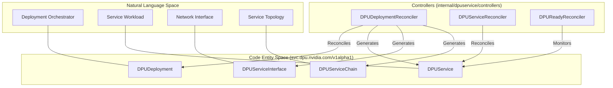
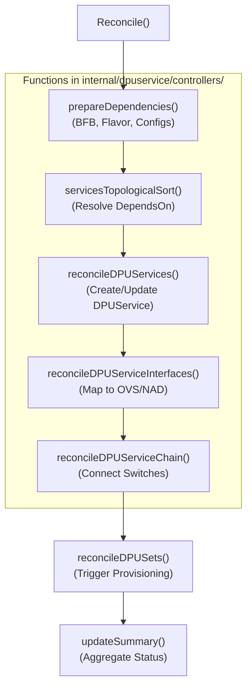

<!-- source: DeepWiki mcp.deepwiki.com · repo NVIDIA/doca-platform · page 4 Service Deployment System · fetched 2026-10-26 -->

# Service Deployment System

Relevant source files

The following files were used as context for generating this wiki page:

- [api/dpuservice/v1alpha1/dpudeployment_types.go](api/dpuservice/v1alpha1/dpudeployment_types.go)
- [api/dpuservice/v1alpha1/dpuservice_types.go](api/dpuservice/v1alpha1/dpuservice_types.go)
- [api/dpuservice/v1alpha1/zz_generated.deepcopy.go](api/dpuservice/v1alpha1/zz_generated.deepcopy.go)
- [cmd/dpuservice/main.go](cmd/dpuservice/main.go)
- [config/dpuservice/crd/bases/svc.dpu.nvidia.com_dpudeployments.yaml](config/dpuservice/crd/bases/svc.dpu.nvidia.com_dpudeployments.yaml)
- [config/dpuservice/crd/bases/svc.dpu.nvidia.com_dpuservices.yaml](config/dpuservice/crd/bases/svc.dpu.nvidia.com_dpuservices.yaml)
- [config/dpuservice/crd/bases/svc.dpu.nvidia.com_dpuservicetemplates.yaml](config/dpuservice/crd/bases/svc.dpu.nvidia.com_dpuservicetemplates.yaml)
- [config/dpuservice/rbac/role.yaml](config/dpuservice/rbac/role.yaml)
- [deploy/charts/dpf-operator/templates/crds/apiextensions.k8s.io_v1_customresourcedefinition_dpudeployments.svc.dpu.nvidia.com.yaml](deploy/charts/dpf-operator/templates/crds/apiextensions.k8s.io_v1_customresourcedefinition_dpudeployments.svc.dpu.nvidia.com.yaml)
- [deploy/charts/dpf-operator/templates/crds/apiextensions.k8s.io_v1_customresourcedefinition_dpuservices.svc.dpu.nvidia.com.yaml](deploy/charts/dpf-operator/templates/crds/apiextensions.k8s.io_v1_customresourcedefinition_dpuservices.svc.dpu.nvidia.com.yaml)
- [deploy/charts/dpf-operator/templates/crds/apiextensions.k8s.io_v1_customresourcedefinition_dpuservicetemplates.svc.dpu.nvidia.com.yaml](deploy/charts/dpf-operator/templates/crds/apiextensions.k8s.io_v1_customresourcedefinition_dpuservicetemplates.svc.dpu.nvidia.com.yaml)
- [internal/argocd/utils.go](internal/argocd/utils.go)
- [internal/argocd/utils_test.go](internal/argocd/utils_test.go)
- [internal/dpuservice/controllers/dpudeployment_controller.go](internal/dpuservice/controllers/dpudeployment_controller.go)
- [internal/dpuservice/controllers/dpudeployment_controller_dpuservice.go](internal/dpuservice/controllers/dpudeployment_controller_dpuservice.go)
- [internal/dpuservice/controllers/dpudeployment_controller_dpuservicechain.go](internal/dpuservice/controllers/dpudeployment_controller_dpuservicechain.go)
- [internal/dpuservice/controllers/dpudeployment_controller_dpuserviceinterface.go](internal/dpuservice/controllers/dpudeployment_controller_dpuserviceinterface.go)
- [internal/dpuservice/controllers/dpudeployment_controller_node.go](internal/dpuservice/controllers/dpudeployment_controller_node.go)
- [internal/dpuservice/controllers/dpudeployment_controller_node_test.go](internal/dpuservice/controllers/dpudeployment_controller_node_test.go)
- [internal/dpuservice/controllers/dpudeployment_controller_test.go](internal/dpuservice/controllers/dpudeployment_controller_test.go)
- [internal/dpuservice/controllers/dpuready_controller.go](internal/dpuservice/controllers/dpuready_controller.go)
- [internal/dpuservice/controllers/dpuready_controller_conditions.go](internal/dpuservice/controllers/dpuready_controller_conditions.go)
- [internal/dpuservice/controllers/dpuready_controller_conditions_test.go](internal/dpuservice/controllers/dpuready_controller_conditions_test.go)
- [internal/dpuservice/controllers/dpuready_controller_test.go](internal/dpuservice/controllers/dpuready_controller_test.go)
- [internal/dpuservice/controllers/dpuservice_controller.go](internal/dpuservice/controllers/dpuservice_controller.go)
- [internal/dpuservice/controllers/dpuservice_controller_test.go](internal/dpuservice/controllers/dpuservice_controller_test.go)
- [internal/dpuservice/controllers/indexers.go](internal/dpuservice/controllers/indexers.go)
- [internal/dpuservice/controllers/suite_test.go](internal/dpuservice/controllers/suite_test.go)
- [internal/operator/inventory/manifests/dpuservice-controller.yaml](internal/operator/inventory/manifests/dpuservice-controller.yaml)
- [internal/provisioning/webhooks/dpucluster_types_test.go](internal/provisioning/webhooks/dpucluster_types_test.go)
- [test/apivalidation/dpuservice_api_validation_test.go](test/apivalidation/dpuservice_api_validation_test.go)

## Purpose and Scope

The Service Deployment System orchestrates the deployment and lifecycle management of services on DPUs through the `DPUDeployment` custom resource. This system provides declarative service deployment with dependency resolution, version coordination, and automated upgrade management. It bridges the provisioning system (see [Provisioning System](#3)) with the actual service workloads running on DPUs.

For details on individual service components, see the following child pages:
- [DPUDeployment Orchestration](#4.1) — Detailed reconciliation flow, version matching, and revision management.
- [DPUService Resources](#4.2) — Service lifecycle, ArgoCD integration, and maintenance mechanisms.
- [Service Chains and Interfaces](#4.3) — Topology definitions and OVS bridge mapping.
- [DPUReady and Operational Conditions](#4.4) — Readiness monitoring and node taint management.
- [DPUService Catalog and Built-in Services](#4.5) — Documentation of available services like HBN, Argus, and Firefly.

## System Architecture

The Service Deployment System centers on the `DPUDeployment` custom resource, which aggregates configuration from multiple dependency resources and generates child resources that implement the actual deployment.

### Core Architecture and Entity Mapping

The following diagram maps high-level architectural components to their corresponding code entities.

**Diagram: Service Deployment Entity Mapping**

**Sources:**
- [internal/dpuservice/controllers/dpudeployment_controller.go:96-125]()
- [internal/dpuservice/controllers/dpuservice_controller.go:73-86]()
- [internal/dpuservice/controllers/dpuready_controller.go:63-74]()
- [api/dpuservice/v1alpha1/dpudeployment_types.go:102-108]()

## DPUDeployment Custom Resource

The `DPUDeployment` CRD is the primary entry point for users to define their DPU environment. It coordinates BFB/BlueFieldSoftware, DPUFlavors, and multiple DPUServices.

| Section | Purpose | Key Fields |
|---------|---------|------------|
| `spec.dpus` | DPU provisioning configuration | `bfb`, `blueFieldSoftware`, `dpuSets[]` |
| `spec.services` | Service deployment configuration | Map of service name to `DPUDeploymentServiceConfiguration` |
| `spec.serviceChains` | Network topology definition | `switches[]` and `upgradePolicy` |

The controller validates dependencies and applies the `DPUDeploymentFinalizer` [api/dpuservice/v1alpha1/dpudeployment_types.go:31-31]() to ensure referenced resources like `BFB` or `DPUFlavor` are not deleted while in use.

**Sources:**
- [api/dpuservice/v1alpha1/dpudeployment_types.go:111-135]()
- [api/dpuservice/v1alpha1/dpudeployment_types.go:168-175]()

## Controller Reconciliation Flow

The `DPUDeploymentReconciler` follows a strict sequence to ensure infrastructure is ready before deploying workloads. It uses a topological sort to handle service dependencies defined via `DependsOn`.

**Diagram: DPUDeployment Reconciliation Logic**

**Sources:**
- [internal/dpuservice/controllers/dpudeployment_controller.go:250-368]()
- [internal/dpuservice/controllers/dpudeployment_controller_dpuservice.go:62-105]()
- [internal/dpuservice/controllers/dpudeployment_controller_dpuserviceinterface.go:47-56]()

## Service Lifecycle and GitOps Integration

The `DPUService` controller acts as a bridge to **ArgoCD**. It manages the lifecycle of services by creating `Application` resources in the management cluster that target DPU clusters.

- **Templating**: The `DPUDeployment` controller uses `templateDPUServiceConfigurationValues` [internal/dpuservice/controllers/dpudeployment_controller_dpuservice.go:120-125]() to inject dynamic values from dependent services into Helm charts.
- **Revision Management**: Uses `calculateDPUServiceVersionDigest` [internal/dpuservice/controllers/dpudeployment_controller_dpuservice.go:127-127]() to track configuration changes and trigger upgrades.
- **GitOps**: The `DPUServiceReconciler` creates `argov1.Application` resources [internal/dpuservice/controllers/dpuservice_controller.go:100-100]() to handle the actual deployment of Helm charts on the DPUs.

For details, see [DPUService Resources](#4.2).

**Sources:**
- [internal/dpuservice/controllers/dpuservice_controller.go:127-160]()
- [internal/dpuservice/controllers/dpudeployment_controller_dpuservice.go:127-140]()

## Service Chains and Network Topology

Network connectivity between services is defined via `DPUServiceChain`. The system maps `DPUDeploymentSwitch` definitions to logical switches and ports.

- **Interfaces**: Managed via `DPUServiceInterface`, which identifies specific interfaces of a `DPUService` using the `ServiceInterfaceInterfaceNameLabel` [internal/dpuservice/controllers/dpudeployment_controller.go:59-60]().
- **Connectivity**: The `reconcileDPUServiceChain` function ensures that logical network paths between services are established as defined in the `DPUDeployment` spec.

For details, see [Service Chains and Interfaces](#4.3).

**Sources:**
- [api/dpuservice/v1alpha1/dpudeployment_types.go:137-148]()
- [internal/dpuservice/controllers/dpudeployment_controller_dpuserviceinterface.go:122-132]()

## Upgrade and Readiness Management

The system supports disruptive and non-disruptive updates through the `UpgradePolicy` [api/dpuservice/v1alpha1/dpudeployment_types.go:150-158]().

- **Disruptive Updates**: When `applyNodeEffect` is true, the controller creates new resource revisions and coordinates with the `DPUReadyReconciler` to manage node taints.
- **Node Tainting**: The `DPUReadyReconciler` applies the `dpu.nvidia.com/dpu-ready` taint with `NoSchedule` effect [internal/dpuservice/controllers/dpuready_controller.go:77-80]() to host worker nodes when DPUs are not ready.
- **Maintenance**: Coordinates with `DPUNodeMaintenance` to ensure services are ready before allowing a DPU to return to service.

For details, see [DPUDeployment Orchestration](#4.1) and [DPUReady and Operational Conditions](#4.4).

**Sources:**
- [api/dpuservice/v1alpha1/dpudeployment_types.go:161-166]()
- [internal/dpuservice/controllers/dpudeployment_controller_dpuservice.go:148-174]()
- [internal/dpuservice/controllers/dpuready_controller.go:95-133]()

---

