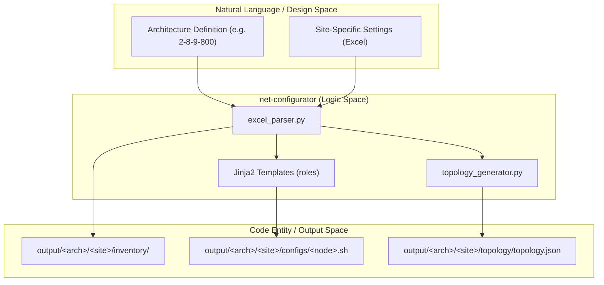
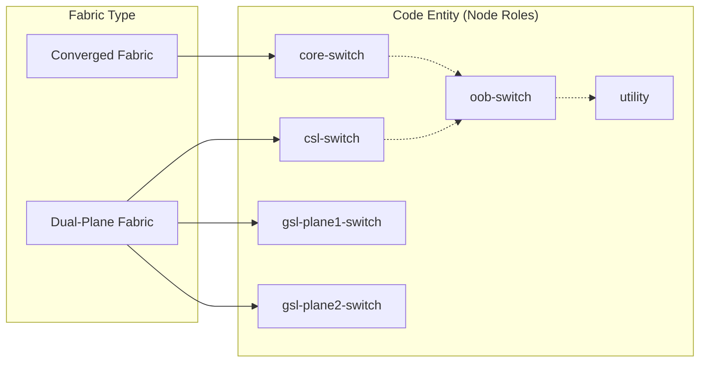

<!-- source: DeepWiki mcp.deepwiki.com · repo NVIDIA/enterprise-ras · page 1 Overview · fetched 2026-10-26 -->

# Overview

Relevant source files

The following files were used as context for generating this wiki page:

- [README.md](README.md)
- [net-configurator/.gitignore](net-configurator/.gitignore)
- [net-configurator/README.md](net-configurator/README.md)
- [spectrum-era/2-4-3-200/license](spectrum-era/2-4-3-200/license)
- [spectrum-era/README.md](spectrum-era/README.md)
- [spectrum-era/license](spectrum-era/license)

The NVIDIA Enterprise Reference Architecture (ERA) repository provides a comprehensive automation framework and reference configuration set for deploying AI factories. It is designed to help organizations and partners build high-performance clusters by providing validated hardware and software recommendations for NVIDIA Spectrum-based networks [README.md:1-3]().

The repository serves as a central hub for assets and scripts used in the cluster bring-up process, ranging from simulated environments in NVIDIA Air to physical hardware deployment via Zero Touch Provisioning (ZTP) [net-configurator/README.md:6-7]().

## Purpose and Scope

The primary goal of the ERA repository is to eliminate common pitfalls in AI factory design by offering:
*   **Validated Topologies**: Pre-defined network architectures optimized for different GPU-to-CPU ratios and bandwidth requirements [net-configurator/README.md:26-30]().
*   **Deployment Automation**: A "one-command" pipeline that transforms high-level Excel specifications into production-ready switch configurations [net-configurator/README.md:90-92]().
*   **Simulation & Validation**: Integration with NVIDIA Air for virtual testing before physical rollout [net-configurator/README.md:93-94]().
*   **Full-Stack Observability**: Production-ready monitoring for network, GPU, and compute health.

## Major Components

The repository is organized into three primary functional areas:

| Component | Role | Status |
|---|---|---|
| **`net-configurator`** | The active Ansible/Python automation framework for generating and deploying ERA switch configurations [net-configurator/README.md:4-6](). | **Active** |
| **`spectrum-era`** | Historical reference configurations for specific architectures (e.g., 2-4-3-200) [spectrum-era/README.md:6-8](). | **Deprecated** |
| **`Observability RA`** | Monitoring framework including Grafana dashboards and Prometheus alerting for AI/HPC clusters. | **Active** |

For details on how these directories are structured and when to use each, see **[Repository Structure and Components](#1.1)**.

### Logic Flow: From Design to Deployment

The following diagram illustrates how the `net-configurator` tool bridges the gap between natural language architecture definitions and the generated code entities used for deployment.

**System Design to Code Entity Mapping**

**Sources:** [net-configurator/README.md:6-7](), [net-configurator/README.md:90-92](), [net-configurator/.gitignore:83-88]()

## Supported Architectures

ERA architectures are categorized by their compute node composition, following the pattern `{CPUs}-{GPUs}-{NICs}-{Bandwidth}`. For example, `2-8-9-400` represents a node with 2 CPUs, 8 GPUs, 9 NICs, and 400 Gbps per-GPU bandwidth [net-configurator/README.md:28-30]().

The framework supports both **Converged** fabrics (where one tier handles all traffic) and **Dual-Plane** fabrics (where GPU East-West traffic is isolated on dedicated planes) [net-configurator/README.md:43-55]().

For a full list of supported models and their scale limits, see **[Architecture Support Matrix](#1.2)**.

### Architecture to Node Role Mapping

This diagram maps the high-level fabric concepts to the specific node roles defined in the codebase that users will encounter in the `Nodes` sheet of the Excel configuration.

**Fabric Taxonomy to Code Identifiers**

**Sources:** [net-configurator/README.md:19-22](), [net-configurator/README.md:43-55]()

## Key Features

*   **Excel-Driven Workflow**: All configuration is derived from a central spreadsheet template [net-configurator/README.md:91]().
*   **Zero Touch Provisioning (ZTP)**: Automated switch provisioning using DHCP and NVUE-based scripts [net-configurator/README.md:15]().
*   **L3 Out-of-Band (OOB) Management**: A modern routed management network with its own VRF, providing enhanced isolation and scalability over legacy L2 designs [net-configurator/README.md:18-21]().
*   **Multi-Site Support**: The ability to maintain distinct deployments (e.g., `lab`, `production`) within the same repository structure [net-configurator/README.md:24](), [net-configurator/.gitignore:83-88]().

## Next Steps

To begin using the repository, refer to the following child pages:
*   **[Repository Structure and Components](#1.1)**: Understand the layout of `net-configurator` and the status of legacy components.
*   **[Architecture Support Matrix](#1.2)**: Identify the correct architecture for your hardware and review tested scales.

---

