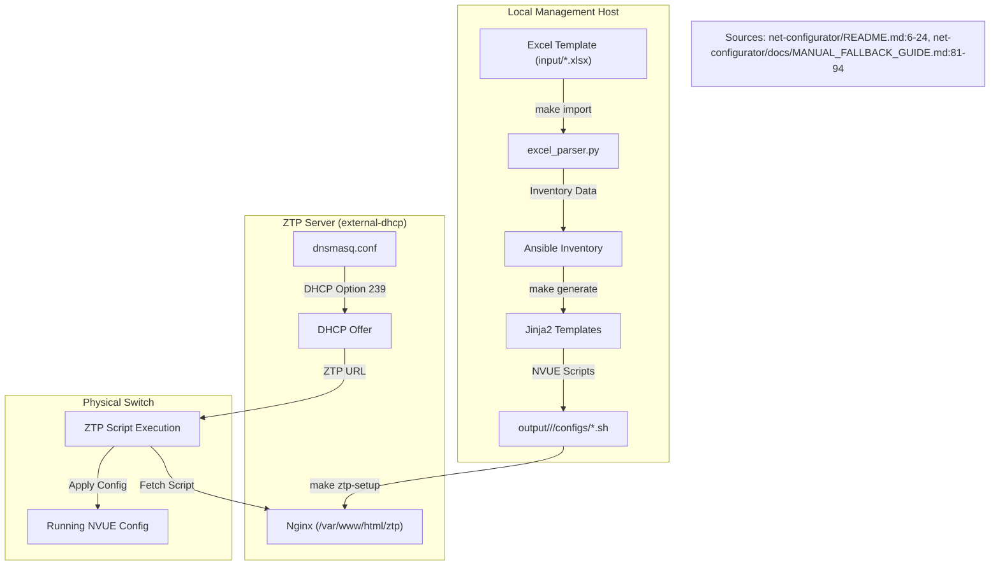
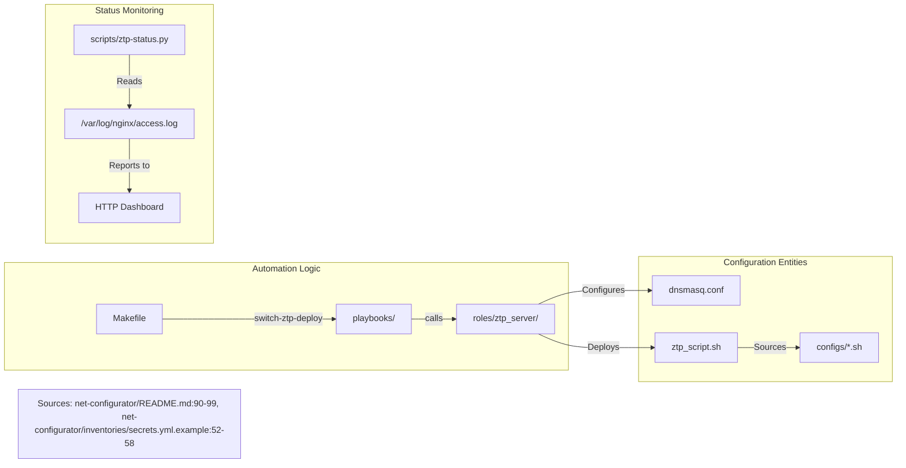

<!-- source: DeepWiki mcp.deepwiki.com · repo NVIDIA/enterprise-ras · page 3.2 Physical Hardware Deployment via ZTP · fetched 2026-10-26 -->

# Physical Hardware Deployment via ZTP

Relevant source files

The following files were used as context for generating this wiki page:

- [net-configurator/.gitignore](net-configurator/.gitignore)
- [net-configurator/README.md](net-configurator/README.md)
- [net-configurator/docs/MANUAL_FALLBACK_GUIDE.md](net-configurator/docs/MANUAL_FALLBACK_GUIDE.md)
- [net-configurator/inventories/secrets.yml.example](net-configurator/inventories/secrets.yml.example)
- [net-configurator/scripts/generate-node-instructions.py](net-configurator/scripts/generate-node-instructions.py)

This page covers the Zero Touch Provisioning (ZTP) workflow for physical NVIDIA Spectrum switches using the `net-configurator` toolset. It details the setup of the ZTP infrastructure, the different IP assignment modes, and the automation pipeline that bridges Excel-based design to live hardware.

## Overview of ZTP Workflow

Zero Touch Provisioning (ZTP) allows a switch running Cumulus Linux to boot, obtain an IP address via DHCP, fetch a provisioning script via HTTP, and apply a complete NVUE configuration without manual console intervention [net-configurator/README.md:15-15]().

The `net-configurator` framework automates this by:
1.  Generating NVUE configuration scripts from Excel inputs [net-configurator/README.md:6-7]().
2.  Setting up a ZTP server (DHCP + Nginx) to host these scripts [net-configurator/README.md:92-92]().
3.  Monitoring the provisioning status via a centralized status page [net-configurator/README.md:77-77]().

### Data Flow: From Excel to Switch
The following diagram illustrates how configuration data flows from the user's Excel sheet to the physical switch hardware.

**ZTP Configuration Data Flow**

## ZTP Server Infrastructure

The ZTP environment relies on two primary services, typically hosted on a node designated as `external-dhcp` (which supersedes the legacy `dhcp-oob` role) [net-configurator/README.md:20-20]().

### DHCP Configuration (dnsmasq)
The DHCP server must be configured to provide **DHCP Option 239**. This option contains the URL of the ZTP script that the switch should execute upon booting.

| Component | Role | Implementation |
| :--- | :--- | :--- |
| **DHCP Server** | IP Assignment & Option 239 | `dnsmasq` |
| **Web Server** | Script Hosting | `nginx` |
| **ZTP Script** | Execution Wrapper | `ztp_script.sh` |
| **Status Page** | Monitoring | `nginx` + `ztp-status.py` |

Sources: [net-configurator/README.md:15-23](), [net-configurator/inventories/secrets.yml.example:52-58]()

### IP Assignment Modes
`net-configurator` supports three modes for physical deployment:

1.  **DHCP Mode**: Switches receive dynamic IPs from a pool. MAC addresses are not strictly mapped to specific hostnames in the DHCP config.
2.  **Static IP Mode**: Switches are assigned specific IPs based on their MAC addresses defined in the Excel `Nodes` sheet.
3.  **Mixed Mode**: Infrastructure nodes (spines/leaves) use static IPs, while end-hosts or support nodes use dynamic DHCP.

## Deployment Workflow

The physical deployment is managed through a series of `make` targets that coordinate Ansible playbooks.

### 1. Server Setup (`make ztp-setup`)
This target prepares the ZTP server. It performs the following actions:
*   Installs and configures `dnsmasq` with the correct subnets and Option 239 [net-configurator/README.md:97-97]().
*   Installs `nginx` and populates the web root with the generated NVUE `.sh` scripts from `output/<arch>/<site>/configs/` [net-configurator/docs/MANUAL_FALLBACK_GUIDE.md:91-91]().
*   Sets up the ZTP Status Page if `status_page_enabled=Yes` is set in the Excel `Settings` tab [net-configurator/inventories/secrets.yml.example:54-57]().

### 2. Switch Provisioning (`make switch-ztp-deploy`)
This target initiates the monitoring and deployment phase for the switches.
*   **Workflow**: The switches boot -> Request DHCP -> Receive ZTP URL -> Download script -> Apply NVUE commands.
*   **Validation**: The tool uses `make validate-ztp` to check the `/var/log/ztp.log` or the status page to confirm each switch has successfully finished its configuration script.

### Code Entity Map: ZTP Automation
This diagram maps the high-level ZTP functions to the specific scripts and files in the repository.

**ZTP Code Entity Mapping**

## Security and Secrets

During ZTP, several passwords and keys are injected into the switches. These are managed via Ansible Vault in the `inventories/<arch>/group_vars/all/secrets.yml` file [net-configurator/inventories/secrets.yml.example:7-11]().

Key secrets involved in ZTP include:
*   **`switch_password`**: The password set for the `cumulus` user during provisioning [net-configurator/inventories/secrets.yml.example:38-38]().
*   **`switch_ansible_password`**: The password Ansible uses to verify the connection after ZTP is complete [net-configurator/inventories/secrets.yml.example:20-20]().
*   **`status_page_password`**: Credentials for accessing the ZTP monitoring dashboard [net-configurator/inventories/secrets.yml.example:57-57]().

Sources: [net-configurator/inventories/secrets.yml.example:1-67]()

## Manual Node Instructions (Air vs. Physical)

While physical ZTP relies on DHCP Option 239, the tool provides a `scripts/generate-node-instructions.py` utility. This script generates standalone bash wrappers for each node [scripts/generate-node-instructions.py:4-8](). 

In a physical environment, these can be used for:
*   **OOB Infrastructure Setup**: Manually bootstrapping the `oob-server-01` or `external-dhcp` nodes before the switch fabric is live [scripts/generate-node-instructions.py:12-15]().
*   **Debugging**: Reviewing the exact commands that ZTP will execute by inspecting the `node-instructions/` directory [scripts/generate-node-instructions.py:9-10]().

Sources: [scripts/generate-node-instructions.py:1-50](), [net-configurator/docs/MANUAL_FALLBACK_GUIDE.md:93-103]()

---

