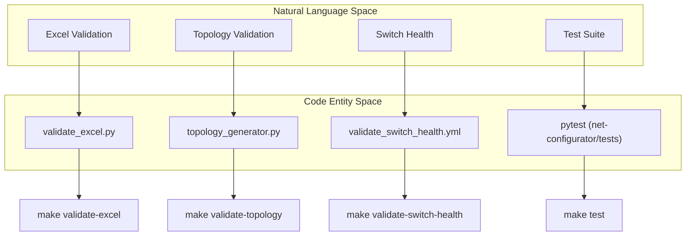
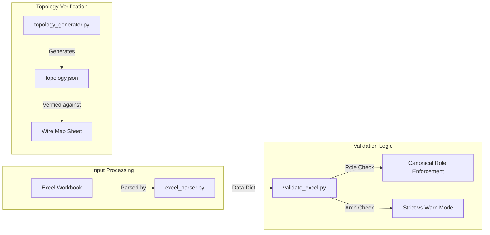

<!-- source: DeepWiki mcp.deepwiki.com · repo NVIDIA/enterprise-ras · page 6 Validation Framework · fetched 2026-10-26 -->

# Validation Framework

Relevant source files

The following files were used as context for generating this wiki page:

- [net-configurator/.gitignore](net-configurator/.gitignore)
- [net-configurator/README.md](net-configurator/README.md)

The **Validation Framework** in the `net-configurator` tool provides a multi-phase suite designed to ensure the integrity of the Enterprise Reference Architecture (ERA) deployment from initial Excel input through to the final switch state. The framework is primarily orchestrated via the `make validate-all` target, which chains together static analysis, topology verification, and live network health checks.

### Validation Workflow Overview

The framework operates in three distinct layers:
1.  **Static Input Validation**: Verifies the Excel workbook for architectural compliance and logical consistency before any configuration is generated.
2.  **Structural Validation**: Compares the generated network topology (JSON) against the user-defined Wire Map to ensure the cabling matches the intended design.
3.  **Live State Validation**: Connects to the deployed switches (physical or in NVIDIA Air) to verify BGP peering, EVPN status, and end-to-end connectivity.

The relationship between these validation components and the code entities is illustrated below:

**Validation System Mapping**

Sources: [net-configurator/README.md:88-99](), [net-configurator/.gitignore:45-48]()

---

### 6.1 Excel and Topology Validation
This phase focuses on the "pre-flight" checks. The `make validate-excel` target invokes `validate_excel.py` to enforce canonical role names (e.g., `gpu`, `core`, `csl`) and check for missing mandatory fields or IP address overlaps. Following generation, `make validate-topology` ensures that the `topology.json` (used by NVIDIA Air) accurately reflects the cabling defined in the Excel "Wire Map" sheet.

For details, see [Excel and Topology Validation](#6.1).

**Static Validation Logic**

Sources: [net-configurator/README.md:32-39](), [net-configurator/README.md:43-55]()

---

### 6.2 Switch Health and Network Validation
Once the fabric is deployed, the framework transitions to operational validation. This includes:
*   **`make validate-config`**: Performs an `nv config diff` to ensure the running switch configuration matches the intended state.
*   **`make validate-switch-health`**: An Ansible-driven check that verifies BGP neighbors are "Established" and EVPN VNI/ES states are up.
*   **`make validate-ping-matrix`**: Executes cross-VRF connectivity tests to ensure the data plane is routing traffic correctly between compute, storage, and management planes.

For details, see [Switch Health and Network Validation](#6.2).

---

### 6.3 Test Suite
The repository includes a comprehensive `pytest`-based test suite located in `net-configurator/tests/`. This suite provides unit testing for the core Python logic and integration testing for the Jinja2 templates. Developers can run `make test` to execute the full suite or `make test-coverage` to generate a report on code path exercise.

For details, see [Test Suite](#6.3).

| Validation Target | Command | Purpose |
| :--- | :--- | :--- |
| **Excel** | `make validate-excel` | Checks roles, IPs, and architectural constraints in the spreadsheet. |
| **Topology** | `make validate-topology` | Verifies the Air topology JSON against the Excel Wire Map. |
| **Configuration** | `make validate-config` | Compares running switch state to generated NVUE scripts. |
| **Health** | `make validate-switch-health` | Checks BGP, EVPN, and interface status across the fabric. |
| **Connectivity** | `make validate-ping-matrix` | Validates L3 reachability across different VRFs and VLANs. |
| **Unit/Integration** | `make test` | Runs the Python and Jinja2 test suite using `pytest`. |

Sources: [net-configurator/README.md:90-98](), [net-configurator/.gitignore:45-48]()

---

