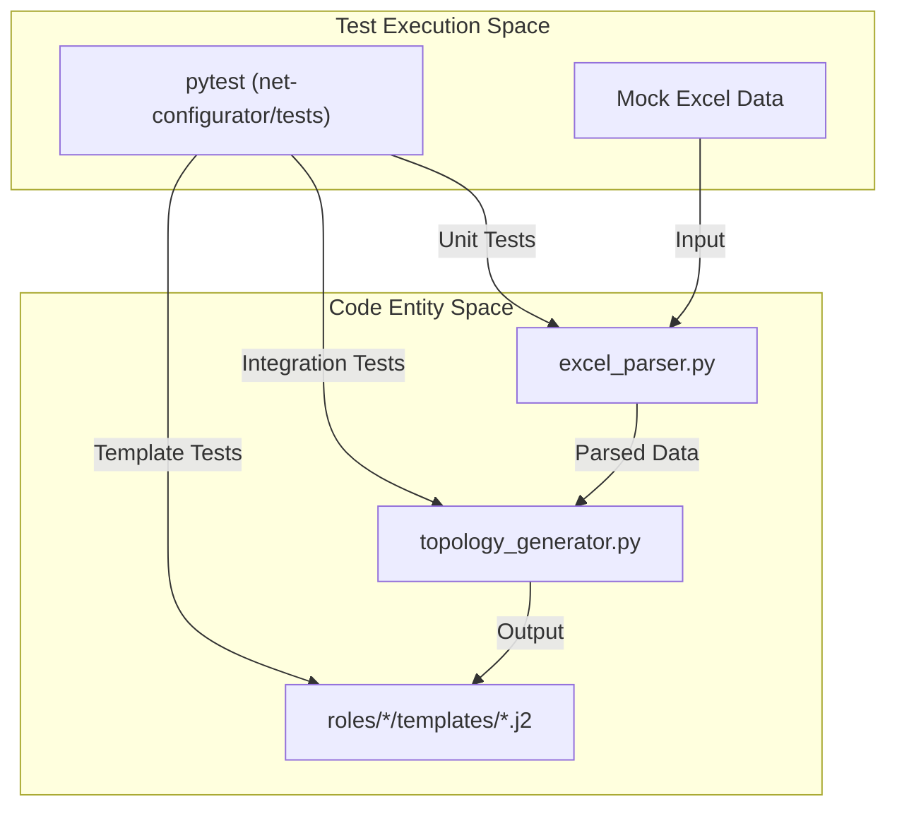
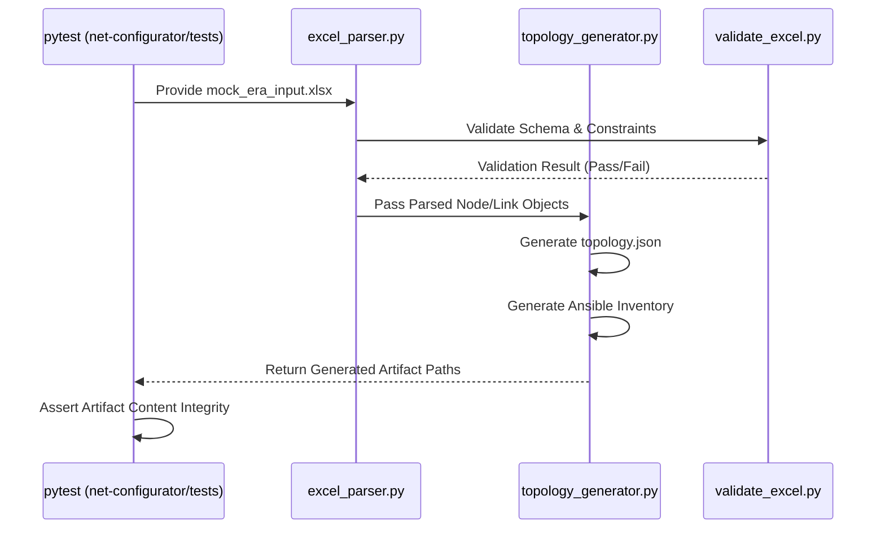

<!-- source: DeepWiki mcp.deepwiki.com · repo NVIDIA/enterprise-ras · page 6.3 Test Suite · fetched 2026-10-26 -->

# Test Suite

Relevant source files

The following files were used as context for generating this wiki page:

- [net-configurator/.gitignore](net-configurator/.gitignore)
- [net-configurator/README.md](net-configurator/README.md)
- [net-configurator/docs/ANSIBLE_SUDO_SETUP.md](net-configurator/docs/ANSIBLE_SUDO_SETUP.md)

The `net-configurator` test suite provides a comprehensive validation framework to ensure the integrity of the configuration generation pipeline, the correctness of Jinja2 templates, and the validity of the resulting switch configurations. It utilizes `pytest` to execute unit, integration, and template-specific tests.

## Overview and Execution

The test suite is located in `net-configurator/tests/` and is designed to be executed via the project `Makefile`. This ensures that tests run within the correct environment and context.

### Running Tests

| Target | Command | Description |
| :--- | :--- | :--- |
| **Unit Tests** | `make test` | Executes the full `pytest` suite covering parsers, templates, and logic. |
| **Coverage** | `make test-coverage` | Runs the test suite and generates an HTML coverage report in `htmlcov/`. |
| **Clean** | `make clean` | Removes `.pytest_cache`, `.coverage`, and temporary test artifacts [net-configurator/.gitignore:46-48](). |

Sources: [net-configurator/README.md:90-95](), [net-configurator/.gitignore:46-48]()

---

## Test Architecture

The suite is divided into three primary functional areas: Parser Unit Tests, Template Validation, and Integration Tests.

### Code Entity Mapping: Test Framework

The following diagram illustrates how the testing infrastructure interacts with the core `net-configurator` components.

**Test Component Interaction**

Sources: [net-configurator/README.md:6-24](), [net-configurator/README.md:88-99]()

---

## Test Categories

### 1. Parser Unit Tests
These tests focus on `excel_parser.py` and `validate_excel.py`. They verify that the Excel ingestion logic correctly handles:
*   **Role Classification**: Ensuring nodes are assigned the correct internal roles (e.g., `gpu`, `core`, `csl`, `gsl-plane1`) based on the Excel "Function/Name" column.
*   **VLAN & IP Logic**: Validating that IP address increments and VLAN assignments follow the ERA principles.
*   **Constraint Enforcement**: Testing the strict vs. warn modes for different architectures (e.g., ensuring a `2-4-3-200` architecture doesn't contain `gsl` roles).

### 2. Jinja2 Template Tests
These tests render the Ansible roles' templates using sample data to ensure syntax correctness and logical branching.
*   **NVUE CLI Generation**: Verifies that `nv set` commands are generated correctly for different Cumulus Linux versions (targeting compatibility between 5.14 and 5.15+).
*   **BGP/EVPN Logic**: Checks that the BGP neighbor configurations and EVPN VNI mappings are generated accurately based on the fabric type (Converged vs. Dual-Plane).

### 3. Integration Tests
Integration tests run the entire pipeline from an Excel input to the final generated artifacts.
*   **Topology Validation**: Compares the generated `topology.json` (used by NVIDIA Air) against the intended wiremap.
*   **Inventory Integrity**: Ensures `group_vars` and `host_vars` are consistent across the generated Ansible inventory.

---

## Data Flow in Testing

The following diagram traces the flow of data during a standard integration test run within the suite.

**Testing Data Flow**

Sources: [net-configurator/README.md:6-24](), [net-configurator/README.md:90-99]()

---

## Validation vs. Testing

It is important to distinguish between the **Test Suite** (`make test`) and the **Validation Framework** (`make validate-all`).

| Feature | Test Suite (`pytest`) | Validation Framework (`scripts/`) |
| :--- | :--- | :--- |
| **Purpose** | Code correctness and regression prevention. | Deployment health and configuration drift. |
| **Target** | Python code and Jinja2 templates. | Live switches, physical links, and final Excel files. |
| **Execution** | Local development environment. | Post-generation or against active hardware/Air. |
| **Key Tools** | `pytest`, `coverage`. | `nv config diff`, `ping`, `ansible`. |

For detailed information on live environment validation, see [Section 6.1: Excel and Topology Validation]() and [Section 6.2: Switch Health and Network Validation]().

Sources: [net-configurator/README.md:90-98](), [net-configurator/docs/ANSIBLE_SUDO_SETUP.md:21-26]()

---

