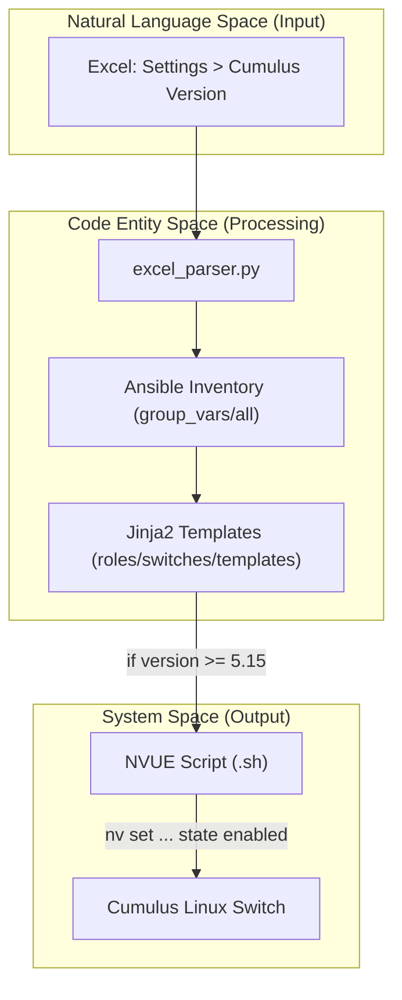
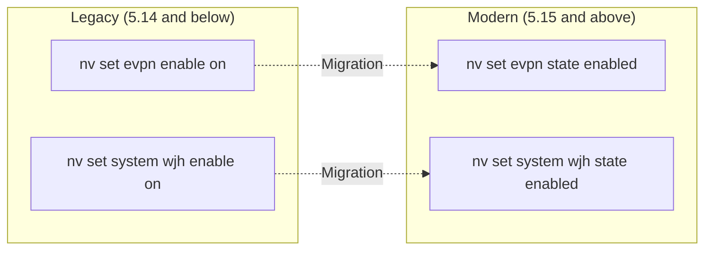

<!-- source: DeepWiki mcp.deepwiki.com · repo NVIDIA/enterprise-ras · page 9.2 NVUE Version Compatibility · fetched 2026-10-26 -->

# NVUE Version Compatibility

Relevant source files

The following files were used as context for generating this wiki page:

- [net-configurator/.gitignore](net-configurator/.gitignore)
- [net-configurator/README.md](net-configurator/README.md)
- [spectrum-era/2-8-5-200/exported-configurations/CLI/core-01.sh](spectrum-era/2-8-5-200/exported-configurations/CLI/core-01.sh)
- [spectrum-era/2-8-5-200/exported-configurations/CLI/core-02.sh](spectrum-era/2-8-5-200/exported-configurations/CLI/core-02.sh)
- [spectrum-era/2-8-5-200/exported-configurations/CLI/oob-switch-01.sh](spectrum-era/2-8-5-200/exported-configurations/CLI/oob-switch-01.sh)
- [spectrum-era/2-8-5-200/exported-configurations/CLI/oob-switch-02.sh](spectrum-era/2-8-5-200/exported-configurations/CLI/oob-switch-02.sh)
- [spectrum-era/2-8-5-200/exported-configurations/CLI/oob-switch-03.sh](spectrum-era/2-8-5-200/exported-configurations/CLI/oob-switch-03.sh)
- [spectrum-era/2-8-9-400/exported-configurations/CLI/core-01.sh](spectrum-era/2-8-9-400/exported-configurations/CLI/core-01.sh)
- [spectrum-era/2-8-9-400/exported-configurations/CLI/core-02.sh](spectrum-era/2-8-9-400/exported-configurations/CLI/core-02.sh)
- [spectrum-era/2-8-9-400/exported-configurations/CLI/oob-switch-01.sh](spectrum-era/2-8-9-400/exported-configurations/CLI/oob-switch-01.sh)
- [spectrum-era/2-8-9-400/exported-configurations/CLI/oob-switch-02.sh](spectrum-era/2-8-9-400/exported-configurations/CLI/oob-switch-02.sh)
- [spectrum-era/2-8-9-400/exported-configurations/CLI/oob-switch-03.sh](spectrum-era/2-8-9-400/exported-configurations/CLI/oob-switch-03.sh)

This page documents the technical implementation of version-specific configuration generation within the NVIDIA Enterprise Reference Architecture (ERA) codebase. It specifically addresses the breaking changes introduced in Cumulus Linux 5.15+ regarding the NVIDIA User Experience (NVUE) CLI syntax and how the automation framework targets specific versions.

## Overview of NVUE Evolution

NVIDIA User Experience (NVUE) is the object-oriented configuration engine for Cumulus Linux [net-configurator/README.md:13-14](). As the operating system evolves, the NVUE object model undergoes changes that require corresponding updates in the Jinja2 templates used by the `net-configurator`.

The most significant transition occurs between **Cumulus Linux 5.14** and **5.15+**, where several key boolean and state commands were renamed for consistency across the API.

### Key Syntax Changes (5.14 → 5.15+)

| Feature | Pre-5.15 Syntax | 5.15+ Syntax |
| :--- | :--- | :--- |
| **Global State** | `nv set ... enable on` | `nv set ... state enabled` |
| **Global State** | `nv set ... enable off` | `nv set ... state disabled` |
| **What Just Happened (WJH)** | `nv set system wjh enable on` | `nv set system wjh state enabled` |
| **Service State** | `nv set system api state enabled` | `nv set system api state enabled` (Consistent) |

Sources: [spectrum-era/2-8-9-400/exported-configurations/CLI/oob-switch-02.sh:32-55](), [spectrum-era/2-8-5-200/exported-configurations/CLI/core-02.sh:9-10]()

---

## Target Versioning via Excel

The automation framework allows operators to target specific Cumulus Linux versions per deployment. This is controlled via the **VERSIONS** section in the `Settings` sheet of the ERA Excel template.

### Implementation Flow

The `excel_parser.py` script reads the version strings, which are then passed as variables into the Ansible inventory generation process.

1.  **Excel Input**: The user specifies a version (e.g., `5.15.0`) in the Excel `Settings` sheet.
2.  **Parser Extraction**: `excel_parser.py` captures this value.
3.  **Template Logic**: Jinja2 templates in the `roles/` directory use conditional logic to select the correct NVUE string based on the version variable.

### Natural Language to Code Entity Mapping

The following diagram illustrates how the versioning intent in the Excel file maps to the internal code logic and final configuration output.

**Figure 1: Version Targeting Data Flow**

Sources: [net-configurator/README.md:90-91](), [net-configurator/README.md:13-15]()

---

## Breaking Change: The "State" Migration

The transition from `enable on/off` to `state enabled/disabled` is the primary breaking change handled by the codebase. Legacy reference configurations in the `spectrum-era` directory provide a baseline for the older syntax.

### Legacy vs. Modern NVUE Comparison

The following diagram associates specific NVUE commands found in the legacy configurations with the logic required for modern deployments.

**Figure 2: NVUE Command Migration Mapping**

Sources: [spectrum-era/2-8-9-400/exported-configurations/CLI/core-01.sh:9](), [spectrum-era/2-8-9-400/exported-configurations/CLI/oob-switch-01.sh:55](), [spectrum-era/2-8-5-200/exported-configurations/CLI/oob-switch-02.sh:55]()

---

## Template Compatibility Matrix

The `net-configurator` tool generates configurations for various roles. Each role's template must account for version differences.

| Role | Affected Components | File Reference Example |
| :--- | :--- | :--- |
| **Core/CSL/GSL** | EVPN, Multihoming, WJH | [spectrum-era/2-8-9-400/exported-configurations/CLI/core-01.sh:9-14]() |
| **OOB Switch** | System Services, WJH | [spectrum-era/2-8-9-400/exported-configurations/CLI/oob-switch-01.sh:32-55]() |
| **Exit Leaf** | BGP, EVPN | [net-configurator/README.md:20-22]() |

### WJH (What Just Happened) Implementation
In older versions (5.14 and below), WJH was enabled using `nv set system wjh enable on` [spectrum-era/2-8-9-400/exported-configurations/CLI/oob-switch-01.sh:55](). In newer versions, this must be updated to `nv set system wjh state enabled` to avoid NVUE validation errors during the ZTP process.

### AAA and System Services
Commands like `nv set system api state enabled` and `nv set system config auto-save state enabled` [spectrum-era/2-8-9-400/exported-configurations/CLI/oob-switch-01.sh:32-33]() have remained largely consistent, but the automation framework treats them as part of the versioned system-init block to ensure future-proofing.

Sources: [spectrum-era/2-8-9-400/exported-configurations/CLI/oob-switch-01.sh:32-55](), [spectrum-era/2-8-5-200/exported-configurations/CLI/core-01.sh:9-10]()

---

