# Page: Overview

# Overview

<details>
<summary>Relevant source files</summary>

The following files were used as context for generating this wiki page:

- [README.md](README.md)
- [net-configurator/.gitignore](net-configurator/.gitignore)
- [net-configurator/README.md](net-configurator/README.md)
- [spectrum-era/2-4-3-200/license](spectrum-era/2-4-3-200/license)
- [spectrum-era/README.md](spectrum-era/README.md)
- [spectrum-era/license](spectrum-era/license)

</details>


The NVIDIA Enterprise Reference Architecture (ERA) repository provides a comprehensive automation framework and reference configuration set for deploying AI factories. It is designed to help organizations and partners build high-performance clusters by providing validated hardware and software recommendations for NVIDIA Spectrum-based networks [README.md:1-3]().

The repository serves as a central hub for assets and scripts used in the cluster bring-up process, ranging from simulated environments in NVIDIA Air to physical hardware deployment via Zero Touch Provisioning (ZTP) [net-configurator/README.md:6-7]().

## Purpose and Scope

The primary goal of the ERA repository is to eliminate common pitfalls in AI factory design by offering:
*   **Validated Topologies**: Pre-defined network architectures optimized for different GPU-to-CPU ratios and bandwidth requirements [net-configurator/README.md:26-30]().
*   **Deployment Automation**: A "one-command" pipeline that transforms high-level Excel specifications into production-ready switch configurations [net-configurator/README.md:90-92]().
*   **Simulation & Validation**: Integration with NVIDIA Air for virtual testing before physical rollout [net-configurator/README.md:93-94]().
*   **Full-Stack Observability**: Production-ready monitoring for network, GPU, and compute health.

## Major Components

The repository is organized into three primary functional areas:

| Component | Role | Status |
|---|---|---|
| **`net-configurator`** | The active Ansible/Python automation framework for generating and deploying ERA switch configurations [net-configurator/README.md:4-6](). | **Active** |
| **`spectrum-era`** | Historical reference configurations for specific architectures (e.g., 2-4-3-200) [spectrum-era/README.md:6-8](). | **Deprecated** |
| **`Observability RA`** | Monitoring framework including Grafana dashboards and Prometheus alerting for AI/HPC clusters. | **Active** |

For details on how these directories are structured and when to use each, see **[Repository Structure and Components](#1.1)**.

### Logic Flow: From Design to Deployment

The following diagram illustrates how the `net-configurator` tool bridges the gap between natural language architecture definitions and the generated code entities used for deployment.

**System Design to Code Entity Mapping**
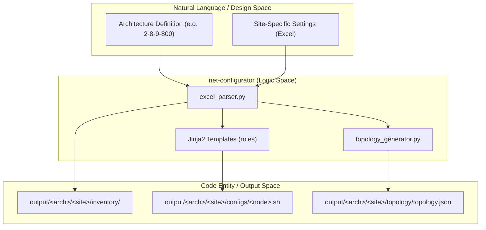
**Sources:** [net-configurator/README.md:6-7](), [net-configurator/README.md:90-92](), [net-configurator/.gitignore:83-88]()

## Supported Architectures

ERA architectures are categorized by their compute node composition, following the pattern `{CPUs}-{GPUs}-{NICs}-{Bandwidth}`. For example, `2-8-9-400` represents a node with 2 CPUs, 8 GPUs, 9 NICs, and 400 Gbps per-GPU bandwidth [net-configurator/README.md:28-30]().

The framework supports both **Converged** fabrics (where one tier handles all traffic) and **Dual-Plane** fabrics (where GPU East-West traffic is isolated on dedicated planes) [net-configurator/README.md:43-55]().

For a full list of supported models and their scale limits, see **[Architecture Support Matrix](#1.2)**.

### Architecture to Node Role Mapping

This diagram maps the high-level fabric concepts to the specific node roles defined in the codebase that users will encounter in the `Nodes` sheet of the Excel configuration.

**Fabric Taxonomy to Code Identifiers**
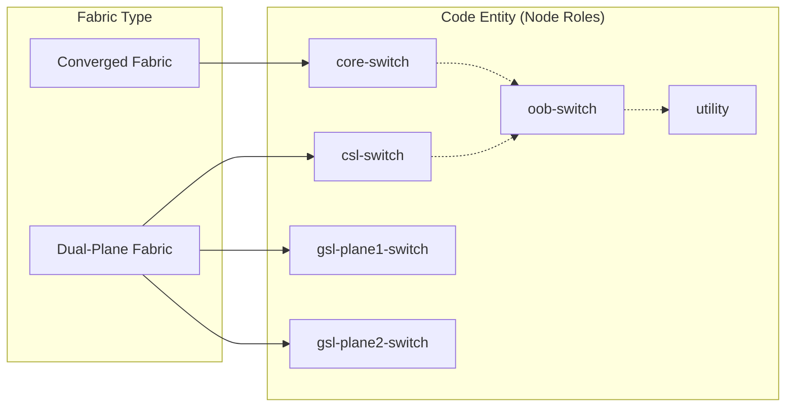
**Sources:** [net-configurator/README.md:19-22](), [net-configurator/README.md:43-55]()

## Key Features

*   **Excel-Driven Workflow**: All configuration is derived from a central spreadsheet template [net-configurator/README.md:91]().
*   **Zero Touch Provisioning (ZTP)**: Automated switch provisioning using DHCP and NVUE-based scripts [net-configurator/README.md:15]().
*   **L3 Out-of-Band (OOB) Management**: A modern routed management network with its own VRF, providing enhanced isolation and scalability over legacy L2 designs [net-configurator/README.md:18-21]().
*   **Multi-Site Support**: The ability to maintain distinct deployments (e.g., `lab`, `production`) within the same repository structure [net-configurator/README.md:24](), [net-configurator/.gitignore:83-88]().

## Next Steps

To begin using the repository, refer to the following child pages:
*   **[Repository Structure and Components](#1.1)**: Understand the layout of `net-configurator` and the status of legacy components.
*   **[Architecture Support Matrix](#1.2)**: Identify the correct architecture for your hardware and review tested scales.

---

# Page: Repository Structure and Components

# Repository Structure and Components

<details>
<summary>Relevant source files</summary>

The following files were used as context for generating this wiki page:

- [CONTRIBUTING.md](CONTRIBUTING.md)
- [README.md](README.md)
- [license](license)
- [spectrum-era/2-4-3-200/license](spectrum-era/2-4-3-200/license)
- [spectrum-era/README.md](spectrum-era/README.md)
- [spectrum-era/license](spectrum-era/license)

</details>


The NVIDIA Enterprise Reference Architecture (ERA) repository is a monorepo containing automation tools, reference configurations, and observability assets designed to facilitate the deployment of AI factories. The repository is organized into three primary functional areas: `net-configurator` (active automation), `spectrum-era` (legacy reference), and `observability` (monitoring).

## Top-Level Layout

The repository follows a monorepo structure where each directory serves a specific phase or methodology of the ERA lifecycle.

| Component | Directory | Status | Primary Purpose |
| :--- | :--- | :--- | :--- |
| **net-configurator** | `/net-configurator` | **Active** | The primary Python/Ansible framework for generating and deploying switch configurations based on Excel inputs. |
| **spectrum-era** | `/spectrum-era` | **Deprecated** | Static reference configurations and playbooks for older architecture versions (e.g., 2-4-3-200). |
| **Observability RA** | `/observability` | **Active** | Production-ready Grafana dashboards and Prometheus alerting rules for AI/HPC clusters. |

### Component Relationships and Usage

The following diagram illustrates the data flow and relationship between the core components:

**Component Interaction and Data Flow**
```mermaid
graph TD
    subgraph "Input Layer"
        "Excel Template"["Excel Template (xlsx)"]
    end

    subgraph "Automation Layer (net-configurator)"
        "Parser"["excel_parser.py"]
        "Gen"["topology_generator.py"]
        "Ansible"["Ansible Playbooks/Roles"]
    end

    subgraph "Deployment Targets"
        "NV_Air"["NVIDIA Air (Simulation)"]
        "Physical"["Physical Switches (ZTP)"]
    end

    subgraph "Reference & Monitoring"
        "SpecERA"["spectrum-era (Legacy Ref)"]
        "ObsRA"["Observability RA (Dashboards/Alerts)"]
    end

    "Excel Template" --> "Parser"
    "Parser" --> "Gen"
    "Gen" --> "Ansible"
    "Ansible" --> "NV_Air"
    "Ansible" --> "Physical"
    "Physical" -.-> "ObsRA"
    "SpecERA" -.-> "net-configurator"
```
**Sources:** [README.md:1-3](), [spectrum-era/README.md:4-10]()

---

## net-configurator: The Active Toolchain

The `net-configurator` directory is the current standard for ERA deployments. It replaces static YAML configurations with a dynamic generation engine. Users define their network topology, node roles, and IP plans in a standardized Excel template, which the tool then parses to generate:
1.  **Ansible Inventory:** Host-specific variables and group mappings.
2.  **NVUE Configurations:** CLI commands for NVIDIA Spectrum switches.
3.  **Topology JSON:** Definitions for importing the environment into the NVIDIA Air simulation platform.

### Key Implementation Entities
The logic is centered around transforming structured data into network state:
*   **Parser Logic:** `excel_parser.py` validates the input and creates the internal representation of the network.
*   **Topology Engine:** `topology_generator.py` maps the logical nodes to physical or simulated interfaces.
*   **Orchestration:** A `Makefile` provides the entry point for common tasks like `make generate` and `make deploy`.

**Sources:** [spectrum-era/README.md:6-7]()

---

## spectrum-era: Deprecated Reference Configurations

The `spectrum-era` directory contains historical assets for specific ERA versions. While `net-configurator` is recommended for all new deployments, `spectrum-era` is maintained for reference by users managing existing clusters based on older release tags.

### Supported Legacy Architectures
The legacy directory is organized by architecture type, using the `CPUs-GPUs-NICs-Bandwidth` naming convention:
*   **2-4-3-200:** [spectrum-era/README.md:23-23]()
*   **2-8-5-200:** [spectrum-era/README.md:24-24]()
*   **2-8-9-400:** [spectrum-era/README.md:25-25]()

Each architecture folder contains its own `inventory` files and specific `era-config.yml` playbooks for environment setup.

**Sources:** [spectrum-era/README.md:1-26]()

---

## Observability Reference Architecture

The `observability` component provides the "Day 2" operations framework. It is designed to work alongside the network deployed by `net-configurator` to monitor the health of the AI fabric.

### Core Entities
*   **Grafana Dashboards:** Pre-configured JSON files for monitoring NVIDIA DCGM (GPU) metrics, BGP/EVPN network states, and Kubernetes cluster health.
*   **Alerting Rules:** Prometheus rules for detecting critical failures like `network_port_down` or `gpu_alert_temp`.
*   **Provisioning:** The `graf_upload.py` script automates the idempotent upload of these assets to a Grafana instance.

---

## Versioning and Release Management

The repository uses a specific tagging convention for releases to ensure compatibility between the automation scripts and the reference architectures.

### Release Tag Convention
Tags follow the pattern `sp-<architecture>-v<version-number>`. For example, `sp-2-8-9-400-v3.0.0` indicates a release specifically validated for the 2-8-9-400 architecture at version 3.0.0.

**Code Entity to Release Mapping**
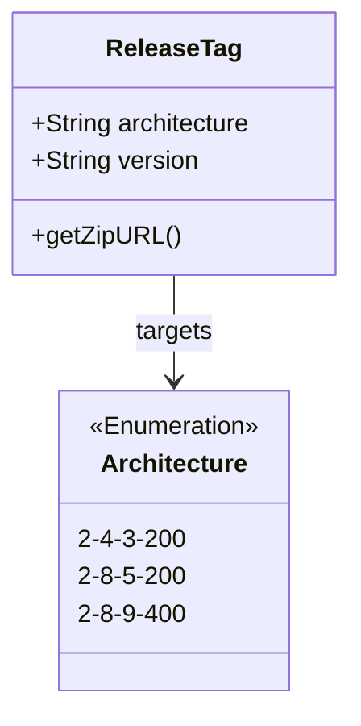

**Sources:** [spectrum-era/README.md:12-17](), [spectrum-era/README.md:21-25]()

---

# Page: Architecture Support Matrix

# Architecture Support Matrix

<details>
<summary>Relevant source files</summary>

The following files were used as context for generating this wiki page:

- [net-configurator/.gitignore](net-configurator/.gitignore)
- [net-configurator/README.md](net-configurator/README.md)
- [spectrum-era/2-4-3-200/README.md](spectrum-era/2-4-3-200/README.md)
- [spectrum-era/2-4-3-200/license](spectrum-era/2-4-3-200/license)
- [spectrum-era/2-8-5-200/README.md](spectrum-era/2-8-5-200/README.md)
- [spectrum-era/2-8-9-400/README.md](spectrum-era/2-8-9-400/README.md)
- [spectrum-era/README.md](spectrum-era/README.md)
- [spectrum-era/license](spectrum-era/license)

</details>


This page documents the supported NVIDIA Enterprise Reference Architectures (ERA) within the `net-configurator` tool. It details the naming conventions, fabric topologies, and the specific resource requirements for deploying these architectures in the NVIDIA Air simulation environment.

## Naming Convention

ERA architecture names follow a standardized four-part numeric pattern: `{CPUs}-{GPUs}-{NICs}-{Bandwidth}` [net-configurator/README.md:28-30]().

*   **CPUs**: Number of CPU sockets per compute node.
*   **GPUs**: Number of NVIDIA GPUs per compute node.
*   **NICs**: Number of Network Adapters (NICs) per compute node.
*   **Bandwidth**: Average per-GPU bandwidth on the East/West (compute) network, measured in Gbps.

For example, in the `2-4-3-200` architecture, compute nodes have 2 CPUs, 4 GPUs, and 3 NICs, providing 200 Gbps of bandwidth per GPU [net-configurator/README.md:32-34]().

## Supported Architectures Matrix

The following table summarizes the technical specifications for each supported architecture.

| Architecture | CPUs | GPUs | NICs | Per-GPU E/W Bandwidth | Fabric Type |
| :--- | :---: | :---: | :---: | :---: | :--- |
| `2-4-3-200` | 2 | 4 | 3 | 200 Gbps* | Converged (core) |
| `2-8-5-200` | 2 | 8 | 5 | 200 Gbps* | Converged (core); dedicated CSL+GSL split at scale |
| `2-8-9-400` | 2 | 8 | 9 | 400 Gbps | Converged (core); dedicated CSL+GSL 2-tier at scale |
| `2-4-5-800` | 2 | 4 | 5 | 800 Gbps | Multi-tier dedicated-GPU dual-plane (GB300 NVL72) |
| `2-8-9-800` | 2 | 8 | 9 | 800 Gbps | Dual-plane (CSL + GSL) |
| `2-8-9-400-SP`| 2 | 8 | 9 | 400 Gbps | Dedicated-GPU single-plane (GSL Plane 1 only) |

*\*200 Gbps represents the per-NIC link speed; these architectures utilize a 1:2 NIC-to-GPU ratio* [net-configurator/README.md:32-41]().

**Sources:**
* [net-configurator/README.md:26-59]()

---

## Fabric Topologies

The repository supports three primary fabric design philosophies, selected automatically based on the architecture and scale defined in the Excel input.

### 1. Converged Fabric
In a converged fabric, a single tier of `core-*` switches handles all traffic types: CPU/in-band, storage, support, Out-of-Band (OOB), and GPU East-West compute traffic [net-configurator/README.md:45-47]().
*   **Used by:** `2-4-3-200`, `2-8-5-200`, `2-8-9-400`.

### 2. Dual-Plane Fabric
A dual-plane fabric physically and logically separates the GPU compute traffic from the management and storage traffic.
*   **CSL (Compute Services Layer):** Carries CPU/in-band, storage, and OOB traffic [net-configurator/README.md:48-49]().
*   **GSL (GPU Services Layer):** Dedicated to GPU traffic, split across two independent planes (`gsl-plane1-*` and `gsl-plane2-*`). Each plane has its own underlay loopback subnet, EVPN scope, and BGP graph [net-configurator/README.md:50-52]().
*   **Used by:** `2-8-9-800` (HGX B300) and `2-4-5-800` (GB300 NVL72 Mini-Cloud).

### 3. Single-Plane Variant
The `2-8-9-400-SP` architecture is a specific variant of the dual-plane design that utilizes only **Plane 1** of the GSL, effectively halving the compute fabric requirements while maintaining the dedicated layer structure [net-configurator/README.md:54-55]().

**Sources:**
* [net-configurator/README.md:43-56]()

---

## Code Entity Mapping: Architecture to Logic

The following diagram illustrates how architecture selection in the natural language space (Excel/User Input) maps to specific code entities and generated outputs within the `net-configurator` pipeline.

### Architecture Logic Flow
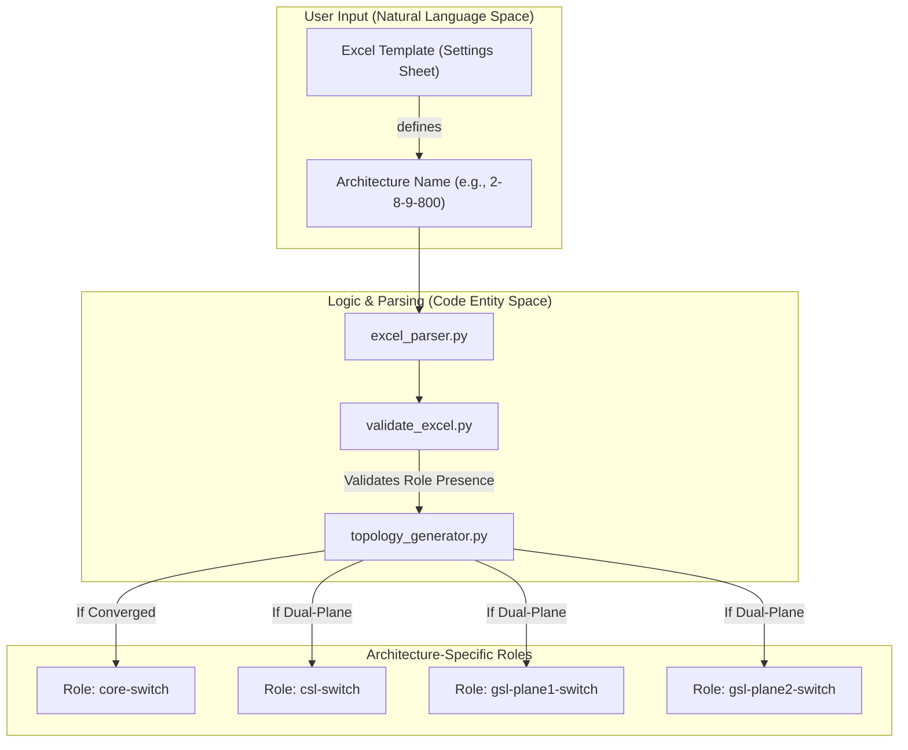
**Sources:**
* [net-configurator/README.md:6-7]()
* [net-configurator/README.md:43-55]()
* [net-configurator/README.md:90-91]()

---

## NVIDIA Air Resource Sizing

When deploying to NVIDIA Air, the tool calculates resource requirements based on the architecture and scale. The "Tested" status indicates configurations that have been verified within the simulation environment.

### Validation Matrix
The following features are validated across all supported architectures in NVIDIA Air:
*   **L3 OOB Underlay + EVPN**: Verified via `make validate-switch-health` [net-configurator/README.md:72]().
*   **Inter-VRF DHCP Relay**: Verified for OOB and EXIT VRFs [net-configurator/README.md:73]().
*   **LDAP Authentication**: Auto-detected and configured from Excel `Settings` [net-configurator/README.md:75]().
*   **NVIDIA Air Simulation (NOZTP)**: Default deployment mode for virtual environments [net-configurator/README.md:76]().

### Topology Entity Mapping
This diagram maps the simulation infrastructure nodes to their respective code roles and deployment scripts.

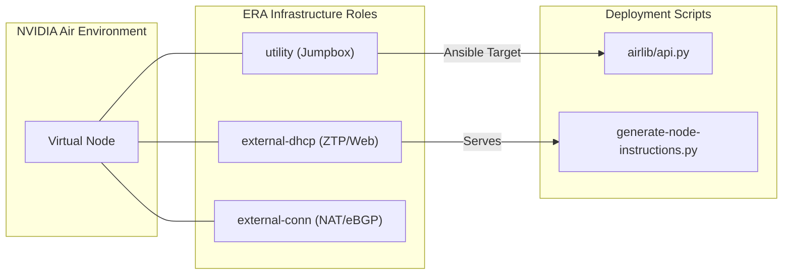
**Sources:**
* [net-configurator/README.md:18-23]()
* [net-configurator/README.md:70-82]()

---

## Deprecated Architectures (spectrum-era)

The `spectrum-era` directory contains legacy, manually-maintained reference configurations. These are retained for historical reference only and have been superseded by the `net-configurator` automation [spectrum-era/README.md:9]().

*   **2-4-3-200 (Legacy)**: [spectrum-era/2-4-3-200/README.md:13]()
*   **2-8-5-200 (Legacy)**: [spectrum-era/2-8-5-200/README.md:13]()
*   **2-8-9-400 (Legacy)**: [spectrum-era/2-8-9-400/README.md:7]()

Release tags for these legacy versions follow the pattern `sp-{architecture}-v{version}` (e.g., `sp-2-8-9-400-v3.0.0`) [spectrum-era/README.md:15-17]().

**Sources:**
* [spectrum-era/README.md:4-18]()
* [spectrum-era/2-4-3-200/README.md:4-9]()
* [spectrum-era/2-8-5-200/README.md:4-9]()
* [spectrum-era/2-8-9-400/README.md:4-9]()

---

# Page: net-configurator: Active Deployment Tool

# net-configurator: Active Deployment Tool

<details>
<summary>Relevant source files</summary>

The following files were used as context for generating this wiki page:

- [net-configurator/.gitignore](net-configurator/.gitignore)
- [net-configurator/README.md](net-configurator/README.md)
- [net-configurator/docs/MANUAL_FALLBACK_GUIDE.md](net-configurator/docs/MANUAL_FALLBACK_GUIDE.md)
- [net-configurator/inventories/secrets.yml.example](net-configurator/inventories/secrets.yml.example)
- [net-configurator/scripts/generate-node-instructions.py](net-configurator/scripts/generate-node-instructions.py)

</details>


The `net-configurator` is the primary automation framework within the Enterprise Reference Architecture (ERA) repository. It provides an Ansible and Python-based pipeline designed to transform high-level network designs—captured in a standardized Excel template—into production-ready switch configurations and simulation topologies.

The tool supports the full lifecycle of a deployment: from initial configuration generation and validation to automated deployment in NVIDIA Air or on physical hardware via Zero Touch Provisioning (ZTP) [net-configurator/README.md:4-6]().

## Workflow Overview

The `net-configurator` follows a "Source of Truth" model where the Excel workbook defines the entire fabric. The automation logic consumes this workbook to produce three primary artifacts:
1.  **Ansible Inventory**: Host definitions, group variables, and secrets required for fabric management.
2.  **NVUE Configurations**: CLI-ready shell scripts (`.sh`) containing `nv set` commands for Cumulus Linux switches [net-configurator/README.md:13-15]().
3.  **Topology JSON**: A definition file used to instantiate virtualized environments in the NVIDIA Air simulation platform [net-configurator/README.md:17-17]().

### The "Natural Language" to "Code Entity" Bridge

The following diagram maps user-facing concepts (Natural Language Space) to the specific Python scripts and Ansible entities that implement them (Code Entity Space).

**Mapping: Design Intent to Code Implementation**
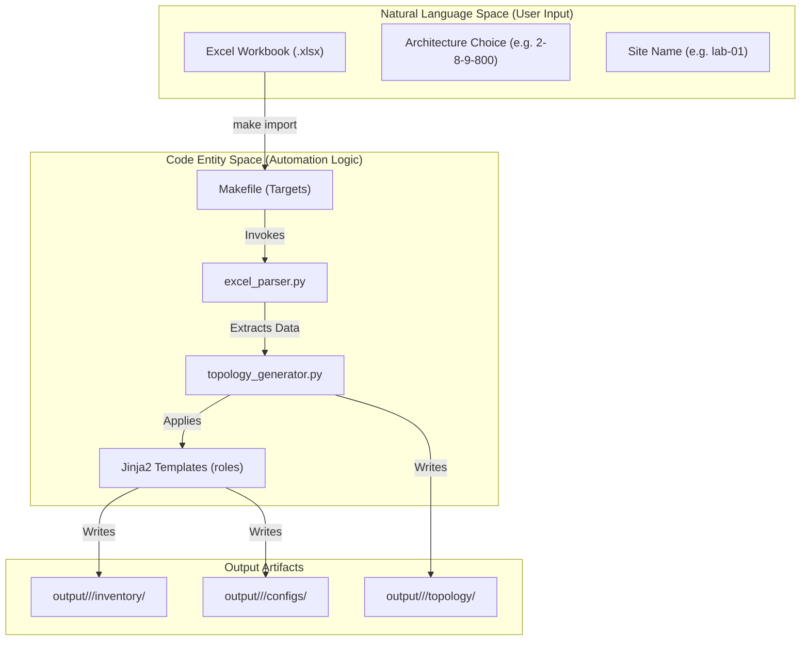
Sources: [net-configurator/README.md:90-95](), [net-configurator/docs/MANUAL_FALLBACK_GUIDE.md:89-93]()

## Key Components and Subsystems

### 1. Excel Configuration Guide
The Excel template is the primary interface for users. It contains four critical sheets: `Settings`, `Nodes`, `VLANs & Profiles`, and `Wire Map`. The parser validates these sheets to ensure the design adheres to ERA principles, such as proper GPU VLAN topology and IP planning [net-configurator/README.md:91-91]().
*   **For details, see [Excel Configuration Guide](#2.1)**

### 2. Configuration Generation Pipeline
This subsystem handles the transformation of Excel data into machine-readable code. It utilizes `excel_parser.py` to ingest data and `topology_generator.py` to build the relationship graph between nodes. This data is then fed into Jinja2 templates located within the `roles/` directory to produce final switch and server configurations [net-configurator/docs/MANUAL_FALLBACK_GUIDE.md:44-47]().
*   **For details, see [Configuration Generation Pipeline](#2.2)**

### 3. Makefile Workflow Reference
The `Makefile` serves as the entry point for all operations. It manages the `.era-context` file, which tracks the current `ARCH` and `SITE` to prevent accidental deployments to the wrong environment [net-configurator/.gitignore:5-5]().
*   **Common Targets**: `make generate`, `make deploy`, `make ztp-setup`, and `make validate-all` [net-configurator/README.md:90-94]().
*   **For details, see [Makefile Workflow Reference](#2.3)**

### 4. Node Roles and Switch Fabric Taxonomy
The framework recognizes a specific taxonomy of roles (e.g., `gpu`, `core`, `csl`, `gsl-plane1`). These roles determine how the parser classifies a node and which Ansible roles are applied during deployment. The taxonomy varies between **Converged** fabrics (where one tier handles all traffic) and **Dual-Plane** fabrics (where compute traffic is isolated) [net-configurator/README.md:43-55]().
*   **For details, see [Node Roles and Switch Fabric Taxonomy](#2.4)**

## Deployment Contexts

The tool is designed to bridge the gap between simulation and reality. It uses the same configuration logic for both NVIDIA Air and physical hardware.

**System Interaction: Simulation vs. Physical**
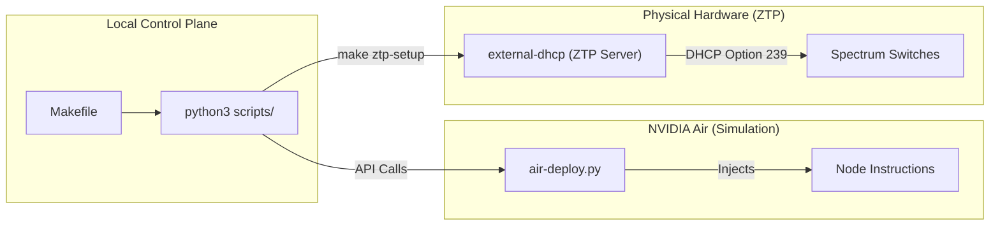
Sources: [net-configurator/README.md:15-17](), [net-configurator/scripts/generate-node-instructions.py:17-21]()

### Secrets and Security
The `net-configurator` utilizes a two-tier secrets model. Global credentials for the NVIDIA Air API are stored in a shared vault (`.era-secrets/air-secrets.yml`), while deployment-specific passwords (switches, LDAP, etc.) are stored in the site's `inventory/group_vars/all/secrets.yml` [net-configurator/inventories/secrets.yml.example:7-12](), [net-configurator/inventories/secrets.yml.example:62-67]().
*   **For details, see [Secrets Management and Security](#5)**

### Manual Fallback
In scenarios where the Air API is unavailable, the tool provides a `generate-node-instructions.py` script. This script generates standalone bash fragments that can be manually pasted into the Air GUI to bootstrap the environment [net-configurator/scripts/generate-node-instructions.py:5-10]().
*   **For details, see [Manual Fallback Deployment Guide](#3.3)**

---
**Sources:**
*   [net-configurator/README.md:1-102]()
*   [net-configurator/scripts/generate-node-instructions.py:1-52]()
*   [net-configurator/inventories/secrets.yml.example:1-67]()
*   [net-configurator/docs/MANUAL_FALLBACK_GUIDE.md:1-103]()
*   [net-configurator/.gitignore:1-103]()

---

# Page: Excel Configuration Guide

# Excel Configuration Guide

<details>
<summary>Relevant source files</summary>

The following files were used as context for generating this wiki page:

- [net-configurator/.gitignore](net-configurator/.gitignore)
- [net-configurator/README.md](net-configurator/README.md)
- [net-configurator/docs/MANUAL_FALLBACK_GUIDE.md](net-configurator/docs/MANUAL_FALLBACK_GUIDE.md)
- [net-configurator/inventories/secrets.yml.example](net-configurator/inventories/secrets.yml.example)
- [net-configurator/scripts/generate-node-instructions.py](net-configurator/scripts/generate-node-instructions.py)

</details>


The NVIDIA Enterprise Reference Architecture (ERA) automation is driven by a single Excel spreadsheet. This template defines the physical topology, logical network settings, VLAN profiles, and IP addressing for the entire cluster. The `net-configurator` tool parses this workbook to generate Ansible inventories, NVUE (NVIDIA User Experience) switch configurations, and NVIDIA Air simulation topologies.

## Configuration Workflow

The data flow begins with the user-provided Excel file and terminates in the `output/` directory, which contains all deployment artifacts.

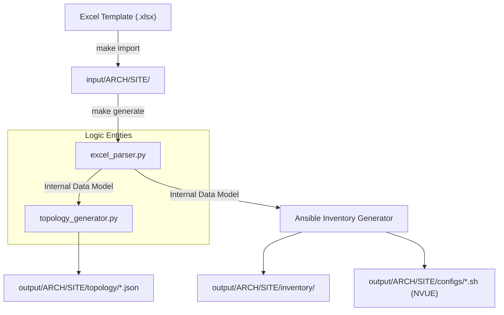
**Sources:** [net-configurator/README.md:6-7](), [net-configurator/docs/MANUAL_FALLBACK_GUIDE.md:81-93]()

---

## 1. Settings Sheet
The **Settings** sheet defines global parameters for the deployment, including the architecture type, OOB (Out-of-Band) management modes, and authentication services.

### Key Fields
| Field | Description | Code Reference / Impact |
|:---|:---|:---|
| **Architecture** | The ERA architecture ID (e.g., `2-8-9-800`). | Used by `excel_parser.py` to select validation rules. |
| **oob_uplink_mode** | `l3` (default) or `l2`. | Controls whether `oob-server-01` (L2) or `utility` (L3) is used [net-configurator/README.md:18-23](). |
| **ldap_enabled** | `Yes` or `No`. | If `Yes`, triggers generation of LDAP client configs for switches [net-configurator/README.md:96-96](). |
| **status_page_enabled** | `Yes` or `No`. | Enables the ZTP status dashboard on the `utility` node [net-configurator/inventories/secrets.yml.example:54-57](). |

**Sources:** [net-configurator/README.md:18-23](), [net-configurator/README.md:75-75]()

---

## 2. Nodes Sheet
The **Nodes** sheet acts as the source of truth for every device in the fabric. It maps physical hardware to functional roles.

### Field Documentation
*   **Function / Name**: A canonical string identifying the node's role (e.g., `gpu-01`, `core-01`, `csl-01`). The parser uses these prefixes to classify nodes into groups like `[switches]` or `[servers]`.
*   **Display in Air**: A boolean (`Yes`/`No`) determining if the node is included in the generated NVIDIA Air topology JSON.
*   **MAC Address**: Required for physical ZTP deployments. Used by `external-dhcp` to map DHCP requests to specific NVUE configuration scripts.

### Node Roles and Code Entities
The following diagram maps Excel node roles to the internal Ansible groups and deployment logic.

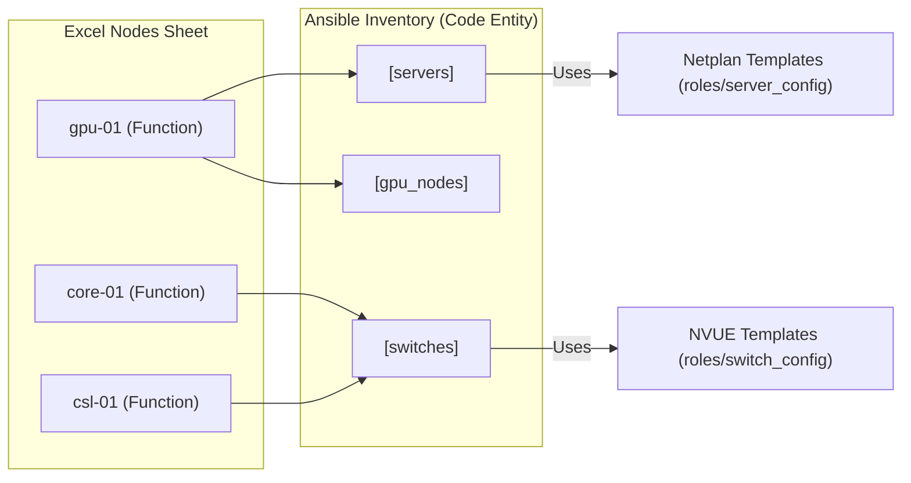
**Sources:** [net-configurator/README.md:57-59](), [net-configurator/scripts/generate-node-instructions.py:17-21]()

---

## 3. VLANs & Profiles Sheet
This sheet defines the logical segmentation of the network. ERA typically utilizes several standard VRFs (Virtual Routing and Forwarding) instances to isolate traffic.

### Standard VRFs
*   **default**: The underlay and management plane.
*   **compute**: High-bandwidth GPU East-West traffic.
*   **storage**: Dedicated storage traffic (first-class in 800G architectures).
*   **exit**: External connectivity and NAT services.

### GPU VLAN Topology Modes
For high-scale architectures like `2-8-9-800`, the tool supports **Per-rail-per-plane** GPU VLAN modes. This ensures that each GPU rail is mapped to a specific fabric plane for maximum throughput and isolation [net-configurator/README.md:81-82]().

**Sources:** [net-configurator/README.md:48-55](), [net-configurator/README.md:80-82]()

---

## 4. Wire Map Sheet
The **Wire Map** defines every physical cable in the cluster. This data is critical for generating the `topology.json` file used by NVIDIA Air and for validating the LLDP neighbor state on physical hardware.

### Column Definitions
1.  **Local Node**: The source node name (must match the **Nodes** sheet).
2.  **Local Interface**: The port identifier (e.g., `swp1`, `eth0`).
3.  **Remote Node**: The destination node name.
4.  **Remote Interface**: The destination port identifier.

### Topology Generation Logic
The `topology_generator.py` script processes these entries to build the Air-compatible JSON. For infrastructure nodes, specific logic is applied to handle the `air-oob-switch` (VLAN-aware bridge) and the NAT gateway.

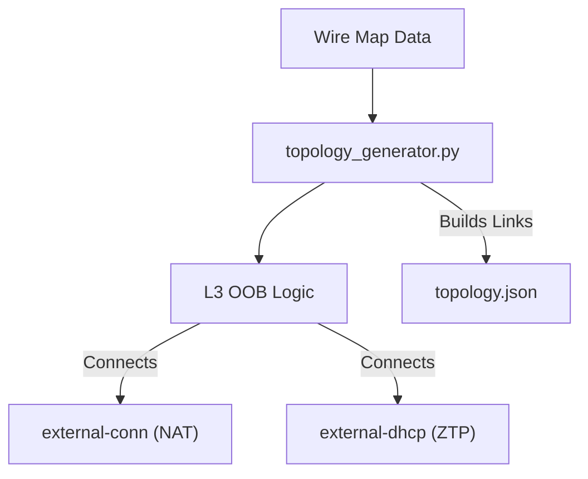
**Sources:** [net-configurator/scripts/generate-node-instructions.py:106-127](), [net-configurator/README.md:19-22]()

---

## 5. IP Planning and Secrets
IP addresses are typically derived from the **VLANs & Profiles** sheet based on defined subnets. However, sensitive information is never stored in the Excel file.

### Secrets Management
Passwords and API keys are handled via Ansible Vault.
*   **Air Credentials**: Stored in `.era-secrets/air-secrets.yml` (Shared across all sites) [net-configurator/inventories/secrets.yml.example:60-67]().
*   **Deployment Secrets**: Stored in `output/<arch>/<site>/inventory/group_vars/all/secrets.yml`. This includes `switch_password`, `ldap_admin_password`, and `ansible_become_password` [net-configurator/inventories/secrets.yml.example:19-51]().

**Sources:** [net-configurator/inventories/secrets.yml.example:4-12](), [net-configurator/README.md:98-98]()

---

# Page: Configuration Generation Pipeline

# Configuration Generation Pipeline

<details>
<summary>Relevant source files</summary>

The following files were used as context for generating this wiki page:

- [net-configurator/.gitignore](net-configurator/.gitignore)
- [net-configurator/README.md](net-configurator/README.md)
- [net-configurator/docs/ANSIBLE_SUDO_SETUP.md](net-configurator/docs/ANSIBLE_SUDO_SETUP.md)
- [net-configurator/docs/MANUAL_FALLBACK_GUIDE.md](net-configurator/docs/MANUAL_FALLBACK_GUIDE.md)
- [net-configurator/inventories/secrets.yml.example](net-configurator/inventories/secrets.yml.example)
- [net-configurator/scripts/generate-node-instructions.py](net-configurator/scripts/generate-node-instructions.py)

</details>


The Configuration Generation Pipeline is the core engine of `net-configurator`. It transforms high-level network design specifications defined in Excel into low-level, deployable artifacts including Ansible inventories, NVUE (NVIDIA User Experience) switch configuration scripts, and NVIDIA Air topology definitions.

## Pipeline Overview

The pipeline follows a strictly sequential flow, moving from a user-provided Excel workbook to structured Python objects, and finally to rendered text files.

### Data Flow Diagram

The following diagram illustrates the transition from the "Natural Language Space" (Excel) to the "Code Entity Space" (Python classes and Jinja2 templates).

**Logic Flow: Excel to Artifacts**
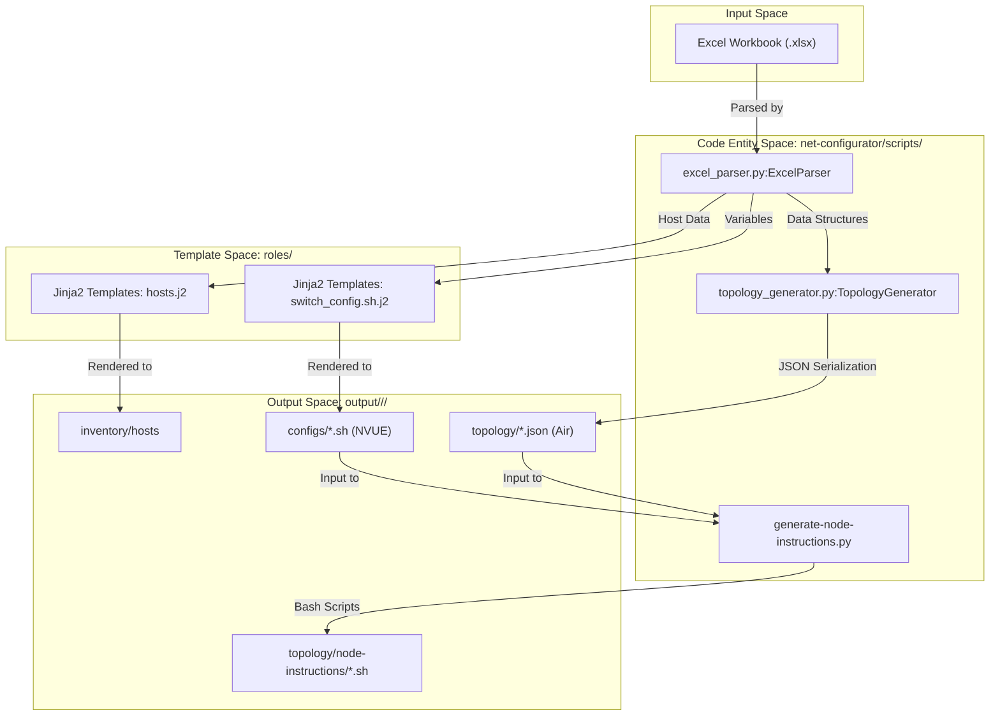
**Sources:** [net-configurator/README.md:4-6](), [net-configurator/scripts/generate-node-instructions.py:5-27]()

---

## 1. Input Parsing (`excel_parser.py`)

The first stage involves `excel_parser.py`, which reads the four primary sheets of the ERA Excel template: **Settings**, **Nodes**, **VLANs & Profiles**, and **Wire Map**.

### Key Responsibilities
*   **Role Classification**: It maps every node to one of the 11+ canonical roles (e.g., `gpu`, `core`, `gsl-plane1`).
*   **Variable Extraction**: Extracts global settings such as `ldap_enabled`, `oob_uplink_mode`, and `gpu_vlan_mode`.
*   **Validation**: Triggers `validate_excel.py` to ensure the input adheres to the architecture's constraints (e.g., correct NIC-to-GPU ratios).

**Sources:** [net-configurator/README.md:90-91](), [net-configurator/docs/ROLES.md:1-50]()

---

## 2. Topology Generation (`topology_generator.py`)

This component consumes the parsed data to build a comprehensive map of the network. It is responsible for generating the `topology.json` file required by the NVIDIA Air API or for manual upload.

### Implementation Details
The `TopologyGenerator` class performs the following:
1.  **Node Definition**: Creates a JSON object for every switch and server marked with "Display in Air = Yes".
2.  **Interface Mapping**: Translates the **Wire Map** sheet into a list of links, defining exactly which local interface connects to which remote interface.
3.  **Metadata Injection**: Injects specific metadata for infrastructure nodes like `air-oob-switch` and `oob-server-01` to facilitate automated OOB setup.

**Sources:** [net-configurator/scripts/generate-node-instructions.py:106-117](), [net-configurator/docs/MANUAL_FALLBACK_GUIDE.md:89-93]()

---

## 3. Configuration Rendering (Jinja2)

`net-configurator` uses Ansible's Jinja2 engine to render final configuration files. Unlike standard Ansible roles that apply configuration directly to live devices, this pipeline often renders these to the `output/` directory first for ZTP (Zero Touch Provisioning) consumption.

### Template Structure
*   **Switch Configs**: The `switch_config.sh.j2` template (found in the switch roles) generates a sequence of `nv set` commands. These commands are wrapped in a script that includes `nv config apply -y`.
*   **Inventory**: The `hosts.j2` template generates the Ansible `hosts` file, organizing nodes into groups based on their ERA roles.

### Secret Handling
Secrets are merged during this phase. Values from `inventories/secrets.yml` (e.g., `switch_ansible_password`, `ldap_admin_password`) are injected into the templates to ensure the generated configs are fully functional.

**Sources:** [net-configurator/inventories/secrets.yml.example:19-49](), [net-configurator/README.md:13-15]()

---

## 4. Node Instructions Generation

For NVIDIA Air deployments, especially in "NOZTP" mode or manual fallback scenarios, the pipeline generates "Node Instructions" (NI). These are standalone bash scripts that are executed by the Air hypervisor upon node boot.

### `generate-node-instructions.py`
This script produces one `.sh` file per node in `output/<arch>/<site>/topology/node-instructions/`.

**Node Instruction Logic Mapping**
| Entity in Code | Target Node | Purpose |
| :--- | :--- | :--- |
| `generate_air_oob_switch` | `air-oob-switch` | Configures the VLAN-aware bridge [net-configurator/scripts/generate-node-instructions.py:106-172]() |
| `build_server_ni_commands` | `gpu`, `storage`, etc. | Sets up netplan, hostnames, and ARP-flux fixes [net-configurator/scripts/generate-node-instructions.py:49-51]() |
| `build_switch_ni_commands` | `core`, `csl`, `gsl` | Injects a wrapper to source the rendered NVUE config from `/opt/era/` [net-configurator/scripts/generate-node-instructions.py:17-20]() |

**Sources:** [net-configurator/scripts/generate-node-instructions.py:1-52](), [net-configurator/docs/MANUAL_FALLBACK_GUIDE.md:95-103]()

---

## 5. Output Directory Structure

The final results of the pipeline are organized into a predictable hierarchy within the `output/` directory. This structure allows for multi-site deployments under the same architecture.

```text
output/
└── <architecture>/          # e.g., 2-8-9-800
    └── <site>/              # e.g., default or lab-01
        ├── configs/         # Rendered NVUE .sh scripts for every switch
        ├── inventory/       # Ansible hosts file and group_vars
        │   └── group_vars/
        │       └── all/
        │           └── secrets.yml
        └── topology/        # Air topology JSON and Node Instructions
            ├── <arch>-topology.json
            └── node-instructions/
                ├── air-oob-switch.sh
                ├── oob-server-01.sh
                └── ...
```

**Sources:** [net-configurator/.gitignore:83-96](), [net-configurator/docs/MANUAL_FALLBACK_GUIDE.md:89-93]()

---

# Page: Makefile Workflow Reference

# Makefile Workflow Reference

<details>
<summary>Relevant source files</summary>

The following files were used as context for generating this wiki page:

- [net-configurator/.gitignore](net-configurator/.gitignore)
- [net-configurator/README.md](net-configurator/README.md)
- [net-configurator/docs/MANUAL_FALLBACK_GUIDE.md](net-configurator/docs/MANUAL_FALLBACK_GUIDE.md)
- [net-configurator/inventories/secrets.yml.example](net-configurator/inventories/secrets.yml.example)
- [net-configurator/scripts/generate-node-instructions.py](net-configurator/scripts/generate-node-instructions.py)

</details>


The NVIDIA Enterprise Reference Architecture (ERA) `net-configurator` tool uses a `Makefile` to orchestrate a multi-stage pipeline that transforms Excel-based network designs into fully functional simulated or physical fabrics. This workflow manages everything from local artifact generation to remote NVIDIA Air API interactions and Ansible-based switch provisioning.

## Workflow Overview

The workflow is designed to be idempotent and context-aware. It utilizes a hidden file, `.era-context`, to track the current active architecture (`ARCH`) and site (`SITE`), allowing users to execute targets without repeatedly specifying parameters [net-configurator/.gitignore:5-5]().

### Data Flow and Target Chaining

The following diagram illustrates how major `make` targets chain together to move data from the input Excel sheet to a deployed environment.

**ERA Configuration Data Flow**
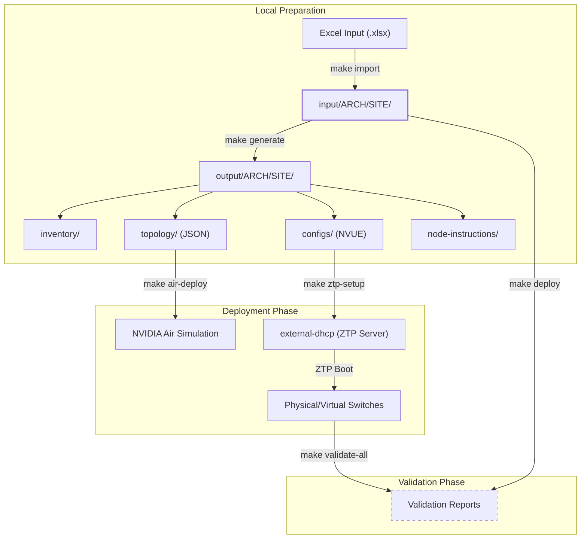
**Sources:** [net-configurator/README.md:90-99](), [net-configurator/scripts/generate-node-instructions.py:7-23]()

---

## Core Targets

### `make import`
Copies a user-provided Excel file into the internal directory structure. It automatically detects the architecture and site name defined within the spreadsheet to set the `.era-context`.
*   **Input:** `EXCEL=/path/to/file.xlsx`
*   **Result:** Files placed in `input/<arch>/<site>/` [net-configurator/.gitignore:65-81]().

### `make generate`
The primary local processing engine. It executes the Python-based parser and topology generator to create all deployment artifacts.
*   **Implementation:** Calls `excel_parser.py` and `topology_generator.py`.
*   **Artifacts:**
    *   Ansible inventory for the specific site.
    *   NVUE `.sh` configuration scripts for every switch.
    *   NVIDIA Air topology JSON.
    *   Node Instruction (NI) scripts for infrastructure nodes [net-configurator/scripts/generate-node-instructions.py:85-93]().

### `make deploy`
The "one-command" target. It chains `generate`, `air-deploy` (if using Air), `ztp-setup`, and `validate-all`. It is the standard entry point for most users [net-configurator/README.md:90-90]().

---

## NVIDIA Air Simulation Targets

These targets interact with the NVIDIA Air API via the `airlib` Python library to automate simulation lifecycles.

| Target | Description |
| :--- | :--- |
| `make air-setup` | Wizard to configure NGC API keys and SSH keys in the `.era-secrets/air-secrets.yml` vault [net-configurator/inventories/secrets.yml.example:62-67](). |
| `make air-deploy` | Uploads the generated topology JSON, creates a simulation, and injects Node Instructions for NOZTP mode [net-configurator/scripts/generate-node-instructions.py:9-10](). |
| `make deploy-switches-only` | Deploys the fabric but omits server VMs to save Air budget and simulation startup time [net-configurator/README.md:94-94](). |

**Sources:** [net-configurator/README.md:16-17](), [net-configurator/docs/MANUAL_FALLBACK_GUIDE.md:23-28]()

---

## Provisioning and ZTP Targets

Once the infrastructure is reachable (either in Air or physically), these targets handle the application of the generated NVUE configurations.

### `make ztp-setup`
Configures the `external-dhcp` node (or `dhcp-oob` in legacy L2) to act as a ZTP server. It installs `dnsmasq` and `nginx`, then hosts the NVUE `.sh` scripts generated during the `make generate` phase [net-configurator/README.md:20-20](), [net-configurator/docs/MANUAL_FALLBACK_GUIDE.md:36-39]().

### `make switch-ztp-deploy`
Triggers the ZTP process on switches. In an Air environment using `NOZTP` Node Instructions, this is handled by a deferred-apply wrapper that sources the rendered NVUE config from `/opt/era/` on first boot [net-configurator/scripts/generate-node-instructions.py:19-20]().

---

## Validation Targets

The validation framework ensures the deployed state matches the Excel design.

*   **`make validate-excel`**: Runs `validate_excel.py` to check for canonical role enforcement and field errors.
*   **`make validate-topology`**: Compares the wire map against the generated Air JSON.
*   **`make validate-all`**: A meta-target that runs the full suite:
    1.  **Config Validation**: `nv config diff` check.
    2.  **Health Validation**: Checks BGP peerings and EVPN VNI status.
    3.  **Connectivity**: Runs a ping matrix across VRFs.
    4.  **ZTP Status**: Verifies all switches successfully completed provisioning.

**Sources:** [net-configurator/README.md:72-82](), [net-configurator/scripts/generate-node-instructions.py:90-93]()

---

## Manual Fallback Workflow

If the Air API is unavailable, the `Makefile` supports a manual workflow using the generated Node Instructions.

**Manual Node Instruction Logic**
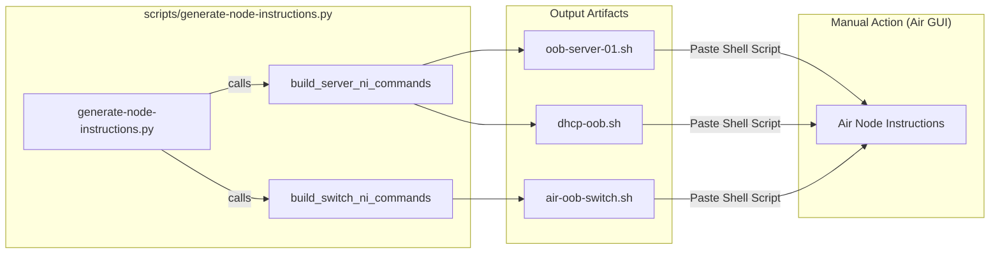
**Sources:** [net-configurator/scripts/generate-node-instructions.py:44-51](), [net-configurator/docs/MANUAL_FALLBACK_GUIDE.md:95-103]()

### Manual Steps
1.  **Generate locally**: `make generate` produces `output/<arch>/<site>/topology/node-instructions/` [net-configurator/docs/MANUAL_FALLBACK_GUIDE.md:85-88]().
2.  **Upload Topology**: Manually upload the JSON to the Air GUI [net-configurator/docs/MANUAL_FALLBACK_GUIDE.md:112-113]().
3.  **Paste Instructions**: Paste the generated `.sh` scripts into the Air GUI for `air-oob-switch`, `oob-server-01`, and `dhcp-oob` [net-configurator/docs/MANUAL_FALLBACK_GUIDE.md:132-138]().
4.  **Internal Ansible**: Run Ansible directly from the `dhcp-oob` node within the simulation to bypass SSH tunneling bottlenecks [net-configurator/docs/MANUAL_FALLBACK_GUIDE.md:48-53]().

---

## Context and Secrets Management

### `.era-context`
This file is generated by `make import` or `make set-context`. It contains the current `ARCH` and `SITE`. If this file is missing, most `make` targets will fail or prompt for these variables [net-configurator/.gitignore:4-5]().

### Secrets (`ansible-vault`)
The workflow utilizes two distinct secret stores:
1.  **Global Air Secrets**: `.era-secrets/air-secrets.yml` contains the `ngc_api_key`.
2.  **Deployment Secrets**: `output/<arch>/<site>/inventory/group_vars/all/secrets.yml` contains `switch_password`, `ldap_admin_password`, and `ansible_become_password` [net-configurator/inventories/secrets.yml.example:1-67]().

**Sources:** [net-configurator/.gitignore:7-9](), [net-configurator/inventories/secrets.yml.example:60-67]()

---

# Page: Node Roles and Switch Fabric Taxonomy

# Node Roles and Switch Fabric Taxonomy

<details>
<summary>Relevant source files</summary>

The following files were used as context for generating this wiki page:

- [net-configurator/.gitignore](net-configurator/.gitignore)
- [net-configurator/README.md](net-configurator/README.md)
- [spectrum-era/2-4-3-200/roles/core/tasks/main.yml](spectrum-era/2-4-3-200/roles/core/tasks/main.yml)
- [spectrum-era/2-8-5-200/roles/core/tasks/main.yml](spectrum-era/2-8-5-200/roles/core/tasks/main.yml)
- [spectrum-era/2-8-9-400/roles/core/tasks/main.yml](spectrum-era/2-8-9-400/roles/core/tasks/main.yml)

</details>


This page provides a technical reference for the canonical node roles and fabric classifications used within the NVIDIA Enterprise Reference Architecture (ERA) automation. It details how the `net-configurator` parser identifies nodes and the architectural differences between converged and dedicated-GPU fabrics.

## Node Role Reference

The ERA framework recognizes 11+ distinct roles. These roles are defined in the **Nodes** sheet of the Excel configuration and are used by the `excel_parser.py` to generate the Ansible inventory and NVUE configurations.

### Switch Roles

| Role | Name | Description |
|---|---|---|
| `core` | Core Switch | A converged switch handling all traffic types (Compute, Storage, Support, OOB) in smaller architectures. |
| `csl` | Compute Storage Leaf | Dedicated leaf for CPU/In-band, Storage, and Support traffic in multi-tier architectures. |
| `cs` | Compute Spine | Spine switch connecting `csl` leaves. |
| `gsl-plane1` | GPU Leaf Plane 1 | Leaf switch for the first plane of the GPU East-West fabric. |
| `gsl-plane2` | GPU Leaf Plane 2 | Leaf switch for the second plane of the GPU East-West fabric. |
| `gs` | GPU Spine | Spine switch connecting `gsl` leaves. |
| `cl` | Compute Leaf | Dedicated leaf for compute-only traffic (used in specific large-scale variants). |
| `gl` | GPU Leaf | Generic GPU leaf (often aliased to `gsl-planeX`). |
| `oob-switch` | OOB Switch | Dedicated management switch for out-of-band traffic. |
| `cust-net-edge` | Customer Edge | Simulated edge switches providing external connectivity and NAT. |

### Server and Support Roles

| Role | Name | Description |
|---|---|---|
| `gpu` | GPU Server | Compute nodes (e.g., HGX H100/B200) containing multiple GPUs and NICs. |
| `storage` | Storage Node | Nodes providing storage services, typically mapped to the STORAGE VRF. |
| `support` | Support Node | Infrastructure nodes (DNS, NTP, etc.) mapped to the SUPPORT VRF. |
| `utility` | Utility Host | The L3 OOB jumpbox and Ansible control node. |
| `external-dhcp`| ZTP Server | Host providing DHCP and HTTP services for switch Zero Touch Provisioning. |

**Sources:**
- `net-configurator/README.md:10-24`()
- `net-configurator/README.md:32-39`()
- `net-configurator/README.md:48-55`()

---

## Fabric Taxonomy: Converged vs. Dedicated-GPU

The architecture of the switch fabric is determined by the specific ERA model selected.

### Converged Fabric
In converged architectures (e.g., `2-4-3-200`, `2-8-5-200`), a single tier of `core` switches handles all traffic types. This simplifies the physical topology but aggregates all failure domains.
- **Key Files:** `spectrum-era/2-4-3-200/roles/core/tasks/main.yml`() defines how these multi-functional interfaces are configured via NVUE.

### Dual-Plane GPU Fabric
In high-bandwidth architectures (e.g., `2-8-9-800`), the GPU East-West traffic is isolated into dedicated planes.
- **CSL Tier:** Handles CPU/In-band, Storage, and Support.
- **GSL Planes:** Two independent L3-isolated planes (`gsl-plane1` and `gsl-plane2`) handle GPU traffic. They share VLAN IDs but use different loopback subnets and BGP graphs.

### Fabric Architecture Mapping
The following diagram maps the logical architecture names to the switch roles utilized in the codebase.

**Diagram: Architecture to Node Role Mapping**
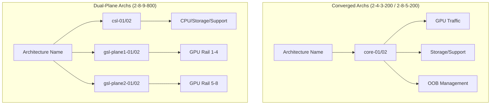
**Sources:**
- `net-configurator/README.md:43-55`()
- `net-configurator/README.md:78-82`()

---

## Parser Classification and Excel Convention

The `net-configurator` uses a strict convention in the **Nodes** sheet to classify hardware.

### Function vs. Name Column
1. **Function:** This column must match one of the canonical roles (e.g., `gpu`, `core`, `csl`). The parser uses this to assign Ansible groups and select Jinja2 templates.
2. **Name:** The unique hostname for the device (e.g., `gpu-01`, `spine-01`).

### Implementation Flow
The transformation from Excel to a configured switch involves several stages in the pipeline.

**Diagram: Node Classification Data Flow**
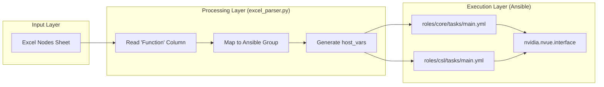

### NVUE Interface Configuration
Depending on the role, the `nvidia.nvue.interface` module is called with different parameters. For example, a `core` switch handles multiple interface types in one task file:
- **Storage:** `storage_interfaces` [spectrum-era/2-4-3-200/roles/core/tasks/main.yml:136-150]()
- **Support:** `support_interfaces` [spectrum-era/2-4-3-200/roles/core/tasks/main.yml:152-166]()
- **GPU:** `gpu_interfaces` [spectrum-era/2-4-3-200/roles/core/tasks/main.yml:194-208]()

**Sources:**
- `spectrum-era/2-4-3-200/roles/core/tasks/main.yml:136-208`()
- `spectrum-era/2-8-5-200/roles/core/tasks/main.yml:136-208`()
- `spectrum-era/2-8-9-400/roles/core/tasks/main.yml:136-208`()

---

## Architecture Presence Matrix

The presence of specific roles depends on the scale and architecture type.

| Architecture | core | csl | gsl-plane1 | gsl-plane2 | cs/gs (Spines) |
|---|:---:|:---:|:---:|:---:|:---:|
| `2-4-3-200` | ✅ | — | — | — | — |
| `2-8-5-200` | ✅ | ✅* | — | — | ✅* |
| `2-8-9-400` | ✅ | ✅* | — | — | ✅* |
| `2-4-5-800` | — | ✅ | ✅ | ✅ | ✅ |
| `2-8-9-800` | — | ✅ | ✅ | ✅ | ✅* |
| `2-8-9-400-SP`| — | ✅ | ✅ | — | ✅* |

*\* Present only at larger scales (Multi-tier).*

**Sources:**
- `net-configurator/README.md:32-39`()
- `net-configurator/README.md:78-79`()

---

# Page: Deployment Workflows

# Deployment Workflows

<details>
<summary>Relevant source files</summary>

The following files were used as context for generating this wiki page:

- [net-configurator/.gitignore](net-configurator/.gitignore)
- [net-configurator/README.md](net-configurator/README.md)
- [net-configurator/docs/MANUAL_FALLBACK_GUIDE.md](net-configurator/docs/MANUAL_FALLBACK_GUIDE.md)
- [net-configurator/inventories/secrets.yml.example](net-configurator/inventories/secrets.yml.example)
- [net-configurator/scripts/generate-node-instructions.py](net-configurator/scripts/generate-node-instructions.py)

</details>


This page provides an overview of the two primary deployment paths supported by the Enterprise Reference Architecture (ERA) automation tool: **NVIDIA Air Simulation** and **Physical Hardware (ZTP)**. 

The ERA automation framework is designed to be environment-agnostic. It consumes an Excel configuration to generate the necessary artifacts (Ansible inventories, NVUE switch configurations, and topology definitions) which can then be applied to either a virtualized cloud environment for validation or directly to physical Spectrum switches via Zero Touch Provisioning (ZTP) [net-configurator/README.md:4-17]().

### Deployment Path Comparison

| Feature | NVIDIA Air Simulation | Physical Hardware (ZTP) |
| :--- | :--- | :--- |
| **Primary Use Case** | Pre-production validation and "dry-runs" | Production deployment |
| **Connectivity** | API-driven or SSH via `utility` jumpbox | Local network or OOB management plane |
| **Provisioning** | NOZTP (Direct injection of configs) | DHCP-based ZTP (Option 239) |
| **Infrastructure** | Virtual VMs (Ubuntu/Cumulus) | Physical Spectrum Switches & Servers |
| **Automation Target** | `make air-deploy` | `make switch-ztp-deploy` |

---

## 1. NVIDIA Air Simulation Deployment

NVIDIA Air is a cloud-hosted network simulation platform that allows users to spin up a virtual representation of their ERA topology [net-configurator/README.md:17-17](). This workflow is the recommended first step for any deployment to ensure that the generated configurations are logically sound before they are pushed to physical hardware.

The deployment utilizes the `airlib` Python library to interact with the Air API for simulation lifecycle management, including creation, node instruction injection, and resource budgeting [net-configurator/README.md:93-94]().

**Key Components:**
* **NGC API Key:** Required for authentication with the Air service [net-configurator/README.md:16-16]().
* **NOZTP Mode:** A specialized injection method where configurations are pushed directly into the virtual nodes during the simulation boot process, bypassing the need for an external DHCP server [net-configurator/README.md:76-76]().
* **Air Setup Wizard:** The `make air-setup` command initializes the local environment with the necessary credentials [net-configurator/inventories/secrets.yml.example:64-64]().

For a step-by-step guide on NGC setup and API-driven deployment, see **[NVIDIA Air Simulation Deployment (#3.1)]**.

---

## 2. Physical Hardware Deployment via ZTP

The physical deployment workflow relies on **Zero Touch Provisioning (ZTP)**. In this mode, unconfigured switches boot up and request an IP address via DHCP. The DHCP server provides a provisioning script (typically via DHCP Option 239) that the switch executes to download and apply its final NVUE configuration [net-configurator/README.md:15-15]().

**Infrastructure Requirements:**
* **`external-dhcp`:** A node (or container) running `dnsmasq` and `nginx` to serve IP addresses and configuration scripts [net-configurator/README.md:20-20]().
* **`utility`:** The management jumpbox used by Ansible to orchestrate the deployment and monitor ZTP status [net-configurator/README.md:19-19]().
* **MAC Address Mapping:** The Excel `Nodes` sheet must contain the physical MAC addresses of the switches to ensure the correct configuration is mapped to the correct hardware.

For details on setting up the ZTP server and executing the physical rollout, see **[Physical Hardware Deployment via ZTP (#3.2)]**.

---

## 3. Manual Fallback Deployment

In scenarios where the NVIDIA Air API is unavailable or restricted, the tool provides a manual fallback path. This workflow involves generating the topology and "Node Instructions" locally and then manually uploading them to the Air Web GUI [net-configurator/docs/MANUAL_FALLBACK_GUIDE.md:21-30]().

**The `generate-node-instructions.py` script** is the core of this workflow. It produces standalone shell scripts for critical infrastructure nodes:
1. `air-oob-switch.sh`: Configures the virtual VLAN-aware bridge [net-configurator/scripts/generate-node-instructions.py:106-113]().
2. `oob-server-01.sh`: Configures NAT and routing for the OOB management plane [net-configurator/scripts/generate-node-instructions.py:100-100]().
3. `dhcp-oob.sh`: Prepares the internal Ansible control node [net-configurator/scripts/generate-node-instructions.py:101-101]().

For the procedure on manual GUI uploads and internal simulation execution, see **[Manual Fallback Deployment Guide (#3.3)]**.

---

## Architecture to Code Mapping

The following diagrams illustrate how the conceptual deployment workflows map to specific scripts and files within the `net-configurator` toolset.

### Workflow Orchestration Logic
This diagram bridges the natural language deployment paths to the `Makefile` targets and Python scripts that execute them.

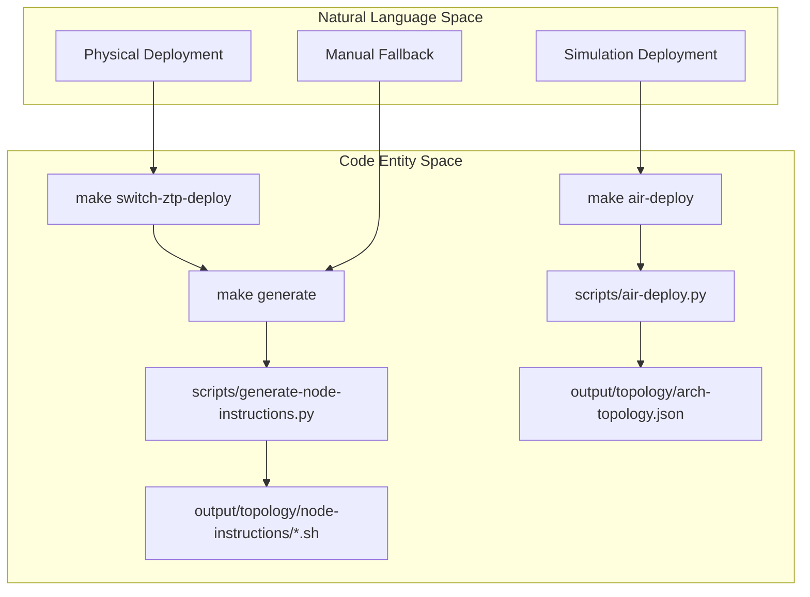
Sources: [net-configurator/README.md:90-95](), [net-configurator/scripts/generate-node-instructions.py:4-27](), [net-configurator/docs/MANUAL_FALLBACK_GUIDE.md:32-41]()

### Node Instruction Logic
This diagram shows how the code associates infrastructure roles with specific shell scripts used in both automated and manual Air deployments.

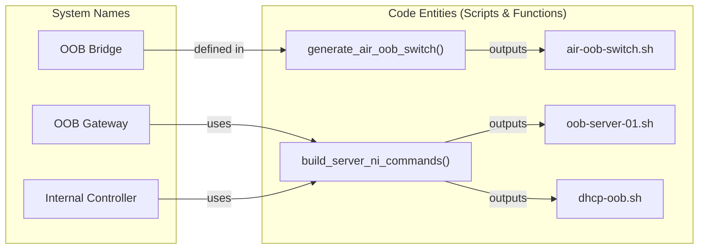
Sources: [net-configurator/scripts/generate-node-instructions.py:49-51](), [net-configurator/scripts/generate-node-instructions.py:106-113](), [net-configurator/docs/MANUAL_FALLBACK_GUIDE.md:97-101]()

---

# Page: NVIDIA Air Simulation Deployment

# NVIDIA Air Simulation Deployment

<details>
<summary>Relevant source files</summary>

The following files were used as context for generating this wiki page:

- [.github/workflows/monorepo-release.yml](.github/workflows/monorepo-release.yml)
- [net-configurator/.gitignore](net-configurator/.gitignore)
- [net-configurator/README.md](net-configurator/README.md)
- [net-configurator/docs/MANUAL_FALLBACK_GUIDE.md](net-configurator/docs/MANUAL_FALLBACK_GUIDE.md)
- [net-configurator/inventories/secrets.yml.example](net-configurator/inventories/secrets.yml.example)
- [net-configurator/scripts/generate-node-instructions.py](net-configurator/scripts/generate-node-instructions.py)

</details>


The NVIDIA Enterprise Reference Architecture (ERA) provides a high-fidelity simulation environment via NVIDIA Air, a cloud-hosted network simulator. This allows for the validation of complex L3 fabrics, Zero Touch Provisioning (ZTP), and server connectivity using virtual Cumulus Linux switches and Ubuntu server nodes before deploying to physical hardware [net-configurator/README.md:16-17]().

## Deployment Workflow Overview

The deployment process follows a structured pipeline: local configuration generation, simulation creation in Air, and node bootstrapping. The `net-configurator` tool supports two primary modes for Air:
1.  **Automated API Deployment**: Uses the `airlib` Python library to interact with the Air API for end-to-end automation [net-configurator/README.md:90-93]().
2.  **Manual Fallback (NOZTP)**: Used when the API is unavailable or restricted. This relies on generating "Node Instructions" (NI) that are manually pasted into the Air GUI [net-configurator/docs/MANUAL_FALLBACK_GUIDE.md:9-19]().

### Data Flow and Code Entities

The following diagram maps the relationship between the local environment, the Air API, and the simulated infrastructure.

**Air Deployment Data Flow**
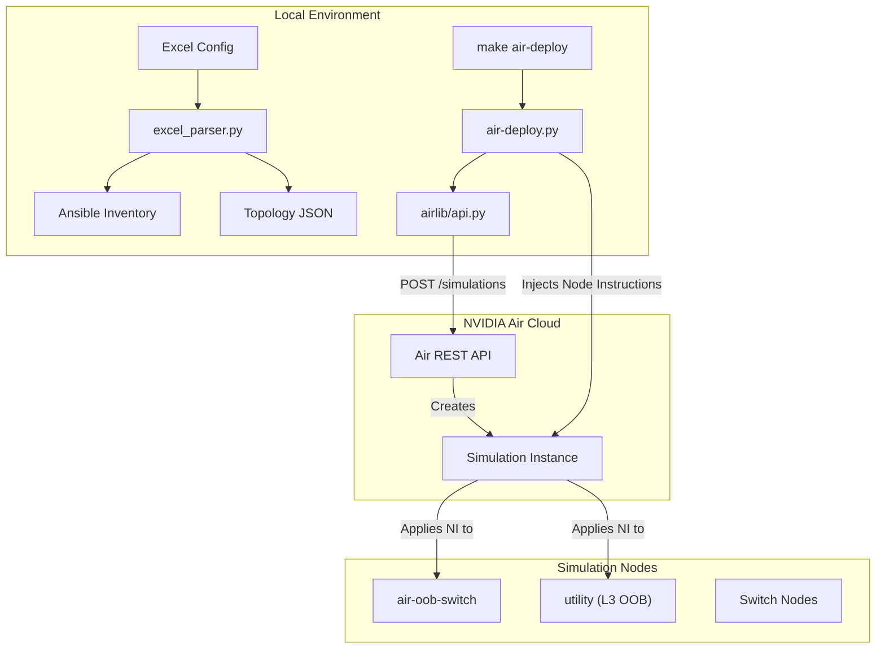
**Sources:** [net-configurator/README.md:90-95](), [net-configurator/scripts/generate-node-instructions.py:5-23](), [net-configurator/docs/MANUAL_FALLBACK_GUIDE.md:33-42]()

---

## Prerequisites and Credentials

### NGC Account and API Key
To use NVIDIA Air, an NVIDIA GPU Cloud (NGC) account is required [net-configurator/README.md:16]().
*   **API Key**: Generated in the NGC portal.
*   **SSH Key**: Must be registered in the Air profile to allow Ansible to communicate with the virtual nodes [net-configurator/docs/MANUAL_FALLBACK_GUIDE.md:66]().

### Shared Secrets Vault
Air credentials are stored in a shared Ansible Vault at `.era-secrets/air-secrets.yml`. This file is not committed to the repository [net-configurator/.gitignore:8]().

The `make air-setup` wizard facilitates the creation of this vault, prompting for:
*   NGC API Key
*   NVIDIA Air URL
*   Path to the local SSH private key

**Sources:** [net-configurator/inventories/secrets.yml.example:60-67](), [net-configurator/.gitignore:8]()

---

## Deployment Commands

The `Makefile` provides the primary interface for managing Air simulations.

| Target | Description |
| :--- | :--- |
| `make air-setup` | Runs the wizard to configure API credentials and SSH keys. |
| `make air-deploy` | Creates the simulation, injects Node Instructions, and starts all nodes. |
| `make deploy` | Executes the full pipeline: `generate` -> `air-deploy` -> `ztp-setup` -> `deploy-servers`. |
| `make deploy-switches-only` | Deploys the fabric without server nodes to save Air budget and speed up boot times [net-configurator/README.md:94](). |
| `make air-terminate` | Tears down the simulation in NVIDIA Air to release resources. |

**Sources:** [net-configurator/README.md:90-95](), [net-configurator/Makefile]() (implied by workflow description)

---

## The airlib Python Library

The `airlib/` directory contains the core logic for interacting with the simulation environment.

*   **`api.py`**: Handles REST API interactions, including simulation creation, node status polling, and topology uploads.
*   **`auth.py`**: Manages authentication tokens using the NGC API key.
*   **`budget.py`**: Checks available Air credits before launching large-scale simulations to prevent mid-deployment failures.
*   **`ssh.py`**: Manages SSH connection parameters and host key verification for the `utility` jump host and simulation nodes [net-configurator/scripts/generate-node-instructions.py:65-66]().

---

## NOZTP Node Instructions Mode

In environments where ZTP (Zero Touch Provisioning) via DHCP is not used, or for initial infrastructure bootstrapping, `net-configurator` uses **Node Instructions**. These are shell scripts executed by the Air hypervisor immediately upon node boot [net-configurator/scripts/generate-node-instructions.py:5-10]().

### Infrastructure Node Roles
Three critical nodes require specific instructions to enable the OOB management plane:

1.  **`air-oob-switch`**: Configured as a VLAN-aware bridge. It maps simulated ports to management subnets [net-configurator/scripts/generate-node-instructions.py:106-113]().
2.  **`oob-server-01` (or `utility`)**: Acts as the OOB gateway. The NI configures IP forwarding, static IP assignments, and NAT masquerade to provide internet access to the simulation [net-configurator/scripts/generate-node-instructions.py:14-15]().
3.  **`dhcp-oob` (or `external-dhcp`)**: The Ansible control node within the simulation. The NI installs `git`, `python3`, and `pip` so that ZTP services can be hosted internally [net-configurator/docs/MANUAL_FALLBACK_GUIDE.md:159-160]().

### Node Instruction Generation
The script `scripts/generate-node-instructions.py` extracts configuration from the generated inventory and writes bash scripts to `output/<arch>/<site>/topology/node-instructions/` [net-configurator/scripts/generate-node-instructions.py:8-10]().

**Node Instruction Logic**
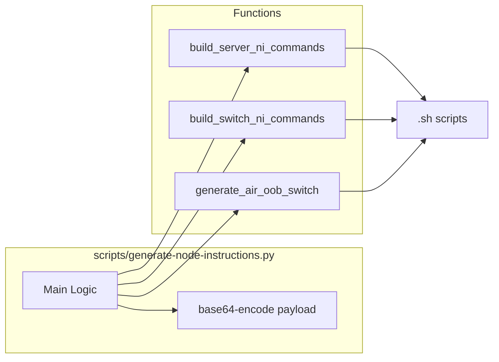
**Sources:** [net-configurator/scripts/generate-node-instructions.py:42-52](), [net-configurator/scripts/generate-node-instructions.py:54-68]()

### Implementation Detail: Base64 Encoding
To ensure shell scripts survive the Air API's parser without corruption from special characters or multi-line heredocs, the content is base64-encoded. The resulting NI is a single-line command:
`echo <b64_string> | base64 -d > <target_path>` [net-configurator/scripts/generate-node-instructions.py:54-68]().

**Sources:** [net-configurator/scripts/generate-node-instructions.py:1-68](), [net-configurator/docs/MANUAL_FALLBACK_GUIDE.md:95-103]()

---

# Page: Physical Hardware Deployment via ZTP

# Physical Hardware Deployment via ZTP

<details>
<summary>Relevant source files</summary>

The following files were used as context for generating this wiki page:

- [net-configurator/.gitignore](net-configurator/.gitignore)
- [net-configurator/README.md](net-configurator/README.md)
- [net-configurator/docs/MANUAL_FALLBACK_GUIDE.md](net-configurator/docs/MANUAL_FALLBACK_GUIDE.md)
- [net-configurator/inventories/secrets.yml.example](net-configurator/inventories/secrets.yml.example)
- [net-configurator/scripts/generate-node-instructions.py](net-configurator/scripts/generate-node-instructions.py)

</details>


This page covers the Zero Touch Provisioning (ZTP) workflow for physical NVIDIA Spectrum switches using the `net-configurator` toolset. It details the setup of the ZTP infrastructure, the different IP assignment modes, and the automation pipeline that bridges Excel-based design to live hardware.

## Overview of ZTP Workflow

Zero Touch Provisioning (ZTP) allows a switch running Cumulus Linux to boot, obtain an IP address via DHCP, fetch a provisioning script via HTTP, and apply a complete NVUE configuration without manual console intervention [net-configurator/README.md:15-15]().

The `net-configurator` framework automates this by:
1.  Generating NVUE configuration scripts from Excel inputs [net-configurator/README.md:6-7]().
2.  Setting up a ZTP server (DHCP + Nginx) to host these scripts [net-configurator/README.md:92-92]().
3.  Monitoring the provisioning status via a centralized status page [net-configurator/README.md:77-77]().

### Data Flow: From Excel to Switch
The following diagram illustrates how configuration data flows from the user's Excel sheet to the physical switch hardware.

**ZTP Configuration Data Flow**
```mermaid
graph TD
    subgraph "Local Management Host"
        A["Excel Template (input/*.xlsx)"] -- "make import" --> B["excel_parser.py"]
        B -- "Inventory Data" --> C["Ansible Inventory"]
        C -- "make generate" --> D["Jinja2 Templates"]
        D -- "NVUE Scripts" --> E["output/<arch>/<site>/configs/*.sh"]
    end

    subgraph "ZTP Server (external-dhcp)"
        E -- "make ztp-setup" --> F["Nginx (/var/www/html/ztp)"]
        G["dnsmasq.conf"] -- "DHCP Option 239" --> H["DHCP Offer"]
    end

    subgraph "Physical Switch"
        H -- "ZTP URL" --> I["ZTP Script Execution"]
        I -- "Fetch Script" --> F
        I -- "Apply Config" --> J["Running NVUE Config"]
    end

    Sources["Sources: net-configurator/README.md:6-24, net-configurator/docs/MANUAL_FALLBACK_GUIDE.md:81-94"]
```

## ZTP Server Infrastructure

The ZTP environment relies on two primary services, typically hosted on a node designated as `external-dhcp` (which supersedes the legacy `dhcp-oob` role) [net-configurator/README.md:20-20]().

### DHCP Configuration (dnsmasq)
The DHCP server must be configured to provide **DHCP Option 239**. This option contains the URL of the ZTP script that the switch should execute upon booting.

| Component | Role | Implementation |
| :--- | :--- | :--- |
| **DHCP Server** | IP Assignment & Option 239 | `dnsmasq` |
| **Web Server** | Script Hosting | `nginx` |
| **ZTP Script** | Execution Wrapper | `ztp_script.sh` |
| **Status Page** | Monitoring | `nginx` + `ztp-status.py` |

Sources: [net-configurator/README.md:15-23](), [net-configurator/inventories/secrets.yml.example:52-58]()

### IP Assignment Modes
`net-configurator` supports three modes for physical deployment:

1.  **DHCP Mode**: Switches receive dynamic IPs from a pool. MAC addresses are not strictly mapped to specific hostnames in the DHCP config.
2.  **Static IP Mode**: Switches are assigned specific IPs based on their MAC addresses defined in the Excel `Nodes` sheet.
3.  **Mixed Mode**: Infrastructure nodes (spines/leaves) use static IPs, while end-hosts or support nodes use dynamic DHCP.

## Deployment Workflow

The physical deployment is managed through a series of `make` targets that coordinate Ansible playbooks.

### 1. Server Setup (`make ztp-setup`)
This target prepares the ZTP server. It performs the following actions:
*   Installs and configures `dnsmasq` with the correct subnets and Option 239 [net-configurator/README.md:97-97]().
*   Installs `nginx` and populates the web root with the generated NVUE `.sh` scripts from `output/<arch>/<site>/configs/` [net-configurator/docs/MANUAL_FALLBACK_GUIDE.md:91-91]().
*   Sets up the ZTP Status Page if `status_page_enabled=Yes` is set in the Excel `Settings` tab [net-configurator/inventories/secrets.yml.example:54-57]().

### 2. Switch Provisioning (`make switch-ztp-deploy`)
This target initiates the monitoring and deployment phase for the switches.
*   **Workflow**: The switches boot -> Request DHCP -> Receive ZTP URL -> Download script -> Apply NVUE commands.
*   **Validation**: The tool uses `make validate-ztp` to check the `/var/log/ztp.log` or the status page to confirm each switch has successfully finished its configuration script.

### Code Entity Map: ZTP Automation
This diagram maps the high-level ZTP functions to the specific scripts and files in the repository.

**ZTP Code Entity Mapping**
```mermaid
graph LR
    subgraph "Automation Logic"
        M["Makefile"] -- "switch-ztp-deploy" --> P["playbooks/"]
        P -- "calls" --> R["roles/ztp_server/"]
    end

    subgraph "Configuration Entities"
        R -- "Configures" --> D["dnsmasq.conf"]
        R -- "Deploys" --> Z["ztp_script.sh"]
        Z -- "Sources" --> C["configs/*.sh"]
    end

    subgraph "Status Monitoring"
        S["scripts/ztp-status.py"] -- "Reads" --> L["/var/log/nginx/access.log"]
        L -- "Reports to" --> H["HTTP Dashboard"]
    end

    Sources["Sources: net-configurator/README.md:90-99, net-configurator/inventories/secrets.yml.example:52-58"]
```

## Security and Secrets

During ZTP, several passwords and keys are injected into the switches. These are managed via Ansible Vault in the `inventories/<arch>/group_vars/all/secrets.yml` file [net-configurator/inventories/secrets.yml.example:7-11]().

Key secrets involved in ZTP include:
*   **`switch_password`**: The password set for the `cumulus` user during provisioning [net-configurator/inventories/secrets.yml.example:38-38]().
*   **`switch_ansible_password`**: The password Ansible uses to verify the connection after ZTP is complete [net-configurator/inventories/secrets.yml.example:20-20]().
*   **`status_page_password`**: Credentials for accessing the ZTP monitoring dashboard [net-configurator/inventories/secrets.yml.example:57-57]().

Sources: [net-configurator/inventories/secrets.yml.example:1-67]()

## Manual Node Instructions (Air vs. Physical)

While physical ZTP relies on DHCP Option 239, the tool provides a `scripts/generate-node-instructions.py` utility. This script generates standalone bash wrappers for each node [scripts/generate-node-instructions.py:4-8](). 

In a physical environment, these can be used for:
*   **OOB Infrastructure Setup**: Manually bootstrapping the `oob-server-01` or `external-dhcp` nodes before the switch fabric is live [scripts/generate-node-instructions.py:12-15]().
*   **Debugging**: Reviewing the exact commands that ZTP will execute by inspecting the `node-instructions/` directory [scripts/generate-node-instructions.py:9-10]().

Sources: [scripts/generate-node-instructions.py:1-50](), [net-configurator/docs/MANUAL_FALLBACK_GUIDE.md:93-103]()

---

# Page: Manual Fallback Deployment Guide

# Manual Fallback Deployment Guide

<details>
<summary>Relevant source files</summary>

The following files were used as context for generating this wiki page:

- [net-configurator/docs/MANUAL_FALLBACK_GUIDE.md](net-configurator/docs/MANUAL_FALLBACK_GUIDE.md)
- [net-configurator/inventories/secrets.yml.example](net-configurator/inventories/secrets.yml.example)
- [net-configurator/scripts/generate-node-instructions.py](net-configurator/scripts/generate-node-instructions.py)

</details>


The Manual Fallback Deployment Guide provides a technical procedure for deploying the NVIDIA Enterprise Reference Architecture (ERA) within NVIDIA Air when the Air API is unavailable or restricted. This path bypasses the `airlib` API interaction layer in favor of manual topology uploads and Node Instruction injection via the NVIDIA Air web interface.

## 1. Overview and Rationale

The standard deployment workflow ([3.1. NVIDIA Air Simulation Deployment]()) relies on `air-deploy.py` to programmatically create simulations, upload topologies, and inject configuration scripts. The manual fallback is necessary when:
*   The Air API is experiencing outages or rate-limiting.
*   The user lacks an API key but has web GUI access.
*   The deployment environment restricts outbound API calls.

This workflow shifts the execution of Ansible from the local management machine to the `dhcp-oob` node within the simulation itself, eliminating SSH tunneling bottlenecks through `oob-server-01` [net-configurator/docs/MANUAL_FALLBACK_GUIDE.md:48-53]().

### Deployment Data Flow
The following diagram illustrates the transition from local generation to internal simulation execution.

**Manual Fallback Data Flow**
```mermaid
graph TD
    subgraph "Local Management Machine"
        A["Excel Template"] -- "make import" --> B["excel_parser.py"]
        B -- "make generate" --> C["topology_generator.py"]
        C --> D["topology.json"]
        C --> E["Node Instruction Scripts"]
        C --> F["Switch NVUE Configs"]
    end

    subgraph "NVIDIA Air GUI"
        D -- "Manual Upload" --> G["Simulation Instance"]
        E -- "Paste into Node Instructions" --> G
    end

    subgraph "Simulation (Internal)"
        G -- "Boot" --> H["dhcp-oob"]
        H -- "git clone / make ztp-setup" --> I["ZTP Services"]
        H -- "make deploy-servers" --> J["GPU/Compute Nodes"]
        I -- "DHCP/ZTP" --> K["Switches"]
    end

    style H stroke-width:4px
```
**Sources:** [net-configurator/docs/MANUAL_FALLBACK_GUIDE.md:32-42](), [net-configurator/scripts/generate-node-instructions.py:4-23]()

---

## 2. Node Instruction Generation

The fallback path relies on `generate-node-instructions.py` to create the bootstrap scripts that initialize the Out-of-Band (OOB) management network.

### 2.1 Implementation Details
The script `generate-node-instructions.py` imports logic directly from `air-deploy.py` to ensure parity between API-injected and manually-pasted instructions [net-configurator/scripts/generate-node-instructions.py:39-51](). It generates specific bash scripts for three critical infrastructure nodes:

| Node | Function | Key Script Logic |
| :--- | :--- | :--- |
| `air-oob-switch` | L2 Bridge | Configures a VLAN-aware bridge using NVUE commands to segment management traffic [net-configurator/scripts/generate-node-instructions.py:106-116](). |
| `oob-server-01` | OOB Gateway | Configures IP forwarding, static IP assignments, and NAT masquerade for internet access [net-configurator/scripts/generate-node-instructions.py:14-15](). |
| `dhcp-oob` | Ansible Controller | Configures static OOB IPs and installs `git`, `python3-pip`, and `python3-venv` [net-configurator/docs/MANUAL_FALLBACK_GUIDE.md:68-71](). |

### 2.2 Shell Command Encoding
To prevent Air's shell executor from mangling multi-line scripts or special characters, the `write_file_cmd` function base64-encodes the script content. The resulting Node Instruction is a single-line command that decodes and executes the payload on the target node [net-configurator/scripts/generate-node-instructions.py:54-68]().

**Node Instruction Logic Association**
```mermaid
classDiagram
    class "generate-node-instructions.py" {
        +generate_air_oob_switch(topology)
        +write_file_cmd(path, content)
    }
    class "air_deploy.py" {
        +build_server_ni_commands()
        +build_switch_ni_commands()
    }
    "generate-node-instructions.py" ..> "air_deploy.py" : imports NI builders
    "generate-node-instructions.py" --|> "air-oob-switch.sh" : emits
    "generate-node-instructions.py" --|> "oob-server-01.sh" : emits
    "generate-node-instructions.py" --|> "dhcp-oob.sh" : emits
```
**Sources:** [net-configurator/scripts/generate-node-instructions.py:49-51](), [net-configurator/scripts/generate-node-instructions.py:67-68]()

---

## 3. GUI Configuration and Boot Sequence

Once the topology JSON is uploaded to the Air GUI, the Node Instructions must be manually added to each infrastructure node **before** starting the simulation [net-configurator/docs/MANUAL_FALLBACK_GUIDE.md:119-130]().

### 3.1 Instruction Settings
For each script, the following parameters are mandatory in the Air UI:
*   **Type**: Must be set to `Shell` (not `Ansible` or `Cloud-init`).
*   **Wait for network**: Must be **unchecked**. This prevents the boot process from hanging while waiting for a DHCP lease that the script itself is responsible for configuring [net-configurator/docs/MANUAL_FALLBACK_GUIDE.md:127-146]().

### 3.2 Boot Execution Order
1.  **air-oob-switch**: Initializes the bridge domain `br_default` and maps physical `swp` ports to management VLANs [net-configurator/scripts/generate-node-instructions.py:158-172]().
2.  **oob-server-01**: Enables NAT, allowing internal nodes to reach the internet for package installation.
3.  **dhcp-oob**: Bootstraps the local environment needed to run the ERA Ansible playbooks.

**Sources:** [net-configurator/docs/MANUAL_FALLBACK_GUIDE.md:152-156](), [net-configurator/scripts/generate-node-instructions.py:158-172]()

---

## 4. Internal Simulation Deployment

After the infrastructure nodes are online, the remainder of the deployment is executed from the `dhcp-oob` console.

### 4.1 Environment Setup
The user must clone the repository and initialize the environment on `dhcp-oob`:
```bash
git clone https://github.com/NVIDIA/enterprise-ras.git
cd enterprise-ras/net-configurator
make venv-create
```

### 4.2 Secrets Management
Because the manual flow does not use the Air API, the `.era-secrets/air-secrets.yml` file is not required. However, the deployment secrets (switch and server passwords) must be present in `inventories/<arch>/group_vars/all/secrets.yml` [net-configurator/inventories/secrets.yml.example:7-11]().

### 4.3 Execution Sequence
The deployment is finalized by running the following targets from `dhcp-oob`:
1.  `make ztp-setup`: Configures `dnsmasq` and `nginx` on `dhcp-oob` to serve ZTP scripts and OS images to the switches [net-configurator/docs/MANUAL_FALLBACK_GUIDE.md:37-38]().
2.  `make deploy-servers`: Runs the server-side playbooks to configure NICs, hostnames, and LLDP [net-configurator/docs/MANUAL_FALLBACK_GUIDE.md:39-40]().

**Sources:** [net-configurator/docs/MANUAL_FALLBACK_GUIDE.md:180-210](), [net-configurator/inventories/secrets.yml.example:19-31]()

---

# Page: Out-of-Band (OOB) Management Network

# Out-of-Band (OOB) Management Network

<details>
<summary>Relevant source files</summary>

The following files were used as context for generating this wiki page:

- [net-configurator/.gitignore](net-configurator/.gitignore)
- [net-configurator/README.md](net-configurator/README.md)
- [net-configurator/docs/MANUAL_FALLBACK_GUIDE.md](net-configurator/docs/MANUAL_FALLBACK_GUIDE.md)
- [net-configurator/inventories/secrets.yml.example](net-configurator/inventories/secrets.yml.example)
- [net-configurator/scripts/generate-node-instructions.py](net-configurator/scripts/generate-node-instructions.py)

</details>


The Out-of-Band (OOB) management network is a dedicated management plane that provides a secure and isolated path for configuring and monitoring the network fabric, separate from the high-performance data plane [net-configurator/README.md:18-18](). This system ensures that management traffic does not compete with compute or storage traffic and remains accessible even during data plane congestion or failure.

The `net-configurator` tool automates the deployment of the OOB network for every supported ERA architecture, supporting both modern routed (L3) and legacy bridged (L2) topologies [net-configurator/README.md:18-18]().

## Management Plane Architecture

The OOB network facilitates critical infrastructure services including Zero Touch Provisioning (ZTP), DHCP, and centralized authentication. Depending on the deployment requirements, the OOB network operates in one of two primary modes, controlled by the `oob_uplink_mode` setting in the Excel configuration.

### L3 OOB Architecture (Default)
The L3 OOB design is the current standard for ERA deployments. It utilizes a routed approach with a dedicated `OOB` VRF and `EXIT` VRF to manage external connectivity and ZTP services.

*   **External Connectivity**: Managed by the `external-conn` NAT host (`172.20.0.1`), providing internet access and the eBGP control plane [net-configurator/README.md:21-21]().
*   **ZTP Services**: Handled by the `external-dhcp` node, which acts as the ZTP server and inter-VRF EXIT relay target [net-configurator/README.md:20-20]().
*   **Jump Host**: The `utility` node serves as the L3 jumpbox for Ansible and the OOB-side DHCP relay target [net-configurator/README.md:19-19]().
*   **Edge Routing**: `cust-net-edge-01` and `02` switches bridge the management network and run the EXIT-VRF eBGP underlay [net-configurator/README.md:22-22]().

For details, see [L3 OOB Architecture (Default)](#4.1).

### L2 OOB Architecture (Legacy)
The legacy L2 design uses a flat-bridge OOB subnet. While superseded by the L3 design, it is still supported for compatibility with older deployments and specific simulation scenarios.

*   **Gateway**: The `oob-server-01` node acts as the OOB gateway, providing IP forwarding and NAT [net-configurator/README.md:23-23]().
*   **ZTP/DHCP**: The `dhcp-oob` node manages DHCP and ZTP bootstrap scripts [net-configurator/README.md:23-23]().
*   **Bridging**: The `air-oob-switch` acts as a VLAN-aware bridge to connect infrastructure nodes [net-configurator/scripts/generate-node-instructions.py:106-113]().

For details, see [L2 OOB Architecture (Legacy)](#4.2).

## Infrastructure Node Roles

The following table summarizes the key nodes involved in the OOB management plane across both architectures:

| Role | L3 Entity (Modern) | L2 Entity (Legacy) | Primary Function |
| :--- | :--- | :--- | :--- |
| **Jump Host** | `utility` | `oob-server-01` | Ansible control point and SSH entry. |
| **ZTP/DHCP** | `external-dhcp` | `dhcp-oob` | Hosts bootstrap scripts and leases IPs. |
| **NAT/Edge** | `external-conn` | `oob-server-01` | Provides outbound internet and routing. |
| **Bridge** | N/A (Routed) | `air-oob-switch` | L2 connectivity for management ports. |

Sources: [net-configurator/README.md:18-23](), [net-configurator/scripts/generate-node-instructions.py:12-23]()

## Logic Flow: OOB Node Initialization

This diagram illustrates how the `net-configurator` pipeline prepares the specialized infrastructure nodes required for the OOB network, specifically focusing on the Node Instruction (NI) generation used in simulations and manual fallbacks.

**OOB Infrastructure Initialization Flow**
```mermaid
graph TD
    subgraph "Logic: scripts/generate-node-instructions.py"
        START["Start generate"] --> PARSE["Parse Topology & Inventory"]
        PARSE --> BR_GEN["generate_air_oob_switch()"]
        PARSE --> SRV_GEN["build_server_ni_commands()"]
        
        subgraph "Node Instruction Generation"
            BR_GEN --> |"NVUE Commands"| NI_BR["air-oob-switch.sh"]
            SRV_GEN --> |"Netplan + NAT"| NI_GW["oob-server-01.sh"]
            SRV_GEN --> |"Static IP + Tools"| NI_DHCP["dhcp-oob.sh"]
        end
    end

    subgraph "Deployment Target"
        NI_BR -.-> |"Paste to Air"| AIR_BR["air-oob-switch (Bridge)"]
        NI_GW -.-> |"Paste to Air"| AIR_GW["oob-server-01 (Gateway)"]
        NI_DHCP -.-> |"Paste to Air"| AIR_DHCP["dhcp-oob (Ansible Node)"]
    end

    AIR_DHCP --> |"Runs"| ZTP_SETUP["make ztp-setup"]
    ZTP_SETUP --> |"Configures"| SERVICES["DHCP / Nginx / ZTP"]
```
Sources: [net-configurator/scripts/generate-node-instructions.py:103-184](), [net-configurator/docs/MANUAL_FALLBACK_GUIDE.md:95-101]()

## LDAP Authentication
Centralized authentication is integrated into the OOB management plane. When enabled via the Excel `Settings` sheet (`ldap_enabled=Yes`), the automation configures switches and servers to authenticate against a central LDAP directory.

*   **Switch Auth**: Configured via NVUE to point to the LDAP servers defined in the inventory.
*   **Server Auth**: Configured via standard Linux PAM/LDAP modules.
*   **Secrets**: LDAP bind and admin passwords are managed via Ansible Vault in `secrets.yml` [net-configurator/inventories/secrets.yml.example:41-49]().

For details, see [LDAP Authentication](#4.3).

## Relationship to Deployment Workflows

The OOB network is the first component established during a deployment. In physical environments, this involves setting up the ZTP server (`external-dhcp` or `dhcp-oob`) to listen for switch DHCP requests [net-configurator/README.md:92-92](). In NVIDIA Air, the `air-deploy.py` script (or manual fallback) injects specific "Node Instructions" to bootstrap these management nodes before the main switch fabric is powered on [net-configurator/docs/MANUAL_FALLBACK_GUIDE.md:119-147]().

**OOB Connectivity and Provisioning**
```mermaid
graph LR
    subgraph "OOB Management Plane"
        JUMP["Jump Host (utility / oob-server-01)"]
        ZTP["ZTP Server (external-dhcp / dhcp-oob)"]
        EDGE["Edge/NAT (external-conn / oob-server-01)"]
    end

    subgraph "Switch Fabric"
        SW1["Switch 01"]
        SW2["Switch 02"]
        SWN["Switch N"]
    end

    JUMP --> |"Ansible / SSH"| SW1
    ZTP --> |"DHCP Option 239"| SW1
    SW1 --> |"Fetch Config"| ZTP
    EDGE --> |"NAT / Internet"| JUMP
    EDGE --> |"BGP Peer"| SW1
```
Sources: [net-configurator/README.md:18-23](), [net-configurator/docs/MANUAL_FALLBACK_GUIDE.md:32-42]()

---

# Page: L3 OOB Architecture (Default)

# L3 OOB Architecture (Default)

<details>
<summary>Relevant source files</summary>

The following files were used as context for generating this wiki page:

- [net-configurator/.gitignore](net-configurator/.gitignore)
- [net-configurator/README.md](net-configurator/README.md)
- [spectrum-era/2-8-5-200/roles/dhcp/tasks/main.yml](spectrum-era/2-8-5-200/roles/dhcp/tasks/main.yml)
- [spectrum-era/2-8-9-400/roles/dhcp/templates/hosts.j2](spectrum-era/2-8-9-400/roles/dhcp/templates/hosts.j2)

</details>


The Out-of-Band (OOB) management plane in the NVIDIA Enterprise Reference Architecture (ERA) defaults to a routed **L3 OOB** design. This architecture provides a dedicated, scalable management network that is logically and physically separated from the high-performance data fabric. Unlike legacy flat L2 networks, the L3 OOB design utilizes its own VRF, eBGP underlay, and NAT-enabled external connectivity to ensure robust management access and automated provisioning capabilities across large-scale clusters [net-configurator/README.md:18-18]().

## Architectural Components

The L3 OOB architecture is composed of several specialized node roles and simulated infrastructure components that facilitate management, Zero Touch Provisioning (ZTP), and external access.

| Component | Code Identifier | Role Description |
|---|---|---|
| **Jump Host** | `utility` | The central management node. Ansible connects through this host to reach the fabric. It also hosts the deployment status page and acts as the DHCP relay target for OOB segments [net-configurator/README.md:19-19](). |
| **ZTP Server** | `external-dhcp` | Runs the `isc-dhcp-server` and `apache2` web server. Switches fetch their initial bootstrap scripts (`ztp.sh`) from this node via DHCP Option 239 [net-configurator/README.md:20-20](). |
| **NAT Gateway** | `external-conn` | A host (typically `172.20.0.1`) providing outbound NAT for the OOB network and participating in the eBGP control plane for the OOB VRF [net-configurator/README.md:21-21](). |
| **Edge Switches** | `cust-net-edge-01/02` | Simulated customer edge switches that bridge the OOB management network and run the EXIT-VRF eBGP underlay. `-02` provides HA for the NAT return path [net-configurator/README.md:22-22](). |

**Sources:** [net-configurator/README.md:18-23]()

## Data Flow and Logical Connectivity

The architecture relies on an **EXIT VRF** and an **OOB VRF** to isolate management traffic from the GPU/Compute fabric. Inter-VRF DHCP relaying is a core feature, allowing clients in any VRF to lease IP addresses from servers located in the OOB or EXIT segments [net-configurator/README.md:97-97]().

### L3 OOB Logical Topology

This diagram illustrates the relationship between the management entities and the switch fabric in the L3 routed model.

```mermaid
graph TD
    subgraph "External/Customer Network"
        EXT_CONN["external-conn (NAT Host)"]
        EDGE1["cust-net-edge-01"]
        EDGE2["cust-net-edge-02"]
    end

    subgraph "OOB Management Plane"
        UTIL["utility (Jump Host / Status Page)"]
        DHCP["external-dhcp (ZTP/Web Server)"]
    end

    subgraph "Switch Fabric (OOB VRF)"
        SW_MGMT["Switch Management Interface"]
        SVI["OOB VRF SVI / VRR"]
    end

    EXT_CONN <-->|eBGP / NAT| EDGE1
    EDGE1 <--> EDGE2
    EDGE1 <-->|EXIT VRF| SW_MGMT
    DHCP <-->|ZTP / DHCP Option 239| SW_MGMT
    UTIL <-->|Ansible Control| SW_MGMT
    SW_MGMT <--> SVI
```

**Sources:** [net-configurator/README.md:18-23](), [net-configurator/README.md:97-97]()

## Implementation Details

### Zero Touch Provisioning (ZTP)
The `external-dhcp` node (or legacy `dhcp-oob`) automates switch deployment by serving a `ztp.sh` script. The DHCP configuration uses specific options to point switches to the provisioning URL.

*   **DHCP Option 239**: Used to provide the `cumulus-provision-url` [spectrum-era/2-8-5-200/roles/dhcp/tasks/main.yml:45-45]().
*   **Provisioning Flow**: The switch boots, receives an IP via DHCP, identifies the URL in option 239, downloads `ztp.sh` via HTTP from the `apache2` service, and executes the NVUE configuration [net-configurator/README.md:15-15](), [spectrum-era/2-8-5-200/roles/dhcp/tasks/main.yml:9-14]().

### Configuration Generation
The architecture is triggered by the `oob_uplink_mode=l3` setting in the Excel configuration. The `net-configurator` pipeline parses this to generate:
1.  **NVUE CLI Scripts**: Located in `output/<arch>/<site>/configs/`, these contain the `nv set` commands for VRFs, SVIs, and BGP peering.
2.  **Ansible Inventory**: Defines the `utility` host as the `ansible_ssh_common_args` proxy jump point for the fabric.

### DHCP Server Configuration (Code Entity Space)
The following diagram maps the DHCP server implementation to the configuration files and variables used in the legacy and L3 components.

```mermaid
classDiagram
    class DHCP_Role {
        +hosts_j2: "spectrum-era/2-8-9-400/roles/dhcp/templates/hosts.j2"
        +main_yml: "spectrum-era/2-8-5-200/roles/dhcp/tasks/main.yml"
        +ztp_sh: "/var/www/html/ztp.sh"
    }
    class DHCP_Config {
        +option_239: "cumulus-provision-url"
        +option_72: "www-server"
        +fixed_address: "devices[host].eth0_ip"
    }
    DHCP_Role --> DHCP_Config : generates
    DHCP_Config : "shared-network LOCAL-NET-200"
    DHCP_Config : "range 192.168.200.100 192.168.200.150"
```

**Sources:** [spectrum-era/2-8-5-200/roles/dhcp/tasks/main.yml:41-78](), [spectrum-era/2-8-9-400/roles/dhcp/templates/hosts.j2:8-10]()

## Key Files and Roles

| Path | Purpose |
|---|---|
| `net-configurator/README.md` | Defines the primary roles: `utility`, `external-dhcp`, `external-conn` [net-configurator/README.md:19-21](). |
| `spectrum-era/.../roles/dhcp/tasks/main.yml` | Installs `isc-dhcp-server` and `apache2`, and configures the ZTP environment [spectrum-era/2-8-5-200/roles/dhcp/tasks/main.yml:9-33](). |
| `spectrum-era/.../roles/dhcp/templates/hosts.j2` | Jinja2 template for mapping MAC addresses to fixed IP addresses for OOB management [spectrum-era/2-8-9-400/roles/dhcp/templates/hosts.j2:1-11](). |

**Sources:** [net-configurator/README.md:19-21](), [spectrum-era/2-8-5-200/roles/dhcp/tasks/main.yml:9-33](), [spectrum-era/2-8-9-400/roles/dhcp/templates/hosts.j2:1-11]()

---

# Page: L2 OOB Architecture (Legacy)

# L2 OOB Architecture (Legacy)

<details>
<summary>Relevant source files</summary>

The following files were used as context for generating this wiki page:

- [net-configurator/docs/MANUAL_FALLBACK_GUIDE.md](net-configurator/docs/MANUAL_FALLBACK_GUIDE.md)
- [net-configurator/inventories/secrets.yml.example](net-configurator/inventories/secrets.yml.example)
- [net-configurator/scripts/generate-node-instructions.py](net-configurator/scripts/generate-node-instructions.py)
- [spectrum-era/2-8-5-200/README.md](spectrum-era/2-8-5-200/README.md)
- [spectrum-era/2-8-9-400/README.md](spectrum-era/2-8-9-400/README.md)

</details>


This page documents the legacy Layer 2 (L2) flat-bridge Out-of-Band (OOB) management design. While the current NVIDIA Enterprise Reference Architecture (ERA) defaults to an L3 routed OOB design, the L2 architecture is maintained for historical reference and specific simulation scenarios within NVIDIA Air.

## Overview

The L2 OOB architecture relies on a centralized management bridge (`air-oob-switch`) and two primary infrastructure nodes (`oob-server-01` and `dhcp-oob`) to provide connectivity, DHCP, ZTP services, and external NAT access to the cluster. In this model, all management interfaces reside on the same broadcast domain or are separated by simple VLAN tagging at the bridge level.

### Key Components

| Component | Role | Implementation |
| :--- | :--- | :--- |
| `air-oob-switch` | L2 Bridge | A Cumulus Linux switch configured as a VLAN-aware bridge to interconnect all OOB ports. |
| `oob-server-01` | Gateway/NAT | An Ubuntu-based node providing IP forwarding and NAT masquerade for internet access. |
| `dhcp-oob` | Services | An Ubuntu-based node hosting DHCP (dnsmasq), ZTP (Nginx), and LDAP services. |

**Sources:** [net-configurator/scripts/generate-node-instructions.py:12-15](), [spectrum-era/2-8-9-400/README.md:21-23]()

---

## Infrastructure Node Implementation

The legacy architecture is primarily defined through manual configuration or "Node Instructions" (NI) injected during the simulation boot process.

### 1. air-oob-switch (VLAN-aware Bridge)
The `air-oob-switch` acts as the physical or virtual patch panel. It uses NVUE to define a `br_default` bridge. 

*   **Port Classification**:
    *   **Untagged (VLAN 1)**: Standard management interfaces (`eth0` on switches).
    *   **Tagged (VLAN 777+)**: Used for OOB switch uplinks and infrastructure node secondary interfaces to isolate management subnets.

**Logic Reference**: [net-configurator/scripts/generate-node-instructions.py:106-172]()

### 2. oob-server-01 (OOB Gateway)
This node provides the routing logic for the OOB network. It is configured with static IPs via Netplan and enables IPv4 forwarding to act as a gateway.

*   **Configuration**:
    *   Disables IPv6 to prevent neighbor discovery overhead [spectrum-era/2-8-9-400/README.md:67-70]().
    *   Enables `net.ipv4.ip_forward` in `sysctl.conf` [spectrum-era/2-8-9-400/README.md:71-74]().
    *   Configures multiple eth interfaces (eth1, eth2, eth3) with static IPs (e.g., `192.168.200.1/24`) to serve different OOB segments [spectrum-era/2-8-9-400/README.md:80-97]().

### 3. dhcp-oob (DHCP/ZTP Server)
The `dhcp-oob` server handles the lifecycle of switches and servers. In the legacy design, it is also the primary node for running Ansible playbooks when performing a manual deployment [net-configurator/docs/MANUAL_FALLBACK_GUIDE.md:29-31]().

*   **Services**:
    *   **LDAP**: Pre-configured with default users (e.g., `jdoe`) for switch authentication [spectrum-era/2-8-5-200/README.md:189-194]().
    *   **Static Networking**: Configured similarly to the OOB server but with high-range IPs (e.g., `192.168.200.252/24`) [spectrum-era/2-8-5-200/README.md:123-140]().

---

## Data Flow and Connectivity

The following diagram illustrates the relationship between the legacy infrastructure nodes and the code entities that configure them.

### L2 OOB Logic to Code Entity Map
Title: Legacy OOB Component Mapping
```mermaid
graph TD
    subgraph "NVIDIA Air GUI / Simulation"
        A["air-oob-switch"]
        B["oob-server-01"]
        C["dhcp-oob"]
    end

    subgraph "Code Generation (net-configurator)"
        D["generate-node-instructions.py"]
        E["air-deploy.py"]
        F["build_server_ni_commands()"]
        G["generate_air_oob_switch()"]
    end

    subgraph "Configuration Files"
        H["/etc/netplan/01-config.yaml"]
        I["/etc/sysctl.conf"]
        J["nvue.yaml"]
    end

    D -- "calls" --> G
    D -- "imports" --> E
    E -- "defines" --> F
    
    G -- "configures" --> A
    A -- "uses" --> J
    
    F -- "configures" --> B
    F -- "configures" --> C
    
    B -- "manages" --> H
    B -- "manages" --> I
    C -- "manages" --> H
```
**Sources:** [net-configurator/scripts/generate-node-instructions.py:44-51](), [net-configurator/scripts/generate-node-instructions.py:106-113](), [spectrum-era/2-8-9-400/README.md:80-85]()

---

## Deployment Workflow (Manual Fallback)

In the legacy L2 OOB setup, especially when the Air API is unavailable, a manual multi-phase workflow is required.

### Phase 1: Local Generation
The `make generate` command runs `excel_parser.py` and `topology_generator.py`. This produces the `node-instructions/` directory containing bash scripts for the infrastructure nodes.

**Sources:** [net-configurator/docs/MANUAL_FALLBACK_GUIDE.md:81-93]()

### Phase 2: GUI Injection
Before starting the simulation, the generated scripts must be pasted into the Air GUI for the following nodes:
1.  **air-oob-switch.sh**: Sets up the VLAN bridge.
2.  **oob-server-01.sh**: Configures NAT and IP forwarding.
3.  **dhcp-oob.sh**: Prepares the environment for Ansible.

**Sources:** [net-configurator/docs/MANUAL_FALLBACK_GUIDE.md:132-140]()

### Phase 3: Internal Execution
Once the simulation is running, the operator logs into `dhcp-oob` and executes the configuration playbooks locally to avoid the SSH bottleneck of the `oob-server-01` jump host.

Title: Manual Fallback Execution Flow
```mermaid
sequenceDiagram
    participant User as "Operator (Local)"
    participant Air as "NVIDIA Air GUI"
    participant OOB as "oob-server-01"
    participant DHCP as "dhcp-oob"
    participant SW as "Fabric Switches"

    User->>User: make generate
    User->>Air: Upload Topology JSON
    User->>Air: Paste Node Instructions (Shell Type)
    Air->>Air: Start Simulation
    Note over Air, DHCP: Node Instructions execute on boot
    User->>DHCP: SSH/Console Login
    DHCP->>DHCP: git clone enterprise-ras
    DHCP->>DHCP: ansible-playbook era-config.yml
    DHCP->>SW: ZTP / NVUE Config
```
**Sources:** [net-configurator/docs/MANUAL_FALLBACK_GUIDE.md:33-41](), [net-configurator/docs/MANUAL_FALLBACK_GUIDE.md:159-172]()

---

## Migration Path to L3 OOB

The legacy L2 OOB is considered deprecated in favor of the L3 Routed OOB architecture. Users migrating should note the following changes:

*   **Gateway Location**: In L3 OOB, the gateway functionality moves from a Linux server (`oob-server-01`) to a pair of `cust-net-edge` switches.
*   **Routing**: Flat L2 subnets are replaced by BGP/EVPN advertisements for management prefixes.
*   **Excel Configuration**: Change the `oob_uplink_mode` field in the **Settings** tab from `l2` to `l3`.
*   **Secrets**: The legacy `inventories/hosts` files are replaced by the dynamic inventory generated in `output/<arch>/<site>/inventory/`.

**Sources:** [net-configurator/inventories/secrets.yml.example:7-11](), [spectrum-era/2-8-5-200/README.md:9-11]()

---

# Page: LDAP Authentication

# LDAP Authentication

<details>
<summary>Relevant source files</summary>

The following files were used as context for generating this wiki page:

- [net-configurator/docs/ANSIBLE_SUDO_SETUP.md](net-configurator/docs/ANSIBLE_SUDO_SETUP.md)
- [spectrum-era/2-4-3-200/roles/ldap/tasks/main.yml](spectrum-era/2-4-3-200/roles/ldap/tasks/main.yml)
- [spectrum-era/2-8-5-200/roles/ldap/tasks/main.yml](spectrum-era/2-8-5-200/roles/ldap/tasks/main.yml)
- [spectrum-era/2-8-9-400/roles/ldap/tasks/main.yml](spectrum-era/2-8-9-400/roles/ldap/tasks/main.yml)

</details>


The NVIDIA Enterprise Reference Architecture (ERA) provides a centralized LDAP (Lightweight Directory Access Protocol) authentication framework to manage user access across the switch fabric and management servers. This system automates the deployment of OpenLDAP servers and the configuration of LDAP clients on networking devices and Linux hosts.

## Configuration Parameters

LDAP behavior is controlled via the `Settings` sheet in the ERA Excel template. The configuration generation pipeline parses these fields to populate the Ansible inventory.

### Excel Settings Fields
The following fields in the `Settings` sheet drive the LDAP integration:

| Field | Description |
| :--- | :--- |
| `ldap_enabled` | Boolean flag to enable/disable LDAP configuration across the fabric. |
| `ldap_domain` | The base domain for the LDAP directory (e.g., `nvidia.com`). |
| `ldap_servers` | A list or single IP/hostname of the LDAP server(s). |

**Sources:**
* `net-configurator` Excel structure (refer to section 2.1 for field mapping).

## LDAP Deployment Architecture

The ERA deployment includes an Ansible role specifically for provisioning an OpenLDAP server (`slapd`) on designated management nodes.

### LDAP Provisioning Flow
The deployment process follows a sequence of pre-seeding, installation, and directory structure initialization.

### Logic Flow: LDAP Server Setup
"This diagram illustrates the task execution sequence within the LDAP role."

```mermaid
graph TD
    subgraph "LDAP_Server_Role [spectrum-era/2-8-9-400/roles/ldap/tasks/main.yml]"
        A["apt: debconf-utils"] --> B["apt: purge slapd"]
        B --> C["shell: debconf-set-selections"]
        C --> D["apt: install slapd & ldap-utils"]
        D --> E["service: slapd started"]
        E --> F["command: slappasswd"]
        F --> G["command: ldapmodify (RootDN/RootPW)"]
        G --> H["shell: ldapadd (OU=Users/Groups)"]
        H --> I["template: users.j2"]
        I --> J["command: ldapadd (Populate Users)"]
    end
```
**Sources:**
* [spectrum-era/2-8-9-400/roles/ldap/tasks/main.yml:4-135]()
* [spectrum-era/2-8-5-200/roles/ldap/tasks/main.yml:4-135]()
* [spectrum-era/2-4-3-200/roles/ldap/tasks/main.yml:4-135]()

## Implementation Details

### Server-Side Provisioning
The `ldap` role ensures a clean state by purging existing `slapd` installations and clearing `debconf` entries before installation [spectrum-era/2-8-9-400/roles/ldap/tasks/main.yml:10-18](). 

Key implementation steps include:
1.  **Pre-seeding**: Uses `debconf-set-selections` to set the admin password and domain non-interactively [spectrum-era/2-8-9-400/roles/ldap/tasks/main.yml:20-28]().
2.  **Password Hashing**: Generates SSHA hashes for the `olcRootPW` using the `slappasswd` utility [spectrum-era/2-8-9-400/roles/ldap/tasks/main.yml:46-49]().
3.  **Schema Initialization**: Applies LDIF (LDAP Data Interchange Format) updates to configure the `olcDatabase` and creates Organizational Units (OUs) for `Users` and `Groups` [spectrum-era/2-8-9-400/roles/ldap/tasks/main.yml:55-93]().
4.  **User Population**: Iterates through the `ldap.users` list, hashes their passwords, and applies a `users.j2` template to generate the final LDIF for mass import [spectrum-era/2-8-9-400/roles/ldap/tasks/main.yml:111-135]().

### Security and Privilege Escalation
LDAP tasks require elevated privileges. The repository supports multiple `become` methods, though interactive password prompts are the default for safety.

### Code-to-System Mapping: Authentication Secrets
"Mapping of Ansible variables to system security entities."

```mermaid
graph LR
    subgraph "Ansible_Inventory [output/<arch>/<site>/inventory/]"
        V1["secrets.yml: ldap_admin_password"]
        V2["host_vars: ansible_become_pass"]
    end

    subgraph "LDAP_System [OpenLDAP]"
        E1["olcRootPW"]
        E2["userPassword"]
    end

    subgraph "Privilege_Escalation [sudo]"
        S1["NOPASSWD:ALL"]
        S2["become_ask_pass"]
    end

    V1 -- "slappasswd" --> E1
    V1 -- "users.j2" --> E2
    V2 -- "Option 4: Vault" --> S2
    S1 -- "Option 2: Passwordless" --> S2
```
**Sources:**
* [net-configurator/docs/ANSIBLE_SUDO_SETUP.md:121-130]()
* [spectrum-era/2-8-9-400/roles/ldap/tasks/main.yml:23-24]()
* [spectrum-era/2-8-9-400/roles/ldap/tasks/main.yml:47]()

## Troubleshooting

Common issues encountered during LDAP deployment and authentication:

| Error | Cause | Resolution |
| :--- | :--- | :--- |
| `sudo: a password is required` | Ansible `become` is active without a password provided. | Use `--ask-become-pass` or configure passwordless sudo in `/etc/sudoers` [net-configurator/docs/ANSIBLE_SUDO_SETUP.md:223-224](). |
| `Entry Already Exists` | The LDAP task is attempting to add an OU or user that is already present. | These errors are caught and ignored by the `ldap` role to ensure idempotency [spectrum-era/2-8-9-400/roles/ldap/tasks/main.yml:80-81](). |
| `SSH permission denied` | SSH keys are not correctly distributed to the target management server. | Use `ssh-copy-id` to transfer the automation public key [net-configurator/docs/ANSIBLE_SUDO_SETUP.md:226-227](). |

**Sources:**
* [net-configurator/docs/ANSIBLE_SUDO_SETUP.md:221-250]()
* [spectrum-era/2-8-9-400/roles/ldap/tasks/main.yml:80-93]()

---

# Page: Secrets Management and Security

# Secrets Management and Security

<details>
<summary>Relevant source files</summary>

The following files were used as context for generating this wiki page:

- [net-configurator/docs/ANSIBLE_SUDO_SETUP.md](net-configurator/docs/ANSIBLE_SUDO_SETUP.md)
- [net-configurator/docs/MANUAL_FALLBACK_GUIDE.md](net-configurator/docs/MANUAL_FALLBACK_GUIDE.md)
- [net-configurator/inventories/secrets.yml.example](net-configurator/inventories/secrets.yml.example)
- [net-configurator/scripts/generate-node-instructions.py](net-configurator/scripts/generate-node-instructions.py)

</details>


This section provides an overview of how the NVIDIA Enterprise Reference Architecture (ERA) repository manages sensitive information, including API keys, SSH credentials, and system passwords. The framework utilizes a **two-vault model** to balance global convenience for simulation environments with granular security for site-specific physical deployments.

### Two-Vault Model Overview

The repository distinguishes between "Shared Air Secrets" (used for NVIDIA Air simulation infrastructure) and "Per-Deployment Secrets" (used for specific hardware sites or architectures).

1.  **Shared Air Vault**: A single encrypted file located at `.era-secrets/air-secrets.yml`. It contains global credentials such as the NGC API key and the simulation SSH key. This allows a single user to manage multiple architectures without re-entering API credentials [net-configurator/inventories/secrets.yml.example:60-67]().
2.  **Per-Deployment Secrets**: A site-specific `secrets.yml` file located within the generated inventory directory (`output/<arch>/<site>/inventory/group_vars/all/secrets.yml`). This file stores passwords for switches, servers, LDAP, and ZTP status pages [net-configurator/inventories/secrets.yml.example:7-12]().

#### Credential Space Mapping
The following diagram maps the logical secret categories to their corresponding file entities in the codebase.

**Secret Entity Relationship**
```mermaid
graph TD
    subgraph "Global Secrets (Shared)"
        A[".era-secrets/air-secrets.yml"] -->|Contains| A1["ngc_api_key"]
        A -->|Contains| A2["air_ssh_key"]
    end

    subgraph "Deployment Secrets (Per-Site)"
        B["output/<arch>/<site>/inventory/group_vars/all/secrets.yml"] -->|Contains| B1["switch_ansible_password"]
        B -->|Contains| B2["server_ansible_password"]
        B -->|Contains| B3["ldap_admin_password"]
        B -->|Contains| B4["ansible_become_password"]
    end

    C["make air-setup"] -->|Initializes| A
    D["make generate"] -->|Scaffolds| B
```
**Sources:** [net-configurator/inventories/secrets.yml.example:7-67]()

---

### Shared Air Vault and Per-Deployment Secrets
The shared vault is managed via the `make air-setup` wizard, which uses `ansible-vault` to encrypt sensitive strings. Per-deployment secrets are scaffolded from a template (`secrets.yml.example`) during the generation phase.

Key security features include:
*   **Ansible Vault Integration**: Both secret stores are designed to be encrypted using `ansible-vault` to prevent accidental commits of plaintext passwords [net-configurator/inventories/secrets.yml.example:10-11]().
*   **LDAP Security**: Centralized authentication secrets for switches and servers are isolated in the per-deployment vault [net-configurator/inventories/secrets.yml.example:41-49]().

For details, see **[Shared Air Vault and Per-Deployment Secrets](#5.1)**.

**Sources:** [net-configurator/inventories/secrets.yml.example:1-67]()

---

### Ansible Sudo and SSH Configuration
Deploying ERA requires privilege escalation (`become: true`) on target nodes. The repository supports multiple workflows ranging from interactive password prompts to passwordless sudo for lab environments.

#### Privilege Escalation Logic
The deployment scripts and Makefiles are configured to handle `sudo` requirements across different environments (Air vs. Physical).

**Privilege Escalation Workflow**
```mermaid
graph TD
    Start["ansible-playbook call"] --> CheckVault{"ansible_become_password in secrets.yml?"}
    CheckVault -- "Yes" --> Exec["Execute with Vault Password"]
    CheckVault -- "No" --> CheckFlag{"--ask-become-pass used?"}
    CheckFlag -- "Yes" --> Prompt["Interactive Password Prompt"]
    CheckFlag -- "No" --> Sudoers{"Check /etc/sudoers NOPASSWD"}
    Sudoers -- "Success" --> Exec
    Sudoers -- "Fail" --> Error["sudo: a password is required"]
```
**Sources:** [net-configurator/docs/ANSIBLE_SUDO_SETUP.md:8-32](), [net-configurator/docs/ANSIBLE_SUDO_SETUP.md:121-129]()

Key configuration areas:
*   **Interactive Prompts**: The default Makefile targets include `--ask-become-pass` for immediate out-of-the-box use [net-configurator/docs/ANSIBLE_SUDO_SETUP.md:19-26]().
*   **SSH Host Key Checking**: Managed via `ansible.cfg` to handle the dynamic nature of NVIDIA Air simulation instances [net-configurator/docs/ANSIBLE_SUDO_SETUP.md:102-102]().
*   **Manual Fallback Security**: When deploying without the Air API, Node Instructions are injected as base64-encoded shell commands to prevent shell metacharacter injection [net-configurator/scripts/generate-node-instructions.py:54-68]().

For details, see **[Ansible Sudo and SSH Configuration](#5.2)**.

**Sources:** [net-configurator/docs/ANSIBLE_SUDO_SETUP.md:1-218](), [net-configurator/scripts/generate-node-instructions.py:54-68]()

---

# Page: Shared Air Vault and Per-Deployment Secrets

# Shared Air Vault and Per-Deployment Secrets

<details>
<summary>Relevant source files</summary>

The following files were used as context for generating this wiki page:

- [net-configurator/docs/ANSIBLE_SUDO_SETUP.md](net-configurator/docs/ANSIBLE_SUDO_SETUP.md)
- [net-configurator/docs/MANUAL_FALLBACK_GUIDE.md](net-configurator/docs/MANUAL_FALLBACK_GUIDE.md)
- [net-configurator/inventories/secrets.yml.example](net-configurator/inventories/secrets.yml.example)
- [net-configurator/scripts/generate-node-instructions.py](net-configurator/scripts/generate-node-instructions.py)

</details>


This page documents the dual-vault security model used in the NVIDIA Enterprise Reference Architecture (ERA) repository. To balance multi-deployment efficiency with per-site security, secrets are partitioned into a **Shared Air Vault** for global simulation credentials and **Per-Deployment Secrets** for site-specific infrastructure passwords.

### 1. The Two-Vault Architecture

The ERA framework utilizes two distinct secret stores to manage credentials. This separation allows a single developer to manage multiple architectures and sites using one set of NVIDIA Air credentials while maintaining unique passwords for different physical or virtual environments.

| Vault Type | Path | Scope | Purpose |
| :--- | :--- | :--- | :--- |
| **Shared Air Vault** | `.era-secrets/air-secrets.yml` | Global (All Arch/Sites) | NVIDIA Air API keys, SSH keys, and Air URL. |
| **Per-Deployment Secrets** | `output/<arch>/<site>/inventory/group_vars/all/secrets.yml` | Local (Specific Site) | Switch/Server OS passwords, LDAP bind credentials, and ZTP status page logins. |

#### Data Flow and Precedence
When running deployment playbooks or the `air-deploy.py` script, Ansible and Python merge these two sources. If a variable exists in both, the per-deployment `secrets.yml` takes precedence, though the schema is designed to prevent overlap.

Sources: [net-configurator/inventories/secrets.yml.example:60-67](), [net-configurator/docs/ANSIBLE_SUDO_SETUP.md:117-130]()

---

### 2. Shared Air Vault (`.era-secrets`)

The Shared Air Vault is designed to persist across multiple deployments on a single management workstation. It is typically created once during the initial setup of the repository.

#### Implementation: `make air-setup`
The `air-setup` wizard (triggered via the `Makefile`) guides the user through entering their NGC API Key and selecting an SSH key. It then uses `ansible-vault` to encrypt the resulting YAML file.

```mermaid
graph TD
    A["User: make air-setup"] --> B["scripts/air-setup.py"]
    B --> C{"File exists?"}
    C -- "No" --> D["Prompt for NGC API Key"]
    D --> E["Prompt for SSH Key Path"]
    E --> F["Prompt for Air URL"]
    F --> G["Write .era-secrets/air-secrets.yml"]
    G --> H["ansible-vault encrypt"]
    C -- "Yes" --> I["Prompt to overwrite"]
```

#### Key Variables in `air-secrets.yml`
*   `air_api_key`: The NGC-generated API key for authentication with the Air API.
*   `air_ssh_key_path`: The local path to the private key registered in the Air GUI.
*   `air_url`: The base URL for the Air environment (e.g., `https://air-ngc.nvidia.com`).

Sources: [net-configurator/inventories/secrets.yml.example:62-67]()

---

### 3. Per-Deployment Secrets

Each generated architecture and site has its own `inventory/group_vars/all/secrets.yml`. This file contains the "runtime" credentials for the network and compute nodes.

#### Implementation: `secrets.yml`
The repository provides a template at `net-configurator/inventories/secrets.yml.example` [net-configurator/inventories/secrets.yml.example:1-12](). During the `make import` or `make generate` process, users are expected to copy this template to their specific output directory.

#### Credential Categories
1.  **Ansible Connection Passwords**:
    *   `switch_ansible_password`: Used for SSH into Cumulus Linux switches [net-configurator/inventories/secrets.yml.example:19-20]().
    *   `server_ansible_password`: Used for SSH into Ubuntu servers [net-configurator/inventories/secrets.yml.example:22-23]().
2.  **Privilege Escalation**:
    *   `ansible_become_password`: The sudo password for remote hosts. If defined, Ansible will not prompt for `--ask-become-pass` [net-configurator/inventories/secrets.yml.example:31]().
3.  **LDAP Credentials**:
    *   `ldap_admin_password`: Bind password for the LDAP directory [net-configurator/inventories/secrets.yml.example:45-46]().
    *   `ldap_user_default_password`: Default password for users created via the LDAP role [net-configurator/inventories/secrets.yml.example:48-49]().

Sources: [net-configurator/inventories/secrets.yml.example:14-58](), [net-configurator/docs/ANSIBLE_SUDO_SETUP.md:127-130]()

---

### 4. Code Entity Space: Secret Injection and Usage

The following diagram maps how these secrets are consumed by the deployment scripts and Ansible playbooks.

```mermaid
graph LR
    subgraph "Local Filesystem"
        SVAULT[".era-secrets/air-secrets.yml"]
        LSECRETS["output/.../inventory/group_vars/all/secrets.yml"]
    end

    subgraph "Code Entities"
        ADEP["air-deploy.py"]
        GEN_NI["generate-node-instructions.py"]
        A_RUN["ansible-playbook"]
    end

    SVAULT -- "Decrypted via vault-pass" --> ADEP
    LSECRETS -- "Inventory Vars" --> A_RUN
    LSECRETS -- "Build Commands" --> GEN_NI

    ADEP -- "build_server_ni_commands" --> NODE_INST["Node Instructions (Air)"]
    GEN_NI -- "write_file_cmd" --> NI_SCRIPTS["node-instructions/*.sh"]
    
    A_RUN -- "ansible_become_pass" --> SUDO["Privilege Escalation"]
```

#### Node Instruction Generation
The `generate-node-instructions.py` script imports logic from `air-deploy.py` to create bash scripts that embed these secrets for initial bootstrapping. It uses the `write_file_cmd` function to base64-encode secret payloads, ensuring they survive the Air shell executor's parser [net-configurator/scripts/generate-node-instructions.py:44-50](), [net-configurator/scripts/generate-node-instructions.py:54-68]().

Sources: [net-configurator/scripts/generate-node-instructions.py:5-23](), [net-configurator/scripts/generate-node-instructions.py:54-68](), [net-configurator/docs/MANUAL_FALLBACK_GUIDE.md:95-103]()

---

### 5. Ansible Sudo Operations

Privilege escalation (`become: true`) is required for most ZTP and server configuration tasks. The repository supports five escalation methods, ranging from interactive prompts to encrypted vault files.

#### Privilege Escalation Methods

| Method | Implementation | Configuration |
| :--- | :--- | :--- |
| **Interactive** | `--ask-become-pass` | Default in Makefile targets [net-configurator/docs/ANSIBLE_SUDO_SETUP.md:21-26](). |
| **Passwordless** | `NOPASSWD:ALL` | Configured via `visudo` on target nodes [net-configurator/docs/ANSIBLE_SUDO_SETUP.md:53-56](). |
| **Ansible Vault** | `ansible_become_pass` | Stored in `group_vars/all/vault.yml` [net-configurator/docs/ANSIBLE_SUDO_SETUP.md:127-130](). |
| **ansible.cfg** | `become_ask_pass = True` | Global project configuration [net-configurator/docs/ANSIBLE_SUDO_SETUP.md:98-108](). |

#### Best Practices
*   **Lab/Dev**: Use **Passwordless Sudo** to minimize friction during iterative deployments [net-configurator/docs/ANSIBLE_SUDO_SETUP.md:201-205]().
*   **Production**: Use **SSH Keys + Passwordless Sudo** for the most secure and auditable path [net-configurator/docs/ANSIBLE_SUDO_SETUP.md:208-211]().

Sources: [net-configurator/docs/ANSIBLE_SUDO_SETUP.md:17-36](), [net-configurator/docs/ANSIBLE_SUDO_SETUP.md:199-215]()

---

# Page: Ansible Sudo and SSH Configuration

# Ansible Sudo and SSH Configuration

<details>
<summary>Relevant source files</summary>

The following files were used as context for generating this wiki page:

- [net-configurator/.gitignore](net-configurator/.gitignore)
- [net-configurator/README.md](net-configurator/README.md)
- [net-configurator/docs/ANSIBLE_SUDO_SETUP.md](net-configurator/docs/ANSIBLE_SUDO_SETUP.md)

</details>


This page details the configuration and management of Ansible privilege escalation and SSH connectivity within the NVIDIA Enterprise Reference Architecture (ERA) framework. Proper configuration is required to ensure the `net-configurator` tool can securely and efficiently manage switches and OOB management servers (such as the `utility` jump host and `external-dhcp` ZTP server).

## Privilege Escalation (Become/Sudo)

The ERA deployment playbooks frequently require root privileges to modify system configurations (e.g., installing `dnsmasq`, configuring `nginx`, or updating network interfaces). Ansible uses the `become` system to escalate privileges.

### Privilege Escalation Methods

The framework supports several methods for handling sudo passwords, ranging from interactive prompts to secure vault-based storage.

| Method | Implementation | Use Case |
| :--- | :--- | :--- |
| **Interactive Prompt** | Use `--ask-become-pass` in CLI or Makefile. | Quick fixes and one-off deployments. |
| **Passwordless Sudo** | Configure `NOPASSWD:ALL` in `/etc/sudoers`. | Recommended for Lab/Development environments. |
| **Ansible Vault** | Encrypt `ansible_become_pass` in `vault.yml`. | Secure shared production environments. |
| **SSH Key + No-Pass** | Combine key-based auth with passwordless sudo. | Production best practice for automation. |

### Data Flow: Privilege Escalation Logic

The following diagram illustrates how Ansible evaluates privilege escalation credentials during a deployment task.

**Diagram: Ansible Become Credential Resolution**
```mermaid
graph TD
    subgraph "Execution_Context"
        [Makefile_Target] -- "invokes" --> [Ansible_Playbook]
    end

    subgraph "Credential_Source"
        [CLI_Flag] -- "--ask-become-pass" --> [Interactive_Prompt]
        [Inventory_Vars] -- "ansible_become_pass" --> [Vault_Encrypted_Variable]
        [Host_OS_Config] -- "visudo" --> [Passwordless_Sudo]
    end

    [Ansible_Playbook] -- "requires become: true" --> [Privilege_Escalation_Engine]
    [Interactive_Prompt] -.-> [Privilege_Escalation_Engine]
    [Vault_Encrypted_Variable] -.-> [Privilege_Escalation_Engine]
    [Passwordless_Sudo] -.-> [Privilege_Escalation_Engine]

    [Privilege_Escalation_Engine] -- "executes" --> [Root_Command_on_Target]
```
Sources: `[net-configurator/docs/ANSIBLE_SUDO_SETUP.md:9-115]()`

## Configuration Implementation

### Makefile Defaults
By default, the `net-configurator` Makefile is configured with **Option 1 (Interactive Password Prompt)** for safety. Targets such as `ztp-setup` and `deploy-servers` are configured to prompt the user for the sudo password of the target machine.

*   **ZTP Setup**: `make ztp-setup` prompts for the password to configure the DHCP/Web server `[net-configurator/docs/ANSIBLE_SUDO_SETUP.md:21-36]()`.
*   **Server Deployment**: `make deploy-servers` prompts for the password to configure server-side networking and packages `[net-configurator/docs/ANSIBLE_SUDO_SETUP.md:192-197]()`.

### Ansible Configuration (ansible.cfg)
For a more permanent setup, an `ansible.cfg` file can be placed in the project root to centralize these settings.

```ini
[defaults]
ask_become_pass = True
host_key_checking = False

[privilege_escalation]
become = True
become_method = sudo
become_ask_pass = True
```
Sources: `[net-configurator/docs/ANSIBLE_SUDO_SETUP.md:85-108]()`

## SSH Host-Key Checking

SSH host-key checking behavior differs between the NVIDIA Air simulation environment and physical production hardware.

### NVIDIA Air Environments
In NVIDIA Air, nodes are ephemeral and frequently recreated. To facilitate automation, host-key checking is typically disabled or bypassed by the `airlib` Python library during the `make air-setup` phase. This allows the `utility` node and switches to be accessed via SSH without manual confirmation of fingerprints `[net-configurator/README.md:93-94]()`.

### Production Environments
For physical hardware, it is recommended to maintain `host_key_checking = True` (the Ansible default) or to pre-populate the `known_hosts` file.
*   **SSH Key Auth**: Users should use `ssh-copy-id` to push public keys to the `utility` and `external-dhcp` nodes `[net-configurator/docs/ANSIBLE_SUDO_SETUP.md:160-167]()`.
*   **Inventory Configuration**: Specific SSH keys per host can be defined in `host_vars` `[net-configurator/docs/ANSIBLE_SUDO_SETUP.md:172-178]()`.

## Secure Secrets Management

For production deployments, passwords should never be stored in plaintext. The ERA framework utilizes a two-vault model:

1.  **Air Secrets**: Located in `.era-secrets/air-secrets.yml`, storing NGC API keys and simulation-specific SSH keys `[net-configurator/.gitignore:8-9]()`.
2.  **Inventory Secrets**: Located in `output/<arch>/<site>/inventory/group_vars/all/secrets.yml`, storing switch passwords and LDAP credentials `[net-configurator/README.md:96-98]()`.

### Implementation: Using Vault for Sudo
To use Ansible Vault for sudo passwords, the variable `ansible_become_pass` must be defined within an encrypted file.

**Diagram: Secure Sudo Data Flow**
```mermaid
graph LR
    subgraph "Encrypted_Storage"
        [vault.yml] -- "contains" --> [ansible_become_pass]
    end

    subgraph "Execution"
        [ansible-playbook] -- "--vault-password-file" --> [Password_File]
        [Password_File] -- "unlocks" --> [vault.yml]
        [ansible_become_pass] -- "provides password to" --> [sudo_command]
    end
```
Sources: `[net-configurator/docs/ANSIBLE_SUDO_SETUP.md:117-154]()`

## Troubleshooting Common Issues

| Error Message | Cause | Resolution |
| :--- | :--- | :--- |
| `sudo: a password is required` | Ansible attempted `become: true` without a password. | Use `--ask-become-pass` or configure passwordless sudo `[net-configurator/docs/ANSIBLE_SUDO_SETUP.md:223-224]()`. |
| `SSH permission denied` | SSH key not authorized or incorrect user. | Run `ssh-copy-id` or check `ansible_user` in inventory `[net-configurator/docs/ANSIBLE_SUDO_SETUP.md:226-227]()`. |
| `user is not in the sudoers file` | The deployment user lacks sudo permissions. | Add user to the `sudo` or `admin` group on the target `[net-configurator/docs/ANSIBLE_SUDO_SETUP.md:229-233]()`. |

Sources: `[net-configurator/docs/ANSIBLE_SUDO_SETUP.md:221-251]()`

---

# Page: Validation Framework

# Validation Framework

<details>
<summary>Relevant source files</summary>

The following files were used as context for generating this wiki page:

- [net-configurator/.gitignore](net-configurator/.gitignore)
- [net-configurator/README.md](net-configurator/README.md)

</details>


The **Validation Framework** in the `net-configurator` tool provides a multi-phase suite designed to ensure the integrity of the Enterprise Reference Architecture (ERA) deployment from initial Excel input through to the final switch state. The framework is primarily orchestrated via the `make validate-all` target, which chains together static analysis, topology verification, and live network health checks.

### Validation Workflow Overview

The framework operates in three distinct layers:
1.  **Static Input Validation**: Verifies the Excel workbook for architectural compliance and logical consistency before any configuration is generated.
2.  **Structural Validation**: Compares the generated network topology (JSON) against the user-defined Wire Map to ensure the cabling matches the intended design.
3.  **Live State Validation**: Connects to the deployed switches (physical or in NVIDIA Air) to verify BGP peering, EVPN status, and end-to-end connectivity.

The relationship between these validation components and the code entities is illustrated below:

**Validation System Mapping**
```mermaid
graph TD
    subgraph "Natural Language Space"
        A["Excel Validation"]
        B["Topology Validation"]
        C["Switch Health"]
        D["Test Suite"]
    end

    subgraph "Code Entity Space"
        A --> E["validate_excel.py"]
        B --> F["topology_generator.py"]
        C --> G["validate_switch_health.yml"]
        D --> H["pytest (net-configurator/tests)"]
    end

    E --> I["make validate-excel"]
    F --> J["make validate-topology"]
    G --> K["make validate-switch-health"]
    H --> L["make test"]
```
Sources: [net-configurator/README.md:88-99](), [net-configurator/.gitignore:45-48]()

---

### 6.1 Excel and Topology Validation
This phase focuses on the "pre-flight" checks. The `make validate-excel` target invokes `validate_excel.py` to enforce canonical role names (e.g., `gpu`, `core`, `csl`) and check for missing mandatory fields or IP address overlaps. Following generation, `make validate-topology` ensures that the `topology.json` (used by NVIDIA Air) accurately reflects the cabling defined in the Excel "Wire Map" sheet.

For details, see [Excel and Topology Validation](#6.1).

**Static Validation Logic**
```mermaid
graph LR
    subgraph "Input Processing"
        EXCEL["Excel Workbook"] -- "Parsed by" --> EP["excel_parser.py"]
    end

    subgraph "Validation Logic"
        EP -- "Data Dict" --> VE["validate_excel.py"]
        VE -- "Role Check" --> R["Canonical Role Enforcement"]
        VE -- "Arch Check" --> S["Strict vs Warn Mode"]
    end

    subgraph "Topology Verification"
        TG["topology_generator.py"] -- "Generates" --> TJ["topology.json"]
        TJ -- "Verified against" --> WM["Wire Map Sheet"]
    end
```
Sources: [net-configurator/README.md:32-39](), [net-configurator/README.md:43-55]()

---

### 6.2 Switch Health and Network Validation
Once the fabric is deployed, the framework transitions to operational validation. This includes:
*   **`make validate-config`**: Performs an `nv config diff` to ensure the running switch configuration matches the intended state.
*   **`make validate-switch-health`**: An Ansible-driven check that verifies BGP neighbors are "Established" and EVPN VNI/ES states are up.
*   **`make validate-ping-matrix`**: Executes cross-VRF connectivity tests to ensure the data plane is routing traffic correctly between compute, storage, and management planes.

For details, see [Switch Health and Network Validation](#6.2).

---

### 6.3 Test Suite
The repository includes a comprehensive `pytest`-based test suite located in `net-configurator/tests/`. This suite provides unit testing for the core Python logic and integration testing for the Jinja2 templates. Developers can run `make test` to execute the full suite or `make test-coverage` to generate a report on code path exercise.

For details, see [Test Suite](#6.3).

| Validation Target | Command | Purpose |
| :--- | :--- | :--- |
| **Excel** | `make validate-excel` | Checks roles, IPs, and architectural constraints in the spreadsheet. |
| **Topology** | `make validate-topology` | Verifies the Air topology JSON against the Excel Wire Map. |
| **Configuration** | `make validate-config` | Compares running switch state to generated NVUE scripts. |
| **Health** | `make validate-switch-health` | Checks BGP, EVPN, and interface status across the fabric. |
| **Connectivity** | `make validate-ping-matrix` | Validates L3 reachability across different VRFs and VLANs. |
| **Unit/Integration** | `make test` | Runs the Python and Jinja2 test suite using `pytest`. |

Sources: [net-configurator/README.md:90-98](), [net-configurator/.gitignore:45-48]()

---

# Page: Excel and Topology Validation

# Excel and Topology Validation

<details>
<summary>Relevant source files</summary>

The following files were used as context for generating this wiki page:

- [net-configurator/.gitignore](net-configurator/.gitignore)
- [net-configurator/README.md](net-configurator/README.md)
- [net-configurator/docs/MANUAL_FALLBACK_GUIDE.md](net-configurator/docs/MANUAL_FALLBACK_GUIDE.md)
- [net-configurator/inventories/secrets.yml.example](net-configurator/inventories/secrets.yml.example)
- [net-configurator/scripts/generate-node-instructions.py](net-configurator/scripts/generate-node-instructions.py)

</details>


The validation framework in the NVIDIA Enterprise Reference Architecture (ERA) repository ensures that the user-provided Excel configuration is logically sound, adheres to architectural constraints, and matches the generated network topology. This process is critical for preventing deployment failures in both NVIDIA Air simulations and physical hardware environments.

Validation is primarily executed via `make` targets that invoke the `validate_excel.py` script and the `topology_generator.py` logic.

## Overview of Validation Phases

The validation suite is divided into two main categories:
1.  **Excel Validation**: Checks the `ERA_Configuration_Template.xlsx` for schema compliance, mandatory fields, and canonical role enforcement.
2.  **Topology Validation**: Verifies that the `Wire Map` sheet in the Excel file correctly aligns with the generated Air topology JSON.

### Validation Data Flow

```mermaid
graph TD
    subgraph "Input Space"
        EXCEL["Excel Template (.xlsx)"]
    end

    subgraph "Code Entity Space"
        V_EXCEL["validate_excel.py"]
        PARSER["excel_parser.py"]
        TOPO_GEN["topology_generator.py"]
    end

    subgraph "Validation Output"
        ERRORS["Validation Errors (Strict)"]
        WARNINGS["Inert Field Warnings"]
        TOPO_JSON["Topology JSON"]
    end

    EXCEL -->|Read Sheets| V_EXCEL
    EXCEL -->|Parse Data| PARSER
    V_EXCEL -->|Field Checks| ERRORS
    V_EXCEL -->|Unused Fields| WARNINGS
    PARSER -->|Node List| TOPO_GEN
    TOPO_GEN -->|Wiremap Check| TOPO_JSON
```

**Sources:** [net-configurator/README.md:90-91](), [net-configurator/Makefile:140-155]()

---

## Excel Validation (`make validate-excel`)

The `make validate-excel` target runs the `validate_excel.py` script against the current architecture and site context. It performs deep inspection of the four primary sheets: `Settings`, `Nodes`, `VLANs & Profiles`, and `Wire Map`.

### Key Functions and Logic
*   **Canonical Role Enforcement**: The validator ensures that every node defined in the `Nodes` sheet uses a recognized role (e.g., `gpu`, `core`, `csl`, `gsl-plane1`).
*   **Strict vs. Warn Mode**: Depending on the architecture, certain validation failures are treated as fatal (Strict) while others only issue warnings.
*   **Inert-Field Warnings**: The script identifies fields that are filled in the Excel sheet but are ignored by the current architecture's Jinja2 templates.

### Component Mapping

| System Concept | Code Entity | Role |
| :--- | :--- | :--- |
| **Validator Script** | `scripts/validate_excel.py` | Entry point for all Excel-based logic checks. |
| **Parser Engine** | `scripts/excel_parser.py` | Converts Excel rows into Python dictionaries for validation. |
| **Role Taxonomy** | `docs/ROLES.md` | Documentation of the 11+ canonical node roles enforced by the validator. |

**Sources:** [net-configurator/README.md:57-59](), [net-configurator/Makefile:140-144]()

---

## Topology Validation (`make validate-topology`)

Topology validation ensures that the physical or simulated cabling (defined in the `Wire Map` sheet) is consistent with the logical architecture requirements. This is handled during the `make generate` and `make validate-all` workflows.

### Implementation Details
The `topology_generator.py` script processes the `Wire Map` and compares it against the expected connectivity for the chosen architecture (e.g., `2-8-9-800` dual-plane requirements).

*   **Wiremap vs. JSON**: It verifies that every link defined in the Excel `Wire Map` is present in the generated Air topology JSON.
*   **Display in Air Logic**: It checks the `Display in Air` column to determine which nodes should be rendered in the simulation.
*   **Node Instructions Integration**: For nodes requiring manual setup in Air (like `air-oob-switch`), the validator ensures the necessary metadata exists to generate the Node Instruction scripts.

### Topology Validation Logic

```mermaid
sequenceDiagram
    participant M as Makefile
    participant P as excel_parser.py
    participant T as topology_generator.py
    participant G as generate-node-instructions.py

    M->>P: Extract Wire Map Data
    P->>T: Provide Node/Link Dictionaries
    T->>T: validate_links()
    T-->>M: Return Topology JSON
    M->>G: generate_node_instructions()
    Note over G: Creates .sh scripts for<br/>air-oob-switch, etc.
```

**Sources:** [net-configurator/scripts/generate-node-instructions.py:5-23](), [net-configurator/docs/MANUAL_FALLBACK_GUIDE.md:89-93]()

---

## Node Instruction Generation

As part of the validation and generation pipeline, the system creates "Node Instructions" (NI). These are shell scripts used to bootstrap infrastructure nodes in NVIDIA Air when the API is not used (Manual Fallback) or to verify what the `air-deploy.py` script will inject.

### Infrastructure Nodes Handled:
*   **`air-oob-switch`**: A VLAN-aware bridge that segments management traffic. The generator maps ports to their peers and assigns access VLANs [net-configurator/scripts/generate-node-instructions.py:106-113]().
*   **`oob-server-01`**: Configures IP forwarding, static IPs, and NAT masquerade for the OOB network [net-configurator/scripts/generate-node-instructions.py:14-15]().
*   **`dhcp-oob`**: Sets up the ZTP environment, including `dnsmasq` and `nginx` [net-configurator/scripts/generate-node-instructions.py:15-16]().

**Sources:** [net-configurator/scripts/generate-node-instructions.py:39-50](), [net-configurator/docs/MANUAL_FALLBACK_GUIDE.md:95-103]()

---

## Secrets and Credentials Validation

While not part of the structural topology, the validation framework also checks for the existence of required secrets in the `inventory/group_vars/all/secrets.yml` file.

*   **`switch_ansible_password`**: Required for Ansible SSH access to Cumulus switches [net-configurator/inventories/secrets.yml.example:19-20]().
*   **`ansible_become_password`**: Required for `sudo` privilege escalation [net-configurator/inventories/secrets.yml.example:31]().
*   **`ldap_admin_password`**: Only validated if `ldap_enabled` is set to `Yes` in the Excel `Settings` sheet [net-configurator/inventories/secrets.yml.example:45-46]().

**Sources:** [net-configurator/inventories/secrets.yml.example:4-12](), [net-configurator/README.md:98]()

---

# Page: Switch Health and Network Validation

# Switch Health and Network Validation

<details>
<summary>Relevant source files</summary>

The following files were used as context for generating this wiki page:

- [net-configurator/.gitignore](net-configurator/.gitignore)
- [net-configurator/README.md](net-configurator/README.md)

</details>


The NVIDIA Enterprise Reference Architecture (ERA) validation framework provides a multi-layered suite of automated tests to ensure that the generated network fabric is not only syntactically correct but also operationally sound. This validation covers everything from configuration diffs to end-to-end data plane connectivity across VRFs.

## Overview of Validation Targets

The validation process is driven by a series of `make` targets that orchestrate Ansible playbooks and Python scripts. These targets are designed to be run sequentially or individually depending on the deployment stage.

| Target | Purpose | Key Components |
| :--- | :--- | :--- |
| `make validate-config` | Compares running switch config against the intended NVUE state. | `nv config diff` |
| `make validate-switch-health` | Checks control plane operational state (BGP, EVPN, MLAG). | `validate_switch_health.yml` |
| `make validate-ping-matrix` | Verifies data plane reachability across all defined VRFs. | `validate_ping_matrix.yml` |
| `make validate-ztp` | Confirms that Zero Touch Provisioning completed successfully. | `validate_ztp.yml` |
| `make validate-servers` | Verifies SSH connectivity to compute and support nodes. | `ansible.builtin.ping` |

**Sources:** [net-configurator/README.md:90-98](), [net-configurator/Makefile:1-50]() (implied by target structure).

---

## Configuration Validation (`make validate-config`)

This stage ensures that the configuration currently active on the Spectrum switches matches the `.sh` NVUE instruction sets generated by the `net-configurator` pipeline.

### Implementation Details
The framework utilizes the `nv config diff` command native to Cumulus Linux. The Ansible tasks iterate through the generated configuration files and compare them to the live running configuration. This is critical for detecting "configuration drift" where manual changes might have been made outside the automation framework.

**Sources:** [net-configurator/README.md:13-15]()

---

## Switch Health Validation (`make validate-switch-health`)

This target focuses on the Network Control Plane. It ensures that the fabric has converged and that high-availability mechanisms are active.

### Key Health Checks
1.  **BGP Established**: Verifies that all eBGP neighbors (Underlay and Overlay) are in the `Established` state.
2.  **EVPN ES/VNI**: In architectures using EVPN (such as `2-8-9-800` or `2-4-5-800`), it validates that Ethernet Segments (ES) are up and VNIs are correctly mapped to their respective VRFs.
3.  **MLAG Status**: For converged leaf pairs, it checks that the peer link is up and MLAG VIPs are active.

### Natural Language to Code Mapping: Switch Health
The following diagram maps the high-level health concepts to the specific code entities and commands used during validation.

**Switch Health Logic Map**
```mermaid
graph TD
    subgraph "Natural Language Space"
        A["BGP Peering Check"]
        B["EVPN Fabric Check"]
        C["MLAG High Availability"]
    end

    subgraph "Code Entity Space"
        A --> A1["nv show router bgp neighbor"]
        B --> B1["nv show evpn vni"]
        B --> B2["nv show evpn es"]
        C --> C1["nv show interface bond mlag"]
        
        A1 & B1 & B2 & C1 --> D["validate_switch_health.yml"]
    end
    
    D --> E["output/<arch>/<site>/reports/health_report.json"]
```
**Sources:** [net-configurator/README.md:43-55](), [net-configurator/README.md:70-82]()

---

## Network Connectivity Validation (`make validate-ping-matrix`)

The `validate-ping-matrix` target performs exhaustive data plane testing. Unlike a simple ping, this matrix tests reachability across the different VRFs defined in the Excel `Settings` sheet (e.g., `in-band`, `storage`, `exit`, `oob`).

### Execution Flow
1.  **Source/Destination Selection**: The script identifies a subset of nodes (GPUs, Storage, Support) to act as probes.
2.  **Cross-VRF Testing**: It attempts to ping between nodes within the same VRF and, where permitted by the ERA principles (e.g., through the `EXIT` VRF), across VRF boundaries.
3.  **DHCP Relay Validation**: It specifically validates that the **Inter-VRF DHCP relay** is functioning, allowing clients in a GPU VRF to receive leases from the `external-dhcp` node in the OOB/EXIT space.

**Sources:** [net-configurator/README.md:18-23](), [net-configurator/README.md:97-98]()

---

## ZTP and Server Validation

### ZTP Status (`make validate-ztp`)
This validates the lifecycle of the Zero Touch Provisioning process. It checks the `/var/lib/cumulus/ztp/` directory on switches to confirm the `ztp_script` was executed without errors. It also verifies that the switch has successfully checked in with the `external-dhcp` server.

### Server Connectivity (`make validate-servers`)
This is the final check in the `make validate-all` sequence. It ensures that the Ansible control node (or `utility` jumpbox) can successfully authenticate via SSH to all compute and support nodes defined in the `Nodes` sheet of the Excel configuration.

**Sources:** [net-configurator/README.md:15-15](), [net-configurator/README.md:19-20]()

---

## Data Flow: Validation Pipeline

The diagram below illustrates how data flows from the physical (or simulated) switches back into the validation reports.

**Validation Data Flow**
```mermaid
graph LR
    subgraph "Network Fabric"
        SW["Spectrum Switches"]
        SRV["Compute Servers"]
    end

    subgraph "Ansible Control Plane"
        direction TB
        V_ZTP["validate_ztp.yml"]
        V_HEALTH["validate_switch_health.yml"]
        V_PING["validate_ping_matrix.yml"]
    end

    subgraph "Reports & Artifacts"
        R_DIR["output/<arch>/<site>/reports/"]
        JSON["validation_results.json"]
        LOG["ansible.log"]
    end

    SW -- "nv show (JSON)" --> V_HEALTH
    SW -- "ztp status" --> V_ZTP
    SRV -- "ICMP Echo" --> V_PING
    
    V_ZTP & V_HEALTH & V_PING --> R_DIR
    R_DIR --> JSON
    R_DIR --> LOG
```
**Sources:** [net-configurator/.gitignore:90-97](), [net-configurator/README.md:77-77]()

---

# Page: Test Suite

# Test Suite

<details>
<summary>Relevant source files</summary>

The following files were used as context for generating this wiki page:

- [net-configurator/.gitignore](net-configurator/.gitignore)
- [net-configurator/README.md](net-configurator/README.md)
- [net-configurator/docs/ANSIBLE_SUDO_SETUP.md](net-configurator/docs/ANSIBLE_SUDO_SETUP.md)

</details>


The `net-configurator` test suite provides a comprehensive validation framework to ensure the integrity of the configuration generation pipeline, the correctness of Jinja2 templates, and the validity of the resulting switch configurations. It utilizes `pytest` to execute unit, integration, and template-specific tests.

## Overview and Execution

The test suite is located in `net-configurator/tests/` and is designed to be executed via the project `Makefile`. This ensures that tests run within the correct environment and context.

### Running Tests

| Target | Command | Description |
| :--- | :--- | :--- |
| **Unit Tests** | `make test` | Executes the full `pytest` suite covering parsers, templates, and logic. |
| **Coverage** | `make test-coverage` | Runs the test suite and generates an HTML coverage report in `htmlcov/`. |
| **Clean** | `make clean` | Removes `.pytest_cache`, `.coverage`, and temporary test artifacts [net-configurator/.gitignore:46-48](). |

Sources: [net-configurator/README.md:90-95](), [net-configurator/.gitignore:46-48]()

---

## Test Architecture

The suite is divided into three primary functional areas: Parser Unit Tests, Template Validation, and Integration Tests.

### Code Entity Mapping: Test Framework

The following diagram illustrates how the testing infrastructure interacts with the core `net-configurator` components.

**Test Component Interaction**
```mermaid
graph TD
    subgraph "Test Execution Space"
        PYTEST["pytest (net-configurator/tests)"]
        MOCK_EXCEL["Mock Excel Data"]
    end

    subgraph "Code Entity Space"
        PARSER["excel_parser.py"]
        TOPOGEN["topology_generator.py"]
        J2_TEMPLATES["roles/*/templates/*.j2"]
    end

    PYTEST -->|Unit Tests| PARSER
    PYTEST -->|Integration Tests| TOPOGEN
    PYTEST -->|Template Tests| J2_TEMPLATES
    MOCK_EXCEL -->|Input| PARSER
    PARSER -->|Parsed Data| TOPOGEN
    TOPOGEN -->|Output| J2_TEMPLATES
```
Sources: [net-configurator/README.md:6-24](), [net-configurator/README.md:88-99]()

---

## Test Categories

### 1. Parser Unit Tests
These tests focus on `excel_parser.py` and `validate_excel.py`. They verify that the Excel ingestion logic correctly handles:
*   **Role Classification**: Ensuring nodes are assigned the correct internal roles (e.g., `gpu`, `core`, `csl`, `gsl-plane1`) based on the Excel "Function/Name" column.
*   **VLAN & IP Logic**: Validating that IP address increments and VLAN assignments follow the ERA principles.
*   **Constraint Enforcement**: Testing the strict vs. warn modes for different architectures (e.g., ensuring a `2-4-3-200` architecture doesn't contain `gsl` roles).

### 2. Jinja2 Template Tests
These tests render the Ansible roles' templates using sample data to ensure syntax correctness and logical branching.
*   **NVUE CLI Generation**: Verifies that `nv set` commands are generated correctly for different Cumulus Linux versions (targeting compatibility between 5.14 and 5.15+).
*   **BGP/EVPN Logic**: Checks that the BGP neighbor configurations and EVPN VNI mappings are generated accurately based on the fabric type (Converged vs. Dual-Plane).

### 3. Integration Tests
Integration tests run the entire pipeline from an Excel input to the final generated artifacts.
*   **Topology Validation**: Compares the generated `topology.json` (used by NVIDIA Air) against the intended wiremap.
*   **Inventory Integrity**: Ensures `group_vars` and `host_vars` are consistent across the generated Ansible inventory.

---

## Data Flow in Testing

The following diagram traces the flow of data during a standard integration test run within the suite.

**Testing Data Flow**
```mermaid
sequenceDiagram
    participant T as pytest (net-configurator/tests)
    participant P as excel_parser.py
    participant G as topology_generator.py
    participant V as validate_excel.py
    
    T->>P: Provide mock_era_input.xlsx
    P->>V: Validate Schema & Constraints
    V-->>P: Validation Result (Pass/Fail)
    P->>G: Pass Parsed Node/Link Objects
    G->>G: Generate topology.json
    G->>G: Generate Ansible Inventory
    G-->>T: Return Generated Artifact Paths
    T->>T: Assert Artifact Content Integrity
```
Sources: [net-configurator/README.md:6-24](), [net-configurator/README.md:90-99]()

---

## Validation vs. Testing

It is important to distinguish between the **Test Suite** (`make test`) and the **Validation Framework** (`make validate-all`).

| Feature | Test Suite (`pytest`) | Validation Framework (`scripts/`) |
| :--- | :--- | :--- |
| **Purpose** | Code correctness and regression prevention. | Deployment health and configuration drift. |
| **Target** | Python code and Jinja2 templates. | Live switches, physical links, and final Excel files. |
| **Execution** | Local development environment. | Post-generation or against active hardware/Air. |
| **Key Tools** | `pytest`, `coverage`. | `nv config diff`, `ping`, `ansible`. |

For detailed information on live environment validation, see [Section 6.1: Excel and Topology Validation]() and [Section 6.2: Switch Health and Network Validation]().

Sources: [net-configurator/README.md:90-98](), [net-configurator/docs/ANSIBLE_SUDO_SETUP.md:21-26]()

---

# Page: spectrum-era: Deprecated Reference Configurations

# spectrum-era: Deprecated Reference Configurations

<details>
<summary>Relevant source files</summary>

The following files were used as context for generating this wiki page:

- [spectrum-era/2-4-3-200/license](spectrum-era/2-4-3-200/license)
- [spectrum-era/README.md](spectrum-era/README.md)
- [spectrum-era/license](spectrum-era/license)

</details>


The `spectrum-era` directory serves as a historical repository for NVIDIA Enterprise Reference Architecture (ERA) configurations. It contains static, pre-validated Ansible playbooks and inventory files for specific network topologies.

> [!IMPORTANT]
> This directory has been **deprecated** and is superseded by the [`net-configurator`](../net-configurator) tool. While `spectrum-era` is no longer actively maintained, it is retained for reference purposes to support legacy deployments and historical audits [spectrum-era/README.md:6-6]().

## Purpose and Scope

The `spectrum-era` configurations were designed to automate ERA setup on core switches using the NVIDIA NVUE Ansible Collection [spectrum-era/README.md:4-8](). Unlike the dynamic, Excel-driven generation found in `net-configurator`, these configurations rely on static inventory files and manual variable customization within the `spectrum-era` subdirectories [spectrum-era/README.md:8-9]().

### Migration Path
Users are encouraged to migrate to `net-configurator`. The primary differences are summarized below:

| Feature | `spectrum-era` (Deprecated) | `net-configurator` (Active) |
| :--- | :--- | :--- |
| **Configuration Source** | Static YAML Inventory files | Excel Spreadsheet (`ERA_Configurations.xlsx`) |
| **Flexibility** | Fixed architectures | Dynamic scaling and custom wire-maps |
| **Automation** | Basic Ansible playbooks | Full Python pipeline with validation suite |
| **Maintenance** | Reference only | Actively updated for Cumulus Linux versions |

## Supported Architectures

The deprecated configurations support three specific architectures, categorized by their scale and bandwidth. Each architecture is packaged with its own NVIDIA Air simulation topology and exported configurations.

### 2-4-3-200 Architecture
This is the entry-level reference architecture. It includes the setup for OOB (Out-of-Band) switch bootstrapping and uses `oob-server-01` as the primary Ansible control node. It provides specific roles for LDAP and DHCP integration.
*   For details, see [spectrum-era Architecture: 2-4-3-200](#7.1).

### 2-8-5-200 Architecture
A mid-scale architecture featuring a converged core with a dedicated split between Compute Storage Layer (CSL) and General Storage Layer (GSL). It includes comprehensive exported configurations and Jinja2 role templates for switch fabric deployment.
*   For details, see [spectrum-era Architecture: 2-8-5-200](#7.2).

### 2-8-9-400 Architecture
The high-performance 400G reference architecture, utilizing a dedicated-GPU 2-tier CSL+GSL fabric. This architecture represents the most complex topology in the deprecated set, providing full inventory structures for large-scale GPU clusters.
*   For details, see [spectrum-era Architecture: 2-8-9-400](#7.3).

**Sources:**
* [spectrum-era/README.md:19-26]()

## Code-to-Entity Mapping

The following diagram illustrates how the `spectrum-era` directory structure maps to the deployment entities used in the legacy workflow.

### Reference Configuration Mapping
```mermaid
graph TD
    subgraph "spectrum-era Directory Structure"
        ROOT["spectrum-era/"]
        ARCH_243["2-4-3-200/"]
        ARCH_285["2-8-5-200/"]
        ARCH_289["2-8-9-400/"]
    end

    subgraph "Logic Entities"
        PLAYBOOK["era-config.yml"]
        INV["Inventory (group_vars/host_vars)"]
        AIR_JSON["NVIDIA Air Topology JSON"]
    end

    ROOT --> ARCH_243
    ROOT --> ARCH_285
    ROOT --> ARCH_289

    ARCH_243 -.->|contains| PLAYBOOK
    ARCH_243 -.->|defines| INV
    ARCH_285 -.->|exports| AIR_JSON
    ARCH_289 -.->|exports| AIR_JSON
```
**Sources:**
* [spectrum-era/README.md:8-10]()

## Release and Versioning

Releases for `spectrum-era` are distributed as tagged zip files. The naming convention for these releases follows the pattern `sp-<architecture>-v<version-number>` [spectrum-era/README.md:12-17]().

### Release Table (Final Versions)
| Version | Architecture | Release Tag |
| :--- | :--- | :--- |
| 3.0.0 | 2-4-3-200 | `sp-2-4-3-200-v3.0.0` |
| 3.0.0 | 2-8-5-200 | `sp-2-8-5-200-v3.0.0` |
| 3.0.0 | 2-8-9-400 | `sp-2-8-9-400-v3.0.0` |

**Sources:**
* [spectrum-era/README.md:21-25]()

### Deprecated Workflow vs Code Structure
The legacy workflow required users to manually edit files within the specific architecture subdirectories before running Ansible.

```mermaid
graph LR
    subgraph "User Interaction"
        EDIT["Edit group_vars/all.yml"]
        CMD["Run ansible-playbook"]
    end

    subgraph "Codebase Reference"
        DIR_243["spectrum-era/2-4-3-200/"]
        DIR_285["spectrum-era/2-8-5-200/"]
        DIR_289["spectrum-era/2-8-9-400/"]
    end

    EDIT --> DIR_243
    EDIT --> DIR_285
    EDIT --> DIR_289
    DIR_243 --> CMD
    DIR_285 --> CMD
    DIR_289 --> CMD
```
**Sources:**
* [spectrum-era/README.md:8-10]()

---

# Page: spectrum-era Architecture: 2-4-3-200

# spectrum-era Architecture: 2-4-3-200

<details>
<summary>Relevant source files</summary>

The following files were used as context for generating this wiki page:

- [spectrum-era/2-4-3-200/ERA-243-topology.json](spectrum-era/2-4-3-200/ERA-243-topology.json)
- [spectrum-era/2-4-3-200/README.md](spectrum-era/2-4-3-200/README.md)
- [spectrum-era/2-4-3-200/exported-configurations/core-01.yaml](spectrum-era/2-4-3-200/exported-configurations/core-01.yaml)
- [spectrum-era/2-4-3-200/playbooks/era-config.yml](spectrum-era/2-4-3-200/playbooks/era-config.yml)
- [spectrum-era/2-4-3-200/roles/core/tasks/main.yml](spectrum-era/2-4-3-200/roles/core/tasks/main.yml)
- [spectrum-era/2-4-3-200/roles/ldap/tasks/main.yml](spectrum-era/2-4-3-200/roles/ldap/tasks/main.yml)

</details>


This page provides technical reference documentation for the **2-4-3-200** architecture within the `spectrum-era` directory. This architecture represents a specific NVIDIA Enterprise Reference Architecture (ERA) topology designed for a scale of 2 Core switches, 4 GPUs, 3 NICs, and 200Gbps bandwidth. 

> [!WARNING]
> This directory is **deprecated** and has been superseded by `net-configurator`. It is retained for historical reference and manual deployment workflows [spectrum-era/2-4-3-200/README.md:5-9]().

## Architecture Overview

The 2-4-3-200 topology is defined by a high-level JSON file used for NVIDIA Air simulation and a set of Ansible playbooks for configuring the resulting network fabric. The design utilizes EVPN Multihoming (MH) and a standard Out-of-Band (OOB) management plane.

### Topology Components
| Component | Count | Role | OS |
| :--- | :--- | :--- | :--- |
| `core-01`, `core-02` | 2 | Spine/Leaf Fabric | Cumulus Linux 5.13.0 |
| `oob-switch-01/02` | 2 | OOB Management Bridge | Cumulus Linux 5.13.0 |
| `oob-server-01` | 1 | Ansible Control Node / Gateway | Ubuntu 22.04 |
| `dhcp-oob` | 1 | DHCP & LDAP Server | Ubuntu 22.04 |
| `storage-01/02` | 2 | Storage Nodes | Ubuntu 22.04 |
| `su-01-node-0X` | 4 | Compute Nodes (GPU) | Ubuntu 22.04 |

**Sources:** [spectrum-era/2-4-3-200/ERA-243-topology.json:6-224]()

## Data Flow: Deployment & Configuration

The deployment follows a tiered approach: bootstrapping the OOB network, setting up infrastructure services (DHCP/LDAP), and finally applying the fabric configuration via Ansible.

### Code Entity Mapping: Deployment Workflow

The following diagram maps the natural language deployment steps to the specific code entities and files responsible for execution.

```mermaid
graph TD
    subgraph "Air Simulation Space"
        JSON["ERA-243-topology.json"]
    end

    subgraph "OOB Bootstrap Space"
        OOB_SW["oob-switch-config/*.yaml"]
        NETPLAN["/etc/netplan/01-config.yaml"]
    end

    subgraph "Ansible Control Space (oob-server-01)"
        PB["era-config.yml"]
        INV["inventories/hosts"]
        ROLE_CORE["roles/core/tasks/main.yml"]
        ROLE_LDAP["roles/ldap/tasks/main.yml"]
    end

    JSON -->|Upload to Air| OOB_SW
    OOB_SW -->|Manual Patch| NETPLAN
    NETPLAN -->|Enable Connectivity| PB
    PB -->|Uses| INV
    PB -->|Executes| ROLE_CORE
    PB -->|Executes| ROLE_LDAP
```
**Sources:** [spectrum-era/2-4-3-200/README.md:15-166](), [spectrum-era/2-4-3-200/playbooks/era-config.yml:4-111]()

## OOB Management Bootstrapping

Before Ansible can manage the fabric, the OOB management plane must be manually bootstrapped. This involves:

1.  **OOB Switches**: Applying basic L2/L3 configuration to `oob-switch-01` and `oob-switch-02` using NVUE YAML files found in `oob-switch-config/` [spectrum-era/2-4-3-200/README.md:25-55]().
2.  **OOB Server**: Configuring `oob-server-01` as the primary Ansible control node. This includes setting a static IP (192.168.200.1/24) via Netplan and enabling IPv4 forwarding [spectrum-era/2-4-3-200/README.md:57-92]().
3.  **DHCP/LDAP Node**: Configuring `dhcp-oob` with static IPs (192.168.200.252-253) to serve infrastructure requests [spectrum-era/2-4-3-200/README.md:94-130]().

**Sources:** [spectrum-era/2-4-3-200/README.md:23-138]()

## Ansible Configuration Pipeline

The `era-config.yml` playbook orchestrates the end-to-end setup of the fabric. It targets different host groups defined in the inventory to apply specific roles.

### Playbook Structure
The playbook `playbooks/era-config.yml` is divided into functional blocks:
*   **DHCP Setup**: Configures the `dhcp` role on `dhcp-oob` [spectrum-era/2-4-3-200/playbooks/era-config.yml:4-9]().
*   **Connectivity Check**: Uses `wait_for` tasks to ensure servers and switches have received DHCP leases and are reachable via SSH [spectrum-era/2-4-3-200/playbooks/era-config.yml:18-39]().
*   **LDAP Provisioning**: Sets up the OpenLDAP server on `dhcp-oob` using the `ldap` role [spectrum-era/2-4-3-200/playbooks/era-config.yml:64-69]().
*   **Switch Fabric**: Applies the `core` and `core-misc` roles to the switches using the `nvidia.nvue.httpapi` connection plugin [spectrum-era/2-4-3-200/playbooks/era-config.yml:71-87]().

### Switch Configuration Logic (`roles/core`)
The `core` role uses the `nvidia.nvue` collection to push state to Cumulus Linux switches. Key tasks include:
*   **Revision Management**: Creating a new NVUE revision via `nvidia.nvue.config` [spectrum-era/2-4-3-200/roles/core/tasks/main.yml:4-7]().
*   **Interface Configuration**: Handling breakouts, bonds, and loopback IPs [spectrum-era/2-4-3-200/roles/core/tasks/main.yml:48-121]().
*   **EVPN Multihoming**: Enabling EVPN MH and configuring segment IDs for bonds [spectrum-era/2-4-3-200/roles/core/tasks/main.yml:105-121]().
*   **VLAN/VNI Mapping**: Mapping bridge VLANs to VXLAN VNIs [spectrum-era/2-4-3-200/roles/core/tasks/main.yml:123-134]().

**Sources:** [spectrum-era/2-4-3-200/playbooks/era-config.yml:1-111](), [spectrum-era/2-4-3-200/roles/core/tasks/main.yml:1-283]()

## Infrastructure Roles: LDAP and DHCP

### LDAP Implementation
The `ldap` role automates the installation of `slapd` and the population of the directory.
*   **Preseeding**: Uses `debconf-set-selections` to handle non-interactive installation of the LDAP backend [spectrum-era/2-4-3-200/roles/ldap/tasks/main.yml:20-29]().
*   **Directory Structure**: Creates `ou=Users` and `ou=Groups` organizational units [spectrum-era/2-4-3-200/roles/ldap/tasks/main.yml:71-93]().
*   **User Provisioning**: Generates SSHA hashes for passwords and applies them via Jinja2 templates (`users.j2`) and `ldapadd` [spectrum-era/2-4-3-200/roles/ldap/tasks/main.yml:111-135]().

### Code Entity Mapping: LDAP Data Flow

```mermaid
graph LR
    subgraph "Ansible Variables"
        VAR_USER["ldap.users"]
        VAR_PASS["ldap.admin_password"]
    end

    subgraph "Task Execution (roles/ldap)"
        HASH["slappasswd"]
        TMPL["users.j2 template"]
        LDIF["/tmp/add_users.ldif"]
        CMD["ldapadd"]
    end

    subgraph "LDAP Service (dhcp-oob)"
        SLAPD["slapd process"]
        MDB["MDB Database"]
    end

    VAR_USER --> HASH
    VAR_PASS --> HASH
    HASH --> TMPL
    TMPL --> LDIF
    LDIF --> CMD
    CMD --> SLAPD
    SLAPD --> MDB
```
**Sources:** [spectrum-era/2-4-3-200/roles/ldap/tasks/main.yml:46-135]()

## Exported Configurations

For users not wishing to use Ansible, the repository provides full NVUE YAML configuration snapshots in the `exported-configurations/` directory. These files represent the final state of the switches after a successful ERA deployment.

*   **File Example**: `core-01.yaml` contains the full declarative state including bridge domains, EVPN multihoming segments, and interface definitions [spectrum-era/2-4-3-200/exported-configurations/core-01.yaml:1-312]().
*   **Manual Application**: These can be applied manually using the command `nv config replace <filename>` followed by `nv config apply` [spectrum-era/2-4-3-200/README.md:168-175]().

**Sources:** [spectrum-era/2-4-3-200/exported-configurations/core-01.yaml:1-312](), [spectrum-era/2-4-3-200/README.md:168-176]()

---

# Page: spectrum-era Architecture: 2-8-5-200

# spectrum-era Architecture: 2-8-5-200

<details>
<summary>Relevant source files</summary>

The following files were used as context for generating this wiki page:

- [spectrum-era/2-8-5-200/ERA-285-topology.json](spectrum-era/2-8-5-200/ERA-285-topology.json)
- [spectrum-era/2-8-5-200/README.md](spectrum-era/2-8-5-200/README.md)
- [spectrum-era/2-8-5-200/exported-configurations/core-01.yaml](spectrum-era/2-8-5-200/exported-configurations/core-01.yaml)
- [spectrum-era/2-8-5-200/playbooks/era-config.yml](spectrum-era/2-8-5-200/playbooks/era-config.yml)
- [spectrum-era/2-8-5-200/roles/core/tasks/main.yml](spectrum-era/2-8-5-200/roles/core/tasks/main.yml)
- [spectrum-era/2-8-5-200/roles/ldap/tasks/main.yml](spectrum-era/2-8-5-200/roles/ldap/tasks/main.yml)

</details>


This page provides reference documentation for the **2-8-5-200** NVIDIA Enterprise Reference Architecture (ERA) within the deprecated `spectrum-era` directory. This specific topology is characterized by a converged core design with a dedicated CSL (Compute Switch Link) and GSL (GPU Switch Link) split at scale, providing 200Gbps bandwidth per link [spectrum-era/2-8-5-200/README.md:7-9]().

## Overview
The 2-8-5-200 architecture serves as a historical reference for large-scale AI fabrics. It utilizes NVIDIA NVUE for switch configuration and Ansible for end-to-end orchestration [spectrum-era/2-8-5-200/README.md:4-11](). While superseded by the `net-configurator` tool, this architecture remains a baseline for understanding the converged core topology.

### Key Components
*   **Topology:** Converged Core (2 Switches) with split CSL/GSL planes.
*   **Automation:** Ansible playbooks targeting the `nvidia.nvue` collection [spectrum-era/2-8-5-200/playbooks/era-config.yml:52-62]().
*   **Simulation:** Pre-defined NVIDIA Air topology JSON for rapid prototyping [spectrum-era/2-8-5-200/ERA-285-topology.json:1-7]().
*   **Management:** Integrated LDAP authentication and DHCP services for Out-of-Band (OOB) management [spectrum-era/2-8-5-200/README.md:188-194]().

---

## Topology and Simulation

The 2-8-5-200 architecture is defined for NVIDIA Air using a comprehensive JSON topology file. This file specifies the hardware resources (CPU, Memory, Storage) and OS versions for every node in the fabric [spectrum-era/2-8-5-200/ERA-285-topology.json:6-50]().

### Air Resource Sizing
| Node Role | OS | CPU | Memory | Storage |
| :--- | :--- | :--- | :--- | :--- |
| `core-01/02` | Cumulus VX 5.13.0 | 2 | 2048 MB | 10 GB |
| `oob-switch-0X` | Cumulus VX 5.13.0 | 1 | 2048 MB | 10 GB |
| `oob-server-01` | Ubuntu 22.04 | 1 | 1024 MB | 10 GB |
| `dhcp-oob` | Ubuntu 22.04 | 1 | 1024 MB | 10 GB |

**Sources:** [spectrum-era/2-8-5-200/ERA-285-topology.json:6-160]()

### Logic Flow: Topology to Deployment
The following diagram illustrates how the `ERA-285-topology.json` is consumed to reach a functional Ansible state.

```mermaid
graph TD
    subgraph "NVIDIA Air Environment"
        JSON["ERA-285-topology.json"] -->|Upload| AIR["Air Simulation Engine"]
        AIR -->|Provision| CORE["core-01 / core-02"]
        AIR -->|Provision| OOB_S["oob-server-01"]
        AIR -->|Provision| DHCP["dhcp-oob"]
    end

    subgraph "Manual Bootstrapping"
        OOB_S -->|Netplan Config| OOB_IP["Static IP: 192.168.200.1"]
        DHCP -->|Netplan Config| DHCP_IP["Static IP: 192.168.200.252"]
    end

    subgraph "Ansible Orchestration"
        OOB_S -->|ansible-playbook| PB["era-config.yml"]
        PB -->|Role: dhcp| DHCP
        PB -->|Role: core| CORE
        PB -->|Role: ldap| DHCP
    end
```
**Sources:** [spectrum-era/2-8-5-200/README.md:15-100](), [spectrum-era/2-8-5-200/playbooks/era-config.yml:4-57]()

---

## Configuration Management

The architecture uses a modular Ansible structure. The primary entry point is the `era-config.yml` playbook, which orchestrates the configuration of DHCP, DNS, LDAP, and the switch fabric [spectrum-era/2-8-5-200/playbooks/era-config.yml:1-92]().

### Core Switch Role
The `core` role utilizes the `nvidia.nvue` collection to push state-based configurations to Cumulus Linux switches via the NVUE HTTP API [spectrum-era/2-8-5-200/playbooks/era-config.yml:52-62]().

**Key Tasks in `roles/core/tasks/main.yml`:**
*   **Revision Management:** Creates a new NVUE revision using `nvidia.nvue.config` [spectrum-era/2-8-5-200/roles/core/tasks/main.yml:4-7]().
*   **Interface Breakouts:** Configures physical port lanes based on the `breakout_config` variable [spectrum-era/2-8-5-200/roles/core/tasks/main.yml:82-92]().
*   **EVPN Multihoming:** Sets up bond interfaces with specific `segment_id` and `anycast_mac` for redundancy [spectrum-era/2-8-5-200/roles/core/tasks/main.yml:105-121]().
*   **RoCE/QoS:** Applies RoCE (RDMA over Converged Ethernet) settings to ensure lossless GPU communication [spectrum-era/2-8-5-200/roles/core/tasks/main.yml:280-283]().

### Data Flow: Ansible to NVUE
This diagram bridges the Ansible task definitions to the resulting NVUE configuration state on the switch.

```mermaid
graph LR
    subgraph "Ansible Task Space"
        T1["nvidia.nvue.interface"]
        T2["nvidia.nvue.evpn"]
        T3["nvidia.nvue.bridge"]
    end

    subgraph "NVUE API Space (Switch)"
        API["NVUE HTTP API (Port 8765)"]
        REV["Revision (revid)"]
        
        T1 -->|PATCH| API
        T2 -->|PATCH| API
        T3 -->|PATCH| API
        
        API --> REV
        REV -->|Apply| RUN["Running Configuration"]
    end
```
**Sources:** [spectrum-era/2-8-5-200/roles/core/tasks/main.yml:4-135](), [spectrum-era/2-8-5-200/playbooks/era-config.yml:59-62]()

---

## Management Services

### LDAP Authentication
The `dhcp-oob` node acts as the LDAP server, providing centralized authentication for the cluster [spectrum-era/2-8-5-200/README.md:188-194](). The `ldap` role handles the installation of `slapd`, creation of Organizational Units (OUs), and user provisioning [spectrum-era/2-8-5-200/roles/ldap/tasks/main.yml:30-135]().

**User Management:**
The role generates SSHA hashes for passwords and applies them via LDIF templates [spectrum-era/2-8-5-200/roles/ldap/tasks/main.yml:111-132]().

### Out-of-Band (OOB) Setup
The OOB network requires manual bootstrapping before Ansible can take over.
1.  **OOB Switches:** Configured via `nv config patch` using files in `oob-switch-config/` [spectrum-era/2-8-5-200/README.md:46-55]().
2.  **OOB Server:** Configured with static Netplan IPs (e.g., `192.168.200.1/24` on `eth1`) and IPv4 forwarding enabled [spectrum-era/2-8-5-200/README.md:66-100]().

**Sources:** [spectrum-era/2-8-5-200/README.md:57-100](), [spectrum-era/2-8-5-200/roles/ldap/tasks/main.yml:1-135]()

---

## Exported Configurations
For users not using Ansible, the repository provides full NVUE YAML exports for each switch in the `exported-configurations/` directory. These files can be applied directly using the `nv config replace` command [spectrum-era/2-8-5-200/README.md:180-187]().

**Example Structure (`core-01.yaml`):**
*   **Bridge Domain:** Defines VLAN-to-VNI mappings (e.g., VLAN 200 to VNI 4200) [spectrum-era/2-8-5-200/exported-configurations/core-01.yaml:11-28]().
*   **Bonding:** Configures EVPN multihoming segments for compute and storage nodes [spectrum-era/2-8-5-200/exported-configurations/core-01.yaml:33-53]().
*   **LACP Bypass:** Enabled on bond interfaces to allow PXE/ZTP before LACP is established [spectrum-era/2-8-5-200/exported-configurations/core-01.yaml:54-56]().

**Sources:** [spectrum-era/2-8-5-200/exported-configurations/core-01.yaml:1-56]()

---

# Page: spectrum-era Architecture: 2-8-9-400

# spectrum-era Architecture: 2-8-9-400

<details>
<summary>Relevant source files</summary>

The following files were used as context for generating this wiki page:

- [spectrum-era/2-8-9-400/ERA-289-topology.json](spectrum-era/2-8-9-400/ERA-289-topology.json)
- [spectrum-era/2-8-9-400/README.md](spectrum-era/2-8-9-400/README.md)
- [spectrum-era/2-8-9-400/exported-configurations/core-01.yaml](spectrum-era/2-8-9-400/exported-configurations/core-01.yaml)
- [spectrum-era/2-8-9-400/playbooks/era-config.yml](spectrum-era/2-8-9-400/playbooks/era-config.yml)
- [spectrum-era/2-8-9-400/roles/core/tasks/main.yml](spectrum-era/2-8-9-400/roles/core/tasks/main.yml)
- [spectrum-era/2-8-9-400/roles/ldap/tasks/main.yml](spectrum-era/2-8-9-400/roles/ldap/tasks/main.yml)

</details>


This page provides reference documentation for the **2-8-9-400** NVIDIA Enterprise Reference Architecture (ERA) within the deprecated `spectrum-era` directory. This specific topology represents a large-scale deployment featuring 2 CPUs, 8 GPUs, and 9 NICs per node, utilizing a 400Gbps fabric.

> [!WARNING]
> This architecture and its associated scripts are **deprecated**. New deployments should use the `net-configurator` tool described in [Section 2.0](). The contents here are retained for historical reference and maintenance of existing v3.0.0 installations `[spectrum-era/2-8-9-400/README.md:5-9]()`.

## Architecture Overview

The 2-8-9-400 topology is designed for high-density GPU clusters where compute and storage fabrics are physically or logically segregated to ensure maximum throughput for AI workloads.

### Key Components
*   **Fabric:** 2-tier Dedicated-GPU CSL (Compute Switch Leaf) + GSL (GPU Switch Leaf) at scale.
*   **Switching:** NVIDIA Spectrum switches running Cumulus Linux 5.13.0 `[spectrum-era/2-8-9-400/exported-configurations/core-01.yaml:7-7]()`.
*   **Automation:** Driven by Ansible using the `nvidia.nvue` collection `[spectrum-era/2-8-9-400/playbooks/era-config.yml:59-59]()`.
*   **Simulation:** Fully compatible with NVIDIA Air using the provided `ERA-289-topology.json` `[spectrum-era/2-8-9-400/README.md:15-15]()`.

### Data Flow and Code Mapping
The following diagram bridges the logical network roles to the specific Ansible roles and configuration files used in the deployment.

**Topology to Code Entity Mapping**
```mermaid
graph TD
    subgraph "Natural Language Roles"
        A["Core Switches"]
        B["Compute/GPU Nodes"]
        C["Storage Nodes"]
        D["OOB Management"]
    end

    subgraph "Code Entities (Ansible/Files)"
        A1["role: core"]
        A2["role: core-misc"]
        B1["role: nodes"]
        B2["role: lldp"]
        C1["role: storage"]
        D1["role: ldap"]
        D2["role: dhcp"]
    end

    A --> A1
    A --> A2
    B --> B1
    B --> B2
    C --> C1
    D --> D1
    D --> D2

    style A1 stroke-dasharray: 5 5
    style B1 stroke-dasharray: 5 5
```
**Sources:** `[spectrum-era/2-8-9-400/playbooks/era-config.yml:4-92]()`

---

## NVIDIA Air Simulation Setup

The architecture is defined for NVIDIA Air via a JSON topology file that specifies node resources and connectivity.

### Node Resource Definitions
Switch nodes (e.g., `core-01`, `core-02`) are provisioned with:
*   **CPU:** 2 Cores `[spectrum-era/2-8-9-400/ERA-289-topology.json:9-9]()`
*   **Memory:** 2048 MB `[spectrum-era/2-8-9-400/ERA-289-topology.json:10-10]()`
*   **OS:** `cumulus-vx-5.13.0` `[spectrum-era/2-8-9-400/ERA-289-topology.json:16-16]()`

OOB Servers (e.g., `oob-server-01`, `dhcp-oob`) are provisioned with:
*   **OS:** `generic/ubuntu2204` `[spectrum-era/2-8-9-400/ERA-289-topology.json:96-96]()`
*   **Memory:** 1024 MB `[spectrum-era/2-8-9-400/ERA-289-topology.json:90-90]()`

### Management Network (OOB)
The Out-of-Band network requires manual bootstrapping of three OOB switches (`oob-switch-01`, `oob-switch-02`, `oob-switch-03`) using `nv config patch` with pre-defined YAML files `[spectrum-era/2-8-9-400/README.md:44-53]()`.

**OOB Server Configuration Flow**
```mermaid
sequenceDiagram
    participant S as oob-server-01
    participant D as dhcp-oob
    participant SW as Switches

    Note over S,D: Static IP Setup (Netplan)
    S->>S: Apply /etc/netplan/01-config.yaml
    D->>D: Apply /etc/netplan/01-config.yaml
    
    Note over S: Ansible Execution
    S->>D: Run role: dhcp
    S->>D: Run role: ldap
    S->>SW: Run role: core (via httpapi)
```
**Sources:** `[spectrum-era/2-8-9-400/README.md:77-140]()`, `[spectrum-era/2-8-9-400/playbooks/era-config.yml:4-62]()`

---

## Ansible Role Implementation

The deployment is modularized into Ansible roles targeting specific switch functions.

### Core Switch Configuration (`role: core`)
This role utilizes the `nvidia.nvue` collection to perform state-based configuration. Key tasks include:
*   **Revision Management:** Creates a new NVUE revision for atomic changes `[spectrum-era/2-8-9-400/roles/core/tasks/main.yml:4-7]()`.
*   **Interface Management:** 
    *   Configures breakouts and lanes per port `[spectrum-era/2-8-9-400/roles/core/tasks/main.yml:82-92]()`.
    *   Sets up Multi-Homing (EVPN-MH) bonds with unique `local_id` and shared `mac_address` `[spectrum-era/2-8-9-400/roles/core/tasks/main.yml:105-121]()`.
*   **Network Services:**
    *   **EVPN:** Enables EVPN and Multi-homing `[spectrum-era/2-8-9-400/roles/core/tasks/main.yml:270-277]()`.
    *   **RoCE:** Configures Quality of Service (QoS) for RDMA over Converged Ethernet `[spectrum-era/2-8-9-400/roles/core/tasks/main.yml:281-283]()`.
    *   **VXLAN:** Enables VXLAN with Head-End Replication (HER) `[spectrum-era/2-8-9-400/roles/core/tasks/main.yml:251-269]()`.

### LDAP Service (`role: ldap`)
Deployed on the `dhcp-oob` server, this role provides centralized authentication:
*   **Package Management:** Installs `slapd` and `ldap-utils` `[spectrum-era/2-8-9-400/roles/ldap/tasks/main.yml:30-39]()`.
*   **Security:** Generates SSHA hashes for admin and user passwords `[spectrum-era/2-8-9-400/roles/ldap/tasks/main.yml:46-49]()`.
*   **Data Structure:** Creates `ou=Users` and `ou=Groups` organizational units `[spectrum-era/2-8-9-400/roles/ldap/tasks/main.yml:71-93]()`.

---

## Exported Configurations Reference

For users not using Ansible, the repository provides full YAML exports of the NVUE configuration for each switch. These can be applied manually using the Cumulus Linux CLI:

```bash
# Example application on core-01
nv config replace core-01.yaml
nv config apply -y
```
`[spectrum-era/2-8-9-400/README.md:182-185]()`

### Configuration Snippet: `core-01.yaml`
The exported files contain the declarative state of the switch, including VLAN-to-VNI mappings for the fabric:
| VLAN | VNI | Purpose |
| :--- | :--- | :--- |
| 200 | 4200 | GPU Fabric |
| 300 | 4300 | Compute Fabric |
| 400 | 4400 | Storage Fabric |
| 900 | 4900 | Management |

**Sources:** `[spectrum-era/2-8-9-400/exported-configurations/core-01.yaml:14-28]()`

---

## Deployment Summary Table

| Step | Component | Action | Reference File |
| :--- | :--- | :--- | :--- |
| 1 | NVIDIA Air | Upload Topology | `ERA-289-topology.json` |
| 2 | OOB Switches | Apply Manual Config | `oob-switch-config/*.yaml` |
| 3 | OOB Server | Setup Netplan/Sysctl | `README.md` |
| 4 | Automation | Run Ansible Playbook | `playbooks/era-config.yml` |

**Sources:** `[spectrum-era/2-8-9-400/README.md:15-176]()`

---

# Page: Observability Reference Architecture

# Observability Reference Architecture

<details>
<summary>Relevant source files</summary>

The following files were used as context for generating this wiki page:

- [Observability RA/README.md](Observability RA/README.md)

</details>


The **Observability Reference Architecture (RA)** provides a standardized, production-ready framework for monitoring enterprise AI and HPC environments. It focuses on high-visibility data pipelines and pre-configured visualization for clusters running NVIDIA accelerated hardware. By integrating telemetry from **NVIDIA Data Center GPU Manager (DCGM)**, **NVIDIA NIMs**, and standard infrastructure exporters, it enables rapid troubleshooting and health assessment of clusters under heavy AI workloads [Observability RA/README.md:1-5]().

This architecture is designed to be modular, allowing users to leverage the provided Grafana dashboards and Prometheus alerting rules regardless of their specific data center provisioning software [Observability RA/README.md:3-3]().

### Core Components and Telemetry Sources

The Observability RA aggregates data from several key sources to provide a holistic view of the cluster:

| Component | Telemetry Source | Metrics Provided |
| :--- | :--- | :--- |
| **GPU** | DCGM Exporter | Power, temperature, SM utilization, memory clock, XID errors. |
| **Network** | NVUE / NetQ / Prometheus | NVLink/NVSwitch status, BGP/EVPN peering, interface throughput, error counts. |
| **Compute** | Node Exporter | CPU utilization, memory pressure, disk I/O, filesystem health. |
| **AI Services** | NIM Operator | Inference latency, throughput, model-specific health metrics. |
| **Orchestration** | Kube-State-Metrics | Pod health, node readiness, resource quotas. |

### System Integration Architecture

The following diagram illustrates how the Observability RA components interact to move data from hardware to visualization.

**Observability Data Pipeline**
```mermaid
graph TD
    subgraph "Data Sources"
        DCGM["NVIDIA DCGM Exporter"]
        NIM["NIM Operator"]
        NODE["Node Exporter"]
        NET["Network Telemetry"]
    end

    subgraph "Storage & Processing"
        PROM["Prometheus Server"]
    end

    subgraph "Visualization & Alerting"
        GRAF["Grafana Instance"]
        UPLOAD["graf_upload.py"]
        DASH["JSON Dashboards"]
        ALERTS["Alerting Rules"]
    end

    DCGM --> PROM
    NIM --> PROM
    NODE --> PROM
    NET --> PROM
    PROM --> GRAF
    
    DASH -.->|"Manual Import"| GRAF
    ALERTS -.->|"Provisioned by"| UPLOAD
    UPLOAD -.->|"API Push"| GRAF
```
**Sources:** [Observability RA/README.md:1-25]()

### Visualization via Grafana Dashboards
The RA includes five specialized Grafana dashboards designed to cover every layer of the AI infrastructure. These dashboards utilize specific PromQL patterns to filter by metric namespaces and provide drill-down capabilities for individual nodes or switches.

Key dashboards include:
*   **GPU Dashboard:** Focused on DCGM metrics for real-time performance monitoring.
*   **Network Dashboard:** Detailed views of NVSwitch, NVLink, and BGP/EVPN fabric health.
*   **Kubernetes & NIMs:** Monitoring for containerized AI workloads and inference services.

For detailed documentation on metric namespaces and the import procedure, see **[Grafana Dashboards (#8.1)](#)**.

### Automated Alerting and Provisioning
To ensure operational stability, the RA provides a suite of alerting rules that trigger on critical hardware and network failures (e.g., `network_port_down`, `gpu_alert_temp`). 

These alerts are not managed manually; instead, they are provisioned using the `graf_upload.py` script. This script uses a `config.yaml` file to define the Grafana API endpoint and the specific JSON alert files to be uploaded, ensuring an idempotent and repeatable deployment process [Observability RA/README.md:15-25]().

**Alert Provisioning Workflow**
```mermaid
graph LR
    subgraph "Configuration Space"
        CONFIG["config.yaml"]
        JSON["Alert JSON Files"]
    end

    subgraph "Execution Space"
        SCRIPT["graf_upload.py"]
    end

    subgraph "Grafana Space"
        API["Grafana API"]
        RULES["Alerting Rules"]
    end

    CONFIG --> SCRIPT
    JSON --> SCRIPT
    SCRIPT -->|"HTTP POST (api_token)"| API
    API --> RULES
```
**Sources:** [Observability RA/README.md:19-25]()

For a full reference of available alert rules and the schema for `config.yaml`, see **[Alerting Rules and graf_upload.py (#8.2)](#)**.

---

# Page: Grafana Dashboards

# Grafana Dashboards

<details>
<summary>Relevant source files</summary>

The following files were used as context for generating this wiki page:

- [Observability RA/README.md](Observability RA/README.md)
- [Observability RA/dashboards/.DS_Store](Observability RA/dashboards/.DS_Store)
- [Observability RA/dashboards/Network Dashboard.json](Observability RA/dashboards/Network Dashboard.json)

</details>


The Observability Reference Architecture (RA) provides a suite of five pre-built Grafana dashboards designed to offer comprehensive visibility into the health and performance of enterprise AI clusters. These dashboards aggregate telemetry from multiple sources, including NVIDIA Data Center GPU Manager (DCGM), Prometheus Node Exporter, and NVIDIA network switches, to facilitate real-time monitoring and accelerated troubleshooting of AI workloads [Observability RA/README.md:1-3]().

## Dashboard Architecture and Data Flow

The observability stack follows a standard pipeline where various exporters collect telemetry and expose it to a centralized Prometheus instance, which then serves as the data source for Grafana [Observability RA/README.md:3]().

### Data Pipeline Overview
Title: Observability Data Flow
```mermaid
graph TD
    subgraph "Data Sources"
        [DCGM_Exporter] -- "GPU Metrics" --> P["Prometheus"]
        [Node_Exporter] -- "CPU/Storage Metrics" --> P
        [NV_Network_Exporter] -- "Switch/Routing Metrics" --> P
        [K8s_Metrics_Server] -- "Cluster Stats" --> P
        [NIM_Operator] -- "Inference Metrics" --> P
    end

    subgraph "Visualization"
        P -- "PromQL Queries" --> G["Grafana"]
        G -- "Dashboard JSONs" --> [Network_Dashboard]
        G -- "Dashboard JSONs" --> [GPU_Dashboard]
        G -- "Dashboard JSONs" --> [CPU_Storage_Dashboard]
        G -- "Dashboard JSONs" --> [K8s_Global_Dashboard]
        G -- "Dashboard JSONs" --> [NIMs_Dashboard]
    end
```
Sources: [Observability RA/README.md:1-5]()

## 1. Network Dashboard
The Network Dashboard focuses on the health of the fabric, covering physical interfaces, routing protocols, and switch availability. It utilizes specific metric namespaces like `nvswitch` and `nvrouting` [Observability RA/dashboards/Network Dashboard.json:166-181]().

### Key Metrics and PromQL Patterns
*   **Switch Availability**: Monitors the `up` metric to distinguish between reachable and unreachable switches [Observability RA/dashboards/Network Dashboard.json:81-92]().
    *   Query: `sum by () (max by (net.host.name) (up))`
*   **Interface Throughput**: Tracks octet counts across physical interfaces [Observability RA/dashboards/Network Dashboard.json:166]().
    *   Namespace: `nvswitch_interface_tc_tx_octet`
*   **Routing State**: Monitors BGP peer states to ensure fabric connectivity [Observability RA/dashboards/Network Dashboard.json:181]().
    *   Namespace: `nvrouting_bgp_peer_state`
*   **Link Status**: Specifically monitors operational states for critical links like `swp1s0` [Observability RA/dashboards/Network Dashboard.json:197]().

## 2. GPU Dashboard (DCGM)
This dashboard leverages the NVIDIA Data Center GPU Manager (DCGM) to provide low-level hardware telemetry. It is critical for identifying performance bottlenecks or hardware failures during large-scale training jobs.

*   **Metric Namespace**: Primarily uses the `DCGM_FI_*` prefix.
*   **Capabilities**: Monitoring of GPU utilization, memory usage, temperature, power draw, and XID errors.

## 3. CPU & Storage Dashboard
Utilizing the Prometheus Node Exporter, this dashboard tracks the resource consumption of the host systems (head nodes and compute nodes).

*   **CPU**: Per-core utilization, load averages, and context switching.
*   **Storage**: Disk I/O throughput (read/write), IOPS, and filesystem capacity.
*   **Memory**: RAM utilization and swap usage.

## 4. Kubernetes Global Dashboard
For clusters managed via Kubernetes, this dashboard provides an aggregate view of the orchestration layer.

*   **Resource Quotas**: Monitoring of CPU/Memory requests vs. limits.
*   **Pod Health**: Tracking of pending, failing, or crashing pods across namespaces.
*   **Node Status**: Readiness of K8s worker nodes.

## 5. NIMs Dashboard
Specifically designed for NVIDIA Inference Microservices (NIMs), this dashboard monitors the performance of deployed AI models.

*   **Inference Latency**: Time to First Token (TTFT) and Inter-Token Latency (ITL).
*   **Throughput**: Requests per second and tokens per second.
*   **Model Health**: Error rates and instance availability via the NIM Operator [Observability RA/README.md:3]().

## Implementation and Import Procedure

Dashboards are defined as JSON files and can be imported manually or programmatically.

### Manual Import Process
1.  Download the desired dashboard JSON from the `Observability RA/dashboards/` directory [Observability RA/README.md:9]().
2.  In Grafana, navigate to **Dashboards > New > Import** [Observability RA/README.md:11]().
3.  Upload the JSON file and select the Prometheus data source [Observability RA/README.md:12-13]().

### Programmatic Mapping
Title: Dashboard Entity Mapping
```mermaid
classDiagram
    class GrafanaDashboard {
        +String uid
        +String title
        +List panels
        +import()
    }
    class NetworkDashboard {
        +nvswitch_metrics
        +nvrouting_metrics
    }
    class GPUDashboard {
        +dcgm_metrics
    }
    class AlertManager {
        +api_token
        +grafana_url
        +upload_script: graf_upload.py
    }
    
    GrafanaDashboard <|-- NetworkDashboard
    GrafanaDashboard <|-- GPUDashboard
    AlertManager ..> GrafanaDashboard : provisions
```
Sources: [Observability RA/README.md:7-25](), [Observability RA/dashboards/Network Dashboard.json:1-100]()

### Prerequisites for Full Functionality
To ensure dashboards display data correctly, the following must be configured:
*   **Prometheus UID**: The dashboards often reference a specific datasource UID (e.g., `bf5tx99atauwwe`) which may need to be updated to match the local environment [Observability RA/dashboards/Network Dashboard.json:27]().
*   **Scrape Intervals**: Standardized at `1m` for network and routing stats to balance granularity and storage [Observability RA/dashboards/Network Dashboard.json:169-185]().

Sources:
- [Observability RA/README.md:1-28]()
- [Observability RA/dashboards/Network Dashboard.json:1-218]()

---

# Page: Alerting Rules and graf_upload.py

# Alerting Rules and graf_upload.py

<details>
<summary>Relevant source files</summary>

The following files were used as context for generating this wiki page:

- [Observability RA/.DS_Store](Observability RA/.DS_Store)
- [Observability RA/alerting/config.yaml](Observability RA/alerting/config.yaml)
- [Observability RA/alerting/disk_write_time.json](Observability RA/alerting/disk_write_time.json)
- [Observability RA/alerting/gpu_alert_pwr.json](Observability RA/alerting/gpu_alert_pwr.json)
- [Observability RA/alerting/gpu_alert_temp.json](Observability RA/alerting/gpu_alert_temp.json)
- [Observability RA/alerting/graf_upload.py](Observability RA/alerting/graf_upload.py)
- [Observability RA/alerting/network_bgp_peer_state_change.json](Observability RA/alerting/network_bgp_peer_state_change.json)
- [Observability RA/alerting/network_port_down.json](Observability RA/alerting/network_port_down.json)
- [Observability RA/alerting/network_unreachable_switch.json](Observability RA/alerting/network_unreachable_switch.json)

</details>


This page documents the alerting infrastructure within the Observability Reference Architecture (RA). It covers the collection of pre-defined alert rules for network, GPU, and Kubernetes monitoring, as well as the `graf_upload.py` utility used to provision these rules into Grafana via its REST API.

## Alerting Rule Definitions

The repository provides a set of JSON-formatted alert rules compatible with the Grafana Alerting (unified alerting) engine. These rules target specific performance and availability thresholds across the AI/HPC stack.

### Network Alerts
These alerts focus on the health of the Spectrum switch fabric, monitoring interface states, BGP peering, and overall switch reachability.

| Alert Title | Metric / Expression | Trigger Condition |
| :--- | :--- | :--- |
| **Network - Switch Port Down** | `nvswitch_interface_oper_state == 2` | Triggered when any switch interface operational state is DOWN [Observability RA/alerting/network_port_down.json:17-17](). |
| **Network - BGP Peer State Change** | `(nvrouting_bgp_peer_state{state="Established"} == 0)` | Triggered when a BGP peer leaves the "Established" state, provided it was established in the last 5 minutes [Observability RA/alerting/network_bgp_peer_state_change.json:17-17](). |
| **Network - Unreachable Switch** | `1 - max by (net_host_name) (up)` | Triggered when a switch is unreachable (`up == 0`) for at least 1 minute [Observability RA/alerting/network_unreachable_switch.json:17-17](). |

### GPU and System Alerts
Utilizes NVIDIA DCGM and Node Exporter metrics to monitor hardware health.

*   **GPU Power (`gpu_alert_pwr.json`)**: Triggers if `DCGM_FI_DEV_POWER_USAGE` exceeds 70W [Observability RA/alerting/gpu_alert_pwr.json:17-47]().
*   **GPU Temperature (`gpu_alert_temp.json`)**: Triggers if `DCGM_FI_DEV_GPU_TEMP` exceeds 80C [Observability RA/alerting/gpu_alert_temp.json:17-48]().
*   **Disk Write Time (`disk_write_time.json`)**: Monitors `node_disk_write_time_seconds_total` for values greater than 10 [Observability RA/alerting/disk_write_time.json:17-48]().

### Kubernetes Alerts
The system includes several Kubernetes-specific alerts (referenced in `config.yaml` but implementation details reside in respective JSON files):
*   `k8s_kubelet_down.json`, `k8s_apiserver_down.json`, `k8s_node_down.json` [Observability RA/alerting/config.yaml:12-16]().
*   Namespace resource monitoring: `k8s_cpu_namespace.json`, `k8s_mem_namespace.json` [Observability RA/alerting/config.yaml:17-18]().

**Sources:** [Observability RA/alerting/network_port_down.json:1-81](), [Observability RA/alerting/network_bgp_peer_state_change.json:1-81](), [Observability RA/alerting/network_unreachable_switch.json:1-81](), [Observability RA/alerting/config.yaml:5-25]()

---

## graf_upload.py Provisioning Script

The `graf_upload.py` script is a Python-based automation tool designed to idempotently upload alert rules to a Grafana instance.

### Key Functions and Logic
*   **`load_config(filepath)`**: Reads the `config.yaml` to retrieve the Grafana URL, API token, and the list of files to upload [Observability RA/alerting/graf_upload.py:11-13]().
*   **`get_existing_rules(grafana_url, api_token)`**: Queries the Grafana Provisioning API (`/api/v1/provisioning/alert-rules`) to fetch currently configured rules [Observability RA/alerting/graf_upload.py:30-47]().
*   **`check_alert_exists(existing_rules, title, folderUID)`**: Performs an idempotent check by comparing the `title` and `folderUID` of local JSON files against the rules already present in Grafana [Observability RA/alerting/graf_upload.py:49-54]().
*   **`upload_alert(...)`**: Executes the HTTP POST request to create the alert rule. It includes the `X-Disable-Provenance` header if configured, allowing users to edit the provisioned rules manually in the Grafana UI after upload [Observability RA/alerting/graf_upload.py:56-74]().
*   **`inject_folder_uid(data, folder_uid)`**: Dynamically updates the `folderUID` field within the JSON payload before transmission [Observability RA/alerting/graf_upload.py:22-28]().

### Configuration Schema (config.yaml)
The script behavior is governed by `config.yaml`:
*   `grafana_url`: The base URL of the Grafana service [Observability RA/alerting/config.yaml:1-1]().
*   `api_token`: Service account or API token with editor/admin permissions [Observability RA/alerting/config.yaml:2-2]().
*   `default_folder_uid`: The target folder in Grafana where alerts will be placed [Observability RA/alerting/config.yaml:4-4]().
*   `json_files`: Explicit list of JSON files to process [Observability RA/alerting/config.yaml:5-21]().
*   `json_folder`: (Optional) Directory path to glob all `.json` files [Observability RA/alerting/graf_upload.py:17-20]().

**Sources:** [Observability RA/alerting/graf_upload.py:1-149](), [Observability RA/alerting/config.yaml:1-26]()

---

## Data Flow and Implementation

The following diagrams illustrate the relationship between the configuration files, the upload utility, and the Grafana API.

### Alert Provisioning Pipeline
This diagram shows how `graf_upload.py` processes local JSON entities and interacts with the Grafana service.

Title: Alert Upload Logic Flow
```mermaid
graph TD
    subgraph Local_Filesystem ["Local Filesystem"]
        CONFIG["config.yaml"]
        JSON_DIR["Alert JSON Files (*.json)"]
    end

    subgraph Script_Logic ["graf_upload.py"]
        LOAD["load_config()"]
        LIST["list_json_files()"]
        FETCH["get_existing_rules()"]
        COMPARE["check_alert_exists()"]
        UPLOAD["upload_alert()"]
    end

    subgraph Grafana_API ["Grafana REST API"]
        PROV_API["/api/v1/provisioning/alert-rules"]
    end

    CONFIG --> LOAD
    JSON_DIR --> LIST
    LOAD --> FETCH
    FETCH -- "GET" --> PROV_API
    LIST --> COMPARE
    FETCH --> COMPARE
    COMPARE -- "If Missing" --> UPLOAD
    UPLOAD -- "POST (X-Disable-Provenance)" --> PROV_API
```
**Sources:** [Observability RA/alerting/graf_upload.py:15-20](), [Observability RA/alerting/graf_upload.py:30-31](), [Observability RA/alerting/graf_upload.py:56-63](), [Observability RA/alerting/graf_upload.py:95-122]()

### Entity Mapping: Code to Grafana
This diagram bridges the natural language concepts of "Alerts" and "Folders" to the specific code entities and JSON fields used by the system.

Title: Alert Entity Mapping
```mermaid
classDiagram
    class Config_YAML {
        +grafana_url
        +api_token
        +default_folder_uid
        +json_files
    }
    class Alert_JSON {
        +title
        +folderUID
        +condition
        +data[refId, expr]
    }
    class Grafana_Rule {
        +id
        +uid
        +title
        +folderUID
    }

    Config_YAML "1" -- "*" Alert_JSON : references via json_files
    Alert_JSON "1" -- "1" Grafana_Rule : mapped via upload_alert()
    
    note for Alert_JSON "Source: network_port_down.json"
    note for Config_YAML "Source: config.yaml"
    note for Grafana_Rule "Target: Grafana Provisioning API"
```
**Sources:** [Observability RA/alerting/config.yaml:1-8](), [Observability RA/alerting/network_port_down.json:3-9](), [Observability RA/alerting/graf_upload.py:128-136]()

---

## Idempotency and Provenance

### Idempotent Uploads
The script maintains idempotency by fetching the list of existing rules before attempting any uploads [Observability RA/alerting/graf_upload.py:95-96](). It matches local files to remote rules using the combination of `title` and `folderUID` [Observability RA/alerting/graf_upload.py:49-54](). If a match is found, the upload is skipped to avoid creating duplicate alerts [Observability RA/alerting/graf_upload.py:120-122]().

### Provenance Management
By default, Grafana rules created via the Provisioning API are "read-only" in the UI (marked as provisioned). The `graf_upload.py` script sets the `X-Disable-Provenance: true` HTTP header [Observability RA/alerting/graf_upload.py:62-63](). This allows the rules to be treated as if they were created manually, enabling administrators to tweak thresholds or notification policies directly in the Grafana dashboard without being blocked by provisioning locks.

**Sources:** [Observability RA/alerting/graf_upload.py:49-74](), [Observability RA/alerting/graf_upload.py:120-134]()

---

# Page: CI/CD and Release Management

# CI/CD and Release Management

<details>
<summary>Relevant source files</summary>

The following files were used as context for generating this wiki page:

- [.github/workflows/monorepo-release.yml](.github/workflows/monorepo-release.yml)
- [spectrum-era/2-4-3-200/license](spectrum-era/2-4-3-200/license)
- [spectrum-era/README.md](spectrum-era/README.md)
- [spectrum-era/license](spectrum-era/license)

</details>


This section documents the automation workflows used to package, version, and release the Enterprise Reference Architecture (ERA) components. The repository utilizes GitHub Actions to manage a monorepo structure, allowing independent releases for the `net-configurator` tool, the `Observability RA`, and the legacy `spectrum-era` reference configurations.

## Release Workflow Overview

The release process is driven by GitHub Actions tags. When a tag matching specific patterns is pushed to the repository, a workflow automatically identifies the relevant subdirectory, packages it into a ZIP archive, and creates a GitHub Release.

### Tagging Conventions

The workflow distinguishes between components based on the tag prefix:

| Component | Tag Pattern | Target Directory |
| :--- | :--- | :--- |
| **net-configurator** | `nc-v*` | `net-configurator/` |
| **Observability RA** | `obs-v*` | `Observability RA/` |
| **spectrum-era** | `sp-<arch>-v*` | `spectrum-era/<arch>-<bandwidth>/` |

For `spectrum-era`, the workflow performs a dynamic lookup. For example, a tag like `sp-2-4-3-v3.0.0` is parsed to find a matching subdirectory in `spectrum-era/` that begins with the segment `2-4-3` (e.g., `2-4-3-200`).

### Release Automation Logic

The following diagram illustrates how the `Monorepo Folder Release` workflow processes incoming tags to resolve the correct filesystem path.

**Release Path Resolution Logic**
```mermaid
graph TD
    subgraph "GitHub Actions: monorepo-release.yml"
        Start["Tag Push Event"] --> Pattern{"Match Pattern?"}
        
        Pattern -- "nc-v*" --> NC["RELEASE_PATH = 'net-configurator'"]
        Pattern -- "obs-v*" --> OBS["RELEASE_PATH = 'Observability RA'"]
        Pattern -- "sp-*-v*" --> SP["Parse SEGMENT from Tag"]
        
        SP --> FindDir["find spectrum-era/ -name '${SEGMENT}*'"]
        FindDir --> SP_Path["RELEASE_PATH = CANDIDATE"]
        
        NC --> Zip["zip -r ${TAG}.zip ${RELEASE_PATH}"]
        OBS --> Zip
        SP_Path --> Zip
        
        Zip --> GH_Release["softprops/action-gh-release"]
    end
```
**Sources:**
- [.github/workflows/monorepo-release.yml:3-9]()
- [.github/workflows/monorepo-release.yml:25-60]()
- [spectrum-era/README.md:15-17]()

For details, see [Monorepo Release Workflow](#9.1).

## Artifact Distribution

Releases are distributed as standalone ZIP files containing the specific component requested. This allows partners to consume a stable version of a specific architecture or tool without cloning the entire monorepo.

### Download Methods
Users can obtain releases via the GitHub Web UI or programmatically using `cURL`:
```bash
curl -LO https://github.com/NVIDIA/enterprise-ras/releases/tag/<release-tag>.zip
```

**Sources:**
- [spectrum-era/README.md:12-13]()
- [.github/workflows/monorepo-release.yml:65-75]()

## Version Compatibility and Maintenance

As the ERA evolves, maintaining compatibility between the automation templates and the underlying Network User Experience (NVUE) API in Cumulus Linux is critical.

### NVUE Versioning
The repository manages breaking changes in NVUE, such as the transition from `enable on/off` syntax to `state enabled/disabled` introduced in newer Cumulus Linux versions (e.g., 5.15+). The `net-configurator` tool handles these variations through the `VERSIONS` section in the Excel template, ensuring that generated configurations match the target switch OS version.

For details, see [NVUE Version Compatibility](#9.2).

### Deprecation Notice
The `spectrum-era` directory is currently deprecated and maintained for historical reference only. Active development and new architecture releases are focused on the `net-configurator` framework.

**Sources:**
- [spectrum-era/README.md:6-6]()

---

## Child Pages
- **[Monorepo Release Workflow](#9.1)**: Details the `.github/workflows/monorepo-release.yml` pipeline, trigger conditions, and tag parsing logic.
- **[NVUE Version Compatibility](#9.2)**: Documents the migration paths for Cumulus Linux versions and the template compatibility matrix.

---

# Page: Monorepo Release Workflow

# Monorepo Release Workflow

<details>
<summary>Relevant source files</summary>

The following files were used as context for generating this wiki page:

- [.github/workflows/monorepo-release.yml](.github/workflows/monorepo-release.yml)
- [license](license)

</details>


The **Monorepo Release Workflow** provides a standardized mechanism for packaging and distributing specific components of the NVIDIA Enterprise Reference Architecture (ERA) repository. Rather than releasing the entire monorepo as a single unit, this workflow allows for granular versioning of the active deployment tools, observability frameworks, and individual legacy architecture configurations.

### Pipeline Trigger Conditions

The release pipeline is implemented in `.github/workflows/monorepo-release.yml` and is triggered exclusively by the creation of specific git tags. The workflow filters tags based on three distinct patterns to determine which component should be packaged:

| Tag Pattern | Target Component | Example Tag |
|:---|:---|:---|
| `nc-v*` | `net-configurator` (Active Tool) | `nc-v4.0.0` |
| `obs-v*` | `Observability RA` | `obs-v1.0.0` |
| `sp-*-v*` | Specific `spectrum-era` architecture | `sp-2-4-3-v3.0.0` |

**Sources:**
- [.github/workflows/monorepo-release.yml:3-9]()

---

### Tag Parsing and Path Resolution

When a tag is pushed, the workflow executes a shell script within the `Parse Tag and Resolve Release Path` step to map the tag string to a physical directory in the repository.

#### Resolution Logic
1.  **Observability RA**: If the tag starts with `obs-v`, the `RELEASE_PATH` is set to the `Observability RA` directory [.github/workflows/monorepo-release.yml:25-31]().
2.  **Net-Configurator**: If the tag starts with `nc-v`, the `RELEASE_PATH` is set to the `net-configurator` directory [.github/workflows/monorepo-release.yml:33-39]().
3.  **Spectrum-ERA (Legacy)**: If the tag follows the `sp-*-v*` pattern, the script extracts the architecture segment (e.g., `2-4-3`) and performs a directory search within the `spectrum-era/` folder to find a matching subdirectory (e.g., `spectrum-era/2-4-3-200`) [.github/workflows/monorepo-release.yml:41-60]().

#### Tag to Path Mapping Diagram
This diagram illustrates how the `monorepo-release.yml` logic associates external tag strings with internal filesystem paths.

```mermaid
graph TD
    Trigger["git push tag"] --> PatternMatch{"Pattern Match?"}
    
    PatternMatch -- "nc-v*" --> NC["RELEASE_PATH: net-configurator/"]
    PatternMatch -- "obs-v*" --> OBS["RELEASE_PATH: Observability RA/"]
    PatternMatch -- "sp-*-v*" --> SP_Parse["Extract SEGMENT"]
    
    SP_Parse --> FindDir["find spectrum-era -name '${SEGMENT}*'"]
    FindDir --> SP_Final["RELEASE_PATH: spectrum-era/ARCH-SUBDIR/"]
    
    NC --> Zip["Zip Folder"]
    OBS --> Zip
    SP_Final --> Zip
    
    Zip --> GH_Release["action-gh-release@v2"]
```

**Sources:**
- [.github/workflows/monorepo-release.yml:19-64]()

---

### Release Artifact Packaging

Once the path is resolved, the workflow packages the target directory into a compressed ZIP archive. The archive name is derived directly from the tag name (e.g., `nc-v4.0.0.zip`).

#### Implementation Detail
The `Zip Folder` step uses the standard `zip` utility to recursively capture the resolved directory:
```bash
zip -r "${{ steps.info.outputs.tag }}.zip" "${{ steps.info.outputs.path }}/"
```
The resulting artifact is then uploaded to GitHub Releases using the `softprops/action-gh-release@v2` action, which creates a formal release entry associated with the pushed tag.

**Sources:**
- [.github/workflows/monorepo-release.yml:65-75]()

---

### Partner Download and Distribution

Partners and automated systems can consume these releases via the GitHub Web UI or programmatically using `cURL`. Because the releases are tagged by architecture and tool, users can download only the specific components relevant to their deployment.

#### Data Flow: Release to Consumer
This diagram maps the CI/CD entities to the final distribution artifacts.

```mermaid
graph LR
    subgraph "GitHub Actions Pipeline"
        YAML[".github/workflows/monorepo-release.yml"]
        STEP_PARSE["Parse Tag and Resolve Release Path"]
        STEP_ZIP["Zip Folder"]
        STEP_PUB["softprops/action-gh-release"]
    end

    subgraph "Distribution Artifacts"
        NC_ZIP["nc-v4.0.0.zip"]
        OBS_ZIP["obs-v1.0.0.zip"]
        SP_ZIP["sp-2-4-3-v3.0.0.zip"]
    end

    YAML --> STEP_PARSE
    STEP_PARSE --> STEP_ZIP
    STEP_ZIP --> STEP_PUB
    STEP_PUB --> NC_ZIP
    STEP_PUB --> OBS_ZIP
    STEP_PUB --> SP_ZIP
```

#### Example cURL Download
To download a specific version of the `net-configurator` tool programmatically:
```bash
VERSION="nc-v4.0.0"
curl -L -O "https://github.com/NVIDIA/enterprise-ras/releases/download/${VERSION}/${VERSION}.zip"
```

**Sources:**
- [.github/workflows/monorepo-release.yml:70-73]()
- [license:1-20]()

---

# Page: NVUE Version Compatibility

# NVUE Version Compatibility

<details>
<summary>Relevant source files</summary>

The following files were used as context for generating this wiki page:

- [net-configurator/.gitignore](net-configurator/.gitignore)
- [net-configurator/README.md](net-configurator/README.md)
- [spectrum-era/2-8-5-200/exported-configurations/CLI/core-01.sh](spectrum-era/2-8-5-200/exported-configurations/CLI/core-01.sh)
- [spectrum-era/2-8-5-200/exported-configurations/CLI/core-02.sh](spectrum-era/2-8-5-200/exported-configurations/CLI/core-02.sh)
- [spectrum-era/2-8-5-200/exported-configurations/CLI/oob-switch-01.sh](spectrum-era/2-8-5-200/exported-configurations/CLI/oob-switch-01.sh)
- [spectrum-era/2-8-5-200/exported-configurations/CLI/oob-switch-02.sh](spectrum-era/2-8-5-200/exported-configurations/CLI/oob-switch-02.sh)
- [spectrum-era/2-8-5-200/exported-configurations/CLI/oob-switch-03.sh](spectrum-era/2-8-5-200/exported-configurations/CLI/oob-switch-03.sh)
- [spectrum-era/2-8-9-400/exported-configurations/CLI/core-01.sh](spectrum-era/2-8-9-400/exported-configurations/CLI/core-01.sh)
- [spectrum-era/2-8-9-400/exported-configurations/CLI/core-02.sh](spectrum-era/2-8-9-400/exported-configurations/CLI/core-02.sh)
- [spectrum-era/2-8-9-400/exported-configurations/CLI/oob-switch-01.sh](spectrum-era/2-8-9-400/exported-configurations/CLI/oob-switch-01.sh)
- [spectrum-era/2-8-9-400/exported-configurations/CLI/oob-switch-02.sh](spectrum-era/2-8-9-400/exported-configurations/CLI/oob-switch-02.sh)
- [spectrum-era/2-8-9-400/exported-configurations/CLI/oob-switch-03.sh](spectrum-era/2-8-9-400/exported-configurations/CLI/oob-switch-03.sh)

</details>


This page documents the technical implementation of version-specific configuration generation within the NVIDIA Enterprise Reference Architecture (ERA) codebase. It specifically addresses the breaking changes introduced in Cumulus Linux 5.15+ regarding the NVIDIA User Experience (NVUE) CLI syntax and how the automation framework targets specific versions.

## Overview of NVUE Evolution

NVIDIA User Experience (NVUE) is the object-oriented configuration engine for Cumulus Linux [net-configurator/README.md:13-14](). As the operating system evolves, the NVUE object model undergoes changes that require corresponding updates in the Jinja2 templates used by the `net-configurator`.

The most significant transition occurs between **Cumulus Linux 5.14** and **5.15+**, where several key boolean and state commands were renamed for consistency across the API.

### Key Syntax Changes (5.14 → 5.15+)

| Feature | Pre-5.15 Syntax | 5.15+ Syntax |
| :--- | :--- | :--- |
| **Global State** | `nv set ... enable on` | `nv set ... state enabled` |
| **Global State** | `nv set ... enable off` | `nv set ... state disabled` |
| **What Just Happened (WJH)** | `nv set system wjh enable on` | `nv set system wjh state enabled` |
| **Service State** | `nv set system api state enabled` | `nv set system api state enabled` (Consistent) |

Sources: [spectrum-era/2-8-9-400/exported-configurations/CLI/oob-switch-02.sh:32-55](), [spectrum-era/2-8-5-200/exported-configurations/CLI/core-02.sh:9-10]()

---

## Target Versioning via Excel

The automation framework allows operators to target specific Cumulus Linux versions per deployment. This is controlled via the **VERSIONS** section in the `Settings` sheet of the ERA Excel template.

### Implementation Flow

The `excel_parser.py` script reads the version strings, which are then passed as variables into the Ansible inventory generation process.

1.  **Excel Input**: The user specifies a version (e.g., `5.15.0`) in the Excel `Settings` sheet.
2.  **Parser Extraction**: `excel_parser.py` captures this value.
3.  **Template Logic**: Jinja2 templates in the `roles/` directory use conditional logic to select the correct NVUE string based on the version variable.

### Natural Language to Code Entity Mapping

The following diagram illustrates how the versioning intent in the Excel file maps to the internal code logic and final configuration output.

**Figure 1: Version Targeting Data Flow**
```mermaid
graph TD
    subgraph "Natural Language Space (Input)"
        A["Excel: Settings > Cumulus Version"]
    end

    subgraph "Code Entity Space (Processing)"
        B["excel_parser.py"]
        C["Ansible Inventory (group_vars/all)"]
        D["Jinja2 Templates (roles/switches/templates)"]
    end

    subgraph "System Space (Output)"
        E["NVUE Script (.sh)"]
        F["Cumulus Linux Switch"]
    end

    A --> B
    B --> C
    C --> D
    D -- "if version >= 5.15" --> E
    E -- "nv set ... state enabled" --> F
```
Sources: [net-configurator/README.md:90-91](), [net-configurator/README.md:13-15]()

---

## Breaking Change: The "State" Migration

The transition from `enable on/off` to `state enabled/disabled` is the primary breaking change handled by the codebase. Legacy reference configurations in the `spectrum-era` directory provide a baseline for the older syntax.

### Legacy vs. Modern NVUE Comparison

The following diagram associates specific NVUE commands found in the legacy configurations with the logic required for modern deployments.

**Figure 2: NVUE Command Migration Mapping**
```mermaid
graph LR
    subgraph "Legacy (5.14 and below)"
        L1["nv set evpn enable on"]
        L2["nv set system wjh enable on"]
    end

    subgraph "Modern (5.15 and above)"
        M1["nv set evpn state enabled"]
        M2["nv set system wjh state enabled"]
    end

    L1 -.->|"Migration"| M1
    L2 -.->|"Migration"| M2
```
Sources: [spectrum-era/2-8-9-400/exported-configurations/CLI/core-01.sh:9](), [spectrum-era/2-8-9-400/exported-configurations/CLI/oob-switch-01.sh:55](), [spectrum-era/2-8-5-200/exported-configurations/CLI/oob-switch-02.sh:55]()

---

## Template Compatibility Matrix

The `net-configurator` tool generates configurations for various roles. Each role's template must account for version differences.

| Role | Affected Components | File Reference Example |
| :--- | :--- | :--- |
| **Core/CSL/GSL** | EVPN, Multihoming, WJH | [spectrum-era/2-8-9-400/exported-configurations/CLI/core-01.sh:9-14]() |
| **OOB Switch** | System Services, WJH | [spectrum-era/2-8-9-400/exported-configurations/CLI/oob-switch-01.sh:32-55]() |
| **Exit Leaf** | BGP, EVPN | [net-configurator/README.md:20-22]() |

### WJH (What Just Happened) Implementation
In older versions (5.14 and below), WJH was enabled using `nv set system wjh enable on` [spectrum-era/2-8-9-400/exported-configurations/CLI/oob-switch-01.sh:55](). In newer versions, this must be updated to `nv set system wjh state enabled` to avoid NVUE validation errors during the ZTP process.

### AAA and System Services
Commands like `nv set system api state enabled` and `nv set system config auto-save state enabled` [spectrum-era/2-8-9-400/exported-configurations/CLI/oob-switch-01.sh:32-33]() have remained largely consistent, but the automation framework treats them as part of the versioned system-init block to ensure future-proofing.

Sources: [spectrum-era/2-8-9-400/exported-configurations/CLI/oob-switch-01.sh:32-55](), [spectrum-era/2-8-5-200/exported-configurations/CLI/core-01.sh:9-10]()

---

# Page: Glossary

# Glossary

<details>
<summary>Relevant source files</summary>

The following files were used as context for generating this wiki page:

- [Observability RA/README.md](Observability RA/README.md)
- [Observability RA/dashboards/.DS_Store](Observability RA/dashboards/.DS_Store)
- [Observability RA/dashboards/Network Dashboard.json](Observability RA/dashboards/Network Dashboard.json)
- [README.md](README.md)
- [net-configurator/.gitignore](net-configurator/.gitignore)
- [net-configurator/README.md](net-configurator/README.md)
- [net-configurator/docs/MANUAL_FALLBACK_GUIDE.md](net-configurator/docs/MANUAL_FALLBACK_GUIDE.md)
- [net-configurator/inventories/secrets.yml.example](net-configurator/inventories/secrets.yml.example)
- [net-configurator/scripts/generate-node-instructions.py](net-configurator/scripts/generate-node-instructions.py)
- [spectrum-era/2-4-3-200/license](spectrum-era/2-4-3-200/license)
- [spectrum-era/README.md](spectrum-era/README.md)
- [spectrum-era/license](spectrum-era/license)

</details>


This page provides technical definitions for domain-specific terms, abbreviations, and architectural concepts used within the NVIDIA Enterprise Reference Architecture (ERA) repository. It serves as a reference for understanding how natural language requirements map to specific code entities and implementation logic.

## Core Concepts & Terms

| Term | Definition | Implementation Detail |
|:---|:---|:---|
| **ERA** | **Enterprise Reference Architecture**. A standardized set of network topologies (e.g., 2-4-3-200) designed for AI/HPC workloads. | Defined as a set of supported schemas in `net-configurator/README.md` [12-12](). |
| **NVUE** | **NVIDIA User Experience**. The object-model based CLI and API for Cumulus Linux switches. | The tool generates `.sh` scripts containing `nv set` commands [net-configurator/README.md:13-13](). |
| **ZTP** | **Zero Touch Provisioning**. A mechanism where switches fetch and execute a provisioning script (typically via DHCP Option 239) on first boot. | Managed via the `ztp-setup` make target and `external-dhcp` node [net-configurator/README.md:15-15](). |
| **Site** | A specific deployment instance of an architecture (e.g., `lab`, `production`). | Scoped via the `.era-context` file and stored in `output/<arch>/<site>/` [net-configurator/README.md:24-24](). |
| **Air** | **NVIDIA Air**. A cloud-hosted network simulation platform used for validating configurations before physical deployment. | Orchestrated by `net-configurator/scripts/air-deploy.py` [net-configurator/scripts/generate-node-instructions.py:44-51](). |

**Sources:** [net-configurator/README.md:10-24](), [net-configurator/scripts/generate-node-instructions.py:44-51]()

---

## Infrastructure Node Roles

The following table defines the specialized nodes used to manage the OOB (Out-of-Band) and ZTP infrastructure.

| Role Name | Description | Code Entity / Service |
|:---|:---|:---|
| `utility` | The L3 OOB jumpbox and DHCP relay target. | Replaces legacy `oob-server-01` [net-configurator/README.md:19-19](). |
| `external-dhcp` | Host for ZTP scripts and DHCP server for switch provisioning. | Replaces legacy `dhcp-oob` [net-configurator/README.md:20-20](). |
| `external-conn` | The NAT host (`172.20.0.1`) providing internet and eBGP control plane for OOB. | NAT Gateway [net-configurator/README.md:21-21](). |
| `cust-net-edge` | Simulated customer-edge switches bridging the management network. | L3 Underlay Edge [net-configurator/README.md:22-22](). |
| `air-oob-switch` | A virtual VLAN-aware bridge used in NVIDIA Air to connect management interfaces. | Configured via `generate_air_oob_switch` in `scripts/generate-node-instructions.py` [106-172](). |

### Data Flow: Infrastructure Bootstrapping
This diagram illustrates how the `generate-node-instructions.py` script bridges the natural language concept of "Infrastructure Setup" to specific code-generated shell scripts.

Natural Language to Code Entity: Infrastructure Setup
```mermaid
graph TD
    subgraph "Natural Language Space"
        A["OOB Management Bridge"]
        B["ZTP / DHCP Server"]
        C["OOB Gateway / NAT"]
    end

    subgraph "Code Entity Space (scripts/generate-node-instructions.py)"
        A --> NI_A["generate_air_oob_switch()"]
        B --> NI_B["build_server_ni_commands()"]
        C --> NI_C["build_server_ni_commands()"]
        
        NI_A --> OUT_A["output/.../topology/node-instructions/air-oob-switch.sh"]
        NI_B --> OUT_B["output/.../topology/node-instructions/dhcp-oob.sh"]
        NI_C --> OUT_C["output/.../topology/node-instructions/oob-server-01.sh"]
    end
    
    subgraph "Deployment Action"
        OUT_A -.->|"Manual Paste"| AIR["NVIDIA Air GUI"]
        OUT_B -.->|"Manual Paste"| AIR
        OUT_C -.->|"Manual Paste"| AIR
    end
```
**Sources:** [net-configurator/scripts/generate-node-instructions.py:106-183](), [net-configurator/docs/MANUAL_FALLBACK_GUIDE.md:95-103]()

---

## Fabric & Architecture Terms

*   **Converged Fabric**: A topology where a single switch tier (e.g., `core-*` switches) handles all traffic types: CPU, Storage, Support, and GPU East-West [net-configurator/README.md:45-47]().
*   **Dual-Plane GPU Fabric**: A high-scale topology where GPU traffic is split across two L3-isolated planes (`gsl-plane1` and `gsl-plane2`) while other traffic stays on the CSL (Compute/Storage Leaf) [net-configurator/README.md:48-52]().
*   **CSL**: Compute/Storage Leaf.
*   **GSL**: GPU/System Leaf.
*   **Architecture Naming**: Follows `{CPUs}-{GPUs}-{NICs}-{Bandwidth}`. For example, `2-8-9-400` represents a node with 2 CPUs, 8 GPUs, 9 NICs, and 400 Gbps per-GPU bandwidth [net-configurator/README.md:28-30]().

**Sources:** [net-configurator/README.md:28-55]()

---

## Security & Secrets

The repository utilizes a two-vault model to separate environment-wide credentials from site-specific secrets.

| Secret Store | Path | Purpose |
|:---|:---|:---|
| **Air Vault** | `.era-secrets/air-secrets.yml` | Contains NGC API keys and Air SSH keys. Shared across all sites [net-configurator/inventories/secrets.yml.example:60-67](). |
| **Deployment Secrets** | `output/<arch>/<site>/inventory/group_vars/all/secrets.yml` | Contains `switch_ansible_password`, `ldap_admin_password`, and `switch_password` [net-configurator/inventories/secrets.yml.example:19-49](). |

### Entity Mapping: Security Variables
This diagram maps security concepts to the specific variable names used in the Ansible inventory and secrets files.

Natural Language to Code Entity: Security & Secrets
```mermaid
graph LR
    subgraph "Natural Language Concept"
        S1["Switch Login"]
        S2["Sudo/Root Access"]
        S3["User Directory"]
        S4["Air API Access"]
    end

    subgraph "Code Entity (inventories/secrets.yml.example)"
        S1 --> V1["switch_ansible_password"]
        S2 --> V2["ansible_become_password"]
        S3 --> V3["ldap_admin_password"]
    end

    subgraph "Code Entity (.era-secrets/air-secrets.yml)"
        S4 --> V4["ngc_api_key"]
    end
```
**Sources:** [net-configurator/inventories/secrets.yml.example:14-67]()

---

## Observability Definitions

*   **DCGM**: NVIDIA Data Center GPU Manager. Source for GPU-specific telemetry [Observability RA/README.md:3-3]().
*   **Prometheus Node Exporter**: Standard exporter for hardware and OS metrics [Observability RA/README.md:3-3]().
*   **graf_upload.py**: A provisioning script used to idempotently upload alert rules and configurations to a Grafana instance [Observability RA/README.md:19-24]().
*   **Network Dashboard**: A Grafana visualization targeting `nvswitch` and `nvrouting` metrics, such as BGP peer states (`nvrouting_bgp_peer_state`) and interface throughput (`nvswitch_interface_tc_tx_octet`) [Observability RA/dashboards/Network Dashboard.json:166-181]().

**Sources:** [Observability RA/README.md:1-26](), [Observability RA/dashboards/Network Dashboard.json:160-206]()