# Page: Overview

# Overview

<details>
<summary>Relevant source files</summary>

The following files were used as context for generating this wiki page:

- [go.mod](go.mod)
- [pkg/nvlib/device/api.go](pkg/nvlib/device/api.go)
- [pkg/nvlib/device/device.go](pkg/nvlib/device/device.go)
- [pkg/nvpci/mock.go](pkg/nvpci/mock.go)
- [pkg/nvpci/nvpci.go](pkg/nvpci/nvpci.go)
- [pkg/nvpci/nvpci_mock.go](pkg/nvpci/nvpci_mock.go)
- [pkg/nvpci/nvpci_test.go](pkg/nvpci/nvpci_test.go)
- [vendor/modules.txt](vendor/modules.txt)

</details>


## Purpose and Scope

`go-nvlib` is a Go library for managing NVIDIA GPU devices and hardware. It provides Go-native abstractions and utilities on top of NVIDIA's Management Library (NVML) for discovering, querying, and managing GPU devices, Multi-Instance GPU (MIG) configurations, PCI topology, and virtualization features.

This page provides a high-level architectural overview of the library, its relationship to NVML, and the primary packages and interfaces. For detailed information about specific functionality:
- Device management and enumeration: see [GPU Device Management](#3)
- MIG support and profiles: see [Multi-Instance GPU (MIG)](#4)
- PCI device discovery: see [PCI Device Discovery](#5.1)
- MDEV/vGPU management: see [MDEV and vGPU Management](#5.2)
- Direct NVML bindings: see [NVML Bindings Reference](#6)

Sources: [pkg/nvlib/device/device.go:1-48](), [pkg/nvlib/device/api.go:1-39](), [go.mod:1-16]()

## Library Architecture

`go-nvlib` is organized into three primary layers: high-level device abstractions, hardware topology discovery, and NVML bindings. Each layer provides increasingly lower-level access to GPU functionality.

### Package Structure

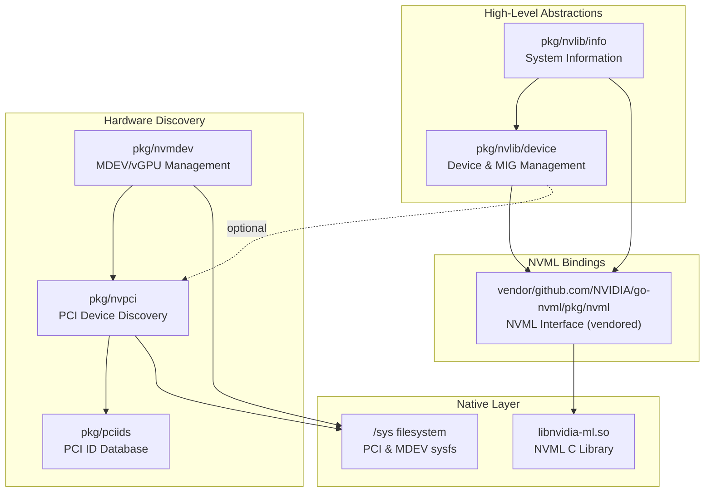

**Key Packages:**

| Package | Purpose | Primary Interface |
|---------|---------|-------------------|
| `pkg/nvlib/device` | High-level GPU device management, MIG support | `device.Interface` |
| `pkg/nvlib/info` | System-wide GPU information gathering | `info.Interface` |
| `pkg/nvpci` | PCI device enumeration via sysfs | `nvpci.Interface` |
| `pkg/nvmdev` | MDEV/vGPU creation and management | `nvmdev.Interface` |
| `pkg/pciids` | PCI vendor/device name resolution | `pciids.DB` |
| `vendor/.../go-nvml` | NVML Go bindings (vendored) | `nvml.Interface` |

Sources: [pkg/nvlib/device/device.go:1-48](), [pkg/nvpci/nvpci.go:31-62](), [go.mod:5-9](), [vendor/modules.txt:1-23]()

## Relationship to NVML

NVML (NVIDIA Management Library) is NVIDIA's C library for monitoring and managing GPU devices. `go-nvlib` builds upon the `go-nvml` bindings to provide:

1. **Higher-level abstractions**: Go-idiomatic interfaces that simplify common operations
2. **Enhanced MIG support**: Simplified MIG profile parsing and validation
3. **PCI topology discovery**: Hardware topology information not available through NVML
4. **String conversions**: Human-readable representations of device properties
5. **Testing utilities**: Mock implementations for testing without GPU hardware

### NVML Integration Points

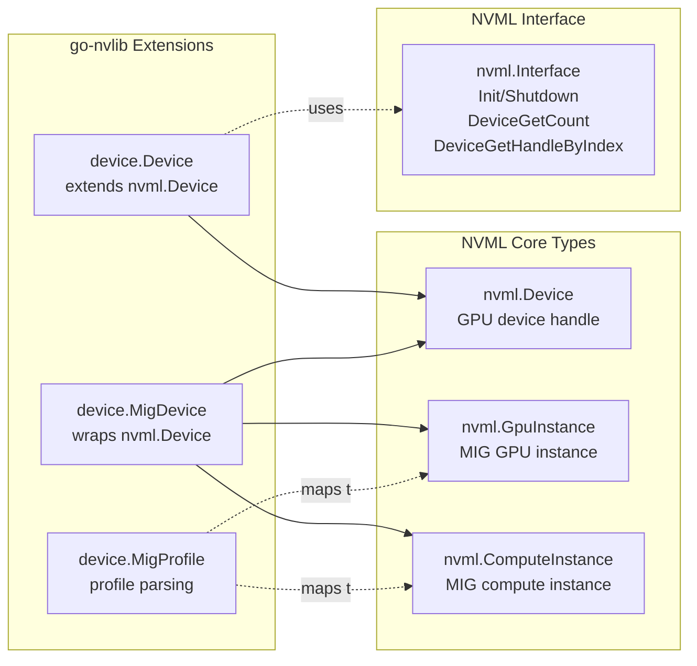

The `device.Device` interface embeds `nvml.Device`, exposing all NVML methods while adding convenience functions. For example:

- `GetArchitectureAsString()` returns "Ampere" or "Hopper" instead of numeric constants
- `GetBrandAsString()` returns "GeForce" or "Tesla" instead of enum values  
- `GetMigProfiles()` parses and validates MIG profile configurations
- `IsMigCapable()` safely checks MIG capability with symbol verification

Sources: [pkg/nvlib/device/device.go:26-48](), [pkg/nvlib/device/device.go:70-99](), [pkg/nvlib/device/device.go:101-147]()

## Core Interfaces and Types

### Device Management Interface

The `device.Interface` is the primary entry point for GPU management operations:

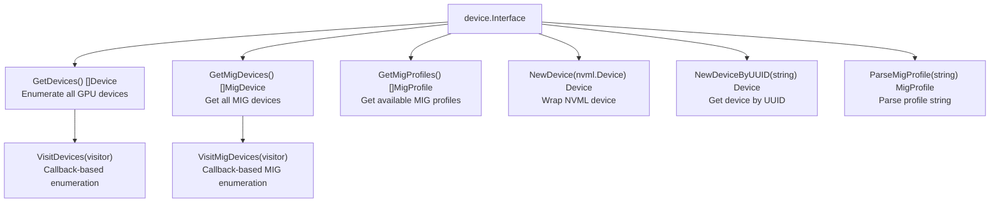

**Key Methods:**

| Method | Purpose |
|--------|---------|
| `GetDevices()` | Returns all non-skipped GPU devices in the system |
| `GetMigDevices()` | Returns all configured MIG devices across all GPUs |
| `GetMigProfiles()` | Returns unique MIG profiles available on the system |
| `NewDeviceByUUID(uuid)` | Creates a Device from a GPU UUID string |
| `ParseMigProfile(profile)` | Parses MIG profile strings like "1g.5gb" or "1c.1g.5gb+me" |
| `VisitDevices(visitor)` | Iterates devices with callback pattern for error handling |

Sources: [pkg/nvlib/device/api.go:23-38](), [pkg/nvlib/device/device.go:432-463](), [pkg/nvlib/device/device.go:514-560]()

### Device Type Hierarchy

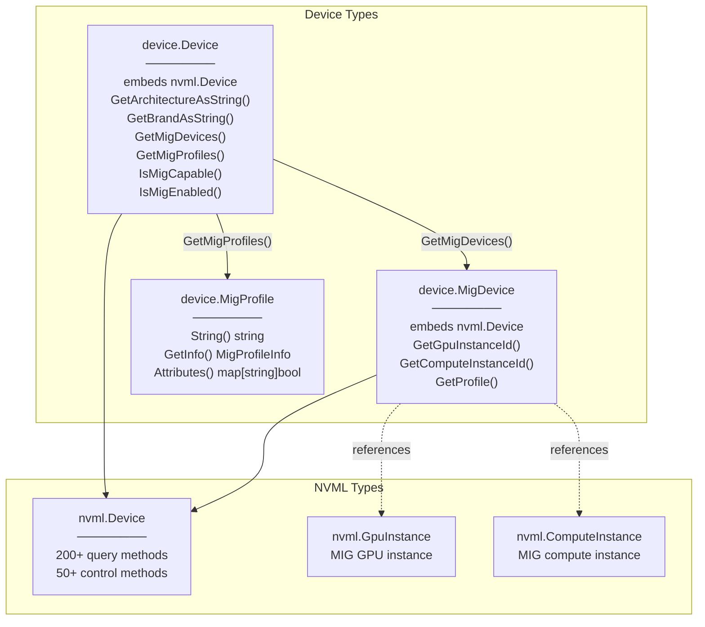

**Type Responsibilities:**

- **`device.Device`**: Extends `nvml.Device` with Go-friendly string conversions, MIG capability checks, and device filtering (skips "DGX Display" by default)
- **`device.MigDevice`**: Represents a configured MIG partition, combining GPU instance and compute instance information with profile metadata
- **`device.MigProfile`**: Parses and validates MIG profile format strings, mapping them to NVML profile IDs

Sources: [pkg/nvlib/device/device.go:26-48](), [pkg/nvlib/device/api.go:23-38]()

## PCI Device Discovery

The `nvpci` package provides hardware topology discovery independent of NVML, reading directly from Linux sysfs:

### NvidiaPCIDevice Structure

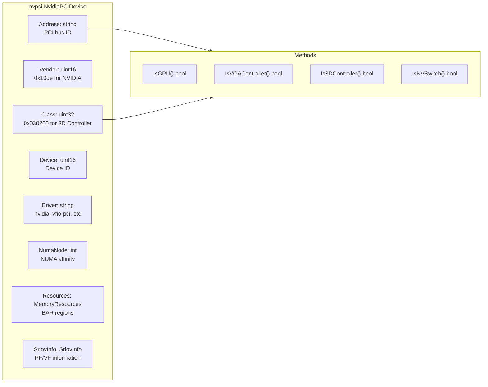

**Discovery Methods:**

| Method | Returns | Purpose |
|--------|---------|---------|
| `GetGPUs()` | `[]*NvidiaPCIDevice` | All NVIDIA GPU devices (excludes VFs) |
| `GetAllDevices()` | `[]*NvidiaPCIDevice` | All NVIDIA PCI devices |
| `GetGPUByPciBusID(addr)` | `*NvidiaPCIDevice` | Device at specific PCI address |
| `GetVGAControllers()` | `[]*NvidiaPCIDevice` | Legacy VGA devices (class 0x030000) |
| `Get3DControllers()` | `[]*NvidiaPCIDevice` | Modern GPUs (class 0x030200) |
| `GetNVSwitches()` | `[]*NvidiaPCIDevice` | NVSwitch devices (class 0x068000) |

The package reads from `/sys/bus/pci/devices` to enumerate devices and uses the `pciids` package to resolve vendor and device names to human-readable strings.

Sources: [pkg/nvpci/nvpci.go:31-62](), [pkg/nvpci/nvpci.go:107-122](), [pkg/nvpci/nvpci.go:201-235]()

## Initialization and Lifecycle

### Basic Usage Pattern

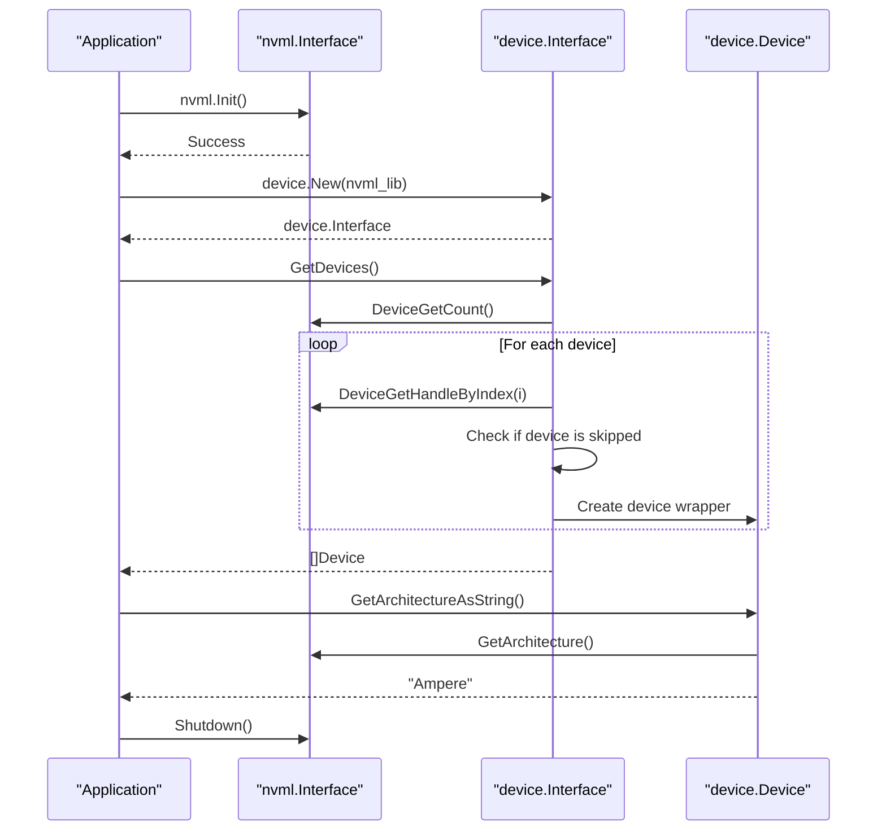

**Typical initialization sequence:**

1. Call `nvml.Init()` to initialize the NVML library
2. Create a `device.Interface` with `device.New(nvmllib)`
3. Use `GetDevices()` to enumerate GPU devices
4. Query device properties and manage configurations
5. Call `nvml.Shutdown()` to clean up

The `device` package automatically filters certain devices (e.g., "DGX Display") and can be configured with additional skip patterns via `device.WithSkippedDevices()`.

Sources: [pkg/nvlib/device/api.go:49-68](), [pkg/nvlib/device/device.go:432-463](), [pkg/nvlib/device/device.go:418-430]()

## Module Dependencies

`go-nvlib` vendors its dependencies to ensure reproducible builds. The primary dependencies are:

| Module | Version | Purpose |
|--------|---------|---------|
| `github.com/NVIDIA/go-nvml` | v0.13.0-1 | NVML Go bindings (CGO wrapper) |
| `github.com/google/uuid` | v1.6.0 | UUID generation and parsing |
| `github.com/stretchr/testify` | v1.11.1 | Testing assertions and mocking |
| `gopkg.in/yaml.v3` | v3.0.1 | YAML processing for info package |

The library requires Go 1.20 or later and is designed to run on Linux systems with NVIDIA GPU hardware and drivers installed.

Sources: [go.mod:1-16](), [vendor/modules.txt:1-23]()

## Testing Infrastructure

`go-nvlib` provides comprehensive mock implementations that enable testing without GPU hardware:

### Mock Implementations

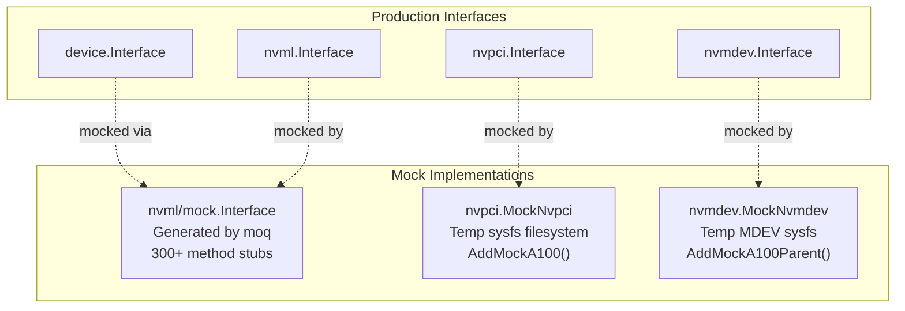

- **`nvml/mock.Interface`**: Auto-generated mock with all NVML methods as configurable function fields
- **`nvpci.MockNvpci`**: Creates temporary sysfs directory structures to simulate PCI devices
- **`nvmdev.MockNvmdev`**: Creates temporary MDEV sysfs structures for vGPU testing

For more details on testing, see [Testing](#8) and [Mock Implementations](#8.2).

Sources: [pkg/nvpci/mock.go:29-59](), [pkg/nvpci/nvpci_test.go:29-76]()

## Design Principles

The library follows several key design principles:

1. **Interface-driven architecture**: All major components expose Go interfaces, enabling dependency injection and testing
2. **NVML extension, not replacement**: The `device.Device` embeds `nvml.Device`, making all NVML methods available while adding convenience
3. **Graceful degradation**: Optional features check for symbol availability before calling (e.g., `hasSymbol("nvmlDeviceGetMigMode")`)
4. **Visitor pattern for enumeration**: Callback-based iteration with error handling (e.g., `VisitDevices()`, `VisitMigDevices()`)
5. **Multiple abstraction layers**: Applications can work at the appropriate level: high-level device management, PCI topology, or raw NVML
6. **Testability**: Mock implementations allow testing without GPU hardware or root privileges

Sources: [pkg/nvlib/device/device.go:562-570](), [pkg/nvlib/device/device.go:432-463](), [pkg/nvlib/device/api.go:49-91]()

---

# Page: Getting Started

# Getting Started

<details>
<summary>Relevant source files</summary>

The following files were used as context for generating this wiki page:

- [Makefile](Makefile)
- [go.mod](go.mod)
- [pkg/nvlib/device/api.go](pkg/nvlib/device/api.go)
- [pkg/nvlib/device/device.go](pkg/nvlib/device/device.go)
- [pkg/nvlib/device/identifier.go](pkg/nvlib/device/identifier.go)
- [vendor/modules.txt](vendor/modules.txt)

</details>


This page guides you through installing go-nvlib, initializing the library, and discovering NVIDIA GPUs in your system. It covers the essential patterns for creating a device library instance and performing basic GPU enumeration.

For detailed information about GPU device management and MIG support, see [GPU Device Management](#3). For hardware topology discovery through PCI interfaces, see [Hardware Topology Discovery](#5). For comprehensive NVML binding reference, see [NVML Bindings Reference](#6).

## Prerequisites

go-nvlib requires:

- **Go 1.20 or later** - as specified in [go.mod:3]()
- **NVIDIA GPU hardware** - with drivers installed
- **NVIDIA Management Library (NVML)** - typically installed with GPU drivers as `libnvidia-ml.so`
- **Linux operating system** - the library targets Linux platforms ([Makefile:26]())

The library has minimal external dependencies:

| Dependency | Version | Purpose |
|------------|---------|---------|
| `github.com/NVIDIA/go-nvml` | v0.13.0-1 | NVML Go bindings (CGO-based) |
| `github.com/google/uuid` | v1.6.0 | UUID parsing and validation |
| `github.com/stretchr/testify` | v1.11.1 | Testing framework (dev dependency) |

**Sources:** [go.mod:1-15]()

## Installation

Install go-nvlib using Go modules:

```bash
go get github.com/NVIDIA/go-nvlib
```

The library uses vendored dependencies to ensure reproducible builds. All transitive dependencies are captured in [vendor/modules.txt:1-22]().

## Library Architecture Overview

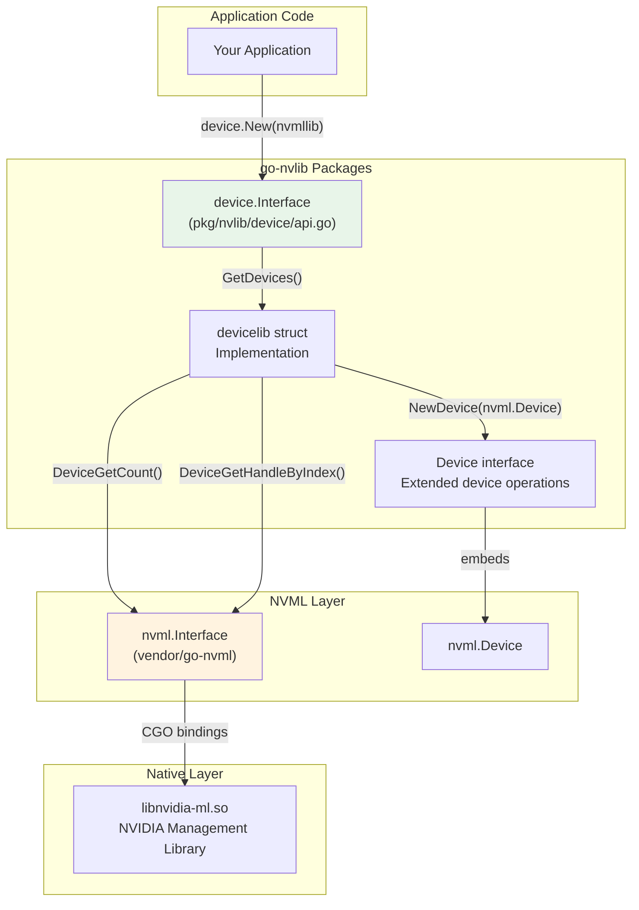

**Sources:** [pkg/nvlib/device/api.go:23-38](), [pkg/nvlib/device/device.go:26-41]()

## Initialization Flow

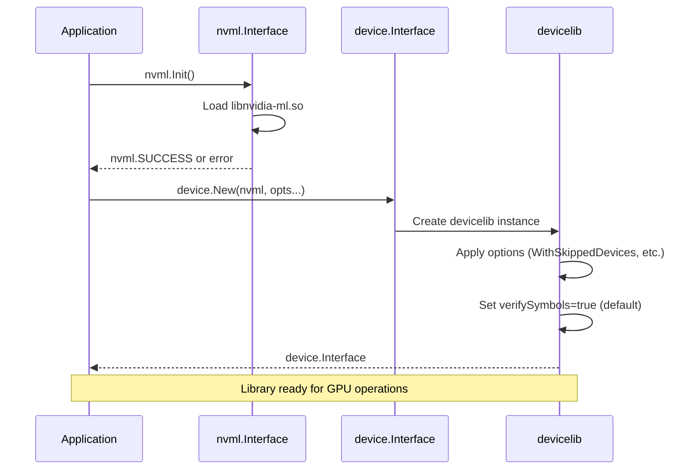

**Sources:** [pkg/nvlib/device/api.go:49-68]()

## Basic Usage Example

The typical initialization sequence involves initializing NVML, creating a device library instance, and discovering GPUs:

```go
import (
    "github.com/NVIDIA/go-nvml/pkg/nvml"
    "github.com/NVIDIA/go-nvlib/pkg/nvlib/device"
)

// Initialize NVML
ret := nvml.Init()
if ret != nvml.SUCCESS {
    // Handle initialization error
}
defer nvml.Shutdown()

// Create device library with default options
deviceLib := device.New(nvml)

// Discover all GPUs in the system
devices, err := deviceLib.GetDevices()
if err != nil {
    // Handle discovery error
}

// Iterate through discovered devices
for i, dev := range devices {
    name, _ := dev.GetName()
    uuid, _ := dev.GetUUID()
    // Use device...
}
```

The `device.New()` function accepts the NVML interface and optional configuration ([pkg/nvlib/device/api.go:50-68]()):

| Option Function | Purpose | Default Behavior |
|----------------|---------|------------------|
| `WithSkippedDevices(names...)` | Exclude devices by model name | Skips "DGX Display" and "NVIDIA DGX Display" |
| `WithVerifySymbols(verify bool)` | Toggle symbol verification before calling | `true` - verifies symbols exist |

**Sources:** [pkg/nvlib/device/api.go:49-91]()

## Device Discovery Methods

The `device.Interface` provides three primary discovery methods:

### Method 1: GetDevices()

Retrieves all physical GPUs in the system:

```go
devices, err := deviceLib.GetDevices()
```

Implementation internally uses `VisitDevices()` to enumerate GPU indices from 0 to device count ([pkg/nvlib/device/device.go:514-525]()):

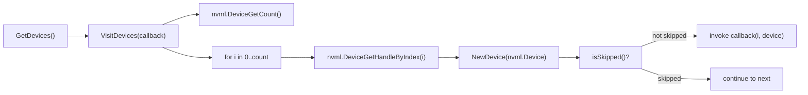

**Sources:** [pkg/nvlib/device/device.go:514-525](), [pkg/nvlib/device/device.go:433-463]()

### Method 2: NewDeviceByUUID()

Creates a device handle from a specific UUID:

```go
device, err := deviceLib.NewDeviceByUUID("GPU-12345678-...")
```

This method calls `nvml.DeviceGetHandleByUUID()` internally ([pkg/nvlib/device/device.go:56-63]()).

### Method 3: VisitDevices()

Provides iterator-style device enumeration with a callback function:

```go
err := deviceLib.VisitDevices(func(i int, dev device.Device) error {
    // Process device at index i
    name, _ := dev.GetName()
    // Return error to stop iteration
    return nil
})
```

**Sources:** [pkg/nvlib/device/device.go:433-463]()

## Device Filtering and Skipped Devices

By default, the library skips display-only GPUs that are not suitable for compute workloads. The filtering logic checks device names against a skip list ([pkg/nvlib/device/device.go:418-430]()):

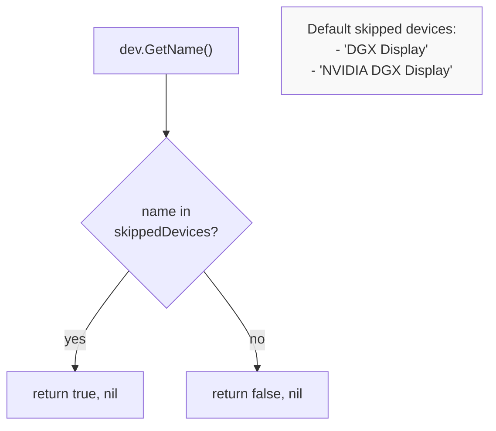

The default skipped devices are configured in [pkg/nvlib/device/api.go:62-66]():
- `"DGX Display"`
- `"NVIDIA DGX Display"`

To customize this behavior, use the `WithSkippedDevices()` option when creating the device library.

**Sources:** [pkg/nvlib/device/device.go:418-430](), [pkg/nvlib/device/api.go:77-87]()

## Device Interface Methods

Once you have a `device.Device` instance, it provides extended functionality beyond the base `nvml.Device` interface:

| Method | Return Type | Purpose |
|--------|-------------|---------|
| `GetArchitectureAsString()` | `string` | Returns architecture name (Kepler, Maxwell, Pascal, Volta, Turing, Ampere, Ada Lovelace, Hopper, Blackwell) |
| `GetBrandAsString()` | `string` | Returns brand name (Tesla, Quadro, GeForce, etc.) |
| `GetCudaComputeCapabilityAsString()` | `string` | Returns CUDA capability version (e.g., "8.0") |
| `GetPCIBusID()` | `string` | Returns PCI bus ID with domain prefix removed |
| `IsMigCapable()` | `bool` | Checks if device supports MIG partitioning |
| `IsMigEnabled()` | `bool` | Checks if MIG mode is currently enabled |
| `IsCoherent()` | `bool` | Checks if device supports coherent memory access |
| `IsFabricAttached()` | `bool` | Checks if device is attached to GPU fabric |
| `GetMigDevices()` | `[]MigDevice` | Returns MIG instances if MIG is enabled |
| `GetMigProfiles()` | `[]MigProfile` | Returns available MIG profiles |

All methods are defined in [pkg/nvlib/device/device.go:26-41]() and implemented in [pkg/nvlib/device/device.go:70-281]().

**Sources:** [pkg/nvlib/device/device.go:26-41](), [pkg/nvlib/device/device.go:70-281]()

## Error Handling

The library follows Go error handling conventions. NVML return codes are converted to errors when they indicate failure:

```go
device, err := deviceLib.NewDeviceByUUID(uuid)
if err != nil {
    // err contains wrapped NVML return code
    // Example: "error getting device handle for uuid 'GPU-...': ErrorNotFound"
}
```

NVML return codes are checked against `nvml.SUCCESS`. Common error patterns:

| NVML Return Code | Meaning | Typical Handling |
|------------------|---------|------------------|
| `nvml.ERROR_NOT_SUPPORTED` | Feature not available | Graceful degradation (return false/nil) |
| `nvml.ERROR_NOT_FOUND` | Resource doesn't exist | Skip or report as empty |
| `nvml.ERROR_INVALID_ARGUMENT` | Invalid parameter | Skip or report as error |
| Other non-SUCCESS | Unexpected error | Propagate as error |

Examples from the codebase:

- MIG capability check returns `false` on `ERROR_NOT_SUPPORTED` ([pkg/nvlib/device/device.go:208-210]())
- MIG device iteration skips `ERROR_NOT_FOUND` ([pkg/nvlib/device/device.go:300-301]())
- Device handle retrieval propagates errors ([pkg/nvlib/device/device.go:58-61]())

**Sources:** [pkg/nvlib/device/device.go:58-61](), [pkg/nvlib/device/device.go:208-210](), [pkg/nvlib/device/device.go:300-307]()

## Symbol Verification

The library includes optional symbol verification to check that NVML functions exist before calling them. This prevents crashes when running against older NVML versions that lack newer API functions.

Symbol verification is controlled by the `verifySymbols` flag (default: `true`) and checked using the `hasSymbol()` method ([pkg/nvlib/device/device.go:562-570]()):

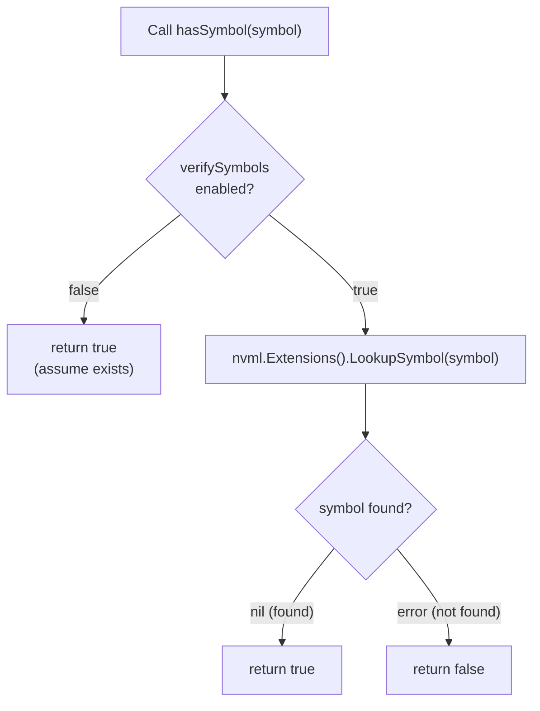

Example usage in `IsMigCapable()` ([pkg/nvlib/device/device.go:202-217]()):
- Checks if `nvmlDeviceGetMigMode` symbol exists
- Returns `false` if symbol not found (graceful degradation)
- Only calls the function if symbol is verified

**Sources:** [pkg/nvlib/device/device.go:562-570](), [pkg/nvlib/device/device.go:202-217](), [pkg/nvlib/device/device.go:184-200]()

## Cleanup

Always shut down NVML when finished to release resources:

```go
defer nvml.Shutdown()
```

The `nvml.Shutdown()` call should be deferred immediately after successful initialization. Device library instances (`device.Interface`) do not require explicit cleanup as they are stateless wrappers around the NVML interface.

## Complete Example

Here is a complete example demonstrating initialization, device discovery, and property queries:

```go
package main

import (
    "fmt"
    "log"
    
    "github.com/NVIDIA/go-nvml/pkg/nvml"
    "github.com/NVIDIA/go-nvlib/pkg/nvlib/device"
)

func main() {
    // Initialize NVML
    ret := nvml.Init()
    if ret != nvml.SUCCESS {
        log.Fatalf("Failed to initialize NVML: %v", ret)
    }
    defer nvml.Shutdown()
    
    // Create device library
    deviceLib := device.New(nvml)
    
    // Discover devices
    devices, err := deviceLib.GetDevices()
    if err != nil {
        log.Fatalf("Failed to get devices: %v", err)
    }
    
    fmt.Printf("Found %d GPU(s)\n", len(devices))
    
    // Query each device
    for i, dev := range devices {
        name, _ := dev.GetName()
        uuid, _ := dev.GetUUID()
        arch, _ := dev.GetArchitectureAsString()
        brand, _ := dev.GetBrandAsString()
        busID, _ := dev.GetPCIBusID()
        
        fmt.Printf("\nDevice %d:\n", i)
        fmt.Printf("  Name: %s\n", name)
        fmt.Printf("  UUID: %s\n", uuid)
        fmt.Printf("  Architecture: %s\n", arch)
        fmt.Printf("  Brand: %s\n", brand)
        fmt.Printf("  PCI Bus ID: %s\n", busID)
        
        // Check MIG capability
        migCapable, _ := dev.IsMigCapable()
        if migCapable {
            migEnabled, _ := dev.IsMigEnabled()
            fmt.Printf("  MIG: Capable (Enabled: %v)\n", migEnabled)
        }
    }
}
```

**Sources:** [pkg/nvlib/device/api.go:49-68](), [pkg/nvlib/device/device.go:514-525](), [pkg/nvlib/device/device.go:70-179]()

## Next Steps

After completing the basic setup:

- For comprehensive device operations and MIG support, see [GPU Device Management](#3)
- For MIG device enumeration and profile management, see [Multi-Instance GPU (MIG)](#4)
- For PCI-level hardware discovery, see [Hardware Topology Discovery](#5)
- For direct NVML access and low-level operations, see [NVML Bindings Reference](#6)
- For writing tests with mock implementations, see [Testing](#8)

---

# Page: GPU Device Management

# GPU Device Management

<details>
<summary>Relevant source files</summary>

The following files were used as context for generating this wiki page:

- [pkg/nvlib/device/api.go](pkg/nvlib/device/api.go)
- [pkg/nvlib/device/device.go](pkg/nvlib/device/device.go)

</details>


## Purpose and Scope

The `device` package provides the primary high-level interface for discovering and managing NVIDIA GPUs in Go applications. It wraps the lower-level NVML bindings with Go-friendly abstractions, adding convenience methods for common operations and extended device information queries.

This page documents the core architecture, interfaces, and initialization patterns for the device package. For detailed information on specific topics:
- Device discovery and enumeration patterns, see [Device Discovery and Enumeration](#3.1)
- Device property queries and state information, see [Device Properties and Queries](#3.2)
- Device identifier formats and validation, see [Device Identifiers](#3.3)
- Multi-Instance GPU (MIG) support, see [Multi-Instance GPU (MIG)](#4)
- Lower-level PCI device information, see [PCI Device Discovery](#5.1)

**Sources:** [pkg/nvlib/device/device.go:1-571](), [pkg/nvlib/device/api.go:1-91]()

---

## Architecture Overview

The device package serves as the orchestration layer between applications and NVIDIA GPUs, wrapping NVML with enhanced functionality and Go idioms.

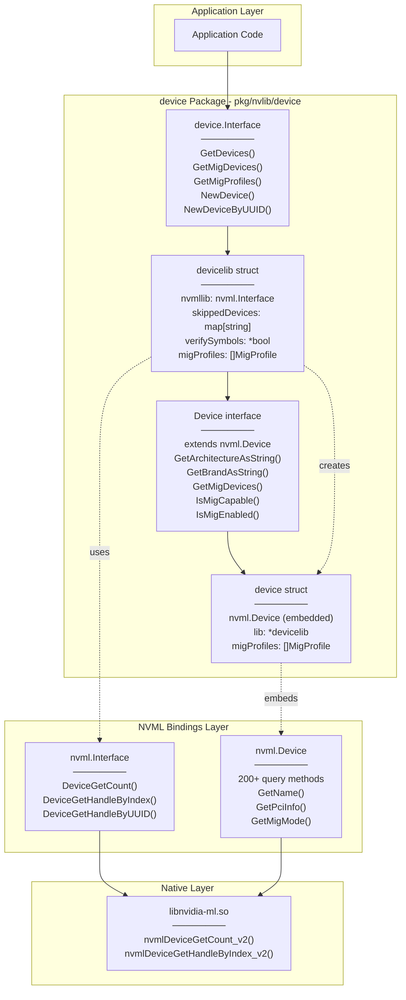

**Architecture Pattern**: The device package implements a wrapper pattern with three key components:

| Component | Type | Purpose |
|-----------|------|---------|
| `device.Interface` | Interface | Primary API contract for device operations |
| `devicelib` | Struct | Implementation holding NVML interface and configuration |
| `device.Device` | Interface | Extended device interface with convenience methods |
| `device` struct | Struct | Concrete device implementation embedding `nvml.Device` |

**Sources:** [pkg/nvlib/device/api.go:23-47](), [pkg/nvlib/device/device.go:26-47]()

---

## Core Interfaces and Types

The device package defines two primary interfaces that applications interact with: the library interface for discovery operations and the device interface for per-device queries.

### device.Interface API

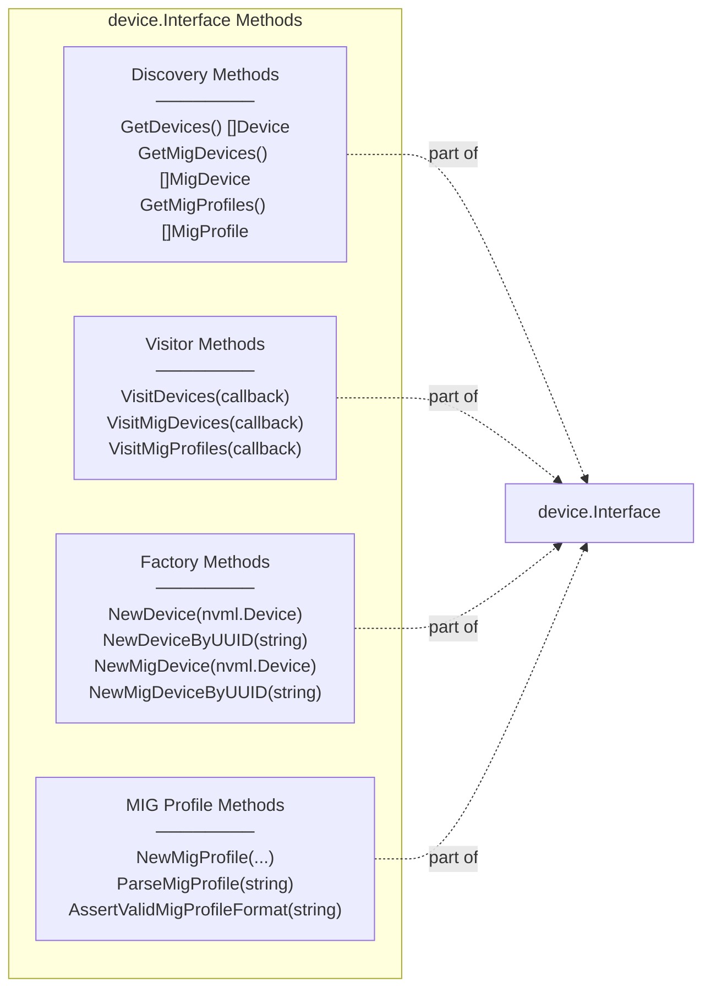

The `device.Interface` provides four categories of methods:

| Category | Methods | Purpose |
|----------|---------|---------|
| **Discovery** | `GetDevices()`, `GetMigDevices()`, `GetMigProfiles()` | Enumerate all devices of each type |
| **Visitor** | `VisitDevices()`, `VisitMigDevices()`, `VisitMigProfiles()` | Iterate with callbacks for memory efficiency |
| **Factory** | `NewDevice()`, `NewDeviceByUUID()`, `NewMigDevice()`, `NewMigDeviceByUUID()` | Create device wrappers from NVML handles or identifiers |
| **MIG Profiles** | `NewMigProfile()`, `ParseMigProfile()`, `AssertValidMigProfileFormat()` | MIG profile creation and validation |

**Sources:** [pkg/nvlib/device/api.go:23-38]()

### Device Interface Extensions

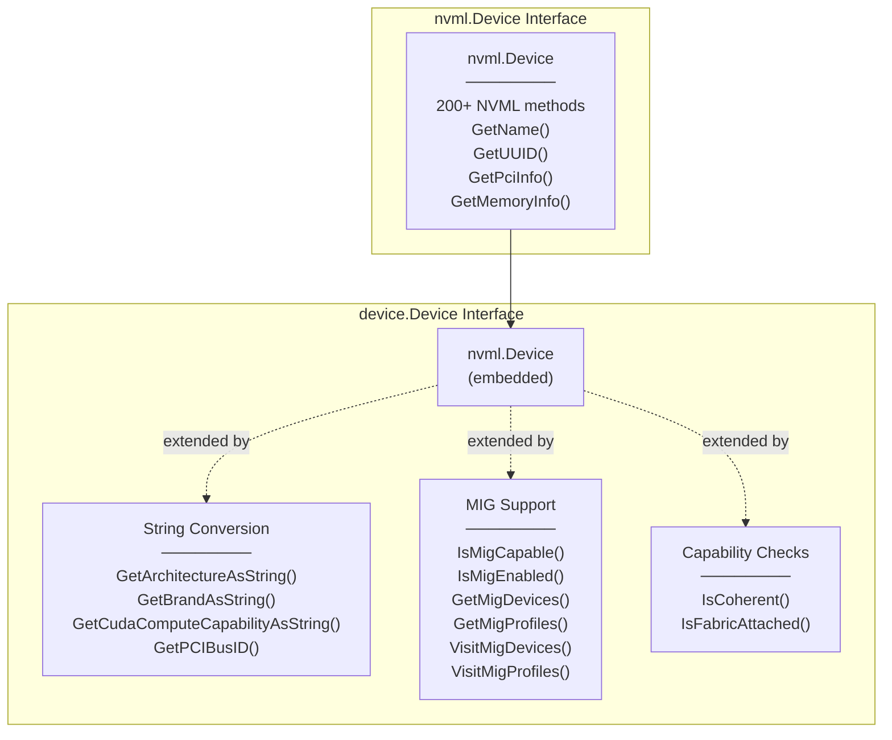

The `Device` interface embeds `nvml.Device` and adds convenience methods in three categories:

| Category | Methods | Description |
|----------|---------|-------------|
| **String Conversions** | `GetArchitectureAsString()`, `GetBrandAsString()`, `GetCudaComputeCapabilityAsString()`, `GetPCIBusID()` | Convert NVML enums and raw data to human-readable strings |
| **MIG Support** | `IsMigCapable()`, `IsMigEnabled()`, `GetMigDevices()`, `GetMigProfiles()`, `VisitMigDevices()`, `VisitMigProfiles()` | Multi-Instance GPU capability and enumeration |
| **Capability Checks** | `IsCoherent()`, `IsFabricAttached()` | Advanced feature detection with symbol verification |

**Sources:** [pkg/nvlib/device/device.go:26-41]()

---

## Device Library Initialization

The device library is initialized through the `New()` function, which accepts an NVML interface and optional configuration.

### Basic Initialization Pattern

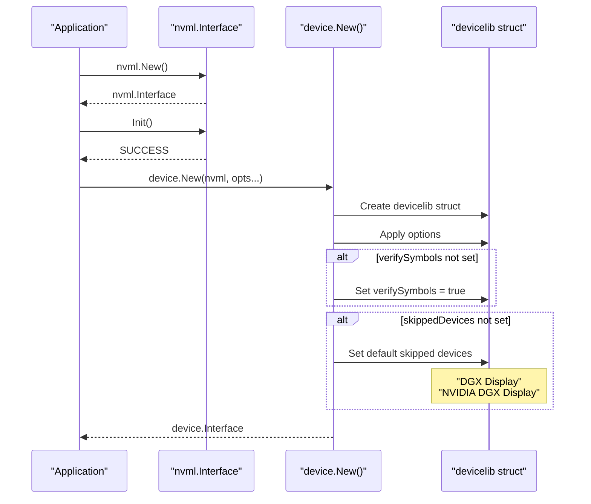

**Initialization Steps:**

1. **NVML Initialization**: Create and initialize an `nvml.Interface` instance
2. **Device Library Creation**: Call `device.New()` with the NVML interface
3. **Option Application**: Configuration options are applied in order
4. **Default Configuration**: Unset options receive sensible defaults

**Default Behavior:**
- Symbol verification is enabled by default to prevent crashes on missing NVML functions
- DGX Display devices are skipped by default as they are not compute GPUs

**Sources:** [pkg/nvlib/device/api.go:49-68]()

### devicelib Structure

The `devicelib` struct maintains the state and configuration for device operations:

| Field | Type | Purpose |
|-------|------|---------|
| `nvmllib` | `nvml.Interface` | Handle to NVML library for all device queries |
| `skippedDevices` | `map[string]struct{}` | Device model names to exclude from enumeration |
| `verifySymbols` | `*bool` | Whether to check symbol existence before calling NVML functions |
| `migProfiles` | `[]MigProfile` | Cached MIG profiles across all devices |

**Sources:** [pkg/nvlib/device/api.go:40-45]()

---

## Configuration Options

The device package supports two configuration options applied at initialization time.

### WithSkippedDevices Option

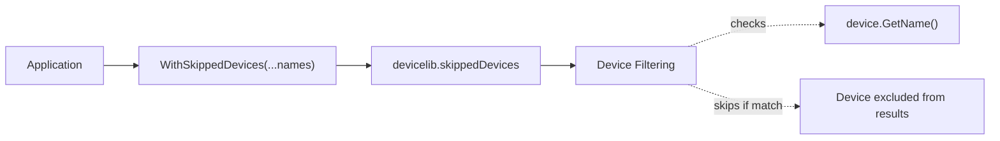

The `WithSkippedDevices` option excludes devices by model name from all enumeration operations. This is useful for filtering out non-compute devices or devices reserved for display purposes.

**Usage Pattern:**
```go
device.New(nvml, 
    device.WithSkippedDevices("DGX Display", "Custom Device Name"),
)
```

**Default Skipped Devices:**
- `"DGX Display"`
- `"NVIDIA DGX Display"`

**Implementation:** The skipped devices are checked in [pkg/nvlib/device/device.go:418-430](), where device names are queried and compared against the skip map during device enumeration.

**Sources:** [pkg/nvlib/device/api.go:77-87](), [pkg/nvlib/device/device.go:418-430]()

### WithVerifySymbols Option

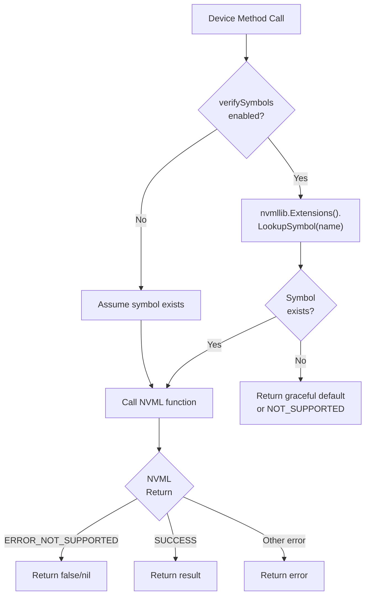

The `WithVerifySymbols` option controls whether the library verifies that NVML symbols exist before calling them. This prevents crashes when running against older NVML versions that lack newer functions.

**Symbol Verification Pattern:**

The `hasSymbol()` method [pkg/nvlib/device/device.go:562-570]() checks symbol availability:

```
func (d *devicelib) hasSymbol(symbol string) bool {
    if !*d.verifySymbols {
        return true  // Assume all symbols exist
    }
    return d.nvmllib.Extensions().LookupSymbol(symbol) == nil
}
```

**Example Usage in Device Methods:**

[pkg/nvlib/device/device.go:183-200]() - `IsCoherent()` method:
- Checks if `nvmlDeviceGetAddressingMode` symbol exists
- Returns `false` gracefully if symbol is missing
- Handles `ERROR_NOT_SUPPORTED` return code for incompatible devices

[pkg/nvlib/device/device.go:236-281]() - `IsFabricAttached()` method:
- Checks for `nvmlDeviceGetGpuFabricInfo` or `nvmlDeviceGetGpuFabricInfoV` symbols
- Supports multiple NVML API versions gracefully

**Trade-off:**
- **Enabled (default)**: Safer, prevents crashes, slight overhead per call
- **Disabled**: Faster, but requires NVML version compatibility guarantees

**Sources:** [pkg/nvlib/device/api.go:70-75](), [pkg/nvlib/device/device.go:562-570](), [pkg/nvlib/device/device.go:183-200](), [pkg/nvlib/device/device.go:236-281]()

---

## Device Types and Extensions

The device package provides two concrete device implementations, both wrapping NVML device handles with extended functionality.

### Device Structure

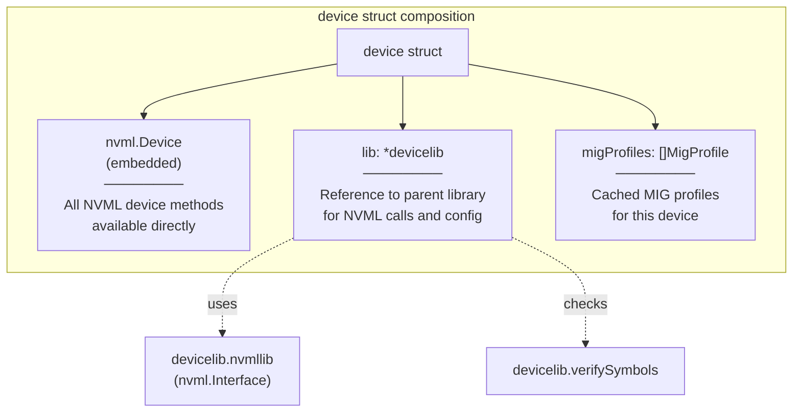

The `device` struct [pkg/nvlib/device/device.go:43-47]() has three components:

| Component | Type | Purpose |
|-----------|------|---------|
| `nvml.Device` (embedded) | Interface | All NVML device methods accessible directly on device |
| `lib` | `*devicelib` | Reference to parent library for configuration and NVML access |
| `migProfiles` | `[]MigProfile` | Cached list of valid MIG profiles for this device |

**Embedding Pattern:** By embedding `nvml.Device`, the `device` struct automatically implements all NVML device methods without wrapping each one individually. Applications can call both extended methods (like `GetArchitectureAsString()`) and NVML methods (like `GetMemoryInfo()`) on the same device handle.

**Sources:** [pkg/nvlib/device/device.go:43-47]()

### Device Creation Methods

The device package provides multiple factory methods for creating device wrappers:

| Method | Input | Purpose | Implementation |
|--------|-------|---------|----------------|
| `NewDevice(nvml.Device)` | NVML device handle | Wrap existing NVML device | [pkg/nvlib/device/device.go:52-54]() |
| `NewDeviceByUUID(string)` | Device UUID string | Create device from UUID | [pkg/nvlib/device/device.go:56-63]() |
| Internal `newDevice(nvml.Device)` | NVML device handle | Internal factory method | [pkg/nvlib/device/device.go:65-68]() |

**UUID-based Creation Flow:**

[pkg/nvlib/device/device.go:56-63]() - `NewDeviceByUUID()`:
1. Calls `nvmllib.DeviceGetHandleByUUID(uuid)` to get NVML device handle
2. Checks NVML return code for errors
3. Delegates to internal `newDevice()` for wrapper creation

**Sources:** [pkg/nvlib/device/device.go:52-68]()

---

## String Conversion Methods

The device package provides convenience methods to convert NVML enum values and raw data into human-readable strings, eliminating the need for applications to maintain their own enum-to-string mappings.

### Architecture and Brand Mappings

**Architecture Conversion:** [pkg/nvlib/device/device.go:70-99]()

The `GetArchitectureAsString()` method maps NVML architecture constants to GPU architecture names:

| NVML Constant | String Value |
|---------------|--------------|
| `DEVICE_ARCH_KEPLER` | "Kepler" |
| `DEVICE_ARCH_MAXWELL` | "Maxwell" |
| `DEVICE_ARCH_PASCAL` | "Pascal" |
| `DEVICE_ARCH_VOLTA` | "Volta" |
| `DEVICE_ARCH_TURING` | "Turing" |
| `DEVICE_ARCH_AMPERE` | "Ampere" |
| `DEVICE_ARCH_ADA` | "Ada Lovelace" |
| `DEVICE_ARCH_HOPPER` | "Hopper" |
| `DEVICE_ARCH_BLACKWELL` | "Blackwell" |
| `DEVICE_ARCH_UNKNOWN` | "Unknown" |

**Brand Conversion:** [pkg/nvlib/device/device.go:101-147]()

The `GetBrandAsString()` method maps NVML brand constants to product line names (15+ brands supported including Quadro, Tesla, GeForce, RTX variants).

**PCI Bus ID Processing:** [pkg/nvlib/device/device.go:149-170]()

The `GetPCIBusID()` method extracts the PCI bus identifier from NVML's PCI info structure, converting it to lowercase and stripping leading zeros (except when the entire ID is "0000").

**CUDA Compute Capability:** [pkg/nvlib/device/device.go:172-179]()

The `GetCudaComputeCapabilityAsString()` method formats the major and minor compute capability versions as "X.Y" (e.g., "8.0" for Ampere).

**Sources:** [pkg/nvlib/device/device.go:70-179]()

---

## Device Capability Detection

The device package provides methods to detect advanced GPU capabilities with graceful fallbacks for older NVML versions or unsupported devices.

### Coherency Detection

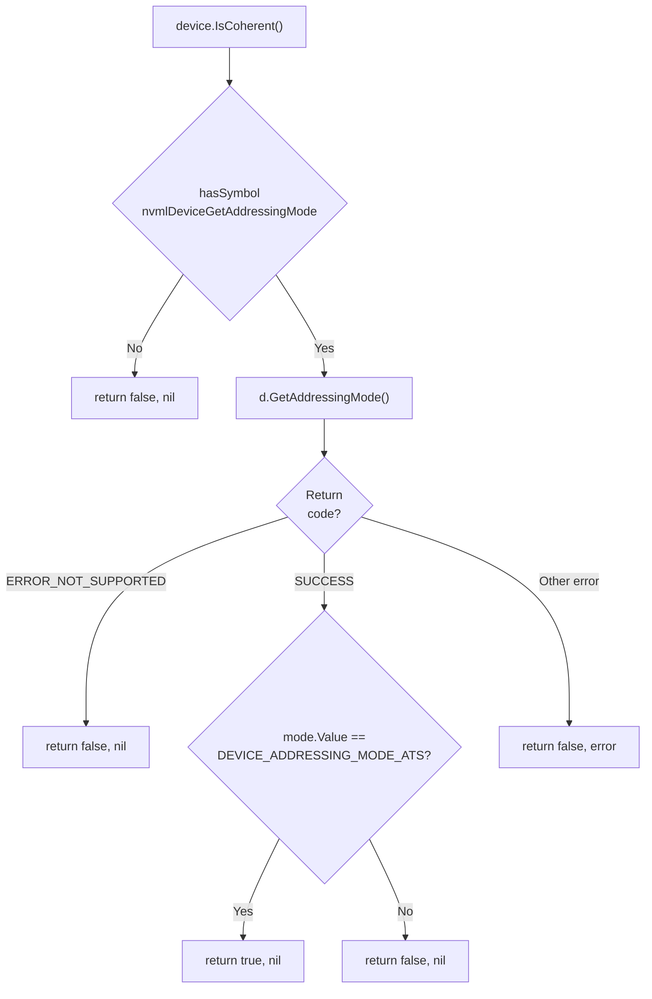

**Coherency Check:** [pkg/nvlib/device/device.go:181-200]()

The `IsCoherent()` method determines if a device supports coherent access to system memory through Address Translation Services (ATS):

1. Verifies `nvmlDeviceGetAddressingMode` symbol exists
2. Calls `GetAddressingMode()` on the device
3. Returns `true` if addressing mode is `DEVICE_ADDRESSING_MODE_ATS`
4. Returns `false` for unsupported devices or non-ATS modes
5. Returns error only for unexpected failures

**Sources:** [pkg/nvlib/device/device.go:181-200]()

### Fabric Attachment Detection

**Fabric Check:** [pkg/nvlib/device/device.go:236-281]()

The `IsFabricAttached()` method detects GPU fabric connectivity by checking multiple NVML API versions:

**Version 1 (nvmlDeviceGetGpuFabricInfo):**
- Checks if symbol exists [line 238]
- Retrieves fabric info structure [line 239]
- Validates state is `GPU_FABRIC_STATE_COMPLETED` [line 246]
- Validates cluster UUID is non-zero [line 249]
- Validates status is `SUCCESS` [line 252]

**Version 2 (nvmlDeviceGetGpuFabricInfoV):**
- Falls back to versioned API [line 259]
- Same validation logic for V2 structure [lines 267-275]

**Returns `false` in these cases:**
- Symbol does not exist
- NVML returns `ERROR_NOT_SUPPORTED`
- Fabric state is not completed
- Cluster UUID is all zeros
- Status indicates failure

**Sources:** [pkg/nvlib/device/device.go:236-281]()

---

## MIG Capability and Enumeration

The device package provides comprehensive Multi-Instance GPU (MIG) support, including capability detection, mode checking, and device enumeration. For detailed MIG documentation, see [Multi-Instance GPU (MIG)](#4).

### MIG Capability Detection

```mermaid
graph LR
    IsMigCapable["device.IsMigCapable()"] --> HasMigSym{"hasSymbol<br/>nvmlDeviceGetMigMode?"}
    
    HasMigSym -->|No| RetFalse1["return false, nil"]
    HasMigSym -->|Yes| CallGetMode["d.GetMigMode()"]
    
    CallGetMode --> CheckRet{"Return<br/>code?"}
    
    CheckRet -->|ERROR_NOT_SUPPORTED| RetFalse2["return false, nil"]
    CheckRet -->|SUCCESS| RetTrue["return true, nil"]
    CheckRet -->|Other error| RetErr["return false, error"]
```

**MIG Capability Check:** [pkg/nvlib/device/device.go:202-217]()

The `IsMigCapable()` method determines if a device supports MIG partitioning:
- Verifies `nvmlDeviceGetMigMode` symbol exists
- Calls `GetMigMode()` to test MIG support
- Returns `false` for `ERROR_NOT_SUPPORTED` (device doesn't have MIG hardware)
- Returns `true` if the call succeeds (device has MIG capability)

**MIG Enabled Check:** [pkg/nvlib/device/device.go:219-234]()

The `IsMigEnabled()` method checks if MIG mode is currently active:
- Performs same symbol and capability checks
- Examines the returned `mode` value
- Returns `true` only if `mode == DEVICE_MIG_ENABLE`

**Sources:** [pkg/nvlib/device/device.go:202-234]()

### MIG Device Visitor Pattern

The device package implements visitor patterns for both per-device and library-wide MIG enumeration:

**Per-Device Visitor:** [pkg/nvlib/device/device.go:283-319]()

`device.VisitMigDevices(callback)` iterates over MIG devices on a single GPU:
1. Checks if device is MIG capable
2. Queries `GetMaxMigDeviceCount()` for upper bound
3. Iterates through each index calling `GetMigDeviceHandleByIndex(i)`
4. Skips indices that return `ERROR_NOT_FOUND` or `ERROR_INVALID_ARGUMENT`
5. Wraps valid handles with `lib.NewMigDevice()`
6. Invokes callback with index and MIG device

**Library-Wide Visitor:** [pkg/nvlib/device/device.go:465-484]()

`devicelib.VisitMigDevices(callback)` iterates over all MIG devices across all GPUs:
1. Calls `VisitDevices()` to iterate each GPU
2. For each GPU, calls `device.VisitMigDevices()`
3. Invokes callback with device index, device, MIG index, and MIG device

**Collector Methods:**

[pkg/nvlib/device/device.go:383-394]() - `device.GetMigDevices()`: Collects MIG devices for a single GPU into a slice

[pkg/nvlib/device/device.go:527-538]() - `devicelib.GetMigDevices()`: Collects all MIG devices across all GPUs into a slice

**Sources:** [pkg/nvlib/device/device.go:283-319](), [pkg/nvlib/device/device.go:383-394](), [pkg/nvlib/device/device.go:465-484](), [pkg/nvlib/device/device.go:527-538]()

---

## Device Filtering

The device package implements filtering to exclude certain devices from enumeration results based on their model names.

### Skip Detection Flow

```mermaid
sequenceDiagram
    participant Enum as "VisitDevices()"
    participant Dev as "device.isSkipped()"
    participant NVML as "nvml.Device.GetName()"
    participant Map as "skippedDevices map"
    
    Enum->>Dev: Check if device should be skipped
    Dev->>NVML: GetName()
    NVML-->>Dev: Device name string
    
    Dev->>Map: Check if name exists in map
    
    alt Name in skip list
        Map-->>Dev: exists = true
        Dev-->>Enum: return true, nil
        Note over Enum: Device excluded from results
    else Name not in skip list
        Map-->>Dev: exists = false
        Dev-->>Enum: return false, nil
        Note over Enum: Process device normally
    end
```

**Skip Detection:** [pkg/nvlib/device/device.go:418-430]()

The `isSkipped()` method checks if a device should be excluded:
1. Queries device name via `GetName()`
2. Checks if name exists in `lib.skippedDevices` map
3. Returns `true` if device should be skipped

**Integration in Enumeration:** [pkg/nvlib/device/device.go:432-463]()

The `VisitDevices()` method applies filtering:
1. Gets device count from NVML
2. For each device index:
   - Gets device handle
   - Creates device wrapper
   - Calls `isSkipped()` to check filter
   - Skips device if filter matches (line 449-455)
   - Invokes callback only for non-skipped devices

This filtering mechanism ensures that display-only GPUs and other excluded devices never appear in application device lists, simplifying device selection logic.

**Sources:** [pkg/nvlib/device/device.go:418-430](), [pkg/nvlib/device/device.go:432-463]()

---

## Related Pages

For more detailed information on specific device management topics:

- **[Device Discovery and Enumeration](#3.1)** - Device discovery methods, iteration patterns, and collection APIs
- **[Device Properties and Queries](#3.2)** - Detailed documentation of all device property query methods
- **[Device Identifiers](#3.3)** - Device identifier formats, UUID structure, and validation
- **[Multi-Instance GPU (MIG)](#4)** - Comprehensive MIG support documentation
- **[MIG Device Discovery](#4.1)** - MIG device enumeration and hierarchy
- **[MIG Profiles](#4.2)** - MIG profile format, parsing, and validation
- **[NVML Bindings Reference](#6)** - Lower-level NVML interface documentation
- **[System Information Package](#7)** - High-level GPU system information gathering

---

# Page: Device Discovery and Enumeration

# Device Discovery and Enumeration

<details>
<summary>Relevant source files</summary>

The following files were used as context for generating this wiki page:

- [pkg/nvlib/device/api.go](pkg/nvlib/device/api.go)
- [pkg/nvlib/device/device.go](pkg/nvlib/device/device.go)
- [vendor/github.com/NVIDIA/go-nvml/pkg/nvml/mock/interface.go](vendor/github.com/NVIDIA/go-nvml/pkg/nvml/mock/interface.go)
- [vendor/github.com/NVIDIA/go-nvml/pkg/nvml/zz_generated.api.go](vendor/github.com/NVIDIA/go-nvml/pkg/nvml/zz_generated.api.go)

</details>


## Purpose and Scope

This page documents the device discovery and enumeration mechanisms in the `pkg/nvlib/device` package. It covers how to enumerate NVIDIA GPU devices through the high-level Go API, including device filtering, identifier-based lookup, and the relationship to underlying NVML calls.

For MIG-specific device discovery, see [MIG Device Discovery](#4.1). For PCI-level hardware discovery, see [PCI Device Discovery](#5.1). For device property queries after discovery, see [Device Properties and Queries](#3.2).

## Core Interfaces and Types

The device discovery system is built around three primary types:

| Type | File | Purpose |
|------|------|---------|
| `device.Interface` | [pkg/nvlib/device/api.go:23-38]() | Public API for device management and discovery |
| `devicelib` | [pkg/nvlib/device/api.go:40-45]() | Internal implementation of `Interface` |
| `device.Device` | [pkg/nvlib/device/device.go:26-41]() | Extended device handle wrapping `nvml.Device` |

**Sources:** [pkg/nvlib/device/api.go:23-45](), [pkg/nvlib/device/device.go:26-41]()

### Interface Initialization

The `device.Interface` is created using the `New()` constructor, which requires an initialized `nvml.Interface`:

```go
// From api.go:49-68
func New(nvmllib nvml.Interface, opts ...Option) Interface
```

**Configuration Options:**

| Option | Method | Purpose |
|--------|--------|---------|
| Symbol verification | `WithVerifySymbols(bool)` | Toggle NVML symbol verification |
| Device filtering | `WithSkippedDevices(...string)` | Specify devices to skip by name |

By default, devices named `"DGX Display"` and `"NVIDIA DGX Display"` are automatically skipped during enumeration [pkg/nvlib/device/api.go:62-65]().

**Sources:** [pkg/nvlib/device/api.go:49-87]()

## Device Discovery Architecture

```mermaid
graph TB
    subgraph "Application Layer"
        APP["Application Code"]
    end
    
    subgraph "device.Interface Methods"
        GET_DEVICES["GetDevices()"]
        VISIT_DEVICES["VisitDevices(callback)"]
        NEW_BY_UUID["NewDeviceByUUID(uuid)"]
        NEW_DEVICE["NewDevice(nvmlDevice)"]
    end
    
    subgraph "devicelib Internal"
        VISIT_IMPL["VisitDevices implementation"]
        NEW_DEVICE_IMPL["newDevice()"]
        IS_SKIPPED["isSkipped()"]
        SKIPPED_MAP["skippedDevices map"]
    end
    
    subgraph "NVML Layer"
        DEVICE_COUNT["nvmllib.DeviceGetCount()"]
        DEVICE_BY_INDEX["nvmllib.DeviceGetHandleByIndex(i)"]
        DEVICE_BY_UUID["nvmllib.DeviceGetHandleByUUID(uuid)"]
        GET_NAME["nvml.Device.GetName()"]
    end
    
    subgraph "Native NVML C Library"
        NVML_C["libnvidia-ml.so"]
    end
    
    APP --> GET_DEVICES
    APP --> VISIT_DEVICES
    APP --> NEW_BY_UUID
    APP --> NEW_DEVICE
    
    GET_DEVICES --> VISIT_IMPL
    VISIT_DEVICES --> VISIT_IMPL
    NEW_BY_UUID --> DEVICE_BY_UUID
    NEW_DEVICE --> NEW_DEVICE_IMPL
    
    VISIT_IMPL --> DEVICE_COUNT
    VISIT_IMPL --> DEVICE_BY_INDEX
    VISIT_IMPL --> NEW_DEVICE_IMPL
    VISIT_IMPL --> IS_SKIPPED
    
    IS_SKIPPED --> GET_NAME
    IS_SKIPPED --> SKIPPED_MAP
    
    DEVICE_COUNT --> NVML_C
    DEVICE_BY_INDEX --> NVML_C
    DEVICE_BY_UUID --> NVML_C
    GET_NAME --> NVML_C
```

**Sources:** [pkg/nvlib/device/device.go:432-525](), [pkg/nvlib/device/api.go:40-45]()

## Device Enumeration Methods

### GetDevices - Batch Retrieval

The `GetDevices()` method returns all discovered devices as a slice:

```mermaid
sequenceDiagram
    participant App as Application
    participant DevLib as devicelib
    participant NVML as nvml.Interface
    participant C as NVML C Library
    
    App->>DevLib: GetDevices()
    DevLib->>NVML: DeviceGetCount()
    NVML->>C: nvmlDeviceGetCount_v2()
    C-->>NVML: count=N
    NVML-->>DevLib: N devices
    
    loop For each index i=0 to N-1
        DevLib->>NVML: DeviceGetHandleByIndex(i)
        NVML->>C: nvmlDeviceGetHandleByIndex_v2(i)
        C-->>NVML: nvml.Device handle
        NVML-->>DevLib: nvml.Device
        
        DevLib->>DevLib: newDevice(nvmlDevice)
        DevLib->>DevLib: isSkipped()?
        
        alt Not skipped
            DevLib->>DevLib: Append to result slice
        else Skipped
            Note over DevLib: Filter out device
        end
    end
    
    DevLib-->>App: []Device
```

**Implementation:** [pkg/nvlib/device/device.go:514-525]()

```go
// Returns all non-skipped devices
devices, err := devicelib.GetDevices()
```

**Sources:** [pkg/nvlib/device/device.go:514-525](), [pkg/nvlib/device/device.go:432-463]()

### VisitDevices - Streaming Enumeration

The `VisitDevices()` method provides a callback-based approach for memory-efficient device processing:

```go
// Visit each device with a callback function
err := devicelib.VisitDevices(func(i int, dev Device) error {
    // Process device
    return nil
})
```

**Callback Signature:** `func(index int, device Device) error`

The enumeration stops immediately if the callback returns a non-nil error [pkg/nvlib/device/device.go:457-460]().

**Implementation Details:**

| Step | Code Location | Description |
|------|---------------|-------------|
| Get count | [device.go:434-437]() | Query total device count via NVML |
| Loop indices | [device.go:439]() | Iterate from 0 to count-1 |
| Get handle | [device.go:440-443]() | Retrieve NVML device handle by index |
| Create wrapper | [device.go:444-447]() | Wrap in `device` struct |
| Filter check | [device.go:449-455]() | Skip if device name matches filter |
| Invoke callback | [device.go:457-460]() | Call user-provided function |

**Sources:** [pkg/nvlib/device/device.go:432-463]()

### Device Lookup by UUID

Devices can be retrieved directly by UUID without enumeration:

```go
// Look up specific device by UUID
device, err := devicelib.NewDeviceByUUID("GPU-12345678-1234-1234-1234-123456789abc")
```

**Implementation:** [pkg/nvlib/device/device.go:56-63]()

This method:
1. Calls `nvmllib.DeviceGetHandleByUUID(uuid)` [line 58]()
2. Returns error if UUID is invalid or device not found [lines 59-61]()
3. Creates device wrapper via `newDevice()` [line 62]()

**Note:** UUID-based lookup bypasses device filtering since it targets a specific device explicitly.

**Sources:** [pkg/nvlib/device/device.go:56-63]()

## Device Filtering Mechanism

### Skipped Devices

The device discovery system supports filtering devices by name through the `skippedDevices` map:

```mermaid
graph LR
    subgraph "Device Discovery Loop"
        GET_HANDLE["Get Device Handle"]
        CREATE_WRAPPER["Create Device Wrapper"]
        CHECK_SKIP["isSkipped()"]
        GET_NAME["GetName()"]
        CHECK_MAP["Check skippedDevices map"]
        INCLUDE["Include Device"]
        EXCLUDE["Skip Device"]
    end
    
    GET_HANDLE --> CREATE_WRAPPER
    CREATE_WRAPPER --> CHECK_SKIP
    CHECK_SKIP --> GET_NAME
    GET_NAME --> CHECK_MAP
    CHECK_MAP -->|Not in map| INCLUDE
    CHECK_MAP -->|In map| EXCLUDE
```

**Implementation:** [pkg/nvlib/device/device.go:418-430]()

```go
func (d *device) isSkipped() (bool, error) {
    name, ret := d.GetName()
    if ret != nvml.SUCCESS {
        return false, fmt.Errorf("error getting device name: %v", ret)
    }
    
    if _, exists := d.lib.skippedDevices[name]; exists {
        return true, nil
    }
    
    return false, nil
}
```

**Sources:** [pkg/nvlib/device/device.go:418-430]()

### Default Filtering

By default, the following devices are filtered out [pkg/nvlib/device/api.go:62-65]():

| Device Name | Reason |
|-------------|--------|
| `"DGX Display"` | Display-only device in DGX systems |
| `"NVIDIA DGX Display"` | Alternative name for DGX display device |

These defaults can be overridden or extended using the `WithSkippedDevices()` option during initialization.

**Sources:** [pkg/nvlib/device/api.go:62-65]()

### Custom Device Filtering

Applications can specify custom device filters during initialization:

```go
devicelib := device.New(nvmllib, 
    device.WithSkippedDevices("DeviceName1", "DeviceName2"),
)
```

The `WithSkippedDevices()` function is cumulative - it adds to the existing skip list rather than replacing it [pkg/nvlib/device/api.go:77-87]().

**Sources:** [pkg/nvlib/device/api.go:77-87]()

## Device Wrapper Creation

### From NVML Device Handle

The `NewDevice()` method wraps an existing `nvml.Device` handle:

```go
// Wrap an NVML device handle
device, err := devicelib.NewDevice(nvmlDevice)
```

**Implementation:** [pkg/nvlib/device/device.go:52-54](), [pkg/nvlib/device/device.go:66-68]()

The internal `device` struct embeds the NVML device and adds additional functionality:

```go
type device struct {
    nvml.Device              // Embedded NVML device
    lib         *devicelib   // Back-reference to library
    migProfiles []MigProfile // Cached MIG profiles
}
```

**Sources:** [pkg/nvlib/device/device.go:43-47](), [pkg/nvlib/device/device.go:52-68]()

### Device Extension Methods

The `Device` interface extends `nvml.Device` with additional methods [pkg/nvlib/device/device.go:26-41]():

| Method Category | Examples |
|----------------|----------|
| String conversions | `GetArchitectureAsString()`, `GetBrandAsString()` |
| CUDA properties | `GetCudaComputeCapabilityAsString()` |
| MIG operations | `GetMigDevices()`, `GetMigProfiles()`, `VisitMigDevices()` |
| Device capabilities | `IsMigCapable()`, `IsMigEnabled()`, `IsCoherent()`, `IsFabricAttached()` |
| Bus information | `GetPCIBusID()` |

**Sources:** [pkg/nvlib/device/device.go:26-41]()

## NVML Integration

### Symbol Verification

The devicelib can optionally verify that NVML symbols exist before calling them:

```go
func (d *devicelib) hasSymbol(symbol string) bool {
    if !*d.verifySymbols {
        return true
    }
    return d.nvmllib.Extensions().LookupSymbol(symbol) == nil
}
```

**Purpose:** Prevents runtime errors when running against older NVML versions that don't support certain functions.

**Example Usage:** [pkg/nvlib/device/device.go:184-186](), [pkg/nvlib/device/device.go:204-206]()

**Sources:** [pkg/nvlib/device/device.go:562-570]()

### NVML Call Pattern

All NVML interactions follow a consistent error-checking pattern:

```mermaid
graph TD
    CALL["Call NVML Method"]
    CHECK["Check Return Code"]
    SUCCESS{"ret == nvml.SUCCESS?"}
    NOT_SUPPORTED{"ret == ERROR_NOT_SUPPORTED?"}
    RETURN_VAL["Return Value"]
    RETURN_DEFAULT["Return Default/False"]
    RETURN_ERROR["Return Error"]
    
    CALL --> CHECK
    CHECK --> SUCCESS
    SUCCESS -->|Yes| RETURN_VAL
    SUCCESS -->|No| NOT_SUPPORTED
    NOT_SUPPORTED -->|Yes| RETURN_DEFAULT
    NOT_SUPPORTED -->|No| RETURN_ERROR
```

**Example:** [pkg/nvlib/device/device.go:203-217]()

```go
func (d *device) IsMigCapable() (bool, error) {
    if !d.lib.hasSymbol("nvmlDeviceGetMigMode") {
        return false, nil
    }
    
    _, _, ret := nvml.Device(d).GetMigMode()
    if ret == nvml.ERROR_NOT_SUPPORTED {
        return false, nil
    }
    if ret != nvml.SUCCESS {
        return false, fmt.Errorf("error getting MIG mode: %v", ret)
    }
    
    return true, nil
}
```

**Sources:** [pkg/nvlib/device/device.go:203-217]()

## MIG Device Discovery

While full MIG device enumeration is covered in [MIG Device Discovery](#4.1), the basic discovery methods are part of the device interface:

| Method | Purpose | Returns |
|--------|---------|---------|
| `GetMigDevices()` | Get all MIG devices on a GPU | `[]MigDevice` |
| `VisitMigDevices()` | Iterate over MIG devices | Callback-based |
| `VisitMigDevices(callback)` | Library-level iteration | All GPUs + MIG devices |

**Implementation:** [pkg/nvlib/device/device.go:283-318]() (device-level), [pkg/nvlib/device/device.go:466-484]() (library-level)

**Sources:** [pkg/nvlib/device/device.go:283-394](), [pkg/nvlib/device/device.go:466-538]()

## Error Handling

Device discovery can fail at multiple points:

| Error Source | Example Error Message | Handling |
|--------------|----------------------|----------|
| Device count query | `"error getting device count: ..."` | Stop enumeration |
| Handle retrieval | `"error getting device handle for index 'X': ..."` | Stop enumeration |
| Wrapper creation | `"error creating new device wrapper: ..."` | Stop enumeration |
| Skip check | `"error checking whether device is skipped: ..."` | Stop enumeration |
| Callback error | User-defined | Stop enumeration |

All errors during enumeration cause immediate termination and propagate to the caller [pkg/nvlib/device/device.go:432-463]().

**Sources:** [pkg/nvlib/device/device.go:432-463]()

## Usage Examples

### Basic Enumeration

```go
// Initialize NVML
nvmlLib := nvml.New()
ret := nvmlLib.Init()
defer nvmlLib.Shutdown()

// Create device library
deviceLib := device.New(nvmlLib)

// Get all devices
devices, err := deviceLib.GetDevices()
if err != nil {
    // Handle error
}

for i, dev := range devices {
    name, _ := dev.GetName()
    uuid, _ := dev.GetUUID()
    fmt.Printf("Device %d: %s (%s)\n", i, name, uuid)
}
```

### Callback-Based Processing

```go
// Process devices with callback
err := deviceLib.VisitDevices(func(i int, dev Device) error {
    // Check if MIG-capable
    migCapable, err := dev.IsMigCapable()
    if err != nil {
        return err
    }
    
    if migCapable {
        // Process MIG-capable device
    }
    
    return nil
})
```

### Custom Filtering

```go
// Skip specific devices by name
deviceLib := device.New(nvmlLib,
    device.WithSkippedDevices("Tesla K80", "Quadro K420"),
)

devices, err := deviceLib.GetDevices()
// Will not include Tesla K80 or Quadro K420 devices
```

**Sources:** Based on [pkg/nvlib/device/api.go:23-91](), [pkg/nvlib/device/device.go:432-525]()

---

# Page: Device Properties and Queries

# Device Properties and Queries

<details>
<summary>Relevant source files</summary>

The following files were used as context for generating this wiki page:

- [pkg/nvlib/device/api.go](pkg/nvlib/device/api.go)
- [pkg/nvlib/device/device.go](pkg/nvlib/device/device.go)
- [vendor/github.com/NVIDIA/go-nvml/pkg/nvml/const.go](vendor/github.com/NVIDIA/go-nvml/pkg/nvml/const.go)
- [vendor/github.com/NVIDIA/go-nvml/pkg/nvml/nvml.go](vendor/github.com/NVIDIA/go-nvml/pkg/nvml/nvml.go)

</details>


## Purpose and Scope

This page documents the device property query methods provided by the `device.Device` interface in `pkg/nvlib/device`. These methods extend the base NVML device interface with convenient, Go-friendly accessors that return human-readable strings and boolean states instead of raw NVML enumerations.

For information about discovering and creating device instances, see [Device Discovery and Enumeration](#3.1). For MIG-specific queries, see [MIG Device Discovery](#4.1). For PCI-level hardware properties, see [PCI Device Discovery](#5.1).

## Device Interface Extension

The `device.Device` interface extends `nvml.Device` with additional query methods that provide more convenient access to device properties. The interface is defined in [pkg/nvlib/device/device.go:26-41]() and implemented by the private `device` struct.

```mermaid
graph TB
    subgraph "device.Device Interface Extension"
        DeviceInterface["device.Device<br/>extends nvml.Device"]
        
        ArchQuery["GetArchitectureAsString()<br/>(string, error)"]
        BrandQuery["GetBrandAsString()<br/>(string, error)"]
        CudaQuery["GetCudaComputeCapabilityAsString()<br/>(string, error)"]
        PCIQuery["GetPCIBusID()<br/>(string, error)"]
        
        StateCoherent["IsCoherent()<br/>(bool, error)"]
        StateFabric["IsFabricAttached()<br/>(bool, error)"]
        StateMigCap["IsMigCapable()<br/>(bool, error)"]
        StateMigEn["IsMigEnabled()<br/>(bool, error)"]
        
        MigDevices["GetMigDevices()<br/>([]MigDevice, error)"]
        MigProfiles["GetMigProfiles()<br/>([]MigProfile, error)"]
        
        VisitMig["VisitMigDevices(func)<br/>error"]
        VisitProf["VisitMigProfiles(func)<br/>error"]
    end
    
    DeviceInterface --> ArchQuery
    DeviceInterface --> BrandQuery
    DeviceInterface --> CudaQuery
    DeviceInterface --> PCIQuery
    DeviceInterface --> StateCoherent
    DeviceInterface --> StateFabric
    DeviceInterface --> StateMigCap
    DeviceInterface --> StateMigEn
    DeviceInterface --> MigDevices
    DeviceInterface --> MigProfiles
    DeviceInterface --> VisitMig
    DeviceInterface --> VisitProf
```

**Sources:** [pkg/nvlib/device/device.go:26-41]()

## Architecture Queries

### GetArchitectureAsString

The `GetArchitectureAsString()` method queries the GPU architecture and returns it as a human-readable string. It wraps the NVML `GetArchitecture()` call and translates architecture constants into friendly names.

**Implementation:** [pkg/nvlib/device/device.go:70-99]()

**Architecture Mapping:**

| NVML Constant | Returned String |
|---------------|-----------------|
| `nvml.DEVICE_ARCH_KEPLER` | `"Kepler"` |
| `nvml.DEVICE_ARCH_MAXWELL` | `"Maxwell"` |
| `nvml.DEVICE_ARCH_PASCAL` | `"Pascal"` |
| `nvml.DEVICE_ARCH_VOLTA` | `"Volta"` |
| `nvml.DEVICE_ARCH_TURING` | `"Turing"` |
| `nvml.DEVICE_ARCH_AMPERE` | `"Ampere"` |
| `nvml.DEVICE_ARCH_ADA` | `"Ada Lovelace"` |
| `nvml.DEVICE_ARCH_HOPPER` | `"Hopper"` |
| `nvml.DEVICE_ARCH_BLACKWELL` | `"Blackwell"` |
| `nvml.DEVICE_ARCH_UNKNOWN` | `"Unknown"` |

```mermaid
sequenceDiagram
    participant App as "Application"
    participant DeviceImpl as "device.device"
    participant NVML as "nvml.Device"
    participant NVMLLib as "NVML C Library"
    
    App->>DeviceImpl: "GetArchitectureAsString()"
    DeviceImpl->>NVML: "GetArchitecture()"
    NVML->>NVMLLib: "nvmlDeviceGetArchitecture()"
    NVMLLib-->>NVML: "arch, nvml.Return"
    NVML-->>DeviceImpl: "arch, ret"
    
    alt "ret != nvml.SUCCESS"
        DeviceImpl-->>App: "error"
    else "success"
        DeviceImpl->>DeviceImpl: "Translate constant to string"
        DeviceImpl-->>App: "architecture string"
    end
```

**Sources:** [pkg/nvlib/device/device.go:70-99]()

## Brand Queries

### GetBrandAsString

The `GetBrandAsString()` method queries the GPU brand and returns it as a string. This is useful for identifying the product line (Tesla, Quadro, GeForce, etc.).

**Implementation:** [pkg/nvlib/device/device.go:101-147]()

**Brand Mapping:**

| NVML Constant | Returned String |
|---------------|-----------------|
| `nvml.BRAND_UNKNOWN` | `"Unknown"` |
| `nvml.BRAND_QUADRO` | `"Quadro"` |
| `nvml.BRAND_TESLA` | `"Tesla"` |
| `nvml.BRAND_NVS` | `"NVS"` |
| `nvml.BRAND_GRID` | `"Grid"` |
| `nvml.BRAND_GEFORCE` | `"GeForce"` |
| `nvml.BRAND_TITAN` | `"Titan"` |
| `nvml.BRAND_NVIDIA_VAPPS` | `"NvidiaVApps"` |
| `nvml.BRAND_NVIDIA_VPC` | `"NvidiaVPC"` |
| `nvml.BRAND_NVIDIA_VCS` | `"NvidiaVCS"` |
| `nvml.BRAND_NVIDIA_VWS` | `"NvidiaVWS"` |
| `nvml.BRAND_NVIDIA_CLOUD_GAMING` | `"NvidiaCloudGaming"` |
| `nvml.BRAND_QUADRO_RTX` | `"QuadroRTX"` |
| `nvml.BRAND_NVIDIA_RTX` | `"NvidiaRTX"` |
| `nvml.BRAND_NVIDIA` | `"Nvidia"` |
| `nvml.BRAND_GEFORCE_RTX` | `"GeForceRTX"` |
| `nvml.BRAND_TITAN_RTX` | `"TitanRTX"` |

**Sources:** [pkg/nvlib/device/device.go:101-147]()

## CUDA Compute Capability

### GetCudaComputeCapabilityAsString

The `GetCudaComputeCapabilityAsString()` method queries the CUDA compute capability and formats it as a version string (e.g., `"7.5"`, `"8.6"`). This is a key property for determining which CUDA features the device supports.

**Implementation:** [pkg/nvlib/device/device.go:172-179]()

```mermaid
graph LR
    GetCudaCap["GetCudaComputeCapabilityAsString()"]
    NVMLCall["nvml.GetCudaComputeCapability()"]
    FormatMajor["major int"]
    FormatMinor["minor int"]
    Result["fmt.Sprintf('%d.%d')"]
    
    GetCudaCap --> NVMLCall
    NVMLCall --> FormatMajor
    NVMLCall --> FormatMinor
    FormatMajor --> Result
    FormatMinor --> Result
```

The method calls the underlying NVML function [vendor/github.com/NVIDIA/go-nvml/pkg/nvml/nvml.go:1112-1119]() which returns separate major and minor integers, then formats them into a standard version string.

**Sources:** [pkg/nvlib/device/device.go:172-179](), [vendor/github.com/NVIDIA/go-nvml/pkg/nvml/nvml.go:1112-1119]()

## PCI Bus ID Query

### GetPCIBusID

The `GetPCIBusID()` method retrieves and formats the device's PCI bus identifier. It handles the conversion from NVML's PCI info structure to a normalized string format.

**Implementation:** [pkg/nvlib/device/device.go:149-170]()

**Processing Steps:**

1. Call `GetPciInfo()` to retrieve the PCI information structure
2. Extract the `BusId` field from the returned `nvml.PciInfo`
3. Convert the null-terminated C-style byte array to a Go string
4. Convert to lowercase
5. Strip the leading `"0000"` domain prefix (unless the entire ID is `"0000"`)

```mermaid
graph TD
    Start["GetPCIBusID()"]
    GetInfo["d.GetPciInfo()"]
    ExtractBytes["Extract BusId bytes<br/>until null terminator"]
    ToLower["strings.ToLower()"]
    CheckPrefix{"id == '0000'?"}
    StripPrefix["strings.TrimPrefix(id, '0000')"]
    ReturnFull["return id"]
    ReturnStripped["return stripped id"]
    
    Start --> GetInfo
    GetInfo -->|"info, ret"| ExtractBytes
    ExtractBytes --> ToLower
    ToLower --> CheckPrefix
    CheckPrefix -->|"yes"| ReturnFull
    CheckPrefix -->|"no"| StripPrefix
    StripPrefix --> ReturnStripped
```

**Example Output:**
- Raw: `"0000:3B:00.0"` → Normalized: `"3b:00.0"`
- Special case: `"0000"` → Kept as: `"0000"`

**Sources:** [pkg/nvlib/device/device.go:149-170]()

## Device State Queries

The `device.Device` interface provides several boolean state query methods that check advanced device capabilities and configurations.

### Symbol Verification

All state query methods use the `hasSymbol()` helper to verify that the required NVML function exists before calling it. This ensures backward compatibility with older NVML versions.

**Implementation:** [pkg/nvlib/device/device.go:562-570]()

```mermaid
graph TB
    StateQuery["State Query Method"]
    HasSymbol["devicelib.hasSymbol(symbol)"]
    VerifyCheck{"verifySymbols<br/>enabled?"}
    LookupSymbol["nvmllib.Extensions().<br/>LookupSymbol(symbol)"]
    ReturnTrue["return true<br/>(assume exists)"]
    CheckResult{"symbol exists?"}
    ReturnResult["return result"]
    
    StateQuery --> HasSymbol
    HasSymbol --> VerifyCheck
    VerifyCheck -->|"false"| ReturnTrue
    VerifyCheck -->|"true"| LookupSymbol
    LookupSymbol --> CheckResult
    CheckResult --> ReturnResult
```

**Sources:** [pkg/nvlib/device/device.go:562-570](), [pkg/nvlib/device/api.go:70-75]()

### IsCoherent

The `IsCoherent()` method checks if the device supports coherent access to system memory (CPU-GPU shared memory with cache coherency).

**Implementation:** [pkg/nvlib/device/device.go:181-200]()

**Detection Logic:**
1. Check if `nvmlDeviceGetAddressingMode` symbol exists
2. Call `GetAddressingMode()` 
3. Return `true` if mode is `nvml.DEVICE_ADDRESSING_MODE_ATS`
4. Handle `nvml.ERROR_NOT_SUPPORTED` gracefully by returning `false`

**Sources:** [pkg/nvlib/device/device.go:181-200]()

### IsMigCapable

The `IsMigCapable()` method determines if the device is capable of having MIG (Multi-Instance GPU) partitions created on it.

**Implementation:** [pkg/nvlib/device/device.go:202-217]()

**Detection Logic:**
1. Check if `nvmlDeviceGetMigMode` symbol exists
2. Call `GetMigMode()` to query MIG support
3. Return `false` if `nvml.ERROR_NOT_SUPPORTED` is returned
4. Return `true` if the call succeeds (regardless of current MIG state)

**Sources:** [pkg/nvlib/device/device.go:202-217]()

### IsMigEnabled

The `IsMigEnabled()` method checks if MIG mode is currently enabled on the device.

**Implementation:** [pkg/nvlib/device/device.go:219-234]()

**Detection Logic:**
1. Check if `nvmlDeviceGetMigMode` symbol exists
2. Call `GetMigMode()` to query current and pending MIG mode
3. Return `true` if `mode == nvml.DEVICE_MIG_ENABLE`
4. Handle `nvml.ERROR_NOT_SUPPORTED` by returning `false`

**Sources:** [pkg/nvlib/device/device.go:219-234]()

### IsFabricAttached

The `IsFabricAttached()` method checks if the device is attached to a GPU fabric (NVLink network for multi-GPU communication).

**Implementation:** [pkg/nvlib/device/device.go:236-281]()

**Detection Logic:**

The method tries two different NVML functions depending on availability:

```mermaid
graph TD
    Start["IsFabricAttached()"]
    CheckV1{"hasSymbol<br/>'nvmlDeviceGetGpuFabricInfo'?"}
    CheckV2{"hasSymbol<br/>'nvmlDeviceGetGpuFabricInfoV'?"}
    CallV1["GetGpuFabricInfo()"]
    CallV2["GetGpuFabricInfoV().V2()"]
    ValidateInfo["Validate info:<br/>- State == COMPLETED<br/>- ClusterUuid != empty<br/>- Status == SUCCESS"]
    ReturnTrue["return true, nil"]
    ReturnFalse["return false, nil"]
    
    Start --> CheckV1
    CheckV1 -->|"yes"| CallV1
    CheckV1 -->|"no"| CheckV2
    CheckV2 -->|"yes"| CallV2
    CheckV2 -->|"no"| ReturnFalse
    
    CallV1 --> ValidateInfo
    CallV2 --> ValidateInfo
    ValidateInfo -->|"all valid"| ReturnTrue
    ValidateInfo -->|"any invalid"| ReturnFalse
```

**Validation Criteria:**
- `info.State == nvml.GPU_FABRIC_STATE_COMPLETED`
- `info.ClusterUuid != [16]uint8{}` (not empty)
- `nvml.Return(info.Status) == nvml.SUCCESS`

**Sources:** [pkg/nvlib/device/device.go:236-281]()

## State Query Comparison

| Method | NVML Symbol Checked | Returns True When | Use Case |
|--------|---------------------|-------------------|----------|
| `IsCoherent()` | `nvmlDeviceGetAddressingMode` | Addressing mode is `ATS` | Detecting CPU-GPU coherent memory support |
| `IsMigCapable()` | `nvmlDeviceGetMigMode` | Query succeeds without `NOT_SUPPORTED` | Checking if MIG can be enabled |
| `IsMigEnabled()` | `nvmlDeviceGetMigMode` | Mode equals `DEVICE_MIG_ENABLE` | Checking current MIG state |
| `IsFabricAttached()` | `nvmlDeviceGetGpuFabricInfo[V]` | Fabric state is completed with valid UUID | Detecting NVLink fabric participation |

## Query Method Error Handling

All query methods follow a consistent error handling pattern:

```mermaid
graph TD
    QueryMethod["Query Method Called"]
    CheckSymbol{"Symbol verification<br/>if enabled"}
    SymbolMissing["Return default value<br/>no error"]
    CallNVML["Call NVML API"]
    CheckReturn{"ret == SUCCESS?"}
    CheckNotSupported{"ret == ERROR_NOT_SUPPORTED?"}
    ReturnDefault["Return default/false<br/>no error"]
    ProcessValue["Process/Transform value"]
    ReturnSuccess["Return value, nil"]
    ReturnError["Return error"]
    
    QueryMethod --> CheckSymbol
    CheckSymbol -->|"missing"| SymbolMissing
    CheckSymbol -->|"exists"| CallNVML
    CallNVML --> CheckReturn
    CheckReturn -->|"no"| CheckNotSupported
    CheckReturn -->|"yes"| ProcessValue
    CheckNotSupported -->|"yes"| ReturnDefault
    CheckNotSupported -->|"no"| ReturnError
    ProcessValue --> ReturnSuccess
```

**Error Handling Principles:**

1. **Symbol Missing**: Return sensible defaults without error (e.g., `false` for capability checks)
2. **ERROR_NOT_SUPPORTED**: Return default value without error (device doesn't support feature)
3. **Other Errors**: Return wrapped error with context
4. **SUCCESS**: Process value and return result

**Sources:** [pkg/nvlib/device/device.go:181-281]()

## Implementation Details

### Device Struct

The private `device` struct implements the `Device` interface and embeds an `nvml.Device` handle:

```
type device struct {
    nvml.Device              // Embedded NVML device handle
    lib         *devicelib   // Reference to parent library
    migProfiles []MigProfile // Cached MIG profiles
}
```

**Implementation:** [pkg/nvlib/device/device.go:43-47]()

### Device Construction

Devices are created through the `devicelib` methods:

| Method | Purpose |
|--------|---------|
| `NewDevice(nvml.Device)` | Wraps an existing NVML device handle |
| `NewDeviceByUUID(string)` | Looks up device by UUID and wraps it |
| `newDevice(nvml.Device)` | Internal constructor |

**Implementation:** [pkg/nvlib/device/device.go:52-68]()

### Skipped Devices

The device library maintains a set of device names that should be skipped during enumeration (e.g., display-only devices). The `isSkipped()` method checks if a device should be filtered out.

**Implementation:** [pkg/nvlib/device/device.go:418-430]()

**Default Skipped Devices:**
- `"DGX Display"`
- `"NVIDIA DGX Display"`

**Configuration:** [pkg/nvlib/device/api.go:62-66]()

## Query Flow Diagram

```mermaid
sequenceDiagram
    participant App as "Application Code"
    participant DeviceIf as "device.Device"
    participant DeviceImpl as "device.device"
    participant DevLib as "devicelib"
    participant NVML as "nvml.Device"
    participant NVMLExt as "nvml.Extensions"
    participant NVMLLib as "NVML C Library"
    
    App->>DeviceIf: "Property Query<br/>(e.g., GetArchitectureAsString)"
    DeviceIf->>DeviceImpl: "Execute method"
    
    opt "Symbol Verification Enabled"
        DeviceImpl->>DevLib: "hasSymbol(symbolName)"
        DevLib->>NVMLExt: "LookupSymbol(symbolName)"
        NVMLExt-->>DevLib: "error or nil"
        alt "Symbol not found"
            DevLib-->>DeviceImpl: "false"
            DeviceImpl-->>App: "default value"
        end
    end
    
    DeviceImpl->>NVML: "Query method<br/>(e.g., GetArchitecture)"
    NVML->>NVMLLib: "CGO call<br/>(e.g., nvmlDeviceGetArchitecture)"
    NVMLLib-->>NVML: "value, nvml.Return"
    NVML-->>DeviceImpl: "value, ret"
    
    alt "ret != SUCCESS"
        alt "ret == ERROR_NOT_SUPPORTED"
            DeviceImpl-->>App: "default value, nil"
        else "Other error"
            DeviceImpl-->>App: "zero value, error"
        end
    else "ret == SUCCESS"
        DeviceImpl->>DeviceImpl: "Transform value<br/>(constant to string, etc.)"
        DeviceImpl-->>App: "transformed value, nil"
    end
```

**Sources:** [pkg/nvlib/device/device.go:70-281](), [pkg/nvlib/device/device.go:562-570]()

---

# Page: Device Identifiers

# Device Identifiers

<details>
<summary>Relevant source files</summary>

The following files were used as context for generating this wiki page:

- [Makefile](Makefile)
- [pkg/nvlib/device/api.go](pkg/nvlib/device/api.go)
- [pkg/nvlib/device/device.go](pkg/nvlib/device/device.go)
- [pkg/nvlib/device/identifier.go](pkg/nvlib/device/identifier.go)

</details>


## Purpose and Scope

This document describes the device identifier system used in go-nvlib to uniquely reference GPU and MIG devices. Device identifiers are string-based values that can take multiple formats: numeric indices, UUIDs, or MIG-specific index pairs. The `Identifier` type provides validation methods to determine which format a given identifier uses.

For information about discovering devices using these identifiers, see [Device Discovery and Enumeration](#3.1). For MIG-specific device discovery, see [MIG Device Discovery](#4.1).

**Sources:** [pkg/nvlib/device/identifier.go:1-95]()

## Overview

The device library supports multiple identifier formats to accommodate different use cases and integration scenarios. Applications can use simple numeric indices for sequential access, UUIDs for globally unique identification, or MIG-specific indices for addressing partitioned GPU resources.

```mermaid
graph TB
    ID["Identifier (string)"]
    
    INDEX["Index-Based"]
    UUID["UUID-Based"]
    
    GPU_IDX["GPU Index<br/>Examples: '0', '1', '42'"]
    MIG_IDX["MIG Index<br/>Examples: '0:0', '1:3'"]
    
    GPU_UUID["GPU UUID<br/>Example: 'GPU-b1028956-...'"]
    MIG_UUID_SHORT["MIG UUID (Short)<br/>Example: 'MIG-b1028956-...'"]
    MIG_UUID_LONG["MIG UUID (Long)<br/>Example: 'MIG-GPU-b1028956-.../3/0'"]
    
    ID --> INDEX
    ID --> UUID
    
    INDEX --> GPU_IDX
    INDEX --> MIG_IDX
    
    UUID --> GPU_UUID
    UUID --> MIG_UUID_SHORT
    UUID --> MIG_UUID_LONG
    
    GPU_IDX -.validates via.-> IS_GPU["IsGpuIndex()"]
    MIG_IDX -.validates via.-> IS_MIG["IsMigIndex()"]
    GPU_UUID -.validates via.-> IS_GPU_UUID["IsGpuUUID()"]
    MIG_UUID_SHORT -.validates via.-> IS_MIG_UUID["IsMigUUID()"]
    MIG_UUID_LONG -.validates via.-> IS_MIG_UUID
```

**Identifier Format Types**

| Format | Example | Use Case | Validation Method |
|--------|---------|----------|-------------------|
| GPU Index | `"0"`, `"1"`, `"42"` | Sequential enumeration | `IsGpuIndex()` |
| MIG Index | `"0:0"`, `"1:3"` | MIG device on parent GPU | `IsMigIndex()` |
| GPU UUID | `"GPU-b1028956-cfa2-0990-bf4a-5da9abb51763"` | Persistent GPU identification | `IsGpuUUID()` |
| MIG UUID (Short) | `"MIG-b1028956-cfa2-0990-bf4a-5da9abb51763"` | Persistent MIG identification | `IsMigUUID()` |
| MIG UUID (Long) | `"MIG-GPU-b1028956-.../3/0"` | Hierarchical MIG identification | `IsMigUUID()` |

**Sources:** [pkg/nvlib/device/identifier.go:26-95]()

## Identifier Type Definition

The `Identifier` type is a string alias that provides type safety and validation methods for device references.

```go
type Identifier string
```

This type is defined in [pkg/nvlib/device/identifier.go:28]() and implements multiple validation methods to determine the identifier format.

**Sources:** [pkg/nvlib/device/identifier.go:26-28]()

## GPU Index Identifiers

GPU index identifiers are simple numeric strings representing the sequential position of a GPU in the system enumeration. Index `"0"` refers to the first GPU, `"1"` to the second, and so on.

### Format

A valid GPU index identifier consists of:
- One or more decimal digits
- No prefix or special characters
- Parseable as an unsigned integer

### Validation Logic

The `IsGpuIndex()` method validates GPU indices by attempting to parse the identifier as an unsigned integer:

```mermaid
graph LR
    START["Input: Identifier"]
    PARSE["strconv.ParseUint(string, 10, 0)"]
    SUCCESS["Return true"]
    FAIL["Return false"]
    
    START --> PARSE
    PARSE -->|"Parse succeeds"| SUCCESS
    PARSE -->|"Parse fails"| FAIL
```

**Implementation:** [pkg/nvlib/device/identifier.go:31-36]()

### Example Values

| Valid | Invalid | Reason |
|-------|---------|--------|
| `"0"` | `"GPU-0"` | Contains prefix |
| `"1"` | `"0:1"` | Contains colon |
| `"42"` | `"-1"` | Negative number |
| `"999"` | `"1.5"` | Contains decimal point |

**Sources:** [pkg/nvlib/device/identifier.go:30-36]()

## MIG Index Identifiers

MIG index identifiers use a colon-separated format to reference a MIG device on a specific parent GPU. The format is `"<gpu-index>:<mig-index>"` where both components are numeric.

### Format

A valid MIG index identifier consists of:
- Two numeric components separated by a colon
- Both components must be valid unsigned integers
- Format: `"<parent-gpu-index>:<mig-device-index>"`

### Validation Logic

The `IsMigIndex()` method validates by:
1. Splitting the identifier on `":"` 
2. Verifying exactly two components exist
3. Validating each component as a GPU index

```mermaid
graph TB
    START["Input: Identifier"]
    SPLIT["strings.Split(string, ':')"]
    CHECK_LEN{"len(split) == 2?"}
    LOOP["For each component"]
    CHECK_IDX{"IsGpuIndex()?"}
    SUCCESS["Return true"]
    FAIL["Return false"]
    
    START --> SPLIT
    SPLIT --> CHECK_LEN
    CHECK_LEN -->|"No"| FAIL
    CHECK_LEN -->|"Yes"| LOOP
    LOOP --> CHECK_IDX
    CHECK_IDX -->|"No"| FAIL
    CHECK_IDX -->|"Yes, for all"| SUCCESS
```

**Implementation:** [pkg/nvlib/device/identifier.go:38-50]()

### Example Values

| Identifier | Parent GPU | MIG Device | Valid |
|------------|------------|------------|-------|
| `"0:0"` | 0 | 0 | ✓ |
| `"1:3"` | 1 | 3 | ✓ |
| `"42:7"` | 42 | 7 | ✓ |
| `"0"` | - | - | ✗ (not colon-separated) |
| `"0:1:2"` | - | - | ✗ (too many components) |
| `"a:b"` | - | - | ✗ (non-numeric) |

**Sources:** [pkg/nvlib/device/identifier.go:38-50]()

## UUID Identifiers

UUID identifiers provide globally unique, persistent references to GPU and MIG devices. Unlike indices, which may change across reboots or device reconfigurations, UUIDs remain stable.

### GPU UUID Format

GPU UUIDs follow the format `"GPU-<uuid>"` where `<uuid>` is a standard RFC 4122 UUID.

**Format:** `"GPU-b1028956-cfa2-0990-bf4a-5da9abb51763"`

The `IsGpuUUID()` method validates by:
1. Checking for `"GPU-"` prefix
2. Parsing the suffix as a valid UUID using `github.com/google/uuid`

**Implementation:** [pkg/nvlib/device/identifier.go:57-65]()

### MIG UUID Formats

MIG UUIDs support two distinct formats:

#### Short Form MIG UUID

The short form directly references a MIG device by its own UUID:

**Format:** `"MIG-b1028956-cfa2-0990-bf4a-5da9abb51763"`

This is structurally similar to GPU UUIDs but uses the `"MIG-"` prefix.

#### Long Form MIG UUID

The long form provides hierarchical identification showing the relationship to the parent GPU:

**Format:** `"MIG-GPU-<parent-gpu-uuid>/<gpu-instance-id>/<compute-instance-id>"`

**Example:** `"MIG-GPU-b1028956-cfa2-0990-bf4a-5da9abb51763/3/0"`

Components:
- `"MIG-GPU-"` prefix
- Parent GPU UUID (with `"GPU-"` prefix)
- GPU Instance ID (numeric)
- Compute Instance ID (numeric)

```mermaid
graph LR
    MIG_UUID["MIG UUID"]
    
    SHORT["Short Form<br/>'MIG-&lt;uuid&gt;'"]
    LONG["Long Form<br/>'MIG-GPU-&lt;uuid&gt;/GI/CI'"]
    
    SHORT_PREFIX["Prefix: 'MIG-'"]
    SHORT_UUID["UUID (RFC 4122)"]
    
    LONG_PREFIX["Prefix: 'MIG-GPU-'"]
    LONG_GPU["Parent GPU UUID"]
    LONG_GI["GPU Instance ID"]
    LONG_CI["Compute Instance ID"]
    
    MIG_UUID --> SHORT
    MIG_UUID --> LONG
    
    SHORT --> SHORT_PREFIX
    SHORT --> SHORT_UUID
    
    LONG --> LONG_PREFIX
    LONG --> LONG_GPU
    LONG --> LONG_GI
    LONG --> LONG_CI
```

**Sources:** [pkg/nvlib/device/identifier.go:67-94]()

## Validation Methods

The `Identifier` type provides a comprehensive set of validation methods to determine the format and type of an identifier.

### Method Hierarchy

```mermaid
graph TB
    IS_UUID["IsUUID()"]
    IS_GPU_UUID["IsGpuUUID()"]
    IS_MIG_UUID["IsMigUUID()"]
    IS_GPU_IDX["IsGpuIndex()"]
    IS_MIG_IDX["IsMigIndex()"]
    
    IS_UUID -.calls.-> IS_GPU_UUID
    IS_UUID -.calls.-> IS_MIG_UUID
    
    IS_MIG_IDX -.uses.-> IS_GPU_IDX
    
    subgraph "Primary Validators"
        IS_GPU_UUID
        IS_MIG_UUID
        IS_GPU_IDX
    end
    
    subgraph "Composite Validators"
        IS_UUID
        IS_MIG_IDX
    end
```

### IsGpuIndex

Validates numeric GPU indices.

**Signature:** `func (i Identifier) IsGpuIndex() bool`

**Logic:** Attempts to parse the identifier as an unsigned integer. Returns `true` if parsing succeeds, `false` otherwise.

**Implementation:** [pkg/nvlib/device/identifier.go:31-36]()

### IsMigIndex

Validates colon-separated MIG indices.

**Signature:** `func (i Identifier) IsMigIndex() bool`

**Logic:**
1. Splits identifier on `":"`
2. Verifies exactly 2 components exist
3. Validates each component using `IsGpuIndex()`

**Implementation:** [pkg/nvlib/device/identifier.go:39-50]()

### IsUUID

General UUID validator that delegates to specific validators.

**Signature:** `func (i Identifier) IsUUID() bool`

**Logic:** Returns `true` if either `IsGpuUUID()` or `IsMigUUID()` returns `true`.

**Implementation:** [pkg/nvlib/device/identifier.go:52-55]()

### IsGpuUUID

Validates GPU UUID format.

**Signature:** `func (i Identifier) IsGpuUUID() bool`

**Logic:**
1. Checks for `"GPU-"` prefix
2. Strips prefix and attempts to parse remainder as UUID
3. Returns `true` if UUID parsing succeeds

**Implementation:** [pkg/nvlib/device/identifier.go:57-65]()

### IsMigUUID

Validates both short and long form MIG UUIDs.

**Signature:** `func (i Identifier) IsMigUUID() bool`

**Logic:**
1. Checks for `"MIG-"` prefix
2. Strips prefix to get suffix
3. Attempts to parse suffix as UUID (short form)
4. If short form fails, validates long form:
   - Splits on `"/"` expecting 3 components
   - Validates first component as GPU UUID
   - Validates remaining components as numeric indices

```mermaid
flowchart TD
    START["Input: Identifier"]
    CHECK_PREFIX{"Has 'MIG-' prefix?"}
    STRIP["Strip 'MIG-' prefix → suffix"]
    PARSE_UUID["uuid.Parse(suffix)"]
    UUID_OK{"Parse OK?"}
    SPLIT["Split suffix on '/'"]
    CHECK_PARTS{"len(parts) == 3?"}
    CHECK_GPU{"parts[0] IsGpuUUID()?"}
    CHECK_NUMS["Parse parts[1] and parts[2]<br/>as uint"]
    NUMS_OK{"Both parse OK?"}
    TRUE["Return true"]
    FALSE["Return false"]
    
    START --> CHECK_PREFIX
    CHECK_PREFIX -->|"No"| FALSE
    CHECK_PREFIX -->|"Yes"| STRIP
    STRIP --> PARSE_UUID
    PARSE_UUID --> UUID_OK
    UUID_OK -->|"Yes (short form)"| TRUE
    UUID_OK -->|"No"| SPLIT
    SPLIT --> CHECK_PARTS
    CHECK_PARTS -->|"No"| FALSE
    CHECK_PARTS -->|"Yes"| CHECK_GPU
    CHECK_GPU -->|"No"| FALSE
    CHECK_GPU -->|"Yes"| CHECK_NUMS
    CHECK_NUMS --> NUMS_OK
    NUMS_OK -->|"No"| FALSE
    NUMS_OK -->|"Yes (long form)"| TRUE
```

**Implementation:** [pkg/nvlib/device/identifier.go:67-94]()

**Sources:** [pkg/nvlib/device/identifier.go:31-94]()

## Usage in Device Creation

Device identifiers are used throughout the device library to construct device references. The two primary methods that accept identifiers are `NewDeviceByUUID()` and `NewMigDeviceByUUID()`.

### NewDeviceByUUID

Creates a `Device` instance from a UUID identifier.

**Function:** `NewDeviceByUUID(uuid string) (Device, error)`

**Location:** [pkg/nvlib/device/device.go:56-63]()

**Process:**
1. Calls `nvmllib.DeviceGetHandleByUUID(uuid)` to obtain NVML device handle
2. Checks NVML return code for errors
3. Wraps the NVML device using `newDevice()`

```mermaid
sequenceDiagram
    participant APP as "Application"
    participant DL as "devicelib"
    participant NVML as "nvml.Interface"
    
    APP->>DL: "NewDeviceByUUID(uuid)"
    DL->>NVML: "DeviceGetHandleByUUID(uuid)"
    NVML-->>DL: "(nvml.Device, nvml.Return)"
    
    alt "NVML call succeeds"
        DL->>DL: "newDevice(nvmlDevice)"
        DL-->>APP: "(Device, nil)"
    else "NVML call fails"
        DL-->>APP: "(nil, error)"
    end
```

**Sources:** [pkg/nvlib/device/device.go:56-63]()

### NewMigDeviceByUUID

Creates a `MigDevice` instance from a MIG UUID identifier. While not shown in the provided excerpts, this method follows the same pattern as `NewDeviceByUUID()` but uses NVML's MIG-specific device handle retrieval.

**Function:** Listed in interface at [pkg/nvlib/device/api.go:32]()

**Sources:** [pkg/nvlib/device/api.go:32]()

## Identifier Validation Summary

The following table summarizes the validation behavior for various identifier formats:

| Input Example | `IsGpuIndex()` | `IsMigIndex()` | `IsGpuUUID()` | `IsMigUUID()` | `IsUUID()` |
|---------------|----------------|----------------|---------------|---------------|------------|
| `"0"` | ✓ | ✗ | ✗ | ✗ | ✗ |
| `"42"` | ✓ | ✗ | ✗ | ✗ | ✗ |
| `"0:0"` | ✗ | ✓ | ✗ | ✗ | ✗ |
| `"1:3"` | ✗ | ✓ | ✗ | ✗ | ✗ |
| `"GPU-b102..."` | ✗ | ✗ | ✓ | ✗ | ✓ |
| `"MIG-b102..."` | ✗ | ✗ | ✗ | ✓ | ✓ |
| `"MIG-GPU-b102.../3/0"` | ✗ | ✗ | ✗ | ✓ | ✓ |
| `"invalid"` | ✗ | ✗ | ✗ | ✗ | ✗ |

**Sources:** [pkg/nvlib/device/identifier.go:31-94]()

## Dependencies

The identifier validation system relies on the following external packages:

| Package | Purpose | Usage |
|---------|---------|-------|
| `strconv` | String conversion | Parsing numeric indices |
| `strings` | String manipulation | Prefix checking, splitting |
| `github.com/google/uuid` | UUID parsing | Validating UUID format |

**Sources:** [pkg/nvlib/device/identifier.go:19-24]()

## Related Interfaces

The identifier system integrates with several device library interfaces:

**Interface Methods Using Identifiers:**

```go
// From device.Interface
NewDeviceByUUID(uuid string) (Device, error)
NewMigDeviceByUUID(uuid string) (MigDevice, error)
```

These methods are defined in [pkg/nvlib/device/api.go:30-32]() and implemented in [pkg/nvlib/device/device.go:56-63]().

**Sources:** [pkg/nvlib/device/api.go:24-38](), [pkg/nvlib/device/device.go:56-63]()

---

# Page: Multi-Instance GPU (MIG)

# Multi-Instance GPU (MIG)

<details>
<summary>Relevant source files</summary>

The following files were used as context for generating this wiki page:

- [pkg/nvlib/device/api.go](pkg/nvlib/device/api.go)
- [pkg/nvlib/device/device.go](pkg/nvlib/device/device.go)
- [pkg/nvlib/device/mig_profile.go](pkg/nvlib/device/mig_profile.go)
- [pkg/nvlib/device/mig_profile_test.go](pkg/nvlib/device/mig_profile_test.go)

</details>


## Purpose and Scope

This page provides an overview of Multi-Instance GPU (MIG) support in go-nvlib, covering capability detection, device enumeration, and profile management. MIG is a hardware feature that allows a single physical GPU to be partitioned into multiple isolated GPU instances, each with dedicated compute, memory, and cache resources.

For detailed information about MIG device discovery and enumeration patterns, see [MIG Device Discovery](#4.1). For comprehensive documentation on MIG profile formats, parsing, and validation, see [MIG Profiles](#4.2). For information about profile attributes such as media extensions and graphics capabilities, see [MIG Profile Attributes](#4.3).

## MIG Architecture Overview

MIG provides GPU partitioning through a two-level hierarchy: GPU instances divide the physical GPU, and compute instances further subdivide GPU instances.

```mermaid
graph TB
    PhysicalGPU["Physical GPU<br/>(nvml.Device)"]
    
    GI1["GPU Instance 1<br/>(nvml.GpuInstance)<br/>Profile: 1g.5gb"]
    GI2["GPU Instance 2<br/>(nvml.GpuInstance)<br/>Profile: 2g.10gb"]
    GI3["GPU Instance 3<br/>(nvml.GpuInstance)<br/>Profile: 4g.20gb"]
    
    CI1["Compute Instance 1-1<br/>(nvml.ComputeInstance)<br/>Profile: 1c.1g.5gb"]
    CI2["Compute Instance 2-1<br/>(nvml.ComputeInstance)<br/>Profile: 1c.2g.10gb"]
    CI3["Compute Instance 2-2<br/>(nvml.ComputeInstance)<br/>Profile: 1c.2g.10gb"]
    CI4["Compute Instance 3-1<br/>(nvml.ComputeInstance)<br/>Profile: 4c.4g.20gb"]
    
    MD1["MigDevice<br/>device.MigDevice<br/>GI + CI pair"]
    MD2["MigDevice<br/>device.MigDevice<br/>GI + CI pair"]
    MD3["MigDevice<br/>device.MigDevice<br/>GI + CI pair"]
    MD4["MigDevice<br/>device.MigDevice<br/>GI + CI pair"]
    
    PhysicalGPU --> GI1
    PhysicalGPU --> GI2
    PhysicalGPU --> GI3
    
    GI1 --> CI1
    GI2 --> CI2
    GI2 --> CI3
    GI3 --> CI4
    
    CI1 -.wrapped by.-> MD1
    CI2 -.wrapped by.-> MD2
    CI3 -.wrapped by.-> MD3
    CI4 -.wrapped by.-> MD4
```

**Sources:** [pkg/nvlib/device/device.go:283-319](), [pkg/nvlib/device/device.go:383-416]()

## Device Interface MIG Methods

The `Device` interface in go-nvlib extends the base NVML device with MIG-specific functionality.

| Method | Return Type | Purpose |
|--------|-------------|---------|
| `IsMigCapable()` | `(bool, error)` | Check if device supports MIG partitioning |
| `IsMigEnabled()` | `(bool, error)` | Check if MIG mode is currently enabled |
| `GetMigDevices()` | `([]MigDevice, error)` | Retrieve all configured MIG devices |
| `GetMigProfiles()` | `([]MigProfile, error)` | Retrieve all supported MIG profiles |
| `VisitMigDevices(func(int, MigDevice) error)` | `error` | Iterate over MIG devices with callback |
| `VisitMigProfiles(func(MigProfile) error)` | `error` | Iterate over MIG profiles with callback |

**Sources:** [pkg/nvlib/device/device.go:26-41]()

## MIG Capability Detection

The library provides two methods for checking MIG support on a device.

### IsMigCapable

Determines whether a device has the hardware capability for MIG partitioning, regardless of current mode:

```mermaid
flowchart TD
    Start["device.IsMigCapable()"]
    CheckSymbol["Check hasSymbol('nvmlDeviceGetMigMode')"]
    SymbolMissing["Return false, nil"]
    CallNVML["Call nvml.Device.GetMigMode()"]
    NotSupported["Return false, nil"]
    Error["Return false, error"]
    Capable["Return true, nil"]
    
    Start --> CheckSymbol
    CheckSymbol -->|Symbol missing| SymbolMissing
    CheckSymbol -->|Symbol exists| CallNVML
    CallNVML -->|ERROR_NOT_SUPPORTED| NotSupported
    CallNVML -->|Other error| Error
    CallNVML -->|SUCCESS| Capable
```

**Sources:** [pkg/nvlib/device/device.go:202-217]()

### IsMigEnabled

Checks if MIG mode is currently enabled on the device:

**Sources:** [pkg/nvlib/device/device.go:219-234]()

The implementation queries the current MIG mode and compares it against `nvml.DEVICE_MIG_ENABLE`. A device can be MIG-capable but not currently enabled, requiring a system reset to change the mode.

## MIG Device Enumeration

The library provides multiple patterns for enumerating MIG devices.

### VisitMigDevices Pattern

The visitor pattern allows processing MIG devices without allocating a slice:

```mermaid
sequenceDiagram
    participant App as "Application"
    participant Dev as "device.Device"
    participant NVML as "nvml.Device"
    
    App->>Dev: VisitMigDevices(callback)
    Dev->>Dev: IsMigCapable()
    
    alt Not MIG capable
        Dev-->>App: return nil
    else MIG capable
        Dev->>NVML: GetMaxMigDeviceCount()
        NVML-->>Dev: count
        
        loop For each index [0, count)
            Dev->>NVML: GetMigDeviceHandleByIndex(i)
            alt Device exists
                NVML-->>Dev: nvml.Device handle
                Dev->>Dev: NewMigDevice(handle)
                Dev->>App: callback(i, migDevice)
                App-->>Dev: error or nil
            else ERROR_NOT_FOUND
                Note over Dev: Skip index
            end
        end
        
        Dev-->>App: return nil or error
    end
```

**Sources:** [pkg/nvlib/device/device.go:283-319]()

The method iterates through the maximum MIG device count, skipping indices where devices don't exist (returning `nvml.ERROR_NOT_FOUND` or `nvml.ERROR_INVALID_ARGUMENT`).

### GetMigDevices

For convenience, `GetMigDevices()` collects all MIG devices into a slice:

**Sources:** [pkg/nvlib/device/device.go:383-394]()

### Library-Level Enumeration

The `devicelib` provides system-wide MIG device enumeration:

```mermaid
graph LR
    GetMigDevices["devicelib.GetMigDevices()"]
    VisitDevices["devicelib.VisitDevices()"]
    DevVisitMig["device.VisitMigDevices()"]
    
    GetMigDevices --> VisitMigDevices
    VisitMigDevices --> VisitDevices
    VisitDevices --> DevVisitMig
    
    style GetMigDevices fill:#f9f9f9
    style VisitMigDevices fill:#f9f9f9
```

**Sources:** [pkg/nvlib/device/device.go:465-484](), [pkg/nvlib/device/device.go:527-538]()

## MIG Profile Management

MIG profiles define the resource allocation for GPU and compute instances using a standardized string format.

### Profile Format

The profile string format follows the pattern: `[C]c.[G]g.[GB]gb[+/-attributes]`

| Component | Description | Example |
|-----------|-------------|---------|
| `[G]g` | Number of GPU slices (1-8) | `1g`, `2g`, `4g` |
| `[GB]gb` | Memory size in gigabytes | `5gb`, `10gb`, `20gb` |
| `[C]c` | Number of compute slices (optional) | `1c`, `2c` |
| `+[attrs]` | Positive attributes (optional) | `+me`, `+gfx` |
| `-[attrs]` | Negative attributes (optional) | `-me` |

**Sources:** [pkg/nvlib/device/mig_profile.go:36-43]()

### Profile Examples

| Profile | Description |
|---------|-------------|
| `1g.5gb` | 1 GPU slice, 5GB memory, compute slices equal GPU slices |
| `1c.1g.5gb` | 1 compute slice, 1 GPU slice, 5GB memory |
| `2c.2g.10gb` | 2 compute slices, 2 GPU slices, 10GB memory |
| `1g.5gb+me` | 1 GPU slice with media extensions |
| `1g.5gb-me` | 1 GPU slice without media extensions |
| `1g.5gb+me.all` | 1 GPU slice with all media extensions |
| `4g.20gb+gfx` | 4 GPU slices with graphics capability |

### MigProfile Interface

```mermaid
classDiagram
    class MigProfile {
        <<interface>>
        +String() string
        +GetInfo() MigProfileInfo
        +Equals(other MigProfile) bool
        +Matches(profile string) bool
    }
    
    class MigProfileInfo {
        +C int
        +G int
        +GB int
        +Attributes []string
        +NegAttributes []string
        +GIProfileID int
        +CIProfileID int
        +CIEngProfileID int
        +String() string
        +GetInfo() MigProfileInfo
        +Equals(other MigProfile) bool
        +Matches(profile string) bool
    }
    
    MigProfile <|.. MigProfileInfo : implements
```

**Sources:** [pkg/nvlib/device/mig_profile.go:36-58]()

### Profile Parsing and Validation

The library provides methods for parsing and validating profile strings:

```mermaid
flowchart TD
    Input["Profile string: '1c.2g.10gb+me'"]
    AssertValid["AssertValidMigProfileFormat()"]
    ParseFormat["parseMigProfile()"]
    
    SplitAttrs["Split by '+'/'-'"]
    ParseFields["parseMigProfileFields()"]
    ParseAttrs["parseMigProfileAttributes()"]
    
    GetProfiles["GetMigProfiles()"]
    Match["Find matching profile"]
    
    Result["Return MigProfile"]
    
    Input --> AssertValid
    AssertValid --> ParseFormat
    ParseFormat --> SplitAttrs
    SplitAttrs --> ParseFields
    SplitAttrs --> ParseAttrs
    
    Input --> GetProfiles
    GetProfiles --> Match
    ParseFormat --> Match
    Match --> Result
```

**Sources:** [pkg/nvlib/device/mig_profile.go:146-166](), [pkg/nvlib/device/mig_profile.go:250-297]()

#### AssertValidMigProfileFormat

Validates that a string conforms to the MIG profile format without checking if it's a valid profile for the current hardware:

**Sources:** [pkg/nvlib/device/mig_profile.go:146-150]()

#### ParseMigProfile

Parses a profile string and matches it against available profiles from the hardware:

**Sources:** [pkg/nvlib/device/mig_profile.go:152-166]()

This method retrieves all supported profiles from the device and finds one that matches the provided string.

### Profile Creation from NVML IDs

The library creates MIG profiles from NVML profile identifiers:

```mermaid
flowchart TD
    NewProfile["NewMigProfile(giProfileID, ciProfileID, ciEngProfileID, migMemorySizeMB, deviceMemorySizeBytes)"]
    
    MapGI["Map giProfileID to giSlices<br/>GPU_INSTANCE_PROFILE_1_SLICE → 1<br/>GPU_INSTANCE_PROFILE_2_SLICE → 2<br/>..."]
    
    MapCI["Map ciProfileID to ciSlices<br/>COMPUTE_INSTANCE_PROFILE_1_SLICE → 1<br/>COMPUTE_INSTANCE_PROFILE_2_SLICE → 2<br/>..."]
    
    MapAttrs["Map giProfileID to attributes<br/>GPU_INSTANCE_PROFILE_1_SLICE_REV1 → 'me'<br/>GPU_INSTANCE_PROFILE_1_SLICE_ALL_ME → 'me.all'<br/>GPU_INSTANCE_PROFILE_1_SLICE_GFX → 'gfx'"]
    
    MapNegAttrs["Map giProfileID to negatives<br/>GPU_INSTANCE_PROFILE_1_SLICE_NO_ME → '-me'"]
    
    CalcGB["Calculate GB:<br/>getMigMemorySizeGB(deviceMemorySizeBytes, migMemorySizeMB)"]
    
    CreateInfo["Create MigProfileInfo{<br/>C, G, GB, Attributes, NegAttributes,<br/>GIProfileID, CIProfileID, CIEngProfileID}"]
    
    NewProfile --> MapGI
    NewProfile --> MapCI
    NewProfile --> MapAttrs
    NewProfile --> MapNegAttrs
    NewProfile --> CalcGB
    
    MapGI --> CreateInfo
    MapCI --> CreateInfo
    MapAttrs --> CreateInfo
    MapNegAttrs --> CreateInfo
    CalcGB --> CreateInfo
```

**Sources:** [pkg/nvlib/device/mig_profile.go:60-144]()

### Profile Discovery

The library discovers available MIG profiles by querying NVML:

```mermaid
sequenceDiagram
    participant App as "Application"
    participant Dev as "device.Device"
    participant NVML as "nvml.Device"
    
    App->>Dev: GetMigProfiles()
    
    alt Cached profiles available
        Dev-->>App: Return cached profiles
    else Generate profiles
        Dev->>Dev: IsMigCapable()
        Dev->>NVML: GetMemoryInfo()
        NVML-->>Dev: Memory{Total}
        
        loop For each GPU_INSTANCE_PROFILE_COUNT (i)
            Dev->>NVML: GetGpuInstanceProfileInfo(i)
            
            alt Profile supported
                NVML-->>Dev: GpuInstanceProfileInfo{MemorySizeMB}
                
                loop For each COMPUTE_INSTANCE_PROFILE_COUNT (j)
                    loop For each COMPUTE_INSTANCE_ENGINE_PROFILE_COUNT (k)
                        Dev->>Dev: NewMigProfile(i, j, k, MemorySizeMB, Total)
                        
                        Note over Dev: Heuristic validation:<br/>if C > G: skip<br/>if (C < G) && ((C*2) > (G+1)): skip
                        
                        alt Valid profile
                            Dev->>App: visit(profile)
                        end
                    end
                end
            end
        end
        
        Dev->>Dev: Cache profiles
        Dev-->>App: Return profiles
    end
```

**Sources:** [pkg/nvlib/device/device.go:321-381](), [pkg/nvlib/device/device.go:396-416]()

The method iterates through all possible combinations of GPU instance, compute instance, and compute engine profiles, filtering invalid combinations using heuristics since NVML does not provide an API to query valid compute instance profiles without an existing GPU instance.

## Memory Size Calculation

MIG profile memory sizes are calculated to align with hardware slice boundaries:

**Sources:** [pkg/nvlib/device/mig_profile.go:383-391]()

The calculation:
1. Computes fractional GPU memory as a ratio of MIG memory to total device memory
2. Rounds up to the nearest 1/8th slice boundary
3. Multiplies by total device memory in GB (rounded up)

This ensures profile memory sizes match the hardware's discrete slice allocations.

## Profile Attributes

MIG profiles support attributes that modify instance capabilities:

| Attribute | Constant | Description |
|-----------|----------|-------------|
| `me` | `AttributeMediaExtensions` | Media extensions enabled |
| `me.all` | `AttributeMediaExtensionsAll` | All media extensions enabled |
| `gfx` | `AttributeGraphics` | Graphics capability enabled |
| `-me` | N/A (NegAttributes) | Media extensions explicitly disabled |

**Sources:** [pkg/nvlib/device/mig_profile.go:29-34]()

Attributes are specified with `+` for positive attributes (`1g.5gb+me`) or `-` for negative attributes (`1g.5gb-me`). Multiple attributes are separated by commas, though mixing positive and negative attributes in one profile is invalid.

## Integration with NVML

The MIG implementation wraps NVML's MIG-related functions:

| go-nvlib Method | NVML Function | Purpose |
|-----------------|---------------|---------|
| `IsMigCapable()` | `nvmlDeviceGetMigMode()` | Check MIG capability |
| `IsMigEnabled()` | `nvmlDeviceGetMigMode()` | Check MIG state |
| `GetMaxMigDeviceCount()` | `nvmlDeviceGetMaxMigDeviceCount()` | Get maximum MIG devices |
| `GetMigDeviceHandleByIndex()` | `nvmlDeviceGetMigDeviceHandleByIndex()` | Get MIG device handle |
| `GetGpuInstanceProfileInfo()` | `nvmlDeviceGetGpuInstanceProfileInfo()` | Get GPU instance info |

**Sources:** [pkg/nvlib/device/device.go:202-234](), [pkg/nvlib/device/device.go:283-319]()

The library includes symbol verification to gracefully handle older NVML versions that lack MIG support, returning `false` for capability checks when the symbols are unavailable.

## Symbol Verification

MIG-related methods check for NVML symbol availability:

**Sources:** [pkg/nvlib/device/device.go:562-570]()

The `hasSymbol()` method checks if a symbol exists in the loaded NVML library. When `verifySymbols` is disabled (useful for testing), all symbols are assumed to exist. This allows the library to degrade gracefully on systems with older NVML versions.

**Sources:** [pkg/nvlib/device/api.go:70-75]()

---

# Page: MIG Device Discovery

# MIG Device Discovery

<details>
<summary>Relevant source files</summary>

The following files were used as context for generating this wiki page:

- [pkg/nvlib/device/api.go](pkg/nvlib/device/api.go)
- [pkg/nvlib/device/device.go](pkg/nvlib/device/device.go)

</details>


This document explains how to discover and enumerate Multi-Instance GPU (MIG) devices in the go-nvlib library. It covers checking MIG capability and mode, discovering MIG devices on individual GPUs, and system-wide MIG device enumeration. For information about MIG profile management and configuration, see [MIG Profiles](#4.2). For details on profile attributes and their NVML mappings, see [MIG Profile Attributes](#4.3).

## Overview

MIG device discovery involves identifying GPU instances that have been partitioned from physical GPUs using NVIDIA's Multi-Instance GPU technology. The `device` package provides methods to check MIG capabilities, enumerate MIG devices on individual GPUs, and discover all MIG devices across the system. MIG devices are represented by the `MigDevice` type and are accessed through their parent `Device`.

Sources: [pkg/nvlib/device/device.go:26-41](), [pkg/nvlib/device/api.go:23-38]()

## MIG Device Hierarchy

```mermaid
graph TB
    subgraph "Physical Hardware Layer"
        GPU["Physical NVIDIA GPU<br/>(e.g., A100, H100)"]
    end
    
    subgraph "NVML Device Layer"
        NVML_DEV["nvml.Device<br/>Device handle from NVML"]
        NVML_GI["nvml.GpuInstance<br/>GPU Instance handle"]
        NVML_CI["nvml.ComputeInstance<br/>Compute Instance handle"]
    end
    
    subgraph "go-nvlib Device Layer"
        DEV["device.Device<br/>Wraps nvml.Device<br/>IsMigCapable()<br/>IsMigEnabled()<br/>GetMigDevices()"]
        MIG_DEV["device.MigDevice<br/>Wraps GPU + Compute Instance<br/>Represents partitioned GPU"]
    end
    
    GPU --> NVML_DEV
    NVML_DEV --> DEV
    NVML_DEV --> NVML_GI
    NVML_GI --> NVML_CI
    NVML_GI --> MIG_DEV
    NVML_CI --> MIG_DEV
    DEV -- "parent" --> MIG_DEV
    
    style DEV fill:#90EE90
    style MIG_DEV fill:#87CEEB
```

**MIG Device Hierarchy**: Physical GPUs are accessed through NVML device handles, which are wrapped by `device.Device`. When MIG is enabled, GPU instances and compute instances are created in NVML, which are then wrapped as `device.MigDevice` objects. Each MIG device maintains a reference to its parent device.

Sources: [pkg/nvlib/device/device.go:43-47](), [pkg/nvlib/device/device.go:283-319]()

## MIG Capability and Mode Detection

Before discovering MIG devices, applications must verify that a GPU supports MIG and that MIG mode is enabled. The library provides two key methods for this:

### IsMigCapable()

The `IsMigCapable()` method determines whether a device supports MIG partitioning. It performs the following checks:

1. Verifies that the `nvmlDeviceGetMigMode` symbol exists in the NVML library
2. Calls `nvml.Device.GetMigMode()` on the device
3. Returns `false` if the call returns `nvml.ERROR_NOT_SUPPORTED`
4. Returns `true` if the device supports MIG

```mermaid
flowchart TD
    START["IsMigCapable()"]
    CHECK_SYM["Check if nvmlDeviceGetMigMode<br/>symbol exists"]
    CALL_NVML["Call nvml.Device.GetMigMode()"]
    CHECK_RET["Check return code"]
    NOT_SUPPORTED["Return: false, nil"]
    ERROR["Return: false, error"]
    SUCCESS["Return: true, nil"]
    NO_SYM["Return: false, nil"]
    
    START --> CHECK_SYM
    CHECK_SYM -->|"Symbol missing"| NO_SYM
    CHECK_SYM -->|"Symbol exists"| CALL_NVML
    CALL_NVML --> CHECK_RET
    CHECK_RET -->|"ERROR_NOT_SUPPORTED"| NOT_SUPPORTED
    CHECK_RET -->|"Other error"| ERROR
    CHECK_RET -->|"SUCCESS"| SUCCESS
```

**MIG Capability Detection Flow**: The method checks for NVML symbol availability before making calls, returning false if MIG is not supported by the hardware or driver.

Sources: [pkg/nvlib/device/device.go:202-217](), [pkg/nvlib/device/device.go:564-570]()

### IsMigEnabled()

The `IsMigEnabled()` method checks whether MIG mode is currently active on a device:

1. Verifies that the `nvmlDeviceGetMigMode` symbol exists
2. Calls `nvml.Device.GetMigMode()` to retrieve the current mode
3. Compares the mode to `nvml.DEVICE_MIG_ENABLE`
4. Returns `true` only if MIG is actively enabled

Sources: [pkg/nvlib/device/device.go:219-234]()

## Single Device MIG Discovery

### VisitMigDevices Method

The `VisitMigDevices()` method provides callback-based iteration over MIG devices on a single GPU:

```mermaid
sequenceDiagram
    participant App as "Application"
    participant Dev as "device.Device"
    participant NVML as "nvml.Device"
    participant Lib as "devicelib"
    
    App->>Dev: VisitMigDevices(callback)
    Dev->>Dev: IsMigCapable()
    
    alt Not MIG capable
        Dev-->>App: return nil
    end
    
    Dev->>NVML: GetMaxMigDeviceCount()
    NVML-->>Dev: count
    
    loop For i = 0 to count-1
        Dev->>NVML: GetMigDeviceHandleByIndex(i)
        
        alt ERROR_NOT_FOUND or ERROR_INVALID_ARGUMENT
            NVML-->>Dev: error
            Note over Dev: continue to next index
        end
        
        NVML-->>Dev: nvml.Device handle
        Dev->>Lib: NewMigDevice(handle)
        Lib-->>Dev: MigDevice
        Dev->>App: callback(i, MigDevice)
        App-->>Dev: error or nil
    end
    
    Dev-->>App: return error or nil
```

**VisitMigDevices Sequence**: The method queries the maximum MIG device count, then iterates through all possible indices, handling missing devices gracefully by skipping indices that return `ERROR_NOT_FOUND` or `ERROR_INVALID_ARGUMENT`.

Sources: [pkg/nvlib/device/device.go:283-319]()

### Key Implementation Details

| Aspect | Implementation |
|--------|----------------|
| **Maximum Count** | Retrieved via `nvml.Device.GetMaxMigDeviceCount()` |
| **Index Range** | 0 to (count - 1) |
| **Missing Devices** | `ERROR_NOT_FOUND` and `ERROR_INVALID_ARGUMENT` are silently skipped |
| **Device Wrapping** | NVML device handles are wrapped using `devicelib.NewMigDevice()` |
| **Non-MIG Devices** | Method returns `nil` immediately for non-MIG-capable devices |

Sources: [pkg/nvlib/device/device.go:293-318]()

### GetMigDevices Method

The `GetMigDevices()` method provides a simpler interface that returns all MIG devices as a slice:

```go
// Internally implemented as:
// 1. Create empty []MigDevice slice
// 2. Call VisitMigDevices with append callback
// 3. Return the populated slice
```

This method is a convenience wrapper around `VisitMigDevices()` for applications that prefer collecting all devices at once rather than processing them via callbacks.

Sources: [pkg/nvlib/device/device.go:383-394]()

## System-Wide MIG Discovery

The `devicelib` provides system-level methods for discovering MIG devices across all GPUs:

### devicelib.VisitMigDevices()

```mermaid
flowchart TB
    START["devicelib.VisitMigDevices(callback)"]
    VISIT_DEVS["devicelib.VisitDevices()"]
    LOOP_DEV["For each device i"]
    VISIT_MIG["device.VisitMigDevices()"]
    LOOP_MIG["For each MIG device j"]
    CALLBACK["callback(i, device, j, migDevice)"]
    CHECK_ERR["Check error"]
    RETURN_ERR["Return error"]
    CONTINUE["Continue"]
    DONE["Return nil"]
    
    START --> VISIT_DEVS
    VISIT_DEVS --> LOOP_DEV
    LOOP_DEV --> VISIT_MIG
    VISIT_MIG --> LOOP_MIG
    LOOP_MIG --> CALLBACK
    CALLBACK --> CHECK_ERR
    CHECK_ERR -->|"error"| RETURN_ERR
    CHECK_ERR -->|"nil"| CONTINUE
    CONTINUE --> LOOP_MIG
    LOOP_MIG -->|"done"| LOOP_DEV
    LOOP_DEV -->|"done"| DONE
```

**System-Wide MIG Discovery Flow**: The library-level method iterates through all devices, then for each device iterates through its MIG devices, invoking the callback with both the device index and MIG device index.

Sources: [pkg/nvlib/device/device.go:465-484]()

### Callback Signature

The system-wide visitor accepts a callback with the following signature:

```
func(deviceIndex int, parentDevice Device, migIndex int, migDevice MigDevice) error
```

This provides complete context about:
- Which physical GPU the MIG device belongs to (deviceIndex, parentDevice)
- The position of the MIG device within its parent (migIndex)
- The MIG device itself (migDevice)

Sources: [pkg/nvlib/device/device.go:466]()

### devicelib.GetMigDevices()

For convenience, the library also provides `GetMigDevices()` which returns all MIG devices across all GPUs as a flat slice:

```go
// Returns []MigDevice containing all MIG devices
// from all devices in the system
```

This method is implemented by calling `VisitMigDevices()` and collecting all MIG devices into a slice.

Sources: [pkg/nvlib/device/device.go:527-538]()

## MIG Device Interface Methods

The following table summarizes the key methods for MIG device discovery:

| Method | Level | Return Type | Description |
|--------|-------|-------------|-------------|
| `IsMigCapable()` | Device | `(bool, error)` | Check if device supports MIG |
| `IsMigEnabled()` | Device | `(bool, error)` | Check if MIG is currently enabled |
| `VisitMigDevices(callback)` | Device | `error` | Iterate over MIG devices on one GPU |
| `GetMigDevices()` | Device | `([]MigDevice, error)` | Get all MIG devices from one GPU |
| `VisitMigDevices(callback)` | devicelib | `error` | Iterate over all MIG devices system-wide |
| `GetMigDevices()` | devicelib | `([]MigDevice, error)` | Get all MIG devices from all GPUs |

Sources: [pkg/nvlib/device/device.go:26-41](), [pkg/nvlib/device/api.go:24-37]()

## Error Handling

MIG device discovery handles several categories of errors:

### Missing MIG Devices

When iterating through MIG device indices, the library gracefully handles gaps in the index space:

```mermaid
flowchart LR
    CALL["GetMigDeviceHandleByIndex(i)"]
    CHECK["Check return code"]
    NOT_FOUND["ERROR_NOT_FOUND"]
    INVALID_ARG["ERROR_INVALID_ARGUMENT"]
    SUCCESS["SUCCESS"]
    OTHER["Other error"]
    CONTINUE["continue loop"]
    PROCESS["Process device"]
    RETURN_ERR["Return error"]
    
    CALL --> CHECK
    CHECK --> NOT_FOUND
    CHECK --> INVALID_ARG
    CHECK --> SUCCESS
    CHECK --> OTHER
    NOT_FOUND --> CONTINUE
    INVALID_ARG --> CONTINUE
    SUCCESS --> PROCESS
    OTHER --> RETURN_ERR
```

**Error Handling for Missing Devices**: The discovery loop continues when encountering missing devices but returns errors for other failure conditions.

Sources: [pkg/nvlib/device/device.go:298-308]()

### Common Error Scenarios

| Error Code | Condition | Handling |
|------------|-----------|----------|
| `ERROR_NOT_SUPPORTED` | Device doesn't support MIG | Return `false` from capability checks |
| `ERROR_NOT_FOUND` | No MIG device at index | Skip to next index |
| `ERROR_INVALID_ARGUMENT` | Invalid index value | Skip to next index |
| Other errors | NVML failures | Propagate error to caller |

Sources: [pkg/nvlib/device/device.go:203-217](), [pkg/nvlib/device/device.go:300-308]()

## Device Filtering

The `devicelib` implementation filters out certain devices by name before processing. By default, the following device names are skipped:

- "DGX Display"
- "NVIDIA DGX Display"

This filtering applies to the top-level device iteration, meaning MIG devices are never discovered on these filtered devices. Applications can customize the skip list using the `WithSkippedDevices()` option when creating the devicelib.

Sources: [pkg/nvlib/device/api.go:62-66](), [pkg/nvlib/device/device.go:418-430]()

## Usage Patterns

### Pattern 1: Check and Discover MIG Devices on a Single GPU

```
1. Get device handle via devicelib.NewDevice() or NewDeviceByUUID()
2. Call device.IsMigCapable() to check support
3. Call device.IsMigEnabled() to check if enabled
4. Call device.GetMigDevices() to retrieve all MIG devices
```

Sources: [pkg/nvlib/device/device.go:52-63](), [pkg/nvlib/device/device.go:383-394]()

### Pattern 2: Iterate Over All System MIG Devices

```
1. Create devicelib via device.New(nvmllib)
2. Call devicelib.VisitMigDevices(callback) with processing function
3. Callback receives device index, parent device, MIG index, and MIG device
```

Sources: [pkg/nvlib/device/api.go:49-68](), [pkg/nvlib/device/device.go:465-484]()

### Pattern 3: Collect All MIG Devices

```
1. Create devicelib
2. Call devicelib.GetMigDevices()
3. Receive flat slice of all MIG devices across all GPUs
```

Sources: [pkg/nvlib/device/device.go:527-538]()

## Implementation Architecture

```mermaid
graph TB
    subgraph "Application Code"
        APP["Application"]
    end
    
    subgraph "device Package [pkg/nvlib/device]"
        IFACE["device.Interface<br/>GetMigDevices()<br/>VisitMigDevices()"]
        DEVLIB["devicelib struct<br/>VisitDevices()<br/>VisitMigDevices()<br/>GetMigDevices()"]
        DEV["device struct<br/>IsMigCapable()<br/>IsMigEnabled()<br/>VisitMigDevices()<br/>GetMigDevices()"]
        MIG["MigDevice<br/>(defined elsewhere)"]
    end
    
    subgraph "NVML Package [go-nvml]"
        NVML_IF["nvml.Interface<br/>DeviceGetCount()<br/>DeviceGetHandleByIndex()"]
        NVML_DEV["nvml.Device<br/>GetMigMode()<br/>GetMaxMigDeviceCount()<br/>GetMigDeviceHandleByIndex()"]
    end
    
    APP --> IFACE
    IFACE -.implemented by.-> DEVLIB
    DEVLIB --> DEV
    DEVLIB --> NVML_IF
    DEV --> NVML_DEV
    DEV --> MIG
    DEVLIB --> MIG
    
    style DEVLIB fill:#90EE90
    style DEV fill:#87CEEB
    style MIG fill:#DDA0DD
```

**MIG Discovery Architecture**: Applications interact with the `device.Interface`, which is implemented by `devicelib`. The `devicelib` coordinates device enumeration and delegates MIG-specific operations to individual `device` instances, which wrap NVML device handles.

Sources: [pkg/nvlib/device/api.go:40-68](), [pkg/nvlib/device/device.go:43-47](), [pkg/nvlib/device/device.go:283-319]()

---

# Page: MIG Profiles

# MIG Profiles

<details>
<summary>Relevant source files</summary>

The following files were used as context for generating this wiki page:

- [pkg/nvlib/device/mig_profile.go](pkg/nvlib/device/mig_profile.go)
- [pkg/nvlib/device/mig_profile_test.go](pkg/nvlib/device/mig_profile_test.go)

</details>


## Purpose and Scope

This document describes MIG (Multi-Instance GPU) profile representation, format, parsing, validation, and matching in go-nvlib. A MIG profile is a string representation that specifies the configuration of a MIG device, including GPU and compute instance slices, memory size, and optional attributes.

For information about discovering and enumerating MIG devices using these profiles, see [MIG Device Discovery](#4.1). For detailed information about profile attributes and their mapping to NVML profile IDs, see [MIG Profile Attributes](#4.3).

**Sources:** [pkg/nvlib/device/mig_profile.go:1-392](), [pkg/nvlib/device/mig_profile_test.go:1-552]()

---

## Profile Format Overview

MIG profiles are represented as strings following a specific format that encodes:
- **G (GPU slices)**: Number of GPU instance slices (1-8)
- **C (Compute slices)**: Number of compute instance slices (1-8, defaults to G if omitted)
- **GB (Memory)**: Memory size in gigabytes
- **Attributes**: Optional attributes like `me` (media extensions), `me.all`, or `gfx` (graphics)

### Common Profile Examples

| Profile String | Description |
|----------------|-------------|
| `1g.5gb` | 1 GPU slice, 1 compute slice (implicit), 5GB memory |
| `1c.1g.5gb` | 1 compute slice, 1 GPU slice, 5GB memory (equivalent to above) |
| `2g.10gb` | 2 GPU slices, 2 compute slices (implicit), 10GB memory |
| `1g.5gb+me` | 1 GPU slice with media extensions attribute |
| `1g.5gb-me` | 1 GPU slice explicitly without media extensions |
| `1g.5gb+me.all` | 1 GPU slice with all media extensions |
| `1g.5gb+gfx` | 1 GPU slice with graphics attribute |

**Sources:** [pkg/nvlib/device/mig_profile.go:36-43](), [pkg/nvlib/device/mig_profile_test.go:92-430]()

---

## MigProfile Interface

The `MigProfile` interface defines the contract for all MIG profile implementations:

```go
type MigProfile interface {
    String() string
    GetInfo() MigProfileInfo
    Equals(other MigProfile) bool
    Matches(profile string) bool
}
```

### Interface Methods

| Method | Description |
|--------|-------------|
| `String()` | Returns the canonical string representation of the profile |
| `GetInfo()` | Returns detailed information about the profile |
| `Equals(other MigProfile)` | Checks if two profiles are identical based on all fields |
| `Matches(profile string)` | Checks if the profile matches a profile string pattern |

**Sources:** [pkg/nvlib/device/mig_profile.go:36-43]()

---

## MigProfileInfo Structure

The `MigProfileInfo` struct is the concrete implementation of the `MigProfile` interface:

```go
type MigProfileInfo struct {
    C              int      // Compute instance slices
    G              int      // GPU instance slices
    GB             int      // Memory size in gigabytes
    Attributes     []string // Positive attributes (e.g., ["me"], ["gfx"])
    NegAttributes  []string // Negative attributes (e.g., ["me"] for -me)
    GIProfileID    int      // NVML GPU Instance Profile ID
    CIProfileID    int      // NVML Compute Instance Profile ID
    CIEngProfileID int      // NVML Compute Instance Engine Profile ID
}
```

### Field Descriptions

| Field | Type | Description |
|-------|------|-------------|
| `C` | `int` | Number of compute instance slices (1-8) |
| `G` | `int` | Number of GPU instance slices (1-8) |
| `GB` | `int` | Memory size in gigabytes |
| `Attributes` | `[]string` | Positive attributes applied with `+` (e.g., `me`, `gfx`) |
| `NegAttributes` | `[]string` | Negative attributes applied with `-` (e.g., `me` in `1g.5gb-me`) |
| `GIProfileID` | `int` | NVML constant for GPU Instance profile type |
| `CIProfileID` | `int` | NVML constant for Compute Instance profile type |
| `CIEngProfileID` | `int` | NVML constant for Compute Instance Engine profile type |

**Sources:** [pkg/nvlib/device/mig_profile.go:45-55]()

---

## Profile Format Syntax

### Basic Format Structure

**Diagram: MIG Profile Format Components**

```mermaid
graph LR
    Profile["Profile String"]
    Profile --> BaseFormat["Base Format"]
    Profile --> OptionalAttrs["Optional Attributes"]
    
    BaseFormat --> Format1["Short Format:<br/>Xg.Ygb"]
    BaseFormat --> Format2["Long Format:<br/>Xc.Yg.Zgb"]
    
    OptionalAttrs --> PosAttrs["Positive: +attr1,attr2"]
    OptionalAttrs --> NegAttrs["Negative: -attr1,attr2"]
    
    Format1 --> Example1["Example: 1g.5gb"]
    Format2 --> Example2["Example: 1c.1g.5gb"]
    PosAttrs --> Example3["Example: 1g.5gb+me"]
    NegAttrs --> Example4["Example: 1g.5gb-me"]
```

**Sources:** [pkg/nvlib/device/mig_profile.go:250-297](), [pkg/nvlib/device/mig_profile.go:316-349]()

### Syntax Rules

1. **No whitespace allowed**: Leading, trailing, or internal whitespace causes parsing failure
2. **Short form**: `Xg.Ygb` where X is GPU slices, Y is memory in GB
3. **Long form**: `Xc.Yg.Zgb` where X is compute slices, Y is GPU slices, Z is memory in GB
4. **Attribute separator**: Use `+` for positive attributes or `-` for negative attributes (not both)
5. **Multiple attributes**: Separate with commas: `+attr1,attr2`
6. **Attribute constraints**:
   - Must not start with a digit
   - Must not start or end with a dot
   - Can only contain alphanumeric characters and dots
   - Must be unique within the list
   - Cannot be empty

**Sources:** [pkg/nvlib/device/mig_profile.go:299-381](), [pkg/nvlib/device/mig_profile_test.go:184-410]()

### Valid and Invalid Examples

The following table shows valid and invalid profile strings with reasons:

| Profile String | Valid | Reason |
|----------------|-------|--------|
| `1g.5gb` | ✓ | Valid short format |
| `1c.1g.5gb` | ✓ | Valid long format |
| `1g.5gb+me` | ✓ | Valid with positive attribute |
| `1g.5gb-me` | ✓ | Valid with negative attribute |
| `1g.5gb+me.all` | ✓ | Valid with dotted attribute |
| ` 1g.5gb` | ✗ | Leading whitespace |
| `1g.5gb ` | ✗ | Trailing whitespace |
| `1 g.5gb` | ✗ | Internal whitespace |
| `1g.5gb+me-me` | ✗ | Both positive and negative attributes |
| `1g.5gb+` | ✗ | Empty attribute list |
| `1g.5gb+me,` | ✗ | Trailing comma in attributes |
| `1g.5gb+2me` | ✗ | Attribute starts with digit |
| `1g.5gb+.all` | ✗ | Attribute starts with dot |

**Sources:** [pkg/nvlib/device/mig_profile_test.go:92-430]()

---

## Profile Parsing and Validation

### Parsing Flow

**Diagram: Profile Parsing Process**

```mermaid
sequenceDiagram
    participant App as "Application"
    participant DevLib as "devicelib"
    participant Parser as "parseMigProfile()"
    participant FieldParser as "parseMigProfileFields()"
    participant AttrParser as "parseMigProfileAttributes()"
    
    App->>DevLib: "ParseMigProfile(profile)"
    DevLib->>DevLib: "GetMigProfiles()"
    Note over DevLib: "Get list of valid profiles<br/>from device"
    
    loop For each valid profile
        DevLib->>Parser: "Matches(profile)"
        Parser->>Parser: "parseMigProfile(profile)"
        Parser->>Parser: "Split by +/- for attributes"
        
        Parser->>FieldParser: "parseMigProfileFields(baseFormat)"
        FieldParser->>FieldParser: "Split by dots"
        FieldParser->>FieldParser: "Parse C, G, GB values"
        FieldParser-->>Parser: "c, g, gb"
        
        opt Has attributes
            Parser->>AttrParser: "parseMigProfileAttributes(attrStr)"
            AttrParser->>AttrParser: "Split by commas"
            AttrParser->>AttrParser: "Validate each attribute"
            AttrParser-->>Parser: "[]string attributes"
        end
        
        Parser-->>DevLib: "MigProfileInfo"
        DevLib->>DevLib: "Check if matches"
    end
    
    DevLib-->>App: "MigProfile or error"
```

**Sources:** [pkg/nvlib/device/mig_profile.go:152-166](), [pkg/nvlib/device/mig_profile.go:250-297]()

### Format Validation

The library provides two validation methods:

1. **`AssertValidMigProfileFormat(profile string)`**: Validates only the string format without checking against device capabilities
2. **`ParseMigProfile(profile string)`**: Validates format and checks if the profile is supported by the device

**Diagram: Validation Methods**

```mermaid
graph TB
    Input["Profile String"]
    
    Input --> FormatCheck["AssertValidMigProfileFormat()"]
    Input --> DeviceCheck["ParseMigProfile()"]
    
    FormatCheck --> Parse1["parseMigProfile()"]
    Parse1 --> Syntax["Check Syntax Only"]
    Syntax --> FormatResult["Returns: error or nil"]
    
    DeviceCheck --> GetProfiles["GetMigProfiles()"]
    GetProfiles --> DeviceProfiles["Get valid profiles<br/>from device"]
    DeviceProfiles --> Match["Match against<br/>device profiles"]
    Match --> DeviceResult["Returns: MigProfile or error"]
```

**Sources:** [pkg/nvlib/device/mig_profile.go:146-166]()

### Parsing Implementation Details

The parsing process follows these steps:

1. **Check for empty string** [pkg/nvlib/device/mig_profile.go:252-254]()
2. **Split by attribute separator** (`+` or `-`) [pkg/nvlib/device/mig_profile.go:257-266]()
3. **Parse base format fields** (C, G, GB) [pkg/nvlib/device/mig_profile.go:269-272]()
4. **Parse attributes if present** [pkg/nvlib/device/mig_profile.go:285-296]()
5. **Construct MigProfileInfo** [pkg/nvlib/device/mig_profile.go:274-296]()

**Sources:** [pkg/nvlib/device/mig_profile.go:250-297]()

---

## Profile Matching and Comparison

### Equals Method

The `Equals()` method performs a strict comparison of two profiles, checking all fields including NVML profile IDs:

```go
func (p MigProfileInfo) Equals(other MigProfile) bool
```

**Comparison Fields:**
- Compute slices (C)
- GPU slices (G)
- Memory size (GB)
- GPU Instance Profile ID (GIProfileID)
- Compute Instance Profile ID (CIProfileID)
- Compute Instance Engine Profile ID (CIEngProfileID)

Note that `Equals()` does **not** compare the `Attributes` or `NegAttributes` fields directly, but instead relies on the profile IDs which encode this information.

**Sources:** [pkg/nvlib/device/mig_profile.go:188-210]()

### Matches Method

The `Matches()` method checks if a profile matches a profile string pattern. It compares:
- Compute slices (C)
- GPU slices (G)
- Memory size (GB)
- Attributes (using `matchAttributes()`)
- Negative attributes (using `matchAttributes()`)

This method is more lenient than `Equals()` as it doesn't require matching profile IDs, making it useful for pattern matching.

**Sources:** [pkg/nvlib/device/mig_profile.go:212-234]()

### Attribute Matching

The `matchAttributes()` helper function performs ordered comparison of attribute lists:

```go
func matchAttributes(attrs1, attrs2 []string) bool
```

1. Checks if lengths match
2. Sorts both lists
3. Compares element by element

**Sources:** [pkg/nvlib/device/mig_profile.go:236-248]()

### Equivalence Examples

The following profiles are considered equivalent when using `Equals()`:

| Profile 1 | Profile 2 | Equivalent | Reason |
|-----------|-----------|------------|--------|
| `1g.5gb` | `1c.1g.5gb` | ✓ | Short form implies C=G |
| `1g.5gb+me` | `1g.5gb+me` | ✓ | Exact match |
| `1c.2g.10gb` | `2c.2g.10gb` | ✗ | Different C values |
| `1g.5gb` | `1g.5gb+me` | ✗ | Different attributes |
| `1g.5gb+me` | `1g.5gb-me` | ✗ | Positive vs negative attribute |

**Sources:** [pkg/nvlib/device/mig_profile_test.go:432-506]()

---

## Profile Construction from NVML

### NewMigProfile Method

The `NewMigProfile()` method constructs a `MigProfile` from NVML profile IDs:

```go
func (d *devicelib) NewMigProfile(
    giProfileID, ciProfileID, ciEngProfileID int,
    migMemorySizeMB, deviceMemorySizeBytes uint64,
) (MigProfile, error)
```

**Diagram: Profile Construction Flow**

```mermaid
graph TB
    Input["NVML Profile IDs:<br/>giProfileID<br/>ciProfileID<br/>ciEngProfileID"]
    
    Input --> MapGI["Map giProfileID to<br/>G slices (1-8)"]
    Input --> MapCI["Map ciProfileID to<br/>C slices (1-8)"]
    Input --> MapAttrs["Map giProfileID to<br/>attributes"]
    Input --> CalcMem["Calculate memory<br/>size in GB"]
    
    MapGI --> GISwitch["Switch on<br/>GPU_INSTANCE_PROFILE_*"]
    MapCI --> CISwitch["Switch on<br/>COMPUTE_INSTANCE_PROFILE_*"]
    MapAttrs --> AttrSwitch["Switch on profile:<br/>REV1 → me<br/>ALL_ME → me.all<br/>GFX → gfx<br/>NO_ME → -me"]
    
    GISwitch --> Construct["Construct MigProfileInfo"]
    CISwitch --> Construct
    AttrSwitch --> Construct
    CalcMem --> Construct
    
    Construct --> Profile["MigProfile"]
```

**Sources:** [pkg/nvlib/device/mig_profile.go:59-144]()

### GPU Instance Profile Mapping

The following NVML constants are mapped to GPU slice counts:

| NVML Constant | GPU Slices | Memory Variants |
|---------------|------------|-----------------|
| `GPU_INSTANCE_PROFILE_1_SLICE` | 1 | Standard |
| `GPU_INSTANCE_PROFILE_1_SLICE_REV1` | 1 | With media extensions |
| `GPU_INSTANCE_PROFILE_1_SLICE_REV2` | 1 | 10GB variant |
| `GPU_INSTANCE_PROFILE_1_SLICE_GFX` | 1 | With graphics |
| `GPU_INSTANCE_PROFILE_1_SLICE_NO_ME` | 1 | Without media extensions |
| `GPU_INSTANCE_PROFILE_1_SLICE_ALL_ME` | 1 | All media extensions |
| `GPU_INSTANCE_PROFILE_2_SLICE` | 2 | Standard |
| `GPU_INSTANCE_PROFILE_2_SLICE_REV1` | 2 | With media extensions |
| `GPU_INSTANCE_PROFILE_2_SLICE_GFX` | 2 | With graphics |
| `GPU_INSTANCE_PROFILE_2_SLICE_NO_ME` | 2 | Without media extensions |
| `GPU_INSTANCE_PROFILE_2_SLICE_ALL_ME` | 2 | All media extensions |
| `GPU_INSTANCE_PROFILE_3_SLICE` | 3 | Standard |
| `GPU_INSTANCE_PROFILE_4_SLICE` | 4 | Standard |
| `GPU_INSTANCE_PROFILE_4_SLICE_GFX` | 4 | With graphics |
| `GPU_INSTANCE_PROFILE_6_SLICE` | 6 | Standard |
| `GPU_INSTANCE_PROFILE_7_SLICE` | 7 | Standard |
| `GPU_INSTANCE_PROFILE_8_SLICE` | 8 | Standard |

**Sources:** [pkg/nvlib/device/mig_profile.go:62-89]()

### Compute Instance Profile Mapping

| NVML Constant | Compute Slices |
|---------------|----------------|
| `COMPUTE_INSTANCE_PROFILE_1_SLICE` | 1 |
| `COMPUTE_INSTANCE_PROFILE_1_SLICE_REV1` | 1 |
| `COMPUTE_INSTANCE_PROFILE_2_SLICE` | 2 |
| `COMPUTE_INSTANCE_PROFILE_3_SLICE` | 3 |
| `COMPUTE_INSTANCE_PROFILE_4_SLICE` | 4 |
| `COMPUTE_INSTANCE_PROFILE_6_SLICE` | 6 |
| `COMPUTE_INSTANCE_PROFILE_7_SLICE` | 7 |
| `COMPUTE_INSTANCE_PROFILE_8_SLICE` | 8 |

**Sources:** [pkg/nvlib/device/mig_profile.go:92-110]()

### Attribute Assignment

Profile attributes are automatically assigned based on the GPU Instance Profile ID:

| Profile ID Pattern | Attribute | Value |
|-------------------|-----------|-------|
| `*_SLICE_REV1` | `me` | Media extensions |
| `*_SLICE_ALL_ME` | `me.all` | All media extensions |
| `*_SLICE_GFX` | `gfx` | Graphics |
| `*_SLICE_NO_ME` | `-me` | Explicitly no media extensions (negative) |

**Sources:** [pkg/nvlib/device/mig_profile.go:112-130]()

---

## Memory Size Calculation

### getMigMemorySizeGB Function

The memory size calculation converts the MIG instance's memory size (in MB) to a normalized GB value that accounts for the GPU's total memory:

```go
func getMigMemorySizeGB(totalDeviceMemory, migMemorySizeMB uint64) uint64
```

**Diagram: Memory Calculation Algorithm**

```mermaid
graph TB
    Input1["totalDeviceMemory<br/>(bytes)"]
    Input2["migMemorySizeMB<br/>(megabytes)"]
    
    Input1 --> Convert1["Convert to<br/>total GB"]
    Input2 --> Convert2["Convert MB to bytes"]
    
    Convert2 --> Fraction["Calculate fractional<br/>GPU memory:<br/>migBytes / totalBytes"]
    
    Fraction --> Ceil["Ceil to nearest<br/>1/8th fraction"]
    
    Convert1 --> Multiply["Multiply:<br/>fraction × totalGB"]
    Ceil --> Multiply
    
    Multiply --> Round["Round to<br/>nearest GB"]
    
    Round --> Result["Memory Size (GB)"]
```

**Sources:** [pkg/nvlib/device/mig_profile.go:383-391]()

### Calculation Steps

1. **Calculate fractional GPU memory**: `(migMemorySizeMB * 1MB) / totalDeviceMemory`
2. **Round to nearest 1/8th**: `ceil(fraction * 8) / 8`
3. **Convert total device memory to GB**: `(totalDeviceMemory + 1GB - 1) / 1GB`
4. **Calculate final GB**: `round(fraction * totalGB)`

This approach ensures that:
- Memory sizes are normalized to the device's total memory
- Profiles align with the 8-way MIG partitioning model
- Results are consistent across different GPU architectures

**Example:**

For a 40GB GPU with a MIG instance using 5120MB:
- Fractional memory: `(5120 * 1024 * 1024) / (40 * 1024 * 1024 * 1024) = 0.125`
- Rounded to 1/8th: `ceil(0.125 * 8) / 8 = 1/8`
- Final GB: `round(1/8 * 40) = 5GB`

**Sources:** [pkg/nvlib/device/mig_profile.go:383-391](), [pkg/nvlib/device/mig_profile_test.go:508-551]()

---

## String Representation

The `String()` method converts a `MigProfileInfo` back to its canonical string representation:

```go
func (p MigProfileInfo) String() string
```

**Formatting Rules:**

1. If `C == G`, use short form: `"{G}g.{GB}gb"`
2. Otherwise, use long form: `"{C}c.{G}g.{GB}gb"`
3. Append `+{attrs}` if `Attributes` is non-empty (comma-separated)
4. Append `-{attrs}` if `NegAttributes` is non-empty (comma-separated)

**Examples:**

| MigProfileInfo Values | String Output |
|----------------------|---------------|
| `C=1, G=1, GB=5` | `1g.5gb` |
| `C=1, G=2, GB=10` | `1c.2g.10gb` |
| `C=2, G=2, GB=10` | `2g.10gb` |
| `C=1, G=1, GB=5, Attributes=["me"]` | `1g.5gb+me` |
| `C=1, G=1, GB=5, NegAttributes=["me"]` | `1g.5gb-me` |
| `C=1, G=1, GB=5, Attributes=["me","all"]` | `1g.5gb+me,all` |

**Sources:** [pkg/nvlib/device/mig_profile.go:168-181]()

---

## Attribute Constants

The library defines constants for well-known profile attributes:

```go
const (
    AttributeMediaExtensions    = "me"
    AttributeMediaExtensionsAll = "me.all"
    AttributeGraphics           = "gfx"
)
```

These constants are used throughout the library for consistent attribute naming. For more details on how these attributes affect profile behavior and NVML mapping, see [MIG Profile Attributes](#4.3).

**Sources:** [pkg/nvlib/device/mig_profile.go:29-34]()

---

## Usage Examples

### Validating Profile Format

```go
deviceLib := device.New(nvmlLib)

// Check format only (doesn't query device)
err := deviceLib.AssertValidMigProfileFormat("1g.5gb")
if err != nil {
    // Invalid format
}

err = deviceLib.AssertValidMigProfileFormat("invalid format")
if err != nil {
    // err: parsing error
}
```

### Parsing and Validating Against Device

```go
// Parse and validate against device capabilities
profile, err := deviceLib.ParseMigProfile("1g.5gb+me")
if err != nil {
    // Either invalid format or not supported by device
}

// Access profile information
info := profile.GetInfo()
fmt.Printf("G=%d, C=%d, GB=%d\n", info.G, info.C, info.GB)
fmt.Printf("Attributes: %v\n", info.Attributes)
fmt.Printf("GI Profile ID: %d\n", info.GIProfileID)
```

### Comparing Profiles

```go
profile1, _ := deviceLib.ParseMigProfile("1g.5gb")
profile2, _ := deviceLib.ParseMigProfile("1c.1g.5gb")

// These are equivalent (short form implies C=G)
if profile1.Equals(profile2) {
    fmt.Println("Profiles are equivalent")
}

// Check if profile matches a string pattern
if profile1.Matches("1g.5gb") {
    fmt.Println("Profile matches pattern")
}
```

### Constructing from NVML IDs

```go
// From NVML profile information
giProfileID := nvml.GPU_INSTANCE_PROFILE_1_SLICE_REV1
ciProfileID := nvml.COMPUTE_INSTANCE_PROFILE_1_SLICE
ciEngProfileID := 0
migMemorySizeMB := uint64(5120)
deviceMemorySizeBytes := uint64(40 * 1024 * 1024 * 1024)

profile, err := deviceLib.NewMigProfile(
    giProfileID,
    ciProfileID, 
    ciEngProfileID,
    migMemorySizeMB,
    deviceMemorySizeBytes,
)
if err != nil {
    // Invalid profile ID
}

fmt.Println(profile.String()) // Output: "1g.5gb+me"
```

**Sources:** [pkg/nvlib/device/mig_profile.go:146-166](), [pkg/nvlib/device/mig_profile.go:59-144]()

---

# Page: MIG Profile Attributes

# MIG Profile Attributes

<details>
<summary>Relevant source files</summary>

The following files were used as context for generating this wiki page:

- [pkg/nvlib/device/mig_profile.go](pkg/nvlib/device/mig_profile.go)
- [pkg/nvlib/device/mig_profile_test.go](pkg/nvlib/device/mig_profile_test.go)

</details>


## Purpose and Scope

This document explains MIG profile attributes, which are optional suffixes that modify MIG profile specifications to indicate specialized hardware capabilities. Attributes allow profiles to distinguish between different GPU instance configurations that have the same compute and memory slicing but differ in supported features such as media extensions or graphics capabilities.

For information about MIG profile format and parsing, see [MIG Profiles](#4.2). For information about discovering and enumerating MIG devices, see [MIG Device Discovery](#4.1).

## Overview

MIG profile attributes extend the basic profile format (`<C>c.<G>g.<GB>gb` or `<G>g.<GB>gb`) with feature indicators. Attributes are appended to the profile string using `+` or `-` operators to indicate presence or absence of specific capabilities.

The library supports three attribute types:
- **`me`** - Media Extensions enabled
- **`me.all`** - All Media Extensions enabled
- **`gfx`** - Graphics capabilities enabled

Attributes map to specific NVML GPU Instance Profile IDs, allowing applications to request MIG instances with particular hardware features.

Sources: [pkg/nvlib/device/mig_profile.go:29-34]()

## Attribute Constants

The following constants define the supported attribute strings:

| Constant | Value | Description |
|----------|-------|-------------|
| `AttributeMediaExtensions` | `"me"` | Standard media extensions |
| `AttributeMediaExtensionsAll` | `"me.all"` | All media extensions enabled |
| `AttributeGraphics` | `"gfx"` | Graphics processing capabilities |

Sources: [pkg/nvlib/device/mig_profile.go:29-34]()

## Attribute Syntax

### Positive Attributes

Positive attributes are appended using the `+` operator to indicate required capabilities:

```
<profile>+<attribute>[,<attribute>...]
```

**Examples:**
- `1g.5gb+me` - 1 GPU slice with 5GB memory and media extensions
- `2g.10gb+gfx` - 2 GPU slices with 10GB memory and graphics capabilities
- `1c.1g.5gb+me.all` - 1 compute, 1 GPU slice with 5GB and all media extensions

### Negative Attributes

Negative attributes are appended using the `-` operator to explicitly exclude capabilities:

```
<profile>-<attribute>[,<attribute>...]
```

**Examples:**
- `1g.5gb-me` - 1 GPU slice with 5GB memory, explicitly without media extensions
- `2g.10gb-me` - 2 GPU slices with 10GB memory, without media extensions

**Important:** A profile cannot contain both positive and negative attributes. Parsing will fail if both `+` and `-` operators are present.

Sources: [pkg/nvlib/device/mig_profile.go:256-262](), [pkg/nvlib/device/mig_profile_test.go:400-410]()

### Attribute Format Rules

The `parseMigProfileAttributes` function enforces strict formatting rules:

1. **Non-empty** - Empty attribute lists are invalid
2. **Unique** - Duplicate attributes are not allowed
3. **No leading/trailing spaces** - Attributes must be trimmed
4. **Alphanumeric** - Only letters, digits, and dots (`.`) permitted
5. **No numeric prefix** - Attributes cannot begin with a digit
6. **No dot prefix/suffix** - Attributes cannot begin or end with `.`

Sources: [pkg/nvlib/device/mig_profile.go:351-381]()

## Attribute to NVML Profile ID Mapping

```mermaid
graph TB
    subgraph "Media Extensions (me)"
        ME_ATTR["Attribute: me"]
        ME_1["GPU_INSTANCE_PROFILE_1_SLICE_REV1"]
        ME_2["GPU_INSTANCE_PROFILE_2_SLICE_REV1"]
        
        ME_ATTR --> ME_1
        ME_ATTR --> ME_2
    end
    
    subgraph "All Media Extensions (me.all)"
        MEALL_ATTR["Attribute: me.all"]
        MEALL_1["GPU_INSTANCE_PROFILE_1_SLICE_ALL_ME"]
        MEALL_2["GPU_INSTANCE_PROFILE_2_SLICE_ALL_ME"]
        
        MEALL_ATTR --> MEALL_1
        MEALL_ATTR --> MEALL_2
    end
    
    subgraph "Graphics (gfx)"
        GFX_ATTR["Attribute: gfx"]
        GFX_1["GPU_INSTANCE_PROFILE_1_SLICE_GFX"]
        GFX_2["GPU_INSTANCE_PROFILE_2_SLICE_GFX"]
        GFX_4["GPU_INSTANCE_PROFILE_4_SLICE_GFX"]
        
        GFX_ATTR --> GFX_1
        GFX_ATTR --> GFX_2
        GFX_ATTR --> GFX_4
    end
    
    subgraph "No Media Extensions (-me)"
        NOME_ATTR["Negative Attribute: -me"]
        NOME_1["GPU_INSTANCE_PROFILE_1_SLICE_NO_ME"]
        NOME_2["GPU_INSTANCE_PROFILE_2_SLICE_NO_ME"]
        
        NOME_ATTR --> NOME_1
        NOME_ATTR --> NOME_2
    end
```

**Diagram: Attribute to NVML Profile ID Mapping**

The `NewMigProfile` function maps NVML GPU Instance Profile IDs to attributes:

### Media Extensions (`me`)

Applied to profiles with standard media extension support:
- `nvml.GPU_INSTANCE_PROFILE_1_SLICE_REV1`
- `nvml.GPU_INSTANCE_PROFILE_2_SLICE_REV1`

### All Media Extensions (`me.all`)

Applied to profiles with all media extensions enabled:
- `nvml.GPU_INSTANCE_PROFILE_1_SLICE_ALL_ME`
- `nvml.GPU_INSTANCE_PROFILE_2_SLICE_ALL_ME`

### Graphics (`gfx`)

Applied to profiles with graphics capabilities:
- `nvml.GPU_INSTANCE_PROFILE_1_SLICE_GFX`
- `nvml.GPU_INSTANCE_PROFILE_2_SLICE_GFX`
- `nvml.GPU_INSTANCE_PROFILE_4_SLICE_GFX`

### No Media Extensions (`-me`)

Applied to profiles explicitly without media extensions:
- `nvml.GPU_INSTANCE_PROFILE_1_SLICE_NO_ME`
- `nvml.GPU_INSTANCE_PROFILE_2_SLICE_NO_ME`

Sources: [pkg/nvlib/device/mig_profile.go:112-130]()

## Profile Construction with Attributes

```mermaid
flowchart TD
    START["NewMigProfile(giProfileID, ciProfileID, ...)"]
    
    CHECK_GI["Check giProfileID"]
    
    REV1{"REV1 variant?<br/>(1_SLICE_REV1,<br/>2_SLICE_REV1)"}
    ALL_ME{"ALL_ME variant?<br/>(1_SLICE_ALL_ME,<br/>2_SLICE_ALL_ME)"}
    GFX{"GFX variant?<br/>(1_SLICE_GFX,<br/>2_SLICE_GFX,<br/>4_SLICE_GFX)"}
    NO_ME{"NO_ME variant?<br/>(1_SLICE_NO_ME,<br/>2_SLICE_NO_ME)"}
    
    ADD_ME["Add 'me' to Attributes"]
    ADD_MEALL["Add 'me.all' to Attributes"]
    ADD_GFX["Add 'gfx' to Attributes"]
    ADD_NO_ME["Add 'me' to NegAttributes"]
    
    NO_ATTR["No attributes"]
    
    CREATE["Create MigProfileInfo{<br/>C, G, GB,<br/>Attributes,<br/>NegAttributes,<br/>GIProfileID,<br/>CIProfileID,<br/>CIEngProfileID}"]
    
    START --> CHECK_GI
    CHECK_GI --> REV1
    REV1 -->|Yes| ADD_ME
    REV1 -->|No| ALL_ME
    ALL_ME -->|Yes| ADD_MEALL
    ALL_ME -->|No| GFX
    GFX -->|Yes| ADD_GFX
    GFX -->|No| NO_ME
    NO_ME -->|Yes| ADD_NO_ME
    NO_ME -->|No| NO_ATTR
    
    ADD_ME --> CREATE
    ADD_MEALL --> CREATE
    ADD_GFX --> CREATE
    ADD_NO_ME --> CREATE
    NO_ATTR --> CREATE
```

**Diagram: Profile Construction Flow with Attribute Assignment**

The `NewMigProfile` function determines which attributes to assign based on the NVML profile ID. The function populates the `Attributes` field for positive attributes and the `NegAttributes` field for negative attributes.

Sources: [pkg/nvlib/device/mig_profile.go:60-143]()

## Attribute Parsing

```mermaid
flowchart TD
    PARSE_START["parseMigProfile(profile)"]
    
    EMPTY{"profile == ''?"}
    ERROR_EMPTY["Return error:<br/>'profile is the empty string'"]
    
    SPLIT_PLUS["split = strings.SplitN(profile, '+', 2)"]
    SPLIT_MINUS["negsplit = strings.SplitN(profile, '-', 2)"]
    
    BOTH_FOUND{"len(split) == 2 &&<br/>len(negsplit) == 2?"}
    ERROR_BOTH["Return error:<br/>'contains both +/- attributes'"]
    
    USE_SPLIT["Use split if found,<br/>else use negsplit"]
    
    PARSE_FIELDS["parseMigProfileFields(split[0])"]
    GET_CGB["Extract C, G, GB values"]
    
    NO_ATTRS{"len(split) == 1?"}
    RETURN_BASE["Return MigProfileInfo{<br/>C, G, GB}"]
    
    PARSE_ATTRS["parseMigProfileAttributes(split[1])"]
    
    IS_NEG{"Using negsplit?"}
    SET_NEG["Set NegAttributes"]
    SET_POS["Set Attributes"]
    
    RETURN_FULL["Return MigProfileInfo{<br/>C, G, GB,<br/>Attributes/NegAttributes}"]
    
    PARSE_START --> EMPTY
    EMPTY -->|Yes| ERROR_EMPTY
    EMPTY -->|No| SPLIT_PLUS
    SPLIT_PLUS --> SPLIT_MINUS
    SPLIT_MINUS --> BOTH_FOUND
    BOTH_FOUND -->|Yes| ERROR_BOTH
    BOTH_FOUND -->|No| USE_SPLIT
    USE_SPLIT --> PARSE_FIELDS
    PARSE_FIELDS --> GET_CGB
    GET_CGB --> NO_ATTRS
    NO_ATTRS -->|Yes| RETURN_BASE
    NO_ATTRS -->|No| PARSE_ATTRS
    PARSE_ATTRS --> IS_NEG
    IS_NEG -->|Yes| SET_NEG
    IS_NEG -->|No| SET_POS
    SET_NEG --> RETURN_FULL
    SET_POS --> RETURN_FULL
```

**Diagram: Attribute Parsing Flow in parseMigProfile Function**

The parsing process separates the base profile specification from attributes, validates that both `+` and `-` are not present, and populates either the `Attributes` or `NegAttributes` field accordingly.

Sources: [pkg/nvlib/device/mig_profile.go:250-297]()

## Profile Matching with Attributes

The `Matches` method on `MigProfileInfo` compares profiles including their attributes. Two profiles match if:

1. Compute slice counts (`C`) are equal
2. GPU slice counts (`G`) are equal
3. Memory sizes (`GB`) are equal
4. Attributes lists match (using `matchAttributes`)
5. Negative attributes lists match (using `matchAttributes`)

The `matchAttributes` helper function performs order-independent comparison:

```mermaid
flowchart TD
    MATCH_START["matchAttributes(attrs1, attrs2)"]
    
    LEN_CHECK{"len(attrs1) ==<br/>len(attrs2)?"}
    RETURN_FALSE["Return false"]
    
    SORT["sort.Strings(attrs1)<br/>sort.Strings(attrs2)"]
    
    LOOP["For i, a := range attrs2"]
    
    COMPARE{"a == attrs1[i]?"}
    
    CONTINUE["Continue to next"]
    
    RETURN_TRUE["Return true"]
    
    MATCH_START --> LEN_CHECK
    LEN_CHECK -->|No| RETURN_FALSE
    LEN_CHECK -->|Yes| SORT
    SORT --> LOOP
    LOOP --> COMPARE
    COMPARE -->|No| RETURN_FALSE
    COMPARE -->|Yes| CONTINUE
    CONTINUE -->|More items| LOOP
    CONTINUE -->|Done| RETURN_TRUE
```

**Diagram: Attribute Matching Algorithm**

This ensures that `1g.5gb+gfx` matches `1g.5gb+gfx` but not `1g.5gb+me`, and allows for future extension where multiple attributes could be specified in any order.

Sources: [pkg/nvlib/device/mig_profile.go:212-248]()

## Example Profiles with Attributes

| Profile String | C | G | GB | Attributes | NegAttributes | Valid |
|----------------|---|---|----|-----------|--------------|----|
| `1g.5gb` | 1 | 1 | 5 | [] | [] | ✓ |
| `1g.5gb+me` | 1 | 1 | 5 | ["me"] | [] | ✓ |
| `1c.1g.5gb+me` | 1 | 1 | 5 | ["me"] | [] | ✓ |
| `1g.5gb-me` | 1 | 1 | 5 | [] | ["me"] | ✓ |
| `1c.1g.5gb-me` | 1 | 1 | 5 | [] | ["me"] | ✓ |
| `1g.5gb+me.all` | 1 | 1 | 5 | ["me.all"] | [] | ✓ |
| `1c.1g.5gb+me.all` | 1 | 1 | 5 | ["me.all"] | [] | ✓ |
| `1g.5gb+gfx` | 1 | 1 | 5 | ["gfx"] | [] | ✓ |
| `2g.10gb+gfx` | 2 | 2 | 10 | ["gfx"] | [] | ✓ |
| `4g.20gb+gfx` | 4 | 4 | 20 | ["gfx"] | [] | ✓ |
| `1g.5gb+me-me` | - | - | - | - | - | ✗ (both +/-) |
| `1g.5gb-me+me` | - | - | - | - | - | ✗ (both +/-) |
| `1g.5gb+` | - | - | - | - | - | ✗ (empty attr) |
| `1g.5gb+2me` | - | - | - | - | - | ✗ (starts with digit) |
| `1g.5gb+.all` | - | - | - | - | - | ✗ (starts with dot) |

Sources: [pkg/nvlib/device/mig_profile_test.go:92-430]()

## String Representation

The `String` method on `MigProfileInfo` generates the canonical string representation including attributes:

**Logic:**
1. If `Attributes` are present, append `+` followed by comma-separated attributes
2. If `NegAttributes` are present, append `-` followed by comma-separated negative attributes
3. If `C == G`, use short form: `<G>g.<GB>gb<suffix>`
4. Otherwise, use full form: `<C>c.<G>g.<GB>gb<suffix>`

**Examples:**
- Profile with `C=1, G=1, GB=5, Attributes=["me"]` → `"1g.5gb+me"`
- Profile with `C=1, G=1, GB=5, NegAttributes=["me"]` → `"1g.5gb-me"`
- Profile with `C=2, G=2, GB=10, Attributes=["gfx"]` → `"2g.10gb+gfx"`
- Profile with `C=1, G=2, GB=10, Attributes=["me"]` → `"1c.2g.10gb+me"`

Sources: [pkg/nvlib/device/mig_profile.go:168-181]()

## Usage in Device Library

### Parsing User Input

The `ParseMigProfile` method combines parsing with validation against available profiles:

```
func (d *devicelib) ParseMigProfile(profile string) (MigProfile, error)
```

This method:
1. Gets all available MIG profiles from the device using `GetMigProfiles()`
2. Iterates through profiles calling `Matches(profile)` on each
3. Returns the matching `MigProfile` or an error if no match found

This ensures that only profiles actually supported by the hardware are accepted.

Sources: [pkg/nvlib/device/mig_profile.go:152-166]()

### Format Validation

The `AssertValidMigProfileFormat` method validates string format without checking hardware support:

```
func (d *devicelib) AssertValidMigProfileFormat(profile string) error
```

This calls `parseMigProfile` directly and returns any parsing error. Useful for validating user input before querying hardware.

Sources: [pkg/nvlib/device/mig_profile.go:146-150]()

## Test Coverage

The test file `mig_profile_test.go` includes comprehensive test cases:

- **100+ format validation tests** covering valid and invalid attribute syntax
- **Attribute matching tests** verifying positive, negative, and mixed attribute scenarios
- **Equality tests** ensuring profiles with different attributes are correctly distinguished
- **Edge cases** including empty strings, whitespace, special characters, and invalid operators

Key test scenarios:
- Valid: `1g.5gb+me`, `1c.1g.5gb+me`, `1g.5gb-me`, `1g.5gb+me.all`, `1g.5gb+gfx`
- Invalid: `1g.5gb+me-me`, `1g.5gb+`, `1g.5gb+2me`, `1g.5gb+.all`, `1g.5gb+me,me`

Sources: [pkg/nvlib/device/mig_profile_test.go:92-430]()

---

# Page: Hardware Topology Discovery

# Hardware Topology Discovery

<details>
<summary>Relevant source files</summary>

The following files were used as context for generating this wiki page:

- [pkg/nvmdev/mock.go](pkg/nvmdev/mock.go)
- [pkg/nvmdev/nvmdev.go](pkg/nvmdev/nvmdev.go)
- [pkg/nvmdev/nvmdev_test.go](pkg/nvmdev/nvmdev_test.go)
- [pkg/nvpci/mock.go](pkg/nvpci/mock.go)
- [pkg/nvpci/nvpci.go](pkg/nvpci/nvpci.go)
- [pkg/nvpci/nvpci_mock.go](pkg/nvpci/nvpci_mock.go)
- [pkg/nvpci/nvpci_test.go](pkg/nvpci/nvpci_test.go)

</details>


This page provides an overview of hardware topology discovery capabilities in `go-nvlib`, which enable applications to discover and manage NVIDIA GPU hardware through Linux system interfaces. The library provides two complementary packages: `nvpci` for discovering PCI devices via sysfs, and `nvmdev` for managing mediated devices (vGPUs).

For detailed information about specific device properties and queries, see [PCI Device Discovery](#5.1). For vGPU lifecycle management, see [MDEV and vGPU Management](#5.2).

## Overview

Hardware topology discovery in `go-nvlib` operates by reading structured data from the Linux sysfs filesystem. The library abstracts low-level sysfs interactions into Go interfaces, allowing applications to enumerate NVIDIA devices, query their properties, and manage virtualization features without direct filesystem manipulation.

The discovery system supports:
- Physical GPU devices (VGA and 3D controllers)
- NVSwitch interconnects
- Network controllers and DPUs
- PCI bridges
- SR-IOV physical and virtual functions
- Mediated devices (vGPUs) for virtualization

Sources: [pkg/nvpci/nvpci.go:31-46](), [pkg/nvmdev/nvmdev.go:31-34]()

## Package Architecture

```mermaid
graph TB
    subgraph "Application Layer"
        APP["Application Code"]
    end
    
    subgraph "nvpci Package"
        NVPCI_IF["nvpci.Interface"]
        NVPCI_IMPL["nvpci struct"]
        NVPCI_DEV["NvidiaPCIDevice"]
        NVPCI_SRIOV["SriovInfo"]
        NVPCI_RES["MemoryResources"]
    end
    
    subgraph "nvmdev Package"
        NVMDEV_IF["nvmdev.Interface"]
        NVMDEV_IMPL["nvmdev struct"]
        NVMDEV_PARENT["ParentDevice"]
        NVMDEV_DEV["Device"]
    end
    
    subgraph "pciids Package"
        PCIDB["pciids.DB"]
    end
    
    subgraph "Linux Sysfs"
        SYSFS_PCI["/sys/bus/pci/devices"]
        SYSFS_MDEV_BUS["/sys/class/mdev_bus"]
        SYSFS_MDEV_DEV["/sys/bus/mdev/devices"]
    end
    
    APP --> NVPCI_IF
    APP --> NVMDEV_IF
    
    NVPCI_IF --> NVPCI_IMPL
    NVPCI_IMPL --> NVPCI_DEV
    NVPCI_DEV --> NVPCI_SRIOV
    NVPCI_DEV --> NVPCI_RES
    
    NVMDEV_IF --> NVMDEV_IMPL
    NVMDEV_IMPL --> NVMDEV_PARENT
    NVMDEV_IMPL --> NVMDEV_DEV
    NVMDEV_PARENT --> NVPCI_DEV
    NVMDEV_IMPL --> NVPCI_IF
    
    NVPCI_IMPL --> SYSFS_PCI
    NVPCI_IMPL --> PCIDB
    
    NVMDEV_IMPL --> SYSFS_MDEV_BUS
    NVMDEV_IMPL --> SYSFS_MDEV_DEV
```

**Package Dependency Architecture**

The `nvpci` package operates independently, reading device information directly from `/sys/bus/pci/devices`. The `nvmdev` package depends on `nvpci` to discover parent devices, then augments them with vGPU-specific capabilities by reading from `/sys/class/mdev_bus` and `/sys/bus/mdev/devices`.

Sources: [pkg/nvpci/nvpci.go:72-76](), [pkg/nvmdev/nvmdev.go:42-46]()

## Core Data Types

### PCI Device Representation

The `NvidiaPCIDevice` struct represents a discovered PCI device with comprehensive hardware information:

| Field | Type | Description |
|-------|------|-------------|
| `Path` | `string` | Sysfs path (e.g., `/sys/bus/pci/devices/0000:3b:00.0`) |
| `Address` | `string` | PCI bus ID (e.g., `0000:3b:00.0`) |
| `Vendor` | `uint16` | PCI vendor ID (`0x10de` for NVIDIA) |
| `Class` | `uint32` | PCI device class (e.g., `0x030200` for 3D controller) |
| `ClassName` | `string` | Human-readable class name |
| `Device` | `uint16` | PCI device ID |
| `DeviceName` | `string` | Human-readable device name |
| `Driver` | `string` | Bound kernel driver (e.g., `nvidia`, `vfio-pci`) |
| `IommuGroup` | `int` | IOMMU group number |
| `NumaNode` | `int` | NUMA node affinity |
| `Config` | `*ConfigSpace` | PCI configuration space accessor |
| `Resources` | `MemoryResources` | Memory BAR regions |
| `SriovInfo` | `SriovInfo` | SR-IOV physical/virtual function info |

Sources: [pkg/nvpci/nvpci.go:107-122]()

### SR-IOV Support

SR-IOV (Single Root I/O Virtualization) information is captured in three related types:

```mermaid
graph LR
    SRIOV["SriovInfo"]
    PF["SriovPhysicalFunction"]
    VF["SriovVirtualFunction"]
    NVDEV["NvidiaPCIDevice"]
    
    SRIOV --> PF
    SRIOV --> VF
    VF --> NVDEV
    
    PF -.TotalVFs.-> PF
    PF -.NumVFs.-> PF
```

**SR-IOV Data Structure Relationships**

- `SriovInfo`: Contains either a `PhysicalFunction` pointer or `VirtualFunction` pointer, never both
- `SriovPhysicalFunction`: Stores `TotalVFs` (maximum VFs) and `NumVFs` (currently enabled VFs)
- `SriovVirtualFunction`: References its parent physical function via `PhysicalFunction` pointer

Sources: [pkg/nvpci/nvpci.go:81-105]()

### MDEV Device Types

The `nvmdev` package defines two primary device types:

```mermaid
graph TB
    PARENT["ParentDevice"]
    MDEV["Device (MDEV)"]
    NVPCI["nvpci.NvidiaPCIDevice"]
    
    PARENT -->|embeds| NVPCI
    PARENT -.mdevPaths.-> MAP["map[string]string<br/>mdevType to sysfs path"]
    
    MDEV -.Parent.-> PARENT
    MDEV -.UUID.-> STR1["string"]
    MDEV -.MDEVType.-> STR2["string (e.g., 'A100-4C')"]
    MDEV -.Driver.-> STR3["string (e.g., 'vfio-mdev')"]
```

**MDEV Type Hierarchy**

- `ParentDevice`: Embeds `NvidiaPCIDevice` and adds `mdevPaths` map for supported vGPU types
- `Device`: Represents a created vGPU with UUID, type, driver, and parent reference

Sources: [pkg/nvmdev/nvmdev.go:50-64]()

## Discovery Workflow

### PCI Device Discovery Flow

```mermaid
sequenceDiagram
    participant App as "Application"
    participant NVPCI as "nvpci.Interface"
    participant Sysfs as "/sys/bus/pci/devices"
    participant PCIDB as "pciids.DB"
    
    App->>NVPCI: "GetAllDevices()"
    NVPCI->>Sysfs: "ReadDir(PCIDevicesRoot)"
    Sysfs-->>NVPCI: "device directories"
    
    loop "For each device address"
        NVPCI->>Sysfs: "Read vendor file"
        Sysfs-->>NVPCI: "0x10de"
        
        alt "Vendor is NVIDIA/Mellanox"
            NVPCI->>Sysfs: "Read class, device, numa_node, etc"
            NVPCI->>PCIDB: "GetDeviceName(vendorID, deviceID)"
            PCIDB-->>NVPCI: "device name"
            
            NVPCI->>Sysfs: "Check physfn symlink"
            alt "physfn exists (VF)"
                NVPCI->>NVPCI: "Recursive lookup parent PF"
            else "physfn absent (PF or non-SRIOV)"
                NVPCI->>Sysfs: "Read sriov_totalvfs, sriov_numvfs"
            end
            
            NVPCI->>NVPCI: "Construct NvidiaPCIDevice"
        end
    end
    
    NVPCI->>NVPCI: "Sort by PCI address"
    NVPCI-->>App: "[]*NvidiaPCIDevice"
```

**PCI Discovery Sequence**

The discovery process reads device attributes from sysfs files, validates NVIDIA vendor ID, resolves human-readable names from the PCI database, and determines SR-IOV relationships by checking for `physfn` symlinks.

Sources: [pkg/nvpci/nvpci.go:201-235](), [pkg/nvpci/nvpci.go:243-393]()

### MDEV Parent Discovery Flow

```mermaid
sequenceDiagram
    participant App as "Application"
    participant NVMDEV as "nvmdev.Interface"
    participant NVPCI as "nvpci.Interface"
    participant Sysfs as "/sys/class/mdev_bus"
    
    App->>NVMDEV: "GetAllParentDevices()"
    NVMDEV->>Sysfs: "ReadDir(mdevParentsRoot)"
    Sysfs-->>NVMDEV: "parent device directories"
    
    loop "For each parent address"
        NVMDEV->>NVPCI: "GetGPUByPciBusID(address)"
        NVPCI-->>NVMDEV: "NvidiaPCIDevice"
        
        NVMDEV->>Sysfs: "Glob mdev_supported_types/nvidia-*/name"
        Sysfs-->>NVMDEV: "supported type paths"
        
        loop "For each supported type"
            NVMDEV->>Sysfs: "Read name file"
            Sysfs-->>NVMDEV: "'NVIDIA A100-4C'"
            NVMDEV->>NVMDEV: "parseMdevTypeName()"
            NVMDEV->>NVMDEV: "Build mdevPaths map"
        end
        
        NVMDEV->>NVMDEV: "Create ParentDevice"
    end
    
    NVMDEV->>NVMDEV: "Sort by PCI address"
    NVMDEV-->>App: "[]*ParentDevice"
```

**MDEV Parent Discovery Sequence**

Parent device discovery leverages `nvpci` for base PCI information, then augments it with MDEV capabilities by reading supported types from `mdev_supported_types` subdirectories.

Sources: [pkg/nvmdev/nvmdev.go:88-120](), [pkg/nvmdev/nvmdev.go:274-305]()

## Interface Methods

### nvpci.Interface Methods

The `nvpci.Interface` provides device enumeration and filtering:

| Method | Return Type | Description |
|--------|-------------|-------------|
| `GetAllDevices()` | `[]*NvidiaPCIDevice` | All NVIDIA PCI devices (GPUs, switches, NICs, etc.) |
| `GetGPUs()` | `[]*NvidiaPCIDevice` | GPU devices only (VGA + 3D controllers, excludes VFs) |
| `Get3DControllers()` | `[]*NvidiaPCIDevice` | Devices with class `0x030200` |
| `GetVGAControllers()` | `[]*NvidiaPCIDevice` | Devices with class `0x030000` |
| `GetNVSwitches()` | `[]*NvidiaPCIDevice` | Devices with class `0x068000` |
| `GetGPUByIndex(int)` | `*NvidiaPCIDevice` | GPU at specific index in sorted list |
| `GetGPUByPciBusID(string)` | `*NvidiaPCIDevice` | GPU by PCI address (e.g., `"0000:3b:00.0"`) |
| `GetNetworkControllers()` | `[]*NvidiaPCIDevice` | Network interface controllers |
| `GetPciBridges()` | `[]*NvidiaPCIDevice` | PCI bridge devices |
| `GetDPUs()` | `[]*NvidiaPCIDevice` | Data Processing Units |

Sources: [pkg/nvpci/nvpci.go:48-62](), [pkg/nvpci/nvpci.go:395-475]()

### nvmdev.Interface Methods

The `nvmdev.Interface` provides MDEV discovery:

| Method | Return Type | Description |
|--------|-------------|-------------|
| `GetAllDevices()` | `[]*Device` | All created MDEV (vGPU) devices |
| `GetAllParentDevices()` | `[]*ParentDevice` | All GPUs capable of hosting vGPUs |

Sources: [pkg/nvmdev/nvmdev.go:36-40]()

### ParentDevice Methods

`ParentDevice` extends `NvidiaPCIDevice` with vGPU management capabilities:

| Method | Return Type | Description |
|--------|-------------|-------------|
| `CreateMDEVDevice(mdevType, id string)` | `error` | Create vGPU instance of specified type |
| `DeleteMDEVDevice(id string)` | `error` | Delete vGPU by UUID |
| `GetPhysicalFunction()` | `*NvidiaPCIDevice` | Get backing physical GPU (resolves VF parent) |
| `IsMDEVTypeSupported(mdevType string)` | `bool` | Check if vGPU type is supported |
| `IsMDEVTypeAvailable(mdevType string)` | `(bool, error)` | Check if vGPU can be created now |
| `GetAvailableMDEVInstances(mdevType string)` | `(int, error)` | Get available instance count |

Sources: [pkg/nvmdev/nvmdev.go:307-401]()

## Device Classification

```mermaid
graph TB
    ALL["All NVIDIA PCI Devices<br/>GetAllDevices()"]
    
    GPU["GPU Devices<br/>GetGPUs()"]
    VGA["VGA Controllers<br/>Class 0x030000<br/>GetVGAControllers()"]
    CTRL3D["3D Controllers<br/>Class 0x030200<br/>Get3DControllers()"]
    
    NVSWITCH["NVSwitches<br/>Class 0x068000<br/>GetNVSwitches()"]
    NIC["Network Controllers<br/>GetNetworkControllers()"]
    BRIDGE["PCI Bridges<br/>GetPciBridges()"]
    DPU["DPUs<br/>GetDPUs()"]
    
    ALL --> GPU
    ALL --> NVSWITCH
    ALL --> NIC
    ALL --> BRIDGE
    ALL --> DPU
    
    GPU --> VGA
    GPU --> CTRL3D
```

**Device Classification Hierarchy**

The `IsGPU()` method returns true for both VGA controllers (older GPUs) and 3D controllers (newer GPUs). The `GetGPUs()` method filters out SR-IOV virtual functions, returning only physical functions and non-SR-IOV devices.

Sources: [pkg/nvpci/nvpci.go:124-142](), [pkg/nvpci/nvpci.go:446-461]()

## Sysfs Path Structure

The library reads from three primary sysfs locations:

### PCI Devices Root

```
/sys/bus/pci/devices/
├── 0000:3b:00.0/
│   ├── vendor              # "0x10de"
│   ├── device              # "0x20bf"
│   ├── class               # "0x030200"
│   ├── driver -> ../../../bus/pci/drivers/nvidia
│   ├── iommu_group -> ../../../../kernel/iommu_groups/20
│   ├── numa_node           # "0"
│   ├── config              # Binary PCI config space
│   ├── resource            # Memory resource ranges
│   ├── resource0           # BAR0 memory mapping
│   ├── sriov_totalvfs      # "16" (if SR-IOV capable)
│   ├── sriov_numvfs        # "8" (number of enabled VFs)
│   └── physfn -> ../0000:3b:00.0  # (for VFs only)
```

Sources: [pkg/nvpci/nvpci.go:32-33](), [pkg/nvpci/nvpci.go:243-393]()

### MDEV Parents Root

```
/sys/class/mdev_bus/
└── 0000:3b:00.0 -> ../../devices/pci0000:00/.../0000:3b:00.0/
    └── mdev_supported_types/
        ├── nvidia-500/
        │   ├── name            # "NVIDIA A100-4C"
        │   ├── available_instances  # "1"
        │   └── create          # Write UUID to create vGPU
        └── nvidia-501/
            └── name            # "NVIDIA A100-5C"
```

Sources: [pkg/nvmdev/nvmdev.go:32](), [pkg/nvmdev/nvmdev.go:274-305]()

### MDEV Devices Root

```
/sys/bus/mdev/devices/
└── b1914f0a-15cf-416e-8967-55fc7cb68e20/
    ├── mdev_type -> ../../../0000:3b:00.0/mdev_supported_types/nvidia-500
    ├── driver -> ../../../../bus/mdev/drivers/vfio_mdev
    ├── iommu_group -> ../../../../kernel/iommu_groups/200
    └── remove              # Write "1" to delete vGPU
```

Sources: [pkg/nvmdev/nvmdev.go:33](), [pkg/nvmdev/nvmdev.go:144-187]()

## Initialization and Configuration

### Creating Interface Instances

Both packages follow the functional options pattern:

```go
// nvpci initialization
nvpciLib := nvpci.New(
    nvpci.WithLogger(logger),
    nvpci.WithPCIDevicesRoot("/custom/path"),
    nvpci.WithPCIDatabasePath("/etc/pci.ids"),
)

// nvmdev initialization
nvmdevLib := nvmdev.New(
    nvmdev.WithNvpciLib(nvpciLib),
)
```

Sources: [pkg/nvpci/nvpci.go:160-199](), [pkg/nvmdev/nvmdev.go:66-86]()

### Option Functions

| Package | Option | Purpose |
|---------|--------|---------|
| `nvpci` | `WithLogger(logger)` | Set custom logger implementation |
| `nvpci` | `WithPCIDevicesRoot(root string)` | Override sysfs PCI devices path |
| `nvpci` | `WithPCIDatabasePath(path string)` | Set custom `pci.ids` file location |
| `nvmdev` | `WithNvpciLib(nvpci.Interface)` | Inject custom nvpci implementation |

Sources: [pkg/nvpci/nvpci.go:175-199](), [pkg/nvmdev/nvmdev.go:78-86]()

## Testing Support

Both packages provide mock implementations for testing without physical hardware:

### MockNvpci

The `MockNvpci` type creates temporary sysfs structures:

```go
mock, err := nvpci.NewMockNvpci()
defer mock.Cleanup()

// Add mock devices
err = mock.AddMockA100("0000:80:05.1", numaNode, sriovInfo)

// Use standard interface methods
devices, err := mock.GetGPUs()
```

The `AddMockA100()` method creates realistic sysfs files including vendor, class, device IDs, config space, resource files, and optionally SR-IOV virtual functions.

Sources: [pkg/nvpci/mock.go:29-52](), [pkg/nvpci/mock.go:69-133]()

### MockNvmdev

The `MockNvmdev` type creates temporary MDEV sysfs structures:

```go
mock, err := nvmdev.NewMock()
defer mock.Cleanup()

// Add mock parent device
err = mock.AddMockA100Parent("0000:3b:04.1", numaNode)

// Add mock vGPU
err = mock.AddMockA100Mdev(uuid, "A100-4C", "nvidia-500", parentPath)

// Use standard interface methods
parents, err := mock.GetAllParentDevices()
mdevs, err := mock.GetAllDevices()
```

The mock creates realistic directory structures for both `/sys/class/mdev_bus` and `/sys/bus/mdev/devices`.

Sources: [pkg/nvmdev/mock.go:28-78](), [pkg/nvmdev/mock.go:87-267]()

## Integration Patterns

### Combining PCI and MDEV Discovery

Applications typically use both packages together:

```mermaid
graph LR
    APP["Application"]
    NVPCI["nvpci.Interface"]
    NVMDEV["nvmdev.Interface"]
    
    APP -->|"1. Discover all GPUs"| NVPCI
    APP -->|"2. Find vGPU parents"| NVMDEV
    APP -->|"3. Enumerate existing vGPUs"| NVMDEV
    
    NVMDEV -.uses.-> NVPCI
```

**Typical Integration Pattern**

The `nvmdev` package internally uses `nvpci` for parent device discovery, ensuring consistency between PCI-level and MDEV-level device information.

Sources: [pkg/nvmdev/nvmdev.go:66-76](), [pkg/nvmdev/nvmdev.go:274-305]()

### Physical Function Resolution

Both MDEV devices and SR-IOV virtual functions need to resolve their backing physical GPU:

```go
// For MDEV devices
mdev := /* Device from GetAllDevices() */
physicalGPU := mdev.GetPhysicalFunction()

// For SR-IOV VFs
vf := /* NvidiaPCIDevice where SriovInfo.IsVF() == true */
physicalGPU := vf.SriovInfo.VirtualFunction.PhysicalFunction

// For parent devices
parent := /* ParentDevice from GetAllParentDevices() */
physicalGPU := parent.GetPhysicalFunction()  // Resolves VF parent if needed
```

Sources: [pkg/nvmdev/nvmdev.go:352-364](), [pkg/nvpci/nvpci.go:94-105]()

## Device Property Helpers

The `NvidiaPCIDevice` type provides classification methods:

```go
device := /* NvidiaPCIDevice */

if device.IsGPU() {
    // Either VGA (0x300) or 3D (0x302) controller
}

if device.Is3DController() {
    // Class 0x030200
}

if device.IsVGAController() {
    // Class 0x030000
}

if device.IsNVSwitch() {
    // Class 0x068000
}

if device.IsResetAvailable() {
    // Can be reset via sysfs
    err := device.Reset()
}
```

Sources: [pkg/nvpci/nvpci.go:124-158]()

## Error Handling

Both packages return errors for common failure scenarios:

| Scenario | Error Condition |
|----------|-----------------|
| Device not found | Invalid index or PCI bus ID |
| Insufficient permissions | Cannot read/write sysfs files (requires root for writes) |
| Device not NVIDIA | Vendor ID check fails silently (returns `nil` device) |
| MDEV type unsupported | Type not in `mdevPaths` map |
| MDEV creation failure | Cannot write to `create` file |
| Invalid sysfs structure | Symlink resolution or file parsing errors |

Sources: [pkg/nvpci/nvpci.go:201-393](), [pkg/nvmdev/nvmdev.go:88-187](), [pkg/nvmdev/nvmdev.go:307-350]()

---

# Page: PCI Device Discovery

# PCI Device Discovery

<details>
<summary>Relevant source files</summary>

The following files were used as context for generating this wiki page:

- [NOTICE](NOTICE)
- [pkg/nvpci/mlxpci.go](pkg/nvpci/mlxpci.go)
- [pkg/nvpci/mock.go](pkg/nvpci/mock.go)
- [pkg/nvpci/nvpci.go](pkg/nvpci/nvpci.go)
- [pkg/nvpci/nvpci_mock.go](pkg/nvpci/nvpci_mock.go)
- [pkg/nvpci/nvpci_test.go](pkg/nvpci/nvpci_test.go)
- [pkg/pciids/default_pci.ids](pkg/pciids/default_pci.ids)
- [pkg/pciids/pciids.go](pkg/pciids/pciids.go)

</details>


## Purpose and Scope

The `nvpci` package provides low-level PCI device discovery capabilities for NVIDIA hardware by directly reading from the Linux sysfs filesystem. This package enumerates PCI devices, reads their configuration information, and provides filtered access to different device types (GPUs, NVSwitches, DPUs, etc.). 

For information about creating and managing mediated devices (vGPUs) on top of PCI devices, see [MDEV and vGPU Management](#5.2). For higher-level GPU management abstractions, see [GPU Device Management](#3).

**Sources:** [pkg/nvpci/nvpci.go:1-542]()

## Package Overview

The `nvpci` package sits at the lowest level of the go-nvlib hardware discovery stack, directly interfacing with the Linux kernel's sysfs representation of PCI devices. It discovers all NVIDIA and Mellanox devices by scanning `/sys/bus/pci/devices`, parsing device attributes, and enriching them with human-readable names from the PCI ID database.

**Architecture Position:**

```mermaid
graph TB
    subgraph "Application Layer"
        APP["Applications"]
    end
    
    subgraph "go-nvlib Packages"
        DEVICE["pkg/nvlib/device<br/>High-level Device API"]
        NVMDEV["pkg/nvmdev<br/>MDEV/vGPU Management"]
        NVPCI["pkg/nvpci<br/>PCI Device Discovery"]
    end
    
    subgraph "Supporting Packages"
        PCIIDS["pkg/pciids<br/>PCI ID Database Parser"]
    end
    
    subgraph "System Layer"
        SYSFS["/sys/bus/pci/devices<br/>Linux sysfs"]
        PCIDB["/usr/share/*/pci.ids<br/>PCI Database File"]
    end
    
    APP --> DEVICE
    APP --> NVMDEV
    APP --> NVPCI
    
    DEVICE -.optional.-> NVPCI
    NVMDEV --> NVPCI
    
    NVPCI --> SYSFS
    NVPCI --> PCIIDS
    PCIIDS --> PCIDB
```

**Sources:** [pkg/nvpci/nvpci.go:17-542](), architecture diagrams

## The nvpci Interface

The package exposes its functionality through the `Interface` type, which defines methods for discovering and filtering PCI devices.

**Interface Definition:**

```mermaid
classDiagram
    class Interface {
        <<interface>>
        +GetAllDevices() []*NvidiaPCIDevice
        +Get3DControllers() []*NvidiaPCIDevice
        +GetVGAControllers() []*NvidiaPCIDevice
        +GetNVSwitches() []*NvidiaPCIDevice
        +GetGPUs() []*NvidiaPCIDevice
        +GetGPUByIndex(int) *NvidiaPCIDevice
        +GetGPUByPciBusID(string) *NvidiaPCIDevice
        +GetNetworkControllers() []*NvidiaPCIDevice
        +GetPciBridges() []*NvidiaPCIDevice
        +GetDPUs() []*NvidiaPCIDevice
    }
    
    class nvpci {
        -logger logger
        -pciDevicesRoot string
        -pcidbPath string
        +GetAllDevices()
        +GetGPUs()
        +GetGPUByPciBusID()
    }
    
    class MockNvpci {
        -nvpci *nvpci
        +AddMockA100()
        +Cleanup()
    }
    
    Interface <|.. nvpci : implements
    Interface <|.. MockNvpci : implements
    nvpci --* MockNvpci : embeds
```

**Key Methods:**

| Method | Purpose |
|--------|---------|
| `GetAllDevices()` | Returns all NVIDIA/Mellanox PCI devices on the system |
| `GetGPUs()` | Returns GPU devices (VGA and 3D controllers), excluding VFs |
| `Get3DControllers()` | Returns devices with PCI class 0x030200 |
| `GetVGAControllers()` | Returns devices with PCI class 0x030000 |
| `GetNVSwitches()` | Returns NVSwitch devices (class 0x068000) |
| `GetGPUByIndex(i)` | Returns GPU at specified index |
| `GetGPUByPciBusID(addr)` | Returns device at specified PCI address (e.g., "0000:00:1e.0") |
| `GetNetworkControllers()` | Returns Mellanox network controller devices |
| `GetDPUs()` | Returns Mellanox DPU devices |
| `GetPciBridges()` | Returns PCI bridge devices |

**Sources:** [pkg/nvpci/nvpci.go:48-62](), [pkg/nvpci/nvpci.go:395-475](), [pkg/nvpci/mlxpci.go:33-105]()

## Device Discovery Process

Device discovery operates by scanning the sysfs PCI device directory and constructing `NvidiaPCIDevice` objects from the information found in each device's sysfs entries.

**Discovery Flow:**

```mermaid
sequenceDiagram
    participant Client
    participant nvpci
    participant sysfs as "/sys/bus/pci/devices"
    participant pciids as "pciids.DB"
    
    Client->>nvpci: GetAllDevices()
    nvpci->>sysfs: ReadDir(pciDevicesRoot)
    sysfs-->>nvpci: []deviceDir
    
    loop For each device directory
        nvpci->>nvpci: getGPUByPciBusID(address)
        nvpci->>sysfs: ReadFile("vendor")
        sysfs-->>nvpci: "0x10de" or "0x15b3"
        
        alt Not NVIDIA/Mellanox vendor
            nvpci-->>nvpci: skip device (return nil)
        else NVIDIA/Mellanox device
            nvpci->>sysfs: ReadFile("class")
            nvpci->>sysfs: ReadFile("device")
            nvpci->>sysfs: ReadFile("driver")
            nvpci->>sysfs: ReadFile("numa_node")
            nvpci->>sysfs: ReadFile("iommu_group")
            nvpci->>sysfs: ReadFile("resource")
            nvpci->>sysfs: ReadFile("config")
            
            nvpci->>pciids: GetDeviceName(vendorID, deviceID)
            pciids-->>nvpci: "NVIDIA A100..."
            nvpci->>pciids: GetClassName(classID)
            pciids-->>nvpci: "3D controller"
            
            nvpci->>nvpci: Check SR-IOV (physfn/sriov_*)
            nvpci->>nvpci: Construct NvidiaPCIDevice
        end
    end
    
    nvpci->>nvpci: Sort by PCI address
    nvpci-->>Client: []*NvidiaPCIDevice
```

**Key Implementation Details:**

The discovery process implements several important optimizations and features:

1. **Vendor Filtering:** Only devices with vendor ID `0x10de` (NVIDIA) or `0x15b3` (Mellanox) are processed [pkg/nvpci/nvpci.go:261-263]()

2. **Caching:** Physical functions are cached during a single `GetAllDevices()` call to avoid redundant sysfs reads when resolving VF-to-PF relationships [pkg/nvpci/nvpci.go:209-221]()

3. **Address Sorting:** Devices are sorted by PCI address for deterministic ordering [pkg/nvpci/nvpci.go:223-232]()

4. **Name Resolution:** Human-readable device and class names are retrieved from the PCI ID database, with fallback to "UNKNOWN_DEVICE"/"UNKNOWN_CLASS" [pkg/nvpci/nvpci.go:337-346]()

**Sources:** [pkg/nvpci/nvpci.go:201-393](), [pkg/nvpci/nvpci.go:243-393]()

## NvidiaPCIDevice Structure

The `NvidiaPCIDevice` struct represents a complete view of a PCI device as discovered from sysfs.

**Structure Definition:**

```mermaid
classDiagram
    class NvidiaPCIDevice {
        +Path string
        +Address string
        +Vendor uint16
        +Class uint32
        +ClassName string
        +Device uint16
        +DeviceName string
        +Driver string
        +IommuGroup int
        +NumaNode int
        +Config *ConfigSpace
        +Resources MemoryResources
        +SriovInfo SriovInfo
        +IsVGAController() bool
        +Is3DController() bool
        +IsNVSwitch() bool
        +IsGPU() bool
        +IsNetworkController() bool
        +IsPciBridge() bool
        +IsDPU() bool
        +IsResetAvailable() bool
        +Reset() error
    }
    
    class SriovInfo {
        +PhysicalFunction *SriovPhysicalFunction
        +VirtualFunction *SriovVirtualFunction
        +IsPF() bool
        +IsVF() bool
    }
    
    class SriovPhysicalFunction {
        +TotalVFs uint64
        +NumVFs uint64
    }
    
    class SriovVirtualFunction {
        +PhysicalFunction *NvidiaPCIDevice
    }
    
    class MemoryResources {
        <<map[int]*MemoryResource>>
        +GetTotalAddressableMemory(bool) uint64
    }
    
    class ConfigSpace {
        +Path string
        +Read() *ConfigData
    }
    
    NvidiaPCIDevice *-- SriovInfo
    NvidiaPCIDevice *-- MemoryResources
    NvidiaPCIDevice *-- ConfigSpace
    SriovInfo o-- SriovPhysicalFunction
    SriovInfo o-- SriovVirtualFunction
    SriovVirtualFunction --> NvidiaPCIDevice : references parent
```

**Field Descriptions:**

| Field | Type | Description |
|-------|------|-------------|
| `Path` | string | Absolute path to device in sysfs (e.g., "/sys/bus/pci/devices/0000:00:1e.0") |
| `Address` | string | PCI bus address (e.g., "0000:00:1e.0") |
| `Vendor` | uint16 | PCI vendor ID (0x10de for NVIDIA, 0x15b3 for Mellanox) |
| `Class` | uint32 | PCI device class (0x030200 for 3D controller, 0x030000 for VGA) |
| `ClassName` | string | Human-readable class name from PCI database |
| `Device` | uint16 | PCI device ID |
| `DeviceName` | string | Human-readable device name from PCI database |
| `Driver` | string | Kernel driver name (e.g., "nvidia", "vfio-pci") |
| `IommuGroup` | int | IOMMU group number, -1 if not available |
| `NumaNode` | int | NUMA node affinity, can be -1 for no affinity |
| `Config` | *ConfigSpace | PCI configuration space accessor |
| `Resources` | MemoryResources | Memory-mapped I/O resources (BARs) |
| `SriovInfo` | SriovInfo | SR-IOV information for PFs and VFs |

**Device Classification Methods:**

The struct provides convenience methods to classify device types based on PCI class codes:

- `IsGPU()`: Returns true for VGA controllers (0x030000) or 3D controllers (0x030200) [pkg/nvpci/nvpci.go:140-142]()
- `Is3DController()`: PCI class 0x030200 [pkg/nvpci/nvpci.go:130-132]()
- `IsVGAController()`: PCI class 0x030000 [pkg/nvpci/nvpci.go:125-127]()
- `IsNVSwitch()`: PCI class 0x068000 [pkg/nvpci/nvpci.go:134-137]()
- `IsNetworkController()`: PCI class 0x020000 [pkg/nvpci/mlxpci.go:68-70]()
- `IsPciBridge()`: PCI class 0x060400 [pkg/nvpci/mlxpci.go:73-75]()
- `IsDPU()`: Mellanox BlueField devices at function .0 [pkg/nvpci/mlxpci.go:78-88]()

**Device Reset Capability:**

Some devices support reset without rebooting. The `IsResetAvailable()` method checks for the presence of the `reset` file in sysfs, and `Reset()` triggers the reset by writing "1" to it [pkg/nvpci/nvpci.go:144-158]().

**Sources:** [pkg/nvpci/nvpci.go:107-158](), [pkg/nvpci/nvpci.go:81-97](), [pkg/nvpci/mlxpci.go:67-88]()

## Configuration and Initialization

The `nvpci` package uses the functional options pattern for configuration.

**Initialization:**

```mermaid
graph LR
    New["New(opts...)"] --> opt1["WithLogger(logger)"]
    New --> opt2["WithPCIDevicesRoot(path)"]
    New --> opt3["WithPCIDatabasePath(path)"]
    
    opt1 --> defaults["Apply defaults:<br/>logger=simpleLogger<br/>pciDevicesRoot=/sys/bus/pci/devices"]
    opt2 --> defaults
    opt3 --> defaults
    
    defaults --> nvpci["nvpci struct"]
```

**Available Options:**

| Option | Purpose | Default |
|--------|---------|---------|
| `WithLogger(logger)` | Sets custom logger for warnings and errors | `simpleLogger{}` |
| `WithPCIDevicesRoot(root)` | Overrides sysfs PCI devices path | `/sys/bus/pci/devices` |
| `WithPCIDatabasePath(path)` | Sets custom PCI ID database file path | Standard system locations |

**Standard Usage:**

```go
// Use system defaults
nvpci := nvpci.New()

// Custom configuration for testing
nvpci := nvpci.New(
    nvpci.WithPCIDevicesRoot("/tmp/mock-pci"),
    nvpci.WithLogger(customLogger),
)
```

**Constants:**

The package defines important constants for device identification:

| Constant | Value | Description |
|----------|-------|-------------|
| `PCIDevicesRoot` | "/sys/bus/pci/devices" | Default sysfs PCI path |
| `PCINvidiaVendorID` | 0x10de | NVIDIA vendor ID |
| `PCIMellanoxVendorID` | 0x15b3 | Mellanox vendor ID |
| `PCIVgaControllerClass` | 0x030000 | VGA controller class |
| `PCI3dControllerClass` | 0x030200 | 3D controller class |
| `PCINvSwitchClass` | 0x068000 | NVSwitch class |
| `PCINetworkControllerClass` | 0x020000 | Network controller class |
| `PCIBridgeClass` | 0x060400 | PCI bridge class |

**Sources:** [pkg/nvpci/nvpci.go:160-199](), [pkg/nvpci/nvpci.go:31-46](), [pkg/nvpci/mlxpci.go:24-31]()

## Device Filtering Methods

The package provides several filtered views of discovered devices.

**GPU Filtering Logic:**

```mermaid
graph TB
    GetGPUs["GetGPUs()"] --> GetAll["GetAllDevices()"]
    GetAll --> devices["All NVIDIA/Mellanox Devices"]
    
    devices --> filter["Filter Loop"]
    
    filter --> check1{"IsGPU()?<br/>(VGA or 3D controller)"}
    check1 -->|No| skip["Skip device"]
    check1 -->|Yes| check2{"SriovInfo.IsVF()?"}
    
    check2 -->|Yes| skip
    check2 -->|No| include["Include in result"]
    
    skip --> next["Next device"]
    include --> next
    next --> filter
    
    filter --> sort["Sort by PCI address"]
    sort --> return["Return []*NvidiaPCIDevice"]
```

**Implementation Pattern:**

All filtering methods follow the same pattern:
1. Call `GetAllDevices()` to get all devices
2. Iterate and apply classification predicate (e.g., `IsGPU()`)
3. Return filtered slice

Example from `GetGPUs()`:
```go
func (p *nvpci) GetGPUs() ([]*NvidiaPCIDevice, error) {
    devices, err := p.GetAllDevices()
    if err != nil {
        return nil, fmt.Errorf("error getting all NVIDIA devices: %v", err)
    }

    var filtered []*NvidiaPCIDevice
    for _, d := range devices {
        if d.IsGPU() && !d.SriovInfo.IsVF() {
            filtered = append(filtered, d)
        }
    }

    return filtered, nil
}
```

**Important Note on Virtual Functions:**

`GetGPUs()` explicitly excludes SR-IOV Virtual Functions (`!d.SriovInfo.IsVF()`). This is because VFs are typically managed separately and applications usually work with Physical Functions when enumerating GPUs. Virtual Functions can be accessed through their parent PF via the `SriovInfo` structure.

**Sources:** [pkg/nvpci/nvpci.go:446-475](), [pkg/nvpci/nvpci.go:395-443](), [pkg/nvpci/mlxpci.go:33-105]()

## Integration with PCI ID Database

The `nvpci` package uses the `pciids` package to translate numeric PCI IDs into human-readable names.

**Name Resolution Flow:**

```mermaid
graph LR
    nvpci["nvpci"] --> NewDB["pciids.NewDB()"]
    NewDB --> try1["/usr/share/misc/pci.ids<br/>(Ubuntu)"]
    NewDB --> try2["/usr/local/share/pci.ids<br/>(RHEL manual)"]
    NewDB --> try3["/usr/share/hwdata/pci.ids<br/>(RHEL)"]
    NewDB --> try4["/usr/share/pci.ids<br/>(SUSE)"]
    NewDB --> fallback["Embedded default_pci.ids"]
    
    try1 -.exists.-> db["pcidb"]
    try2 -.exists.-> db
    try3 -.exists.-> db
    try4 -.exists.-> db
    fallback --> db
    
    db --> GetDeviceName["GetDeviceName(vendor, device)"]
    db --> GetClassName["GetClassName(class)"]
    
    GetDeviceName --> nvpci
    GetClassName --> nvpci
```

**Database Lookup:**

When constructing a `NvidiaPCIDevice`, the package performs two lookups:

1. **Device Name:** `pciDB.GetDeviceName(vendorID, deviceID)` returns descriptive names like "NVIDIA A100-SXM4-40GB" [pkg/nvpci/nvpci.go:337-341]()

2. **Class Name:** `pciDB.GetClassName(classID)` returns names like "3D controller" or "VGA compatible controller" [pkg/nvpci/nvpci.go:342-346]()

Both lookups gracefully handle missing entries by falling back to `UnknownDeviceString` or `UnknownClassString`.

**Database Source Priority:**

The `pciids` package searches for the PCI ID database in well-known locations across different Linux distributions. If all fail, it uses an embedded copy of the database (included at compile time via `go:embed`) [pkg/pciids/pciids.go:177-203]().

**Sources:** [pkg/nvpci/nvpci.go:335-346](), [pkg/pciids/pciids.go:189-203](), [pkg/pciids/pciids.go:256-283]()

## Testing Support

The package provides comprehensive mocking capabilities for testing without physical hardware.

**MockNvpci Structure:**

```mermaid
classDiagram
    class MockNvpci {
        -nvpci *nvpci
        +AddMockA100(address, numaNode, sriov) error
        +Cleanup()
    }
    
    class TempSysfs {
        <<temporary directory>>
        +/0000:xx:yy.z/vendor
        +/0000:xx:yy.z/device
        +/0000:xx:yy.z/class
        +/0000:xx:yy.z/driver
        +/0000:xx:yy.z/numa_node
        +/0000:xx:yy.z/iommu_group
        +/0000:xx:yy.z/resource
        +/0000:xx:yy.z/resource0
        +/0000:xx:yy.z/config
        +/0000:xx:yy.z/sriov_totalvfs
        +/0000:xx:yy.z/sriov_numvfs
        +/0000:xx:yy.z/physfn
    }
    
    MockNvpci --> TempSysfs : creates
```

**Mock Usage Example:**

```go
// Create mock instance
nvpci, err := NewMockNvpci()
defer nvpci.Cleanup()

// Add mock A100 GPU at specific PCI address
err = nvpci.AddMockA100("0000:80:05.1", 0, nil)

// Add A100 with SR-IOV enabled
sriovInfo := &SriovInfo{
    PhysicalFunction: &SriovPhysicalFunction{
        TotalVFs: 32,
        NumVFs:   16,
    },
}
err = nvpci.AddMockA100("0000:81:00.0", 1, sriovInfo)

// Use standard Interface methods
devices, err := nvpci.GetGPUs()
```

**Mock Implementation Details:**

`MockNvpci` creates a temporary sysfs-like directory structure with files containing appropriate values:
- Vendor ID set to `0x10de` (NVIDIA)
- Device ID set to `0x20bf` (A100)
- Class set to `0x030200` (3D controller)
- PMC ID in BAR0 set to `0x170000a1` (GA100)
- Creates symlinks for `driver` and `iommu_group`
- Generates VF device directories when SR-IOV is enabled

The mock automatically creates child VF directories when SR-IOV information is provided, properly linking them to the parent PF via `physfn` symlinks [pkg/nvpci/mock.go:212-260]().

**Sources:** [pkg/nvpci/mock.go:29-261](), [pkg/nvpci/nvpci_test.go:29-174]()

---

**Related Pages:**
- [PCI Device Classification](#5.1.1) - Detailed device type identification
- [SR-IOV Support](#5.1.2) - Physical and Virtual Function management
- [PCI Resource Information](#5.1.3) - Memory resources and configuration space
- [PCI ID Database](#5.3) - PCI ID resolution details
- [MDEV and vGPU Management](#5.2) - Building vGPUs on PCI devices

---

# Page: PCI Device Classification

# PCI Device Classification

<details>
<summary>Relevant source files</summary>

The following files were used as context for generating this wiki page:

- [NOTICE](NOTICE)
- [pkg/nvpci/mlxpci.go](pkg/nvpci/mlxpci.go)
- [pkg/nvpci/mock.go](pkg/nvpci/mock.go)
- [pkg/nvpci/nvpci.go](pkg/nvpci/nvpci.go)
- [pkg/nvpci/nvpci_mock.go](pkg/nvpci/nvpci_mock.go)
- [pkg/nvpci/nvpci_test.go](pkg/nvpci/nvpci_test.go)
- [pkg/pciids/default_pci.ids](pkg/pciids/default_pci.ids)
- [pkg/pciids/pciids.go](pkg/pciids/pciids.go)

</details>


## Purpose and Scope

This page documents the device classification system in the `nvpci` package, which categorizes NVIDIA and Mellanox PCI devices into distinct types based on their PCI class codes and device properties. The classification system enables applications to filter and retrieve specific device types such as GPUs, NVSwitches, DPUs, and network controllers.

For information about SR-IOV device hierarchies and virtual function detection, see [SR-IOV Support](#5.1.2). For details on memory resources and BAR regions, see [PCI Resource Information](#5.1.3).

## Device Types and PCI Classes

The `nvpci` package classifies devices into six primary categories, each identified by specific PCI class codes and vendor IDs. The classification logic is implemented through predicate methods on the `NvidiaPCIDevice` struct and corresponding retrieval methods on the `Interface`.

### Supported Device Types

```mermaid
graph TB
    subgraph "NVIDIA Devices (Vendor 0x10de)"
        GPU["GPU Devices<br/>VGA Controller: 0x030000<br/>3D Controller: 0x030200"]
        NVSWITCH["NVSwitch<br/>Class: 0x068000"]
    end
    
    subgraph "Mellanox Devices (Vendor 0x15b3)"
        NET["Network Controllers<br/>Class: 0x020000"]
        DPU["DPU Devices<br/>BlueField devices<br/>Function .0"]
        BRIDGE["PCI Bridges<br/>Class: 0x060400"]
    end
    
    GPU --> |"IsVGAController()"| VGA_METHOD["Get via GetVGAControllers()"]
    GPU --> |"Is3DController()"| 3D_METHOD["Get via Get3DControllers()"]
    GPU --> |"IsGPU()"| GPU_METHOD["Get via GetGPUs()"]
    NVSWITCH --> |"IsNVSwitch()"| NVSWITCH_METHOD["Get via GetNVSwitches()"]
    NET --> |"IsNetworkController()"| NET_METHOD["Get via GetNetworkControllers()"]
    DPU --> |"IsDPU()"| DPU_METHOD["Get via GetDPUs()"]
    BRIDGE --> |"IsPciBridge()"| BRIDGE_METHOD["Get via GetPciBridges()"]
```

**Sources:** [pkg/nvpci/nvpci.go:31-46](), [pkg/nvpci/mlxpci.go:24-31]()

### PCI Class Code Constants

The following table lists the PCI class codes used for device classification:

| Device Type | Constant Name | Hex Value | Vendor | Description |
|-------------|---------------|-----------|--------|-------------|
| VGA Controller | `PCIVgaControllerClass` | `0x030000` | NVIDIA | Older GPU devices with VGA compatibility |
| 3D Controller | `PCI3dControllerClass` | `0x030200` | NVIDIA | Modern GPU devices (compute accelerators) |
| NVSwitch | `PCINvSwitchClass` | `0x068000` | NVIDIA | High-speed interconnect fabric switches |
| Network Controller | `PCINetworkControllerClass` | `0x020000` | Mellanox | Network interface cards |
| PCI Bridge | `PCIBridgeClass` | `0x060400` | Mellanox | PCI-to-PCI bridge devices |

**Vendor ID Constants:**
- `PCINvidiaVendorID` = `0x10de`
- `PCIMellanoxVendorID` = `0x15b3`

**Sources:** [pkg/nvpci/nvpci.go:31-46](), [pkg/nvpci/mlxpci.go:24-31]()

## Device Type Detection Methods

The `NvidiaPCIDevice` struct provides predicate methods for determining device types based on their PCI class codes. These methods enable type-specific filtering and retrieval operations.

### Classification Methods on NvidiaPCIDevice

```mermaid
graph LR
    DEVICE["NvidiaPCIDevice<br/>────<br/>Vendor: uint16<br/>Class: uint32<br/>Device: uint16<br/>DeviceName: string<br/>Address: string"]
    
    DEVICE --> VGA["IsVGAController()<br/>────<br/>Class == 0x030000"]
    DEVICE --> 3D["Is3DController()<br/>────<br/>Class == 0x030200"]
    DEVICE --> GPU["IsGPU()<br/>────<br/>VGA OR 3D"]
    DEVICE --> NVSWITCH["IsNVSwitch()<br/>────<br/>Class == 0x068000"]
    DEVICE --> NET["IsNetworkController()<br/>────<br/>Class == 0x020000"]
    DEVICE --> BRIDGE["IsPciBridge()<br/>────<br/>Class == 0x060400"]
    DEVICE --> DPU["IsDPU()<br/>────<br/>DeviceName contains 'BlueField'<br/>AND Address ends with '.0'"]
```

**Sources:** [pkg/nvpci/nvpci.go:124-142](), [pkg/nvpci/mlxpci.go:67-88]()

### GPU Classification Logic

The `IsGPU()` method identifies devices as GPUs if they are either VGA controllers (older cards) or 3D controllers (newer cards). This dual-class approach ensures compatibility with both legacy and modern NVIDIA GPU architectures.

**Implementation:**
```go
// IsGPU either VGA for older cards or 3D for newer.
func (d *NvidiaPCIDevice) IsGPU() bool {
    return d.IsVGAController() || d.Is3DController()
}
```

Additionally, the `GetGPUs()` method filters out SR-IOV virtual functions to return only physical GPUs and non-VF devices:

```go
func (p *nvpci) GetGPUs() ([]*NvidiaPCIDevice, error) {
    // ... filters devices where d.IsGPU() && !d.SriovInfo.IsVF()
}
```

**Sources:** [pkg/nvpci/nvpci.go:124-142](), [pkg/nvpci/nvpci.go:446-461]()

### DPU Detection Logic

DPU (Data Processing Unit) detection uses a combination of device class and naming convention. DPUs are BlueField devices with the network controller class, and the detection logic specifically filters for function `.0` to avoid counting multifunction subfunctions.

**Implementation:**
```go
func (d *NvidiaPCIDevice) IsDPU() bool {
    if !strings.Contains(d.DeviceName, "BlueField") {
        return false
    }
    // DPU is a multifunction device hence look only for the .0 function
    // and ignore subfunctions like .1, .2, etc.
    if strings.HasSuffix(d.Address, ".0") {
        return true
    }
    return false
}
```

**Sources:** [pkg/nvpci/mlxpci.go:77-88]()

## Interface Methods for Device Retrieval

The `nvpci.Interface` provides methods for retrieving devices filtered by type. Each method follows a consistent pattern: retrieve all devices via `GetAllDevices()`, then filter using the appropriate classification predicate.

### Device Retrieval Flow

```mermaid
sequenceDiagram
    participant Client
    participant Interface as "nvpci.Interface"
    participant Sysfs as "/sys/bus/pci/devices"
    participant PciDB as "pciids.DB"
    
    Client->>Interface: GetGPUs()
    Interface->>Interface: GetAllDevices()
    Interface->>Sysfs: ReadDir(PCIDevicesRoot)
    Sysfs-->>Interface: Device directories
    
    loop For each device directory
        Interface->>Sysfs: Read vendor, class, device files
        Interface->>Interface: Check if vendor == 0x10de or 0x15b3
        alt Vendor matches
            Interface->>PciDB: GetDeviceName(vendorID, deviceID)
            Interface->>PciDB: GetClassName(classID)
            PciDB-->>Interface: Device/Class names
            Interface->>Interface: Construct NvidiaPCIDevice
        end
    end
    
    Interface->>Interface: Filter: d.IsGPU() && !d.SriovInfo.IsVF()
    Interface-->>Client: []*NvidiaPCIDevice
```

**Sources:** [pkg/nvpci/nvpci.go:201-235](), [pkg/nvpci/nvpci.go:243-393](), [pkg/nvpci/nvpci.go:446-461]()

### Interface Methods Summary

| Method | Device Type | Filter Logic | Excludes VFs |
|--------|-------------|--------------|--------------|
| `GetAllDevices()` | All NVIDIA/Mellanox | Vendor ID match | No |
| `Get3DControllers()` | 3D Controllers | `Is3DController()` | No |
| `GetVGAControllers()` | VGA Controllers | `IsVGAController()` | No |
| `GetGPUs()` | GPUs | `IsGPU() && !IsVF()` | **Yes** |
| `GetNVSwitches()` | NVSwitches | `IsNVSwitch()` | No |
| `GetNetworkControllers()` | Network Controllers | `IsNetworkController()` | No |
| `GetPciBridges()` | PCI Bridges | `IsPciBridge()` | No |
| `GetDPUs()` | DPUs | `IsDPU()` | No |

**Key Distinction:** The `GetGPUs()` method explicitly filters out SR-IOV virtual functions by checking `!d.SriovInfo.IsVF()`. This ensures that only physical GPUs (and potentially non-SR-IOV capable devices) are returned, while `Get3DControllers()` and `GetVGAControllers()` return all matching devices regardless of SR-IOV status.

**Sources:** [pkg/nvpci/nvpci.go:48-62](), [pkg/nvpci/nvpci.go:395-475](), [pkg/nvpci/mlxpci.go:33-105]()

## Vendor-Specific Classification

Device classification handles devices from two vendors: NVIDIA (vendor ID `0x10de`) and Mellanox (vendor ID `0x15b3`, acquired by NVIDIA). The vendor check occurs early in the device construction pipeline.

### Vendor Filtering in Device Construction

The `getGPUByPciBusID()` method reads the vendor ID from sysfs and returns `nil` for devices that don't match either NVIDIA or Mellanox vendor IDs:

```go
vendorID, err := strconv.ParseUint(vendorStr, 0, 16)
// ...
if uint16(vendorID) != PCINvidiaVendorID && uint16(vendorID) != PCIMellanoxVendorID {
    return nil, nil
}
```

This two-vendor approach allows the package to handle both GPU devices (NVIDIA) and networking/DPU devices (Mellanox) under a unified interface.

**Sources:** [pkg/nvpci/nvpci.go:243-263]()

## Classification Decision Tree

The following diagram illustrates the complete classification logic flow from raw PCI device to typed categorization:

```mermaid
graph TD
    START["PCI Device at /sys/bus/pci/devices/{address}"]
    
    START --> READ_VENDOR["Read vendor file"]
    READ_VENDOR --> CHECK_VENDOR{"Vendor == 0x10de<br/>OR<br/>Vendor == 0x15b3?"}
    
    CHECK_VENDOR -->|No| SKIP["Return nil<br/>(Device ignored)"]
    CHECK_VENDOR -->|Yes| READ_CLASS["Read class file<br/>Parse to uint32"]
    
    READ_CLASS --> READ_DEVICE["Read device file<br/>Read device name<br/>from pciids.DB"]
    
    READ_DEVICE --> CHECK_NVIDIA{"Vendor == 0x10de<br/>(NVIDIA)?"}
    
    CHECK_NVIDIA -->|Yes| CHECK_GPU_CLASS{"Class == 0x030000<br/>OR<br/>Class == 0x030200?"}
    CHECK_GPU_CLASS -->|Yes| GPU["Device Type: GPU<br/>IsGPU() = true"]
    
    CHECK_GPU_CLASS -->|No| CHECK_NVSWITCH{"Class == 0x068000?"}
    CHECK_NVSWITCH -->|Yes| NVSWITCH["Device Type: NVSwitch<br/>IsNVSwitch() = true"]
    CHECK_NVSWITCH -->|No| OTHER_NVIDIA["Other NVIDIA device"]
    
    CHECK_NVIDIA -->|No| CHECK_MELLANOX{"Vendor == 0x15b3<br/>(Mellanox)?"}
    
    CHECK_MELLANOX -->|Yes| CHECK_NET{"Class == 0x020000?"}
    CHECK_NET -->|Yes| CHECK_BLUEFIELD{"DeviceName contains<br/>'BlueField'<br/>AND<br/>Address ends with '.0'?"}
    CHECK_BLUEFIELD -->|Yes| DPU["Device Type: DPU<br/>IsDPU() = true"]
    CHECK_BLUEFIELD -->|No| NET["Device Type: Network Controller<br/>IsNetworkController() = true"]
    
    CHECK_NET -->|No| CHECK_BRIDGE{"Class == 0x060400?"}
    CHECK_BRIDGE -->|Yes| BRIDGE["Device Type: PCI Bridge<br/>IsPciBridge() = true"]
    CHECK_BRIDGE -->|No| OTHER_MLX["Other Mellanox device"]
```

**Sources:** [pkg/nvpci/nvpci.go:243-393](), [pkg/nvpci/mlxpci.go:33-105]()

## Device Name Resolution

Device names are resolved using the PCI ID database through the `pciids` package. If a device name cannot be found in the database, the `UnknownDeviceString` constant (`"UNKNOWN_DEVICE"`) is used. Similarly, unknown class names default to `UnknownClassString` (`"UNKNOWN_CLASS"`).

The name resolution occurs during device construction in `getGPUByPciBusID()`:

```go
pciDB := pciids.NewDB()

deviceName, err := pciDB.GetDeviceName(uint16(vendorID), uint16(deviceID))
if err != nil {
    p.logger.Warningf("unable to get device name: %v\n", err)
    deviceName = UnknownDeviceString
}
className, err := pciDB.GetClassName(uint32(classID))
if err != nil {
    p.logger.Warningf("unable to get class name for device: %v\n", err)
    className = UnknownClassString
}
```

The PCI database lookup is non-fatal, allowing device construction to proceed even when name resolution fails.

**Sources:** [pkg/nvpci/nvpci.go:42-45](), [pkg/nvpci/nvpci.go:335-346](), [pkg/pciids/pciids.go:256-283]()

## Testing Classification

The mock implementation (`MockNvpci`) creates test devices with specific PCI class codes to enable classification testing without physical hardware. The `AddMockA100()` method creates devices with the 3D controller class (`0x030200`):

```go
class, err := os.Create(filepath.Join(deviceDir, "class"))
// ...
_, err = fmt.Fprintf(class, "0x%x", PCI3dControllerClass)
```

This allows tests to verify classification logic by asserting on the results of predicate methods like `IsGPU()`, `Is3DController()`, etc.

**Sources:** [pkg/nvpci/mock.go:69-133](), [pkg/nvpci/mock.go:135-210](), [pkg/nvpci/nvpci_test.go:29-76]()

---

# Page: SR-IOV Support

# SR-IOV Support

<details>
<summary>Relevant source files</summary>

The following files were used as context for generating this wiki page:

- [pkg/nvpci/mock.go](pkg/nvpci/mock.go)
- [pkg/nvpci/nvpci.go](pkg/nvpci/nvpci.go)
- [pkg/nvpci/nvpci_mock.go](pkg/nvpci/nvpci_mock.go)
- [pkg/nvpci/nvpci_test.go](pkg/nvpci/nvpci_test.go)

</details>


This document describes how the `nvpci` package detects and represents SR-IOV (Single Root I/O Virtualization) capable devices. SR-IOV is a PCI Express specification that allows a single physical device to be partitioned into multiple virtual functions that can be assigned to different virtual machines or containers.

For information about MDEV-based virtualization (an alternative virtualization mechanism), see [MDEV and vGPU Management](#5.2).

## Overview

The `nvpci` package provides automatic detection of SR-IOV Physical Functions (PFs) and Virtual Functions (VFs). When enumerating PCI devices, the package reads sysfs attributes to determine whether a device is an SR-IOV capable Physical Function, a Virtual Function, or neither. This information is exposed through the `SriovInfo` field on each `NvidiaPCIDevice`.

**Sources:** [pkg/nvpci/nvpci.go:81-97]()

## SR-IOV Data Structures

The package defines three primary types to represent SR-IOV information:

| Type | Purpose | Key Fields |
|------|---------|------------|
| `SriovInfo` | Container holding SR-IOV status | `PhysicalFunction *SriovPhysicalFunction`<br>`VirtualFunction *SriovVirtualFunction` |
| `SriovPhysicalFunction` | Information about a Physical Function | `TotalVFs uint64` - Maximum VFs supported<br>`NumVFs uint64` - Currently configured VFs |
| `SriovVirtualFunction` | Information about a Virtual Function | `PhysicalFunction *NvidiaPCIDevice` - Reference to parent PF |

The `SriovInfo` struct contains mutually exclusive fields—only one should be populated at any given time. Helper methods `IsPF()` and `IsVF()` provide convenient status checking:

```go
func (s *SriovInfo) IsPF() bool {
    return s != nil && s.PhysicalFunction != nil
}

func (s *SriovInfo) IsVF() bool {
    return s != nil && s.VirtualFunction != nil
}
```

**Sources:** [pkg/nvpci/nvpci.go:81-105]()

## SR-IOV Detection Architecture

The following diagram illustrates how SR-IOV information is detected and populated during device discovery:

```mermaid
graph TB
    subgraph "sysfs Hierarchy"
        SYSFS["/sys/bus/pci/devices/"]
        PF_DIR["PF Device Directory<br/>e.g., 0000:80:05.1"]
        VF_DIR["VF Device Directory<br/>e.g., 0000:80:05.2"]
        
        SYSFS --> PF_DIR
        SYSFS --> VF_DIR
        
        PF_TOTALVFS["sriov_totalvfs<br/>(file)"]
        PF_NUMVFS["sriov_numvfs<br/>(file)"]
        VF_PHYSFN["physfn<br/>(symlink to PF)"]
        
        PF_DIR --> PF_TOTALVFS
        PF_DIR --> PF_NUMVFS
        VF_DIR --> VF_PHYSFN
    end
    
    subgraph "Detection Process"
        GET_GPU["getGPUByPciBusID()"]
        CHECK_PHYSFN["Check for physfn symlink"]
        IS_VF["Device is VF"]
        GET_SRIOV_PF["getSriovInfoForPhysicalFunction()"]
        IS_PF["Device is PF"]
        
        GET_GPU --> CHECK_PHYSFN
        CHECK_PHYSFN -->|"symlink exists"| IS_VF
        CHECK_PHYSFN -->|"symlink not exist"| GET_SRIOV_PF
        GET_SRIOV_PF -->|"sriov_totalvfs exists"| IS_PF
    end
    
    subgraph "Go Data Structures"
        NVDEV["NvidiaPCIDevice"]
        SRIOV_INFO["SriovInfo"]
        PF_STRUCT["SriovPhysicalFunction"]
        VF_STRUCT["SriovVirtualFunction"]
        
        NVDEV --> SRIOV_INFO
        SRIOV_INFO -->|"if PF"| PF_STRUCT
        SRIOV_INFO -->|"if VF"| VF_STRUCT
        VF_STRUCT -->|"reference"| NVDEV
    end
    
    VF_PHYSFN -.reads.-> CHECK_PHYSFN
    PF_TOTALVFS -.reads.-> GET_SRIOV_PF
    PF_NUMVFS -.reads.-> GET_SRIOV_PF
    
    IS_VF --> VF_STRUCT
    IS_PF --> PF_STRUCT
```

**Sources:** [pkg/nvpci/nvpci.go:348-393](), [pkg/nvpci/nvpci.go:477-513]()

## Physical Function Detection

A device is identified as an SR-IOV Physical Function when the `sriov_totalvfs` file exists in its sysfs directory. The `getSriovInfoForPhysicalFunction()` function performs this detection:

1. Check for existence of `sriov_totalvfs` file at `{devicePath}/sriov_totalvfs`
2. If file does not exist, device is not SR-IOV capable (return empty `SriovInfo`)
3. If file exists, read both `sriov_totalvfs` (maximum VFs supported) and `sriov_numvfs` (currently configured VFs)
4. Populate `SriovPhysicalFunction` struct with these values

**sysfs Paths:**
- `{devicePath}/sriov_totalvfs` - Maximum number of VFs the PF can support
- `{devicePath}/sriov_numvfs` - Number of VFs currently configured

**Sources:** [pkg/nvpci/nvpci.go:477-513]()

## Virtual Function Detection

A device is identified as a Virtual Function when the `physfn` symlink exists in its sysfs directory. This symlink points to the parent Physical Function's device directory. The detection process within `getGPUByPciBusID()` works as follows:

```mermaid
flowchart TD
    START["getGPUByPciBusID(address, cache)"]
    CHECK["filepath.EvalSymlinks(devicePath/physfn)"]
    SYMLINK_OK{"Symlink<br/>resolved?"}
    GET_PARENT["getGPUByPciBusID(physFnAddress, cache)"]
    CREATE_VF["Create SriovInfo with<br/>VirtualFunction populated"]
    GET_PF_INFO["getSriovInfoForPhysicalFunction(devicePath)"]
    CREATE_PF["Create SriovInfo with<br/>PhysicalFunction populated"]
    RETURN["Return NvidiaPCIDevice<br/>with SriovInfo"]
    
    START --> CHECK
    CHECK --> SYMLINK_OK
    SYMLINK_OK -->|"Yes (VF)"| GET_PARENT
    GET_PARENT --> CREATE_VF
    CREATE_VF --> RETURN
    
    SYMLINK_OK -->|"No (Not VF)"| GET_PF_INFO
    GET_PF_INFO --> CREATE_PF
    CREATE_PF --> RETURN
```

When a VF is detected, the package recursively calls `getGPUByPciBusID()` to retrieve the parent PF device. This creates a bidirectional relationship where VFs maintain a reference to their parent PF.

**Key Implementation Details:**
- The `physfn` symlink is evaluated using `filepath.EvalSymlinks()` at [pkg/nvpci/nvpci.go:350]()
- The parent PF address is extracted using `filepath.Base(physFnAddress)` at [pkg/nvpci/nvpci.go:353]()
- A cache parameter prevents infinite recursion and improves performance by reusing PF device objects at [pkg/nvpci/nvpci.go:388-390]()

**Sources:** [pkg/nvpci/nvpci.go:348-369]()

## Device Filtering and GPU Enumeration

The `GetGPUs()` method filters out Virtual Functions when returning the list of GPU devices. This ensures that only Physical Functions (which represent actual physical GPUs) are returned to callers who want to enumerate GPUs:

```go
func (p *nvpci) GetGPUs() ([]*NvidiaPCIDevice, error) {
    devices, err := p.GetAllDevices()
    // ... error handling ...
    
    var filtered []*NvidiaPCIDevice
    for _, d := range devices {
        if d.IsGPU() && !d.SriovInfo.IsVF() {
            filtered = append(filtered, d)
        }
    }
    return filtered, nil
}
```

This filtering behavior means:
- `GetGPUs()` returns only Physical Functions (excludes VFs)
- `GetAllDevices()` returns both Physical Functions and Virtual Functions
- Applications that need access to VFs should use `GetAllDevices()` and inspect the `SriovInfo` field

**Sources:** [pkg/nvpci/nvpci.go:446-461]()

## SR-IOV Device Hierarchy

The following diagram shows the relationship between Physical Functions and Virtual Functions:

```mermaid
graph TB
    subgraph "Physical GPU Hardware"
        HW["NVIDIA GPU<br/>(PCI Device 0000:80:05.1)"]
    end
    
    subgraph "Linux Kernel SR-IOV Layer"
        PF["Physical Function<br/>0000:80:05.1"]
        VF1["Virtual Function 1<br/>0000:80:05.2"]
        VF2["Virtual Function 2<br/>0000:80:05.3"]
        VF3["Virtual Function 3<br/>0000:80:05.4"]
        
        HW --> PF
        PF --> VF1
        PF --> VF2
        PF --> VF3
    end
    
    subgraph "NvidiaPCIDevice Structures"
        PF_STRUCT["NvidiaPCIDevice<br/>Address: 0000:80:05.1<br/>SriovInfo.PhysicalFunction:<br/>  TotalVFs: 32<br/>  NumVFs: 3"]
        
        VF1_STRUCT["NvidiaPCIDevice<br/>Address: 0000:80:05.2<br/>SriovInfo.VirtualFunction:<br/>  PhysicalFunction: &PF"]
        
        VF2_STRUCT["NvidiaPCIDevice<br/>Address: 0000:80:05.3<br/>SriovInfo.VirtualFunction:<br/>  PhysicalFunction: &PF"]
        
        VF3_STRUCT["NvidiaPCIDevice<br/>Address: 0000:80:05.4<br/>SriovInfo.VirtualFunction:<br/>  PhysicalFunction: &PF"]
        
        PF --> PF_STRUCT
        VF1 --> VF1_STRUCT
        VF2 --> VF2_STRUCT
        VF3 --> VF3_STRUCT
        
        VF1_STRUCT -.reference.-> PF_STRUCT
        VF2_STRUCT -.reference.-> PF_STRUCT
        VF3_STRUCT -.reference.-> PF_STRUCT
    end
```

**Sources:** [pkg/nvpci/nvpci.go:81-97](), [pkg/nvpci/nvpci.go:357-361]()

## SR-IOV Configuration Properties

The following table summarizes the SR-IOV properties exposed through the API:

| Property | Type | PF/VF | Description |
|----------|------|-------|-------------|
| `SriovInfo.IsPF()` | `bool` | Both | Returns true if device is a Physical Function |
| `SriovInfo.IsVF()` | `bool` | Both | Returns true if device is a Virtual Function |
| `PhysicalFunction.TotalVFs` | `uint64` | PF only | Maximum number of VFs this PF can support |
| `PhysicalFunction.NumVFs` | `uint64` | PF only | Number of VFs currently configured and enabled |
| `VirtualFunction.PhysicalFunction` | `*NvidiaPCIDevice` | VF only | Reference to the parent Physical Function device |

**Sources:** [pkg/nvpci/nvpci.go:81-105]()

## Testing SR-IOV Support

The `MockNvpci` implementation provides comprehensive SR-IOV testing capabilities without requiring actual SR-IOV hardware. The mock creates a temporary sysfs-like directory structure that simulates SR-IOV devices.

### Creating Mock SR-IOV Devices

The `AddMockA100()` method accepts an optional `SriovInfo` parameter to configure SR-IOV:

```go
// Create a mock PF with 16 VFs configured out of 32 maximum
sriov := &SriovInfo{
    PhysicalFunction: &SriovPhysicalFunction{
        TotalVFs: 32,
        NumVFs:   16,
    },
}
err := mockNvpci.AddMockA100("0000:80:05.1", 0, sriov)
```

When SR-IOV is configured, the mock implementation:
1. Creates `sriov_totalvfs` and `sriov_numvfs` files in the PF directory
2. Generates VF device directories with sequential PCI addresses (e.g., 0000:80:05.2, 0000:80:05.3, etc.)
3. Creates `physfn` symlinks in each VF directory pointing to the PF
4. Assigns unique IOMMU groups to each VF

### Mock VF Address Generation

VF addresses are generated by incrementing the function number of the PF address:

```
PF Address:  0000:80:05.1
VF 1:        0000:80:05.2  (function number: 1 + 1)
VF 2:        0000:80:05.3  (function number: 1 + 2)
VF 3:        0000:80:05.4  (function number: 1 + 3)
```

**Sources:** [pkg/nvpci/mock.go:106-133](), [pkg/nvpci/mock.go:212-260]()

### SR-IOV Test Cases

The test suite validates SR-IOV detection and hierarchy:

| Test Scenario | Validation Points |
|---------------|-------------------|
| **SR-IOV Enabled** | - PF correctly identified with `IsPF() == true`<br/>- `TotalVFs` and `NumVFs` match configuration<br/>- VF count equals `NumVFs + 1` (PF)<br/>- Each VF has `IsVF() == true`<br/>- Each VF references the correct parent PF |
| **SR-IOV Disabled** | - Device has `IsPF() == false` and `IsVF() == false`<br/>- `SriovInfo` is empty struct<br/>- GPU count equals device count |
| **GPU Enumeration** | - `GetGPUs()` returns only PFs (excludes VFs)<br/>- `GetAllDevices()` returns both PFs and VFs |

**Sources:** [pkg/nvpci/nvpci_test.go:114-173]()

---

# Page: PCI Resource Information

# PCI Resource Information

<details>
<summary>Relevant source files</summary>

The following files were used as context for generating this wiki page:

- [pkg/nvpci/mock.go](pkg/nvpci/mock.go)
- [pkg/nvpci/nvpci.go](pkg/nvpci/nvpci.go)
- [pkg/nvpci/nvpci_mock.go](pkg/nvpci/nvpci_mock.go)
- [pkg/nvpci/nvpci_test.go](pkg/nvpci/nvpci_test.go)

</details>


## Purpose and Scope

This document describes PCI resource management in the `nvpci` package, covering memory-mapped Base Address Registers (BARs) and PCI configuration space access. For information about PCI device discovery and classification, see [PCI Device Discovery](#5.1). For SR-IOV virtual function management, see [SR-IOV Support](#5.1.2).

PCI resources provide low-level hardware access to device memory regions and configuration registers. The `nvpci` package exposes these resources through the `MemoryResources` type attached to each `NvidiaPCIDevice`, enabling direct hardware interaction when needed.

## Memory Resources Overview

### MemoryResources Type

The `MemoryResources` type is a map that stores information about PCI Base Address Registers (BARs):

```
type MemoryResources map[int]*MemoryResource
```

Each key in the map corresponds to a BAR index (0-5 for standard PCI devices), and the value is a pointer to a `MemoryResource` structure containing the address range and access path for that BAR.

**Sources:** [pkg/nvpci/nvpci.go:64-65]()

### MemoryResource Structure

Each `MemoryResource` represents a single BAR region with the following properties:

| Field | Type | Description |
|-------|------|-------------|
| Start | `uintptr` | Physical start address of the memory region |
| End | `uintptr` | Physical end address of the memory region |
| Flags | `uint64` | PCI resource flags (prefetchable, 64-bit, etc.) |
| Path | `string` | Sysfs path to the resource file (e.g., `/sys/bus/pci/devices/0000:00:00.0/resource0`) |

The structure supports operations like:
- **OpenRW()**: Opens the resource for read/write access via memory mapping
- **Len()**: Returns the size of the memory region
- **Read32()**: Reads 32-bit values at specific offsets

**Sources:** [pkg/nvpci/nvpci.go:326-332](), [pkg/nvpci/nvpci_test.go:56-66]()

### ResourceInterface

The `ResourceInterface` provides higher-level operations on memory resources:

```go
type ResourceInterface interface {
    GetTotalAddressableMemory(bool) (uint64, uint64)
}
```

This interface is implemented by the `MemoryResources` type to calculate aggregate memory statistics across all BAR regions.

**Sources:** [pkg/nvpci/nvpci.go:67-70]()

## Resource Discovery from Sysfs

### Discovery Flow

The following diagram shows how PCI resources are discovered and populated:

```mermaid
graph TB
    sysfs["Sysfs<br/>/sys/bus/pci/devices/<address>"]
    resource_file["resource file<br/>Contains BAR info"]
    parse["Parse resource file<br/>Lines 315-333"]
    
    resource_entry["For each line:<br/>start end flags"]
    check_size["Check if (end-start) != 0"]
    create_resource["Create MemoryResource<br/>Lines 326-332"]
    
    resources_map["MemoryResources map<br/>Key: BAR index<br/>Value: *MemoryResource"]
    
    nvdevice["NvidiaPCIDevice.Resources"]
    
    sysfs --> resource_file
    resource_file --> parse
    parse --> resource_entry
    resource_entry --> check_size
    check_size -->|Non-zero size| create_resource
    check_size -->|Zero size| skip["Skip (empty BAR)"]
    create_resource --> resources_map
    resources_map --> nvdevice
    
    style nvdevice fill:#e1f5ff
    style resources_map fill:#fff4e6
```

**Sources:** [pkg/nvpci/nvpci.go:309-333]()

### Resource File Format

The resource file at `/sys/bus/pci/devices/<address>/resource` contains one line per BAR (typically 13 lines total for standard + extended resources). Each line has three hexadecimal values:

| Position | Value | Description |
|----------|-------|-------------|
| 0 | Start Address | Physical start address of the BAR region |
| 1 | End Address | Physical end address (inclusive) of the BAR region |
| 2 | Flags | Resource type flags (memory/IO, prefetchable, width) |

**Example resource file entry:**
```
0x00000000c2000000 0x00000000c2ffffff 0x0000000000040200
```

This represents:
- Start: `0xc2000000`
- End: `0xc2ffffff` 
- Size: 16 MB (end - start + 1)
- Flags: `0x040200` (indicates memory resource, prefetchable, 32-bit)

**Sources:** [pkg/nvpci/nvpci.go:309-333](), [pkg/nvpci/mock.go:186-194]()

### Resource Parsing Implementation

```mermaid
graph LR
    read["Read resource file"]
    split["Split into lines"]
    iterate["For each line (i=0..N)"]
    parse_values["Parse 3 hex values:<br/>start, end, flags"]
    check["if (end - start) != 0"]
    create["resources[i] = &MemoryResource"]
    
    read --> split
    split --> iterate
    iterate --> parse_values
    parse_values --> check
    check -->|Non-zero| create
    check -->|Zero| iterate
    create --> iterate
    
    style create fill:#e1f5ff
```

The parsing code at [pkg/nvpci/nvpci.go:315-333]() performs the following steps:

1. **Read**: Reads the entire resource file as bytes
2. **Split**: Splits content by newlines to get individual BAR entries
3. **Parse**: For each line, splits by space to extract start, end, and flags
4. **Validate**: Checks if the BAR has non-zero size (end - start != 0)
5. **Create**: Constructs a `MemoryResource` with the parsed values and resource file path
6. **Map**: Stores in the `MemoryResources` map with the line index as key

**Sources:** [pkg/nvpci/nvpci.go:309-333]()

## Configuration Space

### ConfigSpace Type

PCI configuration space provides access to device configuration registers, including vendor/device IDs, command/status registers, and capability lists. The `ConfigSpace` structure provides access to this data:

```go
type ConfigSpace struct {
    Path string  // Path to config file, e.g., /sys/bus/pci/devices/0000:00:00.0/config
}
```

**Sources:** [pkg/nvpci/nvpci.go:305-307]()

### Configuration Space Access

The `ConfigSpace` supports the following operations:

| Operation | Purpose |
|-----------|---------|
| `Read()` | Reads the entire configuration space into memory |
| `GetVendorID()` | Extracts the 16-bit vendor ID from configuration |
| `GetDeviceID()` | Extracts the 16-bit device ID from configuration |
| `GetPCICapabilities()` | Parses and returns standard and extended PCI capabilities |

**Sources:** [pkg/nvpci/nvpci_test.go:44-54]()

### Configuration Space in Device Structure

```mermaid
graph LR
    nvdevice["NvidiaPCIDevice"]
    config["Config *ConfigSpace"]
    path["Path string"]
    config_file["config file<br/>/sys/bus/pci/devices/<addr>/config"]
    
    nvdevice --> config
    config --> path
    path --> config_file
    
    read["Read() method"]
    vendor["GetVendorID()"]
    device_id["GetDeviceID()"]
    caps["GetPCICapabilities()"]
    
    config --> read
    read --> vendor
    read --> device_id
    read --> caps
    
    style nvdevice fill:#e1f5ff
    style config fill:#fff4e6
```

The `Config` field is initialized during device discovery at [pkg/nvpci/nvpci.go:305-307]() with the path to the device's configuration space file in sysfs.

**Sources:** [pkg/nvpci/nvpci.go:119](), [pkg/nvpci/nvpci.go:305-307]()

## Practical Usage

### Accessing BAR Regions

The following example from the test suite demonstrates accessing BAR0 of a GPU:

```go
// Get the first resource (BAR0)
resource0 := device.Resources[0]

// Open for read/write access
bar0, err := resource0.OpenRW()
if err != nil {
    return err
}
defer bar0.Close()

// Get the size of the BAR region
size := bar0.Len()

// Read a 32-bit register at offset 0 (PMC ID register)
pmcID := bar0.Read32(0)
```

**Sources:** [pkg/nvpci/nvpci_test.go:56-66]()

### Resource Enumeration

```mermaid
graph TB
    device["NvidiaPCIDevice"]
    resources["device.Resources<br/>MemoryResources map"]
    
    check_empty["Check if Resources map is empty"]
    iterate["Iterate over Resources"]
    
    resource_entry["Entry: index -> *MemoryResource"]
    
    bar_info["BAR Information:<br/>- Start address<br/>- End address<br/>- Size (end-start+1)<br/>- Flags<br/>- Access path"]
    
    device --> resources
    resources --> check_empty
    check_empty -->|Has resources| iterate
    iterate --> resource_entry
    resource_entry --> bar_info
    
    style device fill:#e1f5ff
    style resources fill:#fff4e6
```

Typical usage pattern:
1. Check if `device.Resources` map contains any entries
2. Iterate through the map to find specific BARs of interest
3. Access BAR properties (start, end, size) for memory planning
4. Open resource files for direct hardware access when needed

**Sources:** [pkg/nvpci/nvpci.go:314-333](), [pkg/nvpci/nvpci_test.go:39-42]()

### Mock Resource Creation

For testing without physical hardware, the mock implementation creates resource files with simulated data:

```mermaid
graph LR
    mock["MockNvpci"]
    create_bar["Create BAR0 definition"]
    write_resource["Write resource file"]
    write_resource0["Write resource0 file<br/>with PMC ID"]
    
    bar_data["BAR0 data:<br/>start: 0xc2000000<br/>end: 0xc2ffffff<br/>flags: 0x040200"]
    
    pmc_data["PMC ID at offset 0:<br/>0x170000a1 (A100)"]
    
    mock --> create_bar
    create_bar --> bar_data
    bar_data --> write_resource
    bar_data --> write_resource0
    pmc_data --> write_resource0
    
    style mock fill:#e1f5ff
```

The mock creates:
1. A `resource` file with BAR address ranges at [pkg/nvpci/mock.go:186-194]()
2. A `resource0` file with actual register data at [pkg/nvpci/mock.go:197-207]()
3. Test data includes the PMC (Power Management Controller) ID register value `0x170000a1`, which identifies an A100 GPU

**Sources:** [pkg/nvpci/mock.go:186-207](), [pkg/nvpci/nvpci_test.go:26-27]()

## Common Resource Flags

PCI resource flags encode properties of the BAR region:

| Bit Position | Meaning |
|--------------|---------|
| 0 | 0 = Memory space, 1 = I/O space |
| 1-2 | Memory type (00 = 32-bit, 10 = 64-bit) |
| 3 | Prefetchable flag |
| 4-31 | Additional resource type flags |

For example, flags `0x040200` indicate:
- Memory space (bit 0 = 0)
- 32-bit addressing (bits 1-2 = 00)
- Prefetchable (bit 3 = 1)
- Additional type information in higher bits

**Sources:** [pkg/nvpci/mock.go:186-194]()

## Integration with NvidiaPCIDevice

### Complete Device Structure

The `NvidiaPCIDevice` structure integrates resources with other device information:

```mermaid
graph TB
    nvdevice["NvidiaPCIDevice"]
    
    basic["Basic Info:<br/>Path, Address, Vendor<br/>Class, Device, Driver"]
    
    topology["Topology:<br/>IommuGroup, NumaNode"]
    
    config["Config *ConfigSpace<br/>PCI config space access"]
    
    resources["Resources MemoryResources<br/>BAR memory regions"]
    
    sriov["SriovInfo<br/>SR-IOV details"]
    
    nvdevice --> basic
    nvdevice --> topology
    nvdevice --> config
    nvdevice --> resources
    nvdevice --> sriov
    
    style nvdevice fill:#e1f5ff
    style config fill:#fff4e6
    style resources fill:#fff4e6
```

All resource information is populated during device discovery in the `getGPUByPciBusID` function at [pkg/nvpci/nvpci.go:243-393]().

**Sources:** [pkg/nvpci/nvpci.go:108-122](), [pkg/nvpci/nvpci.go:243-393]()

## Resource Availability

Not all PCI devices expose memory resources:
- GPU devices typically have multiple BARs (framebuffer memory, MMIO registers, etc.)
- Network controllers may have fewer resources
- Virtual functions in SR-IOV may have limited or no direct BAR access

The code handles missing resources gracefully by checking if `(end - start) != 0` before creating entries, ensuring only valid BARs are added to the `Resources` map.

**Sources:** [pkg/nvpci/nvpci.go:325-332]()

---

# Page: MDEV and vGPU Management

# MDEV and vGPU Management

<details>
<summary>Relevant source files</summary>

The following files were used as context for generating this wiki page:

- [pkg/nvmdev/mock.go](pkg/nvmdev/mock.go)
- [pkg/nvmdev/nvmdev.go](pkg/nvmdev/nvmdev.go)
- [pkg/nvmdev/nvmdev_test.go](pkg/nvmdev/nvmdev_test.go)
- [pkg/nvpci/mock.go](pkg/nvpci/mock.go)
- [pkg/nvpci/nvpci.go](pkg/nvpci/nvpci.go)
- [pkg/nvpci/nvpci_mock.go](pkg/nvpci/nvpci_mock.go)
- [pkg/nvpci/nvpci_test.go](pkg/nvpci/nvpci_test.go)

</details>


## Purpose and Scope

This document covers the `nvmdev` package, which provides functionality for discovering and managing NVIDIA mediated devices (MDEVs) and virtual GPUs (vGPUs). The package enables applications to enumerate parent GPU devices that support vGPU creation, query available vGPU types, create new vGPU instances, and manage their lifecycle.

For information about PCI device discovery and hardware topology, see [PCI Device Discovery](#5.1). For SR-IOV support details, see [SR-IOV Support](#5.1.2).

## Overview

The `nvmdev` package builds on top of the `nvpci` package to provide vGPU management capabilities. MDEV (mediated device) is a Linux kernel framework that enables device virtualization by allowing a single physical device to be partitioned into multiple virtual devices. In the NVIDIA context, MDEVs are used to create vGPUs that can be assigned to virtual machines.

The package interacts with two sysfs hierarchies:
- `/sys/class/mdev_bus` - Parent devices that can host MDEVs
- `/sys/bus/mdev/devices` - Active MDEV instances

### MDEV Architecture

```mermaid
graph TB
    subgraph "Application Layer"
        APP["Application"]
    end
    
    subgraph "nvmdev Package"
        NVMDEV_IF["nvmdev.Interface"]
        NVMDEV_IMPL["nvmdev struct"]
        PARENT["ParentDevice"]
        DEVICE["Device (MDEV)"]
    end
    
    subgraph "nvpci Package"
        NVPCI_IF["nvpci.Interface"]
        NVPCI_DEV["NvidiaPCIDevice"]
    end
    
    subgraph "Linux Kernel"
        MDEV_PARENT_SYSFS["/sys/class/mdev_bus"]
        MDEV_DEVICE_SYSFS["/sys/bus/mdev/devices"]
        PCI_SYSFS["/sys/bus/pci/devices"]
    end
    
    APP --> NVMDEV_IF
    NVMDEV_IF --> NVMDEV_IMPL
    NVMDEV_IMPL --> PARENT
    NVMDEV_IMPL --> DEVICE
    NVMDEV_IMPL --> NVPCI_IF
    
    PARENT --> NVPCI_DEV
    DEVICE --> PARENT
    
    NVPCI_IF --> PCI_SYSFS
    NVMDEV_IMPL --> MDEV_PARENT_SYSFS
    NVMDEV_IMPL --> MDEV_DEVICE_SYSFS
    
    MDEV_PARENT_SYSFS -.symlink.-> PCI_SYSFS
```

**Sources:** [pkg/nvmdev/nvmdev.go:17-76](), [pkg/nvmdev/nvmdev.go:36-40]()

## Core Interfaces and Types

### nvmdev.Interface

The primary interface for MDEV and vGPU management operations.

```mermaid
classDiagram
    class Interface {
        <<interface>>
        +GetAllDevices() ([]*Device, error)
        +GetAllParentDevices() ([]*ParentDevice, error)
    }
    
    class nvmdev {
        -mdevParentsRoot string
        -mdevDevicesRoot string
        -nvpci nvpci.Interface
        +GetAllDevices() ([]*Device, error)
        +GetAllParentDevices() ([]*ParentDevice, error)
        +NewDevice(root, uuid string) (*Device, error)
        +NewParentDevice(devicePath string) (*ParentDevice, error)
    }
    
    class ParentDevice {
        +NvidiaPCIDevice
        -mdevPaths map[string]string
        +CreateMDEVDevice(mdevType, id string) error
        +DeleteMDEVDevice(id string) error
        +GetPhysicalFunction() *NvidiaPCIDevice
        +IsMDEVTypeSupported(mdevType string) bool
        +IsMDEVTypeAvailable(mdevType string) (bool, error)
        +GetAvailableMDEVInstances(mdevType string) (int, error)
    }
    
    class Device {
        +Path string
        +UUID string
        +MDEVType string
        +Driver string
        +IommuGroup int
        +Parent *ParentDevice
        +Delete() error
        +GetPhysicalFunction() *NvidiaPCIDevice
    }
    
    Interface <|.. nvmdev
    nvmdev --> ParentDevice
    nvmdev --> Device
    ParentDevice *-- Device
```

**Sources:** [pkg/nvmdev/nvmdev.go:36-65](), [pkg/nvmdev/nvmdev.go:307-401]()

### Key Type Definitions

| Type | Purpose | Key Fields |
|------|---------|------------|
| `Interface` | Main package interface | `GetAllDevices()`, `GetAllParentDevices()` |
| `ParentDevice` | Physical GPU that can host vGPUs | Embeds `NvidiaPCIDevice`, `mdevPaths` map |
| `Device` | Active MDEV/vGPU instance | `UUID`, `MDEVType`, `Driver`, `Parent` |
| `nvmdev` | Implementation struct | `mdevParentsRoot`, `mdevDevicesRoot`, `nvpci` |

**Sources:** [pkg/nvmdev/nvmdev.go:36-65]()

## Parent Device Discovery

Parent devices are physical GPUs that support MDEV creation. The `nvmdev` package discovers these by scanning `/sys/class/mdev_bus` and constructing `ParentDevice` objects that include supported MDEV types and availability information.

### Discovery Process

```mermaid
sequenceDiagram
    participant App as "Application"
    participant NVMDEV as "nvmdev"
    participant NVPCI as "nvpci.Interface"
    participant SYSFS as "/sys/class/mdev_bus"
    participant PCI_SYSFS as "/sys/bus/pci/devices"
    
    App->>NVMDEV: GetAllParentDevices()
    NVMDEV->>SYSFS: ReadDir(mdevParentsRoot)
    SYSFS-->>NVMDEV: device directories
    
    loop For each device
        NVMDEV->>NVMDEV: NewParentDevice(devicePath)
        NVMDEV->>NVPCI: GetGPUByPciBusID(address)
        NVPCI->>PCI_SYSFS: Read vendor, class, device files
        PCI_SYSFS-->>NVPCI: PCI device info
        NVPCI-->>NVMDEV: NvidiaPCIDevice
        
        NVMDEV->>SYSFS: Glob(mdev_supported_types/nvidia-*/name)
        SYSFS-->>NVMDEV: MDEV type paths
        
        loop For each MDEV type
            NVMDEV->>SYSFS: ReadFile(name)
            SYSFS-->>NVMDEV: MDEV type name
            NVMDEV->>NVMDEV: parseMdevTypeName()
        end
        
        NVMDEV->>NVMDEV: Create ParentDevice with mdevPaths
    end
    
    NVMDEV-->>App: []*ParentDevice (sorted by address)
```

**Sources:** [pkg/nvmdev/nvmdev.go:88-120](), [pkg/nvmdev/nvmdev.go:274-305]()

### ParentDevice Methods

The `ParentDevice` type provides methods for querying vGPU support and creating vGPU instances:

| Method | Parameters | Return | Purpose |
|--------|-----------|--------|---------|
| `IsMDEVTypeSupported` | `mdevType string` | `bool` | Checks if vGPU type is supported |
| `IsMDEVTypeAvailable` | `mdevType string` | `(bool, error)` | Checks if vGPU type has available instances |
| `GetAvailableMDEVInstances` | `mdevType string` | `(int, error)` | Returns number of available instances (or -1 if unsupported) |
| `CreateMDEVDevice` | `mdevType, id string` | `error` | Creates a new vGPU with given UUID |
| `DeleteMDEVDevice` | `id string` | `error` | Deletes an existing vGPU by UUID |
| `GetPhysicalFunction` | - | `*NvidiaPCIDevice` | Returns underlying physical device |

**Sources:** [pkg/nvmdev/nvmdev.go:307-365](), [pkg/nvmdev/nvmdev.go:366-401]()

### MDEV Type Name Parsing

The package parses MDEV type names from sysfs, which may include product prefixes:

- Input: `"NVIDIA A100-4C"` → Output: `"A100-4C"`
- Input: `"NVIDIA RTX Pro 6000 Blackwell DC-48C"` → Output: `"DC-48C"`
- Input: `"GRID V100-8Q"` → Output: `"V100-8Q"`

The parsing extracts the last space-separated token as the vGPU type name.

**Sources:** [pkg/nvmdev/nvmdev.go:237-250]()

### Sysfs Structure for Parent Devices

```mermaid
graph TB
    subgraph "/sys/class/mdev_bus"
        PARENT["0000:3b:04.1/"]
    end
    
    subgraph "Parent Device Directory"
        VENDOR["vendor<br/>0x10de"]
        CLASS["class<br/>0x030200"]
        DEVICE["device<br/>0x20bf"]
        DRIVER["driver → nvidia"]
        IOMMU["iommu_group → 20"]
        NUMA["numa_node<br/>0"]
        
        subgraph "mdev_supported_types/"
            TYPE1["nvidia-500/"]
            TYPE2["nvidia-501/"]
            TYPE3["nvidia-502/"]
        end
        
        subgraph "nvidia-500/"
            NAME1["name<br/>NVIDIA A100-4C"]
            AVAIL1["available_instances<br/>1"]
            CREATE1["create"]
        end
    end
    
    PARENT --> VENDOR
    PARENT --> CLASS
    PARENT --> DEVICE
    PARENT --> DRIVER
    PARENT --> IOMMU
    PARENT --> NUMA
    PARENT --> TYPE1
    PARENT --> TYPE2
    PARENT --> TYPE3
    TYPE1 --> NAME1
    TYPE1 --> AVAIL1
    TYPE1 --> CREATE1
```

**Sources:** [pkg/nvmdev/nvmdev.go:286-302](), [pkg/nvmdev/mock.go:193-223]()

## MDEV Lifecycle Management

### Device Structure

The `Device` struct represents an active MDEV/vGPU instance:

```go
type Device struct {
    Path       string            // Full sysfs path to the device
    UUID       string            // Unique identifier (e.g., "b1914f0a-15cf-416e-8967-55fc7cb68e20")
    MDEVType   string            // vGPU type (e.g., "A100-4C")
    Driver     string            // Bound driver (typically "vfio_mdev")
    IommuGroup int               // IOMMU group number
    Parent     *ParentDevice     // Reference to parent GPU
}
```

**Sources:** [pkg/nvmdev/nvmdev.go:56-64]()

### Creating an MDEV Device

```mermaid
sequenceDiagram
    participant App as "Application"
    participant Parent as "ParentDevice"
    participant SYSFS as "Sysfs"
    
    App->>Parent: IsMDEVTypeSupported("A100-4C")
    Parent-->>App: true
    
    App->>Parent: IsMDEVTypeAvailable("A100-4C")
    Parent->>SYSFS: ReadFile(available_instances)
    SYSFS-->>Parent: "1"
    Parent-->>App: true, nil
    
    App->>Parent: CreateMDEVDevice("A100-4C", uuid)
    Parent->>SYSFS: OpenFile(mdev_supported_types/nvidia-500/create)
    Parent->>SYSFS: WriteString(uuid)
    SYSFS-->>Parent: Success
    Parent-->>App: nil
    
    Note over SYSFS: Kernel creates device at<br/>/sys/bus/pci/devices/<addr>/<uuid>
```

**Sources:** [pkg/nvmdev/nvmdev.go:307-322]()

The creation process:
1. Opens the `create` file under the appropriate MDEV type directory
2. Writes the UUID string to create the device
3. Kernel automatically creates the device structure in sysfs

**File:** [pkg/nvmdev/nvmdev.go:307-322]()

### Discovering MDEV Devices

```mermaid
sequenceDiagram
    participant App as "Application"
    participant NVMDEV as "nvmdev"
    participant SYSFS as "/sys/bus/mdev/devices"
    
    App->>NVMDEV: GetAllDevices()
    NVMDEV->>SYSFS: ReadDir(mdevDevicesRoot)
    SYSFS-->>NVMDEV: device UUIDs
    
    loop For each UUID
        NVMDEV->>NVMDEV: NewDevice(root, uuid)
        NVMDEV->>SYSFS: EvalSymlinks(devicePath)
        SYSFS-->>NVMDEV: Resolved path
        
        NVMDEV->>SYSFS: EvalSymlinks(mdev_type)
        SYSFS-->>NVMDEV: MDEV type directory
        NVMDEV->>SYSFS: ReadFile(name)
        SYSFS-->>NVMDEV: Type name
        
        NVMDEV->>SYSFS: EvalSymlinks(driver)
        SYSFS-->>NVMDEV: Driver name
        
        NVMDEV->>SYSFS: EvalSymlinks(iommu_group)
        SYSFS-->>NVMDEV: IOMMU group
        
        NVMDEV->>NVMDEV: NewParentDevice(parentPath)
        NVMDEV->>NVMDEV: Construct Device struct
    end
    
    NVMDEV-->>App: []*Device
```

**Sources:** [pkg/nvmdev/nvmdev.go:122-187]()

### Deleting an MDEV Device

Two methods are provided for deleting MDEV devices:

**Via ParentDevice:**
```go
err := parentDevice.DeleteMDEVDevice(uuid)
```

**Via Device:**
```go
err := mdevDevice.Delete()
```

Both methods write `"1"` to the `remove` file in the device's sysfs directory.

**Sources:** [pkg/nvmdev/nvmdev.go:324-350]()

### MDEV Device Sysfs Structure

```mermaid
graph TB
    subgraph "/sys/bus/mdev/devices"
        UUID["b1914f0a-15cf-416e-8967-55fc7cb68e20"]
    end
    
    subgraph "MDEV Device Directory (symlink to PCI device)"
        MDEV_TYPE["mdev_type → .../nvidia-500/"]
        DRIVER["driver → vfio_mdev"]
        IOMMU["iommu_group → 200"]
        REMOVE["remove"]
    end
    
    subgraph "mdev_type Resolution"
        TYPE_NAME["name<br/>NVIDIA A100-4C"]
    end
    
    UUID -.symlink.-> MDEV_TYPE
    UUID -.symlink.-> DRIVER
    UUID -.symlink.-> IOMMU
    UUID --> REMOVE
    MDEV_TYPE --> TYPE_NAME
```

**Sources:** [pkg/nvmdev/nvmdev.go:189-272]()

## Implementation Details

### Package Initialization

The `nvmdev` package is initialized with optional configuration:

```go
nvmdevLib := nvmdev.New(
    nvmdev.WithNvpciLib(nvpciLib),
)
```

Default paths:
- `mdevParentsRoot`: `/sys/class/mdev_bus`
- `mdevDevicesRoot`: `/sys/bus/mdev/devices`

**Sources:** [pkg/nvmdev/nvmdev.go:66-86]()

### Internal Type: mdev

The package uses an internal `mdev` type representing a device path string with helper methods:

| Method | Purpose |
|--------|---------|
| `resolve(target string)` | Resolves symlinks relative to device path |
| `parentDevicePath()` | Returns parent PCI device path |
| `Type()` | Returns MDEV type name |
| `driver()` | Returns bound driver name |
| `iommuGroup()` | Returns IOMMU group number |

**Sources:** [pkg/nvmdev/nvmdev.go:189-272]()

### Physical Function Resolution

Both `ParentDevice` and `Device` provide `GetPhysicalFunction()` methods to resolve the underlying physical device:

- For non-VF parent devices: Returns the device itself
- For VF parent devices: Returns the SR-IOV physical function
- For MDEV devices: Delegates to parent's `GetPhysicalFunction()`

**Sources:** [pkg/nvmdev/nvmdev.go:352-364]()

## Testing Support

### MockNvmdev

The package provides comprehensive mock implementations for testing without actual GPU hardware or root privileges.

```mermaid
graph TB
    subgraph "Mock Infrastructure"
        MOCK["MockNvmdev"]
        TEMP_PARENT["Temp mdevParentsRoot"]
        TEMP_DEVICE["Temp mdevDevicesRoot"]
        TEMP_PCI["Temp pciDevicesRoot"]
    end
    
    subgraph "Mock Methods"
        ADD_PARENT["AddMockA100Parent()"]
        ADD_MDEV["AddMockA100Mdev()"]
        CLEANUP["Cleanup()"]
    end
    
    MOCK --> TEMP_PARENT
    MOCK --> TEMP_DEVICE
    MOCK --> TEMP_PCI
    MOCK --> ADD_PARENT
    MOCK --> ADD_MDEV
    MOCK --> CLEANUP
```

**Sources:** [pkg/nvmdev/mock.go:28-78]()

### Mock Usage Example

```go
nvmdev, err := NewMock()
defer nvmdev.Cleanup()

// Add a mock parent device
err = nvmdev.AddMockA100Parent("0000:3b:04.1", 0)

// Add a mock MDEV device
err = nvmdev.AddMockA100Mdev(
    "b1914f0a-15cf-416e-8967-55fc7cb68e20",
    "A100-4C",
    "nvidia-500",
    parentDevice.Path,
)
```

**Sources:** [pkg/nvmdev/nvmdev_test.go:25-63]()

### Mock A100 Configuration

The `AddMockA100Parent` method creates a mock parent device with:
- 12 supported MDEV types: A100-4C, A100-5C, A100-8C, A100-10C, A100-20C, A100-40C, A100-1-5CME, A100-1-5C, A100-2-10C, A100-3-20C, A100-4-20C, A100-7-40C
- Each type has 1 available instance by default
- Complete sysfs structure including vendor, class, device IDs
- IOMMU group and NUMA node configuration

**Sources:** [pkg/nvmdev/mock.go:87-226]()

## Error Handling

The package returns errors in the following scenarios:

| Operation | Error Condition | Error Message |
|-----------|----------------|---------------|
| `CreateMDEVDevice` | Unsupported type | "unable to create mdev %s: mdev not supported by parent device %s" |
| `CreateMDEVDevice` | File open failure | "unable to open create file: %v" |
| `CreateMDEVDevice` | Write failure | "unable to create mdev: %v" |
| `DeleteMDEVDevice` | File open failure | "unable to open remove file: %v" |
| `DeleteMDEVDevice` | Write failure | "unable to delete mdev: %v" |
| `GetAvailableMDEVInstances` | Read failure | "unable to read available_instances file: %v" |
| `GetAvailableMDEVInstances` | Parse failure | "unable to convert available_instances to an int: %v" |

**Sources:** [pkg/nvmdev/nvmdev.go:307-401]()

## Integration with nvpci

The `nvmdev` package depends on `nvpci.Interface` for PCI device discovery:

```mermaid
graph LR
    NVMDEV["nvmdev.nvmdev<br/>struct"]
    NVPCI["nvpci.Interface<br/>(dependency)"]
    PCI_DEV["NvidiaPCIDevice"]
    PARENT["ParentDevice<br/>(embeds PCI device)"]
    
    NVMDEV -->|"uses"| NVPCI
    NVMDEV -->|"calls GetGPUByPciBusID"| NVPCI
    NVPCI -->|"returns"| PCI_DEV
    PCI_DEV -->|"embedded in"| PARENT
    NVMDEV -->|"creates"| PARENT
```

The integration allows parent devices to inherit all PCI device properties including:
- PCI address and bus topology
- Vendor and device IDs
- Driver information
- IOMMU group
- NUMA node
- SR-IOV information
- Memory resources

**Sources:** [pkg/nvmdev/nvmdev.go:42-46](), [pkg/nvmdev/nvmdev.go:50-54](), [pkg/nvmdev/nvmdev.go:274-305]()

---

# Page: Parent Device Discovery

# Parent Device Discovery

<details>
<summary>Relevant source files</summary>

The following files were used as context for generating this wiki page:

- [pkg/nvmdev/mock.go](pkg/nvmdev/mock.go)
- [pkg/nvmdev/nvmdev.go](pkg/nvmdev/nvmdev.go)
- [pkg/nvmdev/nvmdev_test.go](pkg/nvmdev/nvmdev_test.go)

</details>


This document describes how the `nvmdev` package discovers and enumerates parent devices—physical NVIDIA GPUs that support the creation of mediated devices (vGPUs). Parent device discovery is the foundation for vGPU management, identifying which GPUs can host virtual GPU instances and what vGPU types they support.

For information about creating and managing MDEV instances on parent devices, see [MDEV Lifecycle Management](#5.2.2). For general PCI device discovery without MDEV capabilities, see [PCI Device Discovery](#5.1).

## Parent Device Concept

A **parent device** represents an NVIDIA GPU that supports the MDEV (Mediated Device) framework for vGPU virtualization. The `ParentDevice` struct embeds an `nvpci.NvidiaPCIDevice` and extends it with MDEV-specific capabilities, including a mapping of supported vGPU types to their sysfs paths.

```mermaid
graph TB
    subgraph "ParentDevice Composition"
        PD["ParentDevice"]
        NPCI["*nvpci.NvidiaPCIDevice"]
        MDEV_MAP["mdevPaths map[string]string"]
    end
    
    subgraph "nvpci.NvidiaPCIDevice Fields"
        ADDR["Address"]
        VENDOR["Vendor"]
        CLASS["Class"]
        DEVICE["Device"]
        PATH["Path"]
        NUMA["NumaNode"]
        SRIOV["SriovInfo"]
    end
    
    PD -->|embeds| NPCI
    PD -->|contains| MDEV_MAP
    NPCI --> ADDR
    NPCI --> VENDOR
    NPCI --> CLASS
    NPCI --> DEVICE
    NPCI --> PATH
    NPCI --> NUMA
    NPCI --> SRIOV
    
    MDEV_MAP -->|maps type name| TYPE_PATH["mdev_supported_types/nvidia-*/"]
```

**Sources:** [pkg/nvmdev/nvmdev.go:50-54]()

## Discovery Process

Parent device discovery begins by scanning the `/sys/class/mdev_bus` directory, which contains symbolic links to all PCI devices that support MDEV. The discovery process resolves these links, validates that they are NVIDIA devices, and enumerates their supported MDEV types.

### Sysfs Structure

The discovery process navigates the following sysfs hierarchy:

```mermaid
graph TB
    MDEV_BUS["/sys/class/mdev_bus"]
    ADDR_LINK["0000:3b:00.0 (symlink)"]
    PCI_DEV["/sys/bus/pci/devices/0000:3b:00.0"]
    
    VENDOR["vendor (0x10de)"]
    CLASS["class (0x030200)"]
    DEVICE["device (0x20bf)"]
    DRIVER["driver -> nvidia"]
    
    MDEV_TYPES["mdev_supported_types/"]
    TYPE_500["nvidia-500/"]
    TYPE_501["nvidia-501/"]
    
    NAME_500["name (NVIDIA A100-4C)"]
    AVAIL_500["available_instances (16)"]
    CREATE_500["create"]
    
    MDEV_BUS --> ADDR_LINK
    ADDR_LINK -.resolves to.-> PCI_DEV
    
    PCI_DEV --> VENDOR
    PCI_DEV --> CLASS
    PCI_DEV --> DEVICE
    PCI_DEV --> DRIVER
    PCI_DEV --> MDEV_TYPES
    
    MDEV_TYPES --> TYPE_500
    MDEV_TYPES --> TYPE_501
    
    TYPE_500 --> NAME_500
    TYPE_500 --> AVAIL_500
    TYPE_500 --> CREATE_500
```

**Sources:** [pkg/nvmdev/nvmdev.go:31-34](), [pkg/nvmdev/nvmdev.go:88-120]()

### Discovery Sequence

The `GetAllParentDevices()` method orchestrates the discovery process:

```mermaid
sequenceDiagram
    participant Client
    participant nvmdev
    participant OS as "os.ReadDir"
    participant NewParent as "NewParentDevice"
    participant nvpci as "nvpci.Interface"
    participant Glob as "filepath.Glob"
    
    Client->>nvmdev: GetAllParentDevices()
    nvmdev->>OS: ReadDir("/sys/class/mdev_bus")
    OS-->>nvmdev: []DirEntry
    
    loop For each device directory
        nvmdev->>NewParent: NewParentDevice(devicePath)
        NewParent->>nvpci: GetGPUByPciBusID(address)
        nvpci-->>NewParent: *NvidiaPCIDevice or nil
        
        alt Not NVIDIA device
            NewParent-->>nvmdev: nil (skip)
        else NVIDIA device
            NewParent->>Glob: Glob("mdev_supported_types/nvidia-*/name")
            Glob-->>NewParent: []string (paths)
            
            loop For each MDEV type path
                NewParent->>OS: ReadFile(namePath)
                OS-->>NewParent: type name string
                NewParent->>NewParent: parseMdevTypeName()
            end
            
            NewParent-->>nvmdev: *ParentDevice
        end
    end
    
    nvmdev->>nvmdev: Sort by PCI address
    nvmdev-->>Client: []*ParentDevice
```

**Sources:** [pkg/nvmdev/nvmdev.go:88-120](), [pkg/nvmdev/nvmdev.go:274-305]()

The discovery process includes the following key steps:

1. **Directory Scanning**: Read all entries in `mdevParentsRoot` (`/sys/class/mdev_bus`)
2. **Device Construction**: Call `NewParentDevice()` for each directory entry
3. **NVIDIA Validation**: Use `nvpci.GetGPUByPciBusID()` to verify the device is an NVIDIA GPU
4. **MDEV Type Enumeration**: Glob for `mdev_supported_types/nvidia-*/name` files
5. **Type Name Parsing**: Extract vGPU type names from name files
6. **Path Mapping**: Build `mdevPaths` map from type name to directory path
7. **Sorting**: Sort devices by PCI address for consistent ordering

**Sources:** [pkg/nvmdev/nvmdev.go:88-120]()

## ParentDevice Structure

The `ParentDevice` struct represents a GPU capable of hosting vGPUs:

| Field | Type | Description |
|-------|------|-------------|
| `*nvpci.NvidiaPCIDevice` | embedded | PCI device information (address, vendor, class, NUMA node, SR-IOV) |
| `mdevPaths` | `map[string]string` | Maps vGPU type name to sysfs directory path |

### Constructor: NewParentDevice

The `NewParentDevice()` method constructs a parent device from a device path:

```go
func (m *nvmdev) NewParentDevice(devicePath string) (*ParentDevice, error)
```

**Process:**
1. Extract PCI bus ID from device path using `filepath.Base()`
2. Call `nvpci.GetGPUByPciBusID()` to get PCI device information
3. Return `nil` if device is not NVIDIA (vendor check in nvpci)
4. Use `filepath.Glob()` to find all `mdev_supported_types/nvidia-*/name` files
5. Read each name file and parse the vGPU type name
6. Build `mdevPaths` map from type name to directory path
7. Return `ParentDevice` with embedded PCI device and MDEV paths

**Sources:** [pkg/nvmdev/nvmdev.go:274-305]()

## MDEV Type Discovery

Each parent device supports one or more MDEV types (vGPU profiles). The discovery process identifies these types by scanning the `mdev_supported_types` directory.

### Directory Structure

```
/sys/bus/pci/devices/0000:3b:00.0/
└── mdev_supported_types/
    ├── nvidia-500/
    │   ├── name              # "NVIDIA A100-4C"
    │   ├── available_instances  # "16"
    │   ├── device_api        # "vfio-pci"
    │   └── create            # Write UUID here to create vGPU
    ├── nvidia-501/
    │   ├── name              # "NVIDIA A100-8C"
    │   └── ...
    └── nvidia-502/
        └── ...
```

### Type Name Parsing

The `parseMdevTypeName()` function extracts the vGPU type name from strings that may contain product prefixes:

```mermaid
graph LR
    INPUT["Input String"]
    TRIM["strings.TrimSpace()"]
    SPLIT["strings.Split(' ')"]
    EXTRACT["Extract last element"]
    OUTPUT["Type Name"]
    
    INPUT --> TRIM
    TRIM --> SPLIT
    SPLIT --> EXTRACT
    EXTRACT --> OUTPUT
    
    EX1["'NVIDIA A100-4C'"] --> RESULT1["'A100-4C'"]
    EX2["'NVIDIA RTX Pro 6000 Blackwell DC-48C'"] --> RESULT2["'DC-48C'"]
    EX3["'GRID V100-8Q'"] --> RESULT3["'V100-8Q'"]
```

The parsing logic handles multiple formats:
- Simple format: `"NVIDIA A100-4C"` → `"A100-4C"`
- Multi-word format: `"NVIDIA RTX Pro 6000 Blackwell DC-48C"` → `"DC-48C"`
- Legacy format: `"GRID V100-8Q"` → `"V100-8Q"`
- Standalone: `"A100-4C"` → `"A100-4C"`

**Sources:** [pkg/nvmdev/nvmdev.go:237-250](), [pkg/nvmdev/nvmdev_test.go:65-126]()

## Capability Queries

The `ParentDevice` provides several methods for querying MDEV type capabilities:

### IsMDEVTypeSupported

Checks if a vGPU type is supported by the parent device:

```go
func (p *ParentDevice) IsMDEVTypeSupported(mdevType string) bool
```

Implementation: Simple map lookup in `mdevPaths`

**Sources:** [pkg/nvmdev/nvmdev.go:366-370]()

### IsMDEVTypeAvailable

Checks if a vGPU instance of the specified type can currently be created:

```go
func (p *ParentDevice) IsMDEVTypeAvailable(mdevType string) (bool, error)
```

Implementation: Calls `GetAvailableMDEVInstances()` and returns `true` if count > 0

**Sources:** [pkg/nvmdev/nvmdev.go:372-380]()

### GetAvailableMDEVInstances

Returns the number of vGPU instances of a given type that can be created:

```go
func (p *ParentDevice) GetAvailableMDEVInstances(mdevType string) (int, error)
```

**Process:**
1. Look up type in `mdevPaths` map (returns -1 if not supported)
2. Read `available_instances` file in the type's directory
3. Parse integer value from file contents
4. Return count

The `available_instances` value is managed by the kernel and decreases as vGPUs are created.

**Sources:** [pkg/nvmdev/nvmdev.go:382-401]()

### Capability Query Flow

```mermaid
flowchart TD
    START["Application Query"]
    SUPPORTED{"IsMDEVTypeSupported()"}
    MAP_LOOKUP["Check mdevPaths map"]
    NOT_FOUND["Return false"]
    
    AVAILABLE{"IsMDEVTypeAvailable()"}
    GET_INSTANCES["GetAvailableMDEVInstances()"]
    READ_FILE["Read available_instances file"]
    PARSE["Parse integer"]
    CHECK{"instances > 0?"}
    YES["Return true"]
    NO["Return false"]
    
    START --> SUPPORTED
    SUPPORTED --> MAP_LOOKUP
    MAP_LOOKUP -->|not found| NOT_FOUND
    MAP_LOOKUP -->|found| AVAILABLE
    
    AVAILABLE --> GET_INSTANCES
    GET_INSTANCES --> READ_FILE
    READ_FILE --> PARSE
    PARSE --> CHECK
    CHECK -->|yes| YES
    CHECK -->|no| NO
```

**Sources:** [pkg/nvmdev/nvmdev.go:366-401]()

## Physical Function Resolution

Parent devices may be either SR-IOV Physical Functions (PFs), Virtual Functions (VFs), or non-SR-IOV devices. The `GetPhysicalFunction()` method resolves the underlying physical device:

```go
func (p *ParentDevice) GetPhysicalFunction() *nvpci.NvidiaPCIDevice
```

**Logic:**
- If device is a Virtual Function: return the parent Physical Function
- Otherwise: return the device itself (either PF or non-SR-IOV device)

This method is crucial for operations that require the physical device, such as tracking GPU resources or mapping vGPUs to physical hardware.

**Sources:** [pkg/nvmdev/nvmdev.go:352-359]()

## Example Usage

```go
// Create nvmdev interface
nvmdevLib := nvmdev.New()

// Discover all parent devices
parentDevices, err := nvmdevLib.GetAllParentDevices()
if err != nil {
    log.Fatal(err)
}

for _, parent := range parentDevices {
    fmt.Printf("Parent Device: %s\n", parent.Address)
    
    // Check if device supports A100-4C vGPU type
    if parent.IsMDEVTypeSupported("A100-4C") {
        available, err := parent.GetAvailableMDEVInstances("A100-4C")
        if err != nil {
            log.Printf("Error checking availability: %v\n", err)
            continue
        }
        fmt.Printf("  A100-4C: %d instances available\n", available)
    }
    
    // Get the physical function backing this device
    pf := parent.GetPhysicalFunction()
    fmt.Printf("  Physical Function: %s\n", pf.Address)
}
```

**Sources:** [pkg/nvmdev/nvmdev_test.go:25-63]()

## Testing Support

The `nvmdev` package provides mock implementations for testing without physical hardware:

```go
// Create mock environment
mock, err := nvmdev.NewMock()
defer mock.Cleanup()

// Add mock A100 parent device
err = mock.AddMockA100Parent("0000:3b:04.1", 0)

// Discovery works normally with mocked devices
parents, err := mock.GetAllParentDevices()
```

The mock creates temporary sysfs structures with realistic MDEV type directories and available instance counts.

**Sources:** [pkg/nvmdev/mock.go:36-78](), [pkg/nvmdev/mock.go:87-226](), [pkg/nvmdev/nvmdev_test.go:25-63]()

---

# Page: MDEV Lifecycle Management

# MDEV Lifecycle Management

<details>
<summary>Relevant source files</summary>

The following files were used as context for generating this wiki page:

- [pkg/nvmdev/mock.go](pkg/nvmdev/mock.go)
- [pkg/nvmdev/nvmdev.go](pkg/nvmdev/nvmdev.go)
- [pkg/nvmdev/nvmdev_test.go](pkg/nvmdev/nvmdev_test.go)

</details>


## Purpose and Scope

This document describes the lifecycle operations for mediated devices (vGPUs) in the `nvmdev` package, including creation, deletion, and availability checking. For information about discovering parent devices and MDEV types, see [Parent Device Discovery](#5.2.1). For the underlying PCI device discovery, see [PCI Device Discovery](#5.1).

The `nvmdev` package provides methods on `ParentDevice` and `Device` types to manage the lifecycle of MDEV instances through sysfs filesystem interactions. These operations require root privileges and interact directly with the Linux kernel's mediated device framework.

## MDEV Device Types

The lifecycle operations revolve around two primary types:

| Type | Description | Key Methods |
|------|-------------|-------------|
| `ParentDevice` | Physical GPU that hosts vGPUs | `CreateMDEVDevice()`, `DeleteMDEVDevice()`, `IsMDEVTypeSupported()`, `IsMDEVTypeAvailable()`, `GetAvailableMDEVInstances()` |
| `Device` | Instantiated MDEV (vGPU) | `Delete()`, property accessors for `UUID`, `MDEVType`, `Driver`, `IommuGroup`, `Parent` |

**Sources:** [pkg/nvmdev/nvmdev.go:50-64]()

## MDEV Creation

### Creation Process Flow

```mermaid
sequenceDiagram
    participant App as "Application"
    participant PD as "ParentDevice"
    participant Sysfs as "/sys filesystem"
    participant Kernel as "Linux Kernel"
    
    App->>PD: "CreateMDEVDevice(mdevType, uuid)"
    PD->>PD: "Check mdevPaths[mdevType]"
    alt "Type not supported"
        PD-->>App: "error: mdev not supported"
    else "Type supported"
        PD->>Sysfs: "Open .../mdev_supported_types/nvidia-XXX/create"
        PD->>Sysfs: "WriteString(uuid)"
        Sysfs->>Kernel: "Trigger MDEV creation"
        Kernel->>Sysfs: "Create /sys/bus/mdev/devices/<uuid>"
        Sysfs-->>PD: "Success"
        PD-->>App: "nil (success)"
    end
```

**Sources:** [pkg/nvmdev/nvmdev.go:307-322]()

### CreateMDEVDevice Method

The `CreateMDEVDevice` method on `ParentDevice` creates a new mediated device instance:

```go
func (p *ParentDevice) CreateMDEVDevice(mdevType string, id string) error
```

**Parameters:**
- `mdevType`: The MDEV type name (e.g., "A100-4C", "A100-8C")
- `id`: UUID string for the new MDEV instance

**Process:**
1. Lookup `mdevType` in the `mdevPaths` map populated during parent device discovery
2. Open the `create` file at path `<mdevPath>/create`
3. Write the UUID string to the file with `O_WRONLY|O_SYNC` flags and mode `0200`
4. The kernel creates the MDEV device at `/sys/bus/mdev/devices/<uuid>`

**Error Conditions:**
- Returns error if `mdevType` is not in `mdevPaths` (unsupported type)
- Returns error if `create` file cannot be opened (permissions, device state)
- Returns error if UUID write fails (invalid UUID, insufficient resources)

**Sources:** [pkg/nvmdev/nvmdev.go:307-322]()

### Creation Example from Tests

The test suite demonstrates the creation workflow:

```go
// Check if type is supported
supported := parentA100.IsMDEVTypeSupported("A100-4C")

// Check if instances are available
available, err := parentA100.IsMDEVTypeAvailable("A100-4C")

// Create the MDEV device
err = parentA100.CreateMDEVDevice("A100-4C", "b1914f0a-15cf-416e-8967-55fc7cb68e20")
```

**Sources:** [pkg/nvmdev/nvmdev_test.go:41-48]()

## MDEV Deletion

### Deletion Process Flow

```mermaid
graph TB
    subgraph "Deletion Paths"
        App["Application Code"]
        
        Path1["Via ParentDevice"]
        Path2["Via Device"]
        
        PD_Delete["ParentDevice.DeleteMDEVDevice(id)"]
        D_Delete["Device.Delete()"]
        
        RemoveFile1["Open <parent>/<id>/remove"]
        RemoveFile2["Open <device>/remove"]
        
        Write1["WriteString('1')"]
        Write2["WriteString('1')"]
        
        Kernel["Kernel removes MDEV"]
    end
    
    App --> Path1
    App --> Path2
    
    Path1 --> PD_Delete
    Path2 --> D_Delete
    
    PD_Delete --> RemoveFile1
    D_Delete --> RemoveFile2
    
    RemoveFile1 --> Write1
    RemoveFile2 --> Write2
    
    Write1 --> Kernel
    Write2 --> Kernel
```

**Sources:** [pkg/nvmdev/nvmdev.go:324-350]()

### Deletion Methods

There are two methods for deleting MDEV devices:

#### ParentDevice.DeleteMDEVDevice

```go
func (p *ParentDevice) DeleteMDEVDevice(id string) error
```

Deletes an MDEV device by UUID from the parent device perspective. Opens the `remove` file at path `<parent.Path>/<id>/remove` and writes "1" to trigger deletion.

**Sources:** [pkg/nvmdev/nvmdev.go:324-336]()

#### Device.Delete

```go
func (m *Device) Delete() error
```

Deletes the MDEV device from the device's own perspective. Opens the `remove` file at path `<device.Path>/remove` and writes "1" to trigger deletion.

**Sources:** [pkg/nvmdev/nvmdev.go:338-350]()

### Deletion Implementation Details

Both deletion methods follow the same pattern:

1. Open the `remove` file with flags `O_WRONLY|O_SYNC` and mode `0200`
2. Write the string "1" to the file
3. The kernel destroys the MDEV device and removes the sysfs entries

**Error Conditions:**
- Cannot open `remove` file (device doesn't exist, permissions)
- Cannot write to file (device busy, in use by VM)

**Sources:** [pkg/nvmdev/nvmdev.go:324-350]()

## Availability Checking

### Availability Check Flow

```mermaid
graph LR
    subgraph "Availability Checking Methods"
        App["Application"]
        
        Supported["IsMDEVTypeSupported(type)"]
        Available["IsMDEVTypeAvailable(type)"]
        GetInstances["GetAvailableMDEVInstances(type)"]
        
        MapLookup["Check mdevPaths[type]"]
        ReadFile["Read available_instances file"]
        Parse["Parse integer from file"]
        
        ReturnBool["Return bool"]
        ReturnInt["Return int"]
    end
    
    App --> Supported
    App --> Available
    App --> GetInstances
    
    Supported --> MapLookup
    MapLookup --> ReturnBool
    
    Available --> GetInstances
    GetInstances --> MapLookup
    MapLookup --> ReadFile
    ReadFile --> Parse
    Parse --> ReturnInt
    
    ReturnInt --> Available
```

**Sources:** [pkg/nvmdev/nvmdev.go:366-401]()

### IsMDEVTypeSupported

```go
func (p *ParentDevice) IsMDEVTypeSupported(mdevType string) bool
```

Checks if an MDEV type is supported by the parent GPU by looking up the type name in the `mdevPaths` map. This is a simple map lookup operation that returns `true` if the key exists, `false` otherwise.

**Use Case:** Determine if a GPU model supports a specific vGPU profile before attempting creation.

**Sources:** [pkg/nvmdev/nvmdev.go:366-370]()

### IsMDEVTypeAvailable

```go
func (p *ParentDevice) IsMDEVTypeAvailable(mdevType string) (bool, error)
```

Checks if at least one instance of the MDEV type can be created. Internally calls `GetAvailableMDEVInstances()` and returns `true` if the count is greater than zero.

**Return Values:**
- `(true, nil)`: At least one instance can be created
- `(false, nil)`: Type is supported but no instances available (resources exhausted)
- `(false, error)`: Error reading availability information

**Sources:** [pkg/nvmdev/nvmdev.go:372-380]()

### GetAvailableMDEVInstances

```go
func (p *ParentDevice) GetAvailableMDEVInstances(mdevType string) (int, error)
```

Returns the number of MDEV instances that can be created for the specified type.

**Process:**
1. Lookup `mdevType` in `mdevPaths` map
2. If not found, return `-1` to indicate unsupported type
3. Read the `available_instances` file from the MDEV type directory
4. Parse the string content as an integer
5. Return the count

**Path Structure:**
```
<parent>/mdev_supported_types/nvidia-XXX/available_instances
```

**Return Values:**
- `-1`: MDEV type not supported
- `0`: Type supported but no instances available
- `> 0`: Number of instances that can be created
- `error`: Error reading or parsing the file

**Sources:** [pkg/nvmdev/nvmdev.go:382-401]()

## Filesystem Interaction Details

### Sysfs File Operations

The lifecycle management operations interact with the Linux sysfs filesystem at specific paths:

| Operation | File Path | Access Mode | Write Content | Effect |
|-----------|-----------|-------------|---------------|--------|
| Create MDEV | `<mdevPath>/create` | `O_WRONLY\|O_SYNC`, `0200` | UUID string | Kernel creates MDEV device |
| Delete MDEV (parent) | `<parent.Path>/<uuid>/remove` | `O_WRONLY\|O_SYNC`, `0200` | "1" | Kernel removes MDEV device |
| Delete MDEV (device) | `<device.Path>/remove` | `O_WRONLY\|O_SYNC`, `0200` | "1" | Kernel removes MDEV device |
| Check availability | `<mdevPath>/available_instances` | Read | N/A | Get available instance count |

**Sources:** [pkg/nvmdev/nvmdev.go:307-401]()

### mdevPaths Map Structure

The `ParentDevice.mdevPaths` map is populated during parent device discovery and maps MDEV type names to their filesystem paths:

```go
type ParentDevice struct {
    *nvpci.NvidiaPCIDevice
    mdevPaths map[string]string  // e.g., "A100-4C" -> "/sys/class/mdev_bus/.../nvidia-500"
}
```

**Example Map Contents:**
```
"A100-4C"    -> "/sys/class/mdev_bus/0000:3b:04.1/mdev_supported_types/nvidia-500"
"A100-8C"    -> "/sys/class/mdev_bus/0000:3b:04.1/mdev_supported_types/nvidia-502"
"A100-1-5C"  -> "/sys/class/mdev_bus/0000:3b:04.1/mdev_supported_types/nvidia-506"
```

**Sources:** [pkg/nvmdev/nvmdev.go:50-54](), [pkg/nvmdev/nvmdev.go:286-304]()

## Testing Infrastructure

### Mock Implementation

The `MockNvmdev` type provides a testing implementation that simulates the sysfs filesystem structure in temporary directories:

```mermaid
graph TB
    subgraph "Mock MDEV Testing"
        NewMock["NewMock()"]
        
        TempDirs["Create temp directories:<br/>- mdevParentsRoot<br/>- mdevDevicesRoot<br/>- pciDevicesRoot"]
        
        AddParent["AddMockA100Parent(address, numaNode)"]
        AddMdev["AddMockA100Mdev(uuid, type, typeDir, parentDir)"]
        
        CreateStructure["Create sysfs structure:<br/>- vendor, class, device files<br/>- mdev_supported_types/<br/>- available_instances files"]
        
        CreateLinks["Create symlinks:<br/>- parent → mdev device<br/>- mdev_type symlink<br/>- driver, iommu_group"]
        
        TestCode["Test Code Uses Mock"]
        
        Cleanup["Cleanup() removes temp dirs"]
    end
    
    NewMock --> TempDirs
    TempDirs --> AddParent
    AddParent --> CreateStructure
    CreateStructure --> AddMdev
    AddMdev --> CreateLinks
    CreateLinks --> TestCode
    TestCode --> Cleanup
```

**Sources:** [pkg/nvmdev/mock.go:28-267]()

### AddMockA100Parent

Creates a complete mock parent device structure including:
- PCI configuration files (vendor, class, device, config)
- MDEV supported types with 12 different profiles (A100-4C, A100-8C, etc.)
- Available instances files (set to 1 per type)
- Resource files and BAR0 mappings
- NUMA node information

**Sources:** [pkg/nvmdev/mock.go:87-226]()

### AddMockA100Mdev

Creates a mock MDEV device structure:
- Device directory under parent
- Symlink to mdev_type
- Driver symlink (vfio_mdev)
- IOMMU group symlink
- Entry in mdevDevicesRoot

**Sources:** [pkg/nvmdev/mock.go:228-267]()

### Test Example

The test suite demonstrates the complete lifecycle:

```go
func TestNvmdev(t *testing.T) {
    // Create mock environment
    nvmdev, err := NewMock()
    defer nvmdev.Cleanup()
    
    // Add parent device
    err = nvmdev.AddMockA100Parent("0000:3b:04.1", 0)
    
    // Get parent devices
    parentDevs, err := nvmdev.GetAllParentDevices()
    
    // Check support and availability
    supported := parentA100.IsMDEVTypeSupported("A100-4C")
    available, err := parentA100.IsMDEVTypeAvailable("A100-4C")
    
    // Create MDEV
    err = nvmdev.AddMockA100Mdev("b1914f0a-15cf-416e-8967-55fc7cb68e20", 
                                  "A100-4C", "nvidia-500", parentDevs[0].Path)
    
    // Retrieve created devices
    mdevs, err := nvmdev.GetAllDevices()
}
```

**Sources:** [pkg/nvmdev/nvmdev_test.go:25-63]()

## Error Handling Patterns

### Common Error Scenarios

| Scenario | Method | Error Type | Handling |
|----------|--------|------------|----------|
| Unsupported MDEV type | `CreateMDEVDevice` | Type not in `mdevPaths` | Return error message with type and parent address |
| Cannot open create file | `CreateMDEVDevice` | File open failure | Return formatted error with context |
| UUID write fails | `CreateMDEVDevice` | Write failure | Return formatted error (likely resource exhaustion) |
| Device not found | `DeleteMDEVDevice`, `Device.Delete` | File open failure | Return error (device may already be deleted) |
| Device in use | `DeleteMDEVDevice`, `Device.Delete` | Write failure | Return error (VM using device) |
| Cannot read availability | `GetAvailableMDEVInstances` | File read error | Return error with context |
| Invalid instance count | `GetAvailableMDEVInstances` | Parse error | Return error with string value |

**Sources:** [pkg/nvmdev/nvmdev.go:307-401]()

## Physical Function Retrieval

Both `ParentDevice` and `Device` provide methods to retrieve the underlying physical GPU:

### ParentDevice.GetPhysicalFunction

```go
func (p *ParentDevice) GetPhysicalFunction() *nvpci.NvidiaPCIDevice
```

Returns the physical function backing the parent device. If the parent is a virtual function (VF) in an SR-IOV configuration, returns the corresponding physical function (PF). Otherwise, returns the parent device itself.

**Sources:** [pkg/nvmdev/nvmdev.go:352-359]()

### Device.GetPhysicalFunction

```go
func (m *Device) GetPhysicalFunction() *nvpci.NvidiaPCIDevice
```

Convenience method that delegates to `m.Parent.GetPhysicalFunction()` to get the physical GPU backing the MDEV device.

**Sources:** [pkg/nvmdev/nvmdev.go:361-364]()

## Integration with nvpci

The `nvmdev` package depends on `nvpci.Interface` for parent device discovery:

```mermaid
graph LR
    subgraph "nvmdev and nvpci Integration"
        NvmdevInterface["nvmdev.Interface"]
        NvmdevImpl["nvmdev struct"]
        
        NewParentDevice["NewParentDevice(devicePath)"]
        
        NvpciInterface["nvpci.Interface"]
        GetGPUByPciBusID["GetGPUByPciBusID(address)"]
        
        NvidiaPCIDevice["nvpci.NvidiaPCIDevice"]
        ParentDevice["ParentDevice"]
        
        MdevPaths["Add mdevPaths map"]
    end
    
    NvmdevInterface --> NvmdevImpl
    NvmdevImpl --> NewParentDevice
    
    NewParentDevice --> NvpciInterface
    NvpciInterface --> GetGPUByPciBusID
    GetGPUByPciBusID --> NvidiaPCIDevice
    
    NvidiaPCIDevice --> ParentDevice
    NewParentDevice --> MdevPaths
    MdevPaths --> ParentDevice
```

The `nvmdev` implementation:
1. Embeds an `nvpci.Interface` instance
2. Uses it to retrieve `NvidiaPCIDevice` for parent device construction
3. Extends the PCI device with MDEV-specific functionality (mdevPaths map)
4. Provides lifecycle management methods on top of the PCI device

**Sources:** [pkg/nvmdev/nvmdev.go:42-46](), [pkg/nvmdev/nvmdev.go:274-305]()

---

# Page: PCI ID Database

# PCI ID Database

<details>
<summary>Relevant source files</summary>

The following files were used as context for generating this wiki page:

- [NOTICE](NOTICE)
- [pkg/nvpci/mlxpci.go](pkg/nvpci/mlxpci.go)
- [pkg/pciids/default_pci.ids](pkg/pciids/default_pci.ids)
- [pkg/pciids/pciids.go](pkg/pciids/pciids.go)

</details>


## Purpose and Scope

The PCI ID Database system provides a mechanism for resolving numeric PCI vendor, device, and class identifiers to human-readable textual descriptions. This system parses the industry-standard `pci.ids` database format and exposes lookup methods for translating hexadecimal PCI identifiers into device names and class descriptions.

This page documents the implementation of the `pkg/pciids` package. For information about PCI device enumeration and discovery, see [PCI Device Discovery](#5.1). For device classification based on PCI IDs, see [PCI Device Classification](#5.1.1).

---

## Overview

The PCI ID Database system serves as a translation layer between numeric PCI identifiers and human-readable names. Every PCI device on a system has a vendor ID and device ID that uniquely identify the hardware. The `pci.ids` database, maintained by the PCI ID Project at https://pci-ids.ucw.cz/, provides canonical mappings for these identifiers.

```mermaid
graph TB
    subgraph "PCI Hardware"
        HW["PCI Device<br/>VendorID: 0x10de<br/>DeviceID: 0x20b0<br/>Class: 0x030200"]
    end
    
    subgraph "pkg/pciids"
        INTERFACE["Interface<br/>────<br/>GetDeviceName()<br/>GetClassName()"]
        DB["pcidb struct<br/>────<br/>vendors map<br/>classes map"]
        PARSER["parser<br/>────<br/>parse() Interface"]
        SCANNER["scanner<br/>────<br/>scan() token, literal"]
    end
    
    subgraph "PCI ID Database Files"
        SYSTEM["/usr/share/misc/pci.ids<br/>/usr/share/hwdata/pci.ids<br/>/usr/share/pci.ids"]
        EMBEDDED["default_pci.ids<br/>go:embed fallback"]
    end
    
    subgraph "Consumer"
        NVPCI["pkg/nvpci<br/>NvidiaPCIDevice<br/>DeviceName field"]
    end
    
    HW -->|"0x10de, 0x20b0"| NVPCI
    NVPCI -->|GetDeviceName| INTERFACE
    INTERFACE --> DB
    DB --> PARSER
    PARSER --> SCANNER
    SCANNER -->|reads| SYSTEM
    SCANNER -->|fallback| EMBEDDED
    INTERFACE -->|"NVIDIA GA102"| NVPCI
```

Sources: [pkg/pciids/pciids.go:1-445](), [pkg/nvpci/mlxpci.go:77-88]()

---

## Database Loading and Fallback Mechanism

The system attempts to load the PCI ID database from multiple standard filesystem locations before falling back to an embedded version. This ensures compatibility across different Linux distributions and provides resilience when system files are unavailable.

### System Database Paths

The database loader searches the following locations in order:

| Priority | Path | Distribution |
|----------|------|--------------|
| 1 (custom) | User-provided path | Via `WithFilePath()` option |
| 2 | `/usr/share/misc/pci.ids` | Ubuntu, Debian |
| 3 | `/usr/local/share/pci.ids` | RHEL (manual update) |
| 4 | `/usr/share/hwdata/pci.ids` | RHEL, CentOS, Fedora |
| 5 | `/usr/share/pci.ids` | SUSE |
| 6 (fallback) | Embedded `default_pci.ids` | All distributions |

```mermaid
graph TD
    START["NewDB() called"]
    CUSTOM{"Custom path<br/>provided?"}
    TRYPATH["Try current path"]
    SUCCESS["Load file<br/>into parser"]
    NEXTPATH{"More paths<br/>to try?"}
    EMBEDDED["Use embedded<br/>default_pci.ids"]
    PARSE["Parse database"]
    RETURN["Return Interface"]
    
    START --> CUSTOM
    CUSTOM -->|Yes| TRYPATH
    CUSTOM -->|No| TRYPATH
    TRYPATH -->|File exists| SUCCESS
    TRYPATH -->|Error| NEXTPATH
    SUCCESS --> PARSE
    NEXTPATH -->|Yes| TRYPATH
    NEXTPATH -->|No| EMBEDDED
    EMBEDDED --> PARSE
    PARSE --> RETURN
```

### Factory Function and Options

The `NewDB()` function uses the option pattern to allow custom database paths:

```go
db := pciids.NewDB()                                    // Use default paths
db := pciids.NewDB(pciids.WithFilePath("/custom/path")) // Custom path first
```

Sources: [pkg/pciids/pciids.go:177-216]()

---

## PCI IDS File Format

The `pci.ids` file uses a hierarchical text format with tab-based indentation. The parser must handle three main hierarchies: vendors/devices/subdevices and classes/subclasses/programming interfaces.

### Format Structure

```
# Comment lines start with #

<vendor_id>  <vendor_name>
	<device_id>  <device_name>
		<subvendor_id> <subdevice_id>  <subsystem_name>

C <class_id>  <class_name>
	<subclass_id>  <subclass_name>
		<prog_if_id>  <prog_if_name>
```

### Example from Database

```
10de  NVIDIA Corporation
	20b0  GA102 [GeForce RTX 3080]
		1043 8727  TUF GAMING RTX 3080 OC

C 03  Display controller
	00  VGA compatible controller
		00  VGA controller
	02  3D controller
```

Sources: [pkg/pciids/default_pci.ids:21-27]()

---

## Parsing Architecture

The PCI ID database parser implements a two-stage lexer-parser architecture that tokenizes the input file and constructs an in-memory database structure.

```mermaid
graph LR
    subgraph "Lexer Stage"
        FILE["pci.ids file"]
        SCANNER["scanner struct<br/>────<br/>readline()<br/>scan()"]
        TOKENS["token types<br/>────<br/>VENDOR<br/>DEVICE<br/>SUBVENDOR<br/>CLASS<br/>SUBCLASS<br/>PROGIF"]
    end
    
    subgraph "Parser Stage"
        PARSER["parser struct<br/>────<br/>parse()"]
        VENDORS["vendors map<br/>uint16 → vendor"]
        CLASSES["classes map<br/>uint32 → class"]
    end
    
    subgraph "Output"
        INTERFACE["Interface<br/>────<br/>GetDeviceName()<br/>GetClassName()"]
    end
    
    FILE --> SCANNER
    SCANNER --> TOKENS
    TOKENS --> PARSER
    PARSER --> VENDORS
    PARSER --> CLASSES
    VENDORS --> INTERFACE
    CLASSES --> INTERFACE
```

### Token Types

The lexer recognizes the following token types:

| Token | Description | Line Pattern |
|-------|-------------|--------------|
| `VENDOR` | Vendor entry | 4 hex digits at line start |
| `DEVICE` | Device entry | Single tab + 4 hex digits |
| `SUBVENDOR` | Subsystem entry | Two tabs + vendor/device IDs |
| `CLASS` | Class entry | `C` + 2 hex digits |
| `SUBCLASS` | Subclass entry | Single tab + 2 hex digits |
| `PROGIF` | Programming interface | Two tabs + 2 hex digits |
| `COMMENT` | Comment line | Starts with `#` |
| `NEWLINE` | Blank line | Only newline character |
| `EOF` | End of file | End of input stream |

### Lexer Implementation

The scanner processes the file line-by-line and determines token types based on leading characters and indentation:

```mermaid
graph TD
    READ["readline()"]
    EOF_CHECK{"isEOF()?"}
    NEWLINE_CHECK{"isNewline()?"}
    COMMENT_CHECK{"isComment()?"}
    VENDOR_CHECK{"isVendor()?"}
    DEVICE_CHECK{"isDevice() &&<br/>isVendor mode?"}
    SUBVENDOR_CHECK{"isSubVendor() &&<br/>isVendor mode?"}
    CLASS_CHECK{"isClass()?"}
    SUBCLASS_CHECK{"isSubClass() &&<br/>!isVendor mode?"}
    PROGIF_CHECK{"isProgIf() &&<br/>!isVendor mode?"}
    
    RETURN_TOKEN["Return token<br/>and literal"]
    
    READ --> EOF_CHECK
    EOF_CHECK -->|Yes| RETURN_TOKEN
    EOF_CHECK -->|No| NEWLINE_CHECK
    NEWLINE_CHECK -->|Yes| RETURN_TOKEN
    NEWLINE_CHECK -->|No| COMMENT_CHECK
    COMMENT_CHECK -->|Yes| RETURN_TOKEN
    COMMENT_CHECK -->|No| VENDOR_CHECK
    VENDOR_CHECK -->|Yes| RETURN_TOKEN
    VENDOR_CHECK -->|No| DEVICE_CHECK
    DEVICE_CHECK -->|Yes| RETURN_TOKEN
    DEVICE_CHECK -->|No| SUBVENDOR_CHECK
    SUBVENDOR_CHECK -->|Yes| RETURN_TOKEN
    SUBVENDOR_CHECK -->|No| CLASS_CHECK
    CLASS_CHECK -->|Yes| RETURN_TOKEN
    CLASS_CHECK -->|No| SUBCLASS_CHECK
    SUBCLASS_CHECK -->|Yes| RETURN_TOKEN
    SUBCLASS_CHECK -->|No| PROGIF_CHECK
    PROGIF_CHECK -->|Yes| RETURN_TOKEN
    PROGIF_CHECK -->|No| RETURN_TOKEN
```

The scanner maintains state (`isVendor` flag) to distinguish between vendor/device/subvendor entries and class/subclass/progif entries, since both hierarchies use tab-based indentation.

Sources: [pkg/pciids/pciids.go:14-163]()

### Parser Implementation

The parser consumes tokens from the scanner and builds the in-memory database structure:

```mermaid
graph TB
    subgraph "Parser Loop"
        SCAN["scan() → token, literal"]
        VENDOR_TOK{"token == VENDOR?"}
        DEVICE_TOK{"token == DEVICE?"}
        SUBVENDOR_TOK{"token == SUBVENDOR?"}
        CLASS_TOK{"token == CLASS?"}
        SUBCLASS_TOK{"token == SUBCLASS?"}
        PROGIF_TOK{"token == PROGIF?"}
        EOF_TOK{"token == EOF?"}
    end
    
    subgraph "Database Construction"
        ADD_VENDOR["Add vendor to<br/>db.vendors map"]
        ADD_DEVICE["Add device to<br/>hkVendor.devices"]
        ADD_SUBVENDOR["Add subvendor to<br/>hkDevice.subVendors"]
        ADD_CLASS["Add class to<br/>db.classes map"]
        ADD_SUBCLASS["Add subclass and<br/>composite class entry"]
        ADD_PROGIF["Add progif and<br/>full composite entry"]
    end
    
    SCAN --> EOF_TOK
    EOF_TOK -->|Yes| END["Return db"]
    EOF_TOK -->|No| VENDOR_TOK
    VENDOR_TOK -->|Yes| ADD_VENDOR
    VENDOR_TOK -->|No| DEVICE_TOK
    DEVICE_TOK -->|Yes| ADD_DEVICE
    DEVICE_TOK -->|No| SUBVENDOR_TOK
    SUBVENDOR_TOK -->|Yes| ADD_SUBVENDOR
    SUBVENDOR_TOK -->|No| CLASS_TOK
    CLASS_TOK -->|Yes| ADD_CLASS
    CLASS_TOK -->|No| SUBCLASS_TOK
    SUBCLASS_TOK -->|Yes| ADD_SUBCLASS
    SUBCLASS_TOK -->|No| PROGIF_TOK
    PROGIF_TOK -->|Yes| ADD_PROGIF
    PROGIF_TOK -->|No| SCAN
    
    ADD_VENDOR --> SCAN
    ADD_DEVICE --> SCAN
    ADD_SUBVENDOR --> SCAN
    ADD_CLASS --> SCAN
    ADD_SUBCLASS --> SCAN
    ADD_PROGIF --> SCAN
```

The parser maintains "housekeeping" variables (`hkVendor`, `hkDevice`, `hkClass`, `hkSubClass`) to track the current context for nested entries.

Sources: [pkg/pciids/pciids.go:165-444]()

---

## Database Structure

The in-memory database uses nested map structures to provide O(1) lookup performance for vendor, device, and class queries.

```mermaid
graph TB
    subgraph "pcidb struct"
        VENDORS["vendors<br/>map[uint16]vendor"]
        CLASSES["classes<br/>map[uint32]class"]
    end
    
    subgraph "vendor struct"
        VNAME["name string"]
        DEVICES["devices<br/>map[uint16]device"]
    end
    
    subgraph "device struct"
        DNAME["name string"]
        SUBVENDORS["subVendors<br/>map[uint16]subVendor"]
    end
    
    subgraph "class struct"
        CNAME["name string"]
        SUBCLASSES["subClasses<br/>map[uint32]subClass"]
    end
    
    subgraph "subClass struct"
        SCNAME["name string"]
        PROGIFS["progIfs<br/>map[uint8]progIf"]
    end
    
    VENDORS --> DEVICES
    DEVICES --> SUBVENDORS
    CLASSES --> SUBCLASSES
    SUBCLASSES --> PROGIFS
```

### Type Definitions

| Type | Fields | Purpose |
|------|--------|---------|
| `pcidb` | `vendors map[uint16]vendor`<br/>`classes map[uint32]class` | Top-level database |
| `vendor` | `name string`<br/>`devices map[uint16]device` | Vendor information |
| `device` | `name string`<br/>`subVendors map[uint16]subVendor` | Device information |
| `subVendor` | `SubDevices map[uint16]SubDevice` | Subsystem information |
| `class` | `name string`<br/>`subClasses map[uint32]subClass` | PCI class information |
| `subClass` | `name string`<br/>`progIfs map[uint8]progIf` | PCI subclass information |
| `progIf` | `name string` | Programming interface |

### Class ID Encoding

PCI class information is stored in a 32-bit value with the following layout:

```
Bits 31-24: Reserved (0x00)
Bits 23-16: Class code
Bits 15-8:  Subclass code
Bits 7-0:   Programming interface
```

The parser creates composite class entries for all meaningful combinations:
- `0xCC0000`: Class only (e.g., `0x030000` = "Display controller")
- `0xCCSS00`: Class + Subclass (e.g., `0x030200` = "Display controller | 3D controller")
- `0xCCSSPP`: Full class ID (e.g., `0x030200` = complete class/subclass/progif)

Sources: [pkg/pciids/pciids.go:285-329](), [pkg/pciids/pciids.go:390-437]()

---

## Lookup Interface

The `Interface` type exposes two primary lookup methods for resolving PCI identifiers to textual descriptions.

```mermaid
graph LR
    subgraph "Public Interface"
        INTERFACE["Interface"]
        GETDEVICE["GetDeviceName(vendorID, deviceID)"]
        GETCLASS["GetClassName(classID)"]
    end
    
    subgraph "Implementation"
        PCIDB["pcidb struct"]
        VENDORMAP["vendors map"]
        CLASSMAP["classes map"]
    end
    
    subgraph "Lookup Process"
        LOOKUP_VENDOR["1. Lookup vendor<br/>by vendorID"]
        LOOKUP_DEVICE["2. Lookup device<br/>in vendor.devices"]
        LOOKUP_CLASS["Lookup class<br/>by classID"]
    end
    
    INTERFACE --> GETDEVICE
    INTERFACE --> GETCLASS
    GETDEVICE --> PCIDB
    GETCLASS --> PCIDB
    PCIDB --> VENDORMAP
    PCIDB --> CLASSMAP
    GETDEVICE --> LOOKUP_VENDOR
    LOOKUP_VENDOR --> LOOKUP_DEVICE
    GETCLASS --> LOOKUP_CLASS
```

### GetDeviceName Method

Resolves a vendor ID and device ID to a human-readable device name.

**Signature**: `GetDeviceName(vendorID uint16, deviceID uint16) (string, error)`

**Lookup Process**:
1. Look up vendor in `vendors` map using `vendorID`
2. If vendor not found, return error
3. Look up device in `vendor.devices` map using `deviceID`
4. If device not found, return error
5. Return `device.name`

**Example**:
```go
db := pciids.NewDB()
name, err := db.GetDeviceName(0x10de, 0x20b0)
// Returns: "GA102 [GeForce RTX 3080]"
```

Sources: [pkg/pciids/pciids.go:261-274]()

### GetClassName Method

Resolves a PCI class ID to a human-readable class description.

**Signature**: `GetClassName(classID uint32) (string, error)`

**Lookup Process**:
1. Look up class in `classes` map using full `classID`
2. If class not found, return error
3. Return `class.name`

**Example**:
```go
db := pciids.NewDB()
name, err := db.GetClassName(0x030200)
// Returns: "Display controller (03) | 3D controller (02)"
```

The method works with partial or full class IDs:
- `0x030000`: Returns class only
- `0x030200`: Returns class + subclass
- `0x030201`: Returns class + subclass + programming interface (if exists)

Sources: [pkg/pciids/pciids.go:276-283]()

---

## Integration with nvpci Package

The `pkg/nvpci` package uses the PCI ID database to populate human-readable device names when enumerating PCI devices. This integration occurs during device discovery when reading sysfs information.

```mermaid
sequenceDiagram
    participant NVPCI as "nvpci.GetGPUs()"
    participant DEVICE as "NvidiaPCIDevice"
    participant SYSFS as "/sys/bus/pci/devices"
    participant PCIDB as "pciids.Interface"
    
    NVPCI->>SYSFS: ReadDir()
    SYSFS-->>NVPCI: Device directories
    
    loop For each device
        NVPCI->>SYSFS: Read vendor file
        SYSFS-->>NVPCI: 0x10de
        
        NVPCI->>SYSFS: Read device file
        SYSFS-->>NVPCI: 0x20b0
        
        NVPCI->>SYSFS: Read class file
        SYSFS-->>NVPCI: 0x030200
        
        NVPCI->>PCIDB: GetDeviceName(0x10de, 0x20b0)
        PCIDB-->>NVPCI: "GA102 [GeForce RTX 3080]"
        
        NVPCI->>PCIDB: GetClassName(0x030200)
        PCIDB-->>NVPCI: "Display controller | 3D controller"
        
        NVPCI->>DEVICE: Create with populated names
    end
```

### Device Name Resolution

When `nvpci` discovers a PCI device, it populates the `DeviceName` field using the PCI ID database:

| Field | Source | Example |
|-------|--------|---------|
| `Vendor` | sysfs `vendor` file | `0x10de` |
| `Device` | sysfs `device` file | `0x20b0` |
| `Class` | sysfs `class` file | `0x030200` |
| `DeviceName` | `pcidb.GetDeviceName()` | `"GA102 [GeForce RTX 3080]"` |
| `ClassName` | `pcidb.GetClassName()` | `"Display controller | 3D controller"` |

The `DeviceName` field is used throughout the nvpci package for device identification, such as in the `IsDPU()` method which checks for "BlueField" in the device name.

Sources: [pkg/nvpci/mlxpci.go:77-88]()

---

## Usage Patterns

### Basic Usage

```go
// Create database instance (searches default paths)
db := pciids.NewDB()

// Lookup NVIDIA GPU
deviceName, err := db.GetDeviceName(0x10de, 0x20b0)
if err != nil {
    // Handle lookup failure
}
// deviceName: "GA102 [GeForce RTX 3080]"

// Lookup PCI class
className, err := db.GetClassName(0x030200)
if err != nil {
    // Handle lookup failure
}
// className: "Display controller (03) | 3D controller (02)"
```

### Custom Database Path

```go
// Use custom pci.ids file location
db := pciids.NewDB(pciids.WithFilePath("/opt/custom/pci.ids"))

// Lookup proceeds as normal
deviceName, _ := db.GetDeviceName(vendorID, deviceID)
```

### Integration Pattern

The typical integration pattern is to instantiate the PCI ID database once and use it throughout device discovery:

```go
// Initialize PCI database
pciDB := pciids.NewDB()

// During device enumeration
for _, devicePath := range devicePaths {
    vendorID := readVendorID(devicePath)
    deviceID := readDeviceID(devicePath)
    
    // Resolve to human-readable name
    deviceName, err := pciDB.GetDeviceName(vendorID, deviceID)
    if err != nil {
        deviceName = "Unknown Device"
    }
    
    // Create device with populated name
    device := &NvidiaPCIDevice{
        Vendor:     vendorID,
        Device:     deviceID,
        DeviceName: deviceName,
    }
}
```

Sources: [pkg/pciids/pciids.go:189-203](), [pkg/pciids/pciids.go:255-283]()

---

## Error Handling

The lookup methods return descriptive errors when identifiers cannot be resolved:

| Error Condition | Method | Error Message |
|----------------|--------|---------------|
| Unknown vendor | `GetDeviceName()` | `"failed to find vendor with id '<vendorID>'"` |
| Unknown device | `GetDeviceName()` | `"failed to find device with id '<deviceID>'"` |
| Unknown class | `GetClassName()` | `"failed to find class with id '<classID>'"` |

Applications should handle these errors gracefully, typically by falling back to displaying the hexadecimal ID or a generic "Unknown" designation.

Sources: [pkg/pciids/pciids.go:261-283]()

---

## Database Maintenance

The embedded `default_pci.ids` file is a snapshot from the PCI ID Project (version 2025.07.11). This database should be periodically updated to include new devices and vendors.

### Update Process

1. Download latest `pci.ids` from https://pci-ids.ucw.cz/
2. Replace `pkg/pciids/default_pci.ids`
3. Update version comment in file header
4. Rebuild to embed new database

### License

The `default_pci.ids` file is distributed under the 3-clause BSD License, separate from the main go-nvlib Apache 2.0 license. The database is maintained by Albert Pool, Martin Mares, and volunteers from the PCI ID Project.

Sources: [NOTICE:1-4](), [pkg/pciids/default_pci.ids:1-20]()

---

# Page: NVML Bindings Reference

# NVML Bindings Reference

<details>
<summary>Relevant source files</summary>

The following files were used as context for generating this wiki page:

- [vendor/github.com/NVIDIA/go-nvml/pkg/nvml/const.go](vendor/github.com/NVIDIA/go-nvml/pkg/nvml/const.go)
- [vendor/github.com/NVIDIA/go-nvml/pkg/nvml/mock/interface.go](vendor/github.com/NVIDIA/go-nvml/pkg/nvml/mock/interface.go)
- [vendor/github.com/NVIDIA/go-nvml/pkg/nvml/nvml.go](vendor/github.com/NVIDIA/go-nvml/pkg/nvml/nvml.go)
- [vendor/github.com/NVIDIA/go-nvml/pkg/nvml/zz_generated.api.go](vendor/github.com/NVIDIA/go-nvml/pkg/nvml/zz_generated.api.go)

</details>


This document provides reference documentation for the vendored `go-nvml` package located at `vendor/github.com/NVIDIA/go-nvml/pkg/nvml`. This package provides low-level Go bindings to the NVIDIA Management Library (NVML) C API through CGO. These bindings serve as the foundation for GPU management operations in go-nvlib.

For high-level device management abstractions that wrap these bindings, see [GPU Device Management](#3). For vGPU-specific functionality built on top of NVML, see [NVML vGPU Operations](#6.3). For system-level information gathering, see [System Information Package](#7).

## Package Overview

The `nvml` package is a vendored dependency that provides direct access to NVIDIA's Management Library. It exposes the complete NVML API surface through both package-level functions and an `Interface` type for dependency injection and testing.

### Architecture Layers

```mermaid
graph TB
    subgraph "Go Application Layer"
        APP["go-nvlib device package"]
    end
    
    subgraph "NVML Go Bindings (vendor/github.com/NVIDIA/go-nvml/pkg/nvml)"
        INTERFACE["nvml.Interface<br/>300+ methods<br/>Generated API"]
        LIBNVML["libnvml library type<br/>Default implementation"]
        GENERATED["zz_generated.api.go<br/>Package-level functions"]
        CGOCODE["nvml.go<br/>CGO wrappers"]
    end
    
    subgraph "Native Layer"
        CLIB["libnvidia-ml.so<br/>NVIDIA NVML C Library"]
    end
    
    APP --> INTERFACE
    INTERFACE --> LIBNVML
    GENERATED --> LIBNVML
    LIBNVML --> CGOCODE
    CGOCODE --> CLIB
    
    style INTERFACE fill:#FFB6C1
    style CGOCODE fill:#DDA0DD
    style CLIB fill:#f0f0f0
```

**Sources:**
- [vendor/github.com/NVIDIA/go-nvml/pkg/nvml/zz_generated.api.go:1-397]()
- [vendor/github.com/NVIDIA/go-nvml/pkg/nvml/nvml.go:1-50]()

### Package Structure

The NVML bindings package is organized into several generated and hand-written components:

| Component | File | Purpose |
|-----------|------|---------|
| Generated API | `zz_generated.api.go` | Defines `Interface` type with all NVML methods and package-level function variables |
| CGO Bindings | `nvml.go` | Low-level C function wrappers using CGO |
| Type Definitions | Various `.go` files | NVML data structures and constants |
| Mock Interface | `mock/interface.go` | Generated mock implementation for testing |
| Extended Interface | `extensions.go` | Additional helper methods |

**Sources:**
- [vendor/github.com/NVIDIA/go-nvml/pkg/nvml/zz_generated.api.go:17-19]()
- [vendor/github.com/NVIDIA/go-nvml/pkg/nvml/nvml.go:15-28]()

## Interface Design Pattern

The package exposes NVML functionality through two parallel access patterns:

### Dual Access Pattern

```mermaid
graph LR
    subgraph "Application Code"
        APP1["Direct Package Calls"]
        APP2["Interface-Based Calls"]
    end
    
    subgraph "NVML Package"
        PKG_VARS["Package Variables<br/>DeviceGetCount<br/>DeviceGetHandleByIndex<br/>Init/Shutdown"]
        INTERFACE["nvml.Interface<br/>DeviceGetCount()<br/>DeviceGetHandleByIndex()<br/>Init()/Shutdown()"]
        LIBNVML["libnvml<br/>Default Implementation"]
    end
    
    APP1 --> PKG_VARS
    APP2 --> INTERFACE
    PKG_VARS --> LIBNVML
    INTERFACE --> LIBNVML
    
    style PKG_VARS fill:#87CEEB
    style INTERFACE fill:#FFB6C1
```

**Package-Level Functions** (Direct Access):
```go
// Package variables expose methods directly
var (
    Init                  = libnvml.Init
    Shutdown             = libnvml.Shutdown
    DeviceGetCount       = libnvml.DeviceGetCount
    DeviceGetHandleByIndex = libnvml.DeviceGetHandleByIndex
    // ... 300+ more functions
)
```

**Interface Type** (Dependency Injection):
```go
type Interface interface {
    Init() Return
    Shutdown() Return
    DeviceGetCount() (int, Return)
    DeviceGetHandleByIndex(int) (Device, Return)
    // ... 300+ more methods
}
```

This dual pattern allows applications to use simple package-level function calls for direct access, or inject an `Interface` implementation for testing with mocks.

**Sources:**
- [vendor/github.com/NVIDIA/go-nvml/pkg/nvml/zz_generated.api.go:22-397]()
- [vendor/github.com/NVIDIA/go-nvml/pkg/nvml/zz_generated.api.go:399-664]()

## Core Types and Handles

### NVML Handle Types

The package defines opaque handle types that represent NVML resources:

```mermaid
graph TB
    subgraph "NVML Handle Hierarchy"
        DEVICE["nvml.Device<br/>GPU device handle"]
        GPUINSTANCE["nvml.GpuInstance<br/>MIG GPU instance handle"]
        COMPUTEINSTANCE["nvml.ComputeInstance<br/>MIG compute instance handle"]
        VGPUINSTANCE["nvml.VgpuInstance<br/>vGPU instance handle"]
        UNIT["nvml.Unit<br/>S-class unit handle"]
        EVENTSET["nvml.EventSet<br/>Event set handle"]
    end
    
    DEVICE --> GPUINSTANCE
    GPUINSTANCE --> COMPUTEINSTANCE
    DEVICE --> VGPUINSTANCE
    
    style DEVICE fill:#FFB6C1
    style GPUINSTANCE fill:#87CEEB
    style COMPUTEINSTANCE fill:#90EE90
```

These are opaque C types wrapped in Go, used to reference specific NVML objects across API calls.

**Sources:**
- [vendor/github.com/NVIDIA/go-nvml/pkg/nvml/nvml.go:32-50]()
- [vendor/github.com/NVIDIA/go-nvml/pkg/nvml/zz_generated.api.go:403-664]()

### Return Code Type

All NVML operations return a `Return` type that indicates success or specific error conditions:

```go
type Return int

// Return codes (constants defined in package)
const (
    SUCCESS                   Return = 0
    ERROR_UNINITIALIZED      Return = 1
    ERROR_INVALID_ARGUMENT   Return = 2
    ERROR_NOT_SUPPORTED      Return = 3
    ERROR_NO_PERMISSION      Return = 4
    ERROR_ALREADY_INITIALIZED Return = 5
    ERROR_NOT_FOUND          Return = 6
    // ... many more error codes
)
```

The package provides `ErrorString(Return) string` to convert error codes to human-readable messages.

**Sources:**
- [vendor/github.com/NVIDIA/go-nvml/pkg/nvml/nvml.go:53-59]()
- [vendor/github.com/NVIDIA/go-nvml/pkg/nvml/zz_generated.api.go:287]()

## Key Method Categories

The `Interface` type exposes over 300 methods organized into functional categories:

### Method Category Breakdown

| Category | Example Methods | Count | Purpose |
|----------|----------------|-------|---------|
| **Initialization** | `Init`, `InitWithFlags`, `Shutdown` | 3 | Library lifecycle management |
| **Device Discovery** | `DeviceGetCount`, `DeviceGetHandleByIndex`, `DeviceGetHandleByUUID` | 5+ | Enumerate and reference devices |
| **Device Properties** | `DeviceGetName`, `DeviceGetBrand`, `DeviceGetArchitecture`, `DeviceGetPciInfo` | 50+ | Query device characteristics |
| **Device State** | `DeviceGetTemperature`, `DeviceGetPowerUsage`, `DeviceGetUtilizationRates` | 40+ | Monitor device status |
| **Device Control** | `DeviceSetPersistenceMode`, `DeviceSetPowerManagementLimit` | 30+ | Configure device settings |
| **MIG Operations** | `DeviceGetMigMode`, `DeviceCreateGpuInstance`, `GpuInstanceCreateComputeInstance` | 40+ | Manage Multi-Instance GPU partitions |
| **vGPU Operations** | `DeviceGetSupportedVgpus`, `VgpuInstanceGetMetadata`, `VgpuTypeGetName` | 50+ | Virtual GPU management |
| **System Queries** | `SystemGetDriverVersion`, `SystemGetNVMLVersion`, `SystemGetCudaDriverVersion` | 10+ | System-level information |
| **Error Handling** | `ErrorString` | 1 | Convert error codes to strings |

**Sources:**
- [vendor/github.com/NVIDIA/go-nvml/pkg/nvml/zz_generated.api.go:22-397]()
- [vendor/github.com/NVIDIA/go-nvml/pkg/nvml/zz_generated.api.go:402-664]()

### Device Query Methods

```mermaid
graph TB
    subgraph "nvml.Interface Device Methods"
        DISCOVERY["Device Discovery<br/>DeviceGetCount()<br/>DeviceGetHandleByIndex()<br/>DeviceGetHandleByUUID()"]
        
        PROPERTIES["Device Properties<br/>DeviceGetName()<br/>DeviceGetBrand()<br/>DeviceGetArchitecture()<br/>DeviceGetCudaComputeCapability()"]
        
        STATE["Device State<br/>DeviceGetTemperature()<br/>DeviceGetPowerUsage()<br/>DeviceGetUtilizationRates()<br/>DeviceGetMemoryInfo()"]
        
        TOPOLOGY["Topology & Affinity<br/>DeviceGetPciInfo()<br/>DeviceGetNumaNodeId()<br/>DeviceGetCpuAffinity()<br/>DeviceGetTopologyCommonAncestor()"]
        
        CONTROL["Device Control<br/>DeviceSetPersistenceMode()<br/>DeviceSetPowerManagementLimit()<br/>DeviceSetComputeMode()"]
    end
    
    DISCOVERY --> PROPERTIES
    DISCOVERY --> STATE
    DISCOVERY --> TOPOLOGY
    DISCOVERY --> CONTROL
    
    style DISCOVERY fill:#87CEEB
    style PROPERTIES fill:#FFB6C1
    style STATE fill:#90EE90
```

**Sources:**
- [vendor/github.com/NVIDIA/go-nvml/pkg/nvml/zz_generated.api.go:445-531]()
- [vendor/github.com/NVIDIA/go-nvml/pkg/nvml/nvml.go:206-275]()

## CGO Integration

The package uses CGO to call native NVML C functions. The C library is linked with special flags to allow dynamic symbol resolution:

```go
/*
#cgo linux LDFLAGS: -Wl,--export-dynamic -Wl,--unresolved-symbols=ignore-in-object-files
#cgo darwin LDFLAGS: -Wl,-undefined,dynamic_lookup
#cgo CFLAGS: -DNVML_NO_UNVERSIONED_FUNC_DEFS=1
#include "nvml.h"
#include <stdlib.h>
#include "cgo_helpers.h"
*/
import "C"
```

### CGO Function Wrapper Pattern

Each NVML C function is wrapped in a Go function that handles type conversions:

```go
// nvmlDeviceGetCount_v2 function as declared in nvml/nvml.h
func nvmlDeviceGetCount_v2(DeviceCount *uint32) Return {
    cDeviceCount, _ := (*C.uint)(unsafe.Pointer(DeviceCount)), cgoAllocsUnknown
    __ret := C.nvmlDeviceGetCount_v2(cDeviceCount)
    __v := (Return)(__ret)
    return __v
}
```

The pattern involves:
1. Convert Go pointers to C pointers using `unsafe.Pointer`
2. Call the C function through the `C` namespace
3. Convert the C return value back to Go `Return` type

**Sources:**
- [vendor/github.com/NVIDIA/go-nvml/pkg/nvml/nvml.go:20-28]()
- [vendor/github.com/NVIDIA/go-nvml/pkg/nvml/nvml.go:206-212]()

## Mock Implementation for Testing

The package includes a generated mock implementation at `mock/interface.go`:

```mermaid
graph LR
    subgraph "Testing Setup"
        TEST["Test Code"]
        MOCK["mock.Interface<br/>DeviceGetCountFunc<br/>DeviceGetHandleByIndexFunc<br/>300+ Func fields"]
        NVMLIF["nvml.Interface"]
    end
    
    TEST --> MOCK
    MOCK -.implements.-> NVMLIF
    
    style MOCK fill:#FFE4B5
    style NVMLIF fill:#FFB6C1
```

The mock provides function fields for each interface method, allowing tests to inject custom behavior:

```go
type Interface struct {
    DeviceGetCountFunc func() (int, nvml.Return)
    DeviceGetHandleByIndexFunc func(int) (nvml.Device, nvml.Return)
    // ... 300+ more Func fields
}

func (m *Interface) DeviceGetCount() (int, nvml.Return) {
    return m.DeviceGetCountFunc()
}
```

Tests can configure mocks by setting these function fields.

**Sources:**
- [vendor/github.com/NVIDIA/go-nvml/pkg/nvml/mock/interface.go:1-13]()
- [vendor/github.com/NVIDIA/go-nvml/pkg/nvml/mock/interface.go:147-149]()
- [vendor/github.com/NVIDIA/go-nvml/pkg/nvml/zz_generated.api.go:401]()

## Usage Patterns

### Basic Initialization and Device Enumeration

```go
// Direct package-level function usage
ret := nvml.Init()
if ret != nvml.SUCCESS {
    log.Fatal("Failed to initialize NVML")
}
defer nvml.Shutdown()

count, ret := nvml.DeviceGetCount()
if ret != nvml.SUCCESS {
    log.Fatal("Failed to get device count")
}

for i := 0; i < count; i++ {
    device, ret := nvml.DeviceGetHandleByIndex(i)
    if ret != nvml.SUCCESS {
        continue
    }
    
    name, ret := nvml.DeviceGetName(device)
    // ... use device
}
```

### Interface-Based Usage with Dependency Injection

```go
type DeviceManager struct {
    nvml nvml.Interface
}

func (m *DeviceManager) GetDeviceCount() (int, error) {
    count, ret := m.nvml.DeviceGetCount()
    if ret != nvml.SUCCESS {
        return 0, fmt.Errorf("NVML error: %s", m.nvml.ErrorString(ret))
    }
    return count, nil
}

// Production code
manager := &DeviceManager{nvml: nvml.New()}

// Test code with mock
mockNVML := &mock.Interface{
    DeviceGetCountFunc: func() (int, nvml.Return) {
        return 4, nvml.SUCCESS
    },
}
manager := &DeviceManager{nvml: mockNVML}
```

**Sources:**
- [vendor/github.com/NVIDIA/go-nvml/pkg/nvml/zz_generated.api.go:325-328]()
- [vendor/github.com/NVIDIA/go-nvml/pkg/nvml/zz_generated.api.go:445-497]()

## API Versioning

NVML C API functions may have multiple versions (e.g., `_v2`, `_v3` suffixes). The bindings expose both the original and versioned functions:

- `DeviceGetCount()` → calls `nvmlDeviceGetCount_v2`
- `DeviceGetHandleByIndex()` → calls `nvmlDeviceGetHandleByIndex_v2`
- `DeviceGetPciInfo()` → calls `nvmlDeviceGetPciInfo_v3`

The package-level variables and interface methods are mapped to the recommended version of each function.

**Sources:**
- [vendor/github.com/NVIDIA/go-nvml/pkg/nvml/nvml.go:206-230]()
- [vendor/github.com/NVIDIA/go-nvml/pkg/nvml/nvml.go:544-551]()
- [vendor/github.com/NVIDIA/go-nvml/pkg/nvml/zz_generated.api.go:65]()

## Code Generation

The `zz_generated.api.go` file is automatically generated, as indicated by the header comment:

```go
// Generated Code; DO NOT EDIT.
```

The generation directive for the mock interface is also present:

```go
//go:generate moq -out mock/interface.go -pkg mock . Interface:Interface
```

This allows the mock implementation to be regenerated when the interface changes.

**Sources:**
- [vendor/github.com/NVIDIA/go-nvml/pkg/nvml/zz_generated.api.go:17]()
- [vendor/github.com/NVIDIA/go-nvml/pkg/nvml/zz_generated.api.go:401]()

## Summary

The NVML bindings package provides comprehensive Go access to NVIDIA's Management Library through:

1. **Dual Access Pattern**: Package-level functions for direct use and `Interface` type for dependency injection
2. **Complete API Coverage**: 300+ methods covering devices, MIG, vGPU, system queries, and control operations
3. **CGO Integration**: Low-level C function wrappers with type-safe Go interfaces
4. **Mock Support**: Generated mock implementation for testing without GPU hardware
5. **Type Safety**: Go types wrap opaque C handles and return codes

For detailed information on specific operation categories, see:
- [NVML Initialization and Core Operations](#6.1)
- [NVML Device Interface](#6.2)
- [NVML vGPU Operations](#6.3)
- [NVML Return Codes and Error Handling](#6.4)

---

# Page: NVML Initialization and Core Operations

# NVML Initialization and Core Operations

<details>
<summary>Relevant source files</summary>

The following files were used as context for generating this wiki page:

- [vendor/github.com/NVIDIA/go-nvml/pkg/nvml/const.go](vendor/github.com/NVIDIA/go-nvml/pkg/nvml/const.go)
- [vendor/github.com/NVIDIA/go-nvml/pkg/nvml/nvml.go](vendor/github.com/NVIDIA/go-nvml/pkg/nvml/nvml.go)

</details>


## Purpose and Scope

This page documents the fundamental NVML operations required to initialize the library, query system-level information, and obtain device handles. These operations form the foundation for all GPU management tasks in go-nvlib.

The NVML bindings in go-nvlib are vendored from the `go-nvml` package and provide direct access to the NVIDIA Management Library (NVML) C API through CGO. This page covers the core initialization, shutdown, and system-level query operations.

For device-specific queries and operations, see [NVML Device Interface](#6.2). For vGPU-specific operations, see [NVML vGPU Operations](#6.3). For high-level device management abstractions, see [GPU Device Management](#3).

---

## NVML Lifecycle Management

### Initialization

NVML must be initialized before any other NVML functions can be called. The library provides two initialization functions:

| Function | Purpose | Flags Support |
|----------|---------|---------------|
| `nvmlInit_v2()` | Standard initialization | No |
| `nvmlInitWithFlags(flags uint32)` | Initialization with custom flags | Yes |

**Standard Initialization Pattern:**

```go
ret := nvml.Init()
if ret != nvml.SUCCESS {
    log.Fatalf("Failed to initialize NVML: %v", nvml.ErrorString(ret))
}
defer nvml.Shutdown()
```

The `nvmlInitWithFlags()` function allows passing initialization flags to customize NVML behavior. Common use cases include initializing with restricted permissions or specific driver modes.

**Sources:** [vendor/github.com/NVIDIA/go-nvml/pkg/nvml/nvml.go:32-44]()

### Shutdown

The `nvmlShutdown()` function releases NVML resources and must be called when NVML operations are complete:

```go
ret := nvml.Shutdown()
if ret != nvml.SUCCESS {
    log.Printf("Failed to shutdown NVML: %v", nvml.ErrorString(ret))
}
```

Failure to call shutdown may result in resource leaks. Always use `defer` to ensure cleanup occurs even if errors happen during processing.

**Sources:** [vendor/github.com/NVIDIA/go-nvml/pkg/nvml/nvml.go:46-51]()

### Initialization Flow

```mermaid
graph TB
    Start["Application Start"]
    Init["nvmlInit_v2() or<br/>nvmlInitWithFlags()"]
    Check{"Return ==<br/>SUCCESS?"}
    Operations["Execute NVML Operations:<br/>- Query system info<br/>- Get device handles<br/>- Query device properties"]
    Shutdown["nvmlShutdown()"]
    Error["Handle Initialization Error<br/>nvmlErrorString()"]
    End["Application End"]
    
    Start --> Init
    Init --> Check
    Check -->|Yes| Operations
    Check -->|No| Error
    Operations --> Shutdown
    Error --> End
    Shutdown --> End
```

**Sources:** [vendor/github.com/NVIDIA/go-nvml/pkg/nvml/nvml.go:32-51]()

---

## System-Level Queries

After initialization, NVML provides several functions to query system-wide information about the GPU environment.

### Version Information

| Function | Returns | Buffer Size |
|----------|---------|-------------|
| `nvmlSystemGetDriverVersion(version *byte, length uint32)` | NVIDIA driver version string | Typically 80 bytes |
| `nvmlSystemGetNVMLVersion(version *byte, length uint32)` | NVML library version string | Typically 80 bytes |
| `nvmlSystemGetCudaDriverVersion(version *int32)` | CUDA driver version as integer | N/A |
| `nvmlSystemGetCudaDriverVersion_v2(version *int32)` | CUDA driver version (v2) | N/A |

**Usage Pattern:**

```go
const bufferSize = 80
version := make([]byte, bufferSize)
ret := nvml.SystemGetDriverVersion(&version[0], bufferSize)
if ret == nvml.SUCCESS {
    // Convert byte slice to string
    driverVersion := string(bytes.TrimRight(version, "\x00"))
}
```

The version functions require pre-allocated byte buffers. The CUDA driver version functions return an integer encoding the version (e.g., 12010 represents version 12.1).

**Sources:** [vendor/github.com/NVIDIA/go-nvml/pkg/nvml/nvml.go:61-93]()

### Process and System Queries

Additional system-level queries include:

- `nvmlSystemGetProcessName(pid uint32, name *byte, length uint32)` - Get process name from PID
- `nvmlSystemGetHicVersion(hwbcCount *uint32, hwbcEntries *HwbcEntry)` - Query hardware BC version
- `nvmlSystemGetTopologyGpuSet(cpuNumber uint32, count *uint32, deviceArray *nvmlDevice)` - Get GPUs associated with a CPU
- `nvmlSystemGetDriverBranch(branchInfo *SystemDriverBranchInfo, length uint32)` - Get driver branch information

**Sources:** [vendor/github.com/NVIDIA/go-nvml/pkg/nvml/nvml.go:95-131]()

### System Query Architecture

```mermaid
graph LR
    subgraph "Application Layer"
        App["Application Code"]
    end
    
    subgraph "Go NVML Bindings"
        SystemGetDriverVersion["nvmlSystemGetDriverVersion()"]
        SystemGetNVMLVersion["nvmlSystemGetNVMLVersion()"]
        SystemGetCudaDriverVersion["nvmlSystemGetCudaDriverVersion_v2()"]
        SystemGetProcessName["nvmlSystemGetProcessName()"]
        SystemGetTopologyGpuSet["nvmlSystemGetTopologyGpuSet()"]
    end
    
    subgraph "NVML C Library"
        CDriverVer["C.nvmlSystemGetDriverVersion()"]
        CNVMLVer["C.nvmlSystemGetNVMLVersion()"]
        CCudaVer["C.nvmlSystemGetCudaDriverVersion_v2()"]
        CProcessName["C.nvmlSystemGetProcessName()"]
        CTopology["C.nvmlSystemGetTopologyGpuSet()"]
    end
    
    subgraph "System Information"
        Driver["Driver Version<br/>e.g., 525.125.06"]
        NVMLVer["NVML Version<br/>e.g., 12.525.125.06"]
        CUDAVer["CUDA Version<br/>e.g., 12010"]
        Process["Process Names"]
        Topo["GPU-CPU Topology"]
    end
    
    App --> SystemGetDriverVersion
    App --> SystemGetNVMLVersion
    App --> SystemGetCudaDriverVersion
    App --> SystemGetProcessName
    App --> SystemGetTopologyGpuSet
    
    SystemGetDriverVersion --> CDriverVer
    SystemGetNVMLVersion --> CNVMLVer
    SystemGetCudaDriverVersion --> CCudaVer
    SystemGetProcessName --> CProcessName
    SystemGetTopologyGpuSet --> CTopology
    
    CDriverVer --> Driver
    CNVMLVer --> NVMLVer
    CCudaVer --> CUDAVer
    CProcessName --> Process
    CTopology --> Topo
```

**Sources:** [vendor/github.com/NVIDIA/go-nvml/pkg/nvml/nvml.go:61-131]()

---

## Device Discovery and Handle Retrieval

Device discovery is the process of enumerating available GPUs and obtaining handles for subsequent operations.

### Device Count

The first step in device discovery is determining how many devices are available:

```go
var deviceCount uint32
ret := nvml.DeviceGetCount_v2(&deviceCount)
if ret != nvml.SUCCESS {
    return fmt.Errorf("failed to get device count: %v", nvml.ErrorString(ret))
}
```

The `_v2` suffix indicates this is the versioned API (recommended over the deprecated unversioned function).

**Sources:** [vendor/github.com/NVIDIA/go-nvml/pkg/nvml/nvml.go:206-212]()

### Handle Retrieval Methods

NVML provides multiple methods to obtain device handles, each suited for different scenarios:

| Method | Function | Use Case |
|--------|----------|----------|
| **By Index** | `nvmlDeviceGetHandleByIndex_v2(index uint32, device *nvmlDevice)` | Enumerate all devices in order |
| **By UUID** | `nvmlDeviceGetHandleByUUID(uuid string, device *nvmlDevice)` | Target specific device by UUID string |
| **By UUID Struct** | `nvmlDeviceGetHandleByUUIDV(uuid *UUID, device *nvmlDevice)` | Target device using UUID structure |
| **By Serial** | `nvmlDeviceGetHandleBySerial(serial string, device *nvmlDevice)` | Target device by serial number |
| **By PCI Bus ID** | `nvmlDeviceGetHandleByPciBusId_v2(pciBusId string, device *nvmlDevice)` | Target device by PCI address |

**Typical Enumeration Pattern:**

```go
var deviceCount uint32
nvml.DeviceGetCount_v2(&deviceCount)

devices := make([]nvml.Device, deviceCount)
for i := uint32(0); i < deviceCount; i++ {
    var device nvmlDevice
    ret := nvml.DeviceGetHandleByIndex_v2(i, &device)
    if ret == nvml.SUCCESS {
        devices[i] = device
    }
}
```

**Sources:** [vendor/github.com/NVIDIA/go-nvml/pkg/nvml/nvml.go:223-266]()

### Device Handle Retrieval Flow

```mermaid
graph TB
    subgraph "Device Discovery Methods"
        GetCount["nvmlDeviceGetCount_v2()<br/>Get total device count"]
        
        ByIndex["nvmlDeviceGetHandleByIndex_v2()<br/>index: 0, 1, 2, ..."]
        ByUUID["nvmlDeviceGetHandleByUUID()<br/>uuid: 'GPU-abc123...'"]
        BySerial["nvmlDeviceGetHandleBySerial()<br/>serial: '1234567890'"]
        ByPCIBusID["nvmlDeviceGetHandleByPciBusId_v2()<br/>busId: '0000:01:00.0'"]
    end
    
    subgraph "Device Handles"
        Handle0["nvmlDevice handle 0"]
        Handle1["nvmlDevice handle 1"]
        HandleN["nvmlDevice handle N"]
    end
    
    subgraph "Device Operations"
        GetName["nvmlDeviceGetName()"]
        GetUUID["nvmlDeviceGetUUID()"]
        GetSerial["nvmlDeviceGetSerial()"]
        GetPCIInfo["nvmlDeviceGetPciInfo_v3()"]
        More["200+ device query/control functions"]
    end
    
    GetCount --> ByIndex
    ByIndex --> Handle0
    ByIndex --> Handle1
    ByIndex --> HandleN
    
    ByUUID --> Handle0
    BySerial --> Handle1
    ByPCIBusID --> HandleN
    
    Handle0 --> GetName
    Handle1 --> GetUUID
    Handle0 --> GetSerial
    Handle1 --> GetPCIInfo
    HandleN --> More
```

**Sources:** [vendor/github.com/NVIDIA/go-nvml/pkg/nvml/nvml.go:206-294]()

### Unit Operations

NVML also supports "Unit" operations for S-class systems (deprecated for most use cases):

- `nvmlUnitGetCount(unitCount *uint32)` - Get number of units
- `nvmlUnitGetHandleByIndex(index uint32, unit *nvmlUnit)` - Get unit handle
- `nvmlUnitGetUnitInfo(unit nvmlUnit, info *UnitInfo)` - Query unit information
- `nvmlUnitGetDevices(unit nvmlUnit, deviceCount *uint32, devices *nvmlDevice)` - Get devices in unit

Units represent collections of GPUs in specialized configurations (e.g., Tesla S-class systems).

**Sources:** [vendor/github.com/NVIDIA/go-nvml/pkg/nvml/nvml.go:133-204]()

---

## Error Handling Fundamentals

All NVML functions return a `Return` type, which is an enumeration of status codes.

### Return Code Pattern

```go
ret := nvml.DeviceGetCount_v2(&count)
if ret != nvml.SUCCESS {
    errStr := nvml.ErrorString(ret)
    return fmt.Errorf("NVML operation failed: %s", errStr)
}
```

### Error String Conversion

The `nvmlErrorString(result Return)` function converts return codes to human-readable strings:

```go
// Example error handling
ret := nvml.Init()
if ret != nvml.SUCCESS {
    // Convert error code to string
    errMsg := nvml.ErrorString(ret)
    log.Fatalf("NVML initialization failed: %s", errMsg)
}
```

Common return codes include:
- `SUCCESS` - Operation completed successfully
- `ERROR_UNINITIALIZED` - NVML not initialized
- `ERROR_INVALID_ARGUMENT` - Invalid function argument
- `ERROR_NOT_SUPPORTED` - Operation not supported on this device
- `ERROR_NO_PERMISSION` - Insufficient permissions
- `ERROR_NOT_FOUND` - Device or resource not found
- `ERROR_INSUFFICIENT_SIZE` - Buffer too small

For detailed error handling patterns, see [NVML Return Codes and Error Handling](#6.4).

**Sources:** [vendor/github.com/NVIDIA/go-nvml/pkg/nvml/nvml.go:53-59]()

---

## Integration with Higher-Level Abstractions

The low-level NVML initialization and query functions are wrapped by higher-level abstractions in go-nvlib:

### Device Library Integration

```mermaid
graph TB
    subgraph "High-Level API (pkg/nvlib/device)"
        DeviceLib["devicelib struct"]
        New["New(nvml Interface) Interface"]
        GetDevices["GetDevices() []Device"]
    end
    
    subgraph "NVML Interface (go-nvml)"
        NVMLInterface["nvml.Interface"]
        Init["Init() Return"]
        Shutdown["Shutdown() Return"]
        DeviceGetCount["DeviceGetCount() Return"]
        DeviceGetHandleByIndex["DeviceGetHandleByIndex() Return"]
    end
    
    subgraph "Core NVML Functions (nvml.go)"
        nvmlInit_v2["nvmlInit_v2()"]
        nvmlShutdown["nvmlShutdown()"]
        nvmlDeviceGetCount_v2["nvmlDeviceGetCount_v2()"]
        nvmlDeviceGetHandleByIndex_v2["nvmlDeviceGetHandleByIndex_v2()"]
    end
    
    subgraph "NVML C Library"
        CInit["C.nvmlInit_v2()"]
        CShutdown["C.nvmlShutdown()"]
        CGetCount["C.nvmlDeviceGetCount_v2()"]
        CGetHandle["C.nvmlDeviceGetHandleByIndex_v2()"]
    end
    
    New --> DeviceLib
    DeviceLib --> GetDevices
    GetDevices --> DeviceGetCount
    GetDevices --> DeviceGetHandleByIndex
    
    NVMLInterface --> Init
    NVMLInterface --> Shutdown
    NVMLInterface --> DeviceGetCount
    NVMLInterface --> DeviceGetHandleByIndex
    
    Init --> nvmlInit_v2
    Shutdown --> nvmlShutdown
    DeviceGetCount --> nvmlDeviceGetCount_v2
    DeviceGetHandleByIndex --> nvmlDeviceGetHandleByIndex_v2
    
    nvmlInit_v2 --> CInit
    nvmlShutdown --> CShutdown
    nvmlDeviceGetCount_v2 --> CGetCount
    nvmlDeviceGetHandleByIndex_v2 --> CGetHandle
```

**Sources:** [vendor/github.com/NVIDIA/go-nvml/pkg/nvml/nvml.go:32-230]()

The `pkg/nvlib/device` package provides the primary high-level interface used by applications:

1. **Initialization**: The device library handles NVML initialization internally
2. **Device Discovery**: `GetDevices()` wraps the device enumeration logic
3. **Error Handling**: Returns Go errors instead of NVML return codes
4. **Type Safety**: Provides strongly-typed Go interfaces

For application development, use the high-level device library (see [Device Discovery and Enumeration](#3.1)) rather than calling these low-level NVML functions directly. The low-level functions are exposed for advanced use cases and testing.

### Typical Application Pattern

```go
// High-level usage (recommended)
import "github.com/NVIDIA/go-nvlib/pkg/nvlib/device"

nvmlLib := nvml.New()
deviceLib := device.New(nvmlLib)

// Initialization happens internally
devices, err := deviceLib.GetDevices()
if err != nil {
    log.Fatalf("Failed to get devices: %v", err)
}
defer deviceLib.Shutdown()

// Work with devices...
```

**Sources:** [vendor/github.com/NVIDIA/go-nvml/pkg/nvml/nvml.go:32-266]()

---

## CGO Bindings and C Interoperation

The NVML Go bindings use CGO to interface with the native NVML C library.

### CGO Configuration

The package uses specific CGO flags to enable proper linking:

```c
#cgo linux LDFLAGS: -Wl,--export-dynamic -Wl,--unresolved-symbols=ignore-in-object-files
#cgo darwin LDFLAGS: -Wl,-undefined,dynamic_lookup
#cgo CFLAGS: -DNVML_NO_UNVERSIONED_FUNC_DEFS=1
```

Key configuration aspects:
- **Linux**: Uses dynamic symbol export and ignores unresolved symbols (allows late binding to `libnvidia-ml.so`)
- **Darwin**: Uses dynamic symbol lookup
- **CFLAGS**: Disables unversioned function definitions (forces use of `_v2` APIs)

### Type Marshaling

Go types are converted to C types for each function call:

```go
func nvmlDeviceGetCount_v2(DeviceCount *uint32) Return {
    cDeviceCount, _ := (*C.uint)(unsafe.Pointer(DeviceCount)), cgoAllocsUnknown
    __ret := C.nvmlDeviceGetCount_v2(cDeviceCount)
    __v := (Return)(__ret)
    return __v
}
```

The pattern involves:
1. Converting Go pointers to C pointers using `unsafe.Pointer`
2. Calling the C function
3. Converting the C return value back to Go types

**Sources:** [vendor/github.com/NVIDIA/go-nvml/pkg/nvml/nvml.go:20-29](), [vendor/github.com/NVIDIA/go-nvml/pkg/nvml/nvml.go:206-212]()

---

## Summary

The NVML initialization and core operations provide the foundation for all GPU management in go-nvlib:

| Operation Category | Key Functions | Purpose |
|-------------------|---------------|---------|
| **Lifecycle** | `nvmlInit_v2()`, `nvmlInitWithFlags()`, `nvmlShutdown()` | Initialize and cleanup NVML |
| **System Queries** | `nvmlSystemGetDriverVersion()`, `nvmlSystemGetNVMLVersion()`, `nvmlSystemGetCudaDriverVersion_v2()` | Query system-level information |
| **Device Discovery** | `nvmlDeviceGetCount_v2()`, `nvmlDeviceGetHandleByIndex_v2()`, `nvmlDeviceGetHandleByUUID()` | Enumerate and identify GPUs |
| **Error Handling** | `nvmlErrorString()` | Convert error codes to strings |

Most applications should use the high-level device library (see [GPU Device Management](#3)) rather than calling these low-level NVML functions directly. The low-level functions are documented here for completeness and for advanced use cases requiring direct NVML access.

**Sources:** [vendor/github.com/NVIDIA/go-nvml/pkg/nvml/nvml.go:1-266]()

---

# Page: NVML Device Interface

# NVML Device Interface

<details>
<summary>Relevant source files</summary>

The following files were used as context for generating this wiki page:

- [vendor/github.com/NVIDIA/go-nvml/pkg/nvml/const.go](vendor/github.com/NVIDIA/go-nvml/pkg/nvml/const.go)
- [vendor/github.com/NVIDIA/go-nvml/pkg/nvml/mock/interface.go](vendor/github.com/NVIDIA/go-nvml/pkg/nvml/mock/interface.go)
- [vendor/github.com/NVIDIA/go-nvml/pkg/nvml/nvml.go](vendor/github.com/NVIDIA/go-nvml/pkg/nvml/nvml.go)
- [vendor/github.com/NVIDIA/go-nvml/pkg/nvml/zz_generated.api.go](vendor/github.com/NVIDIA/go-nvml/pkg/nvml/zz_generated.api.go)

</details>


This page documents the `nvml.Device` interface and device-level query/control operations provided by the vendored go-nvml package. The Device interface provides access to over 200 operations for querying and controlling individual NVIDIA GPU devices, including properties, performance metrics, configuration, and MIG/vGPU management.

For NVML initialization and system-level operations, see [NVML Initialization and Core Operations](#6.1). For vGPU-specific type and instance management, see [NVML vGPU Operations](#6.3). For error handling patterns, see [NVML Return Codes and Error Handling](#6.4).

## Overview

The `nvml.Device` type represents an opaque handle to a physical or MIG GPU device. All device-specific operations in NVML require a valid Device handle. The go-nvml package exposes these operations through both package-level functions and the `nvml.Interface` type, allowing for dependency injection and mocking in tests.

**Key Concepts:**
- **Device Handle**: An opaque reference to a GPU obtained through discovery functions
- **Package-Level Functions**: Direct bindings to NVML (e.g., `nvml.DeviceGetName`)
- **Interface Methods**: Same operations accessed via `nvml.Interface` for testability
- **CGO Bindings**: Low-level C function wrappers that interact with `libnvidia-ml.so`

Sources: [vendor/github.com/NVIDIA/go-nvml/pkg/nvml/zz_generated.api.go:1-664](), [vendor/github.com/NVIDIA/go-nvml/pkg/nvml/nvml.go:1-100]()

## Device Handle Acquisition

Before performing any device operations, you must obtain a valid `nvml.Device` handle. The NVML library provides multiple methods for device discovery.

### Device Discovery Methods

```mermaid
graph TB
    subgraph "Discovery Methods"
        INDEX["DeviceGetHandleByIndex(index int)<br/>Get device by enumeration index"]
        UUID["DeviceGetHandleByUUID(uuid string)<br/>Get device by UUID string"]
        UUIDV["DeviceGetHandleByUUIDV(uuid *UUID)<br/>Get device by UUID struct"]
        PCIBUSID["DeviceGetHandleByPciBusId(busId string)<br/>Get device by PCI bus ID"]
        SERIAL["DeviceGetHandleBySerial(serial string)<br/>Get device by serial number"]
    end
    
    subgraph "Device Handle"
        DEVICE["nvml.Device<br/>Opaque device handle"]
    end
    
    subgraph "Operations"
        QUERY["Device Query Operations<br/>200+ methods"]
        CONTROL["Device Control Operations<br/>50+ methods"]
    end
    
    INDEX --> DEVICE
    UUID --> DEVICE
    UUIDV --> DEVICE
    PCIBUSID --> DEVICE
    SERIAL --> DEVICE
    
    DEVICE --> QUERY
    DEVICE --> CONTROL
```

**Sources:** [vendor/github.com/NVIDIA/go-nvml/pkg/nvml/zz_generated.api.go:117-121](), [vendor/github.com/NVIDIA/go-nvml/pkg/nvml/nvml.go:223-265]()

### Device Handle Functions

| Function | Purpose | Return |
|----------|---------|--------|
| `DeviceGetCount()` | Get total number of devices | `(int, Return)` |
| `DeviceGetHandleByIndex(index int)` | Get device by enumeration order (0-based) | `(Device, Return)` |
| `DeviceGetHandleByUUID(uuid string)` | Get device by UUID string (e.g., "GPU-...") | `(Device, Return)` |
| `DeviceGetHandleByPciBusId(busId string)` | Get device by PCI bus ID (e.g., "0000:00:05.0") | `(Device, Return)` |
| `DeviceGetHandleBySerial(serial string)` | Get device by serial number | `(Device, Return)` |

**Sources:** [vendor/github.com/NVIDIA/go-nvml/pkg/nvml/zz_generated.api.go:65-121](), [vendor/github.com/NVIDIA/go-nvml/pkg/nvml/nvml.go:206-265]()

## Device Operation Categories

The Device interface provides over 250 methods organized into functional categories. Each category addresses a specific aspect of GPU management.

```mermaid
graph LR
    subgraph "nvml.Device Handle"
        DEV["nvml.Device"]
    end
    
    subgraph "Query Operations"
        IDENT["Identity & Properties<br/>Name, UUID, Serial<br/>Architecture, Brand"]
        MEMORY["Memory Information<br/>Total, Free, Used<br/>BAR1, ECC Status"]
        PERF["Performance Metrics<br/>Utilization, Clocks<br/>Power, Temperature"]
        TOPO["Topology & PCIe<br/>PCI Info, NVLink<br/>NUMA Node, Affinity"]
    end
    
    subgraph "Control Operations"
        CONFIG["Configuration<br/>Compute Mode, Power Limit<br/>Persistence, Clocks"]
        MIG["MIG Management<br/>Mode, Profiles<br/>Instance Creation"]
        VGPU["vGPU Operations<br/>Types, Instances<br/>Scheduling"]
    end
    
    DEV --> IDENT
    DEV --> MEMORY
    DEV --> PERF
    DEV --> TOPO
    DEV --> CONFIG
    DEV --> MIG
    DEV --> VGPU
```

**Sources:** [vendor/github.com/NVIDIA/go-nvml/pkg/nvml/zz_generated.api.go:403-664]()

### Identity and Properties Operations

Operations for identifying and characterizing devices.

| Method | Purpose | Input | Output |
|--------|---------|-------|--------|
| `DeviceGetName(Device)` | Get device name | `Device` | `(string, Return)` |
| `DeviceGetUUID(Device)` | Get device UUID | `Device` | `(string, Return)` |
| `DeviceGetSerial(Device)` | Get serial number | `Device` | `(string, Return)` |
| `DeviceGetIndex(Device)` | Get device index | `Device` | `(int, Return)` |
| `DeviceGetBrand(Device)` | Get brand type (Tesla, Quadro, etc.) | `Device` | `(BrandType, Return)` |
| `DeviceGetArchitecture(Device)` | Get GPU architecture | `Device` | `(DeviceArchitecture, Return)` |
| `DeviceGetCudaComputeCapability(Device)` | Get CUDA compute capability | `Device` | `(int, int, Return)` |
| `DeviceGetBoardPartNumber(Device)` | Get board part number | `Device` | `(string, Return)` |
| `DeviceGetMinorNumber(Device)` | Get device minor number | `Device` | `(int, Return)` |

**Sources:** [vendor/github.com/NVIDIA/go-nvml/pkg/nvml/zz_generated.api.go:151-198, 422-428, 449, 503, 531, 578, 597](), [vendor/github.com/NVIDIA/go-nvml/pkg/nvml/nvml.go:268-303, 432-457]()

### Memory Information Operations

Operations for querying device memory status and configuration.

| Method | Purpose | Output |
|--------|---------|--------|
| `DeviceGetMemoryInfo(Device)` | Get memory usage (v1) | `(Memory, Return)` |
| `DeviceGetMemoryInfo_v2(Device)` | Get memory usage with reserved info | `(Memory_v2, Return)` |
| `DeviceGetBAR1MemoryInfo(Device)` | Get BAR1 memory info | `(BAR1Memory, Return)` |
| `DeviceGetMemoryBusWidth(Device)` | Get memory bus width in bits | `(uint32, Return)` |
| `DeviceGetMemoryErrorCounter(...)` | Get ECC error count for location | `(uint64, Return)` |
| `DeviceGetMemoryAffinity(...)` | Get memory affinity bitmask | `([]uint, Return)` |

**Sources:** [vendor/github.com/NVIDIA/go-nvml/pkg/nvml/zz_generated.api.go:425, 519-523](), [vendor/github.com/NVIDIA/go-nvml/pkg/nvml/nvml.go:324-333, 1084-1100]()

### Performance and Utilization Operations

Operations for monitoring device performance, utilization, and running processes.

| Method | Purpose | Output |
|--------|---------|--------|
| `DeviceGetUtilizationRates(Device)` | Get GPU and memory utilization | `(Utilization, Return)` |
| `DeviceGetPowerUsage(Device)` | Get current power draw in milliwatts | `(uint32, Return)` |
| `DeviceGetTemperature(Device, sensor)` | Get temperature for sensor | `(uint32, Return)` |
| `DeviceGetClockInfo(Device, clockType)` | Get current clock speed | `(uint32, Return)` |
| `DeviceGetPerformanceState(Device)` | Get current P-state | `(Pstates, Return)` |
| `DeviceGetComputeRunningProcesses(Device)` | Get compute processes | `([]ProcessInfo, Return)` |
| `DeviceGetGraphicsRunningProcesses(Device)` | Get graphics processes | `([]ProcessInfo, Return)` |
| `DeviceGetEncoderUtilization(Device)` | Get encoder utilization | `(uint32, uint32, Return)` |
| `DeviceGetDecoderUtilization(Device)` | Get decoder utilization | `(uint32, uint32, Return)` |

**Sources:** [vendor/github.com/NVIDIA/go-nvml/pkg/nvml/zz_generated.api.go:435-439, 455, 467-470, 556, 567, 589, 598](), [vendor/github.com/NVIDIA/go-nvml/pkg/nvml/nvml.go:617-624, 785-793, 842-848, 1029-1036]()

### Temperature and Power Management Operations

Operations for thermal and power monitoring and control.

| Method | Purpose | Category |
|--------|---------|----------|
| `DeviceGetTemperature(Device, sensor)` | Get temperature reading | Query |
| `DeviceGetTemperatureThreshold(Device, threshold)` | Get temperature threshold | Query |
| `DeviceGetFanSpeed(Device)` | Get fan speed percentage | Query |
| `DeviceGetFanSpeed_v2(Device, fan)` | Get specific fan speed | Query |
| `DeviceGetPowerUsage(Device)` | Get current power draw | Query |
| `DeviceGetPowerManagementLimit(Device)` | Get power limit | Query |
| `DeviceGetPowerManagementLimitConstraints(Device)` | Get min/max power limits | Query |
| `DeviceGetEnforcedPowerLimit(Device)` | Get enforced power limit | Query |
| `DeviceSetPowerManagementLimit(Device, limit)` | Set power limit | Control |
| `DeviceSetTemperatureThreshold(Device, threshold, temp)` | Set temperature threshold | Control |

**Sources:** [vendor/github.com/NVIDIA/go-nvml/pkg/nvml/zz_generated.api.go:471, 560-562, 589-590, 655-657](), [vendor/github.com/NVIDIA/go-nvml/pkg/nvml/nvml.go:785-820, 992-1036, 1065-1072]()

### Clock Speed Operations

Operations for querying and controlling GPU clock speeds.

| Method | Purpose | Category |
|--------|---------|----------|
| `DeviceGetClockInfo(Device, clockType)` | Get current clock speed | Query |
| `DeviceGetMaxClockInfo(Device, clockType)` | Get maximum clock speed | Query |
| `DeviceGetApplicationsClock(Device, clockType)` | Get applications clock | Query |
| `DeviceGetDefaultApplicationsClock(Device, clockType)` | Get default applications clock | Query |
| `DeviceGetSupportedMemoryClocks(Device)` | Get supported memory clocks | Query |
| `DeviceGetSupportedGraphicsClocks(Device, memClock)` | Get supported graphics clocks | Query |
| `DeviceSetApplicationsClocks(Device, memClock, graphicsClock)` | Set applications clocks | Control |
| `DeviceResetApplicationsClocks(Device)` | Reset to default clocks | Control |
| `DeviceSetGpuLockedClocks(Device, minClock, maxClock)` | Lock GPU clocks | Control |
| `DeviceResetGpuLockedClocks(Device)` | Reset GPU locked clocks | Control |

**Sources:** [vendor/github.com/NVIDIA/go-nvml/pkg/nvml/zz_generated.api.go:421, 434-436, 456, 512-513, 584-585, 625-626, 632, 646](), [vendor/github.com/NVIDIA/go-nvml/pkg/nvml/nvml.go:617-635, 646-706]()

### PCIe and Topology Operations

Operations for PCIe configuration and device topology.

| Method | Purpose | Output |
|--------|---------|--------|
| `DeviceGetPciInfo(Device)` | Get PCI info (bus ID, domain, etc.) | `(PciInfo, Return)` |
| `DeviceGetPciInfoExt(Device)` | Get extended PCI info | `(PciInfoExt, Return)` |
| `DeviceGetMaxPcieLinkGeneration(Device)` | Get max PCIe generation | `(int, Return)` |
| `DeviceGetMaxPcieLinkWidth(Device)` | Get max PCIe width | `(int, Return)` |
| `DeviceGetCurrPcieLinkGeneration(Device)` | Get current PCIe generation | `(int, Return)` |
| `DeviceGetCurrPcieLinkWidth(Device)` | Get current PCIe width | `(int, Return)` |
| `DeviceGetPcieThroughput(Device, counter)` | Get PCIe throughput | `(uint32, Return)` |
| `DeviceGetTopologyCommonAncestor(dev1, dev2)` | Get common ancestor | `(GpuTopologyLevel, Return)` |
| `DeviceGetTopologyNearestGpus(Device, level)` | Get nearest GPUs | `([]Device, Return)` |
| `DeviceGetNumaNodeId(Device)` | Get NUMA node ID | `(int, Return)` |

**Sources:** [vendor/github.com/NVIDIA/go-nvml/pkg/nvml/zz_generated.api.go:450-451, 515-516, 534, 548-553, 593-594](), [vendor/github.com/NVIDIA/go-nvml/pkg/nvml/nvml.go:372-378, 399-417, 535-614]()

### NVLink Operations

Operations for NVLink connectivity and utilization monitoring.

| Method | Purpose | Output |
|--------|---------|--------|
| `DeviceGetNvLinkState(Device, link)` | Get NVLink state | `(EnableState, Return)` |
| `DeviceGetNvLinkVersion(Device, link)` | Get NVLink version | `(uint32, Return)` |
| `DeviceGetNvLinkCapability(Device, link, cap)` | Get NVLink capability | `(uint32, Return)` |
| `DeviceGetNvLinkRemoteDeviceType(Device, link)` | Get remote device type | `(IntNvLinkDeviceType, Return)` |
| `DeviceGetNvLinkRemotePciInfo(Device, link)` | Get remote PCI info | `(PciInfo, Return)` |
| `DeviceGetNvLinkUtilizationCounter(Device, link, counter)` | Get utilization counter | `(uint64, uint64, Return)` |
| `DeviceGetNvLinkErrorCounter(Device, link, counter)` | Get error counter | `(uint64, Return)` |
| `DeviceResetNvLinkErrorCounters(Device, link)` | Reset error counters | `Return` |

**Sources:** [vendor/github.com/NVIDIA/go-nvml/pkg/nvml/zz_generated.api.go:535-543, 628]()

## MIG Device Operations

Multi-Instance GPU (MIG) operations for partitioning GPUs into isolated instances.

```mermaid
graph TB
    subgraph "Physical Device"
        PHYS["nvml.Device<br/>Physical GPU"]
    end
    
    subgraph "MIG Configuration"
        MODE["DeviceGetMigMode()<br/>DeviceSetMigMode()"]
        PROFILES["DeviceGetGpuInstanceProfileInfo()<br/>Get available profiles"]
        CAPACITY["DeviceGetGpuInstanceRemainingCapacity()<br/>Check availability"]
    end
    
    subgraph "GPU Instance Management"
        CREATE["DeviceCreateGpuInstance()<br/>Create GPU instance"]
        GPUINST["nvml.GpuInstance<br/>GPU instance handle"]
        DESTROY["GpuInstanceDestroy()<br/>Delete GPU instance"]
    end
    
    subgraph "Compute Instance Management"
        CICREATE["GpuInstanceCreateComputeInstance()<br/>Create compute instance"]
        COMPINST["nvml.ComputeInstance<br/>Compute instance handle"]
        CIDESTROY["ComputeInstanceDestroy()<br/>Delete compute instance"]
    end
    
    subgraph "MIG Device Discovery"
        MIGDEV["DeviceGetMigDeviceHandleByIndex()<br/>Get MIG device handle"]
        MIGHANDLE["nvml.Device<br/>MIG device (for monitoring)"]
    end
    
    PHYS --> MODE
    MODE --> PROFILES
    PROFILES --> CAPACITY
    CAPACITY --> CREATE
    CREATE --> GPUINST
    GPUINST --> DESTROY
    
    GPUINST --> CICREATE
    CICREATE --> COMPINST
    COMPINST --> CIDESTROY
    
    PHYS --> MIGDEV
    MIGDEV --> MIGHANDLE
```

**Sources:** [vendor/github.com/NVIDIA/go-nvml/pkg/nvml/zz_generated.api.go:29-30, 103-110, 134, 144-145, 409-410, 483-490, 524-525]()

### MIG Configuration Methods

| Method | Purpose | Output |
|--------|---------|--------|
| `DeviceGetMigMode(Device)` | Get MIG mode state (current, pending) | `(int, int, Return)` |
| `DeviceSetMigMode(Device, mode)` | Set MIG mode (requires reboot) | `(Return, Return)` |
| `DeviceGetMaxMigDeviceCount(Device)` | Get max MIG device count | `(int, Return)` |
| `DeviceIsMigDeviceHandle(Device)` | Check if handle is MIG device | `(bool, Return)` |
| `DeviceGetDeviceHandleFromMigDeviceHandle(Device)` | Get parent from MIG device | `(Device, Return)` |

**Sources:** [vendor/github.com/NVIDIA/go-nvml/pkg/nvml/zz_generated.api.go:145, 270, 354, 459, 514, 525, 614, 650]()

### GPU Instance Profile Methods

| Method | Purpose | Output |
|--------|---------|--------|
| `DeviceGetGpuInstanceProfileInfo(Device, profile)` | Get profile info by ID | `(GpuInstanceProfileInfo, Return)` |
| `DeviceGetGpuInstancePossiblePlacements(Device, profileInfo)` | Get possible placements | `([]GpuInstancePlacement, Return)` |
| `DeviceGetGpuInstanceRemainingCapacity(Device, profileInfo)` | Get remaining capacity | `(int, Return)` |
| `DeviceCreateGpuInstance(Device, profileInfo)` | Create GPU instance | `(GpuInstance, Return)` |
| `DeviceCreateGpuInstanceWithPlacement(Device, profileInfo, placement)` | Create with placement | `(GpuInstance, Return)` |
| `DeviceGetGpuInstances(Device, profileInfo)` | Get existing instances | `([]GpuInstance, Return)` |
| `DeviceGetGpuInstanceById(Device, id)` | Get instance by ID | `(GpuInstance, Return)` |

**Sources:** [vendor/github.com/NVIDIA/go-nvml/pkg/nvml/zz_generated.api.go:29-30, 103-110, 409-410, 483-490]()

### Compute Instance Profile Methods

| Method | Purpose | Output |
|--------|---------|--------|
| `GpuInstanceGetComputeInstanceProfileInfo(gi, profile, engProfile)` | Get compute profile info | `(ComputeInstanceProfileInfo, Return)` |
| `GpuInstanceGetComputeInstancePossiblePlacements(gi, profileInfo)` | Get possible placements | `([]ComputeInstancePlacement, Return)` |
| `GpuInstanceGetComputeInstanceRemainingCapacity(gi, profileInfo)` | Get remaining capacity | `(int, Return)` |
| `GpuInstanceCreateComputeInstance(gi, profileInfo)` | Create compute instance | `(ComputeInstance, Return)` |
| `GpuInstanceGetComputeInstances(gi, profileInfo)` | Get existing instances | `([]ComputeInstance, Return)` |
| `GpuInstanceGetComputeInstanceById(gi, id)` | Get instance by ID | `(ComputeInstance, Return)` |
| `ComputeInstanceDestroy(ci)` | Destroy compute instance | `Return` |

**Sources:** [vendor/github.com/NVIDIA/go-nvml/pkg/nvml/zz_generated.api.go:23-24, 307-309, 403-404, 873-901]()

## Configuration and Control Operations

Operations for modifying device configuration and behavior.

### Compute Mode Operations

| Method | Purpose | Values |
|--------|---------|--------|
| `DeviceGetComputeMode(Device)` | Get compute mode | `(ComputeMode, Return)` |
| `DeviceSetComputeMode(Device, mode)` | Set compute mode | `Return` |

**Compute Modes:**
- `COMPUTE_MODE_DEFAULT`: Multiple contexts allowed
- `COMPUTE_MODE_EXCLUSIVE_THREAD`: One context per thread (deprecated)
- `COMPUTE_MODE_PROHIBITED`: Compute prohibited
- `COMPUTE_MODE_EXCLUSIVE_PROCESS`: One context per process

**Sources:** [vendor/github.com/NVIDIA/go-nvml/pkg/nvml/zz_generated.api.go:438, 635](), [vendor/github.com/NVIDIA/go-nvml/pkg/nvml/nvml.go:1102-1109]()

### Persistence Mode Operations

| Method | Purpose | Output |
|--------|---------|--------|
| `DeviceGetPersistenceMode(Device)` | Get persistence mode | `(EnableState, Return)` |
| `DeviceSetPersistenceMode(Device, mode)` | Set persistence mode | `Return` |

Persistence mode keeps the NVIDIA driver loaded when no clients are connected, reducing initialization overhead.

**Sources:** [vendor/github.com/NVIDIA/go-nvml/pkg/nvml/zz_generated.api.go:557, 654](), [vendor/github.com/NVIDIA/go-nvml/pkg/nvml/nvml.go:526-533]()

### ECC Mode Operations

| Method | Purpose | Output |
|--------|---------|--------|
| `DeviceGetEccMode(Device)` | Get ECC mode (current, pending) | `(EnableState, EnableState, Return)` |
| `DeviceGetDefaultEccMode(Device)` | Get default ECC mode | `(EnableState, Return)` |
| `DeviceSetEccMode(Device, mode)` | Set ECC mode (requires reboot) | `Return` |
| `DeviceGetTotalEccErrors(Device, errorType, counterType)` | Get total ECC errors | `(uint64, Return)` |
| `DeviceGetDetailedEccErrors(Device, errorType, counterType)` | Get detailed ECC errors | `(EccErrorCounts, Return)` |
| `DeviceClearEccErrorCounts(Device, counterType)` | Clear ECC error counters | `Return` |

**Sources:** [vendor/github.com/NVIDIA/go-nvml/pkg/nvml/zz_generated.api.go:27, 77-78, 407, 457-458, 466, 595, 642]()

### CPU Affinity Operations

| Method | Purpose | Output |
|--------|---------|--------|
| `DeviceGetCpuAffinity(Device, cpuSetSize)` | Get CPU affinity mask | `([]uint, Return)` |
| `DeviceGetCpuAffinityWithinScope(Device, cpuSetSize, scope)` | Get CPU affinity with scope | `([]uint, Return)` |
| `DeviceSetCpuAffinity(Device)` | Set CPU affinity for calling thread | `Return` |
| `DeviceClearCpuAffinity(Device)` | Clear CPU affinity | `Return` |

**Sources:** [vendor/github.com/NVIDIA/go-nvml/pkg/nvml/zz_generated.api.go:26, 406, 446-447, 637](), [vendor/github.com/NVIDIA/go-nvml/pkg/nvml/nvml.go:335-370]()

## Interface Architecture

The go-nvml package provides two ways to access device operations: package-level functions and the `nvml.Interface` type.

```mermaid
graph TB
    subgraph "Application Code"
        APP["Application"]
    end
    
    subgraph "go-nvml Package API"
        PKG_FUNCS["Package Functions<br/>nvml.DeviceGetName<br/>nvml.DeviceGetUUID<br/>nvml.DeviceGetMemoryInfo"]
        INTERFACE["nvml.Interface<br/>DeviceGetName(Device)<br/>DeviceGetUUID(Device)<br/>DeviceGetMemoryInfo(Device)"]
    end
    
    subgraph "Implementation Layer"
        LIBNVML["libnvml struct<br/>Implements Interface<br/>Holds function pointers"]
        VAR_LIBNVML["var libnvml<br/>Package-level instance"]
    end
    
    subgraph "CGO Bindings"
        CGO["nvmlDeviceGetName()<br/>nvmlDeviceGetUUID()<br/>nvmlDeviceGetMemoryInfo()<br/>C function wrappers"]
    end
    
    subgraph "Native Library"
        SO["libnvidia-ml.so<br/>NVIDIA Management Library"]
    end
    
    subgraph "Testing"
        MOCK["mock.Interface<br/>Generated via moq<br/>Configurable responses"]
    end
    
    APP --> PKG_FUNCS
    APP --> INTERFACE
    
    PKG_FUNCS --> VAR_LIBNVML
    INTERFACE --> LIBNVML
    
    VAR_LIBNVML --> CGO
    LIBNVML --> CGO
    
    CGO --> SO
    
    APP -.testing.-> MOCK
    MOCK -.implements.-> INTERFACE
```

**Sources:** [vendor/github.com/NVIDIA/go-nvml/pkg/nvml/zz_generated.api.go:22-397, 399-664](), [vendor/github.com/NVIDIA/go-nvml/pkg/nvml/mock/interface.go:11-14]()

### Package-Level Functions vs Interface

**Package-Level Functions:**
- Direct access: `nvml.DeviceGetName(device)`
- Stored as variables pointing to `libnvml` methods: [vendor/github.com/NVIDIA/go-nvml/pkg/nvml/zz_generated.api.go:22-397]()
- Simpler syntax for one-off operations
- Not mockable without replacing global variables

**Interface Methods:**
- Access via interface: `nvmlInterface.DeviceGetName(device)`
- Enables dependency injection: [vendor/github.com/NVIDIA/go-nvml/pkg/nvml/zz_generated.api.go:399-664]()
- Testable with generated mocks: [vendor/github.com/NVIDIA/go-nvml/pkg/nvml/mock/interface.go:1-100]()
- Recommended for production code

**Sources:** [vendor/github.com/NVIDIA/go-nvml/pkg/nvml/zz_generated.api.go:22-664]()

### Mock Implementation

The mock implementation is generated using `moq` and provides configurable function fields for all Interface methods.

```
// Example mock usage
mockedInterface := &mock.Interface{
    DeviceGetNameFunc: func(device nvml.Device) (string, nvml.Return) {
        return "Tesla V100", nvml.SUCCESS
    },
    DeviceGetMemoryInfoFunc: func(device nvml.Device) (nvml.Memory, nvml.Return) {
        return nvml.Memory{Total: 16 * 1024 * 1024 * 1024}, nvml.SUCCESS
    },
}
```

The mock tracks call counts and arguments for all methods, enabling comprehensive test assertions.

**Sources:** [vendor/github.com/NVIDIA/go-nvml/pkg/nvml/mock/interface.go:11-100](), [vendor/github.com/NVIDIA/go-nvml/pkg/nvml/zz_generated.api.go:401]()

## Return Values and Error Handling

All Device operations return an `nvml.Return` value indicating success or failure. Common return codes include:

| Return Code | Meaning |
|-------------|---------|
| `SUCCESS` | Operation completed successfully |
| `ERROR_UNINITIALIZED` | NVML not initialized |
| `ERROR_INVALID_ARGUMENT` | Invalid device handle or parameter |
| `ERROR_NOT_SUPPORTED` | Operation not supported on this device |
| `ERROR_NO_PERMISSION` | Insufficient permissions |
| `ERROR_GPU_IS_LOST` | GPU is no longer accessible |
| `ERROR_NOT_FOUND` | Requested item not found |

For detailed error handling patterns and a complete list of return codes, see [NVML Return Codes and Error Handling](#6.4).

**Sources:** [vendor/github.com/NVIDIA/go-nvml/pkg/nvml/zz_generated.api.go:287](), [vendor/github.com/NVIDIA/go-nvml/pkg/nvml/nvml.go:53-59]()

## Usage Patterns

### Basic Device Query Pattern

```go
// Initialize NVML
ret := nvml.Init()
if ret != nvml.SUCCESS {
    return fmt.Errorf("failed to initialize NVML: %v", nvml.ErrorString(ret))
}
defer nvml.Shutdown()

// Get device count
count, ret := nvml.DeviceGetCount()
if ret != nvml.SUCCESS {
    return fmt.Errorf("failed to get device count: %v", nvml.ErrorString(ret))
}

// Get device handle
device, ret := nvml.DeviceGetHandleByIndex(0)
if ret != nvml.SUCCESS {
    return fmt.Errorf("failed to get device: %v", nvml.ErrorString(ret))
}

// Query device properties
name, ret := nvml.DeviceGetName(device)
uuid, ret := nvml.DeviceGetUUID(device)
memory, ret := nvml.DeviceGetMemoryInfo(device)
```

### Interface-Based Pattern (Recommended)

```go
type DeviceManager struct {
    nvml nvml.Interface
}

func NewDeviceManager(nvmlInterface nvml.Interface) *DeviceManager {
    return &DeviceManager{nvml: nvmlInterface}
}

func (dm *DeviceManager) GetDeviceInfo(index int) (*DeviceInfo, error) {
    device, ret := dm.nvml.DeviceGetHandleByIndex(index)
    if ret != nvml.SUCCESS {
        return nil, fmt.Errorf("device not found: %v", dm.nvml.ErrorString(ret))
    }
    
    name, _ := dm.nvml.DeviceGetName(device)
    uuid, _ := dm.nvml.DeviceGetUUID(device)
    memory, _ := dm.nvml.DeviceGetMemoryInfo(device)
    
    return &DeviceInfo{Name: name, UUID: uuid, Memory: memory}, nil
}
```

This pattern enables easy testing with mock implementations.

**Sources:** [vendor/github.com/NVIDIA/go-nvml/pkg/nvml/zz_generated.api.go:399-664]()

## Device Operation Reference Summary

| Category | Query Methods | Control Methods | Key Types |
|----------|---------------|-----------------|-----------|
| **Identity** | ~15 methods (Name, UUID, Serial, Index, etc.) | 0 | `Device`, `DeviceAttributes` |
| **Memory** | ~10 methods (MemoryInfo, BAR1, ErrorCounter) | 0 | `Memory`, `Memory_v2`, `BAR1Memory` |
| **Performance** | ~30 methods (Utilization, Processes, Encoders) | 0 | `Utilization`, `ProcessInfo` |
| **Temperature** | ~8 methods (Temperature, Threshold, Fan) | ~5 methods (SetTemperatureThreshold) | `TemperatureSensors`, `FanSpeedInfo` |
| **Power** | ~10 methods (PowerUsage, Limit, State) | ~3 methods (SetPowerManagementLimit) | `PowerSource`, `Pstates` |
| **Clocks** | ~15 methods (ClockInfo, SupportedClocks) | ~8 methods (SetApplicationsClocks, SetGpuLockedClocks) | `ClockType`, `ClockOffset` |
| **PCIe/Topology** | ~15 methods (PciInfo, Topology, NUMA) | ~3 methods (SetCpuAffinity) | `PciInfo`, `PciInfoExt`, `GpuTopologyLevel` |
| **NVLink** | ~10 methods (State, Version, Utilization) | ~5 methods (ResetCounters, SetUtilization) | `NvLinkCapability`, `NvLinkUtilizationControl` |
| **MIG** | ~15 methods (MigMode, Profiles, Instances) | ~5 methods (SetMigMode, CreateInstance) | `GpuInstance`, `ComputeInstance` |
| **vGPU** | ~20 methods (Types, Instances, Metadata) | ~10 methods (SetVgpuSchedulerState) | `VgpuTypeId`, `VgpuInstance` |
| **Configuration** | ~15 methods (ComputeMode, ECC, Persistence) | ~15 methods (SetComputeMode, SetEccMode) | `ComputeMode`, `EnableState` |
| **ECC/Errors** | ~12 methods (EccErrors, RemappedRows) | ~3 methods (ClearEccErrorCounts) | `EccErrorCounts`, `MemoryErrorType` |

**Total Operations:** 200+ query methods, 50+ control methods

**Sources:** [vendor/github.com/NVIDIA/go-nvml/pkg/nvml/zz_generated.api.go:403-664]()

---

# Page: NVML vGPU Operations

# NVML vGPU Operations

<details>
<summary>Relevant source files</summary>

The following files were used as context for generating this wiki page:

- [vendor/github.com/NVIDIA/go-nvml/pkg/nvml/nvml.h](vendor/github.com/NVIDIA/go-nvml/pkg/nvml/nvml.h)
- [vendor/github.com/NVIDIA/go-nvml/pkg/nvml/types_gen.go](vendor/github.com/NVIDIA/go-nvml/pkg/nvml/types_gen.go)
- [vendor/github.com/NVIDIA/go-nvml/pkg/nvml/vgpu.go](vendor/github.com/NVIDIA/go-nvml/pkg/nvml/vgpu.go)

</details>


This document describes the NVML vGPU (Virtual GPU) operations available in the vendored go-nvml package. These operations enable querying vGPU types, managing vGPU instances, checking compatibility, monitoring utilization, and handling licensing for GPU virtualization scenarios.

**Scope**: This page covers vGPU-specific NVML APIs. For general NVML device operations, see [NVML Device Interface](#6.2). For NVML initialization, see [NVML Initialization and Core Operations](#6.1). For host-side vGPU device creation via MDEV, see [MDEV and vGPU Management](#5.2).

## Overview

NVML provides comprehensive APIs for managing virtual GPUs in virtualized environments. The vGPU operations fall into two main categories:

1. **vGPU Type Operations** - Query available vGPU profiles (types) that can be instantiated on a physical GPU
2. **vGPU Instance Operations** - Manage and monitor active vGPU instances running in virtual machines

The vGPU subsystem supports multiple virtualization modes including GPU passthrough, vGPU (time-sliced), and both SR-IOV and non-SR-IOV configurations.

## vGPU Architecture

```mermaid
graph TB
    subgraph "Physical GPU (pGPU)"
        PGPU["Physical GPU Device<br/>nvml.Device"]
        VGPU_TYPES["vGPU Type IDs<br/>nvmlVgpuTypeId (uint32)"]
        ACTIVE_INSTANCES["Active vGPU Instances<br/>nvmlVgpuInstance (uint32)"]
    end
    
    subgraph "vGPU Type Properties"
        TYPE_CLASS["Type Class<br/>VgpuTypeGetClass()"]
        TYPE_NAME["Type Name<br/>VgpuTypeGetName()"]
        TYPE_FB["Framebuffer Size<br/>VgpuTypeGetFramebufferSize()"]
        TYPE_DISPLAYS["Display Heads<br/>VgpuTypeGetNumDisplayHeads()"]
        TYPE_MAX["Max Instances<br/>VgpuTypeGetMaxInstances()"]
        TYPE_LICENSE["License String<br/>VgpuTypeGetLicense()"]
        TYPE_CAPS["Capabilities<br/>VgpuTypeGetCapabilities()"]
    end
    
    subgraph "vGPU Instance Properties"
        INST_VM["VM ID<br/>VgpuInstanceGetVmID()"]
        INST_UUID["UUID<br/>VgpuInstanceGetUUID()"]
        INST_FB["FB Usage<br/>VgpuInstanceGetFbUsage()"]
        INST_TYPE["Type ID<br/>VgpuInstanceGetType()"]
        INST_LICENSE["License Info<br/>VgpuInstanceGetLicenseInfo()"]
        INST_UTIL["Utilization<br/>nvmlVgpuInstanceUtilizationInfo_v1_t"]
    end
    
    PGPU --> VGPU_TYPES
    PGPU --> ACTIVE_INSTANCES
    
    VGPU_TYPES --> TYPE_CLASS
    VGPU_TYPES --> TYPE_NAME
    VGPU_TYPES --> TYPE_FB
    VGPU_TYPES --> TYPE_DISPLAYS
    VGPU_TYPES --> TYPE_MAX
    VGPU_TYPES --> TYPE_LICENSE
    VGPU_TYPES --> TYPE_CAPS
    
    ACTIVE_INSTANCES --> INST_VM
    ACTIVE_INSTANCES --> INST_UUID
    ACTIVE_INSTANCES --> INST_FB
    ACTIVE_INSTANCES --> INST_TYPE
    ACTIVE_INSTANCES --> INST_LICENSE
    ACTIVE_INSTANCES --> INST_UTIL
```

**Sources:** [vendor/github.com/NVIDIA/go-nvml/pkg/nvml/vgpu.go:1-512](), [vendor/github.com/NVIDIA/go-nvml/pkg/nvml/types_gen.go:480-482]()

## vGPU Types and Type IDs

A **vGPU Type** represents a vGPU profile configuration that defines the resources allocated to a virtual GPU. Each type is identified by a `nvmlVgpuTypeId` (uint32).

### vGPU Type Query Operations

The library interface provides methods on both `library` and `VgpuTypeId`:

```mermaid
graph LR
    subgraph "Type ID Struct"
        TYPEID["nvmlVgpuTypeId<br/>(uint32)"]
    end
    
    subgraph "Query Methods"
        GETCLASS["GetClass()<br/>→ (string, Return)"]
        GETNAME["GetName()<br/>→ (string, Return)"]
        GETDEVICEID["GetDeviceID()<br/>→ (deviceID, subsystemID uint64, Return)"]
        GETFBSIZE["GetFramebufferSize()<br/>→ (uint64, Return)"]
        GETDISPLAYS["GetNumDisplayHeads()<br/>→ (int, Return)"]
        GETRESOLUTION["GetResolution(displayIndex int)<br/>→ (xdim, ydim uint32, Return)"]
        GETLICENSE["GetLicense()<br/>→ (string, Return)"]
        GETFRAMERATE["GetFrameRateLimit()<br/>→ (uint32, Return)"]
        GETMAXINST["GetMaxInstances(device Device)<br/>→ (int, Return)"]
        GETMAXVM["GetMaxInstancesPerVm()<br/>→ (int, Return)"]
        GETCAPS["GetCapabilities(capability VgpuCapability)<br/>→ (bool, Return)"]
        GETBAR1["GetBAR1Info()<br/>→ (VgpuTypeBar1Info, Return)"]
        GETGIPROFILE["GetGpuInstanceProfileId()<br/>→ (uint32, Return)"]
    end
    
    TYPEID --> GETCLASS
    TYPEID --> GETNAME
    TYPEID --> GETDEVICEID
    TYPEID --> GETFBSIZE
    TYPEID --> GETDISPLAYS
    TYPEID --> GETRESOLUTION
    TYPEID --> GETLICENSE
    TYPEID --> GETFRAMERATE
    TYPEID --> GETMAXINST
    TYPEID --> GETMAXVM
    TYPEID --> GETCAPS
    TYPEID --> GETBAR1
    TYPEID --> GETGIPROFILE
```

**Sources:** [vendor/github.com/NVIDIA/go-nvml/pkg/nvml/vgpu.go:33-147](), [vendor/github.com/NVIDIA/go-nvml/pkg/nvml/vgpu.go:466-494]()

### Key vGPU Type Properties

| Property | Method | Return Type | Description |
|----------|--------|-------------|-------------|
| Class | `GetClass()` | string | vGPU class (e.g., "NVS", "Quadro") |
| Name | `GetName()` | string | Human-readable profile name |
| Framebuffer Size | `GetFramebufferSize()` | uint64 | FB memory in bytes |
| Device ID | `GetDeviceID()` | uint64, uint64 | PCI device ID and subsystem ID |
| Display Heads | `GetNumDisplayHeads()` | int | Number of display outputs |
| Resolution | `GetResolution(idx)` | uint32, uint32 | X and Y dimensions for display |
| License | `GetLicense()` | string | License string requirement |
| Frame Rate Limit | `GetFrameRateLimit()` | uint32 | Maximum frame rate |
| Max Instances | `GetMaxInstances(device)` | int | Maximum instances on device |
| Max Per VM | `GetMaxInstancesPerVm()` | int | Maximum per virtual machine |
| GPU Instance Profile | `GetGpuInstanceProfileId()` | uint32 | Associated MIG profile ID |
| BAR1 Info | `GetBAR1Info()` | VgpuTypeBar1Info | BAR1 memory information |

**Sources:** [vendor/github.com/NVIDIA/go-nvml/pkg/nvml/vgpu.go:33-158]()

### vGPU Capabilities

The `GetCapabilities()` method checks for specific vGPU capabilities:

```mermaid
graph TB
    CAPS["VgpuCapability enum"]
    
    NVLINK["NVML_VGPU_CAP_NVLINK_P2P<br/>P2P over NVLink supported"]
    GPUDIRECT["NVML_VGPU_CAP_GPUDIRECT<br/>GPUDirect capability"]
    MULTIEXCL["NVML_VGPU_CAP_MULTI_VGPU_EXCLUSIVE<br/>Cannot mix with other profiles"]
    EXCLTYPE["NVML_VGPU_CAP_EXCLUSIVE_TYPE<br/>Exclusive type requirement"]
    EXCLSIZE["NVML_VGPU_CAP_EXCLUSIVE_SIZE<br/>Exclusive size requirement"]
    
    CAPS --> NVLINK
    CAPS --> GPUDIRECT
    CAPS --> MULTIEXCL
    CAPS --> EXCLTYPE
    CAPS --> EXCLSIZE
```

**Sources:** [vendor/github.com/NVIDIA/go-nvml/pkg/nvml/vgpu.go:466-475](), [vendor/github.com/NVIDIA/go-nvml/pkg/nvml/nvml.h:1683-1692]()

### vGPU Type BAR1 Information

The `VgpuTypeBar1Info` structure provides BAR1 memory region information:

```go
// Structure from types_gen.go
type VgpuTypeBar1Info struct {
    Version  uint32         // Struct version
    Bar1Size uint64         // BAR1 size in bytes
}
```

**Sources:** [vendor/github.com/NVIDIA/go-nvml/pkg/nvml/types_gen.go:534-537](), [vendor/github.com/NVIDIA/go-nvml/pkg/nvml/vgpu.go:484-494]()

## vGPU Instances

A **vGPU Instance** represents an active virtual GPU running in a VM. Each instance is identified by a `nvmlVgpuInstance` (uint32).

### vGPU Instance Query Operations

```mermaid
graph TB
    subgraph "Instance Handle"
        INST["nvmlVgpuInstance<br/>(uint32)"]
    end
    
    subgraph "Identity & Configuration"
        VMID["GetVmID()<br/>→ (vmId string, vmIdType, Return)"]
        UUID["GetUUID()<br/>→ (string, Return)"]
        TYPE["GetType()<br/>→ (VgpuTypeId, Return)"]
        MDEV["GetMdevUUID()<br/>→ (string, Return)"]
        GIID["GetGpuInstanceId()<br/>→ (int, Return)"]
        PCIID["GetGpuPciId()<br/>→ (string, Return)"]
    end
    
    subgraph "Guest VM Information"
        DRIVER["GetVmDriverVersion()<br/>→ (string, Return)"]
        METADATA["GetMetadata()<br/>→ (VgpuMetadata, Return)"]
    end
    
    subgraph "Resource Usage"
        FBUSAGE["GetFbUsage()<br/>→ (uint64, Return)"]
        FRAMERATE["GetFrameRateLimit()<br/>→ (uint32, Return)"]
        ECC["GetEccMode()<br/>→ (EnableState, Return)"]
    end
    
    subgraph "Encoder/Decoder"
        ENCCAP["GetEncoderCapacity()<br/>→ (int, Return)"]
        SETENC["SetEncoderCapacity(cap int)<br/>→ Return"]
        ENCSTATS["GetEncoderStats()<br/>→ (sessionCount, fps, latency, Return)"]
        ENCSESS["GetEncoderSessions()<br/>→ (count, sessionInfo, Return)"]
        FBCSTATS["GetFBCStats()<br/>→ (FBCStats, Return)"]
        FBCSESS["GetFBCSessions()<br/>→ (count, sessionInfo, Return)"]
    end
    
    subgraph "Licensing"
        LICENSE["GetLicenseInfo()<br/>→ (VgpuLicenseInfo, Return)"]
        LICSTAT["GetLicenseStatus() [Deprecated]<br/>→ (int, Return)"]
    end
    
    subgraph "Accounting"
        ACCMODE["GetAccountingMode()<br/>→ (EnableState, Return)"]
        ACCPIDS["GetAccountingPids()<br/>→ ([]int, Return)"]
        ACCSTATS["GetAccountingStats(pid int)<br/>→ (AccountingStats, Return)"]
        ACCCLEAR["ClearAccountingPids()<br/>→ Return"]
    end
    
    subgraph "Runtime State"
        RTSTATE["GetRuntimeStateSize()<br/>→ (VgpuRuntimeState, Return)"]
    end
    
    INST --> VMID
    INST --> UUID
    INST --> TYPE
    INST --> MDEV
    INST --> GIID
    INST --> PCIID
    INST --> DRIVER
    INST --> METADATA
    INST --> FBUSAGE
    INST --> FRAMERATE
    INST --> ECC
    INST --> ENCCAP
    INST --> SETENC
    INST --> ENCSTATS
    INST --> ENCSESS
    INST --> FBCSTATS
    INST --> FBCSESS
    INST --> LICENSE
    INST --> LICSTAT
    INST --> ACCMODE
    INST --> ACCPIDS
    INST --> ACCSTATS
    INST --> ACCCLEAR
    INST --> RTSTATE
```

**Sources:** [vendor/github.com/NVIDIA/go-nvml/pkg/nvml/vgpu.go:160-507]()

### VM Identification

The `GetVmID()` method returns VM identification information with a type indicator:

```go
// VM ID types (from nvml.h)
NVML_VGPU_VM_ID_DOMAIN_ID = 0  // VM ID represents DOMAIN ID
NVML_VGPU_VM_ID_UUID = 1       // VM ID represents UUID
```

The VM ID string format depends on the `VgpuVmIdType` returned.

**Sources:** [vendor/github.com/NVIDIA/go-nvml/pkg/nvml/vgpu.go:160-170](), [vendor/github.com/NVIDIA/go-nvml/pkg/nvml/nvml.h:1645-1648]()

### vGPU Metadata Structures

The library defines two metadata structures for compatibility checking:

```mermaid
graph LR
    subgraph "VgpuMetadata (Guest Side)"
        VMETA["VgpuMetadata"]
        VMETA_NVML["nvmlVgpuMetadata<br/>Version, Revision<br/>GuestInfoState<br/>GuestDriverVersion<br/>HostDriverVersion<br/>VgpuVirtualizationCaps<br/>GuestVgpuVersion<br/>OpaqueDataSize"]
        VMETA_OPAQUE["OpaqueData []byte"]
    end
    
    subgraph "VgpuPgpuMetadata (Host Side)"
        PMETA["VgpuPgpuMetadata"]
        PMETA_NVML["nvmlVgpuPgpuMetadata<br/>Version, Revision<br/>HostDriverVersion<br/>PgpuVirtualizationCaps<br/>HostSupportedVgpuRange<br/>OpaqueDataSize"]
        PMETA_OPAQUE["OpaqueData []byte"]
    end
    
    VMETA --> VMETA_NVML
    VMETA --> VMETA_OPAQUE
    PMETA --> PMETA_NVML
    PMETA --> PMETA_OPAQUE
```

**Sources:** [vendor/github.com/NVIDIA/go-nvml/pkg/nvml/vgpu.go:21-31](), [vendor/github.com/NVIDIA/go-nvml/pkg/nvml/types_gen.go:1195-1217]()

### Getting vGPU Instance Metadata

The `GetMetadata()` method dynamically allocates buffer space for the opaque data:

**Implementation Details:**
- Starts with initial buffer size based on `sizeof(nvmlVgpuMetadata)`
- If buffer is insufficient (`ERROR_INSUFFICIENT_SIZE`), doubles the opaque data size and retries
- Returns structured metadata with separated opaque data slice

**Sources:** [vendor/github.com/NVIDIA/go-nvml/pkg/nvml/vgpu.go:359-383]()

## vGPU Compatibility Checking

The `GetVgpuCompatibility()` function validates whether a vGPU can migrate from one physical GPU to another:

```mermaid
graph TB
    VGPU_META["VgpuMetadata<br/>(from source vGPU instance)"]
    PGPU_META["VgpuPgpuMetadata<br/>(from destination pGPU)"]
    
    COMPAT_FUNC["GetVgpuCompatibility()<br/>nvmlGetVgpuCompatibility()"]
    
    RESULT["VgpuPgpuCompatibility"]
    VM_COMPAT["VgpuVmCompatibility<br/>(compatibility status)"]
    LIMIT_CODE["CompatibilityLimitCode<br/>(reason if incompatible)"]
    
    VGPU_META --> COMPAT_FUNC
    PGPU_META --> COMPAT_FUNC
    COMPAT_FUNC --> RESULT
    RESULT --> VM_COMPAT
    RESULT --> LIMIT_CODE
```

**Usage:**
```go
compatibility, ret := nvmlLib.GetVgpuCompatibility(&vgpuMetadata, &pgpuMetadata)
if ret != nvml.SUCCESS {
    // Handle error
}
// Check compatibility.VgpuVmCompatibility and compatibility.CompatibilityLimitCode
```

**Sources:** [vendor/github.com/NVIDIA/go-nvml/pkg/nvml/vgpu.go:427-432](), [vendor/github.com/NVIDIA/go-nvml/pkg/nvml/types_gen.go:1219-1222]()

## vGPU Licensing

NVML provides comprehensive vGPU licensing information and management:

### License Information Structure

```mermaid
graph TB
    LICENSE_INFO["VgpuLicenseInfo"]
    
    IS_LICENSED["IsLicensed (uint8)<br/>License status flag"]
    EXPIRY["LicenseExpiry<br/>VgpuLicenseExpiry struct"]
    STATE["CurrentState (uint32)<br/>License state code"]
    
    EXPIRY_FIELDS["Year, Month, Day<br/>Hour, Min, Sec<br/>Status"]
    
    LICENSE_INFO --> IS_LICENSED
    LICENSE_INFO --> EXPIRY
    LICENSE_INFO --> STATE
    
    EXPIRY --> EXPIRY_FIELDS
```

**License State Constants:**
```
NVML_GRID_LICENSE_STATE_UNKNOWN                 = 0
NVML_GRID_LICENSE_STATE_UNINITIALIZED           = 1
NVML_GRID_LICENSE_STATE_UNLICENSED_UNRESTRICTED = 2
NVML_GRID_LICENSE_STATE_UNLICENSED_RESTRICTED   = 3
NVML_GRID_LICENSE_STATE_UNLICENSED              = 4
NVML_GRID_LICENSE_STATE_LICENSED                = 5
```

**Sources:** [vendor/github.com/NVIDIA/go-nvml/pkg/nvml/vgpu.go:205-214](), [vendor/github.com/NVIDIA/go-nvml/pkg/nvml/types_gen.go:683-688](), [vendor/github.com/NVIDIA/go-nvml/pkg/nvml/nvml.h:2074-2079]()

### vGPU Version Management

The library provides version negotiation for vGPU software:

```go
// Get supported and current vGPU versions
supported, current, ret := nvmlLib.GetVgpuVersion()

// Set vGPU version
vgpuVersion := &VgpuVersion{
    MinVersion: minVer,
    MaxVersion: maxVer,
}
ret := nvmlLib.SetVgpuVersion(vgpuVersion)
```

**Sources:** [vendor/github.com/NVIDIA/go-nvml/pkg/nvml/vgpu.go:434-444](), [vendor/github.com/NVIDIA/go-nvml/pkg/nvml/types_gen.go:1190-1193]()

### vGPU Driver Capabilities

Query driver-level vGPU capabilities:

```mermaid
graph TB
    DRIVER_CAPS["VgpuDriverCapability enum"]
    
    HETERO["NVML_VGPU_DRIVER_CAP_HETEROGENEOUS_MULTI_VGPU<br/>Mix different vGPU profiles in one VM"]
    WARM["NVML_VGPU_DRIVER_CAP_WARM_UPDATE<br/>FSR and warm driver update support"]
    
    METHOD["GetVgpuDriverCapabilities(capability)<br/>→ (bool, Return)"]
    
    DRIVER_CAPS --> HETERO
    DRIVER_CAPS --> WARM
    DRIVER_CAPS --> METHOD
```

**Sources:** [vendor/github.com/NVIDIA/go-nvml/pkg/nvml/vgpu.go:477-482](), [vendor/github.com/NVIDIA/go-nvml/pkg/nvml/nvml.h:1697-1703]()

## vGPU Utilization Monitoring

NVML provides detailed utilization tracking for vGPU instances and processes:

### vGPU Instance Utilization

```mermaid
graph TB
    subgraph "Utilization Info Structure"
        INFO["nvmlVgpuInstanceUtilizationInfo_v1_t"]
        TIMESTAMP["TimeStamp (uint64)<br/>CPU timestamp in μs"]
        INSTANCE["VgpuInstance<br/>nvmlVgpuInstance"]
        SM["SmUtil (nvmlValue_t)<br/>SM (3D/Compute) utilization"]
        MEM["MemUtil (nvmlValue_t)<br/>Framebuffer memory utilization"]
        ENC["EncUtil (nvmlValue_t)<br/>Encoder utilization"]
        DEC["DecUtil (nvmlValue_t)<br/>Decoder utilization"]
        JPG["JpgUtil (nvmlValue_t)<br/>JPEG utilization"]
        OFA["OfaUtil (nvmlValue_t)<br/>OFA utilization"]
    end
    
    INFO --> TIMESTAMP
    INFO --> INSTANCE
    INFO --> SM
    INFO --> MEM
    INFO --> ENC
    INFO --> DEC
    INFO --> JPG
    INFO --> OFA
```

**Sources:** [vendor/github.com/NVIDIA/go-nvml/pkg/nvml/types_gen.go:548-558](), [vendor/github.com/NVIDIA/go-nvml/pkg/nvml/types_gen.go:560-574]()

### vGPU Process Utilization

For per-process monitoring within vGPU instances:

```mermaid
graph TB
    subgraph "Process Utilization Structure"
        PROC_INFO["nvmlVgpuProcessUtilizationInfo_v1_t"]
        PROC_NAME["ProcessName [64]uint8<br/>Process name string"]
        PROC_TS["TimeStamp (uint64)<br/>CPU timestamp"]
        PROC_INST["VgpuInstance<br/>vGPU instance ID"]
        PROC_PID["Pid (uint32)<br/>Process ID"]
        PROC_SM["SmUtil (uint32)<br/>SM utilization"]
        PROC_MEM["MemUtil (uint32)<br/>Memory utilization"]
        PROC_ENC["EncUtil (uint32)<br/>Encoder utilization"]
        PROC_DEC["DecUtil (uint32)<br/>Decoder utilization"]
        PROC_JPG["JpgUtil (uint32)<br/>JPEG utilization"]
        PROC_OFA["OfaUtil (uint32)<br/>OFA utilization"]
    end
    
    PROC_INFO --> PROC_NAME
    PROC_INFO --> PROC_TS
    PROC_INFO --> PROC_INST
    PROC_INFO --> PROC_PID
    PROC_INFO --> PROC_SM
    PROC_INFO --> PROC_MEM
    PROC_INFO --> PROC_ENC
    PROC_INFO --> PROC_DEC
    PROC_INFO --> PROC_JPG
    PROC_INFO --> PROC_OFA
```

**Sources:** [vendor/github.com/NVIDIA/go-nvml/pkg/nvml/types_gen.go:587-598](), [vendor/github.com/NVIDIA/go-nvml/pkg/nvml/types_gen.go:600-612]()

## vGPU Encoder and Frame Buffer Capture

NVML provides monitoring for video encoding and frame buffer capture (FBC) sessions:

### Encoder Operations

| Method | Return Values | Description |
|--------|---------------|-------------|
| `GetEncoderCapacity()` | int, Return | Current encoder capacity percentage |
| `SetEncoderCapacity(cap)` | Return | Set encoder capacity limit |
| `GetEncoderStats()` | sessionCount, avgFps, avgLatency, Return | Aggregate encoder statistics |
| `GetEncoderSessions()` | count, EncoderSessionInfo, Return | Detailed session information |

**Sources:** [vendor/github.com/NVIDIA/go-nvml/pkg/nvml/vgpu.go:262-303]()

### Frame Buffer Capture (FBC)

```mermaid
graph LR
    FBC_STATS["FBCStats"]
    SESSIONS["SessionsCount (uint32)"]
    AVG_FPS["AverageFPS (uint32)"]
    AVG_LAT["AverageLatency (uint32)"]
    
    FBC_INFO["FBCSessionInfo"]
    SESSION_ID["SessionId (uint32)"]
    PID["Pid (uint32)"]
    VGPU_INST["VgpuInstance (uint32)"]
    DISPLAY["DisplayOrdinal (uint32)"]
    TYPE["SessionType (uint32)"]
    FLAGS["SessionFlags (uint32)"]
    MAX_RES["HMaxResolution, VMaxResolution"]
    CUR_RES["HResolution, VResolution"]
    PERF["AverageFPS, AverageLatency"]
    
    FBC_STATS --> SESSIONS
    FBC_STATS --> AVG_FPS
    FBC_STATS --> AVG_LAT
    
    FBC_INFO --> SESSION_ID
    FBC_INFO --> PID
    FBC_INFO --> VGPU_INST
    FBC_INFO --> DISPLAY
    FBC_INFO --> TYPE
    FBC_INFO --> FLAGS
    FBC_INFO --> MAX_RES
    FBC_INFO --> CUR_RES
    FBC_INFO --> PERF
```

**Sources:** [vendor/github.com/NVIDIA/go-nvml/pkg/nvml/vgpu.go:305-326](), [vendor/github.com/NVIDIA/go-nvml/pkg/nvml/types_gen.go:967-986]()

## vGPU Accounting

The accounting subsystem tracks resource usage per process within vGPU instances:

### Accounting Operations Flow

```mermaid
sequenceDiagram
    participant App as Application
    participant Inst as VgpuInstance
    participant NVML as NVML Library
    
    App->>Inst: GetAccountingMode()
    Inst->>NVML: nvmlVgpuInstanceGetAccountingMode()
    NVML-->>App: EnableState
    
    opt Accounting Enabled
        App->>Inst: GetAccountingPids()
        Inst->>NVML: nvmlVgpuInstanceGetAccountingPids()
        Note over NVML: Retries with larger buffer<br/>if ERROR_INSUFFICIENT_SIZE
        NVML-->>App: []int (PIDs)
        
        loop For each PID
            App->>Inst: GetAccountingStats(pid)
            Inst->>NVML: nvmlVgpuInstanceGetAccountingStats()
            NVML-->>App: AccountingStats
        end
        
        opt Clear Stats
            App->>Inst: ClearAccountingPids()
            Inst->>NVML: nvmlVgpuInstanceClearAccountingPids()
            NVML-->>App: Return
        end
    end
```

**Sources:** [vendor/github.com/NVIDIA/go-nvml/pkg/nvml/vgpu.go:385-453]()

### Accounting Statistics

The `AccountingStats` structure contains:

```go
type AccountingStats struct {
    GpuUtilization    uint32  // GPU utilization percentage
    MemoryUtilization uint32  // Memory utilization percentage
    MaxMemoryUsage    uint64  // Maximum memory usage in bytes
    Time              uint64  // Total time in microseconds
    StartTime         uint64  // Start time timestamp
    IsRunning         uint32  // 1 if process is currently running
    Reserved          [5]uint32
}
```

**Sources:** [vendor/github.com/NVIDIA/go-nvml/pkg/nvml/types_gen.go:946-954]()

### Accounting PIDs Retrieval

The `GetAccountingPids()` method handles dynamic buffer sizing:

**Implementation pattern:**
1. Start with count = 1
2. Call `nvmlVgpuInstanceGetAccountingPids()`
3. If `ERROR_INSUFFICIENT_SIZE`, double count and retry
4. Return slice of actual count

**Sources:** [vendor/github.com/NVIDIA/go-nvml/pkg/nvml/vgpu.go:396-414]()

## vGPU Scheduler Support

NVML provides access to vGPU scheduler state and configuration (primarily for internal use):

### Scheduler Structures

```mermaid
graph TB
    subgraph "Scheduler Policies"
        UNKNOWN["NVML_VGPU_SCHEDULER_POLICY_UNKNOWN = 0"]
        BEST["NVML_VGPU_SCHEDULER_POLICY_BEST_EFFORT = 1"]
        EQUAL["NVML_VGPU_SCHEDULER_POLICY_EQUAL_SHARE = 2"]
        FIXED["NVML_VGPU_SCHEDULER_POLICY_FIXED_SHARE = 3"]
    end
    
    subgraph "ARR Mode"
        ARR_DEFAULT["NVML_VGPU_SCHEDULER_ARR_DEFAULT = 0"]
        ARR_DISABLE["NVML_VGPU_SCHEDULER_ARR_DISABLE = 1"]
        ARR_ENABLE["NVML_VGPU_SCHEDULER_ARR_ENABLE = 2"]
    end
    
    subgraph "Scheduler Parameters"
        PARAMS["VgpuSchedulerParams union"]
        WITH_ARR["vgpuSchedDataWithARR<br/>avgFactor, timeslice"]
        WITHOUT_ARR["vgpuSchedData<br/>timeslice only"]
    end
    
    PARAMS --> WITH_ARR
    PARAMS --> WITHOUT_ARR
```

**Sources:** [vendor/github.com/NVIDIA/go-nvml/pkg/nvml/types_gen.go:624-660](), [vendor/github.com/NVIDIA/go-nvml/pkg/nvml/nvml.h:1942-1954]()

### Scheduler Capabilities

The `VgpuSchedulerCapabilities` structure describes scheduler limits:

```go
type VgpuSchedulerCapabilities struct {
    SupportedSchedulers [3]uint32  // List of supported scheduler policies
    MaxTimeslice        uint32     // Maximum timeslice in ns
    MinTimeslice        uint32     // Minimum timeslice in ns
    IsArrModeSupported  uint32     // ARR mode flag
    MaxFrequencyForARR  uint32     // Max frequency for ARR
    MinFrequencyForARR  uint32     // Min frequency for ARR
    MaxAvgFactorForARR  uint32     // Max averaging factor for ARR
    MinAvgFactorForARR  uint32     // Min averaging factor for ARR
}
```

**Sources:** [vendor/github.com/NVIDIA/go-nvml/pkg/nvml/types_gen.go:662-671](), [vendor/github.com/NVIDIA/go-nvml/pkg/nvml/nvml.h:2045-2055]()

## vGPU Placement and Heterogeneous Mode

### vGPU Placement

vGPU placement refers to the logical slots occupied by vGPU instances on a physical GPU:

```mermaid
graph TB
    subgraph "Placement Structures"
        PLACEMENT_ID["VgpuPlacementId_v1_t"]
        PID_VER["Version (uint32)"]
        PID_ID["PlacementId (uint32)"]
        
        PLACEMENT_LIST["VgpuPlacementList_v2_t"]
        LIST_VER["Version (uint32)"]
        LIST_SIZE["PlacementSize (uint32)"]
        LIST_COUNT["Count (uint32)"]
        LIST_IDS["PlacementIds (*uint32)"]
        LIST_MODE["Mode (uint32)<br/>Heterogeneous or Homogeneous"]
    end
    
    PLACEMENT_ID --> PID_VER
    PLACEMENT_ID --> PID_ID
    
    PLACEMENT_LIST --> LIST_VER
    PLACEMENT_LIST --> LIST_SIZE
    PLACEMENT_LIST --> LIST_COUNT
    PLACEMENT_LIST --> LIST_IDS
    PLACEMENT_LIST --> LIST_MODE
```

**Placement Modes:**
- `NVML_VGPU_PGPU_HETEROGENEOUS_MODE = 0` - Different vGPU types can coexist
- `NVML_VGPU_PGPU_HOMOGENEOUS_MODE = 1` - Only same vGPU type allowed

**Sources:** [vendor/github.com/NVIDIA/go-nvml/pkg/nvml/types_gen.go:494-527](), [vendor/github.com/NVIDIA/go-nvml/pkg/nvml/nvml.h:1767-1768]()

### Invalid Placement ID

The constant `NVML_INVALID_VGPU_PLACEMENT_ID = 0xFFFF` indicates an invalid or unset placement ID.

**Sources:** [vendor/github.com/NVIDIA/go-nvml/pkg/nvml/nvml.h:1748]()

## MIG and vGPU Integration

For GPUs with MIG (Multi-Instance GPU) enabled, vGPU types can be associated with GPU Instance profiles:

### GPU Instance Profile ID

```go
// Get the GPU Instance Profile ID associated with a vGPU type
gpuInstanceProfileId, ret := vgpuTypeId.GetGpuInstanceProfileId()
```

The returned profile ID corresponds to MIG GPU Instance profiles. The constant `INVALID_GPU_INSTANCE_PROFILE_ID = 0xFFFFFFFF` indicates no association.

**Sources:** [vendor/github.com/NVIDIA/go-nvml/pkg/nvml/vgpu.go:57-66](), [vendor/github.com/NVIDIA/go-nvml/pkg/nvml/nvml.h:1744]()

### Max Instances Per GPU Instance

For MIG-enabled GPUs, query maximum vGPU instances per GPU Instance:

```go
maxInstance := &VgpuTypeMaxInstance{
    Version:    nvml.STRUCT_VERSION(VgpuTypeMaxInstance, 1),
    VgpuTypeId: typeId,
}
ret := nvmlLib.VgpuTypeGetMaxInstancesPerGpuInstance(maxInstance)
// maxInstance.MaxInstancePerGI now contains the count
```

**Sources:** [vendor/github.com/NVIDIA/go-nvml/pkg/nvml/vgpu.go:508-512](), [vendor/github.com/NVIDIA/go-nvml/pkg/nvml/types_gen.go:728-738]()

## vGPU Runtime State

The runtime state operations allow querying the size of vGPU instance state data:

```mermaid
graph LR
    STATE_REQ["VgpuRuntimeState"]
    VERSION["Version = STRUCT_VERSION<br/>(VgpuRuntimeState, 1)"]
    SIZE["Size (uint64)<br/>Runtime state size in bytes"]
    
    METHOD["GetRuntimeStateSize()"]
    
    STATE_REQ --> VERSION
    STATE_REQ --> SIZE
    METHOD --> STATE_REQ
```

This is typically used for vGPU migration or checkpoint operations.

**Sources:** [vendor/github.com/NVIDIA/go-nvml/pkg/nvml/vgpu.go:496-506](), [vendor/github.com/NVIDIA/go-nvml/pkg/nvml/types_gen.go:614-622]()

## Virtualization Modes and Constants

### GPU Virtualization Modes

```go
const (
    NVML_GPU_VIRTUALIZATION_MODE_NONE = 0        // Bare Metal GPU
    NVML_GPU_VIRTUALIZATION_MODE_PASSTHROUGH = 1 // GPU-Passthrough
    NVML_GPU_VIRTUALIZATION_MODE_VGPU = 2        // vGPU inside VM
    NVML_GPU_VIRTUALIZATION_MODE_HOST_VGPU = 3   // VGX hypervisor in vGPU mode
    NVML_GPU_VIRTUALIZATION_MODE_HOST_VSGA = 4   // VGX hypervisor in vSGA mode
)
```

**Sources:** [vendor/github.com/NVIDIA/go-nvml/pkg/nvml/nvml.h:1625-1631]()

### Host vGPU Modes

```go
const (
    NVML_HOST_VGPU_MODE_NON_SRIOV = 0  // Non SR-IOV mode
    NVML_HOST_VGPU_MODE_SRIOV = 1      // SR-IOV mode
)
```

**Sources:** [vendor/github.com/NVIDIA/go-nvml/pkg/nvml/nvml.h:1636-1640]()

## Buffer Size Constants

Key buffer size constants for vGPU operations:

| Constant | Value | Usage |
|----------|-------|-------|
| `NVML_GRID_LICENSE_BUFFER_SIZE` | 128 | License string buffer |
| `NVML_VGPU_NAME_BUFFER_SIZE` | 64 | vGPU name/process name |
| `NVML_DEVICE_UUID_BUFFER_SIZE` | 80 | UUID strings |
| `DEVICE_NAME_BUFFER_SIZE` | - | Device name queries |
| `SYSTEM_DRIVER_VERSION_BUFFER_SIZE` | - | Driver version strings |

**Sources:** [vendor/github.com/NVIDIA/go-nvml/pkg/nvml/nvml.h:1738-1740](), [vendor/github.com/NVIDIA/go-nvml/pkg/nvml/vgpu.go:39-42]()

## Error Handling

All vGPU operations return `nvml.Return` status codes. Common patterns:

```go
// Type operations
class, ret := vgpuTypeId.GetClass()
if ret != nvml.SUCCESS {
    // Handle error - check ret value
}

// Instance operations with dynamic sizing
pids, ret := vgpuInstance.GetAccountingPids()
if ret != nvml.SUCCESS {
    // ERROR_INSUFFICIENT_SIZE handled internally with retries
    // Other errors indicate real failures
}
```

For complete error code documentation, see [NVML Return Codes and Error Handling](#6.4).

**Sources:** [vendor/github.com/NVIDIA/go-nvml/pkg/nvml/vgpu.go:1-512]()

## Integration with MDEV Management

For host-side vGPU creation using the Linux MDEV framework:

- vGPU Type IDs from NVML correspond to MDEV types in sysfs
- MDEV device UUIDs can be retrieved via `GetMdevUUID()` on vGPU instances
- Physical device discovery uses the nvpci and nvmdev packages

See [MDEV and vGPU Management](#5.2) for host-side vGPU lifecycle operations.

**Sources:** [vendor/github.com/NVIDIA/go-nvml/pkg/nvml/vgpu.go:455-464]()

---

# Page: NVML Return Codes and Error Handling

# NVML Return Codes and Error Handling

<details>
<summary>Relevant source files</summary>

The following files were used as context for generating this wiki page:

- [vendor/github.com/NVIDIA/go-nvml/pkg/nvml/const.go](vendor/github.com/NVIDIA/go-nvml/pkg/nvml/const.go)
- [vendor/github.com/NVIDIA/go-nvml/pkg/nvml/nvml.go](vendor/github.com/NVIDIA/go-nvml/pkg/nvml/nvml.go)

</details>


## Purpose and Scope

This page documents the NVML return code system and error handling patterns in the vendored go-nvml package. It covers the `nvml.Return` type, common error codes, error string conversion, and best practices for handling NVML errors.

For information about NVML initialization and basic operations that use these return codes, see [NVML Initialization and Core Operations](#6.1). For device-specific operations and their error handling, see [NVML Device Interface](#6.2).

**Sources:** [vendor/github.com/NVIDIA/go-nvml/pkg/nvml/nvml.go:1-100]()

---

## The Return Type

All NVML functions in the go-nvml bindings return a `nvml.Return` type. This type represents the status code returned by the underlying NVML C library function. The `Return` type is a Go wrapper around the C `nvmlReturn_t` enumeration.

Every NVML operation follows this pattern:

```go
func nvmlFunctionName(parameters...) Return {
    // CGO call to C NVML library
    __ret := C.nvmlFunctionName(cParameters...)
    __v := (Return)(__ret)
    return __v
}
```

### Return Type Usage Pattern

```mermaid
graph LR
    subgraph "Go Application"
        APP["Application Code"]
    end
    
    subgraph "go-nvml Bindings"
        GO_FUNC["nvmlInit_v2()"]
        GO_RET["Return"]
    end
    
    subgraph "C NVML Library"
        C_FUNC["nvmlInit_v2()"]
        C_RET["nvmlReturn_t"]
    end
    
    APP -->|"calls"| GO_FUNC
    GO_FUNC -->|"CGO call"| C_FUNC
    C_FUNC -->|"returns"| C_RET
    C_RET -->|"cast to"| GO_RET
    GO_RET -->|"returns to"| APP
```

**Sources:** [vendor/github.com/NVIDIA/go-nvml/pkg/nvml/nvml.go:32-36](), [vendor/github.com/NVIDIA/go-nvml/pkg/nvml/nvml.go:207-211]()

---

## Common Return Codes

NVML return codes indicate the success or failure of an operation. The most frequently encountered codes are:

| Return Code | Meaning | Common Causes |
|------------|---------|---------------|
| `SUCCESS` | Operation completed successfully | Normal operation |
| `ERROR_UNINITIALIZED` | NVML not initialized | Calling NVML functions before `Init()` |
| `ERROR_INVALID_ARGUMENT` | Invalid function argument | Null pointers, invalid enum values |
| `ERROR_NOT_SUPPORTED` | Operation not supported | Feature unavailable on device/driver |
| `ERROR_NO_PERMISSION` | Insufficient permissions | Root/admin privileges required |
| `ERROR_ALREADY_INITIALIZED` | NVML already initialized | Multiple `Init()` calls |
| `ERROR_NOT_FOUND` | Requested entity not found | Invalid device index, missing resource |
| `ERROR_INSUFFICIENT_SIZE` | Buffer too small | Output buffer needs more space |
| `ERROR_INSUFFICIENT_POWER` | Power limit exceeded | Device power constraints |
| `ERROR_DRIVER_NOT_LOADED` | NVIDIA driver not loaded | Driver installation issue |
| `ERROR_TIMEOUT` | Operation timeout | Device not responding |
| `ERROR_IRQ_ISSUE` | Interrupt request issue | Hardware/driver problem |
| `ERROR_LIBRARY_NOT_FOUND` | NVML library not found | Missing libnvidia-ml.so |
| `ERROR_FUNCTION_NOT_FOUND` | Function not in library | Version mismatch |
| `ERROR_CORRUPTED_INFOROM` | InfoROM corrupted | Hardware issue |
| `ERROR_GPU_IS_LOST` | GPU has fallen off the bus | Hardware failure, needs reset |
| `ERROR_RESET_REQUIRED` | GPU requires reset | Recoverable error state |
| `ERROR_OPERATING_SYSTEM` | OS-level error | System call failure |
| `ERROR_LIB_RM_VERSION_MISMATCH` | RM version mismatch | Driver component version conflict |
| `ERROR_IN_USE` | Resource in use | Device busy with another operation |
| `ERROR_MEMORY` | Memory allocation failure | Out of memory |
| `ERROR_NO_DATA` | No data available | Metric not collected yet |
| `ERROR_VGPU_ECC_NOT_SUPPORTED` | vGPU ECC not supported | Feature limitation |
| `ERROR_INSUFFICIENT_RESOURCES` | Insufficient resources | System resource exhaustion |
| `ERROR_UNKNOWN` | Unknown error | Unexpected condition |

**Sources:** [vendor/github.com/NVIDIA/go-nvml/pkg/nvml/nvml.go:32-2500]()

---

## Error String Conversion

The `nvmlErrorString` function converts a `Return` code to a human-readable string description:

### nvmlErrorString Function

```go
func nvmlErrorString(Result Return) string
```

This function wraps the C `nvmlErrorString` function and provides descriptive error messages for any return code.

```mermaid
graph LR
    subgraph "Error String Conversion Flow"
        RET["nvml.Return"]
        GO_ERR["nvmlErrorString(ret)"]
        C_ERR["C.nvmlErrorString()"]
        STR["Error String"]
    end
    
    RET -->|"pass to"| GO_ERR
    GO_ERR -->|"CGO call"| C_ERR
    C_ERR -->|"pack as Go string"| STR
    
    style STR fill:#f9f9f9
```

**Implementation Details:**

The function performs these steps:
1. Casts the Go `Return` type to C `nvmlReturn_t`
2. Calls the C `nvmlErrorString` function
3. Converts the returned C string pointer to a Go string using `packPCharString`
4. Returns the Go string

**Sources:** [vendor/github.com/NVIDIA/go-nvml/pkg/nvml/nvml.go:53-59]()

---

## Error Handling Patterns

### Pattern 1: Check for Success

The most common pattern is to check if the return code equals `SUCCESS`:

```go
ret := nvml.Init()
if ret != nvml.SUCCESS {
    errStr := nvml.ErrorString(ret)
    return fmt.Errorf("NVML initialization failed: %s", errStr)
}
```

### Pattern 2: Handle Specific Errors

Different error codes may require different handling:

```go
ret := nvml.DeviceGetHandleByIndex(index, &device)
switch ret {
case nvml.SUCCESS:
    // Continue with device
case nvml.ERROR_NOT_FOUND:
    // Invalid index, skip this device
case nvml.ERROR_UNINITIALIZED:
    // Need to initialize NVML first
    return fmt.Errorf("NVML not initialized")
default:
    // Unexpected error
    return fmt.Errorf("failed to get device: %s", nvml.ErrorString(ret))
}
```

### Pattern 3: Retry on Transient Errors

Some errors are transient and may succeed on retry:

```go
func getDeviceWithRetry(index uint32) (nvml.Device, error) {
    for attempts := 0; attempts < maxRetries; attempts++ {
        var device nvml.Device
        ret := nvml.DeviceGetHandleByIndex(index, &device)
        
        if ret == nvml.SUCCESS {
            return device, nil
        }
        
        if ret == nvml.ERROR_TIMEOUT || ret == nvml.ERROR_IN_USE {
            time.Sleep(retryDelay)
            continue
        }
        
        return nil, fmt.Errorf("failed to get device: %s", nvml.ErrorString(ret))
    }
    return nil, fmt.Errorf("max retries exceeded")
}
```

### Pattern 4: Graceful Degradation

Handle unsupported features gracefully:

```go
ret := nvml.DeviceGetMigMode(device, &current, &pending)
if ret == nvml.ERROR_NOT_SUPPORTED {
    // MIG not supported on this device, continue without it
    return nil
}
if ret != nvml.SUCCESS {
    return fmt.Errorf("failed to get MIG mode: %s", nvml.ErrorString(ret))
}
```

**Sources:** [vendor/github.com/NVIDIA/go-nvml/pkg/nvml/nvml.go:32-100]()

---

## Return Code Flow in NVML Operations

```mermaid
sequenceDiagram
    participant App as "Application"
    participant GoNVML as "go-nvml Binding"
    participant CGO as "CGO Layer"
    participant C_NVML as "NVML C Library"
    participant Driver as "NVIDIA Driver"
    
    App->>GoNVML: nvmlDeviceGetCount(&count)
    GoNVML->>CGO: C.nvmlDeviceGetCount_v2()
    CGO->>C_NVML: nvmlDeviceGetCount_v2()
    C_NVML->>Driver: Query device count
    
    alt Success
        Driver-->>C_NVML: Device count = 4
        C_NVML-->>CGO: NVML_SUCCESS
        CGO-->>GoNVML: C.nvmlReturn_t = 0
        GoNVML-->>App: Return = SUCCESS
    else Driver Not Loaded
        Driver-->>C_NVML: Driver unavailable
        C_NVML-->>CGO: NVML_ERROR_DRIVER_NOT_LOADED
        CGO-->>GoNVML: C.nvmlReturn_t = 9
        GoNVML-->>App: Return = ERROR_DRIVER_NOT_LOADED
        App->>GoNVML: nvmlErrorString(ret)
        GoNVML-->>App: "NVIDIA driver not loaded"
    else NVML Not Initialized
        C_NVML-->>CGO: NVML_ERROR_UNINITIALIZED
        CGO-->>GoNVML: C.nvmlReturn_t = 1
        GoNVML-->>App: Return = ERROR_UNINITIALIZED
        App->>GoNVML: nvmlErrorString(ret)
        GoNVML-->>App: "NVML was not first initialized"
    end
```

**Sources:** [vendor/github.com/NVIDIA/go-nvml/pkg/nvml/nvml.go:206-212](), [vendor/github.com/NVIDIA/go-nvml/pkg/nvml/nvml.go:53-59]()

---

## Error Categories and Recovery Actions

```mermaid
graph TB
    subgraph "Return Code Categories"
        SUCCESS["SUCCESS<br/>Code: 0"]
        INIT_ERR["Initialization Errors<br/>UNINITIALIZED<br/>ALREADY_INITIALIZED"]
        ARG_ERR["Argument Errors<br/>INVALID_ARGUMENT<br/>INSUFFICIENT_SIZE"]
        PERM_ERR["Permission Errors<br/>NO_PERMISSION<br/>NOT_SUPPORTED"]
        HW_ERR["Hardware Errors<br/>GPU_IS_LOST<br/>RESET_REQUIRED<br/>CORRUPTED_INFOROM"]
        TRANS_ERR["Transient Errors<br/>TIMEOUT<br/>IN_USE<br/>NO_DATA"]
        SYS_ERR["System Errors<br/>DRIVER_NOT_LOADED<br/>LIBRARY_NOT_FOUND<br/>OPERATING_SYSTEM<br/>MEMORY"]
    end
    
    subgraph "Recovery Actions"
        CONTINUE["Continue"]
        INIT["Call nvmlInit()"]
        FIX_ARGS["Fix Arguments"]
        REQ_ROOT["Require Root/Admin"]
        RESET_GPU["Reset GPU"]
        RETRY["Retry Operation"]
        INSTALL["Install/Update Driver"]
    end
    
    SUCCESS --> CONTINUE
    INIT_ERR --> INIT
    ARG_ERR --> FIX_ARGS
    PERM_ERR --> REQ_ROOT
    HW_ERR --> RESET_GPU
    TRANS_ERR --> RETRY
    SYS_ERR --> INSTALL
```

**Sources:** [vendor/github.com/NVIDIA/go-nvml/pkg/nvml/nvml.go:32-2500]()

---

## Best Practices

### 1. Always Check Return Codes

Never ignore return codes from NVML functions:

```go
// BAD: Ignoring return code
nvml.Init()

// GOOD: Checking return code
if ret := nvml.Init(); ret != nvml.SUCCESS {
    return fmt.Errorf("NVML init failed: %s", nvml.ErrorString(ret))
}
```

### 2. Use ErrorString for User-Facing Messages

Always convert return codes to strings for logs and error messages:

```go
ret := nvml.DeviceGetName(device, name, length)
if ret != nvml.SUCCESS {
    // Provides clear error message
    log.Errorf("Failed to get device name: %s", nvml.ErrorString(ret))
}
```

### 3. Handle Unsupported Features Gracefully

Not all features are available on all devices:

```go
ret := nvml.DeviceGetMigMode(device, &current, &pending)
if ret == nvml.ERROR_NOT_SUPPORTED {
    // MIG not available, use non-MIG path
    return handleNonMigDevice(device)
}
```

### 4. Initialize Before Use

Ensure NVML is initialized before calling other functions:

```go
if ret := nvml.Init(); ret != nvml.SUCCESS {
    return fmt.Errorf("NVML initialization failed: %s", nvml.ErrorString(ret))
}
defer nvml.Shutdown()
```

### 5. Cleanup on Shutdown

Always call `Shutdown()` to clean up resources:

```go
func main() {
    if ret := nvml.Init(); ret != nvml.SUCCESS {
        log.Fatal(nvml.ErrorString(ret))
    }
    defer func() {
        if ret := nvml.Shutdown(); ret != nvml.SUCCESS {
            log.Errorf("NVML shutdown failed: %s", nvml.ErrorString(ret))
        }
    }()
    
    // Use NVML functions...
}
```

### 6. Context-Specific Error Handling

Add context to errors for better debugging:

```go
ret := nvml.DeviceGetHandleByIndex(index, &device)
if ret != nvml.SUCCESS {
    return fmt.Errorf("failed to get handle for device %d: %s", 
        index, nvml.ErrorString(ret))
}
```

**Sources:** [vendor/github.com/NVIDIA/go-nvml/pkg/nvml/nvml.go:32-51](), [vendor/github.com/NVIDIA/go-nvml/pkg/nvml/nvml.go:53-59]()

---

## Function Return Code Table

The following table shows representative NVML functions and their return patterns:

| Function | Return Type | Common Error Codes |
|----------|-------------|-------------------|
| `nvmlInit_v2()` | `Return` | `SUCCESS`, `ERROR_ALREADY_INITIALIZED`, `ERROR_DRIVER_NOT_LOADED` |
| `nvmlShutdown()` | `Return` | `SUCCESS`, `ERROR_UNINITIALIZED` |
| `nvmlDeviceGetCount_v2()` | `Return` | `SUCCESS`, `ERROR_UNINITIALIZED`, `ERROR_INVALID_ARGUMENT` |
| `nvmlDeviceGetHandleByIndex_v2()` | `Return` | `SUCCESS`, `ERROR_UNINITIALIZED`, `ERROR_INVALID_ARGUMENT`, `ERROR_NOT_FOUND` |
| `nvmlDeviceGetName()` | `Return` | `SUCCESS`, `ERROR_UNINITIALIZED`, `ERROR_INVALID_ARGUMENT`, `ERROR_INSUFFICIENT_SIZE` |
| `nvmlDeviceGetPciInfo_v3()` | `Return` | `SUCCESS`, `ERROR_UNINITIALIZED`, `ERROR_INVALID_ARGUMENT`, `ERROR_NOT_SUPPORTED` |
| `nvmlDeviceGetMemoryInfo()` | `Return` | `SUCCESS`, `ERROR_UNINITIALIZED`, `ERROR_INVALID_ARGUMENT`, `ERROR_NOT_SUPPORTED`, `ERROR_GPU_IS_LOST` |
| `nvmlDeviceSetPersistenceMode()` | `Return` | `SUCCESS`, `ERROR_UNINITIALIZED`, `ERROR_INVALID_ARGUMENT`, `ERROR_NO_PERMISSION`, `ERROR_NOT_SUPPORTED` |
| `nvmlErrorString()` | `string` | N/A (always returns string, never fails) |

**Sources:** [vendor/github.com/NVIDIA/go-nvml/pkg/nvml/nvml.go:32-36](), [vendor/github.com/NVIDIA/go-nvml/pkg/nvml/nvml.go:46-51](), [vendor/github.com/NVIDIA/go-nvml/pkg/nvml/nvml.go:53-59](), [vendor/github.com/NVIDIA/go-nvml/pkg/nvml/nvml.go:206-211](), [vendor/github.com/NVIDIA/go-nvml/pkg/nvml/nvml.go:223-230](), [vendor/github.com/NVIDIA/go-nvml/pkg/nvml/nvml.go:268-276](), [vendor/github.com/NVIDIA/go-nvml/pkg/nvml/nvml.go:544-551](), [vendor/github.com/NVIDIA/go-nvml/pkg/nvml/nvml.go:1084-1091](), [vendor/github.com/NVIDIA/go-nvml/pkg/nvml/nvml.go:1814-1821]()

---

## Error Code to String Mapping

```mermaid
graph LR
    subgraph "Go Application Layer"
        RET_VAR["ret := nvml.Return"]
        CHECK["if ret != SUCCESS"]
        ERR_STR["errMsg := nvml.ErrorString(ret)"]
    end
    
    subgraph "go-nvml Package"
        ERR_STRING_FUNC["nvmlErrorString(ret)"]
        CGO_CALL["C.nvmlErrorString(cResult)"]
        PACK["packPCharString(__ret)"]
    end
    
    subgraph "NVML C Library"
        C_ERR_STRING["nvmlErrorString()"]
        LOOKUP["Error String Lookup Table"]
        C_STR["const char* errorString"]
    end
    
    RET_VAR --> CHECK
    CHECK -->|"error"| ERR_STR
    ERR_STR --> ERR_STRING_FUNC
    ERR_STRING_FUNC --> CGO_CALL
    CGO_CALL --> C_ERR_STRING
    C_ERR_STRING --> LOOKUP
    LOOKUP --> C_STR
    C_STR --> PACK
    PACK --> ERR_STR
```

**Sources:** [vendor/github.com/NVIDIA/go-nvml/pkg/nvml/nvml.go:53-59]()

---

## Summary

The NVML return code system provides a comprehensive error reporting mechanism:

1. **Consistent Interface**: All NVML functions return `nvml.Return` type
2. **Rich Error Information**: Specific error codes for different failure modes
3. **Human-Readable Messages**: `nvmlErrorString()` converts codes to descriptive text
4. **Error Categories**: Initialization, argument, permission, hardware, transient, and system errors
5. **Recovery Guidance**: Different error types suggest different recovery actions

Always check return codes, use `ErrorString()` for messages, and handle errors appropriately based on their category and your application's requirements.

**Sources:** [vendor/github.com/NVIDIA/go-nvml/pkg/nvml/nvml.go:1-2500]()

---

# Page: System Information Package

# System Information Package

<details>
<summary>Relevant source files</summary>

The following files were used as context for generating this wiki page:

- [pkg/nvlib/device/api.go](pkg/nvlib/device/api.go)
- [pkg/nvlib/device/device.go](pkg/nvlib/device/device.go)
- [pkg/nvlib/info/options.go](pkg/nvlib/info/options.go)

</details>


## Purpose and Scope

The `pkg/nvlib/info` package provides a high-level interface for gathering comprehensive GPU system information. It aggregates data from multiple sources including NVML, the device management layer, and platform-specific property extractors to deliver a unified view of the GPU environment.

This package is distinct from the lower-level components it depends on:
- For GPU device discovery and management, see [GPU Device Management](#3)
- For NVML bindings reference, see [NVML Bindings Reference](#6)
- For hardware topology discovery, see [Hardware Topology Discovery](#5)

The info package sits at the highest abstraction layer, orchestrating these components to provide system-wide GPU information suitable for configuration generation, system validation, and runtime environment discovery.

---

## Package Architecture

The info package implements a modular architecture that separates concerns between configuration, property extraction, and platform detection.

### Component Structure

```mermaid
graph TB
    subgraph "info Package Interface"
        INFO_IFACE["info.Interface"]
        OPTIONS["options struct<br/>- devicelib<br/>- nvmllib<br/>- logger<br/>- root<br/>- propertyExtractor<br/>- platform"]
    end
    
    subgraph "Core Components"
        PROP_EXT["PropertyExtractor<br/>interface"]
        PLATFORM["Platform<br/>type"]
        ROOT["root<br/>type"]
        LOGGER["basicLogger<br/>interface"]
    end
    
    subgraph "Dependencies"
        DEVICE_LIB["device.Interface<br/>Device management"]
        NVML_LIB["nvml.Interface<br/>NVML operations"]
    end
    
    INFO_IFACE --> OPTIONS
    OPTIONS --> PROP_EXT
    OPTIONS --> PLATFORM
    OPTIONS --> ROOT
    OPTIONS --> LOGGER
    OPTIONS --> DEVICE_LIB
    OPTIONS --> NVML_LIB
    
    PROP_EXT -.implemented by.-> PLATFORM_IMPL["Platform-specific<br/>implementations"]
```

**Sources:** [pkg/nvlib/info/options.go:1-71]()

### Interface Design

The info package follows the same interface-driven design pattern used throughout go-nvlib, allowing for dependency injection and testing with mock implementations.

```mermaid
graph LR
    subgraph "Construction"
        NEW["New(opts ...Option)<br/>info.Interface"]
    end
    
    subgraph "Option Functions"
        OPT_DEVICE["WithDeviceLib(devicelib)"]
        OPT_NVML["WithNvmlLib(nvmllib)"]
        OPT_LOGGER["WithLogger(logger)"]
        OPT_ROOT["WithRoot(root)"]
        OPT_EXTRACTOR["WithPropertyExtractor(extractor)"]
        OPT_PLATFORM["WithPlatform(platform)"]
    end
    
    subgraph "Resulting Interface"
        INFO_IF["info.Interface<br/>System info methods"]
    end
    
    NEW --> OPT_DEVICE
    NEW --> OPT_NVML
    NEW --> OPT_LOGGER
    NEW --> OPT_ROOT
    NEW --> OPT_EXTRACTOR
    NEW --> OPT_PLATFORM
    
    OPT_DEVICE --> INFO_IF
    OPT_NVML --> INFO_IF
    OPT_LOGGER --> INFO_IF
    OPT_ROOT --> INFO_IF
    OPT_EXTRACTOR --> INFO_IF
    OPT_PLATFORM --> INFO_IF
```

**Sources:** [pkg/nvlib/info/options.go:25-71]()

---

## Configuration Options

The info package provides several configuration options through functional option pattern. Each option is defined as a function that modifies the internal `options` struct.

### Available Options

| Option Function | Purpose | Parameter Type |
|----------------|---------|----------------|
| `WithDeviceLib` | Sets the device library for GPU enumeration | `device.Interface` |
| `WithNvmlLib` | Sets the NVML library for low-level operations | `nvml.Interface` |
| `WithLogger` | Configures logging output | `basicLogger` |
| `WithRoot` | Sets filesystem root for property extraction | `string` |
| `WithPropertyExtractor` | Sets custom property extraction implementation | `PropertyExtractor` |
| `WithPlatform` | Explicitly sets the platform type | `Platform` |

**Sources:** [pkg/nvlib/info/options.go:28-70]()

### Option Implementation Pattern

```mermaid
graph TB
    subgraph "Option Type Definition"
        OPT_TYPE["type Option func(*options)"]
    end
    
    subgraph "Example: WithDeviceLib"
        WDL_FUNC["WithDeviceLib(devicelib device.Interface)<br/>returns Option"]
        WDL_IMPL["func(i *options) {<br/>  i.devicelib = devicelib<br/>}"]
    end
    
    subgraph "Example: WithRoot"
        WR_FUNC["WithRoot(r string)<br/>returns Option"]
        WR_IMPL["func(i *options) {<br/>  i.root = root(r)<br/>}"]
    end
    
    OPT_TYPE -.defines.-> WDL_FUNC
    OPT_TYPE -.defines.-> WR_FUNC
    
    WDL_FUNC --> WDL_IMPL
    WR_FUNC --> WR_IMPL
```

**Sources:** [pkg/nvlib/info/options.go:26-54]()

---

## Property Extraction System

The `PropertyExtractor` interface provides an abstraction for retrieving system properties that may vary by platform or deployment environment. This design allows the info package to adapt to different GPU platforms (e.g., bare metal, containerized, virtualized) without changing its core logic.

### PropertyExtractor Interface

The `PropertyExtractor` interface is referenced in the options as a pluggable component that can be swapped for testing or to support different environments.

```mermaid
graph TB
    subgraph "PropertyExtractor Interface"
        PE_IF["PropertyExtractor<br/>interface"]
    end
    
    subgraph "Usage in Options"
        OPT_STRUCT["options struct"]
        PE_FIELD["propertyExtractor PropertyExtractor"]
        WITH_PE["WithPropertyExtractor(propertyExtractor)"]
    end
    
    subgraph "Purpose"
        TEST["Testing with mocks"]
        ENV["Environment-specific<br/>property extraction"]
        FS["Filesystem-based<br/>property reading"]
    end
    
    PE_IF --> PE_FIELD
    PE_FIELD --> OPT_STRUCT
    WITH_PE --> OPT_STRUCT
    
    PE_IF --> TEST
    PE_IF --> ENV
    PE_IF --> FS
```

**Sources:** [pkg/nvlib/info/options.go:56-63]()

### Root Filesystem Configuration

The `root` type represents the filesystem root for property extraction, allowing the info package to read system properties from non-standard locations (useful in containerized environments or for testing).

```mermaid
graph LR
    subgraph "Root Configuration"
        ROOT_TYPE["root type"]
        WITH_ROOT["WithRoot(r string) Option"]
    end
    
    subgraph "Common Use Cases"
        CONTAINER["Container environments<br/>/host filesystem mounts"]
        TEST_FS["Testing<br/>/tmp/test-sysfs"]
        CHROOT["Chroot environments"]
    end
    
    WITH_ROOT --> ROOT_TYPE
    ROOT_TYPE --> CONTAINER
    ROOT_TYPE --> TEST_FS
    ROOT_TYPE --> CHROOT
```

**Sources:** [pkg/nvlib/info/options.go:49-54]()

---

## Platform Detection

The `Platform` type allows the info package to adapt its behavior based on the deployment platform. This is particularly important for distinguishing between different GPU virtualization technologies and bare-metal deployments.

### Platform Types

The `Platform` type can be explicitly set via `WithPlatform` option, allowing applications to override automatic detection or specify platform-specific behavior.

```mermaid
graph TB
    subgraph "Platform Configuration"
        PLATFORM_TYPE["Platform type"]
        WITH_PLATFORM["WithPlatform(platform Platform)"]
    end
    
    subgraph "Potential Platform Values"
        BARE_METAL["Bare Metal<br/>Direct hardware access"]
        VGPU["vGPU<br/>Virtual GPU via MDEV"]
        PASS_THROUGH["GPU Passthrough<br/>VM with dedicated GPU"]
        MIG["MIG<br/>Multi-Instance GPU"]
    end
    
    WITH_PLATFORM --> PLATFORM_TYPE
    PLATFORM_TYPE -.may represent.-> BARE_METAL
    PLATFORM_TYPE -.may represent.-> VGPU
    PLATFORM_TYPE -.may represent.-> PASS_THROUGH
    PLATFORM_TYPE -.may represent.-> MIG
```

**Sources:** [pkg/nvlib/info/options.go:65-70]()

---

## Integration with Device Library

The info package heavily relies on the device library to enumerate and query GPUs. This integration provides access to high-level device abstractions while maintaining separation of concerns.

### Device Library Integration Flow

```mermaid
sequenceDiagram
    participant App as "Application"
    participant Info as "info.Interface"
    participant Options as "options struct"
    participant DevLib as "device.Interface"
    participant Device as "device.Device"
    
    Note over App,Device: Initialization Phase
    App->>Info: New(WithDeviceLib(devicelib))
    Info->>Options: Store devicelib
    
    Note over App,Device: Information Gathering Phase
    App->>Info: GatherSystemInfo()
    Info->>DevLib: GetDevices()
    DevLib-->>Info: []Device
    
    loop For each device
        Info->>Device: GetArchitectureAsString()
        Device-->>Info: "Ampere"
        Info->>Device: GetBrandAsString()
        Device-->>Info: "Tesla"
        Info->>Device: IsMigCapable()
        Device-->>Info: true
        Info->>Device: GetPCIBusID()
        Device-->>Info: "0000:3b:00.0"
    end
    
    Info-->>App: SystemInfo
```

**Sources:** [pkg/nvlib/info/options.go:28-32](), [pkg/nvlib/device/device.go:26-41]()

### Device Properties Accessible via Info Package

The info package can access all device properties through the `device.Interface`:

| Property Method | Return Type | Description |
|----------------|-------------|-------------|
| `GetArchitectureAsString()` | `string` | GPU architecture (Ampere, Hopper, etc.) |
| `GetBrandAsString()` | `string` | GPU brand (Tesla, Quadro, GeForce, etc.) |
| `GetCudaComputeCapabilityAsString()` | `string` | CUDA compute capability version |
| `GetMigDevices()` | `[]MigDevice` | MIG devices on this GPU |
| `GetMigProfiles()` | `[]MigProfile` | Available MIG profiles |
| `GetPCIBusID()` | `string` | PCI bus identifier |
| `IsCoherent()` | `bool` | Coherent memory access capability |
| `IsFabricAttached()` | `bool` | GPU fabric attachment status |
| `IsMigCapable()` | `bool` | MIG capability |
| `IsMigEnabled()` | `bool` | MIG enabled status |

**Sources:** [pkg/nvlib/device/device.go:26-41]()

---

## Integration with NVML

The info package can optionally use NVML directly for system-level queries that don't require device-specific context. This is configured through the `WithNvmlLib` option.

### NVML Integration Pattern

```mermaid
graph TB
    subgraph "info Package"
        INFO["info.Interface"]
        OPTS["options.nvmllib"]
    end
    
    subgraph "NVML Library"
        NVML_IF["nvml.Interface"]
        SYS_QUERY["System Queries<br/>- GetDriverVersion<br/>- GetCudaDriverVersion<br/>- GetProcessName"]
        DEV_QUERY["Device Queries<br/>- DeviceGetCount<br/>- DeviceGetHandleByIndex<br/>- DeviceGetHandleByUUID"]
    end
    
    subgraph "Use Cases"
        SYS_INFO["System-level info<br/>Driver versions, counts"]
        VALIDATION["Validation<br/>NVML availability check"]
        CROSS_REF["Cross-reference<br/>with device library data"]
    end
    
    INFO --> OPTS
    OPTS --> NVML_IF
    NVML_IF --> SYS_QUERY
    NVML_IF --> DEV_QUERY
    
    SYS_QUERY --> SYS_INFO
    DEV_QUERY --> VALIDATION
    DEV_QUERY --> CROSS_REF
```

**Sources:** [pkg/nvlib/info/options.go:42-47]()

---

## Logging Integration

The info package supports logging through the `basicLogger` interface, allowing applications to track information gathering operations and debug issues.

### Logger Interface Pattern

```mermaid
graph LR
    subgraph "Logger Configuration"
        BASIC_LOGGER["basicLogger<br/>interface"]
        WITH_LOGGER["WithLogger(logger basicLogger)"]
    end
    
    subgraph "Logger Storage"
        OPTIONS_LOGGER["options.logger"]
    end
    
    subgraph "Logging Use Cases"
        DEBUG["Debug property extraction"]
        ERROR["Error reporting"]
        TRACE["Trace device enumeration"]
    end
    
    WITH_LOGGER --> OPTIONS_LOGGER
    BASIC_LOGGER --> OPTIONS_LOGGER
    OPTIONS_LOGGER --> DEBUG
    OPTIONS_LOGGER --> ERROR
    OPTIONS_LOGGER --> TRACE
```

**Sources:** [pkg/nvlib/info/options.go:35-40]()

---

## Typical Usage Pattern

The info package is typically initialized with both device library and NVML library instances, allowing it to gather comprehensive system information from both sources.

### Complete Initialization Example

```mermaid
graph TB
    subgraph "Application Setup"
        APP_START["Application Start"]
    end
    
    subgraph "NVML Initialization"
        NVML_INIT["nvml.Init()"]
        NVML_LIB["nvml.Interface"]
    end
    
    subgraph "Device Library Initialization"
        DEV_NEW["device.New(nvmllib)"]
        DEV_LIB["device.Interface"]
    end
    
    subgraph "Info Package Initialization"
        INFO_NEW["info.New(<br/>  WithNvmlLib(nvmllib),<br/>  WithDeviceLib(devicelib),<br/>  WithLogger(logger)<br/>)"]
        INFO_IF["info.Interface"]
    end
    
    subgraph "Usage"
        GATHER["Gather system info"]
        QUERY["Query specific properties"]
        VALIDATE["Validate GPU environment"]
    end
    
    APP_START --> NVML_INIT
    NVML_INIT --> NVML_LIB
    NVML_LIB --> DEV_NEW
    DEV_NEW --> DEV_LIB
    
    NVML_LIB --> INFO_NEW
    DEV_LIB --> INFO_NEW
    INFO_NEW --> INFO_IF
    
    INFO_IF --> GATHER
    INFO_IF --> QUERY
    INFO_IF --> VALIDATE
```

**Sources:** [pkg/nvlib/info/options.go:1-71](), [pkg/nvlib/device/api.go:49-68]()

---

## Testing Support

The info package's design supports comprehensive testing through dependency injection. All major dependencies can be replaced with mock implementations.

### Testing Configuration

```mermaid
graph TB
    subgraph "Test Setup"
        TEST["Test Function"]
    end
    
    subgraph "Mock Dependencies"
        MOCK_NVML["Mock NVML<br/>Controlled responses"]
        MOCK_DEVICE["Mock Device Lib<br/>Synthetic devices"]
        MOCK_EXTRACTOR["Mock PropertyExtractor<br/>Test filesystem"]
        MOCK_LOGGER["Mock Logger<br/>Capture output"]
    end
    
    subgraph "Test Info Package"
        INFO_TEST["info.New(<br/>  WithNvmlLib(mockNvml),<br/>  WithDeviceLib(mockDevice),<br/>  WithPropertyExtractor(mockExt),<br/>  WithLogger(mockLogger),<br/>  WithRoot('/tmp/test-sysfs')<br/>)"]
    end
    
    subgraph "Test Scenarios"
        NO_GPU["No GPU present"]
        MULTI_GPU["Multiple GPUs"]
        MIG_ENABLED["MIG enabled"]
        ERROR_COND["Error conditions"]
    end
    
    TEST --> MOCK_NVML
    TEST --> MOCK_DEVICE
    TEST --> MOCK_EXTRACTOR
    TEST --> MOCK_LOGGER
    
    MOCK_NVML --> INFO_TEST
    MOCK_DEVICE --> INFO_TEST
    MOCK_EXTRACTOR --> INFO_TEST
    MOCK_LOGGER --> INFO_TEST
    
    INFO_TEST --> NO_GPU
    INFO_TEST --> MULTI_GPU
    INFO_TEST --> MIG_ENABLED
    INFO_TEST --> ERROR_COND
```

**Sources:** [pkg/nvlib/info/options.go:56-70]()

For more details on mock implementations, see [Mock Implementations](#8.2).

---

## Relationship to Other Packages

The info package serves as a high-level orchestrator that brings together multiple lower-level components.

### Package Dependency Graph

```mermaid
graph TB
    subgraph "Application Layer"
        APP["Application Code"]
    end
    
    subgraph "High-Level Abstractions"
        INFO["pkg/nvlib/info<br/>System information aggregation"]
    end
    
    subgraph "Mid-Level Abstractions"
        DEVICE["pkg/nvlib/device<br/>Device management"]
    end
    
    subgraph "Low-Level Components"
        NVML["pkg/nvml<br/>NVML bindings"]
        NVPCI["pkg/nvpci<br/>PCI discovery"]
    end
    
    subgraph "External Systems"
        NVML_C["libnvidia-ml.so<br/>NVML C library"]
        SYSFS["/sys filesystem"]
    end
    
    APP --> INFO
    
    INFO --> DEVICE
    INFO --> NVML
    
    DEVICE --> NVML
    DEVICE --> NVPCI
    
    NVPCI --> SYSFS
    NVML --> NVML_C
```

**Sources:** [pkg/nvlib/info/options.go:19-23](), [pkg/nvlib/device/api.go:19-21]()

---

## Summary

The `pkg/nvlib/info` package provides:

1. **Unified System Information**: Aggregates data from NVML, device library, and platform-specific sources
2. **Flexible Configuration**: Functional options pattern for customizing behavior
3. **Platform Awareness**: Supports different deployment scenarios through platform detection
4. **Testability**: All dependencies injectable via options, enabling comprehensive testing
5. **Logging Support**: Integrated logging for debugging and monitoring
6. **Property Extraction**: Pluggable property extraction system for environment-specific needs

The package sits at the highest abstraction layer in go-nvlib, making it ideal for applications that need comprehensive GPU system information without managing the complexity of multiple APIs directly.

---

# Page: Testing

# Testing

<details>
<summary>Relevant source files</summary>

The following files were used as context for generating this wiki page:

- [pkg/nvmdev/mock.go](pkg/nvmdev/mock.go)
- [pkg/nvmdev/nvmdev.go](pkg/nvmdev/nvmdev.go)
- [pkg/nvmdev/nvmdev_test.go](pkg/nvmdev/nvmdev_test.go)
- [pkg/nvpci/mock.go](pkg/nvpci/mock.go)
- [pkg/nvpci/nvpci.go](pkg/nvpci/nvpci.go)
- [pkg/nvpci/nvpci_mock.go](pkg/nvpci/nvpci_mock.go)
- [pkg/nvpci/nvpci_test.go](pkg/nvpci/nvpci_test.go)
- [vendor/github.com/stretchr/testify/assert/assertion_compare.go](vendor/github.com/stretchr/testify/assert/assertion_compare.go)
- [vendor/github.com/stretchr/testify/assert/assertion_format.go](vendor/github.com/stretchr/testify/assert/assertion_format.go)
- [vendor/github.com/stretchr/testify/assert/assertion_forward.go](vendor/github.com/stretchr/testify/assert/assertion_forward.go)
- [vendor/github.com/stretchr/testify/assert/assertion_order.go](vendor/github.com/stretchr/testify/assert/assertion_order.go)
- [vendor/github.com/stretchr/testify/assert/assertions.go](vendor/github.com/stretchr/testify/assert/assertions.go)
- [vendor/github.com/stretchr/testify/require/require.go](vendor/github.com/stretchr/testify/require/require.go)
- [vendor/github.com/stretchr/testify/require/require_forward.go](vendor/github.com/stretchr/testify/require/require_forward.go)

</details>


This document describes the testing infrastructure in go-nvlib, including the mock implementations that enable testing without GPU hardware, the testify assertion framework, and common testing patterns used throughout the codebase.

For information about building and running tests via the CI/CD pipeline, see [CI/CD Pipeline](#9.2). For code generation of mocks, see [Build System](#9.1).

## Testing Architecture

The go-nvlib testing infrastructure is designed to enable comprehensive unit testing without requiring physical GPU hardware or elevated system privileges. The testing architecture mirrors the production component hierarchy with mock implementations for each major interface.

```mermaid
graph TB
    subgraph "Production Interfaces"
        NvpciInterface["nvpci.Interface"]
        NvmdevInterface["nvmdev.Interface"]
        NvmlInterface["nvml.Interface"]
    end
    
    subgraph "Mock Implementations"
        MockNvpci["MockNvpci"]
        MockNvmdev["MockNvmdev"]
        InterfaceMock["InterfaceMock (moq)"]
    end
    
    subgraph "Test Utilities"
        TempFS["Temporary Filesystem<br/>/tmp/.../pci_devices<br/>/tmp/.../mdev_bus"]
        TestHelpers["Test Helper Functions<br/>AddMockA100<br/>AddMockA100Mdev"]
    end
    
    subgraph "Assertion Framework"
        Assert["assert.*<br/>Non-fatal assertions"]
        Require["require.*<br/>Fatal assertions"]
    end
    
    subgraph "Test Files"
        NvpciTest["nvpci_test.go"]
        NvmdevTest["nvmdev_test.go"]
    end
    
    NvpciInterface -.implements.-> MockNvpci
    NvmdevInterface -.implements.-> MockNvmdev
    NvmlInterface -.implements.-> InterfaceMock
    
    MockNvpci --> TempFS
    MockNvmdev --> TempFS
    MockNvpci --> TestHelpers
    MockNvmdev --> TestHelpers
    
    NvpciTest --> MockNvpci
    NvpciTest --> Assert
    NvpciTest --> Require
    
    NvmdevTest --> MockNvmdev
    NvmdevTest --> Assert
    NvmdevTest --> Require
```

**Sources:** [pkg/nvpci/nvpci.go:48-62](), [pkg/nvmdev/nvmdev.go:36-40](), [pkg/nvpci/mock.go:29-34](), [pkg/nvmdev/mock.go:28-34]()

## Testify Framework

The go-nvlib codebase uses the [stretchr/testify](https://github.com/stretchr/testify) framework for assertions. The framework provides two packages with different failure behaviors:

| Package | Behavior on Failure | Use Case |
|---------|---------------------|----------|
| `assert` | Logs error, continues test execution | Multiple independent checks in a test |
| `require` | Logs error, stops test execution immediately | Critical preconditions that invalidate subsequent checks |

### Common Assertion Functions

The following table lists commonly used assertion functions in the codebase:

| Function | Purpose | Example |
|----------|---------|---------|
| `Nil(t, obj)` | Assert object is nil | Checking error is nil |
| `Equal(t, expected, actual)` | Assert deep equality | Comparing values |
| `Len(t, obj, length)` | Assert collection length | Verifying slice size |
| `True(t, condition)` | Assert boolean is true | Checking flags |
| `Error(t, err)` | Assert error is not nil | Validating error cases |
| `NoError(t, err)` | Assert error is nil | Validating success cases |

**Sources:** [vendor/github.com/stretchr/testify/assert/assertions.go:488-513](), [vendor/github.com/stretchr/testify/require/require.go:166-181]()

### Assert vs Require Pattern

```mermaid
flowchart TB
    Start["Test Function Start"]
    Setup["Setup Mock/Preconditions"]
    CheckSetup{"Setup<br/>Successful?"}
    TestLogic["Execute Test Logic"]
    MultiCheck["Multiple Assertions"]
    End["Test End"]
    Fail["Test Failure"]
    
    Start --> Setup
    Setup --> CheckSetup
    CheckSetup -->|"require.NoError"| TestLogic
    CheckSetup -->|Fails| Fail
    TestLogic --> MultiCheck
    MultiCheck -->|"assert.Equal<br/>(continues)"| End
    MultiCheck -->|"Multiple checks<br/>can all run"| End
```

**Sources:** [pkg/nvpci/nvpci_test.go:29-76](), [pkg/nvmdev/nvmdev_test.go:25-63]()

## Mock Implementations

### MockNvpci

The `MockNvpci` type provides a mock implementation of the `nvpci.Interface` that simulates PCI device discovery by creating a temporary sysfs-like filesystem structure.

#### Key Components

```mermaid
graph LR
    MockNvpci["MockNvpci"] --> TempRoot["pciDevicesRoot<br/>/tmp/..."]
    MockNvpci --> Methods["Mock Methods"]
    
    Methods --> GetGPUs["GetGPUs()"]
    Methods --> GetAllDevices["GetAllDevices()"]
    Methods --> GetGPUByIndex["GetGPUByIndex()"]
    
    TempRoot --> DeviceDir["0000:80:05.1/"]
    DeviceDir --> VendorFile["vendor<br/>0x10de"]
    DeviceDir --> ClassFile["class<br/>0x030200"]
    DeviceDir --> DeviceFile["device<br/>0x20bf"]
    DeviceDir --> DriverLink["driver -> nvidia"]
    DeviceDir --> NumaFile["numa_node"]
    DeviceDir --> ConfigFile["config"]
    DeviceDir --> ResourceFile["resource"]
```

**Sources:** [pkg/nvpci/mock.go:29-58]()

#### Creating Mock PCI Devices

The `AddMockA100` method creates a complete mock GPU device with all required sysfs files:

```mermaid
sequenceDiagram
    participant Test as Test Function
    participant Mock as MockNvpci
    participant FS as Temp Filesystem
    
    Test->>Mock: NewMockNvpci()
    Mock->>FS: Create temp directory
    Mock-->>Test: MockNvpci instance
    
    Test->>Mock: AddMockA100("0000:80:05.1", 0, nil)
    Mock->>FS: Create device directory
    Mock->>FS: Write vendor file (0x10de)
    Mock->>FS: Write class file (0x030200)
    Mock->>FS: Write device file (0x20bf)
    Mock->>FS: Create driver symlink
    Mock->>FS: Create iommu_group symlink
    Mock->>FS: Write numa_node file
    Mock->>FS: Write config file
    Mock->>FS: Write resource file
    Mock-->>Test: nil (success)
    
    Test->>Mock: GetGPUs()
    Mock->>FS: Read device directories
    Mock->>FS: Parse device files
    Mock-->>Test: []*NvidiaPCIDevice
```

**Sources:** [pkg/nvpci/mock.go:69-133](), [pkg/nvpci/mock.go:135-210]()

#### SR-IOV Support in MockNvpci

When creating mock devices with SR-IOV support, the mock creates both physical function (PF) and virtual function (VF) devices:

| Parameter | Type | Description |
|-----------|------|-------------|
| `address` | `string` | PCI bus address (e.g., "0000:80:05.1") |
| `numaNode` | `int` | NUMA node number |
| `sriov` | `*SriovInfo` | SR-IOV configuration (nil if not SR-IOV capable) |

When `sriov.PhysicalFunction` is non-nil:
1. Creates `sriov_totalvfs` file with total VF count
2. Creates `sriov_numvfs` file with enabled VF count
3. Creates VF device directories for each enabled VF
4. Creates `physfn` symlink in VF directories pointing to PF

**Sources:** [pkg/nvpci/mock.go:106-130](), [pkg/nvpci/mock.go:212-260]()

### MockNvmdev

The `MockNvmdev` type provides a mock implementation of the `nvmdev.Interface` for testing mediated device (vGPU) creation and management.

```mermaid
graph TB
    MockNvmdev["MockNvmdev"] --> Roots["Root Directories"]
    MockNvmdev --> Methods["Mock Methods"]
    
    Roots --> MdevParentsRoot["/tmp/.../mdev_bus"]
    Roots --> MdevDevicesRoot["/tmp/.../mdev/devices"]
    Roots --> PciDevicesRoot["/tmp/.../pci_devices"]
    
    Methods --> GetAllParentDevices["GetAllParentDevices()"]
    Methods --> GetAllDevices["GetAllDevices()"]
    Methods --> AddMockA100Parent["AddMockA100Parent()"]
    Methods --> AddMockA100Mdev["AddMockA100Mdev()"]
    
    MdevParentsRoot --> ParentDevice["0000:3b:04.1/"]
    ParentDevice --> MdevTypes["mdev_supported_types/"]
    MdevTypes --> Type1["nvidia-500/<br/>name: NVIDIA A100-4C<br/>available_instances: 1"]
    MdevTypes --> Type2["nvidia-501/<br/>name: NVIDIA A100-5C"]
```

**Sources:** [pkg/nvmdev/mock.go:28-78]()

#### Creating Mock MDEV Devices

The mock MDEV creation process involves two steps:

**Step 1: Create Parent Device**

```mermaid
sequenceDiagram
    participant Test
    participant Mock as MockNvmdev
    participant FS as Temp Filesystem
    
    Test->>Mock: AddMockA100Parent("0000:3b:04.1", 0)
    Mock->>FS: Create PCI device directory
    Mock->>FS: Create symlink in mdev_bus
    Mock->>FS: Write PCI attributes (vendor, class, device)
    Mock->>FS: Create driver symlink
    Mock->>FS: Create mdev_supported_types directory
    
    loop For each MDEV type (A100-4C, A100-5C, ...)
        Mock->>FS: Create nvidia-XXX directory
        Mock->>FS: Write name file
        Mock->>FS: Write available_instances file
    end
    
    Mock-->>Test: nil (success)
```

**Step 2: Create MDEV Instance**

```mermaid
sequenceDiagram
    participant Test
    participant Mock as MockNvmdev
    participant FS as Temp Filesystem
    
    Test->>Mock: AddMockA100Mdev(uuid, "A100-4C", "nvidia-500", parentPath)
    Mock->>FS: Create UUID directory under parent
    Mock->>FS: Create mdev_type symlink
    Mock->>FS: Create driver symlink (vfio_mdev)
    Mock->>FS: Create iommu_group symlink
    Mock->>FS: Create symlink in mdev/devices
    Mock-->>Test: nil (success)
```

**Sources:** [pkg/nvmdev/mock.go:87-226](), [pkg/nvmdev/mock.go:228-267]()

### Generated NVML Mocks

The NVML interface mocks are generated using the [moq](https://github.com/matryer/moq) tool. The generated `InterfaceMock` provides function fields for each interface method, enabling fine-grained control over mock behavior.

#### Mock Structure

The generated mock has the following pattern for each interface method:

```mermaid
classDiagram
    class InterfaceMock {
        +Get3DControllersFunc func() ([]*NvidiaPCIDevice, error)
        +GetAllDevicesFunc func() ([]*NvidiaPCIDevice, error)
        +GetGPUByIndexFunc func(int) (*NvidiaPCIDevice, error)
        +Get3DControllers() ([]*NvidiaPCIDevice, error)
        +GetAllDevices() ([]*NvidiaPCIDevice, error)
        +GetGPUByIndex(int) (*NvidiaPCIDevice, error)
        -calls struct
        -lockGet3DControllers sync.RWMutex
        -lockGetAllDevices sync.RWMutex
    }
    
    note for InterfaceMock "Generated via: go generate (moq)"
```

**Sources:** [pkg/nvpci/nvpci_mock.go:1-415](), [pkg/nvpci/nvpci.go:50]()

#### Call Tracking

The generated mock tracks all method calls, enabling verification in tests:

| Feature | Purpose | Access Pattern |
|---------|---------|----------------|
| `calls` struct | Stores all method invocations | Per-method slice of call structs |
| `lock*` mutexes | Thread-safe call tracking | Read/write locks per method |
| `*Calls()` methods | Retrieve call history | Returns slice of call information |

**Sources:** [pkg/nvpci/nvpci_mock.go:87-134]()

## Common Testing Patterns

### Test Structure

Tests in go-nvlib follow a consistent structure:

```mermaid
flowchart TD
    Start["Test Function"] --> Setup["1. Setup Mock"]
    Setup --> CheckSetup["2. Verify Setup (require)"]
    CheckSetup --> Action["3. Execute Action"]
    Action --> Verify["4. Verify Results (assert)"]
    Verify --> Cleanup["5. Cleanup Mock"]
    Cleanup --> End["Test End"]
    
    CheckSetup -.fatal on error.-> Fail["Test Fails"]
    Verify -.logs on error.-> End
```

#### Example: Basic PCI Device Test

The test structure from [pkg/nvpci/nvpci_test.go:29-76]():

1. **Setup**: Create `MockNvpci` and add mock device
2. **Verify Setup**: Use `require.Nil` to ensure setup succeeded
3. **Execute**: Call `GetGPUs()` to retrieve devices
4. **Assert Results**: Use `require.Equal` for device count, assert device properties
5. **Cleanup**: Defer `Cleanup()` to remove temp filesystem

**Sources:** [pkg/nvpci/nvpci_test.go:29-76]()

### Table-Driven Tests

The codebase uses table-driven tests for testing multiple scenarios:

```mermaid
graph LR
    TestFunc["Test Function"] --> TestCases["Test Cases Slice"]
    TestCases --> TC1["Test Case 1<br/>Description<br/>Input<br/>Expected"]
    TestCases --> TC2["Test Case 2"]
    TestCases --> TC3["Test Case 3"]
    
    TestFunc --> Loop["Loop over cases"]
    Loop --> SubTest["t.Run(tc.Description)"]
    SubTest --> Execute["Execute test logic"]
```

Example from [pkg/nvmdev/nvmdev_test.go:65-126]():

The `TestParseMdevTypeName` function tests multiple input formats:
- NVIDIA prefix format: "NVIDIA A100-4C" → "A100-4C"
- GRID prefix format: "GRID V100-8Q" → "V100-8Q"  
- Multi-word prefix: "NVIDIA RTX Pro 6000 Blackwell A100-4C" → "A100-4C"
- Single word: "A100-4C" → "A100-4C"
- Error cases: empty string, only spaces

**Sources:** [pkg/nvmdev/nvmdev_test.go:65-126](), [pkg/nvpci/nvpci_test.go:78-112](), [pkg/nvpci/nvpci_test.go:114-173]()

### Testing SR-IOV Devices

SR-IOV testing validates both physical functions (PF) and virtual functions (VF):

```mermaid
sequenceDiagram
    participant Test
    participant Mock as MockNvpci
    
    Test->>Mock: AddMockA100("0000:80:05.1", 0, SriovInfo{TotalVFs: 32, NumVFs: 16})
    Note over Mock: Creates PF + 16 VFs
    
    Test->>Mock: GetGPUs()
    Mock-->>Test: [PF] (VFs filtered out)
    
    Test->>Mock: GetAllDevices()
    Mock-->>Test: [PF, VF1, VF2, ..., VF16]
    
    Test->>Test: Assert PF.SriovInfo.IsPF() == true
    Test->>Test: Assert VF[i].SriovInfo.IsVF() == true
    Test->>Test: Assert VF[i].PhysicalFunction == PF
```

**Sources:** [pkg/nvpci/nvpci_test.go:114-173]()

## Test Execution

### Running Tests Locally

Tests can be run using standard Go testing commands:

```bash
# Run all tests
go test ./...

# Run tests for specific package
go test ./pkg/nvpci

# Run with coverage
go test -cover ./...

# Run specific test
go test -run TestNvpci ./pkg/nvpci
```

### Build System Integration

The Makefile provides test targets:

| Target | Command | Purpose |
|--------|---------|---------|
| `make test` | `go test -v -coverprofile=coverage.out ./...` | Run all tests with coverage |
| `make docker-test` | Runs tests in Docker container | Consistent test environment |

**Sources:** Inferred from build system patterns

### Cleanup Patterns

Mock implementations provide `Cleanup()` methods that should be called via `defer`:

```go
mock, err := nvpci.NewMockNvpci()
require.Nil(t, err)
defer mock.Cleanup()  // Ensures temp filesystem is removed
```

The `Cleanup()` method removes the temporary directory structure created during mock initialization.

**Sources:** [pkg/nvpci/mock.go:55-58](), [pkg/nvmdev/mock.go:80-85]()

## Summary

The go-nvlib testing infrastructure provides:

1. **Mock Implementations**: Full mock implementations for PCI device discovery (`MockNvpci`), MDEV management (`MockNvmdev`), and NVML operations (generated mocks)

2. **Temporary Filesystem**: Mocks create temporary sysfs-like structures that simulate real hardware without requiring root privileges

3. **Testify Framework**: Consistent use of `assert` for non-fatal checks and `require` for critical preconditions

4. **Table-Driven Tests**: Systematic testing of multiple scenarios using structured test case definitions

5. **SR-IOV Testing**: Complete support for testing physical and virtual function hierarchies

This architecture enables comprehensive testing of GPU management functionality without requiring physical hardware or elevated privileges.

---

# Page: Testing Framework

# Testing Framework

<details>
<summary>Relevant source files</summary>

The following files were used as context for generating this wiki page:

- [vendor/github.com/stretchr/testify/assert/assertion_compare.go](vendor/github.com/stretchr/testify/assert/assertion_compare.go)
- [vendor/github.com/stretchr/testify/assert/assertion_format.go](vendor/github.com/stretchr/testify/assert/assertion_format.go)
- [vendor/github.com/stretchr/testify/assert/assertion_forward.go](vendor/github.com/stretchr/testify/assert/assertion_forward.go)
- [vendor/github.com/stretchr/testify/assert/assertion_order.go](vendor/github.com/stretchr/testify/assert/assertion_order.go)
- [vendor/github.com/stretchr/testify/assert/assertions.go](vendor/github.com/stretchr/testify/assert/assertions.go)
- [vendor/github.com/stretchr/testify/require/require.go](vendor/github.com/stretchr/testify/require/require.go)
- [vendor/github.com/stretchr/testify/require/require_forward.go](vendor/github.com/stretchr/testify/require/require_forward.go)

</details>


## Purpose and Scope

This document describes the testify testing framework used throughout the go-nvlib codebase for writing unit tests. The testify library provides a comprehensive set of assertion functions that make tests more readable and maintainable compared to standard Go testing practices.

For information about mock implementations used in testing (such as `MockNvpci` and `MockNvmdev`), see [Mock Implementations](#8.2).

**Sources:** [vendor/github.com/stretchr/testify/assert/assertions.go:1-30](), [vendor/github.com/stretchr/testify/require/require.go:1-11]()

---

## Assert vs Require: Test Control Flow

The testify framework provides two primary packages with distinct behaviors for handling test failures:

| Package | Behavior on Failure | Use Case |
|---------|-------------------|----------|
| `assert` | Logs failure and continues test execution | Checking multiple conditions in a single test |
| `require` | Logs failure and stops test execution immediately | Preconditions that must pass for test to continue |

### Assert Package

The `assert` package logs failures using `t.Errorf()` and returns a boolean indicating success. The test continues executing after a failure, allowing multiple assertions to be checked in a single test run.

```go
// Example: Multiple assertions in one test
func TestDevice(t *testing.T) {
    device := getDevice()
    assert.NotNil(t, device)        // Test continues even if this fails
    assert.Equal(t, "GPU", device.Type)  // This will still execute
    assert.Greater(t, device.Memory, 0)  // And this too
}
```

**Sources:** [vendor/github.com/stretchr/testify/assert/assertions.go:366-390](), [vendor/github.com/stretchr/testify/assert/assertions.go:488-513]()

### Require Package

The `require` package wraps `assert` functions but calls `t.FailNow()` on failure, immediately stopping the test. This is essential for preconditions where subsequent assertions would be meaningless or cause panics.

```go
// Example: Require for preconditions
func TestDeviceProperties(t *testing.T) {
    device := getDevice()
    require.NotNil(t, device)  // Stop immediately if device is nil
    // Only execute following code if device is not nil
    assert.Equal(t, "GPU", device.Type)
}
```

**Sources:** [vendor/github.com/stretchr/testify/require/require.go:13-21](), [vendor/github.com/stretchr/testify/require/require.go:173-181]()

---

## Core Testing Interfaces

### TestingT Interface

The `TestingT` interface defines the minimal contract for test objects, allowing testify to work with Go's `*testing.T` and custom test implementations:

```mermaid
graph TB
    TestingT["TestingT Interface<br/>────────<br/>Errorf(format, args)"]
    tHelper["tHelper Interface<br/>────────<br/>Helper()"]
    TestingT_impl["*testing.T<br/>Standard Go Test Type"]
    CollectT["assert.CollectT<br/>Collects Errors"]
    
    TestingT_impl -.implements.-> TestingT
    TestingT_impl -.implements.-> tHelper
    CollectT -.implements.-> TestingT
    
    assert_funcs["Assert Functions<br/>────────<br/>Equal, NotNil, etc."]
    require_funcs["Require Functions<br/>────────<br/>Equal, NotNil, etc."]
    
    assert_funcs -->|accepts| TestingT
    require_funcs -->|accepts| TestingT
    assert_funcs -.checks for.-> tHelper
    require_funcs -.checks for.-> tHelper
```

**Sources:** [vendor/github.com/stretchr/testify/assert/assertions.go:29-32]()

### Helper Function Support

Assertion functions check if the test object implements `tHelper` and call `Helper()` to mark themselves as helper functions. This improves error reporting by showing the actual test location rather than the assertion library location:

```go
// Pattern used in all assertion functions
if h, ok := t.(tHelper); ok {
    h.Helper()
}
```

**Sources:** [vendor/github.com/stretchr/testify/assert/assertions.go:346-348](), [vendor/github.com/stretchr/testify/require/require.go:14-16]()

---

## Assertion Function Categories

### Equality Assertions

Equality assertions compare values with different levels of strictness:

```mermaid
graph LR
    subgraph "Equality Assertion Hierarchy"
        Exactly["Exactly<br/>Same type AND value"]
        Equal["Equal<br/>Deep equality<br/>Different types fail"]
        EqualValues["EqualValues<br/>Convertible types<br/>Value equality"]
        EqualExported["EqualExportedValues<br/>Public fields only"]
    end
    
    Exactly -->|stricter| Equal
    Equal -->|stricter| EqualValues
    Equal -.variant.-> EqualExported
```

| Function | Behavior | Example |
|----------|----------|---------|
| `Equal(t, expected, actual)` | Deep equality check | `assert.Equal(t, 123, 123)` |
| `EqualValues(t, expected, actual)` | Allows type conversion | `assert.EqualValues(t, uint32(123), int32(123))` |
| `Exactly(t, expected, actual)` | Type and value must match exactly | `assert.Exactly(t, int32(123), int64(123))` fails |
| `EqualExportedValues(t, expected, actual)` | Compares only public fields | Useful for structs with private fields |
| `NotEqual(t, expected, actual)` | Inverse equality check | `assert.NotEqual(t, 1, 2)` |

**Sources:** [vendor/github.com/stretchr/testify/assert/assertions.go:488-513](), [vendor/github.com/stretchr/testify/assert/assertions.go:630-648](), [vendor/github.com/stretchr/testify/assert/assertions.go:686-702](), [vendor/github.com/stretchr/testify/assert/assertions.go:650-684]()

### Nil and Emptiness Assertions

| Function | Purpose | Example |
|----------|---------|---------|
| `Nil(t, object)` | Assert object is nil | `assert.Nil(t, err)` |
| `NotNil(t, object)` | Assert object is not nil | `assert.NotNil(t, device)` |
| `Empty(t, object)` | Assert zero value, empty slice/map/channel, or nil | `assert.Empty(t, list)` |
| `NotEmpty(t, object)` | Assert non-empty | `assert.NotEmpty(t, devices)` |

**Sources:** [vendor/github.com/stretchr/testify/assert/assertions.go:704-747](), [vendor/github.com/stretchr/testify/assert/assertions.go:777-800](), [vendor/github.com/stretchr/testify/assert/assertions.go:802-817]()

### Boolean Assertions

```go
assert.True(t, condition)          // Assert condition is true
assert.False(t, condition)         // Assert condition is false
```

**Sources:** [vendor/github.com/stretchr/testify/assert/assertions.go:1291-1313]()

### Error Assertions

Error assertions provide comprehensive error checking capabilities:

```mermaid
graph TB
    Error["Error(t, err)<br/>err != nil"]
    NoError["NoError(t, err)<br/>err == nil"]
    EqualError["EqualError(t, err, msg)<br/>err.Error() == msg"]
    ErrorContains["ErrorContains(t, err, substring)<br/>substring in err.Error()"]
    ErrorIs["ErrorIs(t, err, target)<br/>errors.Is wrapper"]
    ErrorAs["ErrorAs(t, err, target)<br/>errors.As wrapper"]
    
    Error -.refines.-> EqualError
    Error -.refines.-> ErrorContains
    Error -.refines.-> ErrorIs
    Error -.refines.-> ErrorAs
```

| Function | Purpose | Example |
|----------|---------|---------|
| `NoError(t, err)` | Assert no error occurred | `assert.NoError(t, err)` |
| `Error(t, err)` | Assert error occurred | `assert.Error(t, err)` |
| `EqualError(t, err, expected)` | Assert specific error message | `assert.EqualError(t, err, "device not found")` |
| `ErrorContains(t, err, substring)` | Assert error message contains substring | `assert.ErrorContains(t, err, "not found")` |
| `ErrorIs(t, err, target)` | Assert error matches target via `errors.Is` | `assert.ErrorIs(t, err, ErrNotSupported)` |
| `ErrorAs(t, err, target)` | Assert error matches type via `errors.As` | `assert.ErrorAs(t, err, &myErr)` |

**Sources:** [vendor/github.com/stretchr/testify/assert/assertions.go:1238-1289](), [vendor/github.com/stretchr/testify/assert/assertions.go:1169-1189](), [vendor/github.com/stretchr/testify/assert/assertions.go:1191-1204](), [vendor/github.com/stretchr/testify/assert/assertions.go:1206-1218](), [vendor/github.com/stretchr/testify/assert/assertions.go:1220-1236]()

### Collection Assertions

| Function | Purpose | Example |
|----------|---------|---------|
| `Contains(t, collection, element)` | Assert collection contains element | `assert.Contains(t, list, item)` |
| `NotContains(t, collection, element)` | Assert collection doesn't contain element | `assert.NotContains(t, list, item)` |
| `ElementsMatch(t, listA, listB)` | Assert lists contain same elements (any order) | `assert.ElementsMatch(t, [1,2,3], [3,1,2])` |
| `Len(t, object, length)` | Assert specific length | `assert.Len(t, slice, 5)` |
| `Subset(t, list, subset)` | Assert subset relationship | `assert.Subset(t, [1,2,3], [1,2])` |

**Sources:** [vendor/github.com/stretchr/testify/assert/assertions.go:1395-1421](), [vendor/github.com/stretchr/testify/assert/assertions.go:863-899](), [vendor/github.com/stretchr/testify/assert/assertions.go:948-981]()

### Comparison Assertions

Comparison assertions verify ordering relationships between values:

```mermaid
graph LR
    subgraph "Numeric Comparisons"
        Greater["Greater(t, e1, e2)<br/>e1 > e2"]
        GreaterOrEqual["GreaterOrEqual(t, e1, e2)<br/>e1 >= e2"]
        Less["Less(t, e1, e2)<br/>e1 < e2"]
        LessOrEqual["LessOrEqual(t, e1, e2)<br/>e1 <= e2"]
        Positive["Positive(t, e)<br/>e > 0"]
        Negative["Negative(t, e)<br/>e < 0"]
    end
```

Supported types include: `int`, `int8`, `int16`, `int32`, `int64`, `uint`, `uint8`, `uint16`, `uint32`, `uint64`, `float32`, `float64`, `string`, `time.Time`, `[]byte`, and `uintptr`.

**Sources:** [vendor/github.com/stretchr/testify/assert/assertion_compare.go:384-395](), [vendor/github.com/stretchr/testify/assert/assertion_compare.go:397-409](), [vendor/github.com/stretchr/testify/assert/assertion_compare.go:411-422](), [vendor/github.com/stretchr/testify/assert/assertion_compare.go:424-436](), [vendor/github.com/stretchr/testify/assert/assertion_compare.go:438-449](), [vendor/github.com/stretchr/testify/assert/assertion_compare.go:451-462]()

### Type Assertions

| Function | Purpose | Example |
|----------|---------|---------|
| `IsType(t, expectedType, object)` | Assert object has expected type | `assert.IsType(t, &MyStruct{}, obj)` |
| `IsNotType(t, theType, object)` | Assert object doesn't have type | `assert.IsNotType(t, &OtherStruct{}, obj)` |
| `Implements(t, interface, object)` | Assert object implements interface | `assert.Implements(t, (*Interface)(nil), obj)` |
| `NotImplements(t, interface, object)` | Assert object doesn't implement interface | `assert.NotImplements(t, (*Interface)(nil), obj)` |

**Sources:** [vendor/github.com/stretchr/testify/assert/assertions.go:462-473](), [vendor/github.com/stretchr/testify/assert/assertions.go:475-486](), [vendor/github.com/stretchr/testify/assert/assertions.go:420-437](), [vendor/github.com/stretchr/testify/assert/assertions.go:439-456]()

### Collection Ordering Assertions

These assertions verify that collection elements are in a specific order:

| Function | Purpose | Example |
|----------|---------|---------|
| `IsIncreasing(t, collection)` | Assert strictly increasing order | `assert.IsIncreasing(t, []int{1, 2, 3})` |
| `IsDecreasing(t, collection)` | Assert strictly decreasing order | `assert.IsDecreasing(t, []int{3, 2, 1})` |
| `IsNonIncreasing(t, collection)` | Assert non-increasing (allows equal) | `assert.IsNonIncreasing(t, []int{3, 2, 2, 1})` |
| `IsNonDecreasing(t, collection)` | Assert non-decreasing (allows equal) | `assert.IsNonDecreasing(t, []int{1, 2, 2, 3})` |

**Sources:** [vendor/github.com/stretchr/testify/assert/assertion_order.go:47-54](), [vendor/github.com/stretchr/testify/assert/assertion_order.go:65-72](), [vendor/github.com/stretchr/testify/assert/assertion_order.go:56-63](), [vendor/github.com/stretchr/testify/assert/assertion_order.go:74-81]()

---

## Formatted Assertions

Every assertion function has a formatted variant with an `f` suffix that accepts a format string and arguments for custom error messages:

```go
// Standard assertion
assert.Equal(t, expected, actual)

// Formatted assertion with custom message
assert.Equalf(t, expected, actual, "expected device %s to have name %s", deviceID, name)
```

The formatted variants follow the same pattern:
- Append `f` to function name
- Add `msg string, args ...interface{}` as final parameters
- Use `fmt.Sprintf(msg, args...)` for error message formatting

**Sources:** [vendor/github.com/stretchr/testify/assert/assertion_format.go:73-85](), [vendor/github.com/stretchr/testify/assert/assertion_format.go:127-136]()

---

## Assertion Forwarding Pattern

The testify framework provides two methods for calling assertions:

### Package-Level Functions

Direct function calls passing `t` as the first parameter:

```go
assert.Equal(t, expected, actual)
require.NotNil(t, device)
```

### Assertions Object

Creating an `Assertions` object that automatically passes `t`:

```go
func TestExample(t *testing.T) {
    a := assert.New(t)
    r := require.New(t)
    
    device := getDevice()
    r.NotNil(device)        // Equivalent to require.NotNil(t, device)
    a.Equal("GPU", device.Type)  // Equivalent to assert.Equal(t, "GPU", device.Type)
}
```

The `Assertions` struct stores the test object and forwards it to the underlying assertion functions:

```mermaid
graph TB
    Assertions["assert.Assertions<br/>────────<br/>t TestingT"]
    RequireAssertions["require.Assertions<br/>────────<br/>t TestingT"]
    
    method_equal["a.Equal(expected, actual)"]
    method_notnil["r.NotNil(object)"]
    
    func_equal["assert.Equal(t, expected, actual)"]
    func_notnil["require.NotNil(t, object)"]
    
    Assertions --> method_equal
    RequireAssertions --> method_notnil
    method_equal -.forwards to.-> func_equal
    method_notnil -.forwards to.-> func_notnil
```

**Sources:** [vendor/github.com/stretchr/testify/assert/assertion_forward.go:135-147](), [vendor/github.com/stretchr/testify/require/require_forward.go:143-148]()

---

## Test Structure Best Practices

### Basic Test Structure

```go
func TestFunctionName(t *testing.T) {
    // Setup: Prepare test data and dependencies
    device := setupTestDevice()
    
    // Exercise: Call the function under test
    result, err := device.GetProperty()
    
    // Verify: Use assertions to check results
    require.NoError(t, err)
    assert.Equal(t, expectedValue, result)
    
    // Cleanup: Defer cleanup if needed
}
```

### Table-Driven Tests

Table-driven tests are a common Go pattern that works well with testify assertions:

```go
func TestDeviceValidation(t *testing.T) {
    testCases := []struct {
        name     string
        input    string
        expected bool
        errMsg   string
    }{
        {name: "valid GPU", input: "GPU-0", expected: true},
        {name: "invalid format", input: "invalid", expected: false, errMsg: "invalid format"},
    }
    
    for _, tc := range testCases {
        t.Run(tc.name, func(t *testing.T) {
            result, err := ValidateDevice(tc.input)
            if tc.expected {
                assert.NoError(t, err)
                assert.True(t, result)
            } else {
                assert.Error(t, err)
                assert.ErrorContains(t, err, tc.errMsg)
            }
        })
    }
}
```

### Assertion Selection Guidelines

```mermaid
graph TD
    Start["Need to make assertion"]
    Precondition{"Is this a precondition?<br/>Will test crash if it fails?"}
    Multiple{"Testing multiple<br/>independent conditions?"}
    
    Start --> Precondition
    Precondition -->|Yes| UseRequire["Use require.*<br/>Stop immediately on failure"]
    Precondition -->|No| Multiple
    Multiple -->|Yes| UseAssert["Use assert.*<br/>Continue on failure"]
    Multiple -->|No| Either["Either works<br/>Prefer require for clarity"]
    
    style UseRequire fill:#fff
    style UseAssert fill:#fff
    style Either fill:#fff
```

### When to Use Require

Use `require` for preconditions that must be satisfied:

```go
func TestDeviceOperations(t *testing.T) {
    device := getDevice()
    require.NotNil(t, device)  // Must have device to continue
    require.NoError(t, device.Init())  // Must initialize successfully
    
    // Now safe to use device
    assert.Equal(t, "active", device.Status())
}
```

### When to Use Assert

Use `assert` when checking multiple independent conditions:

```go
func TestDeviceProperties(t *testing.T) {
    device := getDevice()
    require.NotNil(t, device)
    
    // Check all properties even if some fail
    assert.Equal(t, "GPU", device.Type)
    assert.Greater(t, device.Memory, 0)
    assert.NotEmpty(t, device.Name)
    assert.True(t, device.IsAvailable())
}
```

**Sources:** [vendor/github.com/stretchr/testify/assert/assertions.go:488-513](), [vendor/github.com/stretchr/testify/require/require.go:173-181]()

---

## Error Reporting and Caller Information

### Automatic Stack Trace Generation

The testify framework automatically generates caller information to help locate test failures. The `CallerInfo()` function walks the stack to find the actual test location:

```go
// Error output includes file and line information
// Error Trace:    device_test.go:42
//                 device_test.go:15
```

The framework filters out testify's own frames to show only relevant test code locations.

**Sources:** [vendor/github.com/stretchr/testify/assert/assertions.go:212-287]()

### Custom Error Messages

All assertion functions accept optional message arguments:

```go
// Simple message
assert.Equal(t, expected, actual, "values should match")

// Formatted message
assert.Equal(t, expected, actual, "device %s should have value %v", deviceID, expected)

// Multiple arguments
assert.NotNil(t, device, "failed to create device", deviceID, config)
```

**Sources:** [vendor/github.com/stretchr/testify/assert/assertions.go:304-319](), [vendor/github.com/stretchr/testify/assert/assertions.go:370-387]()

---

## Summary

The testify framework provides a comprehensive testing toolkit for go-nvlib:

| Component | Purpose | Key Functions |
|-----------|---------|---------------|
| `assert` package | Non-fatal assertions | `Equal`, `NotNil`, `NoError`, `Contains` |
| `require` package | Fatal assertions | Same as assert but stops on failure |
| Formatted variants | Custom error messages | All functions with `f` suffix |
| Type assertions | Verify types and interfaces | `IsType`, `Implements` |
| Error assertions | Comprehensive error checking | `Error`, `ErrorIs`, `ErrorAs`, `ErrorContains` |
| Collection assertions | Verify collections | `Contains`, `ElementsMatch`, `Len` |
| Comparison assertions | Ordering and magnitude | `Greater`, `Less`, `Positive`, `Negative` |

**Best Practices:**
- Use `require` for preconditions that must pass
- Use `assert` for independent checks
- Leverage formatted assertions for clear error messages
- Structure tests with setup, exercise, verify, cleanup phases
- Use table-driven tests for multiple scenarios
- The `Helper()` pattern ensures accurate error locations

**Sources:** [vendor/github.com/stretchr/testify/assert/assertions.go:1-867](), [vendor/github.com/stretchr/testify/require/require.go:1-534]()

---

# Page: Mock Implementations

# Mock Implementations

<details>
<summary>Relevant source files</summary>

The following files were used as context for generating this wiki page:

- [pkg/nvmdev/mock.go](pkg/nvmdev/mock.go)
- [pkg/nvmdev/nvmdev.go](pkg/nvmdev/nvmdev.go)
- [pkg/nvmdev/nvmdev_test.go](pkg/nvmdev/nvmdev_test.go)
- [pkg/nvpci/mock.go](pkg/nvpci/mock.go)
- [pkg/nvpci/nvpci.go](pkg/nvpci/nvpci.go)
- [pkg/nvpci/nvpci_mock.go](pkg/nvpci/nvpci_mock.go)
- [pkg/nvpci/nvpci_test.go](pkg/nvpci/nvpci_test.go)
- [vendor/github.com/NVIDIA/go-nvml/pkg/nvml/mock/interface.go](vendor/github.com/NVIDIA/go-nvml/pkg/nvml/mock/interface.go)
- [vendor/github.com/NVIDIA/go-nvml/pkg/nvml/zz_generated.api.go](vendor/github.com/NVIDIA/go-nvml/pkg/nvml/zz_generated.api.go)

</details>


This page documents the mock implementations provided by go-nvlib for testing without physical GPU hardware. These mocks enable unit testing of GPU discovery, PCI enumeration, MDEV management, and NVML operations by simulating system state through temporary filesystem structures and injectable function stubs.

For information about the testing framework and assertion patterns, see [Testing Framework](#8.1). For information about the production interfaces these mocks implement, see [PCI Device Discovery](#5.1) and [MDEV and vGPU Management](#5.2).

## Mock Architecture Overview

The go-nvlib testing infrastructure provides three categories of mock implementations:

| Mock Type | Package | Implementation Strategy | Primary Use Case |
|-----------|---------|------------------------|------------------|
| `MockNvpci` | `pkg/nvpci` | Temporary sysfs filesystem | Testing PCI device enumeration and SR-IOV |
| `MockNvmdev` | `pkg/nvmdev` | Temporary sysfs filesystem | Testing MDEV creation and parent device discovery |
| NVML Interface Mocks | `vendor/github.com/NVIDIA/go-nvml/pkg/nvml/mock` | Generated function fields via moq | Testing NVML API interactions |

All mock implementations satisfy their respective production interfaces, enabling dependency injection in tests.

Sources: [pkg/nvpci/mock.go:29-58](), [pkg/nvmdev/mock.go:28-85](), [vendor/github.com/NVIDIA/go-nvml/pkg/nvml/mock/interface.go:11-13]()

## MockNvpci: PCI Device Mocking

### Structure and Lifecycle

The `MockNvpci` type embeds the production `nvpci` struct but redirects filesystem operations to a temporary directory, creating a simulated sysfs hierarchy.

```mermaid
graph TB
    subgraph "Mock Creation"
        NewMockNvpci["NewMockNvpci()"]
        TempDir["os.MkdirTemp()"]
        MockInstance["MockNvpci{nvpci}"]
    end
    
    subgraph "Mock Population"
        AddMockA100["AddMockA100(address, numaNode, sriov)"]
        CreateFiles["createNVIDIAgpuFiles(deviceDir)"]
        CreateVFs["createVf() for each VF"]
    end
    
    subgraph "Simulated Sysfs Structure"
        DeviceRoot["/tmp/random/"]
        PCIDevice["0000:80:05.1/"]
        VendorFile["vendor"]
        ClassFile["class"]
        DeviceFile["device"]
        ResourceFiles["resource, resource0"]
        ConfigFile["config"]
        IommuGroup["iommu_group symlink"]
        SriovFiles["sriov_totalvfs, sriov_numvfs"]
        VFDevice["0000:80:05.2/ (VF)"]
        PhysFn["physfn symlink -> PF"]
    end
    
    subgraph "Test Usage"
        GetGPUs["nvpci.GetGPUs()"]
        ReadSysfs["Reads from temp directory"]
        Cleanup["nvpci.Cleanup()"]
        RemoveTemp["os.RemoveAll(rootDir)"]
    end
    
    NewMockNvpci --> TempDir
    TempDir --> MockInstance
    MockInstance --> AddMockA100
    AddMockA100 --> CreateFiles
    AddMockA100 --> CreateVFs
    
    CreateFiles --> DeviceRoot
    DeviceRoot --> PCIDevice
    PCIDevice --> VendorFile
    PCIDevice --> ClassFile
    PCIDevice --> DeviceFile
    PCIDevice --> ResourceFiles
    PCIDevice --> ConfigFile
    PCIDevice --> IommuGroup
    PCIDevice --> SriovFiles
    
    CreateVFs --> VFDevice
    VFDevice --> PhysFn
    
    MockInstance --> GetGPUs
    GetGPUs --> ReadSysfs
    ReadSysfs --> DeviceRoot
    
    MockInstance --> Cleanup
    Cleanup --> RemoveTemp
```

**Mock Lifecycle Pattern**

Sources: [pkg/nvpci/mock.go:36-58](), [pkg/nvpci/mock.go:69-133]()

### Creating Mock PCI Devices

The `AddMockA100` method creates a complete A100-like GPU device with all necessary sysfs attributes:

**Mock A100 Device Structure**

```mermaid
graph LR
    subgraph "Sysfs Files Created"
        vendor["vendor<br/>0x10de"]
        class["class<br/>0x030200"]
        device["device<br/>0x20bf"]
        driver["driver symlink<br/>-> nvidia"]
        iommu["iommu_group<br/>symlink"]
        numa["numa_node<br/>0 or -1"]
        config["config<br/>PCICfgSpaceStandardSize"]
        resource["resource<br/>BAR0 address ranges"]
        resource0["resource0<br/>PMC ID: 0x170000a1"]
    end
    
    subgraph "SR-IOV Support (Optional)"
        sriov_total["sriov_totalvfs"]
        sriov_num["sriov_numvfs"]
        vf1["VF 0000:80:05.2"]
        vf2["VF 0000:80:05.3"]
        physfn["physfn symlink<br/>-> PF device"]
    end
    
    vendor --> device
    device --> class
    class --> driver
    driver --> iommu
    iommu --> numa
    numa --> config
    config --> resource
    resource --> resource0
    
    resource0 -.SR-IOV enabled.-> sriov_total
    sriov_total --> sriov_num
    sriov_num --> vf1
    sriov_num --> vf2
    vf1 --> physfn
    vf2 --> physfn
```

**Example: Creating Mock PCI Devices**

```go
// Create mock without SR-IOV
nvpci, err := nvpci.NewMockNvpci()
defer nvpci.Cleanup()

err = nvpci.AddMockA100("0000:80:05.1", 0, nil)

// Create mock with SR-IOV enabled
sriov := &nvpci.SriovInfo{
    PhysicalFunction: &nvpci.SriovPhysicalFunction{
        TotalVFs: 32,
        NumVFs:   16,
    },
}
err = nvpci.AddMockA100("0000:80:05.1", 0, sriov)
```

Sources: [pkg/nvpci/mock.go:69-133](), [pkg/nvpci/mock.go:135-210](), [pkg/nvpci/nvpci_test.go:29-76]()

### Mock PCI Device Properties

The following table summarizes the properties set by `AddMockA100`:

| Property | Value | File Path | Notes |
|----------|-------|-----------|-------|
| Vendor ID | `0x10de` | `vendor` | NVIDIA vendor identifier |
| Device ID | `0x20bf` | `device` | A100 device identifier |
| Class | `0x030200` | `class` | 3D controller class |
| Driver | `nvidia` | `driver` symlink | Bound driver name |
| IOMMU Group | `20 + offset` | `iommu_group` symlink | Unique per device/VF |
| NUMA Node | Configurable | `numa_node` | Can be -1, 0, 1, etc. |
| BAR0 Start | `0xc2000000` | `resource` | Memory-mapped region |
| BAR0 End | `0xc2ffffff` | `resource` | 16MB region |
| PMC ID | `0x170000a1` | `resource0` | Architecture identifier |

Sources: [pkg/nvpci/mock.go:136-210]()

### Generated nvpci.Interface Mock

In addition to `MockNvpci`, a generated mock `InterfaceMock` is available via moq:

```mermaid
graph TB
    subgraph "Generated Mock (moq)"
        InterfaceMock["InterfaceMock"]
        GetGPUsFunc["GetGPUsFunc func"]
        GetAllDevicesFunc["GetAllDevicesFunc func"]
        GetGPUByIndexFunc["GetGPUByIndexFunc func"]
        GetGPUByPciBusIDFunc["GetGPUByPciBusIDFunc func"]
        CallTracking["calls struct<br/>Track method invocations"]
    end
    
    subgraph "Test Configuration"
        TestCode["Test Code"]
        ConfigFunc["Configure function fields"]
        InjectBehavior["Inject test-specific behavior"]
    end
    
    subgraph "Assertions"
        VerifyCalls["Verify method calls"]
        CheckArgs["Check arguments"]
    end
    
    TestCode --> ConfigFunc
    ConfigFunc --> InterfaceMock
    InterfaceMock --> GetGPUsFunc
    InterfaceMock --> GetAllDevicesFunc
    InterfaceMock --> GetGPUByIndexFunc
    InterfaceMock --> GetGPUByPciBusIDFunc
    InterfaceMock --> CallTracking
    
    ConfigFunc --> InjectBehavior
    InjectBehavior --> GetGPUsFunc
    
    CallTracking --> VerifyCalls
    CallTracking --> CheckArgs
```

The generated mock provides function fields for each interface method, allowing test code to inject custom behavior and track invocations.

Sources: [pkg/nvpci/nvpci_mock.go:11-134]()

## MockNvmdev: MDEV and vGPU Mocking

### Structure and Initialization

`MockNvmdev` simulates both the MDEV parent device hierarchy (`/sys/class/mdev_bus`) and MDEV device instances (`/sys/bus/mdev/devices`) using three temporary directories:

```mermaid
graph TB
    subgraph "Mock Initialization"
        NewMock["NewMock()"]
        CreateParentsRoot["Create mdevParentsRoot<br/>/tmp/random1/"]
        CreateDevicesRoot["Create mdevDevicesRoot<br/>/tmp/random2/"]
        CreatePCIRoot["Create pciDevicesRoot<br/>/tmp/random3/"]
        CreateNvpciLib["nvpci.New(WithPCIDevicesRoot)"]
    end
    
    subgraph "MockNvmdev Structure"
        MockStruct["MockNvmdev"]
        EmbeddedNvmdev["nvmdev{<br/>mdevParentsRoot<br/>mdevDevicesRoot<br/>nvpci}"]
        PCIRootField["pciDevicesRoot"]
    end
    
    subgraph "Cleanup"
        CleanupMethod["Cleanup()"]
        RemoveAll["os.RemoveAll() x3"]
    end
    
    NewMock --> CreateParentsRoot
    NewMock --> CreateDevicesRoot
    NewMock --> CreatePCIRoot
    CreatePCIRoot --> CreateNvpciLib
    
    CreateParentsRoot --> EmbeddedNvmdev
    CreateDevicesRoot --> EmbeddedNvmdev
    CreateNvpciLib --> EmbeddedNvmdev
    CreatePCIRoot --> PCIRootField
    
    EmbeddedNvmdev --> MockStruct
    PCIRootField --> MockStruct
    
    MockStruct --> CleanupMethod
    CleanupMethod --> RemoveAll
```

Sources: [pkg/nvmdev/mock.go:36-78](), [pkg/nvmdev/mock.go:80-85]()

### Creating Mock Parent Devices

The `AddMockA100Parent` method creates a parent GPU device with supported MDEV types:

**Parent Device Sysfs Structure**

```mermaid
graph TB
    subgraph "PCI Device Directory"
        PCIPath["/tmp/pci/0000:3b:04.1/"]
        Vendor["vendor -> 0x10de"]
        Class["class -> 0x030200"]
        Device["device -> 0x20bf"]
        Driver["driver symlink"]
        IommuGroup["iommu_group"]
        NumaNode["numa_node"]
        Config["config"]
        Resource["resource, resource0"]
    end
    
    subgraph "MDEV Parent Symlink"
        ParentPath["/tmp/mdev_bus/0000:3b:04.1"]
        SymlinkToPCI["symlink -> PCI device"]
    end
    
    subgraph "Supported MDEV Types"
        TypesDir["mdev_supported_types/"]
        Type500["nvidia-500/<br/>name: NVIDIA A100-4C<br/>available_instances: 1"]
        Type501["nvidia-501/<br/>name: NVIDIA A100-5C<br/>available_instances: 1"]
        Type502["nvidia-502/<br/>name: NVIDIA A100-8C<br/>available_instances: 1"]
        TypeN["nvidia-511/<br/>name: NVIDIA A100-7-40C<br/>available_instances: 1"]
    end
    
    PCIPath --> Vendor
    PCIPath --> Class
    PCIPath --> Device
    PCIPath --> Driver
    PCIPath --> Config
    PCIPath --> Resource
    PCIPath --> TypesDir
    
    ParentPath --> SymlinkToPCI
    SymlinkToPCI --> PCIPath
    
    TypesDir --> Type500
    TypesDir --> Type501
    TypesDir --> Type502
    TypesDir --> TypeN
```

**Supported MDEV Types Table**

The mock A100 parent supports the following vGPU types:

| MDEV Type Directory | Type Name | Full Name in `name` File |
|---------------------|-----------|--------------------------|
| `nvidia-500` | `A100-4C` | `NVIDIA A100-4C` |
| `nvidia-501` | `A100-5C` | `NVIDIA A100-5C` |
| `nvidia-502` | `A100-8C` | `NVIDIA A100-8C` |
| `nvidia-503` | `A100-10C` | `NVIDIA A100-10C` |
| `nvidia-504` | `A100-20C` | `NVIDIA A100-20C` |
| `nvidia-505` | `A100-40C` | `NVIDIA A100-40C` |
| `nvidia-506` | `A100-1-5CME` | `NVIDIA A100-1-5CME` |
| `nvidia-507` | `A100-1-5C` | `NVIDIA A100-1-5C` |
| `nvidia-508` | `A100-2-10C` | `NVIDIA A100-2-10C` |
| `nvidia-509` | `A100-3-20C` | `NVIDIA A100-3-20C` |
| `nvidia-510` | `A100-4-20C` | `NVIDIA A100-4-20C` |
| `nvidia-511` | `A100-7-40C` | `NVIDIA A100-7-40C` |

Sources: [pkg/nvmdev/mock.go:88-226]()

### Creating Mock MDEV Devices

The `AddMockA100Mdev` method creates a mediated device instance:

```mermaid
graph TB
    subgraph "MDEV Device Creation"
        AddMdevMethod["AddMockA100Mdev(uuid, mdevType, mdevTypeDir, parentDir)"]
        CreateDeviceDir["Create parentDir/uuid/"]
        CreateMdevTypeLink["Create mdev_type symlink<br/>-> parent/mdev_supported_types/nvidia-XXX/"]
        CreateDriverLink["Create driver symlink<br/>-> vfio_mdev"]
        CreateIommuGroup["Create iommu_group symlink<br/>-> 200"]
        CreateDevicesLink["Create symlink in<br/>/sys/bus/mdev/devices/uuid"]
    end
    
    subgraph "MDEV Device Structure"
        DeviceDir["/tmp/pci/0000:3b:04.1/<uuid>/"]
        MdevTypeLink["mdev_type symlink"]
        DriverLink["driver -> vfio_mdev"]
        IommuLink["iommu_group -> 200"]
    end
    
    subgraph "MDEV Devices Root"
        DevicesRoot["/tmp/mdev_devices/<uuid>"]
        DevicesSymlink["symlink -> device dir"]
    end
    
    AddMdevMethod --> CreateDeviceDir
    CreateDeviceDir --> CreateMdevTypeLink
    CreateMdevTypeLink --> CreateDriverLink
    CreateDriverLink --> CreateIommuGroup
    CreateIommuGroup --> CreateDevicesLink
    
    CreateDeviceDir --> DeviceDir
    CreateMdevTypeLink --> MdevTypeLink
    CreateDriverLink --> DriverLink
    CreateIommuGroup --> IommuLink
    
    CreateDevicesLink --> DevicesRoot
    DevicesRoot --> DevicesSymlink
    DevicesSymlink --> DeviceDir
```

**Example: Creating Mock MDEV Hierarchy**

```go
// Create mock nvmdev
nvmdev, err := nvmdev.NewMock()
defer nvmdev.Cleanup()

// Add parent device
err = nvmdev.AddMockA100Parent("0000:3b:04.1", 0)

// Get parent devices to obtain path
parents, err := nvmdev.GetAllParentDevices()
parentPath := parents[0].Path

// Add MDEV instance
uuid := "b1914f0a-15cf-416e-8967-55fc7cb68e20"
err = nvmdev.AddMockA100Mdev(uuid, "A100-4C", "nvidia-500", parentPath)

// Query MDEV devices
mdevs, err := nvmdev.GetAllDevices()
// mdevs[0].UUID == uuid
// mdevs[0].MDEVType == "A100-4C"
// mdevs[0].Driver == "vfio_mdev"
```

Sources: [pkg/nvmdev/mock.go:228-268](), [pkg/nvmdev/nvmdev_test.go:25-63]()

### MDEV Type Name Parsing

The mock implements the `parseMdevTypeName` function to extract vGPU type names from various formats:

**Parsing Logic**

```mermaid
graph LR
    Input["Input String"]
    TrimSpace["strings.TrimSpace()"]
    Split["strings.Split(' ')"]
    GetLast["Extract last element"]
    Validate["Check non-empty"]
    Output["Type Name"]
    Error["Error"]
    
    Input --> TrimSpace
    TrimSpace --> Split
    Split --> GetLast
    GetLast --> Validate
    Validate -->|Valid| Output
    Validate -->|Empty| Error
```

**Supported Input Formats**

| Input Format | Extracted Type |
|--------------|----------------|
| `"NVIDIA A100-4C"` | `"A100-4C"` |
| `"GRID V100-8Q"` | `"V100-8Q"` |
| `"NVIDIA RTX Pro 6000 Blackwell A100-4C"` | `"A100-4C"` |
| `"NVIDIA RTX A6000 Ada Generation H100-8C"` | `"H100-8C"` |
| `"A100-4C"` | `"A100-4C"` |

Sources: [pkg/nvmdev/nvmdev.go:237-250](), [pkg/nvmdev/nvmdev_test.go:65-126]()

## NVML Interface Mocks

### Generated Mock Structure

The NVML mock interface is generated using the moq tool and provides function fields for all NVML operations:

```mermaid
graph TB
    subgraph "Mock Generation"
        NVMLInterface["nvml.Interface<br/>(400+ methods)"]
        MoqTool["moq tool"]
        GeneratedMock["mock.Interface struct"]
    end
    
    subgraph "Function Field Categories"
        DeviceMethods["Device* methods<br/>300+ function fields"]
        SystemMethods["System* methods<br/>50+ function fields"]
        GpuInstanceMethods["GpuInstance* methods<br/>20+ function fields"]
        VgpuMethods["Vgpu* methods<br/>30+ function fields"]
    end
    
    subgraph "Function Field Structure"
        FuncField["DeviceGetCountFunc<br/>func() (int, nvml.Return)"]
        CallTracking["calls.DeviceGetCount<br/>[]struct{}"]
        Mutex["lockDeviceGetCount<br/>sync.RWMutex"]
    end
    
    subgraph "Test Usage"
        TestSetup["Test Setup"]
        ConfigureFunc["mock.DeviceGetCountFunc = ...]"]
        InvokeMethod["mock.DeviceGetCount()"]
        VerifyCalls["len(mock.DeviceGetCountCalls())"]
    end
    
    NVMLInterface --> MoqTool
    MoqTool --> GeneratedMock
    
    GeneratedMock --> DeviceMethods
    GeneratedMock --> SystemMethods
    GeneratedMock --> GpuInstanceMethods
    GeneratedMock --> VgpuMethods
    
    DeviceMethods --> FuncField
    FuncField --> CallTracking
    FuncField --> Mutex
    
    TestSetup --> ConfigureFunc
    ConfigureFunc --> InvokeMethod
    InvokeMethod --> CallTracking
    CallTracking --> VerifyCalls
```

Sources: [vendor/github.com/NVIDIA/go-nvml/pkg/nvml/mock/interface.go:11-13](), [vendor/github.com/NVIDIA/go-nvml/pkg/nvml/zz_generated.api.go:399-401]()

### NVML Mock Function Categories

The NVML interface mock provides function fields organized by functional area:

| Category | Example Methods | Count | Purpose |
|----------|----------------|-------|---------|
| Device Enumeration | `DeviceGetCount`, `DeviceGetHandleByIndex`, `DeviceGetHandleByUUID` | ~10 | Device discovery |
| Device Properties | `DeviceGetName`, `DeviceGetBrand`, `DeviceGetArchitecture`, `DeviceGetMemoryInfo` | ~50 | Device information queries |
| MIG Operations | `DeviceGetMigMode`, `DeviceGetMaxMigDeviceCount`, `DeviceCreateGpuInstance` | ~15 | Multi-Instance GPU management |
| vGPU Operations | `DeviceGetActiveVgpus`, `VgpuInstanceGetType`, `VgpuTypeGetName` | ~30 | Virtual GPU management |
| Compute Instances | `GpuInstanceCreateComputeInstance`, `ComputeInstanceGetInfo` | ~10 | MIG compute instance operations |
| System Queries | `SystemGetDriverVersion`, `SystemGetCudaDriverVersion`, `SystemGetNVMLVersion` | ~15 | System-level information |

Sources: [vendor/github.com/NVIDIA/go-nvml/pkg/nvml/zz_generated.api.go:22-397]()

### NVML Mock Usage Pattern

**Typical Test Setup**

```go
// Create mock
nvmlMock := &mock.Interface{
    DeviceGetCountFunc: func() (int, nvml.Return) {
        return 2, nvml.SUCCESS
    },
    DeviceGetHandleByIndexFunc: func(index int) (nvml.Device, nvml.Return) {
        return mockDevice(index), nvml.SUCCESS
    },
    DeviceGetNameFunc: func(device nvml.Device) (string, nvml.Return) {
        return "NVIDIA A100-SXM4-40GB", nvml.SUCCESS
    },
}

// Use in code under test
deviceLib := device.New(
    device.WithNvml(nvmlMock),
)

// Verify calls
require.Len(t, nvmlMock.DeviceGetCountCalls(), 1)
require.Len(t, nvmlMock.DeviceGetHandleByIndexCalls(), 2)
```

**Call Tracking Structure**

Each method has a corresponding `Calls()` function that returns a slice of structs containing the arguments passed to each invocation:

```go
// Example for DeviceGetHandleByIndex
calls := mock.DeviceGetHandleByIndexCalls()
// calls[0].N == 0 (first call with index 0)
// calls[1].N == 1 (second call with index 1)
```

Sources: [vendor/github.com/NVIDIA/go-nvml/pkg/nvml/mock/interface.go:14-1136]()

## Testing Patterns and Integration

### Layered Mock Strategy

The mock implementations work together to simulate a complete GPU system:

```mermaid
graph TB
    subgraph "Test Code"
        TestFunc["Test Function"]
        DeviceLib["device.Interface"]
    end
    
    subgraph "High-Level Mocks"
        MockNVML["mock.Interface<br/>(NVML operations)"]
    end
    
    subgraph "Hardware Discovery Mocks"
        MockNvpci["MockNvpci<br/>(PCI enumeration)"]
        MockNvmdev["MockNvmdev<br/>(MDEV management)"]
    end
    
    subgraph "Simulated Sysfs"
        TempDirPCI["/tmp/pci_devices/"]
        TempDirMdevParents["/tmp/mdev_bus/"]
        TempDirMdevDevices["/tmp/mdev_devices/"]
        PCIFiles["0000:80:05.1/<br/>vendor, class, device, ..."]
        MdevParentFiles["0000:80:05.1/<br/>mdev_supported_types/"]
        MdevDeviceFiles["uuid/<br/>mdev_type, driver, ..."]
    end
    
    TestFunc --> DeviceLib
    DeviceLib --> MockNVML
    DeviceLib -.optional.-> MockNvpci
    
    MockNvpci --> TempDirPCI
    TempDirPCI --> PCIFiles
    
    MockNvmdev --> TempDirMdevParents
    MockNvmdev --> TempDirMdevDevices
    MockNvmdev --> MockNvpci
    
    TempDirMdevParents --> MdevParentFiles
    TempDirMdevDevices --> MdevDeviceFiles
```

Sources: [pkg/nvpci/nvpci_test.go:29-76](), [pkg/nvmdev/nvmdev_test.go:25-63]()

### Mock Lifecycle Best Practices

**Resource Cleanup Pattern**

All mocks that create temporary resources provide a `Cleanup()` method that should be deferred:

```go
// MockNvpci cleanup
nvpci, err := nvpci.NewMockNvpci()
require.NoError(t, err)
defer nvpci.Cleanup() // Removes temporary sysfs directory

// MockNvmdev cleanup
nvmdev, err := nvmdev.NewMock()
require.NoError(t, err)
defer nvmdev.Cleanup() // Removes three temporary directories
```

**Error Handling During Initialization**

Both `NewMockNvpci` and `NewMock` use deferred cleanup during initialization to prevent resource leaks on error:

```go
func NewMockNvpci() (mock *MockNvpci, rerr error) {
    rootDir, err := os.MkdirTemp(os.TempDir(), "")
    if err != nil {
        return nil, err
    }
    defer func() {
        if rerr != nil {
            os.RemoveAll(rootDir) // Clean up on error
        }
    }()
    // ... initialization
}
```

Sources: [pkg/nvpci/mock.go:37-53](), [pkg/nvmdev/mock.go:36-78]()

### Testing SR-IOV Configurations

The `MockNvpci` supports testing SR-IOV Physical Functions and Virtual Functions:

**SR-IOV Test Structure**

```mermaid
graph TB
    subgraph "Test Setup"
        CreatePF["AddMockA100(PF address, numa, sriovInfo)"]
        SriovInfo["SriovInfo{<br/>PhysicalFunction: {<br/>  TotalVFs: 32<br/>  NumVFs: 16<br/>}}"]
    end
    
    subgraph "Created Devices"
        PFDevice["PF: 0000:80:05.1"]
        VF1["VF: 0000:80:05.2<br/>physfn -> PF"]
        VF2["VF: 0000:80:05.3<br/>physfn -> PF"]
        VFN["VF: 0000:80:05.17<br/>physfn -> PF"]
    end
    
    subgraph "Verification"
        GetAllDevices["GetAllDevices()"]
        CheckCount["len(devices) == 17"]
        CheckPF["devices[0].SriovInfo.IsPF() == true"]
        CheckVF["devices[1].SriovInfo.IsVF() == true"]
        CheckParent["devices[1].SriovInfo.VirtualFunction.PhysicalFunction"]
    end
    
    CreatePF --> SriovInfo
    SriovInfo --> PFDevice
    PFDevice --> VF1
    PFDevice --> VF2
    PFDevice --> VFN
    
    GetAllDevices --> CheckCount
    CheckCount --> CheckPF
    CheckPF --> CheckVF
    CheckVF --> CheckParent
```

Sources: [pkg/nvpci/nvpci_test.go:114-173](), [pkg/nvpci/mock.go:106-133]()

### NVML Mock Injection

The device library accepts NVML interface mocks through dependency injection:

```mermaid
sequenceDiagram
    participant Test as Test Code
    participant MockFactory as mock.Interface
    participant DeviceNew as device.New()
    participant DeviceLib as devicelib
    participant MockNVML as Injected Mock
    
    Test->>MockFactory: Create mock instance
    MockFactory->>Test: mock with configured functions
    
    Test->>MockFactory: Set DeviceGetCountFunc
    Test->>MockFactory: Set DeviceGetHandleByIndexFunc
    
    Test->>DeviceNew: device.New(WithNvml(mock))
    DeviceNew->>DeviceLib: Initialize with mock
    
    Test->>DeviceLib: GetDevices()
    DeviceLib->>MockNVML: DeviceGetCount()
    MockNVML->>DeviceLib: (count, SUCCESS)
    
    loop For each device
        DeviceLib->>MockNVML: DeviceGetHandleByIndex(i)
        MockNVML->>DeviceLib: (device, SUCCESS)
    end
    
    DeviceLib->>Test: []Device
    
    Test->>MockNVML: DeviceGetCountCalls()
    MockNVML->>Test: Call history
```

Sources: [vendor/github.com/NVIDIA/go-nvml/pkg/nvml/mock/interface.go:18-1136]()

## Mock Comparison Table

| Feature | MockNvpci | MockNvmdev | NVML mock.Interface |
|---------|-----------|------------|---------------------|
| **Implementation** | Temporary sysfs filesystem | Temporary sysfs filesystem | Generated function fields |
| **Generation** | Manual | Manual | Automatic via moq |
| **State Management** | Filesystem state | Filesystem state | In-memory function state |
| **Cleanup Required** | Yes (`Cleanup()`) | Yes (`Cleanup()`) | No |
| **Thread Safety** | OS filesystem locks | OS filesystem locks | Explicit mutex per method |
| **Call Tracking** | No | No | Yes (automatic) |
| **Realistic Simulation** | High (actual sysfs read) | High (actual sysfs read) | Medium (function stubs) |
| **Setup Complexity** | Medium (create devices) | High (create hierarchy) | Low (assign functions) |
| **Testing Scope** | PCI enumeration | MDEV lifecycle | NVML API interactions |

Sources: [pkg/nvpci/mock.go:29-58](), [pkg/nvmdev/mock.go:28-85](), [vendor/github.com/NVIDIA/go-nvml/pkg/nvml/mock/interface.go:11-1136]()

---

# Page: Building and Development

# Building and Development

<details>
<summary>Relevant source files</summary>

The following files were used as context for generating this wiki page:

- [.github/workflows/golang.yml](.github/workflows/golang.yml)
- [.golangci.yml](.golangci.yml)
- [Makefile](Makefile)
- [pkg/nvlib/device/identifier.go](pkg/nvlib/device/identifier.go)

</details>


This document provides a comprehensive guide to building, testing, and developing the go-nvlib library. It covers the local development workflow, build system, CI/CD pipeline, and code quality tools. For detailed information about specific aspects of the development process, see [Build System](#9.1), [CI/CD Pipeline](#9.2), and [Code Quality Tools](#9.3).

## Overview

The go-nvlib project uses a Makefile-based build system with Docker containerization for reproducible builds. The development workflow emphasizes code quality through automated linting, formatting, and testing at both local and CI/CD levels. All build operations can be executed either directly on the host machine or within standardized Docker containers to ensure consistent tool versions across development environments.

## Development Workflow

The typical development workflow follows this pattern:

```mermaid
graph TB
    subgraph "Developer Workstation"
        EDIT["Edit source code<br/>*.go files"]
        FMT["make fmt<br/>Format code"]
        GEN["make generate<br/>Run code generators"]
        LINT["make lint<br/>Run linters"]
        TEST["make test<br/>Run unit tests"]
        BUILD["make build<br/>Compile packages"]
    end
    
    subgraph "Git Operations"
        COMMIT["git commit"]
        PUSH["git push"]
        PR["Create Pull Request"]
    end
    
    subgraph "GitHub Actions CI/CD"
        CHECK["check job<br/>Lint + vendor check"]
        CITEST["test job<br/>Unit tests + coverage"]
        CIBUILD["build job<br/>Compilation check"]
        MERGE["Merge to main"]
    end
    
    EDIT --> FMT
    FMT --> GEN
    GEN --> LINT
    LINT --> TEST
    TEST --> BUILD
    BUILD --> COMMIT
    COMMIT --> PUSH
    PUSH --> PR
    PR --> CHECK
    PR --> CITEST
    PR --> CIBUILD
    CHECK --> MERGE
    CITEST --> MERGE
    CIBUILD --> MERGE
```

**Development Workflow Diagram**: Shows the progression from code editing through local validation to CI/CD verification.

Sources: [Makefile:22-82](), [.github/workflows/golang.yml:17-80]()

## Prerequisites

To develop go-nvlib, you need:

| Requirement | Purpose | Configuration |
|-------------|---------|---------------|
| Go compiler | Build and test Go code | Version specified in `versions.mk` (GOLANG_VERSION) |
| golangci-lint | Code linting | Version specified in `versions.mk` (GOLANGCI_LINT_VERSION) |
| Docker (optional) | Containerized builds | Used by `make docker-*` targets |
| make | Build orchestration | Standard GNU Make |
| git | Version control | For vendoring and CI checks |

Sources: [Makefile:15](), [.github/workflows/golang.yml:33-41]()

## Core Build Targets

The Makefile provides several targets for common development tasks:

```mermaid
graph LR
    subgraph "Code Quality Targets"
        FMT["make fmt<br/>Makefile:43-45"]
        ASSERTFMT["make assert-fmt<br/>Makefile:47-57"]
        LINT["make lint<br/>Makefile:62-63"]
        VET["make vet<br/>Makefile:73-74"]
    end
    
    subgraph "Build Targets"
        BUILD["make build<br/>Makefile:28-29"]
        GEN["make generate<br/>Makefile:59-60"]
    end
    
    subgraph "Test Targets"
        TEST["make test<br/>Makefile:77-78"]
        COV["make coverage<br/>Makefile:80-82"]
    end
    
    subgraph "Dependency Targets"
        VENDOR["make vendor<br/>Makefile:34-37"]
        CHECKVENDOR["make check-vendor<br/>Makefile:39-40"]
    end
    
    subgraph "Meta Targets"
        ALL["make all<br/>Makefile:31"]
        CHECK["make check<br/>Makefile:32"]
    end
    
    ALL --> CHECK
    ALL --> BUILD
    CHECK --> LINT
    TEST --> BUILD
    COV --> TEST
    CHECKVENDOR --> VENDOR
```

**Build Targets Dependency Graph**: Maps Makefile targets to their file locations and dependencies.

Sources: [Makefile:22-82]()

### Essential Targets

#### `make build`
Compiles all packages in the repository with `GOOS=linux`. This ensures Linux-specific code paths are validated even on non-Linux development machines.

```bash
GOOS=linux go build ./...
```

Sources: [Makefile:26-29]()

#### `make test`
Executes all unit tests with coverage reporting. Tests are run with verbose output and generate a `coverage.out` file.

```bash
make test
```

Sources: [Makefile:76-78]()

#### `make lint`
Runs `golangci-lint` with the configuration from `.golangci.yml`. This checks for code quality issues, formatting problems, and potential bugs.

```bash
golangci-lint run ./...
```

Sources: [Makefile:62-63](), [.golangci.yml:1-39]()

#### `make fmt`
Applies Go formatting (`gofmt -s -l -w`) to all Go source files in the module. The `-s` flag simplifies code, `-l` lists files, and `-w` writes changes.

```bash
make fmt
```

Sources: [Makefile:43-45]()

#### `make generate`
Runs `go generate` across all packages. This is used to generate mock implementations and other code-generated files.

```bash
go generate ./...
```

Sources: [Makefile:59-60]()

#### `make vendor`
Updates vendored dependencies by running `go mod tidy`, `go mod vendor`, and `go mod verify` in sequence. This ensures the `vendor/` directory is synchronized with `go.mod`.

```bash
make vendor
```

Sources: [Makefile:34-37]()

#### `make check-vendor`
Verifies that vendored dependencies are up-to-date by running `make vendor` and checking for git differences in `go.mod`, `go.sum`, and `vendor/`.

```bash
make check-vendor
```

Sources: [Makefile:39-40]()

## Docker-Based Development

For consistent builds across different development environments, all Makefile targets can be executed inside Docker containers using the `docker-*` prefix:

```mermaid
graph TB
    subgraph "Host System"
        MAKECMD["make docker-test"]
    end
    
    subgraph "Docker Container"
        BUILDIMAGE["Build Image<br/>Dockerfile.devel"]
        GOCACHE["Cache Directories<br/>/tmp/.cache/go<br/>/tmp/.cache/gomod<br/>/tmp/.cache/golangci-lint"]
        WORKDIR["Work Directory<br/>/work (mounted from PWD)"]
        MAKETARGET["Execute: make test"]
    end
    
    MAKECMD --> BUILDIMAGE
    BUILDIMAGE --> GOCACHE
    BUILDIMAGE --> WORKDIR
    WORKDIR --> MAKETARGET
    
    MAKETARGET -.writes.-> WORKDIR
```

**Docker Development Flow**: Shows how `docker-*` targets execute inside containers with mounted volumes.

Sources: [Makefile:99-110]()

### Docker Target Pattern

Docker targets follow the pattern `docker-<target>`, where `<target>` is any standard Makefile target:

```bash
make docker-build    # Runs 'make build' in container
make docker-test     # Runs 'make test' in container
make docker-lint     # Runs 'make lint' in container
```

The Docker targets automatically:
- Use the build image defined by `BUILDIMAGE` variable
- Mount the current directory to `/work`
- Execute as the current user (`--user $(id -u):$(id -g)`)
- Configure cache directories for Go, Go modules, and golangci-lint

Sources: [Makefile:99-110]()

### Building the Development Image

The development image is built using `Dockerfile.devel` and includes all necessary build tools at pinned versions:

```bash
make build-image
```

This image includes:
- Go compiler (version from `versions.mk`)
- golangci-lint (version from `versions.mk`)
- moq (mock generator, version from `versions.mk`)
- Code generation tools (client-gen, controller-gen)

Sources: [Makefile:87-97]()

### Interactive Development Shell

To start an interactive shell in the development container:

```bash
make .shell
```

This provides access to the containerized environment with all tools pre-installed, useful for debugging build issues or exploring the codebase.

Sources: [Makefile:113-122]()

## CI/CD Integration

GitHub Actions automatically validates pull requests and pushes to protected branches. The CI pipeline consists of three parallel jobs:

```mermaid
graph TB
    subgraph "Trigger Events"
        PR["Pull Request<br/>to main or release-*"]
        PUSH["Push<br/>to main or release-*"]
    end
    
    subgraph "Parallel CI Jobs"
        CHECKJOB["check job<br/>golang.yml:28-49"]
        TESTJOB["test job<br/>golang.yml:50-65"]
        BUILDJOB["build job<br/>golang.yml:66-80"]
    end
    
    subgraph "Check Job Steps"
        CHECKOUT1["actions/checkout@v5"]
        GETVER1["Extract GOLANG_VERSION<br/>from versions.mk"]
        SETUPGO1["actions/setup-go@v6"]
        LINTACTION["golangci-lint-action@v8"]
        CHECKVEN["make check-vendor"]
    end
    
    subgraph "Test Job Steps"
        CHECKOUT2["actions/checkout@v5"]
        GETVER2["Extract GOLANG_VERSION"]
        SETUPGO2["actions/setup-go@v6"]
        TESTRUN["make test"]
    end
    
    subgraph "Build Job Steps"
        CHECKOUT3["actions/checkout@v5"]
        GETVER3["Extract GOLANG_VERSION"]
        SETUPGO3["actions/setup-go@v6"]
        BUILDRUN["make build"]
    end
    
    PR --> CHECKJOB
    PR --> TESTJOB
    PR --> BUILDJOB
    PUSH --> CHECKJOB
    PUSH --> TESTJOB
    PUSH --> BUILDJOB
    
    CHECKJOB --> CHECKOUT1 --> GETVER1 --> SETUPGO1 --> LINTACTION --> CHECKVEN
    TESTJOB --> CHECKOUT2 --> GETVER2 --> SETUPGO2 --> TESTRUN
    BUILDJOB --> CHECKOUT3 --> GETVER3 --> SETUPGO3 --> BUILDRUN
```

**CI/CD Pipeline Structure**: Maps GitHub Actions workflow structure to actual file locations.

Sources: [.github/workflows/golang.yml:17-80]()

### Version Consistency

All CI jobs extract the Go version from `versions.mk` to ensure consistency between local development and CI environments:

```bash
GOLANG_VERSION=$( grep "GOLANG_VERSION ?=" versions.mk )
echo "GOLANG_VERSION=${GOLANG_VERSION##GOLANG_VERSION ?= }" >> $GITHUB_ENV
```

This pattern ensures that the same Go version is used across:
- Local development with `make build-image`
- CI/CD jobs via `actions/setup-go`
- Docker-based builds

Sources: [.github/workflows/golang.yml:33-37](), [.github/workflows/golang.yml:56-60](), [.github/workflows/golang.yml:72-75]()

## Code Quality Standards

### Linting Configuration

The `.golangci.yml` file configures code quality checks:

| Configuration | Purpose |
|---------------|---------|
| **Enabled Linters** | asciicheck, contextcheck, gocritic, godot, misspell |
| **Disabled Linters** | forcetypeassert, unused |
| **Formatters** | gofmt, goimports |
| **Exclusions** | Generated code, vendor/, third_party/, examples/ |
| **Local Prefix** | github.com/NVIDIA/go-nvlib (for import ordering) |

The linter runs in two modes:
1. **Local**: `make lint` runs golangci-lint directly
2. **CI**: GitHub Actions uses `golangci-lint-action@v8` with 5-minute timeout

Sources: [.golangci.yml:1-39](), [.github/workflows/golang.yml:42-47]()

### Format Checking

Two format-related targets are available:

1. **`make fmt`**: Automatically fixes formatting issues
2. **`make assert-fmt`**: Fails if formatting issues exist (used in CI)

The `assert-fmt` target is designed for CI pipelines where formatting should be enforced rather than automatically fixed:

```bash
go list -f '{{.Dir}}' $(MODULE)/... \
    | xargs gofmt -s -l > fmt.out
# Fails if fmt.out is non-empty
```

Sources: [Makefile:43-57]()

## Code Generation

The repository uses `go generate` for creating mock implementations. Generated files are identified by:
- Naming pattern: `*_mock.go`
- Build tag: `// Code generated by moq; DO NOT EDIT.`

To regenerate mocks after interface changes:

```bash
make generate
```

Generated mocks are excluded from:
- Linting: [.golangci.yml:14-15]()
- Coverage reports: [Makefile:81]()

Sources: [Makefile:59-60](), [.golangci.yml:14-15](), [Makefile:80-82]()

## Dependency Management

### Vendoring Strategy

The project vendors all dependencies in the `vendor/` directory for reproducible builds:

```mermaid
graph LR
    subgraph "Dependency Sources"
        GOMOD["go.mod<br/>Dependency versions"]
        GOSUM["go.sum<br/>Checksums"]
    end
    
    subgraph "Vendoring Process"
        TIDY["go mod tidy<br/>Clean dependencies"]
        VENDOR["go mod vendor<br/>Copy to vendor/"]
        VERIFY["go mod verify<br/>Validate checksums"]
    end
    
    subgraph "Outputs"
        VENDORDIR["vendor/ directory<br/>Vendored packages"]
        MODFILES["go.mod + go.sum<br/>Updated files"]
    end
    
    GOMOD --> TIDY
    TIDY --> VENDOR
    VENDOR --> VERIFY
    VERIFY --> VENDORDIR
    VERIFY --> MODFILES
```

**Vendoring Process Flow**: Shows how `make vendor` synchronizes dependencies.

Sources: [Makefile:34-40]()

### Vendor Verification in CI

The CI pipeline enforces that vendored dependencies are up-to-date:

```yaml
- name: Check golang modules
  run: make check-vendor
```

This check:
1. Runs `make vendor`
2. Uses `git diff` to detect any changes to `go.mod`, `go.sum`, or `vendor/`
3. Fails if differences exist, indicating vendored dependencies need updating

Sources: [.github/workflows/golang.yml:48-49](), [Makefile:39-40]()

## Special Utilities

### PCI Database Updates

The repository includes a vendored PCI ID database at `pkg/pciids/default_pci.ids`. To update it:

```bash
make update-pcidb
```

This downloads the latest PCI ID database from `https://pci-ids.ucw.cz/v2.2/pci.ids`.

Sources: [Makefile:19](), [Makefile:84-85]()

## Coverage Reporting

Test coverage is measured with mock exclusion:

```bash
make coverage
```

This target:
1. Runs `make test` to generate `coverage.out`
2. Filters out lines from `*_mock.go` files
3. Generates a coverage report using `go tool cover -func`

The exclusion of mocks provides a more accurate measure of production code coverage.

Sources: [Makefile:76-82]()

## Development Best Practices

### Before Committing

Run the following sequence locally:

```bash
make fmt        # Fix formatting
make generate   # Update generated code
make lint       # Check for issues
make test       # Run unit tests
make build      # Ensure compilation succeeds
```

Or use the meta-target:

```bash
make all        # Runs check + build
```

Sources: [Makefile:22-32]()

### Module Path Reference

The `MODULE` variable is set in `versions.mk` and referenced throughout the Makefile:

- `make fmt`: Formats files in `$(MODULE)/...`
- `make generate`: Runs generators for `$(MODULE)/...`
- `make test`: Tests packages in `$(MODULE)/...`
- `make vet`: Vets packages in `$(MODULE)/...`

Sources: [Makefile:15](), [Makefile:44](), [Makefile:60](), [Makefile:74](), [Makefile:78]()

### Working with GOOS

The build target explicitly sets `GOOS=linux`:

```bash
GOOS=$(GOOS) go build ./...
```

This ensures that Linux-specific code paths are validated during builds, which is important since go-nvlib interacts with Linux sysfs and is primarily used on Linux systems.

Sources: [Makefile:26-29]()

## Summary

The go-nvlib development workflow emphasizes:

1. **Reproducibility**: Docker-based builds with pinned tool versions
2. **Quality**: Automated linting, formatting, and testing
3. **Consistency**: CI/CD enforces the same checks as local development
4. **Transparency**: All build logic is in version-controlled Makefiles and workflows

For detailed information about specific components, see:
- [Build System](#9.1) - Detailed Makefile target reference
- [CI/CD Pipeline](#9.2) - GitHub Actions workflow details
- [Code Quality Tools](#9.3) - Linter and formatter configuration

Sources: [Makefile:1-123](), [.github/workflows/golang.yml:1-81](), [.golangci.yml:1-39]()

---

# Page: Build System

# Build System

<details>
<summary>Relevant source files</summary>

The following files were used as context for generating this wiki page:

- [Makefile](Makefile)
- [pkg/nvlib/device/identifier.go](pkg/nvlib/device/identifier.go)

</details>


This page documents the build system for go-nvlib, including Makefile targets, Docker-based development workflows, and code generation processes. The build system provides both local and containerized build environments to ensure consistent builds across different developer machines and CI/CD pipelines.

For information about the CI/CD pipeline that uses these build targets, see [CI/CD Pipeline](#9.2). For code quality tools configuration, see [Code Quality Tools](#9.3).

## Overview

The build system is centered around a comprehensive Makefile that provides targets for building, testing, linting, formatting, and code generation. The system supports two development modes:

1. **Local development**: Direct execution of build targets using locally installed tools
2. **Docker-based development**: Execution of build targets in a containerized environment with pinned tool versions

All builds target Linux (`GOOS=linux`) as go-nvlib is designed for NVIDIA GPU management on Linux systems.

**Sources**: [Makefile:1-123]()

## Makefile Target Categories

```mermaid
graph TB
    subgraph "User Entry Points"
        all["all<br/>Complete build + check"]
        check["check<br/>Run all checks"]
        build["build<br/>Build all packages"]
    end
    
    subgraph "Code Quality Targets"
        fmt["fmt<br/>Format code"]
        assert_fmt["assert-fmt<br/>Verify formatting"]
        lint["lint<br/>golangci-lint"]
        vet["vet<br/>go vet"]
        goimports["goimports<br/>Import formatting"]
    end
    
    subgraph "Testing Targets"
        test["test<br/>Run tests + coverage"]
        coverage["coverage<br/>Coverage report"]
    end
    
    subgraph "Code Generation"
        generate["generate<br/>go generate"]
    end
    
    subgraph "Dependency Management"
        vendor["vendor<br/>go mod tidy/vendor"]
        check_vendor["check-vendor<br/>Verify vendor state"]
    end
    
    subgraph "Docker Targets"
        build_image["build-image<br/>Build dev container"]
        docker_targets["docker-*<br/>Run any target in container"]
        shell[".shell<br/>Interactive container"]
    end
    
    subgraph "Utilities"
        update_pcidb["update-pcidb<br/>Download PCI database"]
    end
    
    all --> check
    all --> build
    check --> lint
    
    test --> build
    coverage --> test
    
    check_vendor --> vendor
    
    docker_targets -.executes.-> fmt
    docker_targets -.executes.-> lint
    docker_targets -.executes.-> test
    docker_targets -.executes.-> build
```

**Makefile Target Organization**

The Makefile defines three main target categories:

| Category | Targets | Purpose |
|----------|---------|---------|
| `TARGETS` | `binary`, `build`, `all`, `check`, `fmt`, `assert-fmt`, `generate`, `lint`, `vet`, `test`, `coverage` | Core build and quality targets |
| `CHECK_TARGETS` | `lint` | Targets run by `check` command |
| `DOCKER_TARGETS` | `docker-binary`, `docker-build`, `docker-all`, etc. | Containerized versions of all `TARGETS` |

**Sources**: [Makefile:21-24]()

## Build Configuration

Build Target Specification

The primary `build` target compiles all Go packages for Linux:

```makefile
GOOS := linux

build:
	GOOS=$(GOOS) go build ./...
```

This ensures all builds target the Linux operating system, as go-nvlib interfaces with Linux-specific subsystems (sysfs, NVML library).

**Sources**: [Makefile:26-29]()

### Version Management

The build system includes `versions.mk` which centralizes tool version definitions:

```makefile
include versions.mk
```

This file (referenced in [Makefile:15]()) defines variables like:
- `GOLANG_VERSION` - Go compiler version
- `GOLANGCI_LINT_VERSION` - Linter version
- `MOQ_VERSION` - Mock generator version
- `CLIENT_GEN_VERSION` - Kubernetes client generator version
- `CONTROLLER_GEN_VERSION` - Controller generator version

These versions are used when building the Docker development image and ensure consistent tooling across environments.

**Sources**: [Makefile:15](), [Makefile:90-94]()

## Local Development Workflow

```mermaid
flowchart TD
    code["Code Changes"]
    
    fmt_step["make fmt<br/>gofmt -s -l -w"]
    generate_step["make generate<br/>go generate MODULE/..."]
    lint_step["make lint<br/>golangci-lint run"]
    test_step["make test<br/>go test -coverprofile"]
    build_step["make build<br/>GOOS=linux go build"]
    vendor_step["make vendor<br/>go mod tidy/vendor/verify"]
    
    code --> fmt_step
    fmt_step --> generate_step
    generate_step --> lint_step
    lint_step --> test_step
    test_step --> build_step
    build_step --> vendor_step
    
    check["make check<br/>Runs all CHECK_TARGETS"]
    all["make all<br/>check + build + binary"]
    
    lint_step -.part of.-> check
    check -.part of.-> all
```

### Code Formatting

The `fmt` target applies standard Go formatting:

```makefile
fmt:
	go list -f '{{.Dir}}' $(MODULE)/... \
		| xargs gofmt -s -l -w
```

The `-s` flag simplifies code, `-l` lists files, and `-w` writes changes back to files. The `assert-fmt` target verifies formatting without modification, useful in CI/CD.

**Sources**: [Makefile:43-57]()

### Import Management

The `goimports` target ensures import statements are properly formatted with local module preferences:

```makefile
goimports:
	find . -name \*.go \
			-not -name "zz_generated.deepcopy.go" \
			-not -path "./vendor/*" \
			-not -path "./pkg/nvidia.com/resource/clientset/versioned/*" \
		-exec goimports -local $(MODULE) -w {} \;
```

This excludes generated files and vendored code, focusing on project-owned source files.

**Sources**: [Makefile:66-71]()

### Code Generation

```mermaid
flowchart LR
    source["Source Files<br/>with //go:generate"]
    
    generate_cmd["make generate"]
    
    go_gen["go generate MODULE/..."]
    
    moq["moq tool<br/>Generate mocks"]
    other["Other generators<br/>deepcopy, etc."]
    
    mock_files["*_mock.go files"]
    gen_files["zz_generated.*.go"]
    
    source --> generate_cmd
    generate_cmd --> go_gen
    go_gen --> moq
    go_gen --> other
    moq --> mock_files
    other --> gen_files
```

The `generate` target invokes all `//go:generate` directives in the codebase:

```makefile
generate:
	go generate $(MODULE)/...
```

This is used to generate mock implementations (via `moq`), deep copy methods, and other code generation tasks. Generated files typically have names like `*_mock.go` or `zz_generated.*.go`.

**Sources**: [Makefile:59-60]()

### Linting

The `lint` target runs `golangci-lint` across all packages:

```makefile
lint:
	golangci-lint run ./...
```

The linter configuration is defined in `.golangci.yml` (documented in [Code Quality Tools](#9.3)).

**Sources**: [Makefile:62-63]()

### Testing and Coverage

```mermaid
flowchart TD
    test_cmd["make test"]
    build_dep["Depends on: make build"]
    
    go_test["go test -v -coverprofile=coverage.out MODULE/..."]
    
    coverage_file["coverage.out<br/>Full coverage data"]
    
    coverage_cmd["make coverage"]
    
    filter["grep -v '_mock.go'"]
    
    no_mock_file["coverage.out.no-mocks<br/>Excludes mock files"]
    
    report["go tool cover -func"]
    
    test_cmd --> build_dep
    build_dep --> go_test
    go_test --> coverage_file
    coverage_cmd --> coverage_file
    coverage_file --> filter
    filter --> no_mock_file
    no_mock_file --> report
```

The `test` target runs all tests with coverage:

```makefile
test: build
	go test -v -coverprofile=$(COVERAGE_FILE) $(MODULE)/...
```

The `coverage` target filters out mock files and displays coverage statistics:

```makefile
coverage: test
	cat $(COVERAGE_FILE) | grep -v "_mock.go" > $(COVERAGE_FILE).no-mocks
	go tool cover -func=$(COVERAGE_FILE).no-mocks
```

This approach provides meaningful coverage metrics by excluding generated mock implementations.

**Sources**: [Makefile:76-82]()

## Docker-Based Development

```mermaid
flowchart TB
    subgraph "Host Machine"
        makefile["Makefile"]
        source["Source Code<br/>/work"]
    end
    
    subgraph "Docker Image Build"
        dockerfile["Dockerfile.devel"]
        versions["versions.mk<br/>GOLANG_VERSION<br/>GOLANGCI_LINT_VERSION<br/>MOQ_VERSION"]
        
        build_image_cmd["make build-image"]
        
        docker_build["docker build<br/>--build-arg GOLANG_VERSION<br/>--build-arg GOLANGCI_LINT_VERSION<br/>--build-arg MOQ_VERSION"]
        
        buildimage["BUILDIMAGE container<br/>Go + golangci-lint + moq<br/>at pinned versions"]
    end
    
    subgraph "Container Execution"
        docker_target["make docker-*"]
        
        docker_run["docker run<br/>-v PWD:/work<br/>-w /work<br/>--user id:gid"]
        
        make_in_container["Execute 'make *' inside container"]
        
        cache_dirs["Cache directories:<br/>GOCACHE=/tmp/.cache/go<br/>GOMODCACHE=/tmp/.cache/gomod<br/>GOLANGCI_LINT_CACHE=/tmp/.cache/golangci-lint"]
    end
    
    versions --> build_image_cmd
    dockerfile --> build_image_cmd
    build_image_cmd --> docker_build
    docker_build --> buildimage
    
    buildimage --> docker_target
    makefile --> docker_target
    docker_target --> docker_run
    source --> docker_run
    docker_run --> make_in_container
    docker_run --> cache_dirs
```

### Building the Development Image

The `build-image` target creates a Docker image with all development tools at specified versions:

```makefile
build-image: $(DOCKERFILE_DEVEL)
	$(DOCKER) build \
		--progress=plain \
		--build-arg GOLANG_VERSION="$(GOLANG_VERSION)" \
		--build-arg CLIENT_GEN_VERSION="$(CLIENT_GEN_VERSION)" \
		--build-arg CONTROLLER_GEN_VERSION="$(CONTROLLER_GEN_VERSION)" \
		--build-arg GOLANGCI_LINT_VERSION="$(GOLANGCI_LINT_VERSION)" \
		--build-arg MOQ_VERSION="$(MOQ_VERSION)" \
		--tag $(BUILDIMAGE) \
		-f $(DOCKERFILE_DEVEL) \
		.
```

This image includes:
- Go compiler at `GOLANG_VERSION`
- `golangci-lint` at `GOLANGCI_LINT_VERSION`
- `moq` mock generator at `MOQ_VERSION`
- Kubernetes code generators (if applicable)

**Sources**: [Makefile:87-97]()

### Docker Target Pattern

All standard targets have Docker equivalents via pattern rules:

```makefile
$(DOCKER_TARGETS): docker-%:
	@echo "Running 'make $(*)' in container image $(BUILDIMAGE)"
	$(DOCKER) run \
		--rm \
		-e GOCACHE=/tmp/.cache/go \
		-e GOMODCACHE=/tmp/.cache/gomod \
		-e GOLANGCI_LINT_CACHE=/tmp/.cache/golangci-lint \
		-v $(PWD):/work \
		-w /work \
		--user $$(id -u):$$(id -g) \
		$(BUILDIMAGE) \
			make $(*)
```

This pattern:
- Mounts the current directory as `/work` in the container
- Sets cache directories to `/tmp/.cache` to improve performance
- Runs as the current user to avoid permission issues
- Executes the corresponding non-Docker target inside the container

Examples:
- `make docker-build` → runs `make build` in container
- `make docker-lint` → runs `make lint` in container
- `make docker-test` → runs `make test` in container

**Sources**: [Makefile:99-110]()

### Interactive Development Shell

The `.shell` target starts an interactive shell in the development container:

```makefile
.shell:
	$(DOCKER) run \
		--rm \
		-ti \
		-e GOCACHE=/tmp/.cache \
		-v $(PWD):$(PWD) \
		-w $(PWD) \
		--user $$(id -u):$$(id -g) \
		$(BUILDIMAGE)
```

This is useful for debugging build issues or running ad-hoc commands in the controlled environment.

**Sources**: [Makefile:113-122]()

## Dependency Management

### Vendoring Workflow

```mermaid
flowchart LR
    mod_changes["go.mod changes"]
    
    vendor_cmd["make vendor"]
    
    tidy["go mod tidy<br/>Update go.sum"]
    vendor_dl["go mod vendor<br/>Download to vendor/"]
    verify["go mod verify<br/>Verify checksums"]
    
    vendor_dir["vendor/ directory"]
    go_sum["go.sum checksums"]
    
    check_vendor["make check-vendor"]
    git_diff["git diff --exit-code<br/>HEAD -- go.mod go.sum vendor"]
    
    ci_check["Used in CI to verify<br/>vendor is up-to-date"]
    
    mod_changes --> vendor_cmd
    vendor_cmd --> tidy
    tidy --> vendor_dl
    vendor_dl --> verify
    verify --> vendor_dir
    verify --> go_sum
    
    vendor_dir --> check_vendor
    go_sum --> check_vendor
    check_vendor --> git_diff
    git_diff --> ci_check
```

The `vendor` target updates the vendored dependencies:

```makefile
vendor:
	go mod tidy
	go mod vendor
	go mod verify
```

Steps:
1. `go mod tidy` - Removes unused dependencies and adds missing ones
2. `go mod vendor` - Copies dependencies to `vendor/` directory
3. `go mod verify` - Verifies checksums in `go.sum`

**Sources**: [Makefile:34-37]()

### Vendor Verification

The `check-vendor` target verifies that the vendor directory is synchronized:

```makefile
check-vendor: vendor
	git diff --exit-code HEAD -- go.mod go.sum vendor
```

This target:
1. Runs `make vendor` to update vendored dependencies
2. Checks if any files changed using `git diff`
3. Exits with error code if changes detected

This is used in CI/CD to ensure developers commit vendored dependencies after dependency updates.

**Sources**: [Makefile:39-40]()

## Utility Targets

### PCI Database Updates

The `update-pcidb` target downloads the latest PCI ID database:

```makefile
PCI_IDS_URL ?= https://pci-ids.ucw.cz/v2.2/pci.ids

update-pcidb:
	wget $(PCI_IDS_URL) -O $(CURDIR)/pkg/pciids/default_pci.ids
```

This updates the embedded PCI ID database used by the `pciids` package (see [PCI ID Database](#5.3)) to resolve vendor and device names. The database is downloaded from the authoritative PCI ID repository maintained by Martin Mares.

**Sources**: [Makefile:19](), [Makefile:84-85]()

## Target Dependencies

The following table shows which targets depend on other targets:

| Target | Dependencies | Description |
|--------|--------------|-------------|
| `all` | `check`, `build`, `binary` | Complete build pipeline |
| `check` | `$(CHECK_TARGETS)` | Currently: `lint` |
| `test` | `build` | Tests require successful build |
| `coverage` | `test` | Coverage requires test output |
| `check-vendor` | `vendor` | Verification requires vendor update |
| `docker-*` | (none) | Pattern targets are independent |

**Sources**: [Makefile:21-32]()

## Build System Integration

```mermaid
graph TB
    subgraph "Developer Workflow"
        dev["Developer"]
        local_make["make lint/test/build"]
        docker_make["make docker-lint/docker-test/docker-build"]
    end
    
    subgraph "CI/CD Pipeline"
        gh_actions["GitHub Actions"]
        check_job["check job:<br/>make lint<br/>make check-vendor"]
        test_job["test job:<br/>make test"]
        build_job["build job:<br/>make build"]
    end
    
    subgraph "Build System"
        makefile_targets["Makefile Targets"]
        versions_config["versions.mk<br/>Tool versions"]
        dockerfile["Dockerfile.devel<br/>Dev image definition"]
    end
    
    dev --> local_make
    dev --> docker_make
    
    local_make --> makefile_targets
    docker_make --> dockerfile
    dockerfile --> makefile_targets
    
    gh_actions --> check_job
    gh_actions --> test_job
    gh_actions --> build_job
    
    check_job --> makefile_targets
    test_job --> makefile_targets
    build_job --> makefile_targets
    
    makefile_targets --> versions_config
    dockerfile --> versions_config
```

The build system serves as the foundation for both local development and CI/CD:

- **Local developers** use `make` targets directly or via Docker for reproducible builds
- **CI/CD pipeline** (see [CI/CD Pipeline](#9.2)) invokes the same Makefile targets to ensure consistency
- **Version control** via `versions.mk` ensures all environments use compatible tool versions
- **Docker isolation** provides reproducible builds independent of host system configuration

**Sources**: [Makefile:1-123]()

---

# Page: CI/CD Pipeline

# CI/CD Pipeline

<details>
<summary>Relevant source files</summary>

The following files were used as context for generating this wiki page:

- [.github/workflows/golang.yml](.github/workflows/golang.yml)
- [.golangci.yml](.golangci.yml)
- [Makefile](Makefile)
- [pkg/nvlib/device/identifier.go](pkg/nvlib/device/identifier.go)

</details>


## Purpose and Scope

This document describes the Continuous Integration and Continuous Deployment (CI/CD) infrastructure for the go-nvlib project. The CI/CD pipeline ensures code quality through automated linting, testing, and building on every pull request and push to protected branches. It utilizes GitHub Actions for orchestration and integrates with a Makefile-based build system.

For information about the build system and local development targets, see [Build System](#9.1). For details on code quality tools and linting configuration, see [Code Quality Tools](#9.3).

## CI/CD Architecture Overview

The CI/CD pipeline consists of GitHub Actions workflows that execute Makefile targets. The workflow is defined in `.github/workflows/golang.yml` and runs three parallel jobs on every pull request or push to `main` or `release-*` branches.

**CI/CD Architecture and Job Flow**

```mermaid
graph TB
    subgraph "GitHub Events"
        PR["Pull Request<br/>to main or release-*"]
        PUSH["Push to<br/>main or release-*"]
    end
    
    subgraph "GitHub Actions Workflow"
        TRIGGER["golang.yml workflow<br/>triggered"]
        
        subgraph "Parallel Jobs"
            CHECK["check job<br/>runs-on: ubuntu-latest"]
            TEST["test job<br/>runs-on: ubuntu-latest"]
            BUILD["build job<br/>runs-on: ubuntu-latest"]
        end
    end
    
    subgraph "Version Management"
        VERSIONS["versions.mk<br/>GOLANG_VERSION"]
    end
    
    subgraph "Go Setup"
        SETUP_CHECK["actions/setup-go@v6<br/>Install Go"]
        SETUP_TEST["actions/setup-go@v6<br/>Install Go"]
        SETUP_BUILD["actions/setup-go@v6<br/>Install Go"]
    end
    
    subgraph "Execution Targets"
        GOLANGCI["golangci-lint-action@v8<br/>args: -v --timeout 5m"]
        VENDOR["make check-vendor<br/>verify go.mod/go.sum"]
        
        TEST_TARGET["make test<br/>go test + coverage"]
        
        BUILD_TARGET["make build<br/>GOOS=linux go build"]
    end
    
    subgraph "Linting Config"
        GOLANGCI_YML[".golangci.yml<br/>linters + formatters"]
    end
    
    subgraph "Build System"
        MAKEFILE["Makefile<br/>build/test/vendor targets"]
    end
    
    PR --> TRIGGER
    PUSH --> TRIGGER
    
    TRIGGER --> CHECK
    TRIGGER --> TEST
    TRIGGER --> BUILD
    
    CHECK --> SETUP_CHECK
    TEST --> SETUP_TEST
    BUILD --> SETUP_BUILD
    
    VERSIONS -.read by.-> SETUP_CHECK
    VERSIONS -.read by.-> SETUP_TEST
    VERSIONS -.read by.-> SETUP_BUILD
    
    SETUP_CHECK --> GOLANGCI
    SETUP_CHECK --> VENDOR
    
    SETUP_TEST --> TEST_TARGET
    SETUP_BUILD --> BUILD_TARGET
    
    GOLANGCI -.reads.-> GOLANGCI_YML
    VENDOR -.executes.-> MAKEFILE
    TEST_TARGET -.executes.-> MAKEFILE
    BUILD_TARGET -.executes.-> MAKEFILE
```

Sources: [.github/workflows/golang.yml:1-81](), [Makefile:1-123](), [.golangci.yml:1-39]()

## GitHub Actions Workflow Structure

### Workflow Definition

The workflow is defined in `.github/workflows/golang.yml` and consists of the following structure:

| Component | Configuration |
|-----------|--------------|
| Workflow Name | `Golang` |
| Trigger Events | `pull_request`, `push` |
| Target Branches | `main`, `release-*` |
| Runner OS | `ubuntu-latest` |
| Go Setup Action | `actions/setup-go@v6` |
| Checkout Action | `actions/checkout@v5` |

Sources: [.github/workflows/golang.yml:15-26]()

### Workflow Triggers

The workflow activates on two types of events:

```yaml
on:
  pull_request:
    branches:
      - main
      - release-*
  push:
    branches:
      - main
      - release-*
```

This ensures that all changes undergo CI validation before merging and that commits to protected branches are verified.

Sources: [.github/workflows/golang.yml:17-26]()

### Go Version Management

All three jobs dynamically extract the Go version from `versions.mk` to ensure consistency:

```bash
GOLANG_VERSION=$( grep "GOLANG_VERSION ?=" versions.mk )
echo "GOLANG_VERSION=${GOLANG_VERSION##GOLANG_VERSION ?= }" >> $GITHUB_ENV
```

This pattern is repeated in each job at lines 34-37, 56-60, and 72-75, ensuring that the CI environment matches the development environment specifications.

Sources: [.github/workflows/golang.yml:34-41](), [.github/workflows/golang.yml:56-64](), [.github/workflows/golang.yml:72-79]()

## Job 1: Check

The `check` job performs code quality verification through linting and dependency validation.

**Check Job Execution Flow**

```mermaid
sequenceDiagram
    participant GH as "GitHub Actions Runner"
    participant FS as "Filesystem"
    participant GO as "Go Toolchain"
    participant LINT as "golangci-lint"
    participant MAKE as "Make"
    
    Note over GH,MAKE: Check Job Initialization
    GH->>FS: actions/checkout@v5
    FS-->>GH: Code checked out
    
    GH->>FS: Read versions.mk
    FS-->>GH: GOLANG_VERSION extracted
    
    GH->>GO: actions/setup-go@v6
    GO-->>GH: Go installed
    
    Note over GH,MAKE: Linting Phase
    GH->>LINT: golangci-lint-action@v8
    LINT->>FS: Read .golangci.yml
    FS-->>LINT: Config loaded
    
    LINT->>FS: Scan ./...
    alt Linting Issues Found
        LINT-->>GH: Exit 1 (Failure)
    else Clean
        LINT-->>GH: Exit 0 (Success)
    end
    
    Note over GH,MAKE: Vendor Verification Phase
    GH->>MAKE: make check-vendor
    MAKE->>GO: go mod tidy
    MAKE->>GO: go mod vendor
    MAKE->>GO: go mod verify
    GO-->>MAKE: Vendor updated
    
    MAKE->>FS: git diff go.mod go.sum vendor
    alt Changes Detected
        FS-->>MAKE: Diff found
        MAKE-->>GH: Exit 1 (Out of sync)
    else No Changes
        FS-->>MAKE: No diff
        MAKE-->>GH: Exit 0 (In sync)
    end
```

### Linting with golangci-lint

The check job uses the `golangci-lint-action@v8` action with the following configuration:

| Parameter | Value | Purpose |
|-----------|-------|---------|
| `version` | `latest` | Use latest golangci-lint release |
| `args` | `-v --timeout 5m` | Verbose output, 5-minute timeout |
| `skip-cache` | `true` | Disable caching for fresh runs |

The linter configuration is defined in `.golangci.yml` with enabled linters including `asciicheck`, `contextcheck`, `gocritic`, `godot`, and `misspell`. Disabled linters include `forcetypeassert` and `unused`.

Sources: [.github/workflows/golang.yml:42-47](), [.golangci.yml:4-13]()

### Vendor Verification

The check job executes `make check-vendor` to ensure that vendored dependencies match `go.mod` and `go.sum`. This target performs:

1. `go mod tidy` - Ensures `go.mod` matches source code imports
2. `go mod vendor` - Updates the `vendor/` directory
3. `go mod verify` - Verifies downloaded dependencies match checksums
4. `git diff --exit-code HEAD -- go.mod go.sum vendor` - Fails if any changes detected

Sources: [.github/workflows/golang.yml:48-49](), [Makefile:34-40]()

## Job 2: Test

The `test` job executes the test suite and generates coverage reports.

**Test Job Steps**

```mermaid
graph LR
    CHECKOUT["Checkout code<br/>actions/checkout@v5"]
    VERSION["Extract version<br/>from versions.mk"]
    SETUPGO["Install Go<br/>actions/setup-go@v6"]
    MAKETEST["make test"]
    
    subgraph "Make Test Execution"
        BUILD["make build<br/>GOOS=linux go build ./..."]
        GOTEST["go test -v -coverprofile=coverage.out"]
    end
    
    CHECKOUT --> VERSION
    VERSION --> SETUPGO
    SETUPGO --> MAKETEST
    MAKETEST --> BUILD
    BUILD --> GOTEST
```

The test job performs the following steps:

1. **Checkout**: Uses `actions/checkout@v5` to retrieve the codebase
2. **Version Extraction**: Reads `GOLANG_VERSION` from `versions.mk`
3. **Go Installation**: Installs Go using `actions/setup-go@v6`
4. **Test Execution**: Runs `make test`

The `make test` target performs:

```makefile
test: build
	go test -v -coverprofile=$(COVERAGE_FILE) $(MODULE)/...
```

This ensures that the code builds successfully before running tests and generates a coverage report in `coverage.out`.

Sources: [.github/workflows/golang.yml:50-65](), [Makefile:77-78]()

### Coverage Reporting

The Makefile includes a `coverage` target that filters out mock files and generates a coverage summary:

```makefile
coverage: test
	cat $(COVERAGE_FILE) | grep -v "_mock.go" > $(COVERAGE_FILE).no-mocks
	go tool cover -func=$(COVERAGE_FILE).no-mocks
```

This target is not currently executed in the CI pipeline but is available for local development.

Sources: [Makefile:80-82]()

## Job 3: Build

The `build` job verifies that the codebase compiles successfully for the target platform.

**Build Job Execution**

```mermaid
sequenceDiagram
    participant GH as "GitHub Actions Runner"
    participant FS as "Filesystem"
    participant GO as "Go Toolchain"
    participant MAKE as "Make"
    
    GH->>FS: actions/checkout@v5
    FS-->>GH: Repository checked out
    
    GH->>FS: grep GOLANG_VERSION versions.mk
    FS-->>GH: Version extracted
    
    GH->>GO: actions/setup-go@v6<br/>with version
    GO-->>GH: Go environment ready
    
    GH->>MAKE: make build
    MAKE->>GO: GOOS=linux go build ./...
    
    loop For each package
        GO->>FS: Read source files
        GO->>GO: Compile package
        alt Compilation Error
            GO-->>MAKE: Error details
            MAKE-->>GH: Exit 1 (Failure)
        end
    end
    
    GO-->>MAKE: All packages built
    MAKE-->>GH: Exit 0 (Success)
```

The build job consists of:

1. **Checkout**: Retrieves code using `actions/checkout@v5`
2. **Go Setup**: Installs Go version from `versions.mk`
3. **Build Execution**: Runs `make build`

The `make build` target compiles all packages:

```makefile
build:
	GOOS=$(GOOS) go build ./...
```

The `GOOS` variable is set to `linux` by default, ensuring cross-platform consistency.

Sources: [.github/workflows/golang.yml:66-80](), [Makefile:26-29]()

## Makefile Integration

The CI/CD pipeline heavily relies on Makefile targets for consistency between local development and CI environments.

### Core CI/CD Targets

| Target | Purpose | CI Usage |
|--------|---------|----------|
| `check-vendor` | Verify vendored dependencies are in sync | check job |
| `test` | Run unit tests with coverage | test job |
| `build` | Compile all packages for Linux | build job |
| `lint` | Run golangci-lint locally | Not used (direct action call) |
| `fmt` | Format code with gofmt | Not used in CI |

### Check Targets

The Makefile defines a `CHECK_TARGETS` variable that lists all verification targets:

```makefile
CHECK_TARGETS := lint
```

The `check` target depends on these:

```makefile
check: $(CHECK_TARGETS)
```

Currently, only `lint` is included, but additional checks can be added to this list.

Sources: [Makefile:21-32]()

### Docker-Based Targets

The Makefile provides Docker-wrapped versions of all targets for consistent development environments:

```makefile
DOCKER_TARGETS := $(patsubst %,docker-%, $(TARGETS))
```

These targets execute in a containerized environment with cached Go modules and build artifacts:

```makefile
$(DOCKER_TARGETS): docker-%:
	@echo "Running 'make $(*)' in container image $(BUILDIMAGE)"
	$(DOCKER) run \
		--rm \
		-e GOCACHE=/tmp/.cache/go \
		-e GOMODCACHE=/tmp/.cache/gomod \
		-e GOLANGCI_LINT_CACHE=/tmp/.cache/golangci-lint \
		-v $(PWD):/work \
		-w /work \
		--user $$(id -u):$$(id -g) \
		$(BUILDIMAGE) \
			make $(*)
```

This allows developers to run `make docker-test` or `make docker-lint` to execute targets in the same environment as CI, though the CI pipeline uses native execution for performance.

Sources: [Makefile:23-110]()

## Tool Version Centralization

All tool versions are centralized in `versions.mk`, which is included by the Makefile and read by GitHub Actions workflows. This file defines:

- `GOLANG_VERSION` - Go compiler version
- `CLIENT_GEN_VERSION` - Kubernetes client generator version
- `CONTROLLER_GEN_VERSION` - Kubernetes controller generator version
- `GOLANGCI_LINT_VERSION` - golangci-lint version
- `MOQ_VERSION` - Mock generator version

The GitHub Actions workflow extracts the Go version using shell commands:

```bash
GOLANG_VERSION=$( grep "GOLANG_VERSION ?=" versions.mk )
echo "GOLANG_VERSION=${GOLANG_VERSION##GOLANG_VERSION ?= }" >> $GITHUB_ENV
```

This pattern is used identically in all three jobs, ensuring version consistency.

Sources: [Makefile:15](), [.github/workflows/golang.yml:34-37]()

## Linting Configuration

The `.golangci.yml` file configures the linting behavior for both local development and CI.

### Enabled Linters

The following linters are enabled:

- `asciicheck` - Detects non-ASCII identifiers
- `contextcheck` - Validates context.Context usage
- `gocritic` - Comprehensive Go code analysis
- `godot` - Checks for proper comment punctuation
- `misspell` - Identifies misspelled words

Sources: [.golangci.yml:5-10]()

### Disabled Linters

Two linters are explicitly disabled:

- `forcetypeassert` - Allows type assertions without checks (intentional)
- `unused` - Disabled (may produce false positives with vendored code)

Sources: [.golangci.yml:11-13]()

### Formatter Configuration

The configuration enables two formatters:

```yaml
formatters:
  enable:
    - gofmt
    - goimports
  settings:
    goimports:
      local-prefixes:
        - github.com/NVIDIA/go-nvlib
```

The `goimports` formatter is configured to treat `github.com/NVIDIA/go-nvlib` as local, ensuring proper import grouping.

Sources: [.golangci.yml:25-32]()

### Exclusions

Both linters and formatters exclude:

- Generated code (via `generated: lax`)
- `third_party$` directories
- `builtin$` directories
- `examples$` directories

Additionally, linters use exclusion presets for comments, common false positives, legacy code, and standard error handling patterns.

Sources: [.golangci.yml:14-38]()

## CI/CD Pipeline Matrix

The following table summarizes the complete CI/CD pipeline structure:

| Aspect | Configuration |
|--------|--------------|
| **Workflow File** | `.github/workflows/golang.yml` |
| **Trigger Events** | Pull requests and pushes to `main` and `release-*` branches |
| **Parallel Jobs** | 3 (check, test, build) |
| **Runner OS** | `ubuntu-latest` for all jobs |
| **Go Version Source** | `versions.mk` file |
| **Linting Tool** | `golangci-lint` via GitHub Action |
| **Linting Timeout** | 5 minutes |
| **Test Command** | `make test` (includes build as prerequisite) |
| **Build Target OS** | Linux (`GOOS=linux`) |
| **Vendor Verification** | `make check-vendor` with git diff check |
| **Coverage File** | `coverage.out` |
| **Docker Support** | Available via `make docker-*` targets (not used in CI) |

Sources: [.github/workflows/golang.yml:1-81](), [Makefile:1-123](), [.golangci.yml:1-39]()

## Local vs CI Execution

### Local Development Workflow

Developers can replicate CI checks locally using Makefile targets:

```bash
# Format code
make fmt

# Run linting
make lint

# Run tests with coverage
make test
make coverage

# Build for Linux
make build

# Verify vendor dependencies
make check-vendor

# Run all checks
make check
```

### Docker-Based Local Execution

For environment consistency with CI, developers can use Docker-wrapped targets:

```bash
# Build development image with exact tool versions
make build-image

# Run any target in Docker
make docker-lint
make docker-test
make docker-build

# Start interactive shell in development container
make .shell
```

The Docker-based execution uses the same tool versions defined in `versions.mk` and passes through the current user's UID/GID to maintain file ownership.

Sources: [Makefile:87-122]()

## Failure Scenarios and Error Handling

### Check Job Failures

The check job can fail in two scenarios:

1. **Linting Failures**: If `golangci-lint` detects issues, the job exits with code 1. The `-v` flag provides verbose output for debugging.
2. **Vendor Out-of-Sync**: If `git diff` detects changes after running `make check-vendor`, the vendored dependencies are not synchronized with `go.mod`/`go.sum`.

### Test Job Failures

The test job fails if:

1. **Build Errors**: The `test` target depends on `build`, so compilation errors cause immediate failure.
2. **Test Failures**: Any failing test case causes `go test` to exit with a non-zero code.
3. **Coverage Generation**: If coverage profile generation fails, the job fails.

### Build Job Failures

The build job fails if any package in `./...` fails to compile for `GOOS=linux`.

Sources: [.github/workflows/golang.yml:27-81](), [Makefile:28-40](), [Makefile:77-78]()

---

# Page: Code Quality Tools

# Code Quality Tools

<details>
<summary>Relevant source files</summary>

The following files were used as context for generating this wiki page:

- [.github/workflows/golang.yml](.github/workflows/golang.yml)
- [.golangci.yml](.golangci.yml)

</details>


## Purpose and Scope

This document describes the code quality tools used in go-nvlib to maintain consistent formatting, catch potential issues, and generate code artifacts. The tooling includes linting with `golangci-lint`, code formatting with `gofmt` and `goimports`, and code generation with `go generate` and `moq`. For information about the build system that invokes these tools, see [Build System](#9.1). For information about the CI/CD pipeline that enforces code quality, see [CI/CD Pipeline](#9.2).

---

## Linting with golangci-lint

The repository uses `golangci-lint` as the primary static analysis tool. The configuration is defined in [.golangci.yml:1-39]() and enforced during the `check` job in the CI/CD pipeline at [.github/workflows/golang.yml:28-49]().

### Configuration Overview

The golangci-lint configuration uses version 2 of the configuration format and is configured to analyze both production code and test files:

| Setting | Value | Purpose |
|---------|-------|---------|
| `version` | `"2"` | Configuration format version |
| `run.tests` | `true` | Include test files in analysis |
| CI timeout | `5m` | Maximum lint duration in CI |
| CI arguments | `-v --timeout 5m` | Verbose output with timeout |

**Sources:** [.golangci.yml:1-3](), [.github/workflows/golang.yml:46]()

### Enabled Linters

The configuration explicitly enables five linters that provide specific code quality checks:

```mermaid
graph TB
    subgraph "golangci-lint Enabled Linters"
        ASCIICHECK["asciicheck<br/>Checks for non-ASCII identifiers"]
        CONTEXTCHECK["contextcheck<br/>Validates context.Context usage"]
        GOCRITIC["gocritic<br/>Meta-linter with diagnostic checks"]
        GODOT["godot<br/>Enforces period at end of comments"]
        MISSPELL["misspell<br/>Detects commonly misspelled words"]
    end
    
    subgraph "Code Analysis Targets"
        IDENTIFIERS["Package/function/variable names"]
        CONTEXT["Context parameter passing"]
        PATTERNS["Code patterns and idioms"]
        COMMENTS["Code documentation"]
        STRINGS["String literals and comments"]
    end
    
    ASCIICHECK --> IDENTIFIERS
    CONTEXTCHECK --> CONTEXT
    GOCRITIC --> PATTERNS
    GODOT --> COMMENTS
    MISSPELL --> STRINGS
```

**Linter Details:**

| Linter | Purpose | Example Issues Caught |
|--------|---------|----------------------|
| `asciicheck` | Ensures all Go identifiers use only ASCII characters | Non-ASCII characters in variable names |
| `contextcheck` | Validates correct usage of `context.Context` | Context not passed through function call chain |
| `gocritic` | Provides opinionated checks from go-critic | Inefficient string concatenation, unnecessary type conversions |
| `godot` | Enforces that comments end with a period | Missing punctuation in documentation comments |
| `misspell` | Catches common spelling errors | Typos in comments and string literals |

**Sources:** [.golangci.yml:4-10]()

### Disabled Linters

Two linters are explicitly disabled in the configuration:

```mermaid
graph LR
    subgraph "Disabled Linters"
        FORCETYPE["forcetypeassert<br/>Disabled"]
        UNUSED["unused<br/>Disabled"]
    end
    
    subgraph "Rationale"
        FORCEREAS["Type assertions used intentionally<br/>in interface-heavy codebase"]
        UNUSEDREAS["False positives due to<br/>generated code and vendor directory"]
    end
    
    FORCETYPE --> FORCEREAS
    UNUSED --> UNUSEDREAS
```

- **`forcetypeassert`**: Disabled because the codebase intentionally uses type assertions without explicit error checks in contexts where the type is guaranteed by the surrounding logic
- **`unused`**: Disabled to avoid false positives from generated code and vendored dependencies

**Sources:** [.golangci.yml:11-13]()

### Exclusions and Path Filtering

The configuration defines exclusion rules to prevent false positives and reduce noise:

```mermaid
graph TB
    subgraph "Exclusion Categories"
        GENERATED["generated: lax<br/>Generated code exclusion"]
        PRESETS["Preset exclusions"]
        PATHS["Path-based exclusions"]
    end
    
    subgraph "Preset Types"
        COMMENTS_PRESET["comments<br/>Common comment issues"]
        FALSE_POS["common-false-positives<br/>Known false positives"]
        LEGACY["legacy<br/>Deprecated linter issues"]
        ERRORS["std-error-handling<br/>Standard error patterns"]
    end
    
    subgraph "Excluded Paths"
        THIRDPARTY["third_party$<br/>External dependencies"]
        BUILTIN["builtin$<br/>Built-in types"]
        EXAMPLES["examples$<br/>Example code"]
    end
    
    GENERATED --> COMMENTS_PRESET
    GENERATED --> FALSE_POS
    PRESETS --> COMMENTS_PRESET
    PRESETS --> FALSE_POS
    PRESETS --> LEGACY
    PRESETS --> ERRORS
    PATHS --> THIRDPARTY
    PATHS --> BUILTIN
    PATHS --> EXAMPLES
```

**Exclusion Rules:**

| Rule Type | Value | Applied To |
|-----------|-------|------------|
| Generated code | `lax` | Linters and formatters |
| Preset exclusions | `comments`, `common-false-positives`, `legacy`, `std-error-handling` | Linters only |
| Path exclusions | `third_party$`, `builtin$`, `examples$` | Linters and formatters |

**Sources:** [.golangci.yml:14-38]()

---

## Code Formatting

The repository uses two complementary formatters to maintain consistent code style.

### gofmt Formatter

The standard Go formatter `gofmt` is enabled through golangci-lint's formatter integration. It enforces:

- Standard Go indentation (tabs)
- Consistent spacing around operators
- Aligned struct field declarations
- Canonical import grouping

The formatter is invoked via:
- **Makefile target**: `make fmt` (executes `gofmt -s -l -w`)
- **CI/CD**: Implicitly through golangci-lint action
- **Docker**: `make docker-fmt` for containerized formatting

**Sources:** [.golangci.yml:26-28]()

### goimports Formatter

The `goimports` formatter extends `gofmt` with automatic import management:

```mermaid
graph LR
    subgraph "goimports Configuration"
        GOIMPORTS["goimports formatter"]
        SETTING["local-prefixes setting"]
    end
    
    subgraph "Import Grouping"
        STDLIB["1. Standard library<br/>context, fmt, os"]
        EXTERNAL["2. External packages<br/>github.com/google/uuid"]
        LOCAL["3. Local packages<br/>github.com/NVIDIA/go-nvlib"]
    end
    
    GOIMPORTS --> SETTING
    SETTING --> LOCAL
    GOIMPORTS --> STDLIB
    GOIMPORTS --> EXTERNAL
    GOIMPORTS --> LOCAL
```

The configuration at [.golangci.yml:30-32]() sets the local package prefix:

```yaml
goimports:
  local-prefixes:
    - github.com/NVIDIA/go-nvlib
```

This ensures imports are grouped and sorted as:
1. Standard library packages
2. External third-party packages
3. Local `github.com/NVIDIA/go-nvlib` packages

**Sources:** [.golangci.yml:28-32]()

---

## Code Generation

The repository uses code generation for creating mock implementations and maintaining generated bindings.

### go generate Integration

The `go generate` command is used to execute code generators defined in source files via `//go:generate` directives. The primary use case is generating mock implementations for testing:

```mermaid
graph TB
    subgraph "Code Generation Workflow"
        SOURCE["Source interface definitions"]
        DIRECTIVE["//go:generate directives<br/>in source files"]
        MAKE_GEN["make generate<br/>or make docker-generate"]
        GO_GEN["go generate ./..."]
        MOQ["moq tool"]
        MOCKS["Generated mock implementations"]
    end
    
    subgraph "Mock Generation Targets"
        NVML_IF["go-nvml/pkg/nvml.Interface<br/>→ mock.Interface"]
        NVPCI_IF["pkg/nvpci interfaces<br/>→ mock implementations"]
        NVMDEV_IF["pkg/nvmdev interfaces<br/>→ mock implementations"]
    end
    
    SOURCE --> DIRECTIVE
    DIRECTIVE --> MAKE_GEN
    MAKE_GEN --> GO_GEN
    GO_GEN --> MOQ
    MOQ --> MOCKS
    
    MOQ --> NVML_IF
    MOQ --> NVPCI_IF
    MOQ --> NVMDEV_IF
```

**Sources:** Referenced in build system (see [Build System](#9.1))

### moq Mock Generator

The `moq` tool generates mock implementations from interface definitions. It creates structs with function fields for each interface method, along with call tracking capabilities.

**Mock Generation Pattern:**

For an interface like:
```go
type Interface interface {
    GetDevices() ([]Device, error)
    GetMigProfiles() ([]MigProfile, error)
}
```

The `moq` tool generates a mock struct with:
- Function fields for each method (e.g., `GetDevicesFunc`)
- Call counting arrays (e.g., `GetDevicesCalls`)
- Thread-safe call recording via mutex

This pattern is used extensively for testing:
- **NVML mocks**: 300+ function fields for the comprehensive nvml.Interface
- **nvpci mocks**: Device discovery and classification mocks
- **nvmdev mocks**: MDEV lifecycle operation mocks

**Sources:** Referenced in testing infrastructure (see [Mock Implementations](#8.2))

---

## CI/CD Integration

Code quality tools are enforced through the GitHub Actions workflow defined at [.github/workflows/golang.yml:1-81]().

### Workflow Trigger Conditions

```mermaid
graph TB
    subgraph "Trigger Events"
        PR["Pull Request<br/>to main or release-*"]
        PUSH["Push<br/>to main or release-*"]
    end
    
    subgraph "Workflow Jobs"
        CHECK["check job<br/>Linting and vendor validation"]
        TEST["test job<br/>Unit test execution"]
        BUILD["build job<br/>Compilation verification"]
    end
    
    subgraph "Code Quality Steps"
        SETUP["Setup Go<br/>from versions.mk"]
        LINT["golangci-lint-action<br/>with latest version"]
        VENDOR["make check-vendor<br/>Verify go.mod/vendor sync"]
    end
    
    PR --> CHECK
    PR --> TEST
    PR --> BUILD
    PUSH --> CHECK
    PUSH --> TEST
    PUSH --> BUILD
    
    CHECK --> SETUP
    CHECK --> LINT
    CHECK --> VENDOR
```

**Sources:** [.github/workflows/golang.yml:17-49]()

### Lint Job Configuration

The `check` job executes linting with the following configuration:

| Step | Implementation | Purpose |
|------|----------------|---------|
| Checkout | `actions/checkout@v5` | Clone repository code |
| Get Go version | Parse `versions.mk` | Extract `GOLANG_VERSION` variable |
| Install Go | `actions/setup-go@v6` | Install Go toolchain |
| Lint | `golangci/golangci-lint-action@v8` | Run golangci-lint with latest version |
| Check vendor | `make check-vendor` | Verify vendored dependencies are synchronized |

**Lint Action Parameters:**

```yaml
with:
  version: latest
  args: -v --timeout 5m
  skip-cache: true
```

- **`version: latest`**: Always use the most recent golangci-lint release
- **`args: -v --timeout 5m`**: Verbose output with 5-minute timeout
- **`skip-cache: true`**: Force fresh analysis (no cached results)

**Sources:** [.github/workflows/golang.yml:28-49]()

### Version Management

The workflow dynamically determines the Go version from `versions.mk`:

```bash
GOLANG_VERSION=$( grep "GOLANG_VERSION ?=" versions.mk )
echo "GOLANG_VERSION=${GOLANG_VERSION##GOLANG_VERSION ?= }" >> $GITHUB_ENV
```

This pattern at [.github/workflows/golang.yml:34-37]() ensures consistency between local development (using Makefile) and CI/CD environments.

**Sources:** [.github/workflows/golang.yml:33-41]()

---

## Tool Invocation Summary

The following table summarizes how code quality tools are invoked across different contexts:

| Tool | Local Development | Docker Development | CI/CD | Configuration |
|------|-------------------|-------------------|-------|---------------|
| `gofmt` | `make fmt` | `make docker-fmt` | Implicit (via golangci-lint) | Built-in Go tool |
| `goimports` | Implicit (via golangci-lint) | Implicit | Implicit (via golangci-lint) | [.golangci.yml:28-32]() |
| `golangci-lint` | `make lint` | `make docker-lint` | [golang.yml:42-47]() | [.golangci.yml:1-39]() |
| `go generate` | `make generate` | `make docker-generate` | Not in CI | `//go:generate` directives |
| `moq` | Via `go generate` | Via `go generate` | Not in CI | Invoked by generate directives |

**Key Integration Points:**

```mermaid
graph TB
    subgraph "Development Workflows"
        LOCAL["Local: make lint, make fmt"]
        DOCKER["Docker: make docker-lint"]
        CI["CI: golangci-lint-action"]
    end
    
    subgraph "Configuration Files"
        GOLANGCI_YML[".golangci.yml<br/>Linter configuration"]
        VERSIONS_MK["versions.mk<br/>Tool versions"]
        MAKEFILE["Makefile<br/>Local targets"]
    end
    
    subgraph "Tools"
        GOLANGCI_LINT["golangci-lint<br/>Meta-linter"]
        GOFMT["gofmt<br/>Code formatter"]
        GOIMPORTS["goimports<br/>Import organizer"]
    end
    
    LOCAL --> MAKEFILE
    DOCKER --> MAKEFILE
    CI --> VERSIONS_MK
    
    MAKEFILE --> GOLANGCI_YML
    CI --> GOLANGCI_YML
    
    GOLANGCI_YML --> GOLANGCI_LINT
    GOLANGCI_YML --> GOFMT
    GOLANGCI_YML --> GOIMPORTS
    
    GOLANGCI_LINT --> GOFMT
    GOLANGCI_LINT --> GOIMPORTS
```

This architecture ensures consistent code quality enforcement across all development and CI/CD contexts, with centralized configuration in [.golangci.yml]() and version management in `versions.mk`.

**Sources:** [.golangci.yml:1-39](), [.github/workflows/golang.yml:28-49]()

---

# Page: Dependencies and Module Management

# Dependencies and Module Management

<details>
<summary>Relevant source files</summary>

The following files were used as context for generating this wiki page:

- [go.mod](go.mod)
- [go.sum](go.sum)
- [vendor/modules.txt](vendor/modules.txt)

</details>


This document provides a comprehensive overview of `go-nvlib`'s dependency management, including the Go module structure, vendoring strategy, and version control practices. It details each external dependency, its purpose, and how it integrates with the library's architecture.

For information about building and code generation tools, see [Build System](#9.1). For CI/CD integration of dependency checking, see [CI/CD Pipeline](#9.2).

---

## Purpose and Scope

The `go-nvlib` project uses Go modules for dependency management and employs vendoring to ensure reproducible builds. This page documents:
- The module structure defined in `go.mod`
- Direct and indirect dependencies and their roles
- The vendoring strategy implemented in the `vendor/` directory
- Version constraints and update policies
- Dependency verification through `go.sum`

---

## Module Configuration

The project is defined as a Go module with a minimum Go version requirement and explicit dependency declarations.

### Module Declaration

The module is identified as `github.com/NVIDIA/go-nvlib` and requires Go 1.20 or later:

```
module github.com/NVIDIA/go-nvlib

go 1.20
```

This declaration establishes the module path used for imports and sets the minimum Go toolchain version required to build the library. The Go 1.20 requirement ensures access to modern Go features while maintaining reasonable compatibility with existing toolchains.

**Sources:** [go.mod:1-3]()

### Dependency Categories

Dependencies are organized into two categories in `go.mod`:

| Category | Purpose | Example |
|----------|---------|---------|
| `require` | Direct dependencies used by library code | `github.com/NVIDIA/go-nvml` |
| `require` (with `// indirect`) | Transitive dependencies | `gopkg.in/yaml.v3` |

The direct dependencies are explicitly imported and used by `go-nvlib` packages, while indirect dependencies are required by the direct dependencies but not directly imported by `go-nvlib` code.

**Sources:** [go.mod:5-15]()

---

## Direct Dependencies

### Dependency Overview

**Diagram: Direct Dependency Relationships**

```mermaid
graph LR
    subgraph "go-nvlib Module"
        NVLIB["github.com/NVIDIA/go-nvlib"]
    end
    
    subgraph "Direct Dependencies"
        NVML["github.com/NVIDIA/go-nvml<br/>v0.13.0-1"]
        UUID["github.com/google/uuid<br/>v1.6.0"]
        TESTIFY["github.com/stretchr/testify<br/>v1.11.1"]
    end
    
    subgraph "Package Usage"
        DEVICE_PKG["pkg/nvlib/device"]
        INFO_PKG["pkg/nvlib/info"]
        NVPCI_PKG["pkg/nvpci"]
        NVMDEV_PKG["pkg/nvmdev"]
        TEST_PKG["*_test.go files"]
    end
    
    NVLIB --> NVML
    NVLIB --> UUID
    NVLIB --> TESTIFY
    
    DEVICE_PKG --> NVML
    INFO_PKG --> NVML
    NVPCI_PKG --> UUID
    NVMDEV_PKG --> UUID
    
    TEST_PKG --> TESTIFY
```

**Sources:** [go.mod:5-9](), [vendor/modules.txt:1-22]()

### github.com/NVIDIA/go-nvml v0.13.0-1

The `go-nvml` package provides Go bindings to the NVIDIA Management Library (NVML), which is the core dependency of `go-nvlib`.

#### Vendored Packages

The following `go-nvml` packages are vendored:

| Package | Purpose |
|---------|---------|
| `github.com/NVIDIA/go-nvml/pkg/dl` | Dynamic library loading utilities |
| `github.com/NVIDIA/go-nvml/pkg/nvml` | Core NVML API bindings |
| `github.com/NVIDIA/go-nvml/pkg/nvml/mock` | Mock implementations for testing |

#### Usage Patterns

The `go-nvml` dependency is used throughout the codebase for GPU management operations:

- **Device package**: Uses `nvml.Interface` and `nvml.Device` for device enumeration and properties
- **Info package**: Uses NVML to gather system information
- **Testing**: Uses `nvml/mock` package for unit tests without GPU hardware

The version `v0.13.0-1` represents a specific release with the `-1` suffix indicating a patch or modification from the base `v0.13.0` release.

**Sources:** [go.mod:6](), [vendor/modules.txt:1-5]()

### github.com/google/uuid v1.6.0

The `uuid` package provides RFC 4122 UUID generation and parsing capabilities.

#### Usage Context

UUIDs are used in the following contexts:

| Context | Usage | Example |
|---------|-------|---------|
| GPU Identification | NVML device UUIDs | `GPU-12345678-1234-1234-1234-123456789abc` |
| MDEV Management | MDEV instance UUIDs | Created when instantiating vGPUs |
| Device Validation | UUID format validation | Checking identifier formats in device queries |

The `uuid` package is imported by packages that handle MDEV/vGPU management and PCI device discovery, where unique identifiers are essential for device tracking.

**Sources:** [go.mod:7](), [vendor/modules.txt:9-11]()

### github.com/stretchr/testify v1.11.1

The `testify` framework provides assertion and testing utilities used extensively throughout the test suite.

#### Vendored Sub-packages

```mermaid
graph TB
    TESTIFY["github.com/stretchr/testify<br/>v1.11.1"]
    
    ASSERT["testify/assert<br/>Non-fatal assertions"]
    REQUIRE["testify/require<br/>Fatal assertions"]
    ASSERT_YAML["testify/assert/yaml<br/>YAML comparison"]
    
    TESTIFY --> ASSERT
    TESTIFY --> REQUIRE
    TESTIFY --> ASSERT_YAML
    
    TEST_FILES["Test files:<br/>device_test.go<br/>mig_profile_test.go<br/>nvpci_test.go<br/>nvmdev_test.go"]
    
    TEST_FILES --> ASSERT
    TEST_FILES --> REQUIRE
```

#### Assertion Styles

The test suite uses two assertion styles:

| Style | Behavior | Use Case |
|-------|----------|----------|
| `assert.*` | Continues execution after failure | Multiple assertions in one test |
| `require.*` | Stops execution after failure | Prerequisites for subsequent assertions |

The `testify` framework is a testing-only dependency and does not appear in production code paths. It is marked as a direct dependency because test files in `go-nvlib` explicitly import it.

**Sources:** [go.mod:8](), [vendor/modules.txt:15-19]()

---

## Indirect Dependencies

### Transitive Dependency Chain

**Diagram: Complete Dependency Graph**

```mermaid
graph TB
    NVLIB["go-nvlib"]
    
    NVML["go-nvml<br/>v0.13.0-1"]
    UUID["google/uuid<br/>v1.6.0"]
    TESTIFY["testify<br/>v1.11.1"]
    
    SPEW["davecgh/go-spew<br/>v1.1.1<br/>(indirect)"]
    DIFFLIB["pmezard/go-difflib<br/>v1.0.0<br/>(indirect)"]
    YAML["gopkg.in/yaml.v3<br/>v3.0.1<br/>(indirect)"]
    
    NVLIB --> NVML
    NVLIB --> UUID
    NVLIB --> TESTIFY
    
    TESTIFY --> SPEW
    TESTIFY --> DIFFLIB
    TESTIFY --> YAML
```

**Sources:** [go.mod:11-15](), [vendor/modules.txt:6-22]()

### github.com/davecgh/go-spew v1.1.1

The `go-spew` package provides deep pretty printing for Go data structures. It is an indirect dependency pulled in by `testify` for formatting assertion failure messages.

#### Vendored Package

- `github.com/davecgh/go-spew/spew` - Core pretty-printing functionality

This package is used internally by `testify` to format complex data structures when assertions fail, making test output more readable.

**Sources:** [go.mod:12](), [vendor/modules.txt:6-8]()

### github.com/pmezard/go-difflib v1.0.0

The `go-difflib` package provides diff algorithms for comparing text. It is an indirect dependency used by `testify` for generating diffs in assertion failures.

#### Vendored Package

- `github.com/pmezard/go-difflib/difflib` - Unified diff generation

When `testify` assertions compare strings or byte slices and find differences, this library generates unified diffs showing the exact differences, similar to Unix `diff` output.

**Sources:** [go.mod:13](), [vendor/modules.txt:12-14]()

### gopkg.in/yaml.v3 v3.0.1

The `yaml.v3` package provides YAML encoding and decoding. It is an indirect dependency used by `testify` for YAML-based assertions.

#### Vendored Package

- `gopkg.in/yaml.v3` - YAML v3 implementation

This package enables `testify` to compare YAML-formatted data structures. While it's marked as indirect in `go.mod`, the `testify/assert/yaml` sub-package uses it for YAML-specific assertion methods.

**Sources:** [go.mod:14](), [vendor/modules.txt:20-22]()

---

## Dependency Verification

### Checksum Database (go.sum)

The `go.sum` file contains cryptographic checksums for all dependencies and their `go.mod` files, ensuring integrity and preventing tampering.

**Diagram: Dependency Verification Flow**

```mermaid
graph LR
    subgraph "Build Process"
        BUILD["go build / go test"]
    end
    
    subgraph "Module Files"
        GOMOD["go.mod<br/>Declares dependencies<br/>and versions"]
        GOSUM["go.sum<br/>Contains checksums"]
        VENDOR["vendor/<br/>Contains source code"]
    end
    
    subgraph "Verification"
        CHECK["Checksum Verification"]
        VALID["Build Proceeds"]
        INVALID["Build Fails"]
    end
    
    BUILD --> GOMOD
    BUILD --> GOSUM
    BUILD --> VENDOR
    
    GOMOD --> CHECK
    GOSUM --> CHECK
    VENDOR --> CHECK
    
    CHECK -->|"Checksums match"| VALID
    CHECK -->|"Checksums mismatch"| INVALID
```

**Sources:** [go.sum:1-15]()

### Checksum Format

Each dependency has two checksum entries in `go.sum`:

```
<module> <version> h1:<base64-checksum>
<module> <version>/go.mod h1:<base64-checksum>
```

For example:
```
github.com/NVIDIA/go-nvml v0.13.0-1 h1:OLX8Jq3dONuPOQPC7rndB6+iDmDakw0XTYgzMxObkEw=
github.com/NVIDIA/go-nvml v0.13.0-1/go.mod h1:+KNA7c7gIBH7SKSJ1ntlwkfN80zdx8ovl4hrK3LmPt4=
```

The first line contains the checksum for the module's source code, while the second line contains the checksum for its `go.mod` file. The `h1:` prefix indicates the hashing algorithm (SHA-256).

**Sources:** [go.sum:1-14]()

### Dependency Version Lock

The combination of `go.mod`, `go.sum`, and the vendored `vendor/` directory creates a complete lock on dependency versions:

| File/Directory | Purpose | Change Frequency |
|----------------|---------|------------------|
| `go.mod` | Human-readable version declarations | Manual updates |
| `go.sum` | Cryptographic verification | Updated with `go.mod` |
| `vendor/` | Vendored source code | Updated with `go mod vendor` |
| `vendor/modules.txt` | Module metadata | Generated automatically |

This three-layer approach ensures that:
1. Versions are explicitly declared (`go.mod`)
2. Content is cryptographically verified (`go.sum`)
3. Source code is available offline (`vendor/`)

**Sources:** [go.mod:1-15](), [go.sum:1-14](), [vendor/modules.txt:1-23]()

---

## Vendoring Strategy

### Vendor Directory Structure

The `vendor/` directory contains complete copies of all dependencies, enabling offline builds and ensuring the exact code used is available in the repository.

**Diagram: Vendored Package Organization**

```mermaid
graph TB
    VENDOR["vendor/"]
    
    NVML_DIR["github.com/NVIDIA/go-nvml/"]
    NVML_DL["pkg/dl/"]
    NVML_PKG["pkg/nvml/"]
    NVML_MOCK["pkg/nvml/mock/"]
    
    UUID_DIR["github.com/google/uuid/"]
    
    TESTIFY_DIR["github.com/stretchr/testify/"]
    TESTIFY_ASSERT["assert/"]
    TESTIFY_REQUIRE["require/"]
    TESTIFY_YAML["assert/yaml/"]
    
    SUPPORT_DIR["Support Packages"]
    SPEW_DIR["github.com/davecgh/go-spew/spew/"]
    DIFF_DIR["github.com/pmezard/go-difflib/difflib/"]
    YAML_DIR["gopkg.in/yaml.v3/"]
    
    MODULES["modules.txt"]
    
    VENDOR --> NVML_DIR
    VENDOR --> UUID_DIR
    VENDOR --> TESTIFY_DIR
    VENDOR --> SUPPORT_DIR
    VENDOR --> MODULES
    
    NVML_DIR --> NVML_DL
    NVML_DIR --> NVML_PKG
    NVML_DIR --> NVML_MOCK
    
    TESTIFY_DIR --> TESTIFY_ASSERT
    TESTIFY_DIR --> TESTIFY_REQUIRE
    TESTIFY_DIR --> TESTIFY_YAML
    
    SUPPORT_DIR --> SPEW_DIR
    SUPPORT_DIR --> DIFF_DIR
    SUPPORT_DIR --> YAML_DIR
```

**Sources:** [vendor/modules.txt:1-23]()

### Vendor Metadata

The `vendor/modules.txt` file is automatically generated and contains metadata about vendored modules:

```
# <module> <version>
## <flags>; go <version>
<package-path>
```

Example entry:
```
# github.com/NVIDIA/go-nvml v0.13.0-1
## explicit; go 1.20
github.com/NVIDIA/go-nvml/pkg/dl
github.com/NVIDIA/go-nvml/pkg/nvml
github.com/NVIDIA/go-nvml/pkg/nvml/mock
```

The `explicit` flag indicates that this is a direct dependency declared in `go.mod`. The `go 1.20` annotation indicates the minimum Go version required by that module.

**Sources:** [vendor/modules.txt:1-23]()

### Vendoring Benefits

The vendoring approach provides several benefits:

| Benefit | Description |
|---------|-------------|
| **Offline Builds** | Complete source code available without network access |
| **Reproducibility** | Exact dependency code frozen at specific versions |
| **Code Review** | Dependency changes visible in version control diffs |
| **Supply Chain Security** | Reduces exposure to registry compromises |
| **Build Performance** | No network latency for dependency resolution |

### Vendor Maintenance

The vendor directory is maintained through standard Go module commands:

```bash
# Update dependencies to latest versions matching go.mod constraints
go get -u ./...

# Tidy up go.mod and go.sum
go mod tidy

# Populate vendor/ directory
go mod vendor
```

The CI/CD pipeline includes a check to ensure vendored dependencies are up to date with `go.mod`. See [CI/CD Pipeline](#9.2) for details on the `check-vendor` validation.

**Sources:** [vendor/modules.txt:1-23]()

---

## Version Constraints and Update Policy

### Semantic Versioning

All dependencies follow semantic versioning (`vMAJOR.MINOR.PATCH`):

| Dependency | Current Version | Versioning Notes |
|------------|----------------|------------------|
| `go-nvml` | v0.13.0-1 | Pre-1.0, breaking changes possible in minor releases |
| `google/uuid` | v1.6.0 | Stable 1.x series |
| `testify` | v1.11.1 | Stable 1.x series |

The `go-nvml` dependency is in the 0.x series, meaning the API may change between minor versions (e.g., 0.13.x → 0.14.x could include breaking changes). Once it reaches v1.0.0, semantic versioning guarantees will apply.

**Sources:** [go.mod:6-8]()

### Version Update Criteria

Dependencies are updated based on the following criteria:

```mermaid
graph TD
    UPDATE["Dependency Update Needed?"]
    
    SECURITY["Security Vulnerability?"]
    BUGFIX["Critical Bug Fix?"]
    FEATURE["New Feature Required?"]
    COMPATIBLE["Compatible Version?"]
    
    TEST["Run Full Test Suite"]
    VENDOR["Update Vendor"]
    COMMIT["Commit Changes"]
    
    UPDATE --> SECURITY
    UPDATE --> BUGFIX
    UPDATE --> FEATURE
    
    SECURITY -->|"Yes"| COMPATIBLE
    BUGFIX -->|"Yes"| COMPATIBLE
    FEATURE -->|"Yes"| COMPATIBLE
    
    COMPATIBLE -->|"Yes"| TEST
    COMPATIBLE -->|"No"| REJECT["Defer Update"]
    
    TEST -->|"Pass"| VENDOR
    TEST -->|"Fail"| INVESTIGATE["Investigate Failures"]
    
    VENDOR --> COMMIT
    INVESTIGATE --> FIX["Fix or Defer"]
```

**Sources:** [go.mod:1-15]()

### Minimum Versions

The `go.mod` file specifies minimum versions, not exact versions. The Go module system will select the minimum version that satisfies all transitive dependency constraints.

For example:
- `go-nvlib` requires `go-nvml v0.13.0-1` or later
- If another dependency required `go-nvml v0.14.0`, Go would select v0.14.0
- The `go.sum` file locks the selected version for reproducibility

**Sources:** [go.mod:5-9]()

---

## Dependency Usage Mapping

### Package-Level Imports

**Diagram: Dependency Usage by Package**

```mermaid
graph TB
    subgraph "Production Packages"
        PKG_DEVICE["pkg/nvlib/device"]
        PKG_INFO["pkg/nvlib/info"]
        PKG_NVPCI["pkg/nvpci"]
        PKG_NVMDEV["pkg/nvmdev"]
    end
    
    subgraph "Test Packages"
        TEST_DEVICE["pkg/nvlib/device/*_test.go"]
        TEST_INFO["pkg/nvlib/info/*_test.go"]
        TEST_NVPCI["pkg/nvpci/*_test.go"]
        TEST_NVMDEV["pkg/nvmdev/*_test.go"]
    end
    
    subgraph "Dependencies"
        DEP_NVML["github.com/NVIDIA/go-nvml/pkg/nvml"]
        DEP_NVML_MOCK["github.com/NVIDIA/go-nvml/pkg/nvml/mock"]
        DEP_UUID["github.com/google/uuid"]
        DEP_TESTIFY["github.com/stretchr/testify"]
    end
    
    PKG_DEVICE --> DEP_NVML
    PKG_INFO --> DEP_NVML
    
    PKG_NVPCI --> DEP_UUID
    PKG_NVMDEV --> DEP_UUID
    
    TEST_DEVICE --> DEP_TESTIFY
    TEST_DEVICE --> DEP_NVML_MOCK
    TEST_INFO --> DEP_TESTIFY
    TEST_NVPCI --> DEP_TESTIFY
    TEST_NVMDEV --> DEP_TESTIFY
```

**Sources:** [vendor/modules.txt:1-22]()

### Import Path Reference

| Package | Imports | Purpose |
|---------|---------|---------|
| `pkg/nvlib/device` | `github.com/NVIDIA/go-nvml/pkg/nvml` | Device enumeration and management |
| `pkg/nvlib/info` | `github.com/NVIDIA/go-nvml/pkg/nvml` | System information queries |
| `pkg/nvpci` | `github.com/google/uuid` | MDEV UUID generation and validation |
| `pkg/nvmdev` | `github.com/google/uuid` | MDEV device UUID handling |
| `*_test.go` | `github.com/stretchr/testify/assert` | Non-fatal test assertions |
| `*_test.go` | `github.com/stretchr/testify/require` | Fatal test assertions |
| `*_test.go` | `github.com/NVIDIA/go-nvml/pkg/nvml/mock` | NVML mock implementations |

**Sources:** [vendor/modules.txt:1-22]()

---

## Reproducible Builds

### Build Determinism

The combination of module management strategies ensures deterministic builds:

```mermaid
graph LR
    subgraph "Input Artifacts"
        GOMOD["go.mod<br/>Version declarations"]
        GOSUM["go.sum<br/>Checksums"]
        VENDOR["vendor/<br/>Source code"]
        GOVERSION["Go 1.20+<br/>Toolchain"]
    end
    
    subgraph "Build Process"
        BUILD["go build -mod=vendor"]
    end
    
    subgraph "Output"
        BINARY["Identical Binary<br/>on any machine"]
    end
    
    GOMOD --> BUILD
    GOSUM --> BUILD
    VENDOR --> BUILD
    GOVERSION --> BUILD
    
    BUILD --> BINARY
```

**Sources:** [go.mod:1-15](), [go.sum:1-14](), [vendor/modules.txt:1-23]()

### Verification Commands

To verify dependency integrity and reproducibility:

| Command | Purpose | Expected Result |
|---------|---------|-----------------|
| `go mod verify` | Verify checksums in `go.sum` | All dependencies verified |
| `go mod tidy` | Ensure `go.mod` is up to date | No changes if current |
| `go mod vendor` | Update `vendor/` directory | Matches `go.mod` exactly |
| `diff -r vendor/ <fresh-vendor>` | Compare vendor directories | No differences |

These verification steps are integrated into the CI/CD pipeline to ensure repository consistency. See [CI/CD Pipeline](#9.2) for automated verification workflows.

**Sources:** [go.mod:1-15](), [go.sum:1-14]()

---

## Dependency Update Workflow

### Manual Update Process

The typical workflow for updating dependencies:

```mermaid
graph TD
    START["Start Dependency Update"]
    
    IDENTIFY["Identify Dependency to Update"]
    UPDATE_MOD["go get -u module@version"]
    TIDY["go mod tidy"]
    VENDOR_CMD["go mod vendor"]
    
    TEST_LOCAL["make test"]
    TEST_PASS{Tests Pass?}
    
    LINT["make lint"]
    LINT_PASS{Lint Pass?}
    
    COMMIT["git commit"]
    PR["Create Pull Request"]
    CI["CI/CD Pipeline"]
    
    REVERT["Revert Changes<br/>Investigate"]
    
    START --> IDENTIFY
    IDENTIFY --> UPDATE_MOD
    UPDATE_MOD --> TIDY
    TIDY --> VENDOR_CMD
    
    VENDOR_CMD --> TEST_LOCAL
    TEST_LOCAL --> TEST_PASS
    
    TEST_PASS -->|Yes| LINT
    TEST_PASS -->|No| REVERT
    
    LINT --> LINT_PASS
    LINT_PASS -->|Yes| COMMIT
    LINT_PASS -->|No| REVERT
    
    COMMIT --> PR
    PR --> CI
```

**Sources:** [go.mod:1-15]()

### Automated Update Checks

While not currently implemented in the repository, the following automated checks are recommended:

| Check Type | Tool | Frequency |
|------------|------|-----------|
| Security vulnerabilities | `go list -m -u all` or Dependabot | Weekly |
| Outdated dependencies | `go list -m -u all` | Monthly |
| License compliance | License scanning tools | Per update |

The modular dependency structure and comprehensive test suite make it feasible to automate dependency updates with confidence.

**Sources:** [go.mod:1-15]()

---

## Summary

The `go-nvlib` dependency management strategy balances several concerns:

| Aspect | Strategy |
|--------|----------|
| **Dependency Selection** | Minimal, well-maintained packages |
| **Versioning** | Semantic versioning with locked versions |
| **Verification** | Cryptographic checksums in `go.sum` |
| **Distribution** | Vendored source code in `vendor/` |
| **Updates** | Manual with full testing |
| **Build Reproducibility** | Guaranteed through vendoring |

The core dependency on `go-nvml` provides the foundation for GPU management, while `uuid` and `testify` provide essential utilities and testing capabilities. The vendoring strategy ensures builds remain reproducible even if external repositories become unavailable.

For details on using these dependencies during development, see [Build System](#9.1). For information on the CI/CD checks that validate dependency integrity, see [CI/CD Pipeline](#9.2).

**Sources:** [go.mod:1-15](), [go.sum:1-14](), [vendor/modules.txt:1-23]()

---

# Page: Module Dependencies

# Module Dependencies

<details>
<summary>Relevant source files</summary>

The following files were used as context for generating this wiki page:

- [go.mod](go.mod)
- [vendor/modules.txt](vendor/modules.txt)

</details>


This document describes the external dependencies declared in `go-nvlib`'s module file, their versions, and their purposes. It covers the direct dependencies required by the library, their transitive dependencies, and the specific packages vendored from each module.

For information about the vendoring strategy and ensuring reproducible builds, see [Vendoring and Reproducible Builds](#10.2). For details on the build system and dependency management commands, see [Build System](#9.1).

---

## Dependency Overview

The `go-nvlib` module declares a minimal set of direct dependencies for core functionality (NVML bindings and UUID generation) and testing infrastructure. All dependencies are vendored to ensure reproducible builds across environments.

**Module Definition**

The module is defined in [go.mod:1-3]() with a minimum Go version requirement:

```
module github.com/NVIDIA/go-nvlib
go 1.20
```

### Dependency Graph

```mermaid
graph TB
    GONVLIB["go-nvlib<br/>github.com/NVIDIA/go-nvlib"]
    
    subgraph "Direct Dependencies"
        GONVML["go-nvml<br/>v0.13.0-1"]
        UUID["google/uuid<br/>v1.6.0"]
        TESTIFY["stretchr/testify<br/>v1.11.1"]
    end
    
    subgraph "Indirect Dependencies (Transitive)"
        SPEW["davecgh/go-spew<br/>v1.1.1"]
        DIFFLIB["pmezard/go-difflib<br/>v1.0.0"]
        YAML["gopkg.in/yaml.v3<br/>v3.0.1"]
    end
    
    GONVLIB --> GONVML
    GONVLIB --> UUID
    GONVLIB --> TESTIFY
    
    TESTIFY --> SPEW
    TESTIFY --> DIFFLIB
    TESTIFY --> YAML
```

**Sources:** [go.mod:5-15](), [vendor/modules.txt:1-22]()

---

## Direct Dependencies

### go-nvml (NVIDIA NVML Bindings)

The `github.com/NVIDIA/go-nvml` package provides CGO-based bindings to the NVIDIA Management Library (NVML). This is the most critical dependency, as it provides the bridge to native NVIDIA GPU management capabilities.

**Version:** `v0.13.0-1` [go.mod:6]()

**Vendored Packages:**
- `github.com/NVIDIA/go-nvml/pkg/dl` - Dynamic library loading utilities [vendor/modules.txt:3]()
- `github.com/NVIDIA/go-nvml/pkg/nvml` - Core NVML interface and types [vendor/modules.txt:4]()
- `github.com/NVIDIA/go-nvml/pkg/nvml/mock` - Mock NVML interface for testing [vendor/modules.txt:5]()

**Usage in Codebase:**
The `nvml` package is used throughout the `pkg/nvlib/device` and `pkg/nvlib/info` packages for GPU discovery, property queries, MIG management, and vGPU operations. The mock package is used extensively in unit tests.

**Go Version:** Requires `go 1.20` [vendor/modules.txt:2]()

### google/uuid

The `github.com/google/uuid` package provides RFC 4122 compliant UUID generation and parsing.

**Version:** `v1.6.0` [go.mod:7]()

**Vendored Package:**
- `github.com/google/uuid` [vendor/modules.txt:11]()

**Usage in Codebase:**
Used by the device package for parsing and validating device UUIDs, particularly for GPU and MIG device identifiers. Also used by the `nvmdev` package for MDEV UUID handling.

### stretchr/testify

The `github.com/stretchr/testify` package provides a comprehensive testing toolkit with assertion functions and mocking utilities.

**Version:** `v1.11.1` [go.mod:8]()

**Vendored Packages:**
- `github.com/stretchr/testify/assert` - Non-fatal assertions [vendor/modules.txt:17]()
- `github.com/stretchr/testify/assert/yaml` - YAML comparison utilities [vendor/modules.txt:18]()
- `github.com/stretchr/testify/require` - Fatal assertions [vendor/modules.txt:19]()

**Usage in Codebase:**
Used in all test files across the repository. The `assert` package provides non-fatal assertions that allow tests to continue after failures, while `require` provides fatal assertions that stop test execution immediately. See [Testing Framework](#8.1) for detailed usage patterns.

**Go Version:** Requires `go 1.17` [vendor/modules.txt:16]()

**Sources:** [go.mod:5-9](), [vendor/modules.txt:1-19]()

---

## Indirect Dependencies

Indirect dependencies are transitive dependencies pulled in by the direct dependencies. These are managed automatically by Go modules but are included in the vendored code.

### davecgh/go-spew

**Version:** `v1.1.1` [go.mod:12]()

A deep pretty printer for Go data structures. This is a transitive dependency of `testify` used for generating detailed output when assertions fail.

**Vendored Package:**
- `github.com/davecgh/go-spew/spew` [vendor/modules.txt:8]()

### pmezard/go-difflib

**Version:** `v1.0.0` [go.mod:13]()

A library for computing differences between strings and sequences. This is a transitive dependency of `testify` used for generating diffs in assertion failures.

**Vendored Package:**
- `github.com/pmezard/go-difflib/difflib` [vendor/modules.txt:14]()

### gopkg.in/yaml.v3

**Version:** `v3.0.1` [go.mod:14]()

A YAML parser and encoder. This is a transitive dependency of `testify` used for YAML comparison assertions and is also used by the `info` package for YAML output formatting.

**Vendored Package:**
- `gopkg.in/yaml.v3` [vendor/modules.txt:22]()

**Sources:** [go.mod:11-15](), [vendor/modules.txt:6-22]()

---

## Dependency Usage by Package

The following diagram maps `go-nvlib` packages to their external dependencies, showing how dependencies flow through the codebase.

```mermaid
graph LR
    subgraph "go-nvlib Packages"
        DEVICE["pkg/nvlib/device"]
        INFO["pkg/nvlib/info"]
        NVPCI["pkg/nvpci"]
        NVMDEV["pkg/nvmdev"]
    end
    
    subgraph "Test Files"
        DEVICE_TEST["device_test.go<br/>mig_profile_test.go"]
        INFO_TEST["info_test.go"]
        NVPCI_TEST["nvpci_test.go"]
        NVMDEV_TEST["nvmdev_test.go"]
    end
    
    subgraph "External Dependencies"
        NVML["go-nvml/pkg/nvml"]
        NVML_MOCK["go-nvml/pkg/nvml/mock"]
        UUID["google/uuid"]
        YAML["gopkg.in/yaml.v3"]
        ASSERT["testify/assert"]
        REQUIRE["testify/require"]
    end
    
    DEVICE --> NVML
    DEVICE --> UUID
    INFO --> NVML
    INFO --> YAML
    INFO --> DEVICE
    NVMDEV --> UUID
    
    DEVICE_TEST --> NVML_MOCK
    DEVICE_TEST --> ASSERT
    DEVICE_TEST --> REQUIRE
    INFO_TEST --> ASSERT
    NVPCI_TEST --> ASSERT
    NVMDEV_TEST --> ASSERT
```

**Sources:** [go.mod:1-15](), [vendor/modules.txt:1-22]()

---

## Version Constraints and Compatibility

### Go Language Version

The module requires Go 1.20 or later [go.mod:3](). This ensures compatibility with:
- Modern Go module features
- CGO improvements for NVML bindings
- Generic types (if used in future versions)

### Dependency Versions

**Semantic Versioning:**
All dependencies follow semantic versioning with the exception of `go-nvml`, which uses a special versioning scheme.

**go-nvml Version Format:**
The version `v0.13.0-1` [go.mod:6]() indicates:
- Base version: `v0.13.0` (corresponding to NVML API version)
- Patch level: `-1` (indicating the first patch release of the bindings)

This versioning scheme allows the bindings to track NVML API versions while maintaining independent patch releases for Go-specific fixes.

**Stable Versions:**
All other dependencies use stable, released versions:
- `uuid v1.6.0` - Latest stable release with improved performance
- `testify v1.11.1` - Latest stable release with Go 1.17+ support
- All indirect dependencies are pinned to specific stable versions

### Minimum Transitive Requirements

The highest minimum Go version requirement comes from `testify`, which requires Go 1.17 [vendor/modules.txt:16](). Since `go-nvlib` requires Go 1.20, all transitive requirements are satisfied.

**Sources:** [go.mod:1-15](), [vendor/modules.txt:1-22]()

---

## Dependency Table Summary

| Dependency | Version | Type | Purpose | Go Version |
|------------|---------|------|---------|------------|
| `github.com/NVIDIA/go-nvml` | v0.13.0-1 | Direct | NVML CGO bindings for GPU management | 1.20 |
| `github.com/google/uuid` | v1.6.0 | Direct | UUID parsing and generation | - |
| `github.com/stretchr/testify` | v1.11.1 | Direct | Testing assertions and utilities | 1.17 |
| `github.com/davecgh/go-spew` | v1.1.1 | Indirect | Pretty printing for test output | - |
| `github.com/pmezard/go-difflib` | v1.0.0 | Indirect | Diff generation for test failures | - |
| `gopkg.in/yaml.v3` | v3.0.1 | Indirect | YAML parsing and encoding | - |

**Sources:** [go.mod:5-15](), [vendor/modules.txt:1-22]()

---

## Vendored Package Structure

The following table shows the specific packages vendored from each dependency, as recorded in [vendor/modules.txt:1-22]():

| Module | Vendored Packages |
|--------|-------------------|
| `go-nvml` | `pkg/dl`, `pkg/nvml`, `pkg/nvml/mock` |
| `uuid` | `github.com/google/uuid` |
| `testify` | `assert`, `assert/yaml`, `require` |
| `go-spew` | `spew` |
| `go-difflib` | `difflib` |
| `yaml.v3` | `gopkg.in/yaml.v3` |

Only the necessary subpackages from each dependency are vendored, reducing the size of the vendor directory and improving build times.

**Sources:** [vendor/modules.txt:1-22]()

---

## Dependency Management Commands

Common operations for managing dependencies:

**Update dependencies:**
```bash
make vendor  # Runs go mod tidy && go mod vendor
```

**Verify vendor consistency:**
```bash
make check-vendor  # Ensures go.mod, go.sum, and vendor/ are in sync
```

**Add a new dependency:**
```bash
go get github.com/example/package@v1.2.3
make vendor
```

For detailed information about the vendoring workflow and build reproducibility, see [Vendoring and Reproducible Builds](#10.2).

**Sources:** [go.mod:1-15]()

---

# Page: Vendoring and Reproducible Builds

# Vendoring and Reproducible Builds

<details>
<summary>Relevant source files</summary>

The following files were used as context for generating this wiki page:

- [go.mod](go.mod)
- [go.sum](go.sum)
- [vendor/modules.txt](vendor/modules.txt)

</details>


## Purpose and Scope

This document explains go-nvlib's vendoring strategy and how it ensures reproducible builds across different environments and time periods. It covers the structure of the `vendor/` directory, the role of `go.sum` checksums, and the workflow for updating and verifying vendored dependencies.

For information about which dependencies are used and why, see [Module Dependencies](#10.1). For information about build system integration and Makefile targets, see [Build System](#9.1).

---

## Vendoring Strategy Overview

go-nvlib uses **full vendoring** to ensure that all external dependencies are committed to the repository. This strategy provides:

- **Reproducibility**: Builds produce identical results regardless of when or where they are executed
- **Availability**: Builds do not depend on external module proxies or GitHub availability
- **Auditability**: All dependency code is visible in the repository for security review
- **Stability**: Builds are not affected by dependency changes, deletions, or proxy failures

The vendoring system relies on three key files:

| File | Purpose | Location |
|------|---------|----------|
| `go.mod` | Module definition and dependency versions | [go.mod:1-16]() |
| `go.sum` | Cryptographic checksums for dependency verification | [go.sum:1-15]() |
| `vendor/modules.txt` | Inventory of vendored packages and modules | [vendor/modules.txt:1-23]() |

Sources: [go.mod:1-16](), [go.sum:1-15](), [vendor/modules.txt:1-23]()

---

## Module Graph and Vendoring Architecture

```mermaid
graph TB
    subgraph "Module Definition"
        GOMOD["go.mod<br/>Module: github.com/NVIDIA/go-nvlib<br/>Go Version: 1.20"]
    end
    
    subgraph "Direct Dependencies"
        NVML["go-nvml v0.13.0-1<br/>NVML Go bindings"]
        UUID["google/uuid v1.6.0<br/>UUID generation"]
        TESTIFY["testify v1.11.1<br/>Testing framework"]
    end
    
    subgraph "Indirect Dependencies"
        SPEW["go-spew v1.1.1<br/>Pretty-printer for testify"]
        DIFFLIB["go-difflib v1.0.0<br/>Diff for testify"]
        YAML["yaml.v3 v3.0.1<br/>YAML for testify"]
    end
    
    subgraph "Checksum Database"
        GOSUM["go.sum<br/>SHA-256 checksums<br/>Module verification"]
    end
    
    subgraph "Vendored Code"
        VENDOR["vendor/<br/>Local copy of dependencies"]
        VENDORTXT["vendor/modules.txt<br/>Package inventory"]
    end
    
    subgraph "Build Artifacts"
        BUILD["Compiled binaries<br/>go-nvlib packages"]
    end
    
    GOMOD -->|"declares"| NVML
    GOMOD -->|"declares"| UUID
    GOMOD -->|"declares"| TESTIFY
    
    TESTIFY -->|"requires"| SPEW
    TESTIFY -->|"requires"| DIFFLIB
    TESTIFY -->|"requires"| YAML
    
    NVML -->|"verified by"| GOSUM
    UUID -->|"verified by"| GOSUM
    TESTIFY -->|"verified by"| GOSUM
    SPEW -->|"verified by"| GOSUM
    DIFFLIB -->|"verified by"| GOSUM
    YAML -->|"verified by"| GOSUM
    
    GOMOD -->|"go mod vendor"| VENDOR
    GOSUM -->|"ensures integrity"| VENDOR
    VENDOR -->|"tracks"| VENDORTXT
    
    VENDOR -->|"used by"| BUILD
    
    GOMOD -.->|"fallback if vendor missing"| BUILD
```

**Diagram: Module dependency graph and vendoring workflow**

This diagram shows how `go.mod` declares dependencies (both direct and indirect), how `go.sum` verifies their integrity, and how `go mod vendor` populates the `vendor/` directory with a local copy. During builds, Go preferentially uses vendored code if available, falling back to the module cache only if the vendor directory is absent.

Sources: [go.mod:1-16](), [go.sum:1-15](), [vendor/modules.txt:1-23]()

---

## Vendor Directory Structure

The `vendor/` directory contains local copies of all dependencies organized by module path. The structure mirrors the module organization:

```mermaid
graph TB
    VENDOR["vendor/"]
    
    NVML_MOD["github.com/NVIDIA/go-nvml/"]
    NVML_DL["pkg/dl/<br/>Dynamic library loading"]
    NVML_PKG["pkg/nvml/<br/>NVML interface and types"]
    NVML_MOCK["pkg/nvml/mock/<br/>Mock NVML interface"]
    
    UUID_MOD["github.com/google/uuid/<br/>UUID implementation"]
    
    TESTIFY_MOD["github.com/stretchr/testify/"]
    ASSERT["assert/<br/>Assertion functions"]
    ASSERT_YAML["assert/yaml/<br/>YAML assertions"]
    REQUIRE["require/<br/>Fatal assertions"]
    
    SPEW_MOD["github.com/davecgh/go-spew/spew/<br/>Pretty-printer"]
    DIFFLIB_MOD["github.com/pmezard/go-difflib/difflib/<br/>Diff implementation"]
    YAML_MOD["gopkg.in/yaml.v3/<br/>YAML parser"]
    
    MODULES_TXT["modules.txt<br/>Package inventory"]
    
    VENDOR --> NVML_MOD
    VENDOR --> UUID_MOD
    VENDOR --> TESTIFY_MOD
    VENDOR --> SPEW_MOD
    VENDOR --> DIFFLIB_MOD
    VENDOR --> YAML_MOD
    VENDOR --> MODULES_TXT
    
    NVML_MOD --> NVML_DL
    NVML_MOD --> NVML_PKG
    NVML_MOD --> NVML_MOCK
    
    TESTIFY_MOD --> ASSERT
    TESTIFY_MOD --> ASSERT_YAML
    TESTIFY_MOD --> REQUIRE
```

**Diagram: Vendor directory package organization**

The `vendor/modules.txt` file serves as the authoritative inventory of vendored packages:

```
# github.com/NVIDIA/go-nvml v0.13.0-1
## explicit; go 1.20
github.com/NVIDIA/go-nvml/pkg/dl
github.com/NVIDIA/go-nvml/pkg/nvml
github.com/NVIDIA/go-nvml/pkg/nvml/mock
```

Each module entry includes:
- **Module path and version**: The exact version vendored (e.g., `v0.13.0-1`)
- **Explicit marker**: Indicates whether the module is a direct (`explicit`) or indirect dependency
- **Go version requirement**: Minimum Go version required by the module
- **Package list**: All packages from the module that are actually used

Sources: [vendor/modules.txt:1-23]()

---

## Checksum Database and Integrity Verification

The `go.sum` file contains SHA-256 checksums that verify the integrity of all dependencies. Each module has two checksum entries:

```mermaid
graph LR
    subgraph "go.sum Structure"
        MODULE["Module: go-nvml v0.13.0-1"]
        
        MODSUM["go.mod checksum<br/>h1:OLX8Jq3dONuPOQPC7rndB6+iDmDakw0XTYgzMxObkEw="]
        SRCSUM["Source checksum<br/>(Implicit from go.mod line)"]
    end
    
    subgraph "Verification Process"
        DOWNLOAD["go mod download"]
        VERIFY["Compare downloaded<br/>checksums"]
        MATCH{"Checksums<br/>match?"}
        SUCCESS["Allow use"]
        FAIL["Build fails:<br/>security error"]
    end
    
    MODULE --> MODSUM
    MODULE --> SRCSUM
    
    DOWNLOAD --> VERIFY
    MODSUM --> VERIFY
    SRCSUM --> VERIFY
    VERIFY --> MATCH
    MATCH -->|"Yes"| SUCCESS
    MATCH -->|"No"| FAIL
```

**Diagram: Checksum verification workflow**

Each entry in `go.sum` follows the format:

```
<module> <version> <algorithm>:<checksum>
<module> <version>/go.mod <algorithm>:<checksum>
```

For example:
- [go.sum:1]() - Source checksum for go-nvml v0.13.0-1
- [go.sum:2]() - go.mod checksum for go-nvml v0.13.0-1

The checksum algorithm is always `h1:` (SHA-256), and the hash is base64-encoded. These checksums are:

1. **Immutable**: Once published, a version's checksum never changes
2. **Transparent**: Verified against the Go checksum database at `sum.golang.org`
3. **Mandatory**: Builds fail if checksums don't match, preventing supply chain attacks

Sources: [go.sum:1-15]()

---

## Dependency Version Constraints

The `go.mod` file declares version constraints for direct dependencies:

| Dependency | Version | Constraint Type | Purpose |
|------------|---------|----------------|---------|
| `go-nvml` | `v0.13.0-1` | Exact semantic version | NVML bindings |
| `google/uuid` | `v1.6.0` | Exact semantic version | UUID generation |
| `testify` | `v1.11.1` | Exact semantic version | Testing framework |

**Direct dependencies** ([go.mod:5-9]()):
```
require (
	github.com/NVIDIA/go-nvml v0.13.0-1
	github.com/google/uuid v1.6.0
	github.com/stretchr/testify v1.11.1
)
```

**Indirect dependencies** ([go.mod:11-15]()):
```
require (
	github.com/davecgh/go-spew v1.1.1 // indirect
	github.com/pmezard/go-difflib v1.0.0 // indirect
	gopkg.in/yaml.v3 v3.0.1 // indirect
)
```

The `// indirect` comment indicates that these are transitive dependencies not directly imported by go-nvlib code. They appear in `go.mod` because they are required by direct dependencies (specifically, `testify`).

Sources: [go.mod:5-15]()

---

## Reproducible Build Guarantees

go-nvlib provides three levels of build reproducibility:

### 1. Module-Level Reproducibility

The combination of `go.mod` version declarations and `go.sum` checksums guarantees that:
- The **same module versions** are used in every build
- The **same source code** is used (verified by checksums)
- **Transitive dependencies** are pinned to exact versions

### 2. Vendor-Level Reproducibility

The committed `vendor/` directory ensures:
- Builds work **without network access**
- Builds are **immune to module proxy failures**
- Dependencies are **frozen at commit time**
- Code review includes **all dependency changes**

### 3. Build Tool Reproducibility

The `versions.mk` file (referenced in [Build System](#9.1)) pins tool versions:
- Go compiler version
- golangci-lint version
- Other build tools

```mermaid
sequenceDiagram
    participant Dev as Developer
    participant Git as Git Repository
    participant CI as CI System
    participant Prod as Production
    
    Note over Dev,Prod: Reproducible Build Workflow
    
    Dev->>Dev: make vendor
    Dev->>Dev: Verify vendor/ changes
    Dev->>Git: Commit go.mod, go.sum, vendor/
    
    Git->>CI: Trigger build
    CI->>CI: make check-vendor
    CI->>CI: Verify checksums
    CI->>CI: make build (uses vendor)
    CI->>CI: All builds use identical code
    
    Git->>Prod: Deploy
    Prod->>Prod: make build (uses vendor)
    Prod->>Prod: Identical binary to CI
    
    Note over Dev,Prod: Same vendor/ = Same binary
```

**Diagram: Reproducible build workflow across environments**

Sources: [go.mod:1-16](), [go.sum:1-15](), [vendor/modules.txt:1-23]()

---

## Vendor Management Workflow

### Updating Vendored Dependencies

To update a dependency to a new version:

```mermaid
graph TB
    START["Start: Need to update dependency"]
    
    EDIT["Edit go.mod:<br/>Change version number"]
    TIDY["Run: go mod tidy<br/>Updates go.sum"]
    VENDOR["Run: go mod vendor<br/>Updates vendor/"]
    VERIFY["Run: make check-vendor<br/>Verify consistency"]
    
    CHECK{"Vendor<br/>consistent?"}
    
    TEST["Run: make test<br/>Test with new version"]
    COMMIT["Commit go.mod, go.sum, vendor/"]
    END["End: Update complete"]
    
    FIX["Fix inconsistencies"]
    
    START --> EDIT
    EDIT --> TIDY
    TIDY --> VENDOR
    VENDOR --> VERIFY
    VERIFY --> CHECK
    CHECK -->|"Yes"| TEST
    CHECK -->|"No"| FIX
    FIX --> TIDY
    TEST --> COMMIT
    COMMIT --> END
```

**Diagram: Dependency update workflow**

The standard workflow uses these commands:

1. **Update go.mod**: Manually edit version or use `go get -u <module>`
2. **Update go.sum**: `go mod tidy` recalculates checksums
3. **Update vendor/**: `go mod vendor` copies new versions
4. **Verify consistency**: `make check-vendor` ensures synchronization

### Adding New Dependencies

When adding a new dependency:

```mermaid
sequenceDiagram
    participant Code as Source Code
    participant GoMod as go.mod
    participant GoSum as go.sum
    participant Vendor as vendor/
    
    Code->>Code: Add import statement
    Code->>GoMod: go mod tidy (auto-add to require)
    GoMod->>GoSum: Download and checksum
    GoSum->>Vendor: go mod vendor (copy to vendor)
    Vendor->>Vendor: Update modules.txt
    
    Note over Code,Vendor: All three files must be committed
```

**Diagram: Adding a new dependency**

### Verifying Vendor Consistency

The `make check-vendor` target verifies that the vendor directory matches `go.mod` and `go.sum`. This check:

1. Runs `go mod vendor` in a temporary location
2. Compares the result with the committed `vendor/` directory
3. Fails if any differences are detected

This ensures that:
- `vendor/` contains exactly what `go.mod` declares
- No manual modifications to `vendor/` have been made
- Checksums in `go.sum` match vendored code

Sources: The vendor workflow is standard Go module practice, implemented via Makefile targets in the build system.

---

## Integration with CI/CD

The CI/CD pipeline enforces vendor consistency through the `check` job:

```mermaid
graph TB
    subgraph "GitHub Actions Check Job"
        CHECKOUT["Checkout code<br/>with vendor/"]
        
        VENDOR_CHECK["Run: make check-vendor"]
        
        VERIFY_GOMOD["Verify go.mod<br/>hasn't changed"]
        VERIFY_GOSUM["Verify go.sum<br/>hasn't changed"]
        VERIFY_VENDOR["Verify vendor/<br/>matches go.mod"]
        
        RESULT{"All checks<br/>pass?"}
        
        SUCCESS["✓ Vendor consistent"]
        FAIL["✗ CI fails:<br/>Vendor out of sync"]
    end
    
    CHECKOUT --> VENDOR_CHECK
    VENDOR_CHECK --> VERIFY_GOMOD
    VENDOR_CHECK --> VERIFY_GOSUM
    VENDOR_CHECK --> VERIFY_VENDOR
    
    VERIFY_GOMOD --> RESULT
    VERIFY_GOSUM --> RESULT
    VERIFY_VENDOR --> RESULT
    
    RESULT -->|"Yes"| SUCCESS
    RESULT -->|"No"| FAIL
```

**Diagram: CI/CD vendor verification checks**

This prevents common mistakes:
- Forgetting to run `go mod vendor` after updating `go.mod`
- Committing `go.mod` changes without updating `go.sum`
- Manual modifications to `vendor/` that diverge from declared dependencies

For more details on CI/CD configuration, see [CI/CD Pipeline](#9.2).

Sources: CI/CD integration is described in the GitHub Actions workflows referenced in section 9.2.

---

## Vendor Directory Usage During Builds

Go's build system automatically uses the `vendor/` directory when present:

```mermaid
graph LR
    subgraph "Build Execution"
        BUILD["go build"]
        
        CHECK_VENDOR{"vendor/<br/>exists?"}
        
        USE_VENDOR["Use vendor/<br/>(fast, offline)"]
        USE_CACHE["Use module cache<br/>(requires download)"]
        
        COMPILE["Compile binary"]
    end
    
    BUILD --> CHECK_VENDOR
    CHECK_VENDOR -->|"Yes"| USE_VENDOR
    CHECK_VENDOR -->|"No"| USE_CACHE
    
    USE_VENDOR --> COMPILE
    USE_CACHE --> COMPILE
```

**Diagram: Vendor directory usage in builds**

### Build Behavior

When `vendor/` is present:
- Go **always uses vendored code** (no network access needed)
- Build is **faster** (no module downloads)
- Build is **deterministic** (frozen dependencies)

When `vendor/` is absent:
- Go downloads modules from proxy or source
- Uses `go.sum` to verify checksums
- Populates local module cache (`$GOPATH/pkg/mod`)

### Forcing Vendor Usage

To explicitly require vendor usage (fail if vendor is missing):

```bash
go build -mod=vendor
```

The go-nvlib Makefile does not enforce this flag, allowing builds to work both with and without the vendor directory. However, the CI/CD pipeline always runs with a committed vendor directory present.

Sources: This is standard Go module behavior documented in Go's module reference.

---

## Security Considerations

Vendoring provides several security benefits:

### Supply Chain Security

| Risk | Mitigation |
|------|------------|
| **Dependency disappearance** | Code is committed in `vendor/`, build doesn't break if upstream deletes |
| **Malicious updates** | `go.sum` checksums prevent undetected changes to existing versions |
| **Compromised proxies** | Builds work offline using `vendor/`, immune to proxy compromise |
| **Typosquatting** | Review of `go.mod` and `vendor/` in PRs catches unexpected dependencies |

### Checksum Verification

The `go.sum` file is verified against the Go checksum database:

```mermaid
sequenceDiagram
    participant Build as Build System
    participant GoSum as go.sum
    participant SumDB as sum.golang.org
    participant Module as Module Proxy
    
    Build->>GoSum: Read expected checksum
    Build->>Module: Download module
    Module->>Build: Module contents
    Build->>Build: Calculate actual checksum
    
    Build->>SumDB: Query checksum for module@version
    SumDB->>Build: Canonical checksum
    
    Build->>Build: Compare 3 checksums:<br/>go.sum, calculated, sum.golang.org
    
    alt All match
        Build->>Build: Continue build
    else Any mismatch
        Build->>Build: FAIL with security error
    end
```

**Diagram: Multi-source checksum verification**

This three-way verification (local `go.sum`, calculated checksum, and `sum.golang.org`) prevents various attack scenarios including compromised developer machines and malicious module proxies.

Sources: Security considerations follow Go's module authentication design.

---

## Troubleshooting Vendor Issues

### Vendor Out of Sync

**Symptom**: `make check-vendor` fails with differences

**Solution**:
```bash
go mod tidy
go mod vendor
git add go.mod go.sum vendor/
git commit -m "Update vendor"
```

### Missing Packages in Vendor

**Symptom**: Build error about missing package in `vendor/`

**Solution**: The package may not be imported anywhere. Run `go mod tidy` to clean up `go.mod`, then `go mod vendor` to sync.

### Checksum Mismatch

**Symptom**: `go.sum` contains wrong checksum

**Solution**:
```bash
go clean -modcache  # Clear module cache
go mod tidy         # Redownload and verify
go mod vendor       # Update vendor
```

### Stale Vendor Directory

**Symptom**: `vendor/` contains old version after updating `go.mod`

**Solution**: Always run `go mod vendor` after any `go.mod` changes:
```bash
go mod vendor
```

---

## Summary

go-nvlib's vendoring strategy provides:

- **Reproducibility**: Identical builds across all environments and time periods
- **Reliability**: Builds work offline without module proxy access
- **Security**: Checksum verification and transparent dependency auditing
- **Maintainability**: Clear dependency updates through `go.mod`, `go.sum`, and `vendor/` changes

Key files:
- [go.mod:1-16]() - Dependency declarations and versions
- [go.sum:1-15]() - Cryptographic checksums for verification
- [vendor/modules.txt:1-23]() - Inventory of vendored packages

Key workflows:
- Update dependencies: `go mod tidy` → `go mod vendor` → commit
- Verify consistency: `make check-vendor`
- CI enforcement: Automatic validation in all pull requests

For information about specific dependencies and their purposes, see [Module Dependencies](#10.1). For information about building with vendored dependencies, see [Build System](#9.1).

Sources: [go.mod:1-16](), [go.sum:1-15](), [vendor/modules.txt:1-23]()