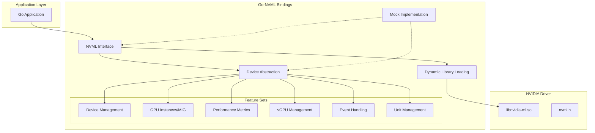
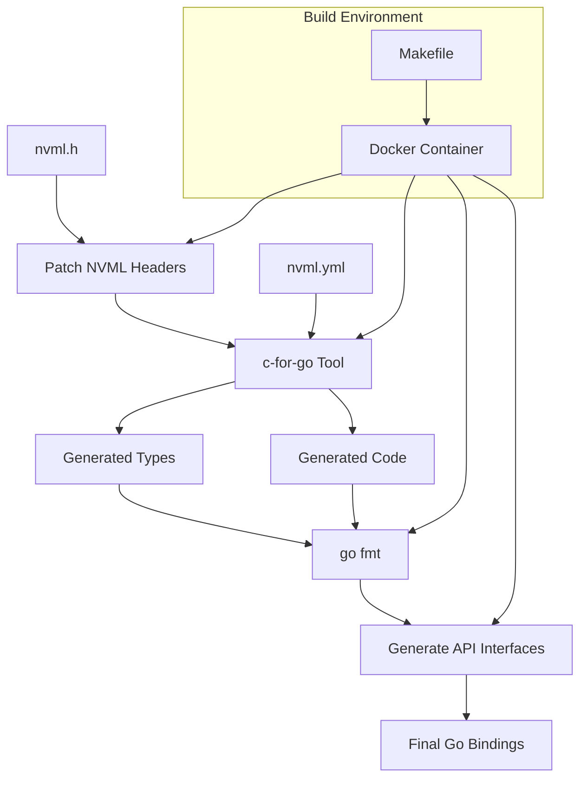
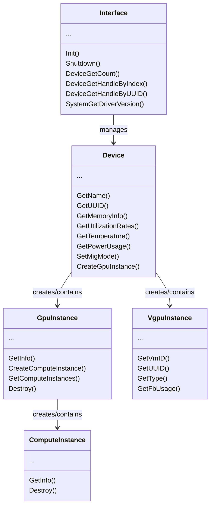
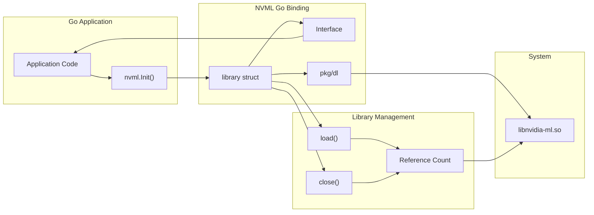
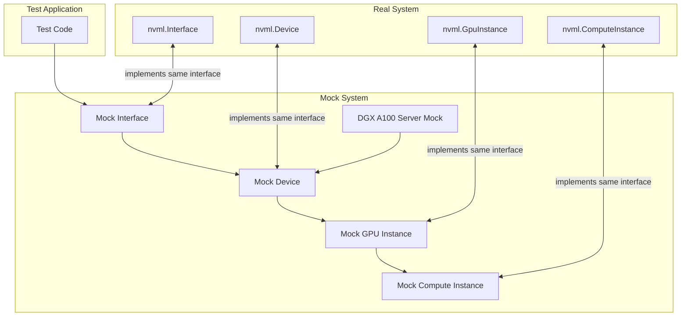

<!-- source: DeepWiki mcp.deepwiki.com · repo NVIDIA/go-nvml · page 1 Overview · fetched 2026-10-26 -->

# Overview

<details>
<summary>Relevant source files</summary>

The following files were used as context for generating this wiki page:

- [README.md](README.md)
- [go.mod](go.mod)
- [go.sum](go.sum)
- [pkg/nvml/cgo_helpers.h](pkg/nvml/cgo_helpers.h)
- [pkg/nvml/doc.go](pkg/nvml/doc.go)

</details>


The go-nvml repository provides Go language bindings for the [NVIDIA Management Library (NVML)](https://docs.nvidia.com/deploy/nvml-api), enabling Go applications to monitor and manage NVIDIA GPUs. These bindings act as wrappers around the C API provided by `libnvidia-ml.so`, which is part of the standard NVIDIA driver distribution.

The NVML API allows applications to query device state, monitor performance metrics, manage GPU instances, handle events, and control various aspects of NVIDIA GPUs. This document provides a high-level overview of the go-nvml repository structure, components, and how they interact.

For detailed information about building and generating the bindings, see [Building and Generating Bindings](#2).

Sources: [README.md:22-42]()

## System Architecture

The go-nvml repository consists of several interconnected components that work together to provide a Go interface to the NVIDIA Management Library.



The architecture consists of several layers:

1. **Application Layer**: Go applications that use the NVML bindings to interact with NVIDIA GPUs
2. **Go-NVML Bindings**: The core components of the repository
   - NVML Interface: Primary entry point for accessing NVML functionality
   - Device Abstraction: Representation of physical GPUs
   - Dynamic Library Loading: System for loading the NVIDIA driver's library
   - Mock Implementation: Test environment for when physical hardware is unavailable
3. **Feature Sets**: Various capabilities exposed through the bindings
4. **NVIDIA Driver**: The underlying driver containing the native NVML implementation

Sources: [README.md:22-42]()

## Binding Generation Process

The Go bindings are not written manually but generated from the NVML C headers using a tool called `c-for-go`. This ensures that the bindings stay up-to-date with the NVML API.



The process involves:

1. Starting with the NVML C header file (`nvml.h`)
2. Patching it to make it compatible with the binding generator
3. Processing it with `c-for-go` using configuration from `nvml.yml`
4. Generating Go types and code
5. Formatting the generated code and adding API interfaces
6. Creating the final Go bindings

This entire process is orchestrated by a Makefile and typically runs in a Docker container to ensure a consistent build environment.

Sources: [README.md:109-148]()

## Code Structure

The go-nvml repository is organized into two main directories:

1. `/gen`: Contains code used to generate the final Go bindings
2. `/pkg`: Houses the generated bindings and static packages

Key components include:



The key components are:

1. **Interface**: The main API entry point that provides methods for initializing the library and accessing devices
2. **Device**: Represents a physical GPU with methods for querying properties and creating instances
3. **GpuInstance**: Represents a GPU instance created through Multi-Instance GPU (MIG) technology
4. **ComputeInstance**: Represents a compute instance within a GPU instance
5. **VgpuInstance**: Represents a virtual GPU instance

Sources: [README.md:232-236](), [README.md:394-400]()

## Dynamic Library Loading

The go-nvml bindings dynamically load the NVIDIA Management Library (`libnvidia-ml.so`) at runtime. This means that the library does not need to be present during compilation, only at runtime.



The process works as follows:

1. A Go application calls `nvml.Init()`
2. The library struct attempts to load `libnvidia-ml.so` using the `pkg/dl` package
3. It maintains a reference count to ensure the library is only loaded once
4. The loaded library functions are made available through the Interface

The dynamic loading system also handles versioned symbols in the NVML library, ensuring that the correct version of each function is used.

Sources: [README.md:292-325]()

## Usage Example

Using the go-nvml bindings is straightforward. Here's a basic example of initializing the library and querying information about available GPUs:

```go
package main

import (
    "fmt"
    "log"

    "github.com/NVIDIA/go-nvml/pkg/nvml"
)

func main() {
    // Initialize NVML
    ret := nvml.Init()
    if ret != nvml.SUCCESS {
        log.Fatalf("Unable to initialize NVML: %v", nvml.ErrorString(ret))
    }
    defer func() {
        ret := nvml.Shutdown()
        if ret != nvml.SUCCESS {
            log.Fatalf("Unable to shutdown NVML: %v", nvml.ErrorString(ret))
        }
    }()

    // Get device count
    count, ret := nvml.DeviceGetCount()
    if ret != nvml.SUCCESS {
        log.Fatalf("Unable to get device count: %v", nvml.ErrorString(ret))
    }

    // Iterate through devices
    for i := 0; i < count; i++ {
        device, ret := nvml.DeviceGetHandleByIndex(i)
        if ret != nvml.SUCCESS {
            log.Fatalf("Unable to get device at index %d: %v", i, nvml.ErrorString(ret))
        }

        uuid, ret := device.GetUUID()
        if ret != nvml.SUCCESS {
            log.Fatalf("Unable to get uuid of device at index %d: %v", i, nvml.ErrorString(ret))
        }

        fmt.Printf("%v\n", uuid)
    }
}
```

Sources: [README.md:52-93]()

## Mock Implementation for Testing

For testing without actual NVIDIA hardware, go-nvml provides a mock implementation that simulates the behavior of real GPUs. This is particularly useful for development and testing in environments where GPUs may not be available.



The mock system:

1. Implements the same interfaces as the real system
2. Allows test code to interact with simulated GPUs
3. Provides a specialized DGX A100 server mock for testing complex scenarios
4. Enables testing of Multi-Instance GPU (MIG) functionality without actual hardware

For more detailed information about the mock implementation and testing capabilities, see [Mock Implementation](#6.1) and [DGX A100 Mock System](#6.2).

Sources: [README.md:476-480]()

## Related Pages

For more detailed information about specific aspects of go-nvml, refer to the following pages:

- [Building and Generating Bindings](#2): Detailed explanation of how the bindings are generated
- [Core API](#3): Overview of the main NVML API components
- [Library Infrastructure](#5): Details about how the Go bindings interface with the C library
- [Testing](#6): Information about testing capabilities and mock implementations

---

