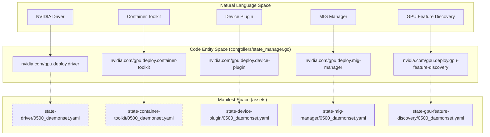
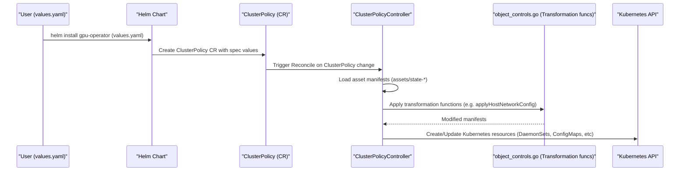

<!-- source: DeepWiki mcp.deepwiki.com · repo NVIDIA/gpu-operator · page 10 Glossary · fetched 2026-10-26 -->

# Glossary

Relevant source files

The following files were used as context for generating this wiki page:

- [api/nvidia/v1/clusterpolicy_types.go](api/nvidia/v1/clusterpolicy_types.go)
- [api/nvidia/v1/zz_generated.deepcopy.go](api/nvidia/v1/zz_generated.deepcopy.go)
- [api/nvidia/v1alpha1/nvidiadriver_types_test.go](api/nvidia/v1alpha1/nvidiadriver_types_test.go)
- [bundle/manifests/nvidia.com_clusterpolicies.yaml](bundle/manifests/nvidia.com_clusterpolicies.yaml)
- [config/crd/bases/nvidia.com_clusterpolicies.yaml](config/crd/bases/nvidia.com_clusterpolicies.yaml)
- [config/samples/v1_clusterpolicy.yaml](config/samples/v1_clusterpolicy.yaml)
- [controllers/clusterinfo/clusterinfo.go](controllers/clusterinfo/clusterinfo.go)
- [controllers/clusterpolicy_controller.go](controllers/clusterpolicy_controller.go)
- [controllers/nvidiadriver_controller.go](controllers/nvidiadriver_controller.go)
- [controllers/nvidiadriver_controller_test.go](controllers/nvidiadriver_controller_test.go)
- [controllers/object_controls.go](controllers/object_controls.go)
- [controllers/object_controls_test.go](controllers/object_controls_test.go)
- [controllers/state_manager.go](controllers/state_manager.go)
- [controllers/transforms_test.go](controllers/transforms_test.go)
- [controllers/upgrade_controller.go](controllers/upgrade_controller.go)
- [deployments/gpu-operator/crds/nvidia.com_clusterpolicies.yaml](deployments/gpu-operator/crds/nvidia.com_clusterpolicies.yaml)
- [deployments/gpu-operator/templates/clusterpolicy.yaml](deployments/gpu-operator/templates/clusterpolicy.yaml)
- [deployments/gpu-operator/templates/gpucluster.yaml](deployments/gpu-operator/templates/gpucluster.yaml)
- [deployments/gpu-operator/values.yaml](deployments/gpu-operator/values.yaml)
- [internal/consts/consts.go](internal/consts/consts.go)
- [internal/render/render.go](internal/render/render.go)
- [internal/state/driver.go](internal/state/driver.go)
- [internal/state/driver_test.go](internal/state/driver_test.go)
- [internal/state/driver_volumes.go](internal/state/driver_volumes.go)
- [internal/state/manager.go](internal/state/manager.go)
- [internal/state/metrics.go](internal/state/metrics.go)
- [internal/state/types.go](internal/state/types.go)
- [internal/validator/validator.go](internal/validator/validator.go)
- [internal/validator/validator_suite_test.go](internal/validator/validator_suite_test.go)
- [internal/validator/validator_test.go](internal/validator/validator_test.go)

This glossary defines codebase-specific terms, abbreviations, and domain concepts used within the NVIDIA GPU Operator. It serves as a technical reference for engineers to map high-level concepts to their concrete implementations and understand how configurations propagate through the system components.

---

## Core Concepts

### ClusterPolicy
The primary Custom Resource (CR) used to configure the GPU Operator. It defines the desired state for all GPU-related components across the cluster in a unified specification.

- **Implementation**: Defined in `api/nvidia/v1/clusterpolicy_types.go`.
- **CRD Definition**: See the ClusterPolicy CRD in [config/crd/bases/nvidia.com_clusterpolicies.yaml:3-15]() and [bundle/manifests/nvidia.com_clusterpolicies.yaml:3-15]().
- **Usage**: Serves as the central configuration for the operator, reconciled by the `ClusterPolicyController` in `controllers/clusterpolicy_controller.go`.
- **Spec Highlights**: Includes fields for `operator`, `daemonsets`, `validator`, `mig`, `driver`, `devicePlugin`, `gfd`, `dcgmExporter`, and more.
- **Relationship**: Orchestrates deployment of GPU components by producing Kubernetes resources (DaemonSets, ConfigMaps, etc) via manifests from `assets/state-*`.

### NVIDIADriver
A specialized Custom Resource used to manage NVIDIA driver installation independently for advanced scenarios (e.g., heterogeneous nodes).

- **Implementation**: Defined in `api/nvidia/v1alpha1/nvidiadriver_types.go`.
- **Controllers**: Managed by `NVIDIADriverReconciler` in `controllers/nvidiadriver_controller.go`.
- **Usage**: Used when greater driver deployment control or customization is needed beyond ClusterPolicy capabilities.
- **States**: Its lifecycle is encapsulated by the driver state implementation in `internal/state/driver.go`.

### State
Logical grouping of Kubernetes objects representing a GPU-related subsystem or component (Driver, Toolkit, Device Plugin, MIG Manager, etc).

- **Pattern**: Implemented via a common `State` interface and skeleton `stateSkel` struct in the `controllers/state_manager.go` and specific state implementations in `internal/state/`.
- **Role**: Each state manages manifests for its component, applying, updating, and monitoring their readiness.
- **Example**: `stateDriver` manages driver DaemonSets [internal/state/driver.go:63-167](), added to controller in [controllers/state_manager.go:160-177]().

---

## System Terminology

### CDI (Container Device Interface)
A specification allowing container runtimes to configure third-party devices (like GPUs) without manual environment variable injection.

- **Config Field**: `spec.cdi` in ClusterPolicy controls usage and enabling of CDI and related NRI plugins.
- **Values.yaml**: Enabled by default, can be disabled or configured [deployments/gpu-operator/values.yaml:15-18]() and [deployments/gpu-operator/values.yaml:149-152]().
- **Implementation**: Transformation logic handles config in `controllers/object_controls.go`.

### GFD (GPU Feature Discovery)
A component that runs as a DaemonSet to detect GPU features on nodes and label those nodes accordingly for scheduling and configuration.

- **Labels**: Uses Kubernetes node labels with prefix `feature.node.kubernetes.io/` [controllers/state_manager.go:53-58]().
- **Manifest**: Configured through manifests in `assets/state-gpu-feature-discovery/`.
- **Purpose**: Provides hardware details to the scheduler and driver components.

### MIG (Multi-Instance GPU)
NVIDIA technology allowing a physical GPU to be partitioned into multiple isolated GPU instances.

- **Strategies**: Supports strategies like `single` or `mixed` [deployments/gpu-operator/values.yaml:165-166]().
- **Management**: Controlled by the MIG Manager state that deploys the `mig-manager` DaemonSet.
- **Labeling**: Uses labels such as `nvidia.com/gpu.deploy.mig-manager`.

### Sandbox Workloads
Support for running GPU workloads in sandboxed or virtualized environments such as KubeVirt VMs or Kata Containers.

- **Modes**: `kubevirt` (default) or `kata` [deployments/gpu-operator/values.yaml:22-23]().
- **Labels**: Deployment governed by labels like `nvidia.com/gpu.deploy.sandbox-device-plugin` and `nvidia.com/gpu.deploy.kata-sandbox-device-plugin` [controllers/state_manager.go:99-125]().
- **Components**: Includes sandbox device plugin, vfio/gpu managers, and relevant validators.

---

## Technical Implementation Terms

### Object Controls & Transformations
Functions and logic that modify raw Kubernetes manifests from the `assets/` directory per the current `ClusterPolicy` or `NVIDIADriver` spec before applying.

- **Key File**: `controllers/object_controls.go` (e.g., `applyHostNetworkConfig`) [controllers/object_controls.go:58-63]().
- **Responsibilities**: Modify Pod specs, inject environment variables, volume mounts, labels, and other settings dynamically based on configuration.
- **Testing**: Verified with tests in `controllers/transforms_test.go` [controllers/transforms_test.go:230-242]().

### Validator
Pods that run briefly to validate proper installation and functionality of components (driver, toolkit, device plugin, etc).

- **Image Config**: Set via env variables like `VALIDATOR_IMAGE` defined in cluster manifests [controllers/object_controls.go:102-110]().
- **Configuration**: Configured in `values.yaml` validator section [deployments/gpu-operator/values.yaml:66-79]() and in the ClusterPolicy.
- **Purpose**: Detects failures early and helps update operator status conditions.

### RuntimeClass
Kubernetes `RuntimeClass` enables scheduling pods with a specific container runtime configuration. The GPU Operator supports setting a runtime class (default "nvidia"):

- **Configuration**: Via `operator.runtimeClass` in ClusterPolicy and `values.yaml` [deployments/gpu-operator/values.yaml:80-94]() and [deployments/gpu-operator/templates/clusterpolicy.yaml:22-28]().
- **Usage**: Set on pod specs to ensure usage of nvidia GPU-aware runtimes.

###

## Component Label Keys

The operator uses node labels extensively to gate deployment of components. These constants appear in code and dictate which DaemonSets or Deployments run on the node.

| Label Key                         | Description                        | Used By Component                        |
|----------------------------------|----------------------------------|----------------------------------------|
| `nvidia.com/gpu.deploy.driver`         | NVIDIA GPU Driver deployment       | driver state, driver DaemonSet           |
| `nvidia.com/gpu.deploy.container-toolkit` | Container Toolkit for GPU runtime integration | container-toolkit deployment |
| `nvidia.com/gpu.deploy.device-plugin` | Device Plugin for Kubernetes GPU resource management | device-plugin DaemonSet       |
| `nvidia.com/gpu.deploy.mig-manager`    | MIG manager for Multi-Instance GPU | mig-manager DaemonSet                  |
| `nvidia.com/gpu.deploy.gpu-feature-discovery` | GPU Feature Discovery             | gpu-feature-discovery DaemonSet         |
| `nvidia.com/gpu.deploy.dcgm`            | DCGM (Data Center GPU Manager)     | dcgm DaemonSet                           |
| `nvidia.com/gpu.deploy.dcgm-exporter`   | DCGM metrics exporter              | dcgm-exporter Deployment                 |
| `nvidia.com/gpu.deploy.vgpu-manager`    | vGPU Manager                      | vgpu-manager DaemonSet                   |
| `nvidia.com/gpu.deploy.sandbox-device-plugin` | Sandbox device plugin                | KubeVirt/Kata sandbox plugin DaemonSet  |

These labels serve both as selectors for workload placement and toggle points for component deployment in states.

Sources: [controllers/state_manager.go:40-146]()

---

## Component Mapping Diagram

This diagram bridges the natural language component names to internal code labels and their corresponding manifest origins.

Sources: [controllers/state_manager.go:40-146](), manifests in `assets/state-*`

---

## Data Flow: Configuration to Manifest Application

Illustrates the flow from user configuration in `values.yaml` through the ClusterPolicy CR, operator reconciliation, transformation of manifests, and Kubernetes API calls.

Sources: [deployments/gpu-operator/values.yaml:4-150](), [controllers/clusterpolicy_controller.go](), [controllers/object_controls.go:56-103]()

---

## Common Abbreviations

| Abbreviation | Full Name                   | Context / Usage                                             |
|--------------|-----------------------------|-------------------------------------------------------------|
| **OCP**      | OpenShift Container Platform | Platform detection and special driver toolkit handling [values.yaml:6]() |
| **DTK**      | Driver Toolkit             | OpenShift-specific driver toolkit support [state_manager.go:130-143]() |
| **NFD**      | Node Feature Discovery      | Node GPU hardware feature detection and labeling [state_manager.go:40-58]() |
| **PSA**      | Pod Security Admission     | Security context settings for privileged namespace [values.yaml:12-13]() |
| **GDS**      | GPUDirect Storage          | Enabled by env var `GPU_DIRECT_STORAGE_ENABLED` [object_controls.go] |
| **GFD**      | GPU Feature Discovery      | DaemonSet that labels GPUs on nodes [state_manager.go:53-69]() |

Sources: [deployments/gpu-operator/values.yaml:1-40](), [controllers/state_manager.go:40-81](), [controllers/object_controls.go:56-135]()

---

This glossary is designed to help engineers quickly navigate from conceptual terminology to the corresponding code and configuration artifacts within the GPU Operator codebase and ecosystem.

# End of Glossary