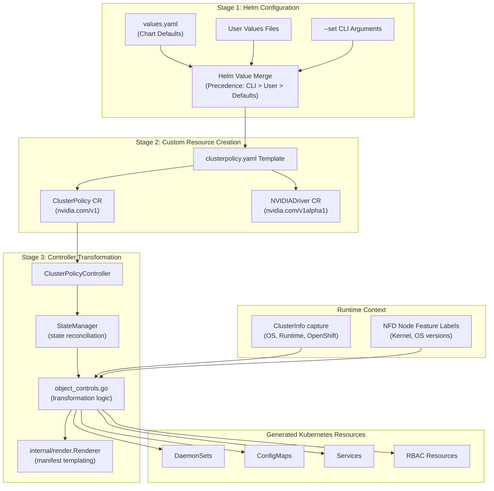
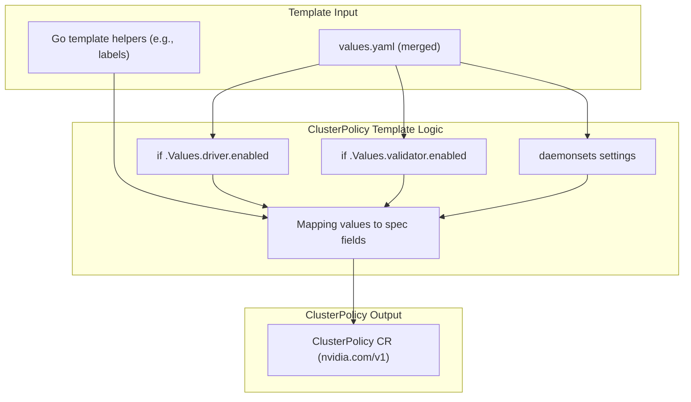
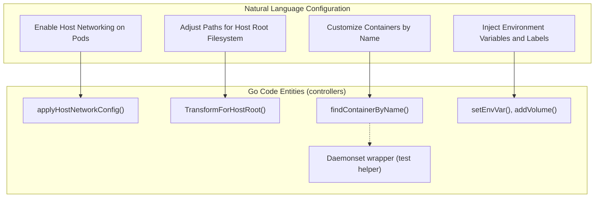

<!-- source: DeepWiki mcp.deepwiki.com · repo NVIDIA/gpu-operator · page 2.3 Configuration and Transformation System · fetched 2026-10-26 -->

# Configuration and Transformation System

<details>
<summary>Relevant source files</summary>

The following files were used as context for generating this wiki page:

- [api/nvidia/v1/clusterpolicy_types.go](api/nvidia/v1/clusterpolicy_types.go)
- [api/nvidia/v1/zz_generated.deepcopy.go](api/nvidia/v1/zz_generated.deepcopy.go)
- [bundle/manifests/nvidia.com_clusterpolicies.yaml](bundle/manifests/nvidia.com_clusterpolicies.yaml)
- [config/crd/bases/nvidia.com_clusterpolicies.yaml](config/crd/bases/nvidia.com_clusterpolicies.yaml)
- [config/samples/v1_clusterpolicy.yaml](config/samples/v1_clusterpolicy.yaml)
- [controllers/clusterinfo/clusterinfo.go](controllers/clusterinfo/clusterinfo.go)
- [controllers/object_controls.go](controllers/object_controls.go)
- [controllers/object_controls_test.go](controllers/object_controls_test.go)
- [controllers/state_manager.go](controllers/state_manager.go)
- [controllers/transforms_test.go](controllers/transforms_test.go)
- [deployments/gpu-operator/crds/nvidia.com_clusterpolicies.yaml](deployments/gpu-operator/crds/nvidia.com_clusterpolicies.yaml)
- [deployments/gpu-operator/templates/clusterpolicy.yaml](deployments/gpu-operator/templates/clusterpolicy.yaml)
- [deployments/gpu-operator/values.yaml](deployments/gpu-operator/values.yaml)
- [internal/consts/consts.go](internal/consts/consts.go)
- [internal/render/render.go](internal/render/render.go)
- [internal/render/render_suite_test.go](internal/render/render_suite_test.go)
- [internal/render/render_test.go](internal/render/render_test.go)
- [internal/state/driver.go](internal/state/driver.go)
- [internal/state/driver_test.go](internal/state/driver_test.go)
- [internal/state/driver_volumes.go](internal/state/driver_volumes.go)
- [internal/state/types.go](internal/state/types.go)

</details>


This document explains how user configuration flows through the NVIDIA GPU Operator's multi-stage transformation pipeline, from Helm chart values to deployed Kubernetes resources. It covers Helm templating, Custom Resource creation, controller-based transformations, and the manifest rendering and transformation functions that customize operand Kubernetes objects based on cluster and user configurations.

For information about the Custom Resource schemas themselves, see **ClusterPolicy** and **NVIDIADriver**. For details on the State interface and reconciliation pattern, see **Core Concepts**.

---

## Configuration Pipeline Overview

The GPU Operator employs a configuration transformation pipeline that converts high-level user intent into cluster-specific Kubernetes resources. The pipeline consists of three major stages:



**Summary:**
- User Helm configuration files (`values.yaml`) are merged and templated into CR YAML manifests.
- The ClusterPolicy CR is applied to the cluster.
- The GPU Operator’s controller observes the CR, reads cluster runtime info, and executes transformation logic in `object_controls.go`.
- This logic adapts rendered manifests, enhanced by the generic manifest renderer (`internal/render`), injecting node-specific configuration, volumes, and labels.
- The final Kubernetes objects like DaemonSets and ConfigMaps are applied into the cluster.

**Sources:**  
[deployments/gpu-operator/values.yaml:1-223](),  
[deployments/gpu-operator/templates/clusterpolicy.yaml:1-200](),  
[controllers/object_controls.go:1-135](),  
[internal/render/render.go:30-120]()  

---

## Stage 1: Helm Configuration Merging

### values.yaml Structure

The Helm chart’s default configuration is defined in `deployments/gpu-operator/values.yaml`. It provides comprehensive default settings for all components and operator behavior. User overrides or Helm CLI `--set` options merge over these defaults.

Key sections include:

| Configuration Path       | Purpose                               | Example snippet                          |
|-------------------------|-------------------------------------|----------------------------------------|
| `platform`              | Platform-specific flags (e.g., OpenShift) | `openshift: false` [values.yaml:5-6]()    |
| `nfd`                   | Node Feature Discovery integration    | `enabled: true` [values.yaml:8-9]()     |
| `daemonsets`            | Shared DaemonSet configuration, labels, annotations, and update policies | [values.yaml:41-58]()                    |
| `driver`                | NVIDIA driver deployment specifics, version, probes, upgrade policy | Version: `"595.91.07"` [values.yaml:164-204]()  |
| `operator`              | Operator pod configuration: image, runtimeClass, priorityClass, logging | [values.yaml:80-138]()                   |
| `mig`                   | Multi-Instance GPU strategy            | `strategy: single` [values.yaml:164-167]() |

These configurations feed into the Helm template rendering in the next stage.

---

### Helm Values are Merged with Precedence:

- Default values from `values.yaml`
- User-supplied value files
- CLI `--set` flags override all

This produces a final unified configuration object passed to Go templates during CR rendering.

**Sources:**  
[deployments/gpu-operator/values.yaml:1-223]()  

---

## Stage 2: Custom Resource Generation via Helm Templates

### ClusterPolicy Template Rendering

The Helm chart contains a key template `deployments/gpu-operator/templates/clusterpolicy.yaml` that renders the `ClusterPolicy` Custom Resource from merged Helm values.



#### Key Template Features

- Conditional rendering gates component inclusion (e.g., `{{- if .Values.driver.enabled }}`) allowing optional component deployment.
- Use of Helm built-in functions like `quote` to ensure safe YAML rendering (e.g., driver version strings).
- Nested maps and arrays from Helm values are passed verbatim, allowing detailed per-component configuration.

Example snippet:

```yaml
spec:
  driver:
    enabled: {{ .Values.driver.enabled }}
    version: {{ .Values.driver.version | quote }}
  daemonsets:
    priorityClassName: {{ .Values.daemonsets.priorityClassName }}
```

This template produces a syntactically and semantically valid `ClusterPolicy` CR with spec fields reflecting user and default inputs.

---

### ClusterPolicy and NVIDIADriver CRs

- The `ClusterPolicy` CR is the main user configuration resource.
- The operator reconciles it and optionally the `NVIDIADriver` CR, which provides advanced customization options.

The ClusterPolicy schema corresponds to the Helm values structure but as a Kubernetes resource with strict typing.

**Sources:**  
[deployments/gpu-operator/templates/clusterpolicy.yaml:1-200]()  
[config/samples/v1_clusterpolicy.yaml:1-122]()  
[bundle/manifests/nvidia.com_clusterpolicies.yaml:1-180]()  

---

## Stage 3: Controller Transformation System

After CR creation, the ClusterPolicy is observed by the `ClusterPolicyController` implemented in the `controllers` package. This controller runs reconciliation loops, invoking the State interface implementations for each component.

### Manifest Rendering and Transformation

Central to the transformation system are:

| Component                              | Description                                           | File / Lines                                  |
|--------------------------------------|-------------------------------------------------------|-----------------------------------------------|
| `internal/render.Renderer`            | Manifest renderer that processes Helm-like templates loaded as files and renders them with structured render data. | [internal/render/render.go:20-130]()           |
| Transformation functions in `object_controls.go` | Implements logic to mutate generic Kubernetes objects based on CR spec and runtime cluster information | [controllers/object_controls.go:50-135]()   |
| Component State implementations      | Per-component `State` structs (e.g., driver, toolkit) which interact with renderer and apply transformations | [internal/state/driver.go:60-167]()           |

---

### Transformation Logic in `object_controls.go`

This file is the heart of object customization:

- It contains helper functions for configuring Kubernetes Pod specs, such as `applyHostNetworkConfig` to enable `hostNetwork` and adjust DNSPolicy [object_controls.go:59-63]().
- Defines constants used globally for GPU workloads like `DefaultRuntimeClass = "nvidia"` [object_controls.go:91]() and hash key names.
- Provides utilities to locate and adjust Containers in Pod templates, set volumes, environment variables, and labels consistently.
- Invoked by component states during the sync process to transform rendered manifests loaded from `internal/render`.

Example relevant function:

```go
// applyHostNetworkConfig sets HostNetwork and DNSPolicy on a pod spec if enabled
func applyHostNetworkConfig(podSpec *corev1.PodSpec, hostNetwork *bool) {
	if hostNetwork != nil && *hostNetwork {
		podSpec.HostNetwork = true
		podSpec.DNSPolicy = corev1.DNSClusterFirstWithHostNet
	}
}
```

---

### Code Entity Interaction Diagram

This diagram illustrates how natural language configuration intents map onto key Go code constructs in the transformation system:



This clarifies the mapping from user intents to concrete code entities performing the transformations.

**Sources:**  
[controllers/object_controls.go:58-135]()  
[controllers/transforms_test.go:230-242]()

---

## Runtime Context and Data Flow

The transformation system adapts manifests based on runtime cluster data collected by the controllers, including:

- **NFD (Node Feature Discovery):** Node labels indicating kernel version, OS family, and other hardware/OS traits.
- **ClusterInfo:** Encapsulates OpenShift version, container runtime, proxy settings, and special platform features.
- **User CR Spec:** The ClusterPolicy and NVIDIADriver resources containing user config.

These influence volume mounts, image selections, tolerations, security contexts, and feature flags in generated resources.

---

### OS and Kernel Mapping for Volumes

The driver and toolkit require mounting platform-specific repository and certificate paths. The operator maintains mappings from OS identifiers (from NFD labels) to paths for repo configs and cert bundles:

| OS ID    | Repo Config Path                 | Certificate Path                             |
|----------|---------------------------------|---------------------------------------------|
| `ubuntu` | `/etc/apt/sources.list.d`       | `/usr/local/share/ca-certificates`          |
| `rhel`   | `/etc/yum.repos.d`              | `/etc/pki/ca-trust/extracted/pem`           |
| `sles`   | `/etc/zypp/repos.d`             | `/etc/pki/trust/anchors`                     |

These paths guide the mounting of ConfigMaps or host paths to the driver container, enabling offline repositories or custom certs.

---

### Driver Volume Transformation Overview

The function `getDriverAdditionalConfigs` in the driver state adds additional volumes and mounts based on the CR and detected environment:

- If repo config mounting is enabled (`IsRepoConfigEnabled()`), a ConfigMap volume named `repo-config` is injected at the OS-specific path.
- If certs mounting is enabled (`IsCertConfigEnabled()`), a ConfigMap volume named `certs` is mounted.
- For RHEL and SLES, host subscription entitlement volumes are mounted for licensing purposes, usually under `/etc/pki/entitlement` and `/etc/pki/product`.

This dynamic injection allows the driver DaemonSet to adapt to enterprise or custom cluster setups.

**Sources:**  
[internal/state/driver_volumes.go:130-188]()  

---

## Manifest Rendering and Object Creation

### `internal/render.Renderer`

- Loads manifest fragment files from component `assets/` or `manifests/` directories.
- Parses Go templates embedded within manifests.
- Renders manifests passing in complex render data structs containing user spec, cluster info, and computed config.
- Outputs a list of `*unstructured.Unstructured` Kubernetes objects.
- These objects are further mutated by `object_controls.go` functions for final customization.

This layered approach separates static manifest data from dynamic runtime adaptation.

**Sources:**  
[internal/render/render.go:20-120]()  

---

## Transformation Examples

### HostPath Volume Transformation

In some components, volumes referencing the host root filesystem must be adjusted if user specifies a chrooted root filesystem path in ClusterPolicy.

The `TransformForHostRoot` function scans DaemonSet volumes and updates paths of volumes named `host-root` and `host-dev-char` accordingly.

This ensures components like MIG Manager or Toolkit interact with the correct host filesystem namespace.

**Source snippet:**  
- Input cluster policy field: `hostPaths.rootFS` [values.yaml:26-31]()  
- Transformation updates volume sources based on this [controllers/transforms_test.go:240-255]()

---

### Validator Pod Environment Injection

The validator DaemonSet uses environment variables to configure behavior:

- `VALIDATOR_IMAGE` and `VALIDATOR_IMAGE_PULL_POLICY` are injected from operator settings.
- `VALIDATOR_RUNTIME_CLASS` is set to reflect operator runtimeClass (e.g., "nvidia").
- If MIG strategy is configured, `MIG_STRATEGY` env var is injected to control the validator behavior.

This customization happens during object transformation in code.

---

## Summary

The NVIDIA GPU Operator configuration and transformation system orchestrates multi-layered value flows:

| Step                     | Representation               | Key Code Entity                          |
|--------------------------|-----------------------------|-----------------------------------------|
| User configuration       | `values.yaml` and Helm CLI flags | Helm chart defaults and overrides       |
| Helm template rendering  | `clusterpolicy.yaml` template  | Helm Go templates in `deployments/gpu-operator/templates/` |
| Custom Resource          | `ClusterPolicy` CR (nvidia.com/v1) | API types in `api/nvidia/v1/clusterpolicy_types.go` |
| Controller reconciliation | `ClusterPolicyController` and StateManager | `controllers/object_controls.go` and `internal/state/` packages |
| Manifest rendering        | Kubernetes object manifests, templated | `internal/render.Renderer` |
| Runtime adaptation        | OS/kernel info, NFD labels, cluster info | Node label collection and cluster info objects |

This hierarchical pipeline enables flexible, cluster-aware customization of GPU-related components using a declarative configuration model.

---

**Sources Summary:**  

- [deployments/gpu-operator/values.yaml:1-223]()  
- [deployments/gpu-operator/templates/clusterpolicy.yaml:1-200]()  
- [controllers/object_controls.go:1-135]()  
- [controllers/transforms_test.go:220-255]()  
- [internal/state/driver_volumes.go:120-188]()  
- [internal/render/render.go:20-130]()  
- [config/samples/v1_clusterpolicy.yaml:1-122]()  
- [internal/state/driver.go:60-167]()

---

