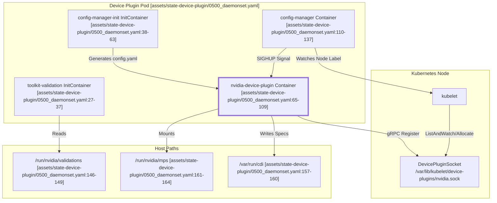
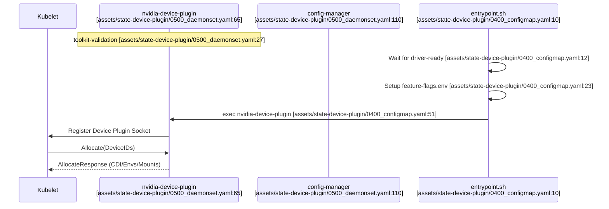

<!-- source: DeepWiki mcp.deepwiki.com · repo NVIDIA/gpu-operator · page 4.3 Device Plugin · fetched 2026-10-26 -->

# Device Plugin

<details>
<summary>Relevant source files</summary>

The following files were used as context for generating this wiki page:

- [assets/gpu-feature-discovery/0500_daemonset.yaml](assets/gpu-feature-discovery/0500_daemonset.yaml)
- [assets/state-container-toolkit/0400_configmap.yaml](assets/state-container-toolkit/0400_configmap.yaml)
- [assets/state-container-toolkit/0500_daemonset.yaml](assets/state-container-toolkit/0500_daemonset.yaml)
- [assets/state-dcgm-exporter/0800_daemonset.yaml](assets/state-dcgm-exporter/0800_daemonset.yaml)
- [assets/state-dcgm/0400_dcgm.yml](assets/state-dcgm/0400_dcgm.yml)
- [assets/state-device-plugin/0400_configmap.yaml](assets/state-device-plugin/0400_configmap.yaml)
- [assets/state-device-plugin/0500_daemonset.yaml](assets/state-device-plugin/0500_daemonset.yaml)
- [assets/state-kata-manager/0410_configmap.yaml](assets/state-kata-manager/0410_configmap.yaml)
- [assets/state-kata-manager/0600_daemonset.yaml](assets/state-kata-manager/0600_daemonset.yaml)
- [assets/state-mig-manager/0420_configmap.yaml](assets/state-mig-manager/0420_configmap.yaml)
- [assets/state-mig-manager/0600_daemonset.yaml](assets/state-mig-manager/0600_daemonset.yaml)
- [assets/state-mps-control-daemon/0400_daemonset.yaml](assets/state-mps-control-daemon/0400_daemonset.yaml)
- [assets/state-operator-validation/0500_daemonset.yaml](assets/state-operator-validation/0500_daemonset.yaml)
- [assets/state-sandbox-validation/0500_daemonset.yaml](assets/state-sandbox-validation/0500_daemonset.yaml)

</details>


## Purpose and Scope

The NVIDIA Device Plugin for Kubernetes is a core component of the GPU Operator that implements the [Kubernetes Device Plugin framework](https://kubernetes.io/docs/concepts/extend-kubernetes/compute-storage-net/device-plugins). It is responsible for discovering NVIDIA GPU resources on a node, advertising them to the Kubelet, and managing the allocation of these resources to containers.

This page covers the implementation details of the device plugin DaemonSet, the `config-manager` for dynamic configuration, and specialized support for Multi-Process Service (MPS).

Sources: [assets/state-device-plugin/0500_daemonset.yaml:1-167](), [assets/state-device-plugin/0400_configmap.yaml:1-52]()

---

## Component Architecture

The Device Plugin is deployed as a DaemonSet on nodes where GPUs are present and the operator has successfully validated the driver and toolkit.


**Diagram: Device Plugin Internal Components and Code Entities**  
Sources: [assets/state-device-plugin/0500_daemonset.yaml:1-167](), [assets/state-device-plugin/0400_configmap.yaml:1-52]()

### Code Entity Mapping
The following table maps system concepts to their specific implementations in the codebase:

| Concept | Code Entity / File | Description |
| :--- | :--- | :--- |
| **Deployment Logic** | `TransformDevicePlugin` | Logic in `object_controls.go` that renders the DaemonSet manifest. [controllers/object_controls.go:757]() |
| **Validation Sync** | `toolkit-validation` | Init container ensuring the container stack is ready. [assets/state-device-plugin/0500_daemonset.yaml:27-37]() |
| **Configuration** | `config-manager` | Binary that synchronizes ConfigMaps to local files based on node labels. [assets/state-device-plugin/0500_daemonset.yaml:110-137]() |
| **MPS Control** | `nvidia-device-plugin-mps-control-daemon` | Separate DaemonSet for managing the MPS daemon process. [assets/state-mps-control-daemon/0400_daemonset.yaml:6-78]() |

Sources: [controllers/object_controls.go:757-760](), [assets/state-device-plugin/0500_daemonset.yaml:27-137](), [assets/state-mps-control-daemon/0400_daemonset.yaml:6-78]()

---

## Initialization and Data Flow

The device plugin follows a strict initialization sequence to ensure that GPU hardware and the NVIDIA container stack are fully functional before advertising resources.

### Registration and Allocation Sequence

**Diagram: Device Plugin Lifecycle and Kubelet Interaction**  
Sources: [assets/state-device-plugin/0400_configmap.yaml:9-52](), [assets/state-device-plugin/0500_daemonset.yaml:27-63]()

### Key Environment Variables
The plugin behavior is heavily influenced by environment variables injected by the operator:
*   **`PASS_DEVICE_SPECS`**: Set to `true` to ensure device nodes are passed to the runtime [assets/state-device-plugin/0500_daemonset.yaml:73-74]().
*   **`DEVICE_LIST_STRATEGY`**: Set to `envvar` to use `NVIDIA_VISIBLE_DEVICES` [assets/state-device-plugin/0500_daemonset.yaml:77-78]().
*   **`DEVICE_ID_STRATEGY`**: Set to `uuid` for consistent device identification [assets/state-device-plugin/0500_daemonset.yaml:79-80]().
*   **`MPS_ROOT`**: Points to `/run/nvidia/mps` for MPS control pipe management [assets/state-device-plugin/0500_daemonset.yaml:85-86]().

Sources: [assets/state-device-plugin/0500_daemonset.yaml:73-86]()

---

## Configuration Management

The GPU Operator supports dynamic reconfiguration of the device plugin via the `config-manager` sidecar. This allows users to change settings (like time-slicing or sharing) by simply updating a node label.

### Dynamic Reload Mechanism
1.  **Label Monitoring**: The `config-manager` watches the node for the `nvidia.com/device-plugin.config` label [assets/state-device-plugin/0500_daemonset.yaml:124-125]().
2.  **Config Sync**: It maps the label value to a ConfigMap and writes the content to `/config/config.yaml` [assets/state-device-plugin/0500_daemonset.yaml:126-129]().
3.  **Signal Notification**: The sidecar sends `SIGHUP` (Signal 1) to the `nvidia-device-plugin` process [assets/state-device-plugin/0500_daemonset.yaml:133-137]().
4.  **Plugin Reload**: The plugin re-reads the configuration file and updates its resource advertisement.

Sources: [assets/state-device-plugin/0500_daemonset.yaml:110-137]()

---

## Multi-Process Service (MPS)

MPS allows multiple Kubernetes containers to share a single GPU by multiplexing hardware resources. The Operator manages this via a specialized control daemon.

### MPS Control Daemon
The `nvidia-device-plugin-mps-control-daemon` runs on nodes labeled with `nvidia.com/mps.capable: "true"` [assets/state-mps-control-daemon/0400_daemonset.yaml:19-21]().

*   **Shared Memory**: The daemon requires a specialized `/dev/shm` mount at `/run/nvidia/mps/shm` to facilitate health-checking and IPC between the daemon and client processes [assets/state-mps-control-daemon/0400_daemonset.yaml:133-135]().
*   **Init Mounts**: The `mps-control-daemon-mounts` init container sets up the bidirectional mount propagation for the MPS root directory [assets/state-mps-control-daemon/0400_daemonset.yaml:40-48]().
*   **Capabilities**: The daemon is granted `compute` and `utility` driver capabilities [assets/state-mps-control-daemon/0400_daemonset.yaml:87-88]().

### Device Plugin Integration
When MPS is enabled, the device plugin mounts the host's `/run/nvidia/mps` directory into the plugin container at `/mps` [assets/state-device-plugin/0500_daemonset.yaml:108-109](). This allows the plugin to provide the necessary control sockets to workload containers during the `Allocate` phase.

Sources: [assets/state-mps-control-daemon/0400_daemonset.yaml:1-135](), [assets/state-device-plugin/0500_daemonset.yaml:108-109]()

---

## Validation and Readiness

The device plugin does not start until the node is fully validated. The `entrypoint.sh` script, provided via a ConfigMap, contains the logic to block execution:

```bash
until [ -f /run/nvidia/validations/driver-ready ]
do
  echo "waiting for the driver validations to be ready..."
  sleep 5
done
```
Sources: [assets/state-device-plugin/0400_configmap.yaml:10-16]()

Once the driver is ready, it sources the validation file to export environment variables (like `IS_HOST_DRIVER`) and detect optional feature flags (`gdrdrv`, `nvidia_fs`) before executing the binary [assets/state-device-plugin/0400_configmap.yaml:18-51]().

Sources: [assets/state-device-plugin/0400_configmap.yaml:1-52]()

---

