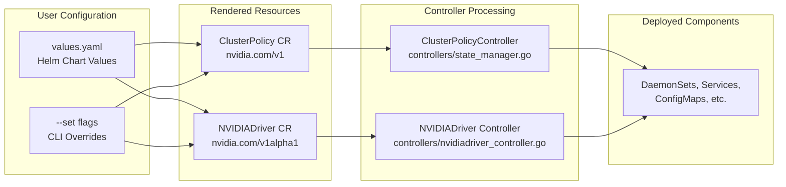
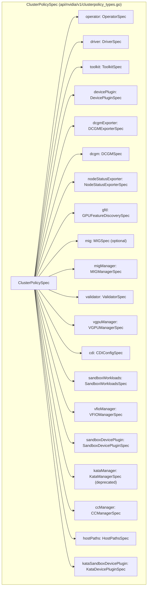
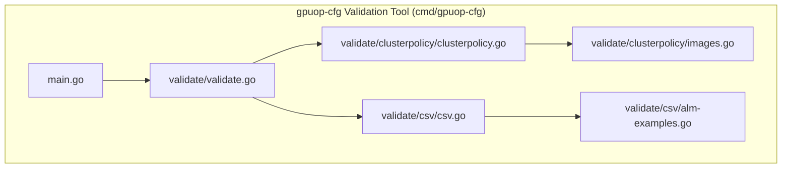

<!-- source: DeepWiki mcp.deepwiki.com · repo NVIDIA/gpu-operator · page 9 API Reference · fetched 2026-10-26 -->

# API Reference

Relevant source files

The following files were used as context for generating this wiki page:

- [api/nvidia/v1/clusterpolicy_types.go](api/nvidia/v1/clusterpolicy_types.go)
- [api/nvidia/v1/clusterpolicy_types_test.go](api/nvidia/v1/clusterpolicy_types_test.go)
- [api/nvidia/v1/zz_generated.deepcopy.go](api/nvidia/v1/zz_generated.deepcopy.go)
- [api/nvidia/v1alpha1/groupversion_info.go](api/nvidia/v1alpha1/groupversion_info.go)
- [api/versioned/typed/nvidia/v1/clusterpolicy.go](api/versioned/typed/nvidia/v1/clusterpolicy.go)
- [api/versioned/typed/nvidia/v1/fake/fake_clusterpolicy.go](api/versioned/typed/nvidia/v1/fake/fake_clusterpolicy.go)
- [api/versioned/typed/nvidia/v1/fake/fake_nvidia_client.go](api/versioned/typed/nvidia/v1/fake/fake_nvidia_client.go)
- [api/versioned/typed/nvidia/v1/nvidia_client.go](api/versioned/typed/nvidia/v1/nvidia_client.go)
- [api/versioned/typed/nvidia/v1alpha1/fake/fake_gpucluster.go](api/versioned/typed/nvidia/v1alpha1/fake/fake_gpucluster.go)
- [api/versioned/typed/nvidia/v1alpha1/fake/fake_nvidia_client.go](api/versioned/typed/nvidia/v1alpha1/fake/fake_nvidia_client.go)
- [api/versioned/typed/nvidia/v1alpha1/fake/fake_nvidiadriver.go](api/versioned/typed/nvidia/v1alpha1/fake/fake_nvidiadriver.go)
- [api/versioned/typed/nvidia/v1alpha1/generated_expansion.go](api/versioned/typed/nvidia/v1alpha1/generated_expansion.go)
- [api/versioned/typed/nvidia/v1alpha1/gpucluster.go](api/versioned/typed/nvidia/v1alpha1/gpucluster.go)
- [api/versioned/typed/nvidia/v1alpha1/nvidia_client.go](api/versioned/typed/nvidia/v1alpha1/nvidia_client.go)
- [api/versioned/typed/nvidia/v1alpha1/nvidiadriver.go](api/versioned/typed/nvidia/v1alpha1/nvidiadriver.go)
- [bundle/manifests/nvidia.com_clusterpolicies.yaml](bundle/manifests/nvidia.com_clusterpolicies.yaml)
- [cmd/gpuop-cfg/main.go](cmd/gpuop-cfg/main.go)
- [cmd/gpuop-cfg/validate/clusterpolicy/clusterpolicy.go](cmd/gpuop-cfg/validate/clusterpolicy/clusterpolicy.go)
- [cmd/gpuop-cfg/validate/clusterpolicy/images.go](cmd/gpuop-cfg/validate/clusterpolicy/images.go)
- [cmd/gpuop-cfg/validate/csv/alm-examples.go](cmd/gpuop-cfg/validate/csv/alm-examples.go)
- [cmd/gpuop-cfg/validate/csv/csv.go](cmd/gpuop-cfg/validate/csv/csv.go)
- [cmd/gpuop-cfg/validate/csv/images.go](cmd/gpuop-cfg/validate/csv/images.go)
- [cmd/gpuop-cfg/validate/validate.go](cmd/gpuop-cfg/validate/validate.go)
- [cmd/manage-crds/main.go](cmd/manage-crds/main.go)
- [config/crd/bases/nvidia.com_clusterpolicies.yaml](config/crd/bases/nvidia.com_clusterpolicies.yaml)
- [config/samples/v1_clusterpolicy.yaml](config/samples/v1_clusterpolicy.yaml)
- [controllers/object_controls.go](controllers/object_controls.go)
- [controllers/object_controls_test.go](controllers/object_controls_test.go)
- [controllers/state_manager.go](controllers/state_manager.go)
- [controllers/transforms_test.go](controllers/transforms_test.go)
- [deployments/gpu-operator/crds/nvidia.com_clusterpolicies.yaml](deployments/gpu-operator/crds/nvidia.com_clusterpolicies.yaml)
- [deployments/gpu-operator/templates/clusterpolicy.yaml](deployments/gpu-operator/templates/clusterpolicy.yaml)
- [deployments/gpu-operator/values.yaml](deployments/gpu-operator/values.yaml)
- [internal/image/image.go](internal/image/image.go)
- [internal/image/imagepath_validation_test.go](internal/image/imagepath_validation_test.go)
- [internal/state/info_source.go](internal/state/info_source.go)

This page provides a complete reference for all configuration parameters exposed by the NVIDIA GPU Operator. The operator exposes three primary configuration interfaces:

- Helm chart values (`values.yaml`) which allow override and deployment-time customization.
- The `ClusterPolicy` Custom Resource Definition (CRD), which is the main declarative API resource for cluster-wide GPU operator configuration.
- The `NVIDIADriver` CRD for specialized scenarios involving advanced driver deployment and configuration.

This document details all relevant fields, types, defaults, interrelations, and usage contexts for each configuration entity exposed by the GPU Operator.

For context about the internal architecture and processing of these APIs, see the [Architecture](#2) page. For deployment guidance utilizing these APIs, consult [Helm Chart Deployment](#5.1) and [OLM Bundle Deployment](#5.2).

---

## Configuration Interfaces Overview

The GPU Operator configuration flows from user-supplied Helm chart values, or CLI flags, into rendered Kubernetes manifests that define `ClusterPolicy` and optionally `NVIDIADriver` custom resources. Then, controllers process these custom resources to create and reconcile the actual Kubernetes resources (DaemonSets, Deployments, ConfigMaps, etc.) driving the operator's GPU management components.

- **Helm Values / CLI** provide high-level configuration, including whether to deploy a default `ClusterPolicy` or advanced `NVIDIADriver` CRs.
- **Custom Resources (CRs)** represent the declarative state of the operator’s cluster-wide GPU management.
- **Controllers** watch these CRs and reconcile lower level Kubernetes resources to match the desired state.
- This separation allows fine-grained control, dynamic updates, and extensibility.

_Sources: deployments/gpu-operator/values.yaml:1-205(), deployments/gpu-operator/templates/clusterpolicy.yaml:1-187(), controllers/object_controls.go:1-135()_

---

## Custom Resource Definitions (CRD) Reference

### ClusterPolicy Custom Resource

The `ClusterPolicy` CR is the primary configuration API for the GPU Operator. It is defined in the API group `nvidia.com` with version `v1`.

| Field                  | Type   | Description                                                     |
|------------------------|--------|-----------------------------------------------------------------|
| `apiVersion`           | string | Must be `nvidia.com/v1`                                        |
| `kind`                 | string | Must be `ClusterPolicy`                                        |
| `metadata.name`        | string | Name of the ClusterPolicy instance (commonly `gpu-cluster-policy`) |
| `spec`                 | object | Contains the full specification of GPU Operator configuration    |

These are defined by the CRD manifest at `bundle/manifests/nvidia.com_clusterpolicies.yaml` and validations in `config/crd/bases/nvidia.com_clusterpolicies.yaml`.

_Sources: bundle/manifests/nvidia.com_clusterpolicies.yaml:1-155(), config/crd/bases/nvidia.com_clusterpolicies.yaml:1-155()_

---

### ClusterPolicySpec Structure

The `spec` section of the `ClusterPolicy` CR defines the desired cluster-wide state and configuration for all NVIDIA GPU Operator components.

This spec consolidates the configuration of the operator itself along with the following components:

- **Driver:** NVIDIA GPU driver deployment settings.
- **Toolkit:** NVIDIA Container Toolkit configuration.
- **Device Plugin:** Kubernetes device plugin for GPU scheduling.
- **DCGM & DCGM Exporter:** Data Center GPU Manager components for telemetry.
- **GPU Feature Discovery:** Node feature detection and labeling.
- **MIG (Multi-Instance GPU) and MIG Manager:** GPU partitioning configurations.
- **Validator:** Operator validation DaemonSet configuration.
- **Sandbox Workloads:** Configurations for VM-based workload support.
- **CDI:** Container Device Interface settings.
- **Others:** VFIO manager, vGPU manager, covert security and pod policy configurations.

_Sources: api/nvidia/v1/clusterpolicy_types.go:42-220(), bundle/manifests/nvidia.com_clusterpolicies.yaml:10-155()_

---

### Common Component Fields

Most components in the `ClusterPolicySpec` share a common set of configuration fields for container images, enablement, resources, and runtime behavior.

| Field               | Type             | Default          | Description                                           |
|---------------------|------------------|------------------|-------------------------------------------------------|
| `enabled`           | bool             | component-dependent | Whether to deploy and manage the component           |
| `repository`        | string           | `nvcr.io/nvidia` | Image registry repository                             |
| `image`             | string           | varies           | Image name                                           |
| `version`           | string           | varies           | Image tag or version                                 |
| `imagePullPolicy`   | string           | `IfNotPresent`   | Kubernetes image pull policy                          |
| `imagePullSecrets`  | array of strings | []               | Image pull secrets                                   |
| `args`              | array of strings | []               | Optional CLI arguments passed to the container      |
| `env`               | array of EnvVars | []               | Environment variables                                |
| `resources`         | object           | {}               | CPU/memory resource requests and limits              |
| `hostNetwork`       | bool (optional)  | false            | Use host networking (true uses host's network namespace) |

These abstractions allow fine-grained control of component behavior and deployment characteristics.

_Sources: bundle/manifests/nvidia.com_clusterpolicies.yaml:49-136(), deployments/gpu-operator/values.yaml:55-80()_

---

## Component-Specific Configurations

### Driver Configuration

The `driver` field in `ClusterPolicy` and the Helm chart controls NVIDIA GPU driver deployment and upgrade behavior.

| Field                       | Type    | Default          | Description                                           |
|----------------------------|---------|------------------|-------------------------------------------------------|
| `enabled`                  | bool    | `true`           | Enable NVIDIA driver deployment                        |
| `useNvidiaDriverCRD`       | bool    | `false`          | Use `NVIDIADriver` CR for advanced driver config      |
| `kernelModuleType`         | string  | `"auto"`         | Kernel module type: `"auto"`, `"proprietary"`, `"open"` |
| `usePrecompiled`           | bool    | `false`          | Use precompiled kernel modules (tech-preview)         |
| `repository`               | string  | `nvcr.io/nvidia` | Container image repo                                  |
| `image`                    | string  | `"driver"`       | Container image name                                  |
| `version`                  | string  | `"595.91.07"`    | Default driver version                                |
| `upgradePolicy.autoUpgrade`| bool    | `true`           | Automatically upgrade the driver                       |
| `upgradePolicy.maxParallelUpgrades`| int | `1`           | Max number of nodes upgraded simultaneously           |
| `upgradePolicy.drain.enable`| bool    | `false`          | Enable node drain during upgrade                       |

The driver deployment uses a DaemonSet with OnDelete update strategy by default to carefully control disruption during upgrades.

_Sources: deployments/gpu-operator/values.yaml:134-196(), bundle/manifests/gpu-operator-certified.clusterserviceversion.yaml:40-80()_

---

### Container Toolkit Configuration

Configuration for the NVIDIA Container Toolkit, which manages GPU access within containers.

| Field           | Type    | Default | Description                                       |
|-----------------|---------|---------|-------------------------------------------------|
| `enabled`       | bool    | `true`  | Deploy the Container Toolkit DaemonSet          |
| `cdi.enabled`   | bool    | `true`  | Use the Container Device Interface for GPUs     |
| `cdi.nriPluginEnabled` | bool | `false`  | Enable Kubernetes Node Resource Interface plugin |

The toolkit integrates with container runtimes to enable GPU acceleration in pods.

_Sources: deployments/gpu-operator/values.yaml:15-18(), controllers/object_controls.go:57-110()_

---

## Helm values.yaml Reference

The Helm chart (`deployments/gpu-operator/values.yaml`) provides a higher-level abstraction with defaults that render into the `ClusterPolicy` resource, along with other deployment manifests.

### Operator Settings

| Value                          | Default     | Description                                     |
|--------------------------------|-------------|------------------------------------------------|
| `operator.runtimeClass`         | `nvidia`    | RuntimeClass metadata injected into GPU pods  |
| `operator.use_ocp_driver_toolkit`| `false`    | Use OpenShift Driver Toolkit if true           |
| `operator.logging.level`        | `info`      | Operator log verbosity (debug, info, error)   |
| `operator.logging.develMode`    | `false`     | Enable verbose development logging             |
| `operator.imagePullSecrets`     | `[]`        | Image pull secrets for the operator container  |

### Global DaemonSet Configuration

Applies uniformly to all operand DaemonSets (driver, device plugin, etc.).

| Value                          | Default               | Description                                  |
|--------------------------------|-----------------------|----------------------------------------------|
| `daemonsets.priorityClassName` | `system-node-critical`| Pod priority class name for operands         |
| `daemonsets.updateStrategy`    | `RollingUpdate`       | Update strategy (`RollingUpdate` or `OnDelete`) |
| `daemonsets.rollingUpdate.maxUnavailable` | `"1"`        | Maximum nodes simultaneously updated         |
| `daemonsets.tolerations`       | See file default      | Tolerations for scheduling operand pods      |

### Host Paths

Various host filesystem paths mapped into GPU Operator components:

| Value                  | Default              | Description                                    |
|------------------------|----------------------|------------------------------------------------|
| `hostPaths.rootFS`      | `/`                  | Root filesystem for chroot-capable components  |
| `hostPaths.driverInstallDir` | `/run/nvidia/driver` | Path for driver libraries and binaries         |
| `hostPaths.kubeletRootDir` | `/var/lib/kubelet` or empty | Kubelet base directory root                    |

These values enable GPU Operator components to interact appropriately with the host system environment.

_Sources: deployments/gpu-operator/values.yaml:5-205(), deployments/gpu-operator/templates/clusterpolicy.yaml:1-100()_

---

## Validation Tool: gpuop-cfg

The `gpuop-cfg` command-line tool shipped under `cmd/gpuop-cfg` validates GPU Operator configurations and associated container images. It verifies `ClusterPolicy` manifests, CSV metadata, and image references to ensure correctness before deployment.

- `main.go` is the entry point routing subcommands.
- Validation logic is modularized into clusterpolicy and csv packages.
- Image validations ensure referenced container images are valid, with parsing and semantic version checks.
- CSV (ClusterServiceVersion) validations check compatibility and example manifests.

_Sources: cmd/gpuop-cfg/main.go:1-20(), cmd/gpuop-cfg/validate/validate.go:1-25(), cmd/gpuop-cfg/validate/clusterpolicy/clusterpolicy.go:1-40()_

---

## Internal Configuration Constants

The GPU Operator uses internal constants to manage Kubernetes resource labels, environment variables, and paths across controller logic.

| Constant                      | Value                             | Description                         |
|-------------------------------|---------------------------------|-----------------------------------|
| `ValidatorImageEnvName`        | `VALIDATOR_IMAGE`                | Environment variable name for validator image |
| `DefaultRuntimeClass`          | `nvidia`                        | Default Kubernetes RuntimeClass name for GPU workloads |
| `MigStrategyEnvName`           | `MIG_STRATEGY`                  | Env var to pass MIG strategy to pods |
| `DefaultContainerdConfigFile`  | `/etc/containerd/config.toml`   | Default containerd config file path |
| `DefaultDockerConfigFile`      | `/etc/docker/daemon.json`       | Default Docker daemon config file |
| `TrustedCAConfigMapName`       | `gpu-operator-trusted-ca`       | Name of ConfigMap with injected trusted CA certificates |
| `DriverInstallPathVolName`     | `driver-install-path`            | Volume name for mounting driver install path |
| `DCGMDefaultPort`              | `5555`                         | Default port for DCGM host engine |

These constants are used internally in the controllers and transform functions to ensure consistent and configurable operation.

_Sources: controllers/object_controls.go:56-140()_

---

## Summary

The NVIDIA GPU Operator exposes rich configuration APIs primarily through the `ClusterPolicy` CR and Helm chart values. The comprehensive set of configurable fields encompasses all components in the GPU stack:

- Driver installation and upgrades
- Container Toolkit and Device Plugin
- DCGM telemetry and exporter configurations
- MIG and virtual GPU components
- Sandbox VM workload support
- Validation DaemonSet parameters
- Host path mappings and runtime class specifications

The operator's internal constants and the `gpuop-cfg` validation tool provide additional means to ensure configuration correctness and enforcement.

This page serves as a detailed reference for users and developers to understand and leverage the GPU Operator's APIs effectively.

---

### References

- `deployments/gpu-operator/values.yaml` [1-205]()
- `deployments/gpu-operator/templates/clusterpolicy.yaml` [1-187]()
- `bundle/manifests/nvidia.com_clusterpolicies.yaml` [1-155]()
- `config/crd/bases/nvidia.com_clusterpolicies.yaml` [1-155]()
- `api/nvidia/v1/clusterpolicy_types.go` [42-220]()
- `controllers/object_controls.go` [56-140]()
- `cmd/gpuop-cfg/main.go` [1-20]()
- `cmd/gpuop-cfg/validate/validate.go` [1-25]()
- `cmd/gpuop-cfg/validate/clusterpolicy/clusterpolicy.go` [1-40]()

---

