# Page: Overview

# Overview

<details>
<summary>Relevant source files</summary>

The following files were used as context for generating this wiki page:

- [.dockerignore](.dockerignore)
- [CODE_OF_CONDUCT.md](CODE_OF_CONDUCT.md)
- [CONTRIBUTING.md](CONTRIBUTING.md)
- [GOVERNANCE.md](GOVERNANCE.md)
- [LICENSE](LICENSE)
- [README.md](README.md)
- [api/nvidia/v1/clusterpolicy_types.go](api/nvidia/v1/clusterpolicy_types.go)
- [api/nvidia/v1/zz_generated.deepcopy.go](api/nvidia/v1/zz_generated.deepcopy.go)
- [api/nvidia/v1alpha1/gpucluster_types.go](api/nvidia/v1alpha1/gpucluster_types.go)
- [api/nvidia/v1alpha1/zz_generated.deepcopy.go](api/nvidia/v1alpha1/zz_generated.deepcopy.go)
- [bundle/manifests/nvidia.com_clusterpolicies.yaml](bundle/manifests/nvidia.com_clusterpolicies.yaml)
- [cmd/gpu-operator/main.go](cmd/gpu-operator/main.go)
- [cmd/gpu-operator/main_test.go](cmd/gpu-operator/main_test.go)
- [config/crd/bases/nvidia.com_clusterpolicies.yaml](config/crd/bases/nvidia.com_clusterpolicies.yaml)
- [config/samples/v1_clusterpolicy.yaml](config/samples/v1_clusterpolicy.yaml)
- [controllers/active_config.go](controllers/active_config.go)
- [controllers/active_config_test.go](controllers/active_config_test.go)
- [controllers/clusterpolicy_controller_test.go](controllers/clusterpolicy_controller_test.go)
- [controllers/gpucluster_controller_test.go](controllers/gpucluster_controller_test.go)
- [controllers/nodelabeling_controller.go](controllers/nodelabeling_controller.go)
- [controllers/nodelabeling_controller_test.go](controllers/nodelabeling_controller_test.go)
- [controllers/object_controls.go](controllers/object_controls.go)
- [controllers/object_controls_test.go](controllers/object_controls_test.go)
- [controllers/state_manager.go](controllers/state_manager.go)
- [controllers/transforms_test.go](controllers/transforms_test.go)
- [controllers/upgrade_controller_test.go](controllers/upgrade_controller_test.go)
- [deployments/gpu-operator/crds/nvidia.com_clusterpolicies.yaml](deployments/gpu-operator/crds/nvidia.com_clusterpolicies.yaml)
- [deployments/gpu-operator/templates/clusterpolicy.yaml](deployments/gpu-operator/templates/clusterpolicy.yaml)
- [deployments/gpu-operator/values.yaml](deployments/gpu-operator/values.yaml)

</details>


## Purpose and Scope

The NVIDIA GPU Operator is designed to automate the deployment and lifecycle management of the full software stack required to provision, manage, and monitor NVIDIA GPUs in Kubernetes clusters. It employs the Operator pattern to handle software components ranging from kernel drivers to monitoring daemons in a declarative and cluster-aware manner.

Targeted at administrators managing GPU nodes, the operator abstracts the complexity of installing and maintaining drivers, container runtimes, device plugins, and monitoring agents across potentially heterogeneous environments — different OSes, kernel versions, and GPU types. It supports GPU workloads in containers as well as sandboxed virtual environments like KubeVirt or Kata Containers.

**Sources:** [deployments/gpu-operator/values.yaml:1-32](), [README.md:1-20]()

## What the GPU Operator Manages

The NVIDIA GPU Operator controls multiple components essential for GPU functionality within Kubernetes clusters. Through the `ClusterPolicy` controller, it deploys and manages:

| Component             | Purpose                                                   | Deployment Type          |
|-----------------------|-----------------------------------------------------------|-------------------------|
| NVIDIA Driver         | Kernel modules and userspace libraries for GPU access     | DaemonSet per OS/kernel  |
| Container Toolkit     | Integrates GPU support into container runtimes (CDI/NRI) | DaemonSet               |
| Device Plugin         | Exposes GPU resources for Kubernetes scheduling           | DaemonSet               |
| DCGM Exporter         | Collects GPU metrics for Prometheus/Grafana               | DaemonSet               |
| MIG Manager           | Handles Multi-Instance GPU partitioning and profiles      | DaemonSet               |
| GPU Feature Discovery | Labels GPUs and nodes based on features                    | DaemonSet               |
| Validator             | Validates driver, toolkit, and CUDA setup                  | DaemonSet               |

It supports heterogeneous clusters by deploying the appropriate driver per node pool, considering OS and kernel differences.

**Sources:** [deployments/gpu-operator/values.yaml:114-322](), [bundle/manifests/gpu-operator-certified.clusterserviceversion.yaml:22-156](), [api/nvidia/v1/clusterpolicy_types.go:20-150]()

## Architecture Overview

The GPU Operator leverages the Kubernetes controller model using the `controller-runtime` library. It monitors `ClusterPolicy` and `NVIDIADriver` Custom Resources (CRs) and reconciles the cluster to match the desired state.

A high-level control flow from user configuration to deployed components can be illustrated as:

```mermaid
graph TB
    User["User/Administrator"]
    
    subgraph "Configuration Layer"
        CP["ClusterPolicy CR<br/>nvidia.com/v1<br/>(Primary API)"]
        ND["NVIDIADriver CR<br/>nvidia.com/v1alpha1<br/>(Driver-specific)"]
        ValuesYAML["values.yaml<br/>(Helm defaults)"]
    end
    
    subgraph "Control Plane"
        CPController["ClusterPolicyController<br/>controllers/state_manager.go"]
        Reconciler["Reconcile()<br/>controllers/clusterpolicy_controller.go"]
        StateManager["Sync()<br/>controllers/state_manager.go"]
    end
    
    subgraph "State Layer"
        DriverState["state-driver<br/>assets/state-driver/"]
        ToolkitState["state-container-toolkit<br/>assets/state-container-toolkit/"]
        DevicePluginState["state-device-plugin<br/>assets/state-device-plugin/"]
        DCGMState["state-dcgm-exporter<br/>assets/state-dcgm-exporter/"]
    end
    
    subgraph "Operands (DaemonSets)"
        DriverDS["nvidia-driver-daemonset"]
        ToolkitDS["nvidia-container-toolkit-daemonset"]
        DevicePluginDS["nvidia-device-plugin-daemonset"]
        DCGMDS["nvidia-dcgm-exporter"]
    end
    
    subgraph "Dependencies"
        NFD["Node Feature Discovery<br/>(NFD)"]
        Nodes["GPU Nodes<br/>(labeled by NFD)"]
    end
    
    User -->|"helm install"| ValuesYAML
    ValuesYAML -->|renders| CP
    User -->|optional| ND
    
    CP -->|watched by| Reconciler
    Reconciler -->|invokes| StateManager
    
    StateManager -->|addState()| DriverState
    StateManager -->|addState()| ToolkitState
    StateManager -->|addState()| DevicePluginState
    StateManager -->|addState()| DCGMState
    
    DriverState -->|creates/updates| DriverDS
    ToolkitState -->|creates/updates| ToolkitDS
    DevicePluginState -->|creates/updates| DevicePluginDS
    DCGMState -->|creates/updates| DCGMDS
    
    NFD -->|labels| Nodes
    DriverDS -->|scheduled on| Nodes
```

This diagram shows the flow from Helm `values.yaml` to ClusterPolicy creation, the reconciliation by the controller, state management delegation, and finally the deployment of Kubernetes DaemonSets for GPU components. Node Feature Discovery (NFD) labels the GPU nodes which are the targets for deployment.

**Sources:** [controllers/state_manager.go:146-220](), [controllers/object_controls.go:1-55](), [deployments/gpu-operator/values.yaml:72-130]()

## Component Dependency Chain

GPU Operator components are deployed in a carefully ordered chain of dependencies:

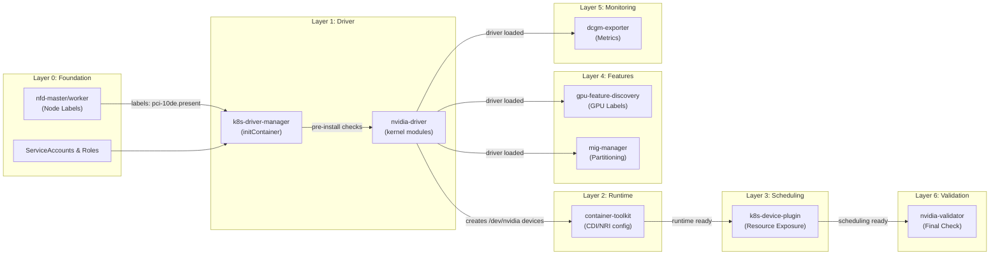

Key points:

- Nodes are labeled by NFD to indicate GPU presence.
- The driver manager ensures kernel modules are correctly set up.
- Driver readiness triggers deployment of container runtime tooling (like CDI).
- Device plugin exposes GPU resources to Kubernetes.
- Higher-level components like GPU Feature Discovery, MIG management, and monitoring come next.
- Validation ensures the full stack operates correctly.

**Sources:** [controllers/state_manager.go:115-120](), [deployments/gpu-operator/values.yaml:8-10, 196-202](), [controllers/object_controls.go:131-135](), [controllers/object_controls_test.go:64-66]()

## Core Configuration Resources

### ClusterPolicy Custom Resource

The `ClusterPolicy` CR is the primary user API to configure the GPU Operator. It is cluster-scoped and defines specifications for all GPU-related components:

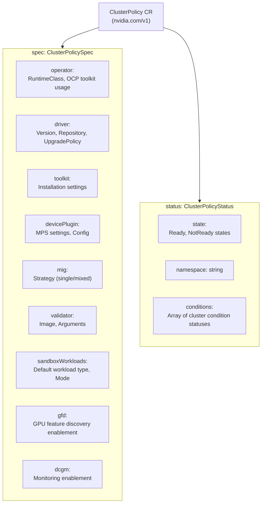

This CR includes fine-grained control over operator behavior, daemonsets, driver upgrades, and related GPU ecosystem components.

**Sources:** [bundle/manifests/nvidia.com_clusterpolicies.yaml:27-163](), [deployments/gpu-operator/templates/clusterpolicy.yaml:1-99](), [api/nvidia/v1/clusterpolicy_types.go:40-105]()

### Helm Chart Configuration Flow

The typical installation flow with Helm is:

1. User customizes `values.yaml` or uses Helm CLI to set values.
2. Helm templates render the `ClusterPolicy` object (`deployments/gpu-operator/templates/clusterpolicy.yaml`).
3. The `ClusterPolicy` CR is applied to Kubernetes.
4. The GPU Operator's `ClusterPolicyController` detects the CR and begins reconciliation leading to deployment or update of GPU components.

This flow allows users to declaratively configure their GPU environment via Kubernetes-native resources.

**Sources:** [deployments/gpu-operator/values.yaml:1-113](), [deployments/gpu-operator/templates/clusterpolicy.yaml:1-99]()

## State Reconciliation Pattern

Internally, the operator manages the deployment lifecycle via a state-oriented reconciliation pattern:

- The controller registers "states" (functional modules) representing individual components or subsystems (e.g., driver, device plugin).
- During each reconciliation sync loop (`Sync()` function in `state_manager.go`), the controller executes these states in sequence.
- Each state works on its assigned Kubernetes resources (DaemonSets, ConfigMaps, etc.), updating or creating them as needed.
- The pattern cleanly separates concerns, simplifies testing, and allows progressive deployment as prerequisites are met.

The `controllers/object_controls.go` file contains the logic transforming the `ClusterPolicySpec` into Kubernetes object manifests with advanced handling such as host network config and custom CA injection.

**Sources:** [controllers/state_manager.go:146-180](), [controllers/object_controls.go:56-135](), [controllers/transforms_test.go:244-255]()

## Entry Points and Key Files

| Purpose                   | File Path                             | Key Entities / Notes                                  |
|---------------------------|-------------------------------------|------------------------------------------------------|
| Operator entry point       | `cmd/gpu-operator/main.go`           | Sets up manager, registers controllers               |
| CRD API Definitions       | `api/nvidia/v1/`                    | Defines ClusterPolicy, NVIDIADriver types             |
| Reconciliation Logic      | `controllers/state_manager.go`       | `ClusterPolicyController`, `Sync()` method            |
| Kubernetes Object Control | `controllers/object_controls.go`     | Functions for creating/updating k8s resources          |
| Helm Configuration Defaults | `deployments/gpu-operator/values.yaml` | Overrides for images, versions, deployment parameters  |
| OLM Manifests             | `bundle/manifests/`                  | ClusterServiceVersion, CRD manifests                   |

**Sources:** [cmd/gpu-operator/main.go:1-50](), [api/nvidia/v1/clusterpolicy_types.go:1-100](), [controllers/state_manager.go:1-200](), [controllers/object_controls.go:1-150](), [deployments/gpu-operator/values.yaml:1-200]()

---

For detailed onboarding, installation, and codebase layouts, see the child pages:

- [Getting Started](#1.1) — Quick install steps, prerequisites, and first `ClusterPolicy` deployment.
- [Repository Layout](#1.2) — Directory structure and key code locations.

---

**Overall, the NVIDIA GPU Operator is a comprehensive Kubernetes-native toolkit automating NVIDIA GPU environment management, designed for scalability, heterogeneity, and fault-tolerance.**

---

# Page: Getting Started

# 1.1 Getting Started

<details>
<summary>Relevant source files</summary>

The following files were used as context for generating this wiki page:

- [.dockerignore](.dockerignore)
- [.github/scripts/generate-values-overrides.sh](.github/scripts/generate-values-overrides.sh)
- [.github/scripts/get-latest-images.sh](.github/scripts/get-latest-images.sh)
- [CODE_OF_CONDUCT.md](CODE_OF_CONDUCT.md)
- [CONTRIBUTING.md](CONTRIBUTING.md)
- [GOVERNANCE.md](GOVERNANCE.md)
- [LICENSE](LICENSE)
- [README.md](README.md)
- [deployments/gpu-operator/Chart.lock](deployments/gpu-operator/Chart.lock)
- [deployments/gpu-operator/Chart.yaml](deployments/gpu-operator/Chart.yaml)
- [deployments/gpu-operator/charts/node-feature-discovery/Chart.yaml](deployments/gpu-operator/charts/node-feature-discovery/Chart.yaml)
- [deployments/gpu-operator/charts/node-feature-discovery/README.md](deployments/gpu-operator/charts/node-feature-discovery/README.md)
- [deployments/gpu-operator/charts/node-feature-discovery/templates/clusterrole.yaml](deployments/gpu-operator/charts/node-feature-discovery/templates/clusterrole.yaml)
- [deployments/gpu-operator/charts/node-feature-discovery/templates/clusterrolebinding.yaml](deployments/gpu-operator/charts/node-feature-discovery/templates/clusterrolebinding.yaml)
- [deployments/gpu-operator/charts/node-feature-discovery/templates/master.yaml](deployments/gpu-operator/charts/node-feature-discovery/templates/master.yaml)
- [deployments/gpu-operator/charts/node-feature-discovery/templates/nfd-gc.yaml](deployments/gpu-operator/charts/node-feature-discovery/templates/nfd-gc.yaml)
- [deployments/gpu-operator/charts/node-feature-discovery/templates/serviceaccount.yaml](deployments/gpu-operator/charts/node-feature-discovery/templates/serviceaccount.yaml)
- [deployments/gpu-operator/charts/node-feature-discovery/templates/topologyupdater.yaml](deployments/gpu-operator/charts/node-feature-discovery/templates/topologyupdater.yaml)
- [deployments/gpu-operator/charts/node-feature-discovery/templates/worker.yaml](deployments/gpu-operator/charts/node-feature-discovery/templates/worker.yaml)
- [deployments/gpu-operator/charts/node-feature-discovery/values.yaml](deployments/gpu-operator/charts/node-feature-discovery/values.yaml)
- [tests/README.md](tests/README.md)
- [tests/local.sh](tests/local.sh)
- [tests/scripts/env-to-values.sh](tests/scripts/env-to-values.sh)
- [tests/scripts/install-operator.sh](tests/scripts/install-operator.sh)

</details>


This page provides a detailed technical guide to get the NVIDIA GPU Operator up and running quickly in a Kubernetes cluster. It includes instructions for Helm-based installation, covers critical prerequisites such as Node Feature Discovery (NFD) and container runtime configuration, explains the role of the `examples/` directory, and demonstrates an initial deployment using the `ClusterPolicy` custom resource.

---

## 1.1.1 Overview

The NVIDIA GPU Operator automates the deployment and management of NVIDIA GPU software components on Kubernetes nodes. It integrates several moving parts, including NVIDIA drivers, device plugins, container runtime configurations, GPU feature discovery, and monitoring tools, orchestrated via Kubernetes controllers. Its installation via Helm simplifies deployment with configurable parameters.

Deployment typically follows these steps:

- Ensure prerequisites (such as NFD and compatible container runtime) are met.
- Install the GPU Operator Helm chart.
- Deploy initial configuration via `ClusterPolicy` custom resource.

---

## 1.1.2 Prerequisites

Before installing the GPU Operator, the following prerequisites must be addressed:

### Node Feature Discovery (NFD)

- **Purpose**: NFD is a Kubernetes add-on for detecting hardware features and system configurations and publishing these as Kubernetes node labels.
- **Role with GPU Operator**: NFD labels nodes with detailed GPU and system information, which the Operator uses to determine what components should be deployed on particular nodes.
- **Installation**: NFD is included as a sub-chart in the GPU Operator Helm chart and can be enabled or disabled.
- **Details**:
  - Deploys two main components:
    - **nfd-master**: A deployment that watches and aggregates node feature labels.
    - **nfd-worker**: A DaemonSet running on each node to detect hardware features.
  - Configurable via Helm values such as `.Values.nfd.enabled`, `.Values.master.enable`, `.Values.worker.enable`.
  - NFD manifests include `Deployment` and `DaemonSet` for master and worker components, respectively.
  - Provides RBAC resources like `ClusterRoleBinding` for permissions.
- **Configuration**:
  - Configure feature-gates, label namespaces, resync periods, and others via the Helm values.
  - Configuration files are mounted via ConfigMaps to the respective NFD pods.
- **References**:
  - Helm Chart metadata lists NFD as a dependency with version `0.19.0` ([deployments/gpu-operator/Chart.yaml:20-24]())
  - NFD Helm charts define templates such as `master.yaml` and `worker.yaml` deploying master and worker components respectively ([deployments/gpu-operator/charts/node-feature-discovery/templates/master.yaml:1-176](), [worker.yaml:1-194]())
  - NFD values.yaml expose configuration for image repositories, replicas, feature gates, etc. ([deployments/gpu-operator/charts/node-feature-discovery/values.yaml:1-165]())

### Container Runtime Configuration

- The GPU Operator requires a container runtime compatible with the NVIDIA Container Toolkit to support GPU workloads.
- Docker with NVIDIA runtime or containerd with NVIDIA configuration is typical.
- Proper runtime setup ensures containers can access GPUs.

### Kubernetes Version and Cluster Requirements

- Kubernetes version >= 1.16.0 is required.
- Cluster must have nodes with NVIDIA GPUs for the GPU components to deploy.
- Cluster RBAC roles and permissions must allow the Operator to create necessary resources in namespaces.

---

## 1.1.3 Installing the GPU Operator Using Helm

The GPU Operator is distributed as a Helm chart suitable for Kubernetes v1.16+.

### Add NVIDIA Helm Repository

```bash
helm repo add nvidia https://helm.ngc.nvidia.com/nvidia && helm repo update
```

This adds the official NVIDIA Helm chart repository with GPU Operator charts.

### Install GPU Operator

Install the chart in the `gpu-operator` namespace (created if it does not exist):

```bash
helm install --wait --generate-name \
    -n gpu-operator --create-namespace \
    nvidia/gpu-operator
```

### What Happens Under the Hood?

- Helm deploys the GPU Operator CRDs and controller deployment.
- NFD sub-chart defaults to enabled, installing NFD master and worker components.
- Operator deploys DaemonSets and Deployments for all NVIDIA components (drivers, device plugin, toolkit, monitoring).
- The Helm chart values allow detailed customization such as image overrides and component toggles.

### Monitoring Installation

After installation, verify components are running:

```bash
kubectl get pods -n gpu-operator
kubectl get pods -n node-feature-discovery
```

---

## 1.1.4 The `examples/` Directory

The repository contains `examples/` directory with example Custom Resources (CRs) to get started quickly:

- Example `ClusterPolicy` manifests demonstrate how to configure GPU Operator behavior.
- Users can apply these manifests to deploy GPUs with common configurations.
- The `ClusterPolicy` is the primary resource for configuring driver versions, toolkit options, monitoring, and node labels.

---

## 1.1.5 Deploying Your First ClusterPolicy

### What is ClusterPolicy?

- The `ClusterPolicy` CRD is the central configuration API for the GPU Operator.
- It allows specifying:
  - Which driver and runtime versions to deploy.
  - Enablement and configuration of GPU driver, container toolkit, device plugin.
  - Monitoring options such as DCGM Exporter.
  - Node selection and feature discovery overrides.

### Example Deployment Workflow

1. Create a `ClusterPolicy` YAML file (from `examples/` or custom):

```yaml
apiVersion: nvidia.com/v1
kind: ClusterPolicy
metadata:
  name: gpu-cluster-policy
spec:
  driver:
    version: "525.89.02"
  toolkit:
    enabled: true
  devicePlugin:
    enabled: true
  monitoring:
    dcgm:
      enabled: true
```

2. Apply the resource:

```bash
kubectl apply -f examples/cluster-policy.yaml
```

3. The GPU Operator reconciler detects the new `ClusterPolicy` and triggers deployments for NVIDIA drivers, toolkit, device plugin, and monitoring DaemonSets.

4. Nodes labeled by NFD are selected automatically based on GPU presence.

---

## 1.1.6 Data Flow and Key Components in Installation

Below is a detailed mermaid sequence diagram describing the high-level control flow during installation with Helm and first ClusterPolicy deployment:

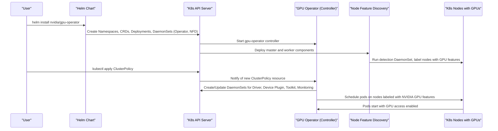

---

## 1.1.7 Code Entities Correlation Diagram: Helm Chart and NFD Sub-chart

The GPU Operator Helm chart, located in `deployments/gpu-operator/`, manages a sub-chart dependency `node-feature-discovery`, which is crucial for node hardware feature labeling.

```mermaid
graph TD
  A[deployments/gpu-operator/Chart.yaml] --> |"depends on"| B[charts/node-feature-discovery/Chart.yaml]
  B --> |"defines resources"| C[nfd-master Deployment (templates/master.yaml)]
  B --> |"defines resources"| D[nfd-worker DaemonSet (templates/worker.yaml)]
  C --> |"uses ConfigMap"| E[nfd-master.conf (values.yaml)]
  D --> |"uses ConfigMap"| F[nfd-worker.conf]
  A --> |"values file controls NFD"| G[values.yaml nfd.enabled]
  A --> |"deploys"| H[gpu-operator controller deployment]
  H --> |"reconciles"| I[ClusterPolicy CRD & operator logic]
```

This structure shows how the operator chart orchestration includes NFD deployment, configured by Helm values.

---

## 1.1.8 Code Entities Correlation Diagram: Operator Controller Workflow for ClusterPolicy

This diagram explains how the GPU Operator reconciles the `ClusterPolicy` resource to manage GPU components on the cluster.

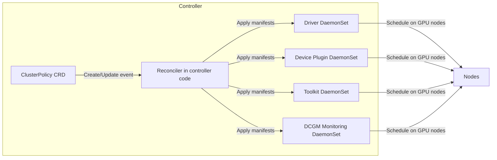

The reconciler reads `ClusterPolicy` spec and triggers deployment or update of DaemonSets managing NVIDIA software stack components.

---

## 1.1.9 Summary Table: Quick Helm Installation Steps

| Step                | Command / Notes                                         |
|---------------------|--------------------------------------------------------|
| Add NVIDIA Helm repo | `helm repo add nvidia https://helm.ngc.nvidia.com/nvidia` |
| Update repo         | `helm repo update`                                      |
| Install operator    | `helm install --wait --generate-name -n gpu-operator --create-namespace nvidia/gpu-operator` |
| Verify operator     | `kubectl get pods -n gpu-operator`                      |
| Apply ClusterPolicy | `kubectl apply -f examples/cluster-policy.yaml`         |
| Verify GPU pods     | `kubectl get pods -n gpu-operator` (DaemonSets for driver, dp, toolkit, monitoring) |

---

## 1.1.10 Additional Notes

- If deploying on OpenShift, consult the official OpenShift-specific instructions as additional configurations for security and runtime are required.
- GPU Operator Helm chart version `v1.0.0-devel` supports Kubernetes `>=1.16.0-0`.
- The Chart.yaml lists NFD as a dependency enabled via `nfd.enabled` flag.
- For advanced configurations, see the `examples/` directory and customize `ClusterPolicy` accordingly.
- The operator handles device plugin lifecycle, driver installation, container toolkit enablement, GPU monitoring setup automatically once configured via the `ClusterPolicy`.

---

# References and Sources

- `deployments/gpu-operator/Chart.yaml:1-25` (Helm Chart configuration, dependencies)
- `README.md:18-44` (Quick install instructions and audience)
- `deployments/gpu-operator/charts/node-feature-discovery/templates/master.yaml:1-176` (NFD master deployment details)
- `deployments/gpu-operator/charts/node-feature-discovery/templates/worker.yaml:1-194` (NFD worker DaemonSet details)
- `deployments/gpu-operator/charts/node-feature-discovery/values.yaml:1-165` (NFD Helm values)
- `tests/scripts/install-operator.sh:1-124` (Helm install script logic and options)
- `CONTRIBUTING.md:1-112` (Architecture overview and components involved)
  
---

This concludes the "Getting Started" documentation for NVIDIA GPU Operator installation, prerequisites, and initial configuration deployment.

---

# Page: Repository Layout

# Repository Layout

<details>
<summary>Relevant source files</summary>

The following files were used as context for generating this wiki page:

- [PROJECT](PROJECT)
- [api/nvidia/v1/clusterpolicy_types_test.go](api/nvidia/v1/clusterpolicy_types_test.go)
- [api/nvidia/v1alpha1/gpucluster_types.go](api/nvidia/v1alpha1/gpucluster_types.go)
- [api/nvidia/v1alpha1/zz_generated.deepcopy.go](api/nvidia/v1alpha1/zz_generated.deepcopy.go)
- [cmd/gpu-operator/main.go](cmd/gpu-operator/main.go)
- [cmd/gpu-operator/main_test.go](cmd/gpu-operator/main_test.go)
- [cmd/gpuop-cfg/main.go](cmd/gpuop-cfg/main.go)
- [cmd/gpuop-cfg/validate/clusterpolicy/clusterpolicy.go](cmd/gpuop-cfg/validate/clusterpolicy/clusterpolicy.go)
- [cmd/gpuop-cfg/validate/clusterpolicy/images.go](cmd/gpuop-cfg/validate/clusterpolicy/images.go)
- [cmd/gpuop-cfg/validate/csv/alm-examples.go](cmd/gpuop-cfg/validate/csv/alm-examples.go)
- [cmd/gpuop-cfg/validate/csv/csv.go](cmd/gpuop-cfg/validate/csv/csv.go)
- [cmd/gpuop-cfg/validate/csv/images.go](cmd/gpuop-cfg/validate/csv/images.go)
- [cmd/gpuop-cfg/validate/validate.go](cmd/gpuop-cfg/validate/validate.go)
- [cmd/manage-crds/main.go](cmd/manage-crds/main.go)
- [config/crd/kustomization.yaml](config/crd/kustomization.yaml)
- [config/samples/kustomization.yaml](config/samples/kustomization.yaml)
- [controllers/active_config.go](controllers/active_config.go)
- [controllers/active_config_test.go](controllers/active_config_test.go)
- [controllers/clusterpolicy_controller_test.go](controllers/clusterpolicy_controller_test.go)
- [controllers/gpucluster_controller_test.go](controllers/gpucluster_controller_test.go)
- [controllers/nodelabeling_controller.go](controllers/nodelabeling_controller.go)
- [controllers/nodelabeling_controller_test.go](controllers/nodelabeling_controller_test.go)
- [controllers/upgrade_controller_test.go](controllers/upgrade_controller_test.go)
- [internal/image/image.go](internal/image/image.go)
- [internal/image/imagepath_validation_test.go](internal/image/imagepath_validation_test.go)
- [internal/state/info_source.go](internal/state/info_source.go)

</details>


This page presents a detailed technical mapping of the **gpu-operator** repository directory structure. The purpose is to navigate the core organization of the codebase and explain how the major directories and binaries contribute to the GPU Operator’s functionality. This foundational understanding facilitates exploring further architectural and developmental details in other parts of the documentation.

---

## Top-Level Directory Structure Overview

The repository organizes code and assets in distinct directories reflecting their roles in the operator's implementation, configuration, resource definitions, controllers, and tests. Below is a summary of the primary directories and their responsibilities:

| Directory     | Description                                                                                                     |
|---------------|-----------------------------------------------------------------------------------------------------------------|
| `api/`        | Custom Resource Definitions (CRDs) and API type definitions for the GPU Operator resources                      |
| `controllers/`| Kubernetes controllers implementing reconciliation logic for Custom Resources and node labeling                 |
| `internal/`   | Internal shared packages, constants, utilities, and business logic modules used across the operator            |
| `assets/`     | Static files, scripts, and auxiliary resources used by the operator                                            |
| `manifests/`  | Kubernetes manifests and Helm resource templates for operator deployment                                       |
| `deployments/`| Kubernetes deployment YAMLs and manifests, including Helm chart subcomponents for deployment                   |
| `cmd/`        | Source code for operator and related utility binaries (CLI tools)                                             |
| `bundle/`     | OLM (Operator Lifecycle Manager) bundle manifests and metadata files                                          |
| `config/`     | Kustomize configurations, samples, CRDs, and operator configuration files                                      |
| `tests/`      | End-to-end, integration, and unit tests for the operator code                                                |

---

## Directory Details and Code Insights

### `api/`

This directory contains API type definitions for the operator's Custom Resources. The project uses [Kubebuilder](https://book.kubebuilder.io) conventions to model resources such as `ClusterPolicy`, `NVIDIADriver`, and `GPUCluster` under separate API versions:

- `api/nvidia/v1/` — contains core API types like `ClusterPolicy` which is the primary user configuration API.
- `api/nvidia/v1alpha1/` — contains experimental or newer types such as `NVIDIADriver` and `GPUCluster`.

Types have autogenerated boilerplate for deep copy and client generation, supporting Kubernetes API machinery and client code generation.

Key generated functions include:

- `ImagePath` methods to assemble container image references from spec fields, supporting digest and tag forms [api/nvidia/v1/clusterpolicy_types_test.go:26-88]().
- Deepcopy implementations for CRD Spec and Status structs [api/nvidia/v1alpha1/zz_generated.deepcopy.go:31-209]().

Sources: `api/nvidia/v1/clusterpolicy_types_test.go:26-88`, `api/nvidia/v1alpha1/zz_generated.deepcopy.go:31-209`


### `controllers/`

The `controllers/` directory implements the operator's reconciliation logic for Kubernetes resources using [controller-runtime](https://sigs.k8s.io/controller-runtime). It contains controllers for each major custom resource and node-related logic:

- `ClusterPolicyReconciler`: Handles the main `ClusterPolicy` CR reconciliation, managing GPU driver upgrades, component deployments, and overall cluster state.
- `NodeLabelingReconciler`: Centralizes all GPU-related node label and annotation updates, ensuring accurate node labeling for GPU presence and driver ownership.
- `GPUClusterReconciler`: Manages the `GPUCluster` resource for the newer device plugin stacks.
- `UpgradeReconciler`: Coordinates driver upgrade states and orchestrates node-level upgrades via k8s-operator-libs [cmd/gpu-operator/main.go:165-186]().

Most controllers import relevant API types and custom predicates for event filtering.

The node labeling controller maintains a stateful reconcile flow with fine-grained reasons to trigger label updates. The reconciliation ensures synchronization of GPU presence, MIG capability, and driver ownership labels on nodes. It observes node and pod updates to detect GPU usage [controllers/nodelabeling_controller.go:53-156]().

**NodeLabelingReconciler** workflow snippet:

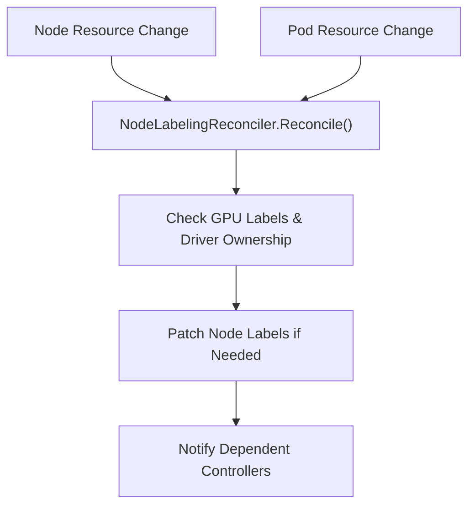

Sources: `controllers/nodelabeling_controller.go:53-156`, `cmd/gpu-operator/main.go:165-186`


### `internal/`

This directory hosts shared internal packages that implement utilities and constants leveraged by controllers and commands. Examples include:

- `consts` package defining key constants (e.g., label keys, namespaces)
- `image` package performing image path computations and validation (resolving image references from spec fields or environment variables) [internal/image/image.go:25-57]().

This encapsulation avoids polluting the public API and reduces cyclic dependencies.

Sources: `internal/image/image.go:25-57`


### `assets/`

Contains static resources such as scripts, configuration templates, and manifest snippets which are not explicitly shown in the excerpts but are used during manifests generation and deployment.

Sources: None explicitly shown.


### `manifests/`

This directory contains Kubernetes manifests, including Helm templates, configmaps, and CRDs that form the deployable parts of the GPU Operator. It aligns with Kubebuilder and Operator SDK conventions for operator manifests.

Sources: None explicitly shown.


### `deployments/`

Houses deployment manifests, Helm chart snippets, and supporting RBAC definitions used to install and manage the GPU Operator in clusters. It includes readiness probes, container specifications, and deployment YAMLs.

Sources: None explicitly shown.


### `cmd/`

This directory contains source and binaries for the GPU Operator and related CLI utilities:

- `cmd/gpu-operator/`: The main operator binary implemented in Go. The entrypoint (`main.go`) initializes the controller manager with schemes for all API versions and sets up all controllers including `ClusterPolicyReconciler`. It configures leader election, metrics, health probes, and webhook servers. It also initializes upgrade state management using `k8s-operator-libs` [cmd/gpu-operator/main.go:1-186]().

- `cmd/gpuop-cfg/`: Utilities for configuration validation. The validation subpackage implements Image validation functions that use `regclient` to fetch image manifests and verify image accessibility [cmd/gpuop-cfg/validate/clusterpolicy/images.go:16-173]().

Other binaries like `manage-crds` are separate CLI tools for managing CRDs lifecycle.

**Operator manager initialization sequence:**

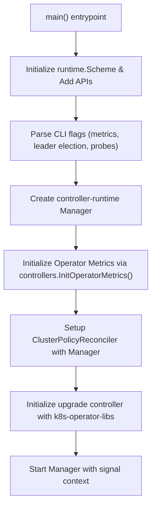

Sources: `cmd/gpu-operator/main.go:1-186`, `cmd/gpuop-cfg/validate/clusterpolicy/images.go:16-173`


### `bundle/`

Includes Operator Lifecycle Manager (OLM) bundle artifacts such as CSV files, CRDs, and metadata to support Operator installation on OLM-enabled Kubernetes clusters, including OpenShift.

Sources: None explicitly shown.


### `config/`

Contains Kustomize overlays, CRD yamls, example configurations, and manifests used for deployments and environment setup. This directory facilitates environment-specific customization.

Sources: None explicitly shown.


### `tests/`

Houses unit, integration, and end-to-end tests for the operator, controllers, and utility packages. Tests harness Kubernetes fake clients and reconcile mocks for isolated testing of controller logic, including state transitions and label updates [controllers/nodelabeling_controller_test.go](), [controllers/gpucluster_controller_test.go]().

---

## Binaries Built from `cmd/`

The repository is designed to compile several key command-line binaries from the subdirectories under `cmd/`. Notable binaries include:

| Binary          | Description                                                      | Main Source Location        |
|-----------------|------------------------------------------------------------------|-----------------------------|
| `gpu-operator`  | The main operator binary containing all controller logic and manager setup, responsible for GPU lifecycle management in the cluster | `cmd/gpu-operator/main.go`  |
| `gpuop-cfg`     | Configuration validation CLI used to validate cluster policies and manifest correctness, particularly image reference validation | `cmd/gpuop-cfg/main.go` and subpackages like `validate` |
| `manage-crds`   | CLI utility for management and monitoring of Custom Resource Definitions | `cmd/manage-crds/main.go`   |

---

## Repository Layout Diagram

This diagram maps conceptual components (Natural Language) to the corresponding code components and directories (Code Entity Space), showing their interactions and responsibilities.

```mermaid
graph TB
  subgraph OperatorCore["GPU Operator Core"]
    A[ClusterPolicy Controller<br/>(controllers.ClusterPolicyReconciler)]
    B[Node Labeling Controller<br/>(controllers.NodeLabelingReconciler)]
    C[GPUCluster Controller<br/>(controllers.GPUClusterReconciler)]
    D[Upgrade Controller<br/>(controllers.UpgradeReconciler)]
  end

  subgraph API["API Definitions (api)"]
    API1[ClusterPolicy (api/nvidia/v1)]
    API2[NVIDIADriver & GPUCluster (api/nvidia/v1alpha1)]
  end

  subgraph InternalLibs["Internal Packages (internal)"]
    CONST[Constants & Labels (internal/consts)]
    IMG[Image Utilities (internal/image)]
  end

  subgraph CmdBinaries["Binaries (cmd)"]
    OPERATOR["gpu-operator<br/>cmd/gpu-operator/main.go"]
    CFG["gpuop-cfg<br/>cmd/gpuop-cfg/validate/"]
    MCRDS["manage-crds CLI<br/>cmd/manage-crds/main.go"]
  end

  subgraph DeployArtifacts["Manifests & Deployment"]
    MFST["manifests/ - k8s manifests & helm templates"]
    DEPLOY["deployments/ - k8s deployment YAMLs"]
    BUNDLE["bundle/ - OLM bundle manifests"]
    CONFIG["config/ - kustomize, samples, CRDs"]
  end

  subgraph Tests["Tests (tests)"]
    TCONT["Unit & Integration Tests"]
    E2E["E2E Tests"]
  end

  %% Relations
  API1 -->|Defines CRDs used by| A
  API2 -->|Used by| C & A
  CONST -->|Used by| A & B & C & D
  IMG -->|Used for image refs, validation| A & CFG
  OPERATOR -->|Runs controllers| A & B & C & D
  CFG -->|Validates ClusterPolicy| API1 & API2
  MCRDS -->|Manages CRDs lifecycle| DEPLOY
  A & B & C & D -->|Deploy resource manifests| DEPLOY & MFST & BUNDLE & CONFIG
  TCONT -->|Tests controllers and internal libs| A & B & C & D & CONST & IMG
  E2E -->|Tests operator end-to-end| OPERATOR

```

---

## Summary

- The `api/` directory provides versioned Kubernetes CRD type definitions.
- The `controllers/` directory implements Kubernetes controllers that reconcile the GPU Operator’s resources and manage core logic such as node labeling.
- Shared logic and constants are encapsulated in `internal/`.
- Static assets and deployment artifacts are organized in `assets/`, `manifests/`, `deployments/`, `bundle/`, and `config/`.
- The main operator binary and utility CLIs are developed under `cmd/`.
- Testing code is located in `tests/`.
- Binaries built from `cmd/` form the deployable operator, configuration validation tools, and CRD management utilities.

This structure supports modularity and separation of concerns, facilitating streamlined operator development, testing, and deployment.

---

Sources:

- `cmd/gpu-operator/main.go:1-186`  
- `controllers/nodelabeling_controller.go:53-156`  
- `api/nvidia/v1/clusterpolicy_types_test.go:26-88`  
- `api/nvidia/v1alpha1/zz_generated.deepcopy.go:31-209`  
- `internal/image/image.go:25-57`  
- `cmd/gpuop-cfg/validate/clusterpolicy/images.go:16-173`  
- `controllers/nodelabeling_controller_test.go`  
- `controllers/gpucluster_controller_test.go`

---

# Page: Architecture

# Architecture

<details>
<summary>Relevant source files</summary>

The following files were used as context for generating this wiki page:

- [api/nvidia/v1alpha1/nvidiadriver_types_test.go](api/nvidia/v1alpha1/nvidiadriver_types_test.go)
- [controllers/clusterinfo/clusterinfo.go](controllers/clusterinfo/clusterinfo.go)
- [controllers/clusterpolicy_controller.go](controllers/clusterpolicy_controller.go)
- [controllers/nvidiadriver_controller.go](controllers/nvidiadriver_controller.go)
- [controllers/nvidiadriver_controller_test.go](controllers/nvidiadriver_controller_test.go)
- [controllers/upgrade_controller.go](controllers/upgrade_controller.go)
- [deployments/gpu-operator/templates/gpucluster.yaml](deployments/gpu-operator/templates/gpucluster.yaml)
- [internal/consts/consts.go](internal/consts/consts.go)
- [internal/render/render.go](internal/render/render.go)
- [internal/state/driver.go](internal/state/driver.go)
- [internal/state/driver_test.go](internal/state/driver_test.go)
- [internal/state/driver_volumes.go](internal/state/driver_volumes.go)
- [internal/state/manager.go](internal/state/manager.go)
- [internal/state/metrics.go](internal/state/metrics.go)
- [internal/state/types.go](internal/state/types.go)
- [internal/validator/validator.go](internal/validator/validator.go)
- [internal/validator/validator_suite_test.go](internal/validator/validator_suite_test.go)
- [internal/validator/validator_test.go](internal/validator/validator_test.go)

</details>


## Purpose and Scope

This document provides a high-level overview of the NVIDIA GPU Operator’s system architecture. It focuses on the control flow, core design patterns, and interactions between the operator’s components. This includes the controller reconciliation model, the `State` interface pattern that manages various GPU infrastructure components, and how user configurations propagate to deployed Kubernetes resources.

To explore the detailed implementations, deeper technical topics are delegated to child pages:  
- [Core Concepts](#2.1) — covering state management, controllers, conditions, and node utilities.  
- [Component Architecture](#2.2) — detailing layered dependencies like driver, toolkit, device plugin, and directory structure.  
- [Configuration and Transformation System](#2.3) — explaining Helm values flow, CRDs, and manifest rendering.

---

## High-Level System Architecture

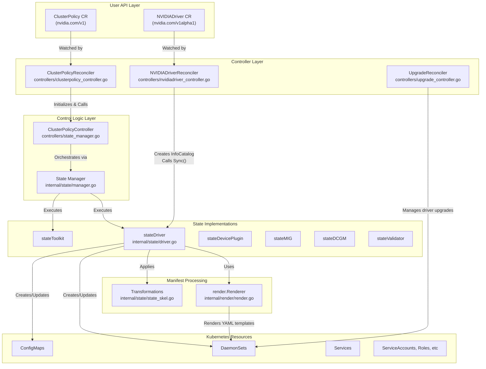

This architecture centers on Kubernetes custom resources (`ClusterPolicy` and `NVIDIADriver`) that define the user’s desired GPU infrastructure state. Kubernetes controllers watch these resources and trigger reconciliation loops, implemented primarily in the `ClusterPolicyReconciler` and `NVIDIADriverReconciler` classes.

The `ClusterPolicyController` orchestrates the deployment and management of components through a `State Manager`, which runs discrete State implementations representing components like the NVIDIA driver (`stateDriver`), container toolkit, device plugin, monitoring, and validation.

Component States leverage a manifest `Renderer` to produce Kubernetes YAML manifests from templates, then apply transformation logic to tailor these manifests dynamically to cluster specifics before creating/updating objects like DaemonSets and ConfigMaps.

The `UpgradeReconciler` handles advanced upgrade scenarios by coordinating the rollout of new driver versions safely.

**Sources:**  
- [controllers/clusterpolicy_controller.go:59-65]()  
- [controllers/nvidiadriver_controller.go:53-62]()  
- [controllers/state_manager.go:146-173]()  
- [internal/state/driver.go:134-167]()  

---

## Controller Reconciliation Pattern

The operator adheres to the canonical Kubernetes controller pattern: watching Kubernetes objects, reconciling cluster state toward the desired configuration, and updating status accordingly.

### ClusterPolicy Reconciliation Flow

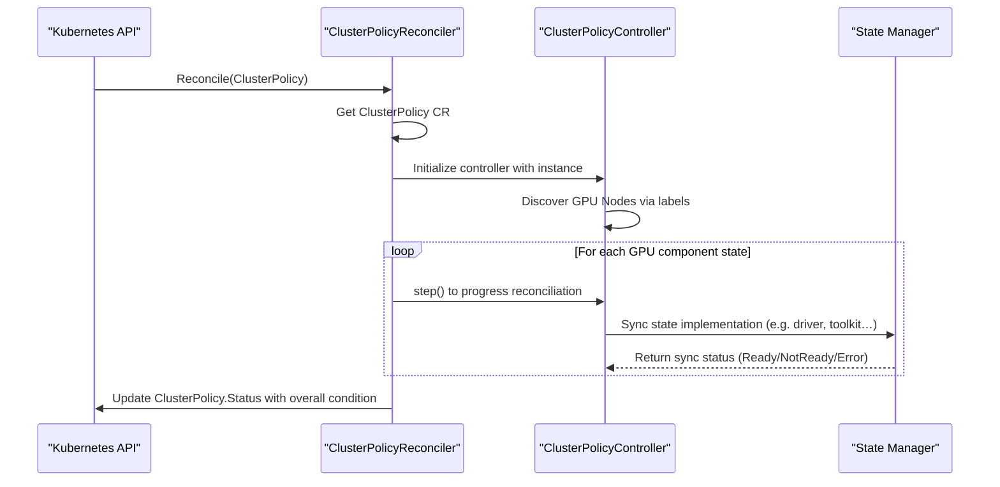

The `ClusterPolicyReconciler` watches `ClusterPolicy` CRs and initializes a `ClusterPolicyController`. It labels GPU nodes (using e.g., NFD labels) and iterates through component States by calling `step()` which invokes their `Sync()` methods via the `State Manager`. The overall status is aggregated and reflected in the CR’s status.

If crucial labels like NFD GPU hardware labels are missing, a warning is logged indicating that GPU nodes may not be correctly discovered.

**Sources:**  
- [controllers/clusterpolicy_controller.go:93-155]()  
- [controllers/state_manager.go:146-173]()  

---

### NVIDIADriver Reconciliation Flow

The `NVIDIADriverReconciler` manages the `NVIDIADriver` CR, which allows fine-grained driver customization beyond `ClusterPolicy`.

Key steps:

1. **Validation:** Ensures the configured `nodeSelector` doesn't conflict with other `NVIDIADriver` instances to avoid multiple driver DaemonSets targeting the same node [validator/validator.go:33-103]().

2. **Cluster Info Gathering:** Builds an `InfoCatalog` encapsulating cluster-specific data like container runtime, OpenShift version, and proxy specs, insulated from the controller logic.

3. **State Sync:** Calls into `stateDriver.Sync()` to render manifests and apply them, managing DaemonSets and cleaning up stale ones when selectors or specs change [internal/state/driver.go:134-167]().

4. **Status Updates:** Reflects component readiness and errors back into the NVIDIADriver status conditions.

This controller ensures only one driver DaemonSet targets a given node and handles precompiled vs. source drivers, GDS configuration, and OpenShift Driver Toolkit integration.

**Sources:**  
- [controllers/nvidiadriver_controller.go:77-167]()  
- [internal/state/driver.go:134-167]()  
- [internal/validator/validator.go:33-103]()  

---

## State Management Architecture

Fundamental to the operator’s modular design is the `State` interface pattern: each GPU subsystem (driver, toolkit, etc.) implements `State` allowing the controller to manage components uniformly.

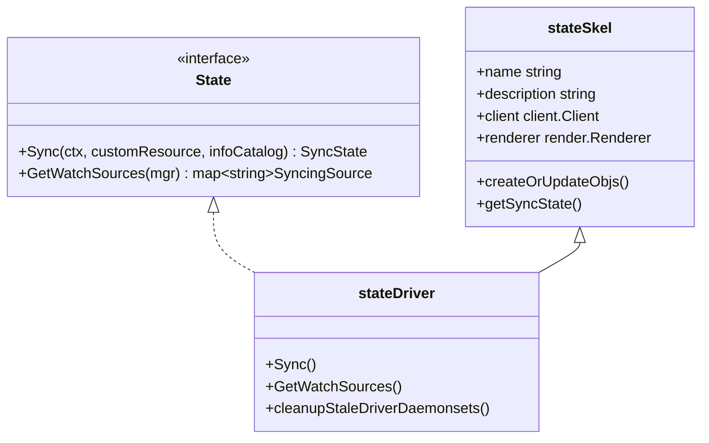

### State Interface and Skeleton Implementation

The `State` interface requires two methods:  
- `Sync()`: Reconcile the component’s desired state.  
- `GetWatchSources()`: Return Kubernetes event sources to watch for changes.

Most states embed a `stateSkel` struct which supplies shared utility methods, such as:  
- Applying k8s objects idempotently (`createOrUpdateObjs`).  
- Labeling objects with component and operator state labels.  
- Checking readiness of DaemonSets or Deployments (`getSyncState`).  

For example, `stateDriver` implements driver-specific sync logic and manages stale DaemonSets cleanup on node selector changes [internal/state/driver.go:63-67, 134-167]().

**Sources:**  
- [internal/state/driver.go:63-67]()  
- [internal/state/state_skel.go:40-75]() (not directly shown but referenced)  

---

## Configuration and Discovery

The operator dynamically adapts to the cluster environment via the `clusterinfo` package, which abstracts discovery of:  
- Container runtime (e.g., `containerd`, `docker`, `crio`) detected from node info.  
- OpenShift version and features like Driver Toolkit enabled state.  
- Proxy configuration (e.g., OpenShift ProxySpec).  
- DRA (Dynamic Resource Allocation) support and GroupVersionResource discovery for device classes.  

This discovery data influences how manifests are rendered and components deployed [controllers/clusterinfo/clusterinfo.go:40-170]().

| Aspect                      | Purpose                                    | Code Reference                              |
|-----------------------------|--------------------------------------------|---------------------------------------------|
| Container Runtime            | Detect runtime to handle driver/toolkit config | [clusterinfo.go:125-131]()                |
| OpenShift Version/Proxy      | Enable OpenShift-specific features, images | [clusterinfo.go:133-158]()                 |
| DRA Support                 | Determine support for device classes        | [clusterinfo.go:161-200]()                 |
| Node Label-Based Discovery  | Discover GPU nodes using NFD labels         | [controllers/state_manager.go:50-60]()    |
| Workload Type Configuration | Determines node workload type (container/VM) | [controllers/state_manager.go:88-113]()   |

**Sources:**  
- [controllers/clusterinfo/clusterinfo.go:40-170]()  
- [controllers/state_manager.go:50-113]()  

---

## Key Design Patterns

### Information Cataloging

To decouple logic and reduce API client dependencies, the operator uses an `InfoCatalog` interface that aggregates cluster metadata for use by states. For example, the `NVIDIADriverReconciler` prepares and passes an InfoCatalog holding runtime info, OpenShift version, and proxy details to `stateDriver.Sync` [controllers/nvidiadriver_controller.go:135-145]().

### Template-Driven Manifest Rendering

Component manifests are stored as declarative YAML templates in the `manifests/` directory. The `render.Renderer` loads these templates and combines them with dynamically computed data, such as the rendered driver's full container image, host paths, or computed config digests used for rolling updates [internal/state/driver.go:120-130, 105-107](). This approach fosters maintainability and easy customization.

### Automated Driver Upgrades

The `UpgradeReconciler` integrates with `k8s-operator-libs` upgrade libraries to automate safe NVIDIA driver rollouts. It calculates suitable `maxUnavailable` counts for nodes, manages upgrade state labels on nodes, and directs rolling upgrades of driver DaemonSets, reducing operator downtime and manual intervention [controllers/upgrade_controller.go:52-156]().

---

## Relations and Next Steps

This architecture ties together user APIs, controllers, state implementations, and Kubernetes resource management in a modular fashion. To understand each facet comprehensively, dive into the child pages:

- [Core Concepts](#2.1): Understand the fundamental state interface, reconciliation loops, conditions, resource managers, and utilities.  
- [Component Architecture](#2.2): Explore specific GPU Operator components, their layered dependencies, and manifest structure.  
- [Configuration and Transformation System](#2.3): Learn the flow from Helm values to CRDs, and how manifests are transformed before deployment.

---

**Sources:**  
- [internal/state/driver.go:1-198]()  
- [controllers/clusterpolicy_controller.go:59-141]()  
- [controllers/nvidiadriver_controller.go:59-162]()  
- [controllers/upgrade_controller.go:51-156]()  
- [controllers/clusterinfo/clusterinfo.go:1-201]()  
- [internal/state/types.go:17-149]()  
- [internal/validator/validator.go:33-103]()

---

# Page: Core Concepts

# Core Concepts

<details>
<summary>Relevant source files</summary>

The following files were used as context for generating this wiki page:

- [api/nvidia/v1alpha1/nvidiadriver_types_test.go](api/nvidia/v1alpha1/nvidiadriver_types_test.go)
- [controllers/clusterpolicy_controller.go](controllers/clusterpolicy_controller.go)
- [controllers/nvidiadriver_controller.go](controllers/nvidiadriver_controller.go)
- [controllers/nvidiadriver_controller_test.go](controllers/nvidiadriver_controller_test.go)
- [controllers/resource_manager.go](controllers/resource_manager.go)
- [controllers/resource_manager_test.go](controllers/resource_manager_test.go)
- [controllers/upgrade_controller.go](controllers/upgrade_controller.go)
- [deployments/gpu-operator/templates/gpucluster.yaml](deployments/gpu-operator/templates/gpucluster.yaml)
- [internal/conditions/clusterpolicy.go](internal/conditions/clusterpolicy.go)
- [internal/conditions/conditions_test.go](internal/conditions/conditions_test.go)
- [internal/conditions/consts.go](internal/conditions/consts.go)
- [internal/conditions/nvidiadriver.go](internal/conditions/nvidiadriver.go)
- [internal/state/driver_cleanup_test.go](internal/state/driver_cleanup_test.go)
- [internal/state/driver_manifest_test.go](internal/state/driver_manifest_test.go)
- [internal/state/driver_sync_test.go](internal/state/driver_sync_test.go)
- [internal/state/info_source_test.go](internal/state/info_source_test.go)
- [internal/state/manager.go](internal/state/manager.go)
- [internal/state/manager_test.go](internal/state/manager_test.go)
- [internal/state/metrics.go](internal/state/metrics.go)
- [internal/state/state_skel.go](internal/state/state_skel.go)
- [internal/state/state_skel_reconcile_test.go](internal/state/state_skel_reconcile_test.go)
- [internal/state/state_skel_test.go](internal/state/state_skel_test.go)
- [internal/validator/validator.go](internal/validator/validator.go)
- [internal/validator/validator_suite_test.go](internal/validator/validator_suite_test.go)
- [internal/validator/validator_test.go](internal/validator/validator_test.go)
- [vendor/k8s.io/client-go/util/retry/util.go](vendor/k8s.io/client-go/util/retry/util.go)

</details>


This page explains the fundamental architectural patterns and programming concepts used throughout the NVIDIA GPU Operator. It covers the controller pattern, state management, reconciliation loops, and the State interface that forms the backbone of component orchestration.

For information about specific components deployed by the operator (driver, toolkit, device plugin, etc.), see **2.2 Component Architecture**. For details on how user configuration is transformed into deployed resources, see **2.3 Configuration and Transformation System**.

---

## Overview

The GPU Operator follows the Kubernetes Operator pattern, using custom controllers that continuously reconcile the desired state (defined in Custom Resources) with the actual cluster state. The operator's architecture is built on three core concepts:

1.  **Controllers**: Kubernetes controllers that watch Custom Resources and trigger reconciliation.
2.  **State Pattern**: Each deployable component is represented as a `State` that implements a common interface.
3.  **Reconciliation Loop**: The continuous process of comparing desired state with actual state and taking corrective action.

The coordination between these elements enables the operator to deploy, configure, verify, and upgrade various NVIDIA GPU related components reliably across the cluster.

---

## Controller Architecture

The GPU Operator implements multiple key controllers that operate on distinct Custom Resources (CRs) to manage GPU infrastructure lifecycle.

### Controller Interaction Map

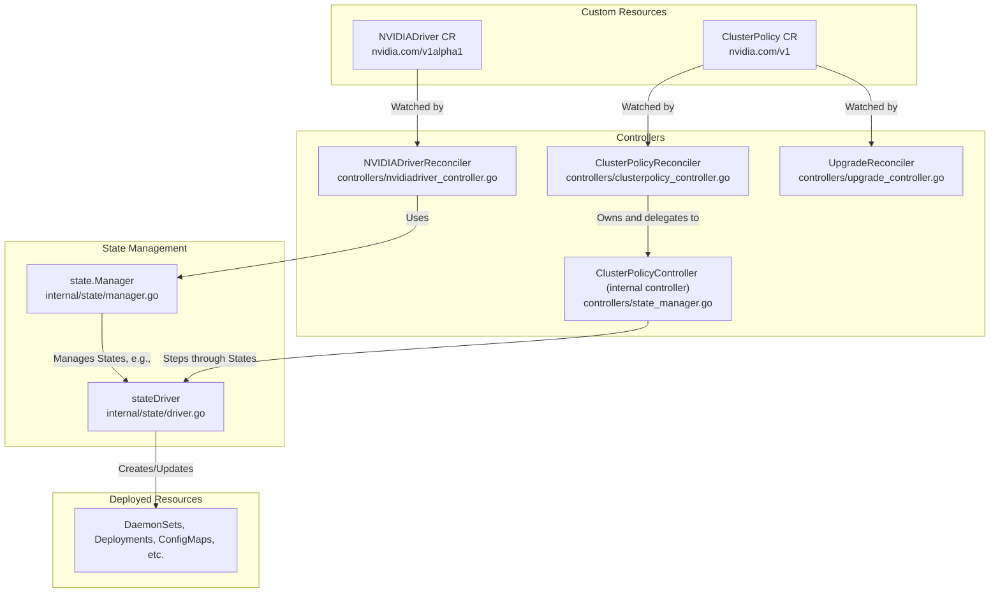

Here the main custom controllers watch CRs:

- `ClusterPolicyReconciler` for the main ClusterPolicy resource.
- `NVIDIADriverReconciler` for fine-grained per-driver custom resources.
- `UpgradeReconciler` handles driver upgrade orchestration.

Internally, these controllers delegate detailed logic to a `ClusterPolicyController` (implemented in `controllers/state_manager.go`), which operates using the State interface pattern. This controller coordinates individual component states, such as deploying driver daemonsets through `stateDriver` and others.

**Sources:** [controllers/clusterpolicy_controller.go:59-65](), [controllers/nvidiadriver_controller.go:53-62](), [controllers/upgrade_controller.go:53-58]()

### ClusterPolicyController

`ClusterPolicyReconciler` is the top-level entry point for the ClusterPolicy CR. It fetches the singleton ClusterPolicy and initializes the internal `ClusterPolicyController`, which continuously steps through a sequence of states that represent GPU Operator components (driver, toolkit, device plugin, monitoring, validation, etc.).

Key functions:

- `Reconcile`: Fetches ClusterPolicy, determines if it is the active singleton, handles conflicts with GPUCluster CRs, and triggers the state reconciliation loop [controllers/clusterpolicy_controller.go:90-156]().
- `init`: Initializes environment detection, state list creation, and node info gathering [controllers/state_manager.go:753-892]().
- `step`: Iterates through enabled states and calls `Sync`, building a consistent operator state [controllers/state_manager.go:938-976]().

This layered architecture allows adding or modifying component states without changing the outer controller logic.

### NVIDIADriverReconciler

This controller manages the `NVIDIADriver` CRD, providing more granular, node-group-aware driver management and configuration.

Key behaviors include:

- Validating whether the operator is configured to reconcile NVIDIADriver CRs by checking the `useNvidiaDriverCRD` flag in ClusterPolicy [controllers/nvidiadriver_controller.go:123-132]().
- Using a `nodeSelectorValidator` to enforce exclusive node targeting: no two drivers select overlapping node sets [internal/validator/validator.go:31-116]().
- Handling driver deployment logic sensitive to features like precompiled binaries, GPUDirect Storage (GDS), and GDRCopy support [controllers/nvidiadriver_controller.go:155-163]().
- Using a shared InfoCatalog to pass environment and host filesystem info into states for templating and deployment [controllers/nvidiadriver_controller.go:138-145]().

This encapsulation enables driving different driver versions/configs in heterogenous clusters.

### UpgradeReconciler

The `UpgradeReconciler` automates the upgrading of NVIDIA driver DaemonSets across the cluster. It integrates with the `k8s-operator-libs` upgrade manager to track the upgrade state of nodes.

Core responsibilities:

- Watches the ClusterPolicy and/or NVIDIADriver CRs for upgrade directives.
- Selects DaemonSets representing the driver component via labels for rolling update enforcement.
- Manages node draining and pod eviction respecting maxUnavailable settings during upgrades.
- Handles OpenShift dynamics with Driver Toolkit conditions [controllers/upgrade_controller.go:89-156]().

This ensures zero-downtime or controlled downtime upgrades of GPU drivers in production environments.

---

## State Management Pattern

The operator internally decomposes the delivery and management of each deployable component into a `State` abstraction.

### The State Interface

The `State` interface (defined in `internal/state/types.go`) standardizes how each component performs reconciliation:

| Method          | Purpose                                              |
|-----------------|------------------------------------------------------|
| `Sync`          | Renders manifests, applies them to the cluster, and returns sync status and errors [internal/state/driver.go:134-167](). |
| `GetWatchSources`| Returns resource types to watch for triggering state syncs [internal/state/driver.go:169-184]().         |

Enforcing this interface allows the `ClusterPolicyController` and `StateManager` to operate generically over states.

### State Skeleton (`stateSkel`)

To reduce duplicated code for common logic, each state typically embeds a `stateSkel` struct that provides:

- Kubernetes client and scheme references.
- Manifest rendering utilities.
- Common methods for resource creation, update, deletions, and readiness checking.

Key methods:

- `renderObjects`: Renders all manifests with templating data [internal/state/state_skel.go:90-98]().
- `syncObjects`: Creates or updates rendered objects with owner references and returns an overall sync state [internal/state/state_skel.go:101-120]().
- `createOrUpdateObjs`: A helper that handles resource fetch, compare, update/create logic including error handling and logging [internal/state/state_skel.go:188-275]().
- `getSyncState`: Aggregates the readiness conditions of the managed resources into a single state enum [internal/state/state_skel.go:294-338]().

The `stateSkel` comes loaded with supported resource types and common convenience functions to merge objects, check daemonset deployment readiness, and set GPU-Operator-specific labels.

This skeleton pattern allows state implementations to focus on component-specific logic while reusing the robust resource lifecycle management.

---

## Reconciliation Loop & Ordering

The GPU Operator executes reconciliation in a well-defined order to respect dependencies and readiness.

### Execution Order

Defined during `ClusterPolicyController.init`:

1. **Prerequisite States**: Namespace and RBAC setup.
2. **Driver State**: Deploy kernel driver modules and daemonsets.
3. **Container Toolkit State**: Install NVIDIA Container Toolkit components.
4. **Device Plugin State**: Deploy device plugin daemonsets exposing GPUs.
5. **Monitoring State**: Deploy DCGM exporter and Prometheus rules.
6. **Validation State**: Run workload validations and health checks.

No state attempts deployment unless all prior states are in Ready state, ensuring stable progressive rollout.

### Reconciliation Flow

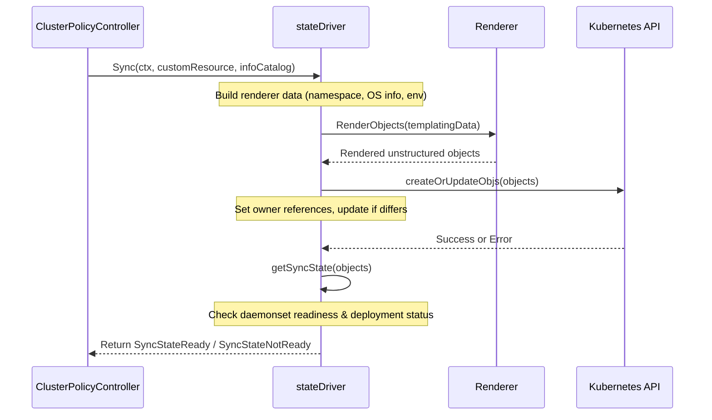

`ClusterPolicyController` aggregates states' statuses to decide whether to proceed or requeue reconciliation.

---

## Conditions Tracking

The operator uses Kubernetes conditions on CR statuses to signal state to users and other controllers.

For example, on the `NVIDIADriver` CR, conditions updated include:

- `ReconcileFailed`: Set when reconciliation errors occur [controllers/nvidiadriver_controller.go:93]().
- `ConflictingNodeSelector`: Set when multiple NVIDIADriver CRs select overlapping node sets, detected by validator checks [internal/conditions/nvidiadriver.go:34-37]().
- `Reconciled`: Signals success or intentional skipping of reconciliation due to disabled flags [controllers/nvidiadriver_controller.go:128]().

A dedicated `conditionUpdater` interface implementation per controller encapsulates this logic and leverages conflict-retry for robust status patching [internal/conditions/nvidiadriver.go:40-128]().

---

## Resource Manager and Manifest Handling

The operator's `ResourceManager` (in `controllers/resource_manager.go`) encapsulates logic to load, parse, and manage Kubernetes assets from manifests on disk.

Key features:

- Recursively reads files from manifests directories, filtering by Kubernetes resource types and OpenShift versions [controllers/resource_manager.go:68-102]().
- Decodes YAML manifests into typed Kubernetes API objects like DaemonSet, Deployment, ConfigMap, etc. [controllers/resource_manager.go:115-201]().
- Produces a `Resources` struct holding typed resource objects and a control function list indicating which controllers to invoke for each resource type.
- Handles compatibility such as presence of OpenShift or Node v1 APIs depending on cluster versions.

This module facilitates modular composition of manifests into resource sets used in each `State` for dynamic deployment.

---

## Node Info Utilities and InfoCatalog

The operator collects detailed cluster and node metadata to tailor deployments.

- **Cluster Info Interface**: Provides accessors for container runtime, OpenShift version, and proxy config [controllers/clusterinfo/clusterinfo.go].
- **Node Discovery**: The operator selects GPU nodes via labels like `nvidia.com/gpu.present` and uses NFD (Node Feature Discovery) labels such as kernel version to refine targeting.
- **InfoCatalog**: An interface to inject these environment details into the templating context passed to each state's `Sync` method. Examples include `ClusterInfo` and `hostRoot` for filesystem paths [controllers/nvidiadriver_controller.go:138-145]().

This design allows states to adapt manifests dynamically at runtime.

---

## Summary Diagram Bridging Concepts to Code Entities

```mermaid
classDiagram
    class "ClusterPolicyReconciler" {
      +Reconcile()
    }
    class "ClusterPolicyController" {
      +Init()
      +Step()
      -states : []State
    }
    class "NVIDIADriverReconciler" {
      +Reconcile()
    }
    class "UpgradeReconciler" {
      +Reconcile()
    }
    class stateManager {
      +SyncState()
      +GetWatchSources()
    }
    class stateSkel {
      -renderObjects()
      -syncObjects()
      -createOrUpdateObjs()
      -getSyncState()
    }
    class "State (interface)" {
      +Sync()
      +GetWatchSources()
    }
    class ResourceManager {
      +getAssetsFrom()
      +addResourcesControls()
    }
    class Validator {
      +Validate()
    }
    class ConditionUpdater {
      +SetConditionsReady()
      +SetConditionsError()
    }
    class InfoCatalog {
      +Add()
      +Get()
    }

    "ClusterPolicyReconciler" --> "ClusterPolicyController"
    "ClusterPolicyReconciler" --> "ConditionUpdater"
    "NVIDIADriverReconciler" --> Validator
    "NVIDIADriverReconciler" --> InfoCatalog
    "NVIDIADriverReconciler" --> stateManager
    "UpgradeReconciler" --> stateManager
    "ClusterPolicyController" --> stateManager
    stateManager --> "State (interface)"
    stateSkel ..|> "State (interface)"
    stateSkel --|> "ResourceManager"
    "State (interface)" <.. stateSkel
    "ConditionUpdater" <.. internal/conditions/nvidiadriver.go
```

This diagram correlates major architectural elements and their implementation locations, illustrating how controller structs utilize state management, validation, condition update, and resource rendering sub-systems.

**Sources:**

- [controllers/clusterpolicy_controller.go:59-156]()
- [controllers/nvidiadriver_controller.go:53-162]()
- [controllers/upgrade_controller.go:53-156]()
- [internal/state/manager.go:32-116]()
- [internal/state/state_skel.go:43-120]()
- [controllers/resource_manager.go:68-201]()
- [internal/validator/validator.go:31-117]()
- [internal/conditions/nvidiadriver.go:40-128]()

---

# Summary

The core concepts of the NVIDIA GPU Operator center around:

- Kubernetes controller runtimes managing GPU-configured custom resources.
- A structured State interface pattern that neatly encapsulates component-specific deployment logic.
- Robust reconciliation loops that render and synchronize Kubernetes manifests dynamically.
- Condition management for reflecting reconciliation state back in CRs.
- Resource manifest handling for modular, version-aware asset delivery.
- Utilities providing environment context to manifests to tailor deployments per cluster and node.

This design allows the GPU Operator to reliably deploy the NVIDIA GPU software stack in diverse Kubernetes environments with seamless upgrades and rich customization capabilities.

---

# Appendix: Key Files with Core Concepts

| Area | File/Location | Description |
|-|-|-|
| ClusterPolicy Controller | `controllers/clusterpolicy_controller.go` Lines 59-156 | Main reconciler delegate for the root ClusterPolicy CR |
| NVIDIADriver Controller | `controllers/nvidiadriver_controller.go` Lines 53-162 | Fine-grained driver reconciler with validation |
| Upgrade Controller | `controllers/upgrade_controller.go` Lines 53-156 | DaemonSet upgrade management reconciler |
| State Manager | `internal/state/manager.go` Lines 32-116 | Manages multiple states and orchestrates sync |
| State Skeleton | `internal/state/state_skel.go` Lines 40-120 | Common utilities for implementing states |
| Resource Manager | `controllers/resource_manager.go` Lines 68-201 | Loads and decodes manifests into typed resources |
| Validator Interface | `internal/validator/validator.go` Lines 31-117 | NodeSelector-based CR validation logic |
| Condition Updater | `internal/conditions/nvidiadriver.go` Lines 40-128 | CR condition setting implementation |

---

**Sources:**

- `controllers/clusterpolicy_controller.go:59-156`  
- `controllers/nvidiadriver_controller.go:53-162`  
- `controllers/upgrade_controller.go:53-156`  
- `internal/state/manager.go:32-116`  
- `internal/state/state_skel.go:43-120`  
- `controllers/resource_manager.go:68-201`  
- `internal/validator/validator.go:31-117`  
- `internal/conditions/nvidiadriver.go:40-128`

---

# Page: Component Architecture

# Component Architecture

<details>
<summary>Relevant source files</summary>

The following files were used as context for generating this wiki page:

- [assets/gpu-feature-discovery/0100_service_account.yaml](assets/gpu-feature-discovery/0100_service_account.yaml)
- [assets/gpu-feature-discovery/0300_rolebinding.yaml](assets/gpu-feature-discovery/0300_rolebinding.yaml)
- [assets/gpu-feature-discovery/0400_scc_openshift.yaml](assets/gpu-feature-discovery/0400_scc_openshift.yaml)
- [assets/gpu-feature-discovery/0500_daemonset.yaml](assets/gpu-feature-discovery/0500_daemonset.yaml)
- [assets/state-dcgm-exporter/0200_role.yaml](assets/state-dcgm-exporter/0200_role.yaml)
- [assets/state-dcgm-exporter/0800_daemonset.yaml](assets/state-dcgm-exporter/0800_daemonset.yaml)
- [assets/state-dcgm/0400_dcgm.yml](assets/state-dcgm/0400_dcgm.yml)
- [assets/state-device-plugin/0500_daemonset.yaml](assets/state-device-plugin/0500_daemonset.yaml)
- [assets/state-mig-manager/0100_service_account.yaml](assets/state-mig-manager/0100_service_account.yaml)
- [assets/state-mig-manager/0200_role.yaml](assets/state-mig-manager/0200_role.yaml)
- [assets/state-mig-manager/0210_clusterrole.yaml](assets/state-mig-manager/0210_clusterrole.yaml)
- [assets/state-mig-manager/0400_configmap.yaml](assets/state-mig-manager/0400_configmap.yaml)
- [assets/state-mig-manager/0500_scc.openshift.yaml](assets/state-mig-manager/0500_scc.openshift.yaml)
- [assets/state-mig-manager/0600_daemonset.yaml](assets/state-mig-manager/0600_daemonset.yaml)
- [assets/state-mps-control-daemon/0400_daemonset.yaml](assets/state-mps-control-daemon/0400_daemonset.yaml)
- [assets/state-node-status-exporter/0300_clusterrole.yaml](assets/state-node-status-exporter/0300_clusterrole.yaml)
- [assets/state-operator-validation/0100_service_account.yaml](assets/state-operator-validation/0100_service_account.yaml)
- [assets/state-operator-validation/0200_role.yaml](assets/state-operator-validation/0200_role.yaml)
- [assets/state-operator-validation/0210_clusterrole.yaml](assets/state-operator-validation/0210_clusterrole.yaml)
- [assets/state-operator-validation/0500_daemonset.yaml](assets/state-operator-validation/0500_daemonset.yaml)
- [assets/state-sandbox-validation/0500_daemonset.yaml](assets/state-sandbox-validation/0500_daemonset.yaml)
- [controllers/clusterinfo/clusterinfo_test.go](controllers/clusterinfo/clusterinfo_test.go)
- [controllers/state_manager_test.go](controllers/state_manager_test.go)
- [deployments/gpu-operator/templates/validations.yaml](deployments/gpu-operator/templates/validations.yaml)
- [internal/state/nodepool.go](internal/state/nodepool.go)
- [internal/state/nodepool_test.go](internal/state/nodepool_test.go)

</details>


## Purpose and Scope

This page provides an in-depth technical description of the NVIDIA GPU Operator's component architecture. It details the layered dependencies among core components such as drivers, container toolkit, device plugins, MIG manager, monitoring, and validation. It explains the directory structure for deployment manifests and assets and clarifies how each logical operator state corresponds to Kubernetes resources managed on the cluster.

For foundational concepts on controllers, state reconciliation, and resource management, see [Core Concepts (2.1)](2.1). For configuration flow and transformations, see [Configuration and Transformation System (2.3)](2.3).

---

## Component Layers

The GPU Operator organizes components in strict dependency layers reflecting hardware and software prerequisites. Each subsequent layer depends on the healthy startup and configuration of the prior layer. This design ensures that all GPU-related kernel modules, driver binaries, container runtime integration, and device advertising are correctly established before enabling GPU workloads.

### Layered Dependencies Overview

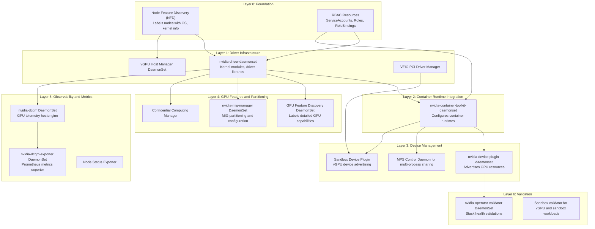

**Sources:**
- [assets/state-driver/0500_daemonset.yaml:1-210]()
- [assets/gpu-feature-discovery/0500_daemonset.yaml:1-132]()
- [assets/state-mig-manager/0400_configmap.yaml:1-55]()
- [assets/state-mig-manager/0600_daemonset.yaml:1-116]()
- [assets/state-device-plugin/0500_daemonset.yaml:1-167]()

---

## Assets and Manifests Directory Structure

- **assets/**: Contains declarative Kubernetes manifest templates for each component and state, organized by component/state name subdirectories, e.g., `state-driver/`, `gpu-feature-discovery/`, `state-mig-manager/`.
  
  - Example:
    - `state-driver/0500_daemonset.yaml` defines the driver DaemonSet.
    - `state-mig-manager/0400_configmap.yaml` holds the default MIG configuration.
  
- **manifests/**: Contains fully rendered deployment manifests post-Helm or operator transformations. These are installed resources representing the runtime state footprint of the operator components in Kubernetes.

This directory organization supports modular management of GPU Operator components by state and facilitates the operator's reconciliation logic that selectively applies manifests according to detected cluster state.

**Sources:**
- [assets/state-driver/0500_daemonset.yaml]()
- [assets/state-mig-manager/0400_configmap.yaml]()
- [assets/gpu-feature-discovery/0500_daemonset.yaml]()

---

## Detailed Component Layers and Kubernetes Resources

### Layer 0: Foundation

- **Node Feature Discovery (NFD):**
  - A prerequisite DaemonSet (not part of the GPU Operator itself) that labels Kubernetes nodes with detailed OS release, kernel version, and platform information.
  - Labels like `feature.node.kubernetes.io/kernel-version.full` and `feature.node.kubernetes.io/system-os_release.OSTREE_VERSION` enable GPU Operator to create targeted DaemonSets per OS/kernel.

- **RBAC Resources:**
  - The operator programmatically defines and creates ServiceAccounts, Roles, ClusterRoles, RoleBindings, and ClusterRoleBindings for permissions.
  - These resources enable GPU Operator components to interact with the K8s API server and manage node-level configurations securely.

**Sources:**
- [assets/state-driver/0500_daemonset.yaml:78-85]()
- [internal/state/testdata/golden/driver-openshift-drivertoolkit.yaml:134-175]()

---

### Layer 1: Driver Infrastructure

- **nvidia-driver-daemonset:**
  - A DaemonSet deploying NVIDIA kernel modules and user-space driver libraries on nodes matched by OS and kernel labels.
  - Runs with privileged security context to install kernel modules.
  
- **Init Containers:**
  - `k8s-driver-manager` init container uninstalls previous driver version to ensure clean setup.
  - Uses the binary `driver-manager` with argument `uninstall_driver`.

- **Main Container:**
  - `nvidia-driver-ctr` runs the driver installation with `/bin/entrypoint.sh` and commands like `nvidia-driver init` to load modules.
  - A startup probe (using `startup-probe.sh`) checks readiness by running `nvidia-smi` and ensures kernel module is loaded.
  - On success, it writes readiness file `.driver-ctr-ready` in `/run/nvidia/validations`.

- **Sidecars:**
  - `nvidia-peermem-ctr` handles peer memory modules for GPUDirect RDMA.
  - `nvidia-fs-ctr` optionally loads GPUDirect Storage kernel modules.

- Each driver DaemonSet instance is strictly tied to node OS/kernel labels to prevent cross-version mismatches.

**Sources:**
- [assets/state-driver/0500_daemonset.yaml:1-210]()
- [internal/state/testdata/golden/driver-gds.yaml:94-125]()

---

### Layer 2: Container Runtime Integration

- **nvidia-container-toolkit DaemonSet:**
  - Configures GPU container runtimes like containerd, Docker, CRI-O.
  - Sets up NVIDIA Container Device Interface (CDI) specifications enabling device injection.
  - Writes validation readiness file `/run/nvidia/validations/toolkit-ready`.
  
- Downstream components use an init container named `toolkit-validation` to block until this file is present.

**Sources:**
- [assets/gpu-feature-discovery/0500_daemonset.yaml:29-32]()
- [assets/state-mig-manager/0600_daemonset.yaml:28-31]()

---

### Layer 3: Device Management

- **nvidia-device-plugin DaemonSet:**
  - Implements the Kubernetes Device Plugin API for GPU resource advertising.
  - Supports device selection strategies and Multi-Process Service (MPS) modes.
  - Watches ConfigMaps for device plugin config and supports hot config updates via a `config-manager` sidecar.
  - Runs privileged container with volume mounts exposing the `/var/lib/kubelet/device-plugins` directory.

- **MPS Control Daemon:**
  - When MPS capable GPUs are detected (`nvidia.com/mps.capable`), runs `nvidia-device-plugin-mps-control-daemon` DaemonSet.
  - Manages shared GPU resource lifecycles for multiple processes.

- **Sandbox Device Plugin:**
  - Specifically for workloads running in sandboxed environments (e.g., KubeVirt, Kata Containers).
  - Advertises vGPU and mediated device resources.

**Sources:**
- [assets/state-device-plugin/0500_daemonset.yaml:1-167]()
- [assets/state-mps-control-daemon/0400_daemonset.yaml:1-135]()

---

### Layer 4: GPU Features and Partitioning

- **GPU Feature Discovery (GFD) DaemonSet:**
  - Discovers installed GPU features and reports them as Kubernetes node labels.
  - Runs a privileged main container doing discovery and a `config-manager` sidecar that manages config updates and signals.
  - Outputs feature info to `/etc/kubernetes/node-feature-discovery/features.d` host path.

- **MIG Manager (`nvidia-mig-manager` DaemonSet):**
  - Manages Multi-Instance GPU (MIG) partitions based on configurations from a ConfigMap named e.g., `default-mig-parted-config`.
  - Reads structured MIG profiles with device types and counts described in `config.yaml`.
  - Waits for container toolkit readiness before activation.
  - Uses privileged security contexts to configure MIG hardware.

- **Confidential Computing Manager:**
  - Handles deployment of components managing confidential computing capabilities (not covered in detail here).

**Sources:**
- [assets/gpu-feature-discovery/0500_daemonset.yaml:1-132]()
- [assets/state-mig-manager/0400_configmap.yaml:1-55]()
- [assets/state-mig-manager/0600_daemonset.yaml:27-37]()

---

### Layer 5: Observability and Metrics

- **NVIDIA Data Center GPU Manager (DCGM):**
  - Runs as the `nvidia-dcgm` DaemonSet providing telemetry and health monitoring of GPUs.
  - Uses privileged containers with host path access to GPU-related sockets and files.

- **DCGM Exporter:**
  - A DaemonSet exporting DCGM telemetry in Prometheus format (`nvidia-dcgm-exporter`).
  - Enables metrics scraping for monitoring GPU health and utilization.

- **Node Status Exporter (not described in detail):**
  - Emits metrics about device plugin and node GPU states.

**Sources:**
- [assets/state-dcgm/0400_dcgm.yml:1-60]()
- [assets/state-dcgm-exporter/0800_daemonset.yaml:1-81]()

---

### Layer 6: Validation

- **Operator Validator (`nvidia-operator-validator` DaemonSet):**
  - Runs as a DaemonSet validating driver, toolkit, CUDA runtime, and device plugin functionality.
  - Uses `nvidia-validator` binary with modes for driver, toolkit, CUDA, and plugin checks.
  - Runs multiple init containers performing component-specific validations with readiness signaling files.
  - Helps ensure the GPU stack is functional before declaring node ready.

- **Sandbox Validator:**
  - Specialized validation for sandboxed environments with vGPU workloads.

**Sources:**
- [assets/state-operator-validation/0500_daemonset.yaml:1-154]()

---

## How Logical States Map to Kubernetes Resources

The GPU Operator defines a finite state model where each "state" corresponds to deployed components implemented as Kubernetes resources (DaemonSets, Deployments, ConfigMaps, Roles, etc.). These states reflect enabling or disabling of GPU stack layers and their readiness.

Example mapping:

| Operator State Name      | Mapped Kubernetes Resources                                                  | Description                                           |
|-------------------------|-----------------------------------------------------------------------------|-------------------------------------------------------|
| `state-driver`          | `nvidia-driver-daemonset` + associated RBAC and service accounts           | Installs GPU kernel modules and drivers               |
| `state-toolkit`         | `nvidia-container-toolkit-daemonset`                                      | Container runtime integration for GPU containers      |
| `state-device-plugin`   | `nvidia-device-plugin-daemonset`, MPS Control Daemon, ConfigMaps          | Device advertising and GPU resource management         |
| `state-gpu-feature-discovery` | `gpu-feature-discovery` DaemonSet                                     | Discovers and labels GPU features                      |
| `state-mig-manager`     | `nvidia-mig-manager` DaemonSet + ConfigMap with MIG configs                | Manages MIG partitioning                               |
| `state-dcgm`            | `nvidia-dcgm` DaemonSet                                                     | GPU telemetry monitoring service                       |
| `state-dcgm-exporter`   | `nvidia-dcgm-exporter` DaemonSet                                           | Prometheus metrics exporter for DCGM                   |
| `state-operator-validator` | `nvidia-operator-validator` DaemonSet                                   | Validates GPU operator stack health                    |

Control loops reconcile these states by creating/updating/deleting appropriate Kubernetes resources according to the ClusterPolicy CR and detected hardware/node state.

**Sources:**
- [assets/state-driver/0500_daemonset.yaml]()
- [assets/state-device-plugin/0500_daemonset.yaml]()
- [assets/gpu-feature-discovery/0500_daemonset.yaml]()
- [assets/state-mig-manager/0400_configmap.yaml]()
- [assets/state-mig-manager/0600_daemonset.yaml]()
- [assets/state-dcgm/0400_dcgm.yml]()
- [assets/state-dcgm-exporter/0800_daemonset.yaml]()
- [assets/state-operator-validation/0500_daemonset.yaml]()

---

## Critical Shared Paths and Volume Mounts

GPU Operator components share information primarily through host-mounted directories:

| Host Path                           | Usage                                                | Mounted By                               |
|-----------------------------------|------------------------------------------------------|------------------------------------------|
| `/run/nvidia`                     | Root directory for NVIDIA runtime and validations    | Driver, DCGM, Toolkit, MIG Manager       |
| `/run/nvidia/validations`         | Files signaling readiness of driver/toolkit/validator| Driver, toolkit, validator init containers |
| `/etc/kubernetes/node-feature-discovery/features.d` | Output directory for GPU feature labels           | GPU Feature Discovery                     |
| `/var/lib/kubelet/device-plugins`| Device plugin Unix sockets for communicating with kubelet | Device Plugin DaemonSet                    |
| `/run/nvidia/driver`              | Driver installation directory accessible to stock and MIG components | MIG Manager, Device Plugin                |
| `/run/nvidia/mps` & `/dev/shm`   | Shared files for Multi-Process Service (MPS)          | MPS Control Daemon, Device Plugin         |

These mounts ensure processes running in containers have access to required node-level paths for managing kernel modules, device plugins, and reporting readiness.

**Sources:**
- [assets/state-driver/0500_daemonset.yaml:78-140]()
- [assets/gpu-feature-discovery/0500_daemonset.yaml:86-92]()
- [assets/state-mig-manager/0600_daemonset.yaml:100-116]()
- [assets/state-device-plugin/0500_daemonset.yaml:139-167]()

---

## Implementation Details: Key Functions and Classes

- The operator's core controller (e.g., `ClusterPolicyController`) uses the State interface pattern and reconciliation loops ([controllers/state_manager_test.go:167-239]()) to transition through states, invoking functions that manage the creation of corresponding Kubernetes resources.

- Node pool management is implemented in `internal/state/nodepool.go`. It partitions nodes by OS and kernel version information obtained via NFD labels to ensure correct targeting for driver DaemonSets ([internal/state/nodepool.go:60-149]()).

- The operator dynamically injects node selectors in manifests, derived from node pools, to deploy OS/kernel version specific DaemonSets ([internal/state/nodepool.go:60-149]()).

- Initialization containers named `toolkit-validation` commonly block component startup until the NVIDIA Container Toolkit signals readiness by writing `/run/nvidia/validations/toolkit-ready`. This pattern is observed in the GPU Feature Discovery and MIG manager DaemonSets ([assets/gpu-feature-discovery/0500_daemonset.yaml:29-32](), [assets/state-mig-manager/0600_daemonset.yaml:28-31]().

---

## Component Initialization Data Flow

### Driver Container Startup and Validation Flow

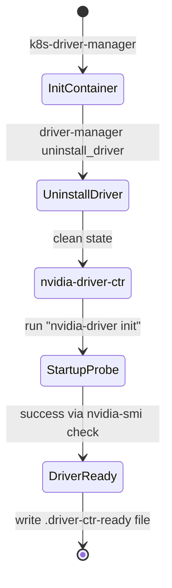

- The init container performs an uninstall of previous drivers to guarantee clean conditions before installing a new driver.
- The main container executes `nvidia-driver init` which loads kernel modules and driver binaries.
- Successful startup verifies `nvidia-smi` responds correctly before marking readiness by a specific file.

**Sources:**
- [assets/state-driver/0500_daemonset.yaml:47-51]()
- [assets/state-driver/0500_daemonset.yaml:94-96]()
- [internal/state/testdata/golden/driver-gds.yaml:94-125]()

---

### Downstream Components Wait for Upstream Readiness

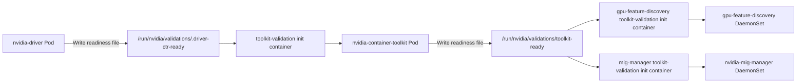

- Driver readiness file signals to the toolkit's blocking init container to proceed.
- Toolkit readiness similarly allows GPU Feature Discovery and MIG Manager components to start safely.
- This ensures strict startup ordering across dependent layers.

**Sources:**
- [assets/gpu-feature-discovery/0500_daemonset.yaml:29-32]()
- [assets/state-mig-manager/0600_daemonset.yaml:28-31]()
- [internal/state/testdata/golden/driver-gds.yaml:98-99]()

---

# Summary

The NVIDIA GPU Operator employs a rigorously layered component architecture. Each layer corresponds to a set of Kubernetes resources carefully targeted and configured per node OS/kernel characteristics. Readiness signaling files and init containers enforce strict startup ordering, while node labeling via NFD allows dynamic adaptation to heterogeneous clusters.

The assets/ directory contains modular manifests defining each component’s DaemonSets, ConfigMaps, and RBAC. The manifests/ directory holds fully rendered resources applied to the cluster.

The operator's state machine logic orchestrates progressive provisioning of GPU support from driver installation through device plugin management, MIG partitioning, telemetry collection, and stack validation — all mapped tightly to specific Kubernetes resources, ensuring consistent, reliable deployments across diverse clusters.

---

# Mermaid Diagrams Highlighting Code Entities and Component Mapping

### Diagram 1: Component to Kubernetes Resources & Code Entities

```mermaid
graph TB
    classDef codeEntity fill:none,stroke:none,font-family:monospace,font-weight:bold;
    
    DriverComp["Driver Component"]:::codeEntity
    DriverMan["k8s-driver-manager (init container)"]:::codeEntity
    DriverCtr["nvidia-driver-ctr (main container)"]:::codeEntity
    
    ToolkitComp["Container Toolkit Component"]:::codeEntity
    ToolkitInit["toolkit-validation (init container)"]:::codeEntity
    
    DPComp["Device Plugin Component"]:::codeEntity
    DPConfig["config-manager sidecar"]:::codeEntity
    
    MIGComp["MIG Manager Component"]:::codeEntity
    MIGConfigMap["default-mig-parted-config ConfigMap"]:::codeEntity
    
    GFDComp["GPU Feature Discovery Component"]:::codeEntity
    GFDCtr["gpu-feature-discovery container"]:::codeEntity
    GFDConfigMgr["config-manager sidecar"]:::codeEntity
    
    ValidatorComp["Validator Component"]:::codeEntity
    
    DriverComp -->|uninstall| DriverMan
    DriverComp -->|init & driver load| DriverCtr
    ToolkitComp -->|blocks until ready| ToolkitInit
    DPComp -->|watches config| DPConfig
    MIGComp -->|reads config| MIGConfigMap
    GFDComp -->|labels nodes| GFDCtr
    GFDComp -->|ConfigMgr manages configs| GFDConfigMgr
```

---

### Diagram 2: Component State to Kubernetes Resource Manifest Files

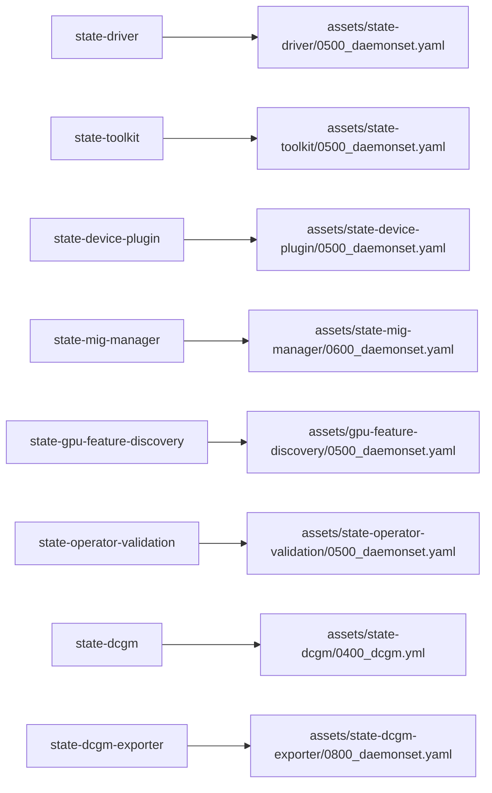

---

# References

Please consult the following files for detailed manifests and implementation specifics:

- Driver DaemonSet: `assets/state-driver/0500_daemonset.yaml`
- Container Toolkit DaemonSet, Toolkit Validation: `assets/gpu-feature-discovery/0500_daemonset.yaml`
- Device Plugin DaemonSet: `assets/state-device-plugin/0500_daemonset.yaml`
- MIG Manager ConfigMap and DaemonSet: `assets/state-mig-manager/0400_configmap.yaml`, `assets/state-mig-manager/0600_daemonset.yaml`
- GPU Feature Discovery DaemonSet: `assets/gpu-feature-discovery/0500_daemonset.yaml`
- Validation DaemonSet: `assets/state-operator-validation/0500_daemonset.yaml`
- DCGM and DCGM Exporter DaemonSets: `assets/state-dcgm/0400_dcgm.yml`, `assets/state-dcgm-exporter/0800_daemonset.yaml`
- Node Pool management and OS tagging functions: `internal/state/nodepool.go`

Sources:  
- [assets/state-driver/0500_daemonset.yaml:1-210]()  
- [internal/state/nodepool.go:60-149]()  
- [assets/gpu-feature-discovery/0500_daemonset.yaml:1-132]()  
- [assets/state-mig-manager/0400_configmap.yaml:1-55]()  
- [assets/state-mig-manager/0600_daemonset.yaml:1-116]()  
- [assets/state-device-plugin/0500_daemonset.yaml:1-167]()  
- [assets/state-dcgm-exporter/0800_daemonset.yaml:1-81]()  
- [assets/state-operator-validation/0500_daemonset.yaml:1-154]()  
- [internal/state/testdata/golden/driver-gds.yaml:94-125]()  
- [controllers/state_manager_test.go:167-239]()

---

# Page: Configuration and Transformation System

# Configuration and Transformation System

<details>
<summary>Relevant source files</summary>

The following files were used as context for generating this wiki page:

- [api/nvidia/v1/clusterpolicy_types.go](api/nvidia/v1/clusterpolicy_types.go)
- [api/nvidia/v1/zz_generated.deepcopy.go](api/nvidia/v1/zz_generated.deepcopy.go)
- [bundle/manifests/nvidia.com_clusterpolicies.yaml](bundle/manifests/nvidia.com_clusterpolicies.yaml)
- [config/crd/bases/nvidia.com_clusterpolicies.yaml](config/crd/bases/nvidia.com_clusterpolicies.yaml)
- [config/samples/v1_clusterpolicy.yaml](config/samples/v1_clusterpolicy.yaml)
- [controllers/clusterinfo/clusterinfo.go](controllers/clusterinfo/clusterinfo.go)
- [controllers/object_controls.go](controllers/object_controls.go)
- [controllers/object_controls_test.go](controllers/object_controls_test.go)
- [controllers/state_manager.go](controllers/state_manager.go)
- [controllers/transforms_test.go](controllers/transforms_test.go)
- [deployments/gpu-operator/crds/nvidia.com_clusterpolicies.yaml](deployments/gpu-operator/crds/nvidia.com_clusterpolicies.yaml)
- [deployments/gpu-operator/templates/clusterpolicy.yaml](deployments/gpu-operator/templates/clusterpolicy.yaml)
- [deployments/gpu-operator/values.yaml](deployments/gpu-operator/values.yaml)
- [internal/consts/consts.go](internal/consts/consts.go)
- [internal/render/render.go](internal/render/render.go)
- [internal/render/render_suite_test.go](internal/render/render_suite_test.go)
- [internal/render/render_test.go](internal/render/render_test.go)
- [internal/state/driver.go](internal/state/driver.go)
- [internal/state/driver_test.go](internal/state/driver_test.go)
- [internal/state/driver_volumes.go](internal/state/driver_volumes.go)
- [internal/state/types.go](internal/state/types.go)

</details>


This document explains how user configuration flows through the NVIDIA GPU Operator's multi-stage transformation pipeline, from Helm chart values to deployed Kubernetes resources. It covers Helm templating, Custom Resource creation, controller-based transformations, and the manifest rendering and transformation functions that customize operand Kubernetes objects based on cluster and user configurations.

For information about the Custom Resource schemas themselves, see **ClusterPolicy** and **NVIDIADriver**. For details on the State interface and reconciliation pattern, see **Core Concepts**.

---

## Configuration Pipeline Overview

The GPU Operator employs a configuration transformation pipeline that converts high-level user intent into cluster-specific Kubernetes resources. The pipeline consists of three major stages:

```mermaid
graph TB
    subgraph "Stage 1: Helm Configuration"
        ValuesYAML["values.yaml<br/>(Chart Defaults)"]
        UserValues["User Values Files"]
        CLIFlags["--set CLI Arguments"]
        HelmMerge["Helm Value Merge<br/>(Precedence: CLI > User > Defaults)"]
        
        ValuesYAML --> HelmMerge
        UserValues --> HelmMerge
        CLIFlags --> HelmMerge
    end
    
    subgraph "Stage 2: Custom Resource Creation"
        Template["clusterpolicy.yaml Template"]
        ClusterPolicyCR["ClusterPolicy CR<br/>(nvidia.com/v1)"]
        NVIDIADriverCR["NVIDIADriver CR<br/>(nvidia.com/v1alpha1)"]
        
        HelmMerge --> Template
        Template --> ClusterPolicyCR
        Template --> NVIDIADriverCR
    end
    
    subgraph "Stage 3: Controller Transformation"
        CPController["ClusterPolicyController"]
        StateManager["StateManager<br/>(state reconciliation)"]
        ObjectControls["object_controls.go<br/>(transformation logic)"]
        ManifestRenderer["internal/render.Renderer<br/>(manifest templating)"]
        
        ClusterPolicyCR --> CPController
        CPController --> StateManager
        StateManager --> ObjectControls
        ObjectControls --> ManifestRenderer
    end
    
    subgraph "Runtime Context"
        ClusterInfo["ClusterInfo capture<br/>(OS, Runtime, OpenShift)"]
        NFDLabels["NFD Node Feature Labels<br/>(Kernel, OS versions)"]
    end
    
    subgraph "Generated Kubernetes Resources"
        DaemonSets["DaemonSets"]
        ConfigMaps["ConfigMaps"]
        Services["Services"]
        RBAC["RBAC Resources"]
    end
    
    ObjectControls --> DaemonSets
    ObjectControls --> ConfigMaps
    ObjectControls --> Services
    ObjectControls --> RBAC
    
    ClusterInfo --> ObjectControls
    NFDLabels --> ObjectControls
```

**Summary:**
- User Helm configuration files (`values.yaml`) are merged and templated into CR YAML manifests.
- The ClusterPolicy CR is applied to the cluster.
- The GPU Operator’s controller observes the CR, reads cluster runtime info, and executes transformation logic in `object_controls.go`.
- This logic adapts rendered manifests, enhanced by the generic manifest renderer (`internal/render`), injecting node-specific configuration, volumes, and labels.
- The final Kubernetes objects like DaemonSets and ConfigMaps are applied into the cluster.

**Sources:**  
[deployments/gpu-operator/values.yaml:1-223](),  
[deployments/gpu-operator/templates/clusterpolicy.yaml:1-200](),  
[controllers/object_controls.go:1-135](),  
[internal/render/render.go:30-120]()  

---

## Stage 1: Helm Configuration Merging

### values.yaml Structure

The Helm chart’s default configuration is defined in `deployments/gpu-operator/values.yaml`. It provides comprehensive default settings for all components and operator behavior. User overrides or Helm CLI `--set` options merge over these defaults.

Key sections include:

| Configuration Path       | Purpose                               | Example snippet                          |
|-------------------------|-------------------------------------|----------------------------------------|
| `platform`              | Platform-specific flags (e.g., OpenShift) | `openshift: false` [values.yaml:5-6]()    |
| `nfd`                   | Node Feature Discovery integration    | `enabled: true` [values.yaml:8-9]()     |
| `daemonsets`            | Shared DaemonSet configuration, labels, annotations, and update policies | [values.yaml:41-58]()                    |
| `driver`                | NVIDIA driver deployment specifics, version, probes, upgrade policy | Version: `"595.91.07"` [values.yaml:164-204]()  |
| `operator`              | Operator pod configuration: image, runtimeClass, priorityClass, logging | [values.yaml:80-138]()                   |
| `mig`                   | Multi-Instance GPU strategy            | `strategy: single` [values.yaml:164-167]() |

These configurations feed into the Helm template rendering in the next stage.

---

### Helm Values are Merged with Precedence:

- Default values from `values.yaml`
- User-supplied value files
- CLI `--set` flags override all

This produces a final unified configuration object passed to Go templates during CR rendering.

**Sources:**  
[deployments/gpu-operator/values.yaml:1-223]()  

---

## Stage 2: Custom Resource Generation via Helm Templates

### ClusterPolicy Template Rendering

The Helm chart contains a key template `deployments/gpu-operator/templates/clusterpolicy.yaml` that renders the `ClusterPolicy` Custom Resource from merged Helm values.

```mermaid
graph TB
    subgraph "Template Input"
        ValuesYAML["values.yaml (merged)"]
        HelperFunctions["Go template helpers (e.g., labels)"]
    end
    
    subgraph "ClusterPolicy Template Logic"
        CondDriver["if .Values.driver.enabled"]
        CondValidator["if .Values.validator.enabled"]
        CondDaemonsets["daemonsets settings"]
        ConfigMapping["Mapping values to spec fields"]
    end
    
    subgraph "ClusterPolicy Output"
        CR["ClusterPolicy CR (nvidia.com/v1)"]
    end
    
    ValuesYAML --> CondDriver
    ValuesYAML --> CondValidator
    ValuesYAML --> CondDaemonsets
    HelperFunctions --> ConfigMapping
    CondDriver --> ConfigMapping
    CondValidator --> ConfigMapping
    CondDaemonsets --> ConfigMapping
    ConfigMapping --> CR
```

#### Key Template Features

- Conditional rendering gates component inclusion (e.g., `{{- if .Values.driver.enabled }}`) allowing optional component deployment.
- Use of Helm built-in functions like `quote` to ensure safe YAML rendering (e.g., driver version strings).
- Nested maps and arrays from Helm values are passed verbatim, allowing detailed per-component configuration.

Example snippet:

```yaml
spec:
  driver:
    enabled: {{ .Values.driver.enabled }}
    version: {{ .Values.driver.version | quote }}
  daemonsets:
    priorityClassName: {{ .Values.daemonsets.priorityClassName }}
```

This template produces a syntactically and semantically valid `ClusterPolicy` CR with spec fields reflecting user and default inputs.

---

### ClusterPolicy and NVIDIADriver CRs

- The `ClusterPolicy` CR is the main user configuration resource.
- The operator reconciles it and optionally the `NVIDIADriver` CR, which provides advanced customization options.

The ClusterPolicy schema corresponds to the Helm values structure but as a Kubernetes resource with strict typing.

**Sources:**  
[deployments/gpu-operator/templates/clusterpolicy.yaml:1-200]()  
[config/samples/v1_clusterpolicy.yaml:1-122]()  
[bundle/manifests/nvidia.com_clusterpolicies.yaml:1-180]()  

---

## Stage 3: Controller Transformation System

After CR creation, the ClusterPolicy is observed by the `ClusterPolicyController` implemented in the `controllers` package. This controller runs reconciliation loops, invoking the State interface implementations for each component.

### Manifest Rendering and Transformation

Central to the transformation system are:

| Component                              | Description                                           | File / Lines                                  |
|--------------------------------------|-------------------------------------------------------|-----------------------------------------------|
| `internal/render.Renderer`            | Manifest renderer that processes Helm-like templates loaded as files and renders them with structured render data. | [internal/render/render.go:20-130]()           |
| Transformation functions in `object_controls.go` | Implements logic to mutate generic Kubernetes objects based on CR spec and runtime cluster information | [controllers/object_controls.go:50-135]()   |
| Component State implementations      | Per-component `State` structs (e.g., driver, toolkit) which interact with renderer and apply transformations | [internal/state/driver.go:60-167]()           |

---

### Transformation Logic in `object_controls.go`

This file is the heart of object customization:

- It contains helper functions for configuring Kubernetes Pod specs, such as `applyHostNetworkConfig` to enable `hostNetwork` and adjust DNSPolicy [object_controls.go:59-63]().
- Defines constants used globally for GPU workloads like `DefaultRuntimeClass = "nvidia"` [object_controls.go:91]() and hash key names.
- Provides utilities to locate and adjust Containers in Pod templates, set volumes, environment variables, and labels consistently.
- Invoked by component states during the sync process to transform rendered manifests loaded from `internal/render`.

Example relevant function:

```go
// applyHostNetworkConfig sets HostNetwork and DNSPolicy on a pod spec if enabled
func applyHostNetworkConfig(podSpec *corev1.PodSpec, hostNetwork *bool) {
	if hostNetwork != nil && *hostNetwork {
		podSpec.HostNetwork = true
		podSpec.DNSPolicy = corev1.DNSClusterFirstWithHostNet
	}
}
```

---

### Code Entity Interaction Diagram

This diagram illustrates how natural language configuration intents map onto key Go code constructs in the transformation system:

```mermaid
graph TD
    subgraph "Natural Language Configuration"
        NL1["Enable Host Networking on Pods"]
        NL2["Adjust Paths for Host Root Filesystem"]
        NL3["Customize Containers by Name"]
        NL4["Inject Environment Variables and Labels"]
    end
    
    subgraph "Go Code Entities (controllers)"
        F1["applyHostNetworkConfig()"]
        F2["TransformForHostRoot()"] 
        F3["findContainerByName()"]
        T1["Daemonset wrapper (test helper)"]
        F4["setEnvVar(), addVolume()"]
    end
    
    NL1 --> F1
    NL2 --> F2
    NL3 --> F3
    NL4 --> F4
    F3 -.-> T1
```

This clarifies the mapping from user intents to concrete code entities performing the transformations.

**Sources:**  
[controllers/object_controls.go:58-135]()  
[controllers/transforms_test.go:230-242]()

---

## Runtime Context and Data Flow

The transformation system adapts manifests based on runtime cluster data collected by the controllers, including:

- **NFD (Node Feature Discovery):** Node labels indicating kernel version, OS family, and other hardware/OS traits.
- **ClusterInfo:** Encapsulates OpenShift version, container runtime, proxy settings, and special platform features.
- **User CR Spec:** The ClusterPolicy and NVIDIADriver resources containing user config.

These influence volume mounts, image selections, tolerations, security contexts, and feature flags in generated resources.

---

### OS and Kernel Mapping for Volumes

The driver and toolkit require mounting platform-specific repository and certificate paths. The operator maintains mappings from OS identifiers (from NFD labels) to paths for repo configs and cert bundles:

| OS ID    | Repo Config Path                 | Certificate Path                             |
|----------|---------------------------------|---------------------------------------------|
| `ubuntu` | `/etc/apt/sources.list.d`       | `/usr/local/share/ca-certificates`          |
| `rhel`   | `/etc/yum.repos.d`              | `/etc/pki/ca-trust/extracted/pem`           |
| `sles`   | `/etc/zypp/repos.d`             | `/etc/pki/trust/anchors`                     |

These paths guide the mounting of ConfigMaps or host paths to the driver container, enabling offline repositories or custom certs.

---

### Driver Volume Transformation Overview

The function `getDriverAdditionalConfigs` in the driver state adds additional volumes and mounts based on the CR and detected environment:

- If repo config mounting is enabled (`IsRepoConfigEnabled()`), a ConfigMap volume named `repo-config` is injected at the OS-specific path.
- If certs mounting is enabled (`IsCertConfigEnabled()`), a ConfigMap volume named `certs` is mounted.
- For RHEL and SLES, host subscription entitlement volumes are mounted for licensing purposes, usually under `/etc/pki/entitlement` and `/etc/pki/product`.

This dynamic injection allows the driver DaemonSet to adapt to enterprise or custom cluster setups.

**Sources:**  
[internal/state/driver_volumes.go:130-188]()  

---

## Manifest Rendering and Object Creation

### `internal/render.Renderer`

- Loads manifest fragment files from component `assets/` or `manifests/` directories.
- Parses Go templates embedded within manifests.
- Renders manifests passing in complex render data structs containing user spec, cluster info, and computed config.
- Outputs a list of `*unstructured.Unstructured` Kubernetes objects.
- These objects are further mutated by `object_controls.go` functions for final customization.

This layered approach separates static manifest data from dynamic runtime adaptation.

**Sources:**  
[internal/render/render.go:20-120]()  

---

## Transformation Examples

### HostPath Volume Transformation

In some components, volumes referencing the host root filesystem must be adjusted if user specifies a chrooted root filesystem path in ClusterPolicy.

The `TransformForHostRoot` function scans DaemonSet volumes and updates paths of volumes named `host-root` and `host-dev-char` accordingly.

This ensures components like MIG Manager or Toolkit interact with the correct host filesystem namespace.

**Source snippet:**  
- Input cluster policy field: `hostPaths.rootFS` [values.yaml:26-31]()  
- Transformation updates volume sources based on this [controllers/transforms_test.go:240-255]()

---

### Validator Pod Environment Injection

The validator DaemonSet uses environment variables to configure behavior:

- `VALIDATOR_IMAGE` and `VALIDATOR_IMAGE_PULL_POLICY` are injected from operator settings.
- `VALIDATOR_RUNTIME_CLASS` is set to reflect operator runtimeClass (e.g., "nvidia").
- If MIG strategy is configured, `MIG_STRATEGY` env var is injected to control the validator behavior.

This customization happens during object transformation in code.

---

## Summary

The NVIDIA GPU Operator configuration and transformation system orchestrates multi-layered value flows:

| Step                     | Representation               | Key Code Entity                          |
|--------------------------|-----------------------------|-----------------------------------------|
| User configuration       | `values.yaml` and Helm CLI flags | Helm chart defaults and overrides       |
| Helm template rendering  | `clusterpolicy.yaml` template  | Helm Go templates in `deployments/gpu-operator/templates/` |
| Custom Resource          | `ClusterPolicy` CR (nvidia.com/v1) | API types in `api/nvidia/v1/clusterpolicy_types.go` |
| Controller reconciliation | `ClusterPolicyController` and StateManager | `controllers/object_controls.go` and `internal/state/` packages |
| Manifest rendering        | Kubernetes object manifests, templated | `internal/render.Renderer` |
| Runtime adaptation        | OS/kernel info, NFD labels, cluster info | Node label collection and cluster info objects |

This hierarchical pipeline enables flexible, cluster-aware customization of GPU-related components using a declarative configuration model.

---

**Sources Summary:**  

- [deployments/gpu-operator/values.yaml:1-223]()  
- [deployments/gpu-operator/templates/clusterpolicy.yaml:1-200]()  
- [controllers/object_controls.go:1-135]()  
- [controllers/transforms_test.go:220-255]()  
- [internal/state/driver_volumes.go:120-188]()  
- [internal/render/render.go:20-130]()  
- [config/samples/v1_clusterpolicy.yaml:1-122]()  
- [internal/state/driver.go:60-167]()

---

# Page: Custom Resources

# Custom Resources

<details>
<summary>Relevant source files</summary>

The following files were used as context for generating this wiki page:

- [api/nvidia/v1/clusterpolicy_types.go](api/nvidia/v1/clusterpolicy_types.go)
- [api/nvidia/v1/zz_generated.deepcopy.go](api/nvidia/v1/zz_generated.deepcopy.go)
- [api/nvidia/v1alpha1/nvidiadriver_types.go](api/nvidia/v1alpha1/nvidiadriver_types.go)
- [bundle/manifests/nvidia.com_clusterpolicies.yaml](bundle/manifests/nvidia.com_clusterpolicies.yaml)
- [bundle/manifests/nvidia.com_gpuclusters.yaml](bundle/manifests/nvidia.com_gpuclusters.yaml)
- [bundle/manifests/nvidia.com_nvidiadrivers.yaml](bundle/manifests/nvidia.com_nvidiadrivers.yaml)
- [config/crd/bases/nvidia.com_clusterpolicies.yaml](config/crd/bases/nvidia.com_clusterpolicies.yaml)
- [config/crd/bases/nvidia.com_gpuclusters.yaml](config/crd/bases/nvidia.com_gpuclusters.yaml)
- [config/crd/bases/nvidia.com_nvidiadrivers.yaml](config/crd/bases/nvidia.com_nvidiadrivers.yaml)
- [config/samples/nvidia_v1alpha1_gpucluster.yaml](config/samples/nvidia_v1alpha1_gpucluster.yaml)
- [config/samples/v1_clusterpolicy.yaml](config/samples/v1_clusterpolicy.yaml)
- [controllers/object_controls.go](controllers/object_controls.go)
- [controllers/object_controls_test.go](controllers/object_controls_test.go)
- [controllers/state_manager.go](controllers/state_manager.go)
- [controllers/transforms_test.go](controllers/transforms_test.go)
- [deployments/gpu-operator/crds/nvidia.com_clusterpolicies.yaml](deployments/gpu-operator/crds/nvidia.com_clusterpolicies.yaml)
- [deployments/gpu-operator/crds/nvidia.com_gpuclusters.yaml](deployments/gpu-operator/crds/nvidia.com_gpuclusters.yaml)
- [deployments/gpu-operator/crds/nvidia.com_nvidiadrivers.yaml](deployments/gpu-operator/crds/nvidia.com_nvidiadrivers.yaml)
- [deployments/gpu-operator/templates/clusterpolicy.yaml](deployments/gpu-operator/templates/clusterpolicy.yaml)
- [deployments/gpu-operator/templates/nvidiadriver.yaml](deployments/gpu-operator/templates/nvidiadriver.yaml)
- [deployments/gpu-operator/values.yaml](deployments/gpu-operator/values.yaml)

</details>


## Purpose and Scope

This document describes the Custom Resource Definitions (CRDs) that form the main user-facing API for configuring the NVIDIA GPU Operator. These Custom Resources express the desired state of GPU-related components deployed in a Kubernetes cluster. The GPU Operator controllers watch these resources and reconcile the cluster state to match the specified configuration.

This page offers a high-level overview of the key Custom Resources that users interact with, highlighting their roles and relationships. Detailed, field-level references and usage examples are delegated to dedicated child pages:
- [ClusterPolicy](#3.1) — The primary and comprehensive configuration API for GPU infrastructure managed by the operator.
- [NVIDIADriver](#3.2) — Advanced driver configuration for heterogeneous and more granular node targeting.
- [GPUCluster and ComputeDomain](#3.3) — Newer CRDs related to GPU cluster resource management and specialized compute domains.

---

## Custom Resource Definitions Overview

The GPU Operator defines the following main Custom Resources under the `nvidia.com` API group:

| CRD Name       | API Version         | Scope   | Purpose                                                              |
|----------------|---------------------|---------|----------------------------------------------------------------------|
| `ClusterPolicy`| `nvidia.com/v1`     | Cluster | Comprehensive configuration of GPU Operator components and features |
| `NVIDIADriver` | `nvidia.com/v1alpha1`| Cluster | Advanced NVIDIA driver deployment for specialized node selectors     |
| `GPUCluster`   | `nvidia.com/v1alpha1`| Cluster | Newer resource to manage GPU clusters and ComputeDomain resources    |

Users typically create and update these Custom Resources either via Helm charts or manual kubectl commands.

**Sources:**  
- [deployments/gpu-operator/crds/nvidia.com_clusterpolicies.yaml:7-24]()  
- [deployments/gpu-operator/crds/nvidia.com_nvidiadrivers.yaml:7-30]()  
- [deployments/gpu-operator/crds/nvidia.com_gpuclusters.yaml:1-40]() (not fully shown here)

---

## Custom Resource Architecture

```mermaid
graph TB
    subgraph "User Input"
        HelmValues["Helm values.yaml"]
        ManualCR["Manual CR Creation (kubectl apply)"]
    end

    subgraph "Custom Resources"
        ClusterPolicy["ClusterPolicy CR<br/>apiVersion: nvidia.com/v1"]
        NVIDIADriver["NVIDIADriver CR<br/>apiVersion: nvidia.com/v1alpha1"]
    end

    subgraph "API Type Definitions"
        CPAPI["ClusterPolicySpec<br/>api/nvidia/v1/clusterpolicy_types.go"]
        NDAPI["NVIDIADriverSpec<br/>api/nvidia/v1alpha1/nvidiadriver_types.go"]
    end

    subgraph "Controllers & Reconciliation"
        CPController["ClusterPolicyController<br/>controllers/clusterpolicy_controller.go"]
        NDController["NVIDIADriverController<br/>controllers/nvidiadriver_controller.go"]
        StateManager["StateManager<br/>controllers/state_manager.go"]
        ObjectControls["ObjectControls<br/>controllers/object_controls.go"]
    end

    subgraph "Kubernetes Resources"
        K8sResources["DaemonSets, ConfigMaps, Deployments, Secrets, etc."]
    end

    HelmValues -->|Render| ClusterPolicy
    HelmValues -->|Render (optional)| NVIDIADriver
    ManualCR -->|Create Resource| ClusterPolicy
    ManualCR -->|Create Resource| NVIDIADriver

    ClusterPolicy -->|Validate| CPAPI
    NVIDIADriver -->|Validate| NDAPI

    ClusterPolicy -->|Watch| CPController
    NVIDIADriver -->|Watch| NDController

    CPController --> StateManager
    NDController --> StateManager

    StateManager --> ObjectControls
    ObjectControls --> K8sResources
```

**Diagram: Custom Resource Processing Flow**  
This diagram shows how user-supplied configuration, via Helm or manual CRs, is validated, then processed by controllers that reconcile desired GPU Operator state into Kubernetes resources.

**Sources:**  
- [api/nvidia/v1/clusterpolicy_types.go:42-99]()  
- [deployments/gpu-operator/templates/nvidiadriver.yaml:1-128]()  
- [controllers/object_controls.go:50-135]()  
- [controllers/state_manager.go:35-200]()  

---

## ClusterPolicy vs NVIDIADriver

### When to Use Each Custom Resource

| Feature                      | ClusterPolicy                                       | NVIDIADriver                                    |
|------------------------------|----------------------------------------------------|------------------------------------------------|
| Role                         | Full GPU Operator config including driver, toolkit, device plugin, monitoring, etc. | Driver daemonset configuration for specialized scenarios |
| Use Case                     | Typical deployments with a single global driver setup | Node pool specific driver versions or multiple drivers |
| API Stability                | Stable (v1)                                        | Alpha (v1alpha1)                               |
| Node Selection               | Global (single policy per cluster)                 | Per-CR nodeSelector for fine-grained control  |
| Driver Deployment Enabled By | Yes (default)                                      | Opt-in with ClusterPolicy's `driver.useNvidiaDriverCRD=true` |
| Relationship                | Controls whole stack including driver when NVIDIADriver CRD is disabled | Driver focused CRD used when ClusterPolicy disables built-in driver |

**Sources:**  
- [api/nvidia/v1/clusterpolicy_types.go:42-99]()  
- [deployments/gpu-operator/values.yaml:167-170]()  
- [deployments/gpu-operator/templates/nvidiadriver.yaml:1-22]()  

### Relationship Between ClusterPolicy and NVIDIADriver

```mermaid
graph LR
    subgraph "Standard ClusterPolicy Mode"
        CP["ClusterPolicy (driver.enabled=true)"]
        CP --> DS["Single Driver DaemonSet manages all GPU nodes"]
    end

    subgraph "NVIDIADriver CRD Mode"
        CPCR["ClusterPolicy (driver.useNvidiaDriverCRD=true, driver.enabled=false)"]
        ND1["NVIDIADriver CR (nodeSelector: Ubuntu Nodes)"]
        ND2["NVIDIADriver CR (nodeSelector: RHEL Nodes)"]
        
        CPCR -.->|Disables built-in driver| NoDriver[/"No built-in driver DaemonSet"/]
        ND1 --> DS1["Driver DaemonSet for Ubuntu Nodes"]
        ND2 --> DS2["Driver DaemonSet for RHEL Nodes"]
    end
```

**Diagram: Deployment Modes of Driver via ClusterPolicy vs NVIDIADriver CRD**  
Standard use: ClusterPolicy handles the driver globally. In advanced use: ClusterPolicy disables driver deployment and NVIDIADriver CRs manage drivers per node group.

**Sources:**  
- [deployments/gpu-operator/values.yaml:167-170]()  
- [deployments/gpu-operator/templates/nvidiadriver.yaml:1-22]()  

---

## GPUCluster and ComputeDomain CRs (Overview)

The GPU Operator also includes newer Custom Resources related to GPU cluster resource management:

- **GPUCluster** CRD manages GPU device allocation across nodes with Dynamic Resource Allocation (DRA) support.  
- **ComputeDomain** and **ComputeDomainClique** CRDs (in `resource.nvidia.com` group) support grouping GPUs or MIG devices into cliques for shared compute resources.  
- The `gpucluster_controller` reconciles GPUCluster CRs and associated ComputeDomain resources.  
- The `cleanup-gpuclusters` utility helps clean up GPUCluster resources during operator lifecycle.

These new APIs evolve GPU resource management beyond the scope of the original ClusterPolicy and NVIDIADriver models.

For detailed documentation, see the child page: [GPUCluster and ComputeDomain](#3.3).

---

## Custom Resource Lifecycle and Status

### Typical Lifecycle Flow

```mermaid
sequenceDiagram
    participant User
    participant K8sAPI as "Kubernetes API Server"
    participant CRDValidation as "OpenAPI Schema Validation"
    participant Controller as "GPU Operator Controller"

    User->>K8sAPI: Create or Update ClusterPolicy/NVIDIADriver CR
    K8sAPI->>CRDValidation: Validate CR Spec
    CRDValidation-->>K8sAPI: Accept or Reject

    alt Validation Succeeds
        K8sAPI-->>User: CR Created/Updated
        K8sAPI->>Controller: Notify of CR event
        Controller->>Controller: Reconcile Desired State
    else Validation Fails
        K8sAPI-->>User: Return Validation Error
    end
```

The GPU Operator controllers monitor the status subresource of these CRs to update fields such as `status.state` and detailed `status.conditions` that indicate component readiness and errors.

**Sources:**  
- [deployments/gpu-operator/crds/nvidia.com_clusterpolicies.yaml:18-20]()  
- [deployments/gpu-operator/crds/nvidia.com_nvidiadrivers.yaml:22-24]()  

---

## Summary

The GPU Operator exposes a set of Custom Resources to declaratively control GPU infrastructure in Kubernetes:

- **ClusterPolicy (v1):** The recommended, all-encompassing API for defining the full GPU Operator deployment including drivers, device plugins, tooling, monitoring, MIG, and sandbox workloads. Best for most users and stable.

- **NVIDIADriver (v1alpha1):** For advanced and heterogeneous driver deployment scenarios, including node-pool specific driver versions. Used with ClusterPolicy's driver component disabled.

- **GPUCluster and ComputeDomain:** The emerging CRDs for advanced GPU resource slicing, dynamic allocation, and compute domain grouping in clusters.

For detailed API schema, field descriptions, usage examples, and best practices, consult the dedicated child pages:
- [ClusterPolicy](#3.1)  
- [NVIDIADriver](#3.2)  
- [GPUCluster and ComputeDomain](#3.3)  

---

**Sources:**  
- [deployments/gpu-operator/crds/nvidia.com_clusterpolicies.yaml]()  
- [deployments/gpu-operator/crds/nvidia.com_nvidiadrivers.yaml]()  
- [api/nvidia/v1/clusterpolicy_types.go]()  
- [deployments/gpu-operator/templates/nvidiadriver.yaml]()  
- [controllers/object_controls.go]()  
- [controllers/state_manager.go]()  
- [config/samples/v1_clusterpolicy.yaml]()

---

# Page: ClusterPolicy

# ClusterPolicy

<details>
<summary>Relevant source files</summary>

The following files were used as context for generating this wiki page:

- [api/nvidia/v1/clusterpolicy_types.go](api/nvidia/v1/clusterpolicy_types.go)
- [api/nvidia/v1/zz_generated.deepcopy.go](api/nvidia/v1/zz_generated.deepcopy.go)
- [api/nvidia/v1alpha1/nvidiadriver_types_test.go](api/nvidia/v1alpha1/nvidiadriver_types_test.go)
- [bundle/manifests/nvidia.com_clusterpolicies.yaml](bundle/manifests/nvidia.com_clusterpolicies.yaml)
- [config/crd/bases/nvidia.com_clusterpolicies.yaml](config/crd/bases/nvidia.com_clusterpolicies.yaml)
- [config/samples/v1_clusterpolicy.yaml](config/samples/v1_clusterpolicy.yaml)
- [controllers/clusterpolicy_controller.go](controllers/clusterpolicy_controller.go)
- [controllers/nvidiadriver_controller.go](controllers/nvidiadriver_controller.go)
- [controllers/nvidiadriver_controller_test.go](controllers/nvidiadriver_controller_test.go)
- [controllers/object_controls.go](controllers/object_controls.go)
- [controllers/object_controls_test.go](controllers/object_controls_test.go)
- [controllers/state_manager.go](controllers/state_manager.go)
- [controllers/transforms_test.go](controllers/transforms_test.go)
- [controllers/upgrade_controller.go](controllers/upgrade_controller.go)
- [deployments/gpu-operator/crds/nvidia.com_clusterpolicies.yaml](deployments/gpu-operator/crds/nvidia.com_clusterpolicies.yaml)
- [deployments/gpu-operator/templates/clusterpolicy.yaml](deployments/gpu-operator/templates/clusterpolicy.yaml)
- [deployments/gpu-operator/templates/gpucluster.yaml](deployments/gpu-operator/templates/gpucluster.yaml)
- [deployments/gpu-operator/values.yaml](deployments/gpu-operator/values.yaml)
- [internal/state/manager.go](internal/state/manager.go)
- [internal/state/metrics.go](internal/state/metrics.go)
- [internal/validator/validator.go](internal/validator/validator.go)
- [internal/validator/validator_suite_test.go](internal/validator/validator_suite_test.go)
- [internal/validator/validator_test.go](internal/validator/validator_test.go)

</details>


## Purpose and Scope

`ClusterPolicy` is the primary Custom Resource Definition (CRD) for configuring the NVIDIA GPU Operator. It provides a comprehensive and declarative API for specifying the desired state of all GPU infrastructure components in a Kubernetes cluster. A single `ClusterPolicy` instance controls the deployment and configuration of GPU drivers, container toolkit, device plugins, monitoring, MIG management, sandbox workloads, and other GPU operator components.

The operator assumes a singleton mode where only one `ClusterPolicy` instance (commonly named `cluster-policy`) is active at any time. The controller orchestrates the lifecycle of numerous states corresponding to different GPU-related components and subsystems.

---

## ClusterPolicy Architecture

### Configuration Flow

The GPU Operator configuration begins with a `values.yaml` file which Helm renders into a `ClusterPolicy` Kubernetes manifest. This CR is then watched by the operator, which reconciles its desired configuration into concrete Kubernetes resources through a multi-state reconciliation engine.

```mermaid
graph TB
    ValuesYAML["values.yaml<br/>deployments/gpu-operator/values.yaml"]
    HelmTemplate["clusterpolicy.yaml Template<br/>deployments/gpu-operator/templates/clusterpolicy.yaml"]
    ClusterPolicyCR["ClusterPolicy CR<br/>nvidia.com/v1<br/>Kind: ClusterPolicy"]
    Controller["ClusterPolicyReconciler<br/>controllers/clusterpolicy_controller.go"]
    StateManager["ClusterPolicyController<br/>State Manager<br/>controllers/state_manager.go"]
    
    ValuesYAML -->|"Helm template render"| HelmTemplate
    HelmTemplate -->|"Generates"| ClusterPolicyCR
    ClusterPolicyCR -->|"Watched by"| Controller
    Controller -->|"Initializes"| StateManager
    
    StateManager -->|"Executes reconciliation of states"| States["State Implementations:<br/>- DriverState<br/>- ToolkitState<br/>- DevicePluginState<br/>- MIGManagerState<br/>- DCGMState<br/>- ValidatorState"]
    
    States -->|"Creates/Updates"| Resources["Kubernetes Resources:<br/>- DaemonSets<br/>- Deployments<br/>- ConfigMaps<br/>- ServiceMonitors<br/>- RBAC"]
```

**Sources:** [deployments/gpu-operator/values.yaml:1-205](), [deployments/gpu-operator/templates/clusterpolicy.yaml:1-187](), [api/nvidia/v1/clusterpolicy_types.go:42-99]()

---

### Controller and Reconciliation Loop

The main operator controller is implemented in `ClusterPolicyReconciler`. It fetches the active `ClusterPolicy` instance, ensuring a single active instance with stable selection by timestamp and name. It coordinates with the internal `ClusterPolicyController` (state manager) which executes a series of states in sequence.

```mermaid
graph TB
    Watch["Watch ClusterPolicy CR"]
    Reconcile["ClusterPolicyReconciler.Reconcile()"]
    FetchCR["Fetch ClusterPolicy Instance"]
    InitCtrl["clusterPolicyCtrl.init()<br/>Initialize ClusterPolicyController"]
    LabelNodes["Label GPU nodes with relevant labels<br/>labelGPUNodes()"]
    VerifyNFD["Check for NFD labels on nodes<br/>hasNFDLabels()"]
    
    Watch -->|"On CR change"| Reconcile
    Reconcile --> FetchCR
    FetchCR --> InitCtrl
    InitCtrl --> LabelNodes
    LabelNodes --> VerifyNFD
    
    VerifyNFD -->|"NFD missing"| LogWarnRequeue["Log warning with deferred requeue (45s)"]
    VerifyNFD -->|"NFD labels present"| RunStateLoop["Run state reconciliation loop"]

    RunStateLoop --> State0["Execute state: driver"]
    State0 --> State1["Execute state: container-toolkit"]
    State1 --> State2["Execute state: device-plugin"]
    State2 --> StateN["Execute remaining states..."]

    StateN -->|"All states ready"| UpdateReady["Set ClusterPolicy status to Ready"]
    StateN -->|"Closure with any failure"| UpdateNotReady["Set ClusterPolicy status to NotReady"]

    UpdateReady --> Done["Reconciliation complete"]
    UpdateNotReady --> Done
```

The reconciler also detects conflicts with other GPU operator CRDs like `GPUCluster` to ensure exclusive control over GPU infrastructure [controllers/clusterpolicy_controller.go:63-141](), [controllers/object_controls.go:129-140]().

**Sources:** [controllers/clusterpolicy_controller.go:63-141](), [controllers/object_controls.go:129-140]()

---

## ClusterPolicy Specification Structure

The `ClusterPolicySpec` is defined in `api/nvidia/v1/clusterpolicy_types.go` and consolidates all configuration details for the GPU operator components.

### Top-Level Spec Fields Overview

| Field Name              | Type                    | Description                                            |
|-------------------------|-------------------------|--------------------------------------------------------|
| `operator`              | `OperatorSpec`           | Operator global config, e.g., runtimeClass [43-49]()  |
| `daemonsets`            | `DaemonsetsSpec`         | Global DaemonSet config shared by operands [49-51]()  |
| `hostPaths`             | `HostPathsSpec`          | Override host filesystem paths [97-101]()              |
| `driver`                | `DriverSpec`             | NVIDIA GPU driver installation/configuration [50-90]()|
| `toolkit`               | `ToolkitSpec`            | Container Toolkit configuration [53-55]()             |
| `devicePlugin`          | `DevicePluginSpec`       | GPU Device Plugin settings [55-60]()                   |
| `dcgmExporter`          | `DCGMExporterSpec`       | DCGM Exporter monitoring config [58-60]()              |
| `dcgm`                  | `DCGMSpec`               | DCGM internal components [60-65]()                      |
| `nodeStatusExporter`    | `NodeStatusExporterSpec` | NodeStatusExporter config [62-65]()                     |
| `gfd`                   | `GPUFeatureDiscoverySpec`| GPU Feature Discovery config [64-67]()                  |
| `mig`                   | `MIGSpec`                | Multi-Instance GPU config [66-70]()                     |
| `migManager`            | `MIGManagerSpec`         | MIG Manager config [68-70]()                             |
| `psp`                   | `PSPSpec`                | Pod Security Policy (deprecated) [69-71]()              |
| `psa`                   | `PSASpec`                | Pod Security Admission config [72-73]()                 |
| `validator`             | `ValidatorSpec`          | Validator daemonset spec for validation [74-77]()      |
| `gds`                   | `GPUDirectStorageSpec`   | GPU Direct Storage config (experimental) [76-79]()     |
| `gdrcopy`               | `GDRCopySpec`            | GDRCopy component spec [78-81]()                        |
| `sandboxWorkloads`      | `SandboxWorkloadsSpec`   | Sandbox workloads (VMs) config [80-84]()                |
| `vfioManager`           | `VFIOManagerSpec`        | VFIO Manager config [82-84]()                           |
| `sandboxDevicePlugin`   | `SandboxDevicePluginSpec`| Sandbox Device Plugin config [84-87]()                  |
| `vgpuManager`           | `VGPUManagerSpec`        | Virtual GPU Manager config [86-88]()                    |
| `vgpuDeviceManager`     | `VGPUDeviceManagerSpec`  | vGPU Device Manager config [88-91]()                    |
| `cdi`                   | `CDIConfigSpec`          | Container Device Interface config [90-93]()             |
| `kataManager`           | `KataManagerSpec`        | Kata Container Manager (deprecated) [92-98]()           |
| `ccManager`             | `CCManagerSpec`          | Confidential Computing Manager config [95-101]()       |
| `hostPaths`             | `HostPathsSpec`          | Host filesystem paths used by components [97-101]()    |
| `kataSandboxDevicePlugin` | `KataDevicePluginSpec` | Kata Sandbox Device Plugin config [99-103]()           |

This spec definition enables validation, defaulting, and rich schema generation using Kubebuilder and Operator SDK tooling.

**Sources:** [api/nvidia/v1/clusterpolicy_types.go:42-130](), [bundle/manifests/nvidia.com_clusterpolicies.yaml:46-155]()

---

## Common Component Configuration Pattern

Most GPU operator components follow a standardized configuration schema for container images, enablement, resource settings, and environment variables. For example, a typical component snippet:

```yaml
componentName:
  enabled: true
  repository: nvcr.io/nvidia
  image: gpu-operator
  version: "v24.9.0"
  imagePullPolicy: IfNotPresent
  env:
    - name: NVIDIA_VISIBLE_DEVICES
      value: "all"
  resources:
    limits:
      cpu: 500m
      memory: 512Mi
```

### DaemonSet Config and Update Strategy

The operator applies global DaemonSet settings indicated in the `daemonsets` field of the `ClusterPolicySpec`. This includes:

- `labels` and `annotations` for operand DaemonSets
- `tolerations` to handle node taints targeting GPUs
- `priorityClassName` (default: `system-node-critical`)
- Update strategy, typically `RollingUpdate` but with the driver DaemonSet forced to `OnDelete`
- Rolling update configuration such as `maxUnavailable`

At reconciliation, functions like `applyCommonDaemonsetConfig` and `applyDaemonsetUpdateStrategyConfig` implement these behaviors for all GPU operator DaemonSets [controllers/object_controls.go:830-850](), [deployments/gpu-operator/values.yaml:41-57]().

```mermaid
graph LR
    Spec["ClusterPolicy.spec.daemonsets"]
    ApplyCFG["applyCommonDaemonsetConfig()"]
    ApplyUpdate["applyDaemonsetUpdateStrategyConfig()"]
    AddLabels["Apply labels"]
    AddAnnotations["Apply annotations"]
    AddTolerations["Apply tolerations"]
    SetPriority["Set PriorityClassName"]
    
    Spec --> ApplyCFG
    ApplyCFG --> AddLabels
    ApplyCFG --> AddAnnotations
    ApplyCFG --> AddTolerations
    ApplyCFG --> SetPriority
    ApplyCFG --> ApplyUpdate
```

**Sources:** [controllers/object_controls.go:830-850](), [deployments/gpu-operator/values.yaml:41-57]()

---

## Driver Configuration

A critical section is the `driver` spec, which governs NVIDIA GPU driver installation and lifecycle.

### Driver Spec Highlights

| Field                | Description                                                                                  |
|----------------------|----------------------------------------------------------------------------------------------|
| `enabled`            | Toggles the driver installation DaemonSet                                                    |
| `useNvidiaDriverCRD` | Enables use of the `NVIDIADriver` CRD for advanced driver config (default: false)             |
| `kernelModuleType`   | Type of kernel module to use (`auto`, `nvidia`, `nvidia-open`)                                |
| `usePrecompiled`     | If true, leverages precompiled driver packages (tech preview, Ubuntu 22.04 kernels)          |
| `repository`         | Image repository for the driver container                                                    |
| `image`              | Docker image tag for the driver container                                                    |
| `version`            | Driver version tag (e.g., `"595.91.07"`)                                                     |
| `upgradePolicy`      | Controls automated driver upgrade mechanism including concurrency and drain behavior          |
| `manager`            | Configuration of the `k8s-driver-manager` init container that manages driver installation     |
| `rdma`               | Enables GPU Direct RDMA support and host MOFED detection                                     |

The driver DaemonSet is always configured with an `OnDelete` update strategy to avoid unwanted reboots during upgrades.

The upgrade policy includes parameters like `autoUpgrade`, `maxParallelUpgrades`, and drain options, enabling zero-downtime or orchestrated driver version rollouts.

**Sources:** [deployments/gpu-operator/values.yaml:134-218](), [api/nvidia/v1/clusterpolicy_types.go:50-60]()

---

## State Management and Reconciliation

The internal state machine modeled by the `ClusterPolicyController` reconciles a series of discrete states, each responsible for a component.

### Typical States Reconciled

The states execute in a sequence guaranteeing dependencies:

1. **DriverState** — Deploy and monitor the NVIDIA driver DaemonSet
2. **ToolkitState** — Deploy NVIDIA Container Toolkit DaemonSet
3. **DevicePluginState** — Deploy Device Plugin DaemonSet
4. **DCGMState** — Deploy DCGM core components
5. **DCGMExporterState** — Deploy DCGM Exporter for Prometheus metrics
6. **NodeStatusExporterState** — Optional exporter for GPU node status
7. **GPUFeatureDiscoveryState (GFD)** — Discovers GPU features and labels nodes accordingly
8. **MIGManagerState** — Manage Multi-Instance GPU resource partitioning
9. **ValidatorState** — Deploy validation DaemonSet to check GPU functionality

Additional states are dynamically incorporated if sandbox workloads are enabled, such as:

- `state-vgpu-manager`
- `state-vfio-manager`
- `state-cc-manager`

This structured approach guarantees coherent deployment and status reporting for all GPUs in the cluster and their associated software stacks.

**Sources:** [controllers/object_controls_test.go:57-63](), [deployments/gpu-operator/values.yaml:131-132]()

---

## Transformation System

The operator leverages a powerful transformation system implemented in `controllers/object_controls.go` that modifies static Kubernetes asset manifests using the current `ClusterPolicy` spec.

### DaemonSet Transform Dispatcher

The function `preProcessDaemonSet` serves as a central dispatcher that applies transform functions depending on the DaemonSet name:

| DaemonSet Name                 | Transform Function      | Reference                      |
|-------------------------------|------------------------|-------------------------------|
| `nvidia-driver-daemonset`      | `TransformDriver`       | [controllers/object_controls.go:750-790]() |
| `nvidia-container-toolkit-daemonset` | `TransformToolkit`    | [controllers/object_controls.go:754-754]() |
| `nvidia-device-plugin-daemonset` | `TransformDevicePlugin` | [controllers/object_controls.go:756-757]() |
| `nvidia-dcgm-exporter`         | `TransformDCGMExporter` | [controllers/object_controls.go:762-763]() |

These functions add environment variables, volumes, init containers, security context, and node selectors derived from the ClusterPolicy configuration.

### Host Path Transformations

The operator supports flexible mounting of host filesystem paths, such as overriding the root filesystem path (`rootFS`) and driver install directory (`driverInstallDir`).

For example, `transformForHostRoot` rewrites all `HostPath` volume paths to reflect the user's specified root:

```go
// Example pseudocode
for each volume in ds volumes:
    if volume.HostPath exists:
        volume.HostPath.Path = filepath.Join(rootFS, volume.HostPath.Path)
```

This enables running GPU operator components in alternate root filesystem contexts (e.g., chroot or containerized environments) [controllers/transforms_test.go:244-255]().

---

## Status and Conditions

The `ClusterPolicy` CRD includes status tracking about overall deployment health and component readiness.

Standard `status.state` values provide high-level status (e.g., `Ready`, `NotReady`) visible in `kubectl get clusterpolicy` commands.

Example condition snippet in the status:

```yaml
status:
  state: Ready
  conditions:
    - type: Ready
      status: "True"
      reason: Reconciled
      message: "ClusterPolicy is ready"
```

This status field and conditions are updated by the controller during reconciliation to provide cluster operators real-time feedback.

**Sources:** [bundle/manifests/nvidia.com_clusterpolicies.yaml:17-24](), [api/nvidia/v1/clusterpolicy_types.go:35-40]()

---

## Example Configuration

Below is a minimal `ClusterPolicy` example configuring basic GPU operator components for standard container workloads:

```yaml
apiVersion: nvidia.com/v1
kind: ClusterPolicy
metadata:
  name: gpu-cluster-policy
spec:
  operator:
    runtimeClass: nvidia
  driver:
    enabled: true
    version: "595.58.03"
  toolkit:
    enabled: true
  devicePlugin:
    enabled: true
  dcgmExporter:
    enabled: true
```

This example enables core driver, container toolkit, device plugin, and DCGM exporter components with a specified driver version and runtime class.

---

## Natural Language to Code Entity Mapping: System Components

```mermaid
graph TB
    ClusterPolicyCR["ClusterPolicy CR<br/>apiVersion: nvidia.com/v1"]
    ClusterPolicyController["ClusterPolicyController<br/>controllers/state_manager.go"]
    ClusterPolicyReconciler["ClusterPolicyReconciler<br/>controllers/clusterpolicy_controller.go"]
    States["States (Driver, Toolkit, DevicePlugin, etc.)<br/>controllers/state_manager.go"]
    ObjectControls["Transformation functions<br/>controllers/object_controls.go"]
    Assets["YAML assets<br/>assets/ and manifests/ directory"]
    HelmTemplate["Helm Chart<br/>deployments/gpu-operator/templates/clusterpolicy.yaml"]

    HelmTemplate --> ClusterPolicyCR
    ClusterPolicyReconciler --> ClusterPolicyCR
    ClusterPolicyReconciler --> ClusterPolicyController
    ClusterPolicyController --> States
    States --> ObjectControls
    ObjectControls --> Assets
```

**Sources:** [controllers/clusterpolicy_controller.go:63-141](), [controllers/state_manager.go:17-144](), [controllers/object_controls.go:20-130](), [deployments/gpu-operator/templates/clusterpolicy.yaml:1-187]()

---

## Natural Language to Code Entity Mapping: Driver Upgrade Workflow

```mermaid
sequenceDiagram
  participant User as User creating ClusterPolicy
  participant CR as ClusterPolicy CR
  participant Reconciler as ClusterPolicyReconciler
  participant StateMgr as ClusterPolicyController
  participant DriverState as DriverState (state-driver)
  participant DriverDS as Driver DaemonSet
  participant Kubernetes as K8s API Server

  User->>CR: Submits ClusterPolicy with upgradePolicy.autoUpgrade=true
  Note right of CR: ClusterPolicy object stored in etcd

  CR->>Reconciler: Trigger reconciliation event
  Reconciler->>StateMgr: Initialize states
  StateMgr->>DriverState: Run

  DriverState->>DriverDS: Apply DaemonSet spec
  DriverDS->>Kubernetes: Create/Update DaemonSet

  Kubernetes-->>DriverDS: DaemonSet status updated
  DriverState-->>StateMgr: Return ready status if DaemonSet updated successfully

  StateMgr-->>Reconciler: Update overall ClusterPolicy status
  Reconciler-->>CR: Persist status update

  Note right of DriverDS: If upgradePolicy triggers a new driver version, DriverState ensures rolling upgrade considerations:
  Note right of DriverDS: - maxParallelUpgrades
  Note right of DriverDS: - node draining and cordoning
  Note right of DriverDS: - DaemonSet update with OnDelete strategy for safe driver rollout
```

**Sources:** [deployments/gpu-operator/values.yaml:180-205](), [controllers/object_controls.go:751-791](), [controllers/clusterpolicy_controller.go:90-138]()

---

# Summary

The `ClusterPolicy` CRD is central to the NVIDIA GPU Operator, consolidating configuration of diverse GPU-related components into a unified Kubernetes API. It enables declarative management of GPU drivers, container runtimes, device plugins, monitoring, and advanced features like MIG and sandbox workloads. The singleton controller and state machine pattern ensure robust and orderly deployment, while the transformation framework adapts static manifests to cluster-specific configurations. This design supports flexible upgrades, various runtime environments, and scalable GPU orchestration.

---

# References

- API Spec: [api/nvidia/v1/clusterpolicy_types.go:40-130]()
- Helm Template: [deployments/gpu-operator/templates/clusterpolicy.yaml:1-187]()
- Default Values: [deployments/gpu-operator/values.yaml:1-205]()
- Controller Implementation: [controllers/clusterpolicy_controller.go:63-141](), [controllers/state_manager.go:17-144]()
- Transformations: [controllers/object_controls.go:749-801]()
- CRD Manifest: [bundle/manifests/nvidia.com_clusterpolicies.yaml:1-155]()

---

# Page: NVIDIADriver

# NVIDIADriver

<details>
<summary>Relevant source files</summary>

The following files were used as context for generating this wiki page:

- [api/nvidia/v1alpha1/nvidiadriver_types.go](api/nvidia/v1alpha1/nvidiadriver_types.go)
- [bundle/manifests/nvidia.com_nvidiadrivers.yaml](bundle/manifests/nvidia.com_nvidiadrivers.yaml)
- [config/crd/bases/nvidia.com_nvidiadrivers.yaml](config/crd/bases/nvidia.com_nvidiadrivers.yaml)
- [controllers/clusterinfo/clusterinfo.go](controllers/clusterinfo/clusterinfo.go)
- [deployments/gpu-operator/crds/nvidia.com_nvidiadrivers.yaml](deployments/gpu-operator/crds/nvidia.com_nvidiadrivers.yaml)
- [deployments/gpu-operator/templates/nvidiadriver.yaml](deployments/gpu-operator/templates/nvidiadriver.yaml)
- [internal/consts/consts.go](internal/consts/consts.go)
- [internal/render/render.go](internal/render/render.go)
- [internal/state/driver.go](internal/state/driver.go)
- [internal/state/driver_test.go](internal/state/driver_test.go)
- [internal/state/driver_volumes.go](internal/state/driver_volumes.go)
- [internal/state/types.go](internal/state/types.go)

</details>


## Purpose and Scope

The `NVIDIADriver` Custom Resource (CR) provides advanced and fine-grained control over NVIDIA GPU driver deployments in Kubernetes clusters. It belongs to the `nvidia.com` API group, version `v1alpha1`, and facilitates driver management scenarios beyond the simplified interface offered by `ClusterPolicy`.

The `NVIDIADriver` CR is especially suited for:

- Managing multiple, heterogeneous driver versions across different node pools by using node selectors.  
- Deploying different driver types such as `gpu`, `vgpu` (for virtual GPU guests), and `vgpu-host-manager` (for hypervisor hosts).  
- Configuring specialized optional components like GPUDirect Storage (GDS), GDRCopy, and GPU Direct RDMA, with control over images, environment variables, and arguments.  
- Supporting precompiled driver modules that target specific kernel versions or OS types.  
- Customizing the behavior of the driver installation and management via settings for the `k8s-driver-manager` init container and lifecycle probes.  

For general GPU Operator configuration, review the `ClusterPolicy` CR. For concepts related to driver deployment mechanics, see the Driver Management component.

**Sources:**  
[deployments/gpu-operator/crds/nvidia.com_nvidiadrivers.yaml:7-84](),  
[api/nvidia/v1alpha1/nvidiadriver_types.go:32-141]()

---

## Overview

`NVIDIADriver` is a cluster-scoped resource that specifies the desired state for NVIDIA GPU driver deployments, allowing explicit control of targeting, versioning, images, and node selection. It offers enhanced flexibility for use cases like multi-version clusters, virtualization, and advanced driver features.

### Code-to-System Mapping: Reconciliation Flow

The following diagram illustrates how the `NVIDIADriver` CR triggers the reconciliation workflow managed by the operator, linking key code components in the process of deploying and managing the driver DaemonSet:

```mermaid
graph TB
    subgraph "User-Centric Resources"
        NVDCR["NVIDIADriver CR<br/>(nvidia.com/v1alpha1)"]
    end
    
    subgraph "Controller Layer"
        NVDController["NVIDIADriverReconciler controller"]
        NodeSelectorValidator["nodeSelectorValidator"]
    end
    
    subgraph "Driver State Management"
        StateDriver["stateDriver struct"]
        SyncMethod["stateDriver.Sync()"]
        RenderMethod["stateDriver.getManifestObjects()"]
        CleanupMethod["stateDriver.cleanupStaleDriverDaemonsets()"]
    end
    
    subgraph "Kubernetes Resources"
        DaemonSet["Driver DaemonSet<br/>(appsv1.DaemonSet)"]
        RBAC["RBAC, ConfigMaps, Secrets"]
    end

    NVDCR -->|Event triggers| NVDController
    NVDController -->|Validates nodeSelector| NodeSelectorValidator
    NVDController -->|Invokes sync| StateDriver
    StateDriver -->|Executes| SyncMethod
    SyncMethod -->|Renders| RenderMethod
    SyncMethod -->|Garbage collects| CleanupMethod
    RenderMethod -->|Creates/Updates| DaemonSet
    RenderMethod -->|Creates/Updates| RBAC
```

Here:  
- `NVIDIADriverReconciler` is the primary controller responding to CR events.  
- A `nodeSelectorValidator` ensures selectors are valid and meet constraints (e.g., default drivers may not specify node selectors).  
- `stateDriver` encapsulates logic to sync cluster state, render manifests, and manage resources.  
- Driver DaemonSets are the core deployment units managing driver pods on nodes matching criteria.  
- Supporting RBAC, ConfigMaps and Secrets configure necessary driver permissions and data.  

**Sources:**  
[api/nvidia/v1alpha1/nvidiadriver_types.go:39-47](),  
[internal/state/driver.go:133-167](),  
[deployments/gpu-operator/templates/nvidiadriver.yaml:1-131]()

---

## Architecture

### Driver DaemonSet and Pod Composition

NVIDIA driver deployments use a `DaemonSet` with customized pod specs constructed based on the `NVIDIADriver` resource. The pod typically contains:

- **Init Container:** `k8s-driver-manager` — pre-installs or prepares kernel modules and necessary files.  
- **Main Container:** `nvidia-driver-ctr` — runs the NVIDIA driver components and kernel modules in the pod.  
- **Optional Sidecars:** For features such as GPUDirect Storage (GDS), GDRCopy, and GPU Direct RDMA, additional sidecar containers are injected as per CR spec flags.

```mermaid
graph LR
    subgraph "NVIDIA Driver DaemonSet Pod"
        Init["InitContainer:<br/>k8s-driver-manager"]
        Main["MainContainer:<br/>nvidia-driver-ctr"]
        SidecarGDS["Sidecar:<br/>nvidia-fs-ctr (GDS)"]
        SidecarGDRCopy["Sidecar:<br/>nvidia-gdrcopy-ctr"]
    end

    Init -->|Prepares & Loads kernel modules| Main
    Main -->|Interacts with| SidecarGDS
    Main -->|Interacts with| SidecarGDRCopy
```

The operator computes a `DRIVER_CONFIG_DIGEST` environment variable representing a hash of all driver-install relevant parameters. Changes to this digest cause the driver DaemonSet pods to restart and pick up new configurations. This provides an efficient reconciliation trigger mechanism.  

**Sources:**  
[deployments/gpu-operator/templates/nvidiadriver.yaml:107-129](),  
[internal/state/driver.go:103-107]()

### Node Selector and Driver Type

- **Node Selector:** The `nodeSelector` field (optional and restricted for `default` drivers) indicates Kubernetes label selectors that define which nodes a given driver instance manages. This allows:
  - Heterogeneous GPU clusters with different drivers per node group.  
  - Fallback drivers (`default: true`) apply to nodes that do not match any non-default driver.  
- **Driver Type:** The immutable `driverType` property defines the driver variant:
  - `gpu` — Traditional NVIDIA GPU driver.  
  - `vgpu` — NVIDIA vGPU guest driver inside virtual machines.  
  - `vgpu-host-manager` — Driver host managing vGPU hypervisor features.  

### Additional Configurations

The CR provides fields to specify:  
- Driver image repository, tag/version, and image pull policies.  
- Environment variables and command-line arguments for driver containers and sidecars.  
- ConfigMaps and Secrets for certificates, licensing (notably for vGPU licensing using NLS tokens and configs), and custom repo configurations.  
- Kernel module type selection (`auto`, `open`, `proprietary`) controlling which kernel module version to load — supporting precompiled or open kernel modules.  
- Startup, readiness, and liveness probes for health checks.  
- Upgrade policies for controlled driver rollouts.  

These enable precise customization of the driver deployment lifecycle and runtime behavior.

**Sources:**  
[api/nvidia/v1alpha1/nvidiadriver_types.go:44-90](),  
[api/nvidia/v1alpha1/nvidiadriver_types.go:135-156](),  
[deployments/gpu-operator/templates/nvidiadriver.yaml:7-40]()

---

## Specification Reference

### Important Fields in `NVIDIADriverSpec`

| Field               | Type                                        | Description                                                                                                                                                              |
|---------------------|---------------------------------------------|--------------------------------------------------------------------------------------------------------------------------------------------------------------------------|
| `default`           | `bool` (optional, default `false`)          | Marks this instance as fallback driver managing GPU nodes unmatched by other NVIDIADriver resources. Must not specify `nodeSelector` if `true`.                          |
| `driverType`        | `string` (enum: `gpu`, `vgpu`, `vgpu-host-manager`) | Immutable driver type determining driver variant to deploy.                                                                                                             |
| `nodeSelector`      | `map[string]string` (optional)               | Kubernetes labels to match nodes for this driver deployment. Not allowed if `default` is `true`.                                                                        |
| `image`, `repository`, `version` | `string`                           | Image repository and tag for NVIDIA driver container.                                                                                                                   |
| `usePrecompiled`    | `bool` (optional)                            | Enable deployment of precompiled NVIDIA drivers based on node kernel versions.                                                                                           |
| `kernelModuleType`  | `string` (enum: `auto`, `open`, `proprietary`) | Select driver kernel module variant to be used.                                                                                                                         |
| `gdrcopy`           | `GDRCopySpec` (optional)                      | Configuration for GDRCopy sidecar container.                                                                                                                            |
| `gds`               | `GPUDirectStorageSpec` (optional)             | Configuration for GPUDirect Storage sidecar container.                                                                                                                  |
| `rdma`              | `GPUDirectRDMASpec` (optional)                 | NVIDIA Peer Memory driver configuration for RDMA support.                                                                                                              |
| `licensingConfig`   | Licensing config secret or configmap          | For vGPU licensing files (e.g., NLS tokens and configuration files).                                                                                                    |
| `virtualTopologyConfig` | ConfigMap reference                        | Configuration for vGPU virtual topology daemon.                                                                                                                         |
| `env`               | List of environment variables                  | Additional environment variables to inject in driver containers.                                                                                                       |
| `args`              | List of strings                                | Additional command-line arguments for driver containers.                                                                                                               |
| `startupProbe`, `livenessProbe`, `readinessProbe` | Probe definitions                 | Container lifecycle probes for driver health monitoring.                                                                                                               |
| `resources`         | Kubernetes `ResourceRequirements`              | Resource requests and limits settings for driver containers.                                                                                                           |

**Sources:**  
[deployments/gpu-operator/crds/nvidia.com_nvidiadrivers.yaml:53-159](),  
[api/nvidia/v1alpha1/nvidiadriver_types.go:44-141]()

---

## Advanced Configuration

### vGPU Licensing and Virtual Topology

For the `vgpu` and `vgpu-host-manager` driver types, licensing and topology configuration are important:

- **LicensingConfig:** The CR can reference Kubernetes Secrets or ConfigMaps to provide licensing files (e.g., `gridd.conf`) and NLS client tokens required by NVIDIA Licensing System (NLS). This enables proper licensing enforcement within vGPU environments.  
- **VirtualTopologyConfig:** A ConfigMap reference can provide configuration files for the vGPU virtual topology daemon, facilitating advanced device mapping and topology awareness.

These enable the operator to properly manage driver components in complex virtualized GPU deployments.

**Sources:**  
[api/nvidia/v1alpha1/nvidiadriver_types.go:145-156](),  
[internal/consts/consts.go:52-63]()

### Precompiled Drivers and Host Subscription Mounts

When `usePrecompiled` is enabled, the driver deployment is optimized to load kernel modules already compiled for the target system, reducing build time during startup.

The operator mounts OS-specific subscription or entitlement paths into the driver containers, allowing access to restricted or subscription-based repositories, especially for RHEL or RHCOS-based distros. Standard paths are automatically detected and injected as volumes and mounts.

This integration is handled internally by the state logic during the manifest rendering stage.

**Sources:**  
[internal/state/driver_volumes.go:33-140](),  
[internal/state/driver.go:140-160]()

---

## Status and Conditions

The `NVIDIADriver` resource status tracks the observed state and readiness of the driver deployment.

| Status Field   | Description                                |
|----------------|--------------------------------------------|
| `state`        | Overall high-level state (e.g., `Ready`, `NotReady`). Reflects driver DaemonSet pod health and availability. [crd columns] |
| `conditions`   | Array capturing transition states, errors, and operational insights during reconciliation. |

Driver resources are labeled with `app.kubernetes.io/component: nvidia-driver` (or `nvidia-vgpu-host-manager` for vGPU types) for easier tracking and monitoring by the controller.

The reconciliation logic evaluates readiness by inspecting DaemonSet statuses to set conditions and overall state accordingly.

**Sources:**  
[deployments/gpu-operator/crds/nvidia.com_nvidiadrivers.yaml:21-29](),  
[internal/state/driver.go:134-167]()

---

## Implementation Details

### `stateDriver` Structure and Key Methods

The internal driver state manager is implemented by the `stateDriver` struct which embeds `stateSkel`. It manages syncing the `NVIDIADriver` resource with its corresponding Kubernetes objects (primarily a DaemonSet).

- **Creation:** Use `NewStateDriver()` to instantiate given a Kubernetes client, namespace, scheme, and manifest directory. This initializes the renderer for manifest templates.  
- **Syncing:** The `Sync()` method reconciles the `NVIDIADriver` instance. It:  
  - Renders manifests based on the CR spec and cluster info.  
  - Cleans up stale DaemonSets no longer desired.  
  - Creates or updates current resources, setting controller ownership references.  
  - Checks readiness by examining DaemonSet pod statuses.  
- **Watch Sources:** Declares Kubernetes resource kinds and predicates used for event watching and triggering reconciliation. It specifically watches DaemonSets labeled as NVIDIA drivers.

### Manifest Rendering and Cleanup

Manifests are rendered via a templating engine using the `render.Renderer` interface, which processes `.yaml` templates under the `manifests/state-driver` folder based on driver specifications and cluster runtime information (e.g., OpenShift version and proxy specs).

Stale DaemonSets (from old or removed `NVIDIADriver` specs) are detected by their ownership labels and deleted to ensure cluster cleanliness.

```mermaid
graph LR
    NVIDIADriver["NVIDIADriver spec"]
    Render["stateDriver.getManifestObjects()"]
    DaemonSet["DaemonSet resources"]
    Cleanup["cleanupStaleDriverDaemonsets()"]
    Sync["stateDriver.Sync()"]

    NVIDIADriver --> Render
    Render --> DaemonSet
    DaemonSet --> Sync
    Sync --> Cleanup
    Cleanup -->|Deletes unwanted DaemonSets| DaemonSet
```

**Sources:**  
[internal/state/driver.go:109-167](),  
[internal/render/render.go:67-156]()

---

## Summary

The `NVIDIADriver` CRD provides a comprehensive API for advanced NVIDIA driver deployment and management across Kubernetes clusters. It empowers operators and cluster admins to target specific nodes, use different driver flavors, and enable advanced GPU features with extensive customization. The GPU Operator uses this CRD to orchestrate the lifecycle of driver DaemonSets with monitoring, cleanup, and upgrade capabilities.

---

# References to Key Source Files

| Purpose                                 | File Path and Lines                         |
|-----------------------------------------|--------------------------------------------|
| `NVIDIADriver` CRD and Spec Definition  | `deployments/gpu-operator/crds/nvidia.com_nvidiadrivers.yaml:7-84`<br>`api/nvidia/v1alpha1/nvidiadriver_types.go:32-141`  |
| Reconciliation and State Management     | `internal/state/driver.go:109-167`          |
| Driver DaemonSet manifest template      | `deployments/gpu-operator/templates/nvidiadriver.yaml:1-131`    |
| Volume and mounts for subscriptions     | `internal/state/driver_volumes.go:33-140`   |
| Rendering implementation                | `internal/render/render.go:67-156`          |
| Cluster info interface for runtime info | `controllers/clusterinfo/clusterinfo.go:42-170` |

---

**Sources:**  
[deployments/gpu-operator/crds/nvidia.com_nvidiadrivers.yaml](),  
[api/nvidia/v1alpha1/nvidiadriver_types.go](),  
[internal/state/driver.go](),  
[internal/state/driver_volumes.go](),  
[deployments/gpu-operator/templates/nvidiadriver.yaml](),  
[internal/render/render.go](),  
[controllers/clusterinfo/clusterinfo.go]()

---

# Page: GPUCluster and ComputeDomain

# GPUCluster and ComputeDomain

<details>
<summary>Relevant source files</summary>

The following files were used as context for generating this wiki page:

- [bundle/manifests/nvidia.com_gpuclusters.yaml](bundle/manifests/nvidia.com_gpuclusters.yaml)
- [bundle/manifests/resource.nvidia.com_computedomaincliques.yaml](bundle/manifests/resource.nvidia.com_computedomaincliques.yaml)
- [bundle/manifests/resource.nvidia.com_computedomains.yaml](bundle/manifests/resource.nvidia.com_computedomains.yaml)
- [cmd/cleanup-gpuclusters/main.go](cmd/cleanup-gpuclusters/main.go)
- [cmd/nvidia-validator/driver.go](cmd/nvidia-validator/driver.go)
- [config/crd/bases/nvidia.com_gpuclusters.yaml](config/crd/bases/nvidia.com_gpuclusters.yaml)
- [config/rbac/role.yaml](config/rbac/role.yaml)
- [config/samples/nvidia_v1alpha1_gpucluster.yaml](config/samples/nvidia_v1alpha1_gpucluster.yaml)
- [controllers/gpucluster_controller.go](controllers/gpucluster_controller.go)
- [deployments/gpu-operator/crds/nvidia.com_gpuclusters.yaml](deployments/gpu-operator/crds/nvidia.com_gpuclusters.yaml)
- [deployments/gpu-operator/crds/resource.nvidia.com_computedomaincliques.yaml](deployments/gpu-operator/crds/resource.nvidia.com_computedomaincliques.yaml)
- [deployments/gpu-operator/crds/resource.nvidia.com_computedomains.yaml](deployments/gpu-operator/crds/resource.nvidia.com_computedomains.yaml)
- [deployments/gpu-operator/templates/cleanup_crd.yaml](deployments/gpu-operator/templates/cleanup_crd.yaml)
- [deployments/gpu-operator/templates/cleanup_gpucluster.yaml](deployments/gpu-operator/templates/cleanup_gpucluster.yaml)
- [deployments/gpu-operator/templates/clusterrole.yaml](deployments/gpu-operator/templates/clusterrole.yaml)
- [deployments/gpu-operator/templates/upgrade_crd.yaml](deployments/gpu-operator/templates/upgrade_crd.yaml)
- [internal/driver/hostsmi.go](internal/driver/hostsmi.go)
- [internal/driver/root.go](internal/driver/root.go)
- [internal/driver/root_test.go](internal/driver/root_test.go)
- [internal/state/dra_driver.go](internal/state/dra_driver.go)
- [internal/state/dra_driver_test.go](internal/state/dra_driver_test.go)
- [internal/state/gpucluster_render_test.go](internal/state/gpucluster_render_test.go)
- [internal/state/gpucluster_scc_test.go](internal/state/gpucluster_scc_test.go)
- [internal/state/testdata/golden/gpucluster-dra-driver-full-spec.yaml](internal/state/testdata/golden/gpucluster-dra-driver-full-spec.yaml)
- [internal/state/testdata/golden/gpucluster-dra-driver-gpus-only.yaml](internal/state/testdata/golden/gpucluster-dra-driver-gpus-only.yaml)
- [internal/state/testdata/golden/gpucluster-dra-driver-passthrough-support.yaml](internal/state/testdata/golden/gpucluster-dra-driver-passthrough-support.yaml)
- [manifests/state-dra-driver/0120_compute-domain-daemon-rbac.yaml](manifests/state-dra-driver/0120_compute-domain-daemon-rbac.yaml)
- [manifests/state-dra-driver/0200_kubeletplugin-clusterrole.yaml](manifests/state-dra-driver/0200_kubeletplugin-clusterrole.yaml)
- [manifests/state-dra-driver/0450_scc.openshift.yaml](manifests/state-dra-driver/0450_scc.openshift.yaml)
- [manifests/state-dra-driver/0500_daemonset.yaml](manifests/state-dra-driver/0500_daemonset.yaml)
- [manifests/state-dra-driver/0600_controller-deployment.yaml](manifests/state-dra-driver/0600_controller-deployment.yaml)

</details>


## Purpose and Scope
This document provides a comprehensive technical reference for the `GPUCluster` Custom Resource Definition (CRD), the `resource.nvidia.com` `ComputeDomain` and `ComputeDomainClique` CRDs, the `gpucluster_controller`, the `cleanup-gpuclusters` utility, and the architectural relationship between `GPUCluster` and `ClusterPolicy`. 

Unlike the monolithic `ClusterPolicy` architecture, `GPUCluster` represents the modern Kubernetes Dynamic Resource Allocation (DRA)-based software enablement stack. It decouples NVIDIA driver installation from the higher-level GPU software stack (`nvidia-dra-driver`, DCGM, validation) and introduces advanced compute domain orchestration for multi-GPU topologies.

---

## 1. GPUCluster vs. ClusterPolicy Architecture

The GPU Operator supports two primary high-level configuration APIs for deploying GPU software stacks:

1. **`ClusterPolicy`**: The legacy and standard control plane API. It manages the entire lifecycle of NVIDIA drivers (`NVIDIADriver` or host-injected), the NVIDIA Container Toolkit, the traditional Kubernetes Device Plugin, MIG Manager, DCGM monitoring, and GPU Feature Discovery.
2. **`GPUCluster`**: The newer, DRA-centric control plane API (`nvidiav1alpha1.GPUCluster`). It assumes the NVIDIA driver is already installed on the nodes (either via host installation or an independent `NVIDIADriver` CR). It waits for driver readiness and then provisions the NVIDIA DRA driver (`nvidia-dra-driver`), DeviceClasses, ResourceSlices, and Compute Domains.

```mermaid
graph TD
    subgraph "Control Plane"
        A["ClusterPolicy CR"] -->|"Manages"| B["Legacy Stack: Driver + Device Plugin + MIG"]
        C["GPUCluster CR"] -->|"Expects Driver Ready"| D["DRA Stack: nvidia-dra-driver + ComputeDomains + DCGM"]
    end

    subgraph "Node Runtime"
        B -->|"Allocates via"| E["Legacy Kubernetes Device Plugin"]
        D -->|"Allocates via"| F["Kubernetes Dynamic Resource Allocation (DRA)"]
    end

    classDef default fill:none,stroke:#000,stroke-width:2px;
```
*Sources: `deployments/gpu-operator/crds/nvidia.com_gpuclusters.yaml` [deployments/gpu-operator/crds/nvidia.com_gpuclusters.yaml:48-54](), `controllers/gpucluster_controller.go` [controllers/gpucluster_controller.go:80-157]()*

---

## 2. Custom Resource Definitions (CRDs)

### GPUCluster CRD (`gpuclusters.nvidia.com`)
The `GPUCluster` CRD defines the desired state for the DRA-based software stack. Its schema includes configuration blocks for the DRA driver (`draDriver`), standalone DCGM monitoring (`dcgm`, `dcgmExporter`), host paths, and common DaemonSet parameters [`deployments/gpu-operator/crds/nvidia.com_gpuclusters.yaml:48-87()`].

Key specification structures include:
* `draDriver`: Configures the `nvidia-dra-driver` controller, kubelet plugin, image repositories, feature gates (e.g., `PassthroughSupport`), and `computeDomains` capabilities [`internal/state/gpucluster_render_test.go:34-74()`].
* `daemonsets`: Applies cluster-wide pod security contexts, priority classes (`system-node-critical`), tolerations, and node selectors across all deployed operands [`config/samples/nvidia_v1alpha1_gpucluster.yaml:75-87()`].

### ComputeDomain and ComputeDomainClique CRDs (`resource.nvidia.com`)
To support advanced multi-GPU collective communication and domain partitioning under DRA, two specialized CRDs are introduced under the `resource.nvidia.com` API group:
* **`ComputeDomain`**: Represents a logical grouping or slice of compute resources managed by the compute domain daemon [deployments/gpu-operator/templates/clusterrole.yaml:171-181()].
* **`ComputeDomainClique`**: Represents tightly coupled cliques of GPUs configured for high-bandwidth interconnect topologies [deployments/gpu-operator/templates/clusterrole.yaml:182-194()].

---

## 3. The `gpucluster_controller` Implementation

The `GPUClusterReconciler` (`controllers/gpucluster_controller.go`) manages the reconciliation loop for `GPUCluster` instances.

```mermaid
graph TD
    A["Reconcile Request"] --> B{"Get GPUCluster Instance"}
    B -->|NotFound| C["Return (No-op)"]
    B -->|Exists| D{"Deletion Timestamp Set?"}
    D -->|Yes| E["Execute reconcileDelete & Remove Finalizer"]
    D -->|No| F["Ensure Finalizer: gpucluster.nvidia.com/dra-resourceclaim"]
    F --> G["validatePrerequisites()"]
    G -->|Not Met| H["Set PrerequisiteNotMet Condition & Requeue"]
    G -->|Met| I["ensureAdminAccessLabel() on Namespace"]
    I --> J["stateManager.SyncState()"]
    J --> K{"SyncState Ready?"}
    K -->|No| L["Update OperandNotReady/ReconcileFailed Condition & Requeue"]
    K -->|Yes| M["Set Reconciled Condition & RequeueAfter(1m)"]

    classDef default fill:none,stroke:#000,stroke-width:2px;
```
*Sources: `controllers/gpucluster_controller.go` [controllers/gpucluster_controller.go:80-157]()*

### Key Controller Mechanics
1. **Finalizer Protection**: The controller injects the `gpucluster.nvidia.com/dra-resourceclaim` finalizer to ensure proper cleanup of dependent DRA resource claims and cluster resources prior to CR deletion [controllers/gpucluster_controller.go:52-54(), controllers/gpucluster_controller.go:100-102()].
2. **Admin Access Labeling**: Because DRA resource claim templates utilize `adminAccess: true`, the controller automatically ensures the operator's namespace is labeled with `resource.kubernetes.io/admin-access` before syncing states [controllers/gpucluster_controller.go:55-58(), controllers/gpucluster_controller.go:119-121()].
3. **State Synchronization**: The controller leverages `state.Manager` to iterate through the catalog of operands (`dra-driver`, `dra-validator`, `dcgm`, `dcgm-exporter`) [controllers/gpucluster_controller.go:123-126()].

---

## 4. ComputeDomain & DRA Driver Architecture

When `computeDomains.enabled` is set to `true` in the `GPUCluster` spec, the rendering engine provisions specialized controller deployments, kubelet plugins, and the `compute-domain-daemon` [internal/state/gpucluster_render_test.go:54-72(), internal/state/testdata/golden/gpucluster-dra-driver-full-spec.yaml:131-190()].

```mermaid
graph TD
    subgraph "GPUCluster Controller"
        GC["controllers/gpucluster_controller.go"] -->|"Syncs"| SM["state.Manager"]
    end

    subgraph "Rendered Operands"
        SM -->|"Renders"| DD["nvidia-dra-driver (DaemonSet & Deployment)"]
        SM -->|"Renders"| CDD["compute-domain-daemon (ServiceAccount & ClusterRole)"]
        SM -->|"Renders"| VLD["nvidia-validator (InitContainer)"]
    end

    subgraph "Kubernetes DRA & Compute Domains"
        DD -->|"Registers Plugin"| K8S["Kubelet / DRA Scheduler"]
        CDD -->|"Manages"| CD["resource.nvidia.com/computedomains"]
        CDD -->|"Manages"| CDC["resource.nvidia.com/computedomaincliques"]
    end

    classDef default fill:none,stroke:#000,stroke-width:2px;
```
*Sources: `controllers/gpucluster_controller.go` [controllers/gpucluster_controller.go:123-126](), `internal/state/testdata/golden/gpucluster-dra-driver-full-spec.yaml` [internal/state/testdata/golden/gpucluster-dra-driver-full-spec.yaml:1-326]()*

---

## 5. The `cleanup-gpuclusters` and CRD Management Utilities

The GPU Operator provides helper binaries and Helm hooks to manage the lifecycle of `GPUCluster` and `ComputeDomain` CRDs.

* **`manage-crds`**: Located under `cmd/manage-crds/` (invoked via upgrade and cleanup Helm jobs), this utility applies or deletes CRD YAML definitions including `nvidia.com_gpuclusters.yaml`, `resource.nvidia.com_computedomains.yaml`, and `resource.nvidia.com_computedomaincliques.yaml` [deployments/gpu-operator/templates/upgrade_crd.yaml:105-114(), deployments/gpu-operator/templates/cleanup_crd.yaml:56-65()].
* **`cleanup-gpuclusters`**: Located under `cmd/cleanup-gpuclusters/main.go`, this utility performs targeted cleanup of GPUCluster resources and associated cluster-scoped DRA objects during operator uninstallation.

---
*Sources: `deployments/gpu-operator/templates/upgrade_crd.yaml` [deployments/gpu-operator/templates/upgrade_crd.yaml:1-116](), `deployments/gpu-operator/templates/cleanup_crd.yaml` [deployments/gpu-operator/templates/cleanup_crd.yaml:1-67]()*

---

# Page: Components

# Components

<details>
<summary>Relevant source files</summary>

The following files were used as context for generating this wiki page:

- [assets/gpu-feature-discovery/0500_daemonset.yaml](assets/gpu-feature-discovery/0500_daemonset.yaml)
- [assets/state-dcgm-exporter/0800_daemonset.yaml](assets/state-dcgm-exporter/0800_daemonset.yaml)
- [assets/state-dcgm/0400_dcgm.yml](assets/state-dcgm/0400_dcgm.yml)
- [assets/state-device-plugin/0500_daemonset.yaml](assets/state-device-plugin/0500_daemonset.yaml)
- [assets/state-driver/0500_daemonset.yaml](assets/state-driver/0500_daemonset.yaml)
- [assets/state-mig-manager/0600_daemonset.yaml](assets/state-mig-manager/0600_daemonset.yaml)
- [assets/state-mps-control-daemon/0400_daemonset.yaml](assets/state-mps-control-daemon/0400_daemonset.yaml)
- [assets/state-operator-validation/0500_daemonset.yaml](assets/state-operator-validation/0500_daemonset.yaml)
- [assets/state-sandbox-validation/0500_daemonset.yaml](assets/state-sandbox-validation/0500_daemonset.yaml)
- [internal/state/testdata/golden/driver-additional-configs.yaml](internal/state/testdata/golden/driver-additional-configs.yaml)
- [internal/state/testdata/golden/driver-full-spec.yaml](internal/state/testdata/golden/driver-full-spec.yaml)
- [internal/state/testdata/golden/driver-gdrcopy-openshift.yaml](internal/state/testdata/golden/driver-gdrcopy-openshift.yaml)
- [internal/state/testdata/golden/driver-gdrcopy.yaml](internal/state/testdata/golden/driver-gdrcopy.yaml)
- [internal/state/testdata/golden/driver-gds.yaml](internal/state/testdata/golden/driver-gds.yaml)
- [internal/state/testdata/golden/driver-minimal.yaml](internal/state/testdata/golden/driver-minimal.yaml)
- [internal/state/testdata/golden/driver-openshift-drivertoolkit.yaml](internal/state/testdata/golden/driver-openshift-drivertoolkit.yaml)
- [internal/state/testdata/golden/driver-precompiled.yaml](internal/state/testdata/golden/driver-precompiled.yaml)
- [internal/state/testdata/golden/driver-rdma-hostmofed.yaml](internal/state/testdata/golden/driver-rdma-hostmofed.yaml)
- [internal/state/testdata/golden/driver-rdma.yaml](internal/state/testdata/golden/driver-rdma.yaml)
- [internal/state/testdata/golden/driver-vgpu-licensing.yaml](internal/state/testdata/golden/driver-vgpu-licensing.yaml)
- [manifests/state-driver/0500_daemonset.yaml](manifests/state-driver/0500_daemonset.yaml)

</details>


This page provides an overview of all components deployed by the NVIDIA GPU Operator. Each component is a Kubernetes DaemonSet or Deployment that fulfills a specific role in the GPU infrastructure stack, configured via the `ClusterPolicy` Custom Resource and managed through state reconciliation.

For information about the overall architecture, see [Architecture](#2). For details on the `ClusterPolicy` API, see [ClusterPolicy](#3.1). For deployment instructions, see [Deployment](#5).

---

## Component Architecture Overview

The GPU Operator deploys components in a layered dependency architecture. Each layer relies on the successful execution and validation of preceding layers, coordinated via validation markers and init containers.

```mermaid
graph TB
    subgraph "Foundation"
        NFD["NodeFeatureDiscovery"]
    end
    
    subgraph "Driver"
        Driver["nvidia-driver-daemonset"]
        VGPUMgr["nvidia-vgpu-manager-daemonset"]
    end
    
    subgraph "Toolkit"
        Toolkit["nvidia-container-toolkit-daemonset"]
    end
    
    subgraph "DeviceManagement"
        DevicePlugin["nvidia-device-plugin-daemonset"]
        MPSControl["nvidia-device-plugin-mps-control-daemon"]
    end
    
    subgraph "FeatureDiscovery"
        GFD["gpu-feature-discovery"]
        MIGMgr["nvidia-mig-manager"]
    end
    
    subgraph "Monitoring"
        DCGM["nvidia-dcgm"]
        DCGMExp["nvidia-dcgm-exporter"]
    end
    
    subgraph "Validation"
        OpValidator["nvidia-operator-validator"]
    end

    NFD --> Driver
    NFD --> VGPUMgr
    Driver --> Toolkit
    VGPUMgr --> Toolkit
    Toolkit --> DevicePlugin
    Toolkit --> MPSControl
    Driver --> GFD
    Driver --> MIGMgr
    Driver --> DCGM
    DCGM --> DCGMExp
    DevicePlugin --> OpValidator
```

Sources: [assets/gpu-feature-discovery/0500_daemonset.yaml:28-122](), [assets/state-mig-manager/0600_daemonset.yaml:28-116](), [assets/state-operator-validation/0500_daemonset.yaml:28-126]()

---

## 4.1. Driver Management

The driver management component deploys NVIDIA GPU drivers and vGPU managers across nodes using DaemonSets. It utilizes the `k8s-driver-manager` init container to handle pre-flight cleanup, driver uninstallation, and node draining [assets/state-driver/0500_daemonset.yaml:46-90](). It supports standard precompiled drivers, custom container images, and the OpenShift Driver Toolkit [manifests/state-driver/0500_daemonset.yaml:1-180]().

For details, see [Driver Management](#4.1).

Sources: [assets/state-driver/0500_daemonset.yaml:46-90](), [manifests/state-driver/0500_daemonset.yaml:1-180]()

---

## 4.2. Container Toolkit

The NVIDIA Container Toolkit component configures container runtimes (such as containerd, Docker, or CRI-O) to integrate GPU support via CDI (Container Device Interface) and runtime injection. It verifies driver readiness via init containers before configuring the host runtime environment.

For details, see [Container Toolkit](#4.2).

Sources: [assets/state-container-toolkit/0500_daemonset.yaml:1-139](), [assets/state-container-toolkit/0400_configmap.yaml:1-34]()

---

## 4.3. Device Plugin

The Kubernetes device plugin component advertises GPU resources to the Kubernetes scheduler and manages resource allocation for containers. It includes config maps for custom device-plugin configurations and supports multi-process service (MPS) control daemons.

For details, see [Device Plugin](#4.3).

Sources: [assets/state-device-plugin/0500_daemonset.yaml:1-167](), [assets/state-mps-control-daemon/0400_daemonset.yaml:1-100]()

---

## 4.4. MIG Manager

The MIG Manager configures Multi-Instance GPU (MIG) partitioning on supported GPUs. It runs as a DaemonSet using the `mig-parted` utility to apply partitioning profiles defined in ConfigMaps.

For details, see [MIG Manager](#4.4).

Sources: [assets/state-mig-manager/0400_configmap.yaml:1-55](), [assets/state-mig-manager/0600_daemonset.yaml:1-116]()

---

## 4.5. Monitoring and DCGM

The monitoring stack includes the Data Center GPU Manager (DCGM) hostengine and the DCGM Exporter. DCGM provides low-level telemetry, while DCGM Exporter exposes Prometheus metrics for GPU utilization, health, and power consumption.

For details, see [Monitoring and DCGM](#4.5).

Sources: [assets/state-dcgm/0400_dcgm.yml:1-59](), [assets/state-dcgm-exporter/0800_daemonset.yaml:1-81]()

---

## 4.6. Validation

The operator validator components (`nvidia-operator-validator` and `nvidia-sandbox-validator`) execute validation checks via init containers to ensure that the driver, container toolkit, device plugin, and CUDA workloads function correctly before marking nodes as ready.

For details, see [Validation](#4.6).

Sources: [assets/state-operator-validation/0500_daemonset.yaml:1-154](), [assets/state-sandbox-validation/0500_daemonset.yaml:1-147]()

---

## 4.7. GPU Feature Discovery

GPU Feature Discovery (GFD) detects GPU hardware capabilities (such as compute capability, driver version, and product name) and automatically labels Kubernetes nodes. It integrates with Node Feature Discovery (NFD) and the config-manager sidecar.

For details, see [GPU Feature Discovery](#4.7).

Sources: [assets/gpu-feature-discovery/0500_daemonset.yaml:1-132]()

---

## 4.8. DRA Driver

The Dynamic Resource Allocation (DRA) driver state manages Kubernetes DRA components, including the kubelet plugin DaemonSet, controller deployments, `DeviceClasses` (`gpu`, `mig`, `compute-domains`, `vfio-gpu`), and resource slice policies.

For details, see [DRA Driver](#4.8).

Sources: [assets/state-operator-validation/0500_daemonset.yaml:1-50]()

---

## Component Logic Mapping

Diagram: Component Code Entity Association

```mermaid
graph LR
    subgraph "CodeEntities"
        DriverManager["driver-manager"]
        ValidatorBin["nvidia-validator"]
        ToolkitEntry["entrypoint.sh"]
        ToolkitReady["toolkit-ready"]
        DriverReady["driver-ready"]
    end

    subgraph "SystemComponents"
        VGPUMgr["vGPUManager"]
        OpValidator["OperatorValidator"]
        ToolkitComp["ContainerToolkit"]
    end

    VGPUMgr --> DriverManager
    OpValidator --> ValidatorBin
    ToolkitComp --> ToolkitEntry
    ValidatorBin -.->|"writes"| DriverReady
    ToolkitEntry -.->|"waits for"| DriverReady
    ValidatorBin -.->|"writes"| ToolkitReady
```

Sources: [assets/state-vgpu-manager/0500_daemonset.yaml:33-36](), [assets/state-operator-validation/0500_daemonset.yaml:32-79](), [assets/state-container-toolkit/0400_configmap.yaml:9-34]()

---

# Page: Driver Management

# Driver Management

<details>
<summary>Relevant source files</summary>

The following files were used as context for generating this wiki page:

- [assets/state-driver/0500_daemonset.yaml](assets/state-driver/0500_daemonset.yaml)
- [controllers/clusterinfo/clusterinfo.go](controllers/clusterinfo/clusterinfo.go)
- [internal/consts/consts.go](internal/consts/consts.go)
- [internal/render/render.go](internal/render/render.go)
- [internal/state/driver.go](internal/state/driver.go)
- [internal/state/driver_test.go](internal/state/driver_test.go)
- [internal/state/driver_volumes.go](internal/state/driver_volumes.go)
- [internal/state/testdata/golden/driver-additional-configs.yaml](internal/state/testdata/golden/driver-additional-configs.yaml)
- [internal/state/testdata/golden/driver-full-spec.yaml](internal/state/testdata/golden/driver-full-spec.yaml)
- [internal/state/testdata/golden/driver-gdrcopy-openshift.yaml](internal/state/testdata/golden/driver-gdrcopy-openshift.yaml)
- [internal/state/testdata/golden/driver-gdrcopy.yaml](internal/state/testdata/golden/driver-gdrcopy.yaml)
- [internal/state/testdata/golden/driver-gds.yaml](internal/state/testdata/golden/driver-gds.yaml)
- [internal/state/testdata/golden/driver-minimal.yaml](internal/state/testdata/golden/driver-minimal.yaml)
- [internal/state/testdata/golden/driver-openshift-drivertoolkit.yaml](internal/state/testdata/golden/driver-openshift-drivertoolkit.yaml)
- [internal/state/testdata/golden/driver-precompiled.yaml](internal/state/testdata/golden/driver-precompiled.yaml)
- [internal/state/testdata/golden/driver-rdma-hostmofed.yaml](internal/state/testdata/golden/driver-rdma-hostmofed.yaml)
- [internal/state/testdata/golden/driver-rdma.yaml](internal/state/testdata/golden/driver-rdma.yaml)
- [internal/state/testdata/golden/driver-vgpu-licensing.yaml](internal/state/testdata/golden/driver-vgpu-licensing.yaml)
- [internal/state/types.go](internal/state/types.go)
- [manifests/state-driver/0100_service_account.yaml](manifests/state-driver/0100_service_account.yaml)
- [manifests/state-driver/0200_role.yaml](manifests/state-driver/0200_role.yaml)
- [manifests/state-driver/0300_rolebinding.yaml](manifests/state-driver/0300_rolebinding.yaml)
- [manifests/state-driver/0310_clusterrolebinding.yaml](manifests/state-driver/0310_clusterrolebinding.yaml)
- [manifests/state-driver/0410_scc.openshift.yaml](manifests/state-driver/0410_scc.openshift.yaml)
- [manifests/state-driver/0500_daemonset.yaml](manifests/state-driver/0500_daemonset.yaml)

</details>


## Purpose and Scope

This document describes how the NVIDIA GPU Operator manages the deployment, configuration, and lifecycle of NVIDIA GPU drivers across Kubernetes clusters. Driver Management is responsible for installing the appropriate driver version on each GPU node, handling heterogeneous clusters with different operating systems and kernel versions, and orchestrating driver upgrades.

For information about the higher-level orchestration of all GPU operator components, see [Architecture](#2). For details on driver upgrade policies specifically, see [Driver Upgrades](#7.3). For OpenShift-specific driver features, see [OpenShift Integration](#7.2).

## Architecture Overview

Driver Management operates through a state-based reconciliation model where controllers continuously ensure that the actual driver deployment matches the desired state defined in Custom Resources. The `stateDriver` struct implements the `State` interface, managing the lifecycle of driver-related Kubernetes objects.

Title: Driver Management Architecture
```mermaid
graph TB
    subgraph "Configuration Layer"
        CP["ClusterPolicy CR<br/>(v1.ClusterPolicy)"]
        ND["NVIDIADriver CR<br/>(v1alpha1.NVIDIADriver)"]
    end
    
    subgraph "Controller Layer"
        CPCtrl["ClusterPolicyReconciler<br/>controllers/clusterpolicy_controller.go"]
        NDCtrl["NVIDIADriverReconciler<br/>controllers/nvidiadriver_controller.go"]
    end
    
    subgraph "State Implementation"
        DriverState["stateDriver<br/>internal/state/driver.go"]
        NodePoolLogic["Node Pool Discovery<br/>internal/state/nodepool.go"]
        VolumeLogic["Volume Management<br/>internal/state/driver_volumes.go"]
    end
    
    subgraph "Cluster Analysis"
        ClusterInfo["ClusterInfo<br/>controllers/clusterinfo/clusterinfo.go"]
        NFDLabels["NFD Node Labels<br/>kernel version, OS"]
    end
    
    subgraph "Deployed Resources"
        DS1["Driver DaemonSet<br/>Pool 1: Ubuntu 22.04"]
        DS2["Driver DaemonSet<br/>Pool 2: RHEL 8.6"]
        RBAC["ServiceAccount<br/>ClusterRole<br/>RoleBindings"]
    end
    
    CP --> CPCtrl
    ND --> NDCtrl
    
    CPCtrl --> DriverState
    NDCtrl --> DriverState
    
    DriverState --> NodePoolLogic
    DriverState --> VolumeLogic
    
    ClusterInfo --> DriverState
    NFDLabels --> NodePoolLogic
    
    DriverState -->|"Sync()"| DS1
    DriverState -->|"Sync()"| DS2
```

**Sources:** [internal/state/driver.go:63-67](), [internal/state/driver.go:134-167](), [internal/state/driver.go:109-132]()

## Driver Deployment Models

The GPU Operator supports two deployment models for managing drivers:

### ClusterPolicy-Managed Drivers (Legacy)
In this mode, the `ClusterPolicy` controller manages driver deployment as one of many states. The driver configuration is specified in `ClusterPolicy.spec.driver`.

### NVIDIADriver CRD Mode
The preferred mode uses the `NVIDIADriver` Custom Resource, supporting multiple driver versions in a single cluster. The `stateDriver.Sync` function specifically handles the `NVIDIADriver` CR type to reconcile DaemonSets.

| Feature | ClusterPolicy Mode | NVIDIADriver CRD Mode |
|---------|-------------------|---------------------|
| Multiple driver versions | No | Yes |
| Node Selection | Global | Per-CR via `nodeSelector` |
| State Logic | `state-driver` | `state-driver` |

**Sources:** [internal/state/driver.go:134-138](), [internal/state/driver.go:186-210]()

## Node Pool Discovery

Driver Management groups GPU nodes into **node pools** based on OS and kernel versions. This allows the operator to deploy different driver images or configurations (like precompiled drivers) to different nodes.

Title: Node Pool Grouping and Rendering
```mermaid
graph LR
    subgraph "Discovery"
        Nodes["Nodes"]
        NFD["NFD Labels"]
    end
    
    subgraph "Grouping Logic"
        GetPools["getNodePools()<br/>internal/state/nodepool.go"]
        Labels["OS ID: feature.node.kubernetes.io/system-os_release.ID<br/>OS Version: feature.node.kubernetes.io/system-os_release.VERSION_ID"]
    end
    
    subgraph "Pool Objects"
        Pool1["nodePool{ubuntu, 22.04}"]
        Pool2["nodePool{rhel, 8.6}"]
    end
    
    Nodes --> NFD
    NFD --> GetPools
    GetPools --> Labels
    Labels --> Pool1
    Labels --> Pool2
```

The operator uses labels like `feature.node.kubernetes.io/system-os_release.ID` to identify the host environment.

**Sources:** [internal/state/driver.go:53-55](), [internal/state/nodepool.go:42-60]()

## DaemonSet Structure and Container Architecture

The driver is deployed via a DaemonSet (rendered from `manifests/state-driver/0500_daemonset.yaml`) containing multiple containers and init containers.

Title: Driver Container Lifecycle
```mermaid
graph TD
    subgraph "Initialization"
        DM["k8s-driver-manager<br/>(initContainer)"]
    end
    
    subgraph "Driver Runtime"
        Main["nvidia-driver-ctr<br/>(Main Container)"]
        PM["nvidia-peermem-ctr<br/>(RDMA Sidecar)"]
        GDS["nvidia-fs-ctr<br/>(GDS Sidecar)"]
    end
    
    subgraph "Health & Validation"
        Probe["startup-probe.sh<br/>(ConfigMap)"]
        ReadyFile["/run/nvidia/validations/.driver-ctr-ready"]
    end
    
    DM -->|"uninstall_driver"| Main
    Main --> Probe
    Probe -->|"Success"| ReadyFile
    ReadyFile --> PM
    ReadyFile --> GDS
```

### Init Container: k8s-driver-manager
The `k8s-driver-manager` init container ensures a clean state by uninstalling existing drivers and handling node draining/eviction if configured. It also calculates a `DRIVER_CONFIG_DIGEST` to detect configuration changes.

**Manifest:** [manifests/state-driver/0500_daemonset.yaml:135-180]()
**Command:** `driver-manager uninstall_driver` [assets/state-driver/0500_daemonset.yaml:50-51]()

### Main Container: nvidia-driver-ctr
Installs the NVIDIA driver and kernel modules. It uses a `startupProbe` to verify the driver is functional (e.g., `nvidia-smi` works) before signaling readiness via a sentinel file.

**Manifest:** [manifests/state-driver/0500_daemonset.yaml:42-45]()
**Startup Probe Script:** [internal/state/testdata/golden/driver-gds.yaml:101-141]()

**Sources:** [manifests/state-driver/0500_daemonset.yaml:135-180](), [internal/state/driver.go:103-107]()

## Advanced Driver Features

### OpenShift Driver Toolkit (DTK)
On OpenShift, the operator can use the Driver Toolkit to build drivers for the specific RHCOS kernel. The operator detects the OpenShift version and RHCOS version to pull the correct DTK image.

**Logic:** The `driverRuntimeSpec` includes `OpenshiftDriverToolkitEnabled`.
**Sources:** [internal/state/driver.go:69-74](), [manifests/state-driver/0500_daemonset.yaml:16-22]()

### Precompiled Drivers
When `usePrecompiled=true`, the operator selects a driver image containing pre-built modules for the specific kernel version found on the node.

**Labeling:** Nodes are labeled with `nvidia.com/precompiled.kernel-version`.
**Sources:** [manifests/state-driver/0500_daemonset.yaml:7-10](), [internal/state/driver.go:81-84]()

### GPU Direct RDMA and Storage
Sidecar containers are deployed to support specialized data paths:
- **nvidia-peermem-ctr**: Loads `nvidia_peermem` for RDMA support. [assets/state-driver/0500_daemonset.yaml:156-193]()
- **nvidia-fs-ctr**: Installs `nvidia-fs` for GPUDirect Storage (GDS). [assets/state-driver/0500_daemonset.yaml:194-197]()

## Volume Management

The `internal/state/driver_volumes.go` file manages complex host-path mounts required for different distributions (RHEL, SLES, Ubuntu). This includes mounting subscription certificates and repository configurations to allow the driver container to install dependencies.

| OS Type | Repo Config Path | Cert Config Path |
|---------|------------------|------------------|
| `ubuntu` | `/etc/apt/sources.list.d` | `/usr/local/share/ca-certificates` |
| `rhel` | `/etc/yum.repos.d` | `/etc/pki/ca-trust/extracted/pem` |
| `sles` | `/etc/zypp/repos.d` | `/etc/pki/trust/anchors` |

**Sources:** [internal/state/driver_volumes.go:34-60](), [internal/state/driver_volumes.go:69-138]()

## Reconciliation and Cleanup

The `stateDriver` ensures that only the desired DaemonSets exist. If a node pool is removed or a `NVIDIADriver` CR is updated to no longer match certain nodes, the operator performs a cleanup.

**Function:** `cleanupStaleDriverDaemonsets`
**Logic:** Lists all DaemonSets owned by the `NVIDIADriver` CR and deletes those not present in the current desired object list.
**Sources:** [internal/state/driver.go:186-210]()

---

# Page: Container Toolkit

# Container Toolkit

<details>
<summary>Relevant source files</summary>

The following files were used as context for generating this wiki page:

- [assets/state-container-toolkit/0100_service_account.yaml](assets/state-container-toolkit/0100_service_account.yaml)
- [assets/state-container-toolkit/0200_role.yaml](assets/state-container-toolkit/0200_role.yaml)
- [assets/state-container-toolkit/0300_rolebinding.yaml](assets/state-container-toolkit/0300_rolebinding.yaml)
- [assets/state-container-toolkit/0400_configmap.yaml](assets/state-container-toolkit/0400_configmap.yaml)
- [assets/state-container-toolkit/0500_daemonset.yaml](assets/state-container-toolkit/0500_daemonset.yaml)
- [assets/state-device-plugin/0100_service_account.yaml](assets/state-device-plugin/0100_service_account.yaml)
- [assets/state-device-plugin/0300_rolebinding.yaml](assets/state-device-plugin/0300_rolebinding.yaml)
- [assets/state-device-plugin/0400_configmap.yaml](assets/state-device-plugin/0400_configmap.yaml)
- [assets/state-driver/0100_service_account.yaml](assets/state-driver/0100_service_account.yaml)
- [assets/state-driver/0300_rolebinding.yaml](assets/state-driver/0300_rolebinding.yaml)
- [assets/state-kata-manager/0410_configmap.yaml](assets/state-kata-manager/0410_configmap.yaml)
- [assets/state-kata-manager/0600_daemonset.yaml](assets/state-kata-manager/0600_daemonset.yaml)
- [assets/state-mig-manager/0420_configmap.yaml](assets/state-mig-manager/0420_configmap.yaml)

</details>


The Container Toolkit component configures container runtimes to expose NVIDIA GPUs to containerized workloads. It bridges the NVIDIA driver installation with Kubernetes by modifying runtime configurations for containerd, Docker, or CRI-O to enable GPU access. This is a required component that sits between the driver layer and device management layers in the GPU Operator stack.

For information about driver installation, see [Driver Management](#4.1). For information about GPU resource scheduling and allocation, see [Device Plugin](#4.3).

## Overview

The Container Toolkit component is responsible for:

- Installing the NVIDIA Container Runtime components on each GPU node using `nvidia-container-toolkit-daemonset` [assets/state-container-toolkit/0500_daemonset.yaml:5-6]().
- Configuring the container runtime to use the NVIDIA runtime.
- Enabling Container Device Interface (CDI) support when configured via `NVIDIA_CONTAINER_RUNTIME_MODES_CDI_DEFAULT_KIND` [assets/state-container-toolkit/0500_daemonset.yaml:68-69]().
- Providing hooks and utilities for GPU-enabled container lifecycle management via container entrypoints [assets/state-container-toolkit/0400_configmap.yaml:9-34]().

The toolkit is deployed as a DaemonSet (`nvidia-container-toolkit-daemonset`) that runs on all GPU nodes matched by the node selector `nvidia.com/gpu.deploy.container-toolkit` [assets/state-container-toolkit/0500_daemonset.yaml:19-20]().

**Sources**: [assets/state-container-toolkit/0500_daemonset.yaml:1-20](), [assets/state-container-toolkit/0400_configmap.yaml:1-34]()

## Architecture

The following diagram illustrates the relationship between the host runtimes, the toolkit DaemonSet, and the configuration files it manages, mapping natural language entities to concrete code structures.

### System Entity Mapping
| Code Symbol | Description | File Reference |
| :--- | :--- | :--- |
| `nvidia-container-toolkit-daemonset` | The DaemonSet managing toolkit lifecycle | [assets/state-container-toolkit/0500_daemonset.yaml:6-6]() |
| `nvidia-container-toolkit-entrypoint` | ConfigMap containing the execution script | [assets/state-container-toolkit/0400_configmap.yaml:4-4]() |
| `nvidia-container-toolkit-ctr` | Main container executing `nvidia-toolkit` | [assets/state-container-toolkit/0500_daemonset.yaml:79-79]() |
| `driver-validation` | Init container executing `nvidia-validator` | [assets/state-container-toolkit/0500_daemonset.yaml:29-33]() |
| `ROOT` | Env variable for toolkit install path | [assets/state-container-toolkit/0500_daemonset.yaml:66-67]() |

### Component Data Flow
```mermaid
graph TB
    subgraph HostSystem["Host System"]
        Driver["NVIDIA Driver<br/>/run/nvidia/driver"]
        ContainerdRuntime["containerd Runtime<br/>/run/containerd/containerd.sock"]
        CRIORuntime["cri-o Runtime<br/>/var/run/crio/crio.sock"]
    end
    
    subgraph ToolkitDaemonSet["nvidia-container-toolkit-daemonset"]
        direction TB
        InitV["driver-validation container"]
        ToolkitContainer["nvidia-container-toolkit-ctr"]
        ToolkitInstall["Toolkit Root<br/>/usr/local/nvidia"]
    end
    
    subgraph ValidationMarkers["Validation Markers"]
        DriverReady["/run/nvidia/validations/driver-ready"]
    end
    
    subgraph CDI["Container Device Interface"]
        CDISpecs["CDI Specifications<br/>/var/run/cdi"]
    end
    
    InitV -->|"waits for"| DriverReady
    DriverReady -.->|"provided by"| Driver
    ToolkitContainer -->|"installs to"| ToolkitInstall
    ToolkitContainer -->|"configures"| ContainerdRuntime
    ToolkitContainer -->|"configures"| CRIORuntime
    ToolkitContainer -->|"generates"| CDISpecs
```

**Sources**: [assets/state-container-toolkit/0500_daemonset.yaml:28-105](), [assets/state-container-toolkit/0400_configmap.yaml:9-34]()

## Configuration Options

### RBAC and Service Accounts

The toolkit deployment utilizes a dedicated ServiceAccount (`nvidia-container-toolkit`) and RBAC Role to perform privileged host operations, such as listing DaemonSets and using the OpenShift `privileged` SecurityContextConstraints [assets/state-container-toolkit/0100_service_account.yaml:1-5](), [assets/state-container-toolkit/0200_role.yaml:1-20](), [assets/state-container-toolkit/0300_rolebinding.yaml:1-13]().

| Resource | Name | Purpose |
|-------|------|---------|
| ServiceAccount | `nvidia-container-toolkit` | Identity for the toolkit pods [assets/state-container-toolkit/0100_service_account.yaml:4-4]() |
| Role | `nvidia-container-toolkit` | RBAC for OpenShift SCC and DaemonSet listing [assets/state-container-toolkit/0200_role.yaml:4-18]() |
| RoleBinding | `nvidia-container-toolkit` | Binds role to service account [assets/state-container-toolkit/0300_rolebinding.yaml:4-13]() |

**Sources**: [assets/state-container-toolkit/0100_service_account.yaml:1-5](), [assets/state-container-toolkit/0200_role.yaml:1-20](), [assets/state-container-toolkit/0300_rolebinding.yaml:1-13]()

### CDI (Container Device Interface) Configuration

CDI is a standardized mechanism for making GPUs accessible to containers. The toolkit container `nvidia-container-toolkit-ctr` sets the default CDI kind using environment variables [assets/state-container-toolkit/0500_daemonset.yaml:68-69]().

```mermaid
graph LR
    subgraph ToolkitContainer["nvidia-container-toolkit-ctr"]
        CDIKind["NVIDIA_CONTAINER_RUNTIME_MODES_CDI_DEFAULT_KIND"]
        ToolkitBin["nvidia-toolkit"]
    end
    
    subgraph HostPaths["Host Paths"]
        CDIRoot["/var/run/cdi"]
        CrioHooks["/usr/share/containers/oci/hooks.d"]
    end
    
    ToolkitBin -->|"Generates Specs"| CDIRoot
    ToolkitBin -->|"Configures Hooks"| CrioHooks
```

**Sources**: [assets/state-container-toolkit/0500_daemonset.yaml:68-69](), [assets/state-container-toolkit/0500_daemonset.yaml:104-105]()

## Volume Mounts

The `nvidia-container-toolkit-daemonset` requires several host volume mounts to interact with host runtimes, driver paths, and CDI directories [assets/state-container-toolkit/0500_daemonset.yaml:84-138]().

| Volume Name | Host Path | Container Path | Purpose |
| :--- | :--- | :--- | :--- |
| `driver-install-dir` | `/run/nvidia/driver` | `/driver-root` | Access to driver libraries [assets/state-container-toolkit/0500_daemonset.yaml:97-99](), [assets/state-container-toolkit/0500_daemonset.yaml:119-122]() |
| `toolkit-install-dir` | `/usr/local/nvidia` | `/usr/local/nvidia` | Destination for toolkit binaries [assets/state-container-toolkit/0500_daemonset.yaml:93-94](), [assets/state-container-toolkit/0500_daemonset.yaml:126-128]() |
| `cdi-root` | `/var/run/cdi` | `/var/run/cdi` | Storage for CDI spec files [assets/state-container-toolkit/0500_daemonset.yaml:104-105](), [assets/state-container-toolkit/0500_daemonset.yaml:135-138]() |
| `run-nvidia-validations`| `/run/nvidia/validations`| `/run/nvidia/validations`| Readiness markers [assets/state-container-toolkit/0500_daemonset.yaml:91-92](), [assets/state-container-toolkit/0500_daemonset.yaml:115-118]() |
| `crio-hooks` | `/run/containers/oci/hooks.d` | `/usr/share/containers/oci/hooks.d` | OCI hook configuration [assets/state-container-toolkit/0500_daemonset.yaml:95-96](), [assets/state-container-toolkit/0500_daemonset.yaml:129-131]() |

**Sources**: [assets/state-container-toolkit/0500_daemonset.yaml:84-138]()

## Implementation Details

### Dependency Management

The toolkit maintains strict startup ordering via the `driver-validation` init container which executes `nvidia-validator` with `COMPONENT=driver` and `WITH_WAIT=true` [assets/state-container-toolkit/0500_daemonset.yaml:28-38]().

```yaml
- name: driver-validation
  image: "FILLED BY THE OPERATOR"
  command: ['sh', '-c']
  args: ["nvidia-validator"]
  env:
    - name: WITH_WAIT
      value: "true"
    - name: COMPONENT
      value: driver
```

The `nvidia-container-toolkit-entrypoint` ConfigMap script controls the runtime start sequence:
1. Waits for `/run/nvidia/validations/driver-ready` [assets/state-container-toolkit/0400_configmap.yaml:12-16]().
2. Sources exported validation variables [assets/state-container-toolkit/0400_configmap.yaml:18-20]().
3. Pauses for 5 seconds to prevent containerd restart crashloop issues [assets/state-container-toolkit/0400_configmap.yaml:23-32]().
4. Executes `nvidia-toolkit` [assets/state-container-toolkit/0400_configmap.yaml:34-34]().

**Sources**: [assets/state-container-toolkit/0500_daemonset.yaml:28-38](), [assets/state-container-toolkit/0400_configmap.yaml:9-34]()

---

# Page: Device Plugin

# Device Plugin

<details>
<summary>Relevant source files</summary>

The following files were used as context for generating this wiki page:

- [assets/gpu-feature-discovery/0500_daemonset.yaml](assets/gpu-feature-discovery/0500_daemonset.yaml)
- [assets/state-container-toolkit/0400_configmap.yaml](assets/state-container-toolkit/0400_configmap.yaml)
- [assets/state-container-toolkit/0500_daemonset.yaml](assets/state-container-toolkit/0500_daemonset.yaml)
- [assets/state-dcgm-exporter/0800_daemonset.yaml](assets/state-dcgm-exporter/0800_daemonset.yaml)
- [assets/state-dcgm/0400_dcgm.yml](assets/state-dcgm/0400_dcgm.yml)
- [assets/state-device-plugin/0400_configmap.yaml](assets/state-device-plugin/0400_configmap.yaml)
- [assets/state-device-plugin/0500_daemonset.yaml](assets/state-device-plugin/0500_daemonset.yaml)
- [assets/state-kata-manager/0410_configmap.yaml](assets/state-kata-manager/0410_configmap.yaml)
- [assets/state-kata-manager/0600_daemonset.yaml](assets/state-kata-manager/0600_daemonset.yaml)
- [assets/state-mig-manager/0420_configmap.yaml](assets/state-mig-manager/0420_configmap.yaml)
- [assets/state-mig-manager/0600_daemonset.yaml](assets/state-mig-manager/0600_daemonset.yaml)
- [assets/state-mps-control-daemon/0400_daemonset.yaml](assets/state-mps-control-daemon/0400_daemonset.yaml)
- [assets/state-operator-validation/0500_daemonset.yaml](assets/state-operator-validation/0500_daemonset.yaml)
- [assets/state-sandbox-validation/0500_daemonset.yaml](assets/state-sandbox-validation/0500_daemonset.yaml)

</details>


## Purpose and Scope

The NVIDIA Device Plugin for Kubernetes is a core component of the GPU Operator that implements the [Kubernetes Device Plugin framework](https://kubernetes.io/docs/concepts/extend-kubernetes/compute-storage-net/device-plugins). It is responsible for discovering NVIDIA GPU resources on a node, advertising them to the Kubelet, and managing the allocation of these resources to containers.

This page covers the implementation details of the device plugin DaemonSet, the `config-manager` for dynamic configuration, and specialized support for Multi-Process Service (MPS).

Sources: [assets/state-device-plugin/0500_daemonset.yaml:1-167](), [assets/state-device-plugin/0400_configmap.yaml:1-52]()

---

## Component Architecture

The Device Plugin is deployed as a DaemonSet on nodes where GPUs are present and the operator has successfully validated the driver and toolkit.

```mermaid
graph TD
    subgraph "Kubernetes Node"
        K["kubelet"]
        DPS["DevicePluginSocket<br/>/var/lib/kubelet/device-plugins/nvidia.sock"]
    end

    subgraph "Device Plugin Pod [assets/state-device-plugin/0500_daemonset.yaml]"
        direction TB
        DP["nvidia-device-plugin Container<br/>[assets/state-device-plugin/0500_daemonset.yaml:65-109]"]
        CM["config-manager Container<br/>[assets/state-device-plugin/0500_daemonset.yaml:110-137]"]
        V_INIT["config-manager-init InitContainer<br/>[assets/state-device-plugin/0500_daemonset.yaml:38-63]"]
        T_VAL["toolkit-validation InitContainer<br/>[assets/state-device-plugin/0500_daemonset.yaml:27-37]"]
    end

    subgraph "Host Paths"
        VAL["/run/nvidia/validations [assets/state-device-plugin/0500_daemonset.yaml:146-149]"]
        MPS["/run/nvidia/mps [assets/state-device-plugin/0500_daemonset.yaml:161-164]"]
        CDI["/var/run/cdi [assets/state-device-plugin/0500_daemonset.yaml:157-160]"]
    end

    T_VAL -->|Reads| VAL
    V_INIT -->|Generates config.yaml| DP
    DP -->|gRPC Register| DPS
    K -->|ListAndWatch/Allocate| DPS
    CM -->|Watches Node Label| K
    CM -->|SIGHUP Signal| DP
    DP -->|Mounts| MPS
    DP -->|Writes Specs| CDI

    style DP stroke-width:4px
```
**Diagram: Device Plugin Internal Components and Code Entities**  
Sources: [assets/state-device-plugin/0500_daemonset.yaml:1-167](), [assets/state-device-plugin/0400_configmap.yaml:1-52]()

### Code Entity Mapping
The following table maps system concepts to their specific implementations in the codebase:

| Concept | Code Entity / File | Description |
| :--- | :--- | :--- |
| **Deployment Logic** | `TransformDevicePlugin` | Logic in `object_controls.go` that renders the DaemonSet manifest. [controllers/object_controls.go:757]() |
| **Validation Sync** | `toolkit-validation` | Init container ensuring the container stack is ready. [assets/state-device-plugin/0500_daemonset.yaml:27-37]() |
| **Configuration** | `config-manager` | Binary that synchronizes ConfigMaps to local files based on node labels. [assets/state-device-plugin/0500_daemonset.yaml:110-137]() |
| **MPS Control** | `nvidia-device-plugin-mps-control-daemon` | Separate DaemonSet for managing the MPS daemon process. [assets/state-mps-control-daemon/0400_daemonset.yaml:6-78]() |

Sources: [controllers/object_controls.go:757-760](), [assets/state-device-plugin/0500_daemonset.yaml:27-137](), [assets/state-mps-control-daemon/0400_daemonset.yaml:6-78]()

---

## Initialization and Data Flow

The device plugin follows a strict initialization sequence to ensure that GPU hardware and the NVIDIA container stack are fully functional before advertising resources.

### Registration and Allocation Sequence
```mermaid
sequenceDiagram
    participant K as Kubelet
    participant DP as nvidia-device-plugin<br/>[assets/state-device-plugin/0500_daemonset.yaml:65]
    participant CM as config-manager<br/>[assets/state-device-plugin/0500_daemonset.yaml:110]
    participant Entry as entrypoint.sh<br/>[assets/state-device-plugin/0400_configmap.yaml:10]

    Note over DP: toolkit-validation [assets/state-device-plugin/0500_daemonset.yaml:27]
    Entry->>Entry: Wait for driver-ready [assets/state-device-plugin/0400_configmap.yaml:12]
    Entry->>Entry: Setup feature-flags.env [assets/state-device-plugin/0400_configmap.yaml:23]
    Entry->>DP: exec nvidia-device-plugin [assets/state-device-plugin/0400_configmap.yaml:51]
    DP->>K: Register Device Plugin Socket
    K->>DP: Allocate(DeviceIDs)
    DP-->>K: AllocateResponse (CDI/Envs/Mounts)
```
**Diagram: Device Plugin Lifecycle and Kubelet Interaction**  
Sources: [assets/state-device-plugin/0400_configmap.yaml:9-52](), [assets/state-device-plugin/0500_daemonset.yaml:27-63]()

### Key Environment Variables
The plugin behavior is heavily influenced by environment variables injected by the operator:
*   **`PASS_DEVICE_SPECS`**: Set to `true` to ensure device nodes are passed to the runtime [assets/state-device-plugin/0500_daemonset.yaml:73-74]().
*   **`DEVICE_LIST_STRATEGY`**: Set to `envvar` to use `NVIDIA_VISIBLE_DEVICES` [assets/state-device-plugin/0500_daemonset.yaml:77-78]().
*   **`DEVICE_ID_STRATEGY`**: Set to `uuid` for consistent device identification [assets/state-device-plugin/0500_daemonset.yaml:79-80]().
*   **`MPS_ROOT`**: Points to `/run/nvidia/mps` for MPS control pipe management [assets/state-device-plugin/0500_daemonset.yaml:85-86]().

Sources: [assets/state-device-plugin/0500_daemonset.yaml:73-86]()

---

## Configuration Management

The GPU Operator supports dynamic reconfiguration of the device plugin via the `config-manager` sidecar. This allows users to change settings (like time-slicing or sharing) by simply updating a node label.

### Dynamic Reload Mechanism
1.  **Label Monitoring**: The `config-manager` watches the node for the `nvidia.com/device-plugin.config` label [assets/state-device-plugin/0500_daemonset.yaml:124-125]().
2.  **Config Sync**: It maps the label value to a ConfigMap and writes the content to `/config/config.yaml` [assets/state-device-plugin/0500_daemonset.yaml:126-129]().
3.  **Signal Notification**: The sidecar sends `SIGHUP` (Signal 1) to the `nvidia-device-plugin` process [assets/state-device-plugin/0500_daemonset.yaml:133-137]().
4.  **Plugin Reload**: The plugin re-reads the configuration file and updates its resource advertisement.

Sources: [assets/state-device-plugin/0500_daemonset.yaml:110-137]()

---

## Multi-Process Service (MPS)

MPS allows multiple Kubernetes containers to share a single GPU by multiplexing hardware resources. The Operator manages this via a specialized control daemon.

### MPS Control Daemon
The `nvidia-device-plugin-mps-control-daemon` runs on nodes labeled with `nvidia.com/mps.capable: "true"` [assets/state-mps-control-daemon/0400_daemonset.yaml:19-21]().

*   **Shared Memory**: The daemon requires a specialized `/dev/shm` mount at `/run/nvidia/mps/shm` to facilitate health-checking and IPC between the daemon and client processes [assets/state-mps-control-daemon/0400_daemonset.yaml:133-135]().
*   **Init Mounts**: The `mps-control-daemon-mounts` init container sets up the bidirectional mount propagation for the MPS root directory [assets/state-mps-control-daemon/0400_daemonset.yaml:40-48]().
*   **Capabilities**: The daemon is granted `compute` and `utility` driver capabilities [assets/state-mps-control-daemon/0400_daemonset.yaml:87-88]().

### Device Plugin Integration
When MPS is enabled, the device plugin mounts the host's `/run/nvidia/mps` directory into the plugin container at `/mps` [assets/state-device-plugin/0500_daemonset.yaml:108-109](). This allows the plugin to provide the necessary control sockets to workload containers during the `Allocate` phase.

Sources: [assets/state-mps-control-daemon/0400_daemonset.yaml:1-135](), [assets/state-device-plugin/0500_daemonset.yaml:108-109]()

---

## Validation and Readiness

The device plugin does not start until the node is fully validated. The `entrypoint.sh` script, provided via a ConfigMap, contains the logic to block execution:

```bash
until [ -f /run/nvidia/validations/driver-ready ]
do
  echo "waiting for the driver validations to be ready..."
  sleep 5
done
```
Sources: [assets/state-device-plugin/0400_configmap.yaml:10-16]()

Once the driver is ready, it sources the validation file to export environment variables (like `IS_HOST_DRIVER`) and detect optional feature flags (`gdrdrv`, `nvidia_fs`) before executing the binary [assets/state-device-plugin/0400_configmap.yaml:18-51]().

Sources: [assets/state-device-plugin/0400_configmap.yaml:1-52]()

---

# Page: MIG Manager

# MIG Manager

<details>
<summary>Relevant source files</summary>

The following files were used as context for generating this wiki page:

- [assets/gpu-feature-discovery/0100_service_account.yaml](assets/gpu-feature-discovery/0100_service_account.yaml)
- [assets/gpu-feature-discovery/0300_rolebinding.yaml](assets/gpu-feature-discovery/0300_rolebinding.yaml)
- [assets/gpu-feature-discovery/0400_scc_openshift.yaml](assets/gpu-feature-discovery/0400_scc_openshift.yaml)
- [assets/gpu-feature-discovery/0500_daemonset.yaml](assets/gpu-feature-discovery/0500_daemonset.yaml)
- [assets/state-dcgm-exporter/0200_role.yaml](assets/state-dcgm-exporter/0200_role.yaml)
- [assets/state-dcgm-exporter/0800_daemonset.yaml](assets/state-dcgm-exporter/0800_daemonset.yaml)
- [assets/state-dcgm/0400_dcgm.yml](assets/state-dcgm/0400_dcgm.yml)
- [assets/state-device-plugin/0500_daemonset.yaml](assets/state-device-plugin/0500_daemonset.yaml)
- [assets/state-mig-manager/0100_service_account.yaml](assets/state-mig-manager/0100_service_account.yaml)
- [assets/state-mig-manager/0200_role.yaml](assets/state-mig-manager/0200_role.yaml)
- [assets/state-mig-manager/0210_clusterrole.yaml](assets/state-mig-manager/0210_clusterrole.yaml)
- [assets/state-mig-manager/0400_configmap.yaml](assets/state-mig-manager/0400_configmap.yaml)
- [assets/state-mig-manager/0500_scc.openshift.yaml](assets/state-mig-manager/0500_scc.openshift.yaml)
- [assets/state-mig-manager/0600_daemonset.yaml](assets/state-mig-manager/0600_daemonset.yaml)
- [assets/state-mps-control-daemon/0400_daemonset.yaml](assets/state-mps-control-daemon/0400_daemonset.yaml)
- [assets/state-node-status-exporter/0300_clusterrole.yaml](assets/state-node-status-exporter/0300_clusterrole.yaml)
- [assets/state-operator-validation/0100_service_account.yaml](assets/state-operator-validation/0100_service_account.yaml)
- [assets/state-operator-validation/0200_role.yaml](assets/state-operator-validation/0200_role.yaml)
- [assets/state-operator-validation/0210_clusterrole.yaml](assets/state-operator-validation/0210_clusterrole.yaml)
- [assets/state-operator-validation/0500_daemonset.yaml](assets/state-operator-validation/0500_daemonset.yaml)
- [assets/state-sandbox-validation/0500_daemonset.yaml](assets/state-sandbox-validation/0500_daemonset.yaml)

</details>


## Purpose and Scope

The MIG Manager component manages Multi-Instance GPU (MIG) partitioning on NVIDIA GPUs that support MIG technology. It configures MIG modes, creates MIG devices, and coordinates with other GPU Operator components to expose partitioned GPU resources to Kubernetes workloads.

This document covers MIG Manager's architecture, configuration system, and operational behavior. For information about how MIG devices are exposed to pods, see the Device Plugin documentation. For driver installation and GPU initialization, see Driver Management.

Sources: [assets/state-mig-manager/0600_daemonset.yaml:1-116]()

---

## MIG (Multi-Instance GPU) Overview

Multi-Instance GPU (MIG) is an NVIDIA technology that partitions a single physical GPU into multiple isolated GPU instances. Each MIG instance has dedicated memory, cache, and compute resources, enabling multiple workloads to run on a single GPU with guaranteed quality of service.

MIG is supported on:
- A100, A800 (40GB and 80GB variants)
- A30
- H100, H800 (80GB, 96GB, NVL variants)
- H200 (141GB, NVL variants)
- GH200, GB200
- B200, B300, GB300
- RTX PRO 6000 (96GB)

**MIG Profiles** specify the GPU slice size and memory allocation. Examples include `1g.10gb` (1 GPU slice with 10GB memory), `3g.40gb` (3 GPU slices with 40GB memory), and `7g.80gb` (full GPU with 80GB memory).

Sources: [assets/state-mig-manager/0400_configmap.yaml:1-303]()

---

## Architecture and Components

### System Architecture

```mermaid
graph TB
    subgraph "ClusterPolicy Configuration"
        CP["ClusterPolicyCR"]
        MigStrategy["mig.strategy<br/>(single/mixed/none)"]
        MigConfig["migManager.config<br/>ConfigMapRef"]
        GPUClientsConfig["migManager.gpuClientsConfig<br/>ConfigMapRef"]
    end
    
    subgraph "ConfigMaps"
        DefaultMigConfig["default-mig-parted-config<br/>assets/state-mig-manager/0400_configmap.yaml"]
        CustomMigConfig["CustomMigPartedConfig<br/>(optional)"]
        DefaultGPUClients["default-gpu-clients"]
        CustomGPUClients["CustomGPUClients<br/>(optional)"]
    end
    
    subgraph "DaemonSet Execution"
        DS["nvidia-mig-manager<br/>assets/state-mig-manager/0600_daemonset.yaml"]
        Entrypoint["entrypoint.sh"]
        MigPartedTool["nvidia-mig-manager binary"]
    end
    
    subgraph "Node Resources"
        SysFS["sysfs<br/>/sys filesystem"]
        HostRoot["HostRoot<br/>/host"]
        DriverRoot["DriverInstallDir<br/>/run/nvidia/driver"]
        CDIRoot["CDIRoot<br/>/var/run/cdi"]
        ValidationFlag["ValidationFlag<br/>/run/nvidia/validations/mig-ready"]
    end
    
    subgraph "GPU Hardware"
        GPU["NVIDIA GPU with MIG support"]
        MigInstances["MIG Instances<br/>(1g.10gb, 3g.40gb, etc.)"]
    end
    
    CP --> MigStrategy
    CP --> MigConfig
    CP --> GPUClientsConfig
    
    MigConfig --> DefaultMigConfig
    MigConfig --> CustomMigConfig
    GPUClientsConfig --> DefaultGPUClients
    GPUClientsConfig --> CustomGPUClients
    
    DefaultMigConfig --> DS
    CustomMigConfig --> DS
    DefaultGPUClients --> DS
    CustomGPUClients --> DS
    
    DS --> Entrypoint
    Entrypoint --> MigPartedTool
    
    MigPartedTool --> SysFS
    MigPartedTool --> HostRoot
    MigPartedTool --> DriverRoot
    MigPartedTool --> CDIRoot
    
    SysFS --> GPU
    GPU --> MigInstances
    
    MigPartedTool --> ValidationFlag
```

**Diagram: MIG Manager Architecture and Data Flow**

Sources: [assets/state-mig-manager/0600_daemonset.yaml:1-116](), [assets/state-mig-manager/0400_configmap.yaml:1-10]()

---

## MIG Strategies

The GPU Operator supports three MIG strategies that control how MIG devices are exposed to Kubernetes:

| Strategy | Description | Use Case |
|----------|-------------|----------|
| `single` | Each MIG device is exposed as a separate GPU resource | Default mode. Pods request specific MIG profiles (e.g., `nvidia.com/gpu: 1`) |
| `mixed` | Both full GPUs and MIG devices are available on the same node | Heterogeneous workloads requiring different GPU allocation granularities |
| `none` | MIG is disabled; GPUs are exposed as full devices | Non-MIG workloads or when MIG partitioning is not needed |

The strategy is passed to the `nvidia-operator-validator` to ensure the node is correctly partitioned before other components start.

Sources: [assets/state-operator-validation/0500_daemonset.yaml:110-111]()

---

## Configuration System

### Configuration Selection Flow

```mermaid
graph TD
    Start["PodStart<br/>nvidia-mig-manager"]
    WaitDriver["WaitDriver<br/>/run/nvidia/validations/driver-ready"]
    CheckNodeLabel["CheckNodeLabel<br/>nvidia.com/mig.config"]
    ApplyNodeLabel["ApplyNodeLabelProfile"]
    ApplyDefaultProfile["ApplyDefaultProfileConfig"]
    
    ApplyMigParted["nvidia-mig-manager applies configuration"]
    ConfigureGPU["ConfigureGPUViaSysfs"]
    GenerateCDI["GenerateCDISpecs<br/>/var/run/cdi"]
    SetValidation["WriteValidationFlag<br/>/run/nvidia/validations/mig-ready"]
    End["MIGConfigurationComplete"]
    
    Start --> WaitDriver
    WaitDriver --> CheckNodeLabel
    
    CheckNodeLabel -->|Yes| ApplyNodeLabel
    CheckNodeLabel -->|No| ApplyDefaultProfile
    
    ApplyNodeLabel --> ApplyMigParted
    ApplyDefaultProfile --> ApplyMigParted
    
    ApplyMigParted --> ConfigureGPU
    ConfigureGPU --> GenerateCDI
    GenerateCDI --> SetValidation
    SetValidation --> End
```

**Diagram: MIG Configuration Selection and Application Flow**

Sources: [assets/state-mig-manager/0600_daemonset.yaml:42-86]()

---

## Default MIG Profiles

The GPU Operator includes a comprehensive set of pre-defined MIG profiles in the `default-mig-parted-config` ConfigMap.

### Common MIG Profiles by GPU Model

#### A100-40GB / A800-40GB
```yaml
all-1g.5gb:
  - devices: all
    mig-enabled: true
    mig-devices:
      "1g.5gb": 7
      
all-3g.20gb:
  - devices: all
    mig-enabled: true
    mig-devices:
      "3g.20gb": 2
```

#### H100-80GB / H800-80GB / A100-80GB / A800-80GB
```yaml
all-1g.10gb:
  - device-filter: ["0x233010DE", "0x233110DE", "0x232210DE", "0x20B210DE", "0x20B510DE", "0x20F310DE", "0x20F510DE", "0x232410DE"]
    devices: all
    mig-enabled: true
    mig-devices:
      "1g.10gb": 7
```

Sources: [assets/state-mig-manager/0400_configmap.yaml:19-43, 112-119]()

---

## Deployment and Lifecycle

### DaemonSet Structure

```mermaid
graph TB
    subgraph "DaemonSetContainers"
        subgraph "InitContainers"
            ToolkitVal["toolkit-validation<br/>assets/state-mig-manager/0600_daemonset.yaml"]
        end
        
        subgraph "MainContainer"
            MigCtr["nvidia-mig-manager<br/>container"]
            Entrypoint["entrypoint.sh"]
            MigBin["nvidia-mig-manager binary"]
        end
    end
    
    subgraph "VolumeMounts"
        EntrypointCM["nvidia-mig-manager-entrypoint"]
        HostSys["HostSys<br/>/sys"]
        HostRootVol["HostRoot<br/>/host"]
        MigConfig["mig-parted-config"]
        GPUClients["gpu-clients"]
        DriverDir["driver-install-dir<br/>/run/nvidia/driver"]
        CDI["cdi-root<br/>/var/run/cdi"]
        ValidationDir["run-nvidia-validations<br/>/run/nvidia/validations"]
    end
    
    ToolkitVal --> MigCtr
    MigCtr --> Entrypoint
    Entrypoint --> MigBin
    
    EntrypointCM --> Entrypoint
    MigConfig --> MigBin
    GPUClients --> MigBin
    HostSys --> MigBin
    HostRootVol --> MigBin
    DriverDir --> MigBin
    CDI --> MigBin
    ValidationDir --> ToolkitVal
```

**Diagram: MIG Manager DaemonSet Pod Structure**

Sources: [assets/state-mig-manager/0600_daemonset.yaml:1-116]()

### Lifecycle and Dependencies

1. **Toolkit Validation**: Init container waits for `/run/nvidia/validations/toolkit-ready`.
   - Sources: [assets/state-mig-manager/0600_daemonset.yaml:28-37]()
2. **Driver Validation**: The entrypoint script waits for driver readiness before starting the manager.
   - Sources: [assets/state-mig-manager/0600_daemonset.yaml:42-44]()
3. **MIG Configuration**: The manager applies the desired partition configuration.
4. **Component Coordination**: The manager uses `GPU_CLIENTS_FILE` (typically `/gpu-clients/clients.yaml`) to identify and restart dependent pods like the device plugin or DCGM exporter after reconfiguration.
   - Sources: [assets/state-mig-manager/0600_daemonset.yaml:58-59]()

### RBAC and Permissions

The MIG Manager requires privileged access to host resources:
- **Host PID/IPC**: Needed to manage GPU processes.
  - Sources: [assets/state-mig-manager/0600_daemonset.yaml:25-26]()
- **Privileged SecurityContext**: Required for direct hardware access via sysfs.
  - Sources: [assets/state-mig-manager/0600_daemonset.yaml:64-65]()
- **Host Path Mounts**: Access to `/sys`, `/`, and `/run/nvidia/driver`.
  - Sources: [assets/state-mig-manager/0600_daemonset.yaml:92-106]()
- **ClusterRole Permissions**: Grants access to nodes (get, list, watch, update, patch) and pods (list).
  - Sources: [assets/state-mig-manager/0210_clusterrole.yaml:1-21]()

---

## Integration with Other Components

### GPU Feature Discovery (GFD)
GFD detects if MIG is enabled and labels the node accordingly. It waits for the container toolkit to be setup before running.
Sources: [assets/gpu-feature-discovery/0500_daemonset.yaml:28-32]()

### Device Plugin
The device plugin waits for toolkit validation and uses a `config-manager` to handle dynamic configuration changes, which may be triggered by MIG reconfiguration.
Sources: [assets/state-device-plugin/0500_daemonset.yaml:28-63]()

### Validator
The `nvidia-operator-validator` checks the `MIG_STRATEGY` environment variable during the `plugin-validation` phase to ensure the node state matches the desired strategy.
Sources: [assets/state-operator-validation/0500_daemonset.yaml:110-111]()

---

# Page: Monitoring and DCGM

# Monitoring and DCGM

<details>
<summary>Relevant source files</summary>

The following files were used as context for generating this wiki page:

- [assets/state-dcgm-exporter/0400_service.yaml](assets/state-dcgm-exporter/0400_service.yaml)
- [assets/state-dcgm/0500_service.yaml](assets/state-dcgm/0500_service.yaml)
- [assets/state-node-status-exporter/0800_prometheus_rule_openshift.yaml](assets/state-node-status-exporter/0800_prometheus_rule_openshift.yaml)
- [assets/state-operator-metrics/0400_prometheus_rule_openshift.yaml](assets/state-operator-metrics/0400_prometheus_rule_openshift.yaml)
- [cmd/nvidia-validator/metrics.go](cmd/nvidia-validator/metrics.go)
- [controllers/operator_metrics.go](controllers/operator_metrics.go)
- [hack/boilerplate.go.txt](hack/boilerplate.go.txt)
- [internal/state/dcgm_exporter_test.go](internal/state/dcgm_exporter_test.go)
- [internal/state/dcgm_test.go](internal/state/dcgm_test.go)
- [internal/state/testdata/golden/gpucluster-dcgm-exporter-embedded.yaml](internal/state/testdata/golden/gpucluster-dcgm-exporter-embedded.yaml)
- [internal/state/testdata/golden/gpucluster-dcgm-exporter-pod-metadata.yaml](internal/state/testdata/golden/gpucluster-dcgm-exporter-pod-metadata.yaml)
- [internal/state/testdata/golden/gpucluster-dcgm-exporter-remote-engine.yaml](internal/state/testdata/golden/gpucluster-dcgm-exporter-remote-engine.yaml)
- [internal/state/testdata/golden/gpucluster-dcgm.yaml](internal/state/testdata/golden/gpucluster-dcgm.yaml)
- [manifests/state-dcgm-exporter/0500_service.yaml](manifests/state-dcgm-exporter/0500_service.yaml)
- [manifests/state-dcgm-exporter/0600_service_monitor.yaml](manifests/state-dcgm-exporter/0600_service_monitor.yaml)
- [manifests/state-dcgm-exporter/0700_daemonset.yaml](manifests/state-dcgm-exporter/0700_daemonset.yaml)
- [manifests/state-dcgm/0500_daemonset.yaml](manifests/state-dcgm/0500_daemonset.yaml)
- [manifests/state-dcgm/0600_service.yaml](manifests/state-dcgm/0600_service.yaml)
- [manifests/state-dra-validation/0500_daemonset.yaml](manifests/state-dra-validation/0500_daemonset.yaml)
- [tests/e2e/helpers/clusterpolicy.go](tests/e2e/helpers/clusterpolicy.go)
- [tests/e2e/suites/clusterpolicy_test.go](tests/e2e/suites/clusterpolicy_test.go)
- [vendor/github.com/prometheus-operator/prometheus-operator/pkg/apis/monitoring/v1/alertmanager_types.go](vendor/github.com/prometheus-operator/prometheus-operator/pkg/apis/monitoring/v1/alertmanager_types.go)
- [vendor/github.com/prometheus-operator/prometheus-operator/pkg/apis/monitoring/v1/podmonitor_types.go](vendor/github.com/prometheus-operator/prometheus-operator/pkg/apis/monitoring/v1/podmonitor_types.go)
- [vendor/github.com/prometheus-operator/prometheus-operator/pkg/apis/monitoring/v1/probe_types.go](vendor/github.com/prometheus-operator/prometheus-operator/pkg/apis/monitoring/v1/probe_types.go)
- [vendor/github.com/prometheus-operator/prometheus-operator/pkg/apis/monitoring/v1/prometheus_types.go](vendor/github.com/prometheus-operator/prometheus-operator/pkg/apis/monitoring/v1/prometheus_types.go)
- [vendor/github.com/prometheus-operator/prometheus-operator/pkg/apis/monitoring/v1/prometheusrule_types.go](vendor/github.com/prometheus-operator/prometheus-operator/pkg/apis/monitoring/v1/prometheusrule_types.go)
- [vendor/github.com/prometheus-operator/prometheus-operator/pkg/apis/monitoring/v1/servicemonitor_types.go](vendor/github.com/prometheus-operator/prometheus-operator/pkg/apis/monitoring/v1/servicemonitor_types.go)
- [vendor/github.com/prometheus-operator/prometheus-operator/pkg/apis/monitoring/v1/thanos_types.go](vendor/github.com/prometheus-operator/prometheus-operator/pkg/apis/monitoring/v1/thanos_types.go)
- [vendor/github.com/prometheus-operator/prometheus-operator/pkg/apis/monitoring/v1/types.go](vendor/github.com/prometheus-operator/prometheus-operator/pkg/apis/monitoring/v1/types.go)
- [vendor/github.com/prometheus-operator/prometheus-operator/pkg/apis/monitoring/v1/zz_generated.deepcopy.go](vendor/github.com/prometheus-operator/prometheus-operator/pkg/apis/monitoring/v1/zz_generated.deepcopy.go)

</details>


This page documents the GPU Operator's monitoring architecture, focusing on DCGM (NVIDIA Data Center GPU Manager) integration, Prometheus metrics collection, operator internal telemetry, and observability infrastructure.

## Architecture Overview

The GPU Operator deploys a monitoring stack that collects GPU telemetry through DCGM and exposes it to Prometheus via exporters and `ServiceMonitor` resources. The control plane manages these components by parsing manifests from the assets and manifests directories and applying transformations based on the `ClusterPolicy` and `GPUCluster` specifications.

### Data Flow and Component Interaction

```mermaid
graph TB
    subgraph "GPU Node"
        [GPU_HW] -->| "Telemetry" | [DCGM_Daemon]
        
        subgraph "Monitoring Pods"
            [DCGM_Daemon] -- "Port 5555" --> [DCGM_Exporter_Binary]
            [DCGM_Exporter_Binary] -- "Port 9400" --> [Metrics_Endpoint]
        end
    end
    
    subgraph "Kubernetes Services"
        [Metrics_Endpoint] --> [DCGM_Exporter_Svc]
    end
    
    subgraph "Prometheus Stack"
        [ServiceMonitor_CR] -->| "Configures" | [Prometheus_Server]
        [Prometheus_Server] -->| "Scrapes" | [DCGM_Exporter_Svc]
        [Prometheus_Rule_CR] -->| "Alerts" | [Prometheus_Server]
    end

    style [DCGM_Daemon] stroke-dasharray: 5 5
```

**Sources:**
- [manifests/state-dcgm/0500_daemonset.yaml:1-110]()
- [manifests/state-dcgm-exporter/0700_daemonset.yaml:1-186]()

---

## DCGM Components

The operator manages monitoring via several distinct states, primarily `state-dcgm` and `state-dcgm-exporter`.

### DCGM Hostengine (`state-dcgm`)
The DCGM Hostengine (`nvidia-dcgm` / `nvidia-dcgm-dra`) is the base daemon that interacts with the NVIDIA driver to collect low-level telemetry. It is typically deployed as a `DaemonSet` [manifests/state-dcgm/0500_daemonset.yaml:2]().

*   **Node Selection**: Gated on node selectors such as `nvidia.com/gpu.deploy.dcgm-dra: "true"` [manifests/state-dcgm/0500_daemonset.yaml:48]() to ensure proper scheduling after driver initialization.
*   **Networking**: It exposes port `5555` for hostengine gRPC requests [manifests/state-dcgm/0500_daemonset.yaml:91]().
*   **Security**: Runs with privileged security context to access raw GPU devices and metrics [manifests/state-dcgm/0500_daemonset.yaml:88]().

### DCGM Exporter (`state-dcgm-exporter`)
The exporter queries the DCGM hostengine and converts telemetry into Prometheus metrics.

*   **DaemonSet**: Deployed via manifests like `manifests/state-dcgm-exporter/0700_daemonset.yaml` [manifests/state-dcgm-exporter/0700_daemonset.yaml:2]().
*   **Environment Configuration**: Configured via environment variables such as `DCGM_EXPORTER_LISTEN`, `DCGM_EXPORTER_KUBERNETES`, and `DCGM_EXPORTER_COLLECTORS` [manifests/state-dcgm-exporter/0700_daemonset.yaml:88-93]().
*   **Dynamic Resource Allocation (DRA) Integration**: Supports `KUBERNETES_ENABLE_DRA` and ResourceClaim templates to associate metrics with pods when DRA drivers are active [manifests/state-dcgm-exporter/0700_daemonset.yaml:109-110]().
*   **Pod Resources**: Mounts `/var/lib/kubelet/pod-resources` to map GPU container allocations [manifests/state-dcgm-exporter/0700_daemonset.yaml:155-157]().

**Sources:**
- [manifests/state-dcgm/0500_daemonset.yaml:1-110]()
- [manifests/state-dcgm-exporter/0700_daemonset.yaml:1-186]()
- [internal/state/testdata/golden/gpucluster-dcgm-exporter-pod-metadata.yaml:1-194]()

---

## Prometheus and Observability Integration

The Operator integrates with the Prometheus Operator CRDs (vendored from `prometheus-operator`) to automate metric scraping and alerting rules.

### Service Discovery & Monitors
The monitoring stack defines `ServiceMonitor` definitions (matching types in `vendor/github.com/prometheus-operator/prometheus-operator/pkg/apis/monitoring/v1/types.go` [vendor/github.com/prometheus-operator/prometheus-operator/pkg/apis/monitoring/v1/types.go:1-182]()) to allow Prometheus instances to discover metrics endpoints.

### Operator Metrics and Alerting
The Operator tracks its own internal health via `OperatorMetrics` defined in the controllers package [controllers/operator_metrics.go:29](). Key metrics registered with controller-runtime include:
*   `gpu_operator_gpu_nodes_total`: Gauge tracking the total number of nodes with GPUs [controllers/operator_metrics.go:30]().
*   `gpu_operator_reconciliation_status`: Gauge indicating success (`1`), operands not ready (`0`), cluster policy unavailable (`-1`), or operator error (`-2`) [controllers/operator_metrics.go:33,53-56]().
*   `gpu_operator_reconciliation_total` and `gpu_operator_reconciliation_failed_total`: Counters tracking reconciliation execution counts [controllers/operator_metrics.go:34-35]().
*   `gpu_operator_openshift_driver_toolkit_enabled`: Gauge tracking DriverToolkit integration state on OpenShift [controllers/operator_metrics.go:38]().

### Alerting Rules
Prometheus rules (such as those in `assets/state-operator-metrics/0400_prometheus_rule_openshift.yaml` [assets/state-operator-metrics/0400_prometheus_rule_openshift.yaml:1-116]()) raise warnings if reconciliation loops fail for extended periods or if DriverToolkit imagestreams are broken.

**Sources:**
- [controllers/operator_metrics.go:29-195]()
- [vendor/github.com/prometheus-operator/prometheus-operator/pkg/apis/monitoring/v1/types.go:1-182]()
- [assets/state-operator-metrics/0400_prometheus_rule_openshift.yaml:1-116]()

---

## Implementation Details

The control plane reconciles monitoring objects alongside other node operands using underlying state renderers and resource managers.

### Code-to-Entity Mapping

```mermaid
classDiagram
    class OperatorMetrics {
        +promcli.Gauge gpuNodesTotal
        +promcli.Gauge reconciliationStatus
        +promcli.Counter reconciliationTotal
        +promcli.Counter reconciliationFailed
        +InitOperatorMetrics() *OperatorMetrics
    }
    class ProxyConfig {
        +String ProxyURL
        +String NoProxy
        +Validate() error
    }
    class ThanosRuler {
        +ThanosRulerSpec Spec
        +ThanosRulerStatus Status
    }

    OperatorMetrics --> controllers : "Exposes metrics via controller-runtime registry"
    ProxyConfig --> monitoring_v1 : "Validates Prometheus operator proxy settings"
    ThanosRuler --> monitoring_v1 : "Defines Thanos Ruler CRD types"
```

### Key Functions and Constants
*   `InitOperatorMetrics()`: Registers all GPU operator Prometheus metrics (`gpu_nodes_total`, `reconciliation_status`, etc.) with controller-runtime [controllers/operator_metrics.go:71]().
*   `ProxyConfig.Validate()`: Validates Prometheus proxy configurations and connection headers [vendor/github.com/prometheus-operator/prometheus-operator/pkg/apis/monitoring/v1/types.go:121]().

**Sources:**
- [controllers/operator_metrics.go:29-195]()
- [vendor/github.com/prometheus-operator/prometheus-operator/pkg/apis/monitoring/v1/types.go:121-167]()

---

## OpenShift Specifics

On OpenShift environments, monitoring integration leverages cluster-monitoring operators and custom Prometheus rules:
1.  **PrometheusRules for OpenShift**: Files like `assets/state-operator-metrics/0400_prometheus_rule_openshift.yaml` provide native alerts for OpenShift monitoring operators [assets/state-operator-metrics/0400_prometheus_rule_openshift.yaml:1-116]().
2.  **DriverToolkit Telemetry**: Specific metrics check whether the OpenShift DriverToolkit image stream is missing, broken, or if NFD labels are outdated [controllers/operator_metrics.go:38-42]().

**Sources:**
- [controllers/operator_metrics.go:29-50]()
- [assets/state-operator-metrics/0400_prometheus_rule_openshift.yaml:1-116]()

---

# Page: Validation

# Validation

<details>
<summary>Relevant source files</summary>

The following files were used as context for generating this wiki page:

- [assets/state-node-status-exporter/0100_service_account.yaml](assets/state-node-status-exporter/0100_service_account.yaml)
- [assets/state-node-status-exporter/0200_role.yaml](assets/state-node-status-exporter/0200_role.yaml)
- [assets/state-node-status-exporter/0210_rolebinding.yaml](assets/state-node-status-exporter/0210_rolebinding.yaml)
- [assets/state-node-status-exporter/0310_clusterrolebinding.yaml](assets/state-node-status-exporter/0310_clusterrolebinding.yaml)
- [assets/state-node-status-exporter/0400_scc.openshift.yaml](assets/state-node-status-exporter/0400_scc.openshift.yaml)
- [assets/state-node-status-exporter/0500_service.yaml](assets/state-node-status-exporter/0500_service.yaml)
- [assets/state-node-status-exporter/0700_daemonset.yaml](assets/state-node-status-exporter/0700_daemonset.yaml)
- [cmd/nvidia-validator/main.go](cmd/nvidia-validator/main.go)
- [cmd/nvidia-validator/main_test.go](cmd/nvidia-validator/main_test.go)
- [cmd/nvidia-validator/resolve_linux.go](cmd/nvidia-validator/resolve_linux.go)
- [cmd/nvidia-validator/resolve_linux_test.go](cmd/nvidia-validator/resolve_linux_test.go)
- [cmd/nvidia-validator/resolve_unsupported.go](cmd/nvidia-validator/resolve_unsupported.go)

</details>


This page documents the validation components deployed by the NVIDIA GPU Operator to verify the correct installation and configuration of the GPU software stack. The operator uses specialized components to ensure that drivers, runtimes, and plugins are operational before nodes are considered ready for production workloads.

## Overview

The GPU Operator employs a multi-layered validation strategy using two primary DaemonSets: the **Operator Validator** for standard GPU workloads and the **Sandbox Validator** for virtualized or sandboxed environments (vGPU, VFIO, Confidential Computing). These components execute the `nvidia-validator` binary (`cmd/nvidia-validator/main.go`) to perform health checks and write readiness signals to the host filesystem.

Sources: [assets/state-operator-validation/0500_daemonset.yaml:1-154](), [assets/state-sandbox-validation/0500_daemonset.yaml:1-147](), [cmd/nvidia-validator/main.go:53-120]()

## Validation Architecture

The validation system is built around a sequential dependency model. Each component in the stack (Driver, Toolkit, Device Plugin) is validated by an init container within a Validator DaemonSet. Upon success, a "ready" file is created in a shared host directory, typically `/run/nvidia/validations/`.

### Validation Sequence and Dependency Flow

The following diagram illustrates how the `nvidia-validator` binary interacts with the Kubernetes DaemonSet lifecycle and the host filesystem to signal readiness.

```mermaid
graph TD
    subgraph "Validation Binary [cmd/nvidia-validator/main.go]"
        Main["main()"]
        CompInt["Component Interface"]
        D_Struct["Driver struct"]
        T_Struct["Toolkit struct"]
        C_Struct["CUDA struct"]
        P_Struct["Plugin struct"]
    end

    subgraph "DaemonSet Logic [assets/state-operator-validation/0500_daemonset.yaml]"
        DS["nvidia-operator-validator"]
        IC_D["driver-validation (Init)"]
        IC_T["toolkit-validation (Init)"]
        IC_C["cuda-validation (Init)"]
        IC_P["plugin-validation (Init)"]
    end

    subgraph "Host State [/run/nvidia/validations/]"
        F_D["driver-ready"]
        F_T["toolkit-ready"]
        F_C["cuda-ready"]
        F_P["plugin-ready"]
    end

    Main --> CompInt
    CompInt --> D_Struct
    CompInt --> T_Struct
    CompInt --> C_Struct
    CompInt --> P_Struct

    IC_D -- "exec nvidia-validator" --> D_Struct
    D_Struct -- "createStatusFile()" --> F_D
    
    IC_T -- "wait for driver-ready" --> F_D
    IC_T -- "exec nvidia-validator" --> T_Struct
    T_Struct -- "createStatusFile()" --> F_T

    IC_C -- "exec nvidia-validator" --> C_Struct
    C_Struct -- "createStatusFile()" --> F_C

    IC_P -- "exec nvidia-validator" --> P_Struct
    P_Struct -- "createStatusFile()" --> F_P
```

Sources: [cmd/nvidia-validator/main.go:53-88](), [assets/state-operator-validation/0500_daemonset.yaml:28-125]()

## The `nvidia-validator` Binary

The `nvidia-validator` (`cmd/nvidia-validator/main.go`) is a specialized utility that implements the `Component` interface. It handles the logic for checking system state and managing readiness files.

### Key Components and Interfaces
The binary defines a `Component` interface with three primary methods:
- `validate() error`: Performs the actual health check (e.g., running `nvidia-smi` or a CUDA kernel) [cmd/nvidia-validator/main.go:57]().
- `createStatusFile() error`: Writes the readiness marker to the filesystem [cmd/nvidia-validator/main.go:58]().
- `deleteStatusFile() error`: Removes the marker during cleanup [cmd/nvidia-validator/main.go:59]().

Additionally, the validator performs robust host binary resolution via `resolveHostNvidiaSMI` (`cmd/nvidia-validator/resolve_linux.go`), ensuring that `nvidia-smi` is securely resolved and validated as a regular executable file within the mounted host root [cmd/nvidia-validator/resolve_linux.go:41-65]().

Sources: [cmd/nvidia-validator/main.go:56-60](), [cmd/nvidia-validator/resolve_linux.go:41-65]()

### Supported Component Types
| Type | Code Entity | Purpose |
| :--- | :--- | :--- |
| **Driver** | `Driver` [cmd/nvidia-validator/main.go:63]() | Validates kernel modules and `nvidia-smi`. |
| **Toolkit** | `Toolkit` [cmd/nvidia-validator/main.go:89]() | Validates NVIDIA Container Toolkit and runtime hooks. |
| **CUDA** | `CUDA` [cmd/nvidia-validator/main.go:77]() | Runs a sample CUDA workload to verify hardware access. |
| **Plugin** | `Plugin` [cmd/nvidia-validator/main.go:83]() | Verifies Kubernetes device plugin registration. |
| **CC Manager** | `CCManager` [cmd/nvidia-validator/main.go:117]() | Validates Confidential Computing Manager status. |
| **vGPU** | `VGPUManager` [cmd/nvidia-validator/main.go:107]() | Validates vGPU Manager installation. |

Sources: [cmd/nvidia-validator/main.go:62-121]()

## Operator Validator

The `nvidia-operator-validator` DaemonSet is the primary validation mechanism for standard GPU nodes. It runs on nodes labeled with `nvidia.com/gpu.deploy.operator-validator: "true"`.

### Validation Sequence
The DaemonSet uses a series of init containers to enforce a strict order of operations:

1. **driver-validation**: Executes `nvidia-validator` with `COMPONENT=driver`. It checks for the existence of `/run/nvidia/driver` and verifies the driver is loaded.
2. **toolkit-validation**: Executes with `COMPONENT=toolkit`. It ensures the container runtime is correctly configured to use the NVIDIA stack.
3. **cuda-validation**: Executes with `COMPONENT=cuda`. This step runs a small CUDA workload to ensure that containers can actually execute code on the GPU.
4. **plugin-validation**: Executes with `COMPONENT=plugin`. It checks if the Kubernetes node has successfully registered GPU resources.

Sources: [assets/state-operator-validation/0500_daemonset.yaml:28-125](), [cmd/nvidia-validator/main.go:162-176]()

### Filesystem Integration
The validator maps several host paths to perform its checks:
- `/run/nvidia/validations`: Shared directory for readiness files [assets/state-operator-validation/0500_daemonset.yaml:142-145]().
- `/run/nvidia/driver`: Access to the driver installation directory [assets/state-operator-validation/0500_daemonset.yaml:146-148]().
- `/host`: The host root filesystem (mounted read-only) [assets/state-operator-validation/0500_daemonset.yaml:149-151]().
- `/dev/char`: Access to character devices for hardware verification [assets/state-operator-validation/0500_daemonset.yaml:152-154]().

Sources: [assets/state-operator-validation/0500_daemonset.yaml:142-154]()

## Sandbox Validator

For environments using virtualized GPUs or sandboxed runtimes, the `nvidia-sandbox-validator` is used. This component focuses on the specialized drivers and managers required for these workloads.

### Specialized Checks
- **CC Manager**: Validates the Confidential Computing Manager [assets/state-sandbox-validation/0500_daemonset.yaml:29-37]().
- **VFIO PCI**: Ensures GPUs are correctly bound to the `vfio-pci` driver [assets/state-sandbox-validation/0500_daemonset.yaml:50-58]().
- **vGPU Manager**: Validates the NVIDIA vGPU Manager installation [assets/state-sandbox-validation/0500_daemonset.yaml:75-83]().
- **vGPU Devices**: Verifies that mediated devices (mdev) have been created [assets/state-sandbox-validation/0500_daemonset.yaml:103-111]().

Sources: [assets/state-sandbox-validation/0500_daemonset.yaml:28-121](), [cmd/nvidia-validator/main.go:178-187]()

## Node Status Exporter

The Node Status Exporter (`assets/state-node-status-exporter/0700_daemonset.yaml`) is a component that exposes validation results as metrics. It runs the `nvidia-validator` binary with `COMPONENT=metrics` on port `8000` [assets/state-node-status-exporter/0700_daemonset.yaml:31-49](), [cmd/nvidia-validator/main.go:96](). RBAC rules and SecurityContextConstraints (`assets/state-node-status-exporter/0200_role.yaml`, `assets/state-node-status-exporter/0400_scc.openshift.yaml`) grant necessary permissions to inspect cluster pods and daemonsets.

### Data Flow: Node Status Exporting

The exporter monitors the validation state on the node and serves it to Prometheus.

```mermaid
graph LR
    subgraph "Node Status Exporter [assets/state-node-status-exporter/]"
        NSE["nvidia-node-status-exporter Pod"]
        ValBin["nvidia-validator --component metrics"]
    end

    subgraph "Validation Sources"
        ValDir["/run/nvidia/validations/"]
        D_Ready["driver-ready"]
        T_Ready["toolkit-ready"]
    end

    NSE -- "exec" --> ValBin
    ValBin -- "reads" --> ValDir
    ValBin -- "exposes" --> Metrics["Prometheus Metrics (Port 8000)"]
```

Sources: [assets/state-node-status-exporter/0700_daemonset.yaml:31-49](), [assets/state-node-status-exporter/0200_role.yaml:1-29](), [assets/state-node-status-exporter/0400_scc.openshift.yaml:1-47](), [cmd/nvidia-validator/main.go:98-100]()

## Internal Validation Logic

The operator also includes internal Go-based validators used during the reconciliation of Custom Resources.

### Node Selector Validation
The `nodeSelectorValidator` (`internal/validator/validator.go`) ensures that multiple `NVIDIADriver` resources do not have conflicting node selectors. This prevents a scenario where two different driver versions are targeted at the same physical node.

- **Function**: `Validate(ctx context.Context, cr *nvidiav1alpha1.NVIDIADriver) error`
- **Logic**: It lists all existing `NVIDIADriver` objects, resolves the nodes selected by each, and returns an error if the requested CR overlaps with an existing one.

Sources: [internal/validator/validator.go:31-72]()

## Readiness Cleanup

To prevent stale validation states, the validator pods include a `preStop` lifecycle hook. When a validator pod is terminated (e.g., during an upgrade or node drain), it automatically removes the readiness files from the host.

```yaml
lifecycle:
  preStop:
    exec:
      command: ["sh", "-c", "rm -f /run/nvidia/validations/*-ready"]
```

Sources: [assets/state-operator-validation/0500_daemonset.yaml:133-136](), [assets/state-sandbox-validation/0500_daemonset.yaml:129-132]()

---

# Page: GPU Feature Discovery

# GPU Feature Discovery

<details>
<summary>Relevant source files</summary>

The following files were used as context for generating this wiki page:

- [api/nvidia/v1alpha1/gpucluster_types.go](api/nvidia/v1alpha1/gpucluster_types.go)
- [api/nvidia/v1alpha1/zz_generated.deepcopy.go](api/nvidia/v1alpha1/zz_generated.deepcopy.go)
- [assets/gpu-feature-discovery/0200_role.yaml](assets/gpu-feature-discovery/0200_role.yaml)
- [assets/gpu-feature-discovery/0210_clusterrole.yaml](assets/gpu-feature-discovery/0210_clusterrole.yaml)
- [assets/gpu-feature-discovery/0310_clusterrolebinding.yaml](assets/gpu-feature-discovery/0310_clusterrolebinding.yaml)
- [cmd/gpu-operator/main.go](cmd/gpu-operator/main.go)
- [cmd/gpu-operator/main_test.go](cmd/gpu-operator/main_test.go)
- [controllers/active_config.go](controllers/active_config.go)
- [controllers/active_config_test.go](controllers/active_config_test.go)
- [controllers/clusterpolicy_controller_test.go](controllers/clusterpolicy_controller_test.go)
- [controllers/gpucluster_controller_test.go](controllers/gpucluster_controller_test.go)
- [controllers/nodelabeling_controller.go](controllers/nodelabeling_controller.go)
- [controllers/nodelabeling_controller_test.go](controllers/nodelabeling_controller_test.go)
- [controllers/upgrade_controller_test.go](controllers/upgrade_controller_test.go)
- [deployments/gpu-operator/templates/nodefeaturerules.yaml](deployments/gpu-operator/templates/nodefeaturerules.yaml)

</details>


## Purpose and Scope

This page documents the GPU Feature Discovery (GFD) component of the NVIDIA GPU Operator, its integration with Node Feature Discovery (NFD), and the operator-side `NodeLabelingReconciler` controller (`controllers/nodelabeling_controller.go`). GFD automatically detects GPU hardware features and advertises them as Kubernetes node labels, enabling workload scheduling based on GPU models, CUDA versions, driver versions, and architecture.

For related components, see [Monitoring and DCGM](#4.5) and [Device Plugin](#4.3). For NFD sub-chart deployment details, see [deployments/gpu-operator/charts/node-feature-discovery/README.md:1-11]().

Sources: [controllers/nodelabeling_controller.go:53-60](), [deployments/gpu-operator/charts/node-feature-discovery/Chart.yaml:1-15]()

## Overview

GPU Feature Discovery is a Kubernetes DaemonSet running on each GPU node to:

1. **Detect GPU hardware features** including model, architecture, memory size, compute capability, and driver version.
2. **Label Kubernetes nodes** with discovered features in a standardized format.
3. **Integrate with Node Feature Discovery (NFD)** by writing feature files to `/etc/kubernetes/node-feature-discovery/features.d/`.
4. **Coordinate via the `NodeLabelingReconciler`** to centrally apply GPU-operator related labels and annotations to nodes [controllers/nodelabeling_controller.go:53-60]().

Sources: [controllers/nodelabeling_controller.go:53-60](), [assets/gpu-feature-discovery/0500_daemonset.yaml:65-71]()

## Architecture and Integration

The following diagram bridges natural language concepts with code entities in the GPU Operator control plane, illustrating how hardware discovery flows from GFD through NFD and the operator's nodelabeling controller.

### System Architecture and Code Entity Mapping

```mermaid
graph TB
    subgraph CodeSpace["Code Entities & Controllers"]
        NLR["NodeLabelingReconciler\n(controllers/nodelabeling_controller.go)"]
        NLC["nodeLabelingController\n(controllers/nodelabeling_controller.go)"]
        UR["getNodeLabelUpdateReasons()\n(controllers/nodelabeling_controller.go)"]
    end

    subgraph NFD["Node Feature Discovery"]
        NFDMaster["nfd-master (Deployment)"]
        NFDWorker["nfd-worker (DaemonSet)"]
        FeaturesDir["/etc/kubernetes/node-feature-discovery/features.d/"]
    end
    
    subgraph GFD["GPU Feature Discovery Pod"]
        GFDMain["gpu-feature-discovery (Container)"]
        ConfigMgr["config-manager (Sidecar)"]
    end
    
    subgraph Host["Host Infrastructure"]
        Driver["NVIDIA Driver (/sys)"]
    end
    
    Driver --> GFDMain
    GFDMain -->|Writes feature files| FeaturesDir
    ConfigMgr -->|Signals SIGHUP| GFDMain
    
    FeaturesDir -->|Reads features| NFDWorker
    NFDWorker -->|Reports to| NFDMaster
    NFDMaster -->|Updates Node Objects| NLR
    
    NLR -->|Delegates reconciliation| NLC
    NLC -->|Inspects label changes via| UR

    style NLR stroke-width:2px
    style NLC stroke-width:2px
    style GFDMain stroke-width:2px
    style NFDMaster stroke-width:2px
```

**GFD Integration Points**:

| Integration | Mechanism | Purpose | Code Reference |
| :--- | :--- | :--- | :--- |
| **Driver** | Reads `/sys` filesystem | Queries GPU hardware information via sysfs | [assets/gpu-feature-discovery/0500_daemonset.yaml:89-91]() |
| **NFD Worker** | Writes to `features.d/` | Provides GPU features to NFD for node labeling | [assets/gpu-feature-discovery/0500_daemonset.yaml:87-88]() |
| **NodeLabelingReconciler** | Kubernetes Controller-Runtime | Centralizes all node label write operations for the GPU Operator | [controllers/nodelabeling_controller.go:53-60]() |
| **NodeFeatureRules** | CRD `nfd.k8s-sigs.io/v1alpha1` | Defines rules for kernel module detection | [deployments/gpu-operator/templates/nodefeaturerules.yaml:1-32]() |

Sources: [controllers/nodelabeling_controller.go:53-60](), [assets/gpu-feature-discovery/0500_daemonset.yaml:28-91](), [deployments/gpu-operator/templates/nodefeaturerules.yaml:1-32]()

## Node Labeling Controller (`NodeLabelingReconciler`)

The GPU Operator centralizes all node label and annotation write operations in the `NodeLabelingReconciler` [controllers/nodelabeling_controller.go:53-60](). When node labels change (such as GFD publishing GPU presence or NFD updating features), the reconciler evaluates update reasons using `getNodeLabelUpdateReasons` [controllers/nodelabeling_controller.go:115-156]().

### Node Label Update Reason Evaluation

```mermaid
graph TD
    Start["Node Update Event"] --> GetReasons["getNodeLabelUpdateReasons()\n(controllers/nodelabeling_controller.go)"]
    
    GetReasons --> CheckMissing["gpuCommonLabelMissing?"]
    GetReasons --> CheckOutdated["gpuCommonLabelOutdated?"]
    GetReasons --> CheckChanged["gpuCommonLabelChanged?"]
    GetReasons --> CheckMig["migCapableLabelChanged?"]
    GetReasons --> CheckDriver["nvidiaDriverNodeSelectorLabelChanged?"]

    CheckMissing --> NeedsUpdate{"needsUpdate() == true?"}
    CheckOutdated --> NeedsUpdate
    CheckChanged --> NeedsUpdate
    CheckMig --> NeedsUpdate
    CheckDriver --> NeedsUpdate

    NeedsUpdate -->|Yes| Reconcile["Trigger Node Label Reconciliation\n(NodeLabelingReconciler.Reconcile)"]
    NeedsUpdate -->|No| Skip["Skip Reconciliation"]

    style GetReasons stroke-width:2px
    style NLR stroke-width:2px
```

The `nodeLabelUpdateReasons` struct tracks specific label mutation types that trigger downstream operator actions [controllers/nodelabeling_controller.go:89-112]():
- `gpuCommonLabelMissing`: Node has GPU PCI devices present but lacks the common GPU label [controllers/nodelabeling_controller.go:119]().
- `gpuCommonLabelOutdated`: Node lacks GPU PCI devices but retains the common GPU label [controllers/nodelabeling_controller.go:120]().
- `commonOperandsLabelChanged`: Operands enabled/disabled state changed [controllers/nodelabeling_controller.go:123]().
- `nvidiaDriverNodeSelectorLabelChanged`: Labels matching active `NVIDIADriver` custom resources changed [controllers/nodelabeling_controller.go:145-152]().

Sources: [controllers/nodelabeling_controller.go:53-156]()

## NodeFeatureRules for Specialized Discovery

Beyond standard GFD labels, the GPU Operator utilizes NFD's `NodeFeatureRule` CRD to detect specialized kernel modules and capabilities.

### Kernel Module Detection Rules

| Rule Name | Label Applied | Feature Matched |
| :--- | :--- | :--- |
| `kernel-module-gdrdrv` | `nvidia.com/gdrcopy.capable: "true"` | `kernel.loadedmodule: gdrdrv` [deployments/gpu-operator/templates/nodefeaturerules.yaml:8-15]() |
| `kernel-module-nvidia_fs` | `nvidia.com/gds.capable: "true"` | `kernel.loadedmodule: nvidia_fs` [deployments/gpu-operator/templates/nodefeaturerules.yaml:16-23]() |
| `kernel-module-nvidia_peermem` | `nvidia.com/peermem.capable: "true"` | `kernel.loadedmodule: nvidia_peermem` [deployments/gpu-operator/templates/nodefeaturerules.yaml:24-31]() |

Sources: [deployments/gpu-operator/templates/nodefeaturerules.yaml:5-31]()

## RBAC and Security

GFD and the node labeling controller require specific RBAC permissions to interact with the Kubernetes API, CRDs, and security contexts.

| Resource | API Group | Verbs | Purpose |
| :--- | :--- | :--- | :--- |
| `securitycontextconstraints` | `security.openshift.io` | `use` (resourceNames: `privileged`) | Required for OpenShift privilege execution [assets/gpu-feature-discovery/0200_role.yaml:7-14]() |
| `nodefeatures` | `nfd.k8s-sigs.io` | `get, list, watch, create, update, delete` | NFD feature object manipulation [assets/gpu-feature-discovery/0200_role.yaml:15-25]() |
| `pods` | `""` | `get` | Pod verification checks [assets/gpu-feature-discovery/0200_role.yaml:26-31]() |

Sources: [assets/gpu-feature-discovery/0200_role.yaml:1-31]()

---

# Page: DRA Driver

# DRA Driver

<details>
<summary>Relevant source files</summary>

The following files were used as context for generating this wiki page:

- [config/rbac/role.yaml](config/rbac/role.yaml)
- [controllers/gpucluster_controller.go](controllers/gpucluster_controller.go)
- [deployments/gpu-operator/templates/clusterrole.yaml](deployments/gpu-operator/templates/clusterrole.yaml)
- [internal/state/dra_driver.go](internal/state/dra_driver.go)
- [internal/state/dra_driver_test.go](internal/state/dra_driver_test.go)
- [internal/state/gpucluster_render_test.go](internal/state/gpucluster_render_test.go)
- [internal/state/gpucluster_scc_test.go](internal/state/gpucluster_scc_test.go)
- [internal/state/testdata/golden/gpucluster-dra-driver-full-spec.yaml](internal/state/testdata/golden/gpucluster-dra-driver-full-spec.yaml)
- [internal/state/testdata/golden/gpucluster-dra-driver-gpus-only.yaml](internal/state/testdata/golden/gpucluster-dra-driver-gpus-only.yaml)
- [internal/state/testdata/golden/gpucluster-dra-driver-passthrough-support.yaml](internal/state/testdata/golden/gpucluster-dra-driver-passthrough-support.yaml)
- [manifests/state-dra-driver/0120_compute-domain-daemon-rbac.yaml](manifests/state-dra-driver/0120_compute-domain-daemon-rbac.yaml)
- [manifests/state-dra-driver/0200_kubeletplugin-clusterrole.yaml](manifests/state-dra-driver/0200_kubeletplugin-clusterrole.yaml)
- [manifests/state-dra-driver/0450_scc.openshift.yaml](manifests/state-dra-driver/0450_scc.openshift.yaml)
- [manifests/state-dra-driver/0500_daemonset.yaml](manifests/state-dra-driver/0500_daemonset.yaml)
- [manifests/state-dra-driver/0600_controller-deployment.yaml](manifests/state-dra-driver/0600_controller-deployment.yaml)
- [vendor/k8s.io/api/resource/v1alpha3/generated.proto](vendor/k8s.io/api/resource/v1alpha3/generated.proto)
- [vendor/k8s.io/api/resource/v1alpha3/types.go](vendor/k8s.io/api/resource/v1alpha3/types.go)
- [vendor/k8s.io/api/resource/v1alpha3/types_swagger_doc_generated.go](vendor/k8s.io/api/resource/v1alpha3/types_swagger_doc_generated.go)
- [vendor/k8s.io/api/resource/v1beta1/generated.proto](vendor/k8s.io/api/resource/v1beta1/generated.proto)
- [vendor/k8s.io/api/resource/v1beta1/types.go](vendor/k8s.io/api/resource/v1beta1/types.go)
- [vendor/k8s.io/api/resource/v1beta1/types_swagger_doc_generated.go](vendor/k8s.io/api/resource/v1beta1/types_swagger_doc_generated.go)

</details>


## Purpose and Scope

This section documents the Dynamic Resource Allocation (DRA) driver state within the NVIDIA GPU Operator (`gpu-operator`). The DRA driver state manages Kubernetes Dynamic Resource Allocation components, enabling fine-grained GPU resource claims, device discovery, and compute domain orchestration through Kubernetes native `resource.k8s.io` APIs. It provisions the kubelet plugin DaemonSet, the optional compute domain controller Deployment, required `DeviceClass` objects (`gpu`, `mig`, `vfio-gpu`), security context constraints (SCCs) for OpenShift environments, and driver validation init containers.

Sources: [controllers/gpucluster_controller.go:59-157](), [internal/state/dra_driver_test.go:42-48]()

---

## Component Architecture and Manifest Rendering

The DRA driver state is implemented in the codebase by the `stateDRADriver` component, which renders manifest templates from `manifests/state-dra-driver` based on the configuration defined in the `GPUCluster` custom resource [internal/state/dra_driver_test.go:40-48]().

### Diagram: Component to Code Entity Mapping
The following diagram bridges natural language component descriptions to their concrete code entities within the operator:

```mermaid
graph TD
    subgraph "Natural Language Space"
        A["GPUCluster Controller"] --> B["DRA Driver State Manager"]
        B --> C["Kubelet Plugin DaemonSet"]
        B --> D["Controller Deployment"]
        B --> E["DeviceClasses"]
    end

    subgraph "Code Entity Space"
        F["controllers/GPUClusterReconciler"] --> G["internal/state/stateDRADriver"]
        G --> H["manifests/state-dra-driver/0500_daemonset.yaml"]
        G --> I["manifests/state-dra-driver/0600_controller-deployment.yaml"]
        G --> J["internal/state/testdata/golden/gpucluster-dra-driver-gpus-only.yaml"]
    end

    A -.-> F
    B -.-> G
    C -.-> H
    D -.-> I
    E -.-> J
```
Sources: [controllers/gpucluster_controller.go:59-69](), [internal/state/dra_driver_test.go:40-48](), [manifests/state-dra-driver/0500_daemonset.yaml:1-10](), [manifests/state-dra-driver/0600_controller-deployment.yaml:1-10](), [internal/state/testdata/golden/gpucluster-dra-driver-gpus-only.yaml:134-163]()

---

### Kubelet Plugin DaemonSet

The kubelet plugin runs as a DaemonSet (`nvidia-dra-driver-kubelet-plugin`) on nodes labeled with `nvidia.com/gpu.deploy.dra-driver: "true"` [manifests/state-dra-driver/0500_daemonset.yaml:1-59](). 

Key characteristics of the kubelet plugin pod spec:
- **Init Container (`driver-validation`)**: Executes `nvidia-validator` with `DRIVER_VALIDATION_SKIP_GPU_INIT="true"` and `DISABLE_DEV_CHAR_SYMLINK_CREATION="true"` to verify host driver readiness and populate the `/run/nvidia/validations/driver-ready` environment contract [manifests/state-dra-driver/0500_daemonset.yaml:85-131]().
- **Main Container (`gpus`)**: Sources the driver-ready contract and executes `gpu-kubelet-plugin -v "${LOG_VERBOSITY}"` [manifests/state-dra-driver/0500_daemonset.yaml:132-157](). It connects to the host root (`/host`) and CDI root (`/var/run/cdi`) [manifests/state-dra-driver/0500_daemonset.yaml:169-172]().

Sources: [manifests/state-dra-driver/0500_daemonset.yaml:1-188]()

---

### Controller Deployment

When compute domains are enabled (`.Spec.DRADriver.ComputeDomains.Enabled`), the operator renders a controller Deployment (`nvidia-dra-driver-controller`) [manifests/state-dra-driver/0600_controller-deployment.yaml:1-22]().

- **Replicas**: Runs with `replicas: 1` and leader election disabled or configured via environment variables [manifests/state-dra-driver/0600_controller-deployment.yaml:21-25, 113-116]().
- **Command**: Executes `compute-domain-controller` with configured verbosity [manifests/state-dra-driver/0600_controller-deployment.yaml:86-89]().
- **Tolerations & Affinity**: Includes control-plane node tolerations and preferred control-plane anti-affinity rules [manifests/state-dra-driver/0600_controller-deployment.yaml:52-76]().

Sources: [manifests/state-dra-driver/0600_controller-deployment.yaml:1-136]()

---

### DeviceClasses

The DRA driver defines three standard Kubernetes `DeviceClass` resources to categorize GPU allocation modes [internal/state/testdata/golden/gpucluster-dra-driver-gpus-only.yaml:134-163]():

| DeviceClass Name | CEL Expression Selector | Description |
| :--- | :--- | :--- |
| `gpu.nvidia.com` | `device.driver == 'gpu.nvidia.com' && device.attributes['gpu.nvidia.com'].type == 'gpu'` | Standard full GPU allocation. |
| `mig.nvidia.com` | `device.driver == 'gpu.nvidia.com' && device.attributes['gpu.nvidia.com'].type == 'mig'` | Multi-Instance GPU (MIG) partition allocation. |
| `vfio.gpu.nvidia.com` | `device.driver == 'gpu.nvidia.com' && device.attributes['gpu.nvidia.com'].type == 'vfio'` | VFIO passthrough allocation for sandboxed workloads. |

Sources: [internal/state/testdata/golden/gpucluster-dra-driver-gpus-only.yaml:134-163]()

---

## Reconciliation and Control Flow

The `GPUClusterReconciler` manages the lifecycle of DRA resources. Before synchronizing operand states, the reconciler ensures prerequisites are met and injects the `resource.kubernetes.io/admin-access` label into the operator namespace, which is required by the kube-scheduler to admit `adminAccess: true` in resource claim templates [controllers/gpucluster_controller.go:104-121]().

### Diagram: DRA Reconciliation Data Flow

```mermaid
sequenceDiagram
    participant GC as GPUClusterReconciler
    participant SM as stateManager
    participant K8s as Kubernetes API Server

    GC->>GC: validatePrerequisites()
    GC->>GC: ensureAdminAccessLabel()
    GC->>SM: SyncState(ctx, instance, infoCatalog)
    SM->>K8s: Apply ServiceAccounts, Roles, DeviceClasses
    SM->>K8s: Apply nvidia-dra-driver-kubelet-plugin DaemonSet
    alt ComputeDomains Enabled
        SM->>K8s: Apply nvidia-dra-driver-controller Deployment
    end
    K8s-->>SM: Status Response
    SM-->>GC: ManagerStatus (SyncStateReady / NotReady)
    GC->>GC: updateCRStatus() & SetConditionsReady()
```
Sources: [controllers/gpucluster_controller.go:80-157]()

---

## OpenShift Integration and SecurityContextConstraints

When deployed on OpenShift clusters, the DRA driver state applies specialized `SecurityContextConstraints` (`nvidia-dra-driver`) to grant necessary host privileges, host PID access, and raw device volume mounts to the kubelet plugin and compute domain daemon service accounts [manifests/state-dra-driver/0450_scc.openshift.yaml:1-40](), [internal/state/gpucluster_scc_test.go:60-92]().

- **Users included**: `system:serviceaccount:<namespace>:nvidia-dra-driver-kubeletplugin` and `system:serviceaccount:<namespace>:compute-domain-daemon-service-account` [manifests/state-dra-driver/0450_scc.openshift.yaml:35-37]().
- **Privileges**: Sets `allowHostNetwork: true`, `allowHostPID: true`, `allowPrivilegedContainer: true`, and wildcard capabilities/sysctls [manifests/state-dra-driver/0450_scc.openshift.yaml:2-39]().

Sources: [manifests/state-dra-driver/0450_scc.openshift.yaml:1-40](), [internal/state/gpucluster_scc_test.go:60-92]()

---

# Page: Deployment

# Deployment

<details>
<summary>Relevant source files</summary>

The following files were used as context for generating this wiki page:

- [.common-ci.yml](.common-ci.yml)
- [.github/renovate.json](.github/renovate.json)
- [.golangci.yml](.golangci.yml)
- [.nvidia-ci.yml](.nvidia-ci.yml)
- [Makefile](Makefile)
- [bundle/manifests/gpu-operator-certified.clusterserviceversion.yaml](bundle/manifests/gpu-operator-certified.clusterserviceversion.yaml)
- [bundle/metadata/annotations.yaml](bundle/metadata/annotations.yaml)
- [config/samples/nvidia_v1alpha1_nvidiadriver.yaml](config/samples/nvidia_v1alpha1_nvidiadriver.yaml)
- [deployments/gpu-operator/Chart.lock](deployments/gpu-operator/Chart.lock)
- [deployments/gpu-operator/Chart.yaml](deployments/gpu-operator/Chart.yaml)
- [deployments/gpu-operator/charts/node-feature-discovery/Chart.yaml](deployments/gpu-operator/charts/node-feature-discovery/Chart.yaml)
- [deployments/gpu-operator/charts/node-feature-discovery/README.md](deployments/gpu-operator/charts/node-feature-discovery/README.md)
- [deployments/gpu-operator/charts/node-feature-discovery/templates/clusterrole.yaml](deployments/gpu-operator/charts/node-feature-discovery/templates/clusterrole.yaml)
- [deployments/gpu-operator/charts/node-feature-discovery/templates/clusterrolebinding.yaml](deployments/gpu-operator/charts/node-feature-discovery/templates/clusterrolebinding.yaml)
- [deployments/gpu-operator/charts/node-feature-discovery/templates/master.yaml](deployments/gpu-operator/charts/node-feature-discovery/templates/master.yaml)
- [deployments/gpu-operator/charts/node-feature-discovery/templates/nfd-gc.yaml](deployments/gpu-operator/charts/node-feature-discovery/templates/nfd-gc.yaml)
- [deployments/gpu-operator/charts/node-feature-discovery/templates/serviceaccount.yaml](deployments/gpu-operator/charts/node-feature-discovery/templates/serviceaccount.yaml)
- [deployments/gpu-operator/charts/node-feature-discovery/templates/topologyupdater.yaml](deployments/gpu-operator/charts/node-feature-discovery/templates/topologyupdater.yaml)
- [deployments/gpu-operator/charts/node-feature-discovery/templates/worker.yaml](deployments/gpu-operator/charts/node-feature-discovery/templates/worker.yaml)
- [deployments/gpu-operator/charts/node-feature-discovery/values.yaml](deployments/gpu-operator/charts/node-feature-discovery/values.yaml)
- [docker/Dockerfile](docker/Dockerfile)
- [docker/Dockerfile.devel](docker/Dockerfile.devel)
- [tests/scripts/.definitions.sh](tests/scripts/.definitions.sh)
- [versions.mk](versions.mk)

</details>


This page provides an overview of deploying the NVIDIA GPU Operator into Kubernetes and OpenShift clusters. The GPU Operator automates the lifecycle management of NVIDIA GPU infrastructure components through declarative configuration.

For detailed instructions on specific deployment mechanisms, see the child pages:
- For details, see [Helm Chart Deployment](#5.1) — Documenting Helm-based installation, chart structure, `values.yaml` configuration, and Node Feature Discovery (NFD) integration [deployments/gpu-operator/Chart.yaml:1-24]().
- For details, see [OLM Bundle Deployment](#5.2) — Documenting the Operator Lifecycle Manager bundle, `ClusterServiceVersion`, bundle Dockerfile, and OpenShift-specific installation [bundle/manifests/gpu-operator-certified.clusterserviceversion.yaml:1-221]().

---

## Deployment Methods

The GPU Operator supports two primary deployment mechanisms tailored to different cluster environments and lifecycle management requirements.

### Method Comparison

| Method | Best For | Installation Tool | Update Mechanism | Configuration Source |
|--------|----------|-------------------|------------------|---------------------|
| **Helm Chart** | General Kubernetes distributions | `helm` CLI | Helm upgrade | `values.yaml` + CLI flags |
| **OLM Bundle** | OpenShift and OLM-enabled clusters | Operator Hub UI / `oc` CLI | OLM automatic updates | `ClusterServiceVersion` annotations |

For a comprehensive guide on Helm configurations and subchart deployments, see [Helm Chart Deployment](#5.1). For OLM bundle specifications, kustomize manifests, and CSV manifests, see [OLM Bundle Deployment](#5.2).

Sources:
- [deployments/gpu-operator/Chart.yaml:1-24]()
- [bundle/manifests/gpu-operator-certified.clusterserviceversion.yaml:1-221]()

---

## Prerequisites and Dependencies

Deploying the GPU Operator requires specific cluster prerequisites, notably Node Feature Discovery (NFD) for hardware labeling and adequate Kubernetes permissions.

### Node Feature Discovery Integration

Node Feature Discovery is a mandatory dependency that labels nodes with hardware and kernel attributes. The operator relies on these labels to target GPU workloads. NFD is managed either as a Helm subchart dependency or through OLM descriptors.

```mermaid
graph TD
    subgraph "NFD_Helm_Subchart"
        Chart["Chart.yaml"]
        Values["values.yaml"]
    end
    
    subgraph "NFD_Code_Entities"
        Master["nfd-master"]
        Worker["nfd-worker"]
    end
    
    subgraph "Kubernetes_Templates"
        MasterTmpl["master.yaml"]
        WorkerTmpl["worker.yaml"]
        RBAC["clusterrolebinding.yaml"]
    end

    Chart -->|"defines_dependency"| Master
    Values -->|"configures"| MasterTmpl
    Values -->|"configures"| WorkerTmpl
    
    Master -->|"deployed_via"| MasterTmpl
    Worker -->|"deployed_via"| WorkerTmpl
    
    MasterTmpl -->|"uses"| RBAC
```

Sources:
- [deployments/gpu-operator/Chart.yaml:20-24]()
- [deployments/gpu-operator/charts/node-feature-discovery/templates/master.yaml:1-10]()
- [deployments/gpu-operator/charts/node-feature-discovery/templates/worker.yaml:1-10]()

---

## Installation Workflow

The installation process initializes cluster-level custom resource definitions (CRDs), deploys prerequisite labeling agents, starts the operator controller manager, and applies the initial `ClusterPolicy` [bundle/manifests/gpu-operator-certified.clusterserviceversion.yaml:26-30]().

```mermaid
stateDiagram-v2
    [*] --> "helm_install_or_olm_subscribe"
    
    state "NFD_Deployment" as NFD {
        "nfd-master" --> "nfd-worker"
    }
    
    "helm_install_or_olm_subscribe" --> NFD
    NFD --> "operator_pod_start"
    
    state "GPU_Operator_Runtime" as Runtime {
        "ClusterPolicy_Watcher" --> "StateManager"
        "StateManager" --> "Driver_State"
        "StateManager" --> "Toolkit_State"
        "StateManager" --> "DevicePlugin_State"
    }
    
    "operator_pod_start" --> Runtime
    
    note right of "ClusterPolicy_Watcher"
        Watches for CRD:
        "nvidia.com/v1 ClusterPolicy"
    end note
    
    note right of "Driver_State"
        Manages:
        "nvidia-driver-daemonset"
    end note
```

Sources:
- [bundle/manifests/gpu-operator-certified.clusterserviceversion.yaml:22-156]()
- [docker/Dockerfile:123-145]()

---

# Page: Helm Chart Deployment

# Helm Chart Deployment

<details>
<summary>Relevant source files</summary>

The following files were used as context for generating this wiki page:

- [cmd/cleanup-gpuclusters/main.go](cmd/cleanup-gpuclusters/main.go)
- [deployments/gpu-operator/Chart.lock](deployments/gpu-operator/Chart.lock)
- [deployments/gpu-operator/Chart.yaml](deployments/gpu-operator/Chart.yaml)
- [deployments/gpu-operator/charts/node-feature-discovery/Chart.yaml](deployments/gpu-operator/charts/node-feature-discovery/Chart.yaml)
- [deployments/gpu-operator/charts/node-feature-discovery/README.md](deployments/gpu-operator/charts/node-feature-discovery/README.md)
- [deployments/gpu-operator/charts/node-feature-discovery/templates/clusterrole.yaml](deployments/gpu-operator/charts/node-feature-discovery/templates/clusterrole.yaml)
- [deployments/gpu-operator/charts/node-feature-discovery/templates/clusterrolebinding.yaml](deployments/gpu-operator/charts/node-feature-discovery/templates/clusterrolebinding.yaml)
- [deployments/gpu-operator/charts/node-feature-discovery/templates/master.yaml](deployments/gpu-operator/charts/node-feature-discovery/templates/master.yaml)
- [deployments/gpu-operator/charts/node-feature-discovery/templates/nfd-gc.yaml](deployments/gpu-operator/charts/node-feature-discovery/templates/nfd-gc.yaml)
- [deployments/gpu-operator/charts/node-feature-discovery/templates/serviceaccount.yaml](deployments/gpu-operator/charts/node-feature-discovery/templates/serviceaccount.yaml)
- [deployments/gpu-operator/charts/node-feature-discovery/templates/topologyupdater.yaml](deployments/gpu-operator/charts/node-feature-discovery/templates/topologyupdater.yaml)
- [deployments/gpu-operator/charts/node-feature-discovery/templates/worker.yaml](deployments/gpu-operator/charts/node-feature-discovery/templates/worker.yaml)
- [deployments/gpu-operator/charts/node-feature-discovery/values.yaml](deployments/gpu-operator/charts/node-feature-discovery/values.yaml)
- [deployments/gpu-operator/templates/_helpers.tpl](deployments/gpu-operator/templates/_helpers.tpl)
- [deployments/gpu-operator/templates/cleanup_crd.yaml](deployments/gpu-operator/templates/cleanup_crd.yaml)
- [deployments/gpu-operator/templates/cleanup_gpucluster.yaml](deployments/gpu-operator/templates/cleanup_gpucluster.yaml)
- [deployments/gpu-operator/templates/operator.yaml](deployments/gpu-operator/templates/operator.yaml)
- [deployments/gpu-operator/templates/readonlyfs_scc.openshift.yaml](deployments/gpu-operator/templates/readonlyfs_scc.openshift.yaml)
- [deployments/gpu-operator/templates/role.yaml](deployments/gpu-operator/templates/role.yaml)
- [deployments/gpu-operator/templates/rolebinding.yaml](deployments/gpu-operator/templates/rolebinding.yaml)
- [deployments/gpu-operator/templates/serviceaccount.yaml](deployments/gpu-operator/templates/serviceaccount.yaml)
- [deployments/gpu-operator/templates/upgrade_crd.yaml](deployments/gpu-operator/templates/upgrade_crd.yaml)

</details>


This document describes the Helm-based installation method for the NVIDIA GPU Operator. It covers the chart structure, configuration through `values.yaml`, Node Feature Discovery (NFD) sub-chart integration, RBAC template definitions, and the CRD lifecycle management hooks.

## Purpose and Scope

The GPU Operator Helm chart [deployments/gpu-operator/Chart.yaml:1-24]() provides a complete declarative mechanism for deploying the operator, configuring required Custom Resource Definitions (CRDs), bundling NFD for node feature labeling, and setting up RBAC policies.

Sources: [deployments/gpu-operator/Chart.yaml:1-24]()

## Helm Chart Structure

The chart is organized into standard Helm components, containing chart metadata, default values, template files for core resources, and embedded sub-charts.

### Chart Structure and Dependency Flow

```mermaid
graph TB
    subgraph "deployments/gpu-operator/"
        ChartYAML["Chart.yaml<br/>Metadata + Dependencies"]
        ValuesYAML["values.yaml<br/>Default Configuration"]
        
        subgraph "templates/"
            OperatorTemplate["operator.yaml<br/>Deployment"]
            RoleTemplate["role.yaml<br/>Role"]
            UpgradeCRDTemplate["upgrade_crd.yaml<br/>Job (pre-upgrade)"]
            CleanupCRDTemplate["cleanup_crd.yaml<br/>Job (pre-delete)"]
        end
        
        subgraph "charts/"
            NFDSubchart["node-feature-discovery/<br/>NFD Helm Chart v0.19.0"]
        end
    end
    
    ChartYAML -->|"declares dependency"| NFDSubchart
    ValuesYAML -->|"configures values for"| NFDSubchart
    ValuesYAML -->|"configures values for"| OperatorTemplate
    UpgradeCRDTemplate -->|"executes"| ManageCRDs["/usr/bin/manage-crds apply"]
    CleanupCRDTemplate -->|"executes"| ManageCRDsClean["/usr/bin/manage-crds delete"]
```

**Chart Components Table**

| Component | Location | Purpose |
| :--- | :--- | :--- |
| Chart metadata | `deployments/gpu-operator/Chart.yaml` | Declares chart version, application version, and the `node-feature-discovery` OCI dependency [deployments/gpu-operator/Chart.yaml:1-24]() |
| Chart lock | `deployments/gpu-operator/Chart.lock` | Locks sub-chart versions (e.g., NFD `0.19.0`) [deployments/gpu-operator/Chart.lock:1-6]() |
| Operator Deployment | `deployments/gpu-operator/templates/operator.yaml` | Deploys the main `gpu-operator` controller pod [deployments/gpu-operator/templates/operator.yaml:1-11] |
| RBAC Role | `deployments/gpu-operator/templates/role.yaml` | Grants permissions over core types, apps, coordination, and NFD [deployments/gpu-operator/templates/role.yaml:1-108]() |
| Upgrade Hook | `deployments/gpu-operator/templates/upgrade_crd.yaml` | Manages pre-upgrade CRD updates using `/usr/bin/manage-crds` [deployments/gpu-operator/templates/upgrade_crd.yaml:1-116]() |
| Cleanup Hook | `deployments/gpu-operator/templates/cleanup_crd.yaml` | Manages pre-delete CRD removal [deployments/gpu-operator/templates/cleanup_crd.yaml:1-67]() |

Sources: [deployments/gpu-operator/Chart.yaml:1-24](), [deployments/gpu-operator/Chart.lock:1-6](), [deployments/gpu-operator/templates/operator.yaml:1-11](), [deployments/gpu-operator/templates/role.yaml:1-108](), [deployments/gpu-operator/templates/upgrade_crd.yaml:1-116](), [deployments/gpu-operator/templates/cleanup_crd.yaml:1-67]()

## Node Feature Discovery (NFD) Integration

Node Feature Discovery is integrated as an OCI-based sub-chart dependency defined in `Chart.yaml`.

```yaml
dependencies:
  - name: node-feature-discovery
    version: 0.19.0
    repository: oci://registry.k8s.io/nfd/charts
    condition: nfd.enabled
```

The NFD sub-chart deploys `nfd-master` [deployments/gpu-operator/charts/node-feature-discovery/templates/master.yaml:1-15]() and `nfd-worker` DaemonSets [deployments/gpu-operator/charts/node-feature-discovery/templates/worker.yaml:1-6](), labeling cluster nodes with hardware features, PCI IDs, OS versions, and kernel details required by the GPU Operator.

Sources: [deployments/gpu-operator/Chart.yaml:20-24](), [deployments/gpu-operator/charts/node-feature-discovery/templates/master.yaml:1-15](), [deployments/gpu-operator/charts/node-feature-discovery/templates/worker.yaml:1-6]()

## RBAC Templates and Security Context

The operator executes with restricted privileges using dedicated ServiceAccounts, Roles, and ClusterRoles.

- **Service Account**: Created by `deployments/gpu-operator/templates/serviceaccount.yaml` under the name `gpu-operator` [deployments/gpu-operator/templates/serviceaccount.yaml:1-5]().
- **Role Permissions**: Defined in `deployments/gpu-operator/templates/role.yaml`, granting access to create/manage `deployments`, `daemonsets`, `configmaps`, `secrets`, `leases`, `servicemonitors`, and `nodefeatures` (`nfd.k8s-sigs.io`) [deployments/gpu-operator/templates/role.yaml:10-108]().
- **Operator Security Context**: Enforces strict hardening policies in `deployments/gpu-operator/templates/operator.yaml`:
  ```yaml
  securityContext:
    allowPrivilegeEscalation: false
    readOnlyRootFilesystem: true
    capabilities:
      drop:
        - ALL
  ```

Sources: [deployments/gpu-operator/templates/serviceaccount.yaml:1-5](), [deployments/gpu-operator/templates/role.yaml:1-108](), [deployments/gpu-operator/templates/operator.yaml:102-107]()

## CRD Lifecycle Management & Hooks

To manage Custom Resource Definitions reliably during chart upgrades and uninstalls, the chart utilizes Helm hooks backed by the `/usr/bin/manage-crds` binary inside batch jobs.

### CRD Lifecycle Job Execution Flow

```mermaid
graph LR
    HelmUpgrade["helm upgrade"] -->|"triggers pre-upgrade hook"| UpgradeJob["deployments/gpu-operator/templates/upgrade_crd.yaml<br/>Job: gpu-operator-upgrade-crd"]
    HelmDelete["helm uninstall"] -->|"triggers pre-delete hook"| CleanupJob["deployments/gpu-operator/templates/cleanup_crd.yaml<br/>Job: gpu-operator-cleanup-crd"]
    
    UpgradeJob -->|"invokes"| ManageApply["/usr/bin/manage-crds apply"]
    CleanupJob -->|"invokes"| ManageDelete["/usr/bin/manage-crds delete"]
    
    ManageApply -->|"updates"| CRDFiles["ClusterPolicy, NVIDIADriver,<br/>GPUCluster, and NFD CRDs"]
    ManageDelete -->|"removes"| CRDFiles
```

### Upgrade CRD Job Template Example

The `upgrade_crd.yaml` template configures a Kubernetes `Job` executing before upgrades using `helm.sh/hook: pre-upgrade`:

```yaml
apiVersion: batch/v1
kind: Job
metadata:
  name: gpu-operator-upgrade-crd
  annotations:
    "helm.sh/hook": pre-upgrade
    "helm.sh/hook-weight": "1"
    "helm.sh/hook-delete-policy": hook-succeeded,before-hook-creation
spec:
  template:
    spec:
      serviceAccountName: gpu-operator-upgrade-crd-hook-sa
      containers:
        - name: upgrade-crd
          image: {{ include "gpu-operator.fullimage" . }}
          command:
            - /usr/bin/manage-crds
          args:
            - apply
            - --filepath=/opt/gpu-operator/nvidia.com_clusterpolicies.yaml
            - --filepath=/opt/gpu-operator/nvidia.com_nvidiadrivers.yaml
            - --filepath=/opt/gpu-operator/nvidia.com_gpuclusters.yaml
        {{- if .Values.nfd.enabled }}
            - --filepath=/opt/gpu-operator/nfd-api-crds.yaml
        {{- end }}
      restartPolicy: OnFailure
```

Sources: [deployments/gpu-operator/templates/upgrade_crd.yaml:1-116](), [deployments/gpu-operator/templates/cleanup_crd.yaml:1-67]()

---

# Page: OLM Bundle Deployment

# Olp Bundle Deployment

<details>
<summary>Relevant source files</summary>

The following files were used as context for generating this wiki page:

- [.common-ci.yml](.common-ci.yml)
- [.github/renovate.json](.github/renovate.json)
- [.golangci.yml](.golangci.yml)
- [.nvidia-ci.yml](.nvidia-ci.yml)
- [Makefile](Makefile)
- [bundle/manifests/gpu-operator-certified.clusterserviceversion.yaml](bundle/manifests/gpu-operator-certified.clusterserviceversion.yaml)
- [bundle/metadata/annotations.yaml](bundle/metadata/annotations.yaml)
- [config/manager/kustomization.yaml](config/manager/kustomization.yaml)
- [config/manager/manager.yaml](config/manager/manager.yaml)
- [config/rbac/auth_proxy_role_binding.yaml](config/rbac/auth_proxy_role_binding.yaml)
- [config/rbac/kustomization.yaml](config/rbac/kustomization.yaml)
- [config/rbac/leader_election_role_binding.yaml](config/rbac/leader_election_role_binding.yaml)
- [config/rbac/role_binding.yaml](config/rbac/role_binding.yaml)
- [config/rbac/service_account.yaml](config/rbac/service_account.yaml)
- [config/samples/nvidia_v1alpha1_nvidiadriver.yaml](config/samples/nvidia_v1alpha1_nvidiadriver.yaml)
- [docker/Dockerfile](docker/Dockerfile)
- [docker/Dockerfile.devel](docker/Dockerfile.devel)
- [docker/bundle.Dockerfile](docker/bundle.Dockerfile)
- [hack/prepare-env.sh](hack/prepare-env.sh)
- [tests/scripts/.definitions.sh](tests/scripts/.definitions.sh)
- [versions.mk](versions.mk)

</details>


## Purpose and Scope

This page documents the Operator Lifecycle Manager (OLM) bundle deployment method for the NVIDIA GPU Operator. OLM is an alternative installation mechanism to Helm, primarily used in OpenShift environments but also available for standard Kubernetes clusters. For Helm-based deployment, see [5.1 Helm Chart Deployment]().

The OLM bundle provides a standardized packaging format that enables automated operator discovery, installation, dependency resolution, and lifecycle management through the Operator Hub interface.

Sources: [bundle/manifests/gpu-operator-certified.clusterserviceversion.yaml:1-21](), [bundle/metadata/annotations.yaml:1-17]()

## OLM Bundle Architecture

### Overview

The OLM bundle is a structured collection of Kubernetes manifests that describe how to install and manage the GPU Operator. Unlike Helm charts which use templates, OLM bundles contain explicit manifests and a ClusterServiceVersion (CSV) that defines the operator's metadata, permissions, and deployment specifications.

Sources: [bundle/manifests/gpu-operator-certified.clusterserviceversion.yaml:1-100](), [bundle/metadata/annotations.yaml:1-8]()

### Code-to-System Mapping: OLM Bundle Components

The following diagram maps OLM system components to the specific files and entities within the GPU Operator codebase.

**OLM Bundle Structure and Manifests**
```mermaid
graph TB
    subgraph "OLM_Bundle_Files"
        BundleRoot["bundle/"]
        Manifests["manifests/"]
        Metadata["metadata/"]
        
        BundleRoot --> Manifests
        BundleRoot --> Metadata
        
        CSV["gpu-operator-certified.clusterserviceversion.yaml"]
        ClusterPolicyCRD["nvidia.com_clusterpolicies.yaml"]
        NVIDIADriverCRD["nvidia.com_nvidiadrivers.yaml"]
        
        Manifests --> CSV
        Manifests --> ClusterPolicyCRD
        Manifests --> NVIDIADriverCRD
        
        AnnotationsYAML["annotations.yaml"]
        Metadata --> AnnotationsYAML
    end
    
    subgraph "OLM_Deployment_Entities"
        Deployment["gpu-operator-Deployment"]
        ServiceAccount["ServiceAccount:gpu-operator"]
        CRDs["Owned_CRDs"]
    end
    
    CSV -->|Defines| Deployment
    CSV -->|Declares| ServiceAccount
    CSV -->|Owns| CRDs
```
Sources: [bundle/manifests/gpu-operator-certified.clusterserviceversion.yaml:1-3](), [bundle/metadata/annotations.yaml:1-17]()

### Bundle Directory Structure

The bundle contains two primary directories defined in the metadata:

| Directory | Purpose | Key Files |
|-----------|---------|-----------|
| `bundle/manifests/` | Contains all Kubernetes manifests | ClusterServiceVersion, CRDs |
| `bundle/metadata/` | Bundle metadata for OLM catalog | `annotations.yaml` |

The manifests directory includes the `ClusterServiceVersion` (CSV), which is the primary descriptor defining the operator's lifecycle, and the full CRD definitions for `ClusterPolicy` and `NVIDIADriver`.

Sources: [bundle/manifests/gpu-operator-certified.clusterserviceversion.yaml:1-3](), [bundle/metadata/annotations.yaml:4-7]()

## ClusterServiceVersion Structure

### Metadata and Annotations

The CSV metadata section defines operator capabilities, compatibility, and discovery information. It includes labels for supported architectures and pod security standards.

**CSV Metadata Configuration**
```mermaid
graph TB
    subgraph "CSV_Metadata"
        Labels["labels"]
        Annotations["annotations"]
        
        ArchLabels["architecture-support"]
        PSALabels["pod-security-enforce"]
        
        Labels --> ArchLabels
        Labels --> PSALabels
        
        FeatureAnnotations["disconnected-and-proxy"]
        CapabilityAnnotations["capabilities-and-categories"]
        SkipRange["olm.skipRange"]
        Examples["alm-examples"]
        
        Annotations --> FeatureAnnotations
        Annotations --> CapabilityAnnotations
        Annotations --> SkipRange
        Annotations --> Examples
    end
```

**Key Annotations:**
- **Architecture Support**: `operatorframework.io/arch.arm64` and `amd64` indicate multi-architecture support [bundle/manifests/gpu-operator-certified.clusterserviceversion.yaml:5-6]().
- **OpenShift Features**: Disconnected environments and proxy support are explicitly enabled [bundle/manifests/gpu-operator-certified.clusterserviceversion.yaml:11-13]().
- **Skip Range**: Defines which versions can be upgraded directly (e.g., `olm.skipRange: '>=1.9.0 <26.7.2'`) [bundle/manifests/gpu-operator-certified.clusterserviceversion.yaml:21]().
- **alm-examples**: Provides sample `ClusterPolicy`, `GPUCluster`, and `NVIDIADriver` CR definitions for the UI [bundle/manifests/gpu-operator-certified.clusterserviceversion.yaml:22-188]().
- **OpenShift Versions**: Compatibility is restricted to `v4.18-v4.22` [bundle/metadata/annotations.yaml:17]().

Sources: [bundle/manifests/gpu-operator-certified.clusterserviceversion.yaml:3-188](), [bundle/metadata/annotations.yaml:1-17]()

### Build and Generation

The OLM bundle is generated using `operator-sdk` and `kustomize`. The `Makefile` defines the `bundle` target which automates manifest generation from Go source code and CRD bases.

**Bundle Generation Workflow**
```mermaid
graph LR
    subgraph "Build_Process"
        Source["api/v1"]
        ContGen["controller-gen"]
        Kust["kustomize"]
        OpSDK["operator-sdk"]
        
        Source --> ContGen
        ContGen -->|CRDs| Kust
        Kust --> OpSDK
        OpSDK -->|Generate| Bundle["bundle/manifests/"]
    end
```

**Key Makefile Targets:**
- `manifests`: Generates CRDs and RBAC roles from code using `controller-gen` [Makefile:107-110]().
- `bundle`: Orchestrates `kustomize` and `operator-sdk` to produce the final OLM bundle [Makefile:124-129]().
- `build-bundle-image`: Builds the OLM bundle container image using `docker/bundle.Dockerfile` [Makefile:132-137]().

Sources: [Makefile:107-137](), [versions.mk:20]()

## Bundle Dockerfile Implementation

The bundle is packaged using a dedicated Dockerfile (`docker/bundle.Dockerfile`) that copies the generated manifests and metadata into the image at specific locations expected by OLM.

**Key Labels in Bundle Image:**
- `operators.operatorframework.io.bundle.manifests.v1`: Path to Kubernetes manifests [bundle/metadata/annotations.yaml:4]().
- `operators.operatorframework.io.bundle.metadata.v1`: Path to bundle metadata [bundle/metadata/annotations.yaml:6]().
- `com.redhat.openshift.versions`: Defines OCP version compatibility (`v4.18-v4.22`) [bundle/metadata/annotations.yaml:17]().

Sources: [bundle/metadata/annotations.yaml:1-17](), [Makefile:130-137]()

## Installation on OpenShift

On OpenShift, the GPU Operator is typically installed via OperatorHub. OLM handles the creation of the `Subscription` and `InstallPlan`.

### Data Flow: OLM to Operator Deployment

1. **Subscription Creation**: A `Subscription` resource is created pointing to the `gpu-operator-certified` package [bundle/metadata/annotations.yaml:7]().
2. **Catalog Resolution**: OLM resolves the bundle image from the `CatalogSource`.
3. **InstallPlan Execution**: OLM creates the `ClusterServiceVersion`, `CRDs`, and `RBAC` manifests [bundle/manifests/gpu-operator-certified.clusterserviceversion.yaml:1-221]().
4. **Operator Startup**: The `gpu-operator` binary starts up, using the `OPERATOR_NAMESPACE` environment variable to determine scope [Makefile:83-85]().
5. **Leader Election**: The operator initializes leader election using the configured lease lock.

Sources: [bundle/manifests/gpu-operator-certified.clusterserviceversion.yaml:1-221](), [bundle/metadata/annotations.yaml:1-17](), [Makefile:83-85]()

---

# Page: Development

# Development

<details>
<summary>Relevant source files</summary>

The following files were used as context for generating this wiki page:

- [.common-ci.yml](.common-ci.yml)
- [.github/renovate.json](.github/renovate.json)
- [.golangci.yml](.golangci.yml)
- [.nvidia-ci.yml](.nvidia-ci.yml)
- [Makefile](Makefile)
- [bundle/manifests/gpu-operator-certified.clusterserviceversion.yaml](bundle/manifests/gpu-operator-certified.clusterserviceversion.yaml)
- [bundle/metadata/annotations.yaml](bundle/metadata/annotations.yaml)
- [config/samples/nvidia_v1alpha1_nvidiadriver.yaml](config/samples/nvidia_v1alpha1_nvidiadriver.yaml)
- [docker/Dockerfile](docker/Dockerfile)
- [docker/Dockerfile.devel](docker/Dockerfile.devel)
- [go.mod](go.mod)
- [go.sum](go.sum)
- [tests/scripts/.definitions.sh](tests/scripts/.definitions.sh)
- [vendor/github.com/onsi/ginkgo/v2/CHANGELOG.md](vendor/github.com/onsi/ginkgo/v2/CHANGELOG.md)
- [vendor/github.com/onsi/ginkgo/v2/core_dsl.go](vendor/github.com/onsi/ginkgo/v2/core_dsl.go)
- [vendor/github.com/onsi/ginkgo/v2/ginkgo/run/run_command.go](vendor/github.com/onsi/ginkgo/v2/ginkgo/run/run_command.go)
- [vendor/github.com/onsi/ginkgo/v2/ginkgo/watch/watch_command.go](vendor/github.com/onsi/ginkgo/v2/ginkgo/watch/watch_command.go)
- [vendor/github.com/onsi/ginkgo/v2/internal/parallel_support/server_handler.go](vendor/github.com/onsi/ginkgo/v2/internal/parallel_support/server_handler.go)
- [vendor/github.com/onsi/ginkgo/v2/internal/suite.go](vendor/github.com/onsi/ginkgo/v2/internal/suite.go)
- [vendor/github.com/onsi/ginkgo/v2/reporters/default_reporter.go](vendor/github.com/onsi/ginkgo/v2/reporters/default_reporter.go)
- [vendor/github.com/onsi/ginkgo/v2/types/config.go](vendor/github.com/onsi/ginkgo/v2/types/config.go)
- [vendor/github.com/onsi/ginkgo/v2/types/errors.go](vendor/github.com/onsi/ginkgo/v2/types/errors.go)
- [vendor/github.com/onsi/ginkgo/v2/types/version.go](vendor/github.com/onsi/ginkgo/v2/types/version.go)
- [vendor/modules.txt](vendor/modules.txt)
- [versions.mk](versions.mk)

</details>


This page provides a high-level overview for developers working on the NVIDIA GPU Operator codebase. It describes the project structure, local development workflows, and build orchestration.

For deep dives into specific subsystems, see the following child pages:
*   **[Build System](#6.1)**: Details on multi-stage Dockerfiles, Makefiles, and version injection.
*   **[CI/CD Pipelines](#6.2)**: Documentation for GitHub Actions, GitLab CI, and release automation.
*   **[Testing](#6.3)**: Guidance on unit tests, E2E suites, and Holodeck infrastructure.
*   **[Code Generation](#6.4)**: Explanation of `controller-gen`, `client-gen`, and manifest synchronization.

## Prerequisites

Development requires a Go environment and container tooling. Versioning for these tools is pinned to ensure consistency across the maintainer group.

| Tool | Version | Purpose |
| :--- | :--- | :--- |
| Go | `1.26.3` | Defined in [go.mod:3]() |
| golangci-lint | `v2.14.0` | Defined in [versions.mk:24]() |
| Docker | Latest | Image construction and multi-arch builds |
| Helm | 3.x | Chart management and CRD hooks |

The project module is defined as `github.com/NVIDIA/gpu-operator` in [go.mod:1]().

**Sources**: [go.mod:1,3](), [versions.mk:24]()

## Project Structure

The codebase is organized into functional directories following standard Kubernetes operator patterns.

| Directory | Role | Key Entities |
| :--- | :--- | :--- |
| `cmd/` | Binary entrypoints | `gpu-operator`, `manage-crds`, `nvidia-validator` |
| `api/` | API Definitions | CRD Go types for `v1` and `v1alpha1` |
| `controllers/` | Control Plane | Reconcilers for ClusterPolicy and NVIDIADriver |
| `internal/` | Logic & Metadata | `internal/info` for versioning |
| `deployments/` | Packaging | Helm charts and OLM bundle manifests |
| `assets/` | Static Resources | DaemonSet and ConfigMap templates |

**Sources**: [docker/Dockerfile:32-35](), [docker/Dockerfile:131-133]()

## Development Workflow

The development cycle bridges local code changes to containerized validation.

```mermaid
graph TD
    subgraph "Natural Language Space"
        feature["Add New Feature"]
        fix["Bug Fix"]
    end

    subgraph "Code Entity Space"
        src["Source Code (*.go)"]
        api["api/nvidia/v1"]
        cmd_op["cmd/gpu-operator/main.go"]
        cmd_mng["cmd/manage-crds/main.go"]
        
        make_gen["make generate"]
        make_man["make manifests"]
        make_build["make cmds"]
        
        docker_file["docker/Dockerfile"]
        devel_file["docker/Dockerfile.devel"]
    end

    feature --> src
    fix --> src
    src --> api
    api --> make_gen
    make_gen --> make_man
    make_man --> make_build
    make_build --> cmd_op
    make_build --> cmd_mng
    
    cmd_op --> docker_file
    devel_file --> make_build
```

**Sources**: [Makefile:81-120](), [docker/Dockerfile:27-44]()

## Key Build Orchestration

The [Makefile:1-322]() serves as the primary interface for development tasks.

### Code and Manifest Generation
The operator relies on generated code for deepcopy methods and CRD schemas.
*   `make generate`: Invokes `$(CONTROLLER_GEN)` to update deepcopy objects [Makefile:110-111]().
*   `make manifests`: Generates CRD and RBAC YAMLs into `config/crd/bases` [Makefile:105-107]().
*   `make generate-clientset`: Uses `$(CLIENT_GEN)` to produce typed clients in the `api/` directory [Makefile:112-118]().

### Building Binaries and Images
*   `make cmds`: Builds all binaries found in `cmd/` [Makefile:44]().
*   `make .build-image`: Creates a local development container using `docker/Dockerfile.devel` for consistent linting and building [Makefile:153-161]().
*   `make build-bundle-image`: Builds the OLM bundle image using `docker/bundle.Dockerfile` [Makefile:129-134]().

**Sources**: [Makefile:44,105-161](), [docker/Dockerfile:1-145]()

## Multi-Stage Image Construction

The production image is built in multiple stages to keep the final footprint small while including necessary validation tools.

```mermaid
graph LR
    subgraph "Stage: builder"
        B_GO["golang:1.27.2"]
        B_SRC["COPY cmd/ api/ controllers/ internal/"]
        B_BIN["RUN make cmds"]
    end

    subgraph "Stage: sample-builder"
        S_UBI["ubi9/ubi:latest"]
        S_CUDA["Install CUDA Toolkit"]
        S_VADD["Build vectorAdd"]
    end

    subgraph "Final Image"
        F_CC["nvcr.io/nvidia/distroless/cc:v4.1.6"]
        F_OP["/usr/bin/gpu-operator"]
        F_MNG["/usr/bin/manage-crds"]
        F_VAL["/usr/bin/nvidia-validator"]
        F_SAMP["/usr/bin/vectorAdd"]
        F_AST["/opt/gpu-operator/"]
    end

    B_BIN -- "COPY --from=builder" --> F_OP
    B_BIN -- "COPY --from=builder" --> F_MNG
    B_BIN -- "COPY --from=builder" --> F_VAL
    S_VADD -- "COPY --from=sample-builder" --> F_SAMP
```

**Sources**: [docker/Dockerfile:20-145]()

## Development Tooling

Tooling is managed via `go.mod` to avoid dependency conflicts with the main operator binary.
*   **Location**: [go.mod:1]()
*   **Key Tools**:
    *   `sigs.k8s.io/controller-runtime`: For controller development [go.mod:35]().
    *   `k8s.io/client-go`: For Kubernetes API interaction [go.mod:32]().
    *   `sigs.k8s.io/yaml`: For YAML processing [go.mod:36]().
    *   `github.com/onsi/ginkgo/v2`: For BDD-style testing [go.mod:16]().

**Sources**: [go.mod:1,5-37](), [Makefile:76-79]()

## Versioning Logic

The operator injects version metadata during the build process to provide telemetry and debugging information.
*   **Variables**: `VERSION` and `GIT_COMMIT` are defined in [versions.mk:20-28]().
*   **Injection**: The [Makefile:71-72]() defines the `VERSION_PKG` as `github.com/NVIDIA/gpu-operator/internal/info` and uses it during binary compilation to track the build state.

**Sources**: [versions.mk:15-29](), [Makefile:71-72](), [docker/Dockerfile:93-96]()

## CRD Lifecycle Management

For developers working on Helm charts, the `manage-crds` utility is critical for managing schema updates without manual intervention.
*   **Purpose**: Handles the application and deletion of CRDs during Helm hooks.
*   **Usage**: It is packaged into the main operator image [docker/Dockerfile:124]() and invoked by the `gpu-operator-upgrade-crd` Job.
*   **Cleanup**: A separate job exists to delete CRDs when `operator.cleanupCRD` is enabled.

**Sources**: [docker/Dockerfile:124]()

---

# Page: Build System

# Build System

<details>
<summary>Relevant source files</summary>

The following files were used as context for generating this wiki page:

- [.gitignore](.gitignore)
- [THIRD_PARTY_NOTICES.md](THIRD_PARTY_NOTICES.md)
- [api/versioned/clientset.go](api/versioned/clientset.go)
- [api/versioned/fake/clientset_generated.go](api/versioned/fake/clientset_generated.go)
- [go.mod](go.mod)
- [go.sum](go.sum)
- [multi-arch.mk](multi-arch.mk)
- [native-only.mk](native-only.mk)
- [tools/generate-third-party-notices.sh](tools/generate-third-party-notices.sh)
- [tools/go.mod](tools/go.mod)
- [tools/go.sum](tools/go.sum)
- [tools/tools.go](tools/tools.go)
- [vendor/github.com/onsi/ginkgo/v2/CHANGELOG.md](vendor/github.com/onsi/ginkgo/v2/CHANGELOG.md)
- [vendor/github.com/onsi/ginkgo/v2/core_dsl.go](vendor/github.com/onsi/ginkgo/v2/core_dsl.go)
- [vendor/github.com/onsi/ginkgo/v2/ginkgo/run/run_command.go](vendor/github.com/onsi/ginkgo/v2/ginkgo/run/run_command.go)
- [vendor/github.com/onsi/ginkgo/v2/ginkgo/watch/watch_command.go](vendor/github.com/onsi/ginkgo/v2/ginkgo/watch/watch_command.go)
- [vendor/github.com/onsi/ginkgo/v2/internal/parallel_support/server_handler.go](vendor/github.com/onsi/ginkgo/v2/internal/parallel_support/server_handler.go)
- [vendor/github.com/onsi/ginkgo/v2/internal/suite.go](vendor/github.com/onsi/ginkgo/v2/internal/suite.go)
- [vendor/github.com/onsi/ginkgo/v2/reporters/default_reporter.go](vendor/github.com/onsi/ginkgo/v2/reporters/default_reporter.go)
- [vendor/github.com/onsi/ginkgo/v2/types/config.go](vendor/github.com/onsi/ginkgo/v2/types/config.go)
- [vendor/github.com/onsi/ginkgo/v2/types/errors.go](vendor/github.com/onsi/ginkgo/v2/types/errors.go)
- [vendor/github.com/onsi/ginkgo/v2/types/version.go](vendor/github.com/onsi/ginkgo/v2/types/version.go)
- [vendor/modules.txt](vendor/modules.txt)

</details>


## Purpose and Scope

This document describes the GPU Operator's build system, including the multi-stage Docker build process, Makefile targets, code generation tooling, and artifact construction. The build system produces the operator container image, OLM bundle image, and manages version information embedded in binaries.

For information about CI/CD pipelines that invoke this build system, see [CI/CD Pipelines](#6.2). For deployment artifacts like Helm charts and OLM manifests, see [Helm Chart Deployment](#5.1) and [OLM Bundle Deployment](#5.2).

---

## Build Architecture Overview

The build system follows a multi-stage approach that separates dependency management, compilation, sample application building, and final image assembly. The process is orchestrated by Make targets and can execute either natively or within containerized environments.

**Build Architecture Flow**

```mermaid
graph TB
    subgraph "Source Inputs"
        GoSource["Go Source Code<br/>api/, controllers/, internal/, cmd/"]
        Manifests["Kubernetes Manifests<br/>assets/, manifests/"]
        Dependencies["Dependencies<br/>go.mod, go.sum, vendor/"]
        VersionFiles["Version Configuration<br/>versions.mk"]
    end
    
    subgraph "Build Orchestration"
        Makefile["Makefile<br/>Build target definitions"]
        VersionsMk["versions.mk<br/>VERSION, GOLANG_VERSION"]
    end
    
    subgraph "Build Execution"
        NativeBuild["Native Build<br/>Direct go build"]
        ContainerBuild["Containerized Build<br/>docker/Dockerfile.devel"]
    end
    
    subgraph "Multi-Stage Docker Build"
        BuilderStage["Builder Stage<br/>golang:1.26.3"]
        SampleStage["Sample Builder Stage<br/>UBI9 + CUDA"]
        FinalStage["Final Stage<br/>distroless/cc:v4.0.6"]
    end
    
    subgraph "Build Artifacts"
        Binaries["Binaries<br/>gpu-operator<br/>manage-crds<br/>nvidia-validator"]
        SampleBinary["CUDA Sample<br/>vectorAdd"]
        OperatorImage["Operator Image<br/>nvcr.io/nvidia/cloud-native/gpu-operator"]
        BundleImage["OLM Bundle Image<br/>gpu-operator-bundle"]
    end
    
    GoSource --> Makefile
    Manifests --> Makefile
    Dependencies --> Makefile
    VersionFiles --> Makefile
    
    Makefile --> NativeBuild
    Makefile --> ContainerBuild
    
    NativeBuild --> BuilderStage
    ContainerBuild --> BuilderStage
    
    BuilderStage --> Binaries
    SampleStage --> SampleBinary
    
    Binaries --> FinalStage
    SampleBinary --> FinalStage
    Manifests --> FinalStage
    
    FinalStage --> OperatorImage
    Makefile --> BundleImage
```

**Sources:** [docker/Dockerfile:1-131](), [Makefile:1-183](), [versions.mk:1-27]()

---

## Multi-Stage Docker Build

The primary build artifact is the operator container image, constructed using a multi-stage Dockerfile that optimizes for build caching, image size, and security.

**Dockerfile Stages**

```mermaid
graph TB
    subgraph "Stage 1: builder"
        BuilderBase["Base: golang:1.26.3"]
        CopySource["Copy Source<br/>go.mod, go.sum, vendor/<br/>cmd/, api/, controllers/, internal/<br/>Makefile, *.mk"]
        CompileBinaries["Compile Go Binaries<br/>make cmds"]
        BuilderOutput["Output<br/>/workspace/gpu-operator<br/>/workspace/manage-crds<br/>/workspace/nvidia-validator"]
    end
    
    subgraph "Stage 2: sample-builder"
        SampleBase["Base: UBI9"]
        InstallCUDA["Install CUDA Toolkit<br/>cuda-cudart-devel<br/>cuda-nvcc<br/>cmake, g++"]
        DownloadSample["Download CUDA Samples<br/>github.com/NVIDIA/cuda-samples<br/>v12.9"]
        CompileSample["Compile vectorAdd<br/>cmake && make"]
        SampleOutput["Output<br/>/build/vectorAdd<br/>/usr/local/cuda/compat"]
    end

    subgraph "Stage 3: shell"
        ShellBase["Base: debian:trixie-slim"]
        Busybox["Install busybox-static<br/>/busybox/*"]
    end
    
    subgraph "Final Image"
        FinalBase["Base: distroless/cc:v4.0.6"]
        CopyShell["Copy from shell<br/>/busybox → /busybox"]
        CopyBinaries["Copy from builder<br/>gpu-operator → /usr/bin/<br/>manage-crds → /usr/bin/<br/>nvidia-validator → /usr/bin/"]
        CopySample["Copy from sample-builder<br/>vectorAdd → /usr/bin/<br/>cuda/compat → /usr/local/cuda/compat"]
        CopyAssets["Copy Manifests<br/>assets/ → /opt/gpu-operator/<br/>manifests/ → /opt/gpu-operator/<br/>CRDs → /opt/gpu-operator/"]
        AddMetadata["Add Metadata<br/>Labels, USER 65532"]
        FinalImage["Final Image"]
    end
    
    BuilderBase --> CopySource
    CopySource --> CompileBinaries
    CompileBinaries --> BuilderOutput
    
    SampleBase --> InstallCUDA
    InstallCUDA --> DownloadSample
    DownloadSample --> CompileSample
    CompileSample --> SampleOutput
    
    ShellBase --> Busybox
    
    FinalBase --> CopyShell
    BuilderOutput --> CopyBinaries
    SampleOutput --> CopySample
    CopyBinaries --> CopyAssets
    CopySample --> CopyAssets
    Busybox --> CopyShell
    CopyAssets --> AddMetadata
    AddMetadata --> FinalImage
```

### Stage 1: Builder (golang:1.26.3)

The builder stage compiles Go binaries using the official Golang image. It leverages Go module caching by copying dependency files first:

- **Base Image:** `golang:1.26.3` [docker/Dockerfile:17]()
- **Dependency Copying:** `go.mod`, `go.sum`, `vendor/` [docker/Dockerfile:24-26]()
- **Source Copying:** `cmd/`, `api/`, `controllers/`, `internal/`, `Makefile`, `*.mk` [docker/Dockerfile:29-36]()
- **Build Command:** `make cmds` with `VERSION` and `GIT_COMMIT` arguments [docker/Dockerfile:39-41]()

The `make cmds` target invokes pattern rules that compile each binary in `cmd/` subdirectories:
- `gpu-operator` - Main operator controller binary [docker/Dockerfile:109]()
- `manage-crds` - CRD lifecycle management utility [docker/Dockerfile:110]()
- `nvidia-validator` - Validation workload binary [docker/Dockerfile:111]()

**Sources:** [docker/Dockerfile:17-41](), [Makefile:145-146]()

### Stage 2: Sample Builder (UBI9)

The sample builder stage creates a CUDA sample application used for validation. This stage:

- **Base Image:** `registry.access.redhat.com/ubi9/ubi:latest` [docker/Dockerfile:43]()
- **Architecture Detection:** Translates `amd64`→`x86_64`, `arm64`→`sbsa` [docker/Dockerfile:45]()
- **CUDA Repository:** Adds NVIDIA CUDA repository for RHEL9 [docker/Dockerfile:46]()
- **Packages:** Installs `cmake`, `cuda-cudart-devel`, `cuda-nvcc`, `g++` [docker/Dockerfile:50-58]()
- **Sample Download:** Fetches `cuda-samples` v12.9 from GitHub [docker/Dockerfile:66]()
- **Compilation:** Builds `vectorAdd` sample using CMake [docker/Dockerfile:68-71]()

**Sources:** [docker/Dockerfile:43-72]()

### Stage 3: Shell and Final Image

The operator uses a static `busybox` layout to provide basic shell utilities in a distroless environment.

- **Shell Stage:** Installs `busybox-static` and creates symlinks for `sh`, `rm`, `ln`, etc. [docker/Dockerfile:76-82]()
- **Final Base:** `nvcr.io/nvidia/distroless/cc:v4.0.6` (C/C++ runtime) [docker/Dockerfile:86]()
- **Security Context:** Non-root user `65532:65532` [docker/Dockerfile:127]()
- **Binaries:** Operator, CRD manager, validator from builder stage [docker/Dockerfile:109-111]()
- **CUDA Sample:** `vectorAdd` and CUDA compat libraries for validation [docker/Dockerfile:112-114]()
- **Assets:** Kubernetes manifests from `assets/`, `manifests/`, `validator/manifests` [docker/Dockerfile:116-118]()
- **CRDs:** ClusterPolicy, NVIDIADriver, and NFD CRDs for Helm upgrades [docker/Dockerfile:123-125]()
- **Entrypoint:** `/usr/bin/gpu-operator` [docker/Dockerfile:131]()

**Sources:** [docker/Dockerfile:76-131]()

---

## Build Targets and Makefile

The Makefile provides a comprehensive set of targets for building, testing, and packaging the operator.

**Key Makefile Targets**

| Target | Purpose | Key Actions |
|--------|---------|-------------|
| `cmds` | Build all command binaries | Compiles all binaries in `cmd/` [Makefile:145-146]() |
| `manifests` | Generate CRDs and RBAC | Runs `controller-gen` for Kubernetes manifests [Makefile:107-110]() |
| `generate` | Generate deepcopy methods | Runs `controller-gen object` for Go types [Makefile:112-113]() |
| `generate-clientset` | Generate typed clients | Runs `client-gen` for `nvidia/v1` and `v1alpha1` [Makefile:115-121]() |
| `bundle` | Generate OLM bundle | Generates kustomize manifests and validates bundle [Makefile:124-129]() |
| `build-bundle-image` | Build OLM bundle image | Creates bundle image from `docker/bundle.Dockerfile` [Makefile:132-137]() |
| `check` | Run all checks | Executes lint, license, validation targets [Makefile:184]() |
| `run` | Run operator locally | Executes `go run ./cmd/gpu-operator/...` [Makefile:83-84]() |

**Sources:** [Makefile:1-184]()

### Version Injection

Build flags inject version information into binaries using Go's `-ldflags`. The versioning is controlled by `versions.mk`:

- `VERSION` defaults to `v26.3.1` [versions.mk:20]()
- `GIT_COMMIT` is extracted via `git describe` [versions.mk:26]()
- `VERSION_PKG` is set to `github.com/NVIDIA/gpu-operator/internal/info` [Makefile:74]()

These values are passed as `--build-arg` during the Docker build [docker/Dockerfile:39-40, 90-91]().

**Sources:** [versions.mk:20-26](), [Makefile:74](), [docker/Dockerfile:39-91]()

### Containerized Build Workflow

For consistent build environments, developers can execute builds inside Docker containers using a development image.

```mermaid
graph LR
    DevelDockerfile["docker/Dockerfile.devel<br/>golang:1.26.3<br/>+ golangci-lint"]
    BuildImage["Build Image<br/>BUILDIMAGE"]
    DockerTarget["docker-*<br/>Make target"]
    ExecuteInContainer["docker run<br/>Mount workspace<br/>Run make target"]
    
    DevelDockerfile --> BuildImage
    BuildImage --> DockerTarget
    DockerTarget --> ExecuteInContainer
```

The workflow:
1. **Build Development Image:** `make .build-image` creates a containerized build environment [Makefile:155-164]().
   - Base: `golang:$(GOLANG_VERSION)` (1.26.3) [docker/Dockerfile.devel:17]()
   - Adds: `golangci-lint` (v1.60.3) [docker/Dockerfile.devel:15,18]()
2. **Execute Target in Container:** `make docker-*` wraps any Make target (e.g., `docker-cmds`, `docker-check`) [Makefile:172-182]().

**Sources:** [Makefile:153-182](), [docker/Dockerfile.devel:1-18](), [versions.mk:22]()

---

## Vendored Dependencies

The GPU Operator uses Go modules for dependency management, with vendoring enabled.

- **`go.mod`**: Defines direct and indirect dependencies, along with their versions [go.mod:1-37]().
- **`go.sum`**: Contains cryptographic hashes of module contents for verification [go.sum:1-79]().
- **`vendor/` directory**: Stores copies of all required dependencies. This ensures reproducible builds and allows for offline compilation. The `vendor/modules.txt` file lists all vendored modules and their explicit requirements [vendor/modules.txt:1-178]().
- **`tools/go.mod`**: Manages dependencies for build tools (e.g., `controller-gen`, `client-gen`, `kustomize`) separately from the main application dependencies [tools/go.mod:1-12](). These tools are not part of the final operator binary but are essential for the build process.
- **`tools/tools.go`**: Uses `//go:build tools` and `_ "package"` imports to ensure these tool dependencies are tracked by `go mod tidy` without being compiled into the main application [tools/tools.go:1-29]().

**Sources:** [go.mod:1-37](), [go.sum:1-79](), [vendor/modules.txt:1-178](), [tools/go.mod:1-12](), [tools/tools.go:1-29]()

---

## Manage-CRDs Utility

The `manage-crds` binary (defined in `cmd/manage-crds/main.go`) is a specialized tool included in the operator image to handle CRD lifecycle management during Helm operations.

**CRD Management Flow**

```mermaid
graph TB
    subgraph "Helm Upgrade Hook"
        JobUpgrade["Job: gpu-operator-upgrade-crd"]
        ManageApply["manage-crds apply"]
        CRDFiles["/opt/gpu-operator/*.yaml"]
    end
    
    subgraph "Helm Delete Hook"
        JobDelete["Job: gpu-operator-cleanup-crd"]
        ManageDelete["manage-crds delete"]
    end
    
    JobUpgrade --> ManageApply
    ManageApply --> CRDFiles
    JobDelete --> ManageDelete
    ManageDelete --> CRDFiles
```

- **Upgrade Hook:** A `pre-upgrade` Job runs `manage-crds apply` for `clusterpolicies`, `nvidiadrivers`, and `nfd-api-crds` [deployments/gpu-operator/templates/upgrade_crd.yaml:87-94]().
- **Cleanup Hook:** A `pre-delete` Job runs `manage-crds delete` if `operator.cleanupCRD` is enabled [deployments/gpu-operator/templates/cleanup_crd.yaml:38-45]().
- **Embedded CRDs:** The Dockerfile copies CRD manifests to `/opt/gpu-operator/` specifically for this utility [docker/Dockerfile:123-125]().

**Sources:** [deployments/gpu-operator/templates/upgrade_crd.yaml:83-94](), [deployments/gpu-operator/templates/cleanup_crd.yaml:34-45](), [docker/Dockerfile:123-125]()

---

## Validation and Checks

The build system enforces code quality through several automated checks:

- **Linting:** Uses `golangci-lint` with a configuration that enables `contextcheck`, `gocritic`, `gosec`, `misspell`, and `unconvert` [.golangci.yml:2-8]().
- **License Check:** A custom script verifies that all `.go` files (excluding `vendor/`) contain a Copyright header [Makefile:186-194](). The `THIRD_PARTY_NOTICES.md` file is also generated to list all third-party dependencies and their licenses [THIRD_PARTY_NOTICES.md:1-94](). This generation is handled by the `generate-third-party-notices.sh` script [tools/generate-third-party-notices.sh]().
- **Formatting:** Enforces `gofmt` and `goimports` via the linter [.golangci.yml:37-38]().
- **Security:** `gosec` is configured with specific exclusions like `G101` (hardcoded credentials) and `G404` (insecure random) [.golangci.yml:10-14]().

**Sources:** [Makefile:184-194](), [.golangci.yml:1-49](), [THIRD_PARTY_NOTICES.md:1-94](), [tools/generate-third-party-notices.sh]()

---

# Page: CI/CD Pipelines

# CI/CD Pipelines

<details>
<summary>Relevant source files</summary>

The following files were used as context for generating this wiki page:

- [.github/scripts/add-labels-from-comment.js](.github/scripts/add-labels-from-comment.js)
- [.github/scripts/backport.js](.github/scripts/backport.js)
- [.github/scripts/extract-branches.js](.github/scripts/extract-branches.js)
- [.github/scripts/generate-image-list.py](.github/scripts/generate-image-list.py)
- [.github/scripts/merge-yaml.py](.github/scripts/merge-yaml.py)
- [.github/scripts/update-csv-images.py](.github/scripts/update-csv-images.py)
- [.github/scripts/validate-olm-release-metadata.py](.github/scripts/validate-olm-release-metadata.py)
- [.github/workflows/cherrypick.yml](.github/workflows/cherrypick.yml)
- [.github/workflows/ci.yaml](.github/workflows/ci.yaml)
- [.github/workflows/code-scanning.yaml](.github/workflows/code-scanning.yaml)
- [.github/workflows/config-checks.yaml](.github/workflows/config-checks.yaml)
- [.github/workflows/coverage.yaml](.github/workflows/coverage.yaml)
- [.github/workflows/e2e-tests.yaml](.github/workflows/e2e-tests.yaml)
- [.github/workflows/forward-compatibility.yaml](.github/workflows/forward-compatibility.yaml)
- [.github/workflows/golang-checks.yaml](.github/workflows/golang-checks.yaml)
- [.github/workflows/image-builds.yaml](.github/workflows/image-builds.yaml)
- [.github/workflows/publish-helm-oci-chart.yaml](.github/workflows/publish-helm-oci-chart.yaml)
- [.github/workflows/release-image-list.yaml](.github/workflows/release-image-list.yaml)
- [.github/workflows/release-rc-assets.yaml](.github/workflows/release-rc-assets.yaml)
- [.github/workflows/release.yaml](.github/workflows/release.yaml)
- [.github/workflows/renovate.yaml](.github/workflows/renovate.yaml)
- [.github/workflows/third-party-notices-check.yaml](.github/workflows/third-party-notices-check.yaml)
- [.github/workflows/variables.yaml](.github/workflows/variables.yaml)
- [.gitlab-ci.yml](.gitlab-ci.yml)
- [.gitmodules](.gitmodules)
- [RELEASE.md](RELEASE.md)
- [assets/pre-requisites/0200_runtime_class.yaml](assets/pre-requisites/0200_runtime_class.yaml)
- [tests/ci-run-e2e.sh](tests/ci-run-e2e.sh)
- [tests/holodeck.yaml](tests/holodeck.yaml)
- [tests/scripts/.rsync-excludes](tests/scripts/.rsync-excludes)
- [tests/terraform.tfvars](tests/terraform.tfvars)

</details>


## Purpose and Scope

This document describes the Continuous Integration and Continuous Deployment (CI/CD) infrastructure for the NVIDIA GPU Operator. The operator uses a dual-pipeline architecture with **GitHub Actions** for public CI and **GitLab CI** for internal NVIDIA development and release workflows. Both pipelines execute validation checks, build multi-architecture container images, run end-to-end tests, perform security scanning, manage dependency updates, and publish artifacts to container registries including NGC.

For information about the build system and Dockerfile structure, see [Build System (6.1)](). For details on testing infrastructure and methodologies, see [Testing (6.3)]().

---

## Pipeline Architecture Overview

The CI/CD system ensures high code quality, security, and efficient delivery workflows connecting public contributions to NVIDIA’s internal release pipelines.

### Data Flow and Component Interaction

```mermaid
graph TB
    subgraph "Public CI - GitHub Actions"
        GH_Trigger["Trigger<br/>.github/workflows/ci.yaml"]
        GH_Variables["Setup Variables<br/>variables.yaml"]
        GH_CodeScan["Code Scanning<br/>code-scanning.yaml"]
        GH_ConfigChecks["Config Checks<br/>config-checks.yaml"]
        GH_GoChecks["Go Checks<br/>golang-checks.yaml"]
        GH_ImageBuild["Image Builds<br/>image-builds.yaml"]
        GH_E2E["E2E Tests<br/>e2e-tests.yaml"]
        GH_Release["Release<br/>release.yaml"]
        GH_Renovate["Renovate Bot<br/>renovate.yaml"]
        GH_CherryPick["Cherry-Pick Automation<br/>cherrypick.yml"]
    end
    
    subgraph "Internal CI - GitLab CI"
        GL_Trigger["Trigger<br/>.gitlab-ci.yml"]
        GL_DevImage["Build Dev Image<br/>.dev-image"]
        GL_Validate["Config Checks<br/>.config-check"]
        GL_GoCheck["Go Checks and Unit Tests<br/>go-checks, unit-tests"]
        GL_ImageBuild["Multi-Arch Build<br/>buildx with QEMU"]
        GL_E2E_AWS["E2E Tests<br/>.e2e_tests"]
        GL_Scan["Security Scan<br/>scan step"]
        GL_NGC["NGC Publishing<br/>publish-images"]
    end
    
    subgraph "Container Registries and Releases"
        GHCR["GitHub Container Registry<br/>ghcr.io/nvidia/gpu-operator"]
        NGC_Staging["NGC Staging Registry"]
        NGC_Prod["NGC Production Registry (nvcr.io)"]
        OLM_Bundle["OLM Bundle<br/>bundle/manifests"]
        Helm_Chart["Helm Chart<br/>deployments/gpu-operator"]
    end

    GH_Trigger --> GH_Variables
    GH_Variables --> GH_CodeScan
    GH_Variables --> GH_ConfigChecks
    GH_ConfigChecks --> GH_GoChecks
    GH_GoChecks --> GH_ImageBuild
    GH_ImageBuild --> GH_E2E
    GH_E2E --> GH_Release
    GH_Release --> GHCR
    GH_Release --> Helm_Chart
    GH_Release --> OLM_Bundle
    GH_Renovate --> GH_Trigger
    GH_CherryPick --> GH_Trigger

    GL_Trigger --> GL_DevImage
    GL_DevImage --> GL_Validate
    GL_DevImage --> GL_GoCheck
    GL_Validate --> GL_ImageBuild
    GL_GoCheck --> GL_ImageBuild
    GL_ImageBuild --> GL_E2E_AWS
    GL_E2E_AWS --> GL_Scan
    GL_Scan --> GL_NGC
    GL_NGC --> NGC_Staging
    GL_NGC --> NGC_Prod
```

**Sources:**
- [.github/workflows/ci.yaml:15-98]()
- [.gitlab-ci.yml:1-201]()
- [.github/workflows/renovate.yaml:1-28]()
- [.github/workflows/cherrypick.yml:1-107]()
- [.nvidia-ci.yml:66-203]() (internal scans and publishing)

---

## GitHub Actions Pipeline

The GitHub Actions pipeline serves as the public-facing CI system validating contributions and orchestrating multi-arch builds, tests, and releases.

### Workflow Triggers and Concurrency

Triggers activate the pipeline on:

- Pushes to `main` branch
- Pushes to `release-*` branches
- Pull requests matching `pull-request/[0-9]+`
- Manual workflow dispatches

Concurrency control cancels in-progress runs on the same branch or PR to avoid redundant executions [ .github/workflows/ci.yaml:17-27]().

### Modular Job Breakdown

| Job Name           | Workflow Path                        | Description                                                          |
|--------------------|-----------------------------------|----------------------------------------------------------------------|
| `variables`         | `.github/workflows/variables.yaml` | Resolves and exports image tags and versions                         |
| `code-scanning`     | `.github/workflows/code-scanning.yaml` | Performs static security code analysis (CodeQL)                      |
| `config-checks`     | `.github/workflows/config-checks.yaml` | Validates Helm charts, manifests, and CSV files                      |
| `golang-checks`     | `.github/workflows/golang-checks.yaml` | Runs Go linters, formatters, and simple tests                        |
| `image-builds`      | `.github/workflows/image-builds.yaml` | Builds multi-architecture container images for amd64 and arm64      |
| `e2e-tests`         | `.github/workflows/e2e-tests.yaml` | Runs full system end-to-end tests against an AWS cluster            |
| `release`           | `.github/workflows/release.yaml`       | Tags publishes new container images and OLM bundles                 |
| `renovate`          | `.github/workflows/renovate.yaml`      | Automated dependency updates via Renovate bot                        |
| `cherry-pick`       | `.github/workflows/cherrypick.yml`     | Automates cherry-pick labels and backport PR merging                 |

**Sources:**
- [.github/workflows/ci.yaml:31-98]()
- [.github/workflows/code-scanning.yaml:14-50]()
- [.github/workflows/renovate.yaml:1-28]()
- [.github/workflows/cherrypick.yml:14-107]()

### Multi-Architecture Image Builds

The image builds leverage `docker buildx` and build container images supporting multiple architectures (amd64 and arm64). This ensures GPU Operator compatibility on diverse node platforms.

The build steps:

- Use multi-stage Dockerfiles compiling the operator and its dependencies.
- The `gpu-operator`, `manage-crds`, and `nvidia-validator` binaries are compiled with Go within the container, separating build and runtime stages [docker/Dockerfile:109-111]().

- CUDA samples like `vectorAdd` are compiled and included in the toolkit image for runtime validation [docker/Dockerfile:57-71]().

**Sources:**
- [.github/workflows/image-builds.yaml:15-85]()
- [docker/Dockerfile:57-111]()

### End-to-End Testing Infrastructure

E2E tests validate the full GPU Operator functionality in real Kubernetes clusters on AWS provisioned via **Holodeck**.

Details:

- Holodeck config file [`tests/holodeck.yaml`] sets up AWS instances with GPU hardware (`g4dn.xlarge` with Tesla T4 GPUs), installs containerd runtime, and a Kubernetes v1.36 cluster via kubeadm [tests/holodeck.yaml:1-26]().

- Tests execute using a helper script `tests/ci-run-e2e.sh`, which exports environment variables such as `OPERATOR_IMAGE`, `OPERATOR_VERSION`, `GPU_PRODUCT_NAME`, and the test case path before invoking local shell test scripts [tests/ci-run-e2e.sh:5-17]().

- These tests run against deployed clusters to verify GPU visibility, plugin functionality, tooling, and monitoring components.

**Sources:**
- [.github/workflows/e2e-tests.yaml:15-179]()
- [tests/holodeck.yaml:1-26]()
- [tests/ci-run-e2e.sh:1-17]()

---

## GitLab CI Pipeline for Internal Development

GitLab CI supports internal NVIDIA development, advanced validation, security scanning, and manages publishing to NVIDIA GPU Cloud (NGC).

### Pipeline Structure and Stages

Defined in `.gitlab-ci.yml`, the main pipeline stages include:

- `config-checks`: Helm linting and manifest validation
- `go-checks`: Compilation and unit test execution, including coverage reports
- `image-build`: Multi-arch container image builds using `buildx` and QEMU
- `e2e_tests`: End-to-end tests run on provisioned AWS clusters
- `scan`: Security scans for container images using Pulse scanner
- `release`: Commands to publish images to NGC and other registries [ .gitlab-ci.yml:10-200]().

### Multi-Arch Image Build Implementation

GitLab CI sets up buildx with QEMU emulation to produce multi-arch images in a single step.

```mermaid
sequenceDiagram
    participant CI as GitLab CI Runner
    participant BX as Docker Buildx
    participant QEMU as QEMU-user-static
    participant MK as Makefile
    
    CI->>BX: docker buildx create --use
    CI->>QEMU: docker run --privileged multiarch/qemu-user-static --reset -p yes
    CI->>MK: make build-image (trigger .image-build job)
    MK->>BX: docker buildx build --platform linux/amd64,linux/arm64
    BX-->>CI: Multi-arch image manifest created and pushed
```

The `make build-image` target leverages docker’s buildx builder configured with QEMU for cross-platform container image builds [ .gitlab-ci.yml:81-94](), [Makefile:135-139]().

### Security Scanning

The pipeline performs internal compliance and vulnerability scanning using NVIDIA's Pulse CLI tool:

- The container image from the build stage is pulled and saved to a local tarball [ .nvidia-ci.yml:78-80]().
- `pulse-cli` is run to scan the image against configured policy rules and CVEs, yielding a results file and compliance report [ .nvidia-ci.yml:82-95]().

### NGC Image Publishing

Once images pass security scanning, they are published to NVIDIA GPU Cloud registries:

- The `update-nspect` job integrates with NVIDIA’s internal release-tracking system `nspect` [ .nvidia-ci.yml:153-164]().
- `ngc-image-publish` creates Merge Requests in the internal NGC publishing project with the rendered configs to automate pushes to staging and production registries [ .nvidia-ci.yml:175-188]().

### OLM Bundle Management

OLM bundle images are built and pushed as part of releases:

- Bundle metadata in `bundle/metadata/annotations.yaml` configures supported OpenShift versions and channels (e.g., `stable`, `v26.3`), ensuring operator compatibility [bundle/metadata/annotations.yaml:1-17]().

- `make push-bundle-image` target builds and publishes the OLM bundle to GHCR [Makefile:124-142]().

**Sources:**
- [.gitlab-ci.yml:10-200]()
- [.nvidia-ci.yml:66-203]()
- [Makefile:120-142]()
- [bundle/metadata/annotations.yaml:1-17]()

---

## Release and Publishing Process

The release process coordinates tagging, publishing container images, Helm charts, and OLM bundles, aligning with the calendar versioning scheme.

### Steps in the Release Process

Outlined in `RELEASE.md`, the release checklist involves:

1. Creating a release PR to bump the version in `versions.mk` and OLM bundle manifests.
2. Merging the release PR.
3. Tagging the release and pushing the tag to internal mirrors.
4. Waiting for container images to be published to nvcr.io.
5. Publishing the Helm chart to nvcr.io and to GitHub Pages.
6. Creating a PR for the OLM bundle in the Certified Operators catalog.
7. Publishing the GitHub release notes [RELEASE.md:1-27]().

### GitHub Actions Release Workflow

Launches only on pushes to `main`. The workflow:

- Calculates release variables including image tags and latest tags [ .github/workflows/release.yaml:30-60]().
- Retags and copies container images in GHCR to `main-latest` tags [ .github/workflows/release.yaml:61-90]().
- Updates OLM bundle manifests with the new image tags and pushes bundle images [ .github/workflows/release.yaml:91-130]().

**Sources:**
- [RELEASE.md:1-27]()
- [.github/workflows/release.yaml:15-124]()

---

## Maintenance and Dependency Management

### Renovate Bot

- The Renovate bot manages automated dependency upgrades for the GPU Operator.
- Scheduled to run daily at 9:00 AM UTC [ .github/workflows/renovate.yaml:1-29]().

### GitHub Cherry-Pick Automations

- Cherry-pick bot listens to `/cherry-pick` comments on pull requests.
- Automatically labels PRs with backport branches and creates backport merge requests to specified release branches on merge.
- Uses JavaScript scripts such as `add-labels-from-comment.js` and `backport.js` for label processing and backport PR creation [ .github/workflows/cherrypick.yml:15-110]().

### Versioning Centralization

- Versions, Go versions, and lint versions are defined in `versions.mk`, ensuring consistency across builds and releases [versions.mk:1-27]().

---

# Diagrams Bridging Concepts and Code Entities

## Diagram 1: GitHub Actions CI Flow with Workflow Files

```mermaid
graph TD
    A["Trigger: push/pr (main/release/*)"]
    B["variables.yaml\n(generated variables)"]
    C["code-scanning.yaml\n(CodeQL analysis)"]
    D["config-checks.yaml\n(Helm and CSV validation)"]
    E["golang-checks.yaml\n(Lint + unit checks)"]
    F["image-builds.yaml\n(Multi-arch image building)"]
    G["e2e-tests.yaml\n(AWS Holodeck integration tests)"]
    H["release.yaml\n(Tag & publish images & bundles)"]
    I["renovate.yaml\n(Dependency updates)"]
    J["cherrypick.yml\n(Cherry-pick automation)"]

    A --> B
    B -->|outputs| C
    B --> D
    D --> E
    E --> F
    F --> G
    G --> H
    I --> A
    J --> A
```

*This diagram maps natural-language pipeline stages to specific GitHub workflow YAML files facilitating navigation and debugging.*

## Diagram 2: GitLab CI Pipeline Stages and Makefile Interaction

```mermaid
graph LR
    X1["GitLab Runner\n(.gitlab-ci.yml)"]
    X2["Makefile Targets"]
    X3["Docker Buildx\n(Multi-arch builds with QEMU)"]
    X4["Pulse Scanner\n(Security scans)"]
    X5["NGC Publishing\n(GitLab MR automation)"]

    X1 -->|run build| X2[/"make build-image"/]
    X2 -->|uses docker buildx| X3
    X1 -->|run scan| X4
    X1 -->|publish images| X5
```

*This diagram identifies the relationship between GitLab job scripts, the Makefile, build tools, and publishing steps.*

---

# Summary

The NVIDIA GPU Operator’s CI/CD pipelines exhibit a robust and mature system integrating public and internal workflows. GitHub Actions manages community-facing validation and release orchestration, including multi-architecture image builds, comprehensive config checks, security scanning, end-to-end tests using Holodeck, and automated publishing of Helm charts and OLM bundles. Internally, GitLab CI enhances the process with additional scanning, image staging, and integration with NGC publishing pipelines. Dependency management is automated with Renovate, and a cherry-pick bot streamlines backports, all tied to a clear release process guided by calendar versioning principles.

**Sources:**

- [.github/workflows/ci.yaml:15-98]()
- [.github/workflows/code-scanning.yaml:14-50]()
- [.github/workflows/e2e-tests.yaml:15-179]()
- [.github/workflows/renovate.yaml:1-28]()
- [.github/workflows/cherrypick.yml:14-107]()
- [.github/workflows/release.yaml:15-124]()
- [.gitlab-ci.yml:1-201]()
- [.nvidia-ci.yml:66-203]()
- [tests/ci-run-e2e.sh:1-17]()
- [tests/holodeck.yaml:1-26]()
- [Makefile:120-142]()
- [RELEASE.md:1-27]()
- [versions.mk:1-27]()
- [docker/Dockerfile:57-111]()
- [bundle/metadata/annotations.yaml:1-17]()

---

# Page: Testing

# Testing

<details>
<summary>Relevant source files</summary>

The following files were used as context for generating this wiki page:

- [internal/state/driver_cleanup_test.go](internal/state/driver_cleanup_test.go)
- [internal/state/driver_manifest_test.go](internal/state/driver_manifest_test.go)
- [internal/state/driver_sync_test.go](internal/state/driver_sync_test.go)
- [internal/state/info_source_test.go](internal/state/info_source_test.go)
- [internal/state/manager_test.go](internal/state/manager_test.go)
- [internal/state/state_skel.go](internal/state/state_skel.go)
- [internal/state/state_skel_reconcile_test.go](internal/state/state_skel_reconcile_test.go)
- [internal/state/state_skel_test.go](internal/state/state_skel_test.go)
- [tests/cases/experimental-runtime.sh](tests/cases/experimental-runtime.sh)
- [tests/e2e/gpu_operator_test.go](tests/e2e/gpu_operator_test.go)
- [tests/e2e/helpers/constants.go](tests/e2e/helpers/constants.go)
- [tests/e2e/helpers/daemonset.go](tests/e2e/helpers/daemonset.go)
- [tests/e2e/helpers/node.go](tests/e2e/helpers/node.go)
- [tests/e2e/helpers/nvidiadriver.go](tests/e2e/helpers/nvidiadriver.go)
- [tests/e2e/helpers/operator.go](tests/e2e/helpers/operator.go)
- [tests/e2e/helpers/pod.go](tests/e2e/helpers/pod.go)
- [tests/scripts/.local.sh](tests/scripts/.local.sh)
- [tests/scripts/checks.sh](tests/scripts/checks.sh)
- [tests/scripts/cleanup.sh](tests/scripts/cleanup.sh)
- [tests/scripts/end-to-end.sh](tests/scripts/end-to-end.sh)
- [tests/scripts/install-workload.sh](tests/scripts/install-workload.sh)
- [tests/scripts/launch.sh](tests/scripts/launch.sh)
- [tests/scripts/prerequisites.sh](tests/scripts/prerequisites.sh)
- [tests/scripts/pull.sh](tests/scripts/pull.sh)
- [tests/scripts/push.sh](tests/scripts/push.sh)
- [tests/scripts/remote.sh](tests/scripts/remote.sh)
- [tests/scripts/sync.sh](tests/scripts/sync.sh)
- [tests/scripts/uninstall-operator.sh](tests/scripts/uninstall-operator.sh)
- [tests/scripts/uninstall-workload.sh](tests/scripts/uninstall-workload.sh)
- [tests/scripts/update-clusterpolicy.sh](tests/scripts/update-clusterpolicy.sh)
- [tests/scripts/update-nvidiadriver.sh](tests/scripts/update-nvidiadriver.sh)
- [tests/scripts/verify-disable-operands.sh](tests/scripts/verify-disable-operands.sh)
- [tests/scripts/verify-operand-restarts.sh](tests/scripts/verify-operand-restarts.sh)
- [tests/scripts/verify-operator.sh](tests/scripts/verify-operator.sh)

</details>


This page documents the testing infrastructure, test types, and test execution workflows for the GPU Operator. This includes unit tests, end-to-end (E2E) tests, infrastructure provisioning via Holodeck, and shell-based validation scripts.

## Overview

The GPU Operator testing strategy consists of two primary layers:

1.  **Unit Tests**: Go-based tests validating controllers, state management, and utility functions. These run in isolated environments without requiring a GPU.
2.  **E2E Tests**: Functional tests that deploy the operator to real Kubernetes clusters on AWS GPU instances. These validate driver installation, device plugin functionality, and workload execution.

## Unit Tests

Unit tests are written in Go and utilize the standard `testing` package along with `controller-runtime` testing utilities for manager and reconciler logic.

For example, the `internal/state/state_skel_test.go` and `internal/state/state_skel_reconcile_test.go` files contain unit tests for the `stateSkel` struct, which is a common skeleton for implementing different states in the operator's reconciliation loop [internal/state/state_skel.go:44-52](). These tests cover:
*   `Name()` and `Description()` methods [internal/state/state_skel_test.go:107-111]()
*   `getObj()`, `createObj()`, and `updateObj()` for Kubernetes object manipulation [internal/state/state_skel_test.go:113-138](), [internal/state/state_skel_test.go:178-182]()
*   `checkDeleteSupported()` for verifying if a GVK is supported for deletion [internal/state/state_skel_test.go:140-176]()
*   Error handling in `createOrUpdateObjs()` [internal/state/state_skel_reconcile_test.go:47-101]()
*   Specific merge logic for `ServiceAccount` objects [internal/state/state_skel_reconcile_test.go:103-123]()
*   Readiness checks for `DaemonSet` objects, including handling stale generations [internal/state/state_skel_reconcile_test.go:125-161]()

### Test Execution
Unit tests are triggered via the `Makefile` and integrated into the CI pipelines.

| Command | Action | Source |
| :--- | :--- | :--- |
| `make check` | Runs Go checks (linting and formatting). | [.gitlab-ci.yml:59-64]() |
| `make build` | Compiles the operator binary. | [.gitlab-ci.yml:66-71]() |
| `make coverage` | Runs all Go unit tests and calculates code coverage. | [.gitlab-ci.yml:73-78]() |

Unit tests are executed within a dedicated build image to ensure a consistent environment [[.gitlab-ci.yml:74-75]()].

**Sources**: [.gitlab-ci.yml:59-78](), [internal/state/state_skel.go:44-52](), [internal/state/state_skel_test.go:107-111](), [internal/state/state_skel_test.go:113-138](), [internal/state/state_skel_test.go:140-176](), [internal/state/state_skel_test.go:178-182](), [internal/state/state_skel_reconcile_test.go:47-101](), [internal/state/state_skel_reconcile_test.go:103-123](), [internal/state/state_skel_reconcile_test.go:125-161]()

## End-to-End (E2E) Tests

E2E tests validate the operator's behavior in a live environment. The suite includes shell-based orchestration and Go-based tests (located in `tests/e2e/`).

### Test Infrastructure: Holodeck
For GitHub Actions, the operator uses **Holodeck** to provision ephemeral AWS infrastructure. Holodeck creates a single-node Kubernetes cluster on a GPU-enabled instance [[.github/workflows/e2e-tests.yaml:81-87](), [tests/holodeck.yaml:1-7]()]. The `tests/scripts/launch.sh` script executes the Terraform plan to provision this infrastructure [tests/scripts/launch.sh:11-12]().

**Holodeck Environment Specification** ([tests/holodeck.yaml:1-26]()):
*   **Instance Type**: `g4dn.xlarge` (includes NVIDIA Tesla T4 GPU).
*   **Region**: `us-west-1`.
*   **OS Image**: `ami-07c175e73e37b02df` (AMD64).
*   **Runtime**: `containerd` (v2.2.3).
*   **Kubernetes**: `kubeadm` (v1.35.4).

### Test Case Structure
E2E tests are organized into "cases" which are typically shell scripts that configure specific operator states.

*   **Default Case**: Validates standard installation using Helm [[tests/cases/defaults.sh]()].
*   **NVIDIADriver Case**: Validates driver management via the `NVIDIADriver` CRD [[.github/workflows/e2e-tests.yaml:184-184](), [tests/cases/nvidia-driver.sh]()].

Additionally, there are Ginkgo-based E2E tests in `tests/e2e/gpu_operator_test.go` that deploy the GPU Operator via Helm and verify operand pod readiness and absence of restarts [tests/e2e/gpu_operator_test.go:79-168]().

### Execution Flow
The E2E pipeline follows a strict sequence of provisioning, deployment, and validation. The entry point for execution is `tests/ci-run-e2e.sh`, which invokes `tests/local.sh` [[tests/ci-run-e2e.sh:15-17]()]. The `tests/scripts/sync.sh` script is used to synchronize test files to the remote host [tests/scripts/sync.sh:13-16]().

```mermaid
graph TD
    subgraph "Infrastructure_Provisioning"
        H["Holodeck Provisioner"] -->|"tests/scripts/launch.sh"| TERRAFORM["Terraform (tests/holodeck.yaml)"]
        TERRAFORM -->|"Create Instance"| AWS["AWS g4dn.xlarge"]
        AWS -->|"Install K8s"| K8S["K8s Cluster Ready"]
    end

    subgraph "Test_Orchestration"
        K8S -->|"tests/scripts/sync.sh"| SYNC["Sync Test Files to Remote"]
        SYNC -->|"tests/scripts/remote.sh"| REMOTE_EXEC["Execute on Remote Host"]
        REMOTE_EXEC -->|"tests/ci-run-e2e.sh"| CI_RUN_E2E["CI E2E Entrypoint"]
        CI_RUN_E2E -->|"tests/local.sh"| LOCAL_SH["Local Test Orchestration"]
        LOCAL_SH -->|"Triggers"| TEST_CASE["tests/cases/defaults.sh or tests/cases/nvidia-driver.sh"]
        TEST_CASE -->|"Invokes"| E2E_SH["tests/scripts/end-to-end.sh"]
    end

    subgraph "Validation_Logic"
        E2E_SH -->|"Calls"| INST_OP["tests/scripts/install-operator.sh"]
        E2E_SH -->|"Calls"| UP_CP["tests/scripts/update-clusterpolicy.sh"]
        E2E_SH -->|"Calls"| UP_ND["tests/scripts/update-nvidiadriver.sh"]
        INST_OP -->|"Verify"| V_OP["tests/scripts/verify-operator.sh"]
        UP_CP -->|"Check Pods"| CHK_P["tests/scripts/checks.sh: check_pod_ready"]
        UP_ND -->|"Check Pods"| CHK_P
    end

    V_OP -->|"Deploy Workload"| WORKLOAD["tests/scripts/install-workload.sh"]
    WORKLOAD -->|"Verify Success"| V_WORK["tests/scripts/verify-workload.sh"]
```

**Sources**: [tests/ci-run-e2e.sh:1-17](), [tests/local.sh:1-46](), [tests/scripts/end-to-end.sh:1-67](), [tests/holodeck.yaml:1-26](), [tests/scripts/launch.sh:11-12](), [tests/scripts/sync.sh:13-16](), [tests/e2e/gpu_operator_test.go:79-168]()

## Test Script Implementation

The testing framework relies on a set of core shell scripts to manage the lifecycle of the operator and its components.

### Installation Logic (`install-operator.sh`)
The `install-operator.sh` script handles operator deployment via Helm. It supports two modes:
1.  **Values File**: Merges environment-based values with a provided override file [[tests/scripts/install-operator.sh:33-58]()].
2.  **Set Flags**: Uses traditional `--set` flags for backward compatibility [[tests/scripts/install-operator.sh:64-80]()].

### Verification Logic (`verify-operator.sh`, `verify-disable-operands.sh`, `verify-operand-restarts.sh`)
*   `verify-operator.sh`: Checks if all expected operator operand pods are running and ready. It uses `check_pod_ready` or `check_nvidia_driver_pods_ready` depending on whether `NVIDIADriver` CR is used [tests/scripts/verify-operator.sh:15-24]().
*   `verify-disable-operands.sh`: Verifies that all GPU Operator operands have been deleted after being disabled, using `check_pod_deleted` [tests/scripts/verify-disable-operands.sh:14-21]().
*   `verify-operand-restarts.sh`: Ensures that no operator operand pods have restarted unexpectedly, using `check_no_restarts` [tests/scripts/verify-operand-restarts.sh:14-20]().

### Validation Functions (`checks.sh`)
The `checks.sh` file provides reusable functions for asserting cluster state.

*   `check_pod_ready`: Loops until a pod with a specific label is in the `Ready` state [tests/scripts/checks.sh:3-36]().
*   `check_pod_deleted`: Loops until a pod with a specific label is deleted [tests/scripts/checks.sh:38-68]().
*   `check_no_restarts`: Checks if a pod has restarted more than once [tests/scripts/checks.sh:70-80]().
*   `test_restart_operator`: Forcefully kills the operator container (via `crictl` or `docker`) and waits for it to recover [tests/scripts/checks.sh:84-113]().
*   `check_gpu_pod_ready`: Monitors a test GPU pod and collects logs/descriptions for debugging if it fails [tests/scripts/checks.sh:115-155]().
*   `check_nvidia_driver_pods_ready`: Similar to `check_pod_ready` but specifically for `nvidia-driver` labeled pods [tests/scripts/checks.sh:158-190]().

### ClusterPolicy Updates (`update-clusterpolicy.sh`)
This script performs live patches to the `ClusterPolicy` CR to verify the operator's reconciliation logic.

*   **Image Updates**: Patches `/spec/driver/version` and verifies the DaemonSet image changes [tests/scripts/update-clusterpolicy.sh:15-31]().
*   **Environment Variables**: Adds custom ENV vars to the `devicePlugin` spec and verifies they propagate to the pod spec [tests/scripts/update-clusterpolicy.sh:47-63]().
*   **MIG Strategy**: Updates the MIG strategy and validates its propagation to GFD and Device Plugin DaemonSets [tests/scripts/update-clusterpolicy.sh:79-103]().
*   **DCGM Enablement**: Enables DCGM and verifies `nvidia-dcgm` and `nvidia-dcgm-exporter` pods are running [tests/scripts/update-clusterpolicy.sh:106-122]().
*   **GPU Sharing**: Applies a ConfigMap for time-slicing and validates parallel workloads on a single GPU [tests/scripts/update-clusterpolicy.sh:124-150]().

### NVIDIADriver Updates (`update-nvidiadriver.sh`)
This script tests the `NVIDIADriver` CRD, including:
*   Creating and managing `NVIDIADriver` instances [tests/scripts/update-nvidiadriver.sh:28-43]().
*   Setting and unsetting default drivers [tests/scripts/update-nvidiadriver.sh:46-55]().
*   Waiting for nodes to be owned by a specific `NVIDIADriver` [tests/scripts/update-nvidiadriver.sh:121-147]().
*   Verifying driver image updates through the `NVIDIADriver` CR [tests/scripts/update-nvidiadriver.sh:178-186]().

**Sources**: [tests/scripts/install-operator.sh:1-123](), [tests/scripts/checks.sh:1-207](), [tests/scripts/update-clusterpolicy.sh:1-150](), [tests/scripts/verify-operator.sh:15-24](), [tests/scripts/verify-disable-operands.sh:14-21](), [tests/scripts/verify-operand-restarts.sh:14-20](), [tests/scripts/update-nvidiadriver.sh:28-43](), [tests/scripts/update-nvidiadriver.sh:46-55](), [tests/scripts/update-nvidiadriver.sh:121-147](), [tests/scripts/update-nvidiadriver.sh:178-186]()

## CI/CD Integration

Testing is automated across GitHub Actions and GitLab CI.

### GitHub Actions Workflow
The E2E workflow (`.github/workflows/e2e-tests.yaml`) runs separate jobs for different container runtimes and test cases [[.github/workflows/e2e-tests.yaml:65-131](), [.github/workflows/e2e-tests.yaml:131-196]()].

### GitLab CI Workflow
GitLab CI uses Terraform-based provisioning (`aws-kube-ci`) to launch infrastructure before running tests [[.gitlab-ci.yml:3-5](), [.gitlab-ci.yml:161-182]()].

```mermaid
graph LR
    subgraph "CI_Stages"
        CC["config-checks"]
        GC["go-checks"]
        UT["unit-tests"]
        IB["image-build"]
        E2E["e2e_tests"]
    end

    CC --> GC
    GC --> UT
    UT --> IB
    IB --> E2E

    subgraph "GitLab_E2E_Entities"
        E2E_C["e2e_tests_containerd"]
        E2E_N["e2e_tests_nvidiadriver"]
    end

    E2E --- E2E_C
    E2E --- E2E_N
```

### Forward Compatibility Testing
A specialized workflow (`.github/workflows/forward-compatibility.yaml`) runs weekly. It fetches the latest images for components (Toolkit, Device Plugin, MIG Manager) and generates a `values-overrides.yaml` file to test the operator against the newest dependencies [[.github/workflows/forward-compatibility.yaml:15-68]()].

**Sources**: [.gitlab-ci.yml:1-201](), [.github/workflows/e2e-tests.yaml:1-196](), [.github/workflows/forward-compatibility.yaml:1-107]()

---

# Page: Code Generation

# Code Generation

<details>
<summary>Relevant source files</summary>

The following files were used as context for generating this wiki page:

- [.gitignore](.gitignore)
- [PROJECT](PROJECT)
- [THIRD_PARTY_NOTICES.md](THIRD_PARTY_NOTICES.md)
- [api/nvidia/v1alpha1/groupversion_info.go](api/nvidia/v1alpha1/groupversion_info.go)
- [api/versioned/clientset.go](api/versioned/clientset.go)
- [api/versioned/fake/clientset_generated.go](api/versioned/fake/clientset_generated.go)
- [api/versioned/typed/nvidia/v1/clusterpolicy.go](api/versioned/typed/nvidia/v1/clusterpolicy.go)
- [api/versioned/typed/nvidia/v1/fake/fake_clusterpolicy.go](api/versioned/typed/nvidia/v1/fake/fake_clusterpolicy.go)
- [api/versioned/typed/nvidia/v1/fake/fake_nvidia_client.go](api/versioned/typed/nvidia/v1/fake/fake_nvidia_client.go)
- [api/versioned/typed/nvidia/v1/nvidia_client.go](api/versioned/typed/nvidia/v1/nvidia_client.go)
- [api/versioned/typed/nvidia/v1alpha1/fake/fake_gpucluster.go](api/versioned/typed/nvidia/v1alpha1/fake/fake_gpucluster.go)
- [api/versioned/typed/nvidia/v1alpha1/fake/fake_nvidia_client.go](api/versioned/typed/nvidia/v1alpha1/fake/fake_nvidia_client.go)
- [api/versioned/typed/nvidia/v1alpha1/fake/fake_nvidiadriver.go](api/versioned/typed/nvidia/v1alpha1/fake/fake_nvidiadriver.go)
- [api/versioned/typed/nvidia/v1alpha1/generated_expansion.go](api/versioned/typed/nvidia/v1alpha1/generated_expansion.go)
- [api/versioned/typed/nvidia/v1alpha1/gpucluster.go](api/versioned/typed/nvidia/v1alpha1/gpucluster.go)
- [api/versioned/typed/nvidia/v1alpha1/nvidia_client.go](api/versioned/typed/nvidia/v1alpha1/nvidia_client.go)
- [api/versioned/typed/nvidia/v1alpha1/nvidiadriver.go](api/versioned/typed/nvidia/v1alpha1/nvidiadriver.go)
- [config/crd/kustomization.yaml](config/crd/kustomization.yaml)
- [config/samples/kustomization.yaml](config/samples/kustomization.yaml)
- [tools/generate-third-party-notices.sh](tools/generate-third-party-notices.sh)
- [tools/go.mod](tools/go.mod)
- [tools/go.sum](tools/go.sum)
- [tools/tools.go](tools/tools.go)

</details>


## Purpose and Scope

This document details the GPU Operator project's code generation ecosystem. It covers the automated generation of Kubernetes CustomResourceDefinitions (CRDs), typed Go clientsets, deepcopy functions, RBAC manifests, and third-party notices. Additionally, it highlights the tooling, data flow, and file outputs that form the foundation for consistent API and manifest management.

## Overview

The GPU Operator relies on a set of Kubernetes standard code generation tools combined with kustomize-based manifest composition to automate:

- CRD manifests generated from annotated Go API type definitions
- DeepCopy methods for API runtime compatibility
- Strongly typed Kubernetes clientsets for API interaction
- RBAC manifests derived from controller markers for permission management
- Kustomize manifests for patching and composing deployment artifacts
- Third-party notices listing OSS dependencies and licenses

This automation centralizes the source of truth to Go types and markup, reducing manual manifest drift and ensuring compatibility across project components.

## Code Generation Tooling

### Tools Module and Versions

- The tool dependencies are managed inside a dedicated Go module located at `tools/go.mod` [tools/go.mod:1-12]().
- This module pulls specific versions of:
  - `controller-tools` (for `controller-gen`)
  - `k8s.io/code-generator` (for `client-gen`)
  - `sigs.k8s.io/kustomize` (for manifest overlay)
  - Coverage tools like `gcov2lcov`
- The actual installed tools are declared via blank imports in the file `tools/tools.go`, guarded by a `//go:build tools` build tag to avoid inclusion in build binaries [tools/tools.go:1-29]().

```go
//go:build tools
package tools

import (
	_ "github.com/google/go-licenses/v2"
	_ "github.com/jandelgado/gcov2lcov"
	_ "golang.org/x/tools/cmd/goimports"
	_ "k8s.io/code-generator/cmd/client-gen"
	_ "sigs.k8s.io/controller-tools/cmd/controller-gen"
	_ "sigs.k8s.io/kustomize/kustomize/v5"
)
```

### Key Tools Used

| Tool                      | Purpose                                      | Version                |
|---------------------------|----------------------------------------------|------------------------|
| controller-gen            | Generate CRDs, DeepCopy funcs, RBAC manifests | v0.22.0 (in go.mod)    |
| client-gen                | Generate typed Kubernetes clientsets         | v0.37.1                |
| kustomize (kustomize/v5) | Compose and patch manifests                    | v5.8.1                 |
| go-licenses               | Generate third-party OSS notices              | v2.0.1 (via go-licenses) |

## Code Generation Pipeline and Data Flow

The GPU Operator code generation workflow transforms Go API source types and annotations into generated code and configuration artifacts.

```mermaid
graph TB
	subgraph "Source Space"
		APITypes["api/nvidia/v1/*.go<br/>api/nvidia/v1alpha1/*.go"]
		Annotations["// +kubebuilder markers<br>// +genclient markers"]
	end

	subgraph "Generation Tools"
		ControllerGen["controller-gen<br>(sigs.k8s.io/controller-tools)"]
		ClientGen["client-gen<br>(k8s.io/code-generator)"]
		Kustomize["kustomize<br>(manifest patching)"]
	end
	
	subgraph "Generated Code"
		DeepCopy["zz_generated.deepcopy.go files"]
		Clientset["api/versioned/clientset.go"]
		TypedClients["api/versioned/typed/nvidia/v1/"]
		FakeClients["api/versioned/fake/"]
	end
	
	subgraph "Generated Manifests"
		CRDs["config/crd/bases/*.yaml"]
		RBACs["config/rbac/*.yaml"]
		Samples["config/samples/*.yaml"]
		FinalManifests["kustomize overlays"]
	end
	
	APITypes --> Annotations
	APITypes --> ControllerGen
	Annotations --> ControllerGen
	APITypes --> ClientGen
	
	ControllerGen --> DeepCopy
	ControllerGen --> CRDs
	ControllerGen --> RBACs
	
	ClientGen --> Clientset
	ClientGen --> TypedClients
	ClientGen --> FakeClients
	
	CRDs --> Kustomize
	RBACs --> Kustomize
	Samples --> Kustomize
	Kustomize --> FinalManifests
```

**Explanation:**

- Source API Go files in `api/nvidia/v1` and `api/nvidia/v1alpha1` define CRD types and controller markers.
- `controller-gen` parses these to generate `DeepCopy` funcs, CRD YAMLs, and RBAC manifests.
- `client-gen` reads the types and generates versioned typed clientsets and fake clients for testing.
- `kustomize` merges, patches, and produces fully rendered manifests, including samples.
- The final manifests are used for deployment and testing.

**Sources:** [tools/tools.go:1-29](), [tools/go.mod:1-12](), [PROJECT:1-34]()

## Typed Clientset Generation and Structure

The typed Kubernetes clients generated by `client-gen` enable the operator to interact programmatically and type-safely with managed CRDs.

### Clientset Design

- Located in the `api/versioned/` directory, this clientset aggregates clients for multiple API versions.

- Key files and packages:
  - `api/versioned/clientset.go` defines the `Clientset` struct and interfaces for `NvidiaV1` and `NvidiaV1alpha1` clients [api/versioned/clientset.go:19-133]().
  - `api/versioned/typed/nvidia/v1/` and `v1alpha1/` contain API version specific clients like `NvidiaV1Client` and `NvidiaV1alpha1Client`.
  - Fake clients that mock the API for unit testing reside in `api/versioned/fake/`.

### Versioned Clients

| API Version | Generated Client Package                          | Main Client Struct            | Key Resources Managed                          |
|-------------|-------------------------------------------------|------------------------------|-----------------------------------------------|
| v1          | `api/versioned/typed/nvidia/v1/nvidia_client.go` | `NvidiaV1Client`             | `ClusterPolicy` CRD                           |
| v1alpha1    | `api/versioned/typed/nvidia/v1alpha1/nvidia_client.go` | `NvidiaV1alpha1Client`       | `NVIDIADriver`, `GPUCluster` CRDs             |

### Clientset Usage Example

The reconciler obtains client interfaces as:

```go
clientset := versionedClientset.NvidiaV1()
clusterPolicyClient := clientset.ClusterPolicies()
```

This allows calling API methods like `Get`, `List`, `Create`, etc. for CR instances programmatically.

### Data Flow: Typed Client Interaction

```mermaid
sequenceDiagram
    participant Controller as "GPU Operator Controller"
    participant Clientset as "api/versioned.Clientset"
    participant NvidiaV1 as "NvidiaV1Client"
    participant ClusterPolicy as "ClusterPolicyInterface"

    Controller->>Clientset: NvidiaV1()
    Clientset->>NvidiaV1: Return v1 client
    Controller->>NvidiaV1: ClusterPolicies()
    NvidiaV1->>ClusterPolicy: returns interface
    Controller->>ClusterPolicy: Get(ctx, name, options)
```

**Sources:** [api/versioned/clientset.go:19-133](), [api/versioned/typed/nvidia/v1/nvidia_client.go:29-41](), [api/versioned/typed/nvidia/v1alpha1/nvidia_client.go:29-46](), [api/versioned/fake/clientset_generated.go:39-108]()

## Manifest Generation: CRDs and RBAC

### CRD Generation

- `controller-gen` uses Go API type definitions with kubebuilder annotations to auto-generate CustomResourceDefinition manifests located under `config/crd/bases/`.
- The `PROJECT` file governs what resource definitions are processed [PROJECT:1-34]():

```yaml
resources:
- api:
    crdVersion: v1
  controller: true
  domain: com
  group: nvidia
  kind: ClusterPolicy
  path: github.com/NVIDIA/gpu-operator/api/v1
  version: v1

- api:
    crdVersion: v1
  controller: true
  domain: com
  group: nvidia
  kind: NVIDIADriver
  path: github.com/NVIDIA/gpu-operator/api/v1alpha1
  version: v1alpha1

- api:
    crdVersion: v1
  controller: true
  domain: com
  group: nvidia
  kind: GPUCluster
  path: github.com/NVIDIA/gpu-operator/api/v1alpha1
  version: v1alpha1
```

- Primary CRDs generated: `ClusterPolicy` (v1), `NVIDIADriver` & `GPUCluster` (v1alpha1).

### RBAC Manifest Generation

- RBAC manifests are auto-generated based on kubebuilder RBAC markers present in controller source code.
- These ensure the operator has the precise permission sets needed based on resource verbs and API groups marked in Go code.
- The resulting RBAC YAML files are placed in `config/rbac/`.

### Kustomization and Sample manifests

- The generated CRDs, RBAC, and sample manifests are wired together and optionally patched with kustomize overlays (e.g., webhook patches, namespace changes).
- `kustomization.yaml` files in `config/crd` and `config/samples` orchestrate inheritance and layering of these manifests [config/crd/kustomization.yaml](), [config/samples/kustomization.yaml]().

**Sources:** [PROJECT:1-34](), [config/crd/kustomization.yaml](), [config/samples/kustomization.yaml]()

## DeepCopy Functions Generation

- To satisfy Kubernetes runtime interfaces, deepcopy functions are generated for all API types.
- This is performed by `controller-gen` using the `// +kubebuilder:object:root=true` and `// +k8s:deepcopy-gen` annotations in API files.
- These are placed as `zz_generated.deepcopy.go` files adjacent to the API type definitions (`api/nvidia/v1/zz_generated.deepcopy.go`).

## Third-Party Notices Generation

- The project ships a comprehensive `THIRD_PARTY_NOTICES.md` file listing all Go module dependencies with their license texts.
- It is generated by the script `tools/generate-third-party-notices.sh`, which uses the `go-licenses` tool to collect licenses per platform architecture.
- The script cross-references vendor metadata (`vendor/modules.txt`) and multiplatform targets ensuring compliance for multi-arch builds.
- This guarantees that all statically linked OSS dependencies in commands (like `gpu-operator`, `manage-crds`, etc.) have their licenses documented [tools/generate-third-party-notices.sh:1-183]().

## Summary of Key Generated Artifacts

| Artifact Category       | Tool           | Output Location / Package                     |
|------------------------|----------------|----------------------------------------------|
| DeepCopy functions     | controller-gen | `api/nvidia/v1/zz_generated.deepcopy.go`     |
| CRD manifests          | controller-gen | `config/crd/bases/nvidia.com_clusterpolicies.yaml` etc. |
| RBAC manifests         | controller-gen | `config/rbac/role.yaml`                       |
| Typed clientset        | client-gen     | `api/versioned/clientset.go`                   |
| Versioned clients      | client-gen     | `api/versioned/typed/nvidia/v1/` and `v1alpha1/` |
| Fake clients           | client-gen     | `api/versioned/fake/`                          |
| Third-party notices    | go-licenses + shell script | `THIRD_PARTY_NOTICES.md`          |

---

# Overview Diagrams Bridging Natural Language and Code Entities

## Mapping Tools, APIs, and Output Artifacts

```mermaid
graph LR
	"API_Go_Types[api/nvidia/v1/*.go & v1alpha1/*.go]" --> "ControllerGen[controller-gen]"
	"API_Go_Types" --> "ClientGen[client-gen]"
	"ControllerGen" --> "DeepCopyFuncs[zz_generated.deepcopy.go]"
	"ControllerGen" --> "CRD_Manifests[config/crd/bases/*.yaml]"
	"ControllerGen" --> "RBAC_Manifests[config/rbac/*.yaml]"
	"ClientGen" --> "TypedClientset[api/versioned/clientset.go]"
	"ClientGen" --> "VersionedClients[api/versioned/typed/nvidia/v1 & v1alpha1]"
	"ClientGen" --> "FakeClients[api/versioned/fake/]"
	"CRD_Manifests" --> "Kustomize[config/crd/kustomization.yaml]"
	"RBAC_Manifests" --> "Kustomize"
	"Kustomize" --> "FinalManifests[deployment & sample manifests]"
	"ShellScript[tools/generate-third-party-notices.sh]" --> "ThirdPartyNotices[THIRD_PARTY_NOTICES.md]"
```

## Typed Clientset Call Path

```mermaid
graph TD
	Reconciler["Reconciler.go"]
	ClientsetInterface["versioned.Interface"]
	ClientsetImpl["versioned.Clientset"]
	V1Client["typed/nvidia/v1.NvidiaV1Client"]
	V1alpha1Client["typed/nvidia/v1alpha1.NvidiaV1alpha1Client"]
	ClusterPolicyIface["ClusterPolicyInterface"]
	NVIDIADriverIface["NVIDIADriverInterface"]

	Reconciler -- calls --> ClientsetInterface
	ClientsetInterface -- implemented by --> ClientsetImpl
	ClientsetImpl -- returns --> V1Client
	ClientsetImpl -- returns --> V1alpha1Client
	
	V1Client -- exposes --> ClusterPolicyIface
	V1alpha1Client -- exposes --> NVIDIADriverIface
```

---

# References and Sources

- [tools/go.mod:1-12]()
- [tools/tools.go:1-29]()
- [PROJECT:1-34]()
- [api/versioned/clientset.go:19-133]()
- [api/versioned/typed/nvidia/v1/nvidia_client.go:29-41]()
- [api/versioned/typed/nvidia/v1alpha1/nvidia_client.go:29-46]()
- [api/versioned/fake/clientset_generated.go:39-108]()
- [tools/generate-third-party-notices.sh:1-183]()
- [config/crd/kustomization.yaml]()
- [config/samples/kustomization.yaml]()

---

# Page: Advanced Topics

# Advanced Topics

<details>
<summary>Relevant source files</summary>

The following files were used as context for generating this wiki page:

- [assets/state-sandbox-device-plugin/0100_service_account.yaml](assets/state-sandbox-device-plugin/0100_service_account.yaml)
- [assets/state-sandbox-device-plugin/0200_role.yaml](assets/state-sandbox-device-plugin/0200_role.yaml)
- [assets/state-sandbox-device-plugin/0210_clusterrole.yaml](assets/state-sandbox-device-plugin/0210_clusterrole.yaml)
- [assets/state-sandbox-device-plugin/0300_rolebinding.yaml](assets/state-sandbox-device-plugin/0300_rolebinding.yaml)
- [assets/state-sandbox-device-plugin/0310_clusterrolebinding.yaml](assets/state-sandbox-device-plugin/0310_clusterrolebinding.yaml)
- [assets/state-sandbox-device-plugin/0410_scc.openshift.yaml](assets/state-sandbox-device-plugin/0410_scc.openshift.yaml)
- [assets/state-sandbox-device-plugin/0500_daemonset.yaml](assets/state-sandbox-device-plugin/0500_daemonset.yaml)
- [assets/state-vgpu-manager/0500_daemonset.yaml](assets/state-vgpu-manager/0500_daemonset.yaml)
- [multi-arch.mk](multi-arch.mk)
- [native-only.mk](native-only.mk)

</details>


This page covers advanced use cases and specialized configurations for the NVIDIA GPU Operator. These topics build upon the core architecture and component deployments to support complex production environments, heterogeneous infrastructure, and specialized workload requirements.

For basic deployment instructions, see [Deployment](#5). For component-specific documentation, see [Components](#4). For the Custom Resource API reference, see [ClusterPolicy](#3.1) and [NVIDIADriver](#3.2).

The advanced topics covered in detail on the following pages include:  
- **[Multi-Architecture Support](#7.1)**: ARM64 and AMD64 image builds and manifest creation.  
- **[OpenShift Integration](#7.2)**: Driver Toolkit, SecurityContextConstraints, and cluster-specific features.  
- **[Driver Upgrades](#7.3)**: Automated upgrade orchestration with minimal workload disruption.  
- **[Heterogeneous Clusters](#7.4)**: Managing multiple OS/kernel versions with node pools.  
- **[Virtualization and Sandboxing](#7.5)**: vGPU, VFIO, Kata containers, and confidential computing.

---

## Configuration Surface for Advanced Features

The GPU Operator exposes advanced configurations primarily through the `ClusterPolicy` and `NVIDIADriver` Custom Resources. These CRs enable detailed control over driver versions, deployment modes, and feature toggles for standard and specialized workloads such as virtualization and sandboxing.

The operator internalizes different configuration flags and labels to detect platform capabilities, workload types, and kernel versions, dynamically adjusting deployment manifests accordingly.

### Configuration Flow to Code Entities

The diagram below maps the relationship between user-facing configuration and the internal code entities responsible for processing and reconciling states:

```mermaid
graph TB
    subgraph "User Configuration"
        ClusterPolicyCR["ClusterPolicy CR<br/>gpuv1.ClusterPolicy"]
        NVIDIADriverCR["NVIDIADriver CR<br/>nvidiav1alpha1.NVIDIADriver"]
    end
    
    subgraph "Platform Detection [controllers/state_manager.go]"
        StateManager["ClusterPolicyController<br/>line 146"]
        OCPDetection["ocpDriverToolkit<br/>line 165"]
        SandboxDetection["sandboxEnabled<br/>line 172"]
        KernelDetection["currentKernelVersion<br/>line 161"]
    end
    
    subgraph "Workload Mapping [controllers/state_manager.go]"
        GPUWorkloadConfig["gpuWorkloadConfiguration<br/>line 121"]
        GPUStateLabels["gpuStateLabels map<br/>line 88"]
        GPUWorkloadContainer["gpuWorkloadConfigContainer<br/>line 71"]
        GPUWorkloadVMPassthrough["gpuWorkloadConfigVMPassthrough<br/>line 72"]
        GPUWorkloadVMVgpu["gpuWorkloadConfigVMVgpu<br/>line 73"]
    end
    
    subgraph "Reconciliation [controllers/nvidiadriver_controller.go]"
        NVIDIADriverReconciler["NVIDIADriverReconciler<br/>line 53"]
        NodeSelectorValidator["nodeSelectorValidator<br/>line 60"]
        InfoCatalog["state.NewInfoCatalog()<br/>line 135"]
    end
    
    subgraph "Deployed Resources"
        DriverDS["nvidia-driver-daemonset<br/>line 79"]
        VGPUMS["nvidia-vgpu-manager-daemonset<br/>line 80"]
        SandboxDS["nvidia-sandbox-device-plugin-daemonset"]
    end
    
    ClusterPolicyCR --> StateManager
    NVIDIADriverCR --> NVIDIADriverReconciler
    
    StateManager --> OCPDetection
    StateManager --> SandboxDetection
    StateManager --> KernelDetection
    
    SandboxDetection --> GPUWorkloadConfig
    GPUWorkloadConfig --> GPUStateLabels
    
    GPUStateLabels --> GPUWorkloadContainer
    GPUStateLabels --> GPUWorkloadVMPassthrough
    GPUStateLabels --> GPUWorkloadVMVgpu
    
    NVIDIADriverReconciler --> NodeSelectorValidator
    NVIDIADriverReconciler --> InfoCatalog
    
    GPUWorkloadContainer --> DriverDS
    GPUWorkloadVMVgpu --> VGPUMS
    GPUWorkloadVMPassthrough --> SandboxDS
```

This mapping illustrates the layered processing from CR configurations down to the controller logic and ultimately manifests deployed to the cluster.

**Sources:**  
- [controllers/state_manager.go:70-173]()  
- [controllers/nvidiadriver_controller.go:53-153]()

---

## Advanced Feature State Management

The operator uses a modular state management approach where each advanced feature is implemented as a discrete state within the reconciliation logic. The `ClusterPolicyController` orchestrates these states, enabling flexible handling of environment-specific variations like OpenShift, virtualization, and driver upgrades.

The following diagram shows key controller structs and major interactions managing advanced features:

```mermaid
graph LR
    subgraph "Main Controller [controllers/clusterpolicy_controller.go]"
        ClusterPolicyReconciler["ClusterPolicyReconciler struct<br/>line 59"]
        StepFunc["clusterPolicyCtrl.step()<br/>line 149"]
    end
    
    subgraph "State Definitions [controllers/state_manager.go]"
        AddState["addState()<br/>line 175"]
        GPUStateLabelsMap["gpuStateLabels<br/>line 88"]
    end
    
    subgraph "Driver Upgrade Logic [controllers/upgrade_controller.go]"
        UpgradeReconciler["UpgradeReconciler struct<br/>line 53"]
        UpgradePolicy["UpgradePolicy check<br/>line 115"]
        BuildState["StateManager.BuildState()<br/>line 149"]
    end
    
    subgraph "Platform Labels"
        OCP_DTK["ocpDriverToolkitIdentificationLabel<br/>line 60"]
        PRECOMPILED["precompiledIdentificationLabelKey<br/>line 65"]
        VGPU_HOST["vgpuHostDriverLabelKey<br/>line 52"]
    end
    
    ClusterPolicyReconciler --> StepFunc
    StepFunc --> AddState
    AddState --> GPUStateLabelsMap
    
    StepFunc -.->|"Triggers"| UpgradeReconciler
    UpgradeReconciler --> UpgradePolicy
    UpgradePolicy --> BuildState
    
    BuildState --> OCP_DTK
    BuildState --> PRECOMPILED
    BuildState --> VGPU_HOST
```

This architecture permits extensibility to new advanced features without disrupting existing core functionality.

**Sources:**  
- [controllers/clusterpolicy_controller.go:59-150]()  
- [controllers/state_manager.go:52-113]()  
- [controllers/upgrade_controller.go:53-150]()

---

## OpenShift-Specific Configuration Flow

The GPU Operator has specialized support for OpenShift clusters to leverage platform-specific features and security models:

- **Driver Toolkit (DTK)**: The operator can leverage the OpenShift Driver Toolkit when `ocpDriverToolkit.enabled` is true. This mechanism detects the host kernel version and RHCOS version to build compatible driver binaries within the cluster [controllers/state_manager.go:128-143]().

- **SecurityContextConstraints (SCC)**: OpenShift requires special SCC configurations for components like the Sandbox Device Plugin and DCGM to enable privileged container execution and access to host devices [assets/state-sandbox-device-plugin/0500_daemonset.yaml:9](), [assets/state-dcgm/0310_scc.openshift.yaml:16-32]().

- **Monitoring Namespace Labeling**: The operator auto-labels its namespace for OpenShift cluster monitoring integration [controllers/state_manager.go:63-64]().

For detailed configuration and operating procedures in OpenShift environments, see [OpenShift Integration](#7.2).

**Sources:**  
- [controllers/state_manager.go:128-143]()  
- [assets/state-dcgm/0310_scc.openshift.yaml:16-32]()  
- [assets/state-sandbox-device-plugin/0500_daemonset.yaml:8-9]()

---

## Heterogeneous Cluster Node Pool Architecture

In environments with heterogeneous infrastructure — varying OS versions or kernel versions — the operator supports deploying multiple `NVIDIADriver` CR instances to target different node pools:

- **Node Selection and Validation**: The `NVIDIADriverReconciler` validates `nodeSelector` fields to ensure no overlaps that would cause driver conflicts on the same nodes [controllers/nvidiadriver_controller.go:143-153]().

- **Precompiled Drivers**: Support for precompiled driver container images enables offline or customized driver deployments, although this currently has limitations with features like GPUDirect Storage or GDRCopy [controllers/nvidiadriver_controller.go:155-163]().

- **Kernel Version Tracking**: The `ClusterPolicyController` tracks kernel versions in a map to coordinate driver deployment strategies properly [controllers/state_manager.go:160-161]().

For full details on managing heterogeneous clusters with node pools and driver configurations, see [Heterogeneous Clusters](#7.4).

**Sources:**  
- [controllers/nvidiadriver_controller.go:143-163]()  
- [controllers/state_manager.go:160-161]()

---

## Virtualization and Sandboxing

The operator supports advanced GPU virtualization and container sandboxing scenarios:

- **vGPU Manager**: When configured for `vm-vgpu` workloads, the operator deploys a specialized vGPU manager DaemonSet (`nvidia-vgpu-manager-daemonset`) to handle vGPU device lifecycle and configuration [controllers/state_manager.go:108-109]().

- **Sandbox Device Plugin**: For both VM passthrough (`vm-passthrough`) and vGPU modes, the operator deploys the sandbox device plugin DaemonSet (`nvidia-sandbox-device-plugin-daemonset`) offering device plugins compatible with sandbox runtimes [assets/state-sandbox-device-plugin/0500_daemonset.yaml:1-20]().

- **Validation Init Containers**: The plugin Pod includes `vfio-pci-validation` and `vgpu-devices-validation` init containers to ensure host readiness before starting privileged containers [assets/state-sandbox-device-plugin/0500_daemonset.yaml:27-59]().

- **Sandbox Workload Support**: It extends support for Kata containers and KubeVirt through specialized device plugins (e.g., Kata device plugin) and Kernel Confidentiality (CC) Manager components.

For comprehensive virtualization and sandboxing configuration details, see [Virtualization and Sandboxing](#7.5).

**Sources:**  
- [controllers/state_manager.go:99-112]()  
- [assets/state-sandbox-device-plugin/0500_daemonset.yaml:1-59]()  

---

## Driver Upgrade Policy Configuration

The operator provides an automated driver upgrade mechanism with minimal disruption to workloads:

- **Automatic Upgrades Controlled by Policy**: The `UpgradeReconciler` reads the `UpgradePolicy` flags (e.g., `AutoUpgrade`) from the `ClusterPolicy` and manages the upgrade flow accordingly [controllers/upgrade_controller.go:115-116]().

- **Node Draining and Pod Eviction**: The upgrade process can drain nodes while respecting configured pod selectors to avoid evicting critical workloads [controllers/upgrade_controller.go:67-72]().

- **Dynamic Upgrade Concurrency**: The maximum allowed unavailable nodes during upgrade is dynamically computed based on cluster size, balancing speed and stability [controllers/upgrade_controller.go:159-167]().

This mechanism integrates with the k8s-operator-libs framework to coordinate patches and reconciliations of driver components while minimizing downtime.

For further details, see [Driver Upgrades](#7.3).

**Sources:**  
- [controllers/upgrade_controller.go:67-72]()  
- [controllers/upgrade_controller.go:115-127]()  
- [controllers/upgrade_controller.go:159-167]()

---

## Multi-Architecture Support

The GPU Operator supports multi-architecture deployments targeting `amd64` and `arm64` processors:

- **Multi-Arch Image Builds**: The build system utilizes multi-arch makefiles and `regctl` to create manifest lists that provide multiple platform images under the same tag [multi-arch.mk:1-24]().

- **Platform Detection in Controllers**: The operator detects the node architecture at reconcile time and selects the appropriate images for the node's architecture [controllers/state_manager.go:17-39]().

- **Makefile Targets**: Separate makefiles (`native-only.mk` vs. `multi-arch.mk`) allow building images for single or multiple architectures with push and attestation options.

For complete build and deployment instructions for multi-architecture support, see [Multi-Architecture Support](#7.1).

**Sources:**  
- [multi-arch.mk:1-24]()  
- [native-only.mk:1-23]()  
- [controllers/state_manager.go:17-39]()

---

# Summary

This page provides a high-level overview of the NVIDIA GPU Operator's advanced topics about multi-architecture support, OpenShift integration, driver upgrades, heterogeneous cluster management, and virtualization/sandboxing. It bridges between the user-facing configuration objects and internal reconciler states and resource manifests.

---

# Appendices

## Sample Deployment Manifest - Sandbox Device Plugin DaemonSet (snippet)

```yaml
apiVersion: apps/v1
kind: DaemonSet
metadata:
  name: nvidia-sandbox-device-plugin-daemonset
  namespace: "FILLED BY THE OPERATOR"
  annotations:
    openshift.io/scc: nvidia-sandbox-device-plugin
spec:
  selector:
    matchLabels:
      app: nvidia-sandbox-device-plugin-daemonset
  template:
    metadata:
      labels:
        app: nvidia-sandbox-device-plugin-daemonset
    spec:
      nodeSelector:
        nvidia.com/gpu.deploy.sandbox-device-plugin: "true"
      tolerations:
        - key: nvidia.com/gpu
          operator: Exists
          effect: NoSchedule
      priorityClassName: system-node-critical
      serviceAccountName: nvidia-sandbox-device-plugin
      initContainers:
        - name: vfio-pci-validation
          image: "FILLED BY THE OPERATOR"
          command: ['sh', '-c']
          args:
            - until [ -f /run/nvidia/validations/workload-type ]; do sleep 5; done;
              if [ "$(cat /run/nvidia/validations/workload-type)" != "vm-passthrough" ]; then exit 0; fi;
              until [ -f /run/nvidia/validations/vfio-pci-ready ]; do sleep 5; done;
          securityContext:
            privileged: true
          volumeMounts:
            - name: run-nvidia-validations
              mountPath: /run/nvidia/validations
              mountPropagation: HostToContainer
      containers:
        - name: nvidia-sandbox-device-plugin-ctr
          image: "FILLED BY THE OPERATOR"
          securityContext:
            privileged: true
          volumeMounts:
            - name: device-plugin
              mountPath: /var/lib/kubelet/device-plugins
            - name: vfio
              mountPath: /dev/vfio
      volumes:
        - name: device-plugin
          hostPath:
            path: /var/lib/kubelet/device-plugins
        - name: run-nvidia-validations
          hostPath:
            path: /run/nvidia/validations
            type: DirectoryOrCreate
        - name: vfio
          hostPath:
            path: /dev/vfio
```

**Sources:**  
- [assets/state-sandbox-device-plugin/0500_daemonset.yaml:1-99]()

---

# See Also

- [Multi-Architecture Support](#7.1)  
- [OpenShift Integration](#7.2)  
- [Driver Upgrades](#7.3)  
- [Heterogeneous Clusters](#7.4)  
- [Virtualization and Sandboxing](#7.5)

---

# Page: Multi-Architecture Support

# Multi-Architecture Support

<details>
<summary>Relevant source files</summary>

The following files were used as context for generating this wiki page:

- [multi-arch.mk](multi-arch.mk)
- [native-only.mk](native-only.mk)
- [vendor/github.com/regclient/regclient/.osv-scanner.toml](vendor/github.com/regclient/regclient/.osv-scanner.toml)
- [vendor/github.com/regclient/regclient/.version-bump.lock](vendor/github.com/regclient/regclient/.version-bump.lock)
- [vendor/github.com/regclient/regclient/.version-bump.yml](vendor/github.com/regclient/regclient/.version-bump.yml)
- [vendor/github.com/regclient/regclient/Makefile](vendor/github.com/regclient/regclient/Makefile)
- [vendor/github.com/regclient/regclient/config/docker.go](vendor/github.com/regclient/regclient/config/docker.go)
- [vendor/github.com/regclient/regclient/image.go](vendor/github.com/regclient/regclient/image.go)
- [vendor/github.com/regclient/regclient/internal/auth/auth.go](vendor/github.com/regclient/regclient/internal/auth/auth.go)
- [vendor/github.com/regclient/regclient/internal/reghttp/http.go](vendor/github.com/regclient/regclient/internal/reghttp/http.go)
- [vendor/github.com/regclient/regclient/regclient.go](vendor/github.com/regclient/regclient/regclient.go)
- [vendor/github.com/regclient/regclient/release.md](vendor/github.com/regclient/regclient/release.md)
- [vendor/github.com/regclient/regclient/scheme/ocidir/manifest.go](vendor/github.com/regclient/regclient/scheme/ocidir/manifest.go)
- [vendor/github.com/regclient/regclient/scheme/ocidir/ocidir.go](vendor/github.com/regclient/regclient/scheme/ocidir/ocidir.go)
- [vendor/github.com/regclient/regclient/scheme/reg/referrer.go](vendor/github.com/regclient/regclient/scheme/reg/referrer.go)
- [vendor/github.com/regclient/regclient/types/manifest/manifest.go](vendor/github.com/regclient/regclient/types/manifest/manifest.go)
- [vendor/github.com/regclient/regclient/types/platform/cpuinfo_x86.go](vendor/github.com/regclient/regclient/types/platform/cpuinfo_x86.go)
- [vendor/github.com/regclient/regclient/types/platform/platform.go](vendor/github.com/regclient/regclient/types/platform/platform.go)
- [vendor/github.com/regclient/regclient/types/ref/ref.go](vendor/github.com/regclient/regclient/types/ref/ref.go)

</details>


## Purpose and Scope

This document explains how the NVIDIA GPU Operator supports multiple CPU architectures (AMD64 and ARM64). It covers the build system configuration, CI/CD pipelines for multi-architecture image builds, Docker manifest creation using `regctl`, and architecture-specific compilation logic within the Docker multi-stage build process.

The GPU Operator ensures that a single image reference (e.g., `nvcr.io/nvidia/cloud-native/gpu-operator:v26.3.1`) can be deployed across heterogeneous clusters containing both x86_64 and ARM64 nodes.

## Supported Architectures

The GPU Operator officially supports and builds for two primary CPU architectures, as defined in the build configuration and metadata:

| Architecture | Platform Identifier | Primary Use Cases |
|--------------|---------------------|-------------------|
| AMD64 (x86_64) | `linux/amd64` | Traditional x86-based servers, data center GPU nodes. |
| ARM64 (aarch64) | `linux/arm64` | ARM-based servers (e.g., NVIDIA Grace CPU, AWS Graviton with GPUs). |

**Sources:** [multi-arch.mk:18](), [native-only.mk:17]()

## Build System Architecture

### Build Mode Selection

The build system supports two modes controlled by the `BUILD_MULTI_ARCH_IMAGES` variable in the main [Makefile:15]().

- **Native-Only Mode**: When `BUILD_MULTI_ARCH_IMAGES` is `false` (default), the build uses native architecture settings for single-architecture builds. This is reflected in `native-only.mk` where `DOCKER_BUILD_PLATFORM_OPTIONS` defaults to `--platform=linux/amd64` [native-only.mk:17]().
- **Multi-Arch Mode**: When set to `true`, the build system enables multi-platform build options for Docker and bundle images. In this mode, `multi-arch.mk` is included, setting `DOCKER_BUILD_PLATFORM_OPTIONS` to `--platform=linux/amd64,linux/arm64` [multi-arch.mk:18]().

**Sources:** [Makefile:15](), [native-only.mk:17](), [multi-arch.mk:18]()

### Multi-Architecture Makefile Logic

The `Makefile` defines the platforms and tools required for manifest list creation.

```mermaid
graph TD
    subgraph "Makefile Targets"
        A[Default Build] --> B{BUILD_MULTI_ARCH_IMAGES set?}
        B -- No --> C[Include native-only.mk]
        B -- Yes --> D[Include multi-arch.mk]
        C --> E[DOCKER_BUILD_PLATFORM_OPTIONS = --platform=linux/amd64]
        D --> F[DOCKER_BUILD_PLATFORM_OPTIONS = --platform=linux/amd64,linux/arm64]
        F --> G[REGCTL = regctl]
        G --> H[push-image target uses regctl image copy]
        E --> I[push-image target uses docker tag/push]
    end

    subgraph "Code Entities"
        Citations_native_only_mk["native-only.mk:17, 20-23"]
        Citations_multi_arch_mk["multi-arch.mk:18, 20-24"]
        Citations_Makefile["Makefile:15"]
    end

    C --> Citations_native_only_mk
    D --> Citations_multi_arch_mk
    B --> Citations_Makefile
```

The `DOCKER_BUILD_PLATFORM_OPTIONS` variable is dynamically set based on the build mode.
- In native-only mode, it targets `linux/amd64` [native-only.mk:17](). The `push-image` target then uses standard `docker tag` and `docker push` commands [native-only.mk:20-23]().
- In multi-arch mode, it targets `linux/amd64,linux/arm64` [multi-arch.mk:18](). The `push-image` target leverages `regctl image copy` to create and push manifest lists, ensuring a single image tag points to multiple architecture-specific images [multi-arch.mk:20-24]().

**Sources:** [native-only.mk:17-23](), [multi-arch.mk:18-24]()

## CI/CD Multi-Architecture Pipelines

### GitHub Actions Workflow

The GitHub Actions CI pipeline manages complex multi-stage builds.

1. **Variables & Config**: The workflow initializes environment variables and performs configuration checks [github/workflows/ci.yaml:62]().
2. **Image Builds**: The `image-builds` job handles the creation of the operator images [github/workflows/ci.yaml:61-73]().
3. **Release**: The `release` job pushes the finalized multi-arch images to the registry [github/workflows/ci.yaml:88-98]().

**Sources:** [.github/workflows/ci.yaml:61-98]()

### GitLab CI Workflow

The GitLab CI pipeline utilizes `docker buildx` for multi-architecture builds.

- **Buildx Setup**: The `.buildx-setup` template installs `docker-buildx` v0.15.1 and creates a builder supporting multiple platforms [.common-ci.yml:72-80]().
- **Emulation**: It uses `multiarch/qemu-user-static` to allow the runner to build ARM64 binaries on AMD64 hardware unless `SKIP_QEMU_SETUP` is set [.common-ci.yml:82]().
- **Global Flag**: Sets `BUILD_MULTI_ARCH_IMAGES: "true"` globally [.common-ci.yml:11]().

**Sources:** [.common-ci.yml:11, 72-82](), [.nvidia-ci.yml:18]()

## Docker Multi-Stage Build Process

The `docker/Dockerfile` implements a multi-stage build that handles architecture-specific logic for Go binaries and CUDA samples.

### Architecture Handling in Dockerfile

```mermaid
graph TD
    subgraph "Dockerfile Build Stages"
        A[Go Builder Stage] --> B[Compile Go Binaries]
        C[CUDA Sample Builder Stage] --> D[Detect Architecture]
        D -- "uname -m = x86_64" --> E[Configure CUDA Repo for x86_64]
        D -- "uname -m = aarch64/arm64" --> F[Configure CUDA Repo for sbsa]
        E --> G[Compile vectorAdd for x86_64]
        F --> H[Compile vectorAdd for ARM64]
        B --> I[Final Distroless Image]
        G --> I
        H --> I
    end

    subgraph "Code Entities"
        GoBuilder["docker/Dockerfile:17"]
        CompileGo["docker/Dockerfile:41, 109-111"]
        CUDABuilder["docker/Dockerfile:43"]
        ArchDetect["docker/Dockerfile:45-46"]
        VectorAddCompile["docker/Dockerfile:64-71, 112"]
        FinalImageBase["docker/Dockerfile:86"]
        FinalImageCopy["docker/Dockerfile:109-118"]
    end

    A --> GoBuilder
    B --> CompileGo
    C --> CUDABuilder
    D --> ArchDetect
    G --> VectorAddCompile
    H --> VectorAddCompile
    I --> FinalImageBase
    I --> FinalImageCopy
```

#### 1. Go Builder Stage
The Go builder stage [docker/Dockerfile:17]() compiles the operator binaries. Go's toolchain automatically targets the architecture of the build environment. The `make cmds` target builds the core binaries: `gpu-operator`, `manage-crds`, and `nvidia-validator` [docker/Dockerfile:41, 109-111]().

#### 2. CUDA Sample Builder Stage
This stage [docker/Dockerfile:43]() includes explicit architecture detection to configure the correct NVIDIA package repositories:
- `amd64` maps to `x86_64`.
- `aarch64` or `arm64` maps to `sbsa` (Server-Based System Architecture) [docker/Dockerfile:45-46]().

The stage compiles the `vectorAdd` sample, which is architecture-specific native CUDA code used for node validation [docker/Dockerfile:64-71, 112]().

#### 3. Final Distroless Stage
The final image uses `nvcr.io/nvidia/distroless/cc:v4.0.6` [docker/Dockerfile:86](). This base image is used because the `vectorAdd` sample application depends on C/C++ libraries [docker/Dockerfile:84-85](). Binaries and assets are copied from the previous stages into the final image [docker/Dockerfile:109-118]().

**Sources:** [docker/Dockerfile:17-118]()

## Build Tools and Dependencies

### Regctl
The `regctl` tool is used for manifest manipulation and registry operations. It is a command-line utility from the `regclient` project [vendor/github.com/regclient/regclient/release.md:1]().
- In GitLab CI, it is downloaded during the `.regctl-setup` phase [.common-ci.yml:138-145]().
- It is used to log in to registries and push images using `make push-image` [.common-ci.yml:114-120]().
- The `regctl image copy` command is specifically used in multi-arch builds to create and manage manifest lists [multi-arch.mk:23-24](). This command copies an image, including its manifest list, from a source to a destination, ensuring all associated platform-specific images are also copied [vendor/github.com/regclient/regclient/image.go:118-129]().
- It can verify if a specific manifest list exists before pulling [.nvidia-ci.yml:46]().

**Sources:** [multi-arch.mk:20-24](), [vendor/github.com/regclient/regclient/release.md:1](), [vendor/github.com/regclient/regclient/image.go:118-129](), [.common-ci.yml:72-82, 138-145](), [.nvidia-ci.yml:46-49]()

### Docker Buildx
Buildx is the primary engine for multi-platform builds in the GitLab environment, configured with platforms `linux/amd64,linux/arm64` [.common-ci.yml:80]().

**Sources:** [.common-ci.yml:72-82]()

## Cross-Platform Deployment Considerations

### Manifest Selection
When a user deploys the GPU Operator using the standard image tag, the container runtime (Docker or containerd) inspects the manifest list and automatically pulls the layers corresponding to the node's architecture.

### Bundle Multi-Arch Support
The Operator Lifecycle Manager (OLM) bundle also supports multiple architectures.
- The `build-bundle-image` target in the [Makefile:132-137]() uses the `BUNDLE_IMAGE_BUILD_PLATFORM_OPTIONS` which defaults to `--platform=linux/amd64,linux/arm64` [Makefile:64]().
- The bundle metadata specifies compatibility with OpenShift versions and provides labels for the package [bundle/metadata/annotations.yaml:7, 17]().

**Sources:** [Makefile:64, 132-137](), [bundle/metadata/annotations.yaml:1-17](), [docker/bundle.Dockerfile:7-12]()

---

# Page: OpenShift Integration

# OpenShift Integration

<details>
<summary>Relevant source files</summary>

The following files were used as context for generating this wiki page:

- [controllers/clusterinfo/clusterinfo.go](controllers/clusterinfo/clusterinfo.go)
- [deployments/gpu-operator/templates/_helpers.tpl](deployments/gpu-operator/templates/_helpers.tpl)
- [deployments/gpu-operator/templates/operator.yaml](deployments/gpu-operator/templates/operator.yaml)
- [deployments/gpu-operator/templates/readonlyfs_scc.openshift.yaml](deployments/gpu-operator/templates/readonlyfs_scc.openshift.yaml)
- [deployments/gpu-operator/templates/role.yaml](deployments/gpu-operator/templates/role.yaml)
- [deployments/gpu-operator/templates/rolebinding.yaml](deployments/gpu-operator/templates/rolebinding.yaml)
- [deployments/gpu-operator/templates/serviceaccount.yaml](deployments/gpu-operator/templates/serviceaccount.yaml)
- [internal/consts/consts.go](internal/consts/consts.go)
- [internal/render/render.go](internal/render/render.go)
- [internal/state/driver.go](internal/state/driver.go)
- [internal/state/driver_test.go](internal/state/driver_test.go)
- [internal/state/driver_volumes.go](internal/state/driver_volumes.go)
- [internal/state/types.go](internal/state/types.go)
- [vendor/github.com/openshift/api/config/v1/types_cluster_version.go](vendor/github.com/openshift/api/config/v1/types_cluster_version.go)
- [vendor/github.com/openshift/api/config/v1/types_infrastructure.go](vendor/github.com/openshift/api/config/v1/types_infrastructure.go)
- [vendor/github.com/openshift/api/config/v1/zz_generated.deepcopy.go](vendor/github.com/openshift/api/config/v1/zz_generated.deepcopy.go)
- [vendor/github.com/openshift/api/config/v1/zz_generated.featuregated-crd-manifests.yaml](vendor/github.com/openshift/api/config/v1/zz_generated.featuregated-crd-manifests.yaml)
- [vendor/github.com/openshift/api/config/v1/zz_generated.swagger_doc_generated.go](vendor/github.com/openshift/api/config/v1/zz_generated.swagger_doc_generated.go)
- [vendor/github.com/openshift/api/config/v1alpha1/zz_generated.deepcopy.go](vendor/github.com/openshift/api/config/v1alpha1/zz_generated.deepcopy.go)
- [vendor/github.com/openshift/api/config/v1alpha1/zz_generated.swagger_doc_generated.go](vendor/github.com/openshift/api/config/v1alpha1/zz_generated.swagger_doc_generated.go)

</details>


## Purpose and Scope

This document describes OpenShift-specific features and integration points in the GPU Operator. OpenShift Container Platform (OCP) requires specialized handling for driver compilation, security policies, and cluster configuration that differs from standard Kubernetes deployments. The GPU Operator automatically detects OpenShift environments and enables these features accordingly.

For general deployment information, see [Helm Chart Deployment](). For driver upgrade mechanisms, see [Driver Upgrades]().

---

## OpenShift Detection and Version Retrieval

The GPU Operator automatically detects whether it is running on OpenShift by querying the `config.openshift.io/v1` API. This detection occurs during controller initialization and determines which platform-specific features to enable.

### Version Detection Process

```mermaid
graph TB
    Init["ClusterPolicyController.init()"]
    Query["Call GetOpenshiftVersion()"]
    API["Query config.openshift.io/v1<br/>ClusterVersions API"]
    Parse["Parse version from<br/>Status.History"]
    Store["Store in clusterInfo.openshiftVersion"]
    Enable["Enable OpenShift features"]
    Vanilla["Proceed with vanilla K8s"]
    
    Init --> Query
    Query --> API
    API -->|Success| Parse
    API -->|NotFound| Vanilla
    Parse -->|"Format: 4.13"| Store
    Store --> Enable
    
    style API fill:#f9f9f9
    style Store fill:#f9f9f9
```

**Version Detection Implementation**

The operator identifies the platform by checking for the presence of OpenShift-specific API groups. During `ClusterPolicyController` initialization, it attempts to retrieve the cluster version to set the `n.openshift` string field.

Key behaviors:
- `clusterinfo.GetOpenshiftVersion()` [controllers/clusterinfo/clusterinfo.go:133-141]() returns an empty string (`""`) if not running on OpenShift.
- It extracts the major.minor version (e.g., `"4.13"`) from completed history in the `ClusterVersion` resource [controllers/clusterinfo/clusterinfo.go:203-214]().
- The `openshiftVersion` field in `driverRuntimeSpec` [internal/state/driver.go:71]() is populated with this value.
- This detection is used to gate OpenShift-specific objects like `SecurityContextConstraints` in templates [internal/state/types.go:75]().

**Sources:** [controllers/clusterinfo/clusterinfo.go:133-141](), [controllers/clusterinfo/clusterinfo.go:203-214](), [internal/state/driver.go:71](), [internal/state/types.go:75]()

---

## OpenShift Driver Toolkit (DTK)

The OpenShift Driver Toolkit is a container image that provides the necessary kernel headers and build tools to compile NVIDIA drivers on-the-fly for specific Red Hat CoreOS (RHCOS) kernel versions. This eliminates the need for precompiled drivers and enables automatic driver compatibility with OpenShift cluster updates.

### When Driver Toolkit is Used

```mermaid
stateDiagram-v2
    [*] --> CheckCluster
    CheckCluster --> IsOpenShift: "Cluster type?"
    IsOpenShift --> CheckPrecompiled: "OpenShift detected"
    CheckPrecompiled --> CheckDTKEnabled: "UsePrecompiledDrivers() is false"
    CheckDTKEnabled --> QueryNFD: "operator.useOpenShiftDriverToolkit not explicitly false"
    QueryNFD --> CheckImageStream: "NFD RHCOS labels present?"
    CheckImageStream --> DTKEnabled: "GetOpenshiftDriverToolkitImages() returns image"
    CheckImageStream --> DTKDisabled: "ImageStream missing"
    QueryNFD --> DTKDisabled: "No NFD RHCOS labels"
    CheckDTKEnabled --> DTKDisabled: "operator.useOpenShiftDriverToolkit=false"
    CheckPrecompiled --> DTKDisabled: "UsePrecompiledDrivers() is true"
    IsOpenShift --> NoOpenShift: "Not OpenShift"
    NoOpenShift --> [*]
    DTKEnabled --> [*]
    DTKDisabled --> [*]
    
    note right of DTKEnabled
        "driverRuntimeSpec.OpenshiftDriverToolkitEnabled = true"
    end note
```

**Driver Toolkit Enablement Logic**

The operator enables DTK when all conditions are met:

1. **Running on OpenShift**: Detected via `clusterinfo.GetOpenshiftVersion()` [internal/state/driver_volumes.go:180-183]().
2. **Precompiled drivers disabled**: `cr.Spec.UsePrecompiledDrivers()` returns `false` [internal/state/driver_volumes.go:146]().
3. **NFD labels present**: GPU nodes have `feature.node.kubernetes.io/system-os_release.ID` and `feature.node.kubernetes.io/system-os_release.VERSION_ID` labels indicating RHCOS [internal/state/driver.go:52-54]().
4. **ImageStream exists**: The operator looks for the `openshift.driver-toolkit` identification value [internal/consts/consts.go:46]() using `clusterinfo.GetOpenshiftDriverToolkitImages()` [controllers/clusterinfo/clusterinfo.go:143-151]().

**Sources:** [internal/state/driver.go:52-54](), [internal/state/driver_volumes.go:146](), [internal/state/driver_volumes.go:180-183](), [internal/consts/consts.go:46](), [controllers/clusterinfo/clusterinfo.go:143-151]()

### DTK Container Architecture

When DTK is enabled, the operator modifies the driver DaemonSet to use the toolkit for module compilation.

```mermaid
graph TB
    subgraph "Driver DaemonSet Pod"
        InitMgr["Init Container: k8s-driver-manager"]
        MainCtr["Main Container: nvidia-driver-ctr"]
        DTKCtr["Sidecar/Entrypoint Logic: ocp_dtk_entrypoint"]
    end
    
    subgraph "Container Workflow"
        InitMgr -->|"1. Cleanup"| MainCtr
        MainCtr -->|"2. Run ocp_dtk_entrypoint"| Compile["Build Process"]
        Compile -->|"3. Load modules"| Kernel["Host Kernel"]
    end
```

**DTK Container Specification**

The driver container uses a specific entrypoint `ocp_dtk_entrypoint` when running on OpenShift with DTK enabled.

Key aspects:
- **RHCOS version**: Passed via `openshift.driver-toolkit.rhcos` label [internal/consts/consts.go:45]().
- **Privileged**: Required to load/unload kernel modules during build (`privileged: true`) [internal/state/driver_test.go:1200-1202]().
- **Labels**: DaemonSets are labeled with `openshift.driver-toolkit: "true"` [internal/consts/consts.go:46]().

**Sources:** [internal/consts/consts.go:45](), [internal/consts/consts.go:46](), [internal/state/driver_test.go:1200-1202]()

---

## SecurityContextConstraints (SCC)

OpenShift uses SecurityContextConstraints (SCC) to control pod security permissions. The GPU Operator creates dedicated SCCs or uses existing privileged SCCs for driver and other privileged components.

### SCC Architecture

```mermaid
graph TB
    subgraph "SCC Resources"
        DriverSCC["SCC: nvidia-driver"]
        PrivSCC["SCC: privileged"]
    end
    
    subgraph "Service Accounts"
        DriverSA["ServiceAccount: gpu-operator"]
    end
    
    subgraph "DaemonSet Pods"
        DriverPod["Driver Pods"]
    end
    
    DriverSCC -->|"users: system:serviceaccount"| DriverSA
    PrivSCC -->|"Role/RoleBinding"| DriverSA
    DriverSA --> DriverPod
    
    style DriverSCC fill:#f9f9f9
    style PrivSCC fill:#f9f9f9
```

**SCC Annotation on DaemonSets**

Driver DaemonSets are annotated to reference their SCC to ensure the correct policy is applied by the OpenShift admission controller. The `openshift.io/scc` annotation is applied to the metadata of the DaemonSet. The `readonlyfs_scc.openshift.yaml` template [deployments/gpu-operator/templates/readonlyfs_scc.openshift.yaml]() defines a specific SCC for the GPU Operator.

**Sources:** [deployments/gpu-operator/templates/readonlyfs_scc.openshift.yaml]()

---

## Proxy Configuration Support

OpenShift clusters often operate behind corporate proxies. The GPU Operator automatically propagates cluster-wide proxy settings to driver containers.

### Proxy Configuration Flow

```mermaid
graph TB
    subgraph "OpenShift Proxy API"
        ProxyObj["Proxy: cluster"]
        HTTPProxy["spec.httpProxy"]
        HTTPSProxy["spec.httpsProxy"]
        NoProxy["spec.noProxy"]
    end
    
    subgraph "GPU Operator"
        Reconciler["ClusterPolicyReconciler"]
        GetProxySpec["GetOpenshiftProxySpec()"]
        RenderEnv["Render env vars"]
    end
    
    subgraph "Driver Container"
        HTTPEnv["HTTP_PROXY"]
        HTTPSEnv["HTTPS_PROXY"]
        NoProxyEnv["NO_PROXY"]
    end
    
    ProxyObj --> GetProxySpec
    GetProxySpec --> Reconciler
    Reconciler --> RenderEnv
    RenderEnv --> HTTPEnv
    RenderEnv --> HTTPSEnv
    RenderEnv --> NoProxyEnv
```

**Proxy Environment Variable Injection**

Proxy settings are injected into driver containers as environment variables. This is crucial for environments where the driver must be downloaded or compiled using external repositories. The `driverRuntimeSpec.OpenshiftProxySpec` [internal/state/driver.go:72]() holds the proxy configuration retrieved via `clusterinfo.GetOpenshiftProxySpec()` [controllers/clusterinfo/clusterinfo.go:153-159]().

**Sources:** [internal/state/driver.go:72](), [controllers/clusterinfo/clusterinfo.go:153-159]()

---

## Namespace Configuration

The GPU Operator configures the operator namespace with OpenShift-specific labels for monitoring and security.

### Namespace Monitoring

On OpenShift, the operator enables cluster monitoring for the GPU operator namespace by applying the `openshift.io/cluster-monitoring=true` label. This is handled by the `clusterinfo.OpenshiftNamespace` constant [internal/consts/consts.go:43]().

**Sources:** [internal/consts/consts.go:43]()

---

## Upgrade Controller Compatibility

The automated driver upgrade controller (`UpgradeReconciler`) uses different label selectors on OpenShift when DTK is enabled.

**Upgrade Label Logic**

When DTK is enabled on OpenShift, the standard `app=nvidia-driver-daemonset` label is not constant because it can change based on the RHCOS version. In this scenario, the `UpgradeReconciler` switches to using the Driver Toolkit identification labels to select the managed nodes.

| Environment | Label Key | Label Value |
|-------------|-----------|-------------|
| Standard | `app` | `nvidia-driver-daemonset` |
| OpenShift + DTK | `openshift.driver-toolkit` | `true` |

**Sources:** [internal/consts/consts.go:46]()

---

## Configuration Summary

### Key Driver Rendering Data for OpenShift

The operator uses a set of internal flags and labels to manage OpenShift-specific state.

| Code Entity | Type | Description |
|-------------|-------------------|--------------------------------------------------------------------------------------------------------------------------------------------------------------------------------------------------------------------------------------------------------------------------------------------------------------------------------------------------------------------------------------------------------------------------------------------------------------------------------------------------------------------------------------------------------------------------------------------------------------------------------------------------------------------------------------------------------------------------------------------------------------------------------------------------------------------------------------------------------------------------------------------------------------------------------------------------------------------------------------------------------------------------------------------------------------------------------------------------------------------------------------------------------------------------------------------------------------------------------------------------------------------------------------------------------------------------------------------------------------------------------------------------------------------------------------------------------------------------------------------------------------------------------------------------------------------------------------------------------------------------------------------------------------------------------------------------------------------------------------------------------------------------------------------------------------------------------------------------------------------------------------------------------------------------------------------------------------------------------------------------------------------------------------------------------------------------------------------------------------------------------------------------------------------------------------------------------------------------------------------------------------------------------------------------------------------------------------------------------------------------------------------------------------------------------------------------------------------------------------------------------------------------------------------------------------------------------------------------------------------------------------------------------------------------------------------------------------------------------------------------------------------------------------------------------------------------------------------------------------------------------------------------------------------------------------------------------------------------------------------------------------------------------------------------------------------------------------------------------------------------------------------------------------------------------------------------------------------------------------------------------------------------------------------------------------------------------------------------------------------------------------------------------------------------------------------------------------------------------------------------------------------------------------------------------------------------------------------------------------------------------------------------------------------------------------------------------------------------------------------------------------------------------------------------------------------------------------------------------------------------------------------------------------------------------------------------------------------------------------------------------------------------------------------------------------------------------------------------------------------------------------------------------------------------------------------------------------------------------------------------------------------------------------------------------------------------------------------------------------------------------------------------------------------------------------------------------------------------------------------------------------------------------------------------------------------------------------------------------------------------------------------------------------------------------------------------------------------------------------------------------------------------------------------------------------------------------------------------------------------------------------------------------------------------------------------------------------------------------------------------------------------------------------------------------------------------------------------------------------------------------------------------------------------------------------------------------------------------------------------------------------------------------------------------------------------------------------------------------------------------------------------------------------------------------------------------------------------------------------------------------------------------------------------------------------------------------------------------------------------------------------------------------------------------------------------------------------------------------------------------------------------------------------------------------------------------------------------------------------------------------------------------------------------------------------------------------------------------------------------------------------------------------------------------------------------------------------------------------------------------------------------------------------------------------------------------------------------------------------------------------------------------------------------------------------------------------------------------------------------------------------------------------------------------------------------------------------------------------------------------------------------------------------------------------------------------------------------------------------------------------------------------------------------------------------------------------------------------------------------------------------------------------------------------------------------------------------------------------------------------------------------------------------------------------------------------------------------------------------------------------------------------------------------------------------------------------------------------------------------------------------------------------------------------------------------------------------------------------------------------------------------------------------------------------------------------------------------------------------------------------------------------------------------------------------------------------------------------------------------------------------------------------------------------------------------------------------------------------------------------------------------------------------------------------------------------------------------------------------------------------------------------------------------------------------------------------------------------------------------------------------------------------------------------------------------------------------------------------------------------------------------------------------------------------------------------------------------------------------------------------------------------------------------------------------------------------------------------------------------------------------------------------------------------------------------------------------------------------------------------------------------------------------------------------------------------------------------------------------------------------------------------------------------------------------------------------------------------------------------------------------------------------------------------------------------------------------------------------------------------------------------------------------------------------------------------------------------------------------------------------------------------------------------------------------------------------------------------------------------------------------------------------------------------------------------------------------------------------------------------------------------------------------------------------------------------------------------------------------------------------------------------------------------------------------------------------------------------------------------------------------------------------------------------------------------------------------------------------------------------------------------------------------------------------------------------------------------------------------------------------------------------------------------------------------------------------------------------------------------------------------------------------------------------------------------------------------------------------------------------------------------------------------------------------------------------------------------------------------------------------------------------------------------------------------------------------------------------------------------------------------------------------------------------------------------------------------------------------------------------------------------------------------------------------------------------------------------------------------------------------------------------------------------------------------------------------------------------------------------------------------------------------------------------------------------------------------------------------------------------------------------------------------------------------------------------------------------------------------------------------------------------------------------------------------------------------------------------------------------------------------------------------------------------------------------------------------------------------------------------------------------------------------------------------------------------------------------------------------------------------------------------------------------------------------------------------------------------------------------------------------------------------------------------------------------------------------------------------------------------------------------------------------------------------------------------------------------------------------------------------------------------------------------------------------------------------------------------------------------------------------------------------------------------------------------------------------------------------------------------------------------------------------------------------------------------------------------------------------------------------------------------------------------------------------------------------------------------------------------------------------------------------------------------------------------------------------------------------------------------------------------------------------------------------------------------------------------------------------------------------------------------------------------------------------------------------------------------------------------------------------------------------------------------------------------------------------------------------------------------------------------------------------------------------------------------------------------------------------------------------------------------------------------------------------------------------------------------------------------------------------------------------------------------------------------------------------------------------------------------------------------------------------------------------------------------------------------------------------------------------------------------------------------------------------------------------------------------------------------------------------------------------------------------------------------------------------------------------------------------------------------------------------------------------------------------------------------------------------------------------------------------------------------------------------------------------------------------------------------------------------------------------------------------------------------------------------------------------------------------------------------------------------------------------------------------------------------------------------------------------------------------------------------------------------------------------------------------------------------------------------------------------------------------------------------------------------------------------------------------------------------------------------------------------------------------------------------------------------------------------------------------------------------------------------------------------------------------------------------------------------------------------------------------------------------------------------------------------------------------------------------------------------------------------------------------------------------------------------------------------------------------------------------------------------------------------------------------------------------------------------------------------------------------------------------------------------------------------------------------------------------------------------------------------------------------------------------------------------------------------------------------------------------------------------------------------------------------------------------------------------------------------------------------------------------------------------------------------------------------------------------------------------------------------------------------------------------------------------------------------------------------------------------------------------------------------------------------------------------------------------------------------------------------------------------------------------------------------------------------------------------------------------------------------------------------------------------------------------------------------------------------------------------------------------------------------------------------------------------------------------------------------------------------------------------------------------------------------------------------------------------------------------------------------------------------------------------------------------------------------------------------------------------------------------------------------------------------------------------------------------------------------------------------------------------------------------------------------------------------------------------------------------------------------------------------------------------------------------------------------------------------------------------------------------------------------------------------------------------------------------------------------------------------------------------------------------------------------------------------------------------------------------------------------------------------------------------------------------------------------------------------------------------------------------------------------------------------------------------------------------------------------------------------------------------------------------------------------------------------------------------------------------------------------------------------------------------------------------------------------------------------------------------------------------------------------------------------------------------------------------------------------------------------------------------------------------------------------------------------------------------------------------------------------------------------------------------------------------------------------------------------------------------------------------------------------------------------------------------------------------------------------------------------------------------------------------------------------------------------------------------------------------------------------------------------------------------------------------------------------------------------------------------------------------------------------------------------------------------------------------------------------------------------------------------------------------------------------------------------------------------------------------------------------------------------------------------------------------------------------------------------------------------------------------------------------------------------------------------------------------------------------------------------------------------------------------------------------------------------------------------------------------------------------------------------------------------------------------------------------------------------------------------------------------------------------------------------------------------------------------------------------------------------------------------------------------------------------------------------------------------------------------------------------------------------------------------------------------------------------------------------------------------------------------------------------------------------------------------------------------------------------------------------------------------------------------------------------------------------------------------------------------------------------------------------------------------------------------------------------------------------------------------------------------------------------------------------------------------------------------------------------------------------------------------------------------------------------------------------------------------------------------------------------------------------------------------------------------------------------------------------------------------------------------------------------------------------------------------------------------------------------------------------------------------------------------------------------------------------------------------------------------------------------------------------------------------------------------------------------------------------------------------------------------------------------------------------------------------------------------------------------------------------------------------------------------------------------------------------------------------------------------------------------------------------------------------------------------------------------------------------------------------------------------------------------------------------------------------------------------------------------------------------------------------------------------------------------------------------------------------------------------------------------------------------------------------------------------------------------------------------------------------------------------------------------------------------------------------------------------------------------------------------------------------------------------------------------------------------------------------------------------------------------------------------------------------------------------------------------------------------------------------------------------------------------------------------------------------------------------------------------------------------------------------------------------------------------------------------------------------------------------------------------------------------------------------------------------------------------------------------------------------------------------------------------------------------------------------------------------------------------------------------------------------------------------------------------------------------------------------------------------------------------------------------------------------------------------------------------------------------------------------------------------------------------------------------------------------------------------------------------------------------------------------------------------------------------------------------------------------------------------------------------------------------------------------------------------------------------------------------------------------------------------------------------------------------------------------------------------------------------------------------------------------------------------------------------------------------------------------------------------------------------------------------------------------------------------------------------------------------------------------------------------------------------------------------------------------------------------------------------------------------------------------------------------------------------------------------------------------------------------------------------------------------------------------------------------------------------------------------------------------------------------------------------------------------------------------------------------------------------------------------------------------------------------------------------------------------------------------------------------------------------------------------------------------------------------------------------------------------------------------------------------------------------------------------------------------------------------------------------------------------------------------------------------------------------------------------------------------------------------------------------------------------------------------------------------------------------------------------------------------------------------------------------------------------------------------------------------------------------------------------------------------------------------------------------------------------------------------------------------------------------------------------------------------------------------------------------------------------------------------------------------------------------------------------------------------------------------------------------------------------------------------------------------------------------------------------------------------------------------------------------------------------------------------------------------------------------------------------------------------------------------------------------------------------------------------------------------------------------------------------------------------------------------------------------------------------------------------------------------------------------------------------------------------------------------------------------------------------------------------------------------------------------------------------------------------------------------------------------------------------------------------------------------------------------------------------------------------------------------------------------------------------------------------------------------------------------------------------------------------------------------------------------------------------------------------------------------------------------------------------------------------------------------------------------------------------------------------------------------------------------------------------------------------------------------------------------------------------------------------------------------------------------------------------------------------------------------------------------------------------------------------------------------------------------------------------------------------------------------------------------------------------------------------------------------------------------------------------------------------------------------------------------------------------------------------------------------------------------------------------------------------------------------------------------------------------------------------------------------------------------------------------------------------------------------------------------------------------------------------------------------------------------------------------------------------------------------------------------------------------------------------------------------------------------------------------------------------------------------------------------------------------------------------------------------------------------------------------------------------------------------------------------------------------------------------------------------------------------------------------------------------------------------------------------------------------------------------------------------------------------------------------------------------------------------------------------------------------------------------------------------------------------------------------------------------------------------------------------------------------------------------------------------------------------------------------------------------------------------------------------------------------------------------------------------------------------------------------------------------------------1. Overview — Introduce the NVIDIA GPU Operator, its purpose, high-level architecture, key components, and links to child pages for deeper exploration.
  1.1. Getting Started — Quick install via Helm, prerequisites (NFD, container runtime), the examples/ directory, and first ClusterPolicy deployment.
  1.2. Repository Layout — Map the directory structure: api/, controllers/, internal/, assets/, manifests/, deployments/, cmd/, bundle/, config/, tests/, and the binaries built from cmd/.
2. Architecture — Overview of the overall system architecture, control flow, and design patterns. Links to child pages for core concepts, component architecture, and the configuration/transformation system.
  2.1. Core Concepts — Explain controllers, state management, reconciliation loops, the State interface pattern (state_skel), conditions tracking, resource manager, and node info utilities.
  2.2. Component Architecture — Detail the layered component dependencies (driver, toolkit, device plugin, monitoring, etc.), the assets/ and manifests/ directory structure, and how each state maps to Kubernetes resources.
  2.3. Configuration and Transformation System — Explain how values.yaml flows through Helm templates, CRs, and the transformation functions in object_controls.go, plus the manifest renderer in internal/render.
3. Custom Resources — Overview of the Custom Resource Definitions that users interact with, linking to child pages for ClusterPolicy, NVIDIADriver, and GPUCluster.
  3.1. ClusterPolicy — Comprehensive reference for the ClusterPolicy CRD, the primary configuration API — all spec fields, status conditions, and usage examples.
  3.2. NVIDIADriver — Document the NVIDIADriver CRD for advanced driver configuration scenarios, node selectors, driver types, and status conditions.
  3.3. GPUCluster and ComputeDomain — Document the newer GPUCluster CRD and resource.nvidia.com ComputeDomain/ComputeDomainClique CRDs, the gpucluster_controller, cleanup-gpuclusters utility, and how GPUCluster relates to ClusterPolicy.
4. Components — Overview of each GPU Operator component, linking to child pages for driver management, toolkit, device plugin, MIG, monitoring, validation, GFD, and DRA.
  4.1. Driver Management — Explain NVIDIA driver deployment via DaemonSet, node pools, precompiled drivers, OpenShift Driver Toolkit, driver volumes, and the k8s-driver-manager init container.
  4.2. Container Toolkit — Document the NVIDIA Container Toolkit component for container runtime integration, CDI support, NRI plugin, and runtime configuration.
  4.3. Device Plugin — Explain the Kubernetes device plugin for GPU resource management and scheduling, MPS configuration, and device plugin config maps.
  4.4. MIG Manager — Document Multi-Instance GPU management, partitioning configurations, MIG strategies, and the MIG manager DaemonSet.
  4.5. Monitoring and DCGM — Explain DCGM integration, DCGM Exporter metrics collection, Prometheus ServiceMonitors, operator metrics, and OpenShift monitoring specifics.
  4.6. Validation — Document the operator validator and sandbox validator components, the nvidia-validator binary, CUDA workload validation, and node status exporter.
  4.7. GPU Feature Discovery — Explain GPU feature detection and node labeling via GFD DaemonSet, NodeFeatureRules, the nodelabeling controller, and integration with NFD.
  4.8. DRA Driver — Document the Dynamic Resource Allocation driver state: kubelet plugin DaemonSet, controller deployment, DeviceClasses (gpu, mig, compute-domains, vfio-gpu), ResourceSlices policy, and DRA validation.
5. Deployment — Overview of deploying the GPU Operator in different environments, linking to child pages for Helm and OLM deployment methods.
  5.1. Helm Chart Deployment — Document Helm-based installation, chart structure, values.yaml configuration, NFD sub-chart integration, RBAC templates, and CRD lifecycle hooks.
  5.2. OLM Bundle Deployment — Document the Operator Lifecycle Manager bundle, ClusterServiceVersion, bundle Dockerfile, config/ kustomize manifests, and OLM-based installation on OpenShift.
6. Development — Overview guide for developers working on the GPU Operator codebase, linking to child pages for build system, CI/CD, testing, and code generation.
  6.1. Build System — Explain the multi-stage Docker build, Makefiles (native-only.mk, multi-arch.mk), versions.mk version injection, vendored dependencies, and the manage-crds utility.
  6.2. CI/CD Pipelines — Document GitHub Actions and GitLab CI workflows, multi-arch image builds, security scanning, NGC publishing, Renovate/Dependabot, cherry-pick automation, and release processes.
  6.3. Testing — Explain unit tests, golden-file manifest tests, E2E tests (shell-based and Ginkgo-based), Holodeck infrastructure provisioning, and test execution scripts.
  6.4. Code Generation — Document controller-gen, client-gen, kustomize, manifest generation tooling, generated typed clientsets in api/versioned, and third-party notices generation.
7. Advanced Topics — Overview of advanced use cases and specialized configurations, linking to child pages for multi-arch, OpenShift, driver upgrades, heterogeneous clusters, and virtualization.
  7.1. Multi-Architecture Support — Explain ARM64 and AMD64 image builds, manifest list creation with regctl, cross-platform deployment, and multi-arch Makefile targets.
  7.2. OpenShift Integration — Document OpenShift-specific features including Driver Toolkit, SecurityContextConstraints, proxy support, OCP monitoring namespace, and version detection.
  7.3. Driver Upgrades — Explain automated driver upgrades, upgrade policies, node draining, the UpgradeReconciler, k8s-operator-libs integration, and zero-downtime strategies.
  7.4. Heterogeneous Clusters — Document node pools, per-OS/kernel driver deployment, precompiled driver support, and the nodepool logic for targeting different node configurations.
  7.5. Virtualization and Sandboxing — Explain vGPU, VFIO manager, sandbox workloads (KubeVirt/Kata), sandbox device plugin, Kata device plugin, CC Manager, and confidential computing support.
8. Troubleshooting — Common issues, debugging techniques, log collection via the must-gather script, NVAIE helper scripts, and diagnostic commands.
9. API Reference — Complete reference for all CRD fields, values.yaml options, configuration parameters, and the gpuop-cfg validation tool.
10. Glossary — Definitions of codebase-specific terms, jargon, abbreviations, and domain concepts an onboarding engineer needs, each with code pointers to relevant files, types, and functions.
```

---

# Page: Driver Upgrades

# Driver Upgrades

<details>
<summary>Relevant source files</summary>

The following files were used as context for generating this wiki page:

- [api/nvidia/v1alpha1/nvidiadriver_types_test.go](api/nvidia/v1alpha1/nvidiadriver_types_test.go)
- [controllers/clusterpolicy_controller.go](controllers/clusterpolicy_controller.go)
- [controllers/nvidiadriver_controller.go](controllers/nvidiadriver_controller.go)
- [controllers/nvidiadriver_controller_test.go](controllers/nvidiadriver_controller_test.go)
- [controllers/upgrade_controller.go](controllers/upgrade_controller.go)
- [deployments/gpu-operator/templates/gpucluster.yaml](deployments/gpu-operator/templates/gpucluster.yaml)
- [internal/config/driver_config_digest.go](internal/config/driver_config_digest.go)
- [internal/config/driver_config_digest_test.go](internal/config/driver_config_digest_test.go)
- [internal/predicates/restart_only.go](internal/predicates/restart_only.go)
- [internal/predicates/restart_only_test.go](internal/predicates/restart_only_test.go)
- [internal/state/manager.go](internal/state/manager.go)
- [internal/state/metrics.go](internal/state/metrics.go)
- [internal/validator/validator.go](internal/validator/validator.go)
- [internal/validator/validator_suite_test.go](internal/validator/validator_suite_test.go)
- [internal/validator/validator_test.go](internal/validator/validator_test.go)
- [vendor/github.com/NVIDIA/k8s-operator-libs/pkg/upgrade/common_manager.go](vendor/github.com/NVIDIA/k8s-operator-libs/pkg/upgrade/common_manager.go)
- [vendor/github.com/NVIDIA/k8s-operator-libs/pkg/upgrade/consts.go](vendor/github.com/NVIDIA/k8s-operator-libs/pkg/upgrade/consts.go)
- [vendor/github.com/NVIDIA/k8s-operator-libs/pkg/upgrade/pod_manager.go](vendor/github.com/NVIDIA/k8s-operator-libs/pkg/upgrade/pod_manager.go)
- [vendor/github.com/NVIDIA/k8s-operator-libs/pkg/upgrade/upgrade_inplace.go](vendor/github.com/NVIDIA/k8s-operator-libs/pkg/upgrade/upgrade_inplace.go)
- [vendor/github.com/NVIDIA/k8s-operator-libs/pkg/upgrade/upgrade_state.go](vendor/github.com/NVIDIA/k8s-operator-libs/pkg/upgrade/upgrade_state.go)
- [vendor/github.com/NVIDIA/k8s-operator-libs/pkg/upgrade/util.go](vendor/github.com/NVIDIA/k8s-operator-libs/pkg/upgrade/util.go)

</details>


This document explains the automated driver upgrade functionality in the NVIDIA GPU Operator. It covers upgrade policies, orchestration strategies, node draining, the `UpgradeReconciler`, and integration with `k8s-operator-libs`.

## Overview

The GPU Operator supports automated driver upgrades through the `UpgradeReconciler` controller, which orchestrates rolling updates of driver DaemonSets across GPU nodes. The upgrade system provides fine-grained control over upgrade parallelism, workload disruption, and node draining to minimize impact on running GPU workloads.

Driver upgrades are triggered when:
- The driver version in `ClusterPolicy` or `NVIDIADriver` CR changes.
- Driver configuration parameters change (e.g., kernel module type).
- Driver image tags are updated, changing the controller revision hash [vendor/github.com/NVIDIA/k8s-operator-libs/pkg/upgrade/pod_manager.go:83-89]().

The upgrade system operates independently from Kubernetes' standard DaemonSet rolling update mechanism to provide enhanced control over GPU workload handling.

**Sources:** [controllers/upgrade_controller.go:52-57](), [vendor/github.com/NVIDIA/k8s-operator-libs/pkg/upgrade/pod_manager.go:83-89]()

## Upgrade Controller Architecture

The `UpgradeReconciler` uses the `ClusterUpgradeStateManager` from the `github.com/NVIDIA/k8s-operator-libs/pkg/upgrade` package to manage node upgrade states [controllers/upgrade_controller.go:52-57](). Each node progresses through a state machine, with states tracked via node labels formatted as `nvidia.com/<driver-name>-driver-upgrade-state` [vendor/github.com/NVIDIA/k8s-operator-libs/pkg/upgrade/consts.go:20-21]().

### Code Entity Mapping: Upgrade Reconciliation

The following diagram bridges the high-level upgrade logic to the specific code entities in the controller and the integration library.

Title: Upgrade Controller Entity Mapping
```mermaid
graph TB
    subgraph "GPU Operator Controller"
        UR["UpgradeReconciler<br/>(controllers/upgrade_controller.go)"]
        Reconcile["Reconcile()"]
    end
    
    subgraph "k8s-operator-libs"
        CUSM["ClusterUpgradeStateManager<br/>(pkg/upgrade/upgrade_state.go)"]
        BuildState["BuildState()"]
        ApplyState["ApplyState()"]
        PM["PodManager<br/>(pkg/upgrade/pod_manager.go)"]
    end

    subgraph "Resources"
        CP["gpuv1.ClusterPolicy"]
        UP["gpuv1.DriverUpgradePolicySpec"]
        DS["appsv1.DaemonSet"]
    end

    UR -- "contains" --> CUSM
    Reconcile -- "fetches" --> CP
    CP -- "defines" --> UP
    Reconcile -- "calls" --> BuildState
    Reconcile -- "calls" --> ApplyState
    ApplyState -- "uses" --> PM
    PM -- "manages" --> DS
```
**Sources:** [controllers/upgrade_controller.go:52-57](), [controllers/upgrade_controller.go:88-103](), [vendor/github.com/NVIDIA/k8s-operator-libs/pkg/upgrade/upgrade_state.go:35-53](), [vendor/github.com/NVIDIA/k8s-operator-libs/pkg/upgrade/pod_manager.go:53-60]()

## Upgrade Workflow and State Management

The `UpgradeReconciler` progresses nodes through a state machine defined in `k8s-operator-libs`. The operator specifically manages the transition between detection and execution.

### State Transitions

1.  **Detection**: The controller fetches the `ClusterPolicy` and checks if `AutoUpgrade` is enabled [controllers/upgrade_controller.go:88-123]().
2.  **Label Selection**: It determines which driver pods to target. If using the `NVIDIADriver` CRD, it looks for `app.kubernetes.io/component=nvidia-driver` [controllers/upgrade_controller.go:135-138](). Otherwise, it defaults to `app=nvidia-driver-daemonset` [controllers/upgrade_controller.go:132-133]().
3.  **State Building**: The `StateManager.BuildState` function is called to assess the current cluster status and map pods to nodes [controllers/upgrade_controller.go:149-150]().
4.  **Parallelism Calculation**: It calculates `maxUnavailable` nodes based on the `ClusterPolicy` spec to ensure cluster stability during the rollout [controllers/upgrade_controller.go:160-167]().

Title: Driver Upgrade State Machine
```mermaid
stateDiagram-v2
    direction LR
    state "upgrade-required" as URQ
    state "cordon-required" as CRQ
    state "pod-deletion-required" as PDR
    state "drain-required" as DRQ
    state "pod-restart-required" as PRR
    state "validation-required" as VRQ
    state "uncordon-required" as UCR
    state "upgrade-done" as DONE

    [*] --> URQ: New Version Detected
    URQ --> CRQ: Start Upgrade
    CRQ --> PDR: Node Cordoned
    PDR --> DRQ: Pods Filtered
    DRQ --> PRR: Node Drained
    PRR --> VRQ: Driver Loaded
    VRQ --> UCR: Validation Passed
    UCR --> DONE: Node Uncordoned
    DONE --> [*]
    
    URQ --> "upgrade-failed": Error
```
**Sources:** [vendor/github.com/NVIDIA/k8s-operator-libs/pkg/upgrade/consts.go:49-82](), [controllers/upgrade_controller.go:115-127](), [controllers/upgrade_controller.go:160-167]()

## Implementation Details

### UpgradeReconciler Structure
The `UpgradeReconciler` holds a reference to the `ClusterUpgradeStateManager` which abstracts the heavy lifting of node state transitions [controllers/upgrade_controller.go:52-57]().

### Node Draining and Pod Eviction
The operator integrates with `k8s-operator-libs` to perform node draining via the `PodManager`. It specifically avoids draining pods with the label `nvidia.com/gpu-driver-upgrade-drain.skip!=true` [controllers/upgrade_controller.go:72](). The `PodManagerImpl.SchedulePodEviction` function [vendor/github.com/NVIDIA/k8s-operator-libs/pkg/upgrade/pod_manager.go:122-125]() uses a `PodDeletionFilter` [vendor/github.com/NVIDIA/k8s-operator-libs/pkg/upgrade/pod_manager.go:75-81]() to determine which pods to delete.

### Zero-Downtime Strategies
To achieve zero-downtime (or minimal impact), the operator:
1.  **Filters Pods**: Uses a `PodDeletionFilter` to determine which pods should be evicted during drain [vendor/github.com/NVIDIA/k8s-operator-libs/pkg/upgrade/pod_manager.go:75-81]().
2.  **MaxUnavailable**: Strictly respects the `MaxUnavailable` setting from `ClusterPolicy` to limit how many nodes are upgraded simultaneously [controllers/upgrade_controller.go:160-167]().
3.  **Validation**: Supports a `validation-required` state where the operator can wait for a validation pod to confirm driver health before proceeding [vendor/github.com/NVIDIA/k8s-operator-libs/pkg/upgrade/consts.go:74-76]().

### Driver DaemonSet Discovery Logic
The controller identifies driver DaemonSets using specific labels:
- `DriverLabelKey`: `app` [controllers/upgrade_controller.go:63]()
- `DriverLabelValue`: `nvidia-driver-daemonset` [controllers/upgrade_controller.go:65]()
- `AppComponentLabelKey`: `app.kubernetes.io/component` [controllers/upgrade_controller.go:69]()
- `AppComponentLabelValue`: `nvidia-driver` [controllers/upgrade_controller.go:71]()

**Sources:** [controllers/upgrade_controller.go:60-72](), [vendor/github.com/NVIDIA/k8s-operator-libs/pkg/upgrade/pod_manager.go:122-157]()

## Integration with NVIDIADriver CRD

When `useNvidiaDriverCRD` is enabled in `ClusterPolicy`, the `UpgradeReconciler` shifts its discovery logic to use the `app.kubernetes.io/component=nvidia-driver` label [controllers/upgrade_controller.go:135-138](). The `NVIDIADriverReconciler` is responsible for deploying these DaemonSets and ensuring they are correctly labeled for the upgrade controller [controllers/nvidiadriver_controller.go:124-132]().

The `NVIDIADriverReconciler` also includes a `nodeSelectorValidator` [controllers/nvidiadriver_controller.go:67]() to prevent multiple `NVIDIADriver` instances from targeting the same node or having conflicting node selectors [controllers/nvidiadriver_controller.go:149-161](). This ensures that only one driver is deployed per GPU node. The `Validate` method of `nodeSelectorValidator` checks for conflicts and multiple default drivers [internal/validator/validator.go:52-103]().

Title: Driver Resource Discovery Flow
```mermaid
graph LR
    subgraph "ClusterPolicy Configuration"
        CP["ClusterPolicy"]
        UP["UpgradePolicy"]
    end

    subgraph "Upgrade Controller Discovery"
        UR["UpgradeReconciler"]
        DS_Legacy["DS (app=nvidia-driver-daemonset)"]
        DS_New["DS (app.kubernetes.io/component=nvidia-driver)"]
    end

    subgraph "NVIDIADriver Management"
        NDR["NVIDIADriverReconciler"]
        NSV["nodeSelectorValidator"]
    end

    CP -- "contains" --> UP
    UR -- "watches" --> CP
    UR -- "targets (Legacy)" --> DS_Legacy
    UR -- "targets (NVIDIADriver CRD)" --> DS_New
    NDR -- "deploys" --> DS_New
    NDR -- "uses" --> NSV
    NSV -- "validates" --> "NVIDIADriver.spec.nodeSelector"
```
**Sources:** [controllers/upgrade_controller.go:129-147](), [controllers/nvidiadriver_controller.go:124-132](), [controllers/nvidiadriver_controller.go:149-161](), [internal/validator/validator.go:52-103]()

## Limitations

1.  **Sandbox Workloads**: Advanced driver upgrade policies are **not supported** when `sandboxWorkloads.enabled=true`. In this case, the controller removes node upgrade state labels and skips reconciliation [controllers/upgrade_controller.go:105-113]().
2.  **Manual Cleanup**: If `autoUpgrade` is disabled, the controller removes node upgrade state labels to prevent nodes from being stuck in a transitional state [controllers/upgrade_controller.go:115-123]().

**Sources:** [controllers/upgrade_controller.go:105-123]()

---

# Page: Heterogeneous Clusters

# Heterogeneous Clusters

<details>
<summary>Relevant source files</summary>

The following files were used as context for generating this wiki page:

- [controllers/clusterinfo/clusterinfo.go](controllers/clusterinfo/clusterinfo.go)
- [controllers/clusterinfo/clusterinfo_test.go](controllers/clusterinfo/clusterinfo_test.go)
- [controllers/state_manager_test.go](controllers/state_manager_test.go)
- [deployments/gpu-operator/templates/validations.yaml](deployments/gpu-operator/templates/validations.yaml)
- [internal/consts/consts.go](internal/consts/consts.go)
- [internal/render/render.go](internal/render/render.go)
- [internal/state/driver.go](internal/state/driver.go)
- [internal/state/driver_test.go](internal/state/driver_test.go)
- [internal/state/driver_volumes.go](internal/state/driver_volumes.go)
- [internal/state/nodepool.go](internal/state/nodepool.go)
- [internal/state/nodepool_test.go](internal/state/nodepool_test.go)
- [internal/state/types.go](internal/state/types.go)

</details>


This document explains how the NVIDIA GPU Operator manages heterogeneous Kubernetes clusters where nodes run different operating systems, OS versions, or kernel versions. In such environments, GPU drivers must be matched to each node's specific kernel version, requiring the operator to deploy multiple driver configurations simultaneously.

**Scope**: This page covers node pool detection, per-OS/kernel driver deployment, precompiled driver support, and OpenShift Driver Toolkit integration.

## Overview

A heterogeneous cluster contains GPU nodes with different:
- Operating systems (Ubuntu, RHEL, RHCOS, Rocky Linux, SLES)
- OS versions (Ubuntu 20.04, Ubuntu 22.04, RHEL 8, RHEL 9)
- Kernel versions (e.g., 5.4.0-150-generic)
- RHCOS versions in OpenShift (different OSTREE versions)

The GPU Operator addresses this by:
1. Using Node Feature Discovery (NFD) to label nodes with OS and kernel information [internal/state/driver.go:53-55]().
2. Grouping nodes into logical "node pools" based on these labels [internal/state/nodepool.go:50-100]().
3. Deploying one driver DaemonSet per node pool with appropriate driver images [internal/state/driver.go:134-167]().
4. Using node selectors to target each DaemonSet to its corresponding nodes [manifests/state-driver/0500_daemonset.yaml:71-85]().

**Sources**: [internal/state/driver.go:53-61](), [internal/state/driver.go:134-167](), [internal/state/nodepool.go:50-100](), [manifests/state-driver/0500_daemonset.yaml:71-85]()

## Node Feature Discovery Integration

The GPU Operator depends on Node Feature Discovery (NFD) to label nodes with system information. These labels are critical for identifying node pools.

### NFD Label Schema

NFD applies labels to nodes that the operator uses to identify node pools:

| Label | Purpose | Code Constant |
|-------|---------|---------------|
| `feature.node.kubernetes.io/system-os_release.ID` | OS distribution identifier | `nfdOSReleaseIDLabelKey` [internal/state/driver.go:54]() |
| `feature.node.kubernetes.io/system-os_release.VERSION_ID` | OS version | `nfdOSVersionIDLabelKey` [internal/state/driver.go:55]() |
| `feature.node.kubernetes.io/kernel-version.full` | Complete kernel version string | `nfdKernelLabelKey` [internal/state/nodepool.go:35]() |
| `feature.node.kubernetes.io/system-os_release.OSTREE_VERSION` | RHCOS version (OpenShift only) | `nfdOSTreeVersionLabelKey` [internal/state/nodepool.go:36]() |

**NFD Label Discovery Flow**

```mermaid
graph TD
    subgraph "Node Space"
        OS["/etc/os-release"]
        Kernel["/proc/version"]
    end

    subgraph "Code Entity Space"
        NFD["Node Feature Discovery"]
        StateDriver["stateDriver (internal/state/driver.go)"]
        GetNodePools["getNodePools() (internal/state/nodepool.go)"]
    end

    OS --> NFD
    Kernel --> NFD
    NFD -- "Sets Labels" --> Node["Kubernetes Node Object"]
    Node -- "Watched by" --> StateDriver
    StateDriver -- "Calls" --> GetNodePools
    GetNodePools -- "Filters by" --> Const1["nfdOSReleaseIDLabelKey"]
    GetNodePools -- "Filters by" --> Const2["nfdOSVersionIDLabelKey"]
    GetNodePools -- "Filters by" --> Const3["nfdKernelLabelKey"]
    GetNodePools -- "Filters by" --> Const4["nfdOSTreeVersionLabelKey"]
```

**Sources**: [internal/state/driver.go:53-55](), [internal/state/nodepool.go:35-36](), [internal/state/nodepool.go:50-100]()

## Node Pool Architecture

The operator groups nodes into "node pools" - logical groups of nodes that share the same OS, OS version, and optionally kernel version. Each node pool receives its own driver DaemonSet.

### Node Pool Data Structure

The `nodePool` struct (defined in `internal/state/nodepool.go`) represents a group of homogeneous nodes. The `stateDriver` uses this information to populate `driverRenderData` [internal/state/driver.go:91-101]().

```go
type driverRenderData struct {
	Driver            *driverSpec
	GDS               *gdsDriverSpec
	GPUDirectRDMA     *nvidiav1alpha1.GPUDirectRDMASpec
	GDRCopy           *gdrcopyDriverSpec
	Runtime           *driverRuntimeSpec
	Openshift         *openshiftSpec
	Precompiled       *precompiledSpec
	AdditionalConfigs *additionalConfigs
	HostRoot          string
}
```

**Sources**: [internal/state/driver.go:91-101](), [internal/state/nodepool.go:30-45]()

### Node Pool Detection Logic

The logic for grouping nodes resides in `getNodePools` [internal/state/nodepool.go:50-150](). It iterates through all nodes matching the `NVIDIADriver` node selector and creates unique pools based on:
1. OS ID and Version (`nfdOSReleaseIDLabelKey`, `nfdOSVersionIDLabelKey`).
2. Kernel Version (if `cr.Spec.UsePrecompiledDrivers()` is enabled, using `nfdKernelLabelKey`).
3. OSTREE Version (if on OpenShift and `cr.Spec.UsePrecompiledDrivers()` is disabled, using `nfdOSTreeVersionLabelKey`).

```mermaid
flowchart TD
    Start["getNodePools(ctx, k8sClient, cr, openshift)"] --> ListNodes["List Nodes with Labels:
    - nvidia.com/gpu.present=true
    - nvidia.com/gpu-operator.driver.owner=<CR_NAME>
    - <CR_NODE_SELECTOR>"]
    ListNodes -- "NodeList" --> ForEachNode["For each Node in NodeList"]

    ForEachNode --> ExtractOSInfo["Extract OS ID, OS Version from Node Labels
    (nfdOSReleaseIDLabelKey, nfdOSVersionIDLabelKey)"]
    ExtractOSInfo --> GetOSTag["getOSTag(osID, osVersion)"]
    GetOSTag --> SetBaseNodePool["Initialize nodePool with osTag, osRelease, osVersion, nodeSelector"]

    SetBaseNodePool --> CheckPrecompiled["cr.Spec.UsePrecompiledDrivers() ?"]
    CheckPrecompiled -- "Yes" --> ExtractKernel["Extract Kernel Version from Node Labels
    (nfdKernelLabelKey)"]
    ExtractKernel --> UpdateNodePoolKernel["Update nodePool with kernelVersion, add nfdKernelLabelKey to nodeSelector"]
    UpdateNodePoolKernel --> UpdateNodePoolNamePrecompiled["Update nodePool.name with sanitized kernel version"]

    CheckPrecompiled -- "No" --> CheckOpenshift["openshift && !cr.Spec.UsePrecompiledDrivers() ?"]
    CheckOpenshift -- "Yes" --> ExtractRHCOS["Extract RHCOS Version from Node Labels
    (nfdOSTreeVersionLabelKey)"]
    ExtractRHCOS --> UpdateNodePoolRHCOS["Update nodePool with rhcosVersion, add nfdOSTreeVersionLabelKey to nodeSelector"]
    UpdateNodePoolRHCOS --> UpdateNodePoolNameRHCOS["Update nodePool.name with rhcosVersion"]

    CheckOpenshift -- "No" --> UpdateNodePoolNameStandard["Update nodePool.name with osTag"]

    UpdateNodePoolNamePrecompiled --> AddToMap["Add nodePool to nodePoolMap (keyed by nodePool.name) if not exists"]
    UpdateNodePoolNameRHCOS --> AddToMap
    UpdateNodePoolNameStandard --> AddToMap

    AddToMap --> EndLoop["End ForEachNode"]
    EndLoop --> SortPools["sortedNodePools(nodePoolMap)"]
    SortPools --> Return["Return []nodePool"]
```

**Sources**: [internal/state/nodepool.go:50-150](), [internal/state/driver.go:266-280](), [internal/state/nodepool.go:162-172]()

## DaemonSet Per Node Pool

For each node pool, the operator renders and deploys a separate driver DaemonSet. This is handled in the `Sync` loop of the `stateDriver` [internal/state/driver.go:134-167]().

### DaemonSet Naming and Labels

The operator generates unique DaemonSet names using pool-specific information to avoid collisions. The `manifests/state-driver/0500_daemonset.yaml` template uses these values:

- **Name**: `{{ .Driver.AppName }}` (e.g., `nvidia-gpu-driver-ubuntu22.04-7c6d7bd86b`) [manifests/state-driver/0500_daemonset.yaml:26]()
- **Node Selector**:
  - `nvidia.com/gpu.deploy.driver: "true"` [manifests/state-driver/0500_daemonset.yaml:75]()
  - `feature.node.kubernetes.io/kernel-version.full: {{ .Precompiled.KernelVersion }}` (if precompiled) [manifests/state-driver/0500_daemonset.yaml:84]()
  - `feature.node.kubernetes.io/system-os_release.ID: {{ .NodeSelector["feature.node.kubernetes.io/system-os_release.ID"] }}` [manifests/state-driver/0500_daemonset.yaml:77]()
  - `feature.node.kubernetes.io/system-os_release.VERSION_ID.major: {{ .NodeSelector["feature.node.kubernetes.io/system-os_release.VERSION_ID.major"] }}` (for RHEL/Rocky/OL) [manifests/state-driver/0500_daemonset.yaml:80]()
  - `feature.node.kubernetes.io/system-os_release.VERSION_ID: {{ .NodeSelector["feature.node.kubernetes.io/system-os_release.VERSION_ID"] }}` (for other OSes) [manifests/state-driver/0500_daemonset.yaml:78]()
  - `feature.node.kubernetes.io/system-os_release.OSTREE_VERSION: {{ .NodeSelector["feature.node.kubernetes.io/system-os_release.OSTREE_VERSION"] }}` (for OpenShift RHCOS) [manifests/state-driver/0500_daemonset.yaml:81]()

**Sources**: [manifests/state-driver/0500_daemonset.yaml:5-32](), [manifests/state-driver/0500_daemonset.yaml:71-85](), [internal/state/driver.go:495-520](), [internal/state/testdata/golden/driver-minimal.yaml:144]()

### Config Digesting

To ensure DaemonSets restart when configuration changes, the operator computes a hash of the driver configuration using `ConfigDigest` [internal/state/driver.go:105-107]().

```go
func (d *driverRenderData) ConfigDigest() string {
	return utils.GetObjectHashIgnoreEmptyKeys(buildDriverInstallConfig(d))
}
```

This digest is injected as an environment variable `DRIVER_CONFIG_DIGEST` into the `k8s-driver-manager` and `nvidia-driver-ctr` containers [manifests/state-driver/0500_daemonset.yaml:165-166]().

**Sources**: [internal/state/driver.go:105-107](), [manifests/state-driver/0500_daemonset.yaml:165-166](), [internal/state/testdata/golden/driver-minimal.yaml:188]()

## Precompiled Driver Support

Precompiled drivers allow the operator to pull images containing pre-built kernel modules, skipping the compilation step on the node.

### Implementation Details

When `usePrecompiled` is true, the `stateDriver` populates the `precompiledSpec` with the node's kernel version [internal/state/driver.go:81-84]().

```go
type precompiledSpec struct {
	KernelVersion          string
	SanitizedKernelVersion string
}
```

The `SanitizedKernelVersion` is used in labels and image tags to ensure they are valid Kubernetes identifiers [manifests/state-driver/0500_daemonset.yaml:9]().

**Sources**: [internal/state/driver.go:81-84](), [manifests/state-driver/0500_daemonset.yaml:8-10](), [internal/state/testdata/golden/driver-precompiled.yaml:144]()

## OpenShift Driver Toolkit (DTK) Integration

In OpenShift environments, the operator can leverage the Driver Toolkit to build drivers.

### Logic Flow

1. **Detection**: The `stateDriver` checks `OpenshiftDriverToolkitEnabled` [internal/state/driver.go:72]().
2. **RHCOS Matching**: It matches the node's `OSTREE_VERSION` to a specific RHCOS version [manifests/state-driver/0500_daemonset.yaml:81]().
3. **Image Injection**: The `openshiftSpec` is populated with the `ToolkitImage` [internal/state/driver.go:77]().

The DaemonSet template configures the `nvidia-driver-ctr` to use the `ocp_dtk_entrypoint` [internal/state/testdata/golden/driver-openshift-drivertoolkit.yaml:231]().

**Sources**: [internal/state/driver.go:76-79](), [manifests/state-driver/0500_daemonset.yaml:48-53](), [internal/state/testdata/golden/driver-openshift-drivertoolkit.yaml:228-231]()

## Stale DaemonSet Cleanup

As nodes are added or removed, or as kernel versions change, node pools evolve. The `stateDriver` includes a cleanup mechanism to remove DaemonSets that no longer target any active nodes.

### `cleanupStaleDriverDaemonsets`

This function [internal/state/driver.go:186-210]() is called during the `stateDriver.Sync` operation [internal/state/driver.go:145-148](). It:
1. Builds a set of desired DaemonSet names from the objects rendered for the current node pools [internal/state/driver.go:191-196]().
2. Lists all DaemonSets owned by the `NVIDIADriver` CR [internal/state/driver.go:198-202]().
3. Iterates through the existing DaemonSets and deletes any that are not in the set of desired DaemonSets [internal/state/driver.go:204-209]().

**Sources**: [internal/state/driver.go:186-210](), [internal/state/driver.go:145-148]()

## Additional Configurations and Volumes

The operator mounts OS-specific repository and certificate paths to the driver container to allow it to fetch dependencies (e.g., `gcc`, `make`) when not using precompiled drivers.

### OS Path Mapping

The operator maintains maps for repository and certificate paths across supported distributions:

| OS | Repo Config Path | Cert Config Path |
|----|------------------|------------------|
| Ubuntu | `/etc/apt/sources.list.d` | `/usr/local/share/ca-certificates` |
| RHEL/RHCOS | `/etc/yum.repos.d` | `/etc/pki/ca-trust/extracted/pem` |
| SLES | `/etc/zypp/repos.d` | `/etc/pki/trust/anchors` |

These mappings are defined in `RepoConfigPathMap` and `CertConfigPathMap` [internal/state/driver_volumes.go:34-60](). The `getDriverAdditionalConfigs` function uses these maps to create `VolumeMounts` and `Volumes` for the driver DaemonSet [internal/state/driver_volumes.go:140-173]().

**Sources**: [internal/state/driver_volumes.go:34-60](), [internal/state/driver_volumes.go:140-173]()

## Implementation Summary Table

| Feature | Code Entity | File Path |
|---------|-------------|-----------|
| Node Pool Logic | `getNodePools` | [internal/state/nodepool.go:50-150]() |
| Driver Rendering | `stateDriver.Sync` | [internal/state/driver.go:134-167]() |
| Precompiled Support | `precompiledSpec` | [internal/state/driver.go:81-84]() |
| Cleanup Logic | `cleanupStaleDriverDaemonsets` | [internal/state/driver.go:186-210]() |
| DTK Integration | `openshiftSpec` | [internal/state/driver.go:76-79]() |
| Volume Mapping | `RepoConfigPathMap`, `CertConfigPathMap` | [internal/state/driver_volumes.go:34-60]() |

**Sources**: [internal/state/driver.go:1-210](), [internal/state/nodepool.go:1-150](), [internal/state/driver_volumes.go:1-171]()

---

# Page: Virtualization and Sandboxing

# Virtualization and Sandboxing

<details>
<summary>Relevant source files</summary>

The following files were used as context for generating this wiki page:

- [assets/state-cc-manager/0100_service_account.yaml](assets/state-cc-manager/0100_service_account.yaml)
- [assets/state-cc-manager/0200_role.yaml](assets/state-cc-manager/0200_role.yaml)
- [assets/state-cc-manager/0210_clusterrole.yaml](assets/state-cc-manager/0210_clusterrole.yaml)
- [assets/state-cc-manager/0300_rolebinding.yaml](assets/state-cc-manager/0300_rolebinding.yaml)
- [assets/state-cc-manager/0310_clusterrolebinding.yaml](assets/state-cc-manager/0310_clusterrolebinding.yaml)
- [assets/state-cc-manager/0400_scc.openshift.yaml](assets/state-cc-manager/0400_scc.openshift.yaml)
- [assets/state-cc-manager/0500_daemonset.yaml](assets/state-cc-manager/0500_daemonset.yaml)
- [assets/state-kata-device-plugin/0100_service_account.yaml](assets/state-kata-device-plugin/0100_service_account.yaml)
- [assets/state-kata-device-plugin/0200_role.yaml](assets/state-kata-device-plugin/0200_role.yaml)
- [assets/state-kata-device-plugin/0210_clusterrole.yaml](assets/state-kata-device-plugin/0210_clusterrole.yaml)
- [assets/state-kata-device-plugin/0300_rolebinding.yaml](assets/state-kata-device-plugin/0300_rolebinding.yaml)
- [assets/state-kata-device-plugin/0310_clusterrolebinding.yaml](assets/state-kata-device-plugin/0310_clusterrolebinding.yaml)
- [assets/state-kata-device-plugin/0410_scc.openshift.yaml](assets/state-kata-device-plugin/0410_scc.openshift.yaml)
- [assets/state-kata-device-plugin/0500_daemonset.yaml](assets/state-kata-device-plugin/0500_daemonset.yaml)
- [assets/state-sandbox-device-plugin/0100_service_account.yaml](assets/state-sandbox-device-plugin/0100_service_account.yaml)
- [assets/state-sandbox-device-plugin/0200_role.yaml](assets/state-sandbox-device-plugin/0200_role.yaml)
- [assets/state-sandbox-device-plugin/0210_clusterrole.yaml](assets/state-sandbox-device-plugin/0210_clusterrole.yaml)
- [assets/state-sandbox-device-plugin/0300_rolebinding.yaml](assets/state-sandbox-device-plugin/0300_rolebinding.yaml)
- [assets/state-sandbox-device-plugin/0310_clusterrolebinding.yaml](assets/state-sandbox-device-plugin/0310_clusterrolebinding.yaml)
- [assets/state-sandbox-device-plugin/0410_scc.openshift.yaml](assets/state-sandbox-device-plugin/0410_scc.openshift.yaml)
- [assets/state-sandbox-device-plugin/0500_daemonset.yaml](assets/state-sandbox-device-plugin/0500_daemonset.yaml)
- [assets/state-vfio-manager/0400_scc.openshift.yaml](assets/state-vfio-manager/0400_scc.openshift.yaml)
- [assets/state-vfio-manager/0500_daemonset.yaml](assets/state-vfio-manager/0500_daemonset.yaml)
- [assets/state-vgpu-device-manager/0200_role.yaml](assets/state-vgpu-device-manager/0200_role.yaml)
- [assets/state-vgpu-device-manager/0210_clusterrole.yaml](assets/state-vgpu-device-manager/0210_clusterrole.yaml)
- [assets/state-vgpu-device-manager/0300_rolebinding.yaml](assets/state-vgpu-device-manager/0300_rolebinding.yaml)
- [assets/state-vgpu-device-manager/0500_configmap.yaml](assets/state-vgpu-device-manager/0500_configmap.yaml)
- [assets/state-vgpu-manager/0500_daemonset.yaml](assets/state-vgpu-manager/0500_daemonset.yaml)

</details>


## Purpose and Scope

This document explains how the NVIDIA GPU Operator supports virtualized GPU workloads and sandboxed containers. The operator provides three primary deployment modes for GPU access beyond standard bare-metal containers: **vGPU** (NVIDIA virtual GPU technology for VMs), **VFIO passthrough** (direct GPU assignment to VMs), and **sandboxed containers** (GPU support for Kata Containers and KubeVirt). This page covers the architecture, components, and configuration for these deployment scenarios.

For standard bare-metal GPU driver deployment, see [Driver Management](#4.1). For Multi-Instance GPU partitioning, see [MIG Manager](#4.4). For confidential computing features that often accompany virtualization, see the CC Manager section below.

---

## Architecture Overview

The GPU Operator supports distinct virtualization and sandboxing modes, each with dedicated components managed via the `ClusterPolicy` controller.

### Component Relationship Diagram

```mermaid
graph TB
    subgraph "Configuration"
        CP["ClusterPolicy CR"]
        SandboxConfig["sandboxWorkloads<br/>.enabled=true"]
        VGPUConfig["vgpuManager.enabled"]
        VFIOConfig["vfioManager.enabled"]
        CCConfig["ccManager.enabled"]
    end
    
    subgraph "vGPU Mode"
        VGPUMgr["nvidia-vgpu-manager-daemonset"]
        VGPUDevMgr["nvidia-vgpu-device-manager"]
        VGPULicense["Licensing ConfigMap/Secret"]
    end
    
    subgraph "VFIO Passthrough Mode"
        VFIOMgr["nvidia-vfio-manager"]
        VFIODriver["vfio-pci kernel module"]
    end
    
    subgraph "Sandbox Workloads"
        SandboxDP["nvidia-sandbox-device-plugin"]
        KataDP["nvidia-kata-sandbox-device-plugin"]
    end
    
    subgraph "Confidential Computing"
        CCMgr["nvidia-cc-manager"]
    end
    
    subgraph "Validation"
        VGPUValid["vgpu-devices-validation"]
        VFIOValid["vfio-pci-validation"]
    end
    
    CP --> SandboxConfig
    CP --> VGPUConfig
    CP --> VFIOConfig
    CP --> CCConfig
    
    VGPUConfig --> VGPUMgr
    VGPUConfig --> VGPUDevMgr
    
    VFIOConfig --> VFIOMgr
    VFIOMgr --> VFIODriver
    
    SandboxConfig --> SandboxDP
    SandboxConfig --> KataDP
    
    CCConfig --> CCMgr
    
    VGPUDevMgr --> VGPUValid
    VFIOMgr --> VFIOValid
    
    VGPUValid --> SandboxDP
    VFIOValid --> SandboxDP
    VFIOValid --> KataDP
```

**Sources:**
- [assets/state-sandbox-device-plugin/0500_daemonset.yaml:1-99]()
- [assets/state-vgpu-manager/0500_daemonset.yaml:1-164]()
- [assets/state-vfio-manager/0500_daemonset.yaml:1-107]()
- [assets/state-cc-manager/0500_daemonset.yaml:1-65]()
- [assets/state-kata-device-plugin/0500_daemonset.yaml:1-82]()

---

## Component Deployment Flow

The following diagram bridges the high-level virtualization modes to the specific code-defined DaemonSets and their initialization dependencies.

```mermaid
graph LR
    subgraph "Phase 1: Driver Layer"
        VGPUMgr["nvidia-vgpu-manager-daemonset"]
        VFIOMgr["nvidia-vfio-manager"]
        DriverManager["k8s-driver-manager (init)"]
    end
    
    subgraph "Phase 2: Device Management"
        VGPUDevMgr["nvidia-vgpu-device-manager"]
        SandboxDP["nvidia-sandbox-device-plugin"]
        KataDP["nvidia-kata-sandbox-device-plugin"]
    end
    
    subgraph "Phase 3: Security & Validation"
        CCMgr["nvidia-cc-manager"]
        VFIOValid["vfio-pci-validation (init)"]
        VGPUValid["vgpu-devices-validation (init)"]
    end
    
    DriverManager -- "uninstall_driver" --> VGPUMgr
    DriverManager -- "uninstall_driver" --> VFIOMgr
    
    VGPUMgr --> VGPUDevMgr
    
    VFIOMgr --> VFIOValid
    VGPUDevMgr --> VGPUValid
    
    VFIOValid --> SandboxDP
    VGPUValid --> SandboxDP
    VFIOValid --> KataDP
    
    CCMgr --> CCMgr
```

**Sources:**
- [assets/state-vgpu-manager/0500_daemonset.yaml:33-37]()
- [assets/state-vfio-manager/0500_daemonset.yaml:26-30]()
- [assets/state-sandbox-device-plugin/0500_daemonset.yaml:28-50]()
- [assets/state-kata-device-plugin/0500_daemonset.yaml:28-34]()

---

## vGPU Support

### Overview

NVIDIA vGPU technology enables GPU sharing across virtual machines. The Operator manages the host-side requirements for vGPU.

| Component | Purpose | DaemonSet Name |
|-----------|---------|----------------|
| **vGPU Manager** | Installs the vGPU host driver | `nvidia-vgpu-manager-daemonset` |
| **vGPU Device Manager** | Creates vGPU mediated devices (mdevs) | `nvidia-vgpu-device-manager` |

### vGPU Manager

The vGPU Manager replaces the standard NVIDIA driver with the vGPU host driver. It includes a `k8s-driver-manager` init container to ensure clean uninstallation of any existing drivers [assets/state-vgpu-manager/0500_daemonset.yaml:33-37](). The DaemonSet is deployed to nodes with the label `nvidia.com/gpu.deploy.vgpu-manager: "true"` [assets/state-vgpu-manager/0500_daemonset.yaml:22]().

**Implementation Details:**
- **OpenShift Driver Toolkit:** Supports building drivers on RHCOS via the `openshift-driver-toolkit-ctr` sidecar [assets/state-vgpu-manager/0500_daemonset.yaml:95-103]().
- **Firmware Pathing:** Specifically mounts `/sys/module/firmware_class/parameters/path` to ensure the host can locate GSP firmware [assets/state-vgpu-manager/0500_daemonset.yaml:90-91]().
- **Host Privileges:** Requires `hostPID: true` and `hostIPC: true` for host-level driver interaction [assets/state-vgpu-manager/0500_daemonset.yaml:30-31]().
- **Volume Mounts:** Utilizes `run-nvidia` for shared state, `host-os-release` for OS detection, `vfio` for VFIO devices, `cgroup` for cgroup access, and `var-log`/`dev-log` for logging [assets/state-vgpu-manager/0500_daemonset.yaml:77-94]().

**Sources:**
- [assets/state-vgpu-manager/0500_daemonset.yaml:1-164]()
- [internal/state/testdata/golden/driver-vgpu-host-manager.yaml:134-237]()

### vGPU Device Manager

The vGPU Device Manager creates mediated devices based on a provided configuration. The Operator provides a `default-vgpu-devices-config` ConfigMap containing vGPU profiles for hardware like A10, A16, A30, A40, and A100 [assets/state-vgpu-device-manager/0500_configmap.yaml:1-270](). This ConfigMap defines the available vGPU types and their quantities per physical GPU.

**Example Config Structure:**
```yaml
vgpu-configs:
    A10-4Q:
        - devices: all
          vgpu-devices:
            A10-4Q: 6
```
[assets/state-vgpu-device-manager/0500_configmap.yaml:82-85]()

**Sources:**
- [assets/state-vgpu-device-manager/0500_configmap.yaml:1-254]()
- [assets/state-vgpu-device-manager/0210_clusterrole.yaml:1-21]()

---

## VFIO Manager

The VFIO Manager prepares GPUs for direct passthrough to VMs (KubeVirt) or Kata Containers by binding them to the `vfio-pci` driver. The `nvidia-vfio-manager` DaemonSet is deployed to nodes labeled `nvidia.com/gpu.deploy.vfio-manager: "true"` [assets/state-vfio-manager/0500_daemonset.yaml:22]().

**Key Operations:**
- **Driver Uninstallation:** An `initContainer` named `k8s-driver-manager` is used to `uninstall_driver` before the VFIO manager starts, ensuring no conflicts with existing NVIDIA drivers [assets/state-vfio-manager/0500_daemonset.yaml:26-30]().
- **Binding:** The main container executes `vfio-manage bind --all` on startup to detach GPUs from the NVIDIA driver and attach them to VFIO [assets/state-vfio-manager/0500_daemonset.yaml:65](). This command is part of the `vfio-manage` utility.
- **Unbinding:** A `preStop` lifecycle hook runs `vfio-manage unbind --all`, returning GPUs to host control before the container terminates [assets/state-vfio-manager/0500_daemonset.yaml:88-90]().
- **Dependencies:** Requires access to host `/lib/modules` to load the `vfio-pci` module [assets/state-vfio-manager/0500_daemonset.yaml:78-79]() and `/sys` for system-level operations [assets/state-vfio-manager/0500_daemonset.yaml:76-77]().

**Sources:**
- [assets/state-vfio-manager/0500_daemonset.yaml:1-107]()

---

## Sandbox Workloads

### Sandbox Device Plugin

The `nvidia-sandbox-device-plugin` is responsible for exposing GPUs to virtualized workloads, such as those managed by KubeVirt. It is deployed as a DaemonSet to nodes with the label `nvidia.com/gpu.deploy.sandbox-device-plugin: "true"` [assets/state-sandbox-device-plugin/0500_daemonset.yaml:20](). The plugin requires privileged access and mounts `/var/lib/kubelet/device-plugins` to register with Kubelet [assets/state-sandbox-device-plugin/0500_daemonset.yaml:78-79]().

**Validation Logic:**
The plugin uses two init containers to ensure the host is ready for the specific virtualization type:
1. `vfio-pci-validation`: For `vm-passthrough` workloads, it waits for the existence of `/run/nvidia/validations/vfio-pci-ready`, indicating the VFIO manager has prepared the devices [assets/state-sandbox-device-plugin/0500_daemonset.yaml:28-34]().
2. `vgpu-devices-validation`: For `vm-vgpu` workloads, it waits for `/run/nvidia/validations/vgpu-devices-ready`, signaling that vGPU mediated devices are available [assets/state-sandbox-device-plugin/0500_daemonset.yaml:44-50]().
These init containers ensure the device plugin only starts advertising resources when the underlying GPU virtualization setup is complete.

**Sources:**
- [assets/state-sandbox-device-plugin/0500_daemonset.yaml:1-99]()
- [assets/state-sandbox-device-plugin/0200_role.yaml:1-34]()
- [assets/state-sandbox-device-plugin/0210_clusterrole.yaml:1-19]()
- [assets/state-sandbox-device-plugin/0410_scc.openshift.yaml:1-47]()

### Kata Device Plugin

The `nvidia-kata-sandbox-device-plugin` is a specialized variant designed for Kata Containers. It is deployed as a DaemonSet to nodes labeled `nvidia.com/gpu.deploy.kata-sandbox-device-plugin: "true"` [assets/state-kata-device-plugin/0500_daemonset.yaml:20]().

- **CDI Integration:** It mounts `/var/run/cdi` to support Container Device Interface (CDI), which allows Kata Containers to manage device injection into the guest VM [assets/state-kata-device-plugin/0500_daemonset.yaml:69-70]().
- **Validation:** Similar to the generic sandbox device plugin, it includes a `vfio-pci-validation` init container that waits for `vfio-pci-ready` if the workload type is `vm-passthrough` [assets/state-kata-device-plugin/0500_daemonset.yaml:28-34](). This ensures that GPUs are properly bound to the VFIO driver before being exposed to Kata workloads.

**Sources:**
- [assets/state-kata-device-plugin/0500_daemonset.yaml:1-82]()

---

## Confidential Computing Support

### CC Manager

The `nvidia-cc-manager` manages NVIDIA Confidential Computing (CC) settings on GPUs. It is deployed as a DaemonSet on nodes where `nvidia.com/gpu.deploy.cc-manager: "true"` is set [assets/state-cc-manager/0500_daemonset.yaml:22]().

**Key Functions:**
- **Environment Interaction:** The container runs with privileged access and mounts `/sys` and `/run/nvidia` [assets/state-cc-manager/0500_daemonset.yaml:44-47](). This allows it to interact with kernel modules and system files to configure CC modes (e.g., "on", "off", or "devtools") on the hardware.
- **Cleanup:** A `preStop` hook is defined to execute `/bin/rm -f /run/nvidia/validations/.cc-manager-ctr-ready` [assets/state-cc-manager/0500_daemonset.yaml:52-55](). This signals that the CC manager is shutting down and CC features may no longer be actively managed.

**Sources:**
- [assets/state-cc-manager/0500_daemonset.yaml:1-65]()
- [assets/state-cc-manager/0200_role.yaml:1-22]()
- [assets/state-cc-manager/0210_clusterrole.yaml:1-14]()

---

## Validation Summary

Virtualization components utilize a file-based signaling mechanism within the `/run/nvidia/validations/` directory to coordinate between driver setup and device plugin availability. This ensures that dependent components only start once their prerequisites are met.

| Validation File | Producing Component | Consuming Component | Purpose |
|-----------------|---------------------|---------------------|---------|
| `vfio-pci-ready` | `nvidia-vfio-manager` | `nvidia-sandbox-device-plugin`, `nvidia-kata-sandbox-device-plugin` | Signals that GPUs are bound to the `vfio-pci` driver. |
| `vgpu-devices-ready` | `nvidia-vgpu-device-manager` | `nvidia-sandbox-device-plugin` | Indicates that vGPU mediated devices have been successfully created. |
| `.cc-manager-ctr-ready` | `nvidia-cc-manager` | Validator / Monitoring | Signals that the Confidential Computing Manager is active and ready. |

**Sources:**
- [assets/state-sandbox-device-plugin/0500_daemonset.yaml:34-50]()
- [assets/state-kata-device-plugin/0500_daemonset.yaml:34]()
- [assets/state-cc-manager/0500_daemonset.yaml:55]()

---

# Page: Troubleshooting

# Troubleshooting

<details>
<summary>Relevant source files</summary>

The following files were used as context for generating this wiki page:

- [hack/must-gather.sh](hack/must-gather.sh)
- [scripts/gpu-operator-nvaie.sh](scripts/gpu-operator-nvaie.sh)
- [tests/cases/experimental-runtime.sh](tests/cases/experimental-runtime.sh)
- [tests/scripts/checks.sh](tests/scripts/checks.sh)
- [tests/scripts/cleanup.sh](tests/scripts/cleanup.sh)
- [tests/scripts/end-to-end.sh](tests/scripts/end-to-end.sh)
- [tests/scripts/install-workload.sh](tests/scripts/install-workload.sh)
- [tests/scripts/launch.sh](tests/scripts/launch.sh)
- [tests/scripts/prerequisites.sh](tests/scripts/prerequisites.sh)
- [tests/scripts/uninstall-operator.sh](tests/scripts/uninstall-operator.sh)
- [tests/scripts/uninstall-workload.sh](tests/scripts/uninstall-workload.sh)
- [tests/scripts/update-clusterpolicy.sh](tests/scripts/update-clusterpolicy.sh)
- [tests/scripts/update-nvidiadriver.sh](tests/scripts/update-nvidiadriver.sh)
- [tests/scripts/verify-disable-operands.sh](tests/scripts/verify-disable-operands.sh)
- [tests/scripts/verify-operand-restarts.sh](tests/scripts/verify-operand-restarts.sh)
- [tests/scripts/verify-operator.sh](tests/scripts/verify-operator.sh)

</details>


This document provides guidance for diagnosing and resolving common issues with the NVIDIA GPU Operator. It covers component state verification, debugging techniques, log collection procedures, and the use of the operator's built-in observability features.

## Diagnostic Commands and Log Collection

### The Must-Gather Script
The GPU Operator includes a comprehensive `must-gather.sh` script used to collect all relevant cluster state, logs, and resource definitions for troubleshooting. This script is the primary tool for diagnostic data collection.

**Functionality of `must-gather.sh`**:
- **Tool Detection**: Detects if running on OpenShift or standard Kubernetes by checking for `kubectl` or `oc` [hack/must-gather.sh:6-14]().
- **Resource Collection**: Collects `ClusterPolicy` and `NVIDIADriver` custom resources [hack/must-gather.sh:94-117](). It also gathers `GPUCluster` resources [hack/must-gather.sh:125-132](), and Dynamic Resource Allocation (DRA) resources like `DeviceClass` and `ResourceSlice` [hack/must-gather.sh:141-168]().
- **Node Identification**: Identifies nodes with NVIDIA PCI devices using NFD labels such as `feature.node.kubernetes.io/pci-10de.present` [hack/must-gather.sh:183-187]().
- **Log Capture**: Captures logs for the operator pod and all operand pods (Driver, Toolkit, Device Plugin, etc.), including previous logs if they crashed [hack/must-gather.sh:232-411]().
- **Virtualization Context**: Inspects KubeVirt and HyperConverged resources if present [hack/must-gather.sh:52-87]().

**Execution**:
```bash
# Run locally (requires kubectl/oc access)
./hack/must-gather.sh

# The script creates an artifact directory (default: /tmp/nvidia-gpu-operator_<timestamp>)
# and populates it with .log, .yaml, and .status files.
```

**Sources**: [hack/must-gather.sh:1-411]()

### Operator Metrics and Alerts
The operator exposes detailed Prometheus metrics via the `OperatorMetrics` struct [controllers/operator_metrics.go:29-50](). These metrics are used to trigger alerts defined in `PrometheusRule` manifests.

| Metric Name | Description | Alert Condition |
| :--- | :--- | :--- |
| `gpu_operator_reconciliation_status` | `1` for success, negative values for errors [controllers/operator_metrics.go:85-95]() | `GPUOperatorReconciliationFailed` [assets/state-operator-metrics/0400_prometheus_rule_openshift.yaml:12-24]() |
| `gpu_operator_reconciliation_has_nfd_labels` | `1` if mandatory kernel labels are found [controllers/operator_metrics.go:110-116]() | `GPUOperatorReconciliationFailedNfdLabelsMissing` [assets/state-operator-metrics/0400_prometheus_rule_openshift.yaml:26-43]() |
| `gpu_operator_openshift_driver_toolkit_enabled` | Status of OCP Driver Toolkit integration [controllers/operator_metrics.go:118-123]() | `GPUOperatorOpenshiftDriverToolkitEnabledImageStreamMissing` [assets/state-operator-metrics/0400_prometheus_rule_openshift.yaml:59-72]() |
| `gpu_operator_nodes_upgrades_failed` | Count of nodes where driver upgrade failed [controllers/operator_metrics.go:174-179]() | `GPUOperatorDriverAutoUpgradeFailures` [assets/state-operator-metrics/0400_prometheus_rule_openshift.yaml:104-116]() |

**Sources**: [controllers/operator_metrics.go:29-194](), [assets/state-operator-metrics/0400_prometheus_rule_openshift.yaml:1-116]()

---

## Common Troubleshooting Scenarios

### 1. NVIDIADriver Node Selector Conflicts
The operator validates that multiple `NVIDIADriver` resources do not target the same node.

**Diagnosis**:
- Check operator logs for validation errors from `nodeSelectorValidator` [internal/validator/validator.go:36-38]().
- The `Validate` function lists all `NVIDIADriver` instances and checks for overlapping node sets [internal/validator/validator.go:47-72]().

**Fix**:
- Ensure the `spec.nodeSelector` in each `NVIDIADriver` CR is mutually exclusive [internal/validator/validator.go:82-90]().

**Sources**: [internal/validator/validator.go:31-90]()

### 2. Node Deployment Failures
The `nvidia-node-status-exporter` (part of the validator component) exports per-node health metrics [assets/state-node-status-exporter/0700_daemonset.yaml:31-38]().

**Alerts to Monitor**:
- **`GPUOperatorNodeDeploymentDriverFailed`**: The driver validation test failed on a specific node [assets/state-node-status-exporter/0800_prometheus_rule_openshift.yaml:25-38]().
- **`GPUOperatorNodeDeploymentToolkitFailed`**: Driver is working, but the container toolkit is not ready [assets/state-node-status-exporter/0800_prometheus_rule_openshift.yaml:39-56]().
- **`GPUOperatorNodeDeploymentCudaFailed`**: CUDA applications cannot run on the node [assets/state-node-status-exporter/0800_prometheus_rule_openshift.yaml:57-73]().

**Sources**: [assets/state-node-status-exporter/0700_daemonset.yaml:1-67](), [assets/state-node-status-exporter/0800_prometheus_rule_openshift.yaml:1-73]()

### 3. Pod Readiness and Restarts
The `tests/scripts/checks.sh` script provides utility functions to verify the readiness and restart counts of pods, which are useful for debugging deployment issues.

**Diagnosis**:
- Use `check_pod_ready "pod-label"` to wait for a pod or DaemonSet to reach a ready state [tests/scripts/checks.sh:3-36]().
- Use `check_pod_deleted "pod-label"` to confirm a pod or DaemonSet has been removed [tests/scripts/checks.sh:38-67]().
- Use `check_no_restarts "pod-label"` to detect if a pod is repeatedly restarting [tests/scripts/checks.sh:70-80](). This is also used for driver pods specifically via `check_no_driver_pod_restarts` [tests/scripts/checks.sh:192-195]().

**Example Usage**:
The `verify-operator.sh` script uses these checks to ensure all core GPU Operator components are running correctly after installation [tests/scripts/verify-operator.sh:14-24](). Similarly, `verify-disable-operands.sh` confirms their deletion [tests/scripts/verify-disable-operands.sh:14-21]().

**Sources**:
- [tests/scripts/checks.sh:1-279]()
- [tests/scripts/verify-operator.sh:1-24]()
- [tests/scripts/verify-disable-operands.sh:1-21]()
- [tests/scripts/verify-operand-restarts.sh:1-23]()

---

## Code Entity to Natural Language Mapping

The following diagrams bridge troubleshooting concepts to specific code entities and resource managers.

### Resource Reconciliation Mapping
This diagram shows how the `ClusterPolicyController` uses `addResourcesControls` to load and manage different Kubernetes resource types during troubleshooting.

```mermaid
graph TD
    subgraph "Natural Language Space"
        DS["DaemonSet Issues"]
        CM["ConfigMap Mismatch"]
        SA["RBAC/Permissions"]
    end

    subgraph "Code Entity Space (controllers/resource_manager.go)"
        KindDS["case 'DaemonSet'"]
        KindCM["case 'ConfigMap'"]
        KindSA["case 'ServiceAccount'"]
        
        DS --> KindDS
        CM --> KindCM
        SA --> KindSA
        
        KindDS --> DSField["res.DaemonSet"]
        KindCM --> CMField["res.ConfigMaps"]
        KindSA --> SAField["res.ServiceAccount"]
    end

    subgraph "Implementation"
        DSField --> Decode["s.Decode(m, nil, &res.DaemonSet)"]
        CMField --> Decode
        SAField --> Decode
    end

    style KindDS font-family:monospace
    style KindCM font-family:monospace
    style KindSA font-family:monospace
    style DSField font-family:monospace
    style CMField font-family:monospace
    style SAField font-family:monospace
    style Decode font-family:monospace
```

**Sources**: [controllers/resource_manager.go:47-64](), [controllers/resource_manager.go:113-187]()

### Metric Collection Flow
This diagram associates the internal `OperatorMetrics` struct fields with the Prometheus alerts that notify administrators of issues.

```mermaid
graph LR
    subgraph "Code Entity (controllers/operator_metrics.go)"
        RS["reconciliationStatus"]
        HNL["reconciliationHasNFDLabels"]
        NUF["upgradesFailed"]
    end

    subgraph "Alerting (assets/state-operator-metrics)"
        A1["GPUOperatorReconciliationFailed"]
        A2["GPUOperatorReconciliationFailedNfdLabelsMissing"]
        A3["GPUOperatorDriverAutoUpgradeFailures"]
        
        RS --> A1
        HNL --> A2
        NUF --> A3
    end

    subgraph "Metric Path"
        Path1["gpu_operator_reconciliation_status"]
        Path2["gpu_operator_reconciliation_has_nfd_labels"]
        Path3["gpu_operator_nodes_upgrades_failed"]
        
        A1 --> Path1
        A2 --> Path2
        A3 --> Path3
    end

    style RS font-family:monospace
    style HNL font-family:monospace
    style NUF font-family:monospace
```

**Sources**: [controllers/operator_metrics.go:33-47](), [assets/state-operator-metrics/0400_prometheus_rule_openshift.yaml:12-116]()

---

## Advanced Debugging

### Asset Loading Errors
The operator loads manifests from the filesystem. If a component fails to deploy, verify the asset path logic:
- The operator walks the directory specified in `path` [controllers/resource_manager.go:66-79]().
- It filters for OpenShift-specific manifests if `openshiftVersion` is detected [controllers/resource_manager.go:89-91]().
- It uses a `json.NewSerializer` to decode YAML assets into Go structs [controllers/resource_manager.go:109-110]().

**Sources**: [controllers/resource_manager.go:66-110]()

### Node Status Exporter RBAC
If the `nvidia-node-status-exporter` cannot report metrics, check its RBAC permissions:
- It requires `get` and `list` on `pods` [assets/state-node-status-exporter/0200_role.yaml:17-21]().
- It requires `get`, `list`, and `watch` on `daemonsets` to track operand health [assets/state-node-status-exporter/0200_role.yaml:22-29]().
- On OpenShift, it must be granted the `use` verb for `securitycontextconstraints` [assets/state-node-status-exporter/0200_role.yaml:9-14]().

**Sources**: [assets/state-node-status-exporter/0200_role.yaml:1-29]()

### NVAIE Helper Scripts
The `scripts/gpu-operator-nvaie.sh` script provides helper functions for installing and managing the GPU Operator with NVIDIA AI Enterprise (NVAIE) vGPU drivers. This script handles specific configurations related to private registries, licensing, and custom driver naming.

**Key Functions**:
- `create_operator_namespace`: Ensures the target namespace exists [scripts/gpu-operator-nvaie.sh:51-57]().
- `apply_psa_labels`: Applies Pod Security Admission (PSA) labels to the namespace [scripts/gpu-operator-nvaie.sh:59-62]().
- `create_nls_config`: Creates a Kubernetes secret for NVIDIA License System (NLS) licensing, requiring a `client_configuration_token.tok` file [scripts/gpu-operator-nvaie.sh:64-76]().
- `create_ngc_secret`: Creates a Docker registry secret for pulling images from NGC (NVIDIA GPU Cloud) using an API key [scripts/gpu-operator-nvaie.sh:78-89]().
- `install_operator`: Installs or upgrades the GPU Operator Helm chart with NVAIE-specific settings, including private registry, driver image, version, and image pull secrets [scripts/gpu-operator-nvaie.sh:125-141]().

**Prerequisites**:
- Environment variables: `NGC_API_KEY`, `NGC_USER_EMAIL`, `VGPU_DRIVER_VERSION`, `NVAIE_VERSION`, `PRIVATE_REGISTRY` [scripts/gpu-operator-nvaie.sh:32-41]().
- NLS licensing token file `client_configuration_token.tok` in the current directory [scripts/gpu-operator-nvaie.sh:64-68]().

**Sources**: [scripts/gpu-operator-nvaie.sh:1-172]()

---

# Page: API Reference

# API Reference

<details>
<summary>Relevant source files</summary>

The following files were used as context for generating this wiki page:

- [api/nvidia/v1/clusterpolicy_types.go](api/nvidia/v1/clusterpolicy_types.go)
- [api/nvidia/v1/clusterpolicy_types_test.go](api/nvidia/v1/clusterpolicy_types_test.go)
- [api/nvidia/v1/zz_generated.deepcopy.go](api/nvidia/v1/zz_generated.deepcopy.go)
- [api/nvidia/v1alpha1/groupversion_info.go](api/nvidia/v1alpha1/groupversion_info.go)
- [api/versioned/typed/nvidia/v1/clusterpolicy.go](api/versioned/typed/nvidia/v1/clusterpolicy.go)
- [api/versioned/typed/nvidia/v1/fake/fake_clusterpolicy.go](api/versioned/typed/nvidia/v1/fake/fake_clusterpolicy.go)
- [api/versioned/typed/nvidia/v1/fake/fake_nvidia_client.go](api/versioned/typed/nvidia/v1/fake/fake_nvidia_client.go)
- [api/versioned/typed/nvidia/v1/nvidia_client.go](api/versioned/typed/nvidia/v1/nvidia_client.go)
- [api/versioned/typed/nvidia/v1alpha1/fake/fake_gpucluster.go](api/versioned/typed/nvidia/v1alpha1/fake/fake_gpucluster.go)
- [api/versioned/typed/nvidia/v1alpha1/fake/fake_nvidia_client.go](api/versioned/typed/nvidia/v1alpha1/fake/fake_nvidia_client.go)
- [api/versioned/typed/nvidia/v1alpha1/fake/fake_nvidiadriver.go](api/versioned/typed/nvidia/v1alpha1/fake/fake_nvidiadriver.go)
- [api/versioned/typed/nvidia/v1alpha1/generated_expansion.go](api/versioned/typed/nvidia/v1alpha1/generated_expansion.go)
- [api/versioned/typed/nvidia/v1alpha1/gpucluster.go](api/versioned/typed/nvidia/v1alpha1/gpucluster.go)
- [api/versioned/typed/nvidia/v1alpha1/nvidia_client.go](api/versioned/typed/nvidia/v1alpha1/nvidia_client.go)
- [api/versioned/typed/nvidia/v1alpha1/nvidiadriver.go](api/versioned/typed/nvidia/v1alpha1/nvidiadriver.go)
- [bundle/manifests/nvidia.com_clusterpolicies.yaml](bundle/manifests/nvidia.com_clusterpolicies.yaml)
- [cmd/gpuop-cfg/main.go](cmd/gpuop-cfg/main.go)
- [cmd/gpuop-cfg/validate/clusterpolicy/clusterpolicy.go](cmd/gpuop-cfg/validate/clusterpolicy/clusterpolicy.go)
- [cmd/gpuop-cfg/validate/clusterpolicy/images.go](cmd/gpuop-cfg/validate/clusterpolicy/images.go)
- [cmd/gpuop-cfg/validate/csv/alm-examples.go](cmd/gpuop-cfg/validate/csv/alm-examples.go)
- [cmd/gpuop-cfg/validate/csv/csv.go](cmd/gpuop-cfg/validate/csv/csv.go)
- [cmd/gpuop-cfg/validate/csv/images.go](cmd/gpuop-cfg/validate/csv/images.go)
- [cmd/gpuop-cfg/validate/validate.go](cmd/gpuop-cfg/validate/validate.go)
- [cmd/manage-crds/main.go](cmd/manage-crds/main.go)
- [config/crd/bases/nvidia.com_clusterpolicies.yaml](config/crd/bases/nvidia.com_clusterpolicies.yaml)
- [config/samples/v1_clusterpolicy.yaml](config/samples/v1_clusterpolicy.yaml)
- [controllers/object_controls.go](controllers/object_controls.go)
- [controllers/object_controls_test.go](controllers/object_controls_test.go)
- [controllers/state_manager.go](controllers/state_manager.go)
- [controllers/transforms_test.go](controllers/transforms_test.go)
- [deployments/gpu-operator/crds/nvidia.com_clusterpolicies.yaml](deployments/gpu-operator/crds/nvidia.com_clusterpolicies.yaml)
- [deployments/gpu-operator/templates/clusterpolicy.yaml](deployments/gpu-operator/templates/clusterpolicy.yaml)
- [deployments/gpu-operator/values.yaml](deployments/gpu-operator/values.yaml)
- [internal/image/image.go](internal/image/image.go)
- [internal/image/imagepath_validation_test.go](internal/image/imagepath_validation_test.go)
- [internal/state/info_source.go](internal/state/info_source.go)

</details>


This page provides a complete reference for all configuration parameters exposed by the NVIDIA GPU Operator. The operator exposes three primary configuration interfaces:

- Helm chart values (`values.yaml`) which allow override and deployment-time customization.
- The `ClusterPolicy` Custom Resource Definition (CRD), which is the main declarative API resource for cluster-wide GPU operator configuration.
- The `NVIDIADriver` CRD for specialized scenarios involving advanced driver deployment and configuration.

This document details all relevant fields, types, defaults, interrelations, and usage contexts for each configuration entity exposed by the GPU Operator.

For context about the internal architecture and processing of these APIs, see the [Architecture](#2) page. For deployment guidance utilizing these APIs, consult [Helm Chart Deployment](#5.1) and [OLM Bundle Deployment](#5.2).

---

## Configuration Interfaces Overview

The GPU Operator configuration flows from user-supplied Helm chart values, or CLI flags, into rendered Kubernetes manifests that define `ClusterPolicy` and optionally `NVIDIADriver` custom resources. Then, controllers process these custom resources to create and reconcile the actual Kubernetes resources (DaemonSets, Deployments, ConfigMaps, etc.) driving the operator's GPU management components.

```mermaid
graph LR
    subgraph "User Configuration"
        HelmValues["values.yaml<br/>Helm Chart Values"]
        HelmCLI["--set flags<br/>CLI Overrides"]
    end
    
    subgraph "Rendered Resources"
        CP["ClusterPolicy CR<br/>nvidia.com/v1"]
        ND["NVIDIADriver CR<br/>nvidia.com/v1alpha1"]
    end
    
    subgraph "Controller Processing"
        CPController["ClusterPolicyController<br/>controllers/state_manager.go"]
        NDController["NVIDIADriver Controller<br/>controllers/nvidiadriver_controller.go"]
    end
    
    subgraph "Deployed Components"
        Resources["DaemonSets, Services,<br/>ConfigMaps, etc."]
    end
    
    HelmValues --> CP
    HelmValues --> ND
    HelmCLI --> CP
    HelmCLI --> ND
    
    CP --> CPController
    ND --> NDController
    
    CPController --> Resources
    NDController --> Resources
```

- **Helm Values / CLI** provide high-level configuration, including whether to deploy a default `ClusterPolicy` or advanced `NVIDIADriver` CRs.
- **Custom Resources (CRs)** represent the declarative state of the operator’s cluster-wide GPU management.
- **Controllers** watch these CRs and reconcile lower level Kubernetes resources to match the desired state.
- This separation allows fine-grained control, dynamic updates, and extensibility.

_Sources: deployments/gpu-operator/values.yaml:1-205(), deployments/gpu-operator/templates/clusterpolicy.yaml:1-187(), controllers/object_controls.go:1-135()_

---

## Custom Resource Definitions (CRD) Reference

### ClusterPolicy Custom Resource

The `ClusterPolicy` CR is the primary configuration API for the GPU Operator. It is defined in the API group `nvidia.com` with version `v1`.

| Field                  | Type   | Description                                                     |
|------------------------|--------|-----------------------------------------------------------------|
| `apiVersion`           | string | Must be `nvidia.com/v1`                                        |
| `kind`                 | string | Must be `ClusterPolicy`                                        |
| `metadata.name`        | string | Name of the ClusterPolicy instance (commonly `gpu-cluster-policy`) |
| `spec`                 | object | Contains the full specification of GPU Operator configuration    |

These are defined by the CRD manifest at `bundle/manifests/nvidia.com_clusterpolicies.yaml` and validations in `config/crd/bases/nvidia.com_clusterpolicies.yaml`.

_Sources: bundle/manifests/nvidia.com_clusterpolicies.yaml:1-155(), config/crd/bases/nvidia.com_clusterpolicies.yaml:1-155()_

---

### ClusterPolicySpec Structure

The `spec` section of the `ClusterPolicy` CR defines the desired cluster-wide state and configuration for all NVIDIA GPU Operator components.

```mermaid
graph TB
    subgraph "ClusterPolicySpec (api/nvidia/v1/clusterpolicy_types.go)"
        Spec["ClusterPolicySpec"]
        Spec --> Op["operator: OperatorSpec"]
        Spec --> Drv["driver: DriverSpec"]
        Spec --> Tk["toolkit: ToolkitSpec"]
        Spec --> DP["devicePlugin: DevicePluginSpec"]
        Spec --> DCGMExp["dcgmExporter: DCGMExporterSpec"]
        Spec --> DCGM["dcgm: DCGMSpec"]
        Spec --> NodeStatus["nodeStatusExporter: NodeStatusExporterSpec"]
        Spec --> GFD["gfd: GPUFeatureDiscoverySpec"]
        Spec --> MIG["mig: MIGSpec (optional)"]
        Spec --> MIGMgr["migManager: MIGManagerSpec"]
        Spec --> Validator["validator: ValidatorSpec"]
        Spec --> VGpuMgr["vgpuManager: VGPUManagerSpec"]
        Spec --> CDI["cdi: CDIConfigSpec"]
        Spec --> SandboxWklds["sandboxWorkloads: SandboxWorkloadsSpec"]
        Spec --> VFIO["vfioManager: VFIOManagerSpec"]
        Spec --> SandboxDP["sandboxDevicePlugin: SandboxDevicePluginSpec"]
        Spec --> KataMgr["kataManager: KataManagerSpec (deprecated)"]
        Spec --> CCManager["ccManager: CCManagerSpec"]
        Spec --> HostPaths["hostPaths: HostPathsSpec"]
        Spec --> KataSandboxDP["kataSandboxDevicePlugin: KataDevicePluginSpec"]
    end
```

This spec consolidates the configuration of the operator itself along with the following components:

- **Driver:** NVIDIA GPU driver deployment settings.
- **Toolkit:** NVIDIA Container Toolkit configuration.
- **Device Plugin:** Kubernetes device plugin for GPU scheduling.
- **DCGM & DCGM Exporter:** Data Center GPU Manager components for telemetry.
- **GPU Feature Discovery:** Node feature detection and labeling.
- **MIG (Multi-Instance GPU) and MIG Manager:** GPU partitioning configurations.
- **Validator:** Operator validation DaemonSet configuration.
- **Sandbox Workloads:** Configurations for VM-based workload support.
- **CDI:** Container Device Interface settings.
- **Others:** VFIO manager, vGPU manager, covert security and pod policy configurations.

_Sources: api/nvidia/v1/clusterpolicy_types.go:42-220(), bundle/manifests/nvidia.com_clusterpolicies.yaml:10-155()_

---

### Common Component Fields

Most components in the `ClusterPolicySpec` share a common set of configuration fields for container images, enablement, resources, and runtime behavior.

| Field               | Type             | Default          | Description                                           |
|---------------------|------------------|------------------|-------------------------------------------------------|
| `enabled`           | bool             | component-dependent | Whether to deploy and manage the component           |
| `repository`        | string           | `nvcr.io/nvidia` | Image registry repository                             |
| `image`             | string           | varies           | Image name                                           |
| `version`           | string           | varies           | Image tag or version                                 |
| `imagePullPolicy`   | string           | `IfNotPresent`   | Kubernetes image pull policy                          |
| `imagePullSecrets`  | array of strings | []               | Image pull secrets                                   |
| `args`              | array of strings | []               | Optional CLI arguments passed to the container      |
| `env`               | array of EnvVars | []               | Environment variables                                |
| `resources`         | object           | {}               | CPU/memory resource requests and limits              |
| `hostNetwork`       | bool (optional)  | false            | Use host networking (true uses host's network namespace) |

These abstractions allow fine-grained control of component behavior and deployment characteristics.

_Sources: bundle/manifests/nvidia.com_clusterpolicies.yaml:49-136(), deployments/gpu-operator/values.yaml:55-80()_

---

## Component-Specific Configurations

### Driver Configuration

The `driver` field in `ClusterPolicy` and the Helm chart controls NVIDIA GPU driver deployment and upgrade behavior.

| Field                       | Type    | Default          | Description                                           |
|----------------------------|---------|------------------|-------------------------------------------------------|
| `enabled`                  | bool    | `true`           | Enable NVIDIA driver deployment                        |
| `useNvidiaDriverCRD`       | bool    | `false`          | Use `NVIDIADriver` CR for advanced driver config      |
| `kernelModuleType`         | string  | `"auto"`         | Kernel module type: `"auto"`, `"proprietary"`, `"open"` |
| `usePrecompiled`           | bool    | `false`          | Use precompiled kernel modules (tech-preview)         |
| `repository`               | string  | `nvcr.io/nvidia` | Container image repo                                  |
| `image`                    | string  | `"driver"`       | Container image name                                  |
| `version`                  | string  | `"595.91.07"`    | Default driver version                                |
| `upgradePolicy.autoUpgrade`| bool    | `true`           | Automatically upgrade the driver                       |
| `upgradePolicy.maxParallelUpgrades`| int | `1`           | Max number of nodes upgraded simultaneously           |
| `upgradePolicy.drain.enable`| bool    | `false`          | Enable node drain during upgrade                       |

The driver deployment uses a DaemonSet with OnDelete update strategy by default to carefully control disruption during upgrades.

_Sources: deployments/gpu-operator/values.yaml:134-196(), bundle/manifests/gpu-operator-certified.clusterserviceversion.yaml:40-80()_

---

### Container Toolkit Configuration

Configuration for the NVIDIA Container Toolkit, which manages GPU access within containers.

| Field           | Type    | Default | Description                                       |
|-----------------|---------|---------|-------------------------------------------------|
| `enabled`       | bool    | `true`  | Deploy the Container Toolkit DaemonSet          |
| `cdi.enabled`   | bool    | `true`  | Use the Container Device Interface for GPUs     |
| `cdi.nriPluginEnabled` | bool | `false`  | Enable Kubernetes Node Resource Interface plugin |

The toolkit integrates with container runtimes to enable GPU acceleration in pods.

_Sources: deployments/gpu-operator/values.yaml:15-18(), controllers/object_controls.go:57-110()_

---

## Helm values.yaml Reference

The Helm chart (`deployments/gpu-operator/values.yaml`) provides a higher-level abstraction with defaults that render into the `ClusterPolicy` resource, along with other deployment manifests.

### Operator Settings

| Value                          | Default     | Description                                     |
|--------------------------------|-------------|------------------------------------------------|
| `operator.runtimeClass`         | `nvidia`    | RuntimeClass metadata injected into GPU pods  |
| `operator.use_ocp_driver_toolkit`| `false`    | Use OpenShift Driver Toolkit if true           |
| `operator.logging.level`        | `info`      | Operator log verbosity (debug, info, error)   |
| `operator.logging.develMode`    | `false`     | Enable verbose development logging             |
| `operator.imagePullSecrets`     | `[]`        | Image pull secrets for the operator container  |

### Global DaemonSet Configuration

Applies uniformly to all operand DaemonSets (driver, device plugin, etc.).

| Value                          | Default               | Description                                  |
|--------------------------------|-----------------------|----------------------------------------------|
| `daemonsets.priorityClassName` | `system-node-critical`| Pod priority class name for operands         |
| `daemonsets.updateStrategy`    | `RollingUpdate`       | Update strategy (`RollingUpdate` or `OnDelete`) |
| `daemonsets.rollingUpdate.maxUnavailable` | `"1"`        | Maximum nodes simultaneously updated         |
| `daemonsets.tolerations`       | See file default      | Tolerations for scheduling operand pods      |

### Host Paths

Various host filesystem paths mapped into GPU Operator components:

| Value                  | Default              | Description                                    |
|------------------------|----------------------|------------------------------------------------|
| `hostPaths.rootFS`      | `/`                  | Root filesystem for chroot-capable components  |
| `hostPaths.driverInstallDir` | `/run/nvidia/driver` | Path for driver libraries and binaries         |
| `hostPaths.kubeletRootDir` | `/var/lib/kubelet` or empty | Kubelet base directory root                    |

These values enable GPU Operator components to interact appropriately with the host system environment.

_Sources: deployments/gpu-operator/values.yaml:5-205(), deployments/gpu-operator/templates/clusterpolicy.yaml:1-100()_

---

## Validation Tool: gpuop-cfg

The `gpuop-cfg` command-line tool shipped under `cmd/gpuop-cfg` validates GPU Operator configurations and associated container images. It verifies `ClusterPolicy` manifests, CSV metadata, and image references to ensure correctness before deployment.

```mermaid
graph TD
    subgraph "gpuop-cfg Validation Tool (cmd/gpuop-cfg)"
        Main["main.go"]
        Validate["validate/validate.go"]
        CPVal["validate/clusterpolicy/clusterpolicy.go"]
        CSVVal["validate/csv/csv.go"]
        ImgVal["validate/clusterpolicy/images.go"]
        ALMVal["validate/csv/alm-examples.go"]
    end
    
    Main --> Validate
    Validate --> CPVal
    Validate --> CSVVal
    
    CPVal --> ImgVal
    CSVVal --> ALMVal
```

- `main.go` is the entry point routing subcommands.
- Validation logic is modularized into clusterpolicy and csv packages.
- Image validations ensure referenced container images are valid, with parsing and semantic version checks.
- CSV (ClusterServiceVersion) validations check compatibility and example manifests.

_Sources: cmd/gpuop-cfg/main.go:1-20(), cmd/gpuop-cfg/validate/validate.go:1-25(), cmd/gpuop-cfg/validate/clusterpolicy/clusterpolicy.go:1-40()_

---

## Internal Configuration Constants

The GPU Operator uses internal constants to manage Kubernetes resource labels, environment variables, and paths across controller logic.

| Constant                      | Value                             | Description                         |
|-------------------------------|---------------------------------|-----------------------------------|
| `ValidatorImageEnvName`        | `VALIDATOR_IMAGE`                | Environment variable name for validator image |
| `DefaultRuntimeClass`          | `nvidia`                        | Default Kubernetes RuntimeClass name for GPU workloads |
| `MigStrategyEnvName`           | `MIG_STRATEGY`                  | Env var to pass MIG strategy to pods |
| `DefaultContainerdConfigFile`  | `/etc/containerd/config.toml`   | Default containerd config file path |
| `DefaultDockerConfigFile`      | `/etc/docker/daemon.json`       | Default Docker daemon config file |
| `TrustedCAConfigMapName`       | `gpu-operator-trusted-ca`       | Name of ConfigMap with injected trusted CA certificates |
| `DriverInstallPathVolName`     | `driver-install-path`            | Volume name for mounting driver install path |
| `DCGMDefaultPort`              | `5555`                         | Default port for DCGM host engine |

These constants are used internally in the controllers and transform functions to ensure consistent and configurable operation.

_Sources: controllers/object_controls.go:56-140()_

---

## Summary

The NVIDIA GPU Operator exposes rich configuration APIs primarily through the `ClusterPolicy` CR and Helm chart values. The comprehensive set of configurable fields encompasses all components in the GPU stack:

- Driver installation and upgrades
- Container Toolkit and Device Plugin
- DCGM telemetry and exporter configurations
- MIG and virtual GPU components
- Sandbox VM workload support
- Validation DaemonSet parameters
- Host path mappings and runtime class specifications

The operator's internal constants and the `gpuop-cfg` validation tool provide additional means to ensure configuration correctness and enforcement.

This page serves as a detailed reference for users and developers to understand and leverage the GPU Operator's APIs effectively.

---

### References

- `deployments/gpu-operator/values.yaml` [1-205]()
- `deployments/gpu-operator/templates/clusterpolicy.yaml` [1-187]()
- `bundle/manifests/nvidia.com_clusterpolicies.yaml` [1-155]()
- `config/crd/bases/nvidia.com_clusterpolicies.yaml` [1-155]()
- `api/nvidia/v1/clusterpolicy_types.go` [42-220]()
- `controllers/object_controls.go` [56-140]()
- `cmd/gpuop-cfg/main.go` [1-20]()
- `cmd/gpuop-cfg/validate/validate.go` [1-25]()
- `cmd/gpuop-cfg/validate/clusterpolicy/clusterpolicy.go` [1-40]()

---

# Page: Glossary

# Glossary

<details>
<summary>Relevant source files</summary>

The following files were used as context for generating this wiki page:

- [api/nvidia/v1/clusterpolicy_types.go](api/nvidia/v1/clusterpolicy_types.go)
- [api/nvidia/v1/zz_generated.deepcopy.go](api/nvidia/v1/zz_generated.deepcopy.go)
- [api/nvidia/v1alpha1/nvidiadriver_types_test.go](api/nvidia/v1alpha1/nvidiadriver_types_test.go)
- [bundle/manifests/nvidia.com_clusterpolicies.yaml](bundle/manifests/nvidia.com_clusterpolicies.yaml)
- [config/crd/bases/nvidia.com_clusterpolicies.yaml](config/crd/bases/nvidia.com_clusterpolicies.yaml)
- [config/samples/v1_clusterpolicy.yaml](config/samples/v1_clusterpolicy.yaml)
- [controllers/clusterinfo/clusterinfo.go](controllers/clusterinfo/clusterinfo.go)
- [controllers/clusterpolicy_controller.go](controllers/clusterpolicy_controller.go)
- [controllers/nvidiadriver_controller.go](controllers/nvidiadriver_controller.go)
- [controllers/nvidiadriver_controller_test.go](controllers/nvidiadriver_controller_test.go)
- [controllers/object_controls.go](controllers/object_controls.go)
- [controllers/object_controls_test.go](controllers/object_controls_test.go)
- [controllers/state_manager.go](controllers/state_manager.go)
- [controllers/transforms_test.go](controllers/transforms_test.go)
- [controllers/upgrade_controller.go](controllers/upgrade_controller.go)
- [deployments/gpu-operator/crds/nvidia.com_clusterpolicies.yaml](deployments/gpu-operator/crds/nvidia.com_clusterpolicies.yaml)
- [deployments/gpu-operator/templates/clusterpolicy.yaml](deployments/gpu-operator/templates/clusterpolicy.yaml)
- [deployments/gpu-operator/templates/gpucluster.yaml](deployments/gpu-operator/templates/gpucluster.yaml)
- [deployments/gpu-operator/values.yaml](deployments/gpu-operator/values.yaml)
- [internal/consts/consts.go](internal/consts/consts.go)
- [internal/render/render.go](internal/render/render.go)
- [internal/state/driver.go](internal/state/driver.go)
- [internal/state/driver_test.go](internal/state/driver_test.go)
- [internal/state/driver_volumes.go](internal/state/driver_volumes.go)
- [internal/state/manager.go](internal/state/manager.go)
- [internal/state/metrics.go](internal/state/metrics.go)
- [internal/state/types.go](internal/state/types.go)
- [internal/validator/validator.go](internal/validator/validator.go)
- [internal/validator/validator_suite_test.go](internal/validator/validator_suite_test.go)
- [internal/validator/validator_test.go](internal/validator/validator_test.go)

</details>


This glossary defines codebase-specific terms, abbreviations, and domain concepts used within the NVIDIA GPU Operator. It serves as a technical reference for engineers to map high-level concepts to their concrete implementations and understand how configurations propagate through the system components.

---

## Core Concepts

### ClusterPolicy
The primary Custom Resource (CR) used to configure the GPU Operator. It defines the desired state for all GPU-related components across the cluster in a unified specification.

- **Implementation**: Defined in `api/nvidia/v1/clusterpolicy_types.go`.
- **CRD Definition**: See the ClusterPolicy CRD in [config/crd/bases/nvidia.com_clusterpolicies.yaml:3-15]() and [bundle/manifests/nvidia.com_clusterpolicies.yaml:3-15]().
- **Usage**: Serves as the central configuration for the operator, reconciled by the `ClusterPolicyController` in `controllers/clusterpolicy_controller.go`.
- **Spec Highlights**: Includes fields for `operator`, `daemonsets`, `validator`, `mig`, `driver`, `devicePlugin`, `gfd`, `dcgmExporter`, and more.
- **Relationship**: Orchestrates deployment of GPU components by producing Kubernetes resources (DaemonSets, ConfigMaps, etc) via manifests from `assets/state-*`.

### NVIDIADriver
A specialized Custom Resource used to manage NVIDIA driver installation independently for advanced scenarios (e.g., heterogeneous nodes).

- **Implementation**: Defined in `api/nvidia/v1alpha1/nvidiadriver_types.go`.
- **Controllers**: Managed by `NVIDIADriverReconciler` in `controllers/nvidiadriver_controller.go`.
- **Usage**: Used when greater driver deployment control or customization is needed beyond ClusterPolicy capabilities.
- **States**: Its lifecycle is encapsulated by the driver state implementation in `internal/state/driver.go`.

### State
Logical grouping of Kubernetes objects representing a GPU-related subsystem or component (Driver, Toolkit, Device Plugin, MIG Manager, etc).

- **Pattern**: Implemented via a common `State` interface and skeleton `stateSkel` struct in the `controllers/state_manager.go` and specific state implementations in `internal/state/`.
- **Role**: Each state manages manifests for its component, applying, updating, and monitoring their readiness.
- **Example**: `stateDriver` manages driver DaemonSets [internal/state/driver.go:63-167](), added to controller in [controllers/state_manager.go:160-177]().

---

## System Terminology

### CDI (Container Device Interface)
A specification allowing container runtimes to configure third-party devices (like GPUs) without manual environment variable injection.

- **Config Field**: `spec.cdi` in ClusterPolicy controls usage and enabling of CDI and related NRI plugins.
- **Values.yaml**: Enabled by default, can be disabled or configured [deployments/gpu-operator/values.yaml:15-18]() and [deployments/gpu-operator/values.yaml:149-152]().
- **Implementation**: Transformation logic handles config in `controllers/object_controls.go`.

### GFD (GPU Feature Discovery)
A component that runs as a DaemonSet to detect GPU features on nodes and label those nodes accordingly for scheduling and configuration.

- **Labels**: Uses Kubernetes node labels with prefix `feature.node.kubernetes.io/` [controllers/state_manager.go:53-58]().
- **Manifest**: Configured through manifests in `assets/state-gpu-feature-discovery/`.
- **Purpose**: Provides hardware details to the scheduler and driver components.

### MIG (Multi-Instance GPU)
NVIDIA technology allowing a physical GPU to be partitioned into multiple isolated GPU instances.

- **Strategies**: Supports strategies like `single` or `mixed` [deployments/gpu-operator/values.yaml:165-166]().
- **Management**: Controlled by the MIG Manager state that deploys the `mig-manager` DaemonSet.
- **Labeling**: Uses labels such as `nvidia.com/gpu.deploy.mig-manager`.

### Sandbox Workloads
Support for running GPU workloads in sandboxed or virtualized environments such as KubeVirt VMs or Kata Containers.

- **Modes**: `kubevirt` (default) or `kata` [deployments/gpu-operator/values.yaml:22-23]().
- **Labels**: Deployment governed by labels like `nvidia.com/gpu.deploy.sandbox-device-plugin` and `nvidia.com/gpu.deploy.kata-sandbox-device-plugin` [controllers/state_manager.go:99-125]().
- **Components**: Includes sandbox device plugin, vfio/gpu managers, and relevant validators.

---

## Technical Implementation Terms

### Object Controls & Transformations
Functions and logic that modify raw Kubernetes manifests from the `assets/` directory per the current `ClusterPolicy` or `NVIDIADriver` spec before applying.

- **Key File**: `controllers/object_controls.go` (e.g., `applyHostNetworkConfig`) [controllers/object_controls.go:58-63]().
- **Responsibilities**: Modify Pod specs, inject environment variables, volume mounts, labels, and other settings dynamically based on configuration.
- **Testing**: Verified with tests in `controllers/transforms_test.go` [controllers/transforms_test.go:230-242]().

### Validator
Pods that run briefly to validate proper installation and functionality of components (driver, toolkit, device plugin, etc).

- **Image Config**: Set via env variables like `VALIDATOR_IMAGE` defined in cluster manifests [controllers/object_controls.go:102-110]().
- **Configuration**: Configured in `values.yaml` validator section [deployments/gpu-operator/values.yaml:66-79]() and in the ClusterPolicy.
- **Purpose**: Detects failures early and helps update operator status conditions.

### RuntimeClass
Kubernetes `RuntimeClass` enables scheduling pods with a specific container runtime configuration. The GPU Operator supports setting a runtime class (default "nvidia"):

- **Configuration**: Via `operator.runtimeClass` in ClusterPolicy and `values.yaml` [deployments/gpu-operator/values.yaml:80-94]() and [deployments/gpu-operator/templates/clusterpolicy.yaml:22-28]().
- **Usage**: Set on pod specs to ensure usage of nvidia GPU-aware runtimes.

###

## Component Label Keys

The operator uses node labels extensively to gate deployment of components. These constants appear in code and dictate which DaemonSets or Deployments run on the node.

| Label Key                         | Description                        | Used By Component                        |
|----------------------------------|----------------------------------|----------------------------------------|
| `nvidia.com/gpu.deploy.driver`         | NVIDIA GPU Driver deployment       | driver state, driver DaemonSet           |
| `nvidia.com/gpu.deploy.container-toolkit` | Container Toolkit for GPU runtime integration | container-toolkit deployment |
| `nvidia.com/gpu.deploy.device-plugin` | Device Plugin for Kubernetes GPU resource management | device-plugin DaemonSet       |
| `nvidia.com/gpu.deploy.mig-manager`    | MIG manager for Multi-Instance GPU | mig-manager DaemonSet                  |
| `nvidia.com/gpu.deploy.gpu-feature-discovery` | GPU Feature Discovery             | gpu-feature-discovery DaemonSet         |
| `nvidia.com/gpu.deploy.dcgm`            | DCGM (Data Center GPU Manager)     | dcgm DaemonSet                           |
| `nvidia.com/gpu.deploy.dcgm-exporter`   | DCGM metrics exporter              | dcgm-exporter Deployment                 |
| `nvidia.com/gpu.deploy.vgpu-manager`    | vGPU Manager                      | vgpu-manager DaemonSet                   |
| `nvidia.com/gpu.deploy.sandbox-device-plugin` | Sandbox device plugin                | KubeVirt/Kata sandbox plugin DaemonSet  |

These labels serve both as selectors for workload placement and toggle points for component deployment in states.

Sources: [controllers/state_manager.go:40-146]()

---

## Component Mapping Diagram

This diagram bridges the natural language component names to internal code labels and their corresponding manifest origins.

```mermaid
graph TD
    subgraph "Natural Language Space"
        D["NVIDIA Driver"]
        T["Container Toolkit"]
        DP["Device Plugin"]
        MM["MIG Manager"]
        GFD["GPU Feature Discovery"]
    end

    subgraph "Code Entity Space (controllers/state_manager.go)"
        D_Label["nvidia.com/gpu.deploy.driver"]
        T_Label["nvidia.com/gpu.deploy.container-toolkit"]
        DP_Label["nvidia.com/gpu.deploy.device-plugin"]
        MM_Label["nvidia.com/gpu.deploy.mig-manager"]
        GFD_Label["nvidia.com/gpu.deploy.gpu-feature-discovery"]
    end

    subgraph "Manifest Space (assets)"
        D_DS["state-driver/0500_daemonset.yaml"]
        T_DS["state-container-toolkit/0500_daemonset.yaml"]
        DP_DS["state-device-plugin/0500_daemonset.yaml"]
        MM_DS["state-mig-manager/0500_daemonset.yaml"]
        GFD_DS["state-gpu-feature-discovery/0500_daemonset.yaml"]
    end

    D --> D_Label
    T --> T_Label
    DP --> DP_Label
    MM --> MM_Label
    GFD --> GFD_Label

    D_Label -.-> D_DS
    T_Label -.-> T_DS
    DP_Label -.-> DP_DS
    MM_Label -.-> MM_DS
    GFD_Label -.-> GFD_DS

    style D_DS stroke-dasharray: 5 5
    style T_DS stroke-dasharray: 5 5
```
Sources: [controllers/state_manager.go:40-146](), manifests in `assets/state-*`

---

## Data Flow: Configuration to Manifest Application

Illustrates the flow from user configuration in `values.yaml` through the ClusterPolicy CR, operator reconciliation, transformation of manifests, and Kubernetes API calls.

```mermaid
sequenceDiagram
    participant User as "User (values.yaml)"
    participant Helm as "Helm Chart"
    participant CP as "ClusterPolicy (CR)"
    participant Controller as "ClusterPolicyController"
    participant ObjCtrl as "object_controls.go (Transformation funcs)"
    participant K8sAPI as "Kubernetes API"

    User->>Helm: helm install gpu-operator (values.yaml)
    Helm->>CP: Create ClusterPolicy CR with spec values
    CP->>Controller: Trigger Reconcile on ClusterPolicy change
    Controller->>Controller: Load asset manifests (assets/state-*)
    Controller->>ObjCtrl: Apply transformation functions (e.g. applyHostNetworkConfig)
    ObjCtrl-->>Controller: Modified manifests
    Controller->>K8sAPI: Create/Update Kubernetes resources (DaemonSets, ConfigMaps, etc)
```
Sources: [deployments/gpu-operator/values.yaml:4-150](), [controllers/clusterpolicy_controller.go](), [controllers/object_controls.go:56-103]()

---

## Common Abbreviations

| Abbreviation | Full Name                   | Context / Usage                                             |
|--------------|-----------------------------|-------------------------------------------------------------|
| **OCP**      | OpenShift Container Platform | Platform detection and special driver toolkit handling [values.yaml:6]() |
| **DTK**      | Driver Toolkit             | OpenShift-specific driver toolkit support [state_manager.go:130-143]() |
| **NFD**      | Node Feature Discovery      | Node GPU hardware feature detection and labeling [state_manager.go:40-58]() |
| **PSA**      | Pod Security Admission     | Security context settings for privileged namespace [values.yaml:12-13]() |
| **GDS**      | GPUDirect Storage          | Enabled by env var `GPU_DIRECT_STORAGE_ENABLED` [object_controls.go] |
| **GFD**      | GPU Feature Discovery      | DaemonSet that labels GPUs on nodes [state_manager.go:53-69]() |

Sources: [deployments/gpu-operator/values.yaml:1-40](), [controllers/state_manager.go:40-81](), [controllers/object_controls.go:56-135]()

---

This glossary is designed to help engineers quickly navigate from conceptual terminology to the corresponding code and configuration artifacts within the GPU Operator codebase and ecosystem.

# End of Glossary