# Page: Overview

# Overview

<details>
<summary>Relevant source files</summary>

The following files were used as context for generating this wiki page:

- [README.md](README.md)
- [gpu_affinity/__init__.py](gpu_affinity/__init__.py)
- [gpu_affinity/gpu_affinity.py](gpu_affinity/gpu_affinity.py)

</details>


This document introduces the `gpu_affinity` repository, describing its purpose, architecture, and intended use cases. The repository provides a Python package for automatically setting CPU process affinity to optimize performance in multi-GPU training workloads.

For detailed information about specific affinity modes and configuration strategies, see [Affinity Modes and Strategies](#2.2). For practical usage examples and integration patterns, see [Usage Examples](#3).

## Purpose and Scope

The `gpu_affinity` package solves a specific problem in multi-GPU deep learning workloads: automatically assigning CPU cores to GPU-bound processes in a way that matches the underlying hardware topology. The package is designed for multi-process single-device training scenarios, where multiple training processes each run on a single GPU (e.g., PyTorch's `DistributedDataParallel`).

The core functionality is exposed through a single function `set_affinity()` defined in [gpu_affinity/gpu_affinity.py:540-711](), which queries hardware topology using NVIDIA's Management Library (pynvml) and applies CPU affinity using OS-level system calls.

**Sources:** [README.md:1-23](), [gpu_affinity/gpu_affinity.py:540-662]()

## Problem Statement

In multi-GPU systems, improper CPU affinity can lead to performance degradation due to:

- Remote NUMA node memory access when a process runs on CPU cores not directly connected to its assigned GPU
- Unnecessary cache coherency traffic across CPU sockets
- Imbalanced workload distribution when some processes receive more CPU cores than others
- Suboptimal memory bandwidth utilization

The `gpu_affinity` package addresses these issues by:

1. Querying the GPU-to-CPU topology from NVML
2. Respecting external restrictions (from `taskset`, `docker --cpuset-cpus`, or `CUDA_VISIBLE_DEVICES`)
3. Handling hyperthreading siblings correctly
4. Ensuring balanced core distribution across processes

**Sources:** [README.md:1-23](), [gpu_affinity/gpu_affinity.py:551-631]()

## Architecture Overview

The following diagram shows the relationship between the main components in the codebase and their dependencies:

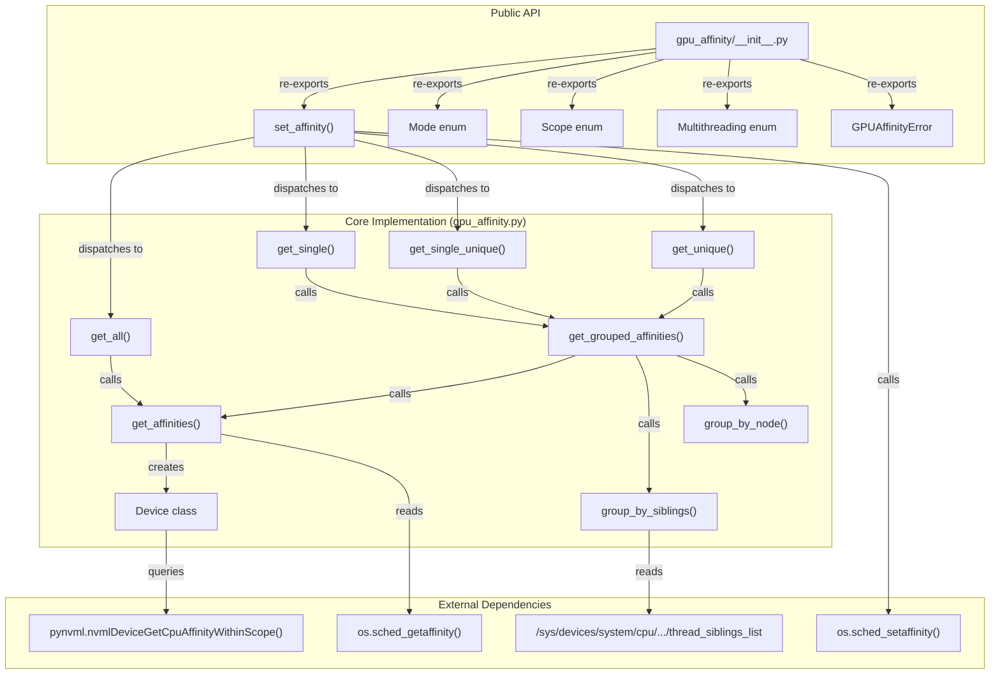

**Sources:** [gpu_affinity/__init__.py:15-19](), [gpu_affinity/gpu_affinity.py:540-711](), [gpu_affinity/gpu_affinity.py:300-313]()

## Key Components

### Public API

The public API is exposed through [gpu_affinity/__init__.py]() and consists of:

| Component | Type | Location | Purpose |
|-----------|------|----------|---------|
| `set_affinity()` | Function | [gpu_affinity/gpu_affinity.py:540-711]() | Main entry point for setting CPU affinity |
| `Mode` | Enum | [gpu_affinity/gpu_affinity.py:37-42]() | Defines affinity assignment modes (`ALL`, `SINGLE`, `SINGLE_UNIQUE`, `UNIQUE_INTERLEAVED`, `UNIQUE_CONTIGUOUS`) |
| `Scope` | Enum | [gpu_affinity/gpu_affinity.py:45-47]() | Defines NVML query scope (`NODE`, `SOCKET`) |
| `Multithreading` | Enum | [gpu_affinity/gpu_affinity.py:50-52]() | Controls hyperthreading behavior (`ALL_LOGICAL`, `SINGLE_LOGICAL`) |
| `GPUAffinityError` | Exception | [gpu_affinity/gpu_affinity.py:28-29]() | Exception raised for affinity-related errors |

**Sources:** [gpu_affinity/__init__.py:15-19](), [gpu_affinity/gpu_affinity.py:28-52]()

### Core Implementation Classes

#### Device Class

The `Device` class ([gpu_affinity/gpu_affinity.py:55-138]()) encapsulates interactions with a single GPU through NVML. It handles:

- Device index resolution, including `CUDA_VISIBLE_DEVICES` remapping ([gpu_affinity/gpu_affinity.py:64-105]())
- UUID-based device identification ([gpu_affinity/gpu_affinity.py:77-105]())
- CPU affinity queries via `nvmlDeviceGetCpuAffinityWithinScope()` ([gpu_affinity/gpu_affinity.py:119-138]())

**Sources:** [gpu_affinity/gpu_affinity.py:55-138]()

#### Affinity Mode Functions

The package implements five distinct affinity modes, each with a corresponding function:

| Mode | Function | Lines | Description |
|------|----------|-------|-------------|
| `ALL` | `get_all()` | [334-379]() | Assigns all available physical cores |
| `SINGLE` | `get_single()` | [382-410]() | Assigns first available core (may overlap) |
| `SINGLE_UNIQUE` | `get_single_unique()` | [413-453]() | Assigns single unique core per process |
| `UNIQUE_CONTIGUOUS` | `get_unique()` | [456-537]() | Assigns unique contiguous core ranges |
| `UNIQUE_INTERLEAVED` | `get_unique()` | [456-537]() | Assigns unique interleaved core sets |

**Sources:** [gpu_affinity/gpu_affinity.py:334-537]()

### Topology Query and Grouping Functions

The implementation uses several helper functions to query and organize CPU topology:

| Function | Location | Purpose |
|----------|----------|---------|
| `get_thread_siblings_list()` | [141-157]() | Reads hyperthreading sibling pairs from `/sys/devices/system/cpu/` |
| `group_by_siblings()` | [177-185]() | Groups CPU cores by hyperthreading siblings |
| `group_by_node()` | [188-219]() | Groups cores by NUMA node affinity |
| `get_affinities()` | [300-313]() | Retrieves CPU affinity for all GPUs with specified scope |
| `get_grouped_affinities()` | [316-331]() | Returns nested groupings by socket/node and siblings |

**Sources:** [gpu_affinity/gpu_affinity.py:141-331]()

## Main Workflow

The following diagram illustrates the execution flow when `set_affinity()` is called:

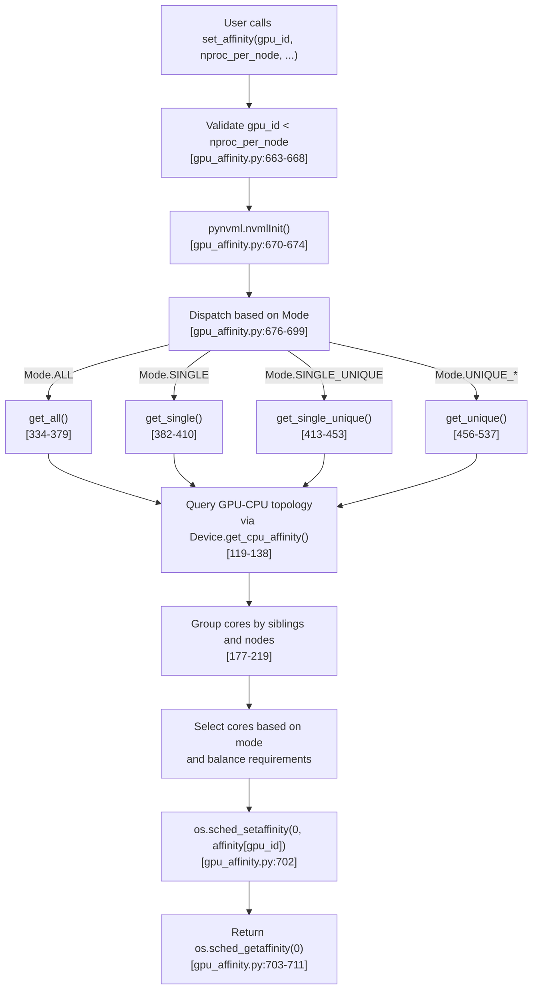

**Sources:** [gpu_affinity/gpu_affinity.py:540-711](), [gpu_affinity/gpu_affinity.py:119-138](), [gpu_affinity/gpu_affinity.py:177-219]()

## Typical Usage Context

The package is designed to be called once per process at the beginning of execution, after command-line argument parsing but before CUDA context creation. The typical integration pattern is:

1. Parse command-line arguments to get local rank (process GPU assignment)
2. Determine total number of GPUs per node via `torch.cuda.device_count()`
3. Call `set_affinity(local_rank, nproc_per_node)`
4. Proceed with model initialization and training

The function returns a set of logical CPU cores on which the process is eligible to run after affinity has been set.

**Sources:** [README.md:41-51](), [README.md:148-177](), [gpu_affinity/gpu_affinity.py:633-662]()

## Environment Considerations

The package interacts with several environment variables and system constraints:

| Environment Variable | Effect | Handled By |
|---------------------|--------|------------|
| `CUDA_VISIBLE_DEVICES` | Restricts visible GPUs; package remaps device indices accordingly | [Device.__init__:64-105]() |
| `KMP_AFFINITY` | Intel OpenMP may reset affinity after fork; recommended to set to `disabled` | Documentation warning ([gpu_affinity.py:627-631]()) |
| `taskset` / `docker --cpuset-cpus` | Restricts available CPU cores; package respects via `os.sched_getaffinity(0)` | [get_affinities:304-309]() |

**Sources:** [gpu_affinity/gpu_affinity.py:64-105](), [gpu_affinity/gpu_affinity.py:304-309](), [gpu_affinity/gpu_affinity.py:627-631]()

## Dependencies

The package depends on:

1. **pynvml** - Python bindings for NVIDIA Management Library, used for GPU-CPU topology queries
2. **Standard library modules**: `os`, `pathlib`, `collections`, `enum`, `itertools`, `operator`, `re`, `typing`
3. **Operating system**: Linux with `/sys/devices/system/cpu/` filesystem and `sched_setaffinity()`/`sched_getaffinity()` support

**Sources:** [gpu_affinity/gpu_affinity.py:15-23](), [README.md:1-23]()

---

# Page: System Architecture

# System Architecture

<details>
<summary>Relevant source files</summary>

The following files were used as context for generating this wiki page:

- [README.md](README.md)
- [gpu_affinity/gpu_affinity.py](gpu_affinity/gpu_affinity.py)

</details>


This document describes the high-level system architecture of the `gpu_affinity` package, including its major components, their relationships, and the data flows that occur when setting CPU affinity for GPU workloads. For detailed API documentation, see [API Reference](#2.1). For information about the different affinity modes and strategies, see [Affinity Modes and Strategies](#2.2).

## Overview

The `gpu_affinity` system is designed around a single primary entry point (`set_affinity`) that orchestrates a multi-stage process to determine and apply optimal CPU core assignments for GPU workloads. The architecture consists of three logical layers:

1. **Hardware Query Layer** - Interfaces with NVIDIA Management Library (pynvml) and OS topology APIs
2. **Affinity Computation Layer** - Processes hardware topology data and applies affinity strategies
3. **OS Enforcement Layer** - Sets CPU affinity using OS-level system calls

The system is implemented primarily in a single module ([gpu_affinity/gpu_affinity.py:1-712]()) with a clean separation of concerns between hardware querying, affinity calculation, and affinity enforcement.

**Sources:** [gpu_affinity/gpu_affinity.py:1-712](), [README.md:1-179]()

## Component Architecture

The following diagram maps the system's logical components to their implementations in code:

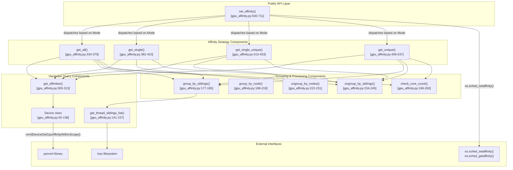

**Sources:** [gpu_affinity/gpu_affinity.py:55-711]()

## Core Components

### Device Class

The `Device` class ([gpu_affinity/gpu_affinity.py:55-138]()) encapsulates interactions with individual GPUs through the NVIDIA Management Library. It handles:

- **Device Indexing** - Resolves logical GPU IDs to physical device handles, respecting `CUDA_VISIBLE_DEVICES` environment variable ([gpu_affinity/gpu_affinity.py:63-106]())
- **UUID Resolution** - Supports both integer indices and UUID string prefixes for device identification ([gpu_affinity/gpu_affinity.py:76-105]())
- **Affinity Queries** - Retrieves CPU affinity recommendations from NVML with configurable scope (NODE or SOCKET) ([gpu_affinity/gpu_affinity.py:119-138]())

### Enumeration Types

The system defines three enumeration types that control affinity behavior:

| Enum Class | Purpose | Values | Location |
|------------|---------|--------|----------|
| `Mode` | Defines affinity distribution strategy | `ALL`, `SINGLE`, `SINGLE_UNIQUE`, `UNIQUE_INTERLEAVED`, `UNIQUE_CONTIGUOUS` | [gpu_affinity/gpu_affinity.py:37-42]() |
| `Scope` | Controls NVML affinity query scope | `NODE`, `SOCKET` | [gpu_affinity/gpu_affinity.py:45-47]() |
| `Multithreading` | Controls hyperthreading sibling inclusion | `ALL_LOGICAL`, `SINGLE_LOGICAL` | [gpu_affinity/gpu_affinity.py:50-52]() |

**Sources:** [gpu_affinity/gpu_affinity.py:32-52]()

### Affinity Strategy Functions

Each `Mode` value corresponds to a specific strategy function that computes CPU core assignments:

| Function | Mode | Strategy |
|----------|------|----------|
| `get_all()` | `Mode.ALL` | Assigns all recommended cores to each process |
| `get_single()` | `Mode.SINGLE` | Assigns first recommended core (may be shared) |
| `get_single_unique()` | `Mode.SINGLE_UNIQUE` | Assigns one unique core per process |
| `get_unique()` | `Mode.UNIQUE_CONTIGUOUS` / `Mode.UNIQUE_INTERLEAVED` | Distributes unique subsets of cores |

**Sources:** [gpu_affinity/gpu_affinity.py:334-537]()

## Data Flow and Processing Pipeline

The following diagram illustrates the data flow from hardware topology queries through affinity computation to OS enforcement:

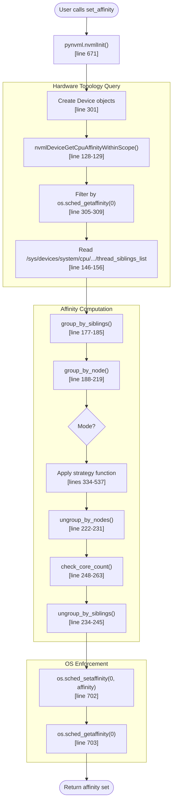

**Sources:** [gpu_affinity/gpu_affinity.py:540-711](), [gpu_affinity/gpu_affinity.py:300-313](), [gpu_affinity/gpu_affinity.py:141-157]()

## Multi-Stage Grouping Architecture

The affinity computation employs a hierarchical grouping strategy to handle hardware topology complexity:

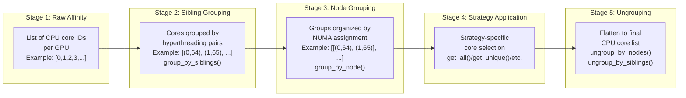

This multi-stage approach ensures that:
1. Hyperthreading siblings are kept together or separated based on `Multithreading` setting
2. NUMA locality is preserved when distributing cores
3. Balanced distribution is achieved across GPUs sharing the same NUMA node

**Sources:** [gpu_affinity/gpu_affinity.py:177-245](), [gpu_affinity/gpu_affinity.py:188-219]()

## Hardware Topology Integration

The system integrates with two primary hardware topology information sources:

### NVML Integration

The `Device.get_cpu_affinity()` method ([gpu_affinity/gpu_affinity.py:119-138]()) queries NVML for GPU-specific CPU recommendations:

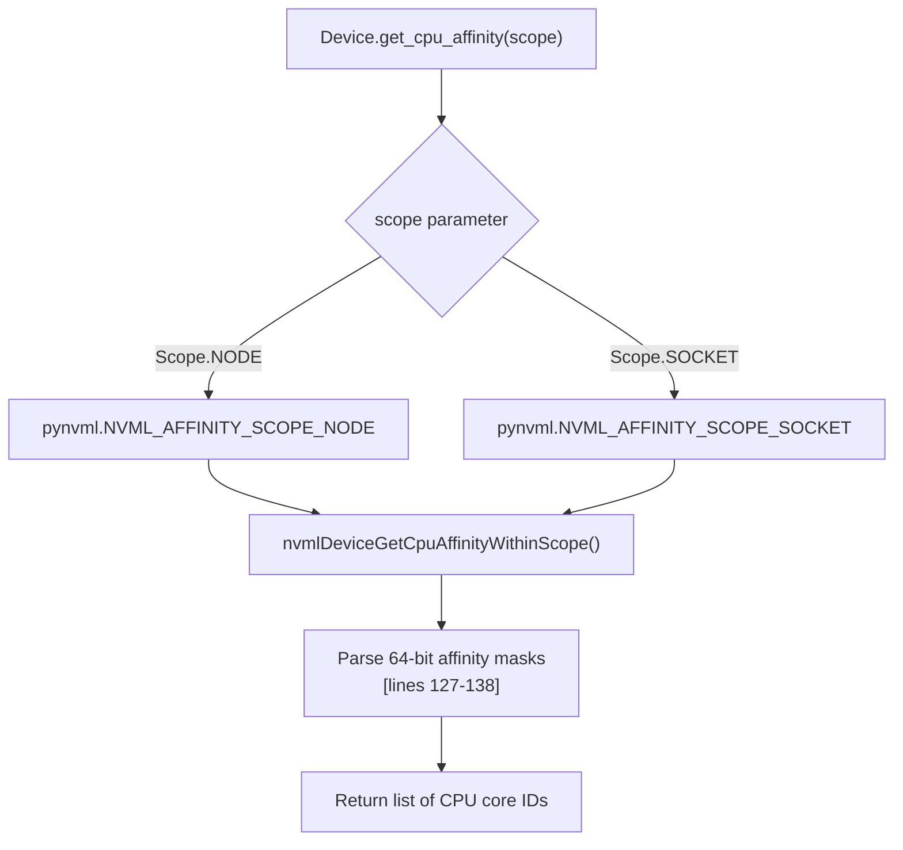

The affinity data from NVML is returned as an array of 64-bit integers ([gpu_affinity/gpu_affinity.py:56-61]()), which are converted to a list of CPU core indices.

**Sources:** [gpu_affinity/gpu_affinity.py:55-138]()

### Sysfs Integration

The `get_thread_siblings_list()` function ([gpu_affinity/gpu_affinity.py:141-157]()) reads hyperthreading topology from the Linux sysfs filesystem:

- **Path Pattern**: `/sys/devices/system/cpu/cpu*/topology/thread_siblings_list`
- **Content Format**: Comma-separated core pairs (e.g., "0,64")
- **Parsing**: Regular expression extracts integer pairs ([gpu_affinity/gpu_affinity.py:148-155]())
- **Output**: List of 2-tuples representing hyperthreading sibling pairs

**Sources:** [gpu_affinity/gpu_affinity.py:141-157]()

## Error Handling and Validation

The system implements multiple validation checkpoints:

### Input Validation

- **GPU ID bounds check**: Ensures `gpu_id < nproc_per_node` ([gpu_affinity/gpu_affinity.py:663-668]())
- **CUDA_VISIBLE_DEVICES validation**: Verifies device indices and UUIDs are valid ([gpu_affinity/gpu_affinity.py:64-105]())

### Hardware Query Validation

- **NVML initialization**: Wraps `pynvml.nvmlInit()` with error handling ([gpu_affinity/gpu_affinity.py:670-674]())
- **Device handle acquisition**: Catches exceptions when getting NVML device handles ([gpu_affinity/gpu_affinity.py:107-111]())

### Affinity Validation

The `check_affinities()` function ([gpu_affinity/gpu_affinity.py:281-297]()) enforces two invariants:

1. **Non-empty affinities**: All GPU affinity lists must contain at least one core
2. **Disjoint or identical sets**: CPU core sets must be either completely identical or completely disjoint (no partial overlap)

### Core Count Validation

The `check_core_count()` function ([gpu_affinity/gpu_affinity.py:248-263]()) ensures:
- Each process receives at least `min_physical_cores` physical cores
- Affinity lists are trimmed to `max_physical_cores` if specified

**Sources:** [gpu_affinity/gpu_affinity.py:248-263](), [gpu_affinity/gpu_affinity.py:281-297](), [gpu_affinity/gpu_affinity.py:663-674]()

## External Dependencies

| Dependency | Purpose | Usage Pattern |
|------------|---------|---------------|
| `pynvml` | NVIDIA Management Library bindings | GPU enumeration, CPU affinity queries |
| `os.sched_setaffinity()` | OS-level affinity setting | Set process CPU affinity mask |
| `os.sched_getaffinity()` | OS-level affinity query | Get current/available CPU cores |
| `/sys` filesystem | CPU topology information | Read hyperthreading sibling relationships |

The system gracefully handles missing dependencies with appropriate error messages encapsulated in `GPUAffinityError` exceptions ([gpu_affinity/gpu_affinity.py:28-29]()).

**Sources:** [gpu_affinity/gpu_affinity.py:25](), [gpu_affinity/gpu_affinity.py:305](), [gpu_affinity/gpu_affinity.py:702-709](), [gpu_affinity/gpu_affinity.py:146]()

---

# Page: Installation and Setup

# Installation and Setup

<details>
<summary>Relevant source files</summary>

The following files were used as context for generating this wiki page:

- [README.md](README.md)
- [pyproject.toml](pyproject.toml)
- [requirements.txt](requirements.txt)
- [setup.py](setup.py)

</details>


This document provides comprehensive instructions for installing the `gpu_affinity` package, configuring dependencies, and setting up a development environment. This page covers installation for end users who want to use the package in their applications, as well as setup procedures for contributors who want to develop and test changes to the codebase.

For information about the core API and how to use the package in your code, see [API Reference](#2.1). For development workflow and contribution guidelines, see [Development and Contribution Guide](#5).

---

## Prerequisites

The `gpu_affinity` package has the following prerequisites:

| Requirement | Version/Details | Purpose |
|------------|----------------|---------|
| Python | ≥ 3.6 | Runtime environment |
| Operating System | Linux (POSIX) | Required for CPU affinity system calls |
| NVIDIA GPU | Any CUDA-capable GPU | Target hardware for affinity optimization |
| NVIDIA Drivers | Recent drivers supporting NVML | Required for GPU topology queries |

The package is designed specifically for Linux systems and relies on POSIX-compliant system calls for setting CPU affinity ([sched_setaffinity](https://linux.die.net/man/2/sched_setaffinity)). It will not function on Windows or macOS.

**Sources:** [setup.py:42-44](), [README.md:1-11]()

---

## Installation Methods

The `gpu_affinity` package can be installed using two primary methods: directly from GitHub using pip, or through manual cloning and installation.

### Installation Workflow

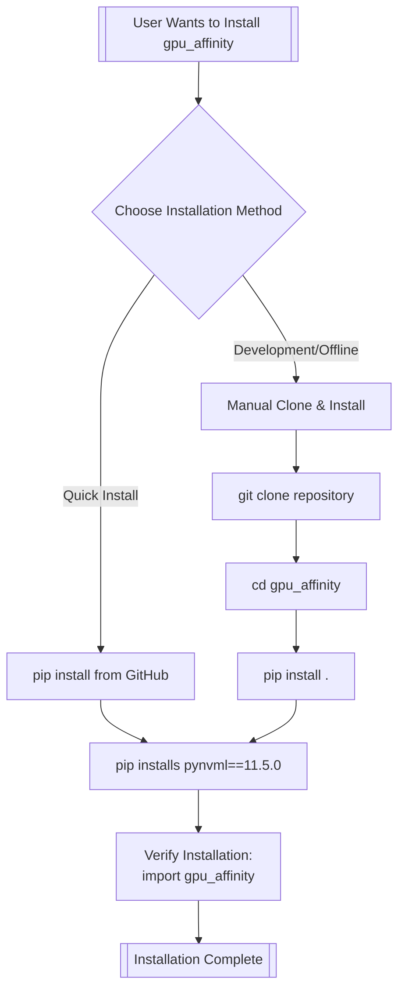

**Sources:** [README.md:24-39]()

### Using pip from GitHub

This is the recommended method for end users who want to use the package in their applications.

```bash
pip install git+https://github.com/NVIDIA/gpu_affinity
```

This command instructs pip to:
1. Clone the repository from GitHub
2. Build the package using the configuration in [setup.py]()
3. Install the package and its dependencies into the current Python environment

**Sources:** [README.md:26-31]()

### Manual Installation

Manual installation is useful for development, offline environments, or when you need to inspect the source code before installation.

```bash
git clone https://github.com/NVIDIA/gpu_affinity
cd gpu_affinity
pip install .
```

The manual installation process:
1. Clones the repository to your local filesystem
2. Changes to the repository directory
3. Installs the package from the local source using pip

**Sources:** [README.md:33-39]()

---

## Dependencies

### Runtime Dependencies

The `gpu_affinity` package has a single runtime dependency defined in both [requirements.txt]() and [setup.py:21-23]():


| Dependency | Version | Purpose |
|-----------|---------|---------|
| `pynvml` | 11.5.0 | Python bindings for NVIDIA Management Library (NVML), used to query GPU topology and CPU-GPU affinity information |

The `pynvml` library provides the interface to NVML, which is used by `gpu_affinity` to:
- Query CPU cores associated with each GPU
- Determine NUMA node and socket topology
- Retrieve hardware-specific affinity recommendations

**Sources:** [requirements.txt:1](), [setup.py:21-23]()

### Development Dependencies

For contributors and developers, additional dependencies are required for code formatting, linting, and pre-commit hooks. These are defined as extras in [setup.py:45-51]():

```bash
pip install -e ".[dev]"
```

This installs the following development tools:

| Tool | Version | Purpose |
|------|---------|---------|
| `black` | 23.10.1 | Code formatter for consistent style |
| `isort` | 5.10.1 | Import sorter for organized imports |
| `pre-commit` | 3.5.0 | Framework for managing pre-commit hooks |

**Sources:** [setup.py:45-51]()

---

## Development Environment Setup

This section is relevant for contributors who plan to modify the `gpu_affinity` codebase. For general usage, skip to the Verification section.

### Development Installation

Install the package in editable mode with development dependencies:

```bash
git clone https://github.com/NVIDIA/gpu_affinity
cd gpu_affinity
pip install -e ".[dev]"
```

The `-e` flag installs the package in "editable" mode, meaning changes to the source code are immediately reflected without reinstalling.

### Development Tool Configuration

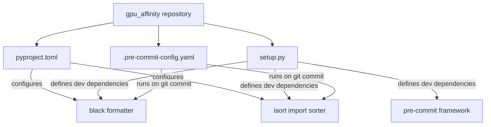

The development tools are configured through [pyproject.toml:5-24]():

**Black Configuration** ([pyproject.toml:5-7]()):
- `skip-string-normalization = true`: Preserves single vs. double quote choices
- `line-length = 79`: PEP 8 compliant line length

**Isort Configuration** ([pyproject.toml:9-11]()):
- `force_single_line = true`: Each import on its own line
- `extra_standard_library = ["pkg_resources"]`: Treats `pkg_resources` as standard library

**Sources:** [pyproject.toml:5-24](), [setup.py:45-51]()

### Pre-commit Hooks

Install and enable pre-commit hooks to automatically format code before each commit:

```bash
pre-commit install
```

This configures Git to run `black` and `isort` automatically before each commit, ensuring code style consistency. The hooks are defined in `.pre-commit-config.yaml` (not shown in the provided files, but referenced by the development dependencies).

For more details on the development workflow, see [Development and Contribution Guide](#5) and [Code Style and Tooling](#5.1).

**Sources:** [setup.py:49]()

---

## Build System Configuration

The package uses modern Python packaging standards defined in [pyproject.toml:1-3]():

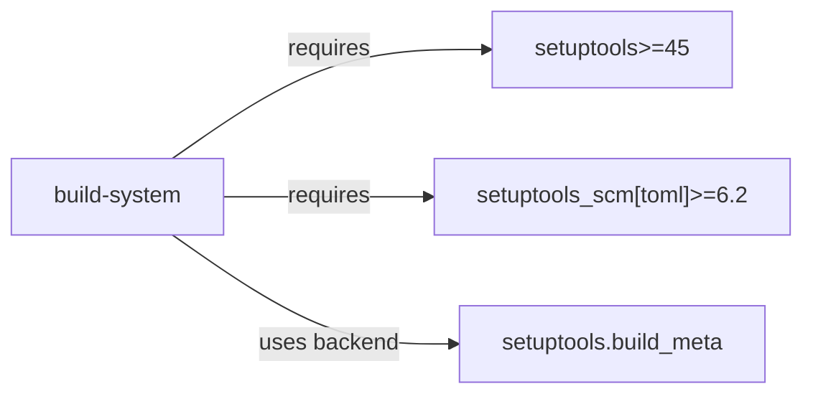

| Component | Version | Purpose |
|-----------|---------|---------|
| `setuptools` | ≥ 45 | Build backend for packaging |
| `setuptools_scm` | ≥ 6.2 | Version management from git tags |
| Build backend | `setuptools.build_meta` | PEP 517 compliant build backend |

The `setuptools_scm` configuration ([pyproject.toml:13-14]()) uses `fallback_version = "0.0.0"` when the package is installed outside of a git repository.

**Sources:** [pyproject.toml:1-14]()

---

## Package Metadata

The package is configured in [setup.py:25-52]() with the following metadata:

| Attribute | Value | Description |
|-----------|-------|-------------|
| `name` | `gpu_affinity` | Package name for PyPI and imports |
| `version` | `0.1.0` | Current version |
| `author` | `NVIDIA Corporation` | Package maintainer |
| `packages` | `['gpu_affinity']` | Python packages to install |
| `license` | `Apache2` | Open source license |
| `python_requires` | `>=3.6` | Minimum Python version |

The package is classified as:
- License: Apache Software License
- Programming Language: Python 3, Python 3.6
- Operating System: POSIX :: Linux

**Sources:** [setup.py:25-44]()

---

## Verification

After installation, verify that the package is correctly installed and can be imported:

```python
import gpu_affinity

# Check that the main function is accessible
print(gpu_affinity.set_affinity)

# Check that enums are accessible
print(gpu_affinity.Mode.UNIQUE_CONTIGUOUS)
print(gpu_affinity.Scope.NODE)
print(gpu_affinity.Multithreading.ALL_LOGICAL)
```

If the imports succeed without errors, the package is correctly installed.

### Verification Workflow

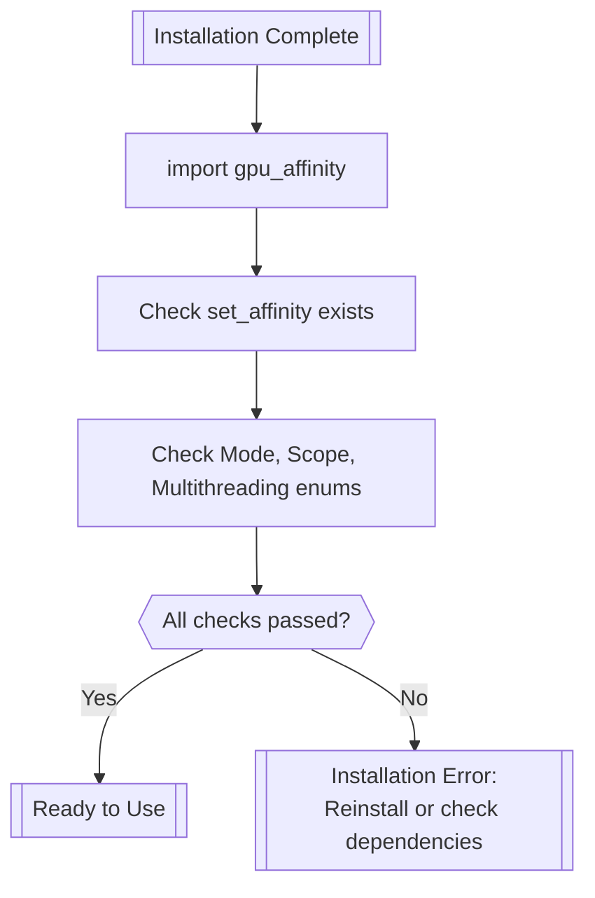

**Sources:** [README.md:43-46]()

---

## Environment Considerations

Once installed, be aware of these environment considerations when using the package:

### OpenMP Configuration

Intel's OpenMP implementation can interfere with CPU affinity settings. Set the following environment variable before running your application:

```bash
export KMP_AFFINITY=disabled
```

This prevents OpenMP from resetting the affinity configured by `gpu_affinity.set_affinity()` after fork operations (e.g., in PyTorch DataLoader workers).

**Sources:** [README.md:142-146]()

### CUDA_VISIBLE_DEVICES

The package correctly handles GPU device reordering when the `CUDA_VISIBLE_DEVICES` environment variable is set. No special configuration is needed.

**Sources:** [README.md:22]()

---

## Next Steps

After installation:
- For API usage details, see [API Reference](#2.1)
- For practical examples, see [Usage Examples](#3)
- For understanding affinity modes, see [Affinity Modes and Strategies](#2.2)
- For development contributions, see [Development and Contribution Guide](#5)

---

# Page: Core Functionality

# Core Functionality

<details>
<summary>Relevant source files</summary>

The following files were used as context for generating this wiki page:

- [README.md](README.md)
- [gpu_affinity/gpu_affinity.py](gpu_affinity/gpu_affinity.py)

</details>


This page describes the core logic and algorithms implemented in `gpu_affinity` for determining and setting CPU affinity for GPU workloads. It covers the main processing pipeline, hardware querying, core selection algorithms, and the application of affinity settings to the operating system.

For detailed API documentation of the public interface, see [API Reference](#2.1). For in-depth discussion of affinity modes and their use cases, see [Affinity Modes and Strategies](#2.2). For details on hardware topology interaction, see [Hardware Topology and Integration](#2.3).

## Core Processing Pipeline

The `set_affinity` function [gpu_affinity/gpu_affinity.py:540-711]() orchestrates the entire affinity assignment process. The pipeline follows these stages:

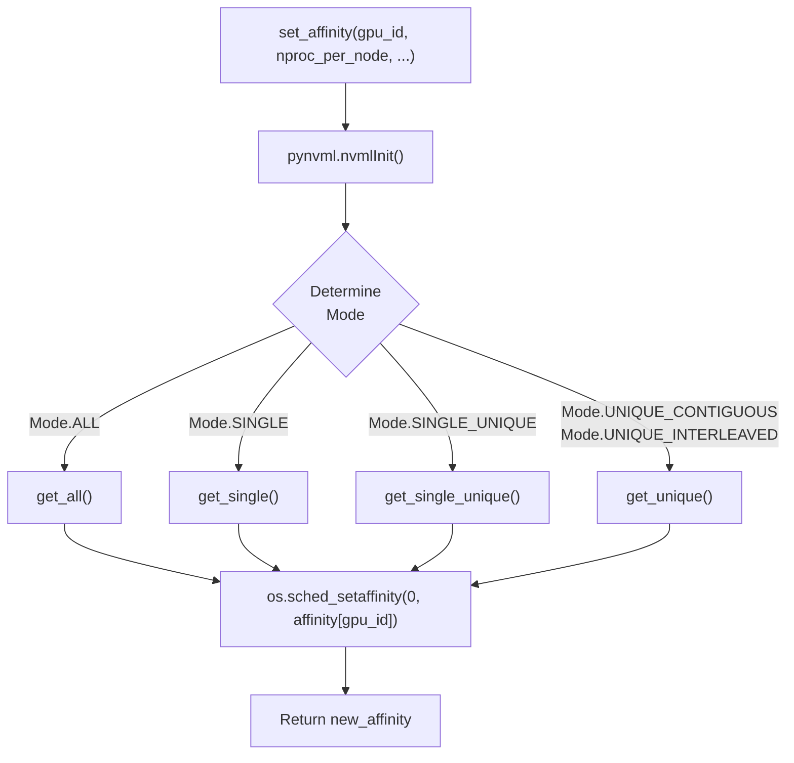

**Sources:** [gpu_affinity/gpu_affinity.py:540-711]()

The function validates inputs [gpu_affinity/gpu_affinity.py:663-668](), initializes the NVIDIA Management Library [gpu_affinity/gpu_affinity.py:670-674](), dispatches to the appropriate affinity computation function based on the `mode` parameter [gpu_affinity/gpu_affinity.py:676-699](), and applies the resulting affinity to the current process using OS APIs [gpu_affinity/gpu_affinity.py:701-709]().

## Hardware Query and Device Management

### Device Class

The `Device` class [gpu_affinity/gpu_affinity.py:55-138]() encapsulates GPU device management and affinity querying through `pynvml`. It handles `CUDA_VISIBLE_DEVICES` remapping and provides methods to query GPU-CPU affinity relationships.

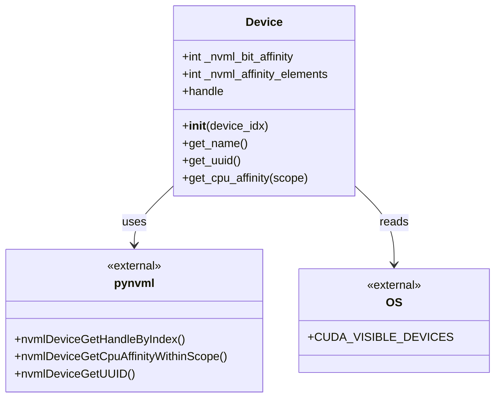

**Sources:** [gpu_affinity/gpu_affinity.py:55-138]()

#### CUDA_VISIBLE_DEVICES Handling

The `Device.__init__` method [gpu_affinity/gpu_affinity.py:63-111]() implements sophisticated device index remapping:

1. Checks if `CUDA_VISIBLE_DEVICES` is set [gpu_affinity/gpu_affinity.py:64-71]()
2. Attempts to parse elements as integer indices [gpu_affinity/gpu_affinity.py:72-75]()
3. Falls back to UUID prefix matching if parsing as integers fails [gpu_affinity/gpu_affinity.py:76-105]()
4. Validates that exactly one device matches the UUID prefix [gpu_affinity/gpu_affinity.py:91-104]()

#### CPU Affinity Querying

The `get_cpu_affinity` method [gpu_affinity/gpu_affinity.py:119-138]() queries recommended CPU cores for a GPU using `pynvml`:

1. Maps `Scope` enum to `pynvml` scope constants [gpu_affinity/gpu_affinity.py:120-125]()
2. Calls `nvmlDeviceGetCpuAffinityWithinScope` [gpu_affinity/gpu_affinity.py:128-130]()
3. Converts the returned bit mask to a list of core IDs [gpu_affinity/gpu_affinity.py:127-137]()

**Sources:** [gpu_affinity/gpu_affinity.py:55-138]()

## Core Selection and Grouping

### Thread Sibling Detection

The system detects hyperthreading sibling relationships by reading from `/sys/devices/system/cpu/cpu*/topology/thread_siblings_list`:

| Function | Purpose | Location |
|----------|---------|----------|
| `get_thread_siblings_list()` | Reads `/sys` to build pairs of hyperthreading siblings | [gpu_affinity/gpu_affinity.py:141-157]() |
| `build_thread_siblings_dict()` | Converts sibling pairs into a lookup dictionary | [gpu_affinity/gpu_affinity.py:160-166]() |

**Sources:** [gpu_affinity/gpu_affinity.py:141-166]()

### Core Grouping Operations

The affinity computation pipeline transforms flat lists of CPU core IDs through multiple grouping stages:

```mermaid
graph LR
    A["Raw Core IDs<br/>[0,1,2,3,4,5,...]"]
    B["Grouped by Siblings<br/>[(0,16),(1,17),...]"]
    C["Grouped by Node<br/>[(0,16,8),(1,17,9),...]"]
    D["Ungrouped by Node<br/>[0,16,8,1,17,9,...]"]
    E["Ungrouped by Siblings<br/>[0,16,1,17,...] or [0,1,...]"]
    F["Final Affinity<br/>[0,16,1,17,...]"]
    
    A -->|"group_by_siblings()"| B
    B -->|"group_by_node()"| C
    C -->|"ungroup_by_nodes()"| D
    D -->|"ungroup_by_siblings()"| E
    E -->|"check_core_count()"| F
```

**Sources:** [gpu_affinity/gpu_affinity.py:177-278]()

#### Grouping Functions

| Function | Purpose | Key Logic |
|----------|---------|-----------|
| `group_by_siblings()` | Groups cores into hyperthreading pairs | [gpu_affinity/gpu_affinity.py:177-185]() |
| `group_by_node()` | Distributes socket cores across NUMA nodes | [gpu_affinity/gpu_affinity.py:188-219]() |
| `ungroup_by_nodes()` | Flattens node groups based on scope | [gpu_affinity/gpu_affinity.py:222-231]() |
| `ungroup_by_siblings()` | Flattens sibling groups based on multithreading mode | [gpu_affinity/gpu_affinity.py:234-245]() |

The `group_by_node` function [gpu_affinity/gpu_affinity.py:188-219]() implements a sophisticated algorithm to interleave socket-scope cores with node-scope cores, ensuring that cores with direct GPU access are prioritized.

**Sources:** [gpu_affinity/gpu_affinity.py:169-245]()

### Affinity Validation

The `check_affinities` function [gpu_affinity/gpu_affinity.py:281-297]() validates that computed affinities satisfy invariants:

1. The affinity list is non-empty [gpu_affinity/gpu_affinity.py:282-285]()
2. Each individual affinity is non-empty [gpu_affinity/gpu_affinity.py:287-289]()
3. Core sets are either identical or disjoint [gpu_affinity/gpu_affinity.py:291-297]()

The `check_core_count` function [gpu_affinity/gpu_affinity.py:248-263]() validates and trims affinities based on `min_physical_cores` and `max_physical_cores` constraints.

**Sources:** [gpu_affinity/gpu_affinity.py:248-297]()

## Affinity Assignment Algorithms

The system provides five distinct affinity assignment modes implemented as separate functions:

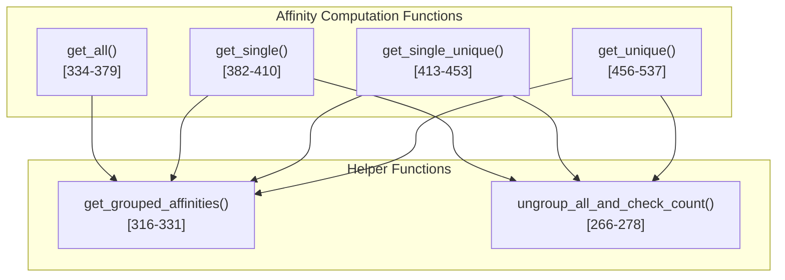

**Sources:** [gpu_affinity/gpu_affinity.py:300-537]()

### Mode: ALL

The `get_all` function [gpu_affinity/gpu_affinity.py:334-379]() assigns all available cores recommended by `pynvml`:

1. Queries affinities from hardware [gpu_affinity/gpu_affinity.py:353]()
2. Groups cores by hyperthreading siblings [gpu_affinity/gpu_affinity.py:355]()
3. Prioritizes cores with direct GPU access (node-scope cores) [gpu_affinity/gpu_affinity.py:357-373]()
4. Validates and trims based on core count constraints [gpu_affinity/gpu_affinity.py:375-376]()
5. Ungroups siblings based on multithreading mode [gpu_affinity/gpu_affinity.py:378]()

**Sources:** [gpu_affinity/gpu_affinity.py:334-379]()

### Mode: SINGLE and SINGLE_UNIQUE

Both functions follow a similar pattern using `get_grouped_affinities`:

**`get_single()` [gpu_affinity/gpu_affinity.py:382-410]():**
- Retrieves grouped affinities [gpu_affinity/gpu_affinity.py:402]()
- Ungroups and selects the first core [gpu_affinity/gpu_affinity.py:403-409]()
- Multiple GPUs may share the same core

**`get_single_unique()` [gpu_affinity/gpu_affinity.py:413-453]():**
- Retrieves grouped affinities [gpu_affinity/gpu_affinity.py:433]()
- Assigns unique cores by tracking assigned groups [gpu_affinity/gpu_affinity.py:435-443]()
- Each GPU gets a distinct core

**Sources:** [gpu_affinity/gpu_affinity.py:382-453]()

### Mode: UNIQUE_CONTIGUOUS and UNIQUE_INTERLEAVED

The `get_unique` function [gpu_affinity/gpu_affinity.py:456-537]() implements both unique assignment modes with sophisticated core distribution logic:

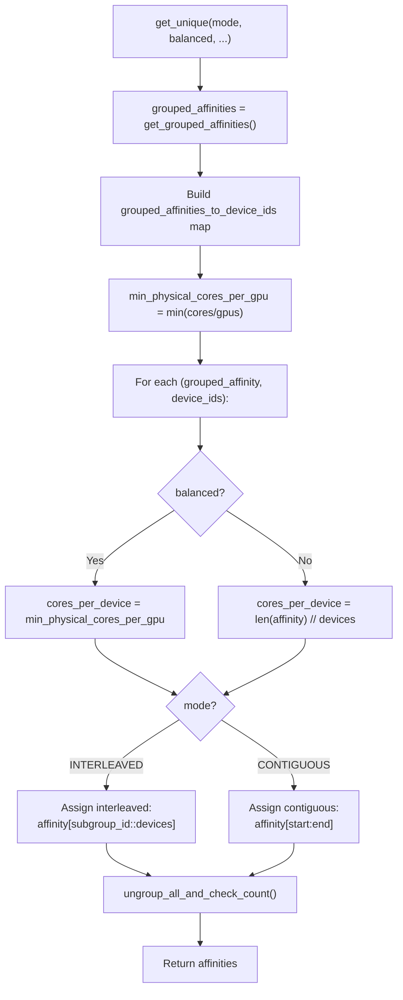

**Sources:** [gpu_affinity/gpu_affinity.py:456-537]()

The function builds a mapping from unique core sets to device IDs [gpu_affinity/gpu_affinity.py:483-486](), computes the minimum cores per GPU [gpu_affinity/gpu_affinity.py:490-495](), and distributes cores either:

- **Interleaved:** Cores assigned with stride pattern `[subgroup_id::devices_per_group]` [gpu_affinity/gpu_affinity.py:513-516]()
- **Contiguous:** Cores assigned in sequential blocks [gpu_affinity/gpu_affinity.py:517-524]()

When `balanced=True`, all processes receive equal core counts [gpu_affinity/gpu_affinity.py:504-508]().

**Sources:** [gpu_affinity/gpu_affinity.py:456-537]()

## OS Affinity Application

After computing the target affinity list, `set_affinity` applies it using OS-level APIs:

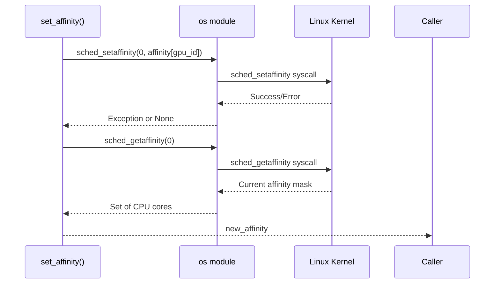

**Sources:** [gpu_affinity/gpu_affinity.py:701-711]()

The function performs three operations:

1. **Set affinity:** Calls `os.sched_setaffinity(0, affinity[gpu_id])` [gpu_affinity/gpu_affinity.py:702]() to restrict the process to the computed core set
2. **Verify affinity:** Calls `os.sched_getaffinity(0)` [gpu_affinity/gpu_affinity.py:703]() to retrieve the actual applied affinity
3. **Error handling:** Catches `OSError` (system call failures) and `AttributeError` (unsupported platforms) [gpu_affinity/gpu_affinity.py:704-709]()

The function returns the verified affinity set, which may differ from the requested set if the OS restricts available cores.

**Sources:** [gpu_affinity/gpu_affinity.py:701-711]()

## Error Handling

All errors are raised as `GPUAffinityError` exceptions [gpu_affinity/gpu_affinity.py:28-29](). The system validates and reports errors at multiple stages:

| Error Condition | Location | Error Message Pattern |
|-----------------|----------|----------------------|
| Invalid `gpu_id` | [gpu_affinity/gpu_affinity.py:663-668]() | `gpu_id={x} should be smaller than nproc_per_node={y}` |
| NVML initialization failure | [gpu_affinity/gpu_affinity.py:670-674]() | `Error while initializing pynvml` |
| Device handle retrieval failure | [gpu_affinity/gpu_affinity.py:107-111]() | `Unable to get NVML handle for device {x}` |
| Insufficient cores | [gpu_affinity/gpu_affinity.py:253-258]() | `Number of available physical cores for GPU {x} is less than...` |
| Affinity set violation | [gpu_affinity/gpu_affinity.py:294-297]() | `Sets of cores should be either identical or disjoint` |
| OS affinity call failure | [gpu_affinity/gpu_affinity.py:704-709]() | `Error while calling os affinity functions` |

**Sources:** [gpu_affinity/gpu_affinity.py:28-29](), [gpu_affinity/gpu_affinity.py:663-709]()

---

# Page: API Reference

# API Reference

<details>
<summary>Relevant source files</summary>

The following files were used as context for generating this wiki page:

- [README.md](README.md)
- [gpu_affinity/__init__.py](gpu_affinity/__init__.py)
- [gpu_affinity/gpu_affinity.py](gpu_affinity/gpu_affinity.py)

</details>


This document provides detailed technical documentation for all public API components exposed by the `gpu_affinity` package. The API consists of a single primary function (`set_affinity`), three enumeration types for configuration, and one exception class for error handling. For information about how these components are used in practice, see [Usage Examples](#3). For details on the underlying hardware topology interactions, see [Hardware Topology and Integration](#2.3).

The complete public API is exported through [gpu_affinity/__init__.py:15-19](), which re-exports all symbols from the core implementation module.

---

## API Surface Overview

The following diagram maps the public API symbols to their definitions in the codebase:

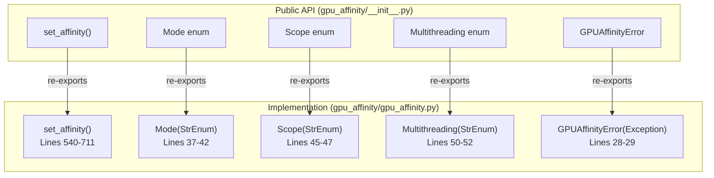

**Sources:** [gpu_affinity/__init__.py:1-20](), [gpu_affinity/gpu_affinity.py:28-52](), [gpu_affinity/gpu_affinity.py:540-711]()

---

## Main Entry Point

### `set_affinity()`

The primary function for setting CPU affinity for GPU processes. This function must be called once per process, typically at application startup before any CUDA context is created.

**Function Signature:**

```python
def set_affinity(
    gpu_id: int,
    nproc_per_node: int,
    *,
    mode: Mode = Mode.UNIQUE_CONTIGUOUS,
    scope: Scope = Scope.NODE,
    multithreading: Multithreading = Multithreading.ALL_LOGICAL,
    balanced: bool = True,
    min_physical_cores: int = 1,
    max_physical_cores: Optional[int] = None,
) -> set
```

**Implementation:** [gpu_affinity/gpu_affinity.py:540-711]()

#### Parameters

| Parameter | Type | Default | Description |
|-----------|------|---------|-------------|
| `gpu_id` | `int` | *Required* | Index of the GPU assigned to this process, ranging from `0` to `nproc_per_node - 1` |
| `nproc_per_node` | `int` | *Required* | Total number of processes (GPUs) per node |
| `mode` | `Mode` | `Mode.UNIQUE_CONTIGUOUS` | Affinity assignment strategy (see [Mode Enumeration](#mode-enumeration)) |
| `scope` | `Scope` | `Scope.NODE` | Hardware scope for affinity queries via pynvml (see [Scope Enumeration](#scope-enumeration)) |
| `multithreading` | `Multithreading` | `Multithreading.ALL_LOGICAL` | Hyperthreading configuration (see [Multithreading Enumeration](#multithreading-enumeration)) |
| `balanced` | `bool` | `True` | When `True`, assigns equal number of physical cores to each process. Only affects `UNIQUE_INTERLEAVED` and `UNIQUE_CONTIGUOUS` modes |
| `min_physical_cores` | `int` | `1` | Minimum required physical cores per process. Raises `GPUAffinityError` if insufficient cores are available |
| `max_physical_cores` | `Optional[int]` | `None` | Maximum physical cores per process. When set, the assigned core list is truncated to this limit |

#### Return Value

Returns a `set` of integers representing the logical CPU core IDs on which the process is eligible to run after affinity has been set. This is obtained via `os.sched_getaffinity(0)` after calling `os.sched_setaffinity()`.

**Implementation detail:** [gpu_affinity/gpu_affinity.py:701-711]()

#### Exceptions

The function raises `GPUAffinityError` in the following scenarios:

| Condition | Error Location | Description |
|-----------|----------------|-------------|
| `gpu_id >= nproc_per_node` | [Line 663-668]() | Invalid `gpu_id` parameter |
| pynvml initialization failure | [Line 670-674]() | Cannot initialize NVIDIA Management Library |
| Unknown affinity mode | [Line 699]() | Invalid `mode` parameter value |
| OS affinity function error | [Line 704-706]() | Error calling `os.sched_setaffinity()` or `os.sched_getaffinity()` |
| OS affinity unavailable | [Line 707-709]() | Platform does not support affinity functions |
| Insufficient cores | [Line 252-258]() | Available physical cores less than `min_physical_cores` |
| Invalid CUDA_VISIBLE_DEVICES | [Line 67-71](), [Line 92-104]() | Device index out of bounds or UUID mismatch |

**Sources:** [gpu_affinity/gpu_affinity.py:540-711](), [gpu_affinity/gpu_affinity.py:28-29](), [gpu_affinity/gpu_affinity.py:248-263]()

#### Execution Flow

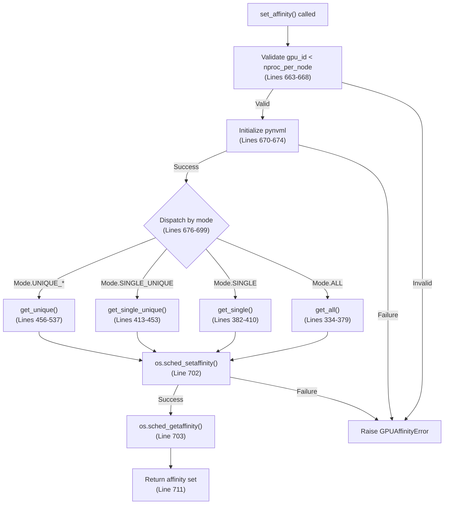

**Sources:** [gpu_affinity/gpu_affinity.py:540-711](), [gpu_affinity/gpu_affinity.py:334-537]()

---

## Enumerations

All enumeration types inherit from `StrEnum` (defined at [gpu_affinity/gpu_affinity.py:32-34]()), which allows enum values to be treated as strings.

### Mode Enumeration

The `Mode` enum defines strategies for assigning CPU cores to GPU processes.

**Definition:** [gpu_affinity/gpu_affinity.py:37-42]()

| Enum Value | String Value | Description |
|------------|--------------|-------------|
| `Mode.ALL` | `'all'` | Assigns all available physical CPU cores recommended by pynvml for the GPU |
| `Mode.SINGLE` | `'single'` | Assigns the first available physical core (multiple GPUs may share the same core) |
| `Mode.SINGLE_UNIQUE` | `'single_unique'` | Assigns a single unique physical core to each GPU |
| `Mode.UNIQUE_INTERLEAVED` | `'unique_interleaved'` | Assigns unique cores with interleaved indexing pattern |
| `Mode.UNIQUE_CONTIGUOUS` | `'unique_contiguous'` | Assigns unique cores with contiguous indexing pattern (default, recommended for DGX) |

#### Mode Implementation Mapping

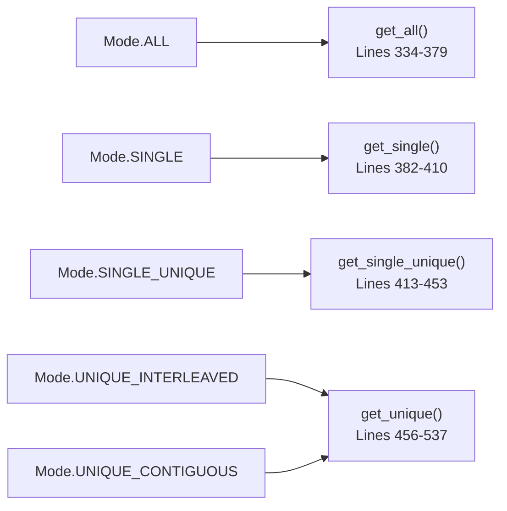

**Sources:** [gpu_affinity/gpu_affinity.py:37-42](), [gpu_affinity/gpu_affinity.py:676-699]()

### Scope Enumeration

The `Scope` enum defines the hardware topology level for affinity queries through pynvml.

**Definition:** [gpu_affinity/gpu_affinity.py:45-47]()

| Enum Value | String Value | pynvml Constant | Description |
|------------|--------------|-----------------|-------------|
| `Scope.NODE` | `'node'` | `NVML_AFFINITY_SCOPE_NODE` | Queries CPU affinity at NUMA node level |
| `Scope.SOCKET` | `'socket'` | `NVML_AFFINITY_SCOPE_SOCKET` | Queries CPU affinity at processor socket level |

The scope determines which CPU cores are considered "close" to a GPU. The mapping to pynvml constants occurs in the `Device.get_cpu_affinity()` method at [gpu_affinity/gpu_affinity.py:119-125]().

**Important:** On DGX A100 systems, `Scope.NODE` restricts execution to CPU cores with direct GPU access (approximately half the cores), while `Scope.SOCKET` includes all cores in the socket. See [gpu_affinity/gpu_affinity.py:620-625]() for the warning about this behavior.

**Sources:** [gpu_affinity/gpu_affinity.py:45-47](), [gpu_affinity/gpu_affinity.py:119-138]()

### Multithreading Enumeration

The `Multithreading` enum controls whether hyperthreading siblings are included in the affinity mask.

**Definition:** [gpu_affinity/gpu_affinity.py:50-52]()

| Enum Value | String Value | Description |
|------------|--------------|-------------|
| `Multithreading.ALL_LOGICAL` | `'all_logical'` | Includes all logical cores (all hyperthreading siblings) for assigned physical cores |
| `Multithreading.SINGLE_LOGICAL` | `'single_logical'` | Includes only one logical core per physical core (excludes hyperthreading siblings) |

The ungrouping logic based on this parameter is implemented in `ungroup_by_siblings()` at [gpu_affinity/gpu_affinity.py:234-245]().

**Sources:** [gpu_affinity/gpu_affinity.py:50-52](), [gpu_affinity/gpu_affinity.py:234-245]()

---

## Exception Classes

### GPUAffinityError

Custom exception class for all errors raised by the `gpu_affinity` package.

**Definition:** [gpu_affinity/gpu_affinity.py:28-29]()

```python
class GPUAffinityError(Exception):
    pass
```

This exception is raised in the following scenarios (see table in [Exceptions](#exceptions) section above). All error messages are constructed to provide clear context about the failure condition, including relevant parameter values and system state.

**Usage pattern in codebase:**
- Direct raises: [Line 71](), [Line 97](), [Line 103](), [Line 125](), [Line 253](), [Line 284](), [Line 294](), [Line 526](), [Line 668](), [Line 699]()
- Raises with exception chaining: [Line 111](), [Line 674](), [Line 706](), [Line 709]()

**Sources:** [gpu_affinity/gpu_affinity.py:28-29](), [gpu_affinity/gpu_affinity.py:67-111](), [gpu_affinity/gpu_affinity.py:663-709]()

---

## API Usage Pattern

The typical calling pattern for the API is shown below:

```mermaid
sequenceDiagram
    participant App as "User Application"
    participant API as "set_affinity()"
    participant NVML as "pynvml"
    participant OS as "OS (sched_setaffinity)"
    
    App->>API: "set_affinity(gpu_id, nproc_per_node, ...)"
    API->>API: "Validate parameters"
    API->>NVML: "nvmlInit()"
    NVML-->>API: "Initialized"
    API->>API: "Dispatch to mode handler<br/>(get_all/get_single/get_unique)"
    API->>NVML: "Query GPU-CPU affinity"
    NVML-->>API: "Return affinity list"
    API->>API: "Process affinity<br/>(group, filter, select)"
    API->>OS: "sched_setaffinity(0, cores)"
    OS-->>API: "Success"
    API->>OS: "sched_getaffinity(0)"
    OS-->>API: "Return affinity set"
    API-->>App: "Return affinity set"
```

**Sources:** [gpu_affinity/gpu_affinity.py:540-711](), [gpu_affinity/gpu_affinity.py:300-537]()

---

## Internal vs. Public API Boundary

The following components are **not** part of the public API and should not be relied upon by external code:

- `Device` class ([Line 55-138]())
- Helper functions: `get_thread_siblings_list()`, `build_thread_siblings_dict()`, `group_by_siblings()`, etc.
- Mode-specific implementation functions: `get_all()`, `get_single()`, `get_single_unique()`, `get_unique()`
- `StrEnum` base class

Only the symbols exported in [gpu_affinity/__init__.py:15-19]() constitute the stable public API.

**Sources:** [gpu_affinity/__init__.py:1-20](), [gpu_affinity/gpu_affinity.py:1-712]()

---

# Page: Affinity Modes and Strategies

# Affinity Modes and Strategies

<details>
<summary>Relevant source files</summary>

The following files were used as context for generating this wiki page:

- [README.md](README.md)
- [gpu_affinity/gpu_affinity.py](gpu_affinity/gpu_affinity.py)

</details>


## Purpose and Scope

This document describes the different affinity assignment modes, scope options, and multithreading strategies available in the `gpu_affinity` package. These configuration options control how CPU cores are allocated to GPU processes, enabling fine-tuned performance optimization for different hardware architectures and workload characteristics.

For information about the public API and function signatures, see [API Reference](#2.1). For details on how the system interacts with hardware topology through pynvml and system files, see [Hardware Topology and Integration](#2.3).

## Configuration Parameters Overview

The `set_affinity()` function accepts three primary configuration enums that control affinity assignment behavior:

| Parameter | Enum Class | Purpose |
|-----------|------------|---------|
| `mode` | `Mode` | Determines the CPU core allocation strategy per GPU process |
| `scope` | `Scope` | Defines the hardware scope for pynvml affinity queries |
| `multithreading` | `Multithreading` | Controls whether hyperthreading siblings are included |

These parameters work together to produce the final affinity assignment, with additional options (`balanced`, `min_physical_cores`, `max_physical_cores`) providing further refinement.

**Sources:** [gpu_affinity/gpu_affinity.py:37-53](), [gpu_affinity/gpu_affinity.py:540-617]()

## Affinity Mode Strategies

### Mode Enum and Dispatch Logic

```mermaid
graph TD
    SetAffinity["set_affinity()"]
    ModeCheck{"mode value"}
    GetAll["get_all()"]
    GetSingle["get_single()"]
    GetSingleUnique["get_single_unique()"]
    GetUnique["get_unique()"]
    
    SetAffinity --> ModeCheck
    ModeCheck -->|"Mode.ALL"| GetAll
    ModeCheck -->|"Mode.SINGLE"| GetSingle
    ModeCheck -->|"Mode.SINGLE_UNIQUE"| GetSingleUnique
    ModeCheck -->|"Mode.UNIQUE_CONTIGUOUS"| GetUnique
    ModeCheck -->|"Mode.UNIQUE_INTERLEAVED"| GetUnique
    
    GetAll --> Return["Return affinity set"]
    GetSingle --> Return
    GetSingleUnique --> Return
    GetUnique --> Return
```

The `Mode` enum defines five distinct affinity strategies, each implemented by a dedicated function in [gpu_affinity/gpu_affinity.py:334-537](). The main `set_affinity()` function dispatches to the appropriate implementation based on the selected mode at [gpu_affinity/gpu_affinity.py:676-697]().

**Sources:** [gpu_affinity/gpu_affinity.py:37-43](), [gpu_affinity/gpu_affinity.py:676-699]()

### Mode.ALL

**Implementation:** `get_all()` function at [gpu_affinity/gpu_affinity.py:334-379]()

This mode assigns all available physical CPU cores recommended by pynvml for each GPU. Multiple GPU processes receive identical (overlapping) CPU core assignments.

```mermaid
graph LR
    subgraph "CPU Cores"
        C0["Core 0"]
        C1["Core 1"]
        C2["Core 2"]
        C3["Core 3"]
        C4["Core 4"]
        C5["Core 5"]
        C6["Core 6"]
        C7["Core 7"]
    end
    
    subgraph "GPU 0 Assignment"
        G0["GPU 0: {0,1,2,3}"]
    end
    
    subgraph "GPU 1 Assignment"
        G1["GPU 1: {4,5,6,7}"]
    end
    
    C0 --> G0
    C1 --> G0
    C2 --> G0
    C3 --> G0
    C4 --> G1
    C5 --> G1
    C6 --> G1
    C7 --> G1
```

**Key Characteristics:**
- Each process receives all cores from its GPU's NUMA node or socket
- Cores are sorted with NUMA-local cores prioritized (see [gpu_affinity/gpu_affinity.py:362-373]())
- Respects `min_physical_cores` and `max_physical_cores` constraints

**Use Case:** Workloads where maximum CPU resource availability per GPU is desired, such as data preprocessing pipelines with limited inter-process communication.

**Sources:** [gpu_affinity/gpu_affinity.py:334-379](), [README.md:78-79]()

### Mode.SINGLE

**Implementation:** `get_single()` function at [gpu_affinity/gpu_affinity.py:382-410]()

This mode assigns the first available physical CPU core from each GPU's recommended core list. Multiple GPUs may share the same CPU core.

```mermaid
graph LR
    subgraph "CPU Cores"
        C0["Core 0"]
        C1["Core 1"]
        C4["Core 4"]
        C5["Core 5"]
    end
    
    subgraph "GPU Assignments"
        G0["GPU 0: {0}"]
        G1["GPU 1: {0}"]
        G2["GPU 2: {4}"]
        G3["GPU 3: {4}"]
    end
    
    C0 --> G0
    C0 --> G1
    C4 --> G2
    C4 --> G3
```

**Key Characteristics:**
- Uses grouped affinities from `get_grouped_affinities()` at [gpu_affinity/gpu_affinity.py:402]()
- Cores are ungrouped by `ungroup_all_and_check_count()` at [gpu_affinity/gpu_affinity.py:403-409]()
- Defaults to 1 physical core per GPU (`max_physical_cores=1`)

**Use Case:** Minimal CPU overhead scenarios or testing environments where core overlap is acceptable.

**Sources:** [gpu_affinity/gpu_affinity.py:382-410](), [README.md:80-83]()

### Mode.SINGLE_UNIQUE

**Implementation:** `get_single_unique()` function at [gpu_affinity/gpu_affinity.py:413-453]()

This mode assigns a single unique physical CPU core to each GPU process, ensuring no core overlap between GPUs.

```mermaid
graph LR
    subgraph "CPU Cores"
        C0["Core 0"]
        C1["Core 1"]
        C4["Core 4"]
        C5["Core 5"]
    end
    
    subgraph "GPU Assignments"
        G0["GPU 0: {0}"]
        G1["GPU 1: {1}"]
        G2["GPU 2: {4}"]
        G3["GPU 3: {5}"]
    end
    
    C0 --> G0
    C1 --> G1
    C4 --> G2
    C5 --> G3
```

**Key Characteristics:**
- Maintains `assigned_groups` set to track allocated core groups at [gpu_affinity/gpu_affinity.py:436-443]()
- Iterates through grouped affinity, assigning first unassigned group to each GPU
- Ensures disjoint core sets across all GPU processes

**Use Case:** Applications requiring strict CPU isolation between GPU processes with minimal resource allocation.

**Sources:** [gpu_affinity/gpu_affinity.py:413-453](), [README.md:84-86]()

### Mode.UNIQUE_CONTIGUOUS

**Implementation:** `get_unique()` function at [gpu_affinity/gpu_affinity.py:456-537]() with `mode=Mode.UNIQUE_CONTIGUOUS`

This is the **default and recommended mode** for deep learning training on DGX systems. It assigns unique, contiguous blocks of CPU cores to each GPU process.

```mermaid
graph LR
    subgraph "CPU Cores"
        C0["Core 0"]
        C1["Core 1"]
        C2["Core 2"]
        C3["Core 3"]
        C4["Core 4"]
        C5["Core 5"]
        C6["Core 6"]
        C7["Core 7"]
    end
    
    subgraph "GPU Assignments"
        G0["GPU 0: {0,1}"]
        G1["GPU 1: {2,3}"]
        G2["GPU 2: {4,5}"]
        G3["GPU 3: {6,7}"]
    end
    
    C0 --> G0
    C1 --> G0
    C2 --> G1
    C3 --> G1
    C4 --> G2
    C5 --> G2
    C6 --> G3
    C7 --> G3
```

**Core Assignment Logic:**
The contiguous assignment is implemented at [gpu_affinity/gpu_affinity.py:517-524]():
```
unique_grouped_affinity = grouped_affinity[
    subgroup_id * cores_per_device : (subgroup_id + 1) * cores_per_device
]
```

**Key Characteristics:**
- Cores are assigned in contiguous blocks per GPU
- Supports `balanced=True` to equalize cores across all GPUs at [gpu_affinity/gpu_affinity.py:490-508]()
- Optimizes cache locality and memory access patterns

**Use Case:** Deep learning training workloads where contiguous memory access and cache coherency are critical for performance.

**Sources:** [gpu_affinity/gpu_affinity.py:456-537](), [gpu_affinity/gpu_affinity.py:517-524](), [README.md:91-97]()

### Mode.UNIQUE_INTERLEAVED

**Implementation:** `get_unique()` function at [gpu_affinity/gpu_affinity.py:456-537]() with `mode=Mode.UNIQUE_INTERLEAVED`

This mode assigns unique CPU cores using an interleaved (round-robin) pattern across GPU processes.

```mermaid
graph LR
    subgraph "CPU Cores"
        C0["Core 0"]
        C1["Core 1"]
        C2["Core 2"]
        C3["Core 3"]
        C4["Core 4"]
        C5["Core 5"]
        C6["Core 6"]
        C7["Core 7"]
    end
    
    subgraph "GPU Assignments"
        G0["GPU 0: {0,2}"]
        G1["GPU 1: {1,3}"]
        G2["GPU 2: {4,6}"]
        G3["GPU 3: {5,7}"]
    end
    
    C0 --> G0
    C1 --> G1
    C2 --> G0
    C3 --> G1
    C4 --> G2
    C5 --> G3
    C6 --> G2
    C7 --> G3
```

**Core Assignment Logic:**
The interleaved assignment is implemented at [gpu_affinity/gpu_affinity.py:513-516]():
```
unique_grouped_affinity = grouped_affinity[subgroup_id::devices_per_group]
```

**Key Characteristics:**
- Cores are distributed in a round-robin fashion
- May reduce cache locality but can balance memory bandwidth usage
- Also supports `balanced=True` option

**Use Case:** Workloads with irregular memory access patterns where spreading cores may reduce contention on specific memory controllers.

**Sources:** [gpu_affinity/gpu_affinity.py:456-537](), [gpu_affinity/gpu_affinity.py:513-516](), [README.md:87-90]()

## Mode Comparison Table

| Mode | Core Overlap | Assignment Pattern | Cores per GPU | Recommended Use |
|------|--------------|-------------------|---------------|-----------------|
| `ALL` | Yes | All available | All (variable) | Maximum CPU availability |
| `SINGLE` | Yes | First core only | 1 (fixed) | Minimal overhead |
| `SINGLE_UNIQUE` | No | First unique per GPU | 1 (fixed) | CPU isolation, minimal resources |
| `UNIQUE_CONTIGUOUS` | No | Contiguous blocks | Balanced/variable | **DL training (recommended)** |
| `UNIQUE_INTERLEAVED` | No | Round-robin | Balanced/variable | Memory bandwidth balancing |

**Sources:** [gpu_affinity/gpu_affinity.py:37-43](), [README.md:77-97]()

## Scope Modes

### Scope Enum and Hardware Mapping

```mermaid
graph TD
    ScopeEnum["Scope enum"]
    NodeScope["Scope.NODE"]
    SocketScope["Scope.SOCKET"]
    NVMLNode["NVML_AFFINITY_SCOPE_NODE"]
    NVMLSocket["NVML_AFFINITY_SCOPE_SOCKET"]
    GetCPUAff["Device.get_cpu_affinity()"]
    NVMLQuery["nvmlDeviceGetCpuAffinityWithinScope()"]
    
    ScopeEnum --> NodeScope
    ScopeEnum --> SocketScope
    NodeScope --> GetCPUAff
    SocketScope --> GetCPUAff
    GetCPUAff -->|"scope==Scope.NODE"| NVMLNode
    GetCPUAff -->|"scope==Scope.SOCKET"| NVMLSocket
    NVMLNode --> NVMLQuery
    NVMLSocket --> NVMLQuery
```

The `Scope` enum is defined at [gpu_affinity/gpu_affinity.py:45-48]() and controls the hardware granularity for CPU affinity queries through pynvml.

**Sources:** [gpu_affinity/gpu_affinity.py:45-48](), [gpu_affinity/gpu_affinity.py:119-138]()

### Scope.NODE

**NVML Constant:** `pynvml.NVML_AFFINITY_SCOPE_NODE` at [gpu_affinity/gpu_affinity.py:123]()

This scope restricts CPU affinity queries to the NUMA node directly connected to the GPU.

**Hardware Behavior:**
- On systems with NUMA architecture, each GPU is associated with specific NUMA nodes
- Returns only CPU cores with direct (local) memory access to the GPU
- Minimizes remote NUMA memory access latency

**DGX A100 Consideration:**
On NVIDIA DGX A100 systems, only half of the CPU cores have direct GPU access. Using `Scope.NODE` limits execution to these cores, which also restricts available memory bandwidth to 50%. This is documented in the warnings at [gpu_affinity/gpu_affinity.py:620-625]().

**Use Case:** Latency-sensitive workloads where NUMA-local memory access is critical.

**Sources:** [gpu_affinity/gpu_affinity.py:119-123](), [README.md:100-101](), [README.md:135-140]()

### Scope.SOCKET

**NVML Constant:** `pynvml.NVML_AFFINITY_SCOPE_SOCKET` at [gpu_affinity/gpu_affinity.py:121]()

This scope extends CPU affinity queries to the entire processor socket containing the GPU's NUMA node.

**Hardware Behavior:**
- Returns all CPU cores on the processor socket, including those not directly attached to the GPU's NUMA node
- Allows access to the full CPU and memory bandwidth of the socket
- May introduce some remote NUMA memory access overhead

**DGX A100 Recommendation:**
The documentation explicitly recommends `Scope.SOCKET` for DGX A100 systems to utilize all available CPU cores and memory bandwidth (see [README.md:135-140]()).

**Use Case:** Workloads requiring maximum CPU and memory bandwidth, especially on DGX A100 systems.

**Sources:** [gpu_affinity/gpu_affinity.py:119-123](), [README.md:102-103](), [README.md:135-140]()

## Multithreading Strategies

### Multithreading Enum and Sibling Handling

```mermaid
graph TD
    MTEnum["Multithreading enum"]
    AllLogical["Multithreading.ALL_LOGICAL"]
    SingleLogical["Multithreading.SINGLE_LOGICAL"]
    UngroupSiblings["ungroup_by_siblings()"]
    GroupBySiblings["group_by_siblings()"]
    ThreadSiblingsList["get_thread_siblings_list()"]
    SysFS["/sys/devices/system/cpu/.../thread_siblings_list"]
    
    MTEnum --> AllLogical
    MTEnum --> SingleLogical
    GroupBySiblings --> ThreadSiblingsList
    ThreadSiblingsList --> SysFS
    AllLogical --> UngroupSiblings
    SingleLogical --> UngroupSiblings
    UngroupSiblings -->|"ALL_LOGICAL"| ChainAll["itertools.chain(*affinity)"]
    UngroupSiblings -->|"SINGLE_LOGICAL"| FirstOnly["[group[0] for group in affinity]"]
```

The `Multithreading` enum is defined at [gpu_affinity/gpu_affinity.py:50-53]() and controls whether hyperthreading siblings are included in the final affinity assignment.

**Sources:** [gpu_affinity/gpu_affinity.py:50-53](), [gpu_affinity/gpu_affinity.py:234-245]()

### Hyperthreading Sibling Detection

The system reads hyperthreading topology from `/sys/devices/system/cpu/cpu*/topology/thread_siblings_list` at [gpu_affinity/gpu_affinity.py:141-157]():

**Process:**
1. `get_thread_siblings_list()` reads system files using pathlib glob pattern
2. Parses sibling pairs using regex pattern `r'(\d+)\D(\d+)'`
3. Returns list of tuples representing physical core and its hyperthreading sibling
4. `build_thread_siblings_dict()` creates lookup dictionary at [gpu_affinity/gpu_affinity.py:160-166]()

**Sources:** [gpu_affinity/gpu_affinity.py:141-166]()

### Multithreading.ALL_LOGICAL

This mode includes all hyperthreading siblings (logical cores) for each physical core in the affinity set.

**Implementation:**
The ungrouping logic at [gpu_affinity/gpu_affinity.py:236-238]() flattens the grouped affinity structure:
```python
affinities = [list(itertools.chain(*affinity)) for affinity in affinities]
```

**Example:**
- Physical cores assigned: `{0, 2, 4, 6}`
- Hyperthreading siblings: `{(0,1), (2,3), (4,5), (6,7)}`
- Final affinity: `{0, 1, 2, 3, 4, 5, 6, 7}` (all logical cores)

**Use Case:** Default mode. Provides maximum thread parallelism for workloads that can effectively utilize hyperthreading.

**Sources:** [gpu_affinity/gpu_affinity.py:234-238](), [README.md:105-107]()

### Multithreading.SINGLE_LOGICAL

This mode includes only one logical core (the first) from each physical core, excluding hyperthreading siblings.

**Implementation:**
The ungrouping logic at [gpu_affinity/gpu_affinity.py:239-242]() selects only the first element:
```python
affinities = [[group[0] for group in affinity] for affinity in affinities]
```

**Example:**
- Physical cores assigned: `{0, 2, 4, 6}`
- Hyperthreading siblings: `{(0,1), (2,3), (4,5), (6,7)}`
- Final affinity: `{0, 2, 4, 6}` (only primary logical cores)

**Use Case:** Workloads where hyperthreading provides minimal benefit or may cause performance degradation due to resource contention.

**Sources:** [gpu_affinity/gpu_affinity.py:234-245](), [README.md:108-110]()

## Grouped Affinity Processing Pipeline

The unique modes (`SINGLE_UNIQUE`, `UNIQUE_CONTIGUOUS`, `UNIQUE_INTERLEAVED`) use a sophisticated grouping mechanism to organize CPU cores before final assignment:

```mermaid
flowchart TD
    Start["get_grouped_affinities()"]
    GetSocket["get_affinities(Scope.SOCKET)"]
    GetNode["get_affinities(Scope.NODE)"]
    GroupSibSocket["group_by_siblings(socket_affinities)"]
    GroupSibNode["group_by_siblings(node_affinities)"]
    GroupNode["group_by_node()"]
    Result["Grouped affinities tuple structure"]
    
    Start --> GetSocket
    Start --> GetNode
    GetSocket --> GroupSibSocket
    GetNode --> GroupSibNode
    GroupSibSocket --> GroupNode
    GroupSibNode --> GroupNode
    GroupNode --> Result
```

### Grouping Steps

1. **Retrieve Raw Affinities:** Both socket and node scope affinities are fetched at [gpu_affinity/gpu_affinity.py:317-322]()

2. **Group by Siblings:** Each affinity list is organized into tuples of hyperthreading siblings at [gpu_affinity/gpu_affinity.py:177-185]()

3. **Group by Node:** Socket affinities are subdivided based on node-assigned cores using `group_by_node()` at [gpu_affinity/gpu_affinity.py:188-219](). This function:
   - Creates mapping of socket cores to node-assigned cores
   - Distributes unassigned cores round-robin to node cores
   - Produces nested tuple structure: `(((core, sibling), ...), ...)`

4. **Ungroup for Final Assignment:** The grouped structure is ungrouped by `ungroup_by_nodes()` and `ungroup_by_siblings()` at [gpu_affinity/gpu_affinity.py:222-245]() based on scope and multithreading settings

**Sources:** [gpu_affinity/gpu_affinity.py:316-331](), [gpu_affinity/gpu_affinity.py:177-185](), [gpu_affinity/gpu_affinity.py:188-219](), [gpu_affinity/gpu_affinity.py:222-245]()

## Balanced Assignment

The `balanced` parameter (default `True`) ensures equal physical core counts across all GPU processes. This is implemented in `get_unique()` at [gpu_affinity/gpu_affinity.py:490-508]():

**Algorithm:**
1. Compute `min_physical_cores_per_gpu` across all GPUs sharing a socket at [gpu_affinity/gpu_affinity.py:490-495]()
2. If `balanced=True`, trim each GPU's grouped affinity to `min_physical_cores_per_gpu * devices_per_group` cores at [gpu_affinity/gpu_affinity.py:504-508]()
3. Otherwise, allow unequal distribution based on available cores

**Example:**
- Socket with 16 cores shared by 3 GPUs
- `min_physical_cores_per_gpu = 16 // 3 = 5`
- Each GPU receives exactly 5 cores (15 cores used, 1 unused)

**Sources:** [gpu_affinity/gpu_affinity.py:490-510](), [README.md:121-124]()

## Core Count Constraints

Two parameters control the minimum and maximum physical cores assigned per GPU:

### min_physical_cores

Default value: `1`

Enforced by `check_core_count()` at [gpu_affinity/gpu_affinity.py:248-258](). Raises `GPUAffinityError` if any GPU has fewer cores available than the specified minimum.

### max_physical_cores

Default value: `None` (no limit)

Enforced by `check_core_count()` at [gpu_affinity/gpu_affinity.py:260-263](). Trims the affinity list to the first `max_physical_cores` physical cores if specified.

**Sources:** [gpu_affinity/gpu_affinity.py:248-263](), [README.md:125-131]()

## Mode Selection Guidelines

### Decision Matrix

| Workload Characteristic | Recommended Mode | Scope | Multithreading |
|-------------------------|------------------|-------|----------------|
| DL training on DGX | `UNIQUE_CONTIGUOUS` | `SOCKET` (A100), `NODE` (others) | `ALL_LOGICAL` |
| Minimal CPU usage | `SINGLE` or `SINGLE_UNIQUE` | `NODE` | `SINGLE_LOGICAL` |
| Maximum CPU availability | `ALL` | `SOCKET` | `ALL_LOGICAL` |
| Memory bandwidth balancing | `UNIQUE_INTERLEAVED` | `SOCKET` | `ALL_LOGICAL` |
| NUMA-sensitive workload | Any unique mode | `NODE` | `ALL_LOGICAL` |

### System-Specific Recommendations

**NVIDIA DGX A100:**
- Use `scope=Scope.SOCKET` to access all CPU cores and memory bandwidth
- Documented warning at [README.md:135-140]()

**General DGX Systems:**
- Use `mode=Mode.UNIQUE_CONTIGUOUS` (default)
- Documented recommendation at [README.md:96-97]()

**Custom Hardware:**
- Experiment with different modes and measure performance
- Consider NUMA topology and memory access patterns

**Sources:** [README.md:96-97](), [README.md:135-140](), [gpu_affinity/gpu_affinity.py:581-582]()

---

# Page: Hardware Topology and Integration

# Hardware Topology and Integration

<details>
<summary>Relevant source files</summary>

The following files were used as context for generating this wiki page:

- [README.md](README.md)
- [gpu_affinity/gpu_affinity.py](gpu_affinity/gpu_affinity.py)
- [requirements.txt](requirements.txt)

</details>


This document details how `gpu_affinity` discovers and interacts with hardware topology, including NUMA nodes, processor sockets, hyperthreading, and GPU-CPU affinity. It covers the integration with NVIDIA Management Library (NVML) via `pynvml`, the discovery of CPU topology from the operating system, and the internal data structures used to organize and group CPU cores.

For information about how this topology information is used to assign affinities, see [Affinity Modes and Strategies](#2.2). For the public API interface, see [API Reference](#2.1).

---

## NVML Integration

The `gpu_affinity` package relies on the NVIDIA Management Library (NVML) to query the CPU cores that have optimal affinity for each GPU. This integration is primarily handled through the `Device` class and uses the `pynvml` Python bindings.

### Device Class

The `Device` class [gpu_affinity/gpu_affinity.py:55-138]() encapsulates all interactions with a single GPU device through NVML. It handles device index resolution, including remapping through `CUDA_VISIBLE_DEVICES`, and provides methods to query GPU properties and CPU affinity.

**Key components:**

| Component | Purpose |
|-----------|---------|
| `Device.__init__(device_idx)` | Initializes device handle, resolving `CUDA_VISIBLE_DEVICES` if set |
| `Device.get_cpu_affinity(scope)` | Queries CPU cores with optimal affinity for this GPU at given scope |
| `Device.get_name()` | Returns GPU name |
| `Device.get_uuid()` | Returns GPU UUID |

#### CUDA_VISIBLE_DEVICES Handling

The `Device` constructor [gpu_affinity/gpu_affinity.py:63-106]() implements sophisticated handling of the `CUDA_VISIBLE_DEVICES` environment variable, supporting both integer indices and UUID prefixes:

1. **Integer indices**: If `CUDA_VISIBLE_DEVICES=1,3`, device index 0 maps to physical GPU 1
2. **UUID prefixes**: If `CUDA_VISIBLE_DEVICES=GPU-abc123`, the code matches against full UUIDs from NVML

```mermaid
flowchart TD
    Init["Device.__init__(device_idx)"]
    CheckEnv{"CUDA_VISIBLE_DEVICES<br/>set?"}
    DirectMap["Use device_idx directly"]
    ParseVD["Parse visible_devices list"]
    CheckType{"Elements are<br/>integers?"}
    IntRemap["Remap: device_idx =<br/>visible_devices[device_idx]"]
    UUIDQuery["Query all GPU UUIDs<br/>via pynvml"]
    UUIDMatch["Match UUID prefix"]
    GetHandle["pynvml.nvmlDeviceGetHandleByIndex()"]
    StoreHandle["Store self.handle"]
    
    Init --> CheckEnv
    CheckEnv -->|No| DirectMap
    CheckEnv -->|Yes| ParseVD
    DirectMap --> GetHandle
    ParseVD --> CheckType
    CheckType -->|Yes| IntRemap
    CheckType -->|No| UUIDQuery
    IntRemap --> GetHandle
    UUIDQuery --> UUIDMatch
    UUIDMatch --> GetHandle
    GetHandle --> StoreHandle
```

**Sources:** [gpu_affinity/gpu_affinity.py:63-111]()

### CPU Affinity Queries

The `Device.get_cpu_affinity()` method [gpu_affinity/gpu_affinity.py:119-138]() queries NVML for the set of CPU cores that have optimal affinity for the GPU. This method:

1. Converts the `Scope` enum to the corresponding NVML scope constant
2. Calls `pynvml.nvmlDeviceGetCpuAffinityWithinScope()`
3. Decodes the returned bitmask into a list of CPU core indices

#### Affinity Bitmask Decoding

NVML returns CPU affinity as an array of 64-bit integers representing a bitmask. The code [gpu_affinity/gpu_affinity.py:127-138]() converts this to a list of core indices:

```mermaid
flowchart LR
    NVML["pynvml.nvmlDeviceGetCpuAffinityWithinScope()"]
    Array["Array of 64-bit integers<br/>[0x00FF, 0x0000, ...]"]
    Binary["Binary string<br/>'11111111000...000'"]
    List["List of set bits<br/>[0, 1, 2, 3, 4, 5, 6, 7]"]
    
    NVML --> Array
    Array -->|"Format as 64-bit binary"| Binary
    Binary -->|"Find indices where bit=1"| List
```

**Sources:** [gpu_affinity/gpu_affinity.py:119-138]()

### Scope Modes

The `Scope` enum [gpu_affinity/gpu_affinity.py:45-47]() defines two hardware scope levels for affinity queries:

| Scope | NVML Constant | Hardware Level | Description |
|-------|---------------|----------------|-------------|
| `Scope.NODE` | `NVML_AFFINITY_SCOPE_NODE` | NUMA Node | CPU cores in the same NUMA node as the GPU |
| `Scope.SOCKET` | `NVML_AFFINITY_SCOPE_SOCKET` | Processor Socket | CPU cores in the same processor socket as the GPU |

The scope determines which CPU cores NVML considers to have optimal affinity. On systems like DGX A100, where only half the CPU cores are directly connected to GPUs via NVLink, `Scope.NODE` restricts to those directly connected cores, while `Scope.SOCKET` includes all cores in the socket.

**Sources:** [gpu_affinity/gpu_affinity.py:45-47](), [gpu_affinity/gpu_affinity.py:119-125](), [README.md:135-140]()

---

## CPU Topology Discovery

Beyond GPU-CPU affinity from NVML, the system must understand the CPU's internal topology, particularly hyperthreading relationships. This information comes from the Linux kernel's sysfs interface.

### Thread Siblings (Hyperthreading)

Modern CPUs implement simultaneous multithreading (SMT), commonly called hyperthreading on Intel processors. Each physical core typically has two logical cores (hardware threads) that share execution resources.

The `get_thread_siblings_list()` function [gpu_affinity/gpu_affinity.py:141-157]() discovers these relationships by reading from `/sys/devices/system/cpu/cpu*/topology/thread_siblings_list`:

```mermaid
flowchart TD
    Start["get_thread_siblings_list()"]
    Glob["Glob /sys/devices/system/cpu/cpu*/topology/thread_siblings_list"]
    ReadFile["Read each file<br/>(e.g., '0-1' or '0,1')"]
    Parse["Parse with regex: r'(\\d+)\\D(\\d+)'"]
    CreateTuple["Create sorted tuple (0, 1)"]
    Deduplicate["Remove duplicates with set()"]
    Return["Return list of tuples<br/>[(0, 1), (2, 3), ...]"]
    
    Start --> Glob
    Glob --> ReadFile
    ReadFile --> Parse
    Parse --> CreateTuple
    CreateTuple --> Deduplicate
    Deduplicate --> Return
```

Each file contains a string like `"0-1"` or `"0,1"`, indicating cores 0 and 1 are hyperthreading siblings. The function returns a list of 2-tuples representing these pairs.

**Example output:**
```python
[(0, 64), (1, 65), (2, 66), (3, 67), ...]  # Physical core 0 has logical cores 0 and 64
```

**Sources:** [gpu_affinity/gpu_affinity.py:141-157]()

### Thread Siblings Dictionary

The `build_thread_siblings_dict()` function [gpu_affinity/gpu_affinity.py:160-166]() converts the list of sibling tuples into a dictionary for efficient lookup:

```python
# Input: [(0, 64), (1, 65), (2, 66)]
# Output: {0: (0, 64), 64: (0, 64), 1: (1, 65), 65: (1, 65), ...}
```

This allows bidirectional lookup: given any logical core ID, quickly find its sibling tuple.

**Sources:** [gpu_affinity/gpu_affinity.py:160-166]()

---

## Topology Grouping and Organization

The system organizes CPU cores into hierarchical groups based on both hyperthreading relationships and NUMA node associations. These groupings enable the various affinity modes to assign cores intelligently.

### Grouping by Siblings

The `group_by_siblings()` function [gpu_affinity/gpu_affinity.py:177-185]() takes a list of affinities (one per GPU) and groups each affinity's cores by their hyperthreading siblings:

```mermaid
flowchart TD
    Input["Input affinities:<br/>[0, 1, 2, 64, 65, 66]"]
    GetSiblings["get_thread_siblings_list():<br/>[(0,64), (1,65), (2,66)]"]
    BuildDict["build_thread_siblings_dict()"]
    GroupCores["Group cores by siblings_dict"]
    Output["Output grouped:<br/>[((0,64), (1,65), (2,66))]"]
    
    Input --> GetSiblings
    GetSiblings --> BuildDict
    BuildDict --> GroupCores
    GroupCores --> Output
```

**Before grouping:**
```python
[[0, 1, 2, 64, 65, 66]]  # Flat list of core IDs
```

**After grouping:**
```python
[[((0, 64), (1, 65), (2, 66))]]  # Cores grouped by sibling pairs
```

This structure allows the affinity assignment logic to easily include or exclude hyperthreading siblings based on the `Multithreading` mode.

**Sources:** [gpu_affinity/gpu_affinity.py:177-185]()

### Grouping by Node

The `group_by_node()` function [gpu_affinity/gpu_affinity.py:188-219]() performs more complex grouping that considers both socket-level and node-level affinities. This function:

1. Identifies which cores from the node-level affinity are actually assigned
2. Distributes unassigned cores from the socket to GPUs in a round-robin fashion
3. Groups cores so that node-local cores are grouped together

```mermaid
flowchart TD
    Input["Input:<br/>socket_affinities (grouped by siblings)<br/>node_affinities (grouped by siblings)"]
    MapCores["Create socket_node_assigned_cores:<br/>Map socket affinity → assigned node cores"]
    IdentifyUnassigned["For each socket:<br/>Identify unassigned cores"]
    AssignLocal["Assign node-local cores<br/>to themselves"]
    RoundRobin["Round-robin distribute<br/>unassigned cores"]
    BuildGrouping["Build node_grouping dict:<br/>{core: (core, unassigned, ...)}"]
    RestructureOutput["Restructure for each GPU"]
    Output["Output: grouped_affinities"]
    
    Input --> MapCores
    MapCores --> IdentifyUnassigned
    IdentifyUnassigned --> AssignLocal
    AssignLocal --> RoundRobin
    RoundRobin --> BuildGrouping
    BuildGrouping --> RestructureOutput
    RestructureOutput --> Output
```

This grouping ensures that when using `Scope.SOCKET`, cores from outside the GPU's NUMA node are still accessible but properly organized.

**Sources:** [gpu_affinity/gpu_affinity.py:188-219]()

### Combined Topology Structure

The `get_grouped_affinities()` function [gpu_affinity/gpu_affinity.py:316-331]() combines all topology information into a unified structure:

```python
# For each GPU, creates a nested structure:
[
    (  # GPU 0
        ((physical_core_0_logical_0, physical_core_0_logical_1), ...),  # Node group 0
        ((physical_core_1_logical_0, physical_core_1_logical_1), ...),  # Node group 1
        ...
    ),
    ...
]
```

**Hierarchy:**
- **Outer list**: One element per GPU
- **Middle tuple**: Groups of cores (node-level grouping)
- **Inner tuple**: Hyperthreading siblings

This structure is then "ungrouped" based on the selected `Scope` and `Multithreading` modes by `ungroup_by_nodes()` [gpu_affinity/gpu_affinity.py:222-231]() and `ungroup_by_siblings()` [gpu_affinity/gpu_affinity.py:234-245]().

**Sources:** [gpu_affinity/gpu_affinity.py:316-331](), [gpu_affinity/gpu_affinity.py:222-231](), [gpu_affinity/gpu_affinity.py:234-245]()

---

## Hardware Architecture Model

The following diagram illustrates the hardware topology layers that `gpu_affinity` navigates:

**Hardware Topology Layers**

```mermaid
graph TD
    subgraph System["System Node"]
        subgraph Socket0["Processor Socket 0"]
            subgraph NUMA0["NUMA Node 0"]
                GPU0["GPU 0"]
                GPU1["GPU 1"]
                PhyCore0["Physical Core 0"]
                PhyCore1["Physical Core 1"]
                LogCore0["Logical Core 0"]
                LogCore64["Logical Core 64"]
                LogCore1["Logical Core 1"]
                LogCore65["Logical Core 65"]
                
                PhyCore0 --> LogCore0
                PhyCore0 --> LogCore64
                PhyCore1 --> LogCore1
                PhyCore1 --> LogCore65
            end
            subgraph NUMA1["NUMA Node 1"]
                PhyCore2["Physical Core 2"]
                PhyCore3["Physical Core 3"]
                LogCore2["Logical Core 2"]
                LogCore66["Logical Core 66"]
                LogCore3["Logical Core 3"]
                LogCore67["Logical Core 67"]
                
                PhyCore2 --> LogCore2
                PhyCore2 --> LogCore66
                PhyCore3 --> LogCore3
                PhyCore3 --> LogCore67
            end
        end
        
        subgraph Socket1["Processor Socket 1"]
            subgraph NUMA2["NUMA Node 2"]
                GPU2["GPU 2"]
                GPU3["GPU 3"]
            end
        end
    end
    
    GPU0 -.->|"NVML Scope.NODE"| NUMA0
    GPU0 -.->|"NVML Scope.SOCKET"| Socket0
    LogCore0 -.->|"thread_siblings_list"| LogCore64
```

**Topology Query Flow**

```mermaid
flowchart TD
    SetAffinity["set_affinity(gpu_id, nproc_per_node, scope, ...)"]
    DeviceInit["Device(gpu_id).__init__()"]
    GetAffSocket["Device.get_cpu_affinity(Scope.SOCKET)"]
    GetAffNode["Device.get_cpu_affinity(Scope.NODE)"]
    GetSiblings["get_thread_siblings_list()<br/>Read /sys/devices/system/cpu/*/topology/"]
    BuildDict["build_thread_siblings_dict()"]
    GroupSiblings["group_by_siblings()"]
    GroupNodes["group_by_node()"]
    UngroupNodes["ungroup_by_nodes()"]
    UngroupSiblings["ungroup_by_siblings()"]
    SchedSetAffinity["os.sched_setaffinity()"]
    
    SetAffinity --> DeviceInit
    DeviceInit --> GetAffSocket
    DeviceInit --> GetAffNode
    SetAffinity --> GetSiblings
    GetAffSocket --> GroupSiblings
    GetAffNode --> GroupSiblings
    GetSiblings --> BuildDict
    BuildDict --> GroupSiblings
    GroupSiblings --> GroupNodes
    GroupNodes --> UngroupNodes
    UngroupNodes --> UngroupSiblings
    UngroupSiblings --> SchedSetAffinity
```

**Sources:** [gpu_affinity/gpu_affinity.py:55-138](), [gpu_affinity/gpu_affinity.py:141-157](), [gpu_affinity/gpu_affinity.py:177-219](), [gpu_affinity/gpu_affinity.py:540-711]()

---

## Integration Points Summary

The following table summarizes the key integration points between `gpu_affinity` and hardware topology:

| Integration Point | Code Entity | Purpose | Data Source |
|-------------------|-------------|---------|-------------|
| GPU Handle | `Device.__init__()` | Obtain NVML device handle | `pynvml.nvmlDeviceGetHandleByIndex()` |
| GPU-CPU Affinity | `Device.get_cpu_affinity()` | Query CPU cores optimal for GPU | `pynvml.nvmlDeviceGetCpuAffinityWithinScope()` |
| Hyperthreading | `get_thread_siblings_list()` | Discover logical core pairs | `/sys/devices/system/cpu/cpu*/topology/thread_siblings_list` |
| Available Cores | `get_affinities()` | Filter to available cores | `os.sched_getaffinity(0)` |
| Affinity Setting | `set_affinity()` | Apply affinity to process | `os.sched_setaffinity()` |

**Sources:** [gpu_affinity/gpu_affinity.py:55-138](), [gpu_affinity/gpu_affinity.py:141-157](), [gpu_affinity/gpu_affinity.py:300-313](), [gpu_affinity/gpu_affinity.py:540-711]()

---

# Page: Usage Examples

# Usage Examples

<details>
<summary>Relevant source files</summary>

The following files were used as context for generating this wiki page:

- [README.md](README.md)
- [examples/sample/sample.py](examples/sample/sample.py)

</details>


This page demonstrates practical usage of the `gpu_affinity` package in real-world scenarios. Examples range from simple single-file integration to full command-line applications with configurable affinity parameters. For detailed information about the API parameters and affinity strategies, see [API Reference](#2.1) and [Affinity Modes and Strategies](#2.2). For the provided CLI sample application, see [Sample CLI Application](#3.1).

## Basic Usage Pattern

The fundamental usage pattern involves calling `gpu_affinity.set_affinity()` early in the process initialization, after parsing command-line arguments but before any significant computation or CUDA context creation.

### Minimal Example

The simplest integration follows this pattern, as documented in [README.md:148-177]():

```python
import argparse
import os
import gpu_affinity
import torch

def main():
    parser = argparse.ArgumentParser()
    parser.add_argument(
        '--local_rank',
        type=int,
        default=os.getenv('LOCAL_RANK', 0),
    )
    args = parser.parse_args()

    nproc_per_node = torch.cuda.device_count()

    affinity = gpu_affinity.set_affinity(args.local_rank, nproc_per_node)
    print(f'{args.local_rank}: core affinity: {affinity}')

if __name__ == '__main__':
    main()
```

This example uses default parameters (`Mode.UNIQUE_CONTIGUOUS`, `Scope.NODE`, `Multithreading.ALL_LOGICAL`) which are optimized for DGX training workloads.

**Sources:** [README.md:148-177]()

### Initialization Workflow

```mermaid
flowchart TD
    Start["Process Start"]
    ParseArgs["Parse Arguments<br/>(--local_rank)"]
    GetGPUCount["torch.cuda.device_count()<br/>→ nproc_per_node"]
    SetAffinity["gpu_affinity.set_affinity()<br/>(gpu_id, nproc_per_node)"]
    ReturnCores["Returns: set of logical CPU cores"]
    RunWorkload["Execute Training/Compute"]
    
    Start --> ParseArgs
    ParseArgs --> GetGPUCount
    GetGPUCount --> SetAffinity
    SetAffinity --> ReturnCores
    ReturnCores --> RunWorkload
    
    Note1["⚠ Call once per process"]
    Note2["⚠ Before CUDA context creation"]
    
    SetAffinity -.-> Note1
    SetAffinity -.-> Note2
```

**Key Requirements:**
- Call `set_affinity()` exactly once per process
- Call before any CUDA operations or significant compute
- Call after parsing the `local_rank` or GPU ID parameter

**Sources:** [README.md:43-50]()

## Distributed Training Example

For multi-GPU training using PyTorch's `DistributedDataParallel`, the typical launch pattern uses `torch.distributed.run`:

### Launch Command

```bash
python -m torch.distributed.run --nproc_per_node <#GPUs> example.py
```

This launcher automatically sets the `LOCAL_RANK` environment variable for each process, which can be read via `os.getenv('LOCAL_RANK', 0)`.

**Sources:** [README.md:175-176]()

### Multi-Process Execution Flow

```mermaid
graph TD
    Launcher["torch.distributed.run<br/>--nproc_per_node=N"]
    
    subgraph "Process 0"
        P0Start["Start"]
        P0Rank["LOCAL_RANK=0"]
        P0SetAff["set_affinity(0, N)"]
        P0Cores["CPU cores: 0-M"]
        P0GPU["GPU 0"]
    end
    
    subgraph "Process 1"
        P1Start["Start"]
        P1Rank["LOCAL_RANK=1"]
        P1SetAff["set_affinity(1, N)"]
        P1Cores["CPU cores: M+1-2M"]
        P1GPU["GPU 1"]
    end
    
    subgraph "Process N-1"
        PNStart["Start"]
        PNRank["LOCAL_RANK=N-1"]
        PNSetAff["set_affinity(N-1, N)"]
        PNCores["CPU cores: ..."]
        PNGPU["GPU N-1"]
    end
    
    Launcher --> P0Start
    Launcher --> P1Start
    Launcher --> PNStart
    
    P0Start --> P0Rank
    P0Rank --> P0SetAff
    P0SetAff --> P0Cores
    P0Cores --> P0GPU
    
    P1Start --> P1Rank
    P1Rank --> P1SetAff
    P1SetAff --> P1Cores
    P1Cores --> P1GPU
    
    PNStart --> PNRank
    PNRank --> PNSetAff
    PNSetAff --> PNCores
    PNCores --> PNGPU
```

Each process receives a unique `LOCAL_RANK` and is assigned a unique, non-overlapping subset of CPU cores.

**Sources:** [README.md:148-177]()

## Advanced Configuration Examples

The `set_affinity()` function accepts multiple parameters to customize affinity behavior. The following examples demonstrate common configuration patterns.

### Function Signature and Parameters

The complete function signature from [README.md:55-65]():

```python
def set_affinity(
    gpu_id: int,
    nproc_per_node: int,
    *,
    mode: Mode = Mode.UNIQUE_CONTIGUOUS,
    scope: Scope = Scope.NODE,
    multithreading: Multithreading = Multithreading.ALL_LOGICAL,
    balanced: bool = True,
    min_physical_cores: int = 1,
    max_physical_cores: Optional[int] = None,
)
```

**Sources:** [README.md:55-65]()

### Configuration Parameter Mapping

```mermaid
graph LR
    SetAffinity["set_affinity()"]
    
    subgraph "Required Parameters"
        GpuID["gpu_id<br/>(0 to N-1)"]
        NProc["nproc_per_node<br/>(total GPUs)"]
    end
    
    subgraph "Affinity Strategy"
        Mode["mode<br/>(Mode enum)"]
        Scope["scope<br/>(Scope enum)"]
        Multi["multithreading<br/>(Multithreading enum)"]
    end
    
    subgraph "Core Limits"
        Balanced["balanced<br/>(bool)"]
        MinCores["min_physical_cores<br/>(int)"]
        MaxCores["max_physical_cores<br/>(int or None)"]
    end
    
    GpuID --> SetAffinity
    NProc --> SetAffinity
    Mode --> SetAffinity
    Scope --> SetAffinity
    Multi --> SetAffinity
    Balanced --> SetAffinity
    MinCores --> SetAffinity
    MaxCores --> SetAffinity
```

**Sources:** [README.md:112-131](), [examples/sample/sample.py:92-101]()

### Mode Examples

Different affinity modes control how CPU cores are distributed across processes:

| Mode | Description | Use Case | Example Call |
|------|-------------|----------|--------------|
| `Mode.ALL` | All available cores for each GPU | Maximum CPU resources per GPU | `set_affinity(gpu_id, nproc, mode=Mode.ALL)` |
| `Mode.SINGLE` | First available core (may overlap) | Minimal affinity setting | `set_affinity(gpu_id, nproc, mode=Mode.SINGLE)` |
| `Mode.SINGLE_UNIQUE` | One unique core per GPU | Single-threaded CPU work | `set_affinity(gpu_id, nproc, mode=Mode.SINGLE_UNIQUE)` |
| `Mode.UNIQUE_INTERLEAVED` | Unique cores, interleaved pattern | Load balancing across sockets | `set_affinity(gpu_id, nproc, mode=Mode.UNIQUE_INTERLEAVED)` |
| `Mode.UNIQUE_CONTIGUOUS` | Unique cores, contiguous pattern | **Default, recommended for DGX** | `set_affinity(gpu_id, nproc, mode=Mode.UNIQUE_CONTIGUOUS)` |

**Sources:** [README.md:77-98](), [examples/sample/sample.py:46-50]()

### Scope Examples

Scope determines which CPU cores are considered by `pynvml` when querying hardware topology:

```python
# NUMA node scope (default) - restricts to cores directly connected to GPU
affinity = gpu_affinity.set_affinity(
    gpu_id,
    nproc_per_node,
    scope=gpu_affinity.Scope.NODE
)

# Socket scope - includes all cores on the processor socket
affinity = gpu_affinity.set_affinity(
    gpu_id,
    nproc_per_node,
    scope=gpu_affinity.Scope.SOCKET
)
```

| Scope | CPU Cores Included | DGX A100 Behavior |
|-------|-------------------|-------------------|
| `Scope.NODE` | Cores in same NUMA node as GPU | Uses half the CPU cores (directly connected) |
| `Scope.SOCKET` | All cores in processor socket | Uses all CPU cores |

**Important:** On DGX A100, `Scope.NODE` restricts to the 50% of cores with direct GPU access. Use `Scope.SOCKET` to utilize all cores, as noted in [README.md:135-140]().

**Sources:** [README.md:99-102](), [README.md:135-140](), [examples/sample/sample.py:60-64]()

### Multithreading Examples

Control whether hyperthreading siblings are included:

```python
# Include all logical cores (default) - includes hyperthreading siblings
affinity = gpu_affinity.set_affinity(
    gpu_id,
    nproc_per_node,
    multithreading=gpu_affinity.Multithreading.ALL_LOGICAL
)

# Single logical core only - excludes hyperthreading siblings
affinity = gpu_affinity.set_affinity(
    gpu_id,
    nproc_per_node,
    multithreading=gpu_affinity.Multithreading.SINGLE_LOGICAL
)
```

| Multithreading Mode | Hyperthreading Behavior | Typical Result |
|---------------------|-------------------------|----------------|
| `Multithreading.ALL_LOGICAL` | Includes all logical cores for each physical core | 2× core count on systems with 2-way SMT |
| `Multithreading.SINGLE_LOGICAL` | One logical core per physical core | Physical core count only |

**Sources:** [README.md:104-110](), [examples/sample/sample.py:53-57]()

### Core Limit Examples

Control the number of cores assigned to each process:

```python
# Set minimum cores (raises error if insufficient)
affinity = gpu_affinity.set_affinity(
    gpu_id,
    nproc_per_node,
    min_physical_cores=4
)

# Set maximum cores (trims core list)
affinity = gpu_affinity.set_affinity(
    gpu_id,
    nproc_per_node,
    max_physical_cores=8
)

# Disable balanced assignment
affinity = gpu_affinity.set_affinity(
    gpu_id,
    nproc_per_node,
    balanced=False
)
```

| Parameter | Type | Default | Behavior |
|-----------|------|---------|----------|
| `min_physical_cores` | `int` | `1` | Raises `GPUAffinityError` if fewer cores available |
| `max_physical_cores` | `int` or `None` | `None` | Limits cores to first N if not `None` |
| `balanced` | `bool` | `True` | Ensures equal physical cores per process |

**Sources:** [README.md:112-131](), [examples/sample/sample.py:67-82]()

## Full CLI Example Integration

The provided sample application in [examples/sample/sample.py:1-111]() demonstrates a complete integration with command-line argument parsing:

```mermaid
flowchart TD
    Start["sample.py execution"]
    ParseArgs["parse_args()<br/>(lines 33-85)"]
    GetGPUCount["torch.cuda.device_count()"]
    CallSetAff["set_affinity() with args<br/>(lines 92-101)"]
    PrintResult["Print affinity result<br/>(lines 102-106)"]
    
    subgraph "Parsed Arguments"
        LocalRank["--local-rank"]
        ModeArg["--mode"]
        ScopeArg["--scope"]
        MultiArg["--multithreading"]
        BalancedArg["--balanced"]
        MinCores["--min_physical_cores"]
        MaxCores["--max_physical_cores"]
    end
    
    Start --> ParseArgs
    ParseArgs --> LocalRank
    ParseArgs --> ModeArg
    ParseArgs --> ScopeArg
    ParseArgs --> MultiArg
    ParseArgs --> BalancedArg
    ParseArgs --> MinCores
    ParseArgs --> MaxCores
    
    LocalRank --> GetGPUCount
    GetGPUCount --> CallSetAff
    ModeArg --> CallSetAff
    ScopeArg --> CallSetAff
    MultiArg --> CallSetAff
    BalancedArg --> CallSetAff
    MinCores --> CallSetAff
    MaxCores --> CallSetAff
    
    CallSetAff --> PrintResult
```

### Sample Application Arguments

The sample application accepts the following command-line arguments, as defined in [examples/sample/sample.py:39-82]():

| Argument | Type | Default | Choices | Description |
|----------|------|---------|---------|-------------|
| `--local-rank` | `int` | `LOCAL_RANK` env or `0` | - | Process rank for multi-process training |
| `--mode` | `Mode` enum | `UNIQUE_CONTIGUOUS` | All `Mode` values | Affinity mode |
| `--scope` | `Scope` enum | `NODE` | All `Scope` values | Affinity scope |
| `--multithreading` | `Multithreading` enum | `ALL_LOGICAL` | All `Multithreading` values | Multithreading mode |
| `--balanced` | `bool` | `True` | - | Enable balanced core assignment |
| `--min_physical_cores` | `int` | `1` | - | Minimum physical cores required |
| `--max_physical_cores` | `int` or `None` | `None` | - | Maximum physical cores to assign |

**Sources:** [examples/sample/sample.py:39-82]()

### Sample Launch Commands

```bash
# Basic launch with defaults
python -m torch.distributed.run --nproc_per_node 8 examples/sample/sample.py

# Custom mode
python -m torch.distributed.run --nproc_per_node 8 examples/sample/sample.py \
    --mode UNIQUE_INTERLEAVED

# Socket scope for DGX A100
python -m torch.distributed.run --nproc_per_node 8 examples/sample/sample.py \
    --scope SOCKET

# Disable hyperthreading
python -m torch.distributed.run --nproc_per_node 8 examples/sample/sample.py \
    --multithreading SINGLE_LOGICAL

# Limit to 4 physical cores per process
python -m torch.distributed.run --nproc_per_node 8 examples/sample/sample.py \
    --max_physical_cores 4

# Combined custom configuration
python -m torch.distributed.run --nproc_per_node 8 examples/sample/sample.py \
    --mode UNIQUE_CONTIGUOUS \
    --scope SOCKET \
    --multithreading ALL_LOGICAL \
    --balanced true \
    --min_physical_cores 2 \
    --max_physical_cores 16
```

**Sources:** [examples/sample/sample.py:1-111](), [README.md:175-176]()

## Return Value Usage

The `set_affinity()` function returns a set of logical CPU core IDs on which the process is eligible to run:

```python
affinity = gpu_affinity.set_affinity(args.local_rank, nproc_per_node)
# affinity is a set[int], e.g., {0, 1, 2, 3, 64, 65, 66, 67}

print(f'Process assigned to {len(affinity)} logical CPU cores')
print(f'Core IDs: {sorted(affinity)}')
```

The returned set can be used for:
- Verification logging
- Custom affinity adjustments
- Debugging affinity issues

**Sources:** [README.md:133](), [examples/sample/sample.py:102-106]()

## Integration Checklist

When integrating `gpu_affinity` into an application:

```mermaid
graph TD
    Install["1. Install package<br/>(pip install)"]
    Import["2. Import gpu_affinity"]
    ParseRank["3. Parse local_rank argument"]
    GetDevCount["4. Get GPU count<br/>(torch.cuda.device_count)"]
    CallSetAff["5. Call set_affinity()<br/>(early in main)"]
    VerifyEnv["6. Verify environment<br/>(KMP_AFFINITY=disabled)"]
    LaunchTest["7. Test launch command"]
    
    Install --> Import
    Import --> ParseRank
    ParseRank --> GetDevCount
    GetDevCount --> CallSetAff
    CallSetAff --> VerifyEnv
    VerifyEnv --> LaunchTest
    
    Note1["⚠ Before CUDA ops"]
    Note2["⚠ Once per process"]
    Note3["⚠ See Best Practices"]
    
    CallSetAff -.-> Note1
    CallSetAff -.-> Note2
    VerifyEnv -.-> Note3
```

1. **Install the package** - See [Installation and Setup](#1.2)
2. **Import at module level** - `import gpu_affinity`
3. **Parse rank parameter** - From CLI args or environment
4. **Get GPU count** - Using `torch.cuda.device_count()` or equivalent
5. **Call `set_affinity()`** - Early in `main()`, after arg parsing, before CUDA
6. **Set environment variables** - See [Best Practices and Caveats](#3.2)
7. **Test with distributed launcher** - Verify affinity across all processes

**Sources:** [README.md:41-50]()

---

# Page: Sample CLI Application

# Sample CLI Application

<details>
<summary>Relevant source files</summary>

The following files were used as context for generating this wiki page:

- [examples/sample/sample.py](examples/sample/sample.py)

</details>


This document describes the sample command-line application provided in [examples/sample/sample.py](). This application demonstrates practical integration of the `gpu_affinity` package with PyTorch distributed training workloads. It shows how to parse command-line arguments, detect GPU topology, and apply CPU affinity settings in a multi-process training scenario.

For detailed information about the `set_affinity()` API and its parameters, see [API Reference](#2.1). For understanding the various modes and strategies, see [Affinity Modes and Strategies](#2.2).

---

## Purpose and Architecture

The sample CLI application serves as a reference implementation for integrating `gpu_affinity` into distributed training workflows. It demonstrates:

- Parsing command-line arguments for affinity configuration
- Reading environment variables for multi-process coordination
- Detecting hardware topology using PyTorch
- Calling `gpu_affinity.set_affinity()` with appropriate parameters
- Reporting affinity results for verification

### Application Flow

```mermaid
flowchart TD
    Start([Launch Process])
    ParseArgs["parse_args()<br/>Parse CLI arguments"]
    GetRank["Read --local-rank or<br/>LOCAL_RANK env var"]
    DetectGPUs["torch.cuda.device_count()<br/>Get nproc_per_node"]
    SetAffinity["gpu_affinity.set_affinity()<br/>Apply CPU affinity"]
    PrintResult["Print affinity results<br/>core IDs and count"]
    End([Process continues with training])

    Start --> ParseArgs
    ParseArgs --> GetRank
    GetRank --> DetectGPUs
    DetectGPUs --> SetAffinity
    SetAffinity --> PrintResult
    PrintResult --> End
```

Sources: [examples/sample/sample.py:88-106]()

---

## Command-Line Arguments

The sample application accepts the following arguments, all of which correspond directly to parameters of `gpu_affinity.set_affinity()`:

| Argument | Type | Default | Description |
|----------|------|---------|-------------|
| `--local-rank` | `int` | `LOCAL_RANK` env or `0` | Process rank within the node for multi-process training |
| `--mode` | `gpu_affinity.Mode` | `UNIQUE_CONTIGUOUS` | Affinity assignment mode |
| `--multithreading` | `gpu_affinity.Multithreading` | `ALL_LOGICAL` | Hyperthreading strategy |
| `--scope` | `gpu_affinity.Scope` | `NODE` | CPU topology scope for affinity |
| `--min_physical_cores` | `int` | `1` | Minimum physical cores per process |
| `--max_physical_cores` | `int` | `None` | Maximum physical cores per process |
| `--balanced` | `bool` | `True` | Whether to balance core allocation across sockets/NUMA nodes |

Sources: [examples/sample/sample.py:33-85]()

### Argument Type Conversions

The application uses Python enums from the `gpu_affinity` package as argument types. The `argparse` module automatically converts string inputs to the appropriate enum values by leveraging the enum's string representation.

```mermaid
graph LR
    subgraph "CLI Input"
        CLIMode["--mode unique_contiguous"]
        CLIMT["--multithreading all_logical"]
        CLIScope["--scope node"]
    end

    subgraph "Argument Parser"
        Parser["argparse.ArgumentParser<br/>type=gpu_affinity.Mode"]
    end

    subgraph "Enum Objects"
        ModeEnum["gpu_affinity.Mode.UNIQUE_CONTIGUOUS"]
        MTEnum["gpu_affinity.Multithreading.ALL_LOGICAL"]
        ScopeEnum["gpu_affinity.Scope.NODE"]
    end

    CLIMode --> Parser
    CLIMT --> Parser
    CLIScope --> Parser
    Parser --> ModeEnum
    Parser --> MTEnum
    Parser --> ScopeEnum
```

Sources: [examples/sample/sample.py:46-65]()

### Boolean Argument Helper

The application includes a `str2bool()` helper function that converts various string representations of boolean values to Python boolean types. This enables flexible command-line usage:

```mermaid
graph TD
    Input["CLI Input: --balanced"]
    Str2Bool["str2bool() function"]
    True["True values:<br/>yes, true, t, y, 1"]
    False["False values:<br/>no, false, f, n, 0"]
    Output["Python bool"]

    Input --> Str2Bool
    Str2Bool --> True
    Str2Bool --> False
    True --> Output
    False --> Output
```

Sources: [examples/sample/sample.py:22-30]()

---

## Integration with gpu_affinity

The core integration occurs in the `main()` function, which orchestrates the affinity assignment process:

### Step 1: Parse Arguments

[examples/sample/sample.py:89]() calls `parse_args()` to extract all command-line parameters into an `args` namespace object.

### Step 2: Detect GPU Count

[examples/sample/sample.py:91]() uses `torch.cuda.device_count()` to determine `nproc_per_node`, which represents the total number of GPU devices (and thus processes) on the current node.

### Step 3: Set Affinity

[examples/sample/sample.py:92-101]() invokes `gpu_affinity.set_affinity()` with the following parameter mapping:

```mermaid
graph LR
    subgraph "Parsed Arguments"
        ArgLR["args.local_rank"]
        ArgMode["args.mode"]
        ArgScope["args.scope"]
        ArgMT["args.multithreading"]
        ArgBal["args.balanced"]
        ArgMinCores["args.min_physical_cores"]
        ArgMaxCores["args.max_physical_cores"]
        NProc["nproc_per_node"]
    end

    subgraph "set_affinity() Parameters"
        P1["local_rank"]
        P2["nproc_per_node"]
        P3["mode"]
        P4["scope"]
        P5["multithreading"]
        P6["balanced"]
        P7["min_physical_cores"]
        P8["max_physical_cores"]
    end

    ArgLR --> P1
    NProc --> P2
    ArgMode --> P3
    ArgScope --> P4
    ArgMT --> P5
    ArgBal --> P6
    ArgMinCores --> P7
    ArgMaxCores --> P8
```

Sources: [examples/sample/sample.py:92-101]()

### Step 4: Report Results

[examples/sample/sample.py:102-106]() prints the assigned affinity, including:
- The process rank (`args.local_rank`)
- The sorted list of CPU core IDs assigned to this process
- The total count of logical cores assigned

---

## Usage Examples

### Single-Process Execution

Run the sample for a single process (rank 0) with default settings:

```bash
python examples/sample/sample.py
```

### Multi-Process Execution with torchrun

Launch multiple processes using PyTorch's distributed launcher:

```bash
torchrun --nproc_per_node=8 examples/sample/sample.py
```

Each process receives a unique `LOCAL_RANK` environment variable automatically set by `torchrun`, which the sample application reads at [examples/sample/sample.py:42]().

### Custom Configuration

Override default affinity settings:

```bash
python examples/sample/sample.py \
    --mode unique_interleaved \
    --scope socket \
    --multithreading single_logical \
    --balanced false \
    --min_physical_cores 4
```

### Execution Flow with Environment Variables

```mermaid
sequenceDiagram
    participant Launcher as torchrun
    participant Env as Environment
    participant Sample as sample.py
    participant Parser as argparse
    participant GPU_Aff as gpu_affinity

    Launcher->>Env: Set LOCAL_RANK=0,1,2...
    Launcher->>Sample: Launch process instances
    Sample->>Parser: parse_args()
    Parser->>Env: Read LOCAL_RANK
    Env-->>Parser: Return rank value
    Parser-->>Sample: args.local_rank
    Sample->>GPU_Aff: set_affinity(local_rank, ...)
    GPU_Aff-->>Sample: Return core IDs
    Sample->>Sample: Print affinity results
```

Sources: [examples/sample/sample.py:40-44](), [examples/sample/sample.py:88-106]()

---

## Output Interpretation

The sample application prints two types of output:

### Arguments Display

The parsed arguments are printed at [examples/sample/sample.py:90](), showing all configuration values:

```
Namespace(local_rank=0, mode=<Mode.UNIQUE_CONTIGUOUS: 1>, multithreading=<Multithreading.ALL_LOGICAL: 1>, scope=<Scope.NODE: 1>, min_physical_cores=1, max_physical_cores=None, balanced=True)
```

### Affinity Assignment Display

The actual affinity assignment is printed at [examples/sample/sample.py:102-106]():

```
rank 0: core affinity: [0, 1, 2, 3, 88, 89, 90, 91], num logical cores: 8
```

This output indicates:
- **Process rank**: The local rank within the node (0 in this example)
- **Core affinity**: The specific CPU core IDs assigned to this process (sorted)
- **Logical core count**: Total number of cores available to this process

---

## Code Structure

The application is organized into three primary functions:

```mermaid
graph TD
    Main["main()"]
    ParseArgs["parse_args()"]
    Str2Bool["str2bool()"]
    
    Main --> ParseArgs
    ParseArgs --> Str2Bool
    
    Main --> TorchAPI["torch.cuda.device_count()"]
    Main --> GPUAffAPI["gpu_affinity.set_affinity()"]
    
    ParseArgs --> ArgParser["argparse.ArgumentParser"]
    ArgParser --> Args["Namespace object"]
    
    GPUAffAPI --> Result["Set of core IDs"]
```

Sources: [examples/sample/sample.py:22-110]()

### Function Responsibilities

| Function | Lines | Purpose |
|----------|-------|---------|
| `str2bool()` | [22-30]() | Convert string representations to boolean values |
| `parse_args()` | [33-85]() | Define and parse all command-line arguments |
| `main()` | [88-106]() | Orchestrate affinity assignment and display results |

Sources: [examples/sample/sample.py:22-110]()

---

## Extension Points

The sample application can be extended for custom use cases:

1. **Additional Parameters**: Add more command-line arguments by extending `parse_args()` and passing them to `set_affinity()`
2. **Custom Validation**: Implement validation logic after parsing but before calling `set_affinity()`
3. **Logging Integration**: Replace print statements with structured logging
4. **Configuration Files**: Load default values from configuration files before parsing command-line arguments
5. **Integration with Training Loops**: Use the returned affinity set for additional validation or monitoring within training code

Sources: [examples/sample/sample.py:33-106]()

---

# Page: Best Practices and Caveats

# Best Practices and Caveats

<details>
<summary>Relevant source files</summary>

The following files were used as context for generating this wiki page:

- [README.md](README.md)

</details>


## Purpose and Scope

This page documents best practices, common pitfalls, and important caveats when using the `gpu_affinity` package in production workloads. It covers initialization patterns, environment variable interactions, hardware-specific considerations, and performance optimization techniques. For detailed API documentation, see [API Reference](#2.1). For information about affinity modes and strategies, see [Affinity Modes and Strategies](#2.2).

---

## Initialization Best Practices

### Calling `set_affinity()` Correctly

The `set_affinity()` function must be called **exactly once per process** and at the correct point in your application lifecycle.

#### Correct Initialization Order

```mermaid
flowchart TD
    Start["Process Start"]
    ParseArgs["Parse Command-Line Arguments<br/>(local_rank, etc.)"]
    CallSetAffinity["Call gpu_affinity.set_affinity()<br/>(gpu_id, nproc_per_node)"]
    CreateContext["Create CUDA Context<br/>(torch.cuda operations)"]
    InitModel["Initialize Model"]
    Training["Run Training Loop"]
    
    Start --> ParseArgs
    ParseArgs --> CallSetAffinity
    CallSetAffinity --> CreateContext
    CreateContext --> InitModel
    InitModel --> Training
    
    style CallSetAffinity fill:#f9f9f9,stroke:#333,stroke-width:2px
```

**Key Requirements:**

| Requirement | Rationale |
|------------|-----------|
| Call after argument parsing | Requires `gpu_id` and `nproc_per_node` parameters |
| Call before CUDA context creation | Affinity should be set before any GPU operations |
| Call before significant compute | Ensures affinity is established before workload begins |
| Call exactly once per process | Multiple calls may result in errors or suboptimal affinity |

**Sources:** [README.md:43-50]()

### Single-Call Constraint

```mermaid
flowchart LR
    subgraph "Correct Usage"
        P1["Process 1"] --> SA1["set_affinity() once"]
        P2["Process 2"] --> SA2["set_affinity() once"]
        P3["Process 3"] --> SA3["set_affinity() once"]
    end
    
    subgraph "Incorrect Usage"
        P4["Process 1"] --> SA4A["set_affinity() call 1"]
        SA4A --> SA4B["set_affinity() call 2"]
        SA4B -.->|"Error or suboptimal<br/>affinity"| X["❌"]
    end
```

The restriction against multiple calls exists because:
- Each call recalculates CPU core assignments based on current system state
- Multiple calls may conflict with each other's affinity settings
- OS affinity API (`sched_setaffinity`) expects a single, stable assignment per process

**Sources:** [README.md:48-50]()

### Recommended Main Function Pattern

```python
def main():
    # Step 1: Parse arguments
    parser = argparse.ArgumentParser()
    parser.add_argument('--local_rank', type=int, default=os.getenv('LOCAL_RANK', 0))
    args = parser.parse_args()
    
    # Step 2: Determine process count
    nproc_per_node = torch.cuda.device_count()
    
    # Step 3: Set affinity IMMEDIATELY
    affinity = gpu_affinity.set_affinity(args.local_rank, nproc_per_node)
    
    # Step 4: Now safe to perform GPU operations
    torch.cuda.set_device(args.local_rank)
    model = Model().cuda()
    # ... rest of initialization
```

**Sources:** [README.md:148-177]()

---

## Environment Variable Interactions

### Critical Environment Variables

The `gpu_affinity` package interacts with several environment variables that affect CPU and GPU assignment. Understanding these interactions is essential for correct behavior.

```mermaid
flowchart TD
    subgraph "External Constraints"
        TASKSET["taskset command<br/>(CPU mask)"]
        DOCKER["docker run --cpuset-cpus<br/>(container CPU limit)"]
        CVDEV["CUDA_VISIBLE_DEVICES<br/>(GPU reordering)"]
    end
    
    subgraph "gpu_affinity Logic"
        ReadRestrictions["Read CPU restrictions<br/>from /sys and sched_getaffinity()"]
        QueryNVML["Query GPU-CPU affinity<br/>via pynvml"]
        ApplyMapping["Apply affinity mode<br/>(UNIQUE_CONTIGUOUS, etc.)"]
    end
    
    subgraph "Output"
        SetAffinity["sched_setaffinity()<br/>(final CPU mask)"]
    end
    
    subgraph "Post-Affinity"
        OMP["OpenMP/KMP_AFFINITY<br/>(may reset affinity!)"]
    end
    
    TASKSET --> ReadRestrictions
    DOCKER --> ReadRestrictions
    CVDEV --> QueryNVML
    ReadRestrictions --> ApplyMapping
    QueryNVML --> ApplyMapping
    ApplyMapping --> SetAffinity
    SetAffinity --> OMP
    
    style OMP fill:#ffcccc,stroke:#cc0000,stroke-width:2px
    style SetAffinity fill:#ccffcc,stroke:#00cc00,stroke-width:2px
```

**Sources:** [README.md:14-22]()

### `CUDA_VISIBLE_DEVICES` Support

The package correctly handles GPU device reordering via `CUDA_VISIBLE_DEVICES`:

| Scenario | GPU ID Mapping | Behavior |
|----------|---------------|----------|
| No `CUDA_VISIBLE_DEVICES` | GPU 0 → Physical GPU 0 | Direct mapping to hardware GPUs |
| `CUDA_VISIBLE_DEVICES=2,3` | GPU 0 → Physical GPU 2<br/>GPU 1 → Physical GPU 3 | Affinity queries respect reordering |
| `CUDA_VISIBLE_DEVICES=3,1,0,2` | GPU 0 → Physical GPU 3<br/>GPU 1 → Physical GPU 1 | Arbitrary reordering supported |

The `pynvml` queries automatically use the correct physical GPU indices, ensuring CPU affinity matches the actual hardware topology.

**Sources:** [README.md:22]()

### CPU Constraint Respect

The package respects external CPU restrictions:

```mermaid
graph TD
    AllCores["System: All CPU Cores<br/>(e.g., 0-127)"]
    
    AllCores -->|"taskset -c 0-63"| Restricted1["Restricted View:<br/>Cores 0-63 available"]
    AllCores -->|"docker --cpuset-cpus=32-95"| Restricted2["Restricted View:<br/>Cores 32-95 available"]
    
    Restricted1 --> GA1["gpu_affinity respects<br/>0-63 constraint"]
    Restricted2 --> GA2["gpu_affinity respects<br/>32-95 constraint"]
    
    GA1 --> Assign1["Assigns subset of 0-63<br/>to each GPU"]
    GA2 --> Assign2["Assigns subset of 32-95<br/>to each GPU"]
```

The implementation reads the current process affinity via `os.sched_getaffinity()` and intersects it with the recommended cores from `pynvml`, ensuring it never violates external constraints.

**Sources:** [README.md:14-15]()

---

## OpenMP and `KMP_AFFINITY` Warning

### Critical Intel OpenMP Issue

**WARNING:** Intel's OpenMP implementation has a problematic behavior that can override the affinity set by `gpu_affinity.set_affinity()`.

```mermaid
sequenceDiagram
    participant Main as Main Process
    participant GA as gpu_affinity
    participant Fork as fork()
    participant OMP as OpenMP
    participant Worker as DataLoader Worker
    
    Main->>GA: set_affinity(gpu_id, nproc)
    GA->>Main: Sets CPU affinity (cores 8-15)
    Main->>Fork: Create worker process
    Fork->>Worker: Worker inherits affinity (cores 8-15)
    Worker->>OMP: First OpenMP call
    OMP->>Worker: RESETS affinity! (cores 0-127)
    
    Note over Worker: Affinity is now wrong!<br/>Worker may run on incorrect NUMA node
```

### The Problem

Intel OpenMP (`libiomp5`) resets the process CPU affinity on the first call to an OpenMP function after a `fork()`. This commonly occurs with:
- PyTorch `DataLoader` workers (which are forked from the main process)
- Any multi-processing patterns that use `fork`
- NumPy/SciPy operations in worker processes (if they use OpenMP-accelerated libraries)

**Sources:** [README.md:142-146]()

### The Solution

Set the `KMP_AFFINITY` environment variable to `disabled`:

```bash
# In your launch script or environment
export KMP_AFFINITY=disabled

# Or inline with your command
KMP_AFFINITY=disabled python -m torch.distributed.run --nproc_per_node 8 train.py
```

| `KMP_AFFINITY` Value | Behavior | Recommendation |
|---------------------|----------|----------------|
| `disabled` | OpenMP does not manage affinity | **Recommended** - preserves `gpu_affinity` settings |
| `compact`, `scatter`, etc. | OpenMP controls affinity | Conflicts with `gpu_affinity` |
| (unset) | Default OpenMP behavior | May reset affinity after fork |

**Sources:** [README.md:142-146]()

---

## Hardware-Specific Considerations

### DGX A100 NUMA Topology

NVIDIA DGX A100 systems have a unique NUMA topology where **only half of the CPU cores have direct access to GPUs**.

```mermaid
graph TD
    subgraph "DGX A100 Topology"
        subgraph "NUMA Nodes with GPU Access"
            N0["NUMA Node 0<br/>(Cores 0-31)<br/>GPUs 0,1"]
            N1["NUMA Node 1<br/>(Cores 32-63)<br/>GPUs 2,3"]
            N2["NUMA Node 2<br/>(Cores 64-95)<br/>GPUs 4,5"]
            N3["NUMA Node 3<br/>(Cores 96-127)<br/>GPUs 6,7"]
        end
        
        subgraph "NUMA Nodes without GPU Access"
            N4["NUMA Node 4<br/>(Cores 128-159)<br/>No GPUs"]
            N5["NUMA Node 5<br/>(Cores 160-191)<br/>No GPUs"]
            N6["NUMA Node 6<br/>(Cores 192-223)<br/>No GPUs"]
            N7["NUMA Node 7<br/>(Cores 224-255)<br/>No GPUs"]
        end
    end
```

### Scope Selection Impact

| `Scope` Mode | DGX A100 Behavior | CPU Cores Used | Memory Bandwidth | Recommendation |
|-------------|-------------------|----------------|------------------|----------------|
| `Scope.NODE` | Restricts to GPU-connected NUMA nodes only | 50% (128 cores) | 50% | Default - sufficient for most DL workloads |
| `Scope.SOCKET` | Uses all cores in socket (may span multiple NUMA nodes) | 100% (256 cores) | 100% | Use for CPU-intensive models |

**Critical Decision Point:**

```python
# Conservative approach (default) - GPU-local cores only
affinity = gpu_affinity.set_affinity(
    gpu_id, 
    nproc_per_node,
    scope=gpu_affinity.Scope.NODE  # Only GPU-connected cores
)

# Aggressive approach - all available cores
affinity = gpu_affinity.set_affinity(
    gpu_id, 
    nproc_per_node,
    scope=gpu_affinity.Scope.SOCKET  # All cores in socket
)
```

**Trade-offs:**

- `Scope.NODE`: Lower latency for GPU-CPU communication, reduced CPU resources
- `Scope.SOCKET`: More CPU cores and memory bandwidth, potentially higher latency for GPU operations

**Sources:** [README.md:135-140]()

### DGX A100 Best Practice

For most deep learning training workloads on DGX A100:
1. Start with `scope=Scope.NODE` (default)
2. Profile your workload
3. If CPU-bound (e.g., heavy data preprocessing), consider `scope=Scope.SOCKET`
4. Monitor NUMA memory traffic to detect cross-NUMA access

**Sources:** [README.md:135-140]()

---

## Common Pitfalls and Debugging

### Pitfall 1: Late Affinity Setting

```mermaid
flowchart TD
    Start["Process Start"]
    InitCUDA["torch.cuda.init()"]
    AllocMem["cudaMalloc()"]
    CreateStream["cudaStreamCreate()"]
    LateAffinity["❌ set_affinity() called here"]
    Training["Training"]
    
    Start --> InitCUDA
    InitCUDA --> AllocMem
    AllocMem --> CreateStream
    CreateStream --> LateAffinity
    LateAffinity --> Training
    
    Note1["Problem: CUDA context already created<br/>on potentially wrong NUMA node"]
    Note1 -.-> InitCUDA
    
    style LateAffinity fill:#ffcccc,stroke:#cc0000,stroke-width:2px
```

**Symptom:** Inconsistent performance, cross-NUMA memory traffic

**Solution:** Always call `set_affinity()` before any CUDA operations

**Sources:** [README.md:45-47]()

### Pitfall 2: Multiple Affinity Calls

```python
# ❌ WRONG: Multiple calls
affinity1 = gpu_affinity.set_affinity(gpu_id, nproc_per_node, mode=Mode.ALL)
# ... some code ...
affinity2 = gpu_affinity.set_affinity(gpu_id, nproc_per_node, mode=Mode.UNIQUE_CONTIGUOUS)
# Result: Undefined behavior, may raise error or use suboptimal affinity
```

**Symptom:** Errors, warnings, or cores assigned differently than expected

**Solution:** Call `set_affinity()` exactly once per process

**Sources:** [README.md:48-50]()

### Pitfall 3: Ignoring Return Value

```python
# ❌ Suboptimal: Not checking assigned cores
gpu_affinity.set_affinity(gpu_id, nproc_per_node)

# ✓ Better: Verify and log assigned cores
affinity = gpu_affinity.set_affinity(gpu_id, nproc_per_node)
print(f"Process {gpu_id} assigned to CPU cores: {sorted(affinity)}")
```

**Why this matters:** Logging affinity helps debug:
- Whether affinity is balanced across processes
- If external constraints (taskset, docker) are interfering
- NUMA node assignments in multi-socket systems

**Sources:** [README.md:133](), [README.md:168-169]()

### Pitfall 4: Fork Without `KMP_AFFINITY=disabled`

```mermaid
sequenceDiagram
    participant P0 as Process 0 (GPU 0)
    participant W0 as DataLoader Worker 0
    participant P1 as Process 1 (GPU 1)
    participant W1 as DataLoader Worker 1
    
    Note over P0,P1: Both processes set affinity correctly
    P0->>P0: set_affinity(0, 2) → cores [0-15]
    P1->>P1: set_affinity(1, 2) → cores [16-31]
    
    P0->>W0: fork() worker
    W0->>W0: Inherits cores [0-15] ✓
    W0->>W0: OpenMP call → RESETS to [0-31] ❌
    
    P1->>W1: fork() worker
    W1->>W1: Inherits cores [16-31] ✓
    W1->>W1: OpenMP call → RESETS to [0-31] ❌
    
    Note over W0,W1: Workers now contend for same cores!
```

**Symptom:** Performance degradation when using `DataLoader` with `num_workers > 0`

**Solution:** Set `KMP_AFFINITY=disabled` before launching

**Sources:** [README.md:142-146]()

---

## Performance Optimization

### Verifying Affinity Settings

Use the return value of `set_affinity()` to verify correct assignment:

```python
import gpu_affinity
import os

def main():
    # ... argument parsing ...
    
    affinity = gpu_affinity.set_affinity(args.local_rank, nproc_per_node)
    
    # Verify and log
    current_affinity = os.sched_getaffinity(0)
    assert affinity == current_affinity, "Affinity mismatch!"
    
    print(f"GPU {args.local_rank}: Assigned to {len(affinity)} CPU cores")
    print(f"  Physical cores: {sorted(affinity)}")
```

### Monitoring Affinity in Production

```mermaid
graph LR
    Launch["Launch Training"]
    SetAff["set_affinity()"]
    Log["Log Assigned Cores"]
    Check["Verify Balance"]
    Monitor["Monitor Performance"]
    
    Launch --> SetAff
    SetAff --> Log
    Log --> Check
    Check --> Monitor
    
    Check -->|"Unbalanced"| Alert["Alert/Adjust"]
    Monitor -->|"Cross-NUMA traffic"| Alert
```

**Checklist for Production:**

- [ ] Log assigned cores for each process
- [ ] Verify balanced assignment (equal cores per GPU)
- [ ] Check for NUMA boundary crossings (use `numactl --hardware`)
- [ ] Monitor cross-NUMA memory bandwidth
- [ ] Profile with `nsys` or `nvidia-smi` to verify GPU utilization

**Sources:** [README.md:168-169]()

### Balanced vs. Unbalanced Assignment

The `balanced=True` parameter (default) ensures equal physical cores per GPU:

| Scenario | `balanced=True` | `balanced=False` |
|----------|----------------|------------------|
| 8 GPUs, 64 cores | Each GPU gets 8 cores | Variable allocation (e.g., 12,10,8,8,7,7,6,6) |
| Performance | Consistent across GPUs | May have stragglers |
| Recommendation | **Default for training** | Only for specialized workloads |

**Sources:** [README.md:121-124]()

### Physical vs. Logical Cores

```mermaid
graph TD
    Physical["Physical Core 0"]
    L0["Logical Core 0<br/>(HT sibling 0)"]
    L1["Logical Core 64<br/>(HT sibling 1)"]
    
    Physical --> L0
    Physical --> L1
    
    MT_ALL["Multithreading.ALL_LOGICAL<br/>Assigns both siblings"]
    MT_SINGLE["Multithreading.SINGLE_LOGICAL<br/>Assigns only one sibling"]
    
    MT_ALL --> Both["Cores: {0, 64}"]
    MT_SINGLE --> One["Cores: {0}"]
```

**Recommendation Matrix:**

| Workload Type | Multithreading Mode | Rationale |
|--------------|-------------------|-----------|
| GPU-bound (typical DL training) | `ALL_LOGICAL` (default) | GPU is bottleneck, more CPU threads help with data loading |
| CPU-bound preprocessing | `SINGLE_LOGICAL` | Avoid hyperthreading overhead, maximize single-thread perf |
| Mixed workloads | `ALL_LOGICAL` | Better throughput for parallel operations |

**Sources:** [README.md:104-110]()

---

## Summary Checklist

### Pre-Deployment Checklist

- [ ] Call `set_affinity()` immediately after argument parsing
- [ ] Call `set_affinity()` before any CUDA operations
- [ ] Set `KMP_AFFINITY=disabled` in environment
- [ ] Choose appropriate `scope` for hardware (DGX A100: consider `Scope.SOCKET`)
- [ ] Log assigned cores for each process
- [ ] Verify balanced assignment across GPUs
- [ ] Test with `DataLoader` workers (`num_workers > 0`)
- [ ] Profile for NUMA effects and cross-NUMA traffic

### Runtime Validation

```python
def validate_affinity_setup(gpu_id, affinity):
    """Validate affinity configuration at runtime."""
    import os
    
    # Check affinity was actually set
    current = os.sched_getaffinity(0)
    assert current == affinity, f"Affinity mismatch: {current} != {affinity}"
    
    # Check KMP_AFFINITY
    kmp = os.getenv('KMP_AFFINITY', 'not_set')
    if kmp != 'disabled':
        print(f"WARNING: KMP_AFFINITY={kmp}, should be 'disabled'")
    
    # Log assignment
    print(f"GPU {gpu_id}: {len(affinity)} cores assigned: {sorted(affinity)}")
```

**Sources:** [README.md:14-177]()

---

**Key Takeaways:**

1. Initialize affinity **early and once** per process
2. Set `KMP_AFFINITY=disabled` to prevent OpenMP interference
3. Choose `Scope.NODE` vs `Scope.SOCKET` based on DGX A100 workload requirements
4. Always log and verify assigned cores
5. Test with realistic workload patterns (DataLoader workers, etc.)

---

# Page: Testing and Validation

# Testing and Validation

<details>
<summary>Relevant source files</summary>

The following files were used as context for generating this wiki page:

- [tests/test.py](tests/test.py)
- [tests/test_dgx.py](tests/test_dgx.py)

</details>


This document describes the testing strategy, test suite structure, and validation approach for the `gpu_affinity` package. The test suite ensures that CPU affinity assignment logic works correctly across different hardware configurations, affinity modes, and system topologies.

For information on the core affinity logic being tested, see [Core Functionality](#2). For development workflow and contributing tests, see [Development and Contribution Guide](#5).

## Testing Strategy Overview

The `gpu_affinity` test suite employs a two-tier testing strategy to validate both low-level utility functions and high-level affinity assignment behavior:

```mermaid
graph TD
    TS["Test Suite"]
    UT["Unit Tests<br/>(tests/test.py)"]
    IT["Integration Tests<br/>(tests/test_dgx.py)"]
    
    UT_FUNCS["Core Utility Functions"]
    UT_CHECK["check_affinities()"]
    UT_SIBLINGS["get_thread_siblings_list()"]
    UT_GROUP["group_list_by_key()"]
    UT_UNGROUP["ungroup_all_and_check_count()"]
    
    IT_MOCK["Mock Hardware"]
    IT_DGX1V["DGX-1V Tests"]
    IT_DGX2H["DGX-2H Tests"]
    IT_DGXA100["DGX-A100 Tests"]
    IT_DGXH100["DGX-H100 Tests"]
    
    TS --> UT
    TS --> IT
    
    UT --> UT_FUNCS
    UT_FUNCS --> UT_CHECK
    UT_FUNCS --> UT_SIBLINGS
    UT_FUNCS --> UT_GROUP
    UT_FUNCS --> UT_UNGROUP
    
    IT --> IT_MOCK
    IT_MOCK --> IT_DGX1V
    IT_MOCK --> IT_DGX2H
    IT_MOCK --> IT_DGXA100
    IT_MOCK --> IT_DGXH100
```

**Sources:** [tests/test.py:1-161](), [tests/test_dgx.py:1-1174]()

### Test Organization

| Test Type | File | Purpose | Coverage |
|-----------|------|---------|----------|
| Unit Tests | `tests/test.py` | Validates individual utility functions with minimal dependencies | Core logic functions |
| Integration Tests | `tests/test_dgx.py` | Validates end-to-end affinity assignment on simulated DGX hardware | Complete workflows |

The test suite uses Python's `unittest` framework and extensive mocking to simulate hardware topologies without requiring physical GPU hardware.

**Sources:** [tests/test.py:16](), [tests/test_dgx.py:16-17]()

## Unit Tests

Unit tests focus on validating individual utility functions that support the core affinity assignment logic. These tests use mocking to isolate functionality and avoid dependencies on actual hardware.

### Test Classes and Coverage

```mermaid
graph LR
    subgraph "tests/test.py"
        CheckSocketAffinities["CheckSocketAffinities"]
        GetThreadSiblingsList["GetThreadSiblingsList"]
        BuildThreadSiblingsDict["BuildThreadSiblingsDict"]
        GroupListByDict["GroupListByDict"]
        UngroupAffinities["UngroupAffinities"]
    end
    
    subgraph "gpu_affinity/gpu_affinity.py"
        check_affinities["check_affinities()"]
        get_thread_siblings_list["get_thread_siblings_list()"]
        build_thread_siblings_dict["build_thread_siblings_dict()"]
        group_list_by_key["group_list_by_key()"]
        ungroup_all_and_check_count["ungroup_all_and_check_count()"]
    end
    
    CheckSocketAffinities --> check_affinities
    GetThreadSiblingsList --> get_thread_siblings_list
    BuildThreadSiblingsDict --> build_thread_siblings_dict
    GroupListByDict --> group_list_by_key
    UngroupAffinities --> ungroup_all_and_check_count
```

**Sources:** [tests/test.py:39-161]()

### Affinity Validation Tests

The `CheckSocketAffinities` test class validates the `check_affinities()` function, which ensures that affinity assignments across GPUs are either disjoint or identical (no partial overlap):

- **`test_disjoint`**: Verifies acceptance of non-overlapping affinity sets
- **`test_identical`**: Verifies acceptance of identical affinity sets across GPUs
- **`test_overlap`**: Verifies that partial overlap raises `GPUAffinityError`
- **`test_single`**: Validates single GPU affinity assignment

**Sources:** [tests/test.py:39-56]()

### Thread Sibling Tests

The `GetThreadSiblingsList` test class validates reading and parsing of hyperthreading topology from `/sys/devices/system/cpu/*/topology/thread_siblings_list`:

```mermaid
graph TD
    Test["GetThreadSiblingsList Tests"]
    MockOpen["get_mock_open()"]
    MockGlob["pathlib.Path.glob()"]
    
    Test --> MockOpen
    Test --> MockGlob
    
    MockOpen --> FileContent["Mock File Content:<br/>'0,1', '2,3'"]
    MockGlob --> FileNames["Mock File Names:<br/>/sys/.../thread_siblings_list"]
    
    FileContent --> Result["Result: [(0,1), (2,3)]"]
    FileNames --> Result
```

Key test cases:
- **`test_mocked_simple`**: Tests parsing distinct hyperthreading pairs
- **`test_mocked_duplicates`**: Tests deduplication of sibling pairs

The mock helper function `get_mock_open()` simulates file system reads without actual file I/O.

**Sources:** [tests/test.py:22-30](), [tests/test.py:58-87]()

### Grouping and Ungrouping Tests

The `BuildThreadSiblingsDict` and `GroupListByDict` test classes validate data structure transformations:

| Function | Input | Output | Test Coverage |
|----------|-------|--------|---------------|
| `build_thread_siblings_dict()` | `[(0,1), (2,3)]` | `{0:(0,1), 1:(0,1), 2:(2,3), 3:(2,3)}` | 1-item, 2-item lists |
| `group_list_by_key()` | `[0,1,2,3]` with key function | `[(0,1), (2,3)]` | Simple, missing dict entries |

The `UngroupAffinities` test class validates the `ungroup_all_and_check_count()` function, which expands grouped CPU cores based on multithreading mode:

- **`test_simple_all_logical`**: Tests expansion with `ALL_LOGICAL` mode (includes hyperthreads)
- **`test_simple_single_logical`**: Tests expansion with `SINGLE_LOGICAL` mode (excludes hyperthreads)
- **`test_unknown_mode`**: Verifies error handling for invalid modes

**Sources:** [tests/test.py:89-161]()

## Integration Tests (DGX Hardware Simulation)

Integration tests validate complete affinity assignment workflows by simulating specific DGX hardware configurations. These tests use comprehensive mocking to replicate the behavior of real NVIDIA DGX systems without requiring physical hardware.

### Mock Infrastructure

```mermaid
graph TD
    subgraph "Mock Components"
        MockAffinity["MockAffinity"]
        MockDevice["Mock Device Classes"]
        MockNVML["Mock pynvml.nvmlInit()"]
        MockSiblings["Mock get_thread_siblings_list()"]
    end
    
    subgraph "Mock Devices"
        DGX1VDevice["DGX1VDevice"]
        DGX2HDevice["DGX2HDevice"]
        DGXA100Device["DGXA100Device"]
        DGXH100Device["DGXH100Device"]
    end
    
    subgraph "System Under Test"
        set_affinity["gpu_affinity.set_affinity()"]
    end
    
    MockDevice --> DGX1VDevice
    MockDevice --> DGX2HDevice
    MockDevice --> DGXA100Device
    MockDevice --> DGXH100Device
    
    MockAffinity --> set_affinity
    DGX1VDevice --> set_affinity
    DGX2HDevice --> set_affinity
    DGXA100Device --> set_affinity
    DGXH100Device --> set_affinity
    MockNVML --> set_affinity
    MockSiblings --> set_affinity
```

**Sources:** [tests/test_dgx.py:22-147]()

#### MockAffinity Class

The `MockAffinity` class simulates OS-level CPU affinity operations (`os.sched_setaffinity` and `os.sched_getaffinity`):

- **`reset(num_cores)`**: Initializes all cores as available
- **`set(pid, mask)`**: Sets the CPU affinity mask
- **`get(pid)`**: Retrieves the current CPU affinity mask

This mock tracks affinity state in-memory, allowing tests to verify that `set_affinity()` correctly calls the OS API.

**Sources:** [tests/test_dgx.py:22-36]()

#### Mock Device Classes

Each DGX hardware variant has a mock device class that replicates GPU-to-CPU affinity topology:

| Mock Class | Hardware | GPUs | Physical Cores | Hyperthread Offset |
|------------|----------|------|----------------|-------------------|
| `DGX1VDevice` | DGX-1 (Volta) | 8 | 40 | 40 |
| `DGX2HDevice` | DGX-2 (Volta) | 16 | 48 | 48 |
| `DGXA100Device` | DGX A100 | 8 | 128 | 128 |
| `DGXH100Device` | DGX H100 | 8 | 112 | 112 |

Each device class implements `get_cpu_affinity(scope)` to return the appropriate CPU list based on GPU ID and affinity scope (NODE or SOCKET).

**Sources:** [tests/test_dgx.py:45-122]()

Example topology implementation for DGX-1V:

```
Device 0-3: CPUs 0-19, 40-59 (Socket 0)
Device 4-7: CPUs 20-39, 60-79 (Socket 1)
```

**Sources:** [tests/test_dgx.py:45-60]()

### Test Execution Pattern

All integration test classes follow a consistent execution pattern using the `execute()` method:

```mermaid
flowchart TD
    Start["Test Method<br/>(e.g., test_all)"]
    DefineOpts["Define Test Options:<br/>mode, scope, balanced, multithreading"]
    BuildRef["Define build_reference()<br/>function"]
    Execute["Call execute()"]
    
    Loop["Loop Over All<br/>Parameter Combinations"]
    ResetAffinity["MockAffinity.reset()"]
    CallSetAffinity["gpu_affinity.set_affinity()"]
    CompareResult["Compare result<br/>to reference"]
    
    Start --> DefineOpts
    DefineOpts --> BuildRef
    BuildRef --> Execute
    Execute --> Loop
    Loop --> ResetAffinity
    ResetAffinity --> CallSetAffinity
    CallSetAffinity --> CompareResult
    CompareResult --> Loop
```

**Sources:** [tests/test_dgx.py:163-199](), [tests/test_dgx.py:365-400]()

Each test method:
1. Defines parameter combinations (mode, scope, balanced, multithreading)
2. Provides a `build_reference()` function that computes expected affinity for each GPU
3. Calls `execute()` which iterates over all combinations
4. For each combination, resets affinity state, calls `set_affinity()`, and validates results

### DGX-Specific Test Coverage

Each DGX test class validates all affinity modes across different parameter combinations:

#### Tested Affinity Modes

| Mode | Description | Test Methods |
|------|-------------|-------------|
| `Mode.ALL` | All CPUs in scope | `test_all` variants |
| `Mode.SINGLE` | Single CPU (shared across GPUs) | `test_single` |
| `Mode.SINGLE_UNIQUE` | One unique CPU per GPU | `test_single_unique` |
| `Mode.UNIQUE_CONTIGUOUS` | Unique, contiguous CPU ranges per GPU | `test_unique_contiguous` variants |
| `Mode.UNIQUE_INTERLEAVED` | Unique, interleaved CPUs per GPU | `test_unique_interleaved` variants |

**Sources:** [tests/test_dgx.py:200-348](), [tests/test_dgx.py:402-590]()

#### Parameter Combinations

Each test typically validates all combinations of:
- **Scope**: `Scope.NODE`, `Scope.SOCKET`
- **Balanced**: `True`, `False`
- **Multithreading**: `Multithreading.ALL_LOGICAL`, `Multithreading.SINGLE_LOGICAL`

This exhaustive testing ensures correct behavior across diverse configuration scenarios.

**Sources:** [tests/test_dgx.py:201-207]()

### Special Test Cases

#### DGX A100 Scope Differences

DGX A100 has distinct behavior for NODE vs. SOCKET scope due to its NVSwitch topology. Tests are split accordingly:

- **`test_all_node`**: Tests NODE scope (NUMA-local CPUs)
- **`test_all_socket`**: Tests SOCKET scope (all CPUs in socket)
- **`test_all_socket_max63`**: Tests `max_physical_cores` limiting

**Sources:** [tests/test_dgx.py:644-743]()

Example reference builder for DGX A100 with NODE scope:

```
GPU 0-1: CPUs 48-63  (NUMA node local to GPUs 0-1)
GPU 2-3: CPUs 16-31  (NUMA node local to GPUs 2-3)
GPU 4-5: CPUs 112-127 (NUMA node local to GPUs 4-5)
GPU 6-7: CPUs 80-95  (NUMA node local to GPUs 6-7)
```

**Sources:** [tests/test_dgx.py:653-664]()

## Running Tests

The test suite uses Python's standard `unittest` framework. Tests can be executed using:

```bash
# Run all tests
python -m unittest discover tests/

# Run unit tests only
python -m unittest tests.test

# Run DGX integration tests only
python -m unittest tests.test_dgx

# Run specific test class
python -m unittest tests.test_dgx.DGX1V

# Run specific test method
python -m unittest tests.test_dgx.DGX1V.test_all
```

### Test Decorators and Patches

Integration tests use extensive `@unittest.mock.patch` decorators to mock external dependencies:

```mermaid
graph TD
    TestClass["Test Class<br/>(e.g., DGX1V)"]
    
    Patch1["@patch('pynvml.nvmlInit')"]
    Patch2["@patch('gpu_affinity.gpu_affinity.get_thread_siblings_list')"]
    Patch3["@patch('gpu_affinity.gpu_affinity.Device')"]
    Patch4["@patch('os.sched_getaffinity')"]
    Patch5["@patch('os.sched_setaffinity')"]
    
    TestClass --> Patch1
    TestClass --> Patch2
    TestClass --> Patch3
    TestClass --> Patch4
    TestClass --> Patch5
    
    Patch1 --> NoOp["No-op initialization"]
    Patch2 --> MockTopology["Mock CPU topology"]
    Patch3 --> MockDeviceClass["Mock GPU device"]
    Patch4 --> MockAffinityGet["MockAffinity.get()"]
    Patch5 --> MockAffinitySet["MockAffinity.set()"]
```

**Sources:** [tests/test_dgx.py:149-156]()

The patches are applied at class level, affecting all test methods within the class. This ensures consistent mocking across the entire test suite for each hardware configuration.

## Test Coverage and Validation

### Coverage Matrix

The test suite provides comprehensive coverage across multiple dimensions:

| Dimension | Coverage |
|-----------|----------|
| **Affinity Modes** | ALL, SINGLE, SINGLE_UNIQUE, UNIQUE_CONTIGUOUS, UNIQUE_INTERLEAVED |
| **Scopes** | NODE, SOCKET |
| **Multithreading** | ALL_LOGICAL, SINGLE_LOGICAL |
| **Balanced Mode** | True, False |
| **Hardware** | DGX-1V, DGX-2H, DGX-A100, DGX-H100 |
| **GPU Count** | 8 (DGX-1V, A100, H100), 16 (DGX-2H) |

**Sources:** [tests/test_dgx.py:157-1174]()

### Validation Strategy

```mermaid
graph LR
    TestInput["Test Parameters:<br/>gpu_id, num_gpus, mode,<br/>scope, balanced, multithreading"]
    SetAffinity["gpu_affinity.set_affinity()"]
    ActualResult["Actual CPU Set"]
    ReferenceFunc["build_reference()"]
    ExpectedResult["Expected CPU Set"]
    Assert["assertEqual()"]
    
    TestInput --> SetAffinity
    SetAffinity --> ActualResult
    
    TestInput --> ReferenceFunc
    ReferenceFunc --> ExpectedResult
    
    ActualResult --> Assert
    ExpectedResult --> Assert
```

**Sources:** [tests/test_dgx.py:190-198]()

Each test:
1. Computes expected CPU affinity using reference functions
2. Calls `set_affinity()` with test parameters
3. Compares actual result to expected result using `assertEqual()`
4. Uses `subTest()` to provide detailed failure messages with parameter combinations

### Error Condition Testing

Unit tests verify error handling for invalid inputs:

- **Overlapping affinities**: `test_overlap` verifies `GPUAffinityError` is raised for partial overlaps
- **Unknown modes**: `test_unknown_mode` verifies error handling for invalid multithreading modes

**Sources:** [tests/test.py:48-51](), [tests/test.py:155-160]()

## Mock Utilities and Helpers

### File System Mocking

The `get_mock_open()` function creates a mock for `builtins.open` that simulates reading multiple files:

```mermaid
graph TD
    MockOpen["get_mock_open(files_dict)"]
    FilesDict["files_dict:<br/>{filename: content}"]
    OpenCall["open(filename)"]
    Match["Filename matches?"]
    ReturnContent["Return mock<br/>with content"]
    RaiseError["Raise FileNotFoundError"]
    
    FilesDict --> MockOpen
    OpenCall --> Match
    Match -->|Yes| ReturnContent
    Match -->|No| RaiseError
```

This enables testing of functions that read from `/sys/devices/system/cpu/*/topology/thread_siblings_list` without actual file I/O.

**Sources:** [tests/test.py:22-30]()

### Helper Functions

- **`thread_siblings_lists_fnames(N)`**: Generates list of thread sibling file paths for N CPUs
- **`cores_set(start, stop, step, offset)`**: Creates CPU core sets for reference building
- **`build_get_thread_siblings_list(system)`**: Returns appropriate siblings list generator for hardware type

**Sources:** [tests/test.py:32-36](), [tests/test_dgx.py:38-147]()

## Test Maintenance and Extension

### Adding Tests for New Hardware

To add tests for a new hardware configuration:

1. Create a new device mock class implementing `get_cpu_affinity(scope)`
2. Create a corresponding siblings list generator function
3. Add a new test class with `@unittest.mock.patch` decorators
4. Implement test methods following the existing pattern
5. Define reference builders for expected affinity results

**Sources:** [tests/test_dgx.py:45-147]()

### Modifying Existing Tests

When modifying core affinity logic:
1. Update reference builders in integration tests to match new behavior
2. Add new test cases for new parameters or edge cases
3. Ensure all parameter combinations are covered in `execute()` calls
4. Verify error handling tests remain valid

**Sources:** [tests/test_dgx.py:163-199]()

---

# Page: Unit and Integration Tests

# Unit and Integration Tests

<details>
<summary>Relevant source files</summary>

The following files were used as context for generating this wiki page:

- [tests/test.py](tests/test.py)
- [tests/test_dgx.py](tests/test_dgx.py)

</details>


This page details the structure, organization, and purpose of the test suite in the `gpu_affinity` repository. The tests are split into unit tests that validate individual helper functions and integration tests that simulate complete affinity assignment workflows on different hardware configurations, particularly DGX systems.

For information about running the tests and interpreting results, see the parent page [Testing and Validation](#4). For contribution guidelines including testing requirements, see [Development and Contribution Guide](#5).

---

## Test Suite Organization

The test suite is organized into two main test files, each serving a distinct purpose:

| File | Type | Purpose | Test Count |
|------|------|---------|------------|
| `tests/test.py` | Unit Tests | Tests individual helper functions and internal logic | ~15 test methods |
| `tests/test_dgx.py` | Integration Tests | Tests complete affinity workflows on simulated DGX hardware | ~60+ test method variations |

Both test files use Python's `unittest` framework and extensive mocking to simulate hardware and OS behavior without requiring actual GPU hardware.

**Sources:** [tests/test.py:1-161](), [tests/test_dgx.py:1-1174]()

---

## Test Architecture

```mermaid
graph TD
    subgraph "Test Suite"
        UT[tests/test.py<br/>Unit Tests]
        IT[tests/test_dgx.py<br/>Integration Tests]
    end
    
    subgraph "Core Module"
        GAPY[gpu_affinity/gpu_affinity.py]
        FUNCS["Helper Functions:<br/>check_affinities()<br/>get_thread_siblings_list()<br/>build_thread_siblings_dict()<br/>group_list_by_key()<br/>ungroup_all_and_check_count()"]
        API["Public API:<br/>set_affinity()"]
    end
    
    subgraph "Mocking Infrastructure"
        MOCKFS["Mock File System<br/>(get_mock_open)"]
        MOCKDEV["Mock Devices<br/>(DGX1VDevice, DGX2HDevice,<br/>DGXA100Device, DGXH100Device)"]
        MOCKAFF["Mock Affinity<br/>(MockAffinity)"]
        MOCKSIBS["Mock Thread Siblings<br/>(build_get_thread_siblings_list)"]
    end
    
    UT -->|tests| FUNCS
    UT -->|uses| MOCKFS
    IT -->|tests| API
    IT -->|uses| MOCKDEV
    IT -->|uses| MOCKAFF
    IT -->|uses| MOCKSIBS
    FUNCS -->|used by| API
    GAPY -->|contains| FUNCS
    GAPY -->|contains| API
```

**Sources:** [tests/test.py:15-161](), [tests/test_dgx.py:15-1174]()

---

## Unit Tests (test.py)

The unit test file focuses on testing individual helper functions in isolation. These functions are internal implementation details that support the main `set_affinity()` function.

### Test Classes and Coverage

```mermaid
graph LR
    subgraph "Unit Test Classes"
        CAS[CheckSocketAffinities]
        GTSL[GetThreadSiblingsList]
        BTSD[BuildThreadSiblingsDict]
        GLBK[GroupListByDict]
        UA[UngroupAffinities]
    end
    
    subgraph "Tested Functions"
        CHKAFF["check_affinities()"]
        GETSIBS["get_thread_siblings_list()"]
        BUILDDICT["build_thread_siblings_dict()"]
        GROUPKEY["group_list_by_key()"]
        UNGROUP["ungroup_all_and_check_count()"]
    end
    
    CAS -->|tests| CHKAFF
    GTSL -->|tests| GETSIBS
    BTSD -->|tests| BUILDDICT
    GLBK -->|tests| GROUPKEY
    UA -->|tests| UNGROUP
```

**Sources:** [tests/test.py:39-161]()

### CheckSocketAffinities Test Class

Tests the `gpu_affinity.gpu_affinity.check_affinities()` function, which validates that CPU affinity assignments across GPUs don't have problematic overlaps.

**Test Cases:**
- `test_disjoint`: Validates that completely separate affinity sets pass validation [tests/test.py:40-42]()
- `test_identical`: Validates that identical affinity sets are allowed [tests/test.py:44-46]()
- `test_overlap`: Verifies that partially overlapping affinities raise `GPUAffinityError` [tests/test.py:48-51]()
- `test_single`: Tests single GPU affinity assignment [tests/test.py:53-55]()

**Sources:** [tests/test.py:39-56]()

### GetThreadSiblingsList Test Class

Tests the `gpu_affinity.gpu_affinity.get_thread_siblings_list()` function, which reads hyperthreading sibling information from `/sys/devices/system/cpu/`.

**Mocking Strategy:**
The tests use `get_mock_open()` helper to mock file system reads and `pathlib.Path.glob` to simulate the presence of CPU topology files.

**Test Cases:**
- `test_mocked_simple`: Simulates 2 CPUs with different sibling pairs, expects `[(0, 1), (2, 3)]` [tests/test.py:62-73]()
- `test_mocked_duplicates`: Tests deduplication when multiple CPUs report the same sibling tuple [tests/test.py:75-86]()

**Sources:** [tests/test.py:22-87]()

### BuildThreadSiblingsDict Test Class

Tests the `gpu_affinity.gpu_affinity.build_thread_siblings_dict()` function, which converts a list of sibling tuples into a lookup dictionary.

**Test Cases:**
- `test_1_item`: Single sibling pair `[(0, 1)]` → `{0: (0, 1), 1: (0, 1)}` [tests/test.py:90-95]()
- `test_2_item`: Two sibling pairs with proper bidirectional mapping [tests/test.py:97-104]()

**Sources:** [tests/test.py:89-105]()

### GroupListByDict Test Class

Tests the `gpu_affinity.gpu_affinity.group_list_by_key()` function, which groups CPU core IDs based on their hyperthreading relationships.

**Test Cases:**
- `test_simple_1`: Groups cores `[0, 1]` into `[(0, 1)]` when they're siblings [tests/test.py:108-115]()
- `test_simple_2`: Groups four cores into two sibling pairs [tests/test.py:117-124]()
- `test_missing_dict`: Handles missing dictionary entries by treating each core individually [tests/test.py:126-133]()

**Sources:** [tests/test.py:107-134]()

### UngroupAffinities Test Class

Tests the `gpu_affinity.gpu_affinity.ungroup_all_and_check_count()` function, which flattens grouped affinities based on multithreading mode.

**Test Cases:**
- `test_simple_all_logical`: With `Multithreading.ALL_LOGICAL`, includes all hyperthreads [tests/test.py:137-144]()
- `test_simple_single_logical`: With `Multithreading.SINGLE_LOGICAL`, includes only one hyperthread per physical core [tests/test.py:146-153]()
- `test_unknown_mode`: Validates error handling for invalid multithreading modes [tests/test.py:155-160]()

**Sources:** [tests/test.py:136-161]()

---

## Integration Tests (test_dgx.py)

The integration test file simulates complete end-to-end affinity assignment workflows on different DGX hardware configurations. These tests validate that the entire affinity calculation pipeline produces correct CPU core assignments for various combinations of parameters.

### Mock Infrastructure

```mermaid
graph TD
    subgraph "Mock Hardware Models"
        DGX1V[DGX1VDevice<br/>8 GPUs, 80 cores<br/>2 sockets]
        DGX2H[DGX2HDevice<br/>16 GPUs, 96 cores<br/>2 sockets]
        DGXA100[DGXA100Device<br/>8 GPUs, 256 cores<br/>2 sockets, complex NUMA]
        DGXH100[DGXH100Device<br/>8 GPUs, 224 cores<br/>2 sockets]
    end
    
    subgraph "Mock OS Components"
        MOCKAFF[MockAffinity<br/>Tracks/validates affinity]
        MOCKSIBS[build_get_thread_siblings_list<br/>Returns sibling topology]
    end
    
    subgraph "Test Execution"
        SETAFF["set_affinity()"]
    end
    
    SETAFF -->|uses| DGX1V
    SETAFF -->|uses| DGX2H
    SETAFF -->|uses| DGXA100
    SETAFF -->|uses| DGXH100
    SETAFF -->|calls| MOCKAFF
    SETAFF -->|queries| MOCKSIBS
```

**Sources:** [tests/test_dgx.py:22-147]()

### MockAffinity Class

Simulates OS-level CPU affinity operations (`os.sched_getaffinity` and `os.sched_setaffinity`).

**Key Methods:**
- `reset(num_cores)`: Initializes affinity to all available cores [tests/test_dgx.py:24-25]()
- `set(pid, mask)`: Records the affinity mask for validation [tests/test_dgx.py:28-30]()
- `get(pid)`: Returns the current affinity mask [tests/test_dgx.py:32-35]()

**Sources:** [tests/test_dgx.py:22-36]()

### Mock Device Classes

Each mock device class simulates the `get_cpu_affinity()` method that would normally be provided by `pynvml`. The implementations encode the actual CPU-GPU topology of real DGX systems.

#### DGX1VDevice

Simulates DGX-1 with Volta GPUs:
- GPUs 0-3: Socket 0 (cores 0-19, 40-59)
- GPUs 4-7: Socket 1 (cores 20-39, 60-79)

**Sources:** [tests/test_dgx.py:45-60]()

#### DGX2HDevice

Simulates DGX-2 with HGX-2 baseboard:
- GPUs 0-7: Socket 0 (cores 0-23, 48-71)
- GPUs 8-15: Socket 1 (cores 24-47, 72-95)

**Sources:** [tests/test_dgx.py:62-77]()

#### DGXA100Device

Simulates DGX A100 with complex NUMA topology:
- Supports both `SOCKET` and `NODE` scopes
- Socket scope: 4 GPUs per socket
- Node scope: 2 GPUs per NUMA node with specific core ranges

**Sources:** [tests/test_dgx.py:79-105]()

#### DGXH100Device

Simulates DGX H100:
- GPUs 0-3: Socket 0 (cores 0-55, 112-167)
- GPUs 4-7: Socket 1 (cores 56-111, 168-223)

**Sources:** [tests/test_dgx.py:107-122]()

### Test Execution Pattern

All integration test classes follow a common pattern with extensive parameterization:

```mermaid
flowchart TD
    START["Test Method<br/>(e.g., test_all)"]
    DEFINE["Define parameter space:<br/>- mode_opt<br/>- scope_opt<br/>- balanced_opt<br/>- multithreading_opt"]
    BUILD["Build reference function<br/>(expected CPU sets)"]
    EXECUTE["Call execute() helper"]
    ITERATE["Iterate over all<br/>parameter combinations"]
    LOOP["For each GPU ID 0..N-1"]
    RESET["MockAffinity.reset()"]
    SETAFF["gpu_affinity.set_affinity()"]
    COMPARE["Compare result<br/>with reference"]
    ASSERT["Assert equality"]
    
    START --> DEFINE
    DEFINE --> BUILD
    BUILD --> EXECUTE
    EXECUTE --> ITERATE
    ITERATE --> LOOP
    LOOP --> RESET
    RESET --> SETAFF
    SETAFF --> COMPARE
    COMPARE --> ASSERT
    ASSERT -->|Next GPU| LOOP
    LOOP -->|Next params| ITERATE
```

**Sources:** [tests/test_dgx.py:163-199]()

### Test Coverage by Mode

Each DGX test class validates all five affinity modes:

| Mode | Test Method | Description |
|------|-------------|-------------|
| `Mode.ALL` | `test_all` / `test_all_node` / `test_all_socket` | All processes get all cores in scope |
| `Mode.SINGLE` | `test_single` | All processes get the first core only |
| `Mode.SINGLE_UNIQUE` | `test_single_unique` | Each process gets a unique single core |
| `Mode.UNIQUE_CONTIGUOUS` | `test_unique_contiguous` | Each process gets unique contiguous cores |
| `Mode.UNIQUE_INTERLEAVED` | `test_unique_interleaved` | Each process gets unique interleaved cores |

**Sources:** [tests/test_dgx.py:200-1173]()

### Test Parameterization

Each test method validates multiple parameter combinations using `itertools.product`:

```mermaid
graph TD
    subgraph "Parameter Dimensions"
        MODE["mode:<br/>ALL, SINGLE,<br/>SINGLE_UNIQUE, etc."]
        SCOPE["scope:<br/>NODE, SOCKET"]
        BALANCED["balanced:<br/>True, False"]
        MT["multithreading:<br/>ALL_LOGICAL,<br/>SINGLE_LOGICAL"]
    end
    
    subgraph "Execution"
        PRODUCT["itertools.product()<br/>generates all combinations"]
        SUBTEST["unittest.subTest()<br/>for each combination"]
    end
    
    MODE --> PRODUCT
    SCOPE --> PRODUCT
    BALANCED --> PRODUCT
    MT --> PRODUCT
    PRODUCT --> SUBTEST
```

This approach generates extensive test coverage: for example, `test_all` on DGX1V tests 2×2×2×2 = 16 parameter combinations across 8 GPUs = 128 individual assertions.

**Sources:** [tests/test_dgx.py:173-198]()

### Reference Building Functions

Each test defines a `build_reference(offset)` function that computes the expected CPU core sets for each GPU. The `offset` parameter is used to include hyperthread siblings when `multithreading=ALL_LOGICAL`.

**Example from DGX1V test_all:**
```python
def build_reference(offset):
    reference = {
        0: cores_set(0, 20, offset=offset),   # GPU 0: cores 0-19 (+ 40-59 if offset)
        1: cores_set(0, 20, offset=offset),   # GPU 1: same as GPU 0
        # ... etc for all 8 GPUs
    }
    return reference
```

The `cores_set()` helper function [tests/test_dgx.py:38-42]() generates the expected set of core IDs, optionally including hyperthread offsets.

**Sources:** [tests/test_dgx.py:209-220]()

---

## Mock Patching Strategy

The integration tests use extensive `unittest.mock.patch` decorators to replace real system dependencies:

```mermaid
graph TD
    subgraph "Real Dependencies"
        PYNVML["pynvml.nvmlInit()"]
        DEVICE["gpu_affinity.gpu_affinity.Device"]
        GETAFF["os.sched_getaffinity()"]
        SETAFF["os.sched_setaffinity()"]
        GETSIBS["get_thread_siblings_list()"]
    end
    
    subgraph "Mock Replacements"
        MOCKNVML["lambda: None"]
        MOCKDEVICE["DGXXXDevice classes"]
        MOCKGETAFF["MockAffinity.get()"]
        MOCKSETAFF["MockAffinity.set()"]
        MOCKGETSIBS["build_get_thread_siblings_list()"]
    end
    
    PYNVML -.->|@patch| MOCKNVML
    DEVICE -.->|@patch| MOCKDEVICE
    GETAFF -.->|@patch| MOCKGETAFF
    SETAFF -.->|@patch| MOCKSETAFF
    GETSIBS -.->|@patch| MOCKGETSIBS
```

**Decorator Stack Example (DGX1V):**
```python
@unittest.mock.patch('pynvml.nvmlInit', new=lambda: None)
@unittest.mock.patch('gpu_affinity.gpu_affinity.get_thread_siblings_list', 
                     new=build_get_thread_siblings_list('dgx1v'))
@unittest.mock.patch('gpu_affinity.gpu_affinity.Device', new=DGX1VDevice)
@unittest.mock.patch('os.sched_getaffinity', create=True, new=MockAffinity.get)
@unittest.mock.patch('os.sched_setaffinity', create=True, new=MockAffinity.set)
class DGX1V(unittest.TestCase):
    # test methods...
```

**Sources:** [tests/test_dgx.py:149-157]()

---

## Test Validation Approach

### Unit Tests
Unit tests validate individual functions with known inputs and expected outputs:
- Use `self.assertEqual()` for exact matches
- Use `self.assertRaises()` for error cases
- Mock file system operations to avoid dependencies on actual hardware

### Integration Tests
Integration tests validate complete workflows:
1. **Setup**: Reset mock affinity to all cores available
2. **Execute**: Call `gpu_affinity.set_affinity()` with specific parameters
3. **Assert**: Compare returned affinity set against precomputed reference
4. **Parameterize**: Test all combinations of mode, scope, balanced, and multithreading

The use of `unittest.subTest()` [tests/test_dgx.py:190]() ensures that all parameter combinations are tested even if some fail, providing comprehensive feedback.

**Sources:** [tests/test_dgx.py:163-199](), [tests/test.py:39-161]()

---

## Hardware Topology Simulation

The integration tests simulate realistic hardware topologies:

| System | Physical Cores | Logical Cores | GPUs | Sockets | Special Features |
|--------|----------------|---------------|------|---------|------------------|
| DGX-1V | 40 | 80 | 8 | 2 | Simple dual-socket |
| DGX-2H | 48 | 96 | 16 | 2 | High GPU count |
| DGX A100 | 128 | 256 | 8 | 2 | Complex NUMA, node-level affinity |
| DGX H100 | 112 | 224 | 8 | 2 | Latest architecture |

Each mock device's `get_cpu_affinity()` method returns CPU core lists that match the actual hardware topology of these systems, ensuring tests validate behavior on real-world configurations.

**Sources:** [tests/test_dgx.py:45-122]()

---

## Running the Tests

To run the test suite:

```bash
# Run all tests
python -m unittest discover tests/

# Run only unit tests
python -m unittest tests.test

# Run only integration tests
python -m unittest tests.test_dgx

# Run specific test class
python -m unittest tests.test_dgx.DGXA100

# Run specific test method
python -m unittest tests.test_dgx.DGXA100.test_all_node
```

The tests do not require actual GPU hardware due to the comprehensive mocking strategy.

**Sources:** [tests/test.py:1-161](), [tests/test_dgx.py:1-1174]()

---

# Page: Development and Contribution Guide

# Development and Contribution Guide

<details>
<summary>Relevant source files</summary>

The following files were used as context for generating this wiki page:

- [.pre-commit-config.yaml](.pre-commit-config.yaml)
- [CONTRIBUTING.md](CONTRIBUTING.md)
- [pyproject.toml](pyproject.toml)

</details>


This document provides an overview of the development workflow, code quality requirements, and contribution process for the `gpu_affinity` repository. It is intended for developers who wish to contribute bug fixes, enhancements, or new features to the project.

For detailed information about code style enforcement and tooling configuration, see [Code Style and Tooling](#5.1). For step-by-step instructions on submitting contributions, see [How to Contribute](#5.2).

## Purpose and Scope

This guide covers:
- Development environment setup for contributors
- Code quality standards and automated enforcement
- Pre-commit hook requirements
- High-level contribution workflow
- Commit signing requirements
- Manual testing expectations

It does not cover end-user installation or usage, which are documented in [Installation and Setup](#1.2) and [Usage Examples](#3).

## Development Workflow Overview

The development workflow for `gpu_affinity` follows a fork-and-pull-request model with automated code quality checks enforced via pre-commit hooks. Since the repository does not have CI/CD automation, manual testing is required before pull requests can be accepted.

```mermaid
flowchart TD
    Fork["Fork Repository<br/>(github.com/YOUR_USERNAME/gpu_affinity)"]
    Clone["Clone Fork Locally<br/>(git clone)"]
    Setup["Install Development Tools<br/>(pre-commit, dependencies)"]
    Branch["Create Feature Branch<br/>(git checkout -b feature-name)"]
    Develop["Implement Changes<br/>(edit gpu_affinity/*.py)"]
    PreCommit["Pre-commit Hooks Execute<br/>(black, isort)"]
    Test["Run Manual Tests<br/>(tests/test.py, tests/test_dgx.py)"]
    Commit["Commit with Sign-off<br/>(git commit -s)"]
    Push["Push to Fork<br/>(git push origin feature-name)"]
    PR["Create Pull Request<br/>(to NVIDIA/gpu_affinity)"]
    Review["Code Review & Manual Testing<br/>(by maintainers)"]
    Merge["Merge to Main"]

    Fork --> Clone
    Clone --> Setup
    Setup --> Branch
    Branch --> Develop
    Develop --> PreCommit
    PreCommit -->|"Formatting OK"| Test
    PreCommit -->|"Formatting Issues"| Develop
    Test -->|"Tests Pass"| Commit
    Test -->|"Tests Fail"| Develop
    Commit --> Push
    Push --> PR
    PR --> Review
    Review -->|"Approved"| Merge
    Review -->|"Changes Requested"| Develop
```

**Sources:** [CONTRIBUTING.md:1-79]()

## Environment Setup for Contributors

Contributors must set up the following tools before beginning development:

### Required Tools

| Tool | Purpose | Installation Command |
|------|---------|---------------------|
| `pre-commit` | Automated code formatting checks | `pip install pre-commit` |
| `black` | Python code formatter | Installed via pre-commit hook |
| `isort` | Import statement sorter | Installed via pre-commit hook |
| `pynvml` | NVIDIA Management Library | `pip install pynvml` (runtime dependency) |

### Pre-commit Hook Installation

Pre-commit hooks are **mandatory** for all contributions. Contributions that have not used pre-commit will not be reviewed.

```bash
# Navigate to repository root
cd gpu_affinity

# Install pre-commit tool
pip install pre-commit

# Install the git hooks
pre-commit install
```

Once installed, pre-commit hooks will automatically run on every `git commit`, enforcing code style before commits are created.

**Sources:** [CONTRIBUTING.md:65-79](), [.pre-commit-config.yaml:1-12]()

## Code Quality Standards

The repository enforces strict code quality standards through automated tooling configured in `pyproject.toml` and `.pre-commit-config.yaml`.

```mermaid
graph TD
    Commit["git commit"]
    PreCommit["pre-commit framework"]
    Isort["isort hook<br/>(v5.10.1)"]
    Black["black hook<br/>(23.10.1)"]
    PyprojectToml["pyproject.toml<br/>(tool configuration)"]
    Success["Commit Created"]
    Failure["Commit Blocked<br/>(fix formatting)"]

    Commit --> PreCommit
    PreCommit --> Isort
    PreCommit --> Black
    PyprojectToml -.->|"configures"| Isort
    PyprojectToml -.->|"configures"| Black
    Isort -->|"Pass"| Black
    Isort -->|"Fail"| Failure
    Black -->|"Pass"| Success
    Black -->|"Fail"| Failure
```

### Black Configuration

The `black` formatter enforces consistent Python code style with the following settings:

| Setting | Value | Purpose |
|---------|-------|---------|
| `skip-string-normalization` | `true` | Preserves single quotes in strings |
| `line-length` | `79` | Maintains PEP 8 line length standard |

These settings are defined in [pyproject.toml:5-7]().

### Isort Configuration

The `isort` import sorter enforces consistent import ordering:

| Setting | Value | Purpose |
|---------|-------|---------|
| `force_single_line` | `true` | Each import on its own line |
| `extra_standard_library` | `["pkg_resources"]` | Treats `pkg_resources` as stdlib |

These settings are defined in [pyproject.toml:9-11]().

### Pylint Configuration

While not enforced by pre-commit, `pylint` configuration is available for optional static analysis. The following checks are disabled to reduce noise:

- `missing-function-docstring`
- `missing-class-docstring`
- `missing-module-docstring`
- `broad-except`
- `invalid-name`
- `logging-fstring-interpolation`

Configuration is in [pyproject.toml:16-24]().

**Sources:** [.pre-commit-config.yaml:1-12](), [pyproject.toml:1-25]()

## Contribution Process Overview

Contributions follow a standard GitHub fork-and-pull-request workflow with additional requirements for commit signing and manual testing.

```mermaid
flowchart LR
    Upstream["NVIDIA/gpu_affinity<br/>(upstream)"]
    Fork["YOUR_USERNAME/gpu_affinity<br/>(fork)"]
    Local["Local Clone"]
    FeatureBranch["feature-branch"]
    PR["Pull Request"]

    Upstream -->|"1. Fork"| Fork
    Fork -->|"2. git clone"| Local
    Local -->|"3. git checkout -b"| FeatureBranch
    FeatureBranch -->|"4. git push"| Fork
    Fork -->|"5. Create PR"| Upstream
```

### Step-by-Step Process

1. **Fork the repository** via GitHub UI
2. **Clone your fork** locally:
   ```bash
   git clone https://github.com/YOUR_USERNAME/gpu_affinity.git
   ```
3. **Create a feature branch**:
   ```bash
   git checkout -b feature-name
   ```
4. **Make changes** to code (typically in `gpu_affinity/gpu_affinity.py`)
5. **Run pre-commit checks** (automatic on commit)
6. **Test changes manually** using [tests/test.py:1-end]() and [tests/test_dgx.py:1-end]()
7. **Commit with sign-off**:
   ```bash
   git commit -s -m "Description of changes"
   ```
8. **Push to your fork**:
   ```bash
   git push -u origin feature-name
   ```
9. **Create Pull Request** via GitHub UI
10. **Address review feedback** if changes are requested

**Sources:** [CONTRIBUTING.md:1-20]()

## Testing Requirements

Since the repository does not have automated CI/CD, **manual testing is mandatory** before submitting pull requests. The PR will only be accepted after adequate testing has been completed by both the contributor and the reviewing NVIDIA engineer.

### Test Execution

Contributors should run both general unit tests and hardware-specific integration tests:

```bash
# Run general unit tests
python tests/test.py

# Run DGX-specific tests (if applicable)
python tests/test_dgx.py
```

For more information about the test suite structure and coverage, see [Testing and Validation](#4) and [Unit and Integration Tests](#4.1).

**Sources:** [CONTRIBUTING.md:19-20]()

## Commit Sign-off Requirements

All commits **must** be signed off using the Developer Certificate of Origin (DCO). Contributions containing unsigned commits will not be accepted.

### Signing Commits

Use the `--signoff` or `-s` flag when committing:

```bash
git commit -s -m "Add cool feature."
```

This appends the following to your commit message:
```
Signed-off-by: Your Name <your@email.com>
```

### Developer Certificate of Origin

By signing off, you certify that:

- **(a)** The contribution was created in whole or in part by you and you have the right to submit it under the open source license indicated in the file
- **(b)** The contribution is based upon previous work covered under an appropriate open source license and you have the right to submit it with modifications under the same license
- **(c)** The contribution was provided directly to you by someone who certified (a), (b), or (c) and you have not modified it
- **(d)** You understand that the contribution is public and that a record (including personal information) is maintained indefinitely

The full text of the DCO version 1.1 is available in [CONTRIBUTING.md:37-63]().

**Sources:** [CONTRIBUTING.md:22-63]()

## Development Tools and Configuration Files

The following files define the development environment and quality standards:

```mermaid
graph TD
    Dev["Developer Workstation"]
    PreCommitConfig[".pre-commit-config.yaml"]
    PyprojectToml["pyproject.toml"]
    ContribMd["CONTRIBUTING.md"]
    Git["git hooks<br/>(.git/hooks)"]
    
    BlackRepo["github.com/psf/black"]
    IsortRepo["github.com/pre-commit/mirrors-isort"]
    
    Dev -->|"reads"| ContribMd
    Dev -->|"runs pre-commit install"| PreCommitConfig
    PreCommitConfig -->|"installs hooks into"| Git
    PreCommitConfig -->|"references"| BlackRepo
    PreCommitConfig -->|"references"| IsortRepo
    PyprojectToml -.->|"configures behavior of"| BlackRepo
    PyprojectToml -.->|"configures behavior of"| IsortRepo
    Git -->|"executes on commit"| BlackRepo
    Git -->|"executes on commit"| IsortRepo
```

### Configuration File Summary

| File | Purpose | Key Configurations |
|------|---------|-------------------|
| `.pre-commit-config.yaml` | Defines pre-commit hooks | `isort@v5.10.1`, `black@23.10.1` |
| `pyproject.toml` | Tool configuration | Black line-length: 79, isort single-line imports |
| `CONTRIBUTING.md` | Contribution guidelines | Fork workflow, DCO requirements, pre-commit mandate |

**Sources:** [.pre-commit-config.yaml:1-12](), [pyproject.toml:1-25](), [CONTRIBUTING.md:1-79]()

## Review Process

Pull requests undergo manual review and testing by NVIDIA maintainers:

1. **Automated checks**: Pre-commit hooks must pass (black, isort)
2. **Code review**: Maintainer reviews code for correctness, style, and design
3. **Manual testing**: Maintainer runs tests on appropriate hardware
4. **Feedback cycle**: Changes may be requested; contributor updates PR
5. **Approval and merge**: Once approved, maintainer merges to main branch

Contributors should be prepared to iterate on their changes based on review feedback.

**Sources:** [CONTRIBUTING.md:19-20]()

## Summary

Contributing to `gpu_affinity` requires:

- Forking and cloning the repository
- Installing and using pre-commit hooks (mandatory)
- Following code style enforced by black and isort
- Signing all commits with DCO
- Manually testing changes before submission
- Responding to review feedback

For detailed code style requirements, see [Code Style and Tooling](#5.1). For detailed contribution instructions, see [How to Contribute](#5.2).

**Sources:** [CONTRIBUTING.md:1-79](), [.pre-commit-config.yaml:1-12](), [pyproject.toml:1-25]()

---

# Page: Code Style and Tooling

# Code Style and Tooling

<details>
<summary>Relevant source files</summary>

The following files were used as context for generating this wiki page:

- [.pre-commit-config.yaml](.pre-commit-config.yaml)
- [pyproject.toml](pyproject.toml)

</details>


This document describes the code style standards and automated tooling used in the `gpu_affinity` repository. It covers the configuration and usage of code formatters (`black`, `isort`), linters (`pylint`), and pre-commit hooks that enforce consistent code style across the codebase.

For information about the actual contribution workflow and how to submit changes, see [How to Contribute](#5.2).

---

## Purpose and Scope

The `gpu_affinity` repository uses automated tools to maintain code quality and consistency. This page documents:
- Pre-commit hook configuration and execution
- Code formatting rules and tool configuration
- Import sorting standards
- Linting rules and disabled checks
- How these tools integrate into the development workflow

---

## Tooling Overview

The repository uses three primary tools for code quality:

| Tool | Purpose | Configuration File | Version/Revision |
|------|---------|-------------------|------------------|
| `black` | Code formatter | [pyproject.toml:5-7]() | 23.10.1 |
| `isort` | Import sorter | [pyproject.toml:9-11]() | v5.10.1 |
| `pylint` | Code linter | [pyproject.toml:16-24]() | (not version-pinned) |

These tools are integrated via pre-commit hooks to run automatically before each commit.

**Sources:** [.pre-commit-config.yaml:1-12](), [pyproject.toml:1-25]()

---

## Pre-commit Hook Configuration

### Tool Integration Workflow

```mermaid
flowchart TD
    Commit["Developer runs<br/>git commit"]
    PreCommit["pre-commit framework"]
    IsortHook["isort hook<br/>(v5.10.1)"]
    BlackHook["black hook<br/>(23.10.1)"]
    IsortConfig["[tool.isort]<br/>in pyproject.toml"]
    BlackConfig["[tool.black]<br/>in pyproject.toml"]
    Success["Commit succeeds"]
    Failure["Commit blocked<br/>Files modified"]
    
    Commit --> PreCommit
    PreCommit --> IsortHook
    PreCommit --> BlackHook
    IsortHook --> IsortConfig
    BlackHook --> BlackConfig
    IsortConfig --> IsortHook
    BlackConfig --> BlackHook
    IsortHook --> |"Pass"| Success
    BlackHook --> |"Pass"| Success
    IsortHook --> |"Fail"| Failure
    BlackHook --> |"Fail"| Failure
```

The pre-commit configuration defines two hooks that execute sequentially:

1. **isort**: Sorts and organizes import statements
2. **black**: Formats code according to style rules

Both hooks are configured to fail the commit if they need to modify files, requiring the developer to review and re-commit the changes.

**Sources:** [.pre-commit-config.yaml:1-12]()

### Hook Definitions

The `.pre-commit-config.yaml` file defines the following hooks:

| Repository | Hook ID | Version | Purpose |
|------------|---------|---------|---------|
| `https://github.com/pre-commit/mirrors-isort` | `isort` | v5.10.1 | Import sorting |
| `https://github.com/psf/black` | `black` | 23.10.1 | Code formatting |

**Sources:** [.pre-commit-config.yaml:2-10]()

---

## Black Code Formatter

### Configuration

The `black` formatter is configured in the `[tool.black]` section with the following settings:

```mermaid
graph LR
    BlackTool["black formatter"]
    Config1["skip-string-normalization = true"]
    Config2["line-length = 79"]
    
    BlackTool --> Config1
    BlackTool --> Config2
    
    Config1 --> Result1["Preserves quote style<br/>(single vs double)"]
    Config2 --> Result2["Maximum 79 chars<br/>per line"]
```

**Key Configuration Options:**

| Option | Value | Effect |
|--------|-------|--------|
| `skip-string-normalization` | `true` | Preserves single or double quotes as written; black will not normalize to double quotes |
| `line-length` | `79` | Maximum line length set to 79 characters (PEP 8 standard) |

The 79-character line length aligns with PEP 8 recommendations for maximum line length, ensuring code readability in split-screen editors and standard terminal widths.

**Sources:** [pyproject.toml:5-7]()

---

## Isort Import Sorter

### Configuration

The `isort` tool is configured in the `[tool.isort]` section with the following settings:

```mermaid
graph TD
    IsortTool["isort import sorter"]
    Config1["force_single_line = true"]
    Config2["extra_standard_library =<br/>['pkg_resources']"]
    
    IsortTool --> Config1
    IsortTool --> Config2
    
    Config1 --> Effect1["Each import on<br/>separate line"]
    Config2 --> Effect2["Treats pkg_resources<br/>as standard library"]
    
    Effect1 --> Example1["from x import a<br/>from x import b"]
    Effect2 --> Example2["Groups with sys, os, etc."]
```

**Key Configuration Options:**

| Option | Value | Effect |
|--------|-------|--------|
| `force_single_line` | `true` | Forces each import to be on its own line (no multi-import statements) |
| `extra_standard_library` | `["pkg_resources"]` | Treats `pkg_resources` as part of the standard library for sorting purposes |

The `force_single_line` setting ensures imports are easy to review in diffs and prevents merge conflicts. The `extra_standard_library` setting ensures `pkg_resources` is grouped with standard library imports rather than third-party imports.

**Sources:** [pyproject.toml:9-11]()

---

## Pylint Configuration

### Disabled Checks

The `[tool.pylint]` section disables several pylint checks that are either too strict or not applicable to the project's coding style:

| Disabled Check | Reason |
|----------------|--------|
| `missing-function-docstring` | Function docstrings are not required for all functions |
| `missing-class-docstring` | Class docstrings are not required for all classes |
| `missing-module-docstring` | Module docstrings are not required for all modules |
| `broad-except` | Broad exception catching is acceptable in certain contexts |
| `invalid-name` | Variable naming conventions are more flexible |
| `logging-fstring-interpolation` | F-string interpolation is allowed in logging statements |

**Sources:** [pyproject.toml:16-24]()

---

## Code Entity Integration

### Configuration File Structure

```mermaid
graph TD
    PyprojectToml["pyproject.toml"]
    
    BuildSystem["[build-system]<br/>lines 1-3"]
    ToolBlack["[tool.black]<br/>lines 5-7"]
    ToolIsort["[tool.isort]<br/>lines 9-11"]
    SetuptoolsScm["[tool.setuptools_scm]<br/>lines 13-14"]
    ToolPylint["[tool.pylint]<br/>lines 16-24"]
    
    PyprojectToml --> BuildSystem
    PyprojectToml --> ToolBlack
    PyprojectToml --> ToolIsort
    PyprojectToml --> SetuptoolsScm
    PyprojectToml --> ToolPylint
    
    ToolBlack --> BlackConfig["skip-string-normalization<br/>line-length"]
    ToolIsort --> IsortConfig["force_single_line<br/>extra_standard_library"]
    ToolPylint --> PylintConfig["disable list<br/>6 checks"]
```

The `pyproject.toml` file serves as the central configuration point for all Python tooling in the repository. Each tool reads its configuration from a dedicated section:

- **[tool.black]**: Lines 5-7
- **[tool.isort]**: Lines 9-11
- **[tool.pylint]**: Lines 16-24

**Sources:** [pyproject.toml:1-25]()

---

## Development Workflow Integration

### Tool Execution Order

```mermaid
sequenceDiagram
    participant Dev as Developer
    participant Git as Git (pre-commit)
    participant Isort as isort v5.10.1
    participant Black as black 23.10.1
    participant Files as Working Directory
    
    Dev->>Git: git commit
    Git->>Isort: Run import sorting
    Isort->>Files: Read Python files
    Files->>Isort: File contents
    
    alt Imports need sorting
        Isort->>Files: Modify imports
        Isort->>Git: FAIL - files modified
        Git->>Dev: Commit blocked
    else Imports already sorted
        Isort->>Git: PASS
        Git->>Black: Run formatting
        Black->>Files: Read Python files
        Files->>Black: File contents
        
        alt Formatting needed
            Black->>Files: Apply formatting
            Black->>Git: FAIL - files modified
            Git->>Dev: Commit blocked
        else Already formatted
            Black->>Git: PASS
            Git->>Dev: Commit successful
        end
    end
```

When a developer attempts to commit code:

1. **isort** runs first, checking and potentially modifying import statements
2. If isort modifies files, the commit is blocked
3. If isort passes, **black** runs next, checking and potentially modifying code formatting
4. If black modifies files, the commit is blocked
5. Only if both tools pass does the commit succeed

This ensures all committed code adheres to the project's style standards.

**Sources:** [.pre-commit-config.yaml:1-12](), [pyproject.toml:5-11]()

---

## Summary Table

### Tool Configuration Reference

| Tool | Config Location | Key Settings | Pre-commit Hook |
|------|----------------|--------------|-----------------|
| `black` | [pyproject.toml:5-7]() | `line-length = 79`<br/>`skip-string-normalization = true` | Yes (23.10.1) |
| `isort` | [pyproject.toml:9-11]() | `force_single_line = true`<br/>`extra_standard_library = ["pkg_resources"]` | Yes (v5.10.1) |
| `pylint` | [pyproject.toml:16-24]() | 6 checks disabled | No (manual) |

**Sources:** [.pre-commit-config.yaml:1-12](), [pyproject.toml:1-25]()

---

# Page: How to Contribute

# How to Contribute

<details>
<summary>Relevant source files</summary>

The following files were used as context for generating this wiki page:

- [CONTRIBUTING.md](CONTRIBUTING.md)

</details>


## Purpose and Scope

This page provides step-by-step instructions for contributing code to the `gpu_affinity` repository. It covers the complete workflow from forking the repository through submitting a pull request for review. This page focuses on the practical mechanics of the contribution process.

For information about code style requirements and development tooling configuration, see [Code Style and Tooling](#5.1). For testing strategy and validation, see [Testing and Validation](#4).

**Sources:** [CONTRIBUTING.md:1-79]()

---

## Contribution Requirements

All contributions to `gpu_affinity` must meet the following requirements:

| Requirement | Description | Mandatory |
|------------|-------------|-----------|
| **Signed Commits** | All commits must be signed-off using the `-s` flag | Yes |
| **Pre-commit Hooks** | Code must be formatted using pre-commit | Yes |
| **Manual Testing** | Changes must be tested manually (no CI/CD) | Yes |
| **Fork-based Workflow** | Changes must come from personal forks | Yes |

Contributions that do not meet these requirements will not be reviewed or accepted.

**Sources:** [CONTRIBUTING.md:22-69]()

---

## Contribution Workflow Overview

The following diagram illustrates the complete contribution workflow, from initial fork through pull request acceptance:

```mermaid
flowchart TD
    Start["Start Contributing"]
    Fork["Fork upstream repository<br/>github.com/NVIDIA/gpu_affinity"]
    Clone["Clone your fork<br/>git clone https://github.com/YOUR_USERNAME/YOUR_FORK.git"]
    Branch["Create feature branch<br/>git checkout -b feature-branch"]
    Install["Install pre-commit<br/>pip install pre-commit<br/>pre-commit install"]
    Develop["Make code changes<br/>Edit files in gpu_affinity/"]
    Commit["Commit with sign-off<br/>git commit -s -m 'message'"]
    PreCommit["pre-commit hooks run<br/>black, isort formatting"]
    Test["Manual testing<br/>Run tests/, validate changes"]
    Push["Push to fork<br/>git push -u origin feature-branch"]
    PR["Create Pull Request<br/>From fork to upstream"]
    Review["Manual review<br/>by NVIDIA engineers"]
    Accept["PR accepted and merged"]

    Start --> Fork
    Fork --> Clone
    Clone --> Branch
    Branch --> Install
    Install --> Develop
    Develop --> Commit
    Commit --> PreCommit
    PreCommit -->|"Passes"| Test
    PreCommit -->|"Fails"| Develop
    Test -->|"Success"| Push
    Test -->|"Failure"| Develop
    Push --> PR
    PR --> Review
    Review -->|"Approved"| Accept
    Review -->|"Changes requested"| Develop
```

**Sources:** [CONTRIBUTING.md:1-79]()

---

## Step 1: Fork the Repository

The first step is to create a personal fork of the upstream `gpu_affinity` repository.

1. Navigate to https://github.com/NVIDIA/gpu_affinity
2. Click the "Fork" button in the top-right corner
3. Select your GitHub account as the destination

This creates a copy of the repository under your GitHub account at `https://github.com/YOUR_USERNAME/gpu_affinity`.

```mermaid
graph LR
    Upstream["Upstream Repository<br/>github.com/NVIDIA/gpu_affinity"]
    Fork["Your Fork<br/>github.com/YOUR_USERNAME/gpu_affinity"]
    
    Upstream -->|"Fork via GitHub UI"| Fork
```

**Sources:** [CONTRIBUTING.md:6]()

---

## Step 2: Clone Your Fork

Clone your forked repository to your local development machine:

```bash
git clone https://github.com/YOUR_USERNAME/gpu_affinity.git
cd gpu_affinity
```

This creates a local working copy where you can make changes.

**Sources:** [CONTRIBUTING.md:8-14]()

---

## Step 3: Create a Feature Branch

Create a new branch for your changes. This keeps your work isolated from the main branch:

```bash
git checkout -b feature-branch-name
```

Branch naming conventions:
- Use descriptive names: `fix-cpu-affinity-bug`, `add-new-mode`, `update-documentation`
- Keep branches focused on a single feature or fix
- Checkout from the targeted base branch (typically `main` or `master`)

**Sources:** [CONTRIBUTING.md:12-14]()

---

## Step 4: Make Your Changes

Edit the relevant files in the repository. Changes typically involve modifying:

- **Core logic:** [gpu_affinity/gpu_affinity.py]()
- **Public API:** [gpu_affinity/__init__.py]()
- **Tests:** [tests/test.py](), [tests/test_dgx.py]()
- **Examples:** [examples/sample/sample.py]()
- **Documentation:** `README.md`, wiki pages

Follow the code style requirements documented in [Code Style and Tooling](#5.1).

**Sources:** [CONTRIBUTING.md:17]()

---

## Step 5: Sign Off Your Commits

All commits must be signed-off to certify that you have the right to submit the contribution under the project's license. This is a requirement of the Developer Certificate of Origin (DCO).

### Signing Commits

Use the `--signoff` or `-s` flag when committing:

```bash
git commit -s -m "Add cool feature."
```

This appends a `Signed-off-by` line to your commit message:

```
Signed-off-by: Your Name <your@email.com>
```

### DCO Certification

By signing off, you certify the following (summarized from DCO 1.1):

| Certification | Description |
|--------------|-------------|
| **(a)** | The contribution is your original work or you have the right to submit it |
| **(b)** | The contribution is based on previous work covered by an appropriate open source license |
| **(c)** | The contribution was provided to you by someone who certified (a), (b), or (c) |
| **(d)** | You understand the contribution is public and will be maintained indefinitely |

**Important:** Pull requests containing commits that are not signed-off will not be accepted.

```mermaid
flowchart LR
    Changes["Code Changes"]
    SignOff["git commit -s -m 'message'"]
    Signed["Signed-off-by: Name <email>"]
    Validate["Validation Check"]
    Accept["Ready for PR"]
    Reject["PR Rejected"]

    Changes --> SignOff
    SignOff --> Signed
    Signed --> Validate
    Validate -->|"All commits signed"| Accept
    Validate -->|"Missing sign-off"| Reject
```

**Sources:** [CONTRIBUTING.md:22-63]()

---

## Step 6: Run Pre-commit Hooks

Before pushing your changes, ensure they pass pre-commit validation. This is **required** and contributions without pre-commit validation will not be reviewed.

### Installing Pre-commit

If not already installed:

```bash
pip install pre-commit
pre-commit install
```

### Automatic Validation

Once installed, pre-commit hooks run automatically on every commit. They will:

1. Run `black` for code formatting
2. Run `isort` for import sorting
3. Perform other configured checks

If hooks fail, your commit will be blocked:

```bash
$ git commit -s -m "Add feature"
black....................................................................Failed
isort....................................................................Failed
```

Fix the issues (often auto-fixed by the hooks) and commit again:

```bash
$ git add -u
$ git commit -s -m "Add feature"
black....................................................................Passed
isort....................................................................Passed
```

### Manual Validation

You can also run pre-commit manually on all files:

```bash
pre-commit run --all-files
```

**Sources:** [CONTRIBUTING.md:65-79]()

---

## Step 7: Test Your Changes

Since there is no automated CI/CD pipeline, you must manually test your changes:

1. **Run the test suite:**
   ```bash
   python -m pytest tests/
   ```

2. **Test specific functionality:**
   ```bash
   python tests/test.py
   python tests/test_dgx.py  # If testing DGX-specific features
   ```

3. **Run the sample application:**
   ```bash
   python examples/sample/sample.py --help
   ```

4. **Test in your target environment:** Validate the changes work in the environment where they will be used (e.g., distributed training workload)

Document your testing approach in the pull request description.

**Sources:** [CONTRIBUTING.md:19]()

---

## Step 8: Push Changes to Your Fork

Push your feature branch to your GitHub fork:

```bash
git push -u origin feature-branch-name
```

The `-u` flag sets up tracking between your local branch and the remote branch.

For subsequent pushes to the same branch:

```bash
git push
```

```mermaid
graph LR
    Local["Local Repository<br/>feature-branch"]
    Fork["Fork (Remote)<br/>github.com/YOUR_USERNAME/gpu_affinity"]
    
    Local -->|"git push -u origin feature-branch"| Fork
```

**Sources:** [CONTRIBUTING.md:13-14]()

---

## Step 9: Create a Pull Request

Once your changes are pushed to your fork and you've completed testing:

1. Navigate to your fork on GitHub: `https://github.com/YOUR_USERNAME/gpu_affinity`
2. GitHub will typically show a prompt: "Compare & pull request"
3. Click the button to initiate a pull request
4. Select the base repository and branch (typically `NVIDIA/gpu_affinity` and `main`)
5. Select your fork and feature branch as the compare branch
6. Fill in the pull request details:
   - **Title:** Clear, concise description of the change
   - **Description:** Detailed explanation including:
     - What changed and why
     - Testing performed
     - Related issues (if any)
     - Breaking changes (if any)

### Pull Request Structure

```mermaid
graph TD
    Fork["Your Fork<br/>github.com/YOUR_USERNAME/gpu_affinity<br/>branch: feature-branch"]
    Upstream["Upstream Repository<br/>github.com/NVIDIA/gpu_affinity<br/>branch: main"]
    PR["Pull Request<br/>Merge request from fork to upstream"]
    
    Fork -->|"Create PR"| PR
    PR -->|"Targets"| Upstream
```

**Sources:** [CONTRIBUTING.md:17]()

---

## Step 10: Pull Request Review Process

After submitting your pull request:

1. **Manual Review:** NVIDIA engineers will review your code
2. **Manual Testing:** Reviewers will manually test your changes (no automated CI/CD)
3. **Feedback:** You may receive comments requesting changes or clarifications
4. **Iterations:** Make requested changes, commit with sign-off, and push to your branch
5. **Acceptance:** Once approved and testing is complete, the PR will be merged and the issue closed

### Response to Review Feedback

If changes are requested:

```bash
# Make the requested changes
git add <modified-files>
git commit -s -m "Address review feedback"
git push
```

The pull request will automatically update with your new commits.

### Important Notes

| Aspect | Details |
|--------|---------|
| **No CI/CD** | Manual testing is required; no automated pipeline exists |
| **Testing Responsibility** | Both contributor and reviewer share testing responsibility |
| **Pre-commit Required** | All commits must pass pre-commit hooks |
| **Sign-off Required** | All commits must include DCO sign-off |

**Sources:** [CONTRIBUTING.md:19]()

---

## Repository Interaction Model

The following diagram shows how local, fork, and upstream repositories interact during the contribution process:

```mermaid
graph TD
    Upstream["Upstream Repository<br/>github.com/NVIDIA/gpu_affinity<br/>branch: main"]
    Fork["Your Fork<br/>github.com/YOUR_USERNAME/gpu_affinity<br/>branch: main, feature-branch"]
    Local["Local Repository<br/>Your machine<br/>branch: main, feature-branch"]
    
    Upstream -->|"1. Fork"| Fork
    Fork -->|"2. git clone"| Local
    Local -->|"3. git push origin feature-branch"| Fork
    Fork -->|"4. Pull Request"| Upstream
    Upstream -->|"5. Merge (after review)"| Upstream
    Upstream -->|"6. Pull updates<br/>git pull upstream main"| Local
```

**Sources:** [CONTRIBUTING.md:1-79]()

---

## Common Commands Reference

Quick reference for common Git commands used during contribution:

```bash
# Fork repository (via GitHub UI)
# Clone your fork
git clone https://github.com/YOUR_USERNAME/gpu_affinity.git

# Create and switch to feature branch
git checkout -b feature-name

# Install pre-commit
pip install pre-commit
pre-commit install

# Make changes, then commit with sign-off
git add <files>
git commit -s -m "Description of changes"

# Run pre-commit manually
pre-commit run --all-files

# Push to your fork
git push -u origin feature-name

# Update your branch with upstream changes (if needed)
git remote add upstream https://github.com/NVIDIA/gpu_affinity.git
git fetch upstream
git rebase upstream/main
git push --force-with-lease
```

**Sources:** [CONTRIBUTING.md:1-79]()

---

## Troubleshooting

### Pre-commit Hooks Fail

If pre-commit hooks fail, the hooks often auto-fix the issues. Stage the fixes and retry:

```bash
git add -u
git commit -s -m "Your message"
```

### Missing Sign-off

If you forgot to sign-off commits, amend the last commit:

```bash
git commit --amend -s --no-edit
git push --force-with-lease
```

For multiple commits, use interactive rebase:

```bash
git rebase -i HEAD~N  # Where N is number of commits
# Mark commits for "edit", then for each:
git commit --amend -s --no-edit
git rebase --continue
```

### Merge Conflicts

If your branch has conflicts with upstream:

```bash
git fetch upstream
git rebase upstream/main
# Resolve conflicts in files
git add <resolved-files>
git rebase --continue
git push --force-with-lease
```

**Sources:** [CONTRIBUTING.md:1-79]()

---

# Page: Licensing and Legal

# Licensing and Legal

<details>
<summary>Relevant source files</summary>

The following files were used as context for generating this wiki page:

- [CONTRIBUTING.md](CONTRIBUTING.md)
- [LICENSE](LICENSE)

</details>


This document summarizes the licensing terms, contributor requirements, and legal considerations for the `gpu_affinity` repository. It covers the software license under which the code is distributed, the Developer Certificate of Origin (DCO) requirements for contributors, and the compliance workflow for submitting changes.

For information about the development workflow and code style requirements, see [Development and Contribution Guide](#5). For step-by-step contribution instructions, see [How to Contribute](#5.2).

---

## Software License

The `gpu_affinity` repository is distributed under the **Apache License, Version 2.0** (January 2004). This is a permissive open-source license that allows users to freely use, modify, and distribute the software, subject to certain conditions.

### License Summary

| Aspect | Details |
|--------|---------|
| **License Type** | Apache License 2.0 |
| **Copyright Holder** | NVIDIA Corporation |
| **Copyright Years** | 2020-2023 |
| **License URL** | http://www.apache.org/licenses/LICENSE-2.0 |

### Key Permissions

The Apache License 2.0 grants the following permissions:

- **Use**: The software may be used for any purpose, including commercial applications
- **Modification**: Users may create derivative works by modifying the source code
- **Distribution**: Both the original work and derivative works may be distributed
- **Sublicensing**: The work may be sublicensed under compatible terms
- **Patent Grant**: Contributors grant patent licenses for their contributions

### Key Conditions

When using or distributing the software, users must:

1. **Include License**: Provide a copy of the Apache License 2.0 with any distribution [LICENSE:1-191]()
2. **State Changes**: Mark modified files with prominent notices indicating changes [LICENSE:97-98]()
3. **Preserve Notices**: Retain all copyright, patent, trademark, and attribution notices [LICENSE:100-104]()
4. **Include NOTICE**: If a NOTICE file exists, include attribution notices in derivative works [LICENSE:106-121]()

### Disclaimer

The software is provided **"AS IS" without warranties of any kind**, including warranties of merchantability, fitness for a particular purpose, or non-infringement. Contributors are not liable for any damages arising from the use of the software [LICENSE:143-163]().

**Sources:** [LICENSE:1-191]()

---

## Contributor Requirements

All contributors to the `gpu_affinity` repository must comply with specific legal requirements to ensure that contributions are properly authorized and can be legally incorporated into the project.

### Developer Certificate of Origin (DCO)

Contributors must certify their contributions by signing off on commits using the **Developer Certificate of Origin (DCO), Version 1.1**. This certification confirms that:

- **(a)** The contribution was created by the contributor and they have the right to submit it under the open source license
- **(b)** The contribution is based on previous work covered by an appropriate open source license
- **(c)** The contribution was provided by another person who certified (a), (b), or (c)
- **(d)** The contributor understands that the contribution and its record are public and maintained indefinitely

### Sign-Off Requirement

Every commit must include a "Signed-off-by" line to certify compliance with the DCO [CONTRIBUTING.md:22-27]().

| Requirement | Details |
|-------------|---------|
| **Mandatory** | Yes - contributions without sign-off will **not be accepted** |
| **Scope** | All commits in a pull request must be signed off |
| **Format** | `Signed-off-by: Your Name <your@email.com>` |

#### How to Sign Off Commits

Use the `--signoff` or `-s` flag when committing changes:

```bash
git commit -s -m "Add cool feature."
```

This automatically appends the sign-off line to the commit message [CONTRIBUTING.md:28-35]().

### Legal Consequences

The DCO sign-off has legal implications:

- It creates a public, permanent record of the certification [CONTRIBUTING.md:62]()
- It establishes the contributor's agreement to the terms of the DCO [CONTRIBUTING.md:54-63]()
- It provides legal protection for both contributors and the project maintainers

**Sources:** [CONTRIBUTING.md:22-63]()

---

## Contribution Compliance Workflow

The contribution process includes multiple compliance checkpoints to ensure legal and technical requirements are met before code is accepted into the repository.

### Contribution Legal Flow

```mermaid
flowchart TD
    Start["Contributor Creates Change"]
    Fork["Fork Repository"]
    Clone["Clone Fork"]
    Commit["Commit Changes with -s flag"]
    CheckDCO{"DCO Sign-off Present?"}
    PreCommit["Run pre-commit Hooks"]
    CheckPreCommit{"Pre-commit Passed?"}
    Push["Push to Fork"]
    PR["Create Pull Request"]
    ReviewDCO{"All Commits Signed?"}
    ReviewCode["Code Review"]
    Test["Manual Testing"]
    Merge["Merge to Upstream"]
    Reject1["Reject: Missing DCO"]
    Reject2["Reject: Pre-commit Failed"]

    Start --> Fork
    Fork --> Clone
    Clone --> Commit
    Commit --> CheckDCO
    CheckDCO -->|No| Reject1
    CheckDCO -->|Yes| PreCommit
    PreCommit --> CheckPreCommit
    CheckPreCommit -->|No| Reject2
    CheckPreCommit -->|Yes| Push
    Push --> PR
    PR --> ReviewDCO
    ReviewDCO -->|No| Reject1
    ReviewDCO -->|Yes| ReviewCode
    ReviewCode --> Test
    Test --> Merge

    style Reject1 fill:#f5f5f5
    style Reject2 fill:#f5f5f5
```

**Contribution Legal and Compliance Flow**  
This diagram shows the complete workflow from initial contribution through acceptance, highlighting the DCO sign-off checkpoints and pre-commit validation gates.

**Sources:** [CONTRIBUTING.md:1-79]()

### Pull Request Workflow

The standard workflow for contributing changes follows these steps:

1. **Fork the Repository**: Create a personal fork of the upstream repository [CONTRIBUTING.md:6]()
   
2. **Clone and Commit**: Clone the fork, create changes on a branch, and commit with sign-off [CONTRIBUTING.md:8-14]()
   
3. **Format with Pre-commit**: Run pre-commit hooks to ensure code style compliance [CONTRIBUTING.md:17]()
   
4. **Create Pull Request**: Submit a PR from the fork branch to the upstream repository [CONTRIBUTING.md:17]()
   
5. **Review and Test**: The PR undergoes manual review and testing by NVIDIA engineers [CONTRIBUTING.md:19]()

### Pre-commit Requirement

Pre-commit hooks are **mandatory** for all contributions. This is both a technical and process requirement:

| Aspect | Requirement |
|--------|-------------|
| **Installation** | Contributors must install pre-commit locally [CONTRIBUTING.md:71-76]() |
| **Enforcement** | Contributions without pre-commit will **not be reviewed** [CONTRIBUTING.md:69]() |
| **Purpose** | Ensures code passes CI pipeline and accelerates review process [CONTRIBUTING.md:68]() |

Installation commands:
```bash
pip install pre-commit
pre-commit install
```

Once installed, pre-commit hooks automatically check all commits for appropriate formatting [CONTRIBUTING.md:78-79]().

**Sources:** [CONTRIBUTING.md:1-79]()

---

## Legal Compliance Architecture

The following diagram illustrates how legal compliance is enforced at multiple layers in the contribution process.

```mermaid
graph TD
    subgraph "Contributor Actions"
        Dev["Developer"]
        CommitS["git commit -s"]
        PreCom["pre-commit run"]
    end

    subgraph "Repository Files"
        License["LICENSE<br/>(Apache 2.0)"]
        Contributing["CONTRIBUTING.md<br/>(DCO Requirements)"]
        PreCommitCfg[".pre-commit-config.yaml"]
    end

    subgraph "Enforcement Mechanisms"
        GitHook["Git Pre-commit Hooks"]
        PRReview["Pull Request Review"]
        ManualTest["Manual Testing"]
    end

    subgraph "Legal Artifacts"
        DCOCert["DCO Certification<br/>(Signed-off-by line)"]
        LicenseHeader["License Headers in Code"]
        PublicRecord["Public Git History"]
    end

    Dev --> CommitS
    CommitS --> DCOCert
    Dev --> PreCom
    PreCom --> GitHook
    GitHook --> PreCommitCfg
    
    CommitS --> PRReview
    PRReview --> Contributing
    PRReview --> ManualTest
    
    License --> LicenseHeader
    DCOCert --> PublicRecord
    Contributing --> PRReview
    
    PublicRecord --> License
```

**Legal Compliance Architecture**  
This diagram shows how licensing and contribution requirements are enforced through documentation, git hooks, and review processes, creating a traceable chain of legal compliance.

**Sources:** [LICENSE:1-191](), [CONTRIBUTING.md:1-79]()

---

## Compliance Checklist

Before submitting a contribution, ensure all legal and compliance requirements are met:

### For All Contributors

- [ ] **Fork created**: Personal fork exists at `github.com/YOUR_USERNAME/gpu_affinity`
- [ ] **DCO understood**: Read and understand the Developer Certificate of Origin [CONTRIBUTING.md:37-63]()
- [ ] **All commits signed**: Every commit includes `Signed-off-by` line with your name and email [CONTRIBUTING.md:22-35]()
- [ ] **Pre-commit installed**: Pre-commit hooks are installed and activated [CONTRIBUTING.md:71-76]()
- [ ] **Pre-commit passed**: All pre-commit checks pass locally before pushing [CONTRIBUTING.md:78-79]()
- [ ] **License preserved**: No modifications to the LICENSE file or copyright notices [LICENSE:178-191]()

### For Code Modifications

- [ ] **Changes marked**: Modified files include prominent notices of changes [LICENSE:97-98]()
- [ ] **Attributions retained**: All copyright, patent, and attribution notices preserved [LICENSE:100-104]()
- [ ] **License compatible**: Any new dependencies use compatible licenses [LICENSE:56-63]()

### For Pull Requests

- [ ] **Branch created**: Changes are on a dedicated branch in your fork [CONTRIBUTING.md:8-14]()
- [ ] **Description clear**: PR description explains the changes and their purpose
- [ ] **Testing ready**: Changes are ready for manual testing by reviewers [CONTRIBUTING.md:19]()

**Sources:** [LICENSE:1-191](), [CONTRIBUTING.md:1-79]()

---

## Summary

The `gpu_affinity` repository operates under a clear legal framework:

1. **Apache License 2.0**: The software is permissively licensed, allowing broad use, modification, and distribution with proper attribution [LICENSE:1-191]()

2. **Developer Certificate of Origin**: All contributors must sign off on commits, certifying their right to contribute the code [CONTRIBUTING.md:22-63]()

3. **Mandatory Compliance**: Contributions without DCO sign-off or pre-commit compliance will not be accepted [CONTRIBUTING.md:26, 69]()

4. **Public Record**: All contributions and certifications become part of the permanent, public git history [CONTRIBUTING.md:62]()

This framework protects both contributors and users while maintaining the open-source nature of the project. Contributors should carefully read the full text of the Apache License 2.0 in [LICENSE:1-191]() and the DCO requirements in [CONTRIBUTING.md:37-63]() before submitting any changes.

For practical guidance on implementing these requirements, see [How to Contribute](#5.2).

**Sources:** [LICENSE:1-191](), [CONTRIBUTING.md:1-79]()