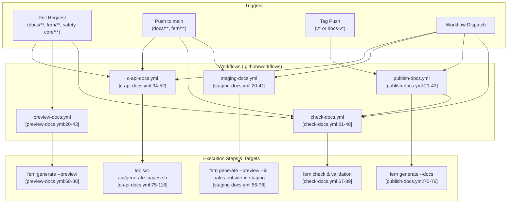
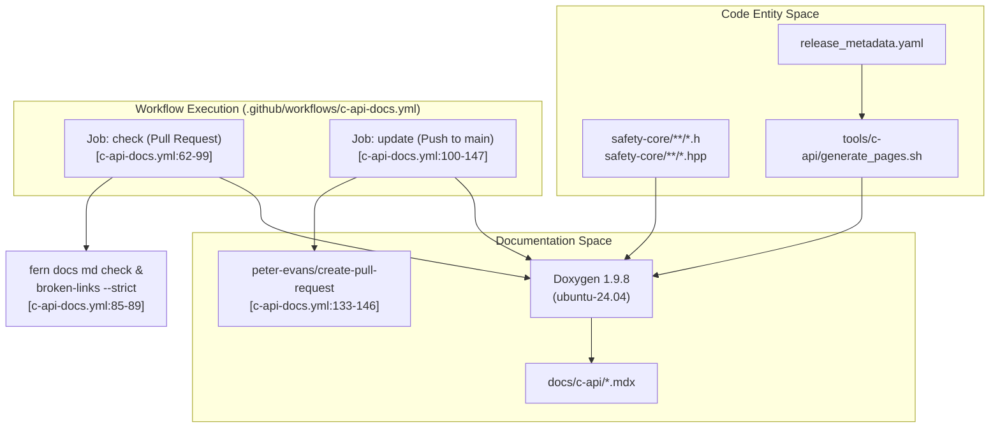

<!-- source: DeepWiki mcp.deepwiki.com · repo NVIDIA/halos-outside-in-safety · page 8.2 Docs CI/CD Workflows · fetched 2026-11-09 -->

# Docs CI/CD Workflows

Relevant source files

The following files were used as context for generating this wiki page:

- [.github/workflows/c-api-docs.yml](.github/workflows/c-api-docs.yml)
- [.github/workflows/check-docs.yml](.github/workflows/check-docs.yml)
- [.github/workflows/preview-docs.yml](.github/workflows/preview-docs.yml)
- [.github/workflows/publish-docs.yml](.github/workflows/publish-docs.yml)
- [.github/workflows/staging-docs.yml](.github/workflows/staging-docs.yml)
- [docs/api-documentation.mdx](docs/api-documentation.mdx)
- [docs/c-api/nvpsdgatewaycontract-hpp.mdx](docs/c-api/nvpsdgatewaycontract-hpp.mdx)
- [docs/c-api/nvpsdgatewayprotocol-h.mdx](docs/c-api/nvpsdgatewayprotocol-h.mdx)

## Purpose and Scope

This page details the implementation, architecture, and operational mechanics of the documentation continuous integration and delivery (CI/CD) pipelines for the Halos Outside-In Safety (HOISA) codebase. The documentation site is structured around Fern (`fern/docs.yml`) and backed by GitHub Actions workflows located in `.github/workflows/`. These pipelines automate validation, pull request previews, staging deployments, production releases, and C API reference synchronization derived from headers in `safety-core/`.

Sources: [.github/workflows/check-docs.yml:1-89](), [.github/workflows/preview-docs.yml:1-118](), [.github/workflows/staging-docs.yml:1-79](), [.github/workflows/publish-docs.yml:1-76](), [.github/workflows/c-api-docs.yml:1-146]()

---

## Documentation Pipeline Architecture

The documentation CI/CD framework handles multiple event triggers—including pull requests, pushes to `main`, release tags, and scheduled or manual dispatches—routing them through specialized validation and deployment jobs.

*Figure 1: High-level mapping of CI/CD triggers to workflows and actions.*

Sources: [.github/workflows/check-docs.yml:21-48](), [.github/workflows/preview-docs.yml:20-43](), [.github/workflows/staging-docs.yml:20-41](), [.github/workflows/publish-docs.yml:21-43](), [.github/workflows/c-api-docs.yml:34-52]()

---

## Validation & Quality Gate: `check-docs.yml`

The `check-docs` workflow serves as the mandatory quality gate for all documentation and API-related changes. It executes on pull requests, pushes to `main`, manual dispatches, and is called directly by the publishing pipeline [.github/workflows/check-docs.yml:23-44]().

### Implementation Steps
1. **Repository Checkout & Node Setup**: Checks out the repository without persisting credentials [:[.github/workflows/check-docs.yml:57-65]()] and sets up Node.js version `22`.
2. **Fern CLI Installation**: Installs the Fern CLI tool globally matching the version specified in `fern/fern.config.json` [:[.github/workflows/check-docs.yml:67-68]()].
3. **MDX Safety Check**: Scans Markdown and MDX files for non-self-closing `` tags (``), enforcing MDX compliance (``) [:[.github/workflows/check-docs.yml:70-77]()].
4. **API and Syntax Validation**: Runs `fern check` using `DOCS_FERN_TOKEN` (when present) to validate API definitions and missing redirects [:[.github/workflows/check-docs.yml:79-82]()].
5. **MDX Validity & Broken Link Check**: Executes `fern docs md check` and strict link validation via `fern docs broken-links --strict` [:[.github/workflows/check-docs.yml:84-89]()].

Sources: [.github/workflows/check-docs.yml:1-89]()

---

## Pull Request Previews: `preview-docs.yml`

When pull requests modify paths under `docs/**` or `fern/**`, the `preview-docs` workflow generates a transient build preview via Fern and posts or updates a comment on the corresponding pull request [.github/workflows/preview-docs.yml:16-36]().

### Concurrency and Security Mechanics
* **Concurrency Group**: Grouped by PR number (`preview-docs-${{ github.event.pull_request.number }}`) with `cancel-in-progress: true`, ensuring newer pushes supersede older in-flight preview jobs [.github/workflows/preview-docs.yml:33-36]().
* **Secret Gating**: Fork pull requests receive restricted read-only tokens and lack access to repository secrets (`DOCS_FERN_TOKEN`). The workflow explicitly checks for the token's presence and safely skips or fails on unauthenticated external forks [:[.github/workflows/preview-docs.yml:40-53]()].
* **URL Validation**: Extracted URLs from `fern generate --preview` output are validated via a Node.js one-liner to ensure they conform to expected HTTPS endpoints on `*.buildwithfern.com` without userinfo components [:[.github/workflows/preview-docs.yml:73-87]()].
* **Comment Management**: Uses the GitHub CLI (`gh api`) to search for existing comments from `github-actions[bot]` tagged with the marker `<!-- preview-docs -->`, patching the existing comment or posting a new one [:[.github/workflows/preview-docs.yml:91-118]()].

Sources: [.github/workflows/preview-docs.yml:1-118]()

---

## Staging & Continuous Publishing: `staging-docs.yml` & `publish-docs.yml`

Continuous integration to staging and production environments is handled across two workflows.

### Staging (`staging-docs.yml`)
Triggered on every push to the `main` branch affecting documentation paths [.github/workflows/staging-docs.yml:22-30](). It generates a staging preview assigned to the fixed ID `halos-outside-in-staging` and appends the resulting URL to the GitHub Actions step summary (`$GITHUB_STEP_SUMMARY`) [:[.github/workflows/staging-docs.yml:37-79]()]. Concurrency is configured with `cancel-in-progress: false` to guarantee chronological execution order [:[.github/workflows/staging-docs.yml:37-39]()].

### Production Publishing (`publish-docs.yml`)
Triggered upon pushing engineering release tags (`vX.Y.Z`) or doc-only patch tags (`docs-vX.Y.Z-N`), as well as manual dispatches [:[.github/workflows/publish-docs.yml:23-32]()]. 

* **Prerequisite Gate**: The `check` job calls `check-docs.yml` prior to running the publishing job [:[.github/workflows/publish-docs.yml:45-51]()].
* **Environment Protection**: The `run` job requires the GitHub Actions `production` environment, enabling deployment review gates and branch protection rules [:[.github/workflows/publish-docs.yml:56-58]()].
* **Publish Command**: Executes `fern generate --docs --log-level debug` authenticated via `DOCS_FERN_TOKEN` [:[.github/workflows/publish-docs.yml:73-76]()].

Sources: [.github/workflows/staging-docs.yml:1-79](), [.github/workflows/publish-docs.yml:1-76]()

---

## C API Reference Automation: `c-api-docs.yml`

The `c-api-docs` workflow synchronizes C and C++ header files in `safety-core/` with generated Markdown reference pages under `docs/c-api/` [:[.github/workflows/c-api-docs.yml:16-23]()].

*Figure 2: C API reference generation data flow from `safety-core/` headers to generated MDX files.*

### Runner Environment and Constraints
* **OS Selection**: Both jobs run on `ubuntu-24.04` rather than `ubuntu-latest` [:[.github/workflows/c-api-docs.yml:65,103]()]. This is required because Doxygen `1.9.8` (provided in Ubuntu 24.04) correctly preserves `constexpr` modifiers in variable declarations, whereas newer Doxygen releases drop them—which would trigger false-positive diff changes on every run without header modifications [:[.github/workflows/c-api-docs.yml:24-27]()].

### Job Bifurcation
1. **Pull Request Check (`check`)**: Installs Doxygen, executes `tools/c-api/generate_pages.sh`, and validates MDX integrity and link validity. It reports notices if pages diverge but does not commit [:[.github/workflows/c-api-docs.yml:62-99]()].
2. **Main Branch Update (`update`)**: Automatically regenerates pages on `main` branch changes and uses `peter-evans/create-pull-request` to open or update a pull request titled `docs: regenerate the C API reference` under the branch `bot/c-api-reference` [:[.github/workflows/c-api-docs.yml:100-146]()].

Sources: [.github/workflows/c-api-docs.yml:1-146]()

---

## Secrets, Concurrency, and Gating Mechanisms

The documentation CI/CD pipelines rely on several security and synchronization controls:

| Workflow File | Concurrency Group Strategy | Cancel In Progress | Required Secrets / Tokens | Environmental Gating |
| --- | --- | --- | --- | --- |
| `check-docs.yml` | N/A (runs per trigger) | N/A | `DOCS_FERN_TOKEN` (optional) | None |
| `preview-docs.yml` | `preview-docs-${{ github.event.pull_request.number }}` | `true` | `DOCS_FERN_TOKEN`, `GITHUB_TOKEN` | Internal PR check (skips forks) |
| `staging-docs.yml` | `staging-docs` | `false` | `DOCS_FERN_TOKEN` | `main` branch push |
| `publish-docs.yml` | `publish-docs` | `false` | `DOCS_FERN_TOKEN` | GitHub Environment: `production` |
| `c-api-docs.yml` | `c-api-reference-${{ github.ref }}` | `true` | `GITHUB_TOKEN` (implicit) | `main` branch / PR paths |

Sources: [.github/workflows/check-docs.yml:1-89](), [.github/workflows/preview-docs.yml:1-118](), [.github/workflows/staging-docs.yml:1-79](), [.github/workflows/publish-docs.yml:1-76](), [.github/workflows/c-api-docs.yml:1-146]()

---

