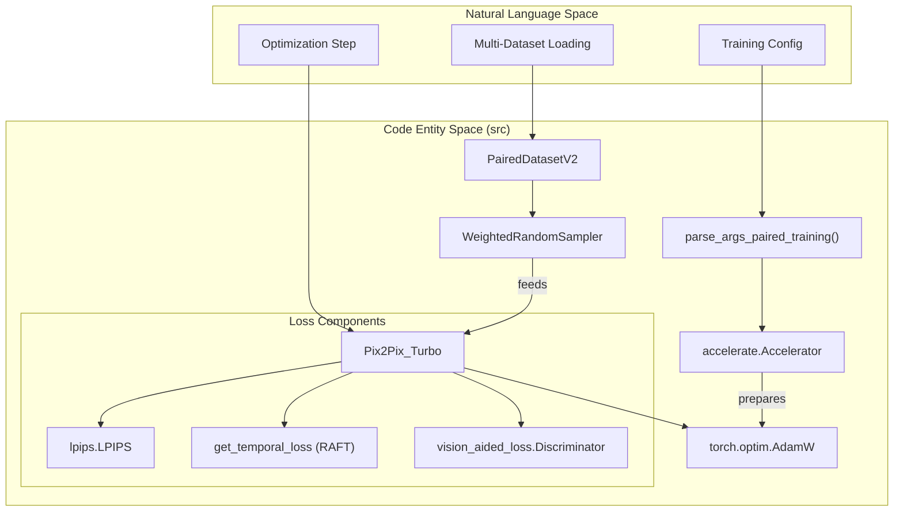
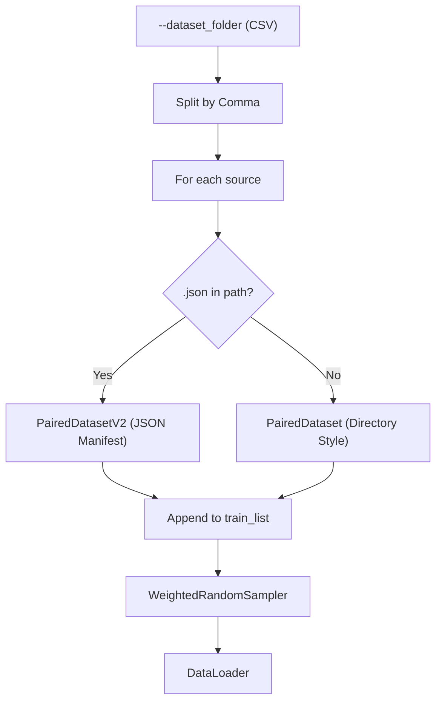

<!-- source: DeepWiki mcp.deepwiki.com · repo NVIDIA/harmonizer · page 3.3 Multi-GPU Training Configuration · fetched 2026-10-26 -->

# Multi-GPU Training Configuration

Relevant source files

The following files were used as context for generating this wiki page:

- [src/train_pix2pix_turbo_harmonizer.py](src/train_pix2pix_turbo_harmonizer.py)
- [src/utils/profiling.py](src/utils/profiling.py)

This page details the multi-GPU training infrastructure for Harmonizer, built upon the Hugging Face `accelerate` library. It covers the launch configuration, hardware optimization techniques (mixed precision, gradient checkpointing), and the hyperparameters required to fine-tune the Pix2Pix-Turbo architecture for high-fidelity image harmonization.

## Training Launch & Infrastructure

Harmonizer utilizes the `accelerate` library to manage distributed training across multiple GPUs. The training process is orchestrated in `src/train_pix2pix_turbo_harmonizer.py`, which handles device placement, gradient synchronization, and mixed-precision execution.

### Accelerate Initialization
The `Accelerator` object is initialized at the start of the `main` function [src/train_pix2pix_turbo_harmonizer.py:69-73](). It configures:
*   **Mixed Precision**: Typically `bf16` or `fp16` to reduce memory footprint and increase throughput.
*   **Gradient Accumulation**: Controlled via `--gradient_accumulation_steps` to simulate larger batch sizes on limited VRAM [src/train_pix2pix_turbo_harmonizer.py:70]().
*   **Logging**: Integration with Weights & Biases (WandB) for experiment tracking [src/train_pix2pix_turbo_harmonizer.py:72]().

### Hardware Optimizations
To handle the memory-intensive Cosmos-Predict2 backbone, several optimizations are available:
*   **xFormers**: Memory-efficient attention can be enabled for the U-Net component [src/train_pix2pix_turbo_harmonizer.py:103-108]().
*   **Gradient Checkpointing**: Enabled via `net_pix2pix.unet.enable_gradient_checkpointing()` to trade compute for memory during the backward pass [src/train_pix2pix_turbo_harmonizer.py:110-111]().
*   **TF32**: Enabled on Ampere and later architectures to accelerate matrix multiplications [src/train_pix2pix_turbo_harmonizer.py:113-114]().

**Sources:** [src/train_pix2pix_turbo_harmonizer.py:69-114]()

## System Architecture: Training Data Flow

The following diagram illustrates how the training script bridges high-level configuration to the core model entities and loss functions.

### Training Loop Entity Mapping
"Training Data Flow and Entity Mapping"

**Sources:** [src/train_pix2pix_turbo_harmonizer.py:36-43](), [src/train_pix2pix_turbo_harmonizer.py:69-101](), [src/train_pix2pix_turbo_harmonizer.py:119-141]()

## Key Hyperparameters

Training behavior is governed by several critical hyperparameters passed via `parse_args_paired_training` [src/utils/training_utils.py]().

| Hyperparameter | Purpose | Implementation Reference |
| :--- | :--- | :--- |
| `learning_rate` | Base LR for AdamW optimizer (typically 5e-5). | [src/train_pix2pix_turbo_harmonizer.py:161]() |
| `timestep` | The specific ODE/SDE timestep used for the 1-step Turbo distillation. | [src/train_pix2pix_turbo_harmonizer.py:95]() |
| `resolution` | Target image size (e.g., 512, 1024). Handled via `image_prep`. | [src/train_pix2pix_turbo_harmonizer.py:57-61]() |
| `fixing_data_weight` | Weighting factor for specific data sources in the `WeightedRandomSampler`. | [src/train_pix2pix_turbo_harmonizer.py:199-204] (implied in sampler logic) |
| `lambda_gan` | Weight for the Vision-Aided GAN loss. | [src/train_pix2pix_turbo_harmonizer.py:116]() |
| `lambda_lpips` | Weight for the LPIPS perceptual loss. | [src/train_pix2pix_turbo_harmonizer.py:246]() |

**Sources:** [src/train_pix2pix_turbo_harmonizer.py:159-190](), [src/utils/training_utils.py:1-50]()

## Resuming and Fine-tuning

The script supports resuming from a previous state or fine-tuning a pretrained Harmonizer checkpoint.

### Loading Checkpoints
The `Pix2Pix_Turbo` class constructor accepts a `pretrained_path` [src/train_pix2pix_turbo_harmonizer.py:99](). If provided, it loads the state dict using `load_ckpt_from_state_dict` [src/pix2pix_turbo_harmonizer.py:39]().

### Fine-tuning Controls
The script provides granular control over which parts of the model are updated:
*   **Full U-Net Training**: Enabled via `--train_full_unet`. If false, only the added adapter layers are trained [src/train_pix2pix_turbo_harmonizer.py:148-150]().
*   **VAE Freezing**: The VAE can be completely frozen (`--freeze_vae`) or only the encoder can be frozen (`--freeze_vae_encoder`), allowing the decoder to adapt to harmonization artifacts [src/train_pix2pix_turbo_harmonizer.py:92-93, 151-157]().

### Checkpoint Saving
Checkpoints are saved periodically using `save_ckpt`, which packages the U-Net, VAE, and any trainable projections into a single `.pt` file [src/train_pix2pix_turbo_harmonizer.py:40, 318-322]().

**Sources:** [src/train_pix2pix_turbo_harmonizer.py:89-101](), [src/train_pix2pix_turbo_harmonizer.py:147-157]()

## Multi-Dataset & Weighted Sampling

Harmonizer often trains on a mixture of datasets (e.g., ISP modification and shadow simulation). The script supports comma-separated paths in `--dataset_folder` [src/train_pix2pix_turbo_harmonizer.py:50-52]().

### Dataset Selection Logic
"Dataset and Sampler Initialization"

The `WeightedRandomSampler` ensures that the model sees a balanced distribution of different harmonization tasks, even if the raw file counts differ significantly between sources [src/train_pix2pix_turbo_harmonizer.py:196-210]().

**Sources:** [src/train_pix2pix_turbo_harmonizer.py:48-65](), [src/utils/training_utils.py:10-40]()

## WandB Logging
Logging is integrated via the `accelerate` tracker. The script logs:
*   **Scalar Metrics**: L2 loss, LPIPS loss, GAN loss, and learning rate [src/train_pix2pix_turbo_harmonizer.py:270-285]().
*   **Image Visualizations**: Periodically, the script performs validation and uploads a grid of "Input | Output | Ground Truth" images to WandB to monitor visual progress [src/train_pix2pix_turbo_harmonizer.py:290-310]().

**Sources:** [src/train_pix2pix_turbo_harmonizer.py:69-73](), [src/train_pix2pix_turbo_harmonizer.py:275-315]()

---

