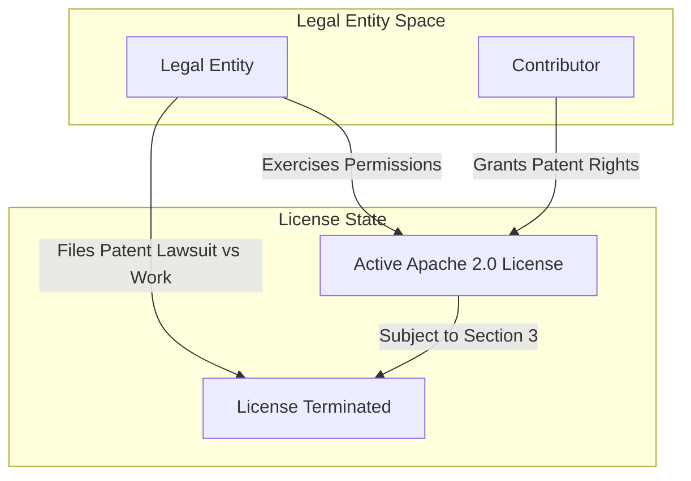
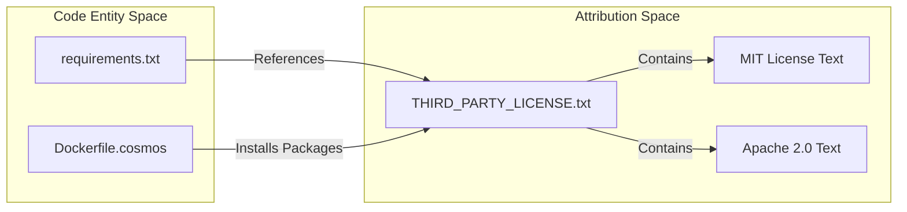

<!-- source: DeepWiki mcp.deepwiki.com · repo NVIDIA/harmonizer · page 6.1 Licensing & Third-Party Attributions · fetched 2026-10-26 -->

# Licensing & Third-Party Attributions

Relevant source files

The following files were used as context for generating this wiki page:

- [LICENSE](LICENSE)
- [THIRD_PARTY_LICENSE.txt](THIRD_PARTY_LICENSE.txt)

This page details the legal framework governing the Harmonizer repository, including the primary Apache 2.0 license terms, patent grants, and the comprehensive catalog of third-party software dependencies.

## 1. Primary License: Apache 2.0

The Harmonizer codebase is distributed under the **Apache License, Version 2.0** [LICENSE:2-3](). This license provides a permissive framework for use, reproduction, and distribution of the software in both Source and Object forms [LICENSE:6-7]().

### 1.1. Key Definitions
The license establishes specific terminology for legal clarity:
*   **Work**: The original work of authorship made available under the license [LICENSE:36-39]().
*   **Derivative Works**: Modifications or elaborations representing an original work of authorship, excluding works that remain separable or merely link to the interfaces of the Work [LICENSE:41-47]().
*   **Contribution**: Any work of authorship intentionally submitted to the Licensor for inclusion in the Work [LICENSE:49-54]().
*   **Contributor**: The Licensor and any entity on behalf of whom a Contribution has been incorporated into the Work [LICENSE:63-65]().

### 1.2. Rights and Grants
The license provides two primary grants to users:
1.  **Copyright License**: A perpetual, worldwide, non-exclusive, no-charge, royalty-free, irrevocable license to reproduce, prepare Derivative Works, and distribute the Work [LICENSE:67-72]().
2.  **Patent License**: A perpetual, worldwide, non-exclusive, no-charge, royalty-free, irrevocable license to make, use, sell, or import the Work, applicable to patent claims necessarily infringed by the Contribution(s) [LICENSE:74-82]().

**Sources:**
*   [LICENSE:1-89]()

## 2. Patent Litigation & Termination

The Apache 2.0 license includes a protective clause regarding patent litigation. If a user institutes patent litigation against any entity alleging that the Work or a Contribution constitutes direct or contributory patent infringement, then any patent licenses granted to that user under this License shall terminate as of the date the litigation is filed [LICENSE:82-88]().

### License Termination Logic
The following diagram illustrates the relationship between legal entities and the license state:

**Legal State Flow: Patent Grant and Termination**

**Sources:**
*   [LICENSE:16-25]()
*   [LICENSE:74-88]()

## 3. Redistribution Requirements

Recipients of the Work or Derivative Works must adhere to specific conditions when redistributing the software:
*   **License Inclusion**: A copy of the Apache 2.0 license must be provided [LICENSE:95-96]().
*   **Change Notices**: Modified files must carry prominent notices stating that the files were changed [LICENSE:98-99]().
*   **Attribution Retention**: All copyright, patent, trademark, and attribution notices from the Source form must be retained [LICENSE:101-105]().
*   **NOTICE File**: If the Work includes a `NOTICE` text file, its contents must be included in redistributed Derivative Works in at least one readable location (e.g., within a new NOTICE file or documentation) [LICENSE:107-116]().

**Sources:**
*   [LICENSE:90-122]()

## 4. Third-Party Software Attributions

Harmonizer bundles and relies upon several third-party libraries. These are cataloged in `THIRD_PARTY_LICENSE.txt`. The dependencies are primarily licensed under MIT, BSD, ISC, and Apache 2.0 terms.

### 4.1. Dependency Catalog (Partial)

| Package | License Type | Primary Link |
| :--- | :--- | :--- |
| `attrs` | MIT | [https://www.attrs.org/](https://www.attrs.org) |
| `better-profanity` | MIT | [https://github.com/snguyenthanh/better_profanity](https://github.com/snguyenthanh/better_profanity) |
| `boto3` | Apache 2.0 | [https://github.com/boto/boto3](https://github.com/boto/boto3) |

### 4.2. Attribution Mapping

The system maps external requirements to the internal `THIRD_PARTY_LICENSE.txt` file to ensure compliance during distribution.

**Code-to-Attribution Mapping**

**Sources:**
*   [THIRD_PARTY_LICENSE.txt:1-133]()
*   [LICENSE:107-116]()

---

