# Page: Harmonizer: Project Overview

# Harmonizer: Project Overview

<details>
<summary>Relevant source files</summary>

The following files were used as context for generating this wiki page:

- [README.md](README.md)
- [assets/demo.gif](assets/demo.gif)
- [media/method_teaser.svg](media/method_teaser.svg)
- [media/teaser.gif](media/teaser.gif)
- [media/teaser.mp4](media/teaser.mp4)

</details>


**Harmonizer** is an online generative enhancement framework designed to bridge the gap between neural reconstructions (e.g., NeRF, 3D Gaussian Splatting) and photorealistic simulation [README.md:3-15](). It transforms imperfect renderings into temporally consistent, realistic outputs by distilling a multi-step diffusion model into a single-step, temporally-conditioned enhancer [README.md:17-18]().

### Purpose and Scope
Simulation is critical for autonomous vehicle development, but neural reconstructions often suffer from novel-view artifacts and struggle to integrate dynamic objects realistically [README.md:15-16](). Harmonizer addresses these issues through:
*   **Appearance Harmonization**: Matching tone and color between foreground assets and background scenes.
*   **Artifact Correction**: Removing ghosting, blur, and spurious geometry from reconstructions.
*   **Lighting Realism**: Simulating realistic shadows and illumination for inserted objects.

For a detailed guide on setting up the repository and downloading checkpoints, see [Getting Started: Environment Setup & Checkpoint Download](#1.1).

### System Architecture
The framework is built upon the **Pix2Pix-Turbo** paradigm, utilizing the **Cosmos-Predict2-0.6B-Text2Image** model as its backbone [README.md:42-55](). It operates as a single-step denoiser that can be integrated directly into online simulators.

#### Code-to-Concept Mapping: Inference Flow
The following diagram maps the logical inference process to specific code entities and files within the repository.

**Diagram: Inference Pipeline Entity Map**
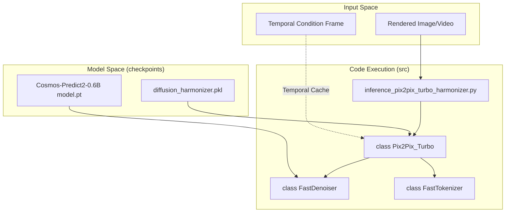
**Sources:** [README.md:59-76](), [pix2pix_turbo_harmonizer.py:1-50]()

### Key Capabilities
*   **Temporal Consistency**: Uses an autoregressive temporal conditioning mechanism to ensure video stability across frames [README.md:59-63]().
*   **High Resolution**: Supports rendering at 1024 resolution with scheduling [README.md:71-76]().
*   **Deployment Flexibility**: Provides paths for standard PyTorch inference, temporal video processing, and TensorRT-accelerated deployment for H100 GPUs.

### Repository Organization
The repository is structured to support the full lifecycle of the model, from synthetic data curation to production deployment.

| Directory | Purpose |
| :--- | :--- |
| `src/` | Core implementation including model architecture, training scripts, and inference wrappers. |
| `scripts/data_curation/` | Tools for generating synthetic-real training pairs (e.g., ISP modification). |
| `onnx_export/` | Modules and scripts for converting models to ONNX and TensorRT engine formats. |
| `doc/` | Technical documentation and curation recipes. |
| `models/` | Default location for pretrained Harmonizer checkpoints. |

For a full map of the layout and coding standards, see [Repository Structure & Code Conventions](#1.2).

### Data Curation Pipeline
Harmonizer relies on a specialized pipeline that produces synthetic-real training pairs targeting specific failure modes.

**Diagram: Data Curation to Code Entity Bridge**
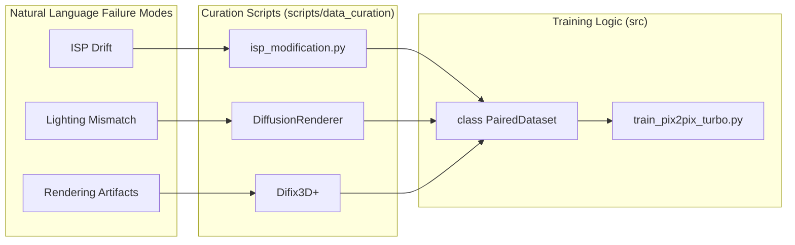
**Sources:** [README.md:88-105](), [training_utils.py:1-40]()

### Navigation
*   **Setup**: [Getting Started: Environment Setup & Checkpoint Download](#1.1)
*   **Architecture**: [Core Model Architecture](#2)
*   **Training**: [Training Pipeline](#3)
*   **Inference**: [Inference](#4)
*   **Deployment**: [ONNX Export & TensorRT Deployment](#5)
*   **Governance**: [Project Governance & Legal](#6)

**Sources:** [README.md:1-110](), [pix2pix_turbo_harmonizer.py:1-20]()

---

# Page: Getting Started: Environment Setup & Checkpoint Download

# Getting Started: Environment Setup & Checkpoint Download

<details>
<summary>Relevant source files</summary>

The following files were used as context for generating this wiki page:

- [Dockerfile.cosmos](Dockerfile.cosmos)
- [download_checkpoints.sh](download_checkpoints.sh)
- [requirements.txt](requirements.txt)
- [ruff.toml](ruff.toml)

</details>


This page provides a technical guide for establishing the Harmonizer development environment and acquiring the necessary pretrained weights. The setup relies on a Dockerized workflow to ensure compatibility with the `cosmos-predict2` backbone and specific CUDA requirements.

## Environment Architecture

The Harmonizer environment is built upon the `nvcr.io/nvidia/pytorch:25.10-py3` base image [Dockerfile.cosmos:19-19](). It integrates the `cosmos-predict2` library alongside project-specific dependencies and patches required for gradient flow and version compatibility.

### Docker Environment Construction

The `Dockerfile.cosmos` implements a multi-stage build to manage dependencies efficiently:

1.  **Repository Stage**: Copies the local source code into the build context [Dockerfile.cosmos:28-29]().
2.  **Base Stage**: Installs system utilities (`ffmpeg`, `libx11-dev`, etc.) and the `just` command runner [Dockerfile.cosmos:41-45]().
3.  **Cosmos Dependency Stage**: Clones the `cosmos-predict2.5` repository and installs its nightly requirements [Dockerfile.cosmos:48-51]().
4.  **Harmonizer Stage**: Installs the core `cosmos-predict2==1.0.9` package and project-specific requirements [Dockerfile.cosmos:65-67]().

### Data Flow: Environment Setup
The following diagram illustrates how the Docker build process assembles the runtime environment from various sources.

**Environment Assembly Flow**
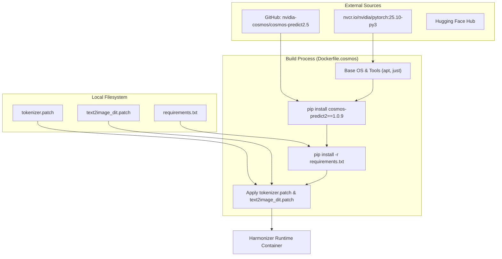
**Sources:** [Dockerfile.cosmos:19-70](), [requirements.txt:1-4]()

## Dependency Management

### Python Requirements
The project specifies several key libraries in `requirements.txt` that are essential for the Pix2Pix-Turbo paradigm and loss calculation:
*   `lpips`: Used for perceptual loss during training [requirements.txt:1-1]().
*   `vision-aided-loss`: Provides structural and GAN losses [requirements.txt:2-2]().
*   `CLIP`: Installed directly from source for text/image embedding [requirements.txt:4-4]().

### Critical Patches
To enable the specific architectural needs of Harmonizer, two patches are applied to the `cosmos_predict2` installation inside the container:
1.  **`tokenizer.patch`**: Modifies `tokenizer.py` to remove `@torch.no_grad()` decorators, allowing gradient flow through the VAE during training [Dockerfile.cosmos:69-69]().
2.  **`text2image_dit.patch`**: Adjusts `text2image_dit.py` to ensure compatibility with specific `transformer_engine` versions [Dockerfile.cosmos:70-70]().

**Sources:** [Dockerfile.cosmos:65-70](), [requirements.txt:1-4]()

## Checkpoint Acquisition

Checkpoints are managed via the `download_checkpoints.sh` script, which utilizes the Hugging Face CLI (`hf`) [download_checkpoints.sh:19-22]().

### Checkpoint Structure
The script organizes downloaded weights into specific directory structures expected by the model loaders:

| Component | Source Repository | Local Destination |
| :--- | :--- | :--- |
| Harmonizer Weights | `nvidia/Harmonizer` | `models/` |
| Cosmos Backbone | `nvidia/Cosmos-Predict2-0.6B-Text2Image` | `src/checkpoints/nvidia/Cosmos-Predict2-0.6B-Text2Image/` |
| Training Dataset | `nvidia/Harmonizer-Dataset` | `data/` (Optional) |

### Code-to-Checkpoint Mapping
The following diagram maps the CLI commands in the download script to the resulting directory structure used by the Python source code.

**Checkpoint Distribution Map**
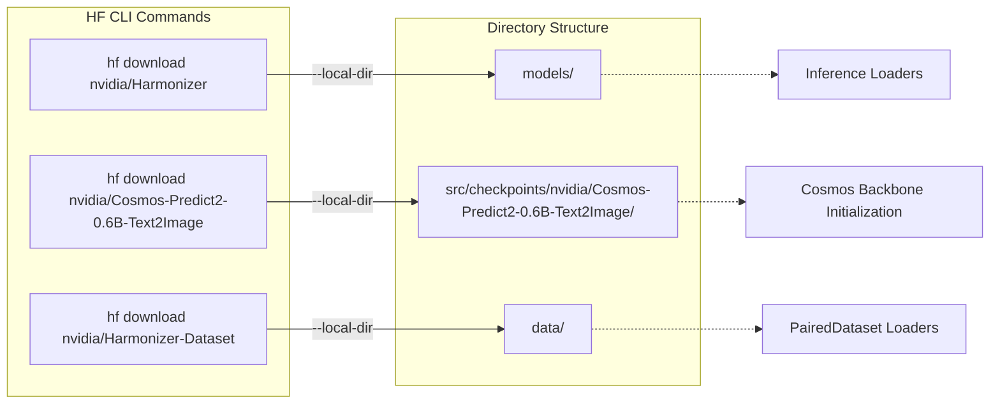
**Sources:** [download_checkpoints.sh:24-34]()

## Implementation Steps

1.  **Build the Container**:
    ```bash
    docker build -t harmonizer-cosmos-env -f Dockerfile.cosmos .
    ```
    [Dockerfile.cosmos:16-17]()

2.  **Download Weights**:
    Run the script from the repository root to ensure relative paths are preserved [download_checkpoints.sh:15-17]().
    *   For inference only: `./download_checkpoints.sh` [download_checkpoints.sh:11-11]()
    *   For training (includes dataset): `./download_checkpoints.sh --with-dataset` [download_checkpoints.sh:12-12]()

3.  **Linting**:
    The project uses `ruff` for code quality, targeting Python 3.10 with a line length of 120 [ruff.toml:16-17](). The configuration enables Bugbear (B), Isort (I), and Pyflakes (F) rules [ruff.toml:20-28]().

**Sources:** [Dockerfile.cosmos:16-17](), [download_checkpoints.sh:1-37](), [ruff.toml:16-35]()

---

# Page: Repository Structure & Code Conventions

# Repository Structure & Code Conventions

<details>
<summary>Relevant source files</summary>

The following files were used as context for generating this wiki page:

- [CONTRIBUTING.md](CONTRIBUTING.md)
- [LICENSE](LICENSE)
- [SECURITY.md](SECURITY.md)
- [THIRD_PARTY_LICENSE.txt](THIRD_PARTY_LICENSE.txt)
- [ruff.toml](ruff.toml)

</details>


This page provides a technical map of the Harmonizer repository, detailing the organization of source code, assets, and documentation. It also outlines the development standards, including linting configurations and the legal requirements for contributing code to the project.

## Repository Layout

The Harmonizer repository is structured to separate core model logic, training utilities, deployment pipelines, and project metadata.

### Directory Overview

| Directory | Description |
| :--- | :--- |
| `src/` | Core Python source code including model definitions (`src/model/`), loss functions, and dataset loaders. |
| `doc/` | Technical documentation and methodology reports, such as NuRec data curation details. |
| `assets/` | Static configuration files, prompts, and metadata required for model operation. |
| `examples/` | Scripts demonstrating usage of the pretrained models for inference and evaluation. |
| `media/` | Visual assets, diagrams, and demonstration videos for the project. |
| `onnx_export/` | Dedicated sub-package for converting PyTorch models to ONNX and TensorRT formats. |

### Code Entity Mapping: Source to Function

The following diagram bridges the natural language concepts of the system to their specific implementations within the `src/` directory.

**Diagram: System Component Mapping**
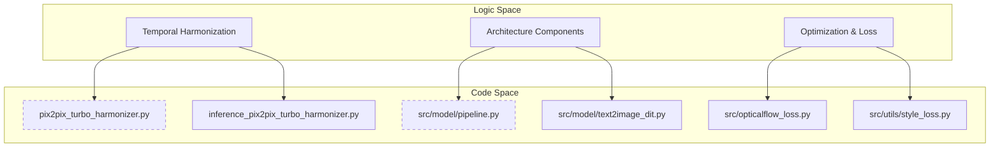
**Sources:** `CONTRIBUTING.md:1-5`(), `ruff.toml:1-36`()

---

## Coding Style & Enforcement

Harmonizer uses `ruff` to enforce a consistent coding style across the repository. The configuration is defined in `ruff.toml`.

### Linting Configuration
The project targets **Python 3.10** and enforces a maximum line length of **120 characters** [`ruff.toml:16-17`]().

The following rule sets are active [`ruff.toml:20-28`]():
*   **B (bugbear):** Finds likely bugs and design flaws.
*   **E (pycodestyle errors):** Standard PEP8 error checks.
*   **I (isort):** Ensures imports are sorted consistently.
*   **ISC (flake8-implicit-str-concat):** Prevents accidental string concatenations.
*   **F (pyflakes):** Checks for logical errors like unused imports or undefined names.
*   **UP (pyupgrade):** Automatically upgrades syntax to newer Python versions.
*   **RUF (ruff):** Internal Ruff-specific rules.

### Specific Exceptions
Certain rules are ignored to accommodate specific architectural patterns or legacy code compatibility [`ruff.toml:29-34`]():
*   `E402`: Allows module imports not at the top of the file (useful for dynamic environment setup).
*   `E501`: Line length checks are relaxed in specific contexts.
*   `F841`: Unused variables do not trigger failures.
*   `UP038`: Disables mandatory PEP 604 `isinstance` checks.

**Sources:** `ruff.toml:1-36`()

---

## Contribution Guidelines

Contributors must adhere to specific legal and technical workflows to ensure code quality and license compliance.

### Developer Certificate of Origin (DCO)
All contributions must be "signed-off" to certify that the contributor has the right to submit the code under the project's license [`CONTRIBUTING.md:11-15`](). This is enforced via Git commit trailers.

**Requirement:** Use the `-s` or `--signoff` flag during commit [`CONTRIBUTING.md:17-20`]():
```bash
git commit -s -m "Brief description of the change"
```
This appends a `Signed-off-by: Name <email>` line to the commit message, signifying agreement with the DCO 1.1 [`CONTRIBUTING.md:21-52`]().

### Licensing
The project is licensed under the **Apache License 2.0** [`LICENSE:2-5`](). 
*   **Third-Party Code:** Any new dependencies or code snippets must not introduce license conflicts [`CONTRIBUTING.md:7-8`]().
*   **Attributions:** Third-party package licenses (MIT, BSD, Apache) are cataloged in `THIRD_PARTY_LICENSE.txt` [`THIRD_PARTY_LICENSE.txt:1-30`]().

### Security Reporting
Security vulnerabilities should **not** be reported via public GitHub issues [`SECURITY.md:5`](). Instead, they must be submitted through:
1.  **Web:** [NVIDIA Security Vulnerability Submission Form](https://www.nvidia.com/object/submit-security-vulnerability.html) [`SECURITY.md:10`]()
2.  **Email:** `psirt@nvidia.com` [`SECURITY.md:11`]()

**Sources:** `CONTRIBUTING.md:1-52`(), `LICENSE:1-143`(), `SECURITY.md:1-25`(), `THIRD_PARTY_LICENSE.txt:1-60`()

---

## Data Flow & File Interaction

The following diagram illustrates how the repository structure supports the training and inference data flow, linking high-level directories to internal code logic.

**Diagram: Repository Data Flow**
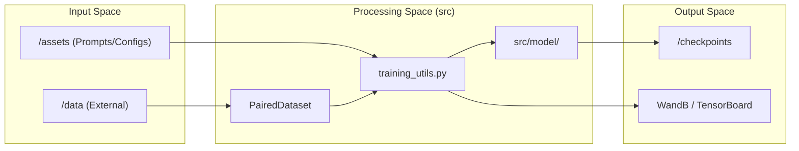
**Sources:** `CONTRIBUTING.md:5`(), `ruff.toml:1-36`()

---

# Page: Core Model Architecture

# Core Model Architecture

<details>
<summary>Relevant source files</summary>

The following files were used as context for generating this wiki page:

- [src/model/__init__.py](src/model/__init__.py)
- [src/pix2pix_turbo_harmonizer.py](src/pix2pix_turbo_harmonizer.py)
- [src/pix2pix_turbo_nocond_cosmos_base_faster_tokenizer.py](src/pix2pix_turbo_nocond_cosmos_base_faster_tokenizer.py)

</details>


The Harmonizer model architecture is built upon the **Pix2Pix-Turbo** paradigm, leveraging the **Cosmos-Predict2** backbone for high-fidelity video and image synthesis. It utilizes a 1-step rectified flow distillation approach to enable rapid image-to-image translation while maintaining temporal consistency through a specialized caching mechanism.

### Architectural Overview

Harmonizer integrates a Variational Autoencoder (VAE) for latent space compression and a Diffusion Transformer (DiT) for denoising. The architecture is designed to handle multi-view tensors with the shape `(B, C, V, H, W)`, where `V` represents the temporal or view dimension [src/pix2pix_turbo_harmonizer.py:4-8]().

#### System Data Flow
The following diagram illustrates the flow from input images through the encoding, denoising, and decoding stages, highlighting the primary code entities involved.

**Harmonizer Data Flow: Input to Output**
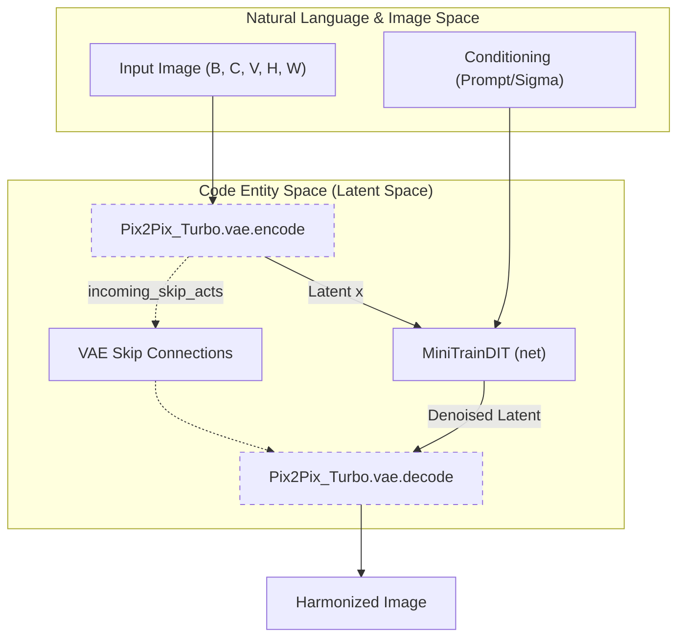
Sources: [src/pix2pix_turbo_harmonizer.py:177-180](), [src/pix2pix_turbo_harmonizer.py:140-141](), [src/model/text2image_dit.py:23-23]()

---

### Key Components

#### 1. Pix2Pix_Turbo Wrapper
The `Pix2Pix_Turbo` class serves as the primary interface for training and inference. It wraps the underlying UNet (DiT) and VAE components, providing methods for loading checkpoints and managing the forward pass [src/pix2pix_turbo_harmonizer.py:177-181](). It specifically handles the integration of LoRA (Low-Rank Adaptation) for both the UNet and VAE to enable efficient fine-tuning [src/pix2pix_turbo_harmonizer.py:187-188]().

For details, see [Pix2Pix_Turbo Wrapper](#2.1).

#### 2. Cosmos-Predict2 Backbone
Harmonizer is built on the **Cosmos-Predict2-0.6B** foundation. The model configuration is initialized via `get_cosmos_predict2_text2image_pipeline`, which sets up the transformer backend and tokenizer paths [src/pix2pix_turbo_harmonizer.py:26-37](). To ensure compatibility with modern training environments and enable gradient flow through the tokenizer, specific patches are applied to the upstream library.

For details, see [Cosmos-Predict2 Integration & Patches](#2.3).

#### 3. VAE Tokenizer with Skip Connections
The VAE uses a causal 3D convolutional structure. A critical feature of the Harmonizer architecture is the use of **skip connections** between the encoder and decoder to preserve spatial details during the 1-step generation process [src/pix2pix_turbo_harmonizer.py:148-164](). The encoder stores intermediate activations in `self.current_down_blocks`, which are then accessed by the decoder as `self.incoming_skip_acts` [src/pix2pix_turbo_harmonizer.py:113-145]().

**VAE Forward Logic and Caching**
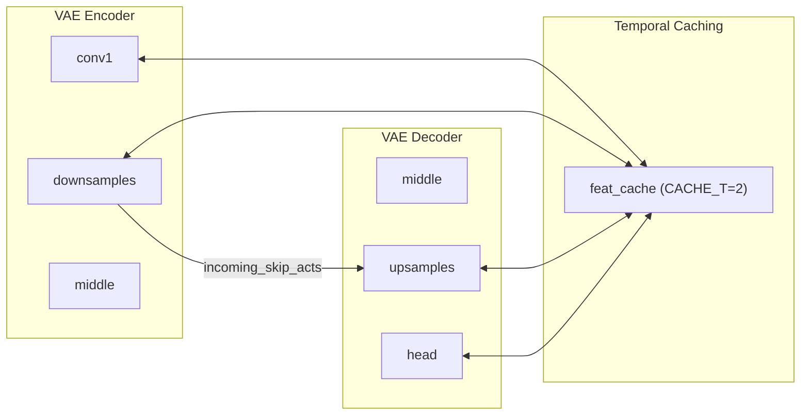
Sources: [src/pix2pix_turbo_harmonizer.py:72-114](), [src/pix2pix_turbo_harmonizer.py:117-174]()

#### 4. DiT Denoiser & Scaling
The core denoising logic resides in `MiniTrainDIT`, which replaces the standard DiT in the pipeline for training [src/model/text2image_dit.py:23-23](). It works in conjunction with `RectifiedFlowScaling` to manage timestep conditioning and noise schedules. The model typically operates in a 1-step regime using a `DPMSolverMultistepScheduler` configured with `set_timesteps(1)` [src/model/__init__.py:27-33]().

For details, see [Model Sub-modules: Pipeline, DiT, and Denoiser Scaling](#2.2).

---

### Component Relationship Table

| Component | Code Entity | Role |
| :--- | :--- | :--- |
| **Top-level Wrapper** | `Pix2Pix_Turbo` | Manages VAE/DiT lifecycle and LoRA [src/pix2pix_turbo_harmonizer.py:177]() |
| **Backbone DIT** | `MiniTrainDIT` | Core transformer for rectified flow [src/model/text2image_dit.py:23]() |
| **Tokenizer** | `FastTokenizer` | High-speed VAE encoding/decoding [src/model/pipeline.py:22]() |
| **Temporal Logic** | `CACHE_T` | Constant defining temporal lookback (2 frames) [src/pix2pix_turbo_harmonizer.py:72]() |
| **Scheduler** | `make_1step_sched` | Configures 1-step DPM Solver [src/model/__init__.py:45]() |

Sources: [src/pix2pix_turbo_harmonizer.py:72-177](), [src/model/__init__.py:22-45](), [src/model/text2image_dit.py:23]()

---

# Page: Pix2Pix_Turbo Wrapper

# Pix2Pix_Turbo Wrapper

<details>
<summary>Relevant source files</summary>

The following files were used as context for generating this wiki page:

- [src/pix2pix_turbo_harmonizer.py](src/pix2pix_turbo_harmonizer.py)
- [src/pix2pix_turbo_nocond_cosmos_base_faster_tokenizer.py](src/pix2pix_turbo_nocond_cosmos_base_faster_tokenizer.py)

</details>


The `Pix2Pix_Turbo` class serves as the primary training and inference wrapper for the Harmonizer model. It integrates the **Cosmos-Predict2** backbone with the Pix2Pix-Turbo paradigm, supporting multi-view video tensors and temporal consistency through specialized caching mechanisms.

## Purpose and Scope

The wrapper is designed to handle video latents in `(B, C, V, H, W)` format, where `V` represents the number of frames (views) [src/pix2pix_turbo_harmonizer.py:178-179](). It encapsulates the VAE (tokenizer) and the DiT (denoiser) into a single `torch.nn.Module`, ensuring compatibility with legacy diffusion-fixer checkpoints [src/pix2pix_turbo_harmonizer.py:4-7]().

---

## Class Architecture and Data Flow

The `Pix2Pix_Turbo` class manages the interaction between the image tokenizer and the transformer-based denoiser.

### System Entity Mapping
The following diagram maps the high-level logical components to their specific implementations within the `Pix2Pix_Turbo` wrapper.

**Diagram: Entity Mapping**
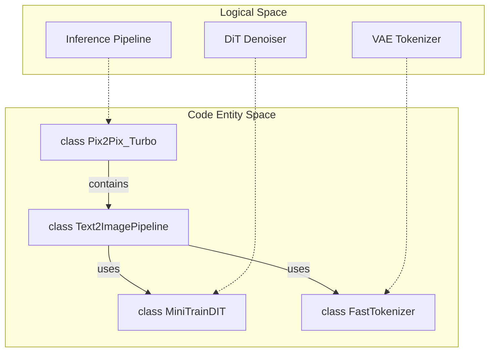
**Sources:** [src/pix2pix_turbo_harmonizer.py:177-190](), [src/pix2pix_turbo_nocond_cosmos_base_faster_tokenizer.py:26-32]()

### Forward Pass Flow
The forward pass accepts a batch of images (or video frames) and a prompt, then performs encoding, denoising, and decoding.

**Diagram: Pix2Pix_Turbo Forward Flow**
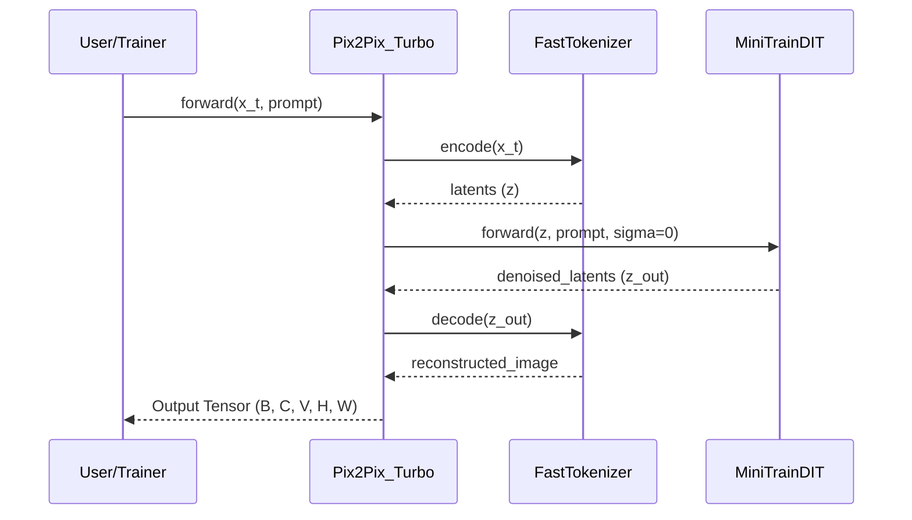
**Sources:** [src/pix2pix_turbo_harmonizer.py:178-180](), [src/pix2pix_turbo_nocond_cosmos_base_faster_tokenizer.py:26-40]()

---

## VAE Encode/Decode Flow

The wrapper utilizes a specialized VAE flow that supports skip connections between the encoder and decoder to preserve high-frequency spatial details.

*   **Encoding:** The `my_vae_encoder_fwd` function processes input tensors and stores intermediate feature maps in `self.current_down_blocks` [src/pix2pix_turbo_harmonizer.py:113-114]().
*   **Decoding:** The `my_vae_decoder_fwd` function retrieves these skip activations via `self.incoming_skip_acts` and applies them through a series of `skip_convs` (1x1 convolutions) before merging them with the upsampled path [src/pix2pix_turbo_harmonizer.py:129-164]().

---

## Temporal Caching Mechanism

To maintain temporal consistency during video processing without the memory overhead of full 3D attention, the wrapper implements a temporal caching mechanism.

### `CACHE_T` and `feat_cache`
The mechanism relies on a global constant `CACHE_T = 2` [src/pix2pix_turbo_harmonizer.py:72]().

1.  **Cache Extraction:** For every `CausalConv3d` or `ResidualBlock` layer, the last `CACHE_T` frames of the current feature map are cloned and stored in `feat_cache` [src/pix2pix_turbo_harmonizer.py:78-82]().
2.  **Context Injection:** If the current input chunk has fewer than 2 frames, the last frame from the previous chunk's cache is concatenated to provide temporal context [src/pix2pix_turbo_harmonizer.py:79-80]().
3.  **State Management:** An index `feat_idx` tracks the specific layer's cache position during the recursive forward pass [src/pix2pix_turbo_harmonizer.py:75-77]().

**Sources:** [src/pix2pix_turbo_harmonizer.py:72-114](), [src/pix2pix_turbo_nocond_cosmos_base_faster_tokenizer.py:70-117]()

---

## Checkpoint Loading and Saving

The wrapper provides utility functions to handle complex `state_dict` mappings, specifically for loading weights from legacy "diffusion-fixer" models into the new Cosmos-based architecture.

| Function | Purpose | Key Logic |
| :--- | :--- | :--- |
| `load_ckpt_from_state_dict` | Resumes training or initializes inference. | Maps `net.` prefixes to `dit.` and `net_ema.` to `dit_ema.` [src/pix2pix_turbo_harmonizer.py:43-49](). |
| `save_ckpt` | Persists model state. | Packages `state_dict_unet`, `state_dict_vae`, and discriminator/optimizer states into a single `.pkl` or `.pt` file [src/pix2pix_turbo_harmonizer.py:61-69](). |

**Sources:** [src/pix2pix_turbo_harmonizer.py:40-70](), [src/pix2pix_turbo_nocond_cosmos_base_faster_tokenizer.py:43-68]()

---

## Constructor Arguments

The `Pix2Pix_Turbo` constructor configures the underlying pipeline and LoRA (Low-Rank Adaptation) settings.

| Argument | Type | Description |
| :--- | :--- | :--- |
| `pretrained_path` | `str` | Path to the `.pt` or `.pkl` checkpoint containing UNet and VAE weights [src/pix2pix_turbo_harmonizer.py:185](). |
| `lora_rank_unet` | `int` | Rank for UNet LoRA layers (default: 8) [src/pix2pix_turbo_harmonizer.py:187](). |
| `lora_rank_vae` | `int` | Rank for VAE LoRA layers (default: 4) [src/pix2pix_turbo_harmonizer.py:188](). |
| `fast_pipeline` | `bool` | If True, uses `MiniTrainDIT` as the network target for accelerated training [src/pix2pix_turbo_harmonizer.py:34-35](). |

**Sources:** [src/pix2pix_turbo_harmonizer.py:26-37](), [src/pix2pix_turbo_harmonizer.py:181-190]()

---

# Page: Model Sub-modules: Pipeline, DiT, and Denoiser Scaling

# Model Sub-modules: Pipeline, DiT, and Denoiser Scaling

<details>
<summary>Relevant source files</summary>

The following files were used as context for generating this wiki page:

- [src/model/__init__.py](src/model/__init__.py)
- [src/model/denoiser_scaling.py](src/model/denoiser_scaling.py)
- [src/model/pipeline.py](src/model/pipeline.py)
- [src/model/text2image_dit.py](src/model/text2image_dit.py)

</details>


This page provides a technical deep dive into the `src/model/` package, which forms the backbone of the Harmonizer's generative capabilities. It covers the high-speed inference pipeline, the Diffusion Transformer (DiT) architecture, and the mathematical scaling used for Rectified Flow.

## Architecture Overview

The Harmonizer model architecture is composed of three primary layers: the high-level **Pipeline** wrappers, the core **MiniTrainDIT** engine, and the **RectifiedFlowScaling** logic.

### Natural Language to Code Entity Mapping

The following diagram maps high-level system concepts to their specific class implementations within the codebase.

**System Entity Mapping**
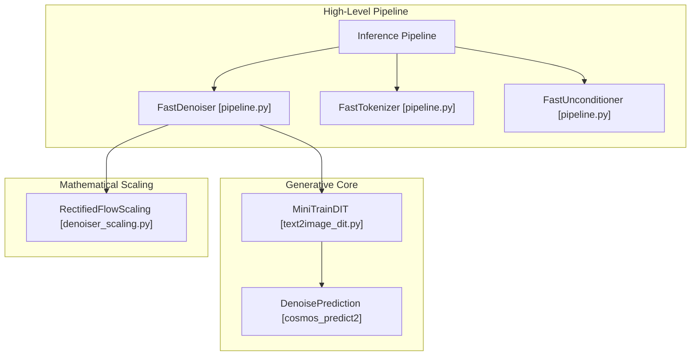
**Sources:** [src/model/pipeline.py:18-22](), [src/model/text2image_dit.py:23](), [src/model/denoiser_scaling.py:22]()

---

## 1. Fast Pipeline Components

The `src/model/pipeline.py` file contains optimized wrappers designed to minimize overhead during training and inference.

### FastDenoiser
`FastDenoiser` is the primary module for executing the diffusion reverse process. It optimizes performance by caching constants that do not change during a single generation step.

*   **Caching Mechanism**: The `compute_caching` function pre-calculates `sigma`-dependent coefficients (`c_skip`, `c_out`, `c_in`, `c_noise`) and text conditioning embeddings [src/model/pipeline.py:150-189]().
*   **Forward Pass**: The `forward` method applies these cached scalars to the input latents, reducing redundant GPU operations [src/model/pipeline.py:191-209]().

### FastTokenizer
`FastTokenizer` wraps the VAE (Variational Autoencoder) used for compressing images into latent space.
*   **Skip Connections**: It supports a specialized `skip_connection` mode where activations from the encoder are passed directly to the decoder to preserve high-frequency details [src/model/pipeline.py:89-91]().
*   **Scaling**: It handles the `sigma_data` scaling required to normalize latents for the DiT [src/model/pipeline.py:85-91]().

### FastUnconditioner
This utility generates "null" or negative conditioning. It creates a sample batch of zeros (for T5 text embeddings and images) to provide a baseline for classifier-free guidance [src/model/pipeline.py:28-40]().

**Sources:** [src/model/pipeline.py:18-143](), [src/model/pipeline.py:144-209]()

---

## 2. MiniTrainDIT: The Diffusion Transformer

The `MiniTrainDIT` class in `src/model/text2image_dit.py` is a specialized implementation of the Diffusion Transformer architecture, adapted for the Harmonizer's training and inference requirements.

### Key Implementation Details
*   **Rotary Positional Embeddings (RoPE)**: The model uses 1D rotary embeddings to inject positional information into the transformer blocks. The implementation in `apply_rotary_pos_emb` handles the `bshd` (batch, sequence, head, dimension) tensor format [src/model/text2image_dit.py:62-98]().
*   **Conditioning**: It integrates `crossattn_emb` (text) and `t_embedding` (timestep) into the transformer blocks to guide the denoising process [src/model/text2image_dit.py:51-52]().
*   **Transformer Engine Integration**: It utilizes `transformer_engine` (TE) for optimized attention operations, specifically `DotProductAttention` [src/model/text2image_dit.py:27-46]().

### Data Flow in MiniTrainDIT
The following diagram illustrates how latents and conditioning move through the DiT core.

**MiniTrainDIT Data Flow**
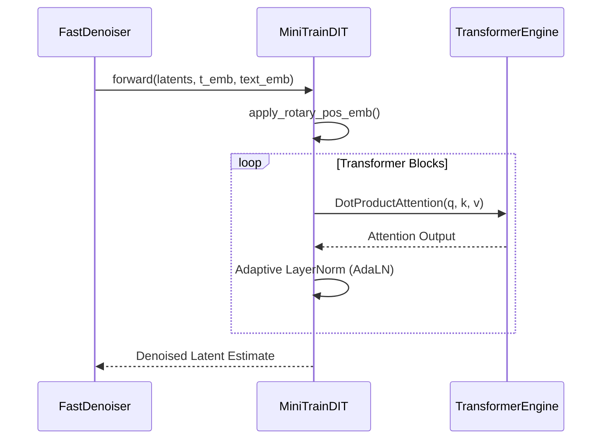
**Sources:** [src/model/text2image_dit.py:62-98](), [src/model/pipeline.py:191-209]()

---

## 3. Rectified Flow Scaling

The `RectifiedFlowScaling` class in `src/model/denoiser_scaling.py` implements the mathematical framework for Rectified Flow (RF) models.

### Preconditioning Scalars
The class calculates four key coefficients based on the current noise level `sigma` [src/model/denoiser_scaling.py:36-42]():

| Coefficient | Formula | Role |
| :--- | :--- | :--- |
| `c_skip` | $1.0 - t$ | Determines how much of the input is preserved. |
| `c_out` | $-t$ | Scales the network output for the update. |
| `c_in` | $1.0 - t$ | Scales the input latent before the DiT. |
| `c_noise` | $t \times \text{scaling\_factor}$ | Scales the timestep embedding. |

*Where $t = \frac{\sigma}{\sigma + 1}$* [src/model/denoiser_scaling.py:37]().

### Loss Weighting
The `sigma_loss_weights` function provides the weighting for the training objective.
*   **Uniform Weighting**: Returns $(1.0 + \sigma)^2 / \sigma^2$ [src/model/denoiser_scaling.py:46-47]().
*   **Non-Uniform Weighting**: Uses a pre-computed Gaussian-like shift to prioritize specific noise levels during training [src/model/denoiser_scaling.py:27-33]().

**Sources:** [src/model/denoiser_scaling.py:22-55]()

---

## 4. VAE Custom Forward Patches

To support the specialized Pix2Pix-Turbo architecture, the VAE encoder and decoder forward passes are modified in `src/model/__init__.py`.

*   **Encoder Patch (`my_vae_encoder_fwd`)**: Captures intermediate activations (`current_down_blocks`) during the encoding process [src/model/__init__.py:55-68]().
*   **Decoder Patch (`my_vae_decoder_fwd`)**: Injects these captured activations back into the decoder via `skip_convs` if `skip_connection` is enabled. This allows the model to bypass the latent bottleneck for high-resolution image structure preservation [src/model/__init__.py:71-95]().

**Sources:** [src/model/__init__.py:55-95]()

---

# Page: Cosmos-Predict2 Integration & Patches

# Cosmos-Predict2 Integration & Patches

<details>
<summary>Relevant source files</summary>

The following files were used as context for generating this wiki page:

- [Dockerfile.cosmos](Dockerfile.cosmos)
- [text2image_dit.patch](text2image_dit.patch)
- [tokenizer.patch](tokenizer.patch)

</details>


Harmonizer leverages the **Cosmos-Predict2** library as its foundation for high-fidelity image and video synthesis. To adapt this upstream library for the specific needs of the Harmonizer training pipeline—specifically to support gradient-based fine-tuning and to maintain compatibility with modern NVIDIA software stacks—two critical patches are applied during the environment setup.

## Integration Overview

Harmonizer integrates `cosmos-predict2` (version 1.0.9) to provide the VAE (Video Autoencoder) and DiT (Diffusion Transformer) backbones. The integration is managed via the `Dockerfile.cosmos` environment, which installs the library and immediately applies source-level patches to the installed site-packages.

| Component | Upstream Entity | Harmonizer Usage |
| :--- | :--- | :--- |
| **Tokenizer** | `cosmos_predict2.tokenizers.tokenizer` | VAE Encoding/Decoding of image/video frames. |
| **DiT** | `cosmos_predict2.models.text2image_dit` | Core Transformer backbone for denoising. |

**Sources:**
* [Dockerfile.cosmos:64-70]()

---

## Patch 1: Gradient Flow in Tokenizers (`tokenizer.patch`)

The upstream `cosmos-predict2` tokenizer implementation explicitly disables gradient calculation using the `@torch.no_grad()` decorator on its `encode` and `decode` methods. While this is efficient for pure inference, Harmonizer requires gradients to flow through the VAE during specific training regimes or when calculating structural losses (like DINO or LPIPS) that may involve the reconstructed manifold.

### Implementation Details
The `tokenizer.patch` file removes the `@torch.no_grad()` decorators from the following classes in `cosmos_predict2/tokenizers/tokenizer.py`:
1.  **Video Tokenizer**: Affects `encode` and `decode` methods [tokenizer.patch:9-17]().
2.  **Image Tokenizer**: Affects `encode` and `decode` methods [tokenizer.patch:25-34]().

### Data Flow Impact
The following diagram illustrates how removing these decorators enables the backpropagation path required by the Harmonizer training utilities.

**Tokenizer Gradient Flow Path**
```mermaid
graph TD
    subgraph "Natural Language Space"
        UserConfig["Training Configuration"]
    end

    subgraph "Code Entity Space"
        InputImage["Input Tensors (B, C, T, H, W)"]
        VAE_Enc["cosmos_predict2.tokenizers.tokenizer.encode"]
        Latent["Latent Space (Z)"]
        VAE_Dec["cosmos_predict2.tokenizers.tokenizer.decode"]
        LossFunc["Loss Functions (L2/LPIPS)"]
        
        InputImage --> VAE_Enc
        VAE_Enc --> Latent
        Latent --> VAE_Dec
        VAE_Dec --> LossFunc
        
        LossFunc -. "Gradient Flow (Enabled by Patch)" .-> VAE_Dec
        VAE_Dec -. "Gradient Flow (Enabled by Patch)" .-> Latent
        Latent -. "Gradient Flow (Enabled by Patch)" .-> VAE_Enc
    end
```

**Sources:**
* [tokenizer.patch:1-37]()
* [Dockerfile.cosmos:69-69]()

---

## Patch 2: Transformer Engine Compatibility (`text2image_dit.patch`)

The `text2image_dit.patch` addresses a breaking change in the NVIDIA `transformer_engine` library. Upstream `cosmos-predict2` assumes a specific import path for Rotary Positional Embeddings (RoPE), which changed in `transformer_engine` version 2.4.0.

### Technical Problem
In older versions of `transformer_engine`, `apply_rotary_pos_emb` was located directly under `transformer_engine.pytorch.attention`. In version 2.4.0 and later, this function was moved to `transformer_engine.pytorch.attention.rope`.

### Patch Logic
The patch introduces a version check using `packaging.version.Version` to dynamically resolve the import path, ensuring Harmonizer can run on both older and newer `transformer_engine` environments.

```python
# Logic introduced by text2image_dit.patch
if Version(te.__version__) >= Version("2.4.0"):
    from transformer_engine.pytorch.attention.rope import apply_rotary_pos_emb
else:
    from transformer_engine.pytorch.attention import apply_rotary_pos_emb
```

**Sources:**
* [text2image_dit.patch:9-22]()
* [Dockerfile.cosmos:70-70]()

---

## Environment Integration Flow

The integration process is automated within the `Dockerfile.cosmos` build sequence. This ensures that every developer and training node operates on a consistent, patched version of the dependencies.

**System Integration & Patching Sequence**
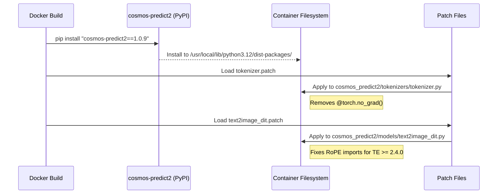

### Summary of Patched Files

| Target File Path | Purpose of Patch |
| :--- | :--- |
| `cosmos_predict2/tokenizers/tokenizer.py` | Enables gradient flow by removing `no_grad` decorators. |
| `cosmos_predict2/models/text2image_dit.py` | Fixes `transformer_engine` compatibility for RoPE embeddings. |

**Sources:**
* [Dockerfile.cosmos:59-71]()
* [tokenizer.patch:3-4]()
* [text2image_dit.patch:3-4]()

---

# Page: Training Pipeline

# Training Pipeline

<details>
<summary>Relevant source files</summary>

The following files were used as context for generating this wiki page:

- [src/train_pix2pix_turbo_harmonizer.py](src/train_pix2pix_turbo_harmonizer.py)
- [src/train_pix2pix_turbo_nocond_cosmos_base_faster_tokenizer.py](src/train_pix2pix_turbo_nocond_cosmos_base_faster_tokenizer.py)

</details>


The Harmonizer training pipeline is designed to transform the **Cosmos-Predict2** foundation model into a high-fidelity image and video harmonization engine using the **Pix2Pix-Turbo** paradigm. The workflow encompasses multi-source data loading, a complex multi-modal loss objective (including GAN, perceptual, and temporal losses), and a distributed multi-GPU execution environment.

### Training Workflow Overview

The training process is orchestrated by `src/train_pix2pix_turbo_harmonizer.py`, which manages the initialization of the `Pix2Pix_Turbo` model, the setup of discriminators for GAN training, and the optimization loop.

The following diagram illustrates the high-level flow from data ingestion to checkpoint generation:

**Harmonizer Training Flow**
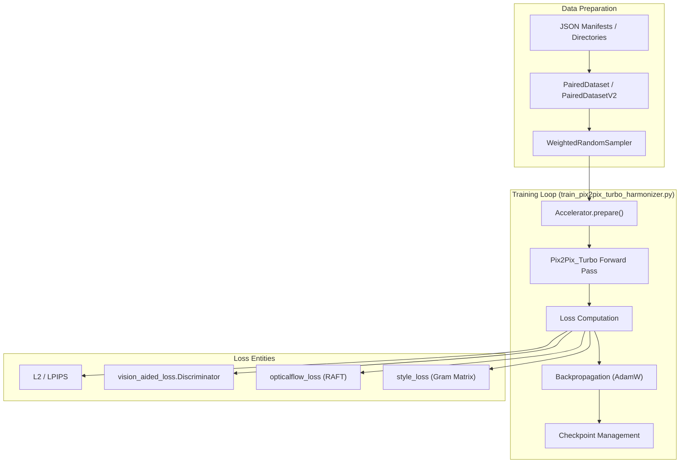
Sources: [src/train_pix2pix_turbo_harmonizer.py:48-101](), [src/train_pix2pix_turbo_harmonizer.py:119-146]()

---

### Data Curation & Dataset Preparation
The pipeline supports training on a mixture of datasets to ensure robustness across various harmonization tasks (Relighting, PBR Shadow Simulation, etc.). Data is loaded via `PairedDataset` or `PairedDatasetV2` classes defined in `training_utils.py`. 

*   **Multi-Source Loading**: The script parses comma-separated paths from the `--dataset_folder` argument [src/train_pix2pix_turbo_harmonizer.py:50-51]().
*   **Weighted Sampling**: A `WeightedRandomSampler` is used to balance different data sources (e.g., synthetic vs. real-world data) based on the `fixing_data_weight` parameter [src/train_pix2pix_turbo_harmonizer.py:202-211]().

For details on the five data sources and NuRec curation methods, see **[Data Curation & Dataset Preparation](#3.1)**.

Sources: [src/train_pix2pix_turbo_harmonizer.py:48-65](), [src/utils/training_utils.py:1-44]()

---

### Loss Functions & Training Utilities
Harmonizer employs a hybrid loss function to ensure structural integrity, color consistency, and temporal stability.

| Loss Category | Implementation / Class | Purpose |
| :--- | :--- | :--- |
| **Perceptual** | `lpips.LPIPS(net="vgg")` | Maintains high-level visual features [src/train_pix2pix_turbo_harmonizer.py:134](). |
| **Adversarial** | `vision_aided_loss.Discriminator` | Vision-aided GAN loss using CLIP-based features [src/train_pix2pix_turbo_harmonizer.py:123](). |
| **Temporal** | `get_temporal_loss` | Uses RAFT optical flow to ensure consistency across video frames [src/train_pix2pix_turbo_harmonizer.py:36](). |
| **Structural** | `DinoStructureLoss` | Preserves the geometry of the foreground object. |
| **Style** | `style_loss` | Gram-matrix based loss for texture matching [src/utils/style_loss.py:1-42](). |

For details on loss weights and implementation, see **[Loss Functions & Training Utilities](#3.2)**.

Sources: [src/train_pix2pix_turbo_harmonizer.py:116-146](), [src/opticalflow_loss.py:1-36]()

---

### Multi-GPU Training Configuration
The pipeline utilizes the `accelerate` library to handle distributed training across multiple GPUs, supporting `bf16` mixed precision and gradient checkpointing to manage memory on large Cosmos-Predict2 backbones.

**System-to-Code Mapping: Distributed Training**
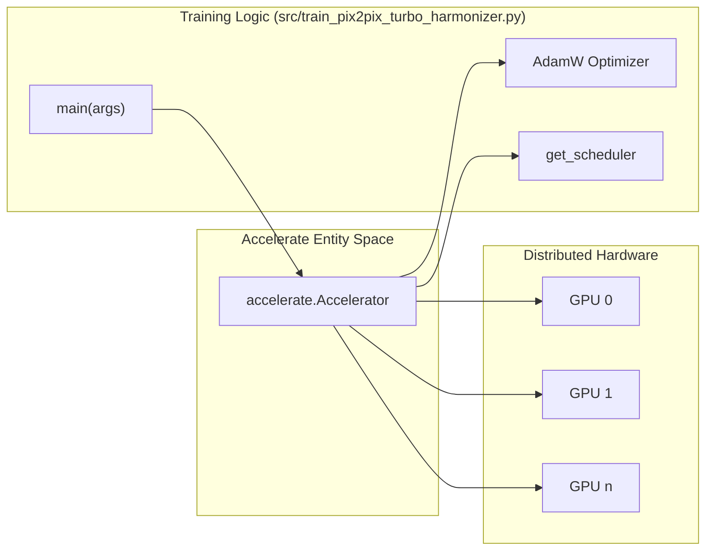
Sources: [src/train_pix2pix_turbo_harmonizer.py:68-81](), [src/train_pix2pix_turbo_harmonizer.py:159-193]()

Key configuration aspects include:
*   **Mixed Precision**: Configurable via `--mixed_precision` (typically `bf16`) [src/train_pix2pix_turbo_harmonizer.py:71]().
*   **Checkpointing**: Models are saved as `.pkl` files containing both the `net_pix2pix` state and discriminator/optimizer states for seamless resumption [src/train_pix2pix_turbo_harmonizer.py:40]().
*   **Gradient Checkpointing**: Enabled via `net_pix2pix.unet.enable_gradient_checkpointing()` to reduce VRAM footprint during the backward pass [src/train_pix2pix_turbo_harmonizer.py:111]().

For details on launching training and hyperparameter tuning, see **[Multi-GPU Training Configuration](#3.3)**.

Sources: [src/train_pix2pix_turbo_harmonizer.py:110-112](), [src/train_pix2pix_turbo_harmonizer.py:174-188]()

---

# Page: Data Curation & Dataset Preparation

# Data Curation & Dataset Preparation

<details>
<summary>Relevant source files</summary>

The following files were used as context for generating this wiki page:

- [assets/cr_000289.png](assets/cr_000289.png)
- [assets/cr_gt_000289.png](assets/cr_gt_000289.png)
- [assets/sp_000016.png](assets/sp_000016.png)
- [assets/sp_gt_000016.png](assets/sp_gt_000016.png)
- [assets/uf_000006.png](assets/uf_000006.png)
- [assets/uf_gt_000006.png](assets/uf_gt_000006.png)
- [doc/dataset_preparation_tutorial.md](doc/dataset_preparation_tutorial.md)
- [doc/test_dataset_preparation_tutorial.md](doc/test_dataset_preparation_tutorial.md)

</details>


This page documents the methodologies for curating training data and preparing datasets for the Harmonizer model. The preparation pipeline bridges the gap between synthetic/degraded renders and high-fidelity ground truth (GT) images, leveraging both traditional image processing simulations and advanced neural reconstruction (NuRec) techniques.

## Purpose and Scope

The goal of data preparation is to create paired training data $(I_{input}, I_{target})$ where $I_{input}$ contains artifacts, lighting inconsistencies, or rendering degradations, and $I_{target}$ represents the clean ground truth. This diversity allows the model to learn a robust mapping for various harmonization tasks, including relighting, artifact correction, and asset re-insertion.

## Data Sources & Simulation Methods

Harmonizer utilizes five primary data sources to ensure generalization across different visual domains.

### 1. ISP Modification
Simulates variations in Image Signal Processing (ISP) pipelines. This involves altering color balance, tone mapping, and sensor noise characteristics to train the model to harmonize frames across different camera sensors or ISP settings.

### 2. Relighting
Pairs images of the same scene under different lighting conditions. This helps the model learn to adjust the global and local illumination of inserted assets to match the target environment.

### 3. Asset Re-insertion
Involves removing an object from a scene and re-inserting it using a different rendering engine or lighting setup. The model learns to correct the boundaries and shading of the re-inserted asset.

### 4. PBR Shadow Simulation
Physically Based Rendering (PBR) is used to generate realistic shadows for synthetic objects. Training on these pairs allows the model to hallucinate missing shadows or correct physically inaccurate ones in lower-quality renders.

### 5. Artifacts Correction
Focuses on removing compression artifacts, aliasing, and neural reconstruction "floaters." This is particularly relevant when harmonizing outputs from neural rendering pipelines.

**Sources:** [doc/dataset_preparation_tutorial.md:3-9]()

---

## NuRec-based Curation Methods

For high-fidelity neural reconstruction, Harmonizer employs four specific methods using the **NuRec** framework. These methods generate paired data by intentionally introducing degradations into the reconstruction process.

### Method Comparison

| Method | Description | Primary Use Case |
| :--- | :--- | :--- |
| **Sparse Reconstruction** | Train with every $n$-th frame; pair remaining GT with rendered "novel" views. | Temporal interpolation & view synthesis artifacts. |
| **Model Underfitting** | Train for 25%-75% of the full schedule. | General reconstruction blur and texture loss. |
| **Cross Reference** | Train on one camera; render from held-out camera views. | Multi-view consistency and perspective artifacts. |
| **Cycle Reconstruction** | Use a cycle-consistency loop to refine reconstruction. | High-fidelity texture refinement. |

**Sources:** [doc/dataset_preparation_tutorial.md:3-10](), [doc/dataset_preparation_tutorial.md:12-15](), [doc/dataset_preparation_tutorial.md:41-42](), [doc/dataset_preparation_tutorial.md:55-56]()

### Data Curation Flow (Natural Language to Code)

The following diagram illustrates how curation strategies defined in documentation map to the execution environment (NuRec/NRE) and the resulting data consumed by the `PairedDataset` class.

**Diagram: Data Curation Mapping**
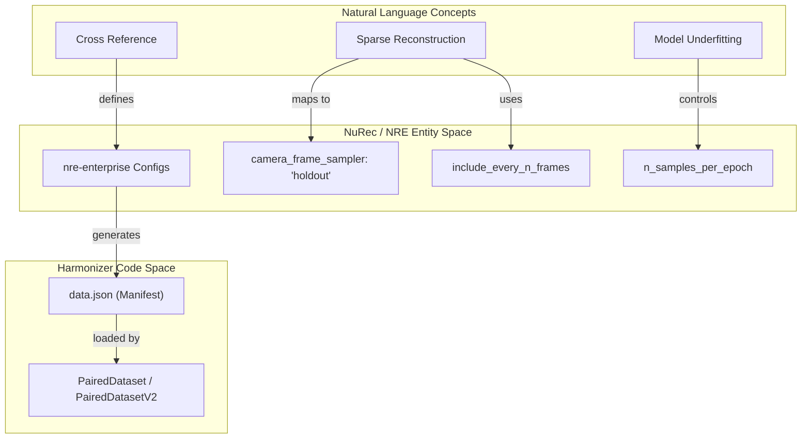
**Sources:** [doc/dataset_preparation_tutorial.md:19-32](), [doc/dataset_preparation_tutorial.md:45-49](), [doc/dataset_preparation_tutorial.md:59-66]()

---

## JSON Manifest Format

Training pairs are organized via a JSON manifest. This manifest is consumed by the training utilities to load image pairs and their corresponding metadata.

### Format Structure
```json
[
  {
    "render": "path/to/degraded_image_01.png",
    "gt": "path/to/ground_truth_01.png",
    "scene_id": "scene_001",
    "camera_id": "camera_front"
  },
  {
    "render": "path/to/degraded_image_02.png",
    "gt": "path/to/ground_truth_02.png",
    "scene_id": "scene_001",
    "camera_id": "camera_front"
  }
]
```

The manifest allows the `WeightedRandomSampler` to balance data across different simulation types (e.g., giving more weight to "fixing" data vs. standard reconstruction).

**Sources:** [doc/dataset_preparation_tutorial.md:20](), [doc/test_dataset_preparation_tutorial.md:34-40]()

---

## Test Dataset Preparation

The test dataset requires a strict hierarchical structure to enable automated evaluation of metrics like PSNR, LPIPS, and FID.

### Directory Structure
The evaluation script `evaluate_test_dataset.py` expects the following layout:
```text
test_dataset/
├── {scene_id}/
│   ├── render/
│   │   └── {camera_id}/
│   │       └── {timestamp}.png
│   └── gt/
│       └── {camera_id}/
│           └── {timestamp}.png
```

### Key Requirements
1.  **Matching Structure:** The `render/` and `gt/` folders must be identical in sub-directory naming.
2.  **Filename Alignment:** Files must share the exact same name (e.g., `{timestamp}.png`) to be paired during metric calculation.
3.  **Resolution:** Images are automatically resized during evaluation, though consistent aspect ratios are recommended.

**Sources:** [doc/test_dataset_preparation_tutorial.md:7-32](), [doc/test_dataset_preparation_tutorial.md:42-48]()

---

## Implementation Details: Data Loading

The relationship between the curated files and the training logic is handled by the `PairedDataset` class.

**Diagram: Training Data Flow**
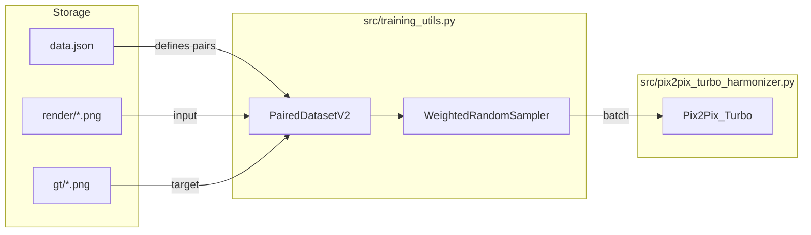

### Key Logic
*   **`PairedDatasetV2`**: Handles the loading of image pairs from the manifest. It applies transformations and ensures that the input and target are spatially aligned.
*   **`WeightedRandomSampler`**: Used in the training script to handle imbalanced data sources, ensuring the model sees enough "Artifact Correction" samples compared to easier "ISP Modification" samples.

**Sources:** [doc/test_dataset_preparation_tutorial.md:74-78](), [doc/dataset_preparation_tutorial.md:19-21]()

---

# Page: Loss Functions & Training Utilities

# Loss Functions & Training Utilities

<details>
<summary>Relevant source files</summary>

The following files were used as context for generating this wiki page:

- [src/opticalflow_loss.py](src/opticalflow_loss.py)
- [src/utils/__init__.py](src/utils/__init__.py)
- [src/utils/dino_struct.py](src/utils/dino_struct.py)
- [src/utils/style_loss.py](src/utils/style_loss.py)
- [src/utils/training_utils.py](src/utils/training_utils.py)

</details>


This page documents the loss components and data utilities used to train the Harmonizer model. The training pipeline utilizes a multi-objective loss strategy combining reconstruction, perceptual, adversarial, structural, and temporal constraints to ensure high-fidelity image harmonization.

## Loss Function Components

Harmonizer employs a hybrid loss function to optimize the Pix2Pix-Turbo architecture. The total loss is a weighted sum of several components, controlled by hyperparameters defined in the training configuration.

### Reconstruction and Perceptual Losses
*   **L2 Loss**: Measures the pixel-wise mean squared error between the predicted harmonized frame and the ground truth.
*   **LPIPS Loss**: A perceptual loss that uses deep features to ensure the output is visually similar to the target beyond pixel-level alignment.
*   **GAN Loss**: Vision-aided adversarial loss using a discriminator (typically `vagan_clip`) to improve realism [src/utils/training_utils.py:37-39]().

### Style and Structural Losses
*   **Gram/Style Loss**: Implemented in `src/utils/style_loss.py`, this calculates the correlation between feature maps of a VGG network to match the style of the target image [src/utils/style_loss.py:65-89]().
*   **DINO Structural Loss**: Implemented in `src/utils/dino_struct.py`, this uses a Vision Transformer (ViT) from the DINO framework to extract self-similarity matrices. It ensures that the spatial structure of the input is preserved in the harmonized output [src/utils/dino_struct.py:29-104]().

### Temporal Loss (Optical Flow)
To ensure temporal consistency in video sequences, Harmonizer uses an optical-flow-based loss. It employs the **RAFT** (Recurrent All-Pairs Field-Iterative Network) model to compute backward flow between frames and penalizes discrepancies in warped coordinates.

*   **RAFT Integration**: The `TorchvisionRAFT` class wraps the `torchvision` implementation of RAFT [src/opticalflow_loss.py:46-65]().
*   **Warping**: The `warp_backward` function uses the backward flow $F_{t \to t-1}$ to warp the source at $t-1$ into $t$ coordinates [src/opticalflow_loss.py:24-34]().
*   **Charbonnier Loss**: A robust loss function used to compare the warped frame with the target, defined as $\sqrt{x^2 + \epsilon^2}$ [src/opticalflow_loss.py:37-43]().

**Temporal Loss Data Flow**
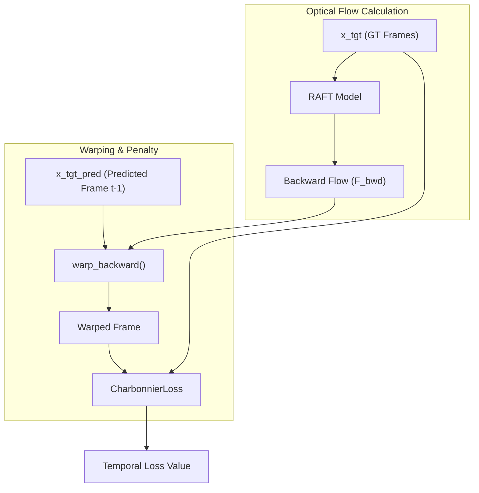
Sources: [src/opticalflow_loss.py:78-114](), [src/utils/style_loss.py:65-89](), [src/utils/dino_struct.py:29-104]()

---

## Training Utilities

The training process is supported by specialized dataset classes and argument parsers found in `src/utils/training_utils.py`.

### Dataset Classes
The repository provides two primary dataset implementations for paired training:
1.  **PairedDataset**: Standard implementation for loading pairs of (source, target) images.
2.  **PairedDatasetV2**: An optimized version for large-scale training.

### Sampling and Weighting
*   **WeightedRandomSampler**: Used to handle data imbalance across different harmonization tasks (e.g., relighting vs. artifact correction).
*   **Fixing Data Weight**: The training utility allows prioritizing specific data types via the `--fixing_data_weight` argument during argument parsing [src/utils/training_utils.py:180-184]().

### Argument Parsing
The function `parse_args_paired_training` defines the command-line interface for the training script, covering loss weights, model architecture (LoRA ranks), and training hyperparameters.

| Argument | Default | Description |
| :--- | :--- | :--- |
| `--lambda_l2` | 1.0 | Weight for pixel-wise L2 loss [src/utils/training_utils.py:42]() |
| `--lambda_lpips` | 5.0 | Weight for LPIPS perceptual loss [src/utils/training_utils.py:40]() |
| `--lambda_gan` | 0.5 | Weight for adversarial loss [src/utils/training_utils.py:39]() |
| `--lambda_gram` | 1.0 | Weight for style loss [src/utils/training_utils.py:44]() |
| `--lambda_opticalflow` | 0.0 | Weight for temporal consistency loss [src/utils/training_utils.py:46]() |
| `--lora_rank_unet` | 8 | Rank for U-Net LoRA adapters [src/utils/training_utils.py:83]() |

Sources: [src/utils/training_utils.py:27-184]()

---

## Code Entity Mapping

The following diagram bridges the mathematical loss concepts to their specific class and function implementations within the codebase.

**Loss Entity Relationship**
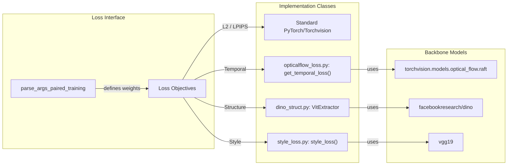

**Training Data Utilities**
```mermaid
graph TD
    subgraph "Data Loading Flow"
        J["JSON Manifest"] --> K["PairedDataset / PairedDatasetV2"]
        K --> L["WeightedRandomSampler"]
        L --> M["DataLoader"]
    end
    subgraph "Configuration"
        N["parse_args_paired_training"] --> O["Training Hyperparameters"]
        O --> M
    end
```
Sources: [src/utils/training_utils.py:27-50](), [src/opticalflow_loss.py:46-55](), [src/utils/dino_struct.py:38-40]()

---

# Page: Multi-GPU Training Configuration

# Multi-GPU Training Configuration

<details>
<summary>Relevant source files</summary>

The following files were used as context for generating this wiki page:

- [src/train_pix2pix_turbo_harmonizer.py](src/train_pix2pix_turbo_harmonizer.py)
- [src/utils/profiling.py](src/utils/profiling.py)

</details>


This page details the multi-GPU training infrastructure for Harmonizer, built upon the Hugging Face `accelerate` library. It covers the launch configuration, hardware optimization techniques (mixed precision, gradient checkpointing), and the hyperparameters required to fine-tune the Pix2Pix-Turbo architecture for high-fidelity image harmonization.

## Training Launch & Infrastructure

Harmonizer utilizes the `accelerate` library to manage distributed training across multiple GPUs. The training process is orchestrated in `src/train_pix2pix_turbo_harmonizer.py`, which handles device placement, gradient synchronization, and mixed-precision execution.

### Accelerate Initialization
The `Accelerator` object is initialized at the start of the `main` function [src/train_pix2pix_turbo_harmonizer.py:69-73](). It configures:
*   **Mixed Precision**: Typically `bf16` or `fp16` to reduce memory footprint and increase throughput.
*   **Gradient Accumulation**: Controlled via `--gradient_accumulation_steps` to simulate larger batch sizes on limited VRAM [src/train_pix2pix_turbo_harmonizer.py:70]().
*   **Logging**: Integration with Weights & Biases (WandB) for experiment tracking [src/train_pix2pix_turbo_harmonizer.py:72]().

### Hardware Optimizations
To handle the memory-intensive Cosmos-Predict2 backbone, several optimizations are available:
*   **xFormers**: Memory-efficient attention can be enabled for the U-Net component [src/train_pix2pix_turbo_harmonizer.py:103-108]().
*   **Gradient Checkpointing**: Enabled via `net_pix2pix.unet.enable_gradient_checkpointing()` to trade compute for memory during the backward pass [src/train_pix2pix_turbo_harmonizer.py:110-111]().
*   **TF32**: Enabled on Ampere and later architectures to accelerate matrix multiplications [src/train_pix2pix_turbo_harmonizer.py:113-114]().

**Sources:** [src/train_pix2pix_turbo_harmonizer.py:69-114]()

## System Architecture: Training Data Flow

The following diagram illustrates how the training script bridges high-level configuration to the core model entities and loss functions.

### Training Loop Entity Mapping
"Training Data Flow and Entity Mapping"
```mermaid
graph TD
    subgraph "Natural Language Space"
        A["Training Config"]
        B["Multi-Dataset Loading"]
        C["Optimization Step"]
    end

    subgraph "Code Entity Space (src)"
        A --> ARGS["parse_args_paired_training()"]
        ARGS --> ACC["accelerate.Accelerator"]
        
        B --> PDV2["PairedDatasetV2"]
        PDV2 --> WRS["WeightedRandomSampler"]
        
        C --> P2P["Pix2Pix_Turbo"]
        P2P --> OPT["torch.optim.AdamW"]
        
        subgraph "Loss Components"
            P2P --> LPIPS["lpips.LPIPS"]
            P2P --> RAFT["get_temporal_loss (RAFT)"]
            P2P --> GAN["vision_aided_loss.Discriminator"]
        end
    end

    ACC -- "prepares" --> OPT
    WRS -- "feeds" --> P2P
```
**Sources:** [src/train_pix2pix_turbo_harmonizer.py:36-43](), [src/train_pix2pix_turbo_harmonizer.py:69-101](), [src/train_pix2pix_turbo_harmonizer.py:119-141]()

## Key Hyperparameters

Training behavior is governed by several critical hyperparameters passed via `parse_args_paired_training` [src/utils/training_utils.py]().

| Hyperparameter | Purpose | Implementation Reference |
| :--- | :--- | :--- |
| `learning_rate` | Base LR for AdamW optimizer (typically 5e-5). | [src/train_pix2pix_turbo_harmonizer.py:161]() |
| `timestep` | The specific ODE/SDE timestep used for the 1-step Turbo distillation. | [src/train_pix2pix_turbo_harmonizer.py:95]() |
| `resolution` | Target image size (e.g., 512, 1024). Handled via `image_prep`. | [src/train_pix2pix_turbo_harmonizer.py:57-61]() |
| `fixing_data_weight` | Weighting factor for specific data sources in the `WeightedRandomSampler`. | [src/train_pix2pix_turbo_harmonizer.py:199-204] (implied in sampler logic) |
| `lambda_gan` | Weight for the Vision-Aided GAN loss. | [src/train_pix2pix_turbo_harmonizer.py:116]() |
| `lambda_lpips` | Weight for the LPIPS perceptual loss. | [src/train_pix2pix_turbo_harmonizer.py:246]() |

**Sources:** [src/train_pix2pix_turbo_harmonizer.py:159-190](), [src/utils/training_utils.py:1-50]()

## Resuming and Fine-tuning

The script supports resuming from a previous state or fine-tuning a pretrained Harmonizer checkpoint.

### Loading Checkpoints
The `Pix2Pix_Turbo` class constructor accepts a `pretrained_path` [src/train_pix2pix_turbo_harmonizer.py:99](). If provided, it loads the state dict using `load_ckpt_from_state_dict` [src/pix2pix_turbo_harmonizer.py:39]().

### Fine-tuning Controls
The script provides granular control over which parts of the model are updated:
*   **Full U-Net Training**: Enabled via `--train_full_unet`. If false, only the added adapter layers are trained [src/train_pix2pix_turbo_harmonizer.py:148-150]().
*   **VAE Freezing**: The VAE can be completely frozen (`--freeze_vae`) or only the encoder can be frozen (`--freeze_vae_encoder`), allowing the decoder to adapt to harmonization artifacts [src/train_pix2pix_turbo_harmonizer.py:92-93, 151-157]().

### Checkpoint Saving
Checkpoints are saved periodically using `save_ckpt`, which packages the U-Net, VAE, and any trainable projections into a single `.pt` file [src/train_pix2pix_turbo_harmonizer.py:40, 318-322]().

**Sources:** [src/train_pix2pix_turbo_harmonizer.py:89-101](), [src/train_pix2pix_turbo_harmonizer.py:147-157]()

## Multi-Dataset & Weighted Sampling

Harmonizer often trains on a mixture of datasets (e.g., ISP modification and shadow simulation). The script supports comma-separated paths in `--dataset_folder` [src/train_pix2pix_turbo_harmonizer.py:50-52]().

### Dataset Selection Logic
"Dataset and Sampler Initialization"
```mermaid
graph TD
    START["--dataset_folder (CSV)"] --> SPLIT["Split by Comma"]
    SPLIT --> LOOP["For each source"]
    LOOP --> CHECK{".json in path?"}
    CHECK -- "Yes" --> P2V2["PairedDatasetV2 (JSON Manifest)"]
    CHECK -- "No" --> P2V1["PairedDataset (Directory Style)"]
    P2V2 --> LIST["Append to train_list"]
    P2V1 --> LIST
    LIST --> WRS["WeightedRandomSampler"]
    WRS --> DL["DataLoader"]
```

The `WeightedRandomSampler` ensures that the model sees a balanced distribution of different harmonization tasks, even if the raw file counts differ significantly between sources [src/train_pix2pix_turbo_harmonizer.py:196-210]().

**Sources:** [src/train_pix2pix_turbo_harmonizer.py:48-65](), [src/utils/training_utils.py:10-40]()

## WandB Logging
Logging is integrated via the `accelerate` tracker. The script logs:
*   **Scalar Metrics**: L2 loss, LPIPS loss, GAN loss, and learning rate [src/train_pix2pix_turbo_harmonizer.py:270-285]().
*   **Image Visualizations**: Periodically, the script performs validation and uploads a grid of "Input | Output | Ground Truth" images to WandB to monitor visual progress [src/train_pix2pix_turbo_harmonizer.py:290-310]().

**Sources:** [src/train_pix2pix_turbo_harmonizer.py:69-73](), [src/train_pix2pix_turbo_harmonizer.py:275-315]()

---

# Page: Inference

# Inference

<details>
<summary>Relevant source files</summary>

The following files were used as context for generating this wiki page:

- [src/inference_exported_model.py](src/inference_exported_model.py)
- [src/inference_pix2pix_turbo_harmonizer.py](src/inference_pix2pix_turbo_harmonizer.py)
- [src/inference_pretrained_model.py](src/inference_pretrained_model.py)

</details>


The Harmonizer repository provides three distinct inference paths designed for different use cases: autoregressive temporal video processing, high-performance TensorRT-accelerated deployment, and standardized metric evaluation. 

All inference modes utilize the `Pix2Pix_Turbo` architecture, which leverages a single-step diffusion paradigm for image-to-image translation.

### Inference Pathways Overview

The following diagram illustrates the relationship between the different inference scripts and the underlying code entities they utilize.

**Inference Architecture & Code Entity Map**
```mermaid
graph TD
    subgraph "Entry Points"
        A["inference_pix2pix_turbo_harmonizer.py"]
        B["inference_pretrained_model.py"]
        C["evaluate_test_dataset.py"]
    end

    subgraph "Core Logic (Code Entity Space)"
        D["Pix2Pix_Turbo Class<br/>(pix2pix_turbo_harmonizer.py)"]
        E["torch_tensorrt.compile()"]
        F["Metrics: PSNR, LPIPS, FID<br/>(evaluate_test_dataset.py)"]
    end

    subgraph "Output Formats"
        G["Video (.mp4)"]
        H["Serialized TRT Engine"]
        I["metrics.yaml"]
    end

    A --> D
    B --> E
    C --> F
    A --> G
    B --> H
    C --> I
```
Sources: [src/inference_pix2pix_turbo_harmonizer.py:1-14](), [src/inference_pretrained_model.py:10-21](), [src/inference_exported_model.py:38-56]()

---

### 4.1 Temporal Inference with the Pretrained Harmonizer
The primary script for processing image sequences or videos is `inference_pix2pix_turbo_harmonizer.py`. It implements **autoregressive temporal conditioning**, where the model exploits temporal context by receiving the current frame alongside previously predicted frames.

- **Autoregressive Mechanism**: Frames are fed into the model with an `offset_list` (defaulting to `[-1, -2, -3, -4]`) representing indices of past predictions [src/inference_pix2pix_turbo_harmonizer.py:78-83]().
- **Resolution Mapping**: Supports specific aspect ratios (e.g., 1024x576) via a `RESOLUTION_MAP` to ensure compatibility with the underlying DiT backbone [src/inference_pix2pix_turbo_harmonizer.py:50-54]().
- **Fallback Mode**: If insufficient history exists (e.g., at the start of a video), the script falls back to a non-temporal pass where the temporal dimension $V=1$ [src/inference_pix2pix_turbo_harmonizer.py:133-141]().

For details, see [Temporal Inference with the Pretrained Harmonizer](#4.1).

Sources: [src/inference_pix2pix_turbo_harmonizer.py:9-14](), [src/inference_pix2pix_turbo_harmonizer.py:112-115]()

---

### 4.2 TensorRT-Accelerated Inference
For production environments requiring low latency, Harmonizer supports acceleration via **NVIDIA TensorRT**. This path is managed by `inference_pretrained_model.py` (for compilation and benchmarking) and `inference_exported_model.py` (for loading pre-compiled engines).

- **Speed Benchmarking**: The pipeline can achieve significant throughput on H100 GPUs, with latencies as low as ~23ms for large batches [src/inference_pretrained_model.py:4-8]().
- **Compilation**: The `load_and_compile_model` function uses `torch_tensorrt` to optimize the UNet/DiT and VAE components for a specific batch size and resolution [src/inference_pretrained_model.py:144-153]().
- **Exported Models**: Compiled models are stored with a `meta.json` file to ensure consistency in `dtype`, `batch_size`, and `image_size` during deployment [src/inference_exported_model.py:70-71](), [src/inference_exported_model.py:105-109]().

For details, see [TensorRT-Accelerated Inference](#4.2).

Sources: [src/inference_pretrained_model.py:109-137](), [src/inference_exported_model.py:59-67]()

---

### 4.3 Evaluation: Metrics & Test Dataset
The `evaluate_test_dataset.py` script provides a standardized way to measure the performance of a Harmonizer checkpoint against a ground-truth dataset.

- **Metrics Suite**: Calculates Peak Signal-to-Noise Ratio (PSNR), Learned Perceptual Image Patch Similarity (LPIPS), and Fréchet Inception Distance (FID).
- **Data Structure**: Expects a specific directory hierarchy containing scenes with subfolders for renders (inputs) and ground truth (GT).
- **Reporting**: Outputs results to a `metrics.yaml` file for easy comparison between different training runs or model iterations.

For details, see [Evaluation: Metrics & Test Dataset](#4.3).

---

### Summary of Inference Modes

| Feature | Temporal Inference | TensorRT Inference | Evaluation Mode |
| :--- | :--- | :--- | :--- |
| **Script** | `inference_pix2pix_turbo_harmonizer.py` | `inference_pretrained_model.py` | `evaluate_test_dataset.py` |
| **Primary Goal** | Temporal consistency in videos | Maximum throughput / Low latency | Quantitative benchmarking |
| **Input** | Image directory / Video frames | Tensors / Batched images | Scene-based test dataset |
| **Key Tech** | Autoregressive conditioning | `torch_tensorrt` compilation | PSNR / LPIPS / FID |

**Data Flow from Input to Optimized Output**
```mermaid
graph LR
    Input["Input Image/Frame"] -- "Preprocess" --> T["Tensor (B, C, V, H, W)"]
    subgraph "Inference Path"
        T --> M["Pix2Pix_Turbo.forward()"]
        M --> TRT["TensorRT Engine (Optional)"]
    end
    TRT --> Out["Harmonized Output"]
    M --> Out
    Out -- "Metric Calculation" --> Eval["metrics.yaml"]
```
Sources: [src/inference_pix2pix_turbo_harmonizer.py:138-144](), [src/inference_exported_model.py:45-56](), [src/inference_pretrained_model.py:77-81]()

---

# Page: Temporal Inference with the Pretrained Harmonizer

# Temporal Inference with the Pretrained Harmonizer

<details>
<summary>Relevant source files</summary>

The following files were used as context for generating this wiki page:

- [examples/0.png](examples/0.png)
- [examples/1.png](examples/1.png)
- [examples/2.png](examples/2.png)
- [src/inference_pix2pix_turbo_harmonizer.py](src/inference_pix2pix_turbo_harmonizer.py)

</details>


The Harmonizer provides a specialized inference script designed for video harmonization and image-to-image translation with temporal consistency. The primary entry point for this functionality is `src/inference_pix2pix_turbo_harmonizer.py`, which implements an autoregressive conditioning strategy to ensure visual stability across frames.

## Purpose and Scope

The temporal inference pipeline is designed to process sequences of images (video frames) by leveraging previously generated outputs as context for the current frame [src/inference_pix2pix_turbo_harmonizer.py:9-14](). It supports:
*   **Autoregressive Conditioning**: Using a sliding window of past predictions to guide the current generation.
*   **Non-temporal Fallback**: Automatically switching to single-frame inference when insufficient history is available.
*   **Resolution Management**: Mapping standard input resolutions to model-compatible aspect ratios.
*   **Video Assembly**: Automated conversion of processed image sequences into `.mp4` files.

## Implementation Details

### Data Flow and Temporal Conditioning
The inference logic uses an autoregressive loop. For each frame in the input directory, the script checks if enough prior frames have been processed to satisfy the `offset_list` requirement [src/inference_pix2pix_turbo_harmonizer.py:133-135]().

1.  **Input Loading**: The current frame is resized according to the `RESOLUTION_MAP` [src/inference_pix2pix_turbo_harmonizer.py:50-54]() and normalized to the range $[-1, 1]$ [src/inference_pix2pix_turbo_harmonizer.py:130-131]().
2.  **Context Selection**: If `have_history` is true, the script retrieves paths from `cond_frame_paths` using the negative indices provided in `--offset_list` (defaulting to `[-1, -2, -3, -4]`) [src/inference_pix2pix_turbo_harmonizer.py:78-83]().
3.  **Tensor Stacking**: The current frame and reference frames are stacked into a 5D tensor of shape $(B, C, V, H, W)$ where $V = 1 + \text{len(offset\_list)}$ [src/inference_pix2pix_turbo_harmonizer.py:136-139]().
4.  **Model Forward**: The `Pix2Pix_Turbo` model processes the video tensor [src/inference_pix2pix_turbo_harmonizer.py:143-144]().
5.  **Output Persistence**: The resulting frame is saved to disk and its path is appended to `cond_frame_paths` for future iterations [src/inference_pix2pix_turbo_harmonizer.py:150-152]().

### Code Entity Space: Inference Logic
The following diagram illustrates the relationship between the command-line arguments and the internal execution flow.

**Inference Execution Map**
```mermaid
graph TD
    subgraph "CLI Space"
        A["--input_image"]
        B["--offset_list"]
        C["--nontemporal"]
        D["--resolution"]
    end

    subgraph "Code Space (inference_pix2pix_turbo_harmonizer.py)"
        E["main()"]
        F["RESOLUTION_MAP"]
        G["load_image_tensor()"]
        H["cond_frame_paths (List)"]
        I["Pix2Pix_Turbo (Class)"]
    end

    A --> E
    D --> F
    E --> G
    B --> H
    C --> E
    E --> I
    H -.->|"autoregressive lookup"| G
```
Sources: [src/inference_pix2pix_turbo_harmonizer.py:50-54](), [src/inference_pix2pix_turbo_harmonizer.py:65-89](), [src/inference_pix2pix_turbo_harmonizer.py:99-108](), [src/inference_pix2pix_turbo_harmonizer.py:123-125]()

## Key Functions and Classes

### Resolution Map
The model requires specific dimensions to maintain performance and aspect ratio consistency. The `RESOLUTION_MAP` defines these targets:
| Target Width | Target Height | Choice Key |
| :--- | :--- | :--- |
| 1024 | 576 | 1024 |
| 960 | 544 | 960 |
| 1360 | 768 | 1360 |

Sources: [src/inference_pix2pix_turbo_harmonizer.py:50-54]()

### Autoregressive Handling
The logic distinguishes between the first few frames of a sequence and the steady-state temporal processing:

**Temporal Transition Logic**
```mermaid
flowchart TD
    Start["Process Frame N"] --> CheckHist{"len(cond_frame_paths) >= min_history?"}
    CheckHist -- "No (Warm-up)" --> Single["V=1 Inference"]
    CheckHist -- "Yes (Temporal)" --> Multi["V=1+len(offset_list) Inference"]
    Single --> Save["Save to cond_frame_paths"]
    Multi --> Save
    Save --> Next["Process Frame N+1"]
```
Sources: [src/inference_pix2pix_turbo_harmonizer.py:133-142]()

### Video Assembly
If the `--save_video` flag is provided, the script invokes `save_folder2video`. This function:
1.  Gathers all processed `.png` and `.jpg` files using `natsorted` [src/inference_pix2pix_turbo_harmonizer.py:34]().
2.  Ensures frame dimensions are even (required by many video codecs) by cropping a single pixel if necessary [src/inference_pix2pix_turbo_harmonizer.py:36-40]().
3.  Writes the final video at 30 FPS using `imageio.v2.mimwrite` [src/inference_pix2pix_turbo_harmonizer.py:41]().

## Usage Examples

### Docker Execution
Inference should be performed within the Harmonizer Docker environment to ensure all dependencies (like `cosmos-predict2`) are correctly patched.

**Standard Temporal Inference**
```bash
docker run --gpus all -v /path/to/data:/data harmonizer_container \
    python src/inference_pix2pix_turbo_harmonizer.py \
    --input_image /data/input_sequence \
    --model_path /data/checkpoints/harmonizer.pkl \
    --resolution 1024 \
    --offset_list -1 -2 -3 -4 \
    --save_video
```

**Non-Temporal (Frame-by-Frame) Mode**
To disable temporal conditioning and process frames in isolation, use the `--nontemporal` flag [src/inference_pix2pix_turbo_harmonizer.py:85-88]().
```bash
docker run --gpus all -v /path/to/data:/data harmonizer_container \
    python src/inference_pix2pix_turbo_harmonizer.py \
    --input_image /data/input_sequence \
    --model_path /data/checkpoints/harmonizer.pkl \
    --nontemporal
```

Sources: [src/inference_pix2pix_turbo_harmonizer.py:65-89](), [src/inference_pix2pix_turbo_harmonizer.py:154-155]()

---

# Page: TensorRT-Accelerated Inference

# TensorRT-Accelerated Inference

<details>
<summary>Relevant source files</summary>

The following files were used as context for generating this wiki page:

- [src/inference_exported_model.py](src/inference_exported_model.py)
- [src/inference_pretrained_model.py](src/inference_pretrained_model.py)
- [src/utils/profiling.py](src/utils/profiling.py)

</details>


This page documents the high-performance inference paths for Harmonizer using **NVIDIA TensorRT**. It covers the compilation of pretrained models into optimized engines, the benchmarking utilities for measuring latency on hardware like the H100, and the handling of exported artifacts for production deployment.

## Overview of Inference Paths

Harmonizer provides two primary scripts for TensorRT-accelerated execution:
1.  **`inference_pretrained_model.py`**: A JIT (Just-In-Time) path that loads a standard PyTorch checkpoint, compiles it using `torch_tensorrt`, and runs benchmarks or image-to-video inference.
2.  **`inference_exported_model.py`**: An AOT (Ahead-Of-Time) path designed to load pre-compiled model packages (e.g., `.pkg.pt` or TorchScript files) and execute them within a unified `FullModel` wrapper.

### Latency Performance (H100)
The following figures represent typical performance on an NVIDIA H100 GPU using half-precision (`float16`/`bfloat16`):
*   **Batch 1**: 38ms
*   **Batch 8**: 24ms per sample
*   **Batch 64**: 23ms per sample

Sources: `[src/inference_pretrained_model.py:4-8]()`

---

## The Compilation Pipeline

The core of the acceleration logic resides in the `load_and_compile_model` function. This function wraps the `Pix2Pix_Turbo` model and utilizes `torch_tensorrt` to optimize the compute graph for a specific batch size and resolution.

### System Flow: Compilation to Execution
The diagram below illustrates how a standard checkpoint is transformed into an optimized engine.

**Pretrained Model Compilation Flow**
```mermaid
graph TD
    subgraph "Natural Language Space"
        UserConfig["User Configuration (Batch, Res, Dtype)"]
    end

    subgraph "Code Entity Space"
        PT["pix2pix_turbo_harmonizer.py: Pix2Pix_Turbo"]
        LCM["inference_pretrained_model.py: load_and_compile_model"]
        TRTC["torch_tensorrt.compile()"]
        MI["inference_pretrained_model.py: model_inference"]
    end

    UserConfig --> LCM
    PT -- "Load Weights" --> LCM
    LCM -- "Trace/Compile" --> TRTC
    TRTC -- "Optimized Module" --> MI
```
Sources: `[src/inference_pretrained_model.py:144-153]()`, `[src/inference_pretrained_model.py:33-33]()`

### Key Functions
*   **`load_and_compile_model`**: Loads the `Pix2Pix_Turbo` model, sets it to evaluation mode, and applies `torch_tensorrt.compile`. It supports dynamic or static shapes based on the `image_size` and `batch_size` arguments.
*   **`warmup_model`**: Executes dummy inference runs (default `n=10`) to ensure the GPU kernels are initialized before benchmarking begins. `[src/inference_pretrained_model.py:84-107]()`
*   **`speed_measure`**: A benchmarking utility that uses `torch.cuda.Event` to measure precise execution time, calculating latency per sample and peak memory usage. `[src/inference_pretrained_model.py:109-193]()`

---

## Exported Model Inference

For production environments where re-compilation at runtime is undesirable, Harmonizer supports loading exported artifacts. The `FullModel` class provides a unified interface for the VAE Encoder, UNet (DiT), and VAE Decoder.

### Model Loading Logic
The `load_exported_model` function performs strict validation to ensure the environment matches the export-time settings.

**Exported Model Components**
```mermaid
graph LR
    subgraph "File System"
        META["meta.json"]
        ENC["encoder.jit"]
        DEC["decoder.jit"]
        UNET["unet.pkg.pt / .pt"]
    end

    subgraph "FullModel Class"
        direction TB
        VAE_E["vae_encoder"]
        DIT["unet (AOTModule)"]
        VAE_D["vae_decoder"]
    end

    META -- "Check Config" --> FullModel
    ENC -- "load_tokenizer_jit" --> VAE_E
    DEC -- "load_tokenizer_jit" --> VAE_D
    UNET -- "load_unet / load_unet_pkg" --> DIT
```
Sources: `[src/inference_exported_model.py:38-57]()`, `[src/inference_exported_model.py:59-116]()`

### Compatibility Checks
The loader verifies several parameters against the `meta.json` file:
*   **TensorRT Version**: Checks the major version of `torch_tensorrt` to prevent serialization errors. `[src/inference_exported_model.py:89-103]()`
*   **Hardware Consistency**: Ensures the target CUDA device index matches the current torch device. `[src/inference_exported_model.py:79-84]()`
*   **Static Shapes**: Validates that `batch_size` and `image_size` match the compiled engine's fixed dimensions. `[src/inference_exported_model.py:106-109]()`

---

## TRT Version Compatibility Shim

To handle variations in `torch_tensorrt` behavior across versions (specifically regarding NVTX profiling and graph breaks), Harmonizer implements a compatibility shim in `src/utils/profiling.py`.

### NVTX Range Decoration
The `NVTXRangeDecorator` allows for profiling specific code blocks in NVIDIA Nsight Systems.
*   **Versions < 2.9.0**: Uses `NullContextDecoratorCompat`, a class-based implementation that avoids `torch.dynamo` graph breaks. `[src/utils/profiling.py:23-49]()`
*   **Versions >= 2.9.0**: Uses a standard `@contextmanager` decorator. `[src/utils/profiling.py:17-20]()`

Sources: `[src/utils/profiling.py:9-14]()`, `[src/utils/profiling.py:53-58]()`

---

## Batch-Size and Resolution Tuning

Inference performance is highly dependent on the input dimensions. The repository provides a standard mapping for video resolutions.

| Resolution (Short Side) | Dimensions (W x H) |
| :--- | :--- |
| 256 | 256 x 144 |
| 512 | 512 x 288 |
| 704 | 704 x 384 |
| 960 | 960 x 544 |
| 1024 | 1024 x 576 |
| 1360 | 1360 x 768 |
| 1920 | 1920 x 1072 |

Sources: `[src/inference_pretrained_model.py:196-210]()`

### Implementation Details
*   **`sample_input_image`**: Generates random noise tensors for benchmarking. `[src/inference_pretrained_model.py:73-74]()`
*   **`save_folder2video`**: After inference, frames are processed (ensuring dimensions are divisible by 2 for FFMPEG compatibility) and compiled into `.mp4` files at 10, 15, and 30 FPS. `[src/inference_pretrained_model.py:48-71]()`

Sources:
- `src/inference_pretrained_model.py`
- `src/inference_exported_model.py`
- `src/utils/profiling.py`

---

# Page: Evaluation: Metrics & Test Dataset

# Evaluation: Metrics & Test Dataset

<details>
<summary>Relevant source files</summary>

The following files were used as context for generating this wiki page:

- [doc/test_dataset_preparation_tutorial.md](doc/test_dataset_preparation_tutorial.md)
- [src/evaluate_test_dataset.py](src/evaluate_test_dataset.py)

</details>


This page documents the evaluation pipeline for the Harmonizer model, centered around the `evaluate_test_dataset.py` script. It covers the quantitative metrics used (PSNR, LPIPS, FID), the required directory structure for test datasets, and the methodology for generating these datasets using NuRec-based techniques.

## Overview of Evaluation Pipeline

The evaluation pipeline is designed to provide a rigorous quantitative assessment of the Harmonizer's ability to restore degraded or mismatched renderings. It leverages standard image quality metrics and benchmarks the model's performance in terms of both visual fidelity and computational efficiency (latency and memory).

### Key Components
- **`evaluate_test_dataset.py`**: The primary execution script that handles model loading, inference on the test set, and metric calculation [src/evaluate_test_dataset.py:42-43]().
- **`torchmetrics` Integration**: Uses standardized implementations for Peak Signal-to-Noise Ratio (PSNR), Learned Perceptual Image Patch Similarity (LPIPS), and Fréchet Inception Distance (FID) [src/evaluate_test_dataset.py:27-28]().
- **Performance Benchmarking**: Includes automated speed measurements and GPU memory tracking using `pynvml` [src/evaluate_test_dataset.py:75-86](), [src/evaluate_test_dataset.py:97-105]().

Sources: [src/evaluate_test_dataset.py:1-125]()

## Metrics and Implementation

The evaluation script calculates three primary metrics to evaluate different aspects of image harmonization:

| Metric | Code Entity | Description |
| :--- | :--- | :--- |
| **PSNR** | `PeakSignalNoiseRatio` | Measures pixel-level accuracy. Higher is better. [src/evaluate_test_dataset.py:122]() |
| **LPIPS** | `LearnedPerceptualImagePatchSimilarity` | Measures perceptual similarity using a deep network (AlexNet backbone). Lower is better. [src/evaluate_test_dataset.py:123]() |
| **FID** | `FrechetInceptionDistance` | Measures the statistical similarity between the distribution of generated images and ground truth. Lower is better. [src/evaluate_test_dataset.py:124]() |

### Evaluation Data Flow

The following diagram illustrates how data flows from the test dataset through the model and into the metrics calculation engine.

**Figure 1: Evaluation Logic and Metric Calculation**
```mermaid
graph TD
    subgraph "Input Data"
        A["render/ (Degraded)"]
        B["gt/ (Ground Truth)"]
    end

    subgraph "Inference Path"
        A --> C["preprocess_image()"]
        C --> D["load_and_compile_model()"]
        D --> E["model_inference()"]
        E --> F["postprocess_output()"]
    end

    subgraph "Metric Engine (torchmetrics)"
        F --> G["PeakSignalNoiseRatio (PSNR)"]
        B --> G
        F --> H["LearnedPerceptualImagePatchSimilarity (LPIPS)"]
        B --> H
        F --> I["FrechetInceptionDistance (FID)"]
        B --> I
    end

    subgraph "Output"
        G --> J["metrics.yaml"]
        H --> J
        I --> J
        F --> K["evaluation/ (Saved Images)"]
    end
```
Sources: [src/evaluate_test_dataset.py:32-39](), [src/evaluate_test_dataset.py:120-125](), [doc/test_dataset_preparation_tutorial.md:71-83]()

## Test Dataset Structure

For the evaluation script to function correctly, the dataset must follow a strict hierarchical structure organized by scene and camera.

### Directory Layout
The script expects the `--input` directory to be organized as follows:
- **`{scene_id}/`**: A unique folder for each test scene [doc/test_dataset_preparation_tutorial.md:36]().
    - **`render/`**: Input images containing artifacts or degradations [doc/test_dataset_preparation_tutorial.md:37]().
    - **`gt/`**: High-quality ground truth reference images [doc/test_dataset_preparation_tutorial.md:38]().
        - **`{camera_id}/`**: Sub-folders for specific camera viewpoints (e.g., `camera_front`) [doc/test_dataset_preparation_tutorial.md:39]().
            - **`{timestamp}.png`**: Individual frames. Filenames must match exactly between `render` and `gt` [doc/test_dataset_preparation_tutorial.md:44-46]().

Sources: [doc/test_dataset_preparation_tutorial.md:9-47]()

## Preparation using NuRec

Test datasets are typically generated using the **NuRec (Neural Reconstruction)** framework. This ensures that the evaluation data reflects the same types of degradations the model was trained to handle.

### Generation Methods
1.  **Sparse Reconstruction**: Generating ground truth from high-density data and "render" inputs from sparse, lower-quality neural reconstructions [doc/test_dataset_preparation_tutorial.md:51]().
2.  **Model Underfitting**: Using early-checkpoint neural reconstructions as the "render" input to simulate blur and geometry artifacts.
3.  **Cross-Reference**: Using different sensor data or lighting conditions to create the input/GT pair.

Sources: [doc/test_dataset_preparation_tutorial.md:49-51](), [doc/dataset_preparation_tutorial.md]()

## Execution and Output

### Running the Evaluation
The script is executed via the command line, requiring the path to the pretrained model and the input dataset:

```bash
python /work/src/evaluate_test_dataset.py \
  --model /work/models/diffusion_harmonizer.pkl \
  --input /work/test_dataset \
  --output /work/evaluation
```
[doc/test_dataset_preparation_tutorial.md:63-67]()

### Output: metrics.yaml
The script generates a `metrics.yaml` file containing comprehensive results. This includes overall dataset averages and per-scene breakdowns [doc/test_dataset_preparation_tutorial.md:78-83]().

| Section | Key | Description |
| :--- | :--- | :--- |
| **overall** | `psnr_mean` | Average PSNR across all processed images. |
| | `lpips_mean` | Average LPIPS across all processed images. |
| | `avg_inference_time` | Latency per image in seconds. |
| **per_scene** | `{scene_id}` | Specific metrics for that scene to identify edge-case failures. |

Sources: [doc/test_dataset_preparation_tutorial.md:86-101](), [src/evaluate_test_dataset.py:43-51]()

## Hardware Benchmarking Logic

Before evaluating image quality, the script performs a speed benchmark to ensure the model meets deployment latency requirements.

**Figure 2: System Resource and Latency Monitoring**
```mermaid
sequenceDiagram
    participant S as evaluate_test_dataset.py
    participant NV as pynvml (NVML)
    participant M as inference_pretrained_model.speed_measure
    participant G as GPU (CUDA)

    S->>NV: nvmlInit()
    S->>NV: nvmlDeviceGetHandleByIndex(0)
    S->>S: Record baselineMemoryGb
    S->>M: speed_measure(batch_size=8, iters=50)
    Note over M, G: Warmup Iters (50)
    M->>G: Execute Model Forward Pass
    G-->>M: Latency/Throughput
    M-->>S: return speedLatency
    S->>G: torch.cuda.reset_peak_memory_stats()
    S->>S: Log overall avg_inference_time to metrics.yaml
```
Sources: [src/evaluate_test_dataset.py:75-86](), [src/evaluate_test_dataset.py:93-105](), [src/evaluate_test_dataset.py:38]()

---

# Page: ONNX Export & TensorRT Deployment

# ONNX Export & TensorRT Deployment

<details>
<summary>Relevant source files</summary>

The following files were used as context for generating this wiki page:

- [src/onnx_export/README.md](src/onnx_export/README.md)
- [src/onnx_export/__init__.py](src/onnx_export/__init__.py)

</details>


The `onnx_export/` sub-package provides a specialized pipeline for transitioning Harmonizer models from PyTorch research environments to production-ready inference engines. This module facilitates the conversion of core model components into ONNX format and subsequent optimization into TensorRT engines, enabling high-performance deployment on NVIDIA GPUs [src/onnx_export/README.md:1-11]().

## Overview of the Export Pipeline

The deployment workflow is structured into three primary stages: exporting the PyTorch modules, converting the resulting ONNX graphs into optimized TensorRT engines, and executing inference via specialized runners [src/onnx_export/README.md:7-11]().

The following diagram illustrates the transition from the training environment to the deployment artifacts:

### Export Pipeline Flow
```mermaid
graph TD
    subgraph "PyTorch Space"
        A["Pix2Pix_Turbo Model"] --> B["exportable_modules.py"]
        B --> C["OnnxExportableDenoiser"]
    end

    subgraph "ONNX Space"
        C -- "export_onnx.py" --> D["denoiser.onnx"]
        D --> E["export_config.json"]
    end

    subgraph "TensorRT Space"
        D -- "convert_trt.py (trtexec)" --> F["denoiser.trt"]
        F -- "inference_trt.py" --> G["Optimized Inference"]
    end
```
**Sources:** [src/onnx_export/README.md:5-11](), [src/onnx_export/exportable_modules.py:1-22](), [src/onnx_export/export_onnx.py:1-55]()

## Component Architecture

The `onnx_export` module encapsulates the complexity of the Harmonizer architecture into export-friendly wrappers. While the current implementation focuses primarily on the **Denoiser**, the infrastructure is designed to handle the VAE components as well.

| Class Name | Source File | Responsibility |
| :--- | :--- | :--- |
| `OnnxExportableDenoiser` | [src/onnx_export/exportable_modules.py:14-14]() | Wraps the DiT backbone for ONNX compatibility. |
| `OnnxExportableVAEEncoder` | [src/onnx_export/exportable_modules.py:12-12]() | Prepares the VAE Encoder for graph export. |
| `OnnxExportableVAEDecoder` | [src/onnx_export/exportable_modules.py:13-13]() | Prepares the VAE Decoder for graph export. |

**Sources:** [src/onnx_export/__init__.py:11-21](), [src/onnx_export/exportable_modules.py:1-22]()

## Exporting to ONNX

The first step in the deployment process is converting the PyTorch weights into a static computational graph. This process requires defining fixed dimensions for the model inputs, including batch size and image resolution [src/onnx_export/README.md:108-111]().

Key characteristics of the export process:
* **Fixed Batch Size:** Unlike the dynamic PyTorch training loop, ONNX exports are optimized for a specific batch size [src/onnx_export/README.md:108-111]().
* **Precision:** Supports `bfloat16` and `float32` exports [src/onnx_export/README.md:48-48]().
* **Automation:** The `run_export.sh` script provides a unified entry point for both ONNX export and TensorRT conversion [src/onnx_export/README.md:15-33]().

For detailed configuration of the export pipeline, including opset versions and the `dynamo` flag, see **[Exporting to ONNX](#5.1)**.

**Sources:** [src/onnx_export/README.md:37-55](), [src/onnx_export/run_export.sh:1-33]()

## TensorRT Conversion & Inference

Once the ONNX graph is generated, it is compiled into a TensorRT engine. This step performs hardware-specific optimizations such as layer fusion and kernel auto-tuning for the target NVIDIA GPU [src/onnx_export/README.md:66-75]().

### Deployment Considerations
* **Skip Connection Limitation:** A critical architectural note is that **VAE skip connections are NOT supported** in the ONNX export mode. Because the encoder and decoder are treated as separate graphs, intermediate activations cannot be shared, which may lead to slight output variations compared to the native PyTorch model [src/onnx_export/README.md:102-107]().
* **Inference Runner:** The `inference_trt.py` script manages the loading of engines and handles data movement between the CPU and GPU [src/onnx_export/README.md:80-98]().

For details on `trtexec` flags, precision settings, and benchmarking, see **[TensorRT Conversion & Inference](#5.2)**.

### System Mapping: Code to Deployment
```mermaid
graph LR
    subgraph "Logic & Scripts"
        SR["run_export.sh"]
        EC["export_onnx.py"]
        CT["convert_trt.py"]
        IT["inference_trt.py"]
    end

    subgraph "Artifacts"
        ONNX[".onnx file"]
        TRT[".trt engine"]
        JSON["export_config.json"]
    end

    SR --> EC
    SR --> CT
    EC --> ONNX
    EC --> JSON
    CT --> TRT
    IT --> TRT
```
**Sources:** [src/onnx_export/README.md:127-138](), [src/onnx_export/run_export.sh:1-33]()

**Sources:**
* [src/onnx_export/README.md:1-142]()
* [src/onnx_export/__init__.py:1-22]()
* [src/onnx_export/exportable_modules.py:1-22]()

---

# Page: Exporting to ONNX

# Exporting to ONNX

<details>
<summary>Relevant source files</summary>

The following files were used as context for generating this wiki page:

- [src/onnx_export/export_and_benchmark.sh](src/onnx_export/export_and_benchmark.sh)
- [src/onnx_export/export_onnx.py](src/onnx_export/export_onnx.py)
- [src/onnx_export/exportable_modules.py](src/onnx_export/exportable_modules.py)
- [src/onnx_export/run_export.sh](src/onnx_export/run_export.sh)

</details>


This page documents the pipeline for exporting Harmonizer model components into ONNX format. This process is a prerequisite for TensorRT acceleration and production deployment. The export logic is designed to convert the dynamic PyTorch modules into static computational graphs by baking in cached parameters and removing control flow that is incompatible with ONNX.

## Export Architecture

The export pipeline transitions the model from a dynamic PyTorch environment to a static ONNX graph. Because the Harmonizer (based on Cosmos-Predict2) uses complex conditioning and temporal caching, the export process utilizes wrapper classes to "freeze" these dynamic aspects for a specific inference configuration (fixed batch size, resolution, and timestep).

### Entity Mapping: Natural Language to Code

The following diagram maps high-level export concepts to their corresponding implementation entities in the `src/onnx_export/` directory.

| System Concept | Code Entity | File |
| :--- | :--- | :--- |
| **Export Wrapper** | `OnnxExportableDenoiser` | [src/onnx_export/exportable_modules.py:86-96]() |
| **Module Factory** | `create_exportable_modules` | [src/onnx_export/exportable_modules.py:49-50]() |
| **Export Logic** | `export_denoiser` | [src/onnx_export/export_onnx.py:129-139]() |
| **Verification** | `verify_onnx` | [src/onnx_export/export_onnx.py:166-167]() |
| **CLI Entry** | `main` | [src/onnx_export/export_onnx.py:201-202]() |

### Data Flow: PyTorch to ONNX

```mermaid
graph TD
    subgraph "PyTorch Space"
        A["FastDenoiser"] -- "compute_caching()" --> B["Cached FastDenoiser"]
        B --> C["OnnxExportableDenoiser"]
    end

    subgraph "Export Process (export_onnx.py)"
        C --> D["torch.onnx.export"]
        E["Dummy Input (B, 16, 1, H/8, W/8)"] --> D
    end

    subgraph "Output Space"
        D --> F["denoiser.onnx"]
        F --> G["ONNX Runtime Verification"]
    end

    style F stroke-width:4px
```
**Sources:** [src/onnx_export/exportable_modules.py:86-173](), [src/onnx_export/export_onnx.py:129-164]()

## Exportable Modules

The `exportable_modules.py` file contains wrapper classes that modify the original model behavior to satisfy ONNX constraints.

### OnnxExportableDenoiser
The `OnnxExportableDenoiser` is the primary wrapper for the DiT (Diffusion Transformer) backbone. It handles several critical conversions:
1.  **Parameter Baking**: It takes the dynamically calculated scaling coefficients (`c_skip`, `c_out`, `c_in`) from `FastDenoiser` and registers them as buffers [src/onnx_export/exportable_modules.py:122-124]().
2.  **Static Forward Pass**: The `forward` method is simplified to a linear combination of the skip connection and the DiT output: `x0 = c_skip * xt + c_out * net_output` [src/onnx_export/exportable_modules.py:170-171]().
3.  **Graph Stabilization**: It disables `use_cuda_graphs` and ensures the output is cast to float for consistency [src/onnx_export/exportable_modules.py:167-168]().

### VAE Encoder and Decoder
*   **OnnxExportableVAEEncoder**: Wraps the VAE's `encode` method, adding the necessary time dimension `[B, 3, H, W] -> [B, 3, 1, H, W]` required by the underlying Cosmos tokenizer [src/onnx_export/exportable_modules.py:21-47]().
*   **OnnxExportableVAEDecoder**: Wraps the `decode` method. **Note**: Skip connections between the encoder and decoder are explicitly unsupported in ONNX mode because they represent separate graphs [src/onnx_export/exportable_modules.py:65-69]().

**Sources:** [src/onnx_export/exportable_modules.py:21-84](), [src/onnx_export/exportable_modules.py:86-173]()

## The Export Script (`export_onnx.py`)

The `export_onnx.py` script orchestrates the conversion process. It requires specific environment parameters to generate a valid static graph.

### Key Configuration Parameters
| Parameter | Default | Description |
| :--- | :--- | :--- |
| `--batch_size` | 8 | Fixed batch size for the ONNX graph [src/onnx_export/export_onnx.py:209]() |
| `--height` / `--width` | 544 / 960 | Input resolution (must be multiples of 8) [src/onnx_export/export_onnx.py:211-214]() |
| `--timestep` | 400 | The diffusion timestep to bake into the denoiser [src/onnx_export/export_onnx.py:215]() |
| `--opset_version` | 17 | ONNX opset version (17 is recommended for modern TRT) [src/onnx_export/export_onnx.py:219]() |
| `--use_dynamo` | False | Whether to use the Torch Dynamo export path [src/onnx_export/export_onnx.py:221]() |

### Verification Logic
After export, the script optionally performs verification using `onnxruntime` [src/onnx_export/export_onnx.py:166-198](). It compares the output of the exported ONNX model against the original PyTorch model using the same dummy input. A warning is issued if the `max_diff` exceeds a tolerance of `1e-2` [src/onnx_export/export_onnx.py:185-191]().

**Sources:** [src/onnx_export/export_onnx.py:1-25](), [src/onnx_export/export_onnx.py:166-198](), [src/onnx_export/export_onnx.py:201-225]()

## Automation Scripts

The repository provides two shell scripts to streamline the export and optimization process.

### `run_export.sh`
A convenience wrapper for `export_onnx.py` and `convert_trt.py`. It manages directory creation and sequential execution of the export and conversion steps.
*   **Default Behavior**: Exports only the `denoiser` component in `bfloat16` [src/onnx_export/run_export.sh:14-23]().
*   **Component Selection**: The `--export_components` flag allows choosing between `all`, `encoder`, `denoiser`, or `decoder` [src/onnx_export/run_export.sh:77]().

### `export_and_benchmark.sh`
Extends the export process by automatically running a performance benchmark after the TensorRT engine is created.
*   **Benchmark Setup**: Runs 10 warmup iterations followed by 100 benchmark iterations [src/onnx_export/export_and_benchmark.sh:160-161]().
*   **Fallback**: If TensorRT engines are not found, it attempts to benchmark the raw ONNX models [src/onnx_export/export_and_benchmark.sh:148-155]().

**Sources:** [src/onnx_export/run_export.sh:1-174](), [src/onnx_export/export_and_benchmark.sh:1-175]()

---

# Page: TensorRT Conversion & Inference

# TensorRT Conversion & Inference

<details>
<summary>Relevant source files</summary>

The following files were used as context for generating this wiki page:

- [src/onnx_export/convert_trt.py](src/onnx_export/convert_trt.py)
- [src/onnx_export/inference_trt.py](src/onnx_export/inference_trt.py)

</details>


This page documents the deployment pipeline for Harmonizer models using NVIDIA TensorRT. The process involves converting exported ONNX models into optimized TensorRT engines and executing high-performance inference using a specialized PyTorch-compatible engine wrapper.

## TensorRT Conversion with `convert_trt.py`

The `convert_trt.py` script serves as a wrapper for both the TensorRT Python API and the `trtexec` command-line utility. It is designed to transform the three primary components of the Harmonizer pipeline—VAE Encoder, Denoiser, and VAE Decoder—into serialized engines [src/onnx_export/convert_trt.py:18-21]().

### Conversion Mechanisms
The script implements two primary paths for engine generation:
1.  **Python API (`convert_with_python_api`)**: Utilizes `tensorrt.Builder` and `tensorrt.OnnxParser` to create an explicit batch network [src/onnx_export/convert_trt.py:126-128](). It allows for fine-grained control over memory pool limits and optimization levels [src/onnx_export/convert_trt.py:139-141]().
2.  **trtexec (`convert_with_trtexec`)**: A subprocess-based fallback that invokes the `trtexec` binary. This is often more robust for complex model graphs [src/onnx_export/convert_trt.py:39-46]().

### Key Parameters & Flags
| Parameter | Flag | Description |
| :--- | :--- | :--- |
| **Precision** | `--precision` | Supports `fp32`, `fp16`, `bf16`, and `int8`. `bf16` is the default for high-performance Ampere+ GPUs [src/onnx_export/convert_trt.py:193-195](). |
| **Workspace** | `--workspace` | Sets the GPU memory limit (in MB) for builder tactics. Default is 8192MB [src/onnx_export/convert_trt.py:196-197](). |
| **Optimization** | `--optimization_level` | Range 0-5. Higher levels increase build time to find faster kernels [src/onnx_export/convert_trt.py:198-200](). |

### Conversion Data Flow
The following diagram illustrates how `convert_trt.py` orchestrates the transformation from ONNX assets to TensorRT engines.

**Conversion Logic Flow**
```mermaid
graph TD
    subgraph "Input Space"
        ONNX["ONNX Models (.onnx)"]
    end

    subgraph "convert_trt.py"
        CLI["main() Argument Parser"]
        PROC["convert_with_python_api()"]
        EXEC["convert_with_trtexec()"]
        
        CLI -->|"--use_trtexec"| EXEC
        CLI -->|Default| PROC
        PROC -->|ImportError| EXEC
    end

    subgraph "TensorRT Builder"
        CFG["BuilderConfig"]
        PARSER["OnnxParser"]
        OPT["Optimization Level 0-5"]
        PREC["Precision (BF16/FP16/INT8)"]
    end

    PROC --> PARSER
    PROC --> CFG
    CFG --> OPT
    CFG --> PREC
    
    EXEC -->|"Subprocess Call"| TRTEXEC["trtexec Binary"]

    subgraph "Output Space"
        ENGINES["TRT Engines (.trt)"]
        META["engine_config.json"]
    end

    PARSER --> ENGINES
    TRTEXEC --> ENGINES
    CLI --> META
```
Sources: [src/onnx_export/convert_trt.py:39-183](), [src/onnx_export/convert_trt.py:186-205]()

---

## TensorRT Inference with `inference_trt.py`

The `inference_trt.py` script provides a production-ready inference path. It manages the loading of serialized engines and handles the data flow between the VAE and the DiT denoiser.

### The `TensorRTTorchEngine` Class
A critical component of the inference pipeline is the `TensorRTTorchEngine` class. It allows TensorRT to execute directly on PyTorch CUDA tensors without requiring expensive host-to-device (H2D) or device-to-host (D2H) memory copies [src/onnx_export/inference_trt.py:63-64]().

-   **Zero-Copy Execution**: It uses `context.set_tensor_address` with `tensor.data_ptr()` to point TensorRT directly to PyTorch-allocated memory [src/onnx_export/inference_trt.py:120-121]().
-   **Stream Management**: It supports running on a dedicated non-default `torch.cuda.Stream` to prevent synchronization bottlenecks in the `enqueueV3` path [src/onnx_export/inference_trt.py:81-84]().
-   **Asynchronous Dependencies**: It utilizes `wait_stream` to ensure the execution stream waits for the caller's data and the caller waits for the engine's output [src/onnx_export/inference_trt.py:127-135]().

### Inference Modes
1.  **Single Image**: Processes a single file via `--input` and `--output` [src/onnx_export/inference_trt.py:12-14]().
2.  **Batch Processing**: Iterates through a directory using `--input_dir` and `--output_dir` [src/onnx_export/inference_trt.py:17-20]().
3.  **Benchmark Mode**: Executes a specified number of warmup and benchmark iterations to measure average latency [src/onnx_export/inference_trt.py:23-27]().

### VAE Skip-Connection Limitation
In the ONNX/TensorRT export path, the VAE skip-connection mechanism (often used in Pix2Pix-Turbo for high-frequency detail preservation) is restricted. The exported `OnnxExportableVAEDecoder` typically operates in a simplified mode compared to the full PyTorch implementation to ensure compatibility with TensorRT's static graph requirements.

**Inference Code Entity Association**
```mermaid
graph LR
    subgraph "Code Entities"
        TRT_ENG["TensorRTTorchEngine"]
        TOK["TorchTokenizer"]
        INF_MAIN["main()"]
        RUN_INF["run_inference()"]
    end

    subgraph "Inference Pipeline"
        IMG["Input Image"] --> TOK
        TOK -->|"encode()"| LATENT["Latent Tensor"]
        LATENT --> DENOISE["Denoiser Engine"]
        DENOISE -->|"__call__()"| OUT_LATENT["Denoised Latent"]
        OUT_LATENT --> DEC["Decoder Engine"]
        DEC -->|"__call__()"| FINAL["Output Image"]
    end

    INF_MAIN --> RUN_INF
    RUN_INF --> TRT_ENG
    RUN_INF --> TOK
    TRT_ENG -.->|"Wraps"| DENOISE
    TRT_ENG -.->|"Wraps"| DEC
```
Sources: [src/onnx_export/inference_trt.py:63-140](), [src/onnx_export/inference_trt.py:160-186](), [src/onnx_export/inference_trt.py:423-450]()

---

## Implementation Details

### Data Flow and Tensor Handling
The inference script ensures that all tensors remain on the GPU throughout the pipeline.

| Step | Operation | Entity | File Reference |
| :--- | :--- | :--- | :--- |
| 1 | Image Loading | `PIL.Image` to `torch.Tensor` | [src/onnx_export/inference_trt.py:433-435]() |
| 2 | VAE Encoding | `CosmosImageTokenizer.encode` | [src/onnx_export/inference_trt.py:177-182]() |
| 3 | Latent Scaling | Multiply by `sigma_data` (1.0) | [src/onnx_export/inference_trt.py:181]() |
| 4 | Denoising | `TensorRTTorchEngine.__call__` | [src/onnx_export/inference_trt.py:102-139]() |
| 5 | VAE Decoding | `TensorRTTorchEngine` (Decoder) | [src/onnx_export/inference_trt.py:133-134]() |

### Error Handling
-   **Dtype Validation**: `_trt_dtype_to_torch` maps TensorRT data types to PyTorch types, throwing errors for unsupported formats [src/onnx_export/inference_trt.py:50-60]().
-   **Shape Mismatch**: The engine wrapper validates that input tensor shapes exactly match the engine's expected `input_shape` before execution [src/onnx_export/inference_trt.py:109-110]().
-   **Contiguity**: Tensors are automatically converted to contiguous memory layout if necessary to satisfy TensorRT requirements [src/onnx_export/inference_trt.py:105-106]().

Sources: [src/onnx_export/inference_trt.py:50-139](), [src/onnx_export/inference_trt.py:177-182]()

---

# Page: Project Governance & Legal

# Project Governance & Legal

<details>
<summary>Relevant source files</summary>

The following files were used as context for generating this wiki page:

- [CONTRIBUTING.md](CONTRIBUTING.md)
- [LICENSE](LICENSE)
- [SECURITY.md](SECURITY.md)
- [THIRD_PARTY_LICENSE.txt](THIRD_PARTY_LICENSE.txt)

</details>


This section outlines the legal framework, licensing requirements, and community contribution protocols for the Harmonizer project. It ensures that the software remains open-source under the Apache 2.0 license while maintaining high standards for security and intellectual property.

## Licensing & Third-Party Attributions

Harmonizer is distributed under the **Apache License, Version 2.0** [LICENSE:2-3](). This license provides a perpetual, worldwide, non-exclusive, and royalty-free copyright and patent grant to users [LICENSE:67-82](). 

As a complex deep learning project, Harmonizer bundles and depends on numerous third-party libraries. These dependencies are governed by various permissive licenses including MIT, BSD, and Apache 2.0. A comprehensive catalog of these packages and their respective licenses is maintained to ensure compliance.

For details, see [Licensing & Third-Party Attributions](#6.1).

### Legal Entity Relationship
The following diagram illustrates the relationship between the legal entities defined in the license and the codebase assets.

**Legal Framework Overview**
```mermaid
graph TD
    subgraph "Legal Entities"
        LE["Legal Entity"] -- "controls" --> L["Licensor (NVIDIA)"]
        L -- "grants rights to" --> Y["You (The User)"]
    end

    subgraph "Codebase Assets"
        SF["Source Form"] -- "transformed to" --> OF["Object Form"]
        W["The Work (Harmonizer)"] -- "includes" --> SF
        W -- "includes" --> OF
        DW["Derivative Works"] -- "based on" --> W
    end

    L -- "owns" --> W
    Y -- "creates" --> DW
```
**Sources:** [LICENSE:8-47]()

## Contributing & Security Reporting

NVIDIA welcomes contributions to Harmonizer but requires adherence to strict governance rules to protect the project's integrity. All contributors must certify their work via the **Developer Certificate of Origin (DCO) Version 1.1** [CONTRIBUTING.md:29-38](). This is enforced through mandatory "sign-offs" on every git commit (`git commit -s`) [CONTRIBUTING.md:17-20]().

Security is a primary concern. Harmonizer follows NVIDIA's global security policies. Vulnerabilities must not be reported via public GitHub issues; instead, they should be routed through the **NVIDIA Product Security Incident Response Team (PSIRT)** [SECURITY.md:5-11]().

For details, see [Contributing & Security Reporting](#6.2).

### Contribution & Security Workflow
The following diagram maps the contribution process and the secure reporting path for vulnerabilities.

**Contribution and Security Pipeline**
```mermaid
graph LR
    subgraph "Contributor Workspace"
        C["Contributor"] -- "git commit -s" --> DCO["DCO Sign-off"]
    end

    subgraph "NVIDIA Repository"
        DCO -- "Pull Request" --> PR["Review Lifecycle"]
        PR -- "Merged" --> Master["Main Branch"]
    end

    subgraph "Security Channel"
        Vuln["Security Vulnerability"] -- "Private Disclosure" --> PSIRT["NVIDIA PSIRT"]
        PSIRT -- "Investigation" --> Portal["Product Security Portal"]
    end

    style PSIRT stroke-dasharray: 5 5
```
**Sources:** [CONTRIBUTING.md:11-24](), [SECURITY.md:1-12]()

### Summary Table of Governance Assets

| Asset | Description | Code Reference |
| :--- | :--- | :--- |
| **Main License** | Apache 2.0 terms and conditions. | [LICENSE:1-200]() |
| **Third-Party Catalog** | List of MIT/BSD/Apache dependencies like `attrs` and `boto3`. | [THIRD_PARTY_LICENSE.txt:1-100]() |
| **DCO 1.1** | Certification of original work or rights to contribute. | [CONTRIBUTING.md:41-52]() |
| **Security Policy** | Instructions for reporting via `psirt@nvidia.com`. | [SECURITY.md:9-20]() |

**Sources:** [LICENSE:1-200](), [THIRD_PARTY_LICENSE.txt:1-100](), [CONTRIBUTING.md:41-52](), [SECURITY.md:9-20]()

---

# Page: Licensing & Third-Party Attributions

# Licensing & Third-Party Attributions

<details>
<summary>Relevant source files</summary>

The following files were used as context for generating this wiki page:

- [LICENSE](LICENSE)
- [THIRD_PARTY_LICENSE.txt](THIRD_PARTY_LICENSE.txt)

</details>


This page details the legal framework governing the Harmonizer repository, including the primary Apache 2.0 license terms, patent grants, and the comprehensive catalog of third-party software dependencies.

## 1. Primary License: Apache 2.0

The Harmonizer codebase is distributed under the **Apache License, Version 2.0** [LICENSE:2-3](). This license provides a permissive framework for use, reproduction, and distribution of the software in both Source and Object forms [LICENSE:6-7]().

### 1.1. Key Definitions
The license establishes specific terminology for legal clarity:
*   **Work**: The original work of authorship made available under the license [LICENSE:36-39]().
*   **Derivative Works**: Modifications or elaborations representing an original work of authorship, excluding works that remain separable or merely link to the interfaces of the Work [LICENSE:41-47]().
*   **Contribution**: Any work of authorship intentionally submitted to the Licensor for inclusion in the Work [LICENSE:49-54]().
*   **Contributor**: The Licensor and any entity on behalf of whom a Contribution has been incorporated into the Work [LICENSE:63-65]().

### 1.2. Rights and Grants
The license provides two primary grants to users:
1.  **Copyright License**: A perpetual, worldwide, non-exclusive, no-charge, royalty-free, irrevocable license to reproduce, prepare Derivative Works, and distribute the Work [LICENSE:67-72]().
2.  **Patent License**: A perpetual, worldwide, non-exclusive, no-charge, royalty-free, irrevocable license to make, use, sell, or import the Work, applicable to patent claims necessarily infringed by the Contribution(s) [LICENSE:74-82]().

**Sources:**
*   [LICENSE:1-89]()

## 2. Patent Litigation & Termination

The Apache 2.0 license includes a protective clause regarding patent litigation. If a user institutes patent litigation against any entity alleging that the Work or a Contribution constitutes direct or contributory patent infringement, then any patent licenses granted to that user under this License shall terminate as of the date the litigation is filed [LICENSE:82-88]().

### License Termination Logic
The following diagram illustrates the relationship between legal entities and the license state:

**Legal State Flow: Patent Grant and Termination**
```mermaid
graph TD
    subgraph "Legal Entity Space"
        Entity["Legal Entity"]
        Contrib["Contributor"]
    end

    subgraph "License State"
        Active["Active Apache 2.0 License"]
        Terminated["License Terminated"]
    end

    Contrib -- "Grants Patent Rights" --> Active
    Entity -- "Exercises Permissions" --> Active
    Entity -- "Files Patent Lawsuit vs Work" --> Terminated
    Active -- "Subject to Section 3" --> Terminated
```

**Sources:**
*   [LICENSE:16-25]()
*   [LICENSE:74-88]()

## 3. Redistribution Requirements

Recipients of the Work or Derivative Works must adhere to specific conditions when redistributing the software:
*   **License Inclusion**: A copy of the Apache 2.0 license must be provided [LICENSE:95-96]().
*   **Change Notices**: Modified files must carry prominent notices stating that the files were changed [LICENSE:98-99]().
*   **Attribution Retention**: All copyright, patent, trademark, and attribution notices from the Source form must be retained [LICENSE:101-105]().
*   **NOTICE File**: If the Work includes a `NOTICE` text file, its contents must be included in redistributed Derivative Works in at least one readable location (e.g., within a new NOTICE file or documentation) [LICENSE:107-116]().

**Sources:**
*   [LICENSE:90-122]()

## 4. Third-Party Software Attributions

Harmonizer bundles and relies upon several third-party libraries. These are cataloged in `THIRD_PARTY_LICENSE.txt`. The dependencies are primarily licensed under MIT, BSD, ISC, and Apache 2.0 terms.

### 4.1. Dependency Catalog (Partial)

| Package | License Type | Primary Link |
| :--- | :--- | :--- |
| `attrs` | MIT | [https://www.attrs.org/](https://www.attrs.org) |
| `better-profanity` | MIT | [https://github.com/snguyenthanh/better_profanity](https://github.com/snguyenthanh/better_profanity) |
| `boto3` | Apache 2.0 | [https://github.com/boto/boto3](https://github.com/boto/boto3) |

### 4.2. Attribution Mapping

The system maps external requirements to the internal `THIRD_PARTY_LICENSE.txt` file to ensure compliance during distribution.

**Code-to-Attribution Mapping**
```mermaid
graph LR
    subgraph "Code Entity Space"
        req["requirements.txt"]
        setup["Dockerfile.cosmos"]
    end

    subgraph "Attribution Space"
        catalog["THIRD_PARTY_LICENSE.txt"]
        mit["MIT License Text"]
        apache["Apache 2.0 Text"]
    end

    req -- "References" --> catalog
    setup -- "Installs Packages" --> catalog
    catalog -- "Contains" --> mit
    catalog -- "Contains" --> apache
```

**Sources:**
*   [THIRD_PARTY_LICENSE.txt:1-133]()
*   [LICENSE:107-116]()

---

# Page: Contributing & Security Reporting

# Contributing & Security Reporting

<details>
<summary>Relevant source files</summary>

The following files were used as context for generating this wiki page:

- [CONTRIBUTING.md](CONTRIBUTING.md)
- [SECURITY.md](SECURITY.md)

</details>


This page outlines the requirements for contributing to the Harmonizer project and the procedures for reporting security vulnerabilities. To maintain the integrity and legal compliance of the codebase, all contributors must adhere to the Developer Certificate of Origin (DCO) sign-off process and follow established coding conventions.

## 1. Contribution Guidelines

The Harmonizer project welcomes external contributions, including bug fixes, feature enhancements, and documentation improvements.

### 1.1 Developer Certificate of Origin (DCO)
All contributions to this repository must be "signed-off" to certify that the contributor has the legal right to submit the work under the project's open-source license [CONTRIBUTING.md:13-15](). This process follows the **Developer Certificate of Origin (DCO) Version 1.1** [CONTRIBUTING.md:29-30]().

To sign off on a commit, use the `-s` or `--signoff` flag with the `git commit` command [CONTRIBUTING.md:17-19]().

**Example Command:**
```bash
git commit -s -m "Implement new temporal loss function"
```

This automatically appends a signature to the commit message [CONTRIBUTING.md:21-24]():
`Signed-off-by: Your Name <your@email.com>`

### 1.2 Code Convention Rules
Contributors are expected to maintain the existing style and structure of the Harmonizer codebase [CONTRIBUTING.md:5](). Key requirements include:
*   **License Compliance:** Ensure no license or patent conflicts are introduced [CONTRIBUTING.md:7]().
*   **Consistency:** Follow the patterns established in the relevant submodules (e.g., `src/model/` for architecture changes or `src/utils/` for helper functions) [CONTRIBUTING.md:5]().
*   **Review Lifecycle:** Contributions are subject to review by NVIDIA maintainers. Patience is requested during this process [CONTRIBUTING.md:9]().

**Contribution Flow and Sign-off**

| Step | Action | Entity/Command |
| :--- | :--- | :--- |
| 1 | Development | Local environment (Docker/Cosmos) |
| 2 | Validation | `git commit -s` |
| 3 | Verification | DCO 1.1 Compliance Check |
| 4 | Submission | GitHub Pull Request |

**Sources:** [CONTRIBUTING.md:1-52]()

## 2. Security Reporting

NVIDIA prioritizes the security of its software products. Security vulnerabilities should **never** be reported via public GitHub issues or Pull Requests [SECURITY.md:5]().

### 2.1 Reporting Channels
If a potential security vulnerability is discovered, it must be reported directly to the NVIDIA Product Security Incident Response Team (PSIRT) through one of the following private channels:

*   **Web Portal:** [NVIDIA Security Vulnerability Submission Form](https://www.nvidia.com/object/submit-security-vulnerability.html) [SECURITY.md:10]()
*   **Email:** [psirt@nvidia.com](mailto:psirt@nvidia.com) [SECURITY.md:11]()

For secure email communication, NVIDIA provides a [Public PGP Key](https://www.nvidia.com/en-us/security/pgp-key) [SECURITY.md:12]().

### 2.2 Submission Requirements
When reporting a vulnerability, include the following technical details to facilitate the investigation [SECURITY.md:13-18]():
1.  **Product Details:** Harmonizer version or specific branch/commit hash.
2.  **Vulnerability Type:** (e.g., Arbitrary Code Execution, Denial of Service, Buffer Overflow).
3.  **Reproduction Steps:** Detailed instructions to trigger the issue.
4.  **Artifacts:** Proof-of-concept (PoC) or exploit code.
5.  **Impact Assessment:** How an attacker might exploit the vulnerability and the potential consequences.

### 2.3 Policy and Acknowledgement
NVIDIA operates under a coordinated vulnerability disclosure policy. While no formal bug bounty program exists, NVIDIA provides public acknowledgement for externally reported issues once they are addressed [SECURITY.md:20]().

**Security Reporting Data Flow**

The following diagram illustrates the path of a security report from discovery to the NVIDIA PSIRT.

Title: Security Vulnerability Reporting Flow
```mermaid
graph TD
    subgraph "External Researcher"
        "Discovery"["Vulnerability Identified"]
        "PoC"["Create Proof-of-Concept"]
    end

    subgraph "NVIDIA Private Channels"
        "Portal"["Product Security Portal"]
        "Email"["psirt@nvidia.com"]
    end

    subgraph "NVIDIA PSIRT Entity"
        "Triage"["Vulnerability Triage"]
        "Mitigation"["Fix Development"]
        "Policy"["PSIRT Policies"]
    end

    "Discovery" --> "PoC"
    "PoC" -- "Do NOT use GitHub Issues" --> "Portal"
    "PoC" -- "Encrypted via PGP Key" --> "Email"
    "Portal" --> "Triage"
    "Email" --> "Triage"
    "Triage" --> "Mitigation"
    "Policy" -.-> "Triage"
```

**Sources:** [SECURITY.md:1-25]()

## 3. Developer Certificate of Origin (DCO) Reference

The following table maps the legal certifications required by the DCO 1.1 to the contributor's responsibilities.

| Clause | Certification Requirement | Code Entity / Action |
| :--- | :--- | :--- |
| **(a)** | Original work or right to submit | `git commit -s` |
| **(b)** | Based on work with compatible license | Check `THIRD_PARTY_LICENSE.txt` |
| **(c)** | Provided by someone else who certified a/b/c | Chain of custody verification |
| **(d)** | Public record of contribution is maintained | Permanent git history |

**Sources:** [CONTRIBUTING.md:41-52]()

**Harmonizer Contribution Entity Mapping**

This diagram maps the natural language requirements to the specific files and protocols within the repository.

Title: Contribution and Security Entity Mapping
```mermaid
graph LR
    subgraph "Legal & Compliance"
        "DCO"["DCO 1.1"]
        "SignOff"["--signoff / -s"]
        "CONTRIBUTING"["CONTRIBUTING.md"]
    end

    subgraph "Security Infrastructure"
        "PSIRT"["NVIDIA PSIRT"]
        "PGP"["NVIDIA PGP Key"]
        "SECURITY"["SECURITY.md"]
    end

    subgraph "Codebase Standards"
        "Convention"["Coding Guidelines"]
        "Review"["Maintainer Review"]
    end

    "DCO" -- "defined in" --> "CONTRIBUTING"
    "SignOff" -- "implements" --> "DCO"
    "PSIRT" -- "governed by" --> "SECURITY"
    "PGP" -- "secures" --> "PSIRT"
    "Convention" -- "enforced in" --> "CONTRIBUTING"
    "Review" -- "part of" --> "CONTRIBUTING"
```

**Sources:** [CONTRIBUTING.md:1-52](), [SECURITY.md:1-25]()

---

# Page: Glossary

# Glossary

<details>
<summary>Relevant source files</summary>

The following files were used as context for generating this wiki page:

- [Dockerfile.cosmos](Dockerfile.cosmos)
- [README.md](README.md)
- [src/model/denoiser_scaling.py](src/model/denoiser_scaling.py)
- [src/model/pipeline.py](src/model/pipeline.py)
- [src/model/text2image_dit.py](src/model/text2image_dit.py)
- [src/onnx_export/exportable_modules.py](src/onnx_export/exportable_modules.py)
- [src/opticalflow_loss.py](src/opticalflow_loss.py)
- [src/pix2pix_turbo_harmonizer.py](src/pix2pix_turbo_harmonizer.py)
- [src/utils/dino_struct.py](src/utils/dino_struct.py)
- [src/utils/profiling.py](src/utils/profiling.py)
- [src/utils/style_loss.py](src/utils/style_loss.py)
- [text2image_dit.patch](text2image_dit.patch)
- [tokenizer.patch](tokenizer.patch)

</details>


This page provides definitions for codebase-specific terms, domain concepts, and implementation details used within the Harmonizer project. It serves as a technical reference for onboarding engineers to bridge the gap between high-level generative AI concepts and their specific realization in the `harmonizer` repository.

## 1. Architecture & Model Components

### Pix2Pix-Turbo
A generative paradigm that distills a multi-step diffusion model into a single-step image-to-image translator. In Harmonizer, this is implemented by the `Pix2Pix_Turbo` class, which wraps a VAE and a Diffusion Transformer (DiT) to perform one-step denoising.
*   **Implementation:** [src/pix2pix_turbo_harmonizer.py:177-210]()
*   **Data Flow:** Input Image $\rightarrow$ VAE Encoder $\rightarrow$ Noisy Latent $\rightarrow$ DiT Denoiser $\rightarrow$ Denoised Latent $\rightarrow$ VAE Decoder $\rightarrow$ Harmonized Image.

### Cosmos-Predict2
The underlying foundation model family used by Harmonizer. Specifically, Harmonizer builds upon the `Cosmos-Predict2-0.6B-Text2Image` model.
*   **Integration:** The codebase applies patches to the upstream library to enable gradient flow through the tokenizer and fix versioning issues.
*   **Sources:** [Dockerfile.cosmos:65-70](), [tokenizer.patch:1-5](), [text2image_dit.patch:1-26]()

### MiniTrainDIT
A specialized version of the Diffusion Transformer (DiT) optimized for the Harmonizer training and inference loop. It handles the processing of latent tensors and integrates with the scaling logic.
*   **Implementation:** [src/model/text2image_dit.py:1-200]() (and used in [src/pix2pix_turbo_harmonizer.py:35]())

### FastTokenizer / FastDenoiser
Wrapper classes designed to provide a high-performance interface for the VAE and DiT, respectively. They include mechanisms for pre-calculating constant parameters (like timestep embeddings) to speed up inference.
*   **Implementation:** [src/model/pipeline.py:70-141]() (FastTokenizer), [src/model/pipeline.py:144-250]() (FastDenoiser).

### Rectified Flow Scaling
The mathematical framework used to scale inputs and outputs during the diffusion process. It maps the noise level ($\sigma$) to scaling coefficients ($c_{in}, c_{out}, c_{skip}, c_{noise}$) that govern how the network prediction is combined with the noisy input.
*   **Implementation:** [src/model/denoiser_scaling.py:22-55]()

### Diagram: Natural Language Space to Code Entity Space (Architecture)

```mermaid
graph TD
    subgraph "Natural Language Concepts"
        A["Harmonizer Wrapper"]
        B["VAE Tokenizer"]
        C["Denoising Backbone"]
        D["Flow Scaling"]
    end

    subgraph "Code Entity Space (src/model)"
        A1["Pix2Pix_Turbo (pix2pix_turbo_harmonizer.py)"]
        B1["FastTokenizer (pipeline.py)"]
        C1["MiniTrainDIT (text2image_dit.py)"]
        D1["RectifiedFlowScaling (denoiser_scaling.py)"]
    end

    A --> A1
    B --> B1
    C --> C1
    D --> D1

    A1 -- "owns" --> B1
    A1 -- "owns" --> C1
    C1 -- "uses" --> D1
```
**Sources:** [src/pix2pix_turbo_harmonizer.py:177-210](), [src/model/pipeline.py:70-250](), [src/model/denoiser_scaling.py:22-55]()

---

## 2. Temporal & Performance Concepts

### Temporal Caching (feat_cache)
A mechanism to maintain temporal consistency across video frames during inference. The VAE's causal 3D convolutions use a cache (`feat_cache`) of size `CACHE_T` to store features from previous frames, allowing the model to "remember" the temporal context.
*   **Implementation:** [src/pix2pix_turbo_harmonizer.py:72-174]()
*   **Key Constant:** `CACHE_T = 2` [src/pix2pix_turbo_harmonizer.py:72]()

### ONNX Exportable Modules
Specialized wrappers that strip dynamic behaviors (like `feat_cache` or conditional branching) to make the model compatible with static graph execution in TensorRT.
*   **Implementation:** [src/onnx_export/exportable_modules.py:21-210]()
*   **Key Classes:** `OnnxExportableVAEEncoder`, `OnnxExportableVAEDecoder`, `OnnxExportableDenoiser`.

### NVTXRangeDecorator
A utility for instrumenting code with NVIDIA Tools Extension (NVTX) markers. This allows engineers to see named blocks (e.g., "encode", "decode") in profiling tools like NVIDIA Nsight Systems.
*   **Implementation:** [src/utils/profiling.py:51-59]()
*   **Usage Example:** [src/model/pipeline.py:83-84]()

---

## 3. Training & Loss Domain Concepts

### DINO Structural Loss
A loss function that uses features from a pretrained DINO ViT (Vision Transformer) model to ensure the structural integrity of the harmonized image matches the original input.
*   **Implementation:** [src/utils/dino_struct.py:29-179]()
*   **Key Class:** `VitExtractor` [src/utils/dino_struct.py:29]()

### RAFT (Optical Flow) Loss
A temporal consistency loss that uses the RAFT model to calculate optical flow between frames. It ensures that the changes made by Harmonizer are consistent with the motion in the video.
*   **Implementation:** [src/opticalflow_loss.py:46-75]()
*   **Key Class:** `TorchvisionRAFT` [src/opticalflow_loss.py:46]()

### Gram Matrix (Style Loss)
A method for calculating style loss by comparing the correlations between feature maps in a VGG network. It helps Harmonizer match the "texture" and "feel" of the target scene.
*   **Implementation:** [src/utils/style_loss.py:48-62]()
*   **Function:** `gram_matrix` [src/utils/style_loss.py:48]()

### Diagram: Natural Language Space to Code Entity Space (Training)

```mermaid
graph LR
    subgraph "Natural Language Concepts"
        Loss["Total Loss"]
        Struct["Structural Similarity"]
        Temp["Temporal Consistency"]
        Style["Texture/Style"]
    end

    subgraph "Code Entity Space"
        L2["torch.nn.MSELoss"]
        DINO["VitExtractor (utils/dino_struct.py)"]
        RAFT["TorchvisionRAFT (opticalflow_loss.py)"]
        Gram["gram_matrix (utils/style_loss.py)"]
    end

    Loss -- "includes" --> L2
    Struct -- "implemented via" --> DINO
    Temp -- "implemented via" --> RAFT
    Style -- "implemented via" --> Gram
```
**Sources:** [src/utils/dino_struct.py:29-104](), [src/opticalflow_loss.py:46-75](), [src/utils/style_loss.py:48-62]()

---

## 4. Glossary Table

| Term | Definition | Code Pointer |
| :--- | :--- | :--- |
| **Latent Space** | The compressed representation of an image (1/8th spatial resolution) where denoising occurs. | [src/model/pipeline.py:115-121]() |
| **Rotary Positional Embedding (RoPE)** | A method for encoding spatial/temporal positions in the DiT transformer blocks. | [src/model/text2image_dit.py:62-98]() |
| **CausalConv3d** | A 3D convolution that only looks at current and past frames, essential for online simulation. | [src/pix2pix_turbo_harmonizer.py:19]() |
| **Sigma ($\sigma$)** | The noise level parameter in the diffusion process, ranging from $\sigma_{max}$ to 0. | [src/model/denoiser_scaling.py:36-42]() |
| **Skip Connection** | An optional path in the VAE that passes encoder activations directly to the decoder to preserve high-frequency detail. | [src/model/pipeline.py:89-91]() |
| **Conditioning** | External data (like text prompts or FPS) that guides the generative process. | [src/model/pipeline.py:150-185]() |

**Sources:** [src/model/pipeline.py:115-121](), [src/model/text2image_dit.py:62-98](), [src/pix2pix_turbo_harmonizer.py:19](), [src/model/denoiser_scaling.py:36-42](), [src/model/pipeline.py:89-91](), [src/model/pipeline.py:150-185]()