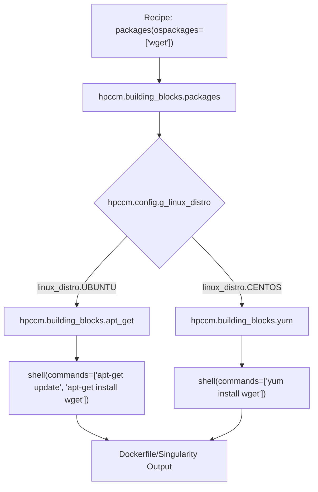
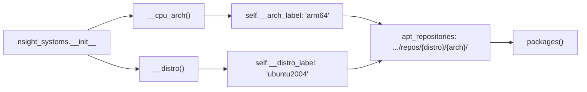

<!-- source: DeepWiki mcp.deepwiki.com · repo NVIDIA/hpc-container-maker · page 4.5 Package Managers and Utilities · fetched 2026-10-26 -->

# Package Managers and Utilities

Relevant source files

The following files were used as context for generating this wiki page:

- [hpccm/building_blocks/apt_get.py](hpccm/building_blocks/apt_get.py)
- [hpccm/building_blocks/arm_allinea_studio.py](hpccm/building_blocks/arm_allinea_studio.py)
- [hpccm/building_blocks/cmake.py](hpccm/building_blocks/cmake.py)
- [hpccm/building_blocks/conda.py](hpccm/building_blocks/conda.py)
- [hpccm/building_blocks/julia.py](hpccm/building_blocks/julia.py)
- [hpccm/building_blocks/mvapich2_gdr.py](hpccm/building_blocks/mvapich2_gdr.py)
- [hpccm/building_blocks/nsight_compute.py](hpccm/building_blocks/nsight_compute.py)
- [hpccm/building_blocks/nsight_systems.py](hpccm/building_blocks/nsight_systems.py)
- [hpccm/building_blocks/packages.py](hpccm/building_blocks/packages.py)
- [hpccm/building_blocks/pip.py](hpccm/building_blocks/pip.py)
- [hpccm/building_blocks/python.py](hpccm/building_blocks/python.py)
- [hpccm/building_blocks/scif.py](hpccm/building_blocks/scif.py)
- [hpccm/building_blocks/yum.py](hpccm/building_blocks/yum.py)
- [hpccm/primitives/shell.py](hpccm/primitives/shell.py)
- [test/test_apt_get.py](test/test_apt_get.py)
- [test/test_arm_allinea_studio.py](test/test_arm_allinea_studio.py)
- [test/test_cmake.py](test/test_cmake.py)
- [test/test_conda.py](test/test_conda.py)
- [test/test_julia.py](test/test_julia.py)
- [test/test_nsight_compute.py](test/test_nsight_compute.py)
- [test/test_nsight_systems.py](test/test_nsight_systems.py)
- [test/test_pip.py](test/test_pip.py)
- [test/test_python.py](test/test_python.py)
- [test/test_scif.py](test/test_scif.py)

The **Package Managers and Utilities** building blocks provide a cross-distribution abstraction for installing system packages, managing language-specific environments (Python, Julia, Conda), and deploying essential build tools like CMake. These blocks leverage `hpccm.config` to automatically detect the target Linux distribution and architecture, ensuring that the generated container instructions use the correct syntax and package names.

## Cross-Distro Package Abstraction

HPCCM provides a unified interface for system package management through the `packages` building block. This block acts as a router, delegating to distribution-specific building blocks based on the global configuration.

### Implementation Logic: `packages`, `apt_get`, and `yum`

The `packages` building block [hpccm/building_blocks/packages.py:29-126]() allows users to specify package lists for different distributions simultaneously. It checks `hpccm.config.g_linux_distro` [hpccm/building_blocks/packages.py:161-177]() to decide whether to instantiate `apt_get` or `yum`.

| Class | Supported Distros | Key Functionality |
| :--- | :--- | :--- |
| `apt_get` | Ubuntu, Debian | Handles `ppa`, GPG keys, and `apt-get update` [hpccm/building_blocks/apt_get.py:32-76](). |
| `yum` | CentOS, RHEL, Rocky | Handles EPEL, PowerTools, SCL, and `rpm --import` [hpccm/building_blocks/yum.py:30-92](). |
| `packages` | All | Abstraction layer that selects `apt_get` or `yum` [hpccm/building_blocks/packages.py:29-155](). |

#### Data Flow for Package Installation

The following diagram illustrates how a call to `packages()` results in distribution-specific shell commands.

**Diagram: Package Management Resolution**

**Sources:** [hpccm/building_blocks/packages.py:161-185](), [hpccm/building_blocks/apt_get.py:113-159](), [hpccm/building_blocks/yum.py:143-182]().

## Language and Environment Managers

### Python and Pip
The `pip` building block manages Python package installation. It handles the bootstrapping of `pip` itself and `setuptools` via system packages before executing `pip install` commands [hpccm/building_blocks/pip.py:36-83]().
*   **Alternatives:** On RHEL-based 8.x systems, it can configure `alternatives` to set the default `python` and `pip` versions [hpccm/building_blocks/pip.py:136-139]().
*   **Requirements:** Supports `requirements.txt` by using the `copy` primitive to move the file into the container context [hpccm/building_blocks/pip.py:156-167]().

### Conda
The `conda` building block installs Miniconda and allows for environment creation via `environment.yml` or direct package lists [hpccm/building_blocks/conda.py:36-85]().
*   **EULA:** Requires explicit acceptance of the Anaconda EULA [hpccm/building_blocks/conda.py:115-116]().
*   **Architecture Support:** Maps `hpccm.config.g_cpu_arch` to Conda-specific architecture strings (e.g., `x86_64`, `aarch64`, `ppc64le`) [hpccm/building_blocks/conda.py:141-148]().

### Julia
The `julia` building block downloads and installs the Julia language. It supports versioning and architecture-specific binary downloads, setting up the `PATH` environment variable automatically.

**Sources:** [hpccm/building_blocks/pip.py:85-177](), [hpccm/building_blocks/conda.py:87-188](), [hpccm/building_blocks/julia.py:1-100]().

## Build Utilities

### CMake
The `cmake` building block is highly flexible, supporting both pre-compiled binary installation and building from source [hpccm/building_blocks/cmake.py:38-77]().
*   **Binary Mode:** For `x86_64` and `aarch64` (v3.20+), it downloads `.sh` runfiles from Kitware's GitHub [hpccm/building_blocks/cmake.py:119-124]().
*   **Source Mode:** For other architectures or when requested, it performs a `bootstrap` followed by `make install` [hpccm/building_blocks/cmake.py:172-200]().
*   **32-bit Compatibility:** Automatically handles legacy 32-bit dependencies (e.g., `libc6-i386`) for CMake versions < 3.1 [hpccm/building_blocks/cmake.py:139-148]().

**Sources:** [hpccm/building_blocks/cmake.py:79-200](), [test/test_cmake.py:37-186]().

## NVIDIA Profiling Tools

HPCCM includes dedicated blocks for NVIDIA's Nsight suite, which are essential for HPC performance analysis.

### Nsight Compute and Nsight Systems
Both `nsight_compute` and `nsight_systems` support installation via NVIDIA's official package repositories or via standalone `.run` files.
*   **Repository Logic:** They construct repository URLs by combining the distribution label (e.g., `ubuntu2004`, `rhel8`) and architecture label (e.g., `amd64`, `arm64`) [hpccm/building_blocks/nsight_compute.py:118-177]().
*   **Environment:** `nsight_compute` sets `NV_COMPUTE_PROFILER_DISABLE_STOCK_FILE_DEPLOYMENT=1` to ensure the profiler functions correctly in read-only container environments [hpccm/building_blocks/nsight_compute.py:98-100]().

**Diagram: Nsight Repository URL Construction**

**Sources:** [hpccm/building_blocks/nsight_compute.py:35-116](), [hpccm/building_blocks/nsight_systems.py:30-93]().

## Scientific Filesystem (SCIF)

The `scif` building block implements the [Scientific Filesystem](https://sci-f.github.io), which provides an internal organizational structure for containers.
*   **App Creation:** It uses the `shell` primitive to create SCIF recipes and install them using the `scif` Python package.
*   **Integration:** Often used in conjunction with the `pip` building block to ensure the `scif` tool is available.

**Sources:** [hpccm/building_blocks/scif.py:1-120]().

---

