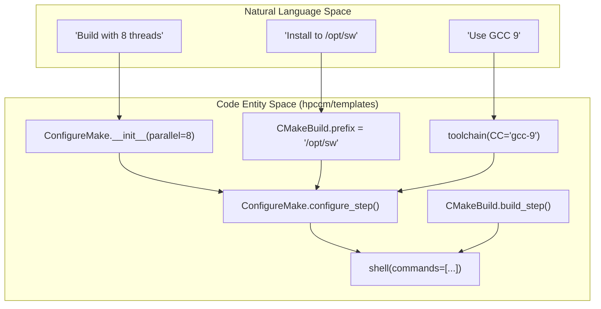
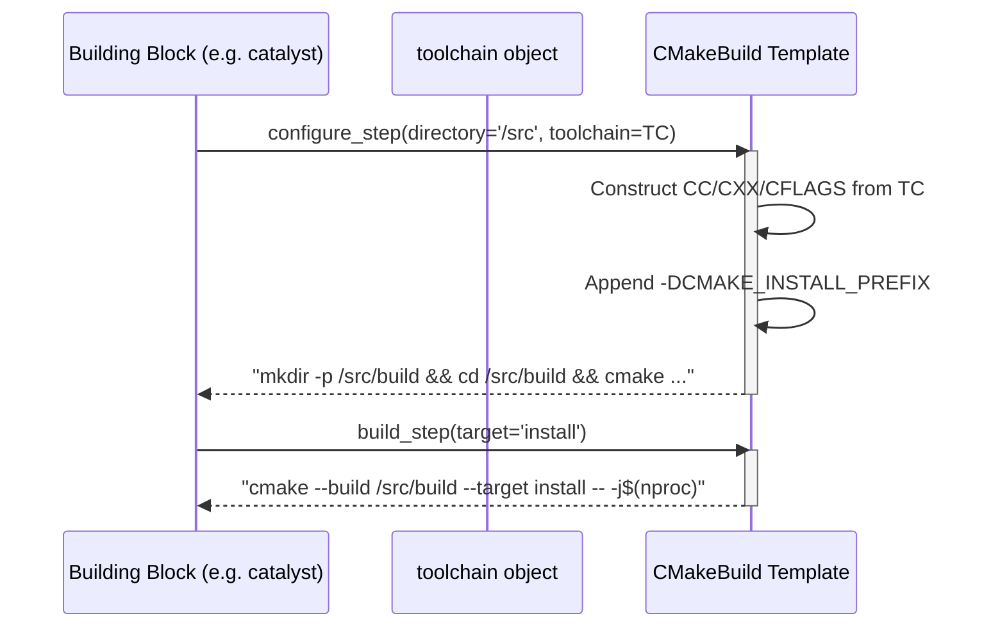

<!-- source: DeepWiki mcp.deepwiki.com · repo NVIDIA/hpc-container-maker · page 5.1 Build System Templates (ConfigureMake and CMakeBuild) · fetched 2026-10-26 -->

# Build System Templates (ConfigureMake and CMakeBuild)

<details>
<summary>Relevant source files</summary>

The following files were used as context for generating this wiki page:

- [.gitignore](.gitignore)
- [hpccm/building_blocks/catalyst.py](hpccm/building_blocks/catalyst.py)
- [hpccm/building_blocks/libsim.py](hpccm/building_blocks/libsim.py)
- [hpccm/templates/CMakeBuild.py](hpccm/templates/CMakeBuild.py)
- [hpccm/templates/ConfigureMake.py](hpccm/templates/ConfigureMake.py)
- [hpccm/toolchain.py](hpccm/toolchain.py)
- [test/test_CMakeBuild.py](test/test_CMakeBuild.py)
- [test/test_ConfigureMake.py](test/test_ConfigureMake.py)
- [test/test_toolchain.py](test/test_toolchain.py)

</details>


This page provides a technical deep dive into the `ConfigureMake` and `CMakeBuild` templates. These templates serve as mixin classes for building blocks, providing standardized methods to generate the shell commands required for common software build workflows (Autotools and CMake).

## Overview

Building blocks in HPCCM often need to compile source code. To avoid duplicating the logic for handling compiler flags, installation prefixes, and parallel build counts, HPCCM uses template classes located in `hpccm/templates/`. These templates bridge the gap between high-level Python configuration and the specific command-line strings required by build systems like GNU Autotools (`./configure && make`) and CMake.

### Data Flow and Entity Mapping

The following diagram illustrates how user-provided arguments in a building block are processed by the templates to produce shell commands.

**Build System Template Entity Map**

**Sources:** `[hpccm/templates/ConfigureMake.py:28-57]()`, `[hpccm/templates/CMakeBuild.py:30-46]()`, `[hpccm/toolchain.py:29-47]()`

---

## ConfigureMake Template

The `ConfigureMake` class implements the standard Autotools workflow. It handles the generation of `./configure`, `make`, and `make install` commands while integrating with the HPCCM `toolchain` for compiler selection and flag management.

### Key Implementation Details

1.  **Option Generation**: The constructor automatically converts keyword arguments starting with `enable_`, `disable_`, `with_`, or `without_` into their corresponding CLI flags (e.g., `enable_foo=True` becomes `--enable-foo`) `[hpccm/templates/ConfigureMake.py:45-57]()`.
2.  **Toolchain Control**: The `toolchain_control` dictionary allows building blocks to selectively enable or disable specific compiler variables (CC, CXX, F77, F90, FC) if the underlying software is sensitive to them `[hpccm/templates/ConfigureMake.py:40-43]()`.
3.  **Environment Handling**: The `configure_step` function can either prepend environment variables to the command or use `export` statements if `export_environment=True` is passed `[hpccm/templates/ConfigureMake.py:138-141]()`.

### ConfigureMake Workflow

| Method | Purpose | Key Parameters | Output Example |
| :--- | :--- | :--- | :--- |
| `configure_step()` | Generate configuration command | `toolchain`, `opts`, `directory` | `CC=gcc ./configure --prefix=/usr/local` |
| `build_step()` | Generate build command | `parallel` | `make -j$(nproc)` |
| `check_step()` | Generate test command | `parallel` | `make -j$(nproc) check` |
| `install_step()` | Generate install command | `parallel` | `make -j$(nproc) install` |

**Sources:** `[hpccm/templates/ConfigureMake.py:58-177]()`, `[test/test_ConfigureMake.py:33-52]()`

---

## CMakeBuild Template

The `CMakeBuild` class manages the CMake workflow, which typically involves creating a separate build directory and using the `cmake --build` abstraction.

### Build Directory Logic
Unlike `ConfigureMake`, `CMakeBuild` caches the build directory path during the `configure_step` to ensure subsequent `build_step` calls reference the correct location `[hpccm/templates/CMakeBuild.py:70-71]()`. If no directory is provided, it assumes a default subdirectory named `build` `[hpccm/templates/CMakeBuild.py:55]()`.

### Integration Logic
The following diagram shows the sequence of operations when a building block (e.g., `catalyst`) uses the `CMakeBuild` template.

**CMakeBuild Implementation Sequence**

**Sources:** `[hpccm/templates/CMakeBuild.py:48-53]()`, `[hpccm/templates/CMakeBuild.py:55-143]()`, `[hpccm/building_blocks/catalyst.py:42-44]()`

---

## Toolchain Integration

Both templates rely heavily on the `hpccm.toolchain` class to populate compiler and flag variables. The templates iterate through the toolchain attributes and append them as environment variables to the build commands.

### Toolchain Attributes Mapping
The templates map the following `toolchain` attributes to build system variables:

*   **Compilers**: `CC`, `CXX`, `F77`, `F90`, `FC` `[hpccm/toolchain.py:25-27]()`.
*   **Flags**: `CFLAGS`, `CPPFLAGS`, `CXXFLAGS`, `FCFLAGS`, `FFLAGS`, `LDFLAGS` `[hpccm/toolchain.py:25-27]()`.
*   **Libraries**: `LIBS`, `FLIBS`, `LD_LIBRARY_PATH` `[hpccm/toolchain.py:25-27]()`.

When a template processes these, it uses `shlex.quote` to ensure that complex flags (like those containing spaces or quotes) are safely handled in the resulting shell script `[hpccm/templates/ConfigureMake.py:90-92]()`, `[hpccm/templates/CMakeBuild.py:78-79]()`.

**Sources:** `[hpccm/toolchain.py:20-27]()`, `[hpccm/templates/ConfigureMake.py:86-137]()`, `[hpccm/templates/CMakeBuild.py:74-118]()`

---

## Example: Building Block Inheritance

Building blocks like `catalyst` or `libsim` inherit from these templates to gain their functionality. This allows the building block to focus on metadata and dependencies while the templates handle the command generation.

```python
# Simplified example from catalyst.py
class catalyst(bb_base, hpccm.templates.CMakeBuild, ...):
    def __init__(self, **kwargs):
        super(catalyst, self).__init__(**kwargs)
        # ... setup code ...
        self.__setup()

    def __setup(self):
        # The template provides configure_step and build_step
        self.__commands.append(self.configure_step(
            directory=self.__wd,
            toolchain=self.__toolchain))
        self.__commands.append(self.build_step())
```
**Sources:** `[hpccm/building_blocks/catalyst.py:42-44]()`, `[hpccm/building_blocks/catalyst.py:112-148]()`

---

