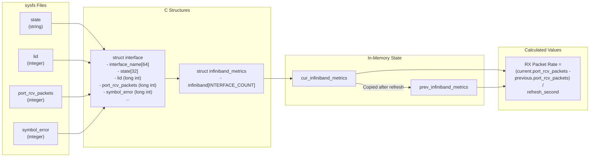
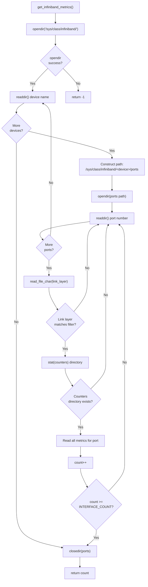
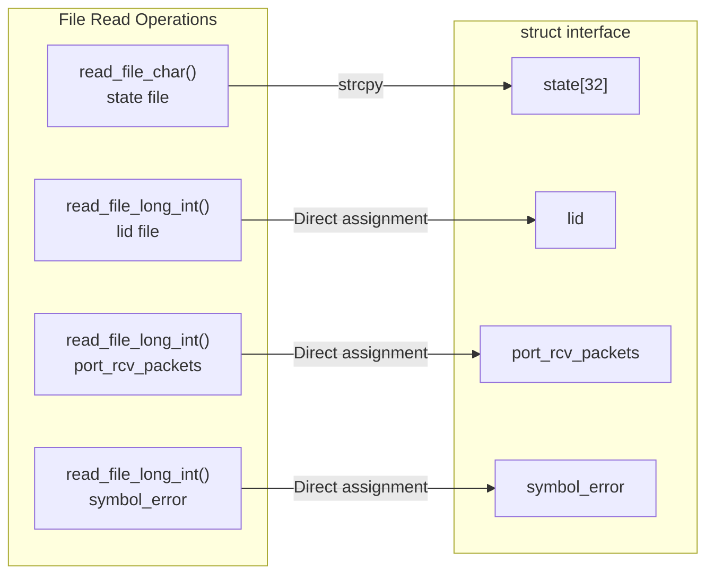
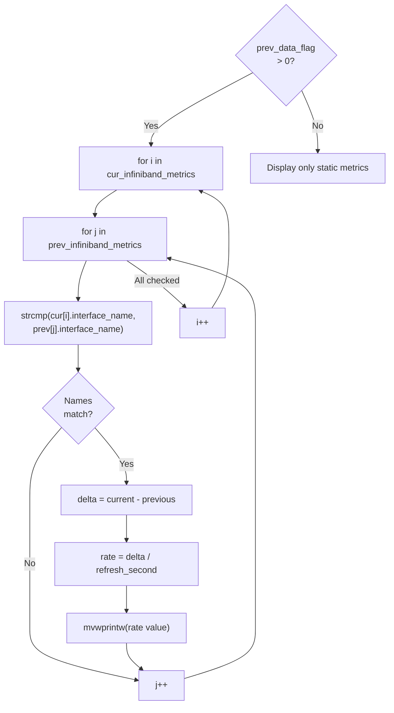
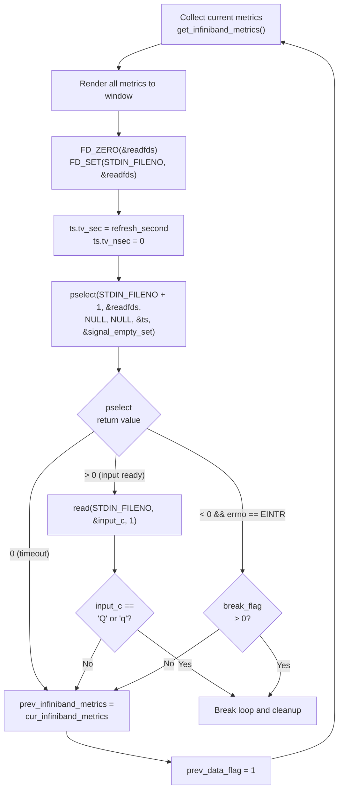

<!-- source: DeepWiki mcp.deepwiki.com · repo NVIDIA/ib-traffic-monitor · page 3.2 Data Flow · fetched 2026-10-26 -->

# Data Flow

<details>
<summary>Relevant source files</summary>

The following files were used as context for generating this wiki page:

- [ib-traffic-monitor.c](ib-traffic-monitor.c)
- [infiniband.c](infiniband.c)
- [ncurses_utils.c](ncurses_utils.c)

</details>


This page explains how data flows through ib-traffic-monitor from InfiniBand hardware to the terminal display. It covers the complete pipeline including device discovery, metric collection from sysfs, rate calculation, and display rendering.

For detailed information about the data structures that hold metrics, see [Data Structures](#4.2.2). For implementation details of metrics collection functions, see [Metrics Collection](#4.2.1). For the screen layout and rendering, see [Display Layout](#4.3.2).

## Overview

The data flow in ib-traffic-monitor follows a periodic polling model where the application repeatedly collects metrics, calculates rates, and updates the display at a configurable refresh interval (default: 5 seconds). The flow can be divided into six distinct stages:

1. **Hardware Exposure**: InfiniBand HCAs expose performance counters through kernel drivers
2. **sysfs Presentation**: Linux kernel presents counters via sysfs virtual filesystem
3. **Device Discovery**: Application enumerates devices and ports from `/sys/class/infiniband/`
4. **Metric Collection**: Application reads counter values from sysfs files
5. **Rate Calculation**: Application computes per-second rates by comparing snapshots
6. **Display Rendering**: Application renders formatted data via ncurses

## Complete Data Flow Pipeline

```mermaid
flowchart TB
    subgraph Hardware["Hardware Layer"]
        HCA["InfiniBand HCA<br/>Network Interface Cards"]
    end
    
    subgraph Kernel["Kernel Layer"]
        Driver["IB Kernel Drivers"]
        Sysfs["/sys/class/infiniband/<br/>&lt;device&gt;/ports/&lt;port&gt;/"]
    end
    
    subgraph Discovery["Discovery Stage<br/>get_infiniband_metrics()"]
        OpenDir["opendir()<br/>/sys/class/infiniband/"]
        EnumDev["Enumerate Devices<br/>readdir()"]
        EnumPorts["Enumerate Ports<br/>readdir(ports)"]
        CheckLayer["read_file_char()<br/>link_layer"]
        Filter["Filter by link_layer<br/>InfiniBand or Ethernet"]
    end
    
    subgraph Collection["Collection Stage<br/>infiniband.c:130-339"]
        ReadStatus["Read Status Files<br/>state, phys_state, rate, lid"]
        ReadCounters["Read Counter Files<br/>counters/*"]
        PopulateStruct["Populate<br/>struct infiniband_metrics"]
    end
    
    subgraph Processing["Processing Stage<br/>ib-traffic-monitor.c:272-295"]
        StoreMetrics["Store in cur_infiniband_metrics"]
        MatchInterfaces["Match Interfaces<br/>strcmp(interface_name)"]
        CalcRates["Calculate Rates<br/>(current - previous) / refresh_second"]
    end
    
    subgraph Display["Display Stage"]
        ConstructLayout["construct_window_layout()"]
        PrintStatic["Print Status & Error Metrics<br/>mvwprintw()"]
        PrintRates["Print I/O Rate Metrics<br/>mvwprintw()"]
        Refresh["wrefresh(main_window)"]
    end
    
    subgraph Control["Control Loop"]
        Wait["pselect()<br/>wait refresh_second"]
        CopyMetrics["prev_infiniband_metrics =<br/>cur_infiniband_metrics"]
        CheckExit["Check for 'Q' or SIGINT"]
    end
    
    HCA --> Driver
    Driver --> Sysfs
    Sysfs --> OpenDir
    OpenDir --> EnumDev
    EnumDev --> EnumPorts
    EnumPorts --> CheckLayer
    CheckLayer --> Filter
    Filter --> ReadStatus
    ReadStatus --> ReadCounters
    ReadCounters --> PopulateStruct
    PopulateStruct --> StoreMetrics
    StoreMetrics --> MatchInterfaces
    MatchInterfaces --> CalcRates
    CalcRates --> ConstructLayout
    ConstructLayout --> PrintStatic
    PrintStatic --> PrintRates
    PrintRates --> Refresh
    Refresh --> Wait
    Wait --> CheckExit
    CheckExit -->|Continue| CopyMetrics
    CopyMetrics --> OpenDir
    CheckExit -->|Exit| End["Program Termination"]
```



**Sources:** [ib-traffic-monitor.c:203-330](), [infiniband.c:28-355]()

## Data Structures and Transformations

Data passes through several transformations as it flows through the system. The primary data structures are defined in `infiniband.h`:



**Sources:** [infiniband.h](), [ib-traffic-monitor.c:121-122](), [ib-traffic-monitor.c:325-326]()

## Stage 1: Device Discovery

Device discovery occurs in the `get_infiniband_metrics()` function, which enumerates all InfiniBand devices and their ports from sysfs.

### Discovery Process



**Key Functions:**
- `opendir()`: Opens directory handles for filesystem traversal
- `readdir()`: Reads directory entries
- `read_file_char()`: Utility function to read string values from sysfs files
- `stat()`: Verifies counters directory exists

**Link Layer Filtering:**
The `show_ethernet_flag` parameter controls which devices are included. When set to 0 (default), only devices with `link_layer == "InfiniBand"` are processed. When set to 1 (via `-e` flag), both InfiniBand and Ethernet devices are included.

**Sources:** [infiniband.c:28-355](), [infiniband.c:97-102]()

## Stage 2: Metric Collection from sysfs

Once a valid device and port are identified, the function reads multiple sysfs files to populate the `interface` structure.

### sysfs File Organization

| Metric Category | sysfs Location | Example Files |
|----------------|----------------|---------------|
| Interface Status | `/sys/class/infiniband/<device>/ports/<port>/` | `state`, `phys_state`, `rate`, `lid`, `link_layer` |
| Counters | `/sys/class/infiniband/<device>/ports/<port>/counters/` | `port_rcv_packets`, `port_xmit_packets`, `symbol_error`, etc. |

### Reading Strategy

The collection process reads two types of values:

1. **String values** (via `read_file_char()`): `state`, `phys_state`, `rate`, `link_layer`
2. **Integer values** (via `read_file_long_int()`): `lid`, all counter metrics



**Error Handling:**
If any counter file cannot be read (file doesn't exist or read error), the corresponding field is set to 0 rather than failing the entire collection. This allows the tool to work with devices that may not expose all counter types.

**Sources:** [infiniband.c:130-339](), [utils.c]()

## Stage 3: Rate Calculation

Rate calculation occurs in the main loop after metrics have been collected. The application maintains two copies of metrics: current and previous.

### First Iteration Behavior

On the first iteration (`prev_data_flag == 0`), only static metrics are displayed:
- Interface Status (LID, Link Layer, State, Physical State, Rate)
- Interface Errors (cumulative counters)
- Interface Link Errors (cumulative counters)

I/O metrics requiring rate calculation are **not displayed** because there is no previous data for comparison.

### Subsequent Iterations

Starting from the second iteration (`prev_data_flag > 0`), the application:

1. **Matches interfaces** by comparing `interface_name` strings between current and previous snapshots
2. **Calculates deltas** by subtracting previous counter values from current values
3. **Computes rates** by dividing deltas by `refresh_second`



### Rate Calculation Formulas

The following formulas are applied for I/O metrics:

| Metric | Formula | Unit |
|--------|---------|------|
| RX Packets/sec | `(cur.port_rcv_packets - prev.port_rcv_packets) / refresh_second` | packets/sec |
| RX MB/sec | `(cur.port_rcv_data - prev.port_rcv_data) * 4 / 1024 / 1024 / refresh_second` | MB/sec |
| TX Packets/sec | `(cur.port_xmit_packets - prev.port_xmit_packets) / refresh_second` | packets/sec |
| TX MB/sec | `(cur.port_xmit_data - prev.port_xmit_data) * 4 / 1024 / 1024 / refresh_second` | MB/sec |
| UC RX Packets/sec | `(cur.unicast_rcv_packets - prev.unicast_rcv_packets) / refresh_second` | packets/sec |
| UC TX Packets/sec | `(cur.unicast_xmit_packets - prev.unicast_xmit_packets) / refresh_second` | packets/sec |
| MC RX Packets/sec | `(cur.multicast_rcv_packets - prev.multicast_rcv_packets) / refresh_second` | packets/sec |
| MC TX Packets/sec | `(cur.multicast_xmit_packets - prev.multicast_xmit_packets) / refresh_second` | packets/sec |

**Note on Data Conversion:**
The `port_rcv_data` and `port_xmit_data` counters are stored in units of 4-byte words. The multiplication by 4 converts to bytes, followed by division by `1024 * 1024` to convert to megabytes.

**Sources:** [ib-traffic-monitor.c:272-295](), [ib-traffic-monitor.c:282-289]()

## Stage 4: Display Rendering

After metrics are collected and rates calculated, the data is rendered to the terminal via ncurses.

### Display Pipeline

```mermaid
flowchart LR
    subgraph Layout["Layout Construction"]
        Clear["wclear(main_window)"]
        Box["box(main_window, 0, 0)"]
        Construct["construct_window_layout()"]
    end
    
    subgraph StaticDisplay["Static Metric Display"]
        StatusDelim["print_delimiter()<br/>interface_status_positions"]
        StatusPrint["mvwprintw()<br/>LID, state, rate, etc."]
        ErrorDelim["print_delimiter()<br/>interface_error_positions"]
        ErrorPrint["mvwprintw()<br/>symbol_error, etc."]
        LinkErrorDelim["print_delimiter()<br/>interface_link_error_positions"]
        LinkErrorPrint["mvwprintw()<br/>link_error_recovery, etc."]
    end
    
    subgraph RateDisplay["Rate Metric Display"]
        CheckPrev{prev_data_flag<br/>> 0?}
        IODelim["print_delimiter()<br/>interface_io_positions"]
        IOPrint["mvwprintw()<br/>calculated rates"]
    end
    
    subgraph Refresh["Screen Update"]
        WRefresh["wrefresh(main_window)"]
    end
    
    Clear --> Box
    Box --> Construct
    Construct --> StatusDelim
    StatusDelim --> StatusPrint
    StatusPrint --> ErrorDelim
    ErrorDelim --> ErrorPrint
    ErrorPrint --> LinkErrorDelim
    LinkErrorDelim --> LinkErrorPrint
    LinkErrorPrint --> CheckPrev
    CheckPrev -->|Yes| IODelim
    CheckPrev -->|No| WRefresh
    IODelim --> IOPrint
    IOPrint --> WRefresh
```



### Display Order and Positioning

The display is organized into four sections, each with its own banner, header row, and data rows:

1. **Interface Status** (lines 1-4+N): Static metrics, always displayed
2. **Interface I/O** (lines N+6 to N+8+M): Rate metrics, displayed after first iteration
3. **Interface Error** (lines 2N+11 to 2N+13+N): Cumulative counters, always displayed
4. **Interface Link Error** (lines 3N+16 to 3N+18+N): Cumulative counters, always displayed

Where N is the number of interfaces and M is the number of matched interfaces (for rate calculation).

**Key Functions:**
- `construct_window_layout()`: Prints section banners, column headers, and horizontal dividers
- `print_delimiter()`: Prints vertical delimiter '|' characters at specified column positions
- `mvwprintw()`: ncurses function to print formatted text at specific row/column coordinates
- `wrefresh()`: Updates the physical screen with buffered changes

**Sources:** [ib-traffic-monitor.c:234-297](), [ncurses_utils.c:21-61]()

## Stage 5: Refresh Cycle

The refresh cycle controls the timing of data collection iterations and handles user input.

### Cycle Control Flow



### Timing Mechanism

The application uses `pselect()` rather than `sleep()` for several important reasons:

1. **Non-blocking Input**: `pselect()` monitors `STDIN_FILENO` so the application can respond immediately to 'Q' key presses
2. **Signal Safety**: `pselect()` atomically unblocks signals during the wait period, allowing proper SIGINT (Ctrl+C) handling
3. **Precise Timing**: The timeout is specified in `struct timespec` with nanosecond precision

**Configuration:**
The refresh interval is controlled by:
- Default: 5 seconds
- Command-line override: `-r <seconds>` or `--refresh <seconds>`
- Must be > 0 (validated at startup)

**Sources:** [ib-traffic-monitor.c:299-330](), [ib-traffic-monitor.c:62](), [ib-traffic-monitor.c:81-95]()

## State Management

The application maintains state across iterations to enable rate calculations and handle dynamic device changes.

### State Variables

| Variable | Type | Purpose |
|----------|------|---------|
| `cur_infiniband_metrics` | `struct infiniband_metrics` | Current snapshot of all metrics |
| `prev_infiniband_metrics` | `struct infiniband_metrics` | Previous snapshot for delta calculation |
| `prev_data_flag` | `int` | Indicates if previous data exists (0 = first iteration) |
| `prev_ret_get_infiniband_metrics` | `int` | Number of interfaces in previous iteration |
| `break_flag` | `volatile sig_atomic_t` | Set by SIGINT handler to trigger exit |

### Interface Matching Logic

When calculating rates, the application must match interfaces between current and previous snapshots because:
- Devices may be added or removed between iterations
- The order of enumeration may change
- Port states may transition (e.g., DOWN → UP)

The matching is performed by nested loop [ib-traffic-monitor.c:273-294]():
```c
for (int i = 0; i < ret_get_infiniband_metrics; ++i) {
    for (int j = 0; j < prev_ret_get_infiniband_metrics; ++j) {
        if (strcmp(cur_infiniband_metrics.infiniband[i].interface_name,
                   prev_infiniband_metrics.infiniband[j].interface_name) == 0) {
            // Calculate and display rates
            break;
        }
    }
}
```

**Behavior on Interface Changes:**
- **New interface added**: Appears in Interface Status/Error sections immediately, but I/O section only after next iteration
- **Interface removed**: Disappears from all sections; no error generated
- **Interface name changed**: Treated as remove + add (loses rate history)

**Sources:** [ib-traffic-monitor.c:121-134](), [ib-traffic-monitor.c:273-294](), [ib-traffic-monitor.c:325-329]()

## Error Handling in Data Flow

The data flow pipeline includes error handling at multiple stages:

### Collection Stage Errors

| Error Condition | Handler | Behavior |
|----------------|---------|----------|
| `/sys/class/infiniband/` doesn't exist | `opendir()` returns NULL | Function returns -1, main loop breaks, error message displayed |
| Individual counter file missing | `read_file_long_int()` returns -1 | Counter set to 0, collection continues |
| Device port missing counters directory | `stat()` fails | Port skipped, collection continues with other ports |

### Display Stage Errors

| Error Condition | Handler | Behavior |
|----------------|---------|----------|
| No devices found | `ret_get_infiniband_metrics == 0` | Main loop breaks, "no InfiniBand device found" error displayed |
| ncurses window creation fails | `newwin()` returns NULL | `endwin()` called, program exits with EXIT_FAILURE |

### Graceful Degradation

The design prioritizes availability over completeness:
- Missing counter files don't prevent display of other metrics
- Devices without full counter support can still be monitored
- Interface matching failures (name mismatch) only affect rate display for that specific interface

**Sources:** [infiniband.c:44-49](), [infiniband.c:181-339](), [ib-traffic-monitor.c:221-232]()

## Performance Considerations

### sysfs Read Operations

Each iteration performs numerous file reads:
- 5 files per port (state, phys_state, rate, lid, link_layer)
- 19 counter files per port (if all exist)
- Total: ~24 file reads per port per iteration

For a system with 4 ports, this results in ~96 file operations every refresh interval. The kernel presents these as virtual files, so there is minimal I/O overhead.

### Memory Usage

The application uses stack-allocated structures:
- `struct infiniband_metrics` contains a fixed-size array of 64 `interface` structures
- Each `interface` structure is ~600 bytes
- Total memory for both current and previous: ~76 KB

This fixed allocation means memory usage is constant regardless of the actual number of interfaces discovered (up to the `INTERFACE_COUNT` limit of 64).

**Sources:** [infiniband.h](), [ib-traffic-monitor.c:121-122]()

---

