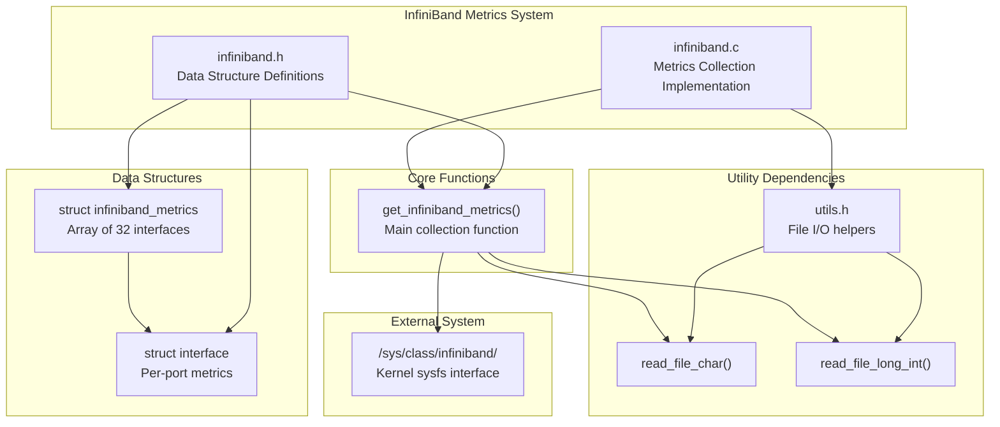
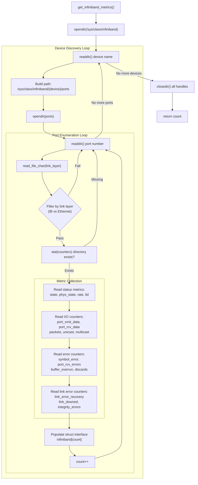
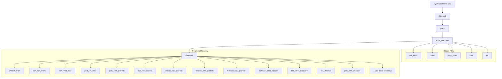
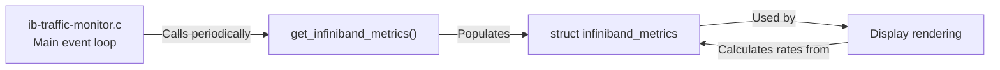

<!-- source: DeepWiki mcp.deepwiki.com · repo NVIDIA/ib-traffic-monitor · page 4.2 InfiniBand Metrics System · fetched 2026-10-26 -->

# InfiniBand Metrics System

<details>
<summary>Relevant source files</summary>

The following files were used as context for generating this wiki page:

- [infiniband.c](infiniband.c)
- [infiniband.h](infiniband.h)

</details>


## Purpose and Scope

The InfiniBand Metrics System is responsible for discovering InfiniBand and Ethernet devices on the system and collecting performance metrics from them via the Linux sysfs filesystem. This subsystem provides the core data collection functionality that feeds the monitoring display.

This page provides an overview of the metrics collection architecture, its components, and how they interact with the Linux kernel's sysfs interface. For detailed implementation of the collection logic, see [Metrics Collection](#4.2.1). For complete documentation of the data structures, see [Data Structures](#4.2.2). For information about specific metrics collected, see the [Metrics Reference](#5) section.

**Sources:** [infiniband.h:1-63](), [infiniband.c:1-356]()

## System Architecture

The InfiniBand Metrics System consists of two primary files that implement device discovery and metrics collection:



**Sources:** [infiniband.h:18-62](), [infiniband.c:18-27]()

## Data Flow

The metrics collection process follows a hierarchical traversal of the sysfs filesystem, reading device properties and counter values:



**Sources:** [infiniband.c:28-355]()

## Key Components

### Main Function

The system exposes a single public function declared in [infiniband.h:60]():

```c
int get_infiniband_metrics(struct infiniband_metrics *input_infiniband_metrics, 
                          int show_ethernet_flag);
```

This function performs the complete metrics collection workflow and returns the count of interfaces discovered.

**Sources:** [infiniband.h:60](), [infiniband.c:28]()

### Data Structures

The system defines two primary data structures:

| Structure | Purpose | Capacity |
|-----------|---------|----------|
| `struct interface` | Holds metrics for a single device port | 23 metric fields |
| `struct infiniband_metrics` | Contains array of all interfaces | Up to 32 interfaces (`INTERFACE_COUNT`) |

Each `struct interface` contains:
- **Identification**: `interface_name` (format: `device:port`)
- **Status fields**: `link_layer`, `state`, `phys_state`, `rate`, `lid`
- **Counter fields**: 18 numeric metrics for I/O, errors, and link events

For complete structure definitions, see [Data Structures](#4.2.2).

**Sources:** [infiniband.h:23-58]()

## sysfs Integration

The metrics system reads data exclusively from the Linux sysfs virtual filesystem. The primary integration points are:

### Directory Structure



**Sources:** [infiniband.c:45-355]()

### File Reading Operations

The system uses two utility functions from `utils.h` to read sysfs files:

| Function | Purpose | Example Usage |
|----------|---------|---------------|
| `read_file_char()` | Read string values | Link layer type, state, physical state |
| `read_file_long_int()` | Read numeric counters | LID, packet counts, error counters |

Each read operation follows this pattern:
1. Construct the full file path using `snprintf()`
2. Call the appropriate read function
3. Handle errors by setting default values (typically 0 for counters)
4. Store the result in the `struct interface` member

**Sources:** [infiniband.c:92-339]()

## Device Filtering

The system supports filtering devices by link layer type via the `show_ethernet_flag` parameter:

| Flag Value | Behavior |
|------------|----------|
| `<= 0` | Show only InfiniBand devices (default) |
| `> 0` | Show both InfiniBand and Ethernet devices |

The filtering is implemented at [infiniband.c:97-102]() by checking the `link_layer` sysfs value against the string `"InfiniBand"`.

**Sources:** [infiniband.c:97-102]()

## Error Handling

The metrics collection function implements defensive error handling:

### Critical Errors
- **Directory not found**: Returns `-1` if `/sys/class/infiniband` cannot be opened [infiniband.c:45-49]()
- **Soft RoCE devices**: Skips devices without a `counters/` directory [infiniband.c:114-117]()

### Non-Critical Errors
For individual metric reads, the system:
1. Checks `snprintf()` return values for formatting errors
2. Checks file read return values
3. Sets default values (typically `0`) if read fails
4. Continues processing remaining metrics

This approach ensures partial data collection succeeds even when some metrics are unavailable.

**Sources:** [infiniband.c:181-339]()

## Interface Limits

The system enforces a maximum of `INTERFACE_COUNT` (32) interfaces [infiniband.h:23](). When this limit is reached, the collection loop terminates early at [infiniband.c:344-346]().

This limit is a compile-time constant defined in the header file.

**Sources:** [infiniband.h:23](), [infiniband.c:344-346]()

## Integration with Main Application

The InfiniBand Metrics System is invoked by the main application (see [Main Application](#4.1)) as part of the monitoring loop:



The function is called at initialization to discover devices and then periodically (default every 5 seconds) to collect updated counter values. The main application compares current and previous values to calculate rates.

**Sources:** [infiniband.h:55-61]()

## Subsystem Pages

For detailed information about specific aspects of the InfiniBand Metrics System:

- **[Metrics Collection](#4.2.1)**: Implementation details of device discovery and counter reading
- **[Data Structures](#4.2.2)**: Complete documentation of `struct interface` and `struct infiniband_metrics`

For information about the specific metrics collected and their meanings:

- **[Interface Status Metrics](#5.1)**: LID, link layer, state, physical state, and rate
- **[I/O Metrics](#5.2)**: Packet and data transfer counters
- **[Error Metrics](#5.3)**: Interface error counters
- **[Link Error Metrics](#5.4)**: Link-specific error and recovery counters

---

