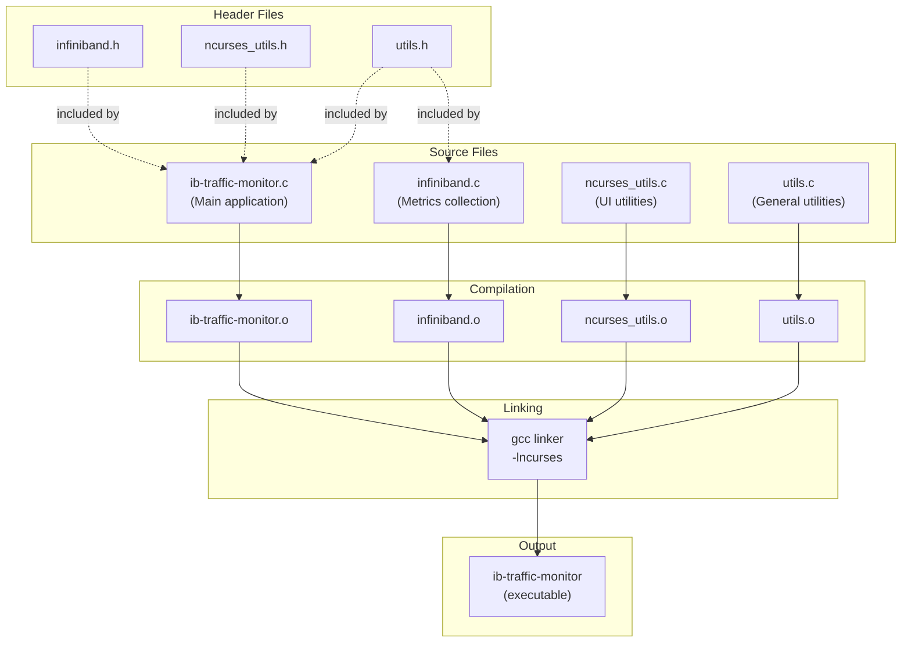
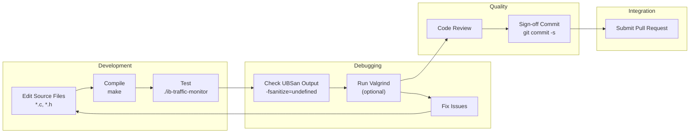
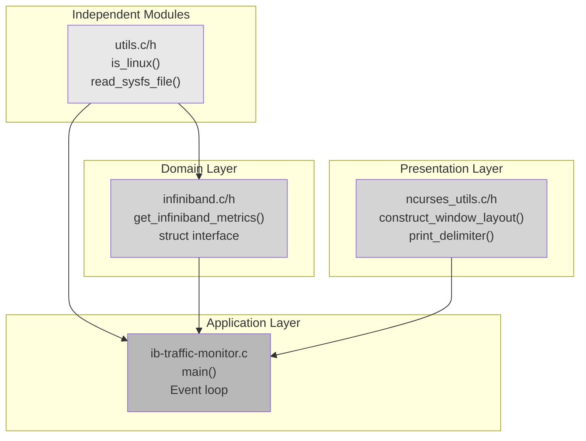

<!-- source: DeepWiki mcp.deepwiki.com · repo NVIDIA/ib-traffic-monitor · page 7 Development Guide · fetched 2026-10-26 -->

# Development Guide

<details>
<summary>Relevant source files</summary>

The following files were used as context for generating this wiki page:

- [CONTRIBUTING.md](CONTRIBUTING.md)
- [Makefile](Makefile)
- [ib-traffic-monitor.c](ib-traffic-monitor.c)

</details>


This guide provides information for developers who want to contribute to, modify, or extend the ib-traffic-monitor codebase. It covers development environment setup, build procedures, code organization, testing practices, and contribution guidelines.

For detailed contribution requirements and DCO sign-off procedures, see [Contributing](#7.1).  
For comprehensive code structure and architectural patterns, see [Code Organization](#7.2).

---

## Purpose and Scope

This document is intended for:
- Contributors adding features or fixing bugs
- Developers integrating ib-traffic-monitor into custom monitoring solutions
- Maintainers reviewing pull requests and managing releases

It focuses on practical development tasks: setting up your environment, building the code, understanding the module structure, and following project conventions.

---

## Prerequisites

### Required Software

| Component | Requirement | Purpose |
|-----------|-------------|---------|
| **Operating System** | Linux | Required for sysfs access to InfiniBand metrics |
| **Compiler** | GCC (GNU Compiler Collection) | Compilation of C source code |
| **ncurses Library** | libncurses development headers | Terminal UI rendering |
| **Make** | GNU Make or compatible | Build automation |
| **Git** | Version control system | Source code management |

### Verification Commands

```bash
# Check GCC version
gcc --version

# Verify ncurses development headers
pkg-config --cflags --libs ncurses

# Verify Make
make --version

# Check Linux kernel (sysfs must be available)
uname -a
ls /sys/class/infiniband/
```

The application uses the `is_linux()` function [utils.c]() to verify Linux OS at runtime [ib-traffic-monitor.c:115]().

**Sources:** [ib-traffic-monitor.c:114-118](), [Makefile:16-22]()

---

## Development Environment Setup

### Cloning the Repository

```bash
git clone https://github.com/NVIDIA/ib-traffic-monitor.git
cd ib-traffic-monitor
```

### Installing Dependencies

#### Ubuntu/Debian
```bash
sudo apt-get update
sudo apt-get install build-essential libncurses-dev
```

#### RHEL/CentOS/Rocky
```bash
sudo yum install gcc make ncurses-devel
```

### Verifying InfiniBand Hardware

While not strictly required for compilation, InfiniBand hardware (or RoCE-capable Ethernet) is needed for functional testing:

```bash
# Check for InfiniBand devices
ls /sys/class/infiniband/

# Verify device ports
ls /sys/class/infiniband/mlx5_0/ports/
```

**Sources:** Repository structure, system requirements

---

## Building from Source

### Build System Architecture



**Sources:** [Makefile:19-32]()

### Makefile Targets

The `Makefile` defines the following targets:

| Target | Command | Description |
|--------|---------|-------------|
| `all` (default) | `make` | Builds the `ib-traffic-monitor` executable |
| `clean` | `make clean` | Removes object files and executable |
| Individual objects | `make ib-traffic-monitor.o` | Compiles specific source file |

### Compilation Process

```bash
# Build the entire project
make

# Clean build artifacts
make clean

# Rebuild from scratch
make clean && make
```

The compilation uses the following flags [Makefile:17]():

| Flag | Purpose |
|------|---------|
| `-g` | Include debug symbols |
| `-Wall -Wextra -Wpedantic` | Enable extensive warnings |
| `-Wconversion -Wdouble-promotion` | Warn about implicit type conversions |
| `-Wunused -Wshadow -Wsign-conversion` | Detect potential issues |
| `-fsanitize=undefined` | Enable undefined behavior sanitizer at runtime |

**Sources:** [Makefile:1-36]()

---

## Development Workflow

### Standard Development Cycle



**Sources:** Development best practices, [CONTRIBUTING.md:1-14]()

### Key Development Tasks

#### 1. Modifying Metrics Collection

If adding new InfiniBand counters:
1. Update `struct interface` in `infiniband.h`
2. Add sysfs read logic in `infiniband.c` function `get_infiniband_metrics()`
3. Update display logic in `ib-traffic-monitor.c` main loop
4. Update delimiter positions arrays [ib-traffic-monitor.c:124-128]()

#### 2. Changing Display Layout

For UI modifications:
1. Modify `construct_window_layout()` in `ncurses_utils.c`
2. Update delimiter arrays in `main()` [ib-traffic-monitor.c:124-128]()
3. Adjust `print_delimiter()` calls and `mvwprintw()` positioning

#### 3. Adding Command-Line Options

To add new CLI flags:
1. Update `short_opts` string [ib-traffic-monitor.c:54]()
2. Add entry to `long_opts` array [ib-traffic-monitor.c:55-60]()
3. Add case in `switch` statement [ib-traffic-monitor.c:80-111]()
4. Update `usage()` function [ib-traffic-monitor.c:35-42]()

**Sources:** [ib-traffic-monitor.c:52-112](), [infiniband.h](), [ncurses_utils.c]()

---

## Debugging and Testing

### Runtime Debugging

#### Undefined Behavior Sanitizer (UBSan)

The project is compiled with `-fsanitize=undefined` by default [Makefile:17](). This catches runtime errors like:
- Integer overflow
- Division by zero
- Null pointer dereference
- Array bounds violations

UBSan errors appear on stderr during execution:

```bash
./ib-traffic-monitor
# UBSan output appears if issues detected
```

#### Using GDB

Debug symbols are included with `-g` flag [Makefile:17]():

```bash
# Run under GDB
gdb ./ib-traffic-monitor

# Common GDB commands
(gdb) break main
(gdb) run -r 10
(gdb) next
(gdb) print cur_infiniband_metrics
(gdb) backtrace
```

#### Memory Debugging with Valgrind

```bash
# Check for memory leaks
valgrind --leak-check=full ./ib-traffic-monitor

# Track memory allocations
valgrind --track-origins=yes ./ib-traffic-monitor
```

**Note:** The ncurses library may report "still reachable" blocks, which are typically false positives related to library cleanup.

**Sources:** [Makefile:17](), debugging best practices

### Testing Different Configurations

#### Testing Ethernet Mode

```bash
# Monitor Ethernet/RoCE interfaces
./ib-traffic-monitor -e
```

The `ethernet_flag` is passed to `get_infiniband_metrics()` [ib-traffic-monitor.c:221]() to filter by link layer type.

#### Testing Custom Refresh Rates

```bash
# Test with different refresh intervals
./ib-traffic-monitor -r 1   # 1 second
./ib-traffic-monitor -r 30  # 30 seconds
```

Refresh validation occurs at [ib-traffic-monitor.c:82-94]().

#### Testing Signal Handling

```bash
# Start monitor
./ib-traffic-monitor

# Send SIGINT (Ctrl+C)
# Verify clean shutdown with ncurses cleanup
```

Signal handling is implemented at [ib-traffic-monitor.c:136-175]() using `sigaction()` and `pselect()`.

**Sources:** [ib-traffic-monitor.c:80-98](), [ib-traffic-monitor.c:136-175](), [ib-traffic-monitor.c:221]()

---

## Code Quality Standards

### Compiler Warnings

The project enforces strict compiler warnings [Makefile:17](). All code must compile without warnings:

```bash
# Build should produce no warnings
make
# Expected output: successful compilation with no warning messages
```

### Code Style

While the project does not use an automated formatter, follow these conventions observed in the codebase:

| Convention | Example |
|------------|---------|
| **Indentation** | 4 spaces (no tabs) |
| **Braces** | Opening brace on same line for functions and control structures |
| **Naming** | `snake_case` for functions and variables |
| **Comments** | `/* Multi-line style */` for explanations |
| **Line length** | No strict limit, but prefer readability |

### Error Handling

All system calls and library functions must check return values:

```c
// Good: Check return value
if (sigprocmask(SIG_BLOCK, &signal_block_set, NULL) < 0) {
    fprintf(stderr, "ERROR: failed to block SIGINT signal\n");
    exit(EXIT_FAILURE);
}

// Bad: Ignoring return value
sigprocmask(SIG_BLOCK, &signal_block_set, NULL);
```

Examples throughout [ib-traffic-monitor.c:136-175]().

### Memory Management

- Prefer stack allocation when possible
- All dynamic allocations should have corresponding frees
- Use `valgrind` to verify no leaks

### Signal Safety

Signal handlers must be async-signal-safe [ib-traffic-monitor.c:45-50]():
- Use only `sig_atomic_t` for shared variables
- Avoid complex operations in handlers
- Use `pselect()` to atomically unblock signals during waits

**Sources:** [ib-traffic-monitor.c:45-175](), [Makefile:17]()

---

## Module Dependencies and Build Order



Build order (automatically handled by Make):
1. **utils.o** - No dependencies
2. **infiniband.o** - Depends on utils.h
3. **ncurses_utils.o** - No internal dependencies
4. **ib-traffic-monitor.o** - Depends on all headers
5. **Linking** - Combines all objects with ncurses library

**Sources:** [Makefile:19-32](), module structure

---

## Version Management

### Version Number

The version is defined as a macro in the main application [ib-traffic-monitor.c:32]():

```c
#define VERSION "1.3.3"
```

Update this macro when releasing new versions. The version appears in the usage output [ib-traffic-monitor.c:37]().

### Release Process

1. Update `VERSION` macro in `ib-traffic-monitor.c`
2. Test all functionality
3. Ensure clean build: `make clean && make`
4. Verify no compiler warnings
5. Run runtime tests with UBSan
6. Update documentation if needed
7. Commit with sign-off: `git commit -s`
8. Tag release: `git tag -a v1.3.3 -m "Release 1.3.3"`

**Sources:** [ib-traffic-monitor.c:32-42]()

---

## Common Development Scenarios

### Scenario 1: Adding a New InfiniBand Counter

**Goal:** Display a new counter from sysfs.

**Steps:**
1. Add field to `struct interface` in `infiniband.h`
2. In `infiniband.c`, read counter using `read_sysfs_file()`
3. Store value in structure field
4. In `ib-traffic-monitor.c`, add display logic with `mvwprintw()`
5. Update delimiter positions if changing column layout
6. Test with real hardware or mock sysfs data

**Related Functions:**
- `get_infiniband_metrics()` in `infiniband.c`
- Main loop at [ib-traffic-monitor.c:203-330]()

### Scenario 2: Modifying the Display Layout

**Goal:** Change the visual organization of metrics.

**Steps:**
1. Update `construct_window_layout()` in `ncurses_utils.c` for headers
2. Modify delimiter position arrays in `main()` [ib-traffic-monitor.c:124-128]()
3. Adjust `mvwprintw()` coordinates throughout display code
4. Update `print_delimiter()` calls
5. Test with different terminal sizes

**Related Code:**
- [ncurses_utils.c]() - Layout construction
- [ib-traffic-monitor.c:234-295]() - Metric rendering

### Scenario 3: Optimizing Performance

**Goal:** Reduce overhead for high-frequency updates.

**Considerations:**
- Minimize sysfs reads per refresh cycle
- Cache unchanged static values (LID, state, rate)
- Optimize string operations in display code
- Profile with `perf` or `gprof` to identify hotspots

**Key Performance Areas:**
- sysfs file I/O in `get_infiniband_metrics()`
- String formatting with `mvwprintw()`
- Rate calculations [ib-traffic-monitor.c:272-295]()

**Sources:** Performance optimization practices, [ib-traffic-monitor.c:220-295]()

---

## Troubleshooting Development Issues

### Compilation Errors

| Error | Cause | Solution |
|-------|-------|----------|
| `ncurses.h: No such file or directory` | Missing ncurses headers | Install `libncurses-dev` or `ncurses-devel` |
| `undefined reference to 'initscr'` | ncurses library not linked | Verify `-lncurses` in `LDFLAGS` [Makefile:22]() |
| Type conversion warnings | Implicit conversions | Cast explicitly or change variable types |

### Runtime Issues

| Issue | Diagnosis | Solution |
|-------|-----------|----------|
| "no InfiniBand device found" | No devices in `/sys/class/infiniband/` | Check hardware, kernel modules, or use `-e` flag |
| Segmentation fault | Memory access violation | Run with `gdb` or `valgrind` to locate |
| ncurses display corruption | Terminal resize or cleanup issues | Verify `delwin()` and `endwin()` calls [ib-traffic-monitor.c:332-335]() |
| Rate calculation errors | First iteration has no previous data | Check `prev_data_flag` logic [ib-traffic-monitor.c:272-295]() |

### Debugging Checklist

- [ ] Code compiles without warnings
- [ ] No UBSan errors during execution
- [ ] Valgrind reports no leaks
- [ ] Signal handling works (Ctrl+C cleanup)
- [ ] Display renders correctly in 80x24 and larger terminals
- [ ] Multiple refresh cycles work without errors
- [ ] Error paths print meaningful messages

**Sources:** [ib-traffic-monitor.c:332-335](), [Makefile:17]()

---

## Contribution Guidelines Summary

Contributors must:
1. Sign-off all commits using `git commit -s` [CONTRIBUTING.md:5-12]()
2. Ensure code compiles without warnings
3. Follow existing code style conventions
4. Test changes with real or simulated hardware
5. Document significant changes

The sign-off certifies adherence to the Developer Certificate of Origin (DCO).

For complete contribution requirements, see [Contributing](#7.1).

**Sources:** [CONTRIBUTING.md:1-52]()

---

## Additional Resources

### Build System Details
For comprehensive information about the build process, compiler flags, and linking, see [Build System](#6).

### Code Architecture
For detailed explanation of module organization and architectural patterns, see [Code Organization](#7.2).

### External Dependencies
- **ncurses documentation:** [GNU ncurses](https://invisible-island.net/ncurses)
- **Linux sysfs InfiniBand ABI:** `/sys/class/infiniband/` hierarchy
- **GCC sanitizers:** [GCC documentation on sanitizers](https://gcc.gnu.org/onlinedocs/gcc/Instrumentation-Options.html)

**Sources:** Project documentation, external references

---

