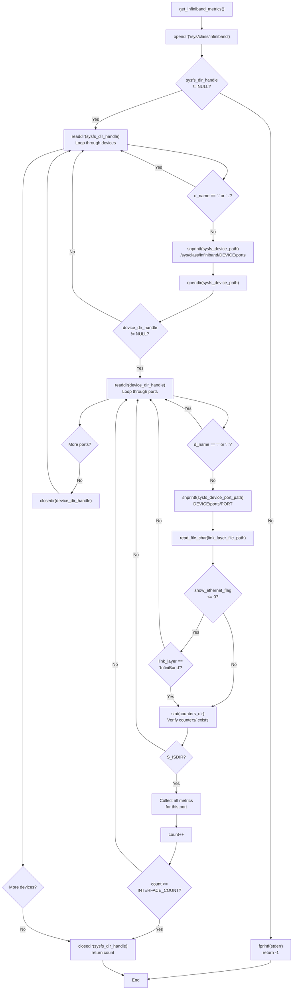
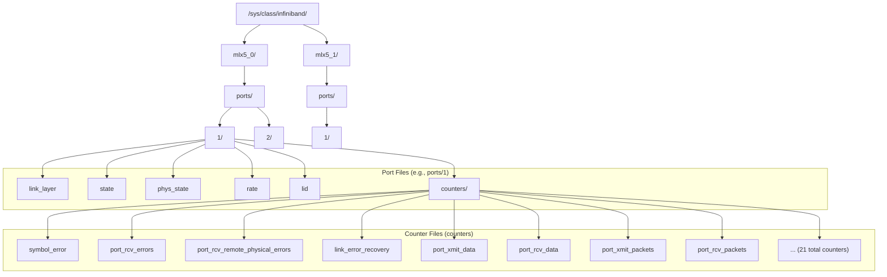
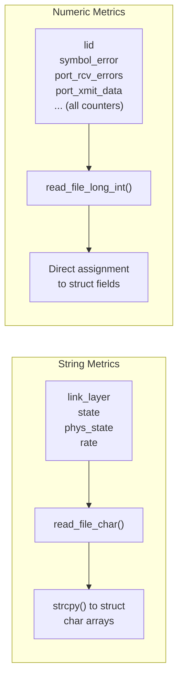
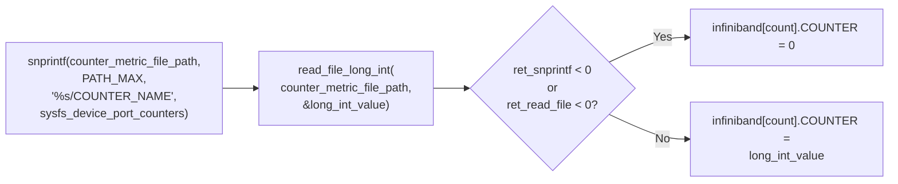
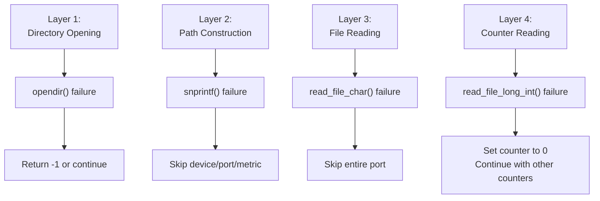
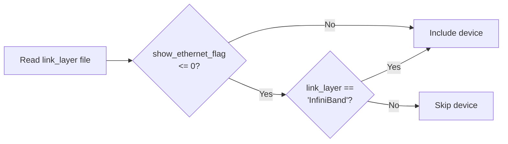

<!-- source: DeepWiki mcp.deepwiki.com · repo NVIDIA/ib-traffic-monitor · extra page Metrics Collection · fetched 2026-10-26 -->

# Metrics Collection

<details>
<summary>Relevant source files</summary>

The following files were used as context for generating this wiki page:

- [infiniband.c](infiniband.c)
- [utils.c](utils.c)

</details>


## Purpose and Scope

This page documents the implementation of InfiniBand metrics collection in `infiniband.c`, specifically the `get_infiniband_metrics` function and its interaction with the Linux sysfs virtual filesystem. The collection process includes device discovery, port enumeration, link layer filtering, and reading raw counter values from sysfs.

For information about the data structures that store collected metrics, see [Data Structures](#4.2.2). For detailed definitions of individual metrics, refer to the Metrics Reference sections ([5.1](#5.1), [5.2](#5.2), [5.3](#5.3), [5.4](#5.4)).

## Overview

The metrics collection subsystem is implemented as a single primary function that performs a complete scan of InfiniBand devices on the system. The collection process reads values directly from the Linux kernel's sysfs interface at `/sys/class/infiniband/`, which exposes InfiniBand hardware counters and status information.

**Sources:** [infiniband.c:28-355]()

### Collection Function Signature

The main entry point for metrics collection is:

```c
int get_infiniband_metrics(struct infiniband_metrics *input_infiniband_metrics, 
                          int show_ethernet_flag)
```

This function:
- Returns the count of discovered interfaces (or -1 on error)
- Populates the provided `infiniband_metrics` structure
- Optionally filters devices based on link layer type (InfiniBand vs Ethernet)

**Sources:** [infiniband.c:28]()

## Device Discovery Workflow

The device discovery process follows a hierarchical traversal of the sysfs filesystem structure. The system discovers devices, enumerates their ports, validates their configuration, and collects metrics for each valid port.

### Discovery Flow Diagram



**Sources:** [infiniband.c:36-354]()

### Key Discovery Steps

| Step | Implementation | Purpose |
|------|---------------|---------|
| **1. Open sysfs root** | `opendir("/sys/class/infiniband")` at [infiniband.c:45]() | Access the InfiniBand device hierarchy |
| **2. Enumerate devices** | `readdir(sysfs_dir_handle)` loop at [infiniband.c:52-55]() | Find all InfiniBand devices (e.g., `mlx5_0`, `mlx5_1`) |
| **3. Enumerate ports** | `opendir(sysfs_device_path)` at [infiniband.c:67]() | Access ports subdirectory for each device |
| **4. Read link layer** | `read_file_char(link_layer_file_path)` at [infiniband.c:92]() | Determine if port is InfiniBand or Ethernet |
| **5. Filter by type** | Conditional at [infiniband.c:97-102]() | Skip non-InfiniBand devices if Ethernet flag is not set |
| **6. Validate counters** | `stat()` check at [infiniband.c:114-117]() | Ensure counters directory exists (excludes soft RoCE) |
| **7. Collect metrics** | Metric reading loops at [infiniband.c:119-340]() | Read all status and counter values |

**Sources:** [infiniband.c:45-340]()

## sysfs Filesystem Structure

The metrics collection process navigates a specific sysfs hierarchy. Understanding this structure is essential for comprehending how the code maps to hardware resources.

### sysfs Navigation Map



**Sources:** [infiniband.c:45-340]()

### Path Construction Pattern

The code builds sysfs paths dynamically using `snprintf` to construct file paths for reading. The pattern follows this structure:

| Path Level | Template | Example | Code Reference |
|------------|----------|---------|----------------|
| **Device directory** | `/sys/class/infiniband/{device}/ports` | `/sys/class/infiniband/mlx5_0/ports` | [infiniband.c:58-61]() |
| **Port directory** | `{device_path}/{port}` | `/sys/class/infiniband/mlx5_0/ports/1` | [infiniband.c:79-82]() |
| **Status files** | `{port_path}/{file}` | `.../ports/1/link_layer` | [infiniband.c:88-92]() |
| **Counter directory** | `{port_path}/counters` | `.../ports/1/counters` | [infiniband.c:106-109]() |
| **Counter files** | `{counters_path}/{counter}` | `.../counters/symbol_error` | [infiniband.c:181-182]() |

**Sources:** [infiniband.c:58-334]()

## Metric Reading Implementation

The metric reading process distinguishes between two types of data: string-valued status attributes and numeric counter values. Each type uses a different utility function from `utils.c`.

### Data Type Handlers



**Sources:** [infiniband.c:92-339](), [utils.c:40-98]()

### String Metric Collection

String-valued metrics are read using `read_file_char` from `utils.c`. This function:

1. Opens the file using `fopen`
2. Reads the first line using `fgets`
3. Strips the trailing newline character
4. Returns the string in the provided buffer

The implementation handles four string metrics per port:

| Metric | sysfs File | Destination Field | Code Location |
|--------|-----------|-------------------|---------------|
| Link Layer | `link_layer` | `infiniband[count].link_layer` | [infiniband.c:87-95]() |
| State | `state` | `infiniband[count].state` | [infiniband.c:130-140]() |
| Physical State | `phys_state` | `infiniband[count].phys_state` | [infiniband.c:142-152]() |
| Rate | `rate` | `infiniband[count].rate` | [infiniband.c:154-164]() |

**Sources:** [infiniband.c:87-164](), [utils.c:70-98]()

### Numeric Metric Collection

Numeric metrics use `read_file_long_int` from `utils.c`, which:

1. Opens the file using `fopen`
2. Reads the value using `fscanf`
3. Converts the string to `long int` using `strtol`
4. Returns the value through a pointer parameter

The function reads 22 numeric metrics per port, including:

**Status Metrics:**
- `lid` (Local Identifier) - [infiniband.c:166-176]()

**Counter Metrics (21 total):**
- Error counters: `symbol_error`, `port_rcv_errors`, `port_rcv_remote_physical_errors`, etc.
- Traffic counters: `port_xmit_data`, `port_rcv_data`, `port_xmit_packets`, `port_rcv_packets`
- Unicast/Multicast counters: `unicast_rcv_packets`, `unicast_xmit_packets`, etc.
- Link error counters: `link_error_recovery`, `link_downed`, `local_link_integrity_errors`

**Sources:** [infiniband.c:166-339](), [utils.c:40-68]()

### Counter Reading Pattern

All counter metrics follow an identical reading pattern implemented as a repeated code block:



This pattern is repeated for each of the 21 counter metrics at [infiniband.c:178-340](). Each counter follows the same steps:

1. Construct the full file path to the counter file
2. Attempt to read the counter value
3. If successful, store the value; if failed, store 0

**Sources:** [infiniband.c:178-340]()

### Complete Counter Collection Sequence

The counters are collected in this specific order:

| Order | Counter Name | Code Lines | Metric Category |
|-------|-------------|------------|-----------------|
| 1 | `symbol_error` | [181-187]() | Error |
| 2 | `port_rcv_errors` | [189-195]() | Error |
| 3 | `port_rcv_remote_physical_errors` | [197-203]() | Error |
| 4 | `port_rcv_switch_relay_errors` | [205-211]() | Error |
| 5 | `link_error_recovery` | [213-219]() | Link Error |
| 6 | `port_xmit_constraint_errors` | [221-227]() | Error |
| 7 | `port_rcv_constraint_errors` | [229-235]() | Error |
| 8 | `local_link_integrity_errors` | [237-243]() | Link Error |
| 9 | `excessive_buffer_overrun_errors` | [245-251]() | Error |
| 10 | `port_xmit_data` | [253-259]() | I/O |
| 11 | `port_rcv_data` | [261-267]() | I/O |
| 12 | `port_xmit_packets` | [269-275]() | I/O |
| 13 | `port_rcv_packets` | [277-283]() | I/O |
| 14 | `unicast_rcv_packets` | [285-291]() | I/O |
| 15 | `unicast_xmit_packets` | [293-299]() | I/O |
| 16 | `multicast_rcv_packets` | [301-307]() | I/O |
| 17 | `multicast_xmit_packets` | [309-315]() | I/O |
| 18 | `link_downed` | [317-323]() | Link Error |
| 19 | `port_xmit_discards` | [325-331]() | Error |
| 20 | `VL15_dropped` | [333-339]() | Error |

**Sources:** [infiniband.c:178-340]()

## Error Handling Strategy

The metrics collection implementation employs defensive error handling at multiple levels to ensure robustness when interacting with the sysfs filesystem.

### Error Handling Layers



**Sources:** [infiniband.c:45-340]()

### Error Handling Policies

The function implements different error policies depending on the criticality of the failure:

| Failure Type | Detection | Response | Code Location |
|--------------|-----------|----------|---------------|
| **sysfs root unavailable** | `opendir() == NULL` | Print error, return -1 | [infiniband.c:45-49]() |
| **Device directory error** | `opendir() == NULL` | Skip device, continue | [infiniband.c:67-70]() |
| **Path construction error** | `snprintf() < 0` | Skip current item, continue | [infiniband.c:62-64]() |
| **Link layer read error** | `read_file_char() < 0` | Skip port, continue | [infiniband.c:92-95]() |
| **Status metric error** | `read_file_char() < 0` | Skip port, continue | [infiniband.c:135-138]() |
| **Counter read error** | `read_file_long_int() < 0` | Set to 0, continue | [infiniband.c:183-187]() |
| **Interface limit reached** | `count >= INTERFACE_COUNT` | Stop collection, return count | [infiniband.c:344-346]() |

The key distinction is:

- **Critical errors** (sysfs root, status metrics): Halt processing of that port
- **Non-critical errors** (individual counters): Default to 0, continue collecting other metrics

**Sources:** [infiniband.c:45-346]()

## Interface Naming Convention

Each discovered port is assigned a unique interface name constructed from the device name and port number:

```
interface_name = "{device_name}:{port_number}"
```

For example:
- `mlx5_0:1` (device mlx5_0, port 1)
- `mlx5_0:2` (device mlx5_0, port 2)
- `mlx5_1:1` (device mlx5_1, port 1)

This naming is implemented at [infiniband.c:120-127]():

```c
snprintf(interface_name, interface_name_length, "%s:%s", 
         sysfs_entry->d_name,    // device name
         device_entry->d_name);  // port number
strcpy(input_infiniband_metrics->infiniband[count].interface_name, interface_name);
```

**Sources:** [infiniband.c:120-127]()

## Link Layer Filtering

The `show_ethernet_flag` parameter controls which devices are collected based on their link layer type. The filtering logic is implemented at [infiniband.c:97-102]():



**Behavior:**
- If `show_ethernet_flag > 0`: Collect all devices (both InfiniBand and Ethernet)
- If `show_ethernet_flag <= 0`: Collect only devices where `link_layer == "InfiniBand"`

This allows the application to be invoked with the `-e` flag to include Ethernet-based devices (RoCE).

**Sources:** [infiniband.c:87-102]()

## Soft RoCE Exclusion

The collection process explicitly excludes software RoCE devices by checking for the existence of the `counters/` directory:

```c
struct stat sb;
if (stat(sysfs_device_port_counters, &sb) != 0 || !S_ISDIR(sb.st_mode)) {
    continue;  // Skip this port
}
```

This check at [infiniband.c:114-117]() ensures that only hardware devices with actual counter support are included. Soft RoCE devices implemented in software typically lack the counters directory in their sysfs structure.

**Sources:** [infiniband.c:104-117]()

## Collection Limits

The function enforces a maximum number of interfaces that can be collected, defined by the `INTERFACE_COUNT` constant. When this limit is reached, collection stops immediately:

```c
++count;

/* stop processing if number of interfaces is greater than INTERFACE_COUNT */
if (count >= INTERFACE_COUNT) {
    break;
}
```

This limit check at [infiniband.c:341-346]() prevents buffer overflow in the `infiniband_metrics` structure. The actual value of `INTERFACE_COUNT` is defined in the header file (see [Data Structures](#4.2.2)).

**Sources:** [infiniband.c:341-346]()

## Return Value Semantics

The `get_infiniband_metrics` function returns an integer with the following semantics:

| Return Value | Meaning | Scenario |
|--------------|---------|----------|
| `-1` | Error | Cannot open `/sys/class/infiniband` directory |
| `0` | Success, no devices | No valid InfiniBand/Ethernet ports found |
| `> 0` | Success | Number of interfaces successfully collected |

The return value is used by the main application to determine whether any devices were found and how many entries in the metrics array are valid.

**Sources:** [infiniband.c:28-354]()

---

