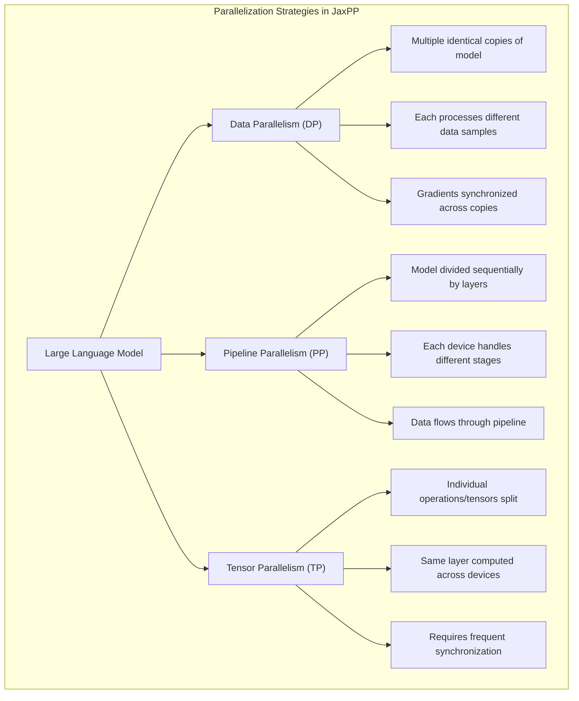
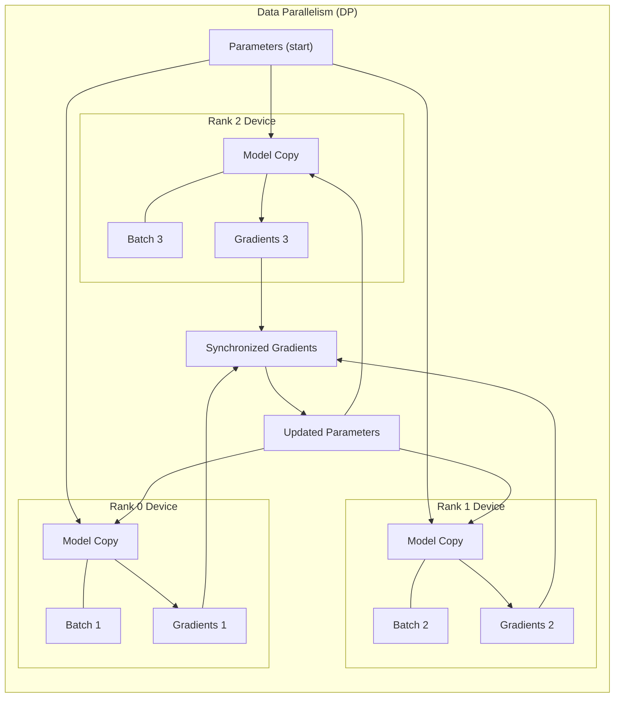
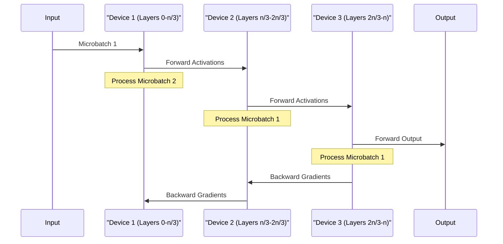
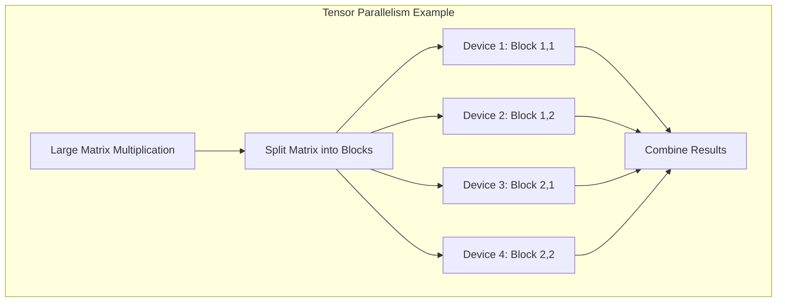
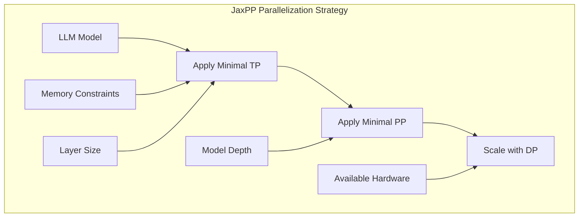
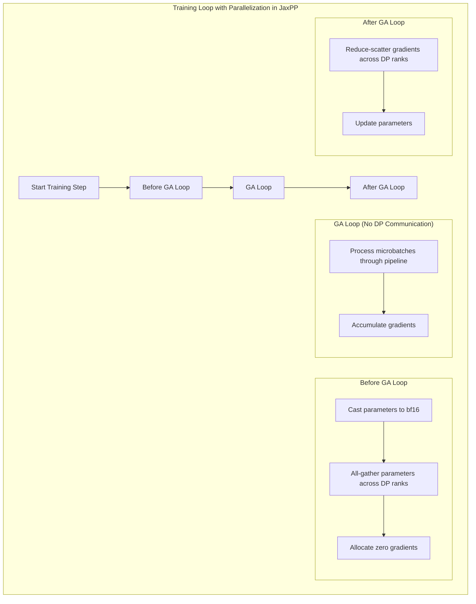

<!-- source: DeepWiki mcp.deepwiki.com · repo NVIDIA/jaxpp · page 3.1 Parallelization Strategies · fetched 2026-10-26 -->

# Parallelization Strategies

Relevant source files

The following files were used as context for generating this wiki page:

- [PERF_GUIDE.md](PERF_GUIDE.md)

This page describes the three main parallelization strategies supported by JaxPP: Data Parallelism (DP), Pipeline Parallelism (PP), and Tensor Parallelism (TP). It explains how each technique works, when to use them, and strategies for combining them effectively to achieve optimal performance when training large language models.

For related information on memory optimization techniques, see [Memory Management](#3.2). For details about optimizing the training loop phases, see [Training Loop Optimization](#3.3).

## Core Parallelization Principle

The central optimization principle in JaxPP can be summarized as:

> Make TP and PP as small as possible, just enough to fit the model with activations in memory. Then scale with DP since it scales nearly perfectly, doubling the throughput as we double the GPUs.

This principle guides all parallelization decisions when training large models with JaxPP.

Sources: [PERF_GUIDE.md:10-15]()

## Parallelization Types Overview

JaxPP supports three complementary parallelism strategies that can be combined to achieve optimal performance:

Sources: [PERF_GUIDE.md:9-15]()

## Data Parallelism (DP)

Data Parallelism is the most scalable form of parallelism supported by JaxPP. It involves creating multiple identical copies of the model, each processing different data samples, and then synchronizing gradients to update the model.

### How Data Parallelism Works

### DP Communication Patterns

When using Data Parallelism, there are two main communication operations in a training step:

1. **Before gradient accumulation**: 
   - Master (fp32) parameters are cast to bf16
   - Parameters are all-gathered across DP ranks

2. **After gradient accumulation**: 
   - Gradients are reduce-scattered across DP ranks
   - Each DP rank contributes its computed gradients
   - Gradients are combined and distributed back to appropriate ranks

DP is highly efficient because communication only happens before and after the main computation loop, allowing it to scale nearly linearly with additional hardware.

Sources: [PERF_GUIDE.md:29-71]()

## Pipeline Parallelism (PP)

Pipeline Parallelism divides the model sequentially (by layers) across multiple devices, with each device responsible for a different stage of the model. This is particularly useful for large models that don't fit on a single device.

### How Pipeline Parallelism Works

### PP Implementation in JaxPP

JaxPP implements Pipeline Parallelism through several key components:

1. `pipeline_enter_stage()` - Marks the boundaries between pipeline stages
2. `@pipelined` decorator - Transforms functions for efficient pipeline execution
3. `MpmdMesh` - Configures the device mesh for pipeline parallelism

### Optimizing Pipeline Parallelism

When using PP in JaxPP:

- Keep PP degree small to minimize pipeline bubbles
- Consider schedule optimization to improve pipeline efficiency
- Pipeline length affects the training dynamics due to bubbles

Sources: [PERF_GUIDE.md:9-15]()

## Tensor Parallelism (TP)

Tensor Parallelism splits individual operations or tensors across multiple devices. This allows a single layer or operation to be computed in parallel across multiple devices.

### How Tensor Parallelism Works

### When to Use Tensor Parallelism

Tensor Parallelism is beneficial when:

- Individual layers don't fit in single device memory
- Operations have high arithmetic intensity that can benefit from parallelization
- When combined with other strategies (PP and DP)

Tensor Parallelism typically requires frequent device-to-device communication, making it less efficient for scaling than Data Parallelism.

Sources: [PERF_GUIDE.md:10-15](), [PERF_GUIDE.md:57-58]()

## Combining Parallelization Strategies

JaxPP's power comes from the ability to combine all three parallelization strategies for maximum efficiency and scale.

### Optimal Strategy Selection

For most LLM training scenarios with JaxPP, follow this approach:

1. **First, apply minimal TP** - Just enough to fit the largest layers in memory
2. **Then, apply minimal PP** - Just enough to fit the entire model with activations
3. **Finally, scale with DP** - Use remaining devices for data parallelism

This strategy minimizes communication overhead while maximizing throughput.

Sources: [PERF_GUIDE.md:10-15]()

## Memory and Performance Tradeoffs

Each parallelization strategy comes with specific memory and performance implications:

| Strategy | Memory Benefit | Performance Impact | Communication Pattern |
|----------|----------------|---------------------|----------------------|
| Data Parallelism (DP) | Linear reduction in per-device batch size | Near-linear scaling | All-gather before GA, reduce-scatter after GA |
| Pipeline Parallelism (PP) | Linear reduction in per-device model size | Affected by pipeline bubbles | Activation passing between stages |
| Tensor Parallelism (TP) | Can split individual large tensors | Frequent communication overhead | All-to-all within layer operations |

Sources: [PERF_GUIDE.md:27-71]()

## Parallelization Impact on Training Loop

Understanding how parallelization affects the training loop is crucial for optimization:

The combination of parallelization strategies affects each phase differently:

- **DP impacts** primarily the before and after phases (communication)
- **PP impacts** primarily the GA loop (pipeline efficiency)
- **TP impacts** operations within each stage of the pipeline

Sources: [PERF_GUIDE.md:17-71]()

## Parallelization Strategy Examples

### Small Model Strategy
For models that almost fit on a single device:
- No or minimal TP
- PP across 2-4 devices
- Scale with DP across remaining devices

### Medium Model Strategy
For models requiring multiple devices:
- Minimal TP (2-4 way)
- PP across 4-8 devices
- Scale with DP across remaining devices

### Large Model Strategy
For very large models:
- TP scaled as needed (4-8 way)
- PP across 8-16 devices
- Scale with DP across remaining devices

Sources: [PERF_GUIDE.md:10-15]()

## Additional Resources

For more information about parallelization approaches, JaxPP recommends these resources:

1. [Jax's scaling book](https://jax-ml.github.io/scaling-book), particularly the section on [Parallelization](https://jax-ml.github.io/scaling-book/training)
2. [The Ultra-Scale Playbook](https://huggingface.co/spaces/nanotron/ultrascale-playbook) for additional explanations and visualizations

Sources: [PERF_GUIDE.md:3-6]()

---

