# Page: Overview

# Overview

<details>
<summary>Relevant source files</summary>

The following files were used as context for generating this wiki page:

- [README.md](README.md)

</details>


JaxPP is a specialized JAX library that enables Multiple-Program Multiple-Data (MPMD) pipeline parallelism for training large language models (LLMs). It provides simple yet powerful tools to split JAX computations across multiple devices with minimal code changes, allowing efficient scaling of deep learning workloads that would otherwise be memory-constrained on single devices.

For specifics on the Pipeline Parallelism API implementation, see [Pipeline Parallelism API](#2.1). For details on gradient accumulation techniques, see [Gradient Accumulation](#2.3).

## Architecture and Key Components

JaxPP bridges the gap between JAX's powerful transformation system and the hardware-specific needs of large model training through a small set of core components.

### JaxPP Architecture

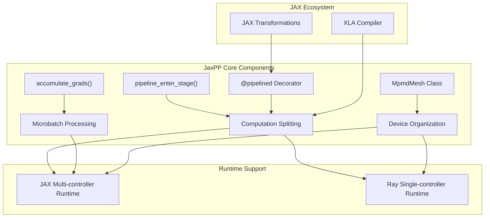

Sources: [README.md:1-12]()

### Component Roles and Relationships

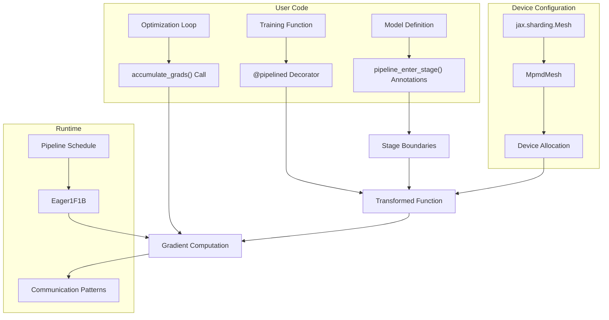

Sources: [README.md:42-110]()

## Core Functionality

JaxPP enables pipeline parallelism through three primary mechanisms:

1. **Stage Annotations**: The `pipeline_enter_stage()` function marks boundaries between pipeline stages in model code.
2. **Function Transformation**: The `@pipelined` decorator transforms regular JAX functions to operate in a pipelined fashion.
3. **Gradient Accumulation**: The `accumulate_grads()` function enables efficient processing of microbatches.

### Data Flow in Pipeline Parallelism

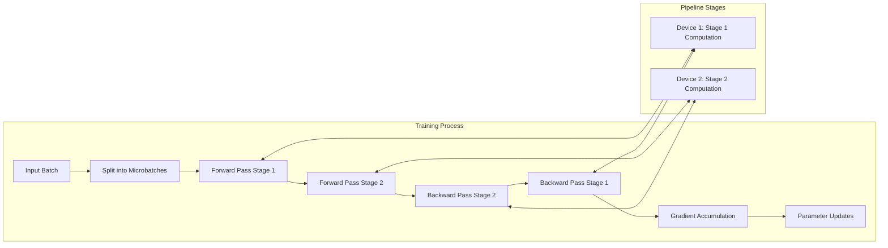

Sources: [README.md:74-99]()

## Usage Pattern

Using JaxPP involves a few specific patterns:

1. **Model Modification**: Add `pipeline_enter_stage()` calls at appropriate points in your model to define stage boundaries.
2. **Mesh Configuration**: Create a `MpmdMesh` to define your device topology.
3. **Training Function Decoration**: Apply the `@pipelined` decorator to your training step function.
4. **Gradient Accumulation**: Use `accumulate_grads()` to process microbatches efficiently.

### Typical Code Structure

| Component | Purpose | Example Location |
|-----------|---------|-----------------|
| Model Annotation | Mark pipeline stage boundaries | [README.md:45-72]() |
| MpmdMesh Creation | Configure device topology | [README.md:107-110]() |
| Pipelined Decoration | Transform training function | [README.md:83-84]() |
| Gradient Accumulation | Process microbatches | [README.md:90-95]() |

Sources: [README.md:42-110]()

## Parallelization Strategies

JaxPP supports multiple parallelization strategies that can be combined effectively:

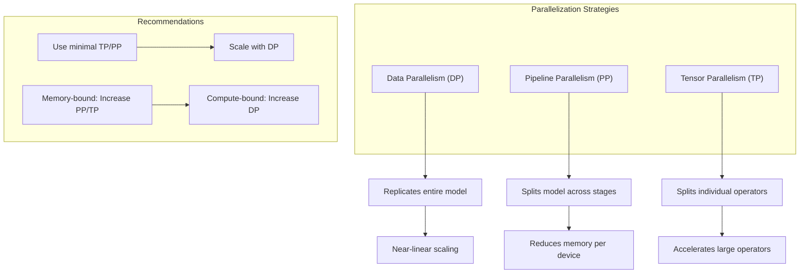

Sources: [README.md:176-177]()

## Runtime Support

JaxPP supports two runtime environments:

1. **JAX Multi-controller Runtime**: The default runtime where each device has its own controller.
2. **Ray Single-controller Runtime**: An experimental runtime built with Ray that uses a single controller.

## Current Status and Limitations

JaxPP is under active development with unstable APIs that may change. Key points to note:

- The library requires JAX 0.5.1, CUDA 12, and cuDNN 9
- It has been tested with several models from MaxText
- For multi-node setups, JaxPP must be installed on all participating nodes

## Installation and Testing

Basic installation requires cloning the repository and installing with pip:

```
git clone https://github.com/NVIDIA/jaxpp.git
cd jaxpp
pip install -e .
```

The repository also provides Docker containers for development and testing.

Sources: [README.md:24-32](), [README.md:115-164]()

## Example and Benchmarks

JaxPP includes basic examples that demonstrate its functionality, and it has been integrated into a fork of MaxText with minimal changes for benchmarking. The example in the README demonstrates how to use JaxPP with a Flax module and how to set up the training loop with gradient accumulation.

Sources: [README.md:40-113](), [README.md:176-177]()

---

# Page: Core Functionality

# Core Functionality

<details>
<summary>Relevant source files</summary>

The following files were used as context for generating this wiki page:

- [PERF_GUIDE.md](PERF_GUIDE.md)
- [README.md](README.md)

</details>


This page describes the main components and features of JaxPP that enable pipeline parallelism for JAX computations. JaxPP provides a set of tools to split JAX computations across multiple devices with minimal code changes, allowing efficient scaling of deep learning training workloads. For information about performance optimization strategies, see [Performance Optimization](#3).

## Overview of Core Components

JaxPP's core functionality revolves around four key components that work together to enable pipeline parallelism:

1. **`pipeline_enter_stage()`** - A function to mark boundaries between pipeline stages in model code
2. **`@pipelined` decorator** - Transforms functions to execute in a pipelined fashion across devices
3. **`accumulate_grads()`** - Manages gradient accumulation for pipeline-parallel training
4. **`MpmdMesh`** - Configures device meshes for Multiple-Program Multiple-Data (MPMD) execution

These components provide a seamless way to implement pipeline parallelism with minimal modifications to existing JAX code.

Sources: [README.md:3-8]()

## JaxPP Architecture

The following diagram illustrates the relationship between JaxPP's core components and how they interact with JAX:

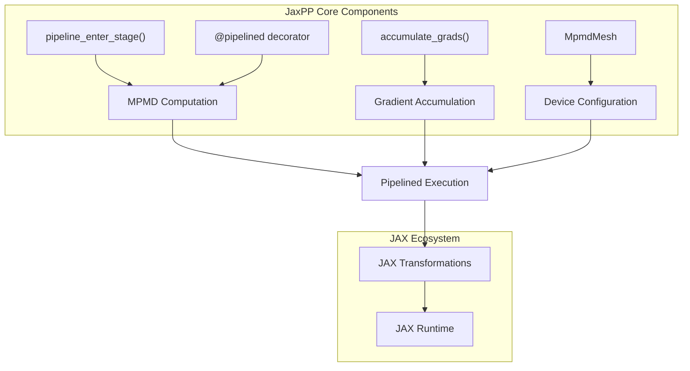

Sources: [README.md:3-8](), [README.md:41-113]()

## Pipeline Stage Management

JaxPP uses the `pipeline_enter_stage()` function to mark boundaries between pipeline stages in model code. This allows the library to automatically split computations across devices.

### How Pipeline Stages Work

In a pipelined model, the computation is divided into multiple stages that can run on different devices. The `pipeline_enter_stage()` function signals transitions between these stages:

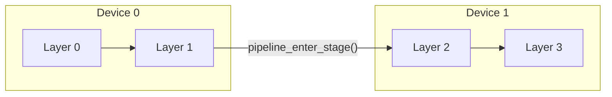

The code pattern typically involves inserting `pipeline_enter_stage()` calls at appropriate points in the model's forward pass, as shown in the example from README.md:

Sources: [README.md:44-72]()

## Pipelined Function Transformation

The `@pipelined` decorator transforms a function to execute in a pipelined fashion across multiple devices. This decorator takes a `mpmd_mesh` parameter that specifies the device configuration for pipeline parallelism.

### Function Transformation Flow

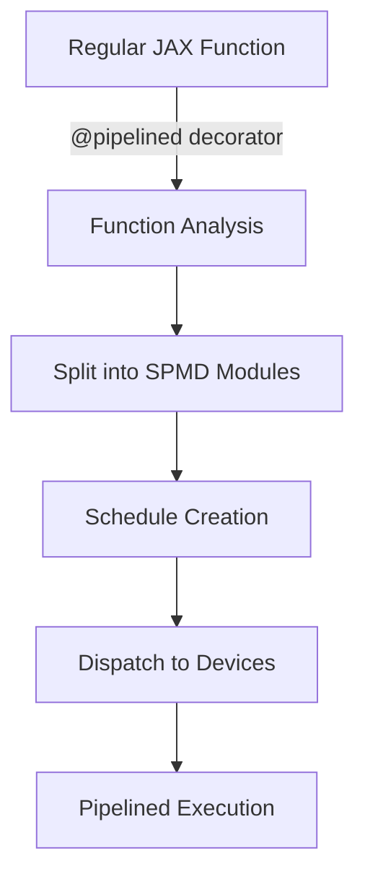

When a function is decorated with `@pipelined`, JaxPP:
1. Analyzes the function to identify pipeline stage boundaries
2. Splits the computation into multiple SPMD modules
3. Creates a pipeline schedule for executing these modules
4. Dispatches the modules to different devices according to the schedule

Sources: [README.md:83-99]()

## Gradient Accumulation

The `accumulate_grads()` function is a key component for training with pipeline parallelism. It manages the process of computing and accumulating gradients across multiple microbatches.

### Gradient Accumulation Process

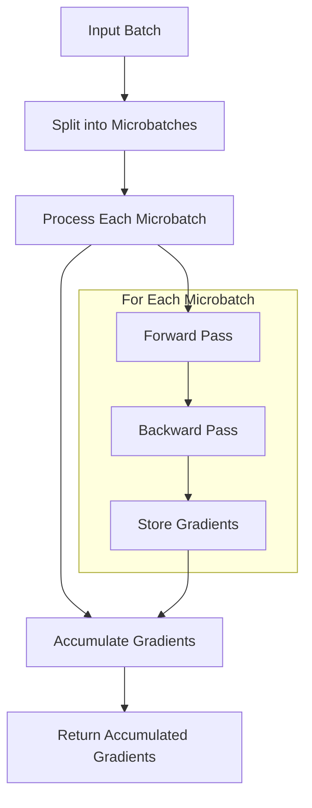

The `accumulate_grads()` function takes several parameters:
- A gradient function to apply to each microbatch
- The input batch to be split into microbatches
- Output shardings for controlling how results are distributed
- A schedule that defines the pipeline execution pattern

Sources: [README.md:90-95](), [PERF_GUIDE.md:44-62]()

## Device Mesh Configuration

The `MpmdMesh` class configures device meshes for Multiple-Program Multiple-Data (MPMD) execution. It wraps a standard JAX `Mesh` object and specifies which dimension corresponds to the MPMD execution.

### Device Mesh Structure

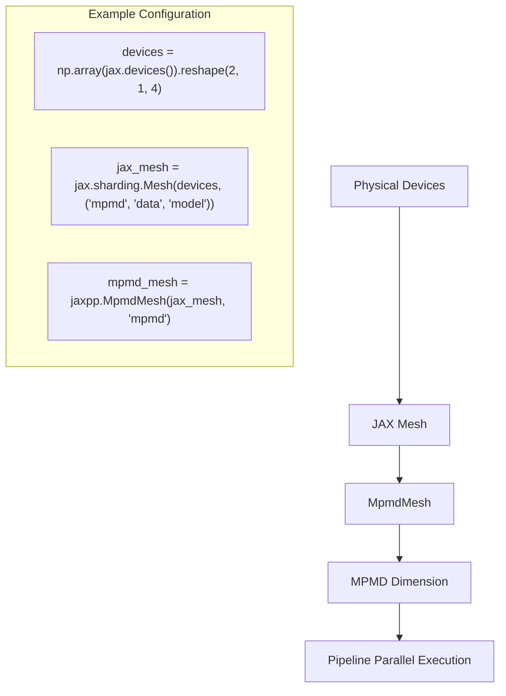

The `MpmdMesh` configuration defines how the pipeline stages are mapped to physical devices. In the example, the mesh is configured with dimensions for MPMD (pipeline parallelism), data parallelism, and model parallelism.

Sources: [README.md:102-111]()

## End-to-End Training Workflow

The following diagram illustrates how all the core components work together in a typical training workflow with JaxPP:

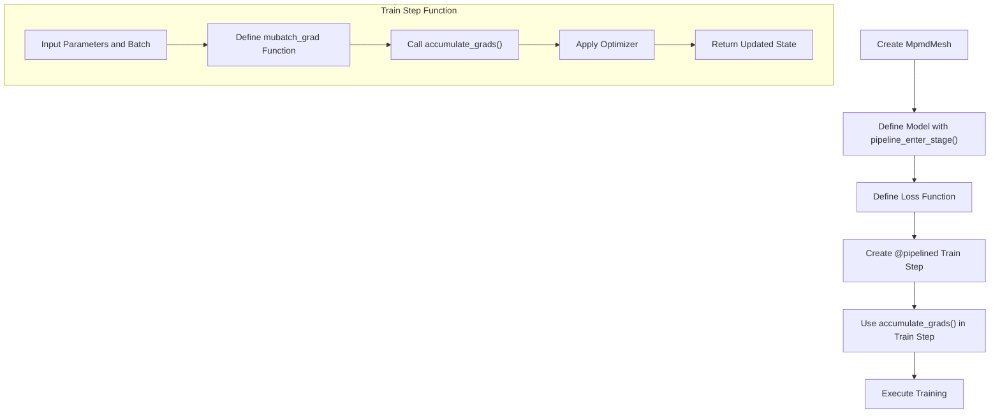

This workflow demonstrates how the different components of JaxPP are combined to implement pipeline-parallel training. The `@pipelined` decorator transforms the train step function, which uses `accumulate_grads()` to compute gradients across microbatches.

Sources: [README.md:41-99]()

## Three Phases of Pipeline-Parallel Training

JaxPP's pipeline parallelism implementation divides the training process into three distinct phases, each with different communication patterns:

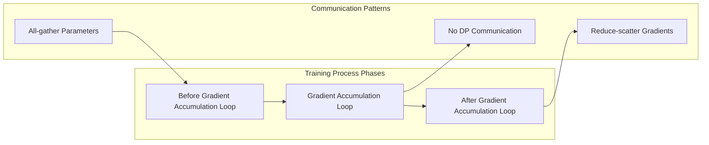

1. **Before Gradient Accumulation Loop**: Parameters are all-gathered across data-parallel ranks
2. **Gradient Accumulation Loop**: No data-parallel communication occurs during this phase
3. **After Gradient Accumulation Loop**: Gradients are reduce-scattered across data-parallel ranks

This organization optimizes the communication patterns to maximize training efficiency.

Sources: [PERF_GUIDE.md:27-70]()

## Integration with JAX Ecosystem

JaxPP is designed to integrate seamlessly with the JAX ecosystem, requiring minimal changes to existing JAX code:

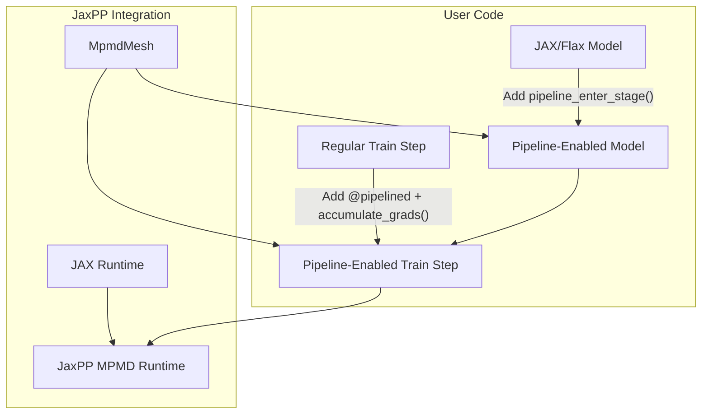

This integration pattern allows users to adopt pipeline parallelism with minimal code changes, while maintaining compatibility with existing JAX code.

Sources: [README.md:41-113]()

## Summary of Core Components

| Component | Purpose | Key Features |
|-----------|---------|--------------|
| `pipeline_enter_stage()` | Mark stage boundaries | Signals transitions between pipeline stages |
| `@pipelined` | Transform functions | Enables pipelined execution across devices |
| `accumulate_grads()` | Manage gradient accumulation | Processes microbatches according to schedule |
| `MpmdMesh` | Configure device mesh | Specifies MPMD dimension for pipeline parallelism |

These core components provide a comprehensive framework for implementing pipeline parallelism in JAX, enabling efficient training of large language models across multiple devices.

Sources: [README.md:3-8](), [README.md:41-113]()

---

# Page: Pipeline Parallelism API

# Pipeline Parallelism API

<details>
<summary>Relevant source files</summary>

The following files were used as context for generating this wiki page:

- [README.md](README.md)

</details>


## Purpose and Scope

This document details the Pipeline Parallelism API components in JaxPP, focusing on the `pipeline_enter_stage` function and the `@pipelined` decorator. These are the primary user-facing APIs that enable model-parallel training across multiple devices with minimal code changes. For information about configuring device meshes, see [MPMD Mesh Configuration](#2.2), and for details on gradient accumulation with pipeline parallelism, see [Gradient Accumulation](#2.3).

## Overview of Pipeline Parallelism

Pipeline parallelism is a distributed training technique that partitions a neural network model into sequential stages and assigns each stage to a different device. JaxPP implements this technique using two main components:

1. `pipeline_enter_stage()` - A function that marks transitions between pipeline stages in model code
2. `@pipelined` - A decorator that transforms functions to execute in a pipelined fashion across devices

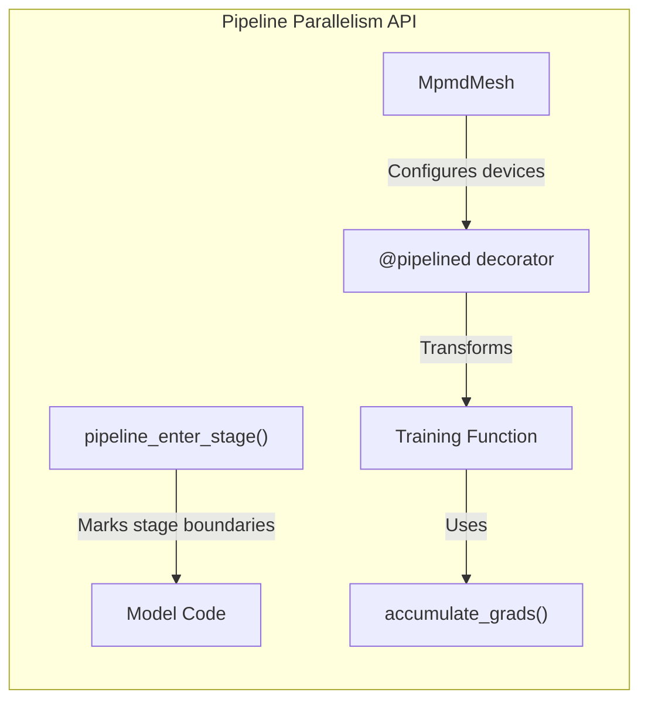

Sources: [README.md:3-5]()

## Pipeline Stage Annotation

### The `pipeline_enter_stage` Function

The `pipeline_enter_stage()` function is used to mark the boundary between different pipeline stages in your model. It serves as an annotation that tells JaxPP where to split the computation across devices.

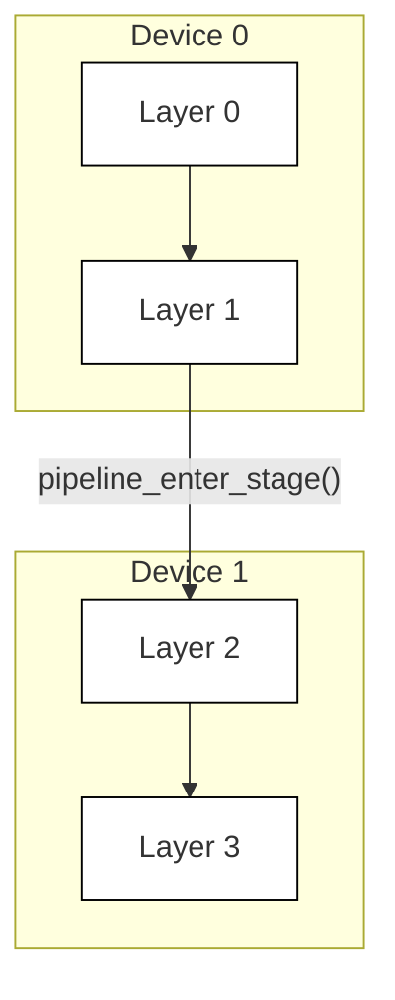

### Usage Pattern

When defining a model, you typically:

1. Determine how many pipeline stages you need (based on the number of devices)
2. Calculate how many layers should be assigned to each stage
3. Insert `pipeline_enter_stage()` calls at the appropriate boundaries

Here's the typical usage pattern from the README example:

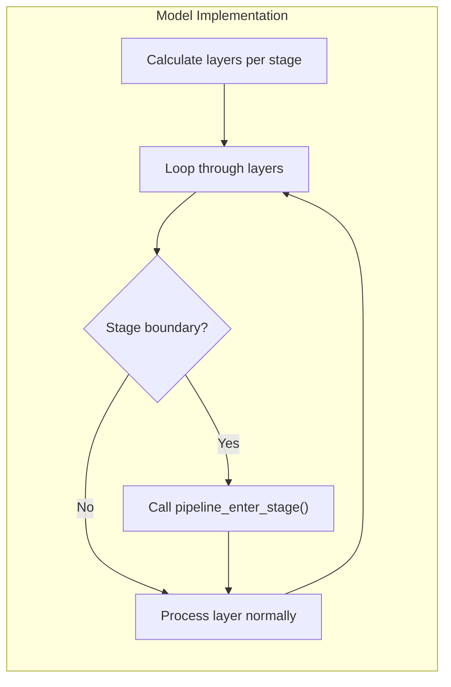

Sources: [README.md:58-71]()

## The Pipelined Decorator

### The `@pipelined` Decorator

The `@pipelined` decorator transforms a function to execute in a pipelined fashion across multiple devices. It works with an `MpmdMesh` object that defines the device configuration for pipeline parallelism.

When applied to a function (typically a training step function), the decorator:

1. Analyzes the function body to identify pipeline stages (marked with `pipeline_enter_stage()`)
2. Splits the computation into separate SPMD modules
3. Handles the necessary cross-device communication
4. Dispatches the modules to appropriate devices

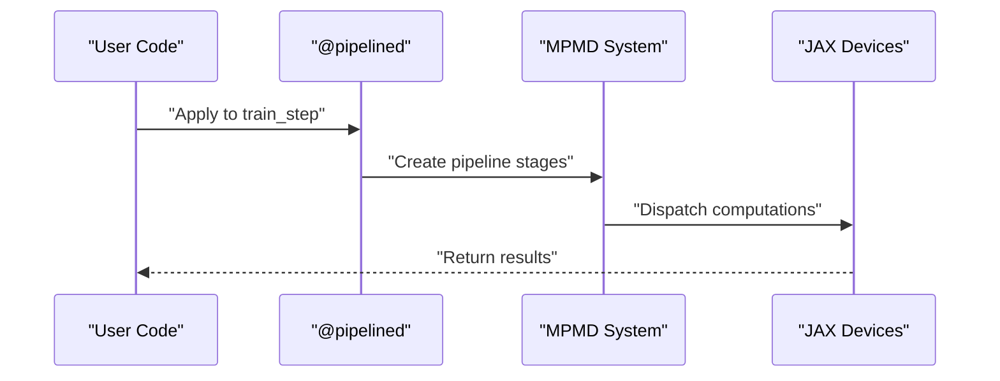

Sources: [README.md:80-84]()

### Integration with MpmdMesh

The `@pipelined` decorator requires an `mpmd_mesh` parameter, which is an instance of `MpmdMesh`. This object specifies which dimension of a JAX mesh represents the pipeline parallelism axis.

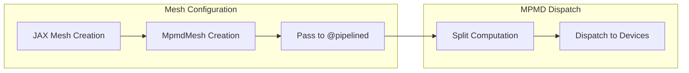

Sources: [README.md:102-111]()

## Pipeline Execution Flow

Pipeline parallelism in JaxPP typically involves processing data in micro-batches that flow through the pipeline stages. This is often combined with gradient accumulation to maintain optimization effectiveness.

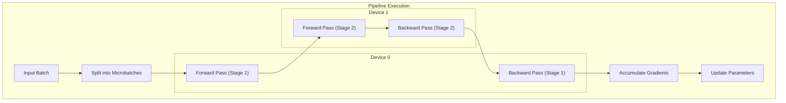

Sources: [README.md:85-99]()

### Pipeline Schedules

JaxPP supports different pipeline schedules to determine how micro-batches flow through the pipeline. The example in the README demonstrates the `Eager1F1B` (1 Forward 1 Backward) schedule with 2 pipeline stages.

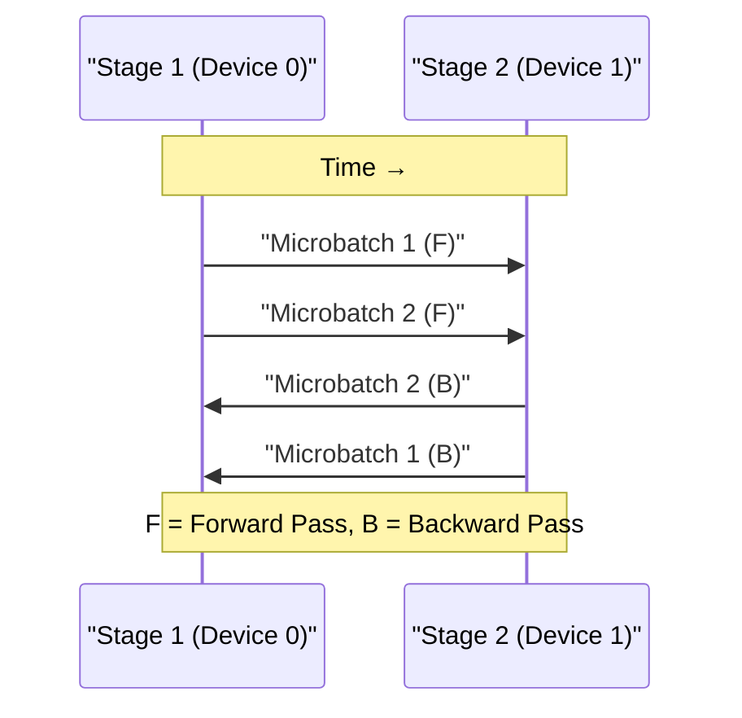

Sources: [README.md:94-95]()

## Complete Example Structure

Below is a diagram showing how all components interact in a typical JaxPP pipeline parallelism implementation:

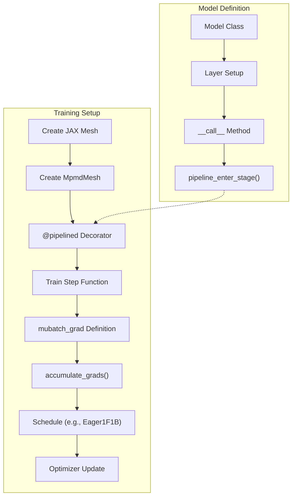

Sources: [README.md:45-111]()

## Usage Example

The following table illustrates the key components and their roles in implementing pipeline parallelism with JaxPP:

| Component | Purpose | Typical Location |
|-----------|---------|------------------|
| `pipeline_enter_stage()` | Marks transitions between pipeline stages | Inside model's forward pass |
| `@pipelined` | Transforms a function for pipelined execution | Applied to training step function |
| `MpmdMesh` | Configures devices for pipeline parallelism | Training setup code |
| `accumulate_grads()` | Manages gradient computation across microbatches | Inside pipelined function |

### Code Integration Pattern

A typical implementation follows this pattern:

1. Define a model that uses `pipeline_enter_stage()` to mark stage boundaries
2. Create a `MpmdMesh` object to configure device assignment
3. Define a training step function and decorate it with `@pipelined`
4. Inside this function, use `accumulate_grads()` with a chosen pipeline schedule
5. Apply optimizer updates as usual

Sources: [README.md:45-111]()

## Technical Implementation Details

The Pipeline Parallelism API works by:

1. Identifying computational boundaries marked with `pipeline_enter_stage()`
2. Splitting the JAX computation graph at these boundaries
3. Converting the split parts into independent SPMD modules
4. Scheduling the execution of these modules across devices according to the specified pipeline schedule
5. Managing the communication of intermediate results between pipeline stages
6. Accumulating gradients across multiple micro-batches

The API integrates with JAX's existing transformation and compilation systems while enabling a programming model that feels similar to single-device JAX code.

Sources: [README.md:7-8]()

---

# Page: MPMD Mesh Configuration

# MPMD Mesh Configuration

<details>
<summary>Relevant source files</summary>

The following files were used as context for generating this wiki page:

- [README.md](README.md)

</details>


## Purpose and Scope

This document explains how to configure device meshes for pipeline parallelism in JaxPP. Understanding MPMD mesh configuration is essential for effectively distributing JAX computations across multiple devices using the Multiple-Program Multiple-Data (MPMD) approach. For information about using the pipeline parallelism API, see [Pipeline Parallelism API](#2.1). For gradient accumulation details, see [Gradient Accumulation](#2.3).

## Introduction to MPMD Meshes

MPMD (Multiple-Program Multiple-Data) is a parallel computing paradigm where different programs operate on different data. In JaxPP, this allows different stages of a neural network to run on different devices. The `MpmdMesh` class in JaxPP configures these device allocations by wrapping JAX's standard `Mesh` object and specifying which dimension is used for pipeline parallelism.

```mermaid
graph TD
    subgraph "Mesh Configuration Hierarchy"
        A["jax.devices()"] --> B["JAX Device Array"]
        B --> C["jax.sharding.Mesh"]
        C --> D["jaxpp.MpmdMesh"]
        D --> E["@jaxpp.pipelined"]
    end
```

Sources: [README.md:106-110]()

## The MpmdMesh Class

The `MpmdMesh` class is a wrapper around JAX's standard `Mesh` class that specifically designates which dimension is used for MPMD pipeline parallelism.

### Key Features:

- Wraps a standard JAX mesh
- Designates the MPMD dimension used for pipeline parallelism
- Provides methods to retrieve the underlying mesh structure for lowering computations

```mermaid
classDiagram
    class MpmdMesh {
        +jax_mesh
        +mpmd_axis
        +lowering_mesh()
        +__init__(jax_mesh, mpmd_axis)
    }
    class JaxMesh {
        +devices
        +axis_names
    }
    MpmdMesh --> JaxMesh: wraps
```

Sources: [README.md:106-110]()

## Configuring an MPMD Mesh

Creating an MPMD mesh involves three main steps:
1. Obtaining JAX devices
2. Creating a JAX mesh with appropriate dimensions
3. Wrapping it with the `MpmdMesh` class

### Device Layout

The device layout defines how physical devices are arranged into logical dimensions. For pipeline parallelism, one dimension (typically named "mpmd") is used to separate pipeline stages.

```mermaid
flowchart LR
    subgraph "Device Layout for MPMD"
        A["Get devices\ndevices = jax.devices()"] --> B["Reshape devices\ndevices = np.array(devices).reshape(P, D, M)"]
        B --> C["Create JAX mesh\njax_mesh = jax.sharding.Mesh(devices, ('mpmd', 'data', 'model'))"]
        C --> D["Create MPMD mesh\nmpmd_mesh = jaxpp.MpmdMesh(jax_mesh, 'mpmd')"]
    end
```

Where:
- `P`: Number of pipeline stages (mpmd dimension)
- `D`: Data parallelism dimension
- `M`: Model/tensor parallelism dimension

Sources: [README.md:106-110]()

### Example Configuration

Here's an example of how to create an MPMD mesh with 2 pipeline stages, 1 data parallel dimension, and 4 model parallel devices:

```
devices = np.array(jax.devices()[0]).reshape(2, 1, 4)
jax_mesh = jax.sharding.Mesh(devices, ("mpmd", "data", "model"))
mpmd_mesh = jaxpp.MpmdMesh(jax_mesh, "mpmd")
```

The resulting mesh will have the dimensions: `OrderedDict([('mpmd', 1), ('data', 1), ('model', 1)])` for each lowering stage, as the mpmd dimension is handled separately in the pipeline parallelism implementation.

Sources: [README.md:106-110]()

## Device Mapping Visualization

The following diagram illustrates how a model is mapped to devices when using MPMD mesh configuration:

```mermaid
flowchart TD
    subgraph "Physical Devices"
        subgraph "Device 0-3"
            D0["Device 0"]
            D1["Device 1"]
            D2["Device 2"]
            D3["Device 3"]
        end
        
        subgraph "Device 4-7"
            D4["Device 4"]
            D5["Device 5"]
            D6["Device 6"]
            D7["Device 7"]
        end
    end
    
    subgraph "Logical Mesh (2×1×4)"
        subgraph "MPMD=0 (Stage 1)"
            M00["(0,0,0)"]
            M01["(0,0,1)"]
            M02["(0,0,2)"]
            M03["(0,0,3)"]
        end
        
        subgraph "MPMD=1 (Stage 2)"
            M10["(1,0,0)"]
            M11["(1,0,1)"]
            M12["(1,0,2)"]
            M13["(1,0,3)"]
        end
    end
    
    D0 --> M00
    D1 --> M01
    D2 --> M02
    D3 --> M03
    
    D4 --> M10
    D5 --> M11
    D6 --> M12
    D7 --> M13
```

Sources: [README.md:106-110]()

## Using MpmdMesh with Pipelined Functions

To use the configured MPMD mesh with pipeline parallelism, pass it to the `@jaxpp.pipelined` decorator:

```mermaid
graph TD
    subgraph "Pipeline Execution Flow"
        A["Configure MpmdMesh"] --> B["Apply @jaxpp.pipelined decorator with mpmd_mesh"]
        B --> C["Mark pipeline stages with pipeline_enter_stage()"]
        C --> D["Execute pipelined function"]
    end
```

### Application Example

```
# Configure MPMD mesh
devices = np.array(jax.devices()[0]).reshape(2, 1, 4)
jax_mesh = jax.sharding.Mesh(devices, ("mpmd", "data", "model"))
mpmd_mesh = jaxpp.MpmdMesh(jax_mesh, "mpmd")

# Apply to pipelined function
@partial(jaxpp.pipelined, mpmd_mesh=mpmd_mesh)
def pp_train_step(opt_state, pars, batch):
    # Function implementation
    ...
```

Sources: [README.md:83-99](), [README.md:106-110]()

## Multi-Dimensional Mesh Configuration

JaxPP's MPMD mesh supports multiple parallelism dimensions simultaneously, allowing for efficient scaling:

```mermaid
graph TD
    subgraph "Multi-Dimensional Parallelism"
        A["JaxPP Parallelism Dimensions"]
        A --> B["Pipeline Parallelism (MPMD)"]
        A --> C["Data Parallelism"]
        A --> D["Model/Tensor Parallelism"]
        
        B --> E["Splits model across stages"]
        C --> F["Replicates model for batch splitting"]
        D --> G["Splits individual layers"]
    end
```

### Example of 3D Mesh (2×2×4)

This configuration enables:
- 2 pipeline stages
- 2× data parallelism
- 4× model/tensor parallelism

This requires 16 devices total (2×2×4) and allows for training much larger models than would fit on a single device.

Sources: [README.md:106-110]()

## Mesh Dimension Considerations

When designing your MPMD mesh configuration, consider:

| Dimension | Purpose | Impact on Training |
|-----------|---------|-------------------|
| MPMD (Pipeline) | Divides model into sequential stages | Reduces memory per device, introduces pipeline bubbles |
| Data Parallel | Replicates model for batch processing | Near-linear scaling, increases memory requirements |
| Model/Tensor Parallel | Divides individual layers | Reduces memory usage, increases communication |

The general guidance is to use minimal MPMD/PP and TP dimensions (just enough to fit your model in memory), then scale the DP dimension for throughput.

## MPMD Mesh Integration with JAX Ecosystem

```mermaid
flowchart LR
    subgraph "JAX Ecosystem Integration"
        A["JAX Core"] --> B["jax.sharding.Mesh"]
        B --> C["jaxpp.MpmdMesh"]
        C --> D["@jaxpp.pipelined"]
        D --> E["Default Multi-Controller Runtime"]
        D --> F["Ray Single-Controller Runtime"]
    end
```

Sources: [README.md:10-11]()

## Conclusion

MPMD mesh configuration is a critical part of setting up pipeline parallelism in JaxPP. By properly configuring the device mesh and specifying the MPMD dimension, you can effectively distribute your model across multiple devices for efficient training of large language models.

For information on how to use the configured mesh with the pipeline parallelism API, see [Pipeline Parallelism API](#2.1). For details on gradient accumulation with pipeline parallelism, see [Gradient Accumulation](#2.3).

---

# Page: Gradient Accumulation

# Gradient Accumulation

<details>
<summary>Relevant source files</summary>

The following files were used as context for generating this wiki page:

- [PERF_GUIDE.md](PERF_GUIDE.md)
- [README.md](README.md)

</details>


## Purpose and Scope

This document describes the Gradient Accumulation functionality in JaxPP, a key component for efficient training of large language models. Gradient Accumulation (GA) allows for processing larger batches by breaking them into smaller microbatches, accumulating gradients across these microbatches, and then updating model parameters once. This technique is crucial for memory optimization in LLM training, especially when used with pipeline parallelism.

For information about Pipeline Parallelism API, see [Pipeline Parallelism API](#2.1).
For information about general Performance Optimization, see [Performance Optimization](#3).

## Core Concept

Gradient Accumulation is a technique that enables training with effectively larger batch sizes by:

1. Breaking a large batch into smaller microbatches
2. Computing gradients for each microbatch independently
3. Accumulating these gradients
4. Applying the accumulated gradients to update model parameters once

This approach allows training models that would otherwise not fit in GPU memory if processing the entire batch at once.

```mermaid
flowchart LR
    subgraph "Gradient Accumulation Process"
        direction TB
        A["Large Batch"] --> B["Split into Microbatches"]
        B --> C["Process Microbatch 1"]
        B --> D["Process Microbatch 2"]
        B --> E["Process Microbatch N"]
        C --> F["Accumulate Gradients"]
        D --> F
        E --> F
        F --> G["Apply Single Update"]
    end
```

Sources: [PERF_GUIDE.md:44-53](), [README.md:85-95]()

## The `accumulate_grads()` Function

The `accumulate_grads()` function is the primary API for gradient accumulation in JaxPP. It takes a gradient computation function and applies it to microbatches, accumulating the results.

### Function Signature and Parameters

```
jaxpp.accumulate_grads(
    mubatch_grad_fn,
    batch,
    out_shardings=None,
    schedule=jaxpp.Eager1F1B(n)
)
```

- `mubatch_grad_fn`: A function that computes gradients for a single microbatch
- `batch`: The input data batch to be split into microbatches
- `out_shardings`: Optional specifications for output sharding
- `schedule`: Pipeline schedule to use (e.g., Eager1F1B)

### Return Value

The function returns the accumulated gradients and any auxiliary outputs from the microbatch gradient function.

```mermaid
flowchart TD
    subgraph "accumulate_grads Function"
        direction TB
        A["Input: mubatch_grad_fn"] --> B["accumulate_grads()"]
        C["Input: batch"] --> B
        D["Input: schedule"] --> B
        B --> E["Output: Accumulated Gradients"]
        B --> F["Output: Auxiliary Values"]
    end
```

Sources: [README.md:90-95]()

## Memory Optimization Through Gradient Accumulation

Gradient Accumulation significantly reduces memory requirements during training by:

1. Processing smaller microbatches that require less activation memory
2. Avoiding storing all activations for the entire batch at once
3. Enabling effective use of pipeline parallelism with manageable memory footprint

### Memory Comparison

| Approach | Activation Memory Requirements | Benefits | Trade-offs |
|----------|-------------------------------|----------|------------|
| Full Batch | Proportional to batch size | Single forward/backward pass | High memory consumption |
| Gradient Accumulation | Proportional to microbatch size | Lower memory requirements | More computation steps |

Sources: [PERF_GUIDE.md:48-52]()

## Integration with Pipeline Parallelism

Gradient Accumulation is a crucial part of the three-phase computation approach used in pipeline parallelism with JaxPP:

```mermaid
flowchart TB
    subgraph "Pipeline Parallelism with Gradient Accumulation"
        direction TB
        A["1. Before GA Loop"] --> B["All-gather parameters across DP ranks"]
        B --> C["2. GA Loop"]
        C --> D["Process microbatches without DP communication"]
        D --> E["3. After GA Loop"]
        E --> F["Reduce-scatter gradients across DP ranks"]
    end
```

### The Three Phases

1. **Before GA Loop**: Parameters are cast to bf16 and all-gathered across DP ranks
2. **GA Loop**: Microbatches are processed without DP communication
3. **After GA Loop**: Gradients are reduced-scattered across DP ranks for synchronization

Sources: [PERF_GUIDE.md:27-71]()

## Usage in Training Step

Gradient Accumulation is typically used within a pipelined training step, as shown in this pattern:

```mermaid
flowchart TD
    subgraph "Training Step with Gradient Accumulation"
        direction TB
        A["Define mubatch_grad function"] --> B["Call accumulate_grads()"]
        B --> C["Receive accumulated gradients"]
        C --> D["Apply optimizer update"]
        D --> E["Return updated state"]
    end
```

A typical implementation pattern involves:

1. Defining a function to compute gradients for a single microbatch
2. Passing this function to `accumulate_grads()`
3. Applying the accumulated gradients with an optimizer

Sources: [README.md:83-99]()

## Performance Considerations

For optimal performance with Gradient Accumulation:

1. **Balance GA Iterations**: Reduce GA (loop iterations) to a minimum, even if it may increase pipeline bubbles
2. **Scheduling Optimization**: Use efficient schedules like Eager1F1B to minimize pipeline bubbles
3. **Memory vs. Computation**: Consider using rematerialization to trade more computation for less memory usage
4. **Activation Management**: Consider offloading activations of older microbatches to reduce memory pressure

Sources: [PERF_GUIDE.md:54-61]()

## Complete Example Usage

In this example, we see the typical pattern for using Gradient Accumulation in a JaxPP training step:

```mermaid
flowchart TB
    subgraph "Complete Gradient Accumulation Workflow"
        direction TB
        A["Define loss function"] --> B["Define pipelined train_step"]
        B --> C["Define mubatch_grad function"]
        C --> D["Call accumulate_grads()"]
        D --> E["Apply optimizer update"]
        E --> F["Return updated state"]
    end

    subgraph "accumulate_grads Process"
        direction TB
        G["Split batch into microbatches"] --> H["Apply mubatch_grad to microbatch 1"]
        G --> I["Apply mubatch_grad to microbatch 2"]
        G --> J["Apply mubatch_grad to microbatch n"]
        H --> K["Accumulate gradients"]
        I --> K
        J --> K
    end

    D --> G
```

The function `accumulate_grads()` handles splitting the batch, processing each microbatch, and accumulating the gradients, which significantly simplifies the implementation of pipeline parallelism with gradient accumulation.

Sources: [README.md:76-99]()

## Relationship with Other Parallelism Strategies

Gradient Accumulation complements other parallelism strategies in JaxPP:

| Strategy | Interaction with Gradient Accumulation |
|----------|----------------------------------------|
| Data Parallelism (DP) | GA loop operates without DP communication, improving efficiency |
| Pipeline Parallelism (PP) | GA enables efficient pipeline schedules across devices |
| Tensor Parallelism (TP) | GA helps reduce memory requirements, making TP more manageable |

The recommendation is to make TP and PP as small as possible (just enough to fit the model with activations in memory), then scale DP for near-linear throughput improvements.

Sources: [PERF_GUIDE.md:10-15](), [PERF_GUIDE.md:44-53]()

## Summary

Gradient Accumulation in JaxPP is a powerful technique that enables training larger models with limited memory resources. By processing smaller microbatches and accumulating gradients, it reduces memory requirements and integrates seamlessly with pipeline parallelism. The `accumulate_grads()` function provides a clean API for implementing this technique in your training code.

---

# Page: Performance Optimization

# Performance Optimization

<details>
<summary>Relevant source files</summary>

The following files were used as context for generating this wiki page:

- [PERF_GUIDE.md](PERF_GUIDE.md)

</details>


This page provides an overview of performance optimization strategies for training Large Language Models (LLMs) using JaxPP. It focuses on how to efficiently scale model training across multiple devices while maximizing throughput and minimizing memory usage. For specific implementation details of parallelization techniques, see [Parallelization Strategies](#3.1). For memory-specific optimizations, see [Memory Management](#3.2).

## Optimization Philosophy

The primary goal of JaxPP's performance optimization is to maximize training throughput (tokens/second) while efficiently utilizing available hardware. The recommended approach follows a key principle:

> Make Tensor Parallelism (TP) and Pipeline Parallelism (PP) as small as possible—just enough to fit the model with activations in memory—then scale Data Parallelism (DP) for near-linear throughput improvements.

Sources: [PERF_GUIDE.md:10-15]()

## Training Step Decomposition

When using pipeline parallelism, a training step can be decomposed into three distinct phases, each with different performance characteristics and optimization strategies.

```mermaid
flowchart LR
    subgraph "Training Step Phases"
        direction TB
        A["Before GA Loop"] --> B["GA Loop"]
        B --> C["After GA Loop"]
        
        subgraph "A: Before Loop"
            direction TB
            A1["Cast fp32 → bf16"] --> A2["All-gather across DP"]
            A2 --> A3["Zero gradients"]
        end
        
        subgraph "B: GA Loop (90% compute)"
            direction TB
            B1["Forward pass"] --> B2["Backward pass"]
            B2 --> B3["Accumulate gradients"]
        end
        
        subgraph "C: After Loop"
            direction TB
            C1["Reduce-scatter gradients"] --> C2["Apply optimizer"]
            C2 --> C3["Update parameters"]
        end
    end
```

Sources: [PERF_GUIDE.md:18-71]()

### Before Gradient Accumulation Loop

In this phase:

1. "Master" (fp32) model parameters are cast to bf16
2. All-gather operation is performed across data-parallel ranks
3. Initial zero gradients are allocated for accumulation

```mermaid
sequenceDiagram
    participant DP1 as "DP Rank 1"
    participant DP2 as "DP Rank 2"
    participant DPN as "DP Rank N"
    
    Note over DP1,DPN: Each rank has its own θ_DP (fp32 parameters)
    DP1->>DP1: Cast θ_DP to bf16
    DP2->>DP2: Cast θ_DP to bf16
    DPN->>DPN: Cast θ_DP to bf16
    
    Note over DP1,DPN: All-gather communication
    DP1->>DP2: Share parameters
    DP1->>DPN: Share parameters
    DP2->>DP1: Share parameters
    DP2->>DPN: Share parameters
    DPN->>DP1: Share parameters
    DPN->>DP2: Share parameters
    
    Note over DP1,DPN: All ranks now have complete θ̂ (replicated bf16 parameters)
    DP1->>DP1: Allocate ∇θ̂ (zero gradients)
    DP2->>DP2: Allocate ∇θ̂ (zero gradients)
    DPN->>DPN: Allocate ∇θ̂ (zero gradients)
```

Sources: [PERF_GUIDE.md:29-42]()

### Gradient Accumulation Loop

This is the most computation-heavy phase (approximately 90% of total computation). Key characteristics:

- No DP communication occurs
- Memory is primarily needed for microbatch activations
- Each iteration processes a microbatch of size: batch_size / gradient_accumulation_steps

Optimization techniques in this phase include:
- Pipeline scheduling (e.g., Zero Bubble)
- Activation rematerialization (trading computation for memory)
- Activation offloading for older microbatches

```mermaid
flowchart TB
    subgraph "GA Loop Optimization Techniques"
        direction TB
        A["GA Loop Memory Usage"] --> B["Activation Management"]
        A --> C["Computation Efficiency"]
        
        B --> B1["Rematerialization"]
        B --> B2["Activation Offloading"]
        
        C --> C1["Minimize TP/PP Collectives"]
        C --> C2["Reduce GA Steps"]
        C --> C3["Optimize Sharding Rules"]
    end
```

Sources: [PERF_GUIDE.md:44-62]()

### After Gradient Accumulation Loop

In this final phase:

1. DP-ranks perform reduce-scatter of their gradients to synchronize them
2. Each rank updates its portion of the model parameters
3. Optimizer state is updated

```mermaid
sequenceDiagram
    participant DP1 as "DP Rank 1"
    participant DP2 as "DP Rank 2"
    participant DPN as "DP Rank N"
    
    Note over DP1,DPN: Each rank has accumulated gradients ∇θ̂
    
    Note over DP1,DPN: Reduce-scatter communication
    DP1->>DP1: Prepare gradient shard
    DP2->>DP2: Prepare gradient shard
    DPN->>DPN: Prepare gradient shard
    
    DP1->>DP2: Share gradient part
    DP1->>DPN: Share gradient part
    DP2->>DP1: Share gradient part
    DP2->>DPN: Share gradient part
    DPN->>DP1: Share gradient part
    DPN->>DP2: Share gradient part
    
    Note over DP1,DPN: Each rank now has ∇θ̂_DP (its portion of gradients)
    DP1->>DP1: Update parameters θ_DP
    DP2->>DP2: Update parameters θ_DP
    DPN->>DPN: Update parameters θ_DP
    
    DP1->>DP1: Update optimizer state μθ_DP, νθ_DP
    DP2->>DP2: Update optimizer state μθ_DP, νθ_DP
    DPN->>DPN: Update optimizer state μθ_DP, νθ_DP
```

Sources: [PERF_GUIDE.md:63-71]()

## Memory-Performance Tradeoffs

Training LLMs involves several memory-performance tradeoffs that can be adjusted based on your specific hardware and model requirements.

| Technique | Memory Impact | Performance Impact | When to Use |
|-----------|---------------|-------------------|-------------|
| Gradient Accumulation | ↓ Memory usage by processing smaller microbatches | ↑ Training step time due to more loop iterations | When batch size is too large to fit in memory |
| Rematerialization | ↓ Memory usage by discarding and recomputing activations | ↑ Computation cost | When activations are a memory bottleneck |
| Precision Reduction | ↓ Memory usage by using lower precision (e.g., bf16) | Minimal impact if hardware supports it | Almost always beneficial on modern hardware |
| Activation Offloading | ↓ Memory usage by offloading older microbatch activations | ↑ I/O overhead | When compute/memory ratio is high |
| Optimizer State Offloading | ↓ Memory usage | ↑ I/O overhead | When using small DP with large optimizer state |

Sources: [PERF_GUIDE.md:22-25](), [PERF_GUIDE.md:48-55]()

## Scaling Strategy Recommendations

```mermaid
flowchart TD
    A["Start with model"] --> B["Model fits in single device?"]
    B -->|"Yes"| C["Use single device"]
    B -->|"No"| D["Add minimal TP to fit layers"]
    D --> E["Model with TP fits in single device?"]
    E -->|"Yes"| F["Use TP only"]
    E -->|"No"| G["Add minimal PP to fit model"]
    G --> H["Scale with DP for throughput"]
    H --> I["Optimize GA steps, scheduling"]
    I --> J["Fine-tune with rematerialization/offloading"]
```

### Practical Guidelines

1. **Minimize PP depth**: Keep pipeline stages to a minimum to reduce pipeline bubbles
2. **Reduce GA steps**: Minimize gradient accumulation iterations to reduce overhead, potentially at the cost of a higher bubble which can be recovered with better schedules
3. **Optimize communication**: In the GA loop, optimize TP/EP/CP/SP sharding rules to minimize collective operations
4. **Balance rematerialization**: Trade memory for computation by rematerializing activations when needed
5. **Consider memory hierarchy**: For models with small DP, consider offloading optimizer state to free up memory

Sources: [PERF_GUIDE.md:9-16](), [PERF_GUIDE.md:54-62]()

## Performance Debugging

When encountering performance issues, consider the following diagnostic approach:

```mermaid
flowchart TD
    A["Performance Issue"] --> B["Identify bottleneck"]
    
    B --> C["Memory bottleneck?"]
    C -->|"Yes"| D["Memory Optimization"]
    D --> D1["Increase TP/PP"]
    D --> D2["Add rematerialization"]
    D --> D3["Offload activations/optimizer state"]
    
    B --> E["Computation bottleneck?"]
    E -->|"Yes"| F["Computation Optimization"]
    F --> F1["Optimize TP/PP communication"]
    F --> F2["Improve pipeline scheduling"]
    F --> F3["Consider XLA flags"]
    
    B --> G["Communication bottleneck?"]
    G -->|"Yes"| H["Communication Optimization"]
    H --> H1["Reduce collective operations"]
    H --> H2["Use optimal DP sharding"]
    H --> H3["Optimize network topology"]
```

## Additional Resources

For more detailed information on performance optimization:

- Jax's scaling book on parallelization strategies: [Link to JAX scaling book](https://jax-ml.github.io/scaling-book/training)
- The Ultra-Scale Playbook for additional explanations and visualizations
- For B200 and other XLA flags, refer to [NVIDIA JAX-Toolbox documentation](https://github.com/NVIDIA/JAX-Toolbox/blob/main/rosetta/docs/GPU_performance.md#tips-for-good-llm-training-performance-on-blackwell-b200)

Sources: [PERF_GUIDE.md:3-7]()

---

# Page: Parallelization Strategies

# Parallelization Strategies

<details>
<summary>Relevant source files</summary>

The following files were used as context for generating this wiki page:

- [PERF_GUIDE.md](PERF_GUIDE.md)

</details>


This page describes the three main parallelization strategies supported by JaxPP: Data Parallelism (DP), Pipeline Parallelism (PP), and Tensor Parallelism (TP). It explains how each technique works, when to use them, and strategies for combining them effectively to achieve optimal performance when training large language models.

For related information on memory optimization techniques, see [Memory Management](#3.2). For details about optimizing the training loop phases, see [Training Loop Optimization](#3.3).

## Core Parallelization Principle

The central optimization principle in JaxPP can be summarized as:

> Make TP and PP as small as possible, just enough to fit the model with activations in memory. Then scale with DP since it scales nearly perfectly, doubling the throughput as we double the GPUs.

This principle guides all parallelization decisions when training large models with JaxPP.

Sources: [PERF_GUIDE.md:10-15]()

## Parallelization Types Overview

JaxPP supports three complementary parallelism strategies that can be combined to achieve optimal performance:

```mermaid
graph TD
    subgraph "Parallelization Strategies in JaxPP"
        A["Large Language Model"] --> B["Data Parallelism (DP)"]
        A --> C["Pipeline Parallelism (PP)"]
        A --> D["Tensor Parallelism (TP)"]
        
        B --> B1["Multiple identical copies of model"]
        B --> B2["Each processes different data samples"]
        B --> B3["Gradients synchronized across copies"]
        
        C --> C1["Model divided sequentially by layers"]
        C --> C2["Each device handles different stages"]
        C --> C3["Data flows through pipeline"]
        
        D --> D1["Individual operations/tensors split"]
        D --> D2["Same layer computed across devices"]
        D --> D3["Requires frequent synchronization"]
    end
```

Sources: [PERF_GUIDE.md:9-15]()

## Data Parallelism (DP)

Data Parallelism is the most scalable form of parallelism supported by JaxPP. It involves creating multiple identical copies of the model, each processing different data samples, and then synchronizing gradients to update the model.

### How Data Parallelism Works

```mermaid
flowchart LR
    subgraph "Data Parallelism (DP)"
        direction TB
        
        subgraph "Rank 0 Device"
            A1["Model Copy"] --- B1["Batch 1"]
            A1 --> C1["Gradients 1"]
        end
        
        subgraph "Rank 1 Device"
            A2["Model Copy"] --- B2["Batch 2"]
            A2 --> C2["Gradients 2"]
        end
        
        subgraph "Rank 2 Device"
            A3["Model Copy"] --- B3["Batch 3"]
            A3 --> C3["Gradients 3"]
        end
        
        D["Parameters (start)"] --> A1 & A2 & A3
        C1 & C2 & C3 --> E["Synchronized Gradients"]
        E --> F["Updated Parameters"]
        F --> A1 & A2 & A3
    end
```

### DP Communication Patterns

When using Data Parallelism, there are two main communication operations in a training step:

1. **Before gradient accumulation**: 
   - Master (fp32) parameters are cast to bf16
   - Parameters are all-gathered across DP ranks

2. **After gradient accumulation**: 
   - Gradients are reduce-scattered across DP ranks
   - Each DP rank contributes its computed gradients
   - Gradients are combined and distributed back to appropriate ranks

DP is highly efficient because communication only happens before and after the main computation loop, allowing it to scale nearly linearly with additional hardware.

Sources: [PERF_GUIDE.md:29-71]()

## Pipeline Parallelism (PP)

Pipeline Parallelism divides the model sequentially (by layers) across multiple devices, with each device responsible for a different stage of the model. This is particularly useful for large models that don't fit on a single device.

### How Pipeline Parallelism Works

```mermaid
sequenceDiagram
    participant Input
    participant Device1 as "Device 1 (Layers 0-n/3)"
    participant Device2 as "Device 2 (Layers n/3-2n/3)"
    participant Device3 as "Device 3 (Layers 2n/3-n)"
    participant Output
    
    Input->>Device1: Microbatch 1
    Device1->>Device2: Forward Activations
    Note over Device1: Process Microbatch 2
    Device2->>Device3: Forward Activations
    Note over Device2: Process Microbatch 1
    Device3->>Output: Forward Output
    Note over Device3: Process Microbatch 1
    Device3->>Device2: Backward Gradients
    Device2->>Device1: Backward Gradients
```

### PP Implementation in JaxPP

JaxPP implements Pipeline Parallelism through several key components:

1. `pipeline_enter_stage()` - Marks the boundaries between pipeline stages
2. `@pipelined` decorator - Transforms functions for efficient pipeline execution
3. `MpmdMesh` - Configures the device mesh for pipeline parallelism

### Optimizing Pipeline Parallelism

When using PP in JaxPP:

- Keep PP degree small to minimize pipeline bubbles
- Consider schedule optimization to improve pipeline efficiency
- Pipeline length affects the training dynamics due to bubbles

Sources: [PERF_GUIDE.md:9-15]()

## Tensor Parallelism (TP)

Tensor Parallelism splits individual operations or tensors across multiple devices. This allows a single layer or operation to be computed in parallel across multiple devices.

### How Tensor Parallelism Works

```mermaid
graph TD
    subgraph "Tensor Parallelism Example"
        A["Large Matrix Multiplication"] --> B["Split Matrix into Blocks"]
        
        B --> C1["Device 1: Block 1,1"]
        B --> C2["Device 2: Block 1,2"]
        B --> C3["Device 3: Block 2,1"]
        B --> C4["Device 4: Block 2,2"]
        
        C1 & C2 & C3 & C4 --> D["Combine Results"]
    end
```

### When to Use Tensor Parallelism

Tensor Parallelism is beneficial when:

- Individual layers don't fit in single device memory
- Operations have high arithmetic intensity that can benefit from parallelization
- When combined with other strategies (PP and DP)

Tensor Parallelism typically requires frequent device-to-device communication, making it less efficient for scaling than Data Parallelism.

Sources: [PERF_GUIDE.md:10-15](), [PERF_GUIDE.md:57-58]()

## Combining Parallelization Strategies

JaxPP's power comes from the ability to combine all three parallelization strategies for maximum efficiency and scale.

```mermaid
graph TB
    subgraph "JaxPP Parallelization Strategy"
        A["LLM Model"] --> B["Apply Minimal TP"]
        B --> C["Apply Minimal PP"]
        C --> D["Scale with DP"]
        
        E["Memory Constraints"] --> B
        F["Layer Size"] --> B
        G["Model Depth"] --> C
        H["Available Hardware"] --> D
    end
```

### Optimal Strategy Selection

For most LLM training scenarios with JaxPP, follow this approach:

1. **First, apply minimal TP** - Just enough to fit the largest layers in memory
2. **Then, apply minimal PP** - Just enough to fit the entire model with activations
3. **Finally, scale with DP** - Use remaining devices for data parallelism

This strategy minimizes communication overhead while maximizing throughput.

Sources: [PERF_GUIDE.md:10-15]()

## Memory and Performance Tradeoffs

Each parallelization strategy comes with specific memory and performance implications:

| Strategy | Memory Benefit | Performance Impact | Communication Pattern |
|----------|----------------|---------------------|----------------------|
| Data Parallelism (DP) | Linear reduction in per-device batch size | Near-linear scaling | All-gather before GA, reduce-scatter after GA |
| Pipeline Parallelism (PP) | Linear reduction in per-device model size | Affected by pipeline bubbles | Activation passing between stages |
| Tensor Parallelism (TP) | Can split individual large tensors | Frequent communication overhead | All-to-all within layer operations |

Sources: [PERF_GUIDE.md:27-71]()

## Parallelization Impact on Training Loop

Understanding how parallelization affects the training loop is crucial for optimization:

```mermaid
flowchart TD
    subgraph "Training Loop with Parallelization in JaxPP"
        A["Start Training Step"] --> B["Before GA Loop"]
        B --> C["GA Loop"]
        C --> D["After GA Loop"]
        
        subgraph "Before GA Loop"
            E["Cast parameters to bf16"] --> F["All-gather parameters across DP ranks"]
            F --> G["Allocate zero gradients"]
        end
        
        subgraph "GA Loop (No DP Communication)"
            H["Process microbatches through pipeline"] --> I["Accumulate gradients"]
        end
        
        subgraph "After GA Loop"
            K["Reduce-scatter gradients across DP ranks"] --> L["Update parameters"]
        end
    end
```

The combination of parallelization strategies affects each phase differently:

- **DP impacts** primarily the before and after phases (communication)
- **PP impacts** primarily the GA loop (pipeline efficiency)
- **TP impacts** operations within each stage of the pipeline

Sources: [PERF_GUIDE.md:17-71]()

## Parallelization Strategy Examples

### Small Model Strategy
For models that almost fit on a single device:
- No or minimal TP
- PP across 2-4 devices
- Scale with DP across remaining devices

### Medium Model Strategy
For models requiring multiple devices:
- Minimal TP (2-4 way)
- PP across 4-8 devices
- Scale with DP across remaining devices

### Large Model Strategy
For very large models:
- TP scaled as needed (4-8 way)
- PP across 8-16 devices
- Scale with DP across remaining devices

Sources: [PERF_GUIDE.md:10-15]()

## Additional Resources

For more information about parallelization approaches, JaxPP recommends these resources:

1. [Jax's scaling book](https://jax-ml.github.io/scaling-book), particularly the section on [Parallelization](https://jax-ml.github.io/scaling-book/training)
2. [The Ultra-Scale Playbook](https://huggingface.co/spaces/nanotron/ultrascale-playbook) for additional explanations and visualizations

Sources: [PERF_GUIDE.md:3-6]()

---

# Page: Memory Management

# Memory Management

<details>
<summary>Relevant source files</summary>

The following files were used as context for generating this wiki page:

- [PERF_GUIDE.md](PERF_GUIDE.md)

</details>


This page details the memory optimization techniques and strategies used in JaxPP for efficient Large Language Model (LLM) training. It focuses on how to manage GPU memory consumption, which is a critical bottleneck when training large models. For information about parallelization strategies that affect memory usage, see [Parallelization Strategies](#3.1).

## Memory Challenges in LLM Training

LLM training faces several memory constraints that must be carefully managed:

```mermaid
flowchart TD
    A["Memory Constraints in LLM Training"] --> B["Model Parameters"]
    A --> C["Optimizer States"]
    A --> D["Activations"]
    A --> E["Gradients"]
    A --> F["Temporary Buffers"]
    
    style A stroke-width:2px
    style B stroke-width:1px
    style C stroke-width:1px
    style D stroke-width:1px
    style E stroke-width:1px
    style F stroke-width:1px
```

Sources: [PERF_GUIDE.md:19-26]()

## Memory Components Breakdown

Understanding the memory footprint of different components is essential for effective optimization:

| Component | Description | Scale | Optimization Techniques |
|-----------|-------------|-------|-------------------------|
| Model Parameters (θ) | Weights of the neural network | Scales with model size | Precision reduction, parameter sharding |
| Optimizer States (μθ, νθ) | First and second moments in optimizers like Adam | 2x model size for Adam | Optimizer state offloading, sharding |
| Activations | Intermediate outputs between layers | Scales with batch size and model depth | Rematerialization, activation offloading |
| Gradients | Derivatives used for parameter updates | Same size as model parameters | Gradient accumulation, precision reduction |

Sources: [PERF_GUIDE.md:19-26](), [PERF_GUIDE.md:48-52]()

## Key Memory Optimization Techniques

JaxPP implements several techniques to optimize memory usage during training:

```mermaid
graph TD
    subgraph "JaxPP Memory Optimization Techniques"
        A["Memory Optimization"] --> B["Precision Reduction"]
        B --> B1["fp32 → bf16 Casting"]
        
        A --> C["Gradient Accumulation"]
        C --> C1["Process Smaller Microbatches"]
        C --> C2["Reduce Memory Requirements"]
        
        A --> D["Activation Management"]
        D --> D1["Rematerialization<br>(Recompute vs. Store)"]
        D --> D2["Activation Offloading<br>(Store in CPU/NVMe)"]
        
        A --> E["Parallel Computing"]
        E --> E1["Minimize TP/PP"]
        E --> E2["Maximize DP"]
        
        A --> F["Efficient Scheduling"]
        F --> F1["Zero-Bubble Schedule"]
    end
```

Sources: [PERF_GUIDE.md:10-15](), [PERF_GUIDE.md:33-35](), [PERF_GUIDE.md:48-62]()

### Precision Reduction

Converting from higher precision (fp32) to lower precision (bf16) significantly reduces memory footprint:

- Model parameters are typically stored in fp32 ("master weights")
- During training, parameters are cast to bf16 before computation
- This reduces memory requirements by approximately 50%
- Maintains training stability while conserving memory

Sources: [PERF_GUIDE.md:33-35]()

### Gradient Accumulation

Gradient Accumulation (GA) divides a large batch into smaller microbatches that are processed sequentially:

```mermaid
sequenceDiagram
    participant B as "Full Batch (Size X)"
    participant M1 as "Microbatch 1 (Size X/GA)"
    participant M2 as "Microbatch 2 (Size X/GA)"
    participant Mn as "Microbatch n (Size X/GA)"
    participant G as "Gradient Accumulator"
    
    B ->> M1: Split
    B ->> M2: Split
    B ->> Mn: Split
    
    Note over M1,Mn: Process sequentially
    
    M1 ->> G: Add gradients
    M2 ->> G: Add gradients
    Mn ->> G: Add gradients
    
    Note over G: Combined effect equivalent<br>to processing full batch
```

Benefits:
- Reduces peak memory usage by processing smaller chunks
- Enables training larger models without sacrificing batch size
- Memory requirements scale with microbatch size rather than full batch size

Sources: [PERF_GUIDE.md:44-50]()

### Activation Management

#### Rematerialization

Rematerialization trades computation for memory by recomputing activations during backpropagation rather than storing them:

- Forward pass activations are discarded after use
- During backward pass, activations are recomputed when needed
- Reduces memory footprint at the cost of additional computation
- Configurable to balance memory savings vs. computational overhead

#### Activation Offloading

Moves activations to slower but more abundant memory when not immediately needed:

- Stores activations in CPU memory or NVMe storage
- Transfers back to GPU when required for backward pass
- Enables handling larger models with limited GPU memory
- Particularly useful for older microbatches in the pipeline

Sources: [PERF_GUIDE.md:51-54]()

## Memory Management During Training Phases

JaxPP's training process is divided into three phases, each with specific memory management strategies:

```mermaid
flowchart LR
    subgraph "Memory Management Across Training Phases"
        A["1. Before GA Loop"] --> B["2. GA Loop"] --> C["3. After GA Loop"]
        
        A --> A1["Cast fp32→bf16"]
        A --> A2["All-gather parameters<br>across DP ranks"]
        A --> A3["Allocate zero gradients"]
        
        B --> B1["No DP communication"]
        B --> B2["Manage activations<br>(rematerialization/offloading)"]
        B --> B3["Accumulate gradients"]
        
        C --> C1["Reduce-scatter gradients<br>across DP ranks"]
        C --> C2["Update parameters<br>and optimizer state"]
    end
```

Sources: [PERF_GUIDE.md:27-71]()

### Before Gradient Accumulation Loop

```mermaid
flowchart LR
    subgraph "Before GA Loop"
        A["Master Parameters<br>(θ_DP in fp32)"] --> B["Cast to bf16<br>(θ̂_DP)"]
        B --> C["All-gather across DP<br>(θ̂ replicated)"]
        D["Allocate Zero Gradients<br>(∇θ̂)"]
    end
```

Memory operations:
- Cast full-precision (fp32) parameters to lower precision (bf16)
- Perform all-gather operation across data-parallel ranks
- Allocate memory for gradient accumulation

Sources: [PERF_GUIDE.md:29-42]()

### During Gradient Accumulation Loop

This phase is the most memory-intensive and computation-heavy part of training:

- Processes microbatches sequentially
- No communication between DP ranks (lower communication overhead)
- Primary memory consumption is from activations
- Applies rematerialization and offloading strategies to manage memory
- Gradients are accumulated into the pre-allocated buffer

Sources: [PERF_GUIDE.md:44-62]()

### After Gradient Accumulation Loop

Final phase that synchronizes and applies the accumulated gradients:

- Performs reduce-scatter operation for gradients across DP ranks
- Each DP rank receives a portion of the final gradients
- Updates parameters and optimizer states
- Optimizer state offloading can be applied here if needed

Sources: [PERF_GUIDE.md:63-71]()

## Memory Optimization Guidelines

To maximize memory efficiency when training large models with JaxPP:

1. **Minimize TP and PP requirements**: Use just enough for model+activations to fit in memory
   - Smaller PP reduces pipeline bubbles and improves efficiency
   - Excessive TP increases communication overhead

2. **Scale DP** for near-linear throughput improvements
   - DP scales almost perfectly with more GPUs

3. **Balance memory vs. computation**:
   - More rematerialization reduces memory at the cost of computation
   - Consider hardware capabilities when setting this tradeoff

4. **Optimize GA settings**:
   - Reduce GA (loop iterations) to minimize computation overhead
   - May increase pipeline bubbles, which can be mitigated with better scheduling

5. **Consider memory efficiency in scheduling**:
   - Zero-Bubble (ZB) scheduling can improve efficiency

Sources: [PERF_GUIDE.md:9-15](), [PERF_GUIDE.md:54-62]()

## Memory Consumption Visualization

```mermaid
graph TD
    subgraph "Memory Utilization Across Training Steps"
        A["Training Step Start"]
        B["Before GA Loop<br>- All-gather parameters<br>- Allocate gradients"]
        C["During GA Loop<br>- Process microbatches<br>- Manage activations"]
        D["After GA Loop<br>- Reduce-scatter gradients<br>- Update parameters"]
        E["Training Step End"]
        
        A --> B --> C --> D --> E
        
        classDef memoryPeak fill:#f9f9f9,stroke:#333,stroke-width:2px
        class C memoryPeak
    end
```

Memory peaks during the GA loop due to activation storage, which is why activation management techniques (rematerialization and offloading) are critical for enabling training of larger models.

Sources: [PERF_GUIDE.md:48-52]()

## Relationship Between Memory Management and Parallelization

```mermaid
graph TD
    subgraph "Memory and Parallelization Strategy"
        A["JaxPP Memory Management"] --> B["Data Parallelism (DP)"]
        A --> C["Tensor Parallelism (TP)"]
        A --> D["Pipeline Parallelism (PP)"]
        
        B --> B1["Replicates model<br>Shards data"]
        B --> B2["Memory scales with<br>model size/DP rank"]
        
        C --> C1["Shards model layers<br>across devices"]
        C --> C2["Reduces per-device<br>memory for parameters"]
        
        D --> D1["Splits model stages<br>across devices"]
        D --> D2["Reduces per-device<br>memory for activations"]
        
        A --> E["Memory Optimization<br>Techniques"]
        E --> E1["Precision Reduction"]
        E --> E2["Gradient Accumulation"]
        E --> E3["Rematerialization"]
        E --> E4["Activation Offloading"]
    end
```

The memory management approach in JaxPP is tightly integrated with its parallelization strategy:

1. Use minimal TP/PP to fit the model and activations in memory
2. Scale DP to increase throughput
3. Apply memory optimization techniques throughout the training process

Sources: [PERF_GUIDE.md:10-15]()

## Conclusion

Effective memory management is crucial for training large language models. JaxPP provides various techniques to optimize memory usage, including precision reduction, gradient accumulation, rematerialization, and activation offloading. By carefully applying these techniques and balancing them with parallelization strategies, it's possible to train larger models more efficiently on limited hardware resources.

---

# Page: Training Loop Optimization

# Training Loop Optimization

<details>
<summary>Relevant source files</summary>

The following files were used as context for generating this wiki page:

- [PERF_GUIDE.md](PERF_GUIDE.md)

</details>


This page explains how JaxPP optimizes the training loop during pipeline-parallel training of large language models. It focuses on the three distinct phases of computation that occur during a training step and the optimization techniques applicable to each phase. For information about pipeline parallelism configuration, see [Pipeline Parallelism API](#2.1), and for general memory management techniques, see [Memory Management](#3.2).

## Training Loop Structure

When using pipeline parallelism in JaxPP, the training step is decomposed into three distinct phases, each with different memory requirements, communication patterns, and optimization opportunities.

```mermaid
flowchart TD
    subgraph "Three Phases of Training Step"
        A["1. Before GA Loop"] --> B["2. GA Loop"]
        B --> C["3. After GA Loop"]
    end

    subgraph "Operations"
        A --> A1["Cast parameters to bf16"]
        A --> A2["All-gather across DP ranks"]
        A --> A3["Initialize zero gradients"]
        
        B --> B1["Forward passes"]
        B --> B2["Backward passes"]
        B --> B3["Gradient accumulation"]
        
        C --> C1["Reduce-scatter gradients"]
        C --> C2["Apply optimizer"]
        C --> C3["Update parameters"]
    end

    subgraph "Communication"
        A2 --> D1["Collective: all-gather"]
        B3 --> D2["No DP communication"]
        C1 --> D3["Collective: reduce-scatter"]
    end
```

Sources: [PERF_GUIDE.md:27-71]()

## Phase 1: Before Gradient Accumulation Loop

The first phase prepares the model parameters for the gradient accumulation loop and initializes the gradient accumulation buffer.

### Operations and Memory Flow

```mermaid
flowchart LR
    subgraph "Before GA Loop"
        A["θ_DP (fp32 parameters)"] --> B["Cast to bf16"]
        B --> C["θ̂_DP (bf16 parameters)"]
        C --> D["All-gather across DP ranks"]
        D --> E["θ̂ (replicated parameters)"]
        F["Initialize zero gradients"] --> G["∇θ̂ (gradient buffer)"]
    end
```

In this phase:
1. The "master" model parameters (θ_DP) in fp32 precision are cast to bf16 precision (θ̂_DP)
2. These bf16 parameters are then all-gathered across data-parallel ranks to produce replicated parameters (θ̂)
3. A gradient buffer (∇θ̂) is initialized with zeros to accumulate gradients during the GA loop

The all-gather operation is a significant communication cost but happens only once per training step.

Sources: [PERF_GUIDE.md:29-42]()

## Phase 2: Gradient Accumulation Loop

The gradient accumulation loop is the most computation-intensive phase, accounting for approximately 90% of the computation in a training step.

### Loop Structure and Optimizations

```mermaid
flowchart TD
    subgraph "GA Loop"
        A["Microbatch"] --> B["Forward pass through pipeline stages"]
        B --> C["Backward pass through pipeline stages"]
        C --> D["Accumulate gradients ∇θ̂"]
        D --> E["Next microbatch"]
        E --> B
    end
    
    subgraph "Memory Optimizations"
        F["Rematerialization"] --> G["Recompute activations vs. store them"]
        H["Activation Offloading"] --> I["Offload older microbatch activations"]
        J["Pipeline Scheduling"] --> K["Zero Bubble (ZB) scheduling"]
    end
    
    subgraph "Computation vs. Memory Tradeoff"
        L["More GA iterations"] --> M["Less memory per microbatch"]
        M --> N["Smaller bubbles"]
        L --> O["More total computation"]
    end
```

Key characteristics of this phase:
1. No data-parallel communication occurs during this loop
2. Memory requirements include the replicated parameters and activations for processing microbatches
3. Activations often consume a large portion of memory
4. The number of GA iterations directly affects memory usage (fewer iterations = larger microbatches = more memory)

Optimization techniques:
1. **Rematerialization**: Trading computation for memory by recomputing activations instead of storing them
2. **Activation Offloading**: Moving older microbatch activations to host memory or other storage
3. **Pipeline Scheduling**: Using optimal schedules like Zero Bubble (ZB) to minimize pipeline bubbles
4. **Sharding Rules**: Optimizing tensor/expert/custom/sequence parallelism to minimize collectives

Sources: [PERF_GUIDE.md:44-62]()

## Phase 3: After Gradient Accumulation Loop

The final phase synchronizes the accumulated gradients across data-parallel ranks and updates the model parameters.

### Operations and Parameter Update

```mermaid
flowchart LR
    subgraph "After GA Loop"
        A["∇θ̂ (accumulated gradients)"] --> B["Reduce-scatter across DP ranks"]
        B --> C["∇θ̂_DP (sharded gradients)"]
        
        D["θ_DP (fp32 parameters)"] --> E["Apply optimizer"]
        C --> E
        
        F["μθ_DP, νθ_DP (optimizer state)"] --> E
        
        E --> G["θ_DP' (updated parameters)"]
        E --> H["μθ_DP', νθ_DP' (updated optimizer state)"]
    end
```

In this phase:
1. Each data-parallel rank has accumulated identical gradients (∇θ̂)
2. A reduce-scatter operation combines and distributes these gradients, so each rank gets its portion (∇θ̂_DP)
3. The optimizer (e.g., Adam) uses these gradients along with its state (μθ_DP, νθ_DP) to update the parameters
4. The result is updated parameters (θ_DP') and optimizer state (μθ_DP', νθ_DP')

The reduce-scatter operation is more memory-efficient than an all-reduce because each rank only needs its portion of the gradients to update its portion of the parameters.

Sources: [PERF_GUIDE.md:63-71]()

## Optimization Strategies and Recommendations

Here are key strategies for optimizing the training loop in JaxPP:

| Strategy | Description | Trade-offs |
|----------|-------------|------------|
| Minimize GA iterations | Reduce the number of loop iterations to minimize computation | Requires more memory per microbatch |
| Rematerialization | Recompute activations instead of storing them | Increases computation but reduces memory |
| Activation offloading | Move older microbatch activations to host memory | Adds I/O overhead but reduces GPU memory usage |
| Zero Bubble scheduling | Optimize pipeline scheduling to minimize bubbles | May require more complex implementation |
| Optimize TP/PP size | Keep tensor and pipeline parallelism as small as possible | Must be large enough to fit model in memory |
| Scale DP | Increase data parallelism for near-linear throughput scaling | Requires efficient collective operations |

### Memory vs. Performance Balance

```mermaid
flowchart TD
    subgraph "Optimal Training Loop Optimization"
        A["Minimize TP & PP"] --> B["Just enough to fit model + activations in memory"]
        B --> C["Use minimal GA iterations"]
        C --> D["Apply Zero Bubble scheduling"]
        D --> E["Scale with Data Parallelism"]
        
        F["If memory constrained"] --> G["Increase GA iterations"]
        G --> H["Apply rematerialization"]
        H --> I["Consider activation offloading"]
    end
```

The key principle in JaxPP training loop optimization is to:
1. Make TP and PP as small as possible, just enough to fit the model with activations in memory
2. Keep PP small to avoid long pipelines with more bubbles
3. Reduce GA to a minimum, possibly trading for a higher bubble that can be recovered with better scheduling
4. Scale with DP for near-linear throughput improvement

Sources: [PERF_GUIDE.md:9-15](), [PERF_GUIDE.md:54-62]()

## Implementation in JaxPP

The training loop optimization in JaxPP is primarily implemented through the `accumulate_grads()` function, which handles the three phases described above. This function is a key part of the pipeline parallelism API and works in conjunction with the `@pipelined` decorator and `pipeline_enter_stage()` function.

For specific implementation details and usage examples, see [Gradient Accumulation](#2.3).

Sources: [PERF_GUIDE.md:17-25]()

---

# Page: Development Guide

# Development Guide

<details>
<summary>Relevant source files</summary>

The following files were used as context for generating this wiki page:

- [Makefile](Makefile)
- [README.md](README.md)

</details>


This guide provides comprehensive instructions for developers working with the JaxPP codebase. It covers environment setup, build processes, testing, Docker usage, and development workflows. For installation instructions for users, see [Overview](#1), and for contribution guidelines, see [Contributing to JaxPP](#6).

## Development Environment Setup

### Prerequisites

Before starting development with JaxPP, ensure you have the following prerequisites:

- Python 3.8 or higher
- CUDA 12 and cuDNN 9
- Git
- pip/pip3

### Local Development Setup

```mermaid
flowchart LR
    A["Clone Repository"] --> B["Install Dependencies"]
    B --> C["Development Installation"]
    C --> D["Verify Setup"]
    
    subgraph "Development Installation Steps"
        A --> |"git clone https://github.com/NVIDIA/jaxpp.git"| E["Local Repository"]
        E --> |"cd jaxpp"| F["Navigate to Directory"]
        F --> |"make install"| G["Install in Development Mode"]
    end
```

To set up a local development environment:

1. Clone the repository:
   ```bash
   git clone https://github.com/NVIDIA/jaxpp.git
   cd jaxpp
   ```

2. Install the package in development mode:
   ```bash
   make install
   ```

This command installs JaxPP with all development dependencies using `pip install -e ".[dev,test,docs]"`.

Sources: [Makefile:118-119](), [README.md:24-32]()

## Build System

JaxPP uses a Makefile-based build system to automate common development tasks.

```mermaid
flowchart TD
    A["make build"] --> B["Clean"]
    B --> C["Build Package"]
    C --> D["Output wheel in dist/"]
    
    E["make publish"] --> B
    B --> F["Build Package"]
    F --> G["Upload to PyPI"]
    
    H["make clean"] --> I["clean-build"]
    H --> J["clean-pyc"]
    H --> K["clean-test"]
```

### Build Commands

| Command | Description | Implementation |
|---------|-------------|----------------|
| `make build` | Builds source and wheel package | Cleans, upgrades wheel, builds using python3 -m build --wheel |
| `make publish` | Builds and uploads wheel to PyPI | Builds, installs twine, uploads using twine |
| `make clean` | Removes all build artifacts | Runs clean-build, clean-pyc, clean-test |
| `make clean-build` | Removes build artifacts | Removes build/, dist/, .eggs/ |
| `make clean-pyc` | Removes Python artifacts | Removes .pyc, .pyo, __pycache__ |
| `make clean-test` | Removes test artifacts | Removes .tox/, .coverage, htmlcov/ |

Sources: [Makefile:49-68](), [Makefile:105-112]()

## Testing and Linting

JaxPP uses pytest for testing and ruff for linting and formatting.

```mermaid
flowchart LR
    A["Source Code"] --> B["make lint"]
    A --> C["make format"]
    A --> D["make test"]
    B --> |"ruff check --fix"| E["Linted Code"]
    C --> |"ruff format"| F["Formatted Code"]
    D --> |"pytest"| G["Test Results"]
    D --> H["make coverage"]
    H --> |"coverage report"| I["Coverage Report"]
```

### Testing Commands

| Command | Description | Implementation |
|---------|-------------|----------------|
| `make test` | Runs tests using pytest | Executes pytest |
| `make test-all` | Runs tests on all Python versions | Executes tox |
| `make coverage` | Checks code coverage | Runs pytest with coverage and generates reports |

### Linting Commands

| Command | Description | Implementation |
|---------|-------------|----------------|
| `make lint` | Checks and fixes code style | Runs ruff check --fix |
| `make format` | Formats code | Runs ruff format |

Sources: [Makefile:79-84](), [Makefile:89-100]()

## Docker Development Environment

JaxPP provides Docker containers for isolated development and testing environments.

```mermaid
flowchart TD
    A["scripts/docker/Dockerfile.base"] --> |"Build Base Image"| B["jaxpp-base"]
    B --> |"Build Main Image"| C["scripts/docker/Dockerfile"]
    C --> D["jaxpp container"]
    D --> E["Run Tests"]
    D --> F["Interactive Development"]
```

### Building Docker Images

The Docker build process consists of two stages:

1. Building the base image with core dependencies:
   ```bash
   docker build --force-rm=true \
     -f scripts/docker/Dockerfile.base \
     --build-arg CUDA_BASE_IMAGE=nvcr.io/nvidia/cuda:12.6.3-devel-ubuntu22.04 \
     -t jaxpp-base .
   ```

2. Building the main image using the base image:
   ```bash
   docker build --force-rm=true \
     -f scripts/docker/Dockerfile \
     --build-arg BASE_IMAGE=jaxpp-base \
     -t jaxpp .
   ```

### Running Tests in Docker

The Docker container can be used to run tests in an isolated environment:

1. Basic example test:
   ```bash
   docker run --gpus=all --shm-size=10.24gb --ulimit memlock=-1 --ulimit stack=67108864 \
     -e XLA_FLAGS='--xla_gpu_graph_level=0' --rm --workdir=/workdir/jaxpp jaxpp \
     "python /workdir/jaxpp/examples/basic.py --dtype=float32"
   ```

2. Full pytest suite:
   ```bash
   docker run --gpus=all --shm-size=10.24gb --ulimit memlock=-1 --ulimit stack=67108864 \
     -e XLA_PYTHON_CLIENT_ALLOCATOR=platform \
     --rm --workdir=/workdir/jaxpp jaxpp "nvidia-smi && make install && pytest"
   ```

Sources: [README.md:115-165]()

## Development Workflow

The typical development workflow for JaxPP follows these steps:

```mermaid
flowchart LR
    A["Clone Repository"] --> B["Setup Environment"]
    B --> C["Implement Feature/Fix"]
    C --> D["Lint & Format"]
    D --> E["Test Locally"]
    E --> |"Tests Pass"| F["Build & Verify"]
    F --> G["Submit Changes"]
    
    subgraph "Development Cycle"
        C --> D
        D --> C
        D --> E
        E --> C
    end
```

### Common Development Tasks

1. **Code formatting and linting**:
   Before committing any changes, ensure the code is properly formatted and linted:
   ```bash
   make format
   make lint
   ```

2. **Running tests**:
   Always run tests before submitting changes:
   ```bash
   make test
   ```

3. **Building the package**:
   To verify the build process works correctly:
   ```bash
   make build
   ```

Sources: [Makefile:16]()

## Documentation Development

JaxPP uses Sphinx for generating documentation.

```mermaid
flowchart TD
    A["Source Code"] --> |"sphinx-apidoc"| B["API Documentation"]
    C["RST Files"] --> |"sphinx-build"| D["HTML Documentation"]
    B --> D
    E["make docs"] --> F["Install Dependencies"]
    F --> G["Generate API Docs"]
    G --> H["Build HTML"]
    H --> I["Open in Browser"]
```

### Documentation Commands

| Command | Description | Implementation |
|---------|-------------|----------------|
| `make docs` | Generates Sphinx HTML documentation | Installs dependencies, runs sphinx-apidoc and sphinx-build |
| `make clean-docs` | Cleans documentation files | Removes generated documentation |
| `make servedocs` | Compiles docs and watches for changes | Uses watchdog to monitor changes |

Building the documentation:

1. Clean any existing documentation:
   ```bash
   make clean-docs
   ```

2. Generate the documentation:
   ```bash
   make docs
   ```

This will generate HTML documentation and open it in your default browser.

Sources: [Makefile:70-73](), [Makefile:125-132]()

## Multi-node Development

JaxPP supports multi-node configurations for pipeline parallelism, which has specific setup requirements for development and testing.

### Multi-node Setup Requirements

1. Install JaxPP on all participating nodes
2. Ensure all necessary dependencies are installed on each node
3. Configure network settings for inter-node communication

For multi-node development:
- Each node should follow the same local development setup
- Tests should be run on all nodes to ensure compatibility
- Docker containers can be used to ensure consistent environments across nodes

Sources: [README.md:167-173]()

## Troubleshooting

When developing with JaxPP, you might encounter common issues. Here are some troubleshooting tips:

1. **Memory-related issues**: JaxPP operations can be memory-intensive. Ensure your GPU has sufficient memory, or try reducing batch sizes.

2. **CUDA versions mismatch**: JaxPP requires CUDA 12 and cuDNN 9. Ensure these are correctly installed and configured.

3. **Test failures**: If tests fail, check the specific error messages. Common issues include:
   - Device memory exhaustion
   - Version incompatibilities
   - Numerical precision issues

4. **Build errors**: If you encounter build errors, ensure all dependencies are correctly installed:
   ```bash
   make clean
   make install
   ```

---

# Page: Building from Source

# Building from Source

<details>
<summary>Relevant source files</summary>

The following files were used as context for generating this wiki page:

- [Makefile](Makefile)
- [README.md](README.md)

</details>


This document details the process of building and installing JaxPP from source code. For information about testing the library after installation, see [Testing and Linting](#4.2). For Docker-based development environments, see [Docker Environment](#4.3).

## Prerequisites

Before building JaxPP from source, ensure your system meets the following requirements:

- Python 3.8 or newer
- JAX 0.5.1
- CUDA 12 and cuDNN 9 (same as `jax[cuda_12]`'s default dependencies)
- Git
- pip and build tools

```mermaid
flowchart LR
    subgraph "Required Components"
        A["Python 3.8+"] --> B["JaxPP Source"]
        C["JAX 0.5.1"] --> B
        D["CUDA 12"] --> B
        E["cuDNN 9"] --> B
        F["Git"] --> B
        G["pip/build tools"] --> B
    end
```

Sources: [README.md:26-27]()

## Getting the Source Code

Clone the JaxPP repository from GitHub:

```
git clone https://github.com/NVIDIA/jaxpp.git
cd jaxpp
```

Sources: [README.md:28-30]()

## Installation Options

JaxPP offers multiple installation approaches depending on your needs:

### Standard Installation

For a standard installation directly from the cloned repository:

```
pip install -e .
```

This command installs JaxPP in development mode, allowing you to modify the source code and have changes immediately available without reinstalling.

### Development Installation

For development, including documentation and testing tools:

```
make install
```

This command runs `pip install -e ".[dev,test,docs]"`, which installs JaxPP with all development, testing, and documentation dependencies.

Sources: [Makefile:118-119](), [README.md:29-31]()

## Building the Package

The JaxPP repository includes a comprehensive Makefile with various build targets:

### Building Distribution Packages

To build distribution packages (wheel):

```
make build
```

This command:
1. Cleans previous build artifacts
2. Upgrades the wheel package
3. Builds a wheel package using Python's build module
4. Lists the contents of the `dist` directory

Sources: [Makefile:105-108]()

## Build System Architecture

```mermaid
flowchart TD
    A["Source Code"] --> B["make clean"]
    B --> C["make build"]
    C --> D["Wheel Package (.whl)"]
    
    A --> E["make install"]
    E --> F["Installed Development Package"]
    
    subgraph "Build Commands"
        B
        C
        G["make clean-build"]
        H["make clean-pyc"]
        I["make clean-test"]
    end
    
    G --> B
    H --> B
    I --> B
```

Sources: [Makefile:49-108]()

### Publishing Packages

For package maintainers, JaxPP can be published to PyPI:

```
make publish
```

This command builds the package and uploads it to PyPI using twine.

Sources: [Makefile:110-112]()

## Clean Commands

JaxPP's Makefile includes several commands for cleaning build artifacts:

| Command | Description | Details |
|---------|-------------|---------|
| `make clean` | Remove all artifacts | Removes build, Python, and test artifacts |
| `make clean-build` | Remove build artifacts | Removes build/, dist/, .eggs/ directories |
| `make clean-pyc` | Remove Python artifacts | Removes .pyc, .pyo files and __pycache__ directories |
| `make clean-test` | Remove test artifacts | Removes test coverage reports and cache |
| `make clean-docs` | Remove documentation artifacts | Cleans generated documentation files |

Sources: [Makefile:49-73]()

## Documentation Building

To generate JaxPP's documentation:

```
make docs
```

This command:
1. Installs the package with documentation dependencies
2. Cleans previous documentation artifacts
3. Generates API docs using sphinx-apidoc
4. Builds HTML documentation
5. Opens the documentation in a browser

Sources: [Makefile:125-128]()

## Building with Docker

JaxPP provides Docker containers for development and testing. The build process consists of two stages:

1. **Building the base image** with core dependencies
2. **Building the main image** with JaxPP installed

```mermaid
flowchart LR
    A["CUDA 12.6 Base Image"] --> B["JaxPP Base Image"]
    B --> C["JaxPP Main Image"]
    
    subgraph "Base Image Build"
        D["Dockerfile.base"] --> B
        E["Core Dependencies"] --> B
    end
    
    subgraph "Main Image Build"
        F["Dockerfile"] --> C
        G["JaxPP Source Code"] --> C
        H["Development Tools"] --> C
    end
```

### Building the Base Image

```
docker build --force-rm=true \
  -f scripts/docker/Dockerfile.base \
  --build-arg CUDA_BASE_IMAGE=nvcr.io/nvidia/cuda:12.6.3-devel-ubuntu22.04 \
  -t jaxpp-base .
```

### Building the Main Image

```
docker build --force-rm=true \
  -f scripts/docker/Dockerfile \
  --build-arg BASE_IMAGE=jaxpp-base \
  -t jaxpp .
```

Sources: [README.md:115-143]()

## Verifying the Installation

After building and installing JaxPP, verify the installation by running the basic example:

```
python examples/basic.py
```

This example demonstrates a simple pipeline-parallel model and confirms that JaxPP is correctly installed and functioning.

Sources: [README.md:34-38]()

## Multi-node Setup

For multi-node deployments, JaxPP must be installed on all participating nodes:

1. Follow the installation instructions on each node
2. Ensure all dependencies required by your workload are installed on all nodes

Sources: [README.md:167-173]()

## Troubleshooting Common Build Issues

| Issue | Solution |
|-------|----------|
| CUDA version mismatch | Ensure CUDA 12 and cuDNN 9 are properly installed |
| JAX compatibility issues | Verify you're using JAX 0.5.1 |
| Build failures | Run `make clean` before rebuilding |
| Missing dependencies | Install the required dependencies manually or use `pip install -e ".[dev,test,docs]"` |
| Documentation build errors | Ensure Sphinx and related packages are installed |

---

# Page: Testing and Linting

# Testing and Linting

<details>
<summary>Relevant source files</summary>

The following files were used as context for generating this wiki page:

- [.pre-commit-config.yaml](.pre-commit-config.yaml)
- [Makefile](Makefile)

</details>


This document describes the testing infrastructure and code quality tools used in the JaxPP project. It covers the setup and usage of linting tools, testing frameworks, and code coverage analysis to maintain code quality throughout the codebase.

For information about building from source, see [Building from Source](#4.1). For details on the Docker development environment, see [Docker Environment](#4.3).

## Testing and Linting Infrastructure

JaxPP employs a structured approach to code quality assurance using standard Python development tools integrated through the project's Makefile and pre-commit hooks.

```mermaid
graph TD
    subgraph "Code Quality Tools"
        A["Ruff"] --> A1["Linting"]
        A --> A2["Formatting"]
        B["pytest"] --> B1["Test Running"]
        C["coverage"] --> C1["Coverage Analysis"]
        D["tox"] --> D1["Multi-Python Testing"]
        E["pre-commit"] --> E1["Git Hooks"]
    end
    
    subgraph "Makefile Commands"
        F1["make lint"]
        F2["make format"]
        F3["make test"]
        F4["make test-all"]
        F5["make coverage"]
        F6["make clean-test"]
    end
    
    F1 --> A1
    F2 --> A2
    F3 --> B
    F4 --> D
    F5 --> B
    F5 --> C
    F6 --> G["Clean Test Artifacts"]
    E1 --> A2
```

Sources: `Makefile`, `.pre-commit-config.yaml`

## Linting with Ruff

JaxPP uses Ruff, a fast Python linter and formatter written in Rust, for code quality checks and formatting. Ruff performs both linting (code quality checks) and formatting (code style enforcement).

### Pre-commit Integration

The repository configures git pre-commit hooks to automatically run Ruff formatting before commits are finalized:

```mermaid
flowchart TD
    A["git commit"] --> B["pre-commit hook triggered"]
    B --> C["ruff-format runs"]
    C --> D{"Formatting Passed?"}
    D -->|"Yes"| E["Commit Proceeds"]
    D -->|"No"| F["Files Auto-formatted"]
    F --> G["Changes Staged"]
    G --> A
```

Sources: `.pre-commit-config.yaml`

The pre-commit configuration in [.pre-commit-config.yaml:1-8]() specifies Ruff version v0.3.1 for the formatter hook.

### Makefile Linting Commands

The project provides several Makefile commands for manual linting and formatting:

| Command | Description | Implementation |
|---------|-------------|----------------|
| `make lint` | Run Ruff linter with auto-fixes | `ruff check --fix` |
| `make format` | Format all files with Ruff | `ruff format` |

Sources: [Makefile:79-84]()

## Testing Framework

JaxPP uses pytest as its primary testing framework for unit and integration tests.

### Running Tests

The Makefile provides several commands for executing tests:

| Command | Description | Implementation |
|---------|-------------|----------------|
| `make test` | Run tests with pytest | `pytest` |
| `make test-all` | Run tests across Python versions | `tox` |
| `make coverage` | Run tests with coverage analysis | Multiple commands |

Sources: [Makefile:89-100]()

### Coverage Analysis Workflow

Code coverage is measured using the coverage tool, which tracks which lines of code are executed during test runs.

```mermaid
sequenceDiagram
    participant "Developer" as Dev
    participant "make coverage" as Make
    participant "pytest" as Pytest
    participant "coverage" as Cov
    participant "Web Browser" as Browser
    
    Dev->>Make: Run make coverage
    Make->>Make: clean
    Make->>Pytest: Run tests
    Pytest->>Cov: Collect coverage data
    Cov->>Make: Generate text report
    Cov->>Make: Generate HTML report
    Make->>Browser: Open htmlcov/index.html
```

Sources: [Makefile:95-100]()

## Test Artifact Management

The repository includes commands to clean up test-related artifacts:

| Command | Description |
|---------|-------------|
| `make clean-test` | Remove test and coverage artifacts |
| `make clean` | Remove all build, test, coverage and Python artifacts |

The `clean-test` command specifically removes:
- `.tox/` directory
- `.coverage` files
- `htmlcov/` directory
- `.pytest_cache` directory

Sources: [Makefile:64-68]()

## Integration with Development Workflow

The typical development workflow integrates these testing and linting tools as follows:

```mermaid
flowchart LR
    A["Edit Code"] --> B["make format"]
    B --> C["make lint"]
    C --> D["make test"]
    D --> E["make coverage"]
    E --> F["git commit"]
    F --> G["pre-commit hooks run"]
    G --> H["Push Changes"]
```

Sources: `Makefile`, `.pre-commit-config.yaml`

## Makefile Testing and Linting Command Summary

The following table summarizes all testing and linting related commands available in the Makefile:

| Command | Purpose |
|---------|---------|
| `make lint` | Check and fix linting issues |
| `make format` | Format code according to project style |
| `make test` | Run tests with pytest |
| `make test-all` | Run tests on multiple Python versions |
| `make coverage` | Run tests and generate coverage report |
| `make clean-test` | Clean test artifacts |
| `make clean` | Clean all artifacts including test artifacts |

Sources: [Makefile:16](), [Makefile:79-100]()

---

# Page: Docker Environment

# Docker Environment

<details>
<summary>Relevant source files</summary>

The following files were used as context for generating this wiki page:

- [.dockerignore](.dockerignore)
- [README.md](README.md)

</details>


This page details the Docker configuration used for developing, testing, and deploying JaxPP. Docker containers provide consistent, reproducible environments with all necessary dependencies pre-installed, making them ideal for both development and deployment of JaxPP applications. For information about building JaxPP from source without Docker, see [Building from Source](#4.1).

## Docker Image Structure

JaxPP uses a two-stage Docker build process to create optimized, maintainable containers.

```mermaid
flowchart TD
    subgraph "JaxPP Docker Environment"
        A["CUDA Base Image<br>(NVIDIA CUDA 12.6)"] --> B["Base Image<br>(jaxpp-base)"]
        B --> C["JaxPP Image<br>(jaxpp)"]
        
        D["Dockerfile.base"] --> |"builds"| B
        E["Dockerfile"] --> |"builds"| C
        
        B --> |"contains"| F["CUDA Libraries"]
        B --> |"contains"| G["Python Environment"]
        B --> |"contains"| H["JAX Dependencies"]
        
        C --> |"contains"| I["JaxPP Source Code"]
        C --> |"contains"| J["Test Suite"]
        C --> |"contains"| K["Examples"]
    end
```

Sources: [README.md:115-143]()

The Docker environment consists of:

1. **Base Image**: Contains all core dependencies including CUDA, Python, and JAX dependencies
2. **JaxPP Image**: Built on top of the base image, contains the JaxPP library, tests, and examples

This two-stage approach allows for faster rebuilds when only the JaxPP code changes, as the base dependencies don't need to be rebuilt.

## Building Docker Images

### Prerequisites

Before building the Docker images, ensure you have:

- Docker installed and configured
- NVIDIA Container Toolkit installed (for GPU support)
- Sufficient disk space (several GB) for the Docker images

Sources: [README.md:119-122]()

### Building Process

```mermaid
sequenceDiagram
    participant User
    participant Docker as "Docker Engine"
    participant Cache as "Docker Cache"
    participant Registry as "NVIDIA Registry"
    
    User->>Docker: Build base image
    Docker->>Registry: Pull CUDA base image
    Registry-->>Docker: Return CUDA image
    Docker->>Docker: Install dependencies
    Docker-->>User: Return jaxpp-base image
    
    User->>Docker: Build main image
    Docker->>Docker: Use jaxpp-base
    Docker->>Docker: Install JaxPP
    Docker-->>User: Return jaxpp image
```

Sources: [README.md:124-143]()

#### Step 1: Build the Base Image

The base image contains all the core dependencies and is built using CUDA 12.6:

```bash
docker build --force-rm=true \
  -f scripts/docker/Dockerfile.base \
  --build-arg CUDA_BASE_IMAGE=nvcr.io/nvidia/cuda:12.6.3-devel-ubuntu22.04 \
  -t jaxpp-base .
```

This command:
- Uses `scripts/docker/Dockerfile.base` as the build configuration
- Starts from NVIDIA's CUDA 12.6.3 development image
- Names the resulting image `jaxpp-base`

Sources: [README.md:126-132]()

#### Step 2: Build the Main Image

After building the base image, you build the main JaxPP image:

```bash
docker build --force-rm=true \
  -f scripts/docker/Dockerfile \
  --build-arg BASE_IMAGE=jaxpp-base \
  -t jaxpp .
```

This command:
- Uses `scripts/docker/Dockerfile` as the build configuration
- Uses the previously built `jaxpp-base` image as its starting point
- Names the resulting image `jaxpp`

Sources: [README.md:136-143]()

## Running JaxPP in Docker

The JaxPP Docker container provides a fully configured environment for running JaxPP applications with GPU support. The container expects to have access to NVIDIA GPUs through the NVIDIA Container Toolkit.

### Container Runtime Configuration

When running the JaxPP container, several important configuration options are needed:

| Option | Value | Purpose |
|--------|-------|---------|
| `--gpus=all` | - | Enables access to all available GPUs |
| `--shm-size=10.24gb` | 10.24GB | Sets shared memory size, crucial for multi-GPU workloads |
| `--ulimit memlock=-1` | Unlimited | Prevents memory locking issues in CUDA operations |
| `--ulimit stack=67108864` | 64MB | Increases stack size for deep recursive operations |
| `-e XLA_FLAGS='--xla_gpu_graph_level=0'` | - | Environment variable for XLA configuration |
| `-e XLA_PYTHON_CLIENT_ALLOCATOR=platform` | - | Controls JAX memory allocation behavior |

These settings are particularly important for ensuring proper performance and stability when running memory-intensive operations across multiple GPUs.

Sources: [README.md:150-154](), [README.md:158-162]()

## Testing with Docker

The Docker container includes several test mechanisms to verify JaxPP functionality:

```mermaid
flowchart TD
    subgraph "JaxPP Testing in Docker"
        A["Docker Container"] --> B["Basic Example Tests"]
        A --> C["PyTest Suite"]
        
        B --> B1["Float32 Tests"]
        B --> B2["Float16 Tests"]
        
        C --> C1["Unit Tests"]
        C --> C2["Integration Tests"]
        C --> C3["Performance Tests"]
        
        D["Test Environment"] --> |"configures"| A
        D --> |"includes"| D1["GPU Configuration"]
        D --> |"includes"| D2["Memory Settings"]
        D --> |"includes"| D3["XLA Configuration"]
    end
```

Sources: [README.md:146-162]()

### Running the Basic Example Test

This test runs the basic example in both float32 and float16 precision modes:

```bash
docker run --gpus=all --shm-size=10.24gb --ulimit memlock=-1 --ulimit stack=67108864 \
  -e XLA_FLAGS='--xla_gpu_graph_level=0' --rm --workdir=/workdir/jaxpp jaxpp \
  "python /workdir/jaxpp/examples/basic.py --dtype=float32 && \
   python /workdir/jaxpp/examples/basic.py --dtype=float16"
```

Sources: [README.md:150-155]()

### Running the PyTest Suite

The full test suite can be run with PyTest:

```bash
docker run --gpus=all --shm-size=10.24gb --ulimit memlock=-1 --ulimit stack=67108864 \
  -e XLA_PYTHON_CLIENT_ALLOCATOR=platform \
  --rm --workdir=/workdir/jaxpp jaxpp "nvidia-smi && make install && pytest"
```

This command:
1. Verifies GPU availability with `nvidia-smi`
2. Installs JaxPP with `make install`
3. Runs the PyTest suite

Sources: [README.md:158-162]()

## Docker for Multi-Node Setups

When using JaxPP in a multi-node environment, Docker containers can simplify deployment by ensuring consistent environments across all nodes.

```mermaid
flowchart LR
    subgraph "Node 1"
        A1["JaxPP Container"] --> B1["GPUs"]
    end
    
    subgraph "Node 2"
        A2["JaxPP Container"] --> B2["GPUs"]
    end
    
    subgraph "Node 3"
        A3["JaxPP Container"] --> B3["GPUs"]
    end
    
    C["Network Fabric"] --- A1
    C --- A2
    C --- A3
    
    D["Workload Orchestration"] --> A1
    D --> A2
    D --> A3
```

For multi-node setups:

1. Build the Docker image on each node or distribute it via a container registry
2. Ensure proper network configuration between containers
3. Install JaxPP and any workload-specific packages in each container
4. Configure appropriate environment variables for distributed execution

Sources: [README.md:167-173]()

## Docker Image Maintenance

The `.dockerignore` file ensures that unnecessary files are not included in the Docker build context, which helps keep images smaller and build times faster.

Key ignored paths include:
- Python cache files and bytecode
- Build artifacts and distributions
- Test and lint directories
- Git history 
- Temporary files

Sources: [.dockerignore:1-184]()

## Common Issues and Troubleshooting

When working with the JaxPP Docker environment, you might encounter these common issues:

1. **Insufficient GPU memory**: Ensure your system has enough GPU memory for your workloads
2. **Shared memory errors**: Increase `--shm-size` if you encounter NCCL or other communication errors
3. **Permission issues**: Run Docker with appropriate permissions or use user namespace mapping
4. **Container networking**: For multi-node setups, ensure proper network configuration between containers

To troubleshoot, check:
- Docker logs (`docker logs <container-id>`)
- GPU status inside the container (`nvidia-smi`)
- System resource usage (`htop`, `nvtop`)

---

# Page: Documentation System

# Documentation System

<details>
<summary>Relevant source files</summary>

The following files were used as context for generating this wiki page:

- [docs/Makefile](docs/Makefile)
- [docs/_static/.gitkeep](docs/_static/.gitkeep)

</details>


## Purpose and Scope

This document describes the documentation system for the JaxPP library, detailing how documentation is structured, built, and maintained. The documentation system ensures that developers, users, and contributors can effectively understand and utilize the JaxPP pipeline parallelism capabilities for large language model training.

For information about contributing to the documentation, see [Contributing to JaxPP](#6).

## Documentation Structure

The JaxPP documentation is organized into several key components to address different user needs:

```mermaid
graph TD
    subgraph "JaxPP Documentation Structure"
        A["Root Documentation"] --> B["API Reference"]
        A --> C["User Guides"]
        A --> D["Developer Documentation"]
        A --> E["Examples"]
        
        B --> B1["Core API"]
        B --> B2["MPMD Mesh API"]
        B --> B3["Gradient Accumulation API"]
        
        C --> C1["Installation Guide"]
        C --> C2["Performance Guide"]
        C --> C3["Memory Management"]
        
        D --> D1["Contribution Guidelines"]
        D --> D2["Development Environment"]
        D --> D3["Testing Framework"]
        
        E --> E1["Basic Pipeline Examples"]
        E --> E2["Model Training Examples"]
    end
```

The documentation is designed to provide a progressive learning path, from basic concepts to advanced techniques for optimizing JAX pipeline parallelism.

Sources: [docs/Makefile:1-35]()

## Documentation Build System

JaxPP uses Sphinx as its documentation generation framework. The build process transforms source documentation into HTML output that can be hosted and viewed in web browsers.

```mermaid
flowchart LR
    subgraph "Documentation Build Flow"
        A["Source Files"] --> B["sphinx-build"]
        C["Configuration files"] --> B
        D["API Extraction"] --> B
        E["Static Resources"] --> B
        B --> F["HTML Documentation"]
        B --> G["PDF Documentation"]
    end
    
    subgraph "Source Components"
        A1["Python Docstrings"] --> A
        A2["Markdown Files"] --> A
        A3["reStructuredText Files"] --> A
    end
    
    subgraph "Configuration"
        C1["conf.py"] --> C
        C2["Makefile"] --> C
    end
```

The documentation is built using the Makefile in the `docs` directory, which provides various targets for building different documentation formats.

Sources: [docs/Makefile:16-35]()

## Sphinx Configuration

The Sphinx documentation tool is configured through the Makefile, which sets up the build environment and options:

```mermaid
graph TD
    subgraph "Sphinx Build Configuration"
        A["docs/Makefile"] --> B["SPHINXBUILD = python -msphinx"]
        A --> C["SPHINXPROJ = jaxpp"]
        A --> D["SOURCEDIR = ."]
        A --> E["BUILDDIR = _build"]
        
        F["make html"] --> G["Build HTML Documentation"]
        F --> H["Output to _build/html/"]
        
        I["make help"] --> J["List Available Build Targets"]
    end
```

The Makefile defines several key variables:
- `SPHINXBUILD`: The command to run Sphinx
- `SPHINXPROJ`: The project name (jaxpp)
- `SOURCEDIR`: The source directory for documentation files
- `BUILDDIR`: The output directory for built documentation

Sources: [docs/Makefile:19-24]()

## Documentation Resources

The documentation includes static resources stored in the `_static` directory that provide additional assets for the generated documentation:

```mermaid
graph LR
    subgraph "Documentation Resources"
        A["docs/_static/"] --> B["CSS Styles"]
        A --> C["JavaScript Files"]
        A --> D["Images"]
        A --> E["Custom Themes"]
    end
    
    subgraph "Documentation Output"
        F["HTML Documentation"] --> G["Interactive API Reference"]
        F --> H["Searchable Content"]
        F --> I["Responsive Layout"]
    end
    
    A --> F
```

Static resources help enhance the presentation and functionality of the documentation.

Sources: [docs/_static/.gitkeep:1]()

## Documentation Content and Code Mapping

The following diagram illustrates how the documentation maps to actual code components in the JaxPP library:

```mermaid
graph LR
    subgraph "Documentation-Code Relationship"
        A["API Reference"] --> B["pipeline_enter_stage()"]
        A --> C["@pipelined Decorator"]
        A --> D["accumulate_grads()"]
        A --> E["MpmdMesh Class"]
        
        F["Performance Guide"] --> G["Parallelization Strategies"]
        F --> H["Memory Optimization"]
        F --> I["Training Loop Phases"]
        
        J["Code Examples"] --> K["Example Training Scripts"]
        J --> L["Pipeline Configuration Examples"]
    end
    
    subgraph "Source Code Organization"
        B --> BP["jaxpp/pipeline.py"]
        C --> CP["jaxpp/pipeline.py"]
        D --> DP["jaxpp/gradient_accumulation.py"]
        E --> EP["jaxpp/mesh.py"]
    end
```

This mapping ensures that documentation directly corresponds to the implementation, making it easier for developers to navigate between documentation and code.

Sources: [docs/Makefile:1-35]()

## Documentation Build Process

The documentation build process involves several steps that transform source content into the final documentation:

```mermaid
flowchart TD
    subgraph "Documentation Build Process"
        A["Source Files"] --> B["Sphinx Processing"]
        B --> C["Extract API Documentation"]
        C --> D["Generate HTML"]
        D --> E["Final Documentation"]
        
        F["make command"] --> B
    end
    
    subgraph "Makefile Targets"
        F1["make html"] --> F
        F2["make pdf"] --> F
        F3["make linkcheck"] --> F
    end
    
    subgraph "Build Artifacts"
        E --> E1["HTML Files"]
        E --> E2["Images"]
        E --> E3["CSS/JS Resources"]
    end
```

To build the documentation, users can run the appropriate `make` command in the `docs` directory, which will process the source files and generate the documentation output.

Sources: [docs/Makefile:26-35]()

## Documentation Types

The JaxPP documentation system includes different types of documentation to serve various purposes:

| Documentation Type | Purpose | Primary Audience | Location |
|--------------------|---------|------------------|----------|
| API Reference | Document function signatures, parameters, and return values | Developers | Generated from docstrings |
| User Guides | Explain concepts and provide how-to instructions | Users | Markdown/RST files |
| Performance Guide | Provide optimization strategies | Advanced users | Dedicated guide documents |
| Examples | Demonstrate usage patterns | New users | Examples directory |
| Development Guide | Document development processes | Contributors | Developer documentation |

Each type of documentation serves a specific audience and purpose within the overall documentation system.

Sources: [docs/Makefile:1-35]()

## Maintaining Documentation

Documentation maintenance is an essential part of the JaxPP project. As the codebase evolves, the documentation must be kept up to date to reflect changes in the API and functionality.

```mermaid
graph LR
    subgraph "Documentation Maintenance Workflow"
        A["Code Change"] --> B["Update Docstrings"]
        B --> C["Update User Guides"]
        C --> D["Build Documentation"]
        D --> E["Review Changes"]
        E --> F["Commit Updates"]
    end
    
    subgraph "Documentation Review"
        E --> E1["Check API Accuracy"]
        E --> E2["Verify Examples"]
        E --> E3["Test Links"]
    end
```

When making changes to the JaxPP codebase, developers should ensure that they update the relevant documentation to maintain accuracy and completeness.

Sources: [docs/Makefile:1-35]()

---

# Page: Contributing to JaxPP

# Contributing to JaxPP

<details>
<summary>Relevant source files</summary>

The following files were used as context for generating this wiki page:

- [.github/ISSUE_TEMPLATE.md](.github/ISSUE_TEMPLATE.md)
- [CONTRIBUTING.md](CONTRIBUTING.md)

</details>


This document outlines the guidelines and procedures for contributing to the JaxPP project. For information about building and testing the codebase, see the [Development Guide](#4).

## Current Contribution Types

JaxPP currently accepts the following types of external contributions:

1. **Bug reports in code or documentation**
2. **Feature requests**

**Note:** The project is not currently accepting external code contributions other than test cases and code examples in bug reports and feature requests.

```mermaid
flowchart TD
    A["Identify Issue/Feature"] --> B["Create GitHub Issue"]
    B --> C["Team Evaluation"]
    C --> D["Priority Assessment"]
    D --> E["Implementation Scheduling"]
    
    F["Bug Report"] --> |"Includes"| G["Version Information"]
    F --> |"Includes"| H["Reproduction Steps"]
    F --> |"Includes"| I["Expected Behavior"]
    
    J["Feature Request"] --> |"Includes"| K["Use Case"]
    J --> |"Includes"| L["Expected Benefits"]
    
    B --> |"Type"| F
    B --> |"Type"| J
```

Title: JaxPP Contribution Workflow

Sources: [CONTRIBUTING.md:1-21]()

## Bug Reporting Guidelines

When reporting a bug, please use the issue template and provide complete information to help reproduce and address the issue:

### Required Information

1. **Environment Details**:
   - JaxPP version
   - JAX version
   - cuDNN version
   - cuBLAS version
   - NCCL version
   - Python version
   - Operating System

2. **Problem Description**:
   - What you were trying to accomplish
   - What happened instead
   - What you expected to happen

3. **Reproduction Steps**:
   - Commands executed
   - Complete output
   - Traceback for crashes

```mermaid
classDiagram
    class "JaxPPBugReport" {
        +EnvironmentInfo
        +ProblemDescription
        +ReproductionSteps
        +ExpectedBehavior
        +ActualOutcome
    }
    
    class "EnvironmentInfo" {
        +JaxPPVersion
        +JaxVersion
        +cuDNNVersion
        +cuBLASVersion
        +NCCLVersion
        +PythonVersion
        +OperatingSystem
    }
    
    class "ReproductionSteps" {
        +Commands
        +Output
        +Traceback
    }
    
    "JaxPPBugReport" "1" *-- "1" "EnvironmentInfo"
    "JaxPPBugReport" "1" *-- "1" "ReproductionSteps"
```

Title: JaxPP Bug Report Structure

Sources: [.github/ISSUE_TEMPLATE.md:1-19]()

## Feature Requests

When requesting a new feature:

1. Clearly describe the feature you would like to see implemented
2. Explain the use case and how it would benefit JaxPP users
3. Label the issue as a "Feature Request"

## Commit Sign-off Requirements

Although external code contributions are currently limited, all commits to the JaxPP codebase require a sign-off to certify compliance with the Developer Certificate of Origin (DCO).

### How to Sign Off on Commits

Use the `--signoff` (or `-s`) option when committing changes:

```shell
git commit -s -m "Add cool feature."
```

This appends the following to your commit message:

```
Signed-off-by: Your Name <your@email.com>
```

```mermaid
sequenceDiagram
    participant "Contributor"
    participant "Git"
    participant "JaxPPRepository"
    
    "Contributor"->>Git: "git commit -s -m 'Message'"
    Note over Git: "Adds Signed-off-by line"
    Git-->>Contributor: "Commit created"
    "Contributor"->>JaxPPRepository: "Push signed-off commit"
    JaxPPRepository-->>Contributor: "Commit accepted"
```

Title: JaxPP Commit Sign-off Process

Sources: [CONTRIBUTING.md:23-51]()

### Developer Certificate of Origin

By signing off on commits, contributors certify compliance with the Developer Certificate of Origin 1.1, which states:

1. The contribution was created in whole or part by the contributor, who has the right to submit it under the open source license.
2. The contribution is based on previous work covered under an appropriate open source license.
3. The contribution was provided directly by the contributor or by someone who certified the same.
4. The contributor understands that the project and contribution are public and may be redistributed.

The full text of the DCO can be found in the CONTRIBUTING.md file.

Sources: [CONTRIBUTING.md:52-91]()

## Issue Processing Flow

When a bug report or feature request is received:

1. The project team evaluates it
2. The issue is prioritized based on severity and impact
3. Implementation is scheduled according to priority
4. The team implements the fix or feature
5. Changes are tested and merged

## Related Documentation

For additional information about working with the JaxPP codebase:

- [Development Guide](#4) - Instructions for building, testing, and working with the codebase
- [Repository Structure](#7) - Overview of the organization of the repository

---

# Page: Contribution Guidelines

# Contribution Guidelines

<details>
<summary>Relevant source files</summary>

The following files were used as context for generating this wiki page:

- [CONTRIBUTING.md](CONTRIBUTING.md)

</details>


## Introduction

This document outlines the guidelines and processes for contributing to the JaxPP (JAX Pipeline Parallelism) library. It covers how to report bugs, request features, and the requirements for code contributions. For information about reporting specific issues with JaxPP, see [Issue Reporting](#6.2). For licensing details, see [License Information](#6.3).

## Contribution Policies

JaxPP currently accepts the following types of contributions:

1. Bug reports for code or documentation
2. Feature requests

```mermaid
flowchart TD
    A["Contribution Types"]
    A --> B["Bug Reports"]
    A --> C["Feature Requests"]
    A --> D["Code Contributions"]
    
    B --> B1["Report issues in code"]
    B --> B2["Report documentation errors"]
    
    C --> C1["Request new functionality"]
    C --> C2["Suggest improvements"]
    
    D --> D1["Limited to test cases"]
    D --> D2["Code examples in reports"]
    
    style D1 stroke-dasharray: 5 5
    style D2 stroke-dasharray: 5 5
```

Sources: [CONTRIBUTING.md:1-21]()

**Important Note**: At present, the JaxPP project is **not accepting external code contributions** other than test cases and code examples that accompany bug reports and feature requests.

## Bug Reporting Process

When reporting a bug in JaxPP:

1. File an issue describing the details of the problem
2. Include clear steps to reproduce the issue
3. Provide relevant information about your environment
4. If possible, include test cases that demonstrate the bug

This information helps the project team understand, prioritize, and address the reported issues efficiently.

```mermaid
flowchart LR
    A["Issue Identified"] --> B["Create GitHub Issue"]
    B --> C["Provide Problem Details"]
    C --> D["Include Reproduction Steps"]
    D --> E["Project Team Evaluation"]
    E --> F["Issue Scheduled Based on Priority"]
```

Sources: [CONTRIBUTING.md:4-9](), [CONTRIBUTING.md:15-17]()

## Feature Request Process

To request a new feature for JaxPP:

1. File an issue describing the desired feature
2. Label the issue as a "Feature Request"
3. Explain the use case and benefits
4. Include code examples if applicable

The project team evaluates feature requests based on alignment with project goals, technical feasibility, and user impact.

Sources: [CONTRIBUTING.md:10-17]()

## Evaluation and Scheduling

When a bug report or feature request is received, the process flows as follows:

```mermaid
flowchart TD
    A["Bug Report/Feature Request Submitted"] --> B["Project Team Evaluation"]
    B --> C["Assess Priority and Severity"]
    C --> D["Schedule Implementation/Fix"]
    D --> E["Implementation"]
    E --> F["Testing"]
    F --> G["Integration"]
    
    B --> B1["Technical Feasibility"]
    B --> B2["Alignment with Project Goals"]
    B --> B3["User Impact"]
    
    C --> C1["Critical: Blocks Usage"]
    C --> C2["High: Major Limitation"]
    C --> C3["Medium: Significant Issue"]
    C --> C4["Low: Minor Issue"]
```

Sources: [CONTRIBUTING.md:15-17]()

## Code Contribution Requirements

While external code contributions are currently limited, all code changes to the JaxPP project must adhere to the following requirements:

### Sign-off Process

Contributors must sign off on their commits to certify that the contribution is their original work or they have the right to submit it under the project's license.

```mermaid
flowchart TD
    A["Make Code Changes"] --> B["Commit Changes with Sign-off"]
    B --> C["git commit -s -m 'Message'"]
    C --> D["Signed-off-by Line Added"]
    D --> E["Pull Request Created"]
    
    F["Developer Certificate of Origin (DCO)"] --> B
    F --> F1["Certifies Original Work"]
    F --> F2["Certifies Right to Submit"]
    F --> F3["Compliance with Licensing"]
    
    style E stroke-dasharray: 5 5
```

To sign off on a commit, use the `--signoff` (or `-s`) option when committing changes:

```
git commit -s -m "Add cool feature."
```

This appends a "Signed-off-by" line to your commit message:

```
Signed-off-by: Your Name <your@email.com>
```

### Developer Certificate of Origin

By signing off on commits, contributors certify compliance with the Developer Certificate of Origin (DCO) version 1.1, which requires that:

1. The contribution was created in whole or part by the contributor who has the right to submit it
2. The contribution is based on previous work covered by an appropriate open source license
3. The contribution was provided directly by another person who certified compliance
4. The contributor understands that records of the contribution are maintained indefinitely

```mermaid
flowchart LR
    A["DCO Requirements"] --> B["Original Work Rights"]
    A --> C["Appropriate Licensing"]
    A --> D["Proper Attribution"]
    A --> E["Public Record Agreement"]
    
    B --> B1["JaxPP Code Repository"]
    C --> C1["Apache 2.0 License"]
    D --> D1["Credit Original Authors"]
    E --> E1["Contribution History"]
```

Sources: [CONTRIBUTING.md:22-91]()

## Contribution Process Overview

The complete contribution process for JaxPP follows this general workflow:

```mermaid
flowchart TD
    A["Identify Issue/Feature"] --> B{"Type of Contribution"}
    B -->|"Bug Report"| C["File Issue with Reproduction Steps"]
    B -->|"Feature Request"| D["File Issue with Feature Description"]
    B -->|"Code Example"| E["Include in Bug/Feature Issue"]
    
    C --> F["Project Team Evaluates"]
    D --> F
    E --> F
    
    F --> G["Prioritized and Scheduled"]
    G --> H["Implementation by Project Team"]
    H --> I["Testing"]
    I --> J["Release"]
    
    style E stroke-width:2px
    style H stroke-width:2px
```

Sources: [CONTRIBUTING.md:1-21]()

## Relationship to JaxPP Codebase

The contribution policies connect to the JaxPP codebase in the following ways:

```mermaid
flowchart TD
    A["JaxPP Contribution System"] --> B["GitHub Issues"]
    A --> C["Git Commit Sign-offs"]
    A --> D["Documentation"]
    
    B --> B1["Bug Tracking"]
    B --> B2["Feature Requests"]
    
    C --> C1["DCO Compliance"]
    C --> C2["Contribution Attribution"]
    
    D --> D1["CONTRIBUTING.md"]
    D --> D2["LICENSE File"]
    
    B1 -.-> E["Core JaxPP Components"]
    B2 -.-> E
    
    E --> E1["Pipeline Parallelism API"]
    E --> E2["MPMD Mesh Configuration"]
    E --> E3["Gradient Accumulation"]
```

Sources: [CONTRIBUTING.md]()

## Summary

Contributing to JaxPP currently focuses on bug reports and feature requests. While external code contributions are limited, all contributors must adhere to the sign-off process and Developer Certificate of Origin requirements. This ensures that all contributions are properly attributed and legally compliant.

The JaxPP team evaluates all contributions based on technical merit, alignment with project goals, and user impact before scheduling implementation.

Sources: [CONTRIBUTING.md]()

---

# Page: Issue Reporting

# Issue Reporting

<details>
<summary>Relevant source files</summary>

The following files were used as context for generating this wiki page:

- [.github/ISSUE_TEMPLATE.md](.github/ISSUE_TEMPLATE.md)

</details>


This document outlines the procedures for reporting bugs and requesting features for the JaxPP library. Effective issue reporting helps the development team identify, prioritize, and address problems efficiently. For information on contributing code changes rather than reporting issues, see [Contribution Guidelines](#6.1).

## Issue Reporting Workflow

The following diagram illustrates the general workflow for reporting and addressing issues in the JaxPP project:

```mermaid
flowchart LR
    subgraph "Issue Reporting Process"
        A["User Discovers Issue"] --> B["Check Existing Issues"]
        B --> C{"Issue Already\nReported?"}
        C -->|"Yes"| D["Add Additional Information\nto Existing Issue"]
        C -->|"No"| E["Create New Issue Using Template"]
        E --> F["Fill Required Information"]
        F --> G["Submit Issue"]
        G --> H["Project Team Review"]
        H --> I{"Issue Validated?"}
        I -->|"Yes"| J["Issue Prioritized"]
        J --> K["Issue Assigned"]
        K --> L["Issue Resolved"]
        I -->|"No"| M["Request Additional Information"]
        M --> F
    end
```

Sources: [.github/ISSUE_TEMPLATE.md:1-20]()

## Types of Issues

JaxPP project handles two primary types of issue reports:

```mermaid
flowchart TD
    A["JaxPP Issues"] --> B["Bug Reports"]
    A --> C["Feature Requests"]
    
    B --> D["Runtime Errors"]
    B --> E["Incorrect Results"]
    B --> F["Performance Issues"]
    B --> G["Documentation Issues"]
    
    C --> H["New Functionality"]
    C --> I["Performance Improvements"]
    C --> J["API Enhancements"]
    C --> K["Documentation Improvements"]
```

Sources: [.github/ISSUE_TEMPLATE.md:9-12]()

## Creating a Bug Report

When reporting a bug in JaxPP, please follow these steps to ensure your issue can be addressed efficiently:

1. **Check for existing issues**: Search the existing issues to avoid duplicates
2. **Use the issue template**: Fill out all sections of the template
3. **Provide environment details**: Include version information for all relevant software
4. **Describe the issue clearly**: Explain what happened and what you expected
5. **Include reproducible steps**: Provide commands and outputs that demonstrate the issue

### Required Information for Bug Reports

The following information must be included in all bug reports:

| Information | Description | Example |
|-------------|-------------|---------|
| JaxPP version | Version of JaxPP library | 0.1.0 |
| JAX version | Version of JAX library | 0.4.13 |
| cuDNN version | Version of cuDNN | 8.9.5 |
| cuBLAS version | Version of cuBLAS | 12.1.3.1 |
| NCCL version | Version of NCCL | 2.18.5 |
| Python version | Version of Python | 3.10.12 |
| Operating System | OS and version | Ubuntu 22.04 LTS |
| Description | Clear explanation of the issue | During pipeline parallel training with 4 GPUs, an error occurs when... |
| Steps to reproduce | Commands and code to reproduce the issue | See example below |

### Example Bug Report

The template format helps ensure all necessary information is provided:

```
* JaxPP version: 0.1.0
* Jax version: 0.4.13
* cuDNN version: 8.9.5
* cuBLAS version: 12.1.3.1
* NCCL version: 2.18.5
* Python version: 3.10.12
* Operating System: Ubuntu 22.04 LTS

### Description

When running a pipelined model with 4 GPUs in a 2x2 configuration (2 PP stages, 2 DP replicas), 
the training crashes after 10 iterations with a NCCL error.

### What I Did

```python
import jaxpp
mesh = jaxpp.MpmdMesh(2, 2)  # 2 pipeline stages, 2 data parallel replicas
model = create_pipelined_model(mesh)
for i in range(100):
    loss = train_step(model, data[i])
    print(f"Step {i}, Loss: {loss}")
```

Error traceback:
RuntimeError: NCCL error: unhandled system error, NCCL version 2.18.5
```

Sources: [.github/ISSUE_TEMPLATE.md:1-19]()

## Creating a Feature Request

Feature requests help guide the development of JaxPP. When submitting a feature request:

1. **Check existing requests**: Ensure the feature hasn't already been requested
2. **Provide clear rationale**: Explain why the feature would be valuable
3. **Describe the solution**: If possible, outline how the feature might be implemented
4. **Consider alternatives**: Mention alternative approaches you've considered

### Feature Request Template

While there isn't a specific template for feature requests like there is for bug reports, you should include:

```
### Feature Description

A clear and concise description of the feature you're requesting.

### Use Case

Explain when and how this feature would be used, and what problem it solves.

### Proposed Implementation

If you have ideas on how this feature could be implemented, describe them here.

### Alternatives Considered

Describe alternative solutions or features you've considered.

### Additional Context

Add any other context, examples, or screenshots about the feature request here.
```

Sources: [.github/ISSUE_TEMPLATE.md:9-12]()

## Issue Lifecycle

The following diagram illustrates how issues progress through the JaxPP development process:

```mermaid
stateDiagram-v2
    [*] --> Open: Issue Reported
    Open --> NeedsInfo: Information Requested
    NeedsInfo --> Open: Information Provided
    NeedsInfo --> Closed: No Response (Stale)
    Open --> Confirmed: Issue Validated
    Confirmed --> InProgress: Development Started
    InProgress --> ReviewNeeded: Pull Request Created
    ReviewNeeded --> Merged: Pull Request Approved
    Merged --> Closed: Issue Resolved
    Open --> Closed: Duplicate/Won't Fix/Invalid
    
    note right of Open: New issues start here
    note right of NeedsInfo: Waiting for reporter
    note right of Confirmed: Ready for implementation
    note right of InProgress: Someone is working on it
    note right of ReviewNeeded: PR submitted
    note right of Merged: Fix committed to main
    note right of Closed: Issue completed
```

## Best Practices for Issue Reporting

To maximize the effectiveness of your issue report:

1. **Be specific**: Provide precise details about the issue
2. **Be concise**: Keep your report focused on the essential information
3. **One issue per report**: Create separate reports for unrelated issues
4. **Include context**: Explain what you were trying to accomplish
5. **Follow up**: Respond promptly to requests for additional information
6. **Use clear formatting**: Format code, logs, and error messages for readability

```mermaid
flowchart TD
    subgraph "Quality Issue Report Components"
        A["Clear Title"] --> B["Environment Details"]
        B --> C["Precise Description"]
        C --> D["Reproducible Example"]
        D --> E["Expected vs. Actual Results"]
        E --> F["Supporting Materials\n(logs, screenshots)"]
    end
```

Sources: [.github/ISSUE_TEMPLATE.md:9-19]()

## Where to Report Issues

All JaxPP issues should be reported via the GitHub Issues page for the repository. This ensures that all issues are tracked in one place and can be properly assigned, labeled, and prioritized.

When creating an issue:
1. Navigate to the [NVIDIA/jaxpp](https://github.com/NVIDIA/jaxpp) repository
2. Click on the "Issues" tab
3. Click the "New Issue" button
4. Fill out the issue template with all required information
5. Submit the issue

## After Reporting an Issue

After reporting an issue:

1. **Issue acknowledgment**: A project maintainer will review your issue
2. **Issue triage**: The issue will be assessed for severity, impact, and resource requirements
3. **Information requests**: You may be asked for additional information
4. **Issue resolution**: Once addressed, the issue will be closed with an explanation

Maintaining active communication throughout this process helps ensure that your issue is resolved efficiently.

## Conclusion

Effective issue reporting is crucial for the continuous improvement of the JaxPP library. By following the guidelines in this document, you help the development team better understand and address your concerns, ultimately contributing to the quality and usability of the project.

---

# Page: License Information

# License Information

<details>
<summary>Relevant source files</summary>

The following files were used as context for generating this wiki page:

- [LICENSE](LICENSE)

</details>


This document provides detailed information about the licensing of the JaxPP library, covering the terms of use, redistribution rights, and obligations for both users and contributors. The information in this document is essential for understanding how JaxPP can be legally used, modified, and distributed.

## License Overview

JaxPP is licensed under the Apache License, Version 2.0 (the "License"). This is a permissive open-source license that allows for free use, modification, and distribution of the software, with minimal requirements on users.

The full text of the Apache License 2.0 can be found in the root directory of the repository in the `LICENSE` file.

Sources: [LICENSE:1-202]()

## Apache License 2.0 Summary

The Apache License 2.0 provides several key permissions, conditions, and limitations that affect how you can use JaxPP:

```mermaid
graph TD
    A["Apache License 2.0"] --> B["Permissions"]
    A --> C["Conditions"]
    A --> D["Limitations"]
    
    B --> B1["Commercial use"]
    B --> B2["Modification"]
    B --> B3["Distribution"]
    B --> B4["Patent use"]
    B --> B5["Private use"]
    
    C --> C1["License and copyright notice"]
    C --> C2["State changes"]
    C --> C3["Retain attributions"]
    
    D --> D1["Trademark use"]
    D --> D2["Liability"]
    D --> D3["Warranty"]
```

Sources: [LICENSE:6-177]()

### Key Permissions

The Apache License 2.0 grants you the following permissions:

1. **Use for any purpose**: You may use JaxPP for any purpose, including commercial applications.
2. **Modify the code**: You may modify the JaxPP source code.
3. **Distribute**: You may distribute the original or modified versions of JaxPP.
4. **Patent rights**: The license grants patent rights from contributors.

### Key Conditions

When using, modifying, or distributing JaxPP, you must comply with the following conditions:

1. **Include a copy of the license**: Any distribution must include a copy of the Apache License 2.0.
2. **State changes**: Modified files must carry prominent notices stating that you changed the files.
3. **Retain notices**: You must retain all copyright, patent, trademark, and attribution notices in the source code.
4. **Notice file**: If a NOTICE file is included with the distribution, you must include that file in any derivative works.

### Limitations and Disclaimers

The license includes important limitations:

1. **No warranty**: The software is provided "AS IS" without warranties of any kind.
2. **No liability**: Contributors are not liable for damages arising from the use of JaxPP.
3. **Trademark restrictions**: The license does not grant permission to use the trade names or trademarks of contributors, except as required for reasonable and customary use.

Sources: [LICENSE:67-177]()

## License Compliance Workflow

The following diagram outlines the basic workflow for complying with the Apache License 2.0 when using JaxPP:

```mermaid
flowchart LR
    A["Start Using JaxPP"] --> B["Include Original License"]
    B --> C["Modify JaxPP?"]
    C -->|"Yes"| D["Mark Changed Files"]
    C -->|"No"| E["Use As Is"]
    D --> F["Retain Copyright & Notices"]
    E --> F
    F --> G["Include NOTICE file if present"]
    G --> H["Distribute with Apache 2.0 License"]
```

Sources: [LICENSE:90-129]()

## Contributions and Licensing

When contributing to JaxPP, your contributions are subject to the same Apache License 2.0 terms. The contribution process includes signing off on your commits, indicating that you have the right to submit the contribution under the project's license.

```mermaid
graph TD
    A["Contributor"] --> B["Create Code Contribution"]
    B --> C["Sign-off with DCO"]
    C --> D["Submit Pull Request"]
    D --> E["Code Review"]
    E --> F["Merge"]
    F --> G["Contribution becomes part of JaxPP"]
    G --> H["Covered by Apache License 2.0"]
```

Key points regarding contributions:

1. By submitting a contribution, you agree to license it under Apache License 2.0.
2. The license does not require you to assign copyright to the project, you retain ownership of your contributions.
3. Any intentional submission for inclusion is governed by the license without additional terms or conditions.

Sources: [LICENSE:131-137]()

## License Header Requirements

The Apache License 2.0 recommends that each file in the codebase include a license header. For JaxPP, source files should include the following header:

```
Copyright [yyyy] NVIDIA Corporation

Licensed under the Apache License, Version 2.0 (the "License");
you may not use this file except in compliance with the License.
You may obtain a copy of the License at

    http://www.apache.org/licenses/LICENSE-2.0

Unless required by applicable law or agreed to in writing, software
distributed under the License is distributed on an "AS IS" BASIS,
WITHOUT WARRANTIES OR CONDITIONS OF ANY KIND, either express or implied.
See the License for the specific language governing permissions and
limitations under the License.
```

Sources: [LICENSE:179-202]()

## License Implications for Different Use Cases

The table below summarizes what the Apache License 2.0 means for different JaxPP usage scenarios:

| Use Case | Allowed? | Requirements |
|----------|----------|--------------|
| Using JaxPP in a closed-source project | Yes | Include license copy and notices |
| Modifying JaxPP for internal use | Yes | None for internal use only |
| Distributing modified JaxPP | Yes | Mark changes, include license, retain notices |
| Using JaxPP in a commercial product | Yes | Include license copy and notices |
| Sublicensing JaxPP | Yes | Subject to Apache License 2.0 conditions |
| Using JaxPP name/trademarks | Limited | Only for reasonable and customary attribution |

Sources: [LICENSE:90-129](), [LICENSE:139-142]()

## License Compatibility

The Apache License 2.0 is compatible with many other open-source licenses. Here's how it interacts with some common licenses:

```mermaid
graph TD
    A["Apache License 2.0"] --> B["Compatible Licenses"]
    A --> C["Conditional Compatibility"]
    
    B --> B1["MIT License"]
    B --> B2["BSD License"]
    B --> B3["Public Domain"]
    
    C --> C1["GPL v3"]
    C --> C2["LGPL v3"]
    
    A --> D["License Compatibility Issues"]
    D --> D1["GPL v2"]
```

Note that when combining JaxPP with other software, you need to comply with the terms of all applicable licenses.

Sources: [LICENSE:1-202]()

## Summary of Rights and Obligations

The Apache License 2.0 provides a balance of rights and obligations that benefits both the creators and users of JaxPP:

1. **For users**: Broad rights to use, modify, and distribute with minimal restrictions.
2. **For contributors**: Protection from liability while ensuring attribution.
3. **For the community**: Encourages collaboration while protecting intellectual property rights.

The license is designed to allow maximum freedom for users while preserving attribution and disclaiming warranties and liabilities.

Sources: [LICENSE:1-202]()

---

# Page: Repository Structure

# Repository Structure

<details>
<summary>Relevant source files</summary>

The following files were used as context for generating this wiki page:

- [.dockerignore](.dockerignore)
- [.gitignore](.gitignore)
- [README.md](README.md)

</details>


## Purpose

This document provides a detailed overview of the JaxPP repository organization, file structure, and key components. It serves as a map to help developers navigate the codebase and understand how different parts of the system are organized. For information about the core functionality and API, see [Core Functionality](#2).

## Repository Layout

JaxPP follows a standard Python package layout with some specialized directories for examples, documentation, and development tools.

```mermaid
graph TD
    subgraph "Repository Root"
        A["jaxpp/"] --> B["jaxpp/ (Core Package)"]
        A --> C["examples/"]
        A --> D["scripts/"]
        A --> E["docs/"]
        A --> F["tests/"]
        A --> G["setup.py"]
        A --> H["Makefile"]
        A --> I["README.md"]
    end

    subgraph "Core Package Structure"
        B --> B1["__init__.py"]
        B --> B2["pipeline.py"]
        B --> B3["grad_accumulation.py"]
        B --> B4["mpmd_mesh.py"]
        B --> B5["schedules.py"]
        B --> B6["ray_runtime/"]
    end

    subgraph "Docker Configuration"
        D --> D1["docker/"]
        D1 --> D2["Dockerfile.base"]
        D1 --> D3["Dockerfile"]
    end

    subgraph "Examples"
        C --> C1["basic.py"]
        C --> C2["other examples..."]
    end
```

Sources: [README.md](), [.gitignore]()

## Core Package Structure

The main functionality of JaxPP is organized in a Python package that implements pipeline parallelism primitives and utilities. The core modules implement the key components of the system architecture.

```mermaid
graph LR
    subgraph "Core JaxPP Package"
        A["jaxpp/__init__.py"] --> B["Export Public API"]
        
        C["jaxpp/pipeline.py"] --> C1["pipeline_enter_stage()"]
        C --> C2["@pipelined Decorator"]
        
        D["jaxpp/grad_accumulation.py"] --> D1["accumulate_grads()"]
        
        E["jaxpp/mpmd_mesh.py"] --> E1["MpmdMesh Class"]
        
        F["jaxpp/schedules.py"] --> F1["Pipeline Schedules"]
        F1 --> F2["Eager1F1B"]
        
        G["jaxpp/ray_runtime/"] --> G1["Ray Single-controller Runtime"]
    end
    
    A --> C
    A --> D
    A --> E
    A --> F
    A --> G
```

Sources: [README.md]()

### Key Files and Their Purposes

| File | Description |
|------|-------------|
| `jaxpp/pipeline.py` | Implements the pipeline parallelism core functionality, including `pipeline_enter_stage()` and the `@pipelined` decorator |
| `jaxpp/grad_accumulation.py` | Contains the `accumulate_grads()` function for handling gradient accumulation in pipelined training |
| `jaxpp/mpmd_mesh.py` | Defines the `MpmdMesh` class for configuring device meshes for pipeline parallelism |
| `jaxpp/schedules.py` | Implements different pipeline scheduling strategies like `Eager1F1B` |
| `jaxpp/ray_runtime/` | Contains the experimental Ray-based single-controller runtime implementation |

Sources: [README.md]()

## Example Directory

The examples directory contains sample code demonstrating how to use JaxPP for different use cases. These examples serve as practical guides for implementing pipeline parallelism in various scenarios.

```mermaid
graph TD
    subgraph "examples/"
        A["basic.py"] --> A1["Basic pipeline parallelism example"]
        B["other examples..."] --> B1["Additional use cases"]
    end
```

The `basic.py` example demonstrates:
- Creating a simple model with pipeline stages
- Defining a pipelined training function
- Setting up the MpmdMesh
- Running training with pipeline parallelism

Sources: [README.md:114]()

## Development and Testing Infrastructure

The repository includes various files and directories related to development, testing, and quality assurance.

```mermaid
graph TD
    subgraph "Development Tools"
        A["Makefile"] --> A1["Build commands"]
        A --> A2["Test commands"]
        A --> A3["Lint commands"]
        
        B["tests/"] --> B1["Test suites"]
        
        C[".gitignore"] --> C1["Git ignore patterns"]
        
        D["setup.py"] --> D1["Package installation"]
        
        E[".ruff.toml"] --> E1["Ruff linter configuration"]
    end
```

### Testing Framework

The project uses pytest for unit and integration testing. Test files are organized in the `tests/` directory, matching the structure of the main package.

### Build System

The Makefile provides commands for:
- Building the package
- Running tests
- Linting and formatting code
- Building documentation

Sources: [.gitignore](), [README.md:157-162]()

## Docker Configuration

JaxPP provides Docker containers for development and testing, configured in two stages:

```mermaid
flowchart TD
    subgraph "Docker Build Process"
        A["scripts/docker/Dockerfile.base"] --> B["jaxpp-base image"]
        B --> C["scripts/docker/Dockerfile"]
        C --> D["jaxpp image"]
    end
    
    subgraph "Base Image Contents"
        B --> E["CUDA 12.6"]
        B --> F["Ubuntu 22.04"]
        B --> G["Core Dependencies"]
    end
    
    subgraph "Main Image Contents"
        D --> H["JaxPP Code"]
        D --> I["Development Tools"]
        D --> J["Test Suites"]
    end
```

The Docker configuration is designed to provide a consistent environment for development and testing, with all necessary dependencies pre-installed.

Sources: [README.md:115-143]()

## Documentation System

The documentation for JaxPP is organized in the `docs/` directory and uses Sphinx for generation.

```mermaid
graph TD
    subgraph "Documentation Structure"
        A["docs/"] --> B["_build/"]
        A --> C["conf.py"]
        A --> D["index.rst"]
        A --> E["api/"]
        A --> F["_static/"]
    end
```

The documentation system likely includes:
- API reference documentation
- Usage guides
- Performance optimization recommendations
- Development guidelines

Sources: [.gitignore:73-75]()

## Installation and Dependencies

JaxPP has specific dependencies and installation requirements:

```mermaid
graph TD
    subgraph "Dependencies"
        A["JAX 0.5.1"] --> B["JaxPP"]
        C["CUDA 12"] --> B
        D["cuDNN 9"] --> B
        E["Ray (Optional)"] --> B
    end
    
    subgraph "Installation Process"
        F["Clone Repository"] --> G["Run pip install -e ."]
        G --> H["Verify with examples/basic.py"]
    end
```

The installation process is straightforward and follows standard Python package installation practices. For multi-node setups, JaxPP needs to be installed on all participating nodes.

Sources: [README.md:24-38](), [README.md:167-173]()

## Additional Resources

The repository includes several other important files:

| File | Description |
|------|-------------|
| `README.md` | Overview, installation instructions, examples, and citations |
| `CONTRIBUTING.md` | Guidelines for contributors |
| `LICENSE` | Apache 2.0 license information |

Sources: [README.md]()

## File Organization for Different Parallelism Techniques

JaxPP's codebase organization reflects its support for various parallelism techniques:

```mermaid
graph TD
    subgraph "Parallelism Implementation"
        A["JaxPP Core"] --> B["Pipeline Parallelism"]
        A --> C["Data Parallelism"]
        A --> D["Tensor Parallelism"]
        
        B --> B1["pipeline.py: pipeline_enter_stage()"]
        B --> B2["pipeline.py: @pipelined"]
        B --> B3["schedules.py: Pipeline Schedules"]
        
        C --> C1["grad_accumulation.py: accumulate_grads()"]
        
        D --> D1["Integration with JAX Sharding"]
    end
```

Sources: [README.md:42-72]()