# Page: NVIDIA Kubernetes Device Plugin Overview

# NVIDIA Kubernetes Device Plugin Overview

<details>
<summary>Relevant source files</summary>

The following files were used as context for generating this wiki page:

- [CHANGELOG.md](CHANGELOG.md)
- [CONTRIBUTING.md](CONTRIBUTING.md)
- [LICENSE](LICENSE)
- [Makefile](Makefile)
- [README.md](README.md)
- [RELEASE.md](RELEASE.md)
- [deployments/helm/nvidia-device-plugin/Chart.lock](deployments/helm/nvidia-device-plugin/Chart.lock)
- [deployments/helm/nvidia-device-plugin/Chart.yaml](deployments/helm/nvidia-device-plugin/Chart.yaml)
- [deployments/static/gpu-feature-discovery-daemonset-with-mig-mixed.yaml](deployments/static/gpu-feature-discovery-daemonset-with-mig-mixed.yaml)
- [deployments/static/gpu-feature-discovery-daemonset-with-mig-single.yaml](deployments/static/gpu-feature-discovery-daemonset-with-mig-single.yaml)
- [deployments/static/gpu-feature-discovery-daemonset.yaml](deployments/static/gpu-feature-discovery-daemonset.yaml)
- [deployments/static/gpu-feature-discovery-job.yaml.template](deployments/static/gpu-feature-discovery-job.yaml.template)
- [deployments/static/nvidia-device-plugin-compat-with-cpumanager.yml](deployments/static/nvidia-device-plugin-compat-with-cpumanager.yml)
- [deployments/static/nvidia-device-plugin-privileged-with-service-account.yml](deployments/static/nvidia-device-plugin-privileged-with-service-account.yml)
- [deployments/static/nvidia-device-plugin.yml](deployments/static/nvidia-device-plugin.yml)
- [versions.mk](versions.mk)

</details>


## Purpose and Scope

The NVIDIA Kubernetes Device Plugin is a DaemonSet that enables Kubernetes clusters to utilize NVIDIA GPUs as schedulable resources. This document provides a high-level overview of the system architecture, core components, and integration points with Kubernetes. 

For detailed information on specific subsystems, see:
- System architecture details: [System Architecture](#1.1)
- NVML device abstraction: [NVML and Device Abstraction Layer](#2)
- Device plugin implementation: [Device Plugin Core](#3)
- GPU Feature Discovery: [GPU Feature Discovery](#4)
- Configuration management: [Configuration Management](#5)
- MIG-specific behavior: [Multi-Instance GPU (MIG) Support](#6)
- GPU sharing mechanisms: [GPU Sharing Mechanisms](#7)
- Deployment procedures: [Deployment](#8)

**Sources:** [README.md:47-67](), [cmd/nvidia-device-plugin/main.go:1-42]()

## System Overview

The NVIDIA device plugin implements the Kubernetes device plugin API to automatically:

1. **Expose GPU resources** on each node through the `nvidia.com/gpu` resource and MIG-variant resources.
2. **Monitor GPU health** via NVML event-based detection.
3. **Allocate GPUs to containers** using environment variables, volume mounts, or CDI annotations.

The system consists of three primary binaries packaged in a single container image:

| Binary | Purpose | Entry Point |
|--------|---------|-------------|
| `nvidia-device-plugin` | Core device plugin implementing Kubelet device plugin API | [cmd/nvidia-device-plugin/main.go]() |
| `gpu-feature-discovery` | Labels nodes with GPU capabilities | [cmd/gpu-feature-discovery/main.go]() |
| `config-manager` | Manages runtime configuration updates | [cmd/config-manager/main.go]() |

**Sources:** [README.md:47-67](), [Makefile:29-30](), [CHANGELOG.md:160-161]()

## Core Components and Code Entities

### Component Architecture

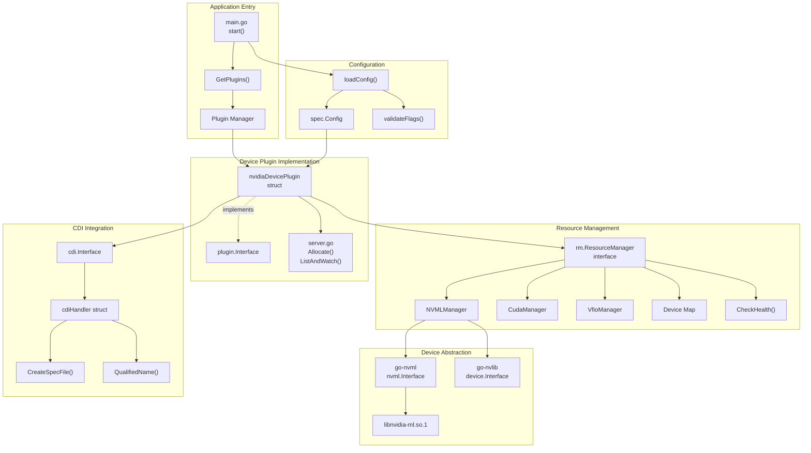

**Sources:** [cmd/nvidia-device-plugin/main.go:243-394](), [internal/plugin/server.go:52-70](), [cmd/nvidia-device-plugin/plugin-manager.go:33-82](), [CHANGELOG.md:124-124]()

### Plugin Lifecycle and Key Functions

The device plugin lifecycle is managed by the `start()` function in [cmd/nvidia-device-plugin/main.go:243-322](), which handles initialization and enters an event loop for Kubelet restarts and OS signals.

The `startPlugins()` function [cmd/nvidia-device-plugin/main.go:324-395]() orchestrates the startup sequence:

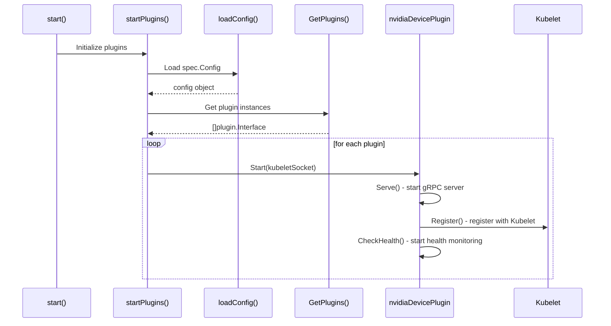

**Sources:** [cmd/nvidia-device-plugin/main.go:243-395]()

## Integration with Kubernetes

### Device Plugin API Implementation

The `nvidiaDevicePlugin` struct [internal/plugin/server.go:52-70]() implements the `pluginapi.DevicePluginServer` interface.

| Method | Purpose | Implementation |
|--------|---------|----------------|
| `ListAndWatch()` | Stream available devices to Kubelet | [internal/plugin/server.go:267-285]() |
| `Allocate()` | Allocate devices to container requests | [internal/plugin/server.go:306-320]() |
| `GetPreferredAllocation()` | Return preferred device allocation for topology awareness | [internal/plugin/server.go:288-303]() |
| `GetDevicePluginOptions()` | Return plugin capabilities | [internal/plugin/server.go:259-264]() |

### Registration and Socket Communication

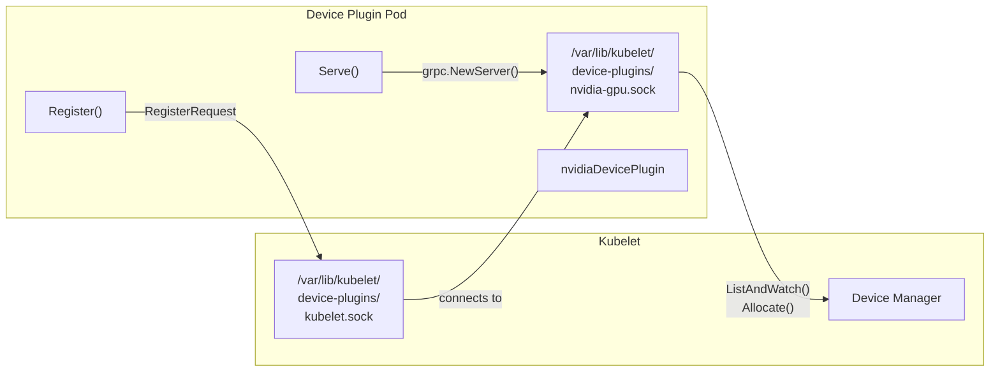

The plugin socket path is constructed by `getPluginSocketPath()` [internal/plugin/server.go:103-107](), creating paths such as `/var/lib/kubelet/device-plugins/nvidia-gpu.sock`.

**Sources:** [internal/plugin/server.go:129-160](), [internal/plugin/server.go:229-256](), [internal/plugin/server.go:103-107]()

## Key Capabilities

### Resource Managers and Device Discovery

The `ResourceManager` interface [internal/rm/]() abstracts device enumeration with multiple implementations selected via `--device-discovery-strategy`.

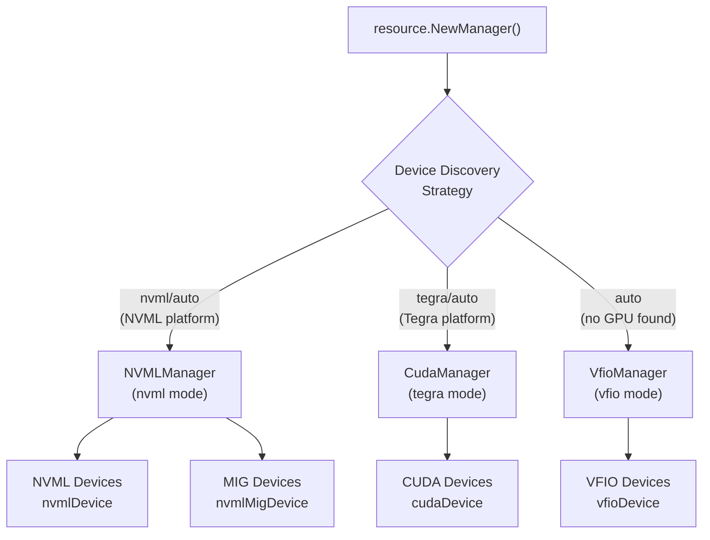

The factory function `resource.NewManager()` [internal/resource/factory.go:31-41]() detects the platform type when `--device-discovery-strategy=auto`. Support for `vfio` management was added in v0.16.0 [CHANGELOG.md:124-124]().

**Sources:** [internal/resource/factory.go:31-85](), [cmd/nvidia-device-plugin/main.go:211-217](), [CHANGELOG.md:124-124]()

### Device Allocation Strategies

The `getAllocateResponse()` method [internal/plugin/server.go:322-365]() constructs the container allocation response based on configured strategies.

| Flag | Values | Purpose |
|------|--------|---------|
| `--device-list-strategy` | `envvar`, `volume-mounts`, `cdi-annotations`, `cdi-cri` | How to pass device list to runtime |
| `--device-id-strategy` | `uuid`, `index` | Device identifier format |

A new `cdi-cri` strategy was introduced in v0.15.0 to use the CDIDevices CRI field [CHANGELOG.md:150-151]().

**Sources:** [internal/plugin/server.go:322-365](), [internal/plugin/server.go:376-408](), [CHANGELOG.md:150-151]()

### CDI (Container Device Interface) Support

The `cdiHandler` struct [internal/cdi/cdi.go:44-71]() generates CDI specifications. It integrates with the `nvidia-container-toolkit` to generate specs in `/var/run/cdi/` [internal/cdi/cdi.go:175-225]().

**Sources:** [internal/cdi/cdi.go:76-172](), [cmd/nvidia-device-plugin/plugin-manager.go:48-64]()

### GPU Feature Discovery Integration

`gpu-feature-discovery` (GFD) is now integrated into the same repository and container image as the device plugin as of v0.15.0 [CHANGELOG.md:160-161](). It labels nodes with GPU characteristics, such as `nvidia.com/gpu.product` and `nvidia.com/mig.strategy`.

**Sources:** [README.md:56-57](), [CHANGELOG.md:160-161](), [deployments/static/gpu-feature-discovery-daemonset.yaml]()

## Deployment Architecture

### Helm-Based Deployment

The preferred deployment method uses the Helm chart at [deployments/helm/nvidia-device-plugin/](). It supports deploying both the device plugin and GFD, with optional `node-feature-discovery` as a dependency [deployments/helm/nvidia-device-plugin/Chart.yaml:10-16]().

**Sources:** [deployments/helm/nvidia-device-plugin/Chart.yaml:1-16](), [deployments/helm/nvidia-device-plugin/templates/daemonset-device-plugin.yml:1-274]()

### Static YAML Deployment

Static manifests are provided for various environments:
- **Standard**: [deployments/static/nvidia-device-plugin.yml]()
- **CPUManager-compatible**: [deployments/static/nvidia-device-plugin-compat-with-cpumanager.yml]()
- **OpenShift/MicroShift**: [deployments/static/nvidia-device-plugin-privileged-with-service-account.yml]()

**Sources:** [README.md:152-165](), [deployments/static/nvidia-device-plugin.yml:1-56]()

---

# Page: System Architecture

# System Architecture

<details>
<summary>Relevant source files</summary>

The following files were used as context for generating this wiki page:

- [Makefile](Makefile)
- [README.md](README.md)
- [RELEASE.md](RELEASE.md)
- [api/config/v1/strategy.go](api/config/v1/strategy.go)
- [cmd/nvidia-device-plugin/main.go](cmd/nvidia-device-plugin/main.go)
- [cmd/nvidia-device-plugin/plugin-manager.go](cmd/nvidia-device-plugin/plugin-manager.go)
- [deployments/helm/nvidia-device-plugin/Chart.lock](deployments/helm/nvidia-device-plugin/Chart.lock)
- [deployments/helm/nvidia-device-plugin/Chart.yaml](deployments/helm/nvidia-device-plugin/Chart.yaml)
- [deployments/static/nvidia-device-plugin-compat-with-cpumanager.yml](deployments/static/nvidia-device-plugin-compat-with-cpumanager.yml)
- [internal/cdi/cdi.go](internal/cdi/cdi.go)
- [internal/cdi/options.go](internal/cdi/options.go)
- [internal/plugin/factory.go](internal/plugin/factory.go)
- [internal/plugin/options.go](internal/plugin/options.go)
- [internal/plugin/server.go](internal/plugin/server.go)
- [internal/plugin/server_test.go](internal/plugin/server_test.go)
- [internal/rm/device_map.go](internal/rm/device_map.go)
- [internal/rm/device_map_test.go](internal/rm/device_map_test.go)
- [internal/rm/devices.go](internal/rm/devices.go)
- [internal/rm/health.go](internal/rm/health.go)
- [internal/rm/health_test.go](internal/rm/health_test.go)
- [internal/rm/helper.go](internal/rm/helper.go)
- [internal/rm/nvml_devices.go](internal/rm/nvml_devices.go)
- [internal/rm/nvml_manager.go](internal/rm/nvml_manager.go)
- [internal/rm/rm.go](internal/rm/rm.go)
- [internal/rm/tegra_devices.go](internal/rm/tegra_devices.go)
- [internal/rm/tegra_manager.go](internal/rm/tegra_manager.go)
- [internal/rm/wsl_devices.go](internal/rm/wsl_devices.go)
- [versions.mk](versions.mk)

</details>


## Purpose and Scope

This document describes the overall architecture of the NVIDIA Kubernetes Device Plugin system, including its core components, their interactions, and integration with Kubernetes. It covers the physical deployment structure, the internal software layers, and the relationships between major subsystems.

For details about specific subsystems:
- For NVML bindings and device abstraction, see [NVML and Device Abstraction Layer](#2)
- For device plugin lifecycle and allocation logic, see [Device Plugin Core](#3)
- For configuration management and dynamic updates, see [Configuration Management](#5)
- For MIG-specific architecture, see [Multi-Instance GPU (MIG) Support](#6)
- For GPU sharing mechanisms, see [GPU Sharing Mechanisms](#7)

---

## Component Overview

The NVIDIA device plugin system consists of multiple cooperating components that run as containers within Kubernetes DaemonSet pods on GPU-enabled nodes.

### High-Level Component Architecture

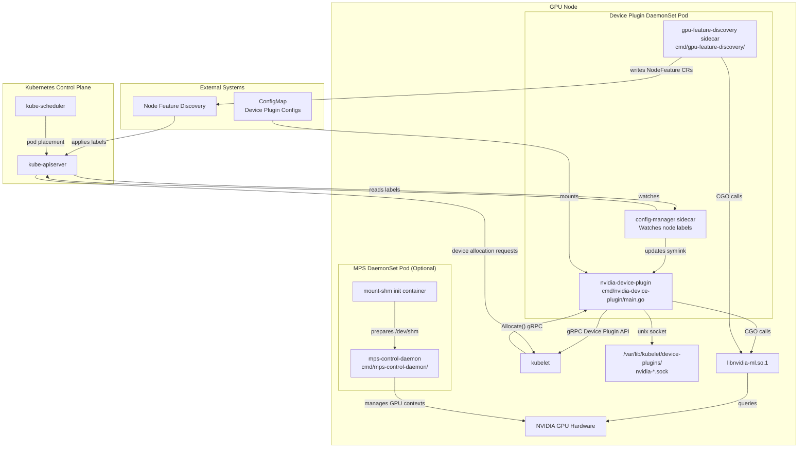

**Sources:** [README.md:47-58](), [cmd/nvidia-device-plugin/main.go:43-185](), [internal/plugin/server.go:51-70]()

### Component Responsibilities

| Component | Binary/Entry Point | Primary Responsibilities |
|-----------|-------------------|-------------------------|
| **nvidia-device-plugin** | `cmd/nvidia-device-plugin/main.go` | Device discovery, registration with kubelet, resource allocation, health monitoring |
| **config-manager** | Sidecar container (external) | Watches `nvidia.com/device-plugin.config` node labels, updates configuration symlink |
| **gpu-feature-discovery** | `cmd/gpu-feature-discovery/` | GPU capability detection, automatic node labeling via NFD |
| **mps-control-daemon** | `cmd/mps-control-daemon/` | MPS daemon lifecycle management for GPU sharing |

**Sources:** [README.md:47-58](), [cmd/nvidia-device-plugin/main.go:49-185](), [deployments/helm/nvidia-device-plugin/Chart.yaml:1-16]()

---

## Device Plugin Core Architecture

The device plugin implements the Kubernetes Device Plugin API to expose NVIDIA GPUs as schedulable resources.

### Main Process Lifecycle

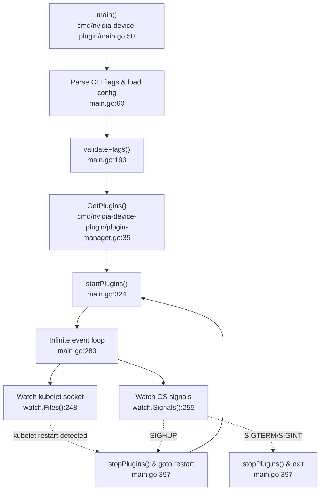

**Sources:** [cmd/nvidia-device-plugin/main.go:50-397]()

### Plugin Instantiation and Registration

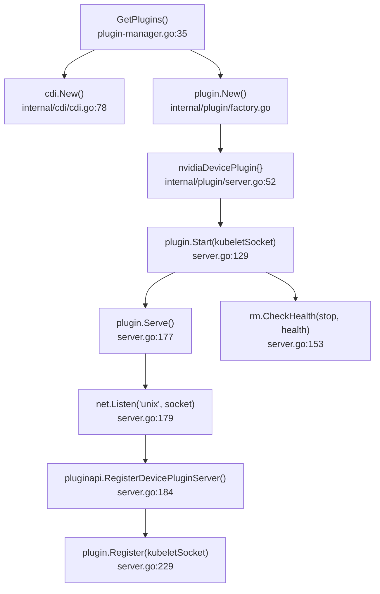

**Sources:** [cmd/nvidia-device-plugin/plugin-manager.go:35-89](), [internal/plugin/server.go:129-226]()

### Device Plugin gRPC Service Implementation

The `nvidiaDevicePlugin` struct implements the Kubernetes Device Plugin API:

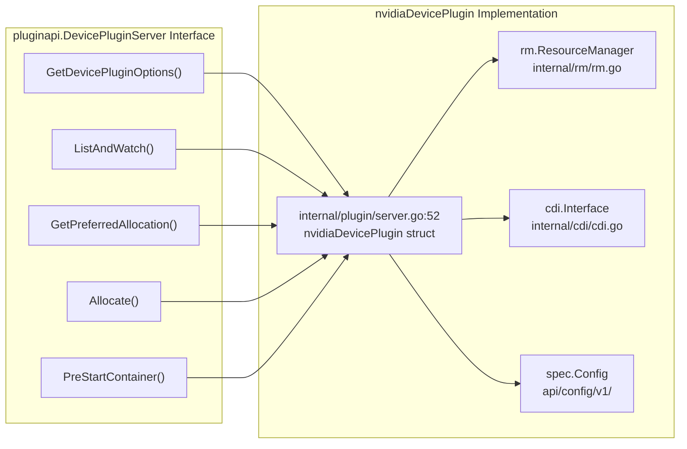

**Sources:** [internal/plugin/server.go:52-70](), [internal/rm/rm.go:42-49]()

---

## NVML Abstraction Stack

The device plugin uses a multi-layered abstraction to interface with NVIDIA GPUs, from C library to high-level Go interfaces.

### NVML Abstraction Layers

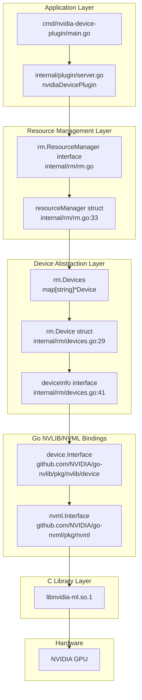

**Sources:** [internal/rm/rm.go:33-49](), [internal/rm/devices.go:29-47](), [cmd/nvidia-device-plugin/main.go:28-30]()

---

## Configuration and Deployment Architecture

### Configuration Precedence and Loading

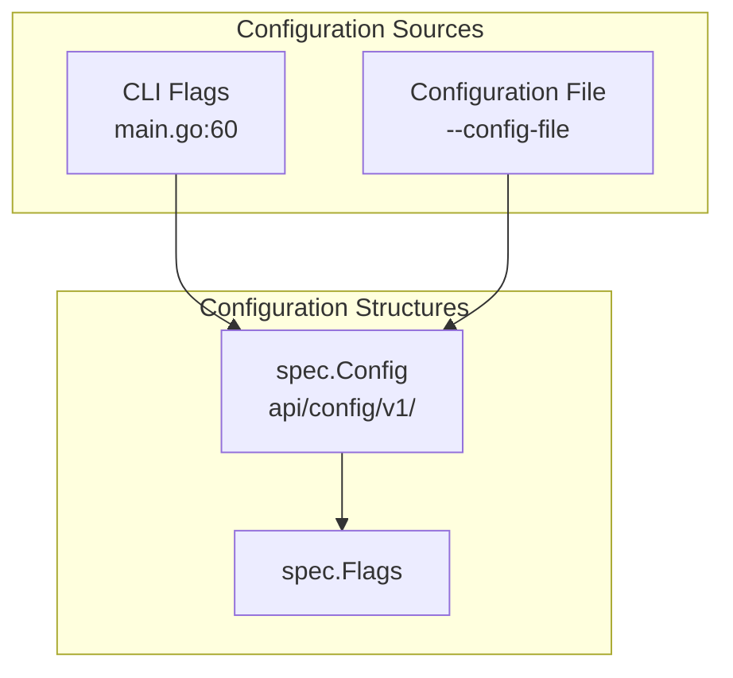

**Sources:** [cmd/nvidia-device-plugin/main.go:60-185](), [api/config/v1/config.go]()

### CDI Integration Architecture

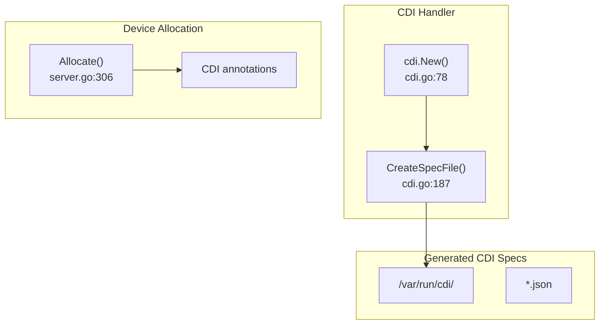

**Sources:** [internal/cdi/cdi.go:78-227](), [internal/plugin/server.go:306-408]()

---

## Build and Release Architecture

### Build System Structure

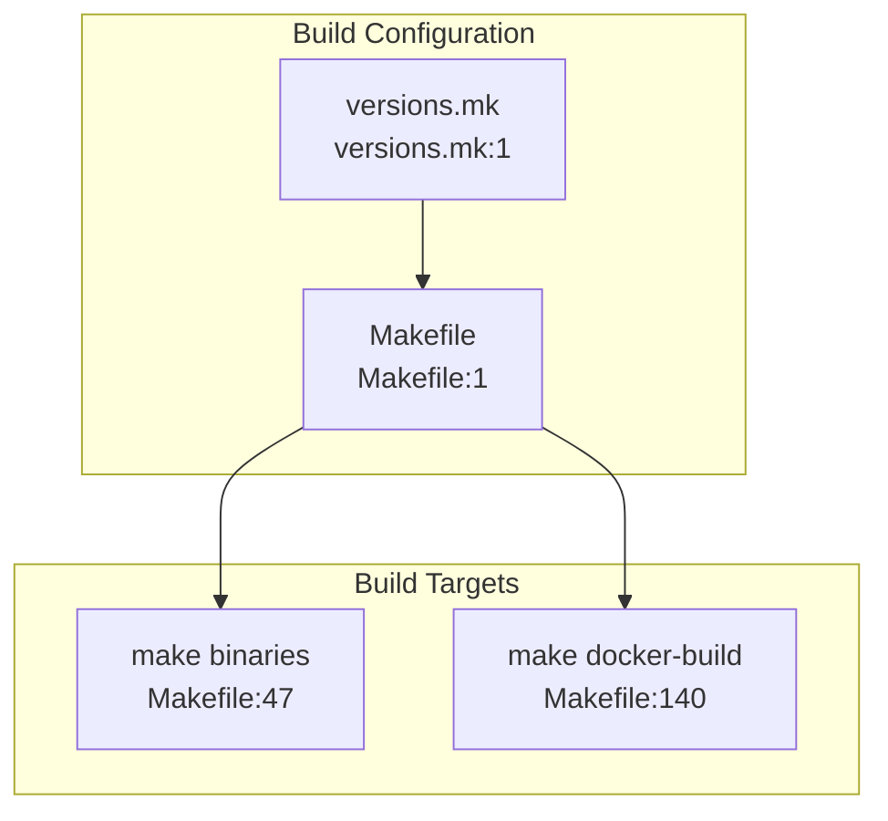

**Sources:** [Makefile:1-164](), [versions.mk:1-28]()

### Release Process

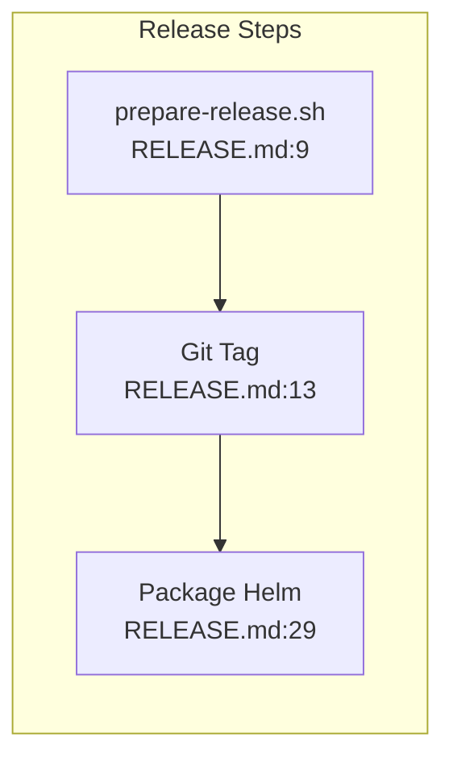

**Sources:** [RELEASE.md:1-47]()

---

# Page: Key Concepts and Terminology

# Key Concepts and Terminology

<details>
<summary>Relevant source files</summary>

The following files were used as context for generating this wiki page:

- [Makefile](Makefile)
- [README.md](README.md)
- [RELEASE.md](RELEASE.md)
- [api/config/v1/config.go](api/config/v1/config.go)
- [api/config/v1/consts.go](api/config/v1/consts.go)
- [api/config/v1/duration.go](api/config/v1/duration.go)
- [api/config/v1/flags.go](api/config/v1/flags.go)
- [api/config/v1/flags_test.go](api/config/v1/flags_test.go)
- [api/config/v1/replicas.go](api/config/v1/replicas.go)
- [api/config/v1/replicas_test.go](api/config/v1/replicas_test.go)
- [api/config/v1/resources.go](api/config/v1/resources.go)
- [api/config/v1/sharing.go](api/config/v1/sharing.go)
- [cmd/gpu-feature-discovery/main.go](cmd/gpu-feature-discovery/main.go)
- [cmd/gpu-feature-discovery/main_test.go](cmd/gpu-feature-discovery/main_test.go)
- [cmd/gpu-feature-discovery/mig_test.go](cmd/gpu-feature-discovery/mig_test.go)
- [deployments/helm/nvidia-device-plugin/Chart.lock](deployments/helm/nvidia-device-plugin/Chart.lock)
- [deployments/helm/nvidia-device-plugin/Chart.yaml](deployments/helm/nvidia-device-plugin/Chart.yaml)
- [deployments/static/nvidia-device-plugin-compat-with-cpumanager.yml](deployments/static/nvidia-device-plugin-compat-with-cpumanager.yml)
- [internal/lm/labeler.go](internal/lm/labeler.go)
- [internal/lm/labels.go](internal/lm/labels.go)
- [internal/resource/factory.go](internal/resource/factory.go)
- [internal/rm/allocate.go](internal/rm/allocate.go)
- [versions.mk](versions.mk)

</details>


## Purpose and Scope

This page defines the core concepts, terminology, and conventions used throughout the NVIDIA Kubernetes Device Plugin codebase. Understanding these concepts is essential for working with the plugin's configuration, resource management, and allocation mechanisms.

For information about the overall system architecture and component interactions, see [System Architecture](1.1). For specific configuration options and their usage, see [Configuration Schema and Options](5.1).

---

## GPU and Device Concepts

### Device Types

The plugin manages several types of NVIDIA hardware devices:

| Device Type | Description | Class Identifier | Example Use Case |
|-------------|-------------|------------------|------------------|
| **Full GPU** | Complete GPU device | `nvidia.com/gpu` | Standard workloads requiring dedicated GPU |
| **MIG Device** | Multi-Instance GPU partition | `nvidia.com/mig-<profile>` | Multiple isolated workloads on single GPU |
| **Shared GPU** | Time-sliced or MPS-enabled GPU | `nvidia.com/gpu.shared` | Oversubscribed workloads |
| **IMEX Channel** | Inter-GPU Memory Exchange channel | Injected as additional device | High-bandwidth GPU communication |

**Sources:** [api/config/v1/consts.go:24-35](), [README.md:169-184]()

### Device Identification

Devices can be identified using multiple strategies. The `ReplicatedDeviceRef` type handles these various formats during configuration parsing.

Title: Device Identification and Reference Types
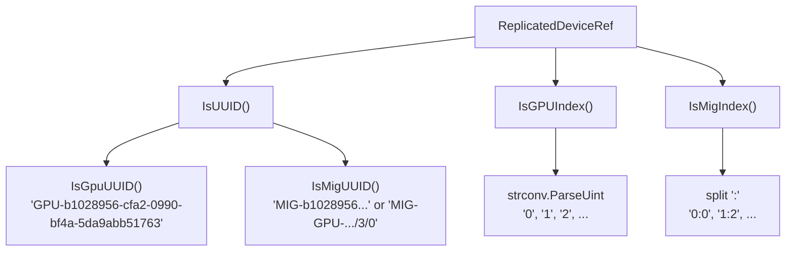

**UUID Strategy** (`uuid`): Uses hardware UUIDs as stable identifiers. This is the default and recommended approach because UUIDs remain constant across reboots and GPU reordering.

**Index Strategy** (`index`): Uses integer indices as seen by `nvidia-smi`. Indices may change if GPUs are added/removed or system configuration changes.

The strategy is configured via the `DeviceIDStrategy` field in `PluginCommandLineFlags`.

**Sources:** [README.md:329-341](), [api/config/v1/replicas.go:96-163](), [api/config/v1/consts.go:46-49](), [api/config/v1/flags.go:78-78]()

---

## Multi-Instance GPU (MIG)

### MIG Overview

Multi-Instance GPU (MIG) allows a single physical GPU to be partitioned into multiple isolated GPU instances, each with dedicated memory and compute resources. MIG is supported on NVIDIA A100, A30, H100, and similar architectures.

### MIG Strategies

The plugin supports three MIG strategies that determine how MIG devices are exposed to Kubernetes:

Title: MIG Strategy Resource Mapping
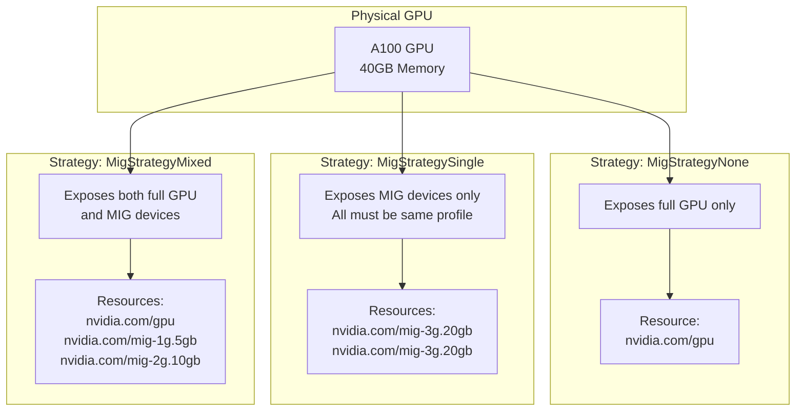

| Strategy | Constant | Description | Resource Advertisement |
|----------|----------|-------------|----------------------|
| **none** | `MigStrategyNone` | MIG is disabled; only full GPUs are advertised | `nvidia.com/gpu` |
| **single** | `MigStrategySingle` | Only MIG devices are advertised; all must be the same profile | `nvidia.com/mig-<profile>` |
| **mixed** | `MigStrategyMixed` | Both full GPUs and MIG devices of any profile are advertised | `nvidia.com/gpu` + `nvidia.com/mig-<profile>` |

The strategy is configured via the `MigStrategy` flag.

**Sources:** [README.md:248-261](), [api/config/v1/consts.go:31-35](), [api/config/v1/flags.go:60-60]()

---

## GPU Sharing Mechanisms

### Time-Slicing vs MPS

The plugin supports two methods for sharing GPUs among multiple workloads. Both use the `ReplicatedResources` struct for configuration.

Title: Sharing Mechanisms Comparison
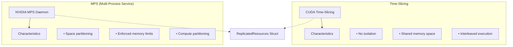

### Time-Slicing Configuration

Time-slicing creates multiple replicas of a GPU resource, allowing oversubscription through CUDA's time-slicing mechanism.

**Key Configuration Options** ([api/config/v1/replicas.go:29-35]()):

```yaml
sharing:
  timeSlicing:
    renameByDefault: true
    failRequestsGreaterThanOne: false
    resources:
    - name: nvidia.com/gpu
      replicas: 10
```

**Sources:** [README.md:378-480](), [api/config/v1/replicas.go:29-35](), [api/config/v1/consts.go:26-27]()

### MPS Configuration

MPS provides space partitioning with enforced memory and compute limits managed by a control daemon.

**Behavior:**
- Each replica gets `1/replicas` fraction of device memory.
- Compute resources are partitioned.
- `FailRequestsGreaterThanOne` is explicitly set to `true` for MPS in `NewConfig` to ensure clear semantics ([api/config/v1/config.go:72-78]()).

**Sources:** [README.md:512-596](), [api/config/v1/sharing.go:19-28](), [api/config/v1/config.go:72-78]()

---

## Resource Naming and Allocation

### Resource Name Structure

All GPU resources follow a standardized naming convention defined by constants.

Title: Resource Naming Constants
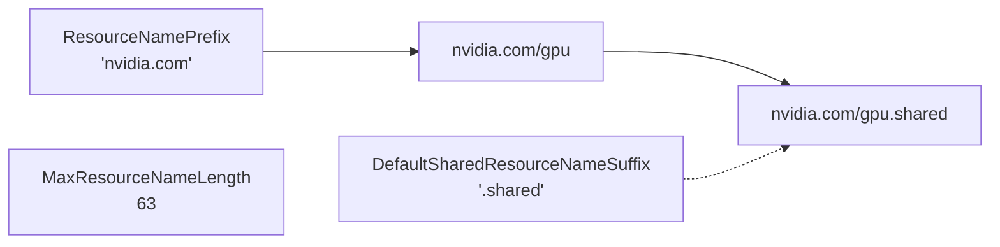

**Resource Name Components** ([api/config/v1/consts.go:23-28]()):

| Component | Value | Description |
|-----------|-------|-------------|
| `ResourceNamePrefix` | `"nvidia.com"` | Standard prefix for all NVIDIA resources |
| `DefaultSharedResourceNameSuffix` | `".shared"` | Suffix added when `renameByDefault: true` |
| `MaxResourceNameLength` | `63` | Kubernetes resource name limit |

**Sources:** [api/config/v1/consts.go:23-28](), [api/config/v1/resources.go:19-44]()

### Annotated Device IDs

The plugin uses annotated device IDs internally to track replicated resources.

**Format:** `<device-id>::<replica-index>`

**Example:** `GPU-12345678...::3` represents replica 3 of a specific GPU.

The `AnnotatedID` type ([internal/rm/allocate.go:40-48]()) provides methods to extract the base device ID and parse the annotation.

**Sources:** [internal/rm/allocate.go:23-80]()

---

## Device List Strategies

Device list strategies determine how the list of allocated GPUs is communicated to the container runtime.

| Strategy | Constant | Runtime Requirement | Description |
|----------|----------|---------------------|-------------|
| **envvar** | `DeviceListStrategyEnvVar` | NVIDIA Container Runtime | Sets `NVIDIA_VISIBLE_DEVICES` |
| **volume-mounts** | `DeviceListStrategyVolumeMounts` | NVIDIA Container Runtime | Passes devices as volume mounts |
| **cdi-annotations** | `DeviceListStrategyCDIAnnotations` | CDI-aware runtime | Sets CDI device annotations |
| **cdi-cri** | `DeviceListStrategyCDICRI` | K8s + CDI runtime | Uses CDIDevices CRI field |

**Sources:** [README.md:305-327](), [api/config/v1/consts.go:38-43]()

### CDI (Container Device Interface)

CDI allows runtimes to manage device access via a common specification.

**CDI Configuration Constants** ([api/config/v1/consts.go:51-56]()):
- `DefaultCDIAnnotationPrefix`: `"cdi.k8s.io/"`
- `DefaultNvidiaCTKPath`: `"/usr/bin/nvidia-ctk"`
- `DefaultContainerDriverRoot`: `"/driver-root"`

**Sources:** [api/config/v1/consts.go:51-56]()

---

## IMEX Channel Support

IMEX (Inter-GPU Memory Exchange) channels provide high-bandwidth communication paths.

### IMEX Configuration

Configuration is handled via the `Imex` struct in the versioned `Config` object.

```go
type Imex struct {
	ChannelIDs []int `json:"channelIDs" yaml:"channelIDs"`
	Required   bool  `json:"required"   yaml:"required"`
}
```

The plugin checks `imex-channel-ids` and `imex-required` flags during initialization in `NewConfig`.

**Sources:** [README.md:598-612](), [api/config/v1/config.go:39-64]()

---

## Configuration Precedence

Configuration is resolved in the following order:
1. **Command Line Flags** (highest precedence)
2. **Environment Variables**
3. **Configuration File** (lowest precedence)

The `NewConfig` function in `api/config/v1/config.go` implements this by first parsing the config file and then calling `UpdateFromCLIFlags` to apply overrides.

Title: Config Initialization Flow
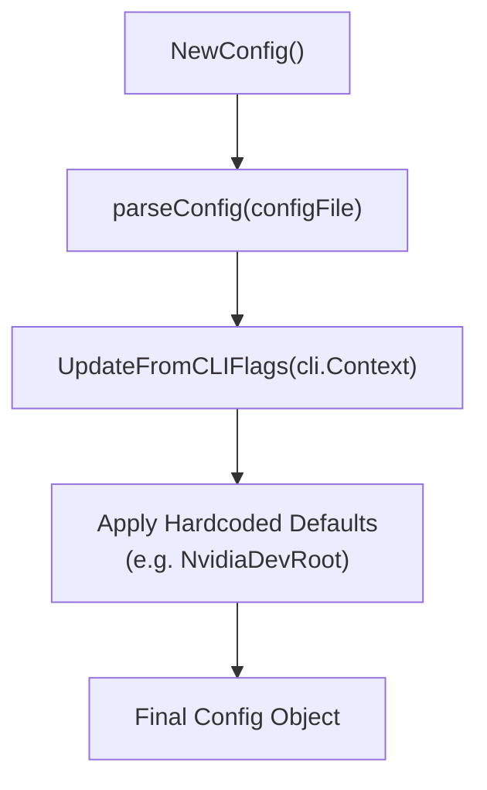

**Sources:** [api/config/v1/config.go:42-81](), [api/config/v1/flags.go:117-161]()

---

# Page: NVML and Device Abstraction Layer

# NVML and Device Abstraction Layer

<details>
<summary>Relevant source files</summary>

The following files were used as context for generating this wiki page:

- [vendor/github.com/NVIDIA/go-nvlib/pkg/nvlib/device/device.go](vendor/github.com/NVIDIA/go-nvlib/pkg/nvlib/device/device.go)
- [vendor/github.com/NVIDIA/go-nvlib/pkg/nvlib/device/mig_profile.go](vendor/github.com/NVIDIA/go-nvlib/pkg/nvlib/device/mig_profile.go)
- [vendor/github.com/NVIDIA/go-nvlib/pkg/nvpci/mmio/mmio.go](vendor/github.com/NVIDIA/go-nvlib/pkg/nvpci/mmio/mmio.go)
- [vendor/github.com/NVIDIA/go-nvlib/pkg/nvpci/mmio/mock.go](vendor/github.com/NVIDIA/go-nvlib/pkg/nvpci/mmio/mock.go)
- [vendor/github.com/NVIDIA/go-nvlib/pkg/nvpci/mock.go](vendor/github.com/NVIDIA/go-nvlib/pkg/nvpci/mock.go)
- [vendor/github.com/NVIDIA/go-nvlib/pkg/nvpci/nvpci.go](vendor/github.com/NVIDIA/go-nvlib/pkg/nvpci/nvpci.go)
- [vendor/github.com/NVIDIA/go-nvlib/pkg/nvpci/nvpci_mock.go](vendor/github.com/NVIDIA/go-nvlib/pkg/nvpci/nvpci_mock.go)
- [vendor/github.com/NVIDIA/go-nvlib/pkg/nvpci/resources.go](vendor/github.com/NVIDIA/go-nvlib/pkg/nvpci/resources.go)
- [vendor/github.com/NVIDIA/go-nvlib/pkg/pciids/default_pci.ids](vendor/github.com/NVIDIA/go-nvlib/pkg/pciids/default_pci.ids)
- [vendor/github.com/NVIDIA/go-nvlib/pkg/pciids/pciids.go](vendor/github.com/NVIDIA/go-nvlib/pkg/pciids/pciids.go)
- [vendor/github.com/NVIDIA/go-nvml/pkg/nvml/const.go](vendor/github.com/NVIDIA/go-nvml/pkg/nvml/const.go)
- [vendor/github.com/NVIDIA/go-nvml/pkg/nvml/device.go](vendor/github.com/NVIDIA/go-nvml/pkg/nvml/device.go)
- [vendor/github.com/NVIDIA/go-nvml/pkg/nvml/gpm.go](vendor/github.com/NVIDIA/go-nvml/pkg/nvml/gpm.go)
- [vendor/github.com/NVIDIA/go-nvml/pkg/nvml/nvml.go](vendor/github.com/NVIDIA/go-nvml/pkg/nvml/nvml.go)
- [vendor/github.com/NVIDIA/go-nvml/pkg/nvml/nvml.h](vendor/github.com/NVIDIA/go-nvml/pkg/nvml/nvml.h)
- [vendor/github.com/NVIDIA/go-nvml/pkg/nvml/system.go](vendor/github.com/NVIDIA/go-nvml/pkg/nvml/system.go)
- [vendor/github.com/NVIDIA/go-nvml/pkg/nvml/types_gen.go](vendor/github.com/NVIDIA/go-nvml/pkg/nvml/types_gen.go)
- [vendor/github.com/NVIDIA/go-nvml/pkg/nvml/vgpu.go](vendor/github.com/NVIDIA/go-nvml/pkg/nvml/vgpu.go)
- [vendor/github.com/NVIDIA/go-nvml/pkg/nvml/zz_generated.api.go](vendor/github.com/NVIDIA/go-nvml/pkg/nvml/zz_generated.api.go)

</details>


## Purpose and Scope

This page documents the foundational device abstraction layer that provides Go interfaces for interacting with NVIDIA GPUs. It covers:

- The NVML (NVIDIA Management Library) C library and its role
- The `go-nvml` package providing CGO bindings to NVML
- The `go-nvlib` package providing higher-level device abstractions
- The `nvpci` package for PCI device discovery
- How these layers are consumed by the device plugin's resource management system

For detailed documentation on the CGO bindings, see [NVML Go Bindings](#2.1). For specifics on different device type abstractions (MIG, CUDA, VFIO), see [Device Interface Implementations](#2.2).

## Architecture Overview

The device abstraction is organized in distinct layers, each building on the previous one:

**Architecture Layers**

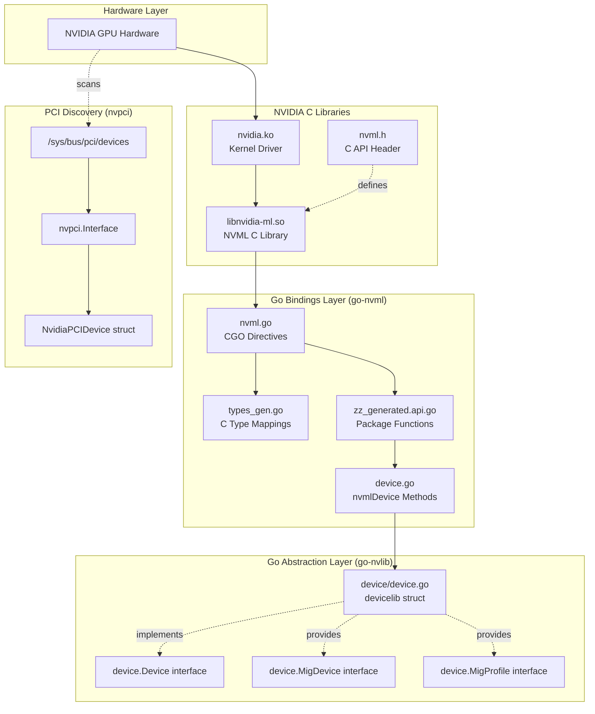

**Sources:** [vendor/github.com/NVIDIA/go-nvml/pkg/nvml/nvml.go:20-51](), [vendor/github.com/NVIDIA/go-nvml/pkg/nvml/device.go:23-58](), [vendor/github.com/NVIDIA/go-nvlib/pkg/nvlib/device/device.go:27-55](), [vendor/github.com/NVIDIA/go-nvpci/nvpci.go:31-62]()

## NVML C Library

The NVIDIA Management Library (NVML) is a C-based library (`libnvidia-ml.so`) that provides programmatic access to GPU monitoring and management functions. It is the primary interface for querying GPU state, topology, and capabilities.

The NVML API is defined in `nvml.h` [vendor/github.com/NVIDIA/go-nvml/pkg/nvml/nvml.h:1-140]() and includes functions for:

- **Device enumeration**: `nvmlDeviceGetCount()`, `nvmlDeviceGetHandleByIndex()` [vendor/github.com/NVIDIA/go-nvml/pkg/nvml/zz_generated.api.go:65-108]()
- **Device properties**: `nvmlDeviceGetName()`, `nvmlDeviceGetUUID()`, `nvmlDeviceGetMemoryInfo()` [vendor/github.com/NVIDIA/go-nvml/pkg/nvml/zz_generated.api.go:121-146]()
- **MIG support**: `nvmlDeviceGetMigMode()`, `nvmlDeviceGetMaxMigDeviceCount()`, `nvmlDeviceGetMigDeviceHandleByIndex()` [vendor/github.com/NVIDIA/go-nvml/pkg/nvml/zz_generated.api.go:102-137]()
- **Topology**: `nvmlDeviceGetTopologyCommonAncestor()`, `nvmlDeviceGetCpuAffinity()` [vendor/github.com/NVIDIA/go-nvml/pkg/nvml/zz_generated.api.go:66-150]()

**Sources:** [vendor/github.com/NVIDIA/go-nvml/pkg/nvml/nvml.h:1-140](), [vendor/github.com/NVIDIA/go-nvml/pkg/nvml/zz_generated.api.go:22-150]()

## go-nvml Package: CGO Bindings

The `go-nvml` package provides Go bindings to the NVML C library using CGO. It handles the low-level translation between Go types and C pointers.

### CGO Bridge and Types
The CGO bridge [vendor/github.com/NVIDIA/go-nvml/pkg/nvml/nvml.go:20-29]() allows dynamic linking. Types like `nvmlDevice` wrap opaque C pointers [vendor/github.com/NVIDIA/go-nvml/pkg/nvml/types_gen.go:8-10]():

```go
type nvmlDevice struct {
	Handle *_Ctype_struct_nvmlDevice_st
}
```

### Device Interface
The `nvml.Device` interface [vendor/github.com/NVIDIA/go-nvml/pkg/nvml/device.go:27-58]() provides methods that map directly to C functions. For example, `GetName()` [vendor/github.com/NVIDIA/go-nvml/pkg/nvml/device.go:150-154]() calls `nvmlDeviceGetName`.

For details on initialization and query operations, see [NVML Go Bindings](#2.1).

**Sources:** [vendor/github.com/NVIDIA/go-nvml/pkg/nvml/nvml.go:20-29](), [vendor/github.com/NVIDIA/go-nvml/pkg/nvml/types_gen.go:8-10](), [vendor/github.com/NVIDIA/go-nvml/pkg/nvml/device.go:150-154]()

## go-nvlib Package: Higher-Level Abstractions

The `go-nvlib` package provides higher-level, more ergonomic interfaces on top of `go-nvml`. It adds domain logic for common operations like architecture string mapping and MIG device enumeration.

### Device Interface Extension
The `device.Device` interface [vendor/github.com/NVIDIA/go-nvlib/pkg/nvlib/device/device.go:27-42]() extends `nvml.Device` with additional methods:

| Method | Purpose |
|--------|---------|
| `GetArchitectureAsString()` | Maps enum to strings like "Ampere" or "Hopper" [vendor/github.com/NVIDIA/go-nvlib/pkg/nvlib/device/device.go:72-100]() |
| `GetBrandAsString()` | Maps brand enum to "Tesla", "GeForce", etc. [vendor/github.com/NVIDIA/go-nvlib/pkg/nvlib/device/device.go:103-148]() |
| `GetPCIBusID()` | Extracts and cleans the PCI bus ID string [vendor/github.com/NVIDIA/go-nvlib/pkg/nvlib/device/device.go:177-197]() |
| `IsMigCapable()` | Checks if the hardware supports MIG partitioning [vendor/github.com/NVIDIA/go-nvlib/pkg/nvlib/device/device.go:230-244]() |

### MIG Abstractions
The library simplifies MIG management via `VisitMigDevices()` [vendor/github.com/NVIDIA/go-nvlib/pkg/nvlib/device/device.go:311-346]() and `VisitMigProfiles()` [vendor/github.com/NVIDIA/go-nvlib/pkg/nvlib/device/device.go:349-408](), which abstract the complexity of iterating over child handles and profile definitions.

**Sources:** [vendor/github.com/NVIDIA/go-nvlib/pkg/nvlib/device/device.go:27-408]()

## nvpci Package: PCI Device Discovery

The `nvpci` package provides PCI-level device discovery by reading from sysfs, complementing NVML's device enumeration. This is particularly useful for identifying devices before NVML is initialized or for identifying non-GPU NVIDIA PCI devices like NVSwitches.

### NvidiaPCIDevice
The `NvidiaPCIDevice` struct [vendor/github.com/NVIDIA/go-nvpci/nvpci.go:108-123]() captures system-level metadata:

```go
type NvidiaPCIDevice struct {
	Path       string
	Address    string
	Vendor     uint16
	Class      uint32
	Device     uint16
	Driver     string
	IommuGroup int
	NumaNode   int
	// ...
}
```

### Discovery Logic
The library scans `PCIDevicesRoot` (`/sys/bus/pci/devices`) [vendor/github.com/NVIDIA/go-nvpci/nvpci.go:33-41]() and filters for `PCINvidiaVendorID` (`0x10de`) [vendor/github.com/NVIDIA/go-nvpci/nvpci.go:35](). It can distinguish between VGA controllers, 3D controllers, and NVSwitches using PCI class IDs [vendor/github.com/NVIDIA/go-nvpci/nvpci.go:126-143]().

**Sources:** [vendor/github.com/NVIDIA/go-nvpci/nvpci.go:31-143](), [vendor/github.com/NVIDIA/go-nvpci/nvpci.go:203-236]()

## Device Interface Implementations

The plugin uses several specialized implementations of device interfaces to handle different hardware configurations and virtualization environments.

| Implementation | Description |
|----------------|-------------|
| `nvmlDevice` | Standard GPU handle using NVML CGO bindings. |
| `nvmlMigDevice` | Specialized handle for MIG partitions. |
| `cudaDevice` | Abstraction for CUDA-level device properties. |
| `vfioDevice` | Used for SR-IOV Virtual Functions bound to VFIO drivers. |

For a deep dive into how these implementations handle path construction and metadata extraction, see [Device Interface Implementations](#2.2).

**Sources:** [vendor/github.com/NVIDIA/go-nvml/pkg/nvml/device.go:27-58](), [vendor/github.com/NVIDIA/go-nvlib/pkg/nvlib/device/device.go:44-50]()

---

# Page: NVML Go Bindings

# NVML Go Bindings

<details>
<summary>Relevant source files</summary>

The following files were used as context for generating this wiki page:

- [vendor/github.com/NVIDIA/go-nvml/pkg/dl/dl.go](vendor/github.com/NVIDIA/go-nvml/pkg/dl/dl.go)
- [vendor/github.com/NVIDIA/go-nvml/pkg/nvml/api.go](vendor/github.com/NVIDIA/go-nvml/pkg/nvml/api.go)
- [vendor/github.com/NVIDIA/go-nvml/pkg/nvml/cgo_helpers_static.go](vendor/github.com/NVIDIA/go-nvml/pkg/nvml/cgo_helpers_static.go)
- [vendor/github.com/NVIDIA/go-nvml/pkg/nvml/const.go](vendor/github.com/NVIDIA/go-nvml/pkg/nvml/const.go)
- [vendor/github.com/NVIDIA/go-nvml/pkg/nvml/const_static.go](vendor/github.com/NVIDIA/go-nvml/pkg/nvml/const_static.go)
- [vendor/github.com/NVIDIA/go-nvml/pkg/nvml/device.go](vendor/github.com/NVIDIA/go-nvml/pkg/nvml/device.go)
- [vendor/github.com/NVIDIA/go-nvml/pkg/nvml/event_set.go](vendor/github.com/NVIDIA/go-nvml/pkg/nvml/event_set.go)
- [vendor/github.com/NVIDIA/go-nvml/pkg/nvml/gpm.go](vendor/github.com/NVIDIA/go-nvml/pkg/nvml/gpm.go)
- [vendor/github.com/NVIDIA/go-nvml/pkg/nvml/init.go](vendor/github.com/NVIDIA/go-nvml/pkg/nvml/init.go)
- [vendor/github.com/NVIDIA/go-nvml/pkg/nvml/lib.go](vendor/github.com/NVIDIA/go-nvml/pkg/nvml/lib.go)
- [vendor/github.com/NVIDIA/go-nvml/pkg/nvml/nvml.go](vendor/github.com/NVIDIA/go-nvml/pkg/nvml/nvml.go)
- [vendor/github.com/NVIDIA/go-nvml/pkg/nvml/nvml.h](vendor/github.com/NVIDIA/go-nvml/pkg/nvml/nvml.h)
- [vendor/github.com/NVIDIA/go-nvml/pkg/nvml/system.go](vendor/github.com/NVIDIA/go-nvml/pkg/nvml/system.go)
- [vendor/github.com/NVIDIA/go-nvml/pkg/nvml/types_gen.go](vendor/github.com/NVIDIA/go-nvml/pkg/nvml/types_gen.go)
- [vendor/github.com/NVIDIA/go-nvml/pkg/nvml/vgpu.go](vendor/github.com/NVIDIA/go-nvml/pkg/nvml/vgpu.go)
- [vendor/github.com/NVIDIA/go-nvml/pkg/nvml/zz_generated.api.go](vendor/github.com/NVIDIA/go-nvml/pkg/nvml/zz_generated.api.go)

</details>


## Purpose and Scope

The NVML Go Bindings provide CGO-based bindings to the NVIDIA Management Library (NVML) C API (`libnvidia-ml.so`). This package, located at `github.com/NVIDIA/go-nvml/pkg/nvml`, enables Go programs to interact with NVIDIA GPUs for monitoring, management, and configuration operations. The bindings expose device enumeration, health monitoring, performance metrics, MIG (Multi-Instance GPU) management, and other NVML functionality.

This page documents the low-level CGO bindings layer. For higher-level device abstractions and interfaces, see [Device Interface Implementations](#2.2).

**Sources:** [vendor/github.com/NVIDIA/go-nvml/pkg/nvml/nvml.go:1-29](), [vendor/github.com/NVIDIA/go-nvml/pkg/nvml/lib.go:17-25]()

---

## Library Architecture

### CGO Binding Layer Structure

The `go-nvml` package uses CGO to bind to the NVML C library. The architecture consists of several key components:

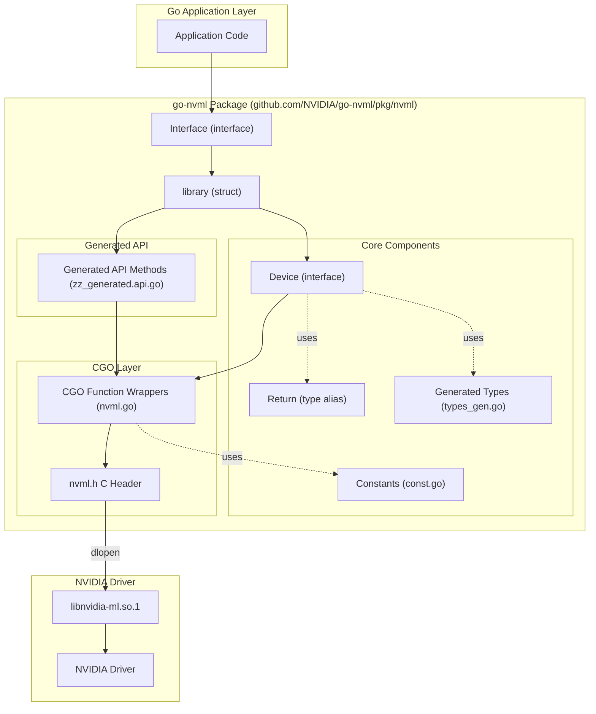

**Sources:** [vendor/github.com/NVIDIA/go-nvml/pkg/nvml/nvml.go:20-29](), [vendor/github.com/NVIDIA/go-nvml/pkg/nvml/types_gen.go:1-10](), [vendor/github.com/NVIDIA/go-nvml/pkg/nvml/const.go:1-28](), [vendor/github.com/NVIDIA/go-nvml/pkg/nvml/lib.go:41-55]()

### Library Interface and Implementation

The `library` struct implements the NVML `Interface` and serves as the entry point for all operations. It handles dynamic loading of the underlying shared object via the `dl` package.

| Component | Type | Description |
|-----------|------|-------------|
| `library` | struct | Main implementation that wraps NVML functionality [vendor/github.com/NVIDIA/go-nvml/pkg/nvml/lib.go:49-54]() |
| `libnvml` | variable | Global instance of the `library` struct [vendor/github.com/NVIDIA/go-nvml/pkg/nvml/lib.go:59-59]() |
| `Device` | interface | Represents a GPU device with query methods [vendor/github.com/NVIDIA/go-nvml/pkg/nvml/device.go:27-27]() |
| `nvmlDevice` | struct | Internal handle to C `nvmlDevice_t` [vendor/github.com/NVIDIA/go-nvml/pkg/nvml/types_gen.go:8-10]() |
| `Return` | type alias | NVML return code for error handling [vendor/github.com/NVIDIA/go-nvml/pkg/nvml/nvml.go:32-35]() |

The library uses a global instance pattern where `libnvml` is the default instance, and package-level functions in `zz_generated.api.go` delegate to methods on this instance.

**Sources:** [vendor/github.com/NVIDIA/go-nvml/pkg/nvml/zz_generated.api.go:22-23](), [vendor/github.com/NVIDIA/go-nvml/pkg/nvml/lib.go:49-60]()

---

## Initialization and Lifecycle

### Initialization Flow

The library initialization involves loading the `libnvidia-ml.so.1` shared library and mapping versioned symbols (e.g., mapping `nvmlInit` to `nvmlInit_v2` if available).

```mermaid
sequenceDiagram
    participant App as "Application"
    participant Lib as "library"
    participant DL as "dl (Dynamic Loader)"
    participant NVML as "libnvidia-ml.so.1"
    
    App->>Lib: Init()
    Lib->>Lib: load()
    Lib->>DL: Open("libnvidia-ml.so.1")
    DL-->>Lib: Handle
    Lib->>Lib: updateVersionedSymbols()
    Note over Lib: Checks for _v2, _v3 symbols
    Lib->>NVML: nvmlInit_v2() (via CGO)
    NVML-->>Lib: Return SUCCESS
    Lib-->>App: Return SUCCESS
```

**Initialization Functions:**

| Function | CGO Binding | Description |
|----------|-------------|-------------|
| `Init()` | `nvmlInit()` | Loads the library and initializes NVML [vendor/github.com/NVIDIA/go-nvml/pkg/nvml/init.go:20-25]() |
| `InitWithFlags(flags uint32)` | `nvmlInitWithFlags()` | Initialize with specific flags [vendor/github.com/NVIDIA/go-nvml/pkg/nvml/init.go:28-33]() |
| `Shutdown()` | `nvmlShutdown()` | Cleanup and close the dynamic library [vendor/github.com/NVIDIA/go-nvml/pkg/nvml/init.go:36-48]() |

**Sources:** [vendor/github.com/NVIDIA/go-nvml/pkg/nvml/init.go:19-48](), [vendor/github.com/NVIDIA/go-nvml/pkg/nvml/lib.go:103-123](), [vendor/github.com/NVIDIA/go-nvml/pkg/nvml/lib.go:197-226]()

### Version Management

The library automatically detects and uses the highest available version of NVML functions. For example, `nvmlDeviceGetPciInfo` may be mapped to `v1`, `v2`, or `v3` at runtime depending on the driver version.

**Sources:** [vendor/github.com/NVIDIA/go-nvml/pkg/nvml/lib.go:197-226](), [vendor/github.com/NVIDIA/go-nvml/pkg/nvml/system.go:18-43]()

---

## Core Types and Interfaces

### Device Interface Hierarchy

The `Device` interface is the primary abstraction for GPU devices.

```mermaid
classDiagram
    class Device {
        <<interface>>
        +GetName() (string, Return)
        +GetIndex() (int, Return)
        +GetSerial() (string, Return)
        +GetCpuAffinity(int) ([]uint, Return)
        +GpmSampleGet(GpmSample) Return
        ... 200+ methods
    }
    
    class nvmlDevice {
        -Handle *_Ctype_struct_nvmlDevice_st
        +GetName() (string, Return)
        +GetIndex() (int, Return)
        +GetSerial() (string, Return)
    }
    
    class library {
        +DeviceGetHandleByIndex(int) (Device, Return)
        +DeviceGetHandleByUUID(string) (Device, Return)
        +DeviceGetCount() (int, Return)
    }
    
    Device <|.. nvmlDevice : implements
    library ..> Device : creates
```

**Sources:** [vendor/github.com/NVIDIA/go-nvml/pkg/nvml/device.go:102-187](), [vendor/github.com/NVIDIA/go-nvml/pkg/nvml/types_gen.go:8-10]()

### Key Data Structures

| Type | File Location | Purpose |
|------|---------------|---------|
| `nvmlDevice` | [types_gen.go:8-10]() | Internal C device handle wrapper |
| `PciInfo` | [types_gen.go:40-48]() | PCI bus information including bus ID and domain |
| `Memory` / `Memory_v2` | [types_gen.go:62-74]() | Memory usage statistics |
| `Utilization` | [types_gen.go:57-60]() | GPU and memory utilization percentages |
| `ProcessInfo` | [types_gen.go:94-99]() | Running process information |
| `DeviceAttributes` | [types_gen.go:123-133]() | MIG and hardware attributes |

**Sources:** [vendor/github.com/NVIDIA/go-nvml/pkg/nvml/types_gen.go:1-133]()

---

## Device Discovery and Enumeration

### Device Enumeration Pattern

```mermaid
sequenceDiagram
    participant App as "Application"
    participant Lib as "library"
    participant NVML as "libnvidia-ml.so"
    
    App->>Lib: DeviceGetCount()
    Lib->>NVML: nvmlDeviceGetCount()
    NVML-->>Lib: count, SUCCESS
    Lib-->>App: count, SUCCESS
    
    loop For each index
        App->>Lib: DeviceGetHandleByIndex(i)
        Lib->>NVML: nvmlDeviceGetHandleByIndex(i)
        NVML-->>Lib: nvmlDevice_t, SUCCESS
        Lib-->>App: Device, SUCCESS
    end
```

### Device Handle Retrieval Methods

| Method | CGO Function | Parameters | Use Case |
|--------|--------------|------------|----------|
| `DeviceGetHandleByIndex(index int)` | `nvmlDeviceGetHandleByIndex` | Device index | Enumeration [vendor/github.com/NVIDIA/go-nvml/pkg/nvml/device.go:109-113]() |
| `DeviceGetHandleByUUID(uuid string)` | `nvmlDeviceGetHandleByUUID` | UUID string | Specific device lookup [vendor/github.com/NVIDIA/go-nvml/pkg/nvml/device.go:125-129]() |
| `DeviceGetHandleByPciBusId(id string)` | `nvmlDeviceGetHandleByPciBusId` | PCI Bus ID | Topology-based lookup [vendor/github.com/NVIDIA/go-nvml/pkg/nvml/device.go:139-143]() |

### Internal Handle Conversion

The internal `nvmlDeviceHandle()` function uses reflection to extract the raw C handle from a `Device` interface, enabling interop between the Go interface and CGO functions.

**Sources:** [vendor/github.com/NVIDIA/go-nvml/pkg/nvml/device.go:27-58]()

---

## Return Codes and Error Handling

NVML uses the `Return` type (aliased from `nvmlReturn_t`) for all operations.

| Constant | Value | Meaning |
|----------|-------|---------|
| `SUCCESS` | 0 | Operation completed successfully |
| `ERROR_UNINITIALIZED` | 1 | NVML not initialized |
| `ERROR_INVALID_ARGUMENT` | 2 | Invalid parameter passed |
| `ERROR_NOT_SUPPORTED` | 3 | Feature not supported on this device |
| `ERROR_LIBRARY_NOT_FOUND` | 999 (Internal) | Failed to load `libnvidia-ml.so.1` [vendor/github.com/NVIDIA/go-nvml/pkg/nvml/init.go:22-22]() |

**Sources:** [vendor/github.com/NVIDIA/go-nvml/pkg/nvml/nvml.go:54-59](), [vendor/github.com/NVIDIA/go-nvml/pkg/nvml/init.go:21-23]()

---

## GPU Performance Metrics (GPM)

The GPM subsystem provides high-fidelity metrics for GPU and MIG instances.

```mermaid
graph LR
    subgraph "GPM Data Flow"
        Alloc["GpmSampleAlloc()"]
        Get["GpmSampleGet(device, sample)"]
        Metrics["GpmMetricsGet(metricsGet)"]
        Free["GpmSampleFree(sample)"]
    end
    
    Alloc --> Get
    Get --> Metrics
    Metrics --> Free
```

| Function | Description |
|----------|-------------|
| `GpmSampleAlloc()` | Allocates an opaque GPM sample buffer [vendor/github.com/NVIDIA/go-nvml/pkg/nvml/gpm.go:89-93]() |
| `GpmSampleGet()` | Populates a sample from a `Device` [vendor/github.com/NVIDIA/go-nvml/pkg/nvml/gpm.go:96-106]() |
| `GpmMigSampleGet()` | Populates a sample from a MIG instance [vendor/github.com/NVIDIA/go-nvml/pkg/nvml/gpm.go:140-150]() |
| `GpmMetricsGet()` | Calculates metrics between two samples [vendor/github.com/NVIDIA/go-nvml/pkg/nvml/gpm.go:67-70]() |

**Sources:** [vendor/github.com/NVIDIA/go-nvml/pkg/nvml/gpm.go:18-170]()

---

## Multi-Instance GPU (MIG) Support

The bindings provide structures to manage the MIG hierarchy: `Device` -> `GpuInstance` -> `ComputeInstance`.

| Go Type | Description |
|---------|-------------|
| `GpuInstanceInfo` | Metadata for a GPU Instance [vendor/github.com/NVIDIA/go-nvml/pkg/nvml/device.go:64-69]() |
| `ComputeInstanceInfo` | Metadata for a Compute Instance [vendor/github.com/NVIDIA/go-nvml/pkg/nvml/device.go:82-88]() |
| `nvmlGpuInstance` | Raw handle to a MIG GPU Instance [vendor/github.com/NVIDIA/go-nvml/pkg/nvml/types_gen.go:12-14]() |

**Sources:** [vendor/github.com/NVIDIA/go-nvml/pkg/nvml/device.go:60-99](), [vendor/github.com/NVIDIA/go-nvml/pkg/nvml/types_gen.go:12-14]()

---

## Summary of Key Components

| Component | File | Purpose |
|-----------|------|---------|
| `library` | [lib.go]() | Manages dynamic loading and symbol mapping |
| `nvmlDevice` | [types_gen.go]() | CGO handle wrapper |
| `Device` interface | [device.go]() | Primary device query API |
| Package-level functions | [zz_generated.api.go]() | Global entry points via `libnvml` |
| GPM Support | [gpm.go]() | Performance monitoring bindings |
| vGPU Support | [vgpu.go]() | Virtual GPU management bindings |

**Sources:** [vendor/github.com/NVIDIA/go-nvml/pkg/nvml/lib.go:1-150](), [vendor/github.com/NVIDIA/go-nvml/pkg/nvml/zz_generated.api.go:1-170](), [vendor/github.com/NVIDIA/go-nvml/pkg/nvml/device.go:1-187]()

---

# Page: Device Interface Implementations

# Device Interface Implementations

<details>
<summary>Relevant source files</summary>

The following files were used as context for generating this wiki page:

- [internal/resource/cuda-lib.go](internal/resource/cuda-lib.go)
- [internal/resource/fallback.go](internal/resource/fallback.go)
- [internal/resource/manager_mock.go](internal/resource/manager_mock.go)
- [internal/resource/null.go](internal/resource/null.go)
- [internal/resource/sysfs-lib.go](internal/resource/sysfs-lib.go)
- [vendor/github.com/NVIDIA/go-nvlib/pkg/nvlib/device/api.go](vendor/github.com/NVIDIA/go-nvlib/pkg/nvlib/device/api.go)
- [vendor/github.com/NVIDIA/go-nvlib/pkg/nvlib/device/device.go](vendor/github.com/NVIDIA/go-nvlib/pkg/nvlib/device/device.go)
- [vendor/github.com/NVIDIA/go-nvlib/pkg/nvlib/device/mig_device.go](vendor/github.com/NVIDIA/go-nvlib/pkg/nvlib/device/mig_device.go)
- [vendor/github.com/NVIDIA/go-nvlib/pkg/nvlib/device/mig_profile.go](vendor/github.com/NVIDIA/go-nvlib/pkg/nvlib/device/mig_profile.go)
- [vendor/github.com/NVIDIA/go-nvlib/pkg/nvlib/info/api.go](vendor/github.com/NVIDIA/go-nvlib/pkg/nvlib/info/api.go)
- [vendor/github.com/NVIDIA/go-nvlib/pkg/nvlib/info/builder.go](vendor/github.com/NVIDIA/go-nvlib/pkg/nvlib/info/builder.go)
- [vendor/github.com/NVIDIA/go-nvlib/pkg/nvlib/info/property-extractor.go](vendor/github.com/NVIDIA/go-nvlib/pkg/nvlib/info/property-extractor.go)
- [vendor/github.com/NVIDIA/go-nvlib/pkg/nvlib/info/property-extractor_mock.go](vendor/github.com/NVIDIA/go-nvlib/pkg/nvlib/info/property-extractor_mock.go)
- [vendor/github.com/NVIDIA/go-nvlib/pkg/nvlib/info/resolver.go](vendor/github.com/NVIDIA/go-nvlib/pkg/nvlib/info/resolver.go)
- [vendor/github.com/NVIDIA/go-nvlib/pkg/nvpci/mmio/mmio.go](vendor/github.com/NVIDIA/go-nvlib/pkg/nvpci/mmio/mmio.go)
- [vendor/github.com/NVIDIA/go-nvlib/pkg/nvpci/mmio/mock.go](vendor/github.com/NVIDIA/go-nvlib/pkg/nvpci/mmio/mock.go)
- [vendor/github.com/NVIDIA/go-nvlib/pkg/nvpci/mock.go](vendor/github.com/NVIDIA/go-nvlib/pkg/nvpci/mock.go)
- [vendor/github.com/NVIDIA/go-nvlib/pkg/nvpci/nvpci.go](vendor/github.com/NVIDIA/go-nvlib/pkg/nvpci/nvpci.go)
- [vendor/github.com/NVIDIA/go-nvlib/pkg/nvpci/nvpci_mock.go](vendor/github.com/NVIDIA/go-nvlib/pkg/nvpci/nvpci_mock.go)
- [vendor/github.com/NVIDIA/go-nvlib/pkg/nvpci/resources.go](vendor/github.com/NVIDIA/go-nvlib/pkg/nvpci/resources.go)
- [vendor/github.com/NVIDIA/go-nvlib/pkg/pciids/default_pci.ids](vendor/github.com/NVIDIA/go-nvlib/pkg/pciids/default_pci.ids)
- [vendor/github.com/NVIDIA/go-nvlib/pkg/pciids/pciids.go](vendor/github.com/NVIDIA/go-nvlib/pkg/pciids/pciids.go)

</details>


This page documents the various device interface implementations that provide an abstraction layer for interacting with NVIDIA GPUs in the Kubernetes device plugin. These implementations enable the plugin to work with different device types (full GPUs, MIG devices, CUDA devices, and VFIO devices) through a unified interface.

## Purpose and Scope

The device interface implementations provide a common abstraction for querying GPU device properties regardless of the underlying access mechanism (NVML, CUDA runtime, or sysfs). This abstraction enables the device plugin and GPU Feature Discovery (GFD) to obtain device information such as memory capacity, compute capabilities, MIG status, and fabric attachment without coupling to specific libraries or access methods.

## Device Interface Definition

The foundational `Device` interface is defined in the `go-nvlib` package. It extends the raw `nvml.Device` bindings with high-level helper methods for architecture detection, MIG profile management, and capability checks.

```mermaid
classDiagram
    class Device {
        <<interface>>
        +GetArchitectureAsString() (string, error)
        +GetBrandAsString() (string, error)
        +GetCudaComputeCapabilityAsString() (string, error)
        +GetAddressingModeAsString() (string, error)
        +GetMigDevices() ([]MigDevice, error)
        +GetMigProfiles() ([]MigProfile, error)
        +GetPCIBusID() (string, error)
        +IsCoherent() (bool, error)
        +IsFabricAttached() (bool, error)
        +IsMigCapable() (bool, error)
        +IsMigEnabled() (bool, error)
    }
    
    class device {
        +nvml.Device
        -lib *devicelib
        -migProfiles []MigProfile
    }
    
    class MigDevice {
        <<interface>>
        +GetProfile() (MigProfile, error)
    }
    
    class migdevice {
        +nvml.Device
        -profile MigProfile
    }
    
    Device <|.. device : implements
    MigDevice <|.. migdevice : implements
    nvml_Device <|-- Device : embeds
```

**Sources:** [vendor/github.com/NVIDIA/go-nvlib/pkg/nvlib/device/device.go:27-42](), [vendor/github.com/NVIDIA/go-nvlib/pkg/nvlib/device/mig_device.go:26-29]()

## Device Abstraction Layer Hierarchy

The system uses a layered approach to bridge physical hardware to Kubernetes resources.

```mermaid
graph TB
    subgraph "Hardware Layer"
        GPU["GPU Hardware<br/>(Physical / MIG / SR-IOV)"]
    end
    
    subgraph "Go Binding Layer"
        GoNVML["go-nvml<br/>(CGO Bindings)"]
        GoCUDA["internal/cuda<br/>(CGO Bindings)"]
        GoNVPCI["go-nvlib/pkg/nvpci<br/>(Sysfs Parser)"]
    end
    
    subgraph "nvlib Abstraction Layer"
        NVLibDev["device.Device Interface"]
        NVLibMig["device.MigDevice Interface"]
        
        GoNVML --> NVLibDev
        GoNVML --> NVLibMig
    end
    
    subgraph "Plugin Implementations"
        nvmlDevice["nvmlDevice<br/>(Full GPU)"]
        nvmlMigDevice["nvmlMigDevice<br/>(MIG Instance)"]
        cudaDevice["cudaDevice<br/>(CUDA Fallback)"]
        vfioDevice["vfioDevice<br/>(Sysfs/VFIO)"]
        
        NVLibDev --> nvmlDevice
        NVLibMig --> nvmlMigDevice
        GoCUDA --> cudaDevice
        GoNVPCI --> vfioDevice
    end

    GPU --> GoNVML
    GPU --> GoCUDA
    GPU --> GoNVPCI
```

**Sources:** [vendor/github.com/NVIDIA/go-nvlib/pkg/nvlib/device/device.go:53-64](), [internal/resource/cuda-lib.go:35-51](), [vendor/github.com/NVIDIA/go-nvlib/pkg/nvpci/nvpci.go:203-236]()

## nvmlDevice Implementation

The `nvmlDevice` (implemented via the `device` struct in `go-nvlib`) wraps a raw NVML handle to provide string-based property extraction and capability detection.

### Architecture and Brand Detection
The implementation maps numerical NVML constants to human-readable strings for labeling.
- **Architecture:** Maps `nvml.DEVICE_ARCH_AMPERE` to `"Ampere"`, `nvml.DEVICE_ARCH_HOPPER` to `"Hopper"`, etc. [vendor/github.com/NVIDIA/go-nvlib/pkg/nvlib/device/device.go:72-100]()
- **Brand:** Maps `nvml.BRAND_TESLA` to `"Tesla"`, `nvml.BRAND_GEFORCE` to `"GeForce"`, etc. [vendor/github.com/NVIDIA/go-nvlib/pkg/nvlib/device/device.go:103-148]()

### Capability Checks
- **Coherency:** Checks for `DEVICE_ADDRESSING_MODE_ATS` support. [vendor/github.com/NVIDIA/go-nvlib/pkg/nvlib/device/device.go:210-227]()
- **MIG Capability:** Checks if the device supports MIG mode by querying the NVML `GetMigMode` symbol. [vendor/github.com/NVIDIA/go-nvlib/pkg/nvlib/device/device.go:230-244]()

**Sources:** [vendor/github.com/NVIDIA/go-nvlib/pkg/nvlib/device/device.go:44-69]()

## nvmlMigDevice Implementation

The `migdevice` implementation handles Multi-Instance GPU partitions. Its primary responsibility is resolving the `MigProfile` associated with a partition.

### Profile Resolution
The `GetProfile()` method performs a complex lookup to match a MIG instance to its profile:
1. It retrieves the parent device handle. [vendor/github.com/NVIDIA/go-nvlib/pkg/nvlib/device/mig_device.go:66-69]()
2. It queries the GPU Instance (GI) and Compute Instance (CI) IDs. [vendor/github.com/NVIDIA/go-nvlib/pkg/nvlib/device/mig_device.go:81-89]()
3. It iterates through all supported GI and CI profile infos on the parent device to find a match for the instance's attributes. [vendor/github.com/NVIDIA/go-nvlib/pkg/nvlib/device/mig_device.go:111-153]()

### MigProfile Representation
A `MigProfile` (e.g., `1g.5gb`) is represented by `MigProfileInfo`, which tracks:
- **C:** Compute slices.
- **G:** GPU slices.
- **GB:** Memory size.
- **Attributes:** Extra capabilities like `+me` (media extensions).

**Sources:** [vendor/github.com/NVIDIA/go-nvlib/pkg/nvlib/device/mig_profile.go:46-55](), [vendor/github.com/NVIDIA/go-nvlib/pkg/nvlib/device/mig_device.go:61-157]()

## cudaDevice Implementation

The `cudaDevice` provides a fallback mechanism when NVML is not present, primarily on Tegra systems or in restricted environments.

- **Discovery:** Uses `cuda.DeviceGetCount()` and `cuda.DeviceGet(i)` to enumerate handles. [internal/resource/cuda-lib.go:35-51]()
- **Driver Version:** Reports versioning via `cuda.DriverGetVersion()`. [internal/resource/cuda-lib.go:54-63]()
- **Capabilities:** Limited to properties exposed by the CUDA Runtime API (Compute Capability, Total Memory).

**Sources:** [internal/resource/cuda-lib.go:1-89]()

## vfioDevice Implementation (nvpci)

The `nvpci` package implements device discovery via Linux `sysfs`. This is critical for SR-IOV Virtual Functions (VFs) and devices bound to `vfio-pci`.

### PCI Device Discovery
The `nvpci` implementation scans `/sys/bus/pci/devices` for the NVIDIA Vendor ID (`0x10de`). [vendor/github.com/NVIDIA/go-nvlib/pkg/nvpci/nvpci.go:31-35]()

### SR-IOV Support
The `NvidiaPCIDevice` struct tracks SR-IOV relationships:
- **Physical Function (PF):** Tracks `TotalVFs` and `NumVFs`. [vendor/github.com/NVIDIA/go-nvlib/pkg/nvpci/nvpci.go:88-92]()
- **Virtual Function (VF):** Maintains a pointer back to its parent `NvidiaPCIDevice`. [vendor/github.com/NVIDIA/go-nvlib/pkg/nvpci/nvpci.go:95-97]()

### Memory Resource Mapping
It parses the `resource` file in sysfs to build a map of Memory Resources (BARs). [vendor/github.com/NVIDIA/go-nvlib/pkg/nvpci/nvpci.go:108-123]()

**Sources:** [vendor/github.com/NVIDIA/go-nvlib/pkg/nvpci/nvpci.go:48-62](), [vendor/github.com/NVIDIA/go-nvlib/pkg/nvpci/nvpci.go:203-236]()

## Platform Resolver and Property Extractor

The `info` package provides a `PropertyExtractor` that determines which device implementation should be used based on system state.

| Function | Logic |
|----------|-------|
| `HasNvml()` | Checks for presence of `libnvidia-ml.so.1`. [vendor/github.com/NVIDIA/go-nvlib/pkg/nvlib/info/property-extractor.go:50-59]() |
| `HasTegraFiles()` | Checks for `/etc/nv_tegra_release` or Tegra soc family. [vendor/github.com/NVIDIA/go-nvlib/pkg/nvlib/info/property-extractor.go:69-91]() |
| `HasAnIntegratedGPU()` | Iterates through NVML devices and checks for names like "Orin" or "Thor". [vendor/github.com/NVIDIA/go-nvlib/pkg/nvlib/info/property-extractor.go:106-147]() |
| `ResolvePlatform()` | Switches between `PlatformNVML`, `PlatformTegra`, or `PlatformWSL`. [vendor/github.com/NVIDIA/go-nvlib/pkg/nvlib/info/resolver.go:36-64]() |

**Sources:** [vendor/github.com/NVIDIA/go-nvlib/pkg/nvlib/info/api.go:34-39](), [vendor/github.com/NVIDIA/go-nvlib/pkg/nvlib/info/builder.go:41-78]()

---

# Page: Device Plugin Core

# Device Plugin Core

<details>
<summary>Relevant source files</summary>

The following files were used as context for generating this wiki page:

- [api/config/v1/strategy.go](api/config/v1/strategy.go)
- [cmd/nvidia-device-plugin/main.go](cmd/nvidia-device-plugin/main.go)
- [cmd/nvidia-device-plugin/plugin-manager.go](cmd/nvidia-device-plugin/plugin-manager.go)
- [internal/cdi/cdi.go](internal/cdi/cdi.go)
- [internal/cdi/options.go](internal/cdi/options.go)
- [internal/plugin/factory.go](internal/plugin/factory.go)
- [internal/plugin/options.go](internal/plugin/options.go)
- [internal/plugin/server.go](internal/plugin/server.go)
- [internal/plugin/server_test.go](internal/plugin/server_test.go)
- [internal/rm/device_map.go](internal/rm/device_map.go)
- [internal/rm/device_map_test.go](internal/rm/device_map_test.go)
- [internal/rm/devices.go](internal/rm/devices.go)
- [internal/rm/health.go](internal/rm/health.go)
- [internal/rm/health_test.go](internal/rm/health_test.go)
- [internal/rm/helper.go](internal/rm/helper.go)
- [internal/rm/nvml_devices.go](internal/rm/nvml_devices.go)
- [internal/rm/nvml_manager.go](internal/rm/nvml_manager.go)
- [internal/rm/rm.go](internal/rm/rm.go)
- [internal/rm/tegra_devices.go](internal/rm/tegra_devices.go)
- [internal/rm/tegra_manager.go](internal/rm/tegra_manager.go)
- [internal/rm/wsl_devices.go](internal/rm/wsl_devices.go)

</details>


## Purpose and Scope

This document covers the core device plugin application, including the main entry point, plugin lifecycle management, and integration with the Kubernetes device plugin API. It focuses on how the application initializes, creates plugin instances, and communicates with the Kubelet via gRPC.

For information about resource management and device discovery, see [Resource Manager](#3.2). For details on allocation strategies, see [Device Allocation Strategies](#3.3). For health monitoring specifics, see [Health Monitoring](#3.4). For CDI integration details, see [Container Device Interface (CDI) Integration](#3.5). For configuration options, see [Configuration Management](#5).

---

## Application Architecture

The device plugin application consists of three main layers: the application entry point, plugin management, and the gRPC server implementation that communicates with Kubelet.

### High-Level Component Structure

```mermaid
graph TB
    subgraph "Application Entry Point"
        main["main()<br/>cmd/nvidia-device-plugin/main.go"]
        start["start()<br/>Application Loop"]
        startPlugins["startPlugins()<br/>Plugin Initialization"]
        stopPlugins["stopPlugins()<br/>Cleanup"]
    end
    
    subgraph "Plugin Management"
        GetPlugins["GetPlugins()<br/>cmd/nvidia-device-plugin/plugin-manager.go"]
        pluginFactory["plugin.New()"]
        cdiFactory["cdi.New()"]
        imexFactory["imex.GetChannels()"]
    end
    
    subgraph "Plugin Interface"
        pluginInterface["plugin.Interface"]
        Start["Start()<br/>Begin serving"]
        Stop["Stop()<br/>Cleanup"]
        Devices["Devices()<br/>Get device list"]
    end
    
    subgraph "gRPC Server"
        nvidiaDevicePlugin["nvidiaDevicePlugin<br/>internal/plugin/server.go"]
        Serve["Serve()<br/>Start gRPC server"]
        Register["Register()<br/>Register with Kubelet"]
        ListAndWatch["ListAndWatch()"]
        Allocate["Allocate()"]
        GetPreferredAllocation["GetPreferredAllocation()"]
    end
    
    subgraph "Kubernetes"
        Kubelet["Kubelet"]
        KubeletSocket["/var/lib/kubelet/device-plugins/<br/>kubelet.sock"]
    end
    
    main --> start
    start --> startPlugins
    start --> stopPlugins
    
    startPlugins --> GetPlugins
    GetPlugins --> cdiFactory
    GetPlugins --> imexFactory
    GetPlugins --> pluginFactory
    
    pluginFactory --> pluginInterface
    pluginInterface --> nvidiaDevicePlugin
    
    startPlugins --> Start
    Start --> Serve
    Start --> Register
    
    Register --> KubeletSocket
    KubeletSocket --> Kubelet
    
    Kubelet --> ListAndWatch
    Kubelet --> Allocate
    Kubelet --> GetPreferredAllocation
    
    stopPlugins --> Stop
```

**Sources:** [cmd/nvidia-device-plugin/main.go:50-191](), [cmd/nvidia-device-plugin/plugin-manager.go:35-89](), [internal/plugin/server.go:52-160]()

---

## Application Entry Point

The application entry point is defined in `main()`, which creates a CLI application using the `urfave/cli` library [cmd/nvidia-device-plugin/main.go:51](). The application supports numerous command-line flags for configuration.

### Main Function Structure

The `main()` function performs the following:

1. Creates a new CLI application with metadata (name, version, usage) [cmd/nvidia-device-plugin/main.go:51-55]()
2. Defines all command-line flags and environment variable mappings [cmd/nvidia-device-plugin/main.go:60-183]()
3. Sets the main action to call `start()` [cmd/nvidia-device-plugin/main.go:56-58]()
4. Runs the CLI application with `os.Args` [cmd/nvidia-device-plugin/main.go:186]()

Key flags include:

| Flag | Default | Purpose |
|------|---------|---------|
| `mig-strategy` | `none` | Strategy for exposing MIG devices: none, single, or mixed [cmd/nvidia-device-plugin/main.go:62-66]() |
| `fail-on-init-error` | `true` | Whether to fail or block indefinitely on init errors [cmd/nvidia-device-plugin/main.go:67-72]() |
| `device-list-strategy` | `envvar` | How to pass device list to runtime: envvar, volume-mounts, or cdi-annotations [cmd/nvidia-device-plugin/main.go:92-97]() |
| `device-id-strategy` | `uuid` | How to identify devices: uuid or index [cmd/nvidia-device-plugin/main.go:98-103]() |
| `kubelet-socket` | `/var/lib/kubelet/device-plugins/kubelet.sock` | Socket for Kubelet communication [cmd/nvidia-device-plugin/main.go:164-170]() |
| `config-file` | - | Path to configuration file (alternative to CLI flags) [cmd/nvidia-device-plugin/main.go:171-176]() |

**Sources:** [cmd/nvidia-device-plugin/main.go:50-185]()

### Application Main Loop

The application implements a main loop that handles the lifecycle of the plugin through:

1. **File System Watcher**: Monitors the Kubelet device plugin directory for socket changes.
2. **Signal Watcher**: Listens for termination signals (`SIGINT`, `SIGTERM`) and configuration reload signals (`SIGHUP`).
3. **Restart Logic**: If any plugin fails to start, it retries based on the `fail-on-init-error` setting.
4. **Graceful Restart**: On configuration updates, stops existing plugins and restarts them with new parameters.

**Sources:** [cmd/nvidia-device-plugin/main.go:56-58](), [internal/plugin/server.go:186-216]()

### Configuration Loading and Validation

Before starting plugins, the application loads and validates configuration. The `validateFlags` function ensures that requested strategies are compatible with the host environment [cmd/nvidia-device-plugin/main.go:193-201]().

The validation process checks:
- Device list strategies are valid and compatible with the platform (CDI requires NVML) [cmd/nvidia-device-plugin/main.go:199-201]()
- Device ID strategy is either `uuid` or `index`.
- MIG strategy is one of: `none`, `single`, `mixed`.
- MPS configuration is valid and compatible with the resource management strategy.
- Device discovery strategy is `auto`, `nvml`, or `tegra`.
- IMEX channel IDs are valid [cmd/nvidia-device-plugin/main.go:153-157]().

**Sources:** [cmd/nvidia-device-plugin/main.go:193-201](), [cmd/nvidia-device-plugin/plugin-manager.go:91-109]()

---

## Plugin Manager

The plugin manager is responsible for creating plugin instances based on the system configuration. The main entry point is the `GetPlugins()` function.

### Plugin Creation Flow

```mermaid
sequenceDiagram
    participant start as start()
    participant GetPlugins as GetPlugins()
    participant imex as imex.GetChannels()
    participant cdi as cdi.New()
    participant plugin as plugin.New()
    participant cdiSpec as cdiHandler.CreateSpecFile()
    
    start->>GetPlugins: Call with config
    GetPlugins->>imex: Query IMEX channels
    imex-->>GetPlugins: IMEX channel list
    
    GetPlugins->>cdi: Create CDI handler
    Note over cdi: Configure with:<br/>- Device list strategies<br/>- Driver/dev roots<br/>- Device ID strategy<br/>- GDS/MOFED/GDRCopy flags
    cdi-->>GetPlugins: CDI handler
    
    GetPlugins->>plugin: Create plugins
    Note over plugin: Uses ResourceManager<br/>to discover devices
    plugin-->>GetPlugins: Plugin slice
    
    GetPlugins->>cdiSpec: Generate CDI specs
    cdiSpec-->>GetPlugins: Success
    
    GetPlugins-->>start: Plugins ready
```

### GetPlugins Implementation

The `GetPlugins()` function in `plugin-manager.go` performs the following steps:

1. **Driver Root Resolution**: Resolves the driver root path for NVML library loading [cmd/nvidia-device-plugin/plugin-manager.go:37]().
2. **IMEX Channel Discovery**: Calls `imex.GetChannels()` to discover available IMEX channels based on configuration [cmd/nvidia-device-plugin/plugin-manager.go:44]().
3. **CDI Handler Creation**: Creates a CDI handler with various options including device list strategies, driver/device roots, and feature flags [cmd/nvidia-device-plugin/plugin-manager.go:52-67]().
4. **Plugin Creation**: Calls `plugin.New()` to create plugin instances (one per resource type) [cmd/nvidia-device-plugin/plugin-manager.go:72-79]().
5. **CDI Spec Generation**: Generates CDI specification files at `/var/run/cdi/` [cmd/nvidia-device-plugin/plugin-manager.go:84-86]().

**Sources:** [cmd/nvidia-device-plugin/plugin-manager.go:35-89]()

---

## Device Plugin Server Implementation

Each plugin instance implements the Kubernetes device plugin API through the `nvidiaDevicePlugin` struct.

### nvidiaDevicePlugin Structure

```mermaid
classDiagram
    class nvidiaDevicePlugin {
        +context.Context ctx
        +rm.ResourceManager rm
        +spec.Config config
        +spec.DeviceListStrategies deviceListStrategies
        +cdi.Interface cdiHandler
        +string cdiAnnotationPrefix
        +string socket
        +grpc.Server server
        +chan Device health
        +chan interface stop
        +imex.Channels imexChannels
        +mpsOptions mps
        
        +Start(kubeletSocket) error
        +Stop() error
        +Serve() error
        +Register(kubeletSocket) error
        +ListAndWatch(Empty, stream) error
        +Allocate(AllocateRequest) AllocateResponse
        +GetPreferredAllocation(request) response
    }
    
    class pluginapi_DevicePluginServer {
        <<interface>>
    }
    
    class plugin_Interface {
        <<interface>>
        +Start(string) error
        +Stop() error
        +Devices() rm.Devices
    }
    
    nvidiaDevicePlugin ..|> pluginapi_DevicePluginServer
    nvidiaDevicePlugin ..|> plugin_Interface
```

**Sources:** [internal/plugin/server.go:52-70]()

### Plugin Lifecycle

The plugin lifecycle is managed through `Start()` and `Stop()` methods. `Start()` initializes the gRPC server, registers with Kubelet, and begins health checks [internal/plugin/server.go:129-160](). `Stop()` performs a graceful shutdown [internal/plugin/server.go:163-174]().

**Sources:** [internal/plugin/server.go:109-174](), [internal/plugin/server.go:176-226]()

### Plugin Socket Management

Each plugin creates a Unix socket in the Kubelet device plugin directory. The socket path is derived from the resource name [internal/plugin/server.go:103-107]().

- Socket path: `/var/lib/kubelet/device-plugins/nvidia-<resource-name>.sock`
- Example: `/var/lib/kubelet/device-plugins/nvidia-gpu.sock`

**Sources:** [internal/plugin/server.go:102-107]()

---

## Kubernetes Device Plugin API Implementation

The `nvidiaDevicePlugin` implements the Kubernetes device plugin gRPC API defined in `k8s.io/kubelet/pkg/apis/deviceplugin/v1beta1`.

### Registration with Kubelet

The `Register()` method creates a gRPC client connection to the Kubelet's registration socket and sends a `RegisterRequest` [internal/plugin/server.go:229-256]().

- **Version**: `pluginapi.Version` (v1beta1)
- **Endpoint**: The base name of the plugin socket.
- **ResourceName**: The full resource name (e.g., `nvidia.com/gpu`).

**Sources:** [internal/plugin/server.go:229-256]()

### ListAndWatch Implementation

The `ListAndWatch()` RPC streams device status updates to Kubelet. It initially sends the full set of devices and then monitors the health channel for updates [internal/plugin/server.go:266-285]().

**Sources:** [internal/plugin/server.go:266-285]()

### Allocate Implementation

The `Allocate()` method processes device allocation requests. It validates the request through the `ResourceManager` and then builds a `ContainerAllocateResponse` based on the configured `DeviceListStrategy` [internal/plugin/server.go:306-365]().

**For CDI-based allocation**:
- It adds CDI annotations to the response containing qualified device names [internal/plugin/server_test.go:133-137]().
- It includes additional CDI devices for features like GDS or MOFED if enabled [internal/plugin/server_test.go:199-204]().

**For environment variable allocation**:
- It sets the `NVIDIA_VISIBLE_DEVICES` environment variable with the list of allocated device IDs [internal/plugin/server_test.go:51-53]().

**Sources:** [internal/plugin/server.go:306-365](), [internal/plugin/server_test.go:32-109]()

### GetPreferredAllocation Implementation

The `GetPreferredAllocation()` method allows the device plugin to influence device selection when multiple devices are available. It delegates the logic to the `ResourceManager`'s implementation [internal/plugin/server.go:288-303]().

**Sources:** [internal/plugin/server.go:288-303](), [internal/rm/nvml_manager.go:89-91]()

---

## Device ID Management

The plugin supports different strategies for identifying devices. The `Device` struct wraps the Kubernetes plugin API device with extra metadata like UUID, Index, and Paths [internal/rm/devices.go:29-38]().

- **UUID Strategy**: Uses the GPU's unique identifier.
- **Index Strategy**: Uses the device index (e.g., "0", "1").

Device IDs can be "annotated" to support replication (e.g., for time-slicing), where the ID includes a replica suffix [internal/rm/devices.go:243-245]().

**Sources:** [internal/rm/devices.go:29-38](), [internal/rm/devices.go:243-265]()

---

## Error Handling and Restart Logic

### Plugin Startup Failure Handling

The application's behavior on startup error is governed by the `fail-on-init-error` flag [cmd/nvidia-device-plugin/main.go:67-72](). If set to `true`, the application exits on initialization failure. If `false`, it logs the error and continues to block, allowing for potential recovery or manual intervention.

**Sources:** [cmd/nvidia-device-plugin/main.go:67-72](), [internal/rm/nvml_manager.go:41-43]()

### gRPC Server Crash Recovery

The `Serve()` method includes a loop that attempts to restart the gRPC server if it crashes. It tracks restart frequency and will fatal the application if the server crashes more than 5 times within an hour [internal/plugin/server.go:186-216]().

**Sources:** [internal/plugin/server.go:186-216]()

---

## Summary

The Device Plugin Core implements a robust application that:

1. **Initializes** with flexible configuration via CLI flags, environment variables, or config files.
2. **Manages multiple plugins** through a factory pattern, creating one plugin per resource type.
3. **Implements Kubernetes device plugin API** via gRPC, supporting discovery, allocation, and topology-aware selection.
4. **Handles graceful restart** on configuration changes or Kubelet restart.
5. **Monitors health** and reports device status changes to Kubelet.
6. **Supports multiple device list strategies**, including environment variables, volume mounts, and CDI.
7. **Recovers from failures** with configurable retry and restart behavior.

The core serves as the foundation for GPU resource management in Kubernetes, delegating device-specific logic to the ResourceManager (covered in [Resource Manager](#3.2)) and allocation strategies (covered in [Device Allocation Strategies](#3.3)).

---

# Page: Plugin Lifecycle and Registration

# Plugin Lifecycle and Registration

<details>
<summary>Relevant source files</summary>

The following files were used as context for generating this wiki page:

- [api/config/v1/strategy.go](api/config/v1/strategy.go)
- [cmd/nvidia-device-plugin/main.go](cmd/nvidia-device-plugin/main.go)
- [cmd/nvidia-device-plugin/plugin-manager.go](cmd/nvidia-device-plugin/plugin-manager.go)
- [internal/cdi/cdi.go](internal/cdi/cdi.go)
- [internal/cdi/options.go](internal/cdi/options.go)
- [internal/plugin/factory.go](internal/plugin/factory.go)
- [internal/plugin/options.go](internal/plugin/options.go)
- [internal/plugin/server.go](internal/plugin/server.go)
- [internal/plugin/server_test.go](internal/plugin/server_test.go)
- [vendor/google.golang.org/grpc/clientconn.go](vendor/google.golang.org/grpc/clientconn.go)
- [vendor/google.golang.org/grpc/experimental/stats/metrics.go](vendor/google.golang.org/grpc/experimental/stats/metrics.go)
- [vendor/google.golang.org/grpc/internal/envconfig/envconfig.go](vendor/google.golang.org/grpc/internal/envconfig/envconfig.go)
- [vendor/google.golang.org/grpc/internal/experimental.go](vendor/google.golang.org/grpc/internal/experimental.go)
- [vendor/google.golang.org/grpc/internal/internal.go](vendor/google.golang.org/grpc/internal/internal.go)
- [vendor/google.golang.org/grpc/internal/transport/http2_client.go](vendor/google.golang.org/grpc/internal/transport/http2_client.go)
- [vendor/google.golang.org/grpc/internal/transport/http_util.go](vendor/google.golang.org/grpc/internal/transport/http_util.go)
- [vendor/google.golang.org/grpc/internal/transport/transport.go](vendor/google.golang.org/grpc/internal/transport/transport.go)
- [vendor/google.golang.org/grpc/mem/buffer_pool.go](vendor/google.golang.org/grpc/mem/buffer_pool.go)
- [vendor/google.golang.org/grpc/resolver_wrapper.go](vendor/google.golang.org/grpc/resolver_wrapper.go)
- [vendor/google.golang.org/grpc/rpc_util.go](vendor/google.golang.org/grpc/rpc_util.go)
- [vendor/google.golang.org/grpc/stream.go](vendor/google.golang.org/grpc/stream.go)
- [vendor/google.golang.org/grpc/version.go](vendor/google.golang.org/grpc/version.go)

</details>


This document describes the lifecycle of the NVIDIA Device Plugin from initialization to graceful shutdown, including how it registers with the Kubernetes Kubelet and maintains its gRPC server connection. The focus is on the main control flow, plugin instantiation, and registration procedures.

For details on resource discovery and device management, see [Resource Manager](#3.2). For information on how devices are allocated to containers, see [Device Allocation Strategies](#3.3). For configuration loading and precedence, see [Configuration Schema and Options](#5.1).

---

## Overview

The device plugin operates as a long-running daemon that:
1. Initializes NVML and device libraries
2. Creates one or more plugin instances based on detected resources
3. Starts a gRPC server for each plugin and registers with Kubelet
4. Monitors for Kubelet restarts and configuration changes
5. Gracefully handles shutdown signals

The main loop uses file system watchers and OS signal handlers to respond to events that require plugin restart, such as Kubelet restarts or `SIGHUP` signals for configuration reloads.

---

## Application Entry Point

### Main Function and CLI Setup

The application entry point is defined in `cmd/nvidia-device-plugin/main.go`, which uses the `urfave/cli` framework to define command-line flags and execute the `start` function [cmd/nvidia-device-plugin/main.go:50-191]().

**Key Responsibilities:**
- Define CLI flags for MIG strategy, device list strategy, CDI options, driver paths, etc. [cmd/nvidia-device-plugin/main.go:60-183]()
- Parse command-line arguments and environment variables [cmd/nvidia-device-plugin/main.go:186]()
- Invoke the `start` function with the parsed context [cmd/nvidia-device-plugin/main.go:56-58]()

**CLI Flag Categories:**

| Category | Example Flags | Purpose |
|----------|--------------|---------|
| MIG Configuration | `--mig-strategy` | Controls how MIG devices are exposed [cmd/nvidia-device-plugin/main.go:61-66]() |
| Device Discovery | `--device-discovery-strategy` | Selects NVML, Tegra, or auto mode [cmd/nvidia-device-plugin/main.go:148-152]() |
| Device List Strategy | `--device-list-strategy` | Controls envvar, volume-mounts, or CDI [cmd/nvidia-device-plugin/main.go:92-97]() |
| Driver Paths | `--driver-root`, `--dev-root` | Specifies NVIDIA driver installation paths [cmd/nvidia-device-plugin/main.go:73-85]() |
| CDI Options | `--cdi-annotation-prefix`, `--nvidia-cdi-hook-path` | CDI-specific configuration [cmd/nvidia-device-plugin/main.go:122-134]() |
| Feature Flags | `--gds-enabled`, `--mofed-enabled`, `--gdrcopy-enabled` | Enables additional device types [cmd/nvidia-device-plugin/main.go:104-121]() |

Sources: [cmd/nvidia-device-plugin/main.go:50-191]()

---

## Lifecycle State Machine

The following diagram maps the logical lifecycle states to the primary function calls in the codebase.

```mermaid
stateDiagram-v2
    [*] --> Initializing: "main()"
    
    Initializing --> LoadingConfig: "loadConfig()"
    LoadingConfig --> ValidatingConfig: "validateFlags()"
    ValidatingConfig --> CreatingPlugins: "GetPlugins()"
    
    CreatingPlugins --> StartingPlugins: "startPlugins()"
    
    StartingPlugins --> CheckingDevices: "For each plugin"
    CheckingDevices --> StartingGRPC: "plugin.Start()"
    CheckingDevices --> WaitingForDevices: "No devices"
    
    StartingGRPC --> RegisteringKubelet: "plugin.Serve() -> plugin.Register()"
    RegisteringKubelet --> StartingHealthCheck: "plugin.rm.CheckHealth()"
    StartingHealthCheck --> Running: "Main Loop"
    
    Running --> RestartRequested: "watcher.Events / SIGHUP"
    Running --> RestartRequested: "Restart Timeout"
    Running --> Stopping: "SIGTERM/SIGINT"
    
    RestartRequested --> StoppingPlugins: "stopPlugins()"
    StoppingPlugins --> StartingPlugins: "goto restart"
    
    Stopping --> [*]: "Cleanup and Exit"
```

**Lifecycle States:**

1. **Initializing**: Application startup and CLI parsing [cmd/nvidia-device-plugin/main.go:50-191]().
2. **LoadingConfig**: Configuration loading with precedence rules.
3. **ValidatingConfig**: Validation of MIG strategy, device list strategy, and platform requirements [cmd/nvidia-device-plugin/main.go:193-232]().
4. **CreatingPlugins**: Instantiation of plugin instances via `GetPlugins` [cmd/nvidia-device-plugin/plugin-manager.go:35-89]().
5. **StartingGRPC**: gRPC server initialization for each plugin [internal/plugin/server.go:176-226]().
6. **RegisteringKubelet**: Registration with Kubelet device plugin API [internal/plugin/server.go:228-256]().
7. **Running**: Main event loop monitoring for restart triggers [cmd/nvidia-device-plugin/main.go:281-322]().
8. **Stopping**: Graceful shutdown and cleanup [internal/plugin/server.go:162-174]().

Sources: [cmd/nvidia-device-plugin/main.go:50-322](), [internal/plugin/server.go:109-256]()

---

## Configuration and Initialization Phase

### Library Initialization

The device plugin initializes core libraries based on the resolved discovery strategy:

1. **NVML Library**: `nvml.Interface` for interaction with GPU driver [internal/plugin/factory.go:96-109]().
2. **Device Library**: `device.Interface` for device abstractions [internal/plugin/factory.go:114]().
3. **Info Library**: `info.Interface` for platform detection [internal/plugin/factory.go:114]().

```mermaid
graph TB
    subgraph "Code Entity Space"
        InfoLib["info.Interface<br/>(internal/info)"]
        DeviceLib["device.Interface<br/>(nvlib/device)"]
        NVMLLib["nvml.Interface<br/>(go-nvml)"]
        
        InfoLib --> DeviceLib
        DeviceLib --> NVMLLib
    end
    
    subgraph "System Layers"
        NVML_SO["libnvidia-ml.so.1<br/>(Driver)"]
        NVMLLib --> NVML_SO
    end
    
    subgraph "Plugin Creation"
        GetPlugins["GetPlugins()"]
        InfoLib -.-> GetPlugins
        DeviceLib -.-> GetPlugins
        NVMLLib -.-> GetPlugins
    end
```

The `driverRoot` is used to construct paths, ensuring the plugin can find NVML even in non-standard driver installations.

Sources: [internal/plugin/factory.go:93-128](), [cmd/nvidia-device-plugin/plugin-manager.go:35-89]()

---

## Plugin Creation Phase

### GetPlugins Function

The `GetPlugins` function in `cmd/nvidia-device-plugin/plugin-manager.go` orchestrates the creation of plugin instances:

**Creation Flow:**

```mermaid
sequenceDiagram
    participant Main as start()
    participant GetPlugins as GetPlugins()
    participant CDI as cdi.New()
    participant PluginNew as plugin.New()
    participant CDISpec as cdiHandler.CreateSpecFile()
    
    Main->>GetPlugins: Create plugins
    GetPlugins->>GetPlugins: Parse deviceListStrategies
    GetPlugins->>GetPlugins: Query IMEX channels
    
    GetPlugins->>CDI: Create CDI handler
    CDI-->>GetPlugins: cdiHandler
    
    GetPlugins->>PluginNew: Create plugin instances
    Note over PluginNew: Creates plugins for each<br/>discovered resource type
    PluginNew-->>GetPlugins: []plugin.Interface
    
    GetPlugins->>CDISpec: Generate CDI spec files
    CDISpec-->>GetPlugins: Success
    
    GetPlugins-->>Main: []plugin.Interface
```

**CDI Handler Creation:**

The `cdiHandler` is created with configuration options including driver root paths, device ID strategy, and vendor name (`k8s.device-plugin.nvidia.com`) [internal/cdi/cdi.go:78-184]().

**Plugin Instance Creation:**

The `plugin.New()` function creates one plugin instance per resource type. Each plugin manages a specific resource like `nvidia.com/gpu` or `nvidia.com/mig-3g.20gb` [internal/plugin/factory.go:51-88]().

Sources: [cmd/nvidia-device-plugin/plugin-manager.go:35-89](), [internal/plugin/factory.go:51-88](), [internal/cdi/cdi.go:78-184]()

---

## Plugin Start and Registration

### Plugin.Start Method

The `Start` method on the `nvidiaDevicePlugin` type performs the following operations:

```mermaid
sequenceDiagram
    participant Caller
    participant Plugin as nvidiaDevicePlugin
    participant MPS as mps.waitForDaemon()
    participant Serve as plugin.Serve()
    participant Register as plugin.Register()
    participant Health as rm.CheckHealth()
    
    Caller->>Plugin: Start(kubeletSocket)
    Plugin->>Plugin: initialize()
    
    Plugin->>MPS: Wait for MPS daemon
    
    Plugin->>Serve: Start gRPC server
    Serve->>Serve: RegisterDevicePluginServer()
    Serve-->>Plugin: Server running
    
    Plugin->>Register: Register with Kubelet
    Register-->>Plugin: Registration complete
    
    Plugin->>Health: Start health checks (goroutine)
    
    Plugin-->>Caller: Success
```

**Key Components:**

1. **initialize()**: Creates gRPC server instance and communication channels [internal/plugin/server.go:109-113]().
2. **MPS Daemon Wait**: If MPS is enabled, waits for the control daemon [internal/plugin/server.go:132-134]().
3. **Serve()**: Starts gRPC server on a Unix socket [internal/plugin/server.go:176-226]().
4. **Register()**: Registers with Kubelet device plugin API [internal/plugin/server.go:228-256]().
5. **CheckHealth()**: Launches health monitoring in a background goroutine [internal/plugin/server.go:151-157]().

Sources: [internal/plugin/server.go:109-256]()

---

## gRPC Server Setup

### Serve Method

The `Serve` method in `internal/plugin/server.go` sets up the gRPC server:

**Server Initialization Steps:**

1. **Remove Existing Socket**: Ensures a clean start by removing any stale socket file [internal/plugin/server.go:178]().
2. **Listen**: Creates a Unix domain socket listener [internal/plugin/server.go:179]().
3. **Register Server**: Registers the `nvidiaDevicePlugin` as a `DevicePluginServer` with the gRPC server [internal/plugin/server.go:184]().
4. **Serve Loop**: Starts the server in a goroutine with crash recovery logic [internal/plugin/server.go:186-216]().
5. **Verification**: Dials the socket to verify the server is responding before returning [internal/plugin/server.go:219-225]().

**Crash Recovery Logic:**
The server goroutine tracks restarts. If the server crashes more than 5 times within an hour, the plugin exits fatally [internal/plugin/server.go:191-215]().

Sources: [internal/plugin/server.go:176-226]()

### Registration with Kubelet

The `Register` method registers the plugin for a given resource name with Kubelet [internal/plugin/server.go:228-256]().

**RegisterRequest Fields:**

| Field | Value | Purpose |
|-------|-------|---------|
| `Version` | `v1beta1` | API version compatibility [internal/plugin/server.go:243]() |
| `Endpoint` | `nvidia-<resource>.sock` | Socket filename [internal/plugin/server.go:244]() |
| `ResourceName` | e.g., `nvidia.com/gpu` | Resource identifier [internal/plugin/server.go:245]() |
| `Options` | `GetPreferredAllocationAvailable: true` | Topology-aware allocation support [internal/plugin/server.go:247]() |

Sources: [internal/plugin/server.go:228-256]()

---

## Main Event Loop and Shutdown

### Restart Triggers and Signal Handling

The `start` function in `cmd/nvidia-device-plugin/main.go` implements an infinite loop that monitors for restart triggers [cmd/nvidia-device-plugin/main.go:281-322]().

**Restart Triggers:**
- **Kubelet Restart**: Detected via `fsnotify` when the Kubelet socket is recreated [cmd/nvidia-device-plugin/main.go:292-296]().
- **SIGHUP**: Received when configuration changes occur [cmd/nvidia-device-plugin/main.go:305-307]().
- **Restart Timeout**: A 30-second delay after a plugin start failure [cmd/nvidia-device-plugin/main.go:285-290]().

**Graceful Shutdown:**
When `SIGINT`, `SIGTERM`, or `SIGQUIT` is received, the plugin invokes `stopPlugins()` and exits [cmd/nvidia-device-plugin/main.go:308-312]().

### Stop and Cleanup

The `Stop` method performs the following:
1. Stops the gRPC server [internal/plugin/server.go:168]().
2. Removes the Unix socket file [internal/plugin/server.go:169]().
3. Invokes `cleanup()` to close the `stop` channel, signaling background goroutines (like health checks) to terminate [internal/plugin/server.go:115-120]().

Sources: [cmd/nvidia-device-plugin/main.go:281-322](), [internal/plugin/server.go:162-174](), [internal/plugin/server.go:115-120]()

---

# Page: Resource Manager

# Resource Manager

<details>
<summary>Relevant source files</summary>

The following files were used as context for generating this wiki page:

- [api/config/v1/config.go](api/config/v1/config.go)
- [api/config/v1/consts.go](api/config/v1/consts.go)
- [api/config/v1/replicas.go](api/config/v1/replicas.go)
- [api/config/v1/replicas_test.go](api/config/v1/replicas_test.go)
- [api/config/v1/resources.go](api/config/v1/resources.go)
- [api/config/v1/sharing.go](api/config/v1/sharing.go)
- [internal/rm/allocate.go](internal/rm/allocate.go)
- [internal/rm/device_map.go](internal/rm/device_map.go)
- [internal/rm/device_map_test.go](internal/rm/device_map_test.go)
- [internal/rm/devices.go](internal/rm/devices.go)
- [internal/rm/health.go](internal/rm/health.go)
- [internal/rm/health_test.go](internal/rm/health_test.go)
- [internal/rm/helper.go](internal/rm/helper.go)
- [internal/rm/nvml_devices.go](internal/rm/nvml_devices.go)
- [internal/rm/nvml_manager.go](internal/rm/nvml_manager.go)
- [internal/rm/rm.go](internal/rm/rm.go)
- [internal/rm/tegra_devices.go](internal/rm/tegra_devices.go)
- [internal/rm/tegra_manager.go](internal/rm/tegra_manager.go)
- [internal/rm/wsl_devices.go](internal/rm/wsl_devices.go)

</details>


The Resource Manager is responsible for managing collections of GPU devices, organizing them by Kubernetes resource name, and providing device metadata for allocation decisions. It implements the `ResourceManager` interface defined in [internal/rm/rm.go:42-49]().

**Primary Responsibilities:**
- Enumerating GPU devices via NVML or platform-specific interfaces.
- Building `DeviceMap` structures indexed by `spec.ResourceName`.
- Providing device paths for container mounting.
- Validating allocation requests against sharing constraints.
- Supporting device replication for time-slicing and MPS.

Sources: [internal/rm/rm.go:1-156](), [internal/rm/device_map.go:1-224]()

## ResourceManager Interface

The `ResourceManager` interface defines the contract for device management implementations:

| Method | Parameters | Returns | Purpose |
|--------|-----------|---------|---------|
| `Resource()` | - | `spec.ResourceName` | Returns the resource name (e.g., `nvidia.com/gpu`). |
| `Devices()` | - | `Devices` | Returns the managed device collection. |
| `GetDevicePaths()` | `[]string` IDs | `[]string` paths | Returns device paths for mounting. |
| `GetPreferredAllocation()` | `available`, `required []string`, `size int` | `[]string`, `error` | Computes optimal allocation. |
| `CheckHealth()` | `stop <-chan interface{}`, `unhealthy chan<- *Device` | `error` | Monitors device health. |
| `ValidateRequest()` | `AnnotatedIDs` | `error` | Validates requests against sharing limits. |

The interface includes a `go:generate` directive at [internal/rm/rm.go:41]() for mock generation.

Sources: [internal/rm/rm.go:42-49]()

## Core Types

### resourceManager Base Type

The `resourceManager` struct at [internal/rm/rm.go:33-37]() provides shared implementation:

```go
type resourceManager struct {
	config   *spec.Config
	resource spec.ResourceName
	devices  Devices
}
```

This base type implements `Resource()` at [internal/rm/rm.go:69-71](), `Devices()` at [internal/rm/rm.go:74-76](), and `ValidateRequest()` at [internal/rm/rm.go:83-113](). Platform-specific implementations embed this struct and add specialized functionality.

Sources: [internal/rm/rm.go:33-37](), [internal/rm/rm.go:69-76](), [internal/rm/rm.go:83-113]()

### ResourceManager Implementations

**Implementation Hierarchy:**

Title: ResourceManager Implementation Map
```mermaid
graph TB
    Interface["ResourceManager<br/>internal/rm/rm.go:42-49"]
    
    Base["resourceManager<br/>internal/rm/rm.go:33-37"]
    
    NVML["nvmlResourceManager<br/>internal/rm/nvml_manager.go:31-34"]
    NVMLNew["NewNVMLResourceManagers()<br/>internal/rm/nvml_manager.go:39"]
    NVMLHealth["checkHealth()<br/>internal/rm/health.go:44"]
    NVMLAlloc["getPreferredAllocation()<br/>internal/rm/nvml_manager.go:112"]
    NVMLPaths["GetDevicePaths()<br/>internal/rm/nvml_manager.go:94"]
    
    WSL["wslAllGPUsDevice<br/>internal/rm/wsl_devices.go:19"]
    
    Interface -.implements.- NVML
    Base --> NVML
    
    NVMLNew -->|creates| NVML
    NVML -->|methods| NVMLHealth
    NVML -->|methods| NVMLAlloc
    NVML -->|methods| NVMLPaths
```

**nvmlResourceManager** [internal/rm/nvml_manager.go:31-34]():
- Embeds `resourceManager` base.
- Adds `nvml nvml.Interface` field for NVML access.
- Implements health checking via NVML events [internal/rm/health.go:44-172]().
- Supports aligned allocation for multi-GPU topology [internal/rm/nvml_manager.go:125-151]().
- Returns standard NVIDIA device paths plus common control nodes [internal/rm/nvml_manager.go:94-103]().

Sources: [internal/rm/rm.go:33-49](), [internal/rm/nvml_manager.go:31-85](), [internal/rm/nvml_manager.go:94-151](), [internal/rm/health.go:44-172]()

## Device and Devices Types

### Device Structure

The `Device` struct wraps the Kubernetes `pluginapi.Device` with additional metadata:

| Field | Type | Purpose |
|-------|------|---------|
| `pluginapi.Device` | embedded | Kubernetes device plugin Device (ID, Health, Topology). |
| `Paths` | `[]string` | Device node paths (e.g., `/dev/nvidia0`). |
| `Index` | `string` | Device index (e.g., `"0"` for GPU, `"0:1"` for MIG). |
| `TotalMemory` | `uint64` | Total device memory in bytes. |
| `ComputeCapability` | `string` | CUDA compute capability (e.g., `"8.0"`). |
| `Replicas` | `int` | Number of replicas for shared devices. |

Key device methods:
- `GetUUID()`: Returns the device UUID from an annotated ID [internal/rm/devices.go:238-240]().
- `IsMigDevice()`: Returns true if the device is a MIG instance (Index contains `":"`) [internal/rm/devices.go:233-235]().
- `AlignedAllocationSupported()`: Returns false for MIG devices or WSL devices [internal/rm/devices.go:218-230]().

### Devices Collection

`Devices` is defined as `map[string]*Device` [internal/rm/devices.go:50](), providing utility methods:

| Method | Purpose |
|--------|---------|
| `Contains(ids ...string) bool` | Checks if all specified IDs exist [internal/rm/devices.go:107-114](). |
| `Subset(ids []string) Devices` | Returns a subset matching the IDs [internal/rm/devices.go:133-141](). |
| `Difference(other Devices) Devices` | Returns devices in this set but not in other [internal/rm/devices.go:144-152](). |
| `GetPaths() []string` | Returns all device paths [internal/rm/devices.go:198-204](). |

### AnnotatedID for Device Sharing

When devices are replicated for sharing, their IDs are annotated with a replica number:
`Format: <UUID>::<replica_number>` (e.g., `GPU-123::0`).

The `AnnotatedID` type provides methods to work with these:
- `Split()`: Splits into UUID and replica number [internal/rm/devices.go:254-261]().
- `GetID()`: Returns just the UUID part [internal/rm/devices.go:264-267]().

Sources: [internal/rm/devices.go:28-267]()

## DeviceMap Construction

**Device Map Building Flow:**

Title: DeviceMap Construction Logic
```mermaid
flowchart TD
    Start["NewDeviceMap()<br/>internal/rm/device_map.go:44"] --> Builder["Create deviceMapBuilder<br/>internal/rm/device_map.go:50-56"]
    
    Builder --> BuildDevices["build()<br/>internal/rm/device_map.go:62"]
    BuildDevices --> FromConfig["buildDeviceMapFromConfigResources()<br/>internal/rm/device_map.go:75"]
    
    FromConfig --> GPU["buildGPUDeviceMap()<br/>internal/rm/device_map.go:110"]
    GPU --> VisitDevices["VisitDevices() from device.Interface"]
    
    VisitDevices --> CreateGPUDev["newGPUDevice() / newWslGPUDevice()"]
    CreateGPUDev --> BuildDev["BuildDevice(index, deviceInfo)<br/>internal/rm/devices.go:59"]
    BuildDev --> InsertGPU["Insert into DeviceMap[resourceName]"]
    
    FromConfig --> MIGStrategy{"MIG Strategy?"}
    MIGStrategy -- single/mixed --> BuildMIG["buildMigDeviceMap()<br/>internal/rm/device_map.go:137"]
    
    BuildMIG --> VisitMIG["VisitMigDevices() from device.Interface"]
    VisitMIG --> InsertMIG["Insert into DeviceMap[resourceName]"]
    
    FromConfig --> UpdateReplicas["updateDeviceMapWithReplicas()<br/>internal/rm/device_map.go:285"]
```

### deviceInfo Interface

During device construction, platform-specific information is obtained through the `deviceInfo` interface [internal/rm/devices.go:41-47]():
- `nvmlDevice`: Standard NVIDIA GPU [internal/rm/nvml_devices.go:37-39]().
- `nvmlMigDevice`: MIG device instance [internal/rm/nvml_devices.go:42]().
- `wslAllGPUsDevice`: Windows Subsystem for Linux GPU [internal/rm/wsl_devices.go:19]().

Sources: [internal/rm/device_map.go:44-210](), [internal/rm/devices.go:41-104](), [internal/rm/nvml_devices.go:37-58](), [internal/rm/wsl_devices.go:19-46]()

## Device Path Resolution

Each resource manager implementation provides device paths for mounting into containers:

### NVML Device Paths

`nvmlResourceManager.GetDevicePaths()` returns standard NVIDIA device nodes plus device-specific paths [internal/rm/nvml_manager.go:94-103]():
- `/dev/nvidiactl`
- `/dev/nvidia-uvm`
- `/dev/nvidia-uvm-tools`
- `/dev/nvidia-modeset`

**GPU-Specific Paths:**
- `/dev/nvidia<minor>` [internal/rm/nvml_devices.go:75-83]().

**MIG-Specific Paths:**
- Parent GPU device path.
- GPU Instance (GI) and Compute Instance (CI) capability paths from `/proc/driver/nvidia/capabilities/...` [internal/rm/nvml_devices.go:104-147]().

### WSL Device Paths
WSL devices use the DirectX Graphics kernel device: `/dev/dxg` [internal/rm/wsl_devices.go:29-31]().

Sources: [internal/rm/nvml_manager.go:94-103](), [internal/rm/nvml_devices.go:75-147](), [internal/rm/wsl_devices.go:29-31]()

## Device Replication for Sharing

The `updateDeviceMapWithReplicas()` function implements device sharing by creating virtual replicas of physical devices [internal/rm/device_map.go:285-347]().

**Replication Configuration:**
Defined in `spec.ReplicatedResources` [api/config/v1/replicas.go:30-34]().
- `Replicas`: Number of replicas per device.
- `Rename`: Optional new resource name (e.g., `nvidia.com/gpu.shared`).

**Replication Process:**
1. Identify devices to replicate based on `All`, `Count`, or `List` criteria [api/config/v1/replicas.go:90-94]().
2. Create N replicas with annotated IDs (e.g., `UUID::0`, `UUID::1`) [internal/rm/device_map.go:317-320]().
3. Insert replicas into `DeviceMap` under the original or renamed resource name [internal/rm/device_map.go:334-343]().

Sources: [internal/rm/device_map.go:285-347](), [api/config/v1/replicas.go:30-214]()

## Request Validation

The `resourceManager.ValidateRequest()` method verifies that allocation requests are valid [internal/rm/rm.go:83-113]():

1. **Device Existence**: Verifies all requested IDs exist in the manager's device set.
2. **Sharing Constraints**:
   - **TimeSlicing**: If `FailRequestsGreaterThanOne` is true, limits requests to 1 replica [internal/rm/rm.go:97-99]().
   - **MPS**: Always limits requests to 1 replica per pod [internal/rm/rm.go:108-110]().

Sources: [internal/rm/rm.go:83-113](), [api/config/v1/replicas.go:30-34]()

## Default Resource Configuration

`AddDefaultResourcesToConfig()` automatically configures resource matching rules [internal/rm/rm.go:116-156]():

- **GPU Resources**: Defaults to matching `*` as `gpu`.
- **MIG Resources (Mixed)**:
  1. Initializes NVML.
  2. Visits all MIG profiles via `devicelib.VisitMigProfiles()`.
  3. Adds a resource for each profile (e.g., `mig-1g.5gb`) where Compute (C) equals Graphics (G) count [internal/rm/rm.go:146-153]().

Sources: [internal/rm/rm.go:116-156]()

---

# Page: Device Allocation Strategies

# Device Allocation Strategies

<details>
<summary>Relevant source files</summary>

The following files were used as context for generating this wiki page:

- [api/config/v1/config.go](api/config/v1/config.go)
- [api/config/v1/consts.go](api/config/v1/consts.go)
- [api/config/v1/replicas.go](api/config/v1/replicas.go)
- [api/config/v1/replicas_test.go](api/config/v1/replicas_test.go)
- [api/config/v1/resources.go](api/config/v1/resources.go)
- [api/config/v1/sharing.go](api/config/v1/sharing.go)
- [internal/rm/allocate.go](internal/rm/allocate.go)
- [internal/rm/device_map.go](internal/rm/device_map.go)
- [internal/rm/device_map_test.go](internal/rm/device_map_test.go)
- [internal/rm/devices.go](internal/rm/devices.go)
- [internal/rm/health.go](internal/rm/health.go)
- [internal/rm/health_test.go](internal/rm/health_test.go)
- [internal/rm/helper.go](internal/rm/helper.go)
- [internal/rm/nvml_devices.go](internal/rm/nvml_devices.go)
- [internal/rm/nvml_manager.go](internal/rm/nvml_manager.go)
- [internal/rm/rm.go](internal/rm/rm.go)
- [internal/rm/tegra_devices.go](internal/rm/tegra_devices.go)
- [internal/rm/tegra_manager.go](internal/rm/tegra_manager.go)
- [internal/rm/wsl_devices.go](internal/rm/wsl_devices.go)
- [vendor/github.com/NVIDIA/go-gpuallocator/LICENSE](vendor/github.com/NVIDIA/go-gpuallocator/LICENSE)
- [vendor/github.com/NVIDIA/go-gpuallocator/gpuallocator/allocator.go](vendor/github.com/NVIDIA/go-gpuallocator/gpuallocator/allocator.go)
- [vendor/github.com/NVIDIA/go-gpuallocator/gpuallocator/besteffort_policy.go](vendor/github.com/NVIDIA/go-gpuallocator/gpuallocator/besteffort_policy.go)
- [vendor/github.com/NVIDIA/go-gpuallocator/gpuallocator/device.go](vendor/github.com/NVIDIA/go-gpuallocator/gpuallocator/device.go)
- [vendor/github.com/NVIDIA/go-gpuallocator/gpuallocator/simple_policy.go](vendor/github.com/NVIDIA/go-gpuallocator/gpuallocator/simple_policy.go)
- [vendor/github.com/NVIDIA/go-gpuallocator/gpuallocator/staticdgx_policies.go](vendor/github.com/NVIDIA/go-gpuallocator/gpuallocator/staticdgx_policies.go)
- [vendor/github.com/NVIDIA/go-gpuallocator/internal/links/device.go](vendor/github.com/NVIDIA/go-gpuallocator/internal/links/device.go)
- [vendor/github.com/NVIDIA/go-nvlib/pkg/nvlib/device/identifier.go](vendor/github.com/NVIDIA/go-nvlib/pkg/nvlib/device/identifier.go)
- [vendor/github.com/google/uuid/CONTRIBUTING.md](vendor/github.com/google/uuid/CONTRIBUTING.md)

</details>


## Purpose and Scope

This page documents the device allocation strategies used by the NVIDIA Kubernetes Device Plugin when responding to Kubelet's allocation requests. The allocation system determines which specific GPU devices should be assigned to requesting containers and how to optimize device selection based on topology, sharing configuration, and resource constraints.

The core logic resides within the `ResourceManager` interface implementations, specifically handling how preferred devices are selected from a set of available candidates.

**Sources:** [internal/rm/rm.go:42-49](), [internal/rm/nvml_manager.go:31-34]()

---

## Allocation Request Flow

The device allocation process involves two primary operations exposed through the Kubernetes Device Plugin API: `GetPreferredAllocation` and `Allocate`.

### Allocation Sequence Diagram

```mermaid
sequenceDiagram
    participant K as "Kubelet"
    participant DP as "nvidiaDevicePlugin"
    participant RM as "nvmlResourceManager"
    participant GA as "gpuallocator"
    
    Note over K,GA: Phase 1: Preferred Allocation
    K->>DP: GetPreferredAllocation(available, required, size)
    DP->>RM: GetPreferredAllocation(available, required, size)
    
    alt Aligned Allocation Supported
        RM->>RM: AlignedAllocationSupported()
        RM->>RM: !AnyHasAnnotations()
        RM->>GA: NewDevices(nvml)
        GA-->>RM: linkedDevices
        RM->>GA: BestEffortPolicy().Allocate()
        GA-->>RM: allocated UUIDs
    else Distributed Allocation
        RM->>RM: distributedAlloc(available, required, size)
    end
    
    RM-->>DP: deviceIDs[]
    DP-->>K: PreferredAllocationResponse
    
    Note over K,GA: Phase 2: Actual Allocation
    K->>DP: Allocate(deviceIDs)
    DP->>RM: ValidateRequest(deviceIDs)
    RM->>RM: Check sharing constraints
    RM-->>DP: validation result
    
    DP->>DP: getAllocateResponse(deviceIDs)
    DP-->>K: ContainerAllocateResponse
```

**Sources:** [internal/rm/nvml_manager.go:89-91](), [internal/rm/nvml_manager.go:112-121](), [internal/rm/rm.go:83-113]()

---

## Preferred Allocation Strategies

The `GetPreferredAllocation` method selects which devices from the available set should be allocated to satisfy a container request. The strategy selection depends on device characteristics and configuration.

### Strategy Selection Logic

```mermaid
graph TB
    Start["GetPreferredAllocation(available, required, size)"]
    CheckAligned{"AlignedAllocationSupported()?"}
    CheckAnnotated{"AnyHasAnnotations()?"}
    AlignedAlloc["alignedAlloc()<br/>Topology-aware allocation<br/>via gpuallocator"]
    DistributedAlloc["distributedAlloc()<br/>Distributed allocation<br/>across replicas"]
    Return["Return deviceIDs[]"]
    
    Start --> CheckAligned
    CheckAligned -->|true| CheckAnnotated
    CheckAligned -->|false| DistributedAlloc
    CheckAnnotated -->|false| AlignedAlloc
    CheckAnnotated -->|true| DistributedAlloc
    AlignedAlloc --> Return
    DistributedAlloc --> Return
```

**Sources:** [internal/rm/nvml_manager.go:112-121](), [internal/rm/devices.go:207-214]()

### Aligned Allocation Strategy

Aligned allocation is used when all available devices are full GPUs (not MIG devices, not WSL devices) and do not have replica annotations. This strategy uses GPU topology information to select devices with optimal interconnect bandwidth.

**Key Characteristics:**
- Uses the `github.com/NVIDIA/go-gpuallocator` library [internal/rm/nvml_manager.go:128-130]().
- Considers NVLink and PCIe topology.
- Implements a `BestEffortPolicy` for maximizing inter-GPU bandwidth [internal/rm/nvml_manager.go:145]().

**Implementation:**
The `alignedAlloc` method at [internal/rm/nvml_manager.go:125-151]() performs the following:
1. Initializes `gpuallocator.NewDevices` with the NVML library [internal/rm/nvml_manager.go:128-130]().
2. Filters the topology-aware devices based on `available` and `required` strings [internal/rm/nvml_manager.go:135-143]().
3. Executes `gpuallocator.NewBestEffortPolicy().Allocate(...)` [internal/rm/nvml_manager.go:145]().

**Alignment Support Check:**
The system determines if aligned allocation is supported via `AlignedAllocationSupported()`:

| Device Type | Aligned Allocation Supported | Logic |
|------------|------------------------------|-------|
| Full GPU (NVML) | ✓ Yes | Default for standard GPUs |
| MIG Device | ✗ No | `strings.Contains(d.Index, ":")` [internal/rm/devices.go:219-221]() |
| WSL Device | ✗ No | Path matches `/dev/dxg` [internal/rm/devices.go:223-226]() |

**Sources:** [internal/rm/nvml_manager.go:125-151](), [internal/rm/devices.go:218-230]()

### Distributed Allocation Strategy

Distributed allocation is used when devices have replica annotations (for time-slicing or MPS) or when aligned allocation is not supported. It ensures that any replicated devices are distributed across all physical GPUs equally [internal/rm/allocate.go:24-26]().

**Implementation Details:**
The `distributedAlloc` function [internal/rm/allocate.go:27-80]() implements a balancing algorithm:
1. **Candidate Selection:** Identifies candidate devices by taking the difference between `available` and `required` sets [internal/rm/allocate.go:29]().
2. **Replica Mapping:** Builds a map of physical device IDs to their `total` and `available` replica counts [internal/rm/allocate.go:38-53]().
3. **Sorting and Selection:** Iteratively selects candidates by sorting them based on the difference between total and available replications (`idiff < jdiff`) [internal/rm/allocate.go:63-69](). This ensures the device with the most free capacity is picked next.

**Sources:** [internal/rm/allocate.go:27-80](), [internal/rm/rm.go:64-66]()

---

## Request Validation

The `ValidateRequest` function [internal/rm/rm.go:83-113]() asserts that all requested IDs are known and that the request is valid for the configured sharing strategy.

### Validation Rules

| Strategy | Rule | Source |
|----------|------|--------|
| **General** | All requested IDs must exist in the `devices` map. | [internal/rm/rm.go:85-89]() |
| **Time-Slicing** | If `FailRequestsGreaterThanOne` is true, requests for >1 replicated device are rejected. | [internal/rm/rm.go:96-99]() |
| **MPS** | Requests for >1 replicated device are always rejected (MPS currently supports max request size of 1). | [internal/rm/rm.go:100-111]() |

**Sources:** [internal/rm/rm.go:83-113]()

---

## Device ID Annotation and Metadata

Device IDs are represented as `AnnotatedID` strings, which can embed replica information.

### Annotation Structure
**Format:** `<base-uuid>::<replica-index>` [internal/rm/devices.go:243-245]()

**Key Methods:**
- `Split()`: Returns the base UUID and the replica index [internal/rm/devices.go:252-261]().
- `GetID()`: Returns only the base UUID [internal/rm/devices.go:264-267]().
- `HasAnnotations()`: Checks for the `::` separator [internal/rm/devices.go:248-251]().

### Device Metadata
The `Device` struct [internal/rm/devices.go:29-38]() wraps the Kubernetes plugin API device with:
- `Paths`: Device node paths (e.g., `/dev/nvidia0`).
- `Index`: Device index (e.g., `0` for GPU, `0:1` for MIG).
- `Topology`: NUMA node information [internal/rm/devices.go:93-101]().
- `Replicas`: Total number of times this device is replicated.

**Sources:** [internal/rm/devices.go:29-38](), [internal/rm/devices.go:242-267]()

---

## Strategy Interaction with Device Types

The following table summarizes how the `ResourceManager` handles different hardware abstractions:

| Hardware Type | Implementation Class | Path Detection | Source |
|---------------|----------------------|----------------|--------|
| **NVML GPU** | `nvmlDevice` | `/dev/nvidia%d` | [internal/rm/nvml_devices.go:75-83]() |
| **MIG Device** | `nvmlMigDevice` | Parent path + MIG capability paths | [internal/rm/nvml_devices.go:104-147]() |
| **WSL GPU** | `wslAllGPUsDevice` | `/dev/dxg` | [internal/rm/wsl_devices.go:29-31]() |

### Code Entity Mapping

```mermaid
classDiagram
    class ResourceManager {
        <<interface>>
        GetPreferredAllocation()
        ValidateRequest()
    }
    class resourceManager {
        distributedAlloc()
    }
    class nvmlResourceManager {
        alignedAlloc()
        getPreferredAllocation()
    }
    class Device {
        ID string
        Index string
        Paths []string
        AlignedAllocationSupported()
    }
    
    ResourceManager <|.. resourceManager
    resourceManager <|-- nvmlResourceManager
    resourceManager o-- Device : manages
```

**Sources:** [internal/rm/rm.go:32-49](), [internal/rm/nvml_manager.go:31-34](), [internal/rm/devices.go:29-38]()

---

# Page: Health Monitoring

# Health Monitoring

<details>
<summary>Relevant source files</summary>

The following files were used as context for generating this wiki page:

- [internal/rm/device_map.go](internal/rm/device_map.go)
- [internal/rm/device_map_test.go](internal/rm/device_map_test.go)
- [internal/rm/devices.go](internal/rm/devices.go)
- [internal/rm/health.go](internal/rm/health.go)
- [internal/rm/health_test.go](internal/rm/health_test.go)
- [internal/rm/helper.go](internal/rm/helper.go)
- [internal/rm/nvml_devices.go](internal/rm/nvml_devices.go)
- [internal/rm/nvml_manager.go](internal/rm/nvml_manager.go)
- [internal/rm/rm.go](internal/rm/rm.go)
- [internal/rm/tegra_devices.go](internal/rm/tegra_devices.go)
- [internal/rm/tegra_manager.go](internal/rm/tegra_manager.go)
- [internal/rm/wsl_devices.go](internal/rm/wsl_devices.go)
- [vendor/github.com/NVIDIA/go-nvml/pkg/nvml/const.go](vendor/github.com/NVIDIA/go-nvml/pkg/nvml/const.go)
- [vendor/github.com/NVIDIA/go-nvml/pkg/nvml/device.go](vendor/github.com/NVIDIA/go-nvml/pkg/nvml/device.go)
- [vendor/github.com/NVIDIA/go-nvml/pkg/nvml/gpm.go](vendor/github.com/NVIDIA/go-nvml/pkg/nvml/gpm.go)
- [vendor/github.com/NVIDIA/go-nvml/pkg/nvml/nvml.go](vendor/github.com/NVIDIA/go-nvml/pkg/nvml/nvml.go)
- [vendor/github.com/NVIDIA/go-nvml/pkg/nvml/nvml.h](vendor/github.com/NVIDIA/go-nvml/pkg/nvml/nvml.h)
- [vendor/github.com/NVIDIA/go-nvml/pkg/nvml/system.go](vendor/github.com/NVIDIA/go-nvml/pkg/nvml/system.go)
- [vendor/github.com/NVIDIA/go-nvml/pkg/nvml/types_gen.go](vendor/github.com/NVIDIA/go-nvml/pkg/nvml/types_gen.go)
- [vendor/github.com/NVIDIA/go-nvml/pkg/nvml/vgpu.go](vendor/github.com/NVIDIA/go-nvml/pkg/nvml/vgpu.go)
- [vendor/github.com/NVIDIA/go-nvml/pkg/nvml/zz_generated.api.go](vendor/github.com/NVIDIA/go-nvml/pkg/nvml/zz_generated.api.go)

</details>


## Purpose and Scope

This document describes the health monitoring system in the NVIDIA Kubernetes Device Plugin. The health monitoring system detects GPU failures in real-time using NVML events and reports unhealthy devices to Kubelet, which can then take appropriate action such as marking pods as failed or preventing new allocations on unhealthy devices.

For information about the overall Resource Manager architecture that integrates health monitoring, see [Resource Manager](#3.2). For device allocation strategies, see [Device Allocation Strategies](#3.3).

---

## Overview

The health monitoring system continuously monitors GPU devices for hardware errors and critical failures. When a device becomes unhealthy, it is reported to Kubelet through the device plugin API, which triggers the necessary recovery actions in the Kubernetes cluster.

**Key Characteristics:**

| Feature | Description |
|---------|-------------|
| **Detection Method** | NVML event-based monitoring |
| **Monitoring Scope** | Full GPUs and MIG devices |
| **Error Types** | XID critical errors, ECC errors |
| **Configurability** | Environment variable-based XID filtering |
| **Recovery** | Automatic reporting to Kubelet |

Sources: [internal/rm/health.go:1-356]()

---

## Health Check Interface

The `ResourceManager` interface defines the health checking contract that all resource managers must implement:

```go
CheckHealth(stop <-chan interface{}, unhealthy chan<- *Device) error
```

This method runs continuously until signaled to stop via the `stop` channel. When a device becomes unhealthy, it is sent to the `unhealthy` channel for processing by the device plugin core.

**Implementation Matrix:**

| Resource Manager Type | Health Check Support |
|-----------------------|---------------------|
| `nvmlResourceManager` | Fully supported with NVML events |
| `resourceManager` (base) | Disabled (returns nil) |

Sources: [internal/rm/rm.go:42-49](), [internal/rm/rm.go:54-56](), [internal/rm/nvml_manager.go:106-108](), [internal/rm/tegra_manager.go:42-46]()

---

## NVML Event-Based Monitoring Architecture

### System Flow

```mermaid
flowchart TB
    Start["CheckHealth Start"]
    Init["Initialize NVML"]
    CreateEventSet["Create NVML EventSet"]
    RegisterDevices["Register Devices<br/>for Event Monitoring"]
    EventLoop["Event Loop:<br/>Wait for Events"]
    CheckXID{"Is XID<br/>Disabled?"}
    IdentifyDevice["Identify Affected Device<br/>(GPU or MIG)"]
    ReportUnhealthy["Send Device to<br/>unhealthy Channel"]
    Stop{"Stop<br/>Signal?"}
    Cleanup["Cleanup NVML<br/>Resources"]
    
    Start --> Init
    Init --> CreateEventSet
    CreateEventSet --> RegisterDevices
    RegisterDevices --> EventLoop
    EventLoop --> Stop
    Stop -->|No| EventLoop
    Stop -->|Yes| Cleanup
    EventLoop -->|Event Received| CheckXID
    CheckXID -->|No| IdentifyDevice
    CheckXID -->|Yes| EventLoop
    IdentifyDevice --> ReportUnhealthy
    ReportUnhealthy --> EventLoop
```

**Diagram: Health monitoring event loop flow**

Sources: [internal/rm/health.go:44-172]()

### Event Registration Process

The health monitoring system registers each device with an NVML event set to receive notifications about hardware errors:

```mermaid
graph TB
    subgraph "Event Registration (per device)"
        GetHandle["nvml.DeviceGetHandleByUUID(uuid)"]
        GetSupportedEvents["gpu.GetSupportedEventTypes()"]
        RegisterEvents["gpu.RegisterEvents(eventMask, eventSet)"]
    end
    
    subgraph "Event Mask"
        XidCritical["EventTypeXidCriticalError"]
        DoubleBitECC["EventTypeDoubleBitEccError"]
        SingleBitECC["EventTypeSingleBitEccError"]
    end
    
    subgraph "Error Handling"
        NotSupported["ERROR_NOT_SUPPORTED:<br/>Device too old"]
        MarkUnhealthy["Mark Device Unhealthy"]
    end
    
    GetHandle --> GetSupportedEvents
    GetSupportedEvents --> RegisterEvents
    XidCritical --> RegisterEvents
    DoubleBitECC --> RegisterEvents
    SingleBitECC --> RegisterEvents
    RegisterEvents -->|Error| NotSupported
    NotSupported --> MarkUnhealthy
```

**Diagram: Device event registration for health monitoring**

The event mask combines three types of hardware errors:
- `nvml.EventTypeXidCriticalError` - Critical GPU errors identified by XID codes [internal/rm/health.go:78]()
- `nvml.EventTypeDoubleBitEccError` - Uncorrectable memory errors [internal/rm/health.go:78]()
- `nvml.EventTypeSingleBitEccError` - Correctable memory errors [internal/rm/health.go:78]()

Sources: [internal/rm/health.go:78-112]()

---

## XID Error Management

### XID Overview

XIDs (GPU error codes) are NVIDIA-specific error identifiers that indicate various types of GPU failures. The health monitoring system allows selective enabling/disabling of XID-based health checks through a sophisticated precedence system.

### XID Filtering Architecture

```mermaid
graph TB
    subgraph "Configuration Sources"
        DisableEnv["DP_DISABLE_HEALTHCHECKS<br/>environment variable"]
        EnableEnv["DP_ENABLE_HEALTHCHECKS<br/>environment variable"]
    end
    
    subgraph "Default XIDs (Always Ignored)"
        XID13["XID 13: Graphics Engine Exception"]
        XID31["XID 31: GPU memory page fault"]
        XID43["XID 43: GPU stopped processing"]
        XID45["XID 45: Preemptive cleanup"]
        XID68["XID 68: Video processor exception"]
        XID109["XID 109: Context Switch Timeout"]
    end
    
    subgraph "Processing Logic"
        BuildDisabled["Build disabledXIDs map"]
        ApplyDefaults["Add default ignored XIDs"]
        ApplyEnabled["Apply enabled overrides"]
        FinalMap["Final disabledXIDs"]
    end
    
    subgraph "Runtime Evaluation"
        EventReceived["NVML Event Received"]
        CheckDisabled{"IsDisabled(xid)?"}
        Skip["Skip Event"]
        Process["Process as Unhealthy"]
    end
    
    DisableEnv --> BuildDisabled
    BuildDisabled --> ApplyDefaults
    XID13 --> ApplyDefaults
    XID31 --> ApplyDefaults
    XID43 --> ApplyDefaults
    XID45 --> ApplyDefaults
    XID68 --> ApplyDefaults
    XID109 --> ApplyDefaults
    ApplyDefaults --> ApplyEnabled
    EnableEnv --> ApplyEnabled
    ApplyEnabled --> FinalMap
    
    EventReceived --> CheckDisabled
    FinalMap --> CheckDisabled
    CheckDisabled -->|Yes| Skip
    CheckDisabled -->|No| Process
```

**Diagram: XID filtering precedence and evaluation**

Sources: [internal/rm/health.go:29-41](), [internal/rm/health.go:217-250]()

### disabledXIDs Data Structure

The `disabledXIDs` type is a map-based structure that manages which XIDs should be ignored:

```go
type disabledXIDs map[uint64]bool
```

**Key Methods:**

| Method | Purpose |
|--------|---------|
| `IsAllDisabled()` | Returns true if all XIDs are disabled [internal/rm/health.go:184-192]() |
| `IsDisabled(xid)` | Returns true if the specific XID is disabled [internal/rm/health.go:197-207]() |

The special key `allXIDs` (value 0) indicates that all XIDs are disabled. Individual XIDs can override this by setting their value to `false`.

Sources: [internal/rm/health.go:174-207]()

### Environment Variable Configuration

```mermaid
graph LR
    subgraph "DP_DISABLE_HEALTHCHECKS"
        DisableAll["all or xids"]
        DisableList["Comma-separated XIDs"]
    end
    
    subgraph "DP_ENABLE_HEALTHCHECKS"
        EnableAll["all"]
        EnableList["Comma-separated XIDs"]
    end
    
    subgraph "Examples"
        Ex1["all → Disables all health checks"]
        Ex2["68,109 → Disables XIDs 68 and 109"]
        Ex3["Disabled: all<br/>Enabled: 79 → Only XID 79 enabled"]
    end
    
    DisableAll -.-> Ex1
    DisableList -.-> Ex2
    EnableList -.-> Ex3
```

**Diagram: Environment variable configuration patterns**

**Precedence Rules:**
1. Explicitly enabled XIDs (via `DP_ENABLE_HEALTHCHECKS`) override all other settings [internal/rm/health.go:215-216]()
2. Explicitly disabled XIDs (via `DP_DISABLE_HEALTHCHECKS`) apply unless overridden [internal/rm/health.go:211]()
3. Default ignored XIDs (13, 31, 43, 45, 68, 109) are always added unless explicitly enabled [internal/rm/health.go:233-241]()
4. If `DP_DISABLE_HEALTHCHECKS=all`, all XIDs are disabled unless explicitly enabled [internal/rm/health.go:185-187]()

Sources: [internal/rm/health.go:217-250](), [internal/rm/health.go:257-277]()

---

## MIG Device Health Monitoring

### MIG Device Placement

MIG (Multi-Instance GPU) devices require special handling because they are sub-devices of a parent GPU. A health event for a MIG device includes the parent GPU UUID and the GPU Instance (GI) and Compute Instance (CI) identifiers.

```mermaid
graph TB
    subgraph "Physical GPU"
        ParentGPU["Parent GPU<br/>UUID: GPU-xxx"]
        
        subgraph "GPU Instance 0"
            GI0["GI ID: 0"]
            CI0["CI ID: 0"]
        end
        
        subgraph "GPU Instance 1"
            GI1["GI ID: 1"]
            CI1["CI ID: 0"]
            CI2["CI ID: 1"]
        end
    end
    
    subgraph "Event Mapping"
        EventData["NVML Event:<br/>UUID: GPU-xxx<br/>GpuInstanceId: 1<br/>ComputeInstanceId: 0"]
    end
    
    subgraph "Device Tracking"
        DeviceMap["parentToDeviceMap<br/>deviceIDToGiMap<br/>deviceIDToCiMap"]
    end
    
    ParentGPU --> GI0
    ParentGPU --> GI1
    GI0 --> CI0
    GI1 --> CI1
    GI1 --> CI2
    
    EventData --> DeviceMap
    DeviceMap --> GI1
    GI1 --> CI1
```

**Diagram: MIG device identification in health events**

Sources: [internal/rm/health.go:74-88]()

### Device Placement Resolution

The health monitoring system maintains three maps to track MIG device placement:

| Map | Key | Value | Purpose |
|-----|-----|-------|---------|
| `parentToDeviceMap` | Parent UUID (string) | Device pointer | Maps parent GPU to device [internal/rm/health.go:74]() |
| `deviceIDToGiMap` | Device ID (string) | GI ID (uint32) | Maps device to GPU Instance [internal/rm/health.go:75]() |
| `deviceIDToCiMap` | Device ID (string) | CI ID (uint32) | Maps device to Compute Instance [internal/rm/health.go:76]() |

**MIG Event Processing Flow:**

```mermaid
sequenceDiagram
    participant EventSet as "NVML EventSet"
    participant Handler as "checkHealth Handler"
    participant Maps as "Placement Maps"
    participant Channel as "unhealthy Channel"
    
    EventSet->>Handler: Event(GpuInstanceId, ComputeInstanceId)
    Handler->>Handler: GetUUID from event
    Handler->>Maps: Lookup parentToDeviceMap[UUID]
    Maps-->>Handler: Device reference
    
    alt Is MIG Device
        Handler->>Handler: Check if IsMigDevice()
        Handler->>Maps: Get deviceIDToGiMap[deviceID]
        Handler->>Maps: Get deviceIDToCiMap[deviceID]
        Handler->>Handler: Compare event GI/CI with device GI/CI
        alt GI and CI match
            Handler->>Channel: Send device as unhealthy
        else No match
            Handler->>Handler: Ignore event (different MIG device)
        end
    else Full GPU Device
        Handler->>Channel: Send device as unhealthy
    end
```

**Diagram: MIG device matching sequence during health events**

Sources: [internal/rm/health.go:160-171]()

### Device Placement Methods

The system provides methods for obtaining device placement information:

**`getDevicePlacement(d *Device)`** - Returns placement tuple (UUID, GI, CI):
- For full GPUs: Returns device UUID with GI=0xFFFFFFFF, CI=0xFFFFFFFF [internal/rm/health.go:285-288]()
- For MIG devices: Returns parent UUID with actual GI and CI values [internal/rm/health.go:292-306]()

**`getMigDeviceParts(d *Device)`** - Extracts MIG-specific placement:
1. Attempts to get handle via `DeviceGetHandleByUUID` [internal/rm/health.go:312]()
2. Uses NVML methods: `GetDeviceHandleFromMigDeviceHandle`, `GetGpuInstanceId`, `GetComputeInstanceId` [internal/rm/health.go:317-319]()
3. Falls back to `parseMigDeviceUUID` for older drivers that don't support MIG device handles [internal/rm/health.go:323-326]()

Sources: [internal/rm/health.go:279-346]()

### MIG UUID Parsing

For older driver versions that don't support direct MIG device handle queries, the system parses the MIG device UUID string:

**MIG UUID Format:** `MIG-GPU-{parent-uuid}/{gi}/{ci}`

**Example:** `MIG-GPU-12345678-1234-1234-1234-123456789012/1/0`

The `parseMigDeviceUUID` function splits this into:
- Parent GPU UUID: `GPU-12345678-1234-1234-1234-123456789012` [internal/rm/health.go:343]()
- GPU Instance ID: `1` [internal/rm/health.go:348]()
- Compute Instance ID: `0` [internal/rm/health.go:353]()

Sources: [internal/rm/health.go:323-355]()

---

## Health Check Lifecycle

### Initialization and Registration

```mermaid
stateDiagram-v2
    [*] --> CheckDisabled: CheckHealth called
    CheckDisabled --> Return: All XIDs disabled
    CheckDisabled --> InitNVML: XIDs enabled
    InitNVML --> CreateEventSet
    CreateEventSet --> RegisterLoop: For each device
    
    state RegisterLoop {
        [*] --> GetPlacement
        GetPlacement --> GetHandle
        GetHandle --> GetSupportedEvents
        GetSupportedEvents --> RegisterEvents
        RegisterEvents --> UpdateMaps
        UpdateMaps --> [*]
        
        RegisterEvents --> MarkUnhealthy: Registration fails
        MarkUnhealthy --> [*]
    }
    
    RegisterLoop --> MonitorLoop: All devices registered
    
    state MonitorLoop {
        [*] --> WaitEvent
        WaitEvent --> CheckStop: Timeout (5s)
        CheckStop --> WaitEvent: Continue
        CheckStop --> [*]: Stop signal
        WaitEvent --> ProcessEvent: Event received
        ProcessEvent --> CheckXIDFilter
        CheckXIDFilter --> WaitEvent: XID disabled
        CheckXIDFilter --> IdentifyDevice: XID enabled
        IdentifyDevice --> SendUnhealthy
        SendUnhealthy --> WaitEvent
    }
    
    MonitorLoop --> Cleanup
    Cleanup --> [*]
```

**Diagram: Health check state machine**

Sources: [internal/rm/health.go:44-172]()

### Error Recovery Strategies

The health monitoring system handles various error conditions:

| Error Condition | Recovery Action | Reporting |
|----------------|-----------------|-----------|
| NVML initialization fails | Return if `FailOnInitError=true` [internal/rm/health.go:52-54]() | Error logged |
| Event set creation fails | Return error [internal/rm/health.go:68]() | Critical failure |
| Device placement unknown | Mark device unhealthy [internal/rm/health.go:81-84]() | Warning logged |
| Device handle unavailable | Mark device unhealthy [internal/rm/health.go:91-95]() | Info logged |
| Event type not supported | Log warning (old device) [internal/rm/health.go:106-107]() | No action |
| Event UUID retrieval fails | Mark ALL devices unhealthy [internal/rm/health.go:146-151]() | Safety fallback |
| Event wait error | Mark ALL devices unhealthy [internal/rm/health.go:126-130]() | Safety fallback |

Sources: [internal/rm/health.go:50-62](), [internal/rm/health.go:80-111](), [internal/rm/health.go:121-152]()

---

## Integration with Device Plugin

### Communication Channel

The health monitoring system communicates with the device plugin core through a Go channel:

```go
unhealthy chan<- *Device
```

When a device is detected as unhealthy, a pointer to the `Device` struct is sent through this channel. The device plugin core receives these notifications and updates the device health status in its internal state, which is then propagated to Kubelet.

```mermaid
sequenceDiagram
    participant HealthCheck as "checkHealth goroutine"
    participant NVMLEventSet as "NVML EventSet"
    participant UnhealthyChan as "unhealthy channel"
    participant PluginCore as "Device Plugin Core"
    participant Kubelet as "Kubelet"
    
    PluginCore->>HealthCheck: Start CheckHealth(stop, unhealthy)
    activate HealthCheck
    
    loop Event Monitoring
        NVMLEventSet->>HealthCheck: Event received
        HealthCheck->>HealthCheck: Filter XID
        HealthCheck->>HealthCheck: Identify device
        HealthCheck->>UnhealthyChan: Send *Device
        UnhealthyChan->>PluginCore: Receive unhealthy device
        PluginCore->>PluginCore: Update device.Health = Unhealthy
        PluginCore->>Kubelet: ListAndWatch update
    end
    
    PluginCore->>HealthCheck: Send stop signal
    deactivate HealthCheck
```

**Diagram: Health monitoring integration with device plugin**

Sources: [internal/rm/rm.go:42-49](), [internal/rm/health.go:44-172]()

### Device State Updates

The `Device` struct contains a `Health` field from the Kubelet device plugin API:

```go
type Device struct {
    pluginapi.Device  // Embeds Health field [internal/rm/devices.go:30]()
    // ... other fields
}
```

The `Health` field can have two values:
- `pluginapi.Healthy` - Device is operating normally
- `pluginapi.Unhealthy` - Device has failed and should not be allocated

When initialized, all devices start with `Health` set to `pluginapi.Healthy` as seen in the device building process. [internal/rm/devices.go:92]()

Sources: [internal/rm/devices.go:28-38](), [internal/rm/devices.go:85-103]()

---

## Configuration Options

### Environment Variables

| Variable | Values | Default | Description |
|----------|--------|---------|-------------|
| `DP_DISABLE_HEALTHCHECKS` | `all`, `xids`, or comma-separated XIDs | Empty | Disables health checks entirely or for specific XIDs [internal/rm/health.go:34]() |
| `DP_ENABLE_HEALTHCHECKS` | `all` or comma-separated XIDs | Empty | Explicitly enables health checks, overriding disabled settings [internal/rm/health.go:40]() |

Sources: [internal/rm/health.go:29-41]()

### Config Flag Integration

The health monitoring system respects the `FailOnInitError` configuration flag:

```go
if *r.config.Flags.FailOnInitError {
    return fmt.Errorf("failed to initialize NVML: %v", ret)
}
```

When `FailOnInitError` is `true`, NVML initialization failures cause the health check to return an error. [internal/rm/health.go:52-54]()

Sources: [internal/rm/health.go:52-56]()

---

## Implementation Details

### Health Check Constants

```go
const (
    envDisableHealthChecks = "DP_DISABLE_HEALTHCHECKS"
    envEnableHealthChecks = "DP_ENABLE_HEALTHCHECKS"
)
```

### Hardcoded Ignored XIDs

The following XIDs are always ignored by default as they represent application errors rather than hardware failures:

| XID | Description | Reason for Ignoring |
|-----|-------------|-------------------|
| 13 | Graphics Engine Exception | Application error |
| 31 | GPU memory page fault | Application error |
| 43 | GPU stopped processing | Application error |
| 45 | Preemptive cleanup | Recovery action from previous error |
| 68 | Video processor exception | Application error |
| 109 | Context Switch Timeout Error | Application error |

These XIDs can be explicitly enabled using the `DP_ENABLE_HEALTHCHECKS` environment variable.

Sources: [internal/rm/health.go:233-241]()

### Event Wait Timeout

The health monitoring system uses a 5-second timeout when waiting for NVML events:

```go
e, ret := eventSet.Wait(5000) // 5000 milliseconds [internal/rm/health.go:121]()
```

Sources: [internal/rm/health.go:121]()

---

## Testing and Validation

The health monitoring system includes unit tests for XID filtering logic:

**Test Coverage:**

- `TestNewHealthCheckXIDs` - Validates XID parsing from comma-separated strings [internal/rm/health_test.go:27-80]()
- `TestGetDisabledHealthCheckXids` - Validates precedence rules and environment variable handling [internal/rm/health_test.go:82-223]()

Sources: [internal/rm/health_test.go:1-223]()

---

# Page: Container Device Interface (CDI) Integration

# Container Device Interface (CDI) Integration

<details>
<summary>Relevant source files</summary>

The following files were used as context for generating this wiki page:

- [api/config/v1/strategy.go](api/config/v1/strategy.go)
- [cmd/nvidia-device-plugin/main.go](cmd/nvidia-device-plugin/main.go)
- [cmd/nvidia-device-plugin/plugin-manager.go](cmd/nvidia-device-plugin/plugin-manager.go)
- [go.mod](go.mod)
- [go.sum](go.sum)
- [internal/cdi/api.go](internal/cdi/api.go)
- [internal/cdi/api_mock.go](internal/cdi/api_mock.go)
- [internal/cdi/cdi.go](internal/cdi/cdi.go)
- [internal/cdi/imex.go](internal/cdi/imex.go)
- [internal/cdi/null.go](internal/cdi/null.go)
- [internal/cdi/options.go](internal/cdi/options.go)
- [internal/plugin/factory.go](internal/plugin/factory.go)
- [internal/plugin/options.go](internal/plugin/options.go)
- [internal/plugin/server.go](internal/plugin/server.go)
- [internal/plugin/server_test.go](internal/plugin/server_test.go)
- [vendor/github.com/NVIDIA/nvidia-container-toolkit/internal/discover/graphics.go](vendor/github.com/NVIDIA/nvidia-container-toolkit/internal/discover/graphics.go)
- [vendor/github.com/NVIDIA/nvidia-container-toolkit/internal/discover/ipc.go](vendor/github.com/NVIDIA/nvidia-container-toolkit/internal/discover/ipc.go)
- [vendor/github.com/NVIDIA/nvidia-container-toolkit/pkg/nvcdi/driver-nvml.go](vendor/github.com/NVIDIA/nvidia-container-toolkit/pkg/nvcdi/driver-nvml.go)
- [vendor/github.com/NVIDIA/nvidia-container-toolkit/pkg/nvcdi/driver-wsl.go](vendor/github.com/NVIDIA/nvidia-container-toolkit/pkg/nvcdi/driver-wsl.go)
- [vendor/github.com/NVIDIA/nvidia-container-toolkit/pkg/nvcdi/lib-csv.go](vendor/github.com/NVIDIA/nvidia-container-toolkit/pkg/nvcdi/lib-csv.go)
- [vendor/github.com/NVIDIA/nvidia-container-toolkit/pkg/nvcdi/lib-nvml.go](vendor/github.com/NVIDIA/nvidia-container-toolkit/pkg/nvcdi/lib-nvml.go)
- [vendor/github.com/NVIDIA/nvidia-container-toolkit/pkg/nvcdi/lib.go](vendor/github.com/NVIDIA/nvidia-container-toolkit/pkg/nvcdi/lib.go)
- [vendor/github.com/NVIDIA/nvidia-container-toolkit/pkg/nvcdi/management.go](vendor/github.com/NVIDIA/nvidia-container-toolkit/pkg/nvcdi/management.go)
- [vendor/github.com/NVIDIA/nvidia-container-toolkit/pkg/nvcdi/options.go](vendor/github.com/NVIDIA/nvidia-container-toolkit/pkg/nvcdi/options.go)
- [vendor/modules.txt](vendor/modules.txt)
- [vendor/tags.cncf.io/container-device-interface/pkg/cdi/container-edits.go](vendor/tags.cncf.io/container-device-interface/pkg/cdi/container-edits.go)
- [vendor/tags.cncf.io/container-device-interface/pkg/cdi/container-edits_unix.go](vendor/tags.cncf.io/container-device-interface/pkg/cdi/container-edits_unix.go)
- [vendor/tags.cncf.io/container-device-interface/pkg/cdi/oci.go](vendor/tags.cncf.io/container-device-interface/pkg/cdi/oci.go)
- [vendor/tags.cncf.io/container-device-interface/specs-go/config.go](vendor/tags.cncf.io/container-device-interface/specs-go/config.go)
- [vendor/tags.cncf.io/container-device-interface/specs-go/version.go](vendor/tags.cncf.io/container-device-interface/specs-go/version.go)

</details>


This document describes the Container Device Interface (CDI) integration in the NVIDIA device plugin. CDI provides a vendor-agnostic mechanism for container runtimes to make devices available in containers. The device plugin supports CDI as an alternative to the traditional NVIDIA Container Runtime approach for device injection.

For information about device allocation strategies more broadly, see [Device Allocation Strategies](#3.3). For configuration of the device plugin, see [Configuration Management](#5).

---

## Purpose and Scope

The CDI integration enables the device plugin to work with CDI-enabled container engines (containerd, CRI-O, etc.) without requiring the NVIDIA Container Runtime. The device plugin generates CDI specification files describing NVIDIA GPU devices and other optional devices (IMEX channels, GDRCopy, GDS, MOFED), then communicates device selections to the container engine via CDI annotations or the CRI `CDIDevices` field.

CDI support is generally available on NVML-based systems and requires a CDI-enabled container engine. On Tegra platforms, the plugin uses a CSV-based discovery strategy to generate CDI specifications.

---

## CDI Device List Strategies

The device plugin supports two CDI-based strategies for communicating device selections to the container runtime, configured via the `DEVICE_LIST_STRATEGY` option:

| Strategy | Description | Kubernetes Support | Container Engine Requirement |
|----------|-------------|-------------------|------------------------------|
| `cdi-annotations` | Uses CDI container annotations to specify devices | All versions | CDI-enabled engine |
| `cdi-cri` | Uses the `CDIDevices` field in the CRI protocol | Requires CRI field support | CDI-enabled engine with CRI support |

**Multiple strategies can be specified simultaneously** (comma-separated list), allowing both CDI and traditional approaches to be used together.

```yaml
# Configuration example
flags:
  plugin:
    deviceListStrategy: ["envvar", "cdi-annotations"]
```

When CDI strategies are enabled, the device plugin:
1. Does not require the NVIDIA Container Runtime on the host.
2. Generates CDI specification files at plugin startup.
3. Returns CDI device references in allocation responses.
4. Can still use traditional strategies (envvar, volume-mounts) concurrently.

Sources: [cmd/nvidia-device-plugin/main.go:91-96](), [api/config/v1/strategy.go:24-34]()

---

## CDI Handler Architecture

The CDI integration is implemented through a `cdiHandler` that generates CDI specifications and manages CDI device references.

### CDI Handler Structure

```mermaid
graph TB
    subgraph "Plugin Layer"
        Plugin["nvidiaDevicePlugin<br/>internal/plugin/server.go"]
        Options["options struct<br/>CDI configuration"]
    end
    
    subgraph "CDI Handler Layer"
        Handler["cdiHandler struct<br/>internal/cdi/cdi.go:45"]
        Interface["Interface<br/>internal/cdi/api.go:25"]
        
        NullHandler["null handler<br/>internal/cdi/null.go"]
    end
    
    subgraph "CDI Specification Generation"
        CDILibs["cdilibs map[string]nvcdi.SpecGenerator"]
        GPULib["GPU spec generator"]
        IMEXLib["IMEX channel spec generator"]
        GDRCopyLib["GDRCopy spec generator"]
        GDSLib["GDS spec generator"]
        MOFEDLib["MOFED spec generator"]
    end
    
    subgraph "NVIDIA Container Toolkit"
        NVCDI["nvcdi.SpecGenerator<br/>vendor/github.com/NVIDIA/nvidia-container-toolkit/pkg/nvcdi/lib.go"]
        Transform["Root transformers<br/>internal/cdi/cdi.go:229"]
    end
    
    subgraph "CDI Output"
        SpecFiles["CDI JSON files<br/>/var/run/cdi/*.json"]
        Annotations["CDI annotations<br/>cdi.k8s.io/*"]
        CRIField["CDIDevices field<br/>pluginapi.CDIDevice"]
    end
    
    Plugin -->|"cdiHandler"| Handler
    Options -->|"WithDeviceListStrategies"| Handler
    
    Handler -->|implements| Interface
    NullHandler -->|implements| Interface
    
    Handler -->|"cdilibs['gpu']"| GPULib
    Handler -->|"cdilibs['imex-channel']"| IMEXLib
    Handler -->|"cdilibs['gdrcopy']"| GDRCopyLib
    Handler -->|"cdilibs['gds']"| GDSLib
    Handler -->|"cdilibs['mofed']"| MOFEDLib
    
    GPULib --> NVCDI
    IMEXLib --> NVCDI
    GDRCopyLib --> NVCDI
    GDSLib --> NVCDI
    MOFEDLib --> NVCDI
    
    NVCDI --> Transform
    Transform --> SpecFiles
    
    Handler -->|"CreateSpecFile()"| SpecFiles
    Plugin -->|"getCDIDeviceAnnotations()"| Annotations
    Plugin -->|"updateResponseForCDI()"| CRIField
```

**Diagram: CDI Handler Architecture and Component Relationships**

The `cdiHandler` is constructed at plugin initialization and:
- Maintains multiple CDI spec generators in the `cdilibs` map, keyed by device class `[internal/cdi/cdi.go:71]()`.
- Uses the NVIDIA Container Toolkit's `nvcdi` library for spec generation `[internal/cdi/cdi.go:145]()`.
- Applies root transformers to map container paths to host paths `[internal/cdi/cdi.go:198]()`.
- Provides methods to generate qualified CDI device names `[internal/cdi/cdi.go:251]()`.

Sources: [internal/cdi/cdi.go:45-73](), [cmd/nvidia-device-plugin/plugin-manager.go:52-67]()

---

## CDI Specification Generation

### Spec Generation Flow

```mermaid
sequenceDiagram
    participant Main as main.go
    participant PluginMgr as GetPlugins()
    participant CDINew as cdi.New()
    participant Handler as cdiHandler
    participant NVCDI as nvcdi.New()
    participant SpecGen as SpecGenerator
    participant Transform as Root Transformer
    participant FS as /var/run/cdi/
    
    Main->>PluginMgr: GetPlugins(config)
    PluginMgr->>CDINew: Create CDI handler
    
    CDINew->>CDINew: Check deviceListStrategies.AnyCDIEnabled()
    alt CDI Disabled
        CDINew-->>PluginMgr: Return null handler
    else CDI Enabled
        CDINew->>CDINew: Create device namer (UUID/index)
        
        loop For each device class
            CDINew->>NVCDI: New(options...)
            NVCDI-->>CDINew: SpecGenerator
            CDINew->>Handler: Store in cdilibs[class]
        end
        
        CDINew-->>PluginMgr: Return cdiHandler
    end
    
    PluginMgr->>Handler: CreateSpecFile()
    
    loop For each device class in cdilibs
        Handler->>SpecGen: GetSpec()
        SpecGen-->>Handler: CDI spec
        
        Handler->>Transform: Transform(spec)
        Note over Transform: Map driver/dev root paths<br/>container → host
        Transform-->>Handler: Transformed spec
        
        Handler->>Handler: GenerateNameForSpec()
        Handler->>FS: Save spec as JSON
        
        alt Spec is empty
            Handler->>Handler: Log warning, delete from cdilibs
        end
    end
    
    Handler-->>PluginMgr: Success
```

**Diagram: CDI Specification Generation Sequence**

The CDI spec generation occurs once at plugin startup and involves:

1. **Handler Creation**: The `cdiHandler` is initialized with configuration options including device ID strategy, driver roots, and enabled features `[internal/cdi/cdi.go:78-184]()`.
2. **Spec Generator Setup**: For each device class (gpu, imex-channel, gdrcopy, gds, mofed), a corresponding `nvcdi.SpecGenerator` is created `[internal/cdi/cdi.go:143-181]()`.
3. **Spec Generation**: Each generator produces a CDI specification describing available devices `[internal/cdi/cdi.go:192]()`.
4. **Root Transformation**: Path transformers map container-relative paths to host paths based on driver and device root configuration `[internal/cdi/cdi.go:198-201]()`.
5. **Spec Persistence**: Specifications are saved as JSON files in `/var/run/cdi/` with generated names `[internal/cdi/cdi.go:208]()`.

Sources: [internal/cdi/cdi.go:187-227](), [cmd/nvidia-device-plugin/plugin-manager.go:84-86]()

### CDI Device Classes

The device plugin generates CDI specifications for multiple device classes:

| Device Class | Purpose | Configuration Flag | CDI Vendor/Class |
|--------------|---------|-------------------|------------------|
| `gpu` | NVIDIA GPU devices | Always enabled | `k8s.device-plugin.nvidia.com/gpu=<id>` |
| `imex-channel` | IMEX communication channels | `imex-channel-ids` | `k8s.device-plugin.nvidia.com/imex-channel=<id>` |
| `gdrcopy` | GDRCopy support | `--gdrcopy-enabled` | `k8s.device-plugin.nvidia.com/gdrcopy=all` |
| `gds` | GPUDirect Storage | `--gds-enabled` | `k8s.device-plugin.nvidia.com/gds=all` |
| `mofed` | MOFED (RDMA) support | `--mofed-enabled` | `k8s.device-plugin.nvidia.com/mofed=all` |

The vendor name is configurable but defaults to `k8s.device-plugin.nvidia.com` `[internal/cdi/cdi.go:60]()`.

**Device ID Strategies**: The device ID used in GPU CDI names follows the configured `deviceIDStrategy` `[internal/cdi/cdi.go:119]()`:
- `uuid` (default): Uses GPU UUID (e.g., `GPU-abc123...`)
- `index`: Uses GPU index (e.g., `0`, `1`, `2`)

Sources: [internal/cdi/cdi.go:143-181](), [cmd/nvidia-device-plugin/main.go:98-103]()

### Path Mapping and Root Transformation

CDI specifications must correctly map device and driver paths from the plugin container's view to the host's view:

```mermaid
graph LR
    subgraph "Container Context"
        ContainerDriverRoot["Container Driver Root<br/>(--driver-root-ctr-path)"]
        ContainerDevRoot["Container Dev Root<br/>(--dev-root)"]
    end
    
    subgraph "Root Transformer"
        DriverTransform["Driver Root Transform<br/>transformroot.New()"]
        DevTransform["Dev Root Transform<br/>transformroot.New()"]
    end
    
    subgraph "Host Context"
        HostDriverRoot["Host Driver Root<br/>(--driver-root)"]
        HostDevRoot["Host Dev Root<br/>(--dev-root)"]
    end
    
    subgraph "CDI Spec"
        DeviceNodes["/dev/nvidia0<br/>/dev/nvidiactl"]
        Libraries["/usr/lib/libnvidia-ml.so"]
    end
    
    ContainerDriverRoot --> DriverTransform
    ContainerDevRoot --> DevTransform
    
    DriverTransform --> HostDriverRoot
    DevTransform --> HostDevRoot
    
    HostDriverRoot --> Libraries
    HostDevRoot --> DeviceNodes
```

**Diagram: CDI Path Transformation Logic**

The transformation ensures that:
- **Driver paths** (libraries, binaries) are remapped from the container's driver root to the host's driver root `[internal/cdi/cdi.go:230-234]()`.
- **Device nodes** (e.g., `/dev/nvidia*`) are remapped from the container's dev root to the host's dev root `[internal/cdi/cdi.go:240-248]()`.

Sources: [internal/cdi/cdi.go:229-249](), [cmd/nvidia-device-plugin/plugin-manager.go:37-57]()

---

## Device Allocation with CDI

### Allocation Response Generation

When a pod requests GPU resources, the device plugin's `Allocate()` method generates a response that includes CDI device references if configured.

1. **Qualified Names**: The plugin uses `cdiHandler.QualifiedName` to build references like `nvidia.com/gpu=GPU-UUID` `[internal/plugin/server_test.go:97-99]()`.
2. **Additional Devices**: Optional features like GDS or MOFED are appended to the CDI device list `[internal/plugin/server_test.go:199-204]()`.
3. **IMEX Channels**: If IMEX is enabled, the channel ID is included in the CDI device list `[internal/plugin/server_test.go:210-216]()`.

### CDI Annotation Format

When using the `cdi-annotations` strategy, the device plugin generates annotations:

- **Key**: Configurable via `--cdi-annotation-prefix` (default: `cdi.k8s.io/`). The plugin appends a unique ID to ensure uniqueness per container request `[internal/plugin/server_test.go:135]()`.
- **Value**: A comma-separated list of fully-qualified CDI device names `[internal/plugin/server_test.go:157]()`.

Sources: [internal/plugin/server_test.go:111-217](), [cmd/nvidia-device-plugin/main.go:123-127]()

---

## Configuration Options

### Command-Line Flags

The following command-line flags control CDI integration:

| Flag | Environment Variable | Default | Description |
|------|---------------------|---------|-------------|
| `--device-list-strategy` | `DEVICE_LIST_STRATEGY` | `envvar` | List of strategies (includes `cdi-annotations`) `[main.go:92]()` |
| `--cdi-annotation-prefix` | `CDI_ANNOTATION_PREFIX` | `cdi.k8s.io/` | Prefix for CDI annotation keys `[main.go:123]()` |
| `--nvidia-cdi-hook-path` | `NVIDIA_CDI_HOOK_PATH` | `/usr/bin/nvidia-ctk` | Path to NVIDIA CTK for CDI hooks `[main.go:129]()` |
| `--driver-root-ctr-path` | `DRIVER_ROOT_CTR_PATH` | `/run/nvidia/driver` | Driver root path in plugin container `[main.go:136]()` |
| `--cdi-feature-flags` | `CDI_FEATURE_FLAGS` | (none) | Feature flags for CDI spec generation `[main.go:177]()` |

Sources: [cmd/nvidia-device-plugin/main.go:60-183]()

### CDI Handler Options

The CDI handler accepts various options via functional option pattern:

```go
cdiHandler, err := cdi.New(infolib, nvmllib, devicelib,
    cdi.WithDeviceListStrategies(deviceListStrategies),
    cdi.WithDriverRoot(driverRoot),
    cdi.WithDevRoot(devRoot),
    cdi.WithNvidiaCTKPath(nvidiaCTKPath),
    cdi.WithDeviceIDStrategy(deviceIDStrategy),
    cdi.WithImexChannels(imexChannels),
    cdi.WithFeatureFlags(flags...),
)
```

Sources: [internal/cdi/options.go:25-126](), [cmd/nvidia-device-plugin/plugin-manager.go:52-67]()

---

## CDI Validation

The device plugin validates CDI configuration at startup. Specifically, it checks if CDI is enabled on systems without NVML (unless in Tegra mode):

```go
func validateFlags(infolib nvinfo.Interface, config *spec.Config) error {
    // ...
    hasNvml, _ := infolib.HasNvml()
    if deviceListStrategies.AnyCDIEnabled() && !hasNvml {
        return fmt.Errorf("CDI --device-list-strategy options are only supported on NVML-based systems")
    }
    // ...
}
```

Sources: [cmd/nvidia-device-plugin/main.go:193-202]()

---

## Integration Points

### IMEX Channels

IMEX channels are automatically included in CDI device allocations when configured. The CDI handler generates a separate spec generator for IMEX channels and includes them in allocation responses.

Sources: [internal/cdi/cdi.go:156-158](), [internal/plugin/server_test.go:210-216]()

### Tegra Platform Support

On Tegra platforms, the CDI handler uses a CSV-based discovery strategy. It injects driver-root-aware paths for CSV files to ensure the `nvcdi` library finds the correct host configuration.

Sources: [internal/cdi/cdi.go:139-141](), [cmd/nvidia-device-plugin/plugin-manager.go:93-109]()

---

# Page: GPU Feature Discovery

# GPU Feature Discovery

<details>
<summary>Relevant source files</summary>

The following files were used as context for generating this wiki page:

- [api/config/v1/duration.go](api/config/v1/duration.go)
- [api/config/v1/flags.go](api/config/v1/flags.go)
- [api/config/v1/flags_test.go](api/config/v1/flags_test.go)
- [cmd/gpu-feature-discovery/main.go](cmd/gpu-feature-discovery/main.go)
- [cmd/gpu-feature-discovery/main_test.go](cmd/gpu-feature-discovery/main_test.go)
- [cmd/gpu-feature-discovery/mig_test.go](cmd/gpu-feature-discovery/mig_test.go)
- [docs/gpu-feature-discovery/README.md](docs/gpu-feature-discovery/README.md)
- [internal/lm/labeler.go](internal/lm/labeler.go)
- [internal/lm/labels.go](internal/lm/labels.go)
- [internal/lm/machine-type.go](internal/lm/machine-type.go)
- [internal/lm/mig-strategy.go](internal/lm/mig-strategy.go)
- [internal/lm/mig-strategy_test.go](internal/lm/mig-strategy_test.go)
- [internal/lm/nvml.go](internal/lm/nvml.go)
- [internal/lm/nvml_test.go](internal/lm/nvml_test.go)
- [internal/lm/resource.go](internal/lm/resource.go)
- [internal/lm/resource_test.go](internal/lm/resource_test.go)
- [internal/resource/cuda-device.go](internal/resource/cuda-device.go)
- [internal/resource/device_mock.go](internal/resource/device_mock.go)
- [internal/resource/factory.go](internal/resource/factory.go)
- [internal/resource/nvml-device.go](internal/resource/nvml-device.go)
- [internal/resource/nvml-lib.go](internal/resource/nvml-lib.go)
- [internal/resource/nvml-mig-device.go](internal/resource/nvml-mig-device.go)
- [internal/resource/sysfs-device.go](internal/resource/sysfs-device.go)
- [internal/resource/testing/resource-testing.go](internal/resource/testing/resource-testing.go)
- [internal/resource/types.go](internal/resource/types.go)

</details>


GPU Feature Discovery (GFD) is a component that automatically detects GPU hardware features and generates Kubernetes node labels. It runs independently from the device plugin to provide scheduling hints about GPU capabilities, driver versions, memory sizes, and other hardware attributes. For information about the device plugin itself, see [Device Plugin Core](#3).

## System Overview

GFD queries GPU devices through NVML and generates labels describing:
- Driver and CUDA versions
- GPU model, memory, and compute capability
- MIG (Multi-Instance GPU) capabilities and configurations
- GPU mode (graphics vs compute)
- Sharing capabilities (MPS support)
- IMEX channel presence

These labels enable sophisticated pod scheduling based on GPU attributes without requiring the pod to allocate a GPU first.

**Sources:** [cmd/gpu-feature-discovery/main.go:40-49](), [docs/gpu-feature-discovery/README.md:25-30]()

## Architecture

```mermaid
graph TB
    subgraph "GFD Application"
        Main["main()<br/>cmd/gpu-feature-discovery/main.go"]
        Config["Config<br/>CLI flags + env vars"]
        GFDStruct["gfd struct<br/>Orchestrates labeling"]
    end
    
    subgraph "Resource Discovery"
        ResourceMgr["resource.Manager<br/>Device enumeration"]
        VGPULib["vgpu.Interface<br/>vGPU detection"]
    end
    
    subgraph "Labeler System"
        NewLabelers["lm.NewLabelers()<br/>Factory function"]
        DeviceLabeler["NewDeviceLabeler()<br/>internal/lm/nvml.go"]
        
        subgraph "Specific Labelers"
            VersionLabeler["newVersionLabeler<br/>CUDA/Driver versions"]
            MigCapLabeler["newMigCapabilityLabeler<br/>MIG capable flag"]
            SharingLabeler["newSharingLabeler<br/>MPS capability"]
            ResourceLabeler["NewResourceLabeler<br/>GPU counts/memory"]
            ModeLabeler["newGPUModeLabeler<br/>Graphics vs Compute"]
            ImexLabeler["newImexLabeler<br/>IMEX channels"]
            MachineLabeler["newMachineTypeLabeler<br/>Machine type"]
        end
        
        VGPULabeler["NewVGPULabeler<br/>vGPU info"]
        TimestampLabeler["NewTimestampLabeler<br/>Timestamp label"]
    end
    
    subgraph "Output Layer"
        Outputer["lm.Outputer<br/>Interface"]
        ToFile["toFile<br/>Write to filesystem"]
        NodeFeatureObj["nodeFeatureObject<br/>NFD CRD API"]
    end
    
    subgraph "External Systems"
        NFDLocal["NFD Local Source<br/>Reads from file"]
        NFDAPI["NFD API Server<br/>NodeFeature CRD"]
        K8sNode["Kubernetes Node<br/>Labels applied"]
    end
    
    Main --> Config
    Main --> GFDStruct
    GFDStruct --> ResourceMgr
    GFDStruct --> VGPULib
    GFDStruct --> NewLabelers
    GFDStruct --> Outputer
    
    NewLabelers --> DeviceLabeler
    NewLabelers --> VGPULabeler
    
    DeviceLabeler --> VersionLabeler
    DeviceLabeler --> MigCapLabeler
    DeviceLabeler --> SharingLabeler
    DeviceLabeler --> ResourceLabeler
    DeviceLabeler --> ModeLabeler
    DeviceLabeler --> ImexLabeler
    DeviceLabeler --> MachineLabeler
    
    GFDStruct --> TimestampLabeler
    
    Outputer --> ToFile
    Outputer --> NodeFeatureObj
    
    ToFile --> NFDLocal
    NodeFeatureObj --> NFDAPI
    NFDLocal --> K8sNode
    NFDAPI --> K8sNode
```

The architecture separates concerns into resource discovery, label generation, and output mechanisms. The labeler system is composable, with individual labelers responsible for specific hardware attributes.

**Sources:** [cmd/gpu-feature-discovery/main.go:40-130](), [cmd/gpu-feature-discovery/main.go:215-230](), [internal/lm/nvml.go:35-99]()

## Main Entry Point and Lifecycle

### Application Structure

The GFD application is defined in [cmd/gpu-feature-discovery/main.go:29-38]():

```go
type Config struct {
	configFile string

	kubeClientConfig flags.KubeClientConfig
	nodeConfig       flags.NodeConfig

	// flags stores the CLI flags for later processing.
	flags []cli.Flag
}

type gfd struct {
	manager resource.Manager
	vgpu    vgpu.Interface
	config  *spec.Config

	labelOutputer lm.Outputer
}
```

### Execution Flow

```mermaid
graph TD
    Start["main()"] --> CLI["Parse CLI flags<br/>cli.NewApp()"]
    CLI --> StartFunc["start() function"]
    StartFunc --> Loop["Main loop"]
    
    Loop --> LoadConfig["Load configuration<br/>cfg.loadConfig()"]
    LoadConfig --> CreateLibs["Create NVML/Device libs<br/>nvml.New(), device.New()"]
    CreateLibs --> CreateMgr["Create ResourceManager<br/>resource.NewManager()"]
    CreateMgr --> CreateVGPU["Create VGPU interface<br/>vgpu.NewVGPULib()"]
    CreateVGPU --> CreateOutputer["Create label outputer<br/>lm.NewOutputer()"]
    CreateOutputer --> CreateGFD["Create gfd struct"]
    CreateGFD --> RunGFD["d.run()"]
    
    RunGFD --> RunLoop["run() loop"]
    
    subgraph "run() Internal Loop"
        RunLoop --> CreateLabelers["Create labelers<br/>lm.NewLabelers()"]
        CreateLabelers --> GenLabels["Generate labels<br/>labelers.Labels()"]
        GenLabels --> OutputLabels["Output labels<br/>labelOutputer.Output()"]
        OutputLabels --> CheckOneshot{"Oneshot mode?"}
        CheckOneshot -->|Yes| ExitRun["Return false"]
        CheckOneshot -->|No| Sleep["Sleep for interval"]
        Sleep --> WaitSig["Wait for signal or timeout"]
        WaitSig --> CheckSig{"Signal received?"}
        CheckSig -->|SIGHUP| RestartRun["Return true, restart"]
        CheckSig -->|Other| ExitRun
        CheckSig -->|Timeout| CreateLabelers
    end
    
    RestartRun --> Loop
    ExitRun --> End["Exit"]
```

The application supports three execution modes:
1. **Oneshot mode**: Labels once and exits (configured via `--oneshot` flag).
2. **Continuous mode**: Labels periodically based on `--sleep-interval`.
3. **Signal-driven reload**: Reloads configuration on `SIGHUP`.

**Sources:** [cmd/gpu-feature-discovery/main.go:65-69](), [cmd/gpu-feature-discovery/main.go:76-81](), [cmd/gpu-feature-discovery/main.go:158-230](), [cmd/gpu-feature-discovery/main.go:240-308]()

## Labeler System

The GFD labeler system is a collection of modular components that each report a subset of GPU features. For a deep dive into individual labelers, see [Feature Detection and Labeling](#4.1).

### Labeler Interface

The core abstraction is the `Labeler` interface. The `Labels` type is a `map[string]string` that also implements the `Labeler` interface, allowing static labels and dynamic labelers to be used interchangeably.

**Sources:** [internal/lm/nvml.go:125-141](), [internal/lm/resource.go:173-177]()

### Labeler Composition

```mermaid
graph TB
    Merge["lm.Merge()<br/>Combines multiple labelers"]
    
    subgraph "Device Labelers"
        DeviceLabeler["NewDeviceLabeler()"]
        MachineType["newMachineTypeLabeler<br/>Reads machineTypeFile"]
        Version["newVersionLabeler<br/>Driver & CUDA versions"]
        MigCap["newMigCapabilityLabeler<br/>MIG capable check"]
        Sharing["newSharingLabeler<br/>MPS capability"]
        Resource["NewResourceLabeler<br/>GPU resources"]
        GPUMode["newGPUModeLabeler<br/>PCI class check"]
        Imex["newImexLabeler<br/>IMEX channels"]
    end
    
    VGPU["NewVGPULabeler()"]
    Timestamp["NewTimestampLabeler()"]
    
    Merge --> DeviceLabeler
    DeviceLabeler --> MachineType
    DeviceLabeler --> Version
    DeviceLabeler --> MigCap
    DeviceLabeler --> Sharing
    DeviceLabeler --> Resource
    DeviceLabeler --> GPUMode
    DeviceLabeler --> Imex
    
    Merge --> VGPU
    Merge --> Timestamp
    
    Output["Combined Labels map"]
    Merge --> Output
```

The labelers are composed using `Merge()` which combines multiple labelers into a single map that aggregates all hardware attributes.

**Sources:** [internal/lm/nvml.go:88-96](), [cmd/gpu-feature-discovery/main.go:264-267]()

### Labeler Initialization Flow

```mermaid
sequenceDiagram
    participant GFD as "gfd.run()"
    participant Factory as "lm.NewLabelers()"
    participant Device as "NewDeviceLabeler()"
    participant Manager as "resource.Manager"
    
    GFD->>Factory: NewLabelers(manager, vgpu, config)
    Factory->>Device: NewDeviceLabeler(manager, config)
    Device->>Manager: Init()
    Manager-->>Device: Success
    Device->>Manager: GetDevices()
    Manager-->>Device: []Device
    
    alt No devices found
        Device-->>Factory: empty{} labeler
    else Devices found
        Device->>Device: newMachineTypeLabeler()
        Device->>Device: newVersionLabeler()
        Device->>Device: newMigCapabilityLabeler()
        Device->>Device: newSharingLabeler()
        Device->>Device: NewResourceLabeler()
        Device->>Device: newGPUModeLabeler()
        Device->>Device: newImexLabeler()
        Device->>Device: Merge all labelers
        Device-->>Factory: Combined labeler
    end
    
    Device->>Manager: Shutdown()
    Factory->>Factory: NewVGPULabeler(vgpu)
    Factory->>Factory: Merge device + vgpu labelers
    Factory-->>GFD: Combined labeler
    
    GFD->>GFD: NewTimestampLabeler()
    GFD->>GFD: Merge timestamp + other labelers
```

The `resource.Manager` is initialized and shut down during labeler creation in `NewDeviceLabeler`. This ensures devices are properly queried and released before the continuous labeling loop begins.

**Sources:** [internal/lm/nvml.go:36-42](), [cmd/gpu-feature-discovery/main.go:259-267]()

## Node Feature Discovery Integration

GFD integrates with the Node Feature Discovery (NFD) framework to apply labels to Kubernetes nodes. For details on NFD integration and output strategies, see [Node Feature Discovery Integration](#4.2).

### Output Mechanisms

GFD supports two output strategies configured via the `UseNodeFeatureAPI` flag (CLI: `--use-node-feature-api`):

1.  **File-Based Output**: Labels are written to a file (default: `/etc/kubernetes/node-feature-discovery/features.d/gfd`). NFD's local source reads this file to apply labels.
2.  **NodeFeature API**: GFD directly creates or updates a `NodeFeature` custom resource. NFD then processes this resource to label the node.

**Sources:** [cmd/gpu-feature-discovery/main.go:101-105](), [cmd/gpu-feature-discovery/main.go:197-203](), [api/config/v1/flags.go:108-114]()

## Configuration

GFD is configured via command-line flags, environment variables, or a configuration file.

### GFD Specific Flags

The `GFDCommandLineFlags` struct defines options specific to the feature discovery component:

| Flag | Field | Description |
| :--- | :--- | :--- |
| `--oneshot` | `Oneshot` | Label once and exit immediately. |
| `--no-timestamp` | `NoTimestamp` | Do not add the `nvidia.com/gfd.timestamp` label. |
| `--sleep-interval` | `SleepInterval` | Time to sleep between labeling iterations. |
| `--output-file` | `OutputFile` | Path to the output file for NFD local source. |
| `--machine-type-file` | `MachineTypeFile` | Path to DMI/SMBIOS information. |

**Sources:** [api/config/v1/flags.go:108-114](), [cmd/gpu-feature-discovery/main.go:65-93]()

### Shared Configuration

GFD also respects shared configuration options like `MigStrategy` and `DeviceDiscoveryStrategy` which influence how devices are enumerated and labeled.

**Sources:** [api/config/v1/flags.go:60-72](), [cmd/gpu-feature-discovery/main.go:52-57](), [cmd/gpu-feature-discovery/main.go:107-111]()

---

# Page: Feature Detection and Labeling

# Feature Detection and Labeling

<details>
<summary>Relevant source files</summary>

The following files were used as context for generating this wiki page:

- [api/config/v1/imex.go](api/config/v1/imex.go)
- [api/config/v1/imex_test.go](api/config/v1/imex_test.go)
- [docs/gpu-feature-discovery/README.md](docs/gpu-feature-discovery/README.md)
- [internal/lm/imex.go](internal/lm/imex.go)
- [internal/lm/imex_test.go](internal/lm/imex_test.go)
- [internal/lm/machine-type.go](internal/lm/machine-type.go)
- [internal/lm/mig-strategy.go](internal/lm/mig-strategy.go)
- [internal/lm/mig-strategy_test.go](internal/lm/mig-strategy_test.go)
- [internal/lm/nvml.go](internal/lm/nvml.go)
- [internal/lm/nvml_test.go](internal/lm/nvml_test.go)
- [internal/lm/resource.go](internal/lm/resource.go)
- [internal/lm/resource_test.go](internal/lm/resource_test.go)
- [internal/lm/vgpu.go](internal/lm/vgpu.go)
- [internal/resource/cuda-device.go](internal/resource/cuda-device.go)
- [internal/resource/device_mock.go](internal/resource/device_mock.go)
- [internal/resource/nvml-device.go](internal/resource/nvml-device.go)
- [internal/resource/nvml-lib.go](internal/resource/nvml-lib.go)
- [internal/resource/nvml-mig-device.go](internal/resource/nvml-mig-device.go)
- [internal/resource/sysfs-device.go](internal/resource/sysfs-device.go)
- [internal/resource/testing/resource-testing.go](internal/resource/testing/resource-testing.go)
- [internal/resource/types.go](internal/resource/types.go)

</details>


## Purpose and Scope

This page documents the feature detection and labeling system in the GPU Feature Discovery (GFD) component. The labeling system automatically discovers GPU hardware capabilities and generates Kubernetes node labels that describe the available GPU resources. These labels enable workload scheduling decisions and provide visibility into GPU capabilities across the cluster.

For information about how these labels integrate with Node Feature Discovery (NFD) and are written to Kubernetes nodes, see [Node Feature Discovery Integration](#4.2). For details about the overall GFD component architecture, see [GPU Feature Discovery](#4).

The labeling system is implemented in the `internal/lm` package, which stands for "label manager". It queries GPU devices through the resource manager abstraction and produces a structured set of labels describing driver versions, GPU models, memory, compute capabilities, MIG configurations, and sharing capabilities.

**Sources:** [internal/lm/nvml.go:1-99](), [docs/gpu-feature-discovery/README.md:1-25]()

## Labeler System Architecture

The labeling system follows a composable architecture where multiple specialized labelers each contribute a subset of labels. The system merges these label sets to produce the complete set of node labels.

### Labeler Interface and Composition

```mermaid
graph TB
    subgraph "Labeler Interface"
        LabelerInterface["Labeler Interface<br/>Labels() method"]
    end
    
    subgraph "Labeler Implementations"
        EmptyLabeler["empty{}<br/>Returns empty labels"]
        LabelsType["Labels (map[string]string)<br/>Implements Labeler"]
        ListLabeler["list ([]Labeler)<br/>Composite labeler"]
    end
    
    subgraph "Specialized Labelers"
        VersionLabeler["newVersionLabeler()<br/>CUDA/Driver versions"]
        MigCapabilityLabeler["newMigCapabilityLabeler()<br/>MIG capability"]
        SharingLabeler["newSharingLabeler()<br/>MPS capability"]
        ResourceLabeler["NewResourceLabeler()<br/>GPU/MIG resources"]
        GPUModeLabeler["newGPUModeLabeler()<br/>Graphics vs Compute"]
        MachineTypeLabeler["newMachineTypeLabeler()<br/>Machine type"]
        ImexLabeler["newImexLabeler()<br/>IMEX channels"]
    end
    
    subgraph "Main Entry Point"
        NewDeviceLabeler["NewDeviceLabeler()<br/>internal/lm/nvml.go"]
    end
    
    LabelerInterface --> EmptyLabeler
    LabelerInterface --> LabelsType
    LabelerInterface --> ListLabeler
    
    NewDeviceLabeler --> VersionLabeler
    NewDeviceLabeler --> MigCapabilityLabeler
    NewDeviceLabeler --> SharingLabeler
    NewDeviceLabeler --> ResourceLabeler
    NewDeviceLabeler --> GPUModeLabeler
    NewDeviceLabeler --> MachineTypeLabeler
    NewDeviceLabeler --> ImexLabeler
    
    VersionLabeler --> LabelerInterface
    MigCapabilityLabeler --> LabelerInterface
    SharingLabeler --> LabelerInterface
    ResourceLabeler --> LabelerInterface
    GPUModeLabeler --> LabelerInterface
    MachineTypeLabeler --> LabelerInterface
    ImexLabeler --> LabelerInterface
```

**Sources:** [internal/lm/nvml.go:36-99](), [internal/lm/resource.go:33-108]()

### Label Generation Flow

```mermaid
sequenceDiagram
    participant Main as GFD Main
    participant NDL as NewDeviceLabeler
    participant RM as resource.Manager
    participant Labelers as Specialized Labelers
    
    Main->>NDL: NewDeviceLabeler(manager, config)
    NDL->>RM: Init()
    RM-->>NDL: Success
    
    NDL->>RM: GetDevices()
    RM-->>NDL: []Device
    
    alt No devices
        NDL-->>Main: empty{} labeler
    else Has devices
        NDL->>Labelers: newVersionLabeler(manager)
        NDL->>Labelers: newMigCapabilityLabeler(manager)
        NDL->>Labelers: newSharingLabeler(manager, config)
        NDL->>Labelers: NewResourceLabeler(manager, config)
        NDL->>Labelers: newGPUModeLabeler(devices)
        NDL->>Labelers: newImexLabeler(config, devices)
        NDL->>Labelers: newMachineTypeLabeler(path)
        
        Note over NDL: Merge(all labelers)
        NDL-->>Main: Merged labeler
    end
    
    NDL->>RM: Shutdown()
```

**Sources:** [internal/lm/nvml.go:36-99](), [internal/lm/resource.go:33-108]()

## Label Types and Sources

### Version Labels

The version labeler detects NVIDIA driver and CUDA runtime versions and generates labels in both deprecated and current formats.

| Label Key | Value Type | Description |
|-----------|------------|-------------|
| `nvidia.com/cuda.driver-version.major` | Integer | Driver major version |
| `nvidia.com/cuda.driver-version.minor` | Integer | Driver minor version |
| `nvidia.com/cuda.driver-version.revision` | Integer | Driver revision |
| `nvidia.com/cuda.driver-version.full` | String | Full driver version |
| `nvidia.com/cuda.runtime-version.major` | Integer | CUDA major version |
| `nvidia.com/cuda.runtime-version.minor` | Integer | CUDA minor version |
| `nvidia.com/cuda.runtime-version.full` | String | Full CUDA version |

**Sources:** [internal/lm/nvml.go:102-143]()

### MIG Capability Labels

The MIG capability labeler determines whether any GPU on the node supports Multi-Instance GPU (MIG) mode. If any single device is MIG-capable, the node receives `nvidia.com/mig.capable: "true"`.

```mermaid
graph TB
    MCL["newMigCapabilityLabeler()"]
    RM["resource.Manager"]
    Devices["[]resource.Device"]
    
    MCL -->|"GetDevices()"| RM
    RM --> Devices
    
    Devices --> Loop["Loop through devices"]
    Loop -->|"For each device"| Check["d.IsMigCapable()"]
    
    Check -->|"Any true"| SetTrue["Set mig.capable = true"]
    Check -->|"All false"| SetFalse["Set mig.capable = false"]
```

**Sources:** [internal/lm/nvml.go:147-174](), [internal/lm/nvml_test.go:13-79]()

### Sharing Labels

The sharing labeler determines whether the node can support Multi-Process Service (MPS) based on the configuration and device capabilities. MPS is not supported on MIG-enabled devices.

```mermaid
graph TB
    SL["newSharingLabeler()"]
    Config["spec.Config"]
    
    SL --> CheckConfig["Check config.Sharing"]
    CheckConfig -->|"Strategy != MPS"| NotCapable["mps.capable = false"]
    CheckConfig -->|"Strategy == MPS"| CheckDevices["isMPSCapable()"]
    
    CheckDevices --> LoopDevices["Check each device"]
    LoopDevices -->|"d.IsMigEnabled()"| AnyMig{"Any MIG enabled?"}
    AnyMig -->|"Yes"| Error["Return error (Not Supported)"]
    AnyMig -->|"No"| Capable["mps.capable = true"]
```

**Sources:** [internal/lm/nvml.go:176-211](), [internal/lm/nvml_test.go:81-206]()

### GPU Mode Labels

The GPU mode labeler detects whether GPUs are in graphics mode or compute mode by examining their PCI class codes.

| PCI Class | GPU Mode |
|-----------|----------|
| 0x030000 | graphics |
| 0x030200 | compute |
| Other | unknown |

**Sources:** [internal/lm/nvml.go:215-263](), [internal/lm/nvml_test.go:208-275]()

### Resource Labels

Resource labels describe specific GPU or MIG device characteristics including model, memory, count, and compute capabilities.

#### Full GPU Resource Labels

Full GPU labeling uses `NewGPUResourceLabeler()` which creates labels for complete GPU devices:

| Label Suffix | Value Type | Source Method |
|--------------|------------|---------------|
| `product` | String | `device.GetName()` |
| `count` | Integer | Input count |
| `replicas` | Integer | `rl.getReplicas()` |
| `sharing-strategy` | String | `config.Sharing` |
| `memory` | Integer | `device.GetTotalMemoryMiB()` |
| `family` | String | `device.GetCudaComputeCapability()` |

**Sources:** [internal/lm/resource.go:39-73](), [internal/lm/resource.go:160-178]()

#### MIG Device Resource Labels

MIG device labeling uses `NewMIGResourceLabeler()` which includes MIG-specific attributes:

| Label Suffix | Value Type | Description |
|--------------|------------|-------------|
| `product` | String | Parent Name + MIG Profile |
| `memory` | Integer | Memory from `GetAttributes()` |
| `multiprocessors` | Integer | SM count from `GetAttributes()` |
| `slices.gi` | Integer | GPU Instance slices |
| `slices.ci` | Integer | Compute Instance slices |

**Sources:** [internal/lm/resource.go:76-108](), [internal/resource/nvml-mig-device.go:36-54]()

### IMEX Channel Labels

The IMEX labeler detects Inter-GPU Memory Exchange (IMEX) channels and labels nodes based on their availability.

**Sources:** [internal/lm/nvml.go:83-86](), [internal/lm/imex.go:1-50]()

## Device Interface Implementations

All labelable devices implement the `resource.Device` interface which provides methods for querying device properties.

```mermaid
classDiagram
    class Device {
        <<interface>>
        +GetName()
        +GetTotalMemoryMiB()
        +IsMigEnabled()
        +IsMigCapable()
        +GetAttributes()
        +GetCudaComputeCapability()
        +GetPCIClass()
    }
    
    class nvmlDevice {
        +device.Device
        +devicelib device.Interface
    }
    
    class nvmlMigDevice {
        +device.MigDevice
        +devicelib device.Interface
    }
    
    class cudaDevice {
        +cuda.Device
    }
    
    class vfioDevice {
        +nvidiaPCIDevice *nvpci.NvidiaPCIDevice
    }
    
    Device <|-- nvmlDevice
    Device <|-- nvmlMigDevice
    Device <|-- cudaDevice
    Device <|-- vfioDevice
```

**Sources:** [internal/resource/types.go:33-45](), [internal/resource/nvml-device.go:29-32](), [internal/resource/nvml-mig-device.go:28-31](), [internal/resource/cuda-device.go:25-27](), [internal/resource/sysfs-device.go:25-27]()

### Device Type Capabilities Matrix

| Device Type | Compute Capability | MIG Devices | Attributes | Memory Source |
|-------------|--------------------|-------------|------------|---------------|
| `nvmlDevice` | Supported | Supported | Not Supported | `GetMemoryInfo()` |
| `nvmlMigDevice` | Not Supported | Not Supported | Supported | `GetAttributes()` |
| `cudaDevice` | Supported | Not Supported | Not Supported | `TotalMem()` |
| `vfioDevice` | Not Supported | Not Supported | Not Supported | `PCI Resources` |

**Sources:** [internal/resource/nvml-device.go:56-91](), [internal/resource/nvml-mig-device.go:36-119](), [internal/resource/cuda-device.go:42-68](), [internal/resource/sysfs-device.go:35-58]()

## MIG Strategy Label Generation

The MIG strategy determines how MIG devices are exposed and labeled.

### Strategy Overview

```mermaid
graph TB
    Config["spec.Config<br/>MigStrategy"]
    
    Config --> None["MigStrategyNone"]
    Config --> Single["MigStrategySingle"]
    Config --> Mixed["MigStrategyMixed"]
    
    None --> NoneLabels["Full GPU labels only"]
    
    Single --> SingleCheck{"Validate config"}
    SingleCheck -->|"Valid"| SingleLabels["MIG as nvidia.com/gpu"]
    SingleCheck -->|"Invalid"| InvalidLabels["MODEL-MIG-INVALID"]
    
    Mixed --> MixedLabels["Separate labels per profile<br/>nvidia.com/mig-3g.20gb.count"]
```

**Sources:** [internal/lm/mig-strategy.go:28-78](), [docs/gpu-feature-discovery/README.md:235-273]()

### Product Name Sanitization

The product name undergoes sanitization and may have sharing suffixes appended:

```mermaid
graph TB
    ProductName["Raw Product Name"]
    
    ProductName --> Sanitize["sanitise()<br/>internal/lm/resource.go"]
    Sanitize --> CheckSharing{"Is shared?"}
    
    CheckSharing -->|"Yes"| CheckRenamed{"Is renamed?"}
    CheckSharing -->|"No"| Final["Final name"]
    
    CheckRenamed -->|"No"| AppendShared["Append '-SHARED'"]
    CheckRenamed -->|"Yes"| Final
```

**Sources:** [internal/lm/resource.go:189-206](), [internal/lm/resource_test.go:219-263]()

---

# Page: Node Feature Discovery Integration

# Node Feature Discovery Integration

<details>
<summary>Relevant source files</summary>

The following files were used as context for generating this wiki page:

- [internal/flags/kubeclient.go](internal/flags/kubeclient.go)
- [internal/flags/node.go](internal/flags/node.go)
- [internal/lm/output.go](internal/lm/output.go)
- [tests/go.mod](tests/go.mod)
- [tests/go.sum](tests/go.sum)
- [tests/vendor/github.com/containerd/containerd/archive/compression/compression.go](tests/vendor/github.com/containerd/containerd/archive/compression/compression.go)
- [tests/vendor/github.com/containerd/containerd/content/content.go](tests/vendor/github.com/containerd/containerd/content/content.go)
- [tests/vendor/github.com/containerd/containerd/content/helpers.go](tests/vendor/github.com/containerd/containerd/content/helpers.go)
- [tests/vendor/modules.txt](tests/vendor/modules.txt)
- [tests/vendor/sigs.k8s.io/node-feature-discovery/api/nfd/v1alpha1/doc.go](tests/vendor/sigs.k8s.io/node-feature-discovery/api/nfd/v1alpha1/doc.go)
- [tests/vendor/sigs.k8s.io/node-feature-discovery/api/nfd/v1alpha1/types.go](tests/vendor/sigs.k8s.io/node-feature-discovery/api/nfd/v1alpha1/types.go)
- [tests/vendor/sigs.k8s.io/node-feature-discovery/api/nfd/v1alpha1/utils.go](tests/vendor/sigs.k8s.io/node-feature-discovery/api/nfd/v1alpha1/utils.go)
- [tests/vendor/sigs.k8s.io/node-feature-discovery/api/nfd/v1alpha1/zz_generated.deepcopy.go](tests/vendor/sigs.k8s.io/node-feature-discovery/api/nfd/v1alpha1/zz_generated.deepcopy.go)
- [vendor/github.com/google/renameio/.golangci.yml](vendor/github.com/google/renameio/.golangci.yml)
- [vendor/github.com/google/renameio/CONTRIBUTING.md](vendor/github.com/google/renameio/CONTRIBUTING.md)
- [vendor/github.com/google/renameio/LICENSE](vendor/github.com/google/renameio/LICENSE)
- [vendor/github.com/google/renameio/README.md](vendor/github.com/google/renameio/README.md)
- [vendor/github.com/google/renameio/doc.go](vendor/github.com/google/renameio/doc.go)
- [vendor/github.com/google/renameio/tempfile.go](vendor/github.com/google/renameio/tempfile.go)
- [vendor/github.com/google/renameio/writefile.go](vendor/github.com/google/renameio/writefile.go)
- [vendor/sigs.k8s.io/node-feature-discovery/api/nfd/v1alpha1/doc.go](vendor/sigs.k8s.io/node-feature-discovery/api/nfd/v1alpha1/doc.go)
- [vendor/sigs.k8s.io/node-feature-discovery/api/nfd/v1alpha1/types.go](vendor/sigs.k8s.io/node-feature-discovery/api/nfd/v1alpha1/types.go)
- [vendor/sigs.k8s.io/node-feature-discovery/api/nfd/v1alpha1/utils.go](vendor/sigs.k8s.io/node-feature-discovery/api/nfd/v1alpha1/utils.go)
- [vendor/sigs.k8s.io/node-feature-discovery/api/nfd/v1alpha1/zz_generated.deepcopy.go](vendor/sigs.k8s.io/node-feature-discovery/api/nfd/v1alpha1/zz_generated.deepcopy.go)

</details>


This document describes how the NVIDIA GPU Device Plugin integrates with Node Feature Discovery (NFD) to automatically detect and label GPU capabilities on Kubernetes nodes. The integration relies on the GPU Feature Discovery (GFD) component to generate `NodeFeature` custom resources, which NFD then processes to apply labels to nodes.

For information about GPU feature detection mechanisms, see [Feature Detection and Labeling](4.1). For device plugin core functionality, see [Device Plugin Core](3).

## NFD Integration Architecture

The integration follows a pattern where GFD acts as a feature source for the NFD framework. GFD detects hardware properties via NVML and outputs them either as local files for the NFD-worker or directly as Kubernetes `NodeFeature` objects via the Node Feature API.

```mermaid
graph TB
    subgraph "GPU Node"
        GPU["NVIDIA GPU Hardware"]
        
        subgraph "GFD Container"
            GFD_BIN["gpu-feature-discovery"]
            OUTPUTER["Outputer Interface"]
            NF_OBJ["nodeFeatureObject"]
            TO_FILE["toFile"]
        end
        
        subgraph "NFD Worker"
            NFD_WORKER["NFD Worker Process"]
        end
        
        FEATURE_DIR["/etc/kubernetes/node-feature-discovery/features.d"]
    end
    
    KUBE_API["Kubernetes API Server"]
    NF_CRD["NodeFeature CRD"]
    NODE["Node Object"]
    
    GPU --> GFD_BIN
    GFD_BIN --> OUTPUTER
    
    OUTPUTER -->| "UseNodeFeatureAPI=false" | TO_FILE
    TO_FILE -->|"Atomic Write"| FEATURE_DIR
    FEATURE_DIR --> NFD_WORKER
    NFD_WORKER --> KUBE_API
    
    OUTPUTER -->| "UseNodeFeatureAPI=true" | NF_OBJ
    NF_OBJ -->|"Create/Update"| NF_CRD
    NF_CRD --> KUBE_API
    
    KUBE_API -->|"NFD Master applies labels"| NODE
```

**Sources**: [internal/lm/output.go:41-50](), [internal/lm/output.go:124-153]()

## The Outputer Interface

The `Outputer` interface abstracts the mechanism used to publish discovered labels. This allows GFD to support both legacy file-based integration and modern API-driven integration with NFD.

```go
type Outputer interface {
	Output(Labels) error
}
```

### Output Strategies

The specific implementation is determined by the `NewOutputer` function based on the plugin configuration:

| Implementation | Logic | Trigger |
|----------------|-------|---------|
| `toFile` | Writes labels to a local file (e.g., `/etc/kubernetes/node-feature-discovery/features.d/gfd`) | `config.Flags.UseNodeFeatureAPI` is `false` or `nil` |
| `nodeFeatureObject` | Creates/Updates a `NodeFeature` custom resource in the cluster | `config.Flags.UseNodeFeatureAPI` is `true` |
| `toWriter` | Writes labels to `stdout` | Output path is empty |

**Sources**: [internal/lm/output.go:41-50](), [internal/lm/output.go:73-80](), [internal/lm/output.go:117-121]()

## NodeFeature API Integration

When `UseNodeFeatureAPI` is enabled, GFD communicates directly with the Kubernetes API server using the NFD clientset to manage `NodeFeature` resources.

### NodeFeature Resource Structure

GFD populates the `NodeFeature` resource defined by the NFD project:

- **Name**: Formatted as `nvidia-features-for-<nodename>` [internal/lm/output.go:115-130]()
- **Labels**: Includes the mandatory `nfd.k8s-sigs.io/node-name` label [internal/lm/output.go:142-142]()
- **Spec**: Contains the raw `Features` data and the calculated `Labels` map [internal/lm/output.go:145-145]()

### Implementation Flow

The `nodeFeatureObject.Output` function performs the following steps:
1. **Fetch**: Attempts to `Get` the existing `NodeFeature` object for the node [internal/lm/output.go:132-132]().
2. **Compare**: Uses `apiequality.Semantic.DeepEqual` to check if the new labels differ from the existing resource [internal/lm/output.go:160-160]().
3. **Update/Create**: If changes are detected, it calls `Update` [internal/lm/output.go:166-166](); if the resource doesn't exist, it calls `Create` [internal/lm/output.go:147-147]().

**Sources**: [internal/lm/output.go:124-172](), [vendor/sigs.k8s.io/node-feature-discovery/api/nfd/v1alpha1/types.go:40-56]()

## Ownership and Garbage Collection

To ensure that `NodeFeature` resources are cleaned up when the GFD DaemonSet or the specific Pod is removed, GFD implements owner reference resolution.

### Owner Reference Resolution

The `getOwnerReferences` function identifies the parent resources of the current GFD process:

```mermaid
graph TD
    subgraph "Kubernetes API"
        POD["Pod Object"]
        DS["DaemonSet Object"]
    end
    
    subgraph "GFD Logic"
        GET_POD["client.CoreV1().Pods().Get(podName)"]
        FIND_DS["Iterate pod.OwnerReferences"]
        BUILD_REFS["Build []metav1.OwnerReference"]
    end
    
    GET_POD --> POD
    POD --> FIND_DS
    FIND_DS -->| "Kind == 'DaemonSet'" | BUILD_REFS
    BUILD_REFS -->|"Set as Owners of NodeFeature"| NF_CR["NodeFeature CR"]
```

The resulting `NodeFeature` object is owned by both the **DaemonSet** (with `controller: true`) and the specific **Pod** [internal/lm/output.go:201-216]().

**Sources**: [internal/lm/output.go:176-218](), [internal/flags/node.go:24-28]()

## Atomic File Output

For legacy NFD-worker integration, GFD ensures that label files are written atomically to prevent the NFD-worker from reading a partial file.

1. **Buffer**: Labels are first formatted into a `bytes.Buffer` [internal/lm/output.go:93-97]().
2. **Atomic Write**: The `renameio.WriteFile` utility is used to write the buffer to a temporary file and then rename it to the final destination [internal/lm/output.go:99-101]().

This mechanism utilizes the `github.com/google/renameio` package to guarantee that the file update is an atomic operation at the filesystem level.

**Sources**: [internal/lm/output.go:90-103](), [tests/vendor/modules.txt:35-35]()

## Data Flow: Code Entities

The following diagram bridges the high-level NFD integration concepts to the specific code entities responsible for the data flow.

```mermaid
sequenceDiagram
    participant C as Config (spec.Config)
    participant O as NewOutputer()
    participant NF as nodeFeatureObject
    participant NFD as nfdClientset
    participant K as kubeClient

    C->>O: Provide Flags (UseNodeFeatureAPI)
    O->>K: getOwnerReferences(namespace, podName)
    K-->>O: []metav1.OwnerReference
    O->>NF: Initialize with nfdClientset & ownerRefs
    
    Note over NF: Output(labels) called
    NF->>NFD: NfdV1alpha1().NodeFeatures().Get(...)
    alt Not Found
        NF->>NFD: NfdV1alpha1().NodeFeatures().Create(NodeFeature)
    else Exists
        NF->>NF: DeepEqual(old, new)
        alt Has Changes
            NF->>NFD: NfdV1alpha1().NodeFeatures().Update(NodeFeature)
        end
    end
```

**Sources**: [internal/lm/output.go:47-71](), [internal/lm/output.go:124-172](), [internal/lm/output.go:176-185]()

## Configuration Flags

NFD integration is controlled via the following configuration and command-line flags:

| Flag / Config Field | Type | Description |
|---------------------|------|-------------|
| `UseNodeFeatureAPI` | `bool` | Whether to use the NFD NodeFeature API instead of file output |
| `GFD.OutputFile` | `string` | Path to the file where labels are written (default: `/etc/kubernetes/node-feature-discovery/features.d/gfd`) |
| `node-name` | `string` | Name of the node (required for API mode) |
| `namespace` | `string` | Namespace for the `NodeFeature` resource |
| `pod-name` | `string` | Name of the GFD pod (used for owner references) |

**Sources**: [internal/lm/output.go:48-57](), [internal/flags/node.go:30-53]()

---

# Page: Configuration Management

# Configuration Management

<details>
<summary>Relevant source files</summary>

The following files were used as context for generating this wiki page:

- [api/config/v1/config.go](api/config/v1/config.go)
- [api/config/v1/consts.go](api/config/v1/consts.go)
- [api/config/v1/duration.go](api/config/v1/duration.go)
- [api/config/v1/flags.go](api/config/v1/flags.go)
- [api/config/v1/flags_test.go](api/config/v1/flags_test.go)
- [api/config/v1/replicas.go](api/config/v1/replicas.go)
- [api/config/v1/replicas_test.go](api/config/v1/replicas_test.go)
- [api/config/v1/resources.go](api/config/v1/resources.go)
- [api/config/v1/sharing.go](api/config/v1/sharing.go)
- [cmd/config-manager/main.go](cmd/config-manager/main.go)
- [cmd/gpu-feature-discovery/main.go](cmd/gpu-feature-discovery/main.go)
- [cmd/gpu-feature-discovery/main_test.go](cmd/gpu-feature-discovery/main_test.go)
- [cmd/gpu-feature-discovery/mig_test.go](cmd/gpu-feature-discovery/mig_test.go)
- [deployments/helm/nvidia-device-plugin/templates/_helpers.tpl](deployments/helm/nvidia-device-plugin/templates/_helpers.tpl)
- [deployments/helm/nvidia-device-plugin/templates/configmap.yml](deployments/helm/nvidia-device-plugin/templates/configmap.yml)
- [deployments/helm/nvidia-device-plugin/templates/role-binding.yml](deployments/helm/nvidia-device-plugin/templates/role-binding.yml)
- [deployments/helm/nvidia-device-plugin/templates/role.yml](deployments/helm/nvidia-device-plugin/templates/role.yml)
- [deployments/helm/nvidia-device-plugin/templates/service-account.yml](deployments/helm/nvidia-device-plugin/templates/service-account.yml)
- [deployments/helm/nvidia-device-plugin/templates/validation.yml](deployments/helm/nvidia-device-plugin/templates/validation.yml)
- [deployments/helm/nvidia-device-plugin/values.yaml](deployments/helm/nvidia-device-plugin/values.yaml)
- [internal/lm/labeler.go](internal/lm/labeler.go)
- [internal/lm/labels.go](internal/lm/labels.go)
- [internal/resource/factory.go](internal/resource/factory.go)
- [internal/rm/allocate.go](internal/rm/allocate.go)

</details>


This page documents the configuration system for the NVIDIA Kubernetes Device Plugin, including the configuration schema, configuration sources, precedence rules, and the dynamic configuration management capabilities enabled by the `config-manager` component.

For information about specific configuration options like MIG strategies, see [Multi-Instance GPU (MIG) Support](#6). For details about GPU sharing mechanisms including time-slicing and MPS configuration, see [GPU Sharing Mechanisms](#7).

---

## Configuration Architecture

The device plugin configuration system supports multiple configuration sources with a well-defined precedence hierarchy and enables runtime configuration updates without pod restarts.

### Configuration Flow

```mermaid
graph TB
    subgraph "Configuration Sources"
        HelmValues["Helm values.yaml<br/>deployments/helm/nvidia-device-plugin/values.yaml"]
        ConfigFile["Config File<br/>YAML/JSON"]
        EnvVars["Environment Variables<br/>CLI Flags"]
        NodeLabel["Node Label<br/>nvidia.com/device-plugin.config"]
    end
    
    subgraph "Configuration Processing"
        Parser["Config Parser<br/>api/config/v1/parseConfig()"]
        Validation["Flag Validation<br/>api/config/v1/Flags.UpdateFromCLIFlags()"]
        ConfigStruct["spec.Config<br/>api/config/v1/Config"]
    end
    
    subgraph "Config Manager"
        InitContainer["Init Container<br/>cmd/config-manager"]
        Sidecar["Sidecar Container<br/>cmd/config-manager"]
        Informer["K8s Informer<br/>continuouslySyncConfigChanges()"]
        Symlink["Config Symlink<br/>updateSymlink()"]
    end
    
    subgraph "Runtime Components"
        DevicePlugin["Device Plugin<br/>SIGHUP Handler"]
        GFD["GPU Feature Discovery<br/>SIGHUP Handler"]
    end
    
    HelmValues -->|"Creates ConfigMap"| ConfigFile
    ConfigFile --> Parser
    EnvVars -->|"Precedence: 1"| Validation
    ConfigFile -->|"Precedence: 2"| Parser
    Parser --> Validation
    Validation --> ConfigStruct
    
    ConfigStruct --> InitContainer
    NodeLabel --> Informer
    Informer --> Sidecar
    InitContainer --> Symlink
    Sidecar --> Symlink
    
    Symlink -->|"SIGHUP"| DevicePlugin
    Symlink -->|"SIGHUP"| GFD
```

**Sources:** [api/config/v1/config.go:42-81](), [cmd/config-manager/main.go:230-254](), [deployments/helm/nvidia-device-plugin/values.yaml:1-28]()

---

## Configuration Schema

The configuration is defined by the `spec.Config` struct in the `api/config/v1` package, which uses a versioned schema to ensure compatibility.

### Core Configuration Structure

| Field | Type | Description |
|-------|------|-------------|
| `version` | string | Configuration schema version (must be `"v1"`) |
| `flags` | Flags | Plugin behavior flags and options |
| `resources` | Resources | Resource naming and pattern matching configuration |
| `sharing` | Sharing | GPU sharing configuration (time-slicing, MPS) |
| `imex` | Imex | IMEX channel configuration |

**Sources:** [api/config/v1/config.go:34-40]()

### Flags Configuration

The `Flags` struct contains the primary configuration options for device plugin behavior. These can be updated from CLI context using `UpdateFromCLIFlags`.

```mermaid
graph LR
    subgraph "api/config/v1/Flags"
        MigStrategy["MigStrategy<br/>*string"]
        DeviceListStrategy["DeviceListStrategy<br/>[]string"]
        DeviceIDStrategy["DeviceIDStrategy<br/>*string"]
        NvidiaDriverRoot["NvidiaDriverRoot<br/>*string"]
        NvidiaDevRoot["NvidiaDevRoot<br/>*string"]
        PassDeviceSpecs["PassDeviceSpecs<br/>*bool"]
        CDIConfig["Plugin.CDI<br/>CDI configuration"]
    </支撑Config>
    
    MigStrategy -->|"Values"| MigValues["none<br/>single<br/>mixed"]
    DeviceListStrategy -->|"Values"| DLSValues["envvar<br/>volume-mounts<br/>cdi-annotations<br/>cdi-cri"]
    DeviceIDStrategy -->|"Values"| DIDValues["uuid<br/>index"]
```

**Sources:** [api/config/v1/flags.go:54-82](), [api/config/v1/flags.go:117-174](), [api/config/v1/consts.go:24-56]()

### Resources Configuration

The `Resources` struct enables resource naming patterns for GPU and MIG devices. Note that `DisableResourceNamingInConfig` currently clears these fields as the feature is being finalized.

```mermaid
graph TB
    Resources["Resources"]
    Resources --> GPUs["GPUs []Resource"]
    Resources --> MIGs["MIGs []Resource"]
    
    GPUs --> Resource1["Resource"]
    Resource1 --> Pattern["Pattern: ResourcePattern"]
    Resource1 --> Name["Name: ResourceName"]
    
    Pattern -->|"Example"| PatternEx["'A100*'"]
    Name -->|"Example"| NameEx["'nvidia.com/a100'"]
```

**Sources:** [api/config/v1/config.go:85-97](), [api/config/v1/resources.go:28-44]()

### Sharing Configuration

The `Sharing` struct defines GPU sharing strategies:

| Strategy | Field | Description |
|----------|-------|-------------|
| Time-Slicing | `timeSlicing` | Replicates GPU resources for oversubscription |
| MPS | `mps` | Multi-Process Service for process-level sharing |

Both strategies use the `ReplicatedResources` type to specify which devices to replicate and how many replicas to create.

**Sources:** [api/config/v1/sharing.go:19-54](), [api/config/v1/replicas.go:29-34]()

---

## Configuration Sources and Precedence

Configuration values are merged from multiple sources with a clearly defined precedence hierarchy.

### Precedence Order

```mermaid
graph TD
    Request["Configuration Request"]
    Request --> Check1{"CLI Flag<br/>or EnvVar<br/>Set?"}
    Check1 -->|"Yes"| UseFlag["Use CLI/Env Value<br/>Precedence: 1"]
    Check1 -->|"No"| Check2{"Config File<br/>Value Set?"}
    Check2 -->|"Yes"| UseConfig["Use Config File Value<br/>Precedence: 2"]
    Check2 -->|"No"| UseDefault["Use Default Value<br/>Precedence: 3"]
    
    UseFlag --> Result["Final Config"]
    UseConfig --> Result
    UseDefault --> Result
```

**Precedence Hierarchy** (highest to lowest):
1. **CLI Flags / Environment Variables** - Handled via `UpdateFromCLIFlags`
2. **Config File** - Parsed via `parseConfig`
3. **Default Values** - Hardcoded defaults or fallback strategies

**Sources:** [api/config/v1/config.go:42-56](), [api/config/v1/flags.go:32-51]()

### Helm Chart Configuration

The Helm chart provides the primary interface for configuration:

```yaml
config:
  name: "" # External ConfigMap reference
  map: {}  # Embedded ConfigMap with multiple named configurations
  default: "" # Default configuration to use
  fallbackStrategies: ["named", "single"] # Fallback strategies
```

**Sources:** [deployments/helm/nvidia-device-plugin/values.yaml:20-28]()

---

## Dynamic Configuration Updates

The `config-manager` component enables runtime configuration updates by watching for changes to a node label and updating the active configuration without requiring pod restarts.

### Config-Manager Architecture

```mermaid
graph TB
    subgraph "Kubernetes API"
        NodeLabel["Node Label<br/>nvidia.com/device-plugin.config"]
        ConfigMap["ConfigMap<br/>Available Configs"]
    end
    
    subgraph "Config-Manager Entities"
        SyncConfig["SyncableConfig<br/>cmd/config-manager/main.go"]
        Flags["Flags Struct<br/>cmd/config-manager/main.go"]
    end
    
    subgraph "Config-Manager Functions"
        Informer["Kubernetes Informer<br/>Watch Node Labels"]
        SelectConfig["updateConfigName()<br/>Select Config"]
        UpdateSymlink["updateSymlink()<br/>Update Active Config"]
        SignalProcess["signalProcess()<br/>Send SIGHUP"]
    end
    
    NodeLabel --> Informer
    Informer --> SelectConfig
    SelectConfig --> UpdateSymlink
    UpdateSymlink -->|"If Updated"| SignalProcess
```

**Sources:** [cmd/config-manager/main.go:63-115](), [cmd/config-manager/main.go:230-254]()

### Sidecar Mode

The `config-manager` can run as a sidecar container (`ONESHOT=false`) to continuously watch for configuration changes. When a node label changes, it can send a signal (default `SIGHUP`) to the target process.

**Sources:** [cmd/config-manager/main.go:44-50](), [cmd/config-manager/main.go:128-205]()

---

## Fallback Strategies

When no configuration is explicitly selected via node label, the config-manager applies fallback strategies defined in `FallbackStrategies`.

| Strategy | Behavior |
|----------|----------|
| `named` | Look for a configuration named `"default"` |
| `single` | If exactly one configuration exists, use it |
| `empty` | Use an empty configuration |

**Sources:** [cmd/config-manager/main.go:53-57](), [deployments/helm/nvidia-device-plugin/values.yaml:27-28]()

---

## Security Context Derivation

The Helm chart automatically determines required security contexts based on configuration. For example, if any MIG strategy is not `none`, or if `volume-mounts` is used, the plugin requires `CAP_SYS_ADMIN`.

**Sources:** [deployments/helm/nvidia-device-plugin/templates/_helpers.tpl:127-159](), [deployments/helm/nvidia-device-plugin/templates/_helpers.tpl:164-185]()

---

# Page: Configuration Schema and Options

# Configuration Schema and Options

<details>
<summary>Relevant source files</summary>

The following files were used as context for generating this wiki page:

- [api/config/v1/config.go](api/config/v1/config.go)
- [api/config/v1/consts.go](api/config/v1/consts.go)
- [api/config/v1/duration.go](api/config/v1/duration.go)
- [api/config/v1/flags.go](api/config/v1/flags.go)
- [api/config/v1/flags_test.go](api/config/v1/flags_test.go)
- [api/config/v1/replicas.go](api/config/v1/replicas.go)
- [api/config/v1/replicas_test.go](api/config/v1/replicas_test.go)
- [api/config/v1/resources.go](api/config/v1/resources.go)
- [api/config/v1/sharing.go](api/config/v1/sharing.go)
- [cmd/gpu-feature-discovery/main.go](cmd/gpu-feature-discovery/main.go)
- [cmd/gpu-feature-discovery/main_test.go](cmd/gpu-feature-discovery/main_test.go)
- [cmd/gpu-feature-discovery/mig_test.go](cmd/gpu-feature-discovery/mig_test.go)
- [internal/lm/labeler.go](internal/lm/labeler.go)
- [internal/lm/labels.go](internal/lm/labels.go)
- [internal/resource/factory.go](internal/resource/factory.go)
- [internal/rm/allocate.go](internal/rm/allocate.go)

</details>


This document details the configuration schema for the NVIDIA Kubernetes Device Plugin, including all configuration structures, validation rules, and precedence ordering. Configuration controls device discovery, resource naming, sharing strategies, and runtime behavior.

For information about dynamic configuration updates via the config-manager sidecar, see [Dynamic Configuration Updates](#5.2). For details on resource replication and sharing mechanisms, see [Resource Naming and Replication](#5.3).

---

## Purpose and Scope

The device plugin accepts configuration from multiple sources with a clear precedence hierarchy: command-line flags override environment variables, which override configuration file settings. The configuration schema is versioned (currently `v1`) and includes settings for:

- Runtime flags (paths, strategies, operational modes)
- Resource naming and pattern matching
- GPU sharing via time-slicing or MPS
- IMEX channel configuration
- CDI integration options

All configuration is defined in the `api/config/v1` package, with the root structure in [api/config/v1/config.go:34-40]().

---

## Configuration Precedence

Configuration values are resolved in the following order (highest to lowest priority):

```mermaid
flowchart TD
    CLI["Command-Line Flags<br/>(--flag=value)"]
    ENV["Environment Variables<br/>(ENV_VAR=value)"]
    FILE["Config File<br/>(YAML/JSON)"]
    DEFAULT["Default Values<br/>(hardcoded)"]
    
    CLI -->|"overrides"| ENV
    ENV -->|"overrides"| FILE
    FILE -->|"overrides"| DEFAULT
    
    DEFAULT --> FINAL["Final Config"]
    FILE --> FINAL
    ENV --> FINAL
    CLI --> FINAL
```

**Configuration Resolution Flow**

The `NewConfig` function implements this precedence hierarchy in [api/config/v1/config.go:45-81]():

1. If `--config-file` is specified, parse YAML/JSON configuration.
2. Apply command-line flags via `UpdateFromCLIFlags` (overrides file values) [api/config/v1/flags.go:117-183]().
3. Apply special handling for IMEX flags if set [api/config/v1/config.go:59-64]().
4. Set default values (e.g., `NvidiaDevRoot` defaults to `NvidiaDriverRoot`) [api/config/v1/config.go:68-70]().
5. Enforce invariants (e.g., MPS `FailRequestsGreaterThanOne` always true) [api/config/v1/config.go:76-78]().

**Sources:** [api/config/v1/config.go:45-81](), [api/config/v1/flags.go:117-183]()

---

## Configuration Structure

### Root Config Object

```mermaid
classDiagram
    class Config {
        +string Version
        +Flags Flags
        +Resources Resources
        +Sharing Sharing
        +Imex Imex
        +NewConfig(cli.Context, []cli.Flag) Config
        +DisableResourceNamingInConfig(Config)
    }
    
    class Flags {
        +CommandLineFlags CommandLineFlags
        +UpdateFromCLIFlags(cli.Context, []cli.Flag)
    }

    class CommandLineFlags {
        +string MigStrategy
        +bool FailOnInitError
        +string MpsRoot
        +string NvidiaDriverRoot
        +string NvidiaDevRoot
        +PluginCommandLineFlags Plugin
        +GFDCommandLineFlags GFD
    }
    
    class Resources {
        +[]Resource GPUs
        +[]Resource MIGs
        +AddGPUResource(pattern, name) error
        +AddMIGResource(pattern, name) error
    }
    
    class Sharing {
        +ReplicatedResources TimeSlicing
        +*ReplicatedResources MPS
        +SharingStrategy() SharingStrategy
        +ReplicatedResources() *ReplicatedResources
    }
    
    class Imex {
        +[]int ChannelIDs
        +bool Required
    }
    
    Config --> Flags
    Flags --> CommandLineFlags
    Config --> Resources
    Config --> Sharing
    Config --> Imex
```

**Main Configuration Schema**

The `Config` struct at [api/config/v1/config.go:34-40]() represents the complete configuration:

| Field | Type | Description |
|-------|------|-------------|
| `Version` | `string` | Schema version (currently `"v1"`) |
| `Flags` | `Flags` | Runtime flags and operational settings |
| `Resources` | `Resources` | GPU and MIG resource naming configuration |
| `Sharing` | `Sharing` | Time-slicing and MPS sharing settings |
| `Imex` | `Imex` | IMEX channel configuration |

**Sources:** [api/config/v1/config.go:34-40](), [api/config/v1/flags.go:54-72]()

### Configuration File Format

Configuration files are parsed as YAML or JSON by [api/config/v1/config.go:99-139](). The `Flags` struct unmarshals settings into `CommandLineFlags`, `PluginCommandLineFlags`, and `GFDCommandLineFlags` [api/config/v1/flags.go:54-114]().

**Sources:** [api/config/v1/config.go:99-139](), [api/config/v1/flags.go:54-114]()

---

## Flags Configuration

The `Flags` struct contains runtime operational settings split into common and component-specific flags [api/config/v1/flags.go:59-114]():

### Common Flags
- **MIG Strategy**: `migStrategy` (none, single, mixed) [api/config/v1/consts.go:31-35]().
- **Paths**: `mpsRoot`, `nvidiaDriverRoot`, `nvidiaDevRoot`.
- **Discovery**: `deviceDiscoveryStrategy` (auto, nvml, tegra, vfio) [api/config/v1/flags.go:69]().
- **Features**: `gdrcopyEnabled`, `gdsEnabled`, `mofedEnabled`.

### Plugin-Specific Flags (`PluginCommandLineFlags`)
- **Device List Strategy**: `deviceListStrategy` (envvar, volume-mounts, cdi-annotations, cdi-cri) [api/config/v1/consts.go:38-43]().
- **Device ID Strategy**: `deviceIDStrategy` (uuid, index) [api/config/v1/consts.go:46-49]().
- **CDI**: `cdiAnnotationPrefix`, `nvidiaCTKPath`, `containerDriverRoot`.

### GFD-Specific Flags (`GFDCommandLineFlags`)
- **Intervals**: `sleepInterval`.
- **Outputs**: `outputFile`, `noTimestamp`.

**Sources:** [api/config/v1/flags.go:59-114](), [api/config/v1/consts.go:31-56]()

---

## Resource Naming Configuration

### Resource Structure

```mermaid
classDiagram
    class ResourceName {
        <<string>>
        +Split() (string, string)
        +DefaultSharedRename() ResourceName
        +NewResourceName(string) ResourceName, error
    }
    
    class ResourcePattern {
        <<string>>
        +Matches(string) bool
    }
    
    class Resource {
        +ResourcePattern Pattern
        +ResourceName Name
        +UnmarshalJSON([]byte) error
    }
    
    class Resources {
        +[]Resource GPUs
        +[]Resource MIGs
        +AddGPUResource(pattern, name) error
        +AddMIGResource(pattern, name) error
    }
    
    Resources --> Resource
    Resource --> ResourcePattern
    Resource --> ResourceName
```

### ResourceName Validation

The `ResourceName` type represents a validated Kubernetes resource name [api/config/v1/resources.go:32](). Validation occurs in `NewResourceName` [api/config/v1/resources.go:48-64]():

1. Have the prefix `nvidia.com/` (added automatically if missing) [api/config/v1/resources.go:49-51]().
2. Be ≤ 63 characters total length [api/config/v1/resources.go:53-55]().
3. Follow DNS subdomain naming rules via `k8s.NameIsDNSSubdomain` [api/config/v1/resources.go:58-61]().

**Sources:** [api/config/v1/resources.go:32-64](), [api/config/v1/consts.go:23-28]()

### Resource Pattern Matching

The `ResourcePattern` type supports wildcard matching [api/config/v1/resources.go:28-29](). Pattern matching is implemented by converting wildcards to regular expressions in `wildCardToRegexp` [api/config/v1/resources.go:163-180]().

**Sources:** [api/config/v1/resources.go:28-29](), [api/config/v1/resources.go:163-180]()

---

## Sharing Configuration

### Sharing Strategies

The `Sharing` struct [api/config/v1/sharing.go:20-25]() supports two mutually exclusive strategies:

| Strategy | Field | Description |
|----------|-------|-------------|
| **Time-Slicing** | `TimeSlicing` | Virtual GPU replicas via time-multiplexing |
| **MPS** | `MPS` | GPU sharing via NVIDIA Multi-Process Service |

Strategy selection is determined by `SharingStrategy()` [api/config/v1/sharing.go:36-45]():
- If `MPS != nil` and has replicas > 1, return `SharingStrategyMPS`.
- Else if `TimeSlicing` has replicas > 1, return `SharingStrategyTimeSlicing`.

**Sources:** [api/config/v1/sharing.go:20-54]()

### ReplicatedResources and Replicas

The `ReplicatedResources` struct [api/config/v1/replicas.go:30-34]() defines how devices are replicated. It contains a list of `ReplicatedResource` [api/config/v1/replicas.go:81-86]().

**MPS Invariant:** The config loader [api/config/v1/config.go:76-78]() always sets `FailRequestsGreaterThanOne = true` for MPS, preventing pods from requesting multiple MPS devices.

**Sources:** [api/config/v1/replicas.go:30-86](), [api/config/v1/config.go:76-78]()

### ReplicatedDevices Selection

The `ReplicatedDevices` struct [api/config/v1/replicas.go:90-94]() allows selecting devices for replication via:
1. **All Devices**: `All: true` [api/config/v1/replicas.go:91]().
2. **Count**: `Count: N` [api/config/v1/replicas.go:92]().
3. **Explicit List**: `List: []ReplicatedDeviceRef` [api/config/v1/replicas.go:93]().

The `ReplicatedDeviceRef` type [api/config/v1/replicas.go:97]() supports GPU indices, MIG indices, and UUIDs (both GPU and MIG) [api/config/v1/replicas.go:99-163]().

**Sources:** [api/config/v1/replicas.go:90-163]()

---

## Device Discovery Strategies

The `deviceDiscoveryStrategy` flag [api/config/v1/flags.go:69]() determines which `ResourceManager` is instantiated.

```mermaid
flowchart TD
    CONFIG["Config.Flags.DeviceDiscoveryStrategy"]
    FACTORY["NewManager (resource/factory.go)"]
    RESOLVE["resolveMode"]
    PLATFORM["infolib.ResolvePlatform()"]
    
    CONFIG --> FACTORY
    FACTORY --> RESOLVE
    RESOLVE --> PLATFORM
    
    PLATFORM -- "PlatformNVML" --> NVML["NewNVMLManager"]
    PLATFORM -- "PlatformTegra" --> TEGRA["NewCudaManager"]
    RESOLVE -- "vfio" --> VFIO["NewVfioManager"]
    
    NVML --> RM["ResourceManager"]
    TEGRA --> RM
    VFIO --> RM
```

**Manager Resolution Logic**

The `getManager` function [internal/resource/factory.go:54-69]() resolves the strategy:
- `nvml`: Uses `NewNVMLManager` [internal/resource/factory.go:59]().
- `tegra`: Uses `NewCudaManager` [internal/resource/factory.go:62]().
- `vfio`: Uses `NewVfioManager` [internal/resource/factory.go:65]().
- `auto`: Resolves based on the host platform (NVML, WSL, or Tegra) [internal/resource/factory.go:71-84]().

**Sources:** [internal/resource/factory.go:30-84](), [api/config/v1/flags.go:69]()

---

## Allocation and Distribution

When sharing is enabled, the plugin uses a distribution strategy to balance replicas across physical GPUs.

```mermaid
sequenceDiagram
    participant RM as resourceManager (internal/rm/allocate.go)
    participant DA as distributedAlloc
    participant ID as AnnotatedID
    
    RM->>DA: distributedAlloc(available, required, size)
    loop For each candidate
        DA->>ID: GetID() (strips replica suffix)
        Note over DA: Build map of total vs available replicas per physical device
    end
    Note over DA: Sort candidates by (total - available) diff
    DA-->>RM: Return balanced device list
```

The `distributedAlloc` function [internal/rm/allocate.go:27-80]() ensures that replicated devices are distributed equally across all available physical GPUs by building a mapping of total vs. available replicas for each physical device ID.

**Sources:** [internal/rm/allocate.go:27-80]()

---

## Configuration Validation and Constraints

### Automatic Corrections and Disabling
- **NvidiaDevRoot**: If unset, it defaults to `NvidiaDriverRoot` [api/config/v1/config.go:68-70]().
- **Resource Renaming**: Temporarily disabled via `DisableResourceNamingInConfig` [api/config/v1/config.go:85-97](). This clears `Resources.GPUs`, `Resources.MIGs`, and resets `Rename` fields in sharing configurations [api/config/v1/replicas.go:36-66]().
- **MIG Strategies**: Validated in GFD startup to ensure they match `none`, `single`, `mixed`, or `auto` [cmd/gpu-feature-discovery/main.go:132-142]().

**Sources:** [api/config/v1/config.go:68-97](), [api/config/v1/replicas.go:36-66](), [cmd/gpu-feature-discovery/main.go:132-142]()

---

# Page: Dynamic Configuration Updates

# Dynamic Configuration Updates

<details>
<summary>Relevant source files</summary>

The following files were used as context for generating this wiki page:

- [cmd/config-manager/main.go](cmd/config-manager/main.go)
- [deployments/helm/nvidia-device-plugin/templates/_helpers.tpl](deployments/helm/nvidia-device-plugin/templates/_helpers.tpl)
- [deployments/helm/nvidia-device-plugin/templates/configmap.yml](deployments/helm/nvidia-device-plugin/templates/configmap.yml)
- [deployments/helm/nvidia-device-plugin/templates/role-binding.yml](deployments/helm/nvidia-device-plugin/templates/role-binding.yml)
- [deployments/helm/nvidia-device-plugin/templates/role.yml](deployments/helm/nvidia-device-plugin/templates/role.yml)
- [deployments/helm/nvidia-device-plugin/templates/service-account.yml](deployments/helm/nvidia-device-plugin/templates/service-account.yml)
- [deployments/helm/nvidia-device-plugin/templates/validation.yml](deployments/helm/nvidia-device-plugin/templates/validation.yml)
- [deployments/helm/nvidia-device-plugin/values.yaml](deployments/helm/nvidia-device-plugin/values.yaml)
- [vendor/github.com/fsnotify/fsnotify/.cirrus.yml](vendor/github.com/fsnotify/fsnotify/.cirrus.yml)
- [vendor/github.com/fsnotify/fsnotify/CHANGELOG.md](vendor/github.com/fsnotify/fsnotify/CHANGELOG.md)
- [vendor/github.com/fsnotify/fsnotify/CONTRIBUTING.md](vendor/github.com/fsnotify/fsnotify/CONTRIBUTING.md)
- [vendor/github.com/fsnotify/fsnotify/README.md](vendor/github.com/fsnotify/fsnotify/README.md)
- [vendor/github.com/fsnotify/fsnotify/backend_fen.go](vendor/github.com/fsnotify/fsnotify/backend_fen.go)
- [vendor/github.com/fsnotify/fsnotify/backend_inotify.go](vendor/github.com/fsnotify/fsnotify/backend_inotify.go)
- [vendor/github.com/fsnotify/fsnotify/backend_kqueue.go](vendor/github.com/fsnotify/fsnotify/backend_kqueue.go)
- [vendor/github.com/fsnotify/fsnotify/backend_other.go](vendor/github.com/fsnotify/fsnotify/backend_other.go)
- [vendor/github.com/fsnotify/fsnotify/backend_windows.go](vendor/github.com/fsnotify/fsnotify/backend_windows.go)

</details>


## Purpose and Scope

This page documents the `config-manager` component that enables runtime configuration changes for the NVIDIA Device Plugin and GPU Feature Discovery (GFD) without requiring pod restarts. The `config-manager` watches Kubernetes node labels and dynamically updates the active configuration by managing symlinks and signaling processes to reload their configuration.

For information about the configuration schema and available options, see [Configuration Schema and Options](#5.1). For information about resource replication and naming controlled by these configurations, see [Resource Naming and Replication](#5.3).

## Overview

The `config-manager` is a sidecar container that runs alongside the Device Plugin or GFD in their respective DaemonSets. It provides dynamic configuration updates by:

1.  Watching a Kubernetes node label for configuration changes.
2.  Selecting an appropriate configuration file from available options based on [Fallback Strategies](#fallback-strategies).
3.  Creating/updating a symlink to the selected configuration.
4.  Sending signals to target processes to trigger configuration reload.

The `config-manager` supports multiple configurations per cluster, allowing different nodes to use different configurations based on their node labels without requiring separate Helm releases.

**Sources:** [cmd/config-manager/main.go:1-211]()

## Configuration Selection Mechanism

### Node Label Watching

The `config-manager` watches a specific node label to determine which configuration to apply. By default, it monitors the `nvidia.com/device-plugin.config` label, but this can be customized via the `--node-label` flag [cmd/config-manager/main.go:150-156]().

Title: Configuration Selection and Update Flow
```mermaid
graph TB
    Node["Kubernetes Node"]
    Label["Node Label<br/>nvidia.com/device-plugin.config"]
    Informer["Kubernetes Informer<br/>cache.NewInformerWithOptions"]
    SyncableConfig["SyncableConfig struct<br/>cmd/config-manager/main.go"]
    
    Node --> Label
    Label --> Informer
    Informer -->|"AddFunc<br/>UpdateFunc<br/>DeleteFunc"| SyncableConfig
    SyncableConfig -->|"Broadcast()"| UpdateLoop["updateConfig() function"]
    
    UpdateLoop --> SelectConfig["updateConfigName() function"]
    UpdateLoop --> UpdateSymlink["updateSymlink() function"]
    UpdateLoop --> SignalProcess["signalProcess() function"]
```
**Sources:** [cmd/config-manager/main.go:256-293](), [cmd/config-manager/main.go:49-50]()

The informer watches for three types of events:
*   **AddFunc**: Triggered when the node is first seen, sets initial config from label [cmd/config-manager/main.go:264-270]().
*   **UpdateFunc**: Triggered when label changes, updates only if value differs [cmd/config-manager/main.go:271-285]().
*   **DeleteFunc**: Triggered when label is removed, sets config to empty string [cmd/config-manager/main.go:286-290]().

### Fallback Strategies

When no node label is set or no explicit default is configured, the `config-manager` applies fallback strategies in order:

| Strategy | Behavior | Use Case |
| :--- | :--- | :--- |
| `named` | Looks for a config file named `default` [cmd/config-manager/main.go:60]() | Standard convention-based fallback |
| `single` | Selects the only config if exactly one exists in the source directory | Simplified single-config deployments |
| `empty` | Applies an empty configuration | Fail-safe to avoid blocking startup |

Title: Configuration Selection Decision Tree
```mermaid
graph TD
    Start["Config Selection Start"]
    CheckLabel{{"Label Set?"}}
    CheckDefault{{"Default Config<br/>Specified?"}}
    TryNamed{{"FallbackStrategyNamedConfig:<br/>'default' exists?"}}
    TrySingle{{"FallbackStrategySingleConfig:<br/>Only 1 config?"}}
    TryEmpty{{"FallbackStrategyEmptyConfig:<br/>Enabled?"}}
    
    UseLabel["Use Label Value"]
    UseDefault["Use Default Config"]
    UseNamed["Use 'default' Config"]
    UseSingle["Use Single Config"]
    UseEmpty["Use Empty Config"]
    Error["Error: No Config<br/>Available"]
    
    Start --> CheckLabel
    CheckLabel -->|Yes| UseLabel
    CheckLabel -->|No| CheckDefault
    CheckDefault -->|Yes| UseDefault
    CheckDefault -->|No| TryNamed
    TryNamed -->|Yes| UseNamed
    TryNamed -->|No| TrySingle
    TrySingle -->|Yes| UseSingle
    TrySingle -->|No| TryEmpty
    TryEmpty -->|Yes| UseEmpty
    TryEmpty -->|No| Error
```
**Sources:** [cmd/config-manager/main.go:334-392](), [cmd/config-manager/main.go:52-60]()

## Deployment Architecture

### Init Container and Sidecar Pattern

The `config-manager` is deployed using both an init container and a sidecar container to ensure proper initialization and continuous monitoring.

Title: Config-Manager Deployment Architecture
```mermaid
graph TB
    subgraph Pod["Device Plugin Pod"]
        subgraph InitPhase["Initialization Phase"]
            InitContainer["config-manager<br/>Init Container"]
            InitEnv["ONESHOT=true<br/>SEND_SIGNAL=false"]
        end
        
        subgraph RuntimePhase["Runtime Phase"]
            Sidecar["config-manager<br/>Sidecar Container"]
            SidecarEnv["ONESHOT=false<br/>SEND_SIGNAL=true<br/>SIGNAL=1<br/>PROCESS_TO_SIGNAL"]
            
            MainContainer["nvidia-device-plugin<br/>Container"]
        end
    end
    
    subgraph Volumes["Shared Volumes"]
        AvailableConfigs["available-configs<br/>ConfigMap Mount"]
        ConfigDir["config<br/>emptyDir"]
        Symlink["config.yaml<br/>Symlink"]
    end
    
    subgraph K8s["Kubernetes"]
        ConfigMap["ConfigMap<br/>Multiple Named Configs"]
        NodeLabel["Node Label<br/>nvidia.com/device-plugin.config"]
    end
    
    InitContainer --> InitEnv
    InitContainer --> AvailableConfigs
    InitContainer --> Symlink
    ConfigMap --> AvailableConfigs
    
    Sidecar --> SidecarEnv
    Sidecar --> AvailableConfigs
    Sidecar --> Symlink
    Sidecar -->|"Watch"| NodeLabel
    Sidecar -->|"SIGHUP"| MainContainer
    
    MainContainer --> ConfigDir
    Symlink --> ConfigDir
```
**Sources:** [deployments/helm/nvidia-device-plugin/values.yaml:2-28](), [cmd/config-manager/main.go:44-50]()

### Environment Variables

The `config-manager` accepts the following configuration via flags (often mapped to environment variables in the Helm chart):

| Flag / Env Var | Default | Description |
| :--- | :--- | :--- |
| `ONESHOT` | `false` | If true, update config once and exit (init container mode) [cmd/config-manager/main.go:129-135]() |
| `KUBECONFIG` | `""` | Path to kubeconfig file [cmd/config-manager/main.go:136-142]() |
| `NODE_NAME` | Required | Name of the node to watch for label changes [cmd/config-manager/main.go:143-149]() |
| `NODE_LABEL` | `nvidia.com/device-plugin.config` | Node label to watch for config selection [cmd/config-manager/main.go:150-156]() |
| `CONFIG_FILE_SRCDIR` | Required | Directory containing available config files [cmd/config-manager/main.go:157-163]() |
| `CONFIG_FILE_DST` | Required | Path to destination config symlink [cmd/config-manager/main.go:164-170]() |
| `DEFAULT_CONFIG` | `""` | Explicit default config name [cmd/config-manager/main.go:171-177]() |
| `FALLBACK_STRATEGIES` | `["named","single"]` | Ordered list of fallback strategies [cmd/config-manager/main.go:178-183]() |
| `SEND_SIGNAL` | `true` | Whether to signal process after config update [cmd/config-manager/main.go:184-190]() |
| `SIGNAL` | `1` (SIGHUP) | Signal number to send [cmd/config-manager/main.go:191-197]() |
| `PROCESS_TO_SIGNAL` | `nvidia-device-plugin` | Name of the process to signal [cmd/config-manager/main.go:198-204]() |

**Sources:** [cmd/config-manager/main.go:128-205]()

## Runtime Update Workflow

### Configuration Change Sequence

Title: Dynamic Configuration Update Sequence
```mermaid
sequenceDiagram
    participant User as "Administrator"
    participant K8sAPI as "Kubernetes API"
    participant Informer as "Config-Manager<br/>Informer"
    participant Manager as "Config-Manager<br/>Sidecar"
    participant Symlink as "Config Symlink"
    participant Process as "nvidia-device-plugin"
    
    User->>K8sAPI: Update node label<br/>nvidia.com/device-plugin.config=mig-single
    K8sAPI->>Informer: Node Update Event
    Informer->>Manager: UpdateFunc(oldNode, newNode)
    Manager->>Manager: Detect label change
    Manager->>Manager: SyncableConfig.Set("mig-single")
    Manager->>Manager: SyncableConfig.Get() unblocks
    
    Manager->>Manager: updateConfigName("mig-single")
    Manager->>Manager: Verify config exists in<br/>CONFIG_FILE_SRCDIR
    
    Manager->>Symlink: Check current symlink target<br/>filepath.EvalSymlinks()
    Manager->>Symlink: Remove old symlink<br/>os.Remove()
    Manager->>Symlink: Create new symlink<br/>os.Symlink(srcdir/mig-single, dst)
    
    Manager->>Manager: signalProcess()
    Manager->>Manager: findPidToSignal()<br/>Search procfs for process
    Manager->>Process: syscall.Kill(pid, SIGHUP)
    Process->>Process: Handle SIGHUP<br/>Reload configuration
    Process->>Symlink: Read new config<br/>from symlink
```
**Sources:** [cmd/config-manager/main.go:229-254](), [cmd/config-manager/main.go:295-332](), [cmd/config-manager/main.go:433-460]()

### Symlink Management

The `config-manager` manages configuration through symlinks to enable atomic updates. This provides atomic updates on most filesystems and avoids the need to copy files [cmd/config-manager/main.go:394-431]().

Title: Configuration Symlink Structure
```mermaid
graph LR
    subgraph ConfigMap["ConfigMap Volume<br/>/available-configs"]
        DefaultConfig["default"]
        MigSingle["mig-single"]
        MigMixed["mig-mixed"]
    end
    
    subgraph EmptyDir["emptyDir Volume<br/>/config"]
        Symlink["config.yaml<br/>→ /available-configs/mig-single"]
    end
    
    subgraph MainProcess["Main Container Process"]
        Read["Read /config/config.yaml"]
    end
    
    DefaultConfig -.-> Symlink
    MigSingle --> Symlink
    MigMixed -.-> Symlink
    Symlink --> Read
```
**Sources:** [cmd/config-manager/main.go:394-431]()

### Process Signaling

The `config-manager` uses the `procfs` package to find and signal the target process. It iterates over all processes and matches the process name against the command line [cmd/config-manager/main.go:445-460]().

Title: Process Discovery and Signaling
```mermaid
graph TB
    FindPID["findPidToSignal() function"]
    ProcFS["procfs.AllProcs()"]
    Iterate["Iterate over processes"]
    CheckCmdline["Check p.CmdLine()"]
    Match{{"cmdline[0] ==<br/>PROCESS_TO_SIGNAL?"}}
    SendSignal["syscall.Kill(pid, signal)"]
    
    FindPID --> ProcFS
    ProcFS --> Iterate
    Iterate --> CheckCmdline
    CheckCmdline --> Match
    Match -->|Yes| SendSignal
    Match -->|No| Iterate
```
**Sources:** [cmd/config-manager/main.go:445-460]()

## Integration with Helm Chart

### ConfigMap Generation

The Helm chart can generate a `ConfigMap` with multiple named configurations using the `config.map` value [deployments/helm/nvidia-device-plugin/values.yaml:20-24]().

```yaml
config:
  map:
    default: |-
      version: v1
      flags:
        migStrategy: none
    mig-single: |-
      version: v1
      flags:
        migStrategy: single
```
**Sources:** [deployments/helm/nvidia-device-plugin/templates/configmap.yml:1-14]()

### RBAC Requirements

When using dynamic configuration, the Helm chart creates RBAC resources to allow the `config-manager` to watch node objects.

```yaml
rules:
  - apiGroups: [""]
    resources: ["nodes"]
    verbs: ["get", "list", "watch"]
```
**Sources:** [deployments/helm/nvidia-device-plugin/templates/role.yml:11-13](), [deployments/helm/nvidia-device-plugin/templates/role-binding.yml:4-18]()

## SyncableConfig Implementation

The `SyncableConfig` type provides thread-safe synchronization for configuration changes using a condition variable (`sync.Cond`) [cmd/config-manager/main.go:81-86]().

Title: SyncableConfig Synchronization Mechanism
```mermaid
graph TB
    subgraph SyncableConfig["SyncableConfig Struct"]
        Cond["cond *sync.Cond"]
        Mutex["mutex sync.Mutex"]
        Current["current string"]
        LastRead["lastRead *string"]
    end
    
    subgraph SetMethod["Set(value) Method"]
        Lock1["mutex.Lock()"]
        SetValue["current = value"]
        Broadcast["cond.Broadcast()"]
        Unlock1["mutex.Unlock()"]
    end
    
    subgraph GetMethod["Get() Method"]
        Lock2["mutex.Lock()"]
        Check{{"lastRead == current?"}}
        Wait["cond.Wait()"]
        UpdateLast["lastRead = &current"]
        Unlock2["mutex.Unlock()"]
        Return["return *lastRead"]
    end
    
    SetMethod --> Broadcast
    Broadcast -.->|"Unblocks"| Wait
    GetMethod --> Check
    Check -->|Yes| Wait
    Wait --> UpdateLast
    Check -->|No| UpdateLast
    UpdateLast --> Unlock2
    Unlock2 --> Return
```
**Sources:** [cmd/config-manager/main.go:77-115]()

---

# Page: Resource Naming and Replication

# Resource Naming and Replication

<details>
<summary>Relevant source files</summary>

The following files were used as context for generating this wiki page:

- [api/config/v1/config.go](api/config/v1/config.go)
- [api/config/v1/consts.go](api/config/v1/consts.go)
- [api/config/v1/replicas.go](api/config/v1/replicas.go)
- [api/config/v1/replicas_test.go](api/config/v1/replicas_test.go)
- [api/config/v1/resources.go](api/config/v1/resources.go)
- [api/config/v1/sharing.go](api/config/v1/sharing.go)
- [internal/rm/allocate.go](internal/rm/allocate.go)
- [internal/rm/device_map.go](internal/rm/device_map.go)
- [internal/rm/device_map_test.go](internal/rm/device_map_test.go)
- [internal/rm/devices.go](internal/rm/devices.go)
- [internal/rm/health.go](internal/rm/health.go)
- [internal/rm/health_test.go](internal/rm/health_test.go)
- [internal/rm/helper.go](internal/rm/helper.go)
- [internal/rm/nvml_devices.go](internal/rm/nvml_devices.go)
- [internal/rm/nvml_manager.go](internal/rm/nvml_manager.go)
- [internal/rm/rm.go](internal/rm/rm.go)
- [internal/rm/tegra_devices.go](internal/rm/tegra_devices.go)
- [internal/rm/tegra_manager.go](internal/rm/tegra_manager.go)
- [internal/rm/wsl_devices.go](internal/rm/wsl_devices.go)

</details>


## Purpose and Scope

This document describes the resource naming conventions used by the NVIDIA Kubernetes Device Plugin and the replication mechanism that enables GPU sharing through time-slicing and Multi-Process Service (MPS). Resource naming defines how GPU and MIG devices are advertised to Kubernetes, while replication creates multiple virtual instances of physical devices to enable oversubscription.

For information about the sharing strategies that use replication (time-slicing and MPS), see **7. GPU Sharing Mechanisms**. For details on MIG device strategies, see **6.1. MIG Strategies**.

---

## Resource Naming

### Resource Name Format

All resources exposed by the device plugin follow the Kubernetes extended resource naming convention with the prefix `nvidia.com/`. Resource names are represented by the `ResourceName` type and must adhere to DNS subdomain naming rules [api/config/v1/consts.go:25-28]().

```mermaid
graph LR
    subgraph "Resource Name Construction"
        Prefix["nvidia.com/"]
        Name["Resource Name<br/>(e.g., gpu, mig-3g.20gb)"]
        FullName["nvidia.com/gpu"]
        
        Prefix --> FullName
        Name --> FullName
    end
    
    subgraph "Validation"
        FullName --> MaxLength["Check Length ≤ 63"]
        MaxLength --> DNSCheck["DNS Subdomain<br/>Validation"]
        DNSCheck --> Valid["Valid ResourceName"]
    end
```

**Sources:** [api/config/v1/consts.go:24-28](), [api/config/v1/resources.go:46-64]()

### Default Resource Names

The plugin automatically creates default resource names based on device types. The `AddDefaultResourcesToConfig` function handles this based on the configured MIG strategy [internal/rm/rm.go:116-156]().

| Device Type | Default Resource Name | Pattern |
|-------------|----------------------|---------|
| Full GPU | `nvidia.com/gpu` | `*` (all GPUs) |
| MIG Device (single strategy) | `nvidia.com/gpu` | `*` (all MIG profiles) |
| MIG Device (mixed strategy) | `nvidia.com/mig-<profile>` | e.g., `nvidia.com/mig-3g.20gb` |

For mixed MIG strategy, the resource name is derived from the MIG profile string, replacing `+` with `.` [internal/rm/rm.go:151-152]().

**Sources:** [internal/rm/rm.go:116-156](), [api/config/v1/consts.go:24-28]()

### Shared Resource Naming Convention

When devices are replicated for sharing, they can optionally be renamed to distinguish shared resources from dedicated resources. The default shared resource naming convention appends `.shared` to the original resource name, as defined by `DefaultSharedResourceNameSuffix` [api/config/v1/consts.go:26]().

```mermaid
graph TD
    Original["nvidia.com/gpu"]
    Shared["nvidia.com/gpu.shared"]
    
    Original -->|"renameByDefault: true"| Shared
    Original -->|"renameByDefault: false"| Original
    
    CustomRename["Custom rename"]
    Original -->|"rename: custom"| CustomRename
```

**Sources:** [api/config/v1/consts.go:26](), [api/config/v1/replicas.go:208-211]()

---

## Device Replication Mechanism

### Annotated Device IDs

Device replication is implemented using an **annotated ID** format that embeds a replica number into the device UUID. This allows the same physical device to be advertised multiple times to Kubernetes with distinct identifiers [internal/rm/devices.go:52-56]().

**Annotated ID Format:**
`<device-uuid>::<replica-number>`

For example, if GPU with UUID `GPU-12345678...` is replicated 4 times, the replicas are identified as `GPU-12345678...::0` through `GPU-12345678...::3` [internal/rm/devices.go:243-245]().

```mermaid
graph TD
    PhysicalDevice["Physical Device<br/>GPU-12345678...9012"]
    
    R0["Replica 0<br/>GPU-12345678...9012::0"]
    R1["Replica 1<br/>GPU-12345678...9012::1"]
    R2["Replica 2<br/>GPU-12345678...9012::2"]
    R3["Replica 3<br/>GPU-12345678...9012::3"]
    
    PhysicalDevice -->|"replicas: 4"| R0
    PhysicalDevice --> R1
    PhysicalDevice --> R2
    PhysicalDevice --> R3
```

**Sources:** [internal/rm/devices.go:52-56](), [internal/rm/devices.go:242-267]()

### AnnotatedID Type and Operations

The `AnnotatedID` type provides methods for working with replicated device identifiers [internal/rm/devices.go:53-56]().

| Method | Purpose | Implementation |
|--------|---------|----------------|
| `NewAnnotatedID(id, replica)` | Create annotated ID | `fmt.Sprintf("%s::%d", id, replica)` [internal/rm/devices.go:243-245]() |
| `HasAnnotations()` | Check if ID has replica info | `strings.SplitN(string(r), "::", 2)` [internal/rm/devices.go:248-251]() |
| `Split()` | Extract UUID and replica number | Returns `(string, int)` [internal/rm/devices.go:254-261]() |
| `GetID()` | Get base UUID | Returns just the ID part [internal/rm/devices.go:264-267]() |

**Sources:** [internal/rm/devices.go:242-267]()

### Replica Creation Process

Device replication occurs during the device map building process. The `deviceMapBuilder.build()` function calls `updateDeviceMapWithReplicas` to transform physical devices into replicated ones [internal/rm/device_map.go:62-72]().

```mermaid
sequenceDiagram
    participant Config as ReplicatedResources Config
    participant Builder as updateDeviceMapWithReplicas
    participant Original as Original DeviceMap
    participant Replicated as Replicated DeviceMap
    
    Config->>Builder: resources with replica count
    Builder->>Original: getIDsOfDevicesToReplicate()
    Original-->>Builder: device IDs to replicate
    
    loop For each device
        loop For each replica (0 to N-1)
            Builder->>Builder: Create Device with<br/>NewAnnotatedID(id, i)
            Builder->>Replicated: Insert replicated device
        end
    end
    
    Builder-->>Replicated: Updated device map
```

**Sources:** [internal/rm/device_map.go:67-72](), [internal/rm/device_map.go:283-347]()

---

## Replication Configuration

### ReplicatedResources Structure

The `ReplicatedResources` configuration defines how devices should be replicated [api/config/v1/replicas.go:30-34]().

```yaml
sharing:
  timeSlicing:
    renameByDefault: true
    failRequestsGreaterThanOne: false
    resources:
      - name: nvidia.com/gpu
        rename: nvidia.com/gpu.shared
        devices: all
        replicas: 4
```

| Field | Purpose |
|-------|---------|
| `renameByDefault` | Apply default `.shared` suffix to all replicated resources [api/config/v1/replicas.go:31]() |
| `failRequestsGreaterThanOne` | Reject pod requests for more than 1 replica [api/config/v1/replicas.go:32]() |
| `resources` | List of `ReplicatedResource` definitions [api/config/v1/replicas.go:33]() |

**Sources:** [api/config/v1/replicas.go:30-34](), [api/config/v1/replicas.go:81-86]()

### Device Selection Strategies

The `devices` field in `ReplicatedResource` supports three selection strategies implemented in `ReplicatedDevices` [api/config/v1/replicas.go:90-94]():

1. **All Devices** (`devices: "all"`): Replicates every device of the specified resource type [api/config/v1/replicas.go:91]().
2. **Count** (`devices: 2`): Replicates the first N devices [api/config/v1/replicas.go:92]().
3. **List** (`devices: [0, "1:0", "GPU-xxx"]`): Replicates specific devices by reference [api/config/v1/replicas.go:93]().

**Device Reference Validation:**
The `ReplicatedDeviceRef` type includes methods to validate references:
- `IsGPUIndex()`: Checks if it's a numeric index [api/config/v1/replicas.go:100-105]().
- `IsMigIndex()`: Checks for `i:j` format [api/config/v1/replicas.go:108-119]().
- `IsUUID()`: Checks for GPU or MIG UUID formats [api/config/v1/replicas.go:122-124]().

**Sources:** [api/config/v1/replicas.go:90-163](), [internal/rm/device_map.go:238-281]()

---

## Validation and Request Handling

### Replica-Aware Validation

The `ValidateRequest` method in `resourceManager` enforces limits on shared resource requests [internal/rm/rm.go:83-113]().

```mermaid
graph TD
    ValidateRequest["ValidateRequest(AnnotatedIDs)"]
    
    CheckExists["Check all IDs exist<br/>in device map"]
    CheckAnnotations["ids.AnyHasAnnotations()"]
    
    ValidateRequest --> CheckExists
    CheckExists -->|"Unknown ID"| Error1["Error: unknown device"]
    CheckExists -->|"All exist"| CheckAnnotations
    
    CheckAnnotations -->|"No replicas"| Success["Valid Request"]
    CheckAnnotations -->|"Has replicas"| CheckStrategy["Check Sharing Strategy"]
    
    CheckStrategy --> TimeSlicing["Time-Slicing"]
    CheckStrategy --> MPS["MPS"]
    
    TimeSlicing --> CheckFailFlag["FailRequestsGreaterThanOne?"]
    CheckFailFlag -->|"true && count > 1"| Error2["Error: max size 1"]
    CheckFailFlag -->|"false || count == 1"| Success
    
    MPS -->|"count > 1"| Error3["Error: max size 1"]
    MPS -->|"count == 1"| Success
```

**Sources:** [internal/rm/rm.go:83-113]()

### Distributed Allocation Strategy

When replicas are present, the `distributedAlloc` method ensures fair distribution across physical devices by tracking the difference between total and available replicas for each physical device [internal/rm/allocate.go:27-80]().

```mermaid
graph TD
    DistAlloc["distributedAlloc(available, required, size)"]
    
    BuildMap["Build replica map:<br/>device → total/available counts"]
    SortCandidates["Sort candidates by<br/>(total - available)"]
    SelectDevice["Select device with<br/>smallest difference"]
    UpdateCount["Update available count"]
    
    DistAlloc --> BuildMap
    BuildMap --> Loop{"Need more<br/>devices?"}
    Loop -->|"Yes"| SortCandidates
    SortCandidates --> SelectDevice
    SelectDevice --> UpdateCount
    UpdateCount --> Loop
    Loop -->|"No"| Return["Return selected devices"]
```

**Implementation Detail:** The function builds a mapping of base UUIDs to their current allocation status and sorts candidates such that devices with the fewest allocated replicas are prioritized [internal/rm/allocate.go:38-74]().

**Sources:** [internal/rm/allocate.go:27-80]()

### Device Structure Metadata

Replicated devices store their replica count in the `Device` structure. A value of 0 or 1 indicates the device is not shared [internal/rm/devices.go:37-38]().

```go
type Device struct {
	pluginapi.Device
	Paths             []string
	Index             string
	TotalMemory       uint64
	ComputeCapability string
	// Replicas stores the total number of times this device is replicated.
	Replicas int
}
```

**Sources:** [internal/rm/devices.go:29-38](), [internal/rm/device_map.go:326-342]()

---

# Page: Multi-Instance GPU (MIG) Support

# Multi-Instance GPU (MIG) Support

<details>
<summary>Relevant source files</summary>

The following files were used as context for generating this wiki page:

- [internal/lm/machine-type.go](internal/lm/machine-type.go)
- [internal/lm/mig-strategy.go](internal/lm/mig-strategy.go)
- [internal/lm/mig-strategy_test.go](internal/lm/mig-strategy_test.go)
- [internal/lm/resource.go](internal/lm/resource.go)
- [internal/lm/resource_test.go](internal/lm/resource_test.go)
- [internal/mig/mig.go](internal/mig/mig.go)

</details>


## Purpose and Scope

This document describes how the NVIDIA Kubernetes Device Plugin discovers, manages, and exposes Multi-Instance GPU (MIG) devices to Kubernetes workloads. MIG is a feature available on certain NVIDIA GPU architectures (Ampere and later) that allows a single physical GPU to be partitioned into multiple isolated GPU instances, each with dedicated memory and compute resources.

For information about configuring MIG strategies, see [MIG Strategies](#6.1). For details on how MIG devices are discovered and mapped, see [MIG Device Discovery and Profiles](#6.2).

---

## MIG Device Hierarchy

MIG enables partitioning of a physical GPU into smaller, isolated instances. The partitioning follows a two-level hierarchy:

```mermaid
graph TB
    PhysGPU["Physical GPU<br/>(e.g., A100, H100)"]
    
    subgraph "GPU Instance Layer"
        GI1["GPU Instance (GI)<br/>Profile: 3g.20gb"]
        GI2["GPU Instance (GI)<br/>Profile: 2g.10gb"]
    end
    
    subgraph "Compute Instance Layer"
        CI1["Compute Instance (CI)<br/>Profile: 1g.10gb"]
        CI2["Compute Instance (CI)<br/>Profile: 1g.10gb"]
        CI3["Compute Instance (CI)<br/>Profile: 1g.5gb"]
    end
    
    MIG1["MIG Device 1<br/>GI 0, CI 0"]
    MIG2["MIG Device 2<br/>GI 0, CI 1"]
    MIG3["MIG Device 3<br/>GI 1, CI 0"]
    
    PhysGPU --> GI1
    PhysGPU --> GI2
    GI1 --> CI1
    GI1 --> CI2
    GI2 --> CI3
    CI1 --> MIG1
    CI2 --> MIG2
    CI3 --> MIG3
```

**GPU Instance (GI)**: The first level of partitioning that divides GPU memory slices, streaming multiprocessors (SMs), and other resources. Each GI has its own memory allocation and compute resources.

**Compute Instance (CI)**: The second level of partitioning within a GPU Instance. A GI can be further subdivided into one or more CIs, each with its own dedicated compute resources within the parent GI's allocation.

**MIG Device**: The final device handle that corresponds to a specific Compute Instance. This is what gets exposed to containers as a usable GPU resource.

Sources: [internal/mig/mig.go:23-124](), [internal/lm/resource.go:75-108]()

---

## MIG Strategies

The device plugin supports three MIG strategies that determine how MIG-enabled GPUs are exposed to Kubernetes. The strategy is configured via the `mig-strategy` field in the device plugin configuration.

### Strategy Comparison

| Strategy | Full GPUs Exposed | MIG Devices Exposed | Use Case |
|----------|------------------|---------------------|----------|
| `none` | Yes | No | No MIG support; expose only full GPUs regardless of MIG configuration |
| `single` | No | Yes (uniform types only) | All GPUs must have identical MIG configuration |
| `mixed` | Yes (if MIG-disabled) | Yes (if MIG-enabled) | Heterogeneous cluster with both MIG and non-MIG GPUs |

### MIG Strategy Flow

```mermaid
graph TB
    Start["NewResourceLabeler()"]
    CheckStrategy{"config.Flags.MigStrategy"}
    
    NoneStrategy["MigStrategyNone<br/>(internal/lm/mig-strategy.go:31)"]
    SingleStrategy["MigStrategySingle<br/>(internal/lm/mig-strategy.go:32)"]
    MixedStrategy["MigStrategyMixed<br/>(internal/lm/mig-strategy.go:33)"]
    
    DeviceInfo["mig.DeviceInfo.GetDevicesMap()"]
    
    GetMigSingle["newMigStrategySingleLabeler()"]
    GetMigMixed["newMigStrategyMixedLabeler()"]
    
    Merge["Merge() Labelers"]
    
    Start --> CheckStrategy
    CheckStrategy -->|"none"| NoneStrategy
    CheckStrategy -->|"single"| SingleStrategy
    CheckStrategy -->|"mixed"| MixedStrategy
    
    NoneStrategy --> Merge
    SingleStrategy --> DeviceInfo
    MixedStrategy --> DeviceInfo
    
    DeviceInfo --> GetMigSingle
    DeviceInfo --> GetMigMixed
    
    GetMigSingle --> Merge
    GetMigMixed --> Merge
```

Sources: [internal/lm/mig-strategy.go:29-111]()

For details, see [MIG Strategies](#6.1).

---

## MIG Device Discovery

The device plugin discovers MIG devices through a layered abstraction over NVML. The discovery process involves multiple components working together to enumerate and characterize MIG devices.

### Discovery Architecture

```mermaid
graph TB
    Manager["resource.Manager<br/>(interface)"]
    DI["mig.DeviceInfo<br/>(internal/mig/mig.go:24)"]
    Dev["resource.Device<br/>(interface)"]
    
    subgraph "Discovery Methods"
        GDM["GetDevicesMap()"]
        GAMD["GetAllMigDevices()"]
        IME["IsMigEnabled()"]
        GMD["GetMigDevices()"]
    end
    
    subgraph "NVML Abstraction"
        GDH["GetDeviceHandleFromMigDeviceHandle()"]
    end
    
    Manager --> DI
    DI --> GDM
    GDM --> Dev
    Dev --> IME
    DI --> GAMD
    GAMD --> GMD
    GMD --> Dev
    Dev --> GDH
```

Sources: [internal/mig/mig.go:23-124](), [internal/lm/resource.go:81-84]()

### DeviceInfo Component

The `DeviceInfo` struct in `internal/mig/mig.go` provides a high-level interface for querying MIG device information:

**Key Methods**:

| Method | Purpose | Returns |
|--------|---------|---------|
| `GetDevicesMap()` | Returns devices grouped by MIG enabled status | `map[bool][]resource.Device` |
| `AnyMigEnabledDeviceIsEmpty()` | Checks if any MIG GPU has no MIG devices configured | `bool, error` |
| `GetAllMigDevices()` | Returns all MIG devices across all GPUs | `[]resource.Device` |

Sources: [internal/mig/mig.go:41-124]()

For details, see [MIG Device Discovery and Profiles](#6.2).

---

## MIG Resource Naming and Labeling

The device plugin generates resource names and labels for MIG devices based on their profiles and configuration. The naming convention varies by MIG strategy.

### Resource Name Format

**Full GPU**: `nvidia.com/gpu` (defined as `fullGPUResourceName` in [internal/lm/resource.go:30]())

**MIG Device** (mixed strategy): `nvidia.com/mig-<profile>`
- Profile format: `<gi>g.<memory>gb`
- Examples: `nvidia.com/mig-3g.20gb`, `nvidia.com/mig-1g.5gb`

### MIG Label Generation

The `NewMIGResourceLabeler` function in `internal/lm/resource.go` creates a labeler that generates comprehensive labels for MIG devices, including parent device model and MIG attributes.

```mermaid
graph TB
    Input["MIG resource.Device"]
    Labeler["NewMIGResourceLabeler()"]
    
    GetParent["GetDeviceHandleFromMigDeviceHandle()"]
    GetProfile["GetName()"]
    GetAttrs["newMigAttributeLabels()"]
    
    Base["baseLabeler()"]
    
    Input --> Labeler
    Labeler --> GetParent
    Labeler --> GetProfile
    Labeler --> GetAttrs
    Labeler --> Base
```

Sources: [internal/lm/resource.go:75-108](), [internal/lm/resource.go:159-178]()

### Example MIG Labels

For a MIG device, the plugin generates several standard labels:

| Label Key | Value | Description |
|-----------|-------|-------------|
| `.../mig-<profile>.count` | `int` | Number of this MIG type |
| `.../mig-<profile>.product` | `string` | Full product identifier (e.g. `A100-SXM4-40GB-MIG-3g.20gb`) |
| `.../mig-<profile>.replicas` | `int` | Replicas (usually 1 for MIG) |
| `.../mig-<profile>.sharing-strategy` | `string` | Sharing strategy (usually `none` for MIG) |

Sources: [internal/lm/resource.go:159-178](), [internal/lm/resource_test.go:265-437]()

### Product Name Construction

The product name for MIG devices is constructed by combining the parent GPU model name with the MIG profile name. This is handled by `getProductName` in `internal/lm/resource.go`.

Sources: [internal/lm/resource.go:189-206]()

---

# Page: MIG Strategies

# MIG Strategies

<details>
<summary>Relevant source files</summary>

The following files were used as context for generating this wiki page:

- [docs/gpu-feature-discovery/README.md](docs/gpu-feature-discovery/README.md)
- [internal/lm/nvml.go](internal/lm/nvml.go)
- [internal/lm/nvml_test.go](internal/lm/nvml_test.go)
- [internal/mig/mig.go](internal/mig/mig.go)
- [internal/resource/cuda-device.go](internal/resource/cuda-device.go)
- [internal/resource/device_mock.go](internal/resource/device_mock.go)
- [internal/resource/nvml-device.go](internal/resource/nvml-device.go)
- [internal/resource/nvml-lib.go](internal/resource/nvml-lib.go)
- [internal/resource/nvml-mig-device.go](internal/resource/nvml-mig-device.go)
- [internal/resource/sysfs-device.go](internal/resource/sysfs-device.go)
- [internal/resource/testing/resource-testing.go](internal/resource/testing/resource-testing.go)
- [internal/resource/types.go](internal/resource/types.go)
- [tests/expected-output-mig-mixed.txt](tests/expected-output-mig-mixed.txt)
- [tests/expected-output-mig-none.txt](tests/expected-output-mig-none.txt)
- [tests/expected-output-mig-single.txt](tests/expected-output-mig-single.txt)
- [tests/expected-output.txt](tests/expected-output.txt)

</details>


## Purpose and Scope

This document explains the three MIG (Multi-Instance GPU) strategies supported by the NVIDIA device plugin: `none`, `single`, and `mixed`. These strategies determine how MIG-capable GPUs are exposed to Kubernetes as schedulable resources. The document covers the behavior of each strategy, resource naming conventions, configuration methods, and implementation details.

For information about time-slicing or MPS sharing mechanisms that can be applied to MIG resources, see [Time-Slicing Configuration](#7.1) and [Multi-Process Service (MPS)](#7.2). For broader MIG support architecture, see [Multi-Instance GPU (MIG) Support](#6).

---

## What is MIG?

Multi-Instance GPU (MIG) is a feature available on NVIDIA GPUs (such as A100 and H100) that allows a single physical GPU to be partitioned into multiple isolated GPU instances. Each MIG instance has dedicated memory, cache, and compute resources, providing hardware-level isolation between workloads.

MIG instances are identified by their profile, which specifies:
- **Compute slices**: Indicated by a number (e.g., `1g`, `2g`, `3g`, `7g`)
- **Memory size**: Indicated in gigabytes (e.g., `5gb`, `10gb`, `20gb`, `40gb`, `80gb`)

Example MIG profiles: `1g.5gb`, `2g.10gb`, `3g.20gb`, `7g.40gb`

---

## Strategy Overview

The device plugin supports three strategies for exposing MIG devices to Kubernetes, controlled by the `migStrategy` configuration option:

| Strategy | Resource Naming | Use Case |
|----------|----------------|----------|
| `none` (default) | `nvidia.com/gpu` | No MIG support; GPUs exposed as whole units |
| `single` | `nvidia.com/gpu` | All MIG instances exposed as homogeneous resources |
| `mixed` | `nvidia.com/mig-<profile>` | Each MIG profile exposed as a distinct resource type |

**Sources:** [docs/gpu-feature-discovery/README.md:170-170](), [docs/gpu-feature-discovery/README.md:152-171]()

---

## Strategy: none

### Behavior

When `migStrategy: "none"`, the device plugin ignores MIG configuration entirely and exposes GPUs as whole, undivided units. This is the default behavior.

- **MIG-capable GPUs with MIG enabled**: Exposed as regular GPUs (not MIG instances)
- **MIG-capable GPUs with MIG disabled**: Exposed as regular GPUs
- **Non-MIG GPUs**: Exposed as regular GPUs

### Resource Naming

All GPUs are exposed as `nvidia.com/gpu` resources, regardless of MIG capability or configuration.

### Configuration

```yaml
version: v1
flags:
  migStrategy: "none"
```

### When to Use

- Clusters without MIG-capable GPUs
- Environments where full GPU access is required for all workloads
- When MIG functionality is not needed

**Sources:** [docs/gpu-feature-discovery/README.md:170-170](), [internal/lm/nvml.go:145-174]()

---

## Strategy: single

### Behavior

When `migStrategy: "single"`, all MIG instances across all GPUs are aggregated into a single homogeneous pool and exposed as `nvidia.com/gpu` resources. This strategy treats all MIG instances as equivalent, regardless of their profile.

- **MIG instances**: Each instance counts as one `nvidia.com/gpu` resource
- **Non-MIG GPUs**: Each GPU counts as one `nvidia.com/gpu` resource
- **Mixed environments**: MIG and non-MIG GPUs are pooled together

### Resource Naming

All devices (MIG instances and whole GPUs) share the same resource name: `nvidia.com/gpu`

### Limitations

- **No profile differentiation**: Kubernetes cannot distinguish between MIG profiles (e.g., `1g.5gb` vs `7g.40gb`)
- **Unpredictable allocation**: Workloads requesting `nvidia.com/gpu: 1` may receive any MIG profile or a full GPU

### When to Use

- Homogeneous MIG configurations where all instances have the same profile
- Simplified resource management when profile-specific allocation is not required

**Sources:** [docs/gpu-feature-discovery/README.md:19-19](), [tests/expected-output-mig-single.txt:1-35]()

---

## Strategy: mixed

### Behavior

When `migStrategy: "mixed"`, each distinct MIG profile is exposed as a separate Kubernetes resource type. This enables fine-grained scheduling based on specific compute and memory requirements.

- **MIG instances**: Exposed as `nvidia.com/mig-<slice_count>g.<memory_size>gb`
- **Non-MIG GPUs**: Exposed as `nvidia.com/gpu`
- **Profile-specific allocation**: Kubernetes can schedule workloads to specific MIG profiles

### Resource Naming Convention

The resource name encodes the MIG profile. In code, the `+` character in profile strings is replaced with `.` to follow Kubernetes resource naming conventions.

```
nvidia.com/mig-<compute_slices>g.<memory_size>gb
```

**Sources:** [internal/resource/nvml-mig-device.go:95-105](), [docs/gpu-feature-discovery/README.md:20-20]()

---

## MIG Strategy Logic Flow

The following diagram maps the logical decision flow for MIG strategies to the code entities responsible for detection and categorization.

### Logic to Code Entity Mapping

```mermaid
flowchart TB
    subgraph "Entry Point"
        NewLabeler["lm.NewDeviceLabeler()<br/>internal/lm/nvml.go:36"]
    end

    subgraph "MIG Capability Detection"
        MigCapLabeler["newMigCapabilityLabeler()<br/>internal/lm/nvml.go:147"]
        IsMigCap["d.IsMigCapable()<br/>internal/resource/types.go:36"]
    end

    subgraph "MIG State Categorization"
        DeviceInfo["mig.DeviceInfo struct<br/>internal/mig/mig.go:24"]
        GetMap["DeviceInfo.GetDevicesMap()<br/>internal/mig/mig.go:41"]
        CheckMigEnabled["d.IsMigEnabled()<br/>internal/resource/types.go:35"]
    end

    subgraph "Device Abstraction"
        NvmlDev["resource.nvmlDevice<br/>internal/resource/nvml-device.go:29"]
        NvmlMigDev["resource.nvmlMigDevice<br/>internal/resource/nvml-mig-device.go:28"]
    end

    NewLabeler --> MigCapLabeler
    MigCapLabeler --> IsMigCap
    IsMigCap --> DeviceInfo
    DeviceInfo --> GetMap
    GetMap --> CheckMigEnabled
    
    CheckMigEnabled -- "Enabled" --> NvmlMigDev
    CheckMigEnabled -- "Disabled" --> NvmlDev
```

**Sources:** [internal/lm/nvml.go:36-174](), [internal/mig/mig.go:24-64](), [internal/resource/types.go:33-45]()

---

## Implementation Details

### MIG Device Discovery

MIG devices are discovered through the `resource.Manager` interface. The `DeviceInfo` helper in the `mig` package provides the primary logic for partitioning physical GPUs based on their MIG state.

| Function | Location | Purpose |
|----------|----------|---------|
| `GetDevicesMap` | [internal/mig/mig.go:41-64]() | Iterates over all devices and maps them by `IsMigEnabled()` status. |
| `GetAllMigDevices` | [internal/mig/mig.go:109-124]() | Flattens all MIG instances from all MIG-enabled GPUs into a single list. |
| `AnyMigEnabledDeviceIsEmpty` | [internal/mig/mig.go:85-106]() | Validates if any GPU has MIG enabled but no instances configured. |

**Sources:** [internal/mig/mig.go:41-124]()

### Resource Representation

MIG instances are represented by the `nvmlMigDevice` struct, which implements the `resource.Device` interface but restricts certain operations that only apply to full GPUs.

```mermaid
classDiagram
    class Device {
        <<interface>>
        IsMigEnabled()
        IsMigCapable()
        GetMigDevices()
        GetAttributes()
        GetName()
    }
    class nvmlDevice {
        device.Device
        GetMigDevices()
    }
    class nvmlMigDevice {
        device.MigDevice
        GetAttributes()
        GetName()
    }

    Device <|.. nvmlDevice
    Device <|.. nvmlMigDevice
    nvmlDevice "1" *-- "many" nvmlMigDevice : provides
```

- **`nvmlDevice.GetMigDevices()`**: Calls the underlying NVML library to return instances [internal/resource/nvml-device.go:37-53]().
- **`nvmlMigDevice.GetName()`**: Returns the MIG profile name (e.g., `1g.5gb`) [internal/resource/nvml-mig-device.go:97-105]().
- **`nvmlMigDevice.GetAttributes()`**: Returns compute and memory slice counts [internal/resource/nvml-mig-device.go:36-54]().

**Sources:** [internal/resource/nvml-device.go:29-53](), [internal/resource/nvml-mig-device.go:28-105]()

---

## Labeling and Discovery

The `DeviceLabeler` uses several sub-labelers to communicate MIG status to the Kubernetes node.

### MIG Capability Labeling
The `newMigCapabilityLabeler` checks if any device on the node is MIG-capable. If at least one device returns `true` for `IsMigCapable()`, the node is labeled with `nvidia.com/mig.capable: true`.

**Sources:** [internal/lm/nvml.go:147-174]()

### Resource Labeling
The `ResourceLabeler` (initialized in [internal/lm/nvml.go:73]()) is responsible for generating labels that reflect the specific counts of MIG resources available on the node, which varies significantly between `single` and `mixed` strategies.

### GPU Mode Labeling
MIG-capable GPUs typically operate in compute mode. The `newGPUModeLabeler` identifies the PCI class of the devices to determine if they are in `graphics` or `compute` mode. MIG devices always report as `PCI3dControllerClass` (compute).

**Sources:** [internal/lm/nvml.go:215-226](), [internal/resource/nvml-mig-device.go:141-144]()

---

## Interaction with Sharing Mechanisms

MIG partitioning is hardware-level isolation. However, the plugin allows further software-level sharing on top of MIG or instead of it.

- **MPS Sharing**: Currently, MPS sharing is **not supported** on MIG-enabled devices. The `isMPSCapable` check specifically returns an error if any device has `IsMigEnabled() == true`.
- **Time-Slicing**: Can be used to oversubscribe MIG instances or full GPUs by creating replicas.

**Sources:** [internal/lm/nvml.go:195-211](), [internal/lm/nvml_test.go:166-192]()

---

# Page: MIG Device Discovery and Profiles

# MIG Device Discovery and Profiles

<details>
<summary>Relevant source files</summary>

The following files were used as context for generating this wiki page:

- [docs/gpu-feature-discovery/README.md](docs/gpu-feature-discovery/README.md)
- [internal/lm/nvml.go](internal/lm/nvml.go)
- [internal/lm/nvml_test.go](internal/lm/nvml_test.go)
- [internal/resource/cuda-device.go](internal/resource/cuda-device.go)
- [internal/resource/device_mock.go](internal/resource/device_mock.go)
- [internal/resource/nvml-device.go](internal/resource/nvml-device.go)
- [internal/resource/nvml-lib.go](internal/resource/nvml-lib.go)
- [internal/resource/nvml-mig-device.go](internal/resource/nvml-mig-device.go)
- [internal/resource/sysfs-device.go](internal/resource/sysfs-device.go)
- [internal/resource/testing/resource-testing.go](internal/resource/testing/resource-testing.go)
- [internal/resource/types.go](internal/resource/types.go)
- [internal/rm/device_map.go](internal/rm/device_map.go)
- [internal/rm/device_map_test.go](internal/rm/device_map_test.go)
- [internal/rm/devices.go](internal/rm/devices.go)
- [internal/rm/health.go](internal/rm/health.go)
- [internal/rm/health_test.go](internal/rm/health_test.go)
- [internal/rm/helper.go](internal/rm/helper.go)
- [internal/rm/nvml_devices.go](internal/rm/nvml_devices.go)
- [internal/rm/nvml_manager.go](internal/rm/nvml_manager.go)
- [internal/rm/rm.go](internal/rm/rm.go)
- [internal/rm/tegra_devices.go](internal/rm/tegra_devices.go)
- [internal/rm/tegra_manager.go](internal/rm/tegra_manager.go)
- [internal/rm/wsl_devices.go](internal/rm/wsl_devices.go)
- [vendor/github.com/NVIDIA/go-nvlib/pkg/nvlib/device/device.go](vendor/github.com/NVIDIA/go-nvlib/pkg/nvlib/device/device.go)
- [vendor/github.com/NVIDIA/go-nvlib/pkg/nvlib/device/mig_profile.go](vendor/github.com/NVIDIA/go-nvlib/pkg/nvlib/device/mig_profile.go)
- [vendor/github.com/NVIDIA/go-nvlib/pkg/nvpci/mmio/mmio.go](vendor/github.com/NVIDIA/go-nvlib/pkg/nvpci/mmio/mmio.go)
- [vendor/github.com/NVIDIA/go-nvlib/pkg/nvpci/mmio/mock.go](vendor/github.com/NVIDIA/go-nvlib/pkg/nvpci/mmio/mock.go)
- [vendor/github.com/NVIDIA/go-nvlib/pkg/nvpci/mock.go](vendor/github.com/NVIDIA/go-nvlib/pkg/nvpci/mock.go)
- [vendor/github.com/NVIDIA/go-nvlib/pkg/nvpci/nvpci.go](vendor/github.com/NVIDIA/go-nvlib/pkg/nvpci/nvpci.go)
- [vendor/github.com/NVIDIA/go-nvlib/pkg/nvpci/nvpci_mock.go](vendor/github.com/NVIDIA/go-nvlib/pkg/nvpci/nvpci_mock.go)
- [vendor/github.com/NVIDIA/go-nvlib/pkg/nvpci/resources.go](vendor/github.com/NVIDIA/go-nvlib/pkg/nvpci/resources.go)
- [vendor/github.com/NVIDIA/go-nvlib/pkg/pciids/default_pci.ids](vendor/github.com/NVIDIA/go-nvlib/pkg/pciids/default_pci.ids)
- [vendor/github.com/NVIDIA/go-nvlib/pkg/pciids/pciids.go](vendor/github.com/NVIDIA/go-nvlib/pkg/pciids/pciids.go)

</details>


Multi-Instance GPU (MIG) support in the NVIDIA Kubernetes Device Plugin relies on a multi-layered discovery process. This process identifies physical GPUs, determines their MIG status, and enumerates individual MIG instances (partitions) as discrete Kubernetes resources.

## MIG Discovery Architecture

The discovery of MIG devices is handled by the `deviceMapBuilder` which coordinates between the high-level configuration and the underlying `nvlib` and `NVML` interfaces.

### Data Flow for MIG Discovery

The following diagram illustrates how the system transitions from physical GPU detection to the registration of specific MIG profiles.

**MIG Discovery Flow**
```mermaid
graph TD
    subgraph "Logic Space"
        A["NewDeviceMap()"] --> B["buildDeviceMapFromConfigResources()"]
        B --> C["buildGPUDeviceMap()"]
        B --> D["buildMigDeviceMap()"]
    end

    subgraph "Code Entity Space"
        C -- "Iterate" --> E["device.Interface.VisitDevices()"]
        D -- "Iterate" --> F["device.Interface.VisitMigDevices()"]
        F -- "For each MIG Instance" --> G["newMigDevice()"]
        G -- "Wrap NVML Handle" --> H["rm.nvmlMigDevice"]
        H -- "Create Metadata" --> I["rm.BuildDevice()"]
    end

    subgraph "Hardware/NVML Space"
        E --> J["NVML Physical GPU"]
        F --> K["NVML MIG Instance"]
    end
```

**Sources:**
- [internal/rm/device_map.go:44-59]()
- [internal/rm/device_map.go:75-107]()
- [internal/rm/device_map.go:137-153]()
- [internal/rm/nvml_devices.go:56-58]()

## MIG Profile Parsing and Matching

MIG profiles represent specific partitions of a GPU's compute and memory resources (e.g., `1g.5gb`). The plugin matches these profiles against patterns defined in the configuration.

### Profile Mapping Process

1.  **Enumeration**: The `VisitMigDevices` function traverses all MIG instances available on the host [internal/rm/device_map.go:139-140]().
2.  **Profile Extraction**: For each instance, the `GetProfile()` method is called to retrieve its standardized string representation [internal/rm/device_map.go:140-141]().
3.  **Pattern Matching**: The plugin compares the profile string against patterns in `config.Resources.MIGs` [internal/rm/device_map.go:144-145]().
4.  **Resource Naming**: If a match is found, the device is associated with the resource name defined in the config (e.g., `nvidia.com/mig-1g.5gb`) [internal/rm/device_map.go:146-147]().

### Default Resource Generation

When `mig-strategy` is set to `mixed`, the plugin automatically generates resource names for all valid MIG profiles discovered on the hardware.

| Function | Role | Logic |
| :--- | :--- | :--- |
| `AddDefaultResourcesToConfig` | Configuration Injection | Populates the config with hardware-detected MIG profiles [internal/rm/rm.go:116-156](). |
| `VisitMigProfiles` | Profile Discovery | Iterates through all possible MIG profiles supported by the hardware [internal/rm/rm.go:146](). |
| `p.String()` | Serialization | Converts a profile to a string like `1g.5gb` [internal/rm/rm.go:151](). |

**Sources:**
- [internal/rm/rm.go:116-156]()
- [internal/rm/device_map.go:137-153]()

## MIG Device Mapping to Kubernetes

Once discovered, a MIG instance is represented as an `rm.Device` struct. This struct contains the necessary metadata for the Kubelet Device Plugin API.

### Mapping Entity Relationship

The following diagram maps the relationships between NVML handles and the internal plugin representations used for Kubernetes registration.

**MIG Entity Mapping**
```mermaid
classDiagram
    class "nvml.Device" {
        <<Interface>>
        GetUUID()
        GetMemoryInfo()
    }
    class "rm.nvmlMigDevice" {
        +nvml.Device Device
        +GetPaths()
        +GetComputeCapability()
    }
    class "rm.Device" {
        +string ID
        +string Index
        +string[] Paths
        +TopologyInfo Topology
    }
    class "pluginapi.Device" {
        +string ID
        +string Health
    }

    "rm.nvmlMigDevice" ..|> "rm.deviceInfo" : implements
    "rm.nvmlMigDevice" o-- "nvml.Device" : wraps
    "rm.Device" o-- "pluginapi.Device" : embeds
    "rm.BuildDevice" ..> "rm.Device" : constructs
    "rm.BuildDevice" --> "rm.deviceInfo" : queries
```

### Key Technical Details

*   **Device Indexing**: MIG devices use a colon-separated index format `GPU_INDEX:MIG_INDEX` (e.g., `0:1`) [internal/rm/nvml_devices.go:56-58]().
*   **Path Discovery**: Unlike physical GPUs, MIG devices require additional capability paths from `/proc/driver/nvidia/capabilities` to allow proper container access [internal/rm/nvml_devices.go:104-147]().
*   **UUID Handling**: The UUID of a MIG device is retrieved directly via NVML, ensuring it is unique within the cluster [internal/rm/nvml_devices.go:70-72]().
*   **NUMA Affinity**: The NUMA node of a MIG device is inherited from its parent physical GPU [internal/rm/nvml_devices.go:177-184]().

**Sources:**
- [internal/rm/devices.go:29-38]()
- [internal/rm/devices.go:59-104]()
- [internal/rm/nvml_devices.go:42-58]()
- [internal/rm/nvml_devices.go:104-147]()

## Health Monitoring for MIG

MIG health is monitored using NVML events. The plugin maps events from the parent GPU to specific MIG instances.

1.  **Placement Resolution**: The plugin determines the `GpuInstanceId` (GI) and `ComputeInstanceId` (CI) for each registered MIG device [internal/rm/health.go:80-87]().
2.  **Event Filtering**: When an `XidCriticalError` occurs, the plugin checks if the event's `GpuInstanceId` matches the specific MIG instance being monitored [internal/rm/health.go:160-167]().
3.  **Unhealthy Reporting**: If a match is found, only the affected MIG instance is marked unhealthy, rather than the entire physical GPU [internal/rm/health.go:169-170]().

**Sources:**
- [internal/rm/health.go:44-172]()
- [internal/rm/health.go:160-167]()

---

# Page: GPU Sharing Mechanisms

# GPU Sharing Mechanisms

<details>
<summary>Relevant source files</summary>

The following files were used as context for generating this wiki page:

- [api/config/v1/config.go](api/config/v1/config.go)
- [api/config/v1/consts.go](api/config/v1/consts.go)
- [api/config/v1/replicas.go](api/config/v1/replicas.go)
- [api/config/v1/replicas_test.go](api/config/v1/replicas_test.go)
- [api/config/v1/resources.go](api/config/v1/resources.go)
- [api/config/v1/sharing.go](api/config/v1/sharing.go)
- [cmd/mps-control-daemon/main.go](cmd/mps-control-daemon/main.go)
- [cmd/mps-control-daemon/mps/manager.go](cmd/mps-control-daemon/mps/manager.go)
- [cmd/mps-control-daemon/mps/options.go](cmd/mps-control-daemon/mps/options.go)
- [deployments/helm/nvidia-device-plugin/templates/daemonset-device-plugin.yml](deployments/helm/nvidia-device-plugin/templates/daemonset-device-plugin.yml)
- [deployments/helm/nvidia-device-plugin/templates/daemonset-gfd.yml](deployments/helm/nvidia-device-plugin/templates/daemonset-gfd.yml)
- [deployments/helm/nvidia-device-plugin/templates/daemonset-mps-control-daemon.yml](deployments/helm/nvidia-device-plugin/templates/daemonset-mps-control-daemon.yml)
- [internal/rm/allocate.go](internal/rm/allocate.go)

</details>


## Purpose and Scope

This document describes the GPU sharing mechanisms provided by the NVIDIA Kubernetes device plugin. GPU sharing enables multiple containers to access the same physical GPU through two distinct strategies: **time-slicing** and **Multi-Process Service (MPS)**. These mechanisms allow oversubscription of GPU resources, enabling better utilization in scenarios where workloads do not require exclusive GPU access.

For information about MIG (Multi-Instance GPU) partitioning, which provides hardware-level isolation, see [Multi-Instance GPU (MIG) Support](#6). For details on resource allocation algorithms, see [Device Allocation Strategies](#3.3). For configuration file formats and precedence, see [Configuration Management](#5).

---

## Overview of Sharing Mechanisms

The device plugin supports two mutually exclusive GPU sharing mechanisms:

**Time-Slicing**: Creates virtual replicas of physical GPUs by allowing multiple workloads to time-multiplex access to the same GPU. Workloads share the GPU's memory and compute resources without isolation, and all workloads run in the same fault domain.

**MPS (Multi-Process Service)**: Provides space-partitioned sharing where an MPS control daemon manages GPU contexts. Unlike time-slicing, MPS explicitly partitions and enforces memory and compute resource limits per workload.

> **Important**: Time-slicing and MPS are mutually exclusive. A GPU resource can use one sharing method or the other, but not both simultaneously.

Sources: [api/config/v1/sharing.go:19-45](), [api/config/v1/sharing.go:48-54]()

---

## Configuration Structure

### Sharing Configuration Schema

Both sharing mechanisms are configured through the `Sharing` struct in the configuration file:

```yaml
version: v1
sharing:
  timeSlicing:
    renameByDefault: <bool>
    failRequestsGreaterThanOne: <bool>
    resources:
    - name: <resource-name>
      replicas: <num-replicas>
  mps:
    renameByDefault: <bool>
    resources:
    - name: <resource-name>
      replicas: <num-replicas>
```

The `Sharing` type contains two fields representing the two strategies:
- `TimeSlicing`: Configuration for time-slicing sharing [api/config/v1/sharing.go:22]()
- `MPS`: Configuration for MPS sharing (pointer to allow nil check) [api/config/v1/sharing.go:24]()

Each sharing strategy uses the `ReplicatedResources` structure to define which resources should be replicated and how many replicas to create.

**Sharing Configuration Diagram**

```mermaid
graph TB
    Config["Config Struct<br/>api/config/v1/config.go:34"]
    Sharing["Sharing Struct<br/>api/config/v1/sharing.go:20"]
    TimeSlicing["TimeSlicing field<br/>ReplicatedResources"]
    MPS["MPS field<br/>*ReplicatedResources"]
    
    ReplicatedResources["ReplicatedResources<br/>api/config/v1/replicas.go:30"]
    ReplicatedResource["ReplicatedResource<br/>api/config/v1/replicas.go:81"]
    ReplicatedDevices["ReplicatedDevices<br/>api/config/v1/replicas.go:90"]
    
    Config -->|"sharing"| Sharing
    Sharing -->|"timeSlicing"| TimeSlicing
    Sharing -->|"mps"| MPS
    
    TimeSlicing --> ReplicatedResources
    MPS --> ReplicatedResources
    
    ReplicatedResources -->|"resources []"| ReplicatedResource
    ReplicatedResource -->|"Name"| ResourceName["ResourceName<br/>api/config/v1/resources.go:32"]
    ReplicatedResource -->|"Rename"| RenamedResource["ResourceName<br/>api/config/v1/resources.go:32"]
    ReplicatedResource -->|"Replicas"| ReplicaCount["int"]
    ReplicatedResource -->|"Devices"| ReplicatedDevices
    
    ReplicatedDevices -->|"All: bool"| AllDevices["api/config/v1/replicas.go:91"]
    ReplicatedDevices -->|"Count: int"| CountDevices["api/config/v1/replicas.go:92"]
    ReplicatedDevices -->|"List: []ReplicatedDeviceRef"| ListDevices["api/config/v1/replicas.go:93"]
```

Sources: [api/config/v1/config.go:34-40](), [api/config/v1/sharing.go:19-26](), [api/config/v1/replicas.go:30-94]()

---

## Replicated Resources Configuration

### ReplicatedResources Fields

The `ReplicatedResources` struct defines common configuration for both sharing mechanisms [api/config/v1/replicas.go:30-34]():

| Field | Type | Description |
|-------|------|-------------|
| `renameByDefault` | bool | If true, shared resources are advertised as `<resource-name>.shared` by default |
| `failRequestsGreaterThanOne` | bool | If true, container requests for more than one shared resource will fail |
| `resources` | []ReplicatedResource | List of resources to replicate with their configurations |

### ReplicatedResource Fields

Each `ReplicatedResource` specifies [api/config/v1/replicas.go:81-86]():

| Field | Type | Description |
|-------|------|-------------|
| `name` | ResourceName | The base resource name (e.g., `nvidia.com/gpu`) |
| `rename` | ResourceName | Optional renamed resource (e.g., `nvidia.com/gpu.shared`) |
| `devices` | ReplicatedDevices | Which devices to replicate: "all", count, or specific list |
| `replicas` | int | Number of replicas to create |

### ReplicatedDevices Union Type

The `ReplicatedDevices` struct is treated as a union [api/config/v1/replicas.go:88-94]():

1. **All devices**: `All: true` - Apply replication to all available devices.
2. **Count**: `Count: N` - Apply replication to the first N devices.
3. **List**: `List: []ReplicatedDeviceRef` - Apply to specific devices by index or UUID. `ReplicatedDeviceRef` can be a GPU index, MIG index, or UUID [api/config/v1/replicas.go:97-163]().

Sources: [api/config/v1/replicas.go:30-94](), [api/config/v1/replicas.go:97-163]()

---

## Sharing Strategy Detection

The device plugin determines which sharing strategy is active using the `SharingStrategy()` method:

```mermaid
graph TD
    Start["SharingStrategy() Method<br/>api/config/v1/sharing.go:36"]
    CheckMPS["Check if MPS != nil<br/>and isReplicated()"]
    CheckTS["Check if TimeSlicing<br/>isReplicated()"]
    ReturnMPS["Return SharingStrategyMPS<br/>api/config/v1/sharing.go:30"]
    ReturnTS["Return SharingStrategyTimeSlicing<br/>api/config/v1/sharing.go:32"]
    ReturnNone["Return SharingStrategyNone<br/>api/config/v1/sharing.go:31"]
    
    Start --> CheckMPS
    CheckMPS -->|"Yes"| ReturnMPS
    CheckMPS -->|"No"| CheckTS
    CheckTS -->|"Yes"| ReturnTS
    CheckTS -->|"No"| ReturnNone
```

The `isReplicated()` helper method checks if any resource in the configuration has `replicas > 1` [api/config/v1/replicas.go:68-78]().

Sources: [api/config/v1/sharing.go:35-45](), [api/config/v1/replicas.go:68-78]()

---

## Time-Slicing Mechanism

### Overview

Time-slicing allows multiple containers to share a GPU by time-multiplexing access. The device plugin creates virtual replicas of each physical GPU, and the Kubernetes scheduler can allocate these replicas to different containers. For more details, see [Time-Slicing Configuration](#7.1).

### Resource Renaming

With `renameByDefault: true`, resources are advertised with a `.shared` suffix by default [api/config/v1/replicas.go:208-211](). The suffix is defined by `DefaultSharedResourceNameSuffix` [api/config/v1/consts.go:26]().

### Request Validation

Setting `failRequestsGreaterThanOne: true` prevents pods from requesting multiple shared resources [api/config/v1/replicas.go:32](). This helps clarify that a request is for access to a shared resource rather than exclusive hardware.

Sources: [api/config/v1/replicas.go:30-34](), [api/config/v1/consts.go:24-28](), [api/config/v1/replicas.go:207-211]()

---

## Distributed Allocation for Time-Slicing

When time-slicing creates replicas, the device plugin uses a distributed allocation strategy to balance workloads across all replicated GPUs.

### Distributed Allocation Algorithm

The `distributedAlloc()` method in the resource manager ensures even distribution [internal/rm/allocate.go:27]():

```mermaid
graph TB
    Start["distributedAlloc()<br/>internal/rm/allocate.go:27"]
    BuildReplicas["Build replica map:<br/>map[id] → {total, available}"]
    Sort["Sort candidates by diff<br/>(total - available)"]
    SelectFirst["Select first candidate<br/>(lowest diff)"]
    UpdateAvailable["Update available count<br/>for selected device"]
    CheckMore{"More devices<br/>needed?"}
    Return["Return selected devices"]
    
    Start --> BuildReplicas
    BuildReplicas --> Sort
    Sort --> SelectFirst
    SelectFirst --> UpdateAvailable
    UpdateAvailable --> CheckMore
    CheckMore -->|"Yes"| Sort
    CheckMore -->|"No"| Return
```

The algorithm uses `AnnotatedID` to strip replica suffixes and track the underlying physical device [internal/rm/allocate.go:40]().

Sources: [internal/rm/allocate.go:24-80]()

---

## MPS (Multi-Process Service) Mechanism

### Overview

MPS provides space-partitioned GPU sharing where an MPS control daemon manages GPU contexts. Unlike time-slicing, MPS enforces explicit memory and compute resource limits per workload. For more details, see [Multi-Process Service (MPS)](#7.2).

### MPS Configuration Enforcement

The device plugin automatically sets `failRequestsGreaterThanOne: true` for MPS configurations [api/config/v1/config.go:76-78](). This ensures pods cannot request more than one MPS-shared GPU. Additionally, MPS sharing is not supported for MIG devices; the manager will skip daemon creation for such resources [cmd/mps-control-daemon/mps/manager.go:93-95]().

Sources: [api/config/v1/config.go:72-79](), [cmd/mps-control-daemon/mps/manager.go:91-100]()

---

## MPS Control Daemon

### Architecture

The MPS control daemon is deployed as a separate DaemonSet. It manages MPS server processes for each GPU configured for MPS sharing.

**MPS Daemon Architecture**

```mermaid
graph TB
    subgraph "MPS DaemonSet Pod"
        MountShm["mps-control-daemon mount-shm<br/>cmd/mps-control-daemon/main.go:69"]
        MPSDaemon["mps-control-daemon main<br/>cmd/mps-control-daemon/main.go:51"]
    end
    
    subgraph "Host System"
        ShmMount["/mps/shm tmpfs mount"]
        DevShm["/dev/shm symbolic link"]
    end
    
    subgraph "MPS Components"
        Manager["Manager Interface<br/>cmd/mps-control-daemon/mps/manager.go:31"]
        Daemons["MPS Daemon per Resource<br/>cmd/mps-control-daemon/mps/daemon.go"]
        ReadyFile["/mps/.ready file<br/>cmd/mps-control-daemon/main.go:216"]
    end
    
    MPSDaemon -->|"Starts"| Manager
    Manager -->|"Creates"| Daemons
    Daemons -->|"Writes"| ReadyFile
    MPSDaemon -->|"Uses"| ShmMount
```

### Shared Memory Setup

The `mount-shm` command is responsible for setting up the required shared memory environment [cmd/mps-control-daemon/main.go:61](). The daemon also creates a `.ready` file at `/mps/.ready` once all MPS daemons have successfully started [cmd/mps-control-daemon/main.go:216]().

Sources: [cmd/mps-control-daemon/main.go:51-86](), [cmd/mps-control-daemon/main.go:216-222](), [cmd/mps-control-daemon/mps/manager.go:45-51]()

---

## Configuration Validation and Enforcement

### Configuration Processing

When the device plugin loads configuration, it disables certain features that are not yet fully supported:
- **Resource Renaming**: Customizing the `resources` field in the top-level config is disabled [api/config/v1/config.go:86-91]().
- **Sharing Renaming**: Customizing the `rename` or `devices` field in `Sharing.TimeSlicing.Resources` or `Sharing.MPS.Resources` is currently ignored with a warning [api/config/v1/replicas.go:36-66]().

### Replica Validation

The `ReplicatedResource` unmarshaling validates that replicas are specified and name/devices fields are present [api/config/v1/replicas.go:217-251]().

Sources: [api/config/v1/config.go:83-97](), [api/config/v1/replicas.go:36-66](), [api/config/v1/replicas.go:216-251]()

---

# Page: Time-Slicing Configuration

# Time-Slicing Configuration

<details>
<summary>Relevant source files</summary>

The following files were used as context for generating this wiki page:

- [api/config/v1/config.go](api/config/v1/config.go)
- [api/config/v1/consts.go](api/config/v1/consts.go)
- [api/config/v1/replicas.go](api/config/v1/replicas.go)
- [api/config/v1/replicas_test.go](api/config/v1/replicas_test.go)
- [api/config/v1/resources.go](api/config/v1/resources.go)
- [api/config/v1/sharing.go](api/config/v1/sharing.go)
- [internal/rm/allocate.go](internal/rm/allocate.go)
- [internal/rm/device_map.go](internal/rm/device_map.go)
- [internal/rm/device_map_test.go](internal/rm/device_map_test.go)
- [internal/rm/devices.go](internal/rm/devices.go)
- [internal/rm/health.go](internal/rm/health.go)
- [internal/rm/health_test.go](internal/rm/health_test.go)
- [internal/rm/helper.go](internal/rm/helper.go)
- [internal/rm/nvml_devices.go](internal/rm/nvml_devices.go)
- [internal/rm/nvml_manager.go](internal/rm/nvml_manager.go)
- [internal/rm/rm.go](internal/rm/rm.go)
- [internal/rm/tegra_devices.go](internal/rm/tegra_devices.go)
- [internal/rm/tegra_manager.go](internal/rm/tegra_manager.go)
- [internal/rm/wsl_devices.go](internal/rm/wsl_devices.go)

</details>


## Purpose and Scope

This document describes the time-slicing configuration mechanism in the NVIDIA device plugin, which enables GPU oversubscription by creating virtual replicas of physical GPUs. Time-slicing allows multiple containers to share a single GPU through CUDA time-multiplexing, where workloads interleave their execution on the GPU without explicit memory or compute isolation.

For information about the alternative MPS (Multi-Process Service) sharing mechanism, see [Multi-Process Service (MPS)](#7.2). For general information about GPU sharing mechanisms, see [GPU Sharing Mechanisms](#7). For details on the MIG strategy which provides hardware-level partitioning, see [MIG Strategies](#6.1).

**Note**: Time-slicing and MPS are mutually exclusive sharing strategies. A node can use one or the other, but not both simultaneously.

---

## Time-Slicing Mechanism Overview

Time-slicing creates multiple virtual GPU resources from a single physical GPU by replicating device references. The NVIDIA device plugin maintains these replicas and distributes them to requesting workloads without any special isolation guarantees. All workloads sharing a GPU through time-slicing have access to the full GPU memory and run in the same fault domain—if one workload crashes, it may affect all others sharing that GPU.

### System Architecture Diagram

```mermaid
graph TB
    subgraph "Physical GPU Layer"
        GPU0["Physical GPU 0<br/>UUID: GPU-xxx"]
        GPU1["Physical GPU 1<br/>UUID: GPU-yyy"]
    end
    
    subgraph "Configuration Layer"
        CONFIG["spec.Config<br/>(api/config/v1/config.go)"]
        SHARING["spec.Sharing.TimeSlicing<br/>(ReplicatedResources)"]
    end
    
    subgraph "Device Map Layer"
        DM["rm.DeviceMap<br/>(internal/rm/device_map.go)"]
        REPLICAS["AnnotatedID<br/>GPU-xxx::0, GPU-xxx::1<br/>GPU-yyy::0, GPU-yyy::1"]
    end
    
    subgraph "Kubernetes Resource Advertising"
        KUBELET["Kubelet"]
        CAPACITY["Node Capacity<br/>nvidia.com/gpu: 20"]
    end
    
    subgraph "Allocation Layer"
        ALLOC["distributedAlloc()<br/>(internal/rm/allocate.go)"]
        POD1["Pod 1<br/>Allocated: GPU-xxx::0"]
    end
    
    CONFIG --> SHARING
    SHARING --> DM
    GPU0 --> DM
    GPU1 --> DM
    DM --> REPLICAS
    REPLICAS --> KUBELET
    KUBELET --> CAPACITY
    KUBELET --> ALLOC
    ALLOC --> POD1
    POD1 -.->|maps to| GPU0
```

**Sources**: [api/config/v1/config.go:34-40](), [internal/rm/device_map.go:41-42](), [internal/rm/allocate.go:27-35]()

---

## Configuration Schema

Time-slicing is configured through the `sharing.timeSlicing` section of the device plugin configuration file. The configuration uses the `ReplicatedResources` type, which allows multiple resources to be replicated with different settings.

### Configuration Structure

```yaml
version: v1
sharing:
  timeSlicing:
    renameByDefault: <bool>
    failRequestsGreaterThanOne: <bool>
    resources:
    - name: <resource-name>
      replicas: <num-replicas>
      devices: <device-selection>
      rename: <optional-renamed-resource>
```

### Configuration Fields

| Field | Type | Required | Default | Description |
|-------|------|----------|---------|-------------|
| `renameByDefault` | boolean | No | `false` | When `true`, resources are advertised as `<resource-name>.shared` instead of `<resource-name>` |
| `failRequestsGreaterThanOne` | boolean | No | `false` | When `true`, allocation fails if a container requests more than one unit of a shared resource |
| `resources` | array | Yes | - | List of resources to replicate with their configurations |
| `resources[].name` | ResourceName | Yes | - | The resource to replicate (e.g., `nvidia.com/gpu`) |
| `resources[].replicas` | integer | Yes | - | Number of virtual replicas per physical device (must be ≥ 2) |
| `resources[].devices` | ReplicatedDevices | No | `"all"` | Which devices to replicate (see Device Selection) |
| `resources[].rename` | ResourceName | No | - | Override name for the replicated resource |

**Sources**: [api/config/v1/replicas.go:30-34](), [api/config/v1/replicas.go:81-86](), [api/config/v1/replicas.go:173-192]()

---

## Resource Naming and Renaming

Time-slicing supports two modes for advertising replicated resources:

### Default Resource Names

When `renameByDefault: false` (default), replicated resources are advertised under their original resource name.

### Renamed Resources

When `renameByDefault: true`, resources are automatically renamed with the `.shared` suffix. This is handled during unmarshaling where the `DefaultSharedRename()` method appends the suffix defined by `DefaultSharedResourceNameSuffix` (`.shared`).

**Sources**: [api/config/v1/replicas.go:207-212](), [api/config/v1/consts.go:26-26]()

---

## Device Selection Strategies

The `devices` field in a `ReplicatedResource` specifies which physical devices should be replicated. This field is a union type handled by `ReplicatedDevices`.

### Device Reference Types

The plugin supports several ways to reference a device for replication:

| Reference Type | Example | Validation Method |
|----------------|---------|-------------------|
| **GPU Index** | `"0"` | `IsGPUIndex()` [api/config/v1/replicas.go:100-105]() |
| **MIG Index** | `"0:0"` | `IsMigIndex()` [api/config/v1/replicas.go:108-120]() |
| **GPU UUID** | `"GPU-xxx"` | `IsGpuUUID()` [api/config/v1/replicas.go:128-134]() |
| **MIG UUID** | `"MIG-xxx"` | `IsMigUUID()` [api/config/v1/replicas.go:140-163]() |

### Implementation Note: Feature Restrictions
While the schema supports complex selection, the function `disableResoureRenaming` in `api/config/v1/replicas.go` currently enforces that `devices.All` must be true for time-slicing and MPS, effectively ignoring custom device lists or counts in current versions to maintain stability.

**Sources**: [api/config/v1/replicas.go:36-66](), [api/config/v1/replicas.go:90-94]()

---

## Distributed Allocation Algorithm

When multiple replicas exist for a single physical GPU, the `resourceManager` uses the `distributedAlloc` strategy to balance load across physical hardware.

### Algorithm Data Flow

```mermaid
graph TD
    subgraph "rm.distributedAlloc (internal/rm/allocate.go)"
        START["Input: available, required, size"]
        CANDIDATES["candidates = available - required"]
        MAP["Build replicas map:<br/>id -> {total, available}"]
        SORT["sort.Slice(candidates)"]
        COMPARE["Compare (total - available)"]
        SELECT["Select candidate[0]"]
        LOOP["Repeat until size met"]
    end

    subgraph "Code Entities"
        AID["rm.AnnotatedID<br/>(internal/rm/devices.go)"]
        DEV["rm.Device<br/>(internal/rm/devices.go)"]
    end

    START --> CANDIDATES
    CANDIDATES --> AID
    AID --> MAP
    MAP --> SORT
    SORT --> COMPARE
    COMPARE --> SELECT
    SELECT --> LOOP
```

### Allocation Logic
1. **Strip Annotations**: The algorithm uses `AnnotatedID(c).GetID()` to strip the replica suffix (e.g., `::0`) to identify the underlying physical GPU [internal/rm/allocate.go:40-40]().
2. **Load Balancing**: It calculates the difference between `total` replicas and `available` replicas for each physical device [internal/rm/allocate.go:66-67]().
3. **Selection**: It prioritizes allocating from physical GPUs that have the fewest active allocations (highest `available` relative to `total`) [internal/rm/allocate.go:63-69]().

**Sources**: [internal/rm/allocate.go:27-80](), [internal/rm/devices.go:243-266]()

---

## Request Validation and Failure Behavior

The `resourceManager` validates incoming allocation requests to ensure they adhere to the sharing policy.

### failRequestsGreaterThanOne Logic
The `ValidateRequest` function implements the failure behavior for over-sized requests:

- **Time-Slicing**: If `includesReplicas` is true and `numRequestedDevices > 1`, the request is rejected if `FailRequestsGreaterThanOne` is enabled in the config [internal/rm/rm.go:96-99]().
- **MPS**: For MPS, the plugin explicitly ignores the config value and always enforces a maximum request size of 1 for shared resources [internal/rm/rm.go:100-111]().

### Unknown Device Check
The plugin first asserts that all requested IDs are known to the `resourceManager` using `r.devices.Contains(id)` [internal/rm/rm.go:85-89]().

**Sources**: [internal/rm/rm.go:83-113]()

---

## Health Monitoring for Shared Devices

Health checks are performed at the physical device level. Even if a resource is time-sliced into multiple replicas, the health monitor tracks the underlying hardware.

1. **NVML Events**: The `checkHealth` function in `nvmlResourceManager` creates an event set for critical XID errors [internal/rm/health.go:66-72]().
2. **Mapping**: It maintains a `parentToDeviceMap` which maps physical UUIDs to the `Device` object [internal/rm/health.go:74-88]().
3. **MIG Awareness**: For MIG-backed time-slicing, it checks `GpuInstanceId` and `ComputeInstanceId` against the event data to ensure the correct virtual partition is marked unhealthy [internal/rm/health.go:160-167]().

**Sources**: [internal/rm/health.go:44-172]()

---

## Configuration Example: Mixed Strategy MIG Time-Slicing

This configuration enables time-slicing on specific MIG profiles when the `mixed` strategy is active.

```yaml
version: v1
flags:
  migStrategy: mixed
sharing:
  timeSlicing:
    renameByDefault: true
    resources:
    - name: nvidia.com/mig-1g.10gb
      replicas: 4
    - name: nvidia.com/mig-2g.20gb
      replicas: 2
```

In this scenario:
- `AddDefaultResourcesToConfig` uses `devicelib.VisitMigProfiles` to identify valid profiles [internal/rm/rm.go:146-153]().
- `DeviceMap` is updated with replicas via `updateDeviceMapWithReplicas` [internal/rm/device_map.go:67-70]().
- Resource names are transformed (e.g., `mig-1g+10gb` becomes `nvidia.com/mig-1g.10gb.shared`) [internal/rm/rm.go:151-152]().

**Sources**: [internal/rm/rm.go:124-154](), [internal/rm/device_map.go:62-72]()

---

# Page: Multi-Process Service (MPS)

# Multi-Process Service (MPS)

<details>
<summary>Relevant source files</summary>

The following files were used as context for generating this wiki page:

- [cmd/mps-control-daemon/main.go](cmd/mps-control-daemon/main.go)
- [cmd/mps-control-daemon/mps/daemon.go](cmd/mps-control-daemon/mps/daemon.go)
- [cmd/mps-control-daemon/mps/device.go](cmd/mps-control-daemon/mps/device.go)
- [cmd/mps-control-daemon/mps/device_test.go](cmd/mps-control-daemon/mps/device_test.go)
- [cmd/mps-control-daemon/mps/manager.go](cmd/mps-control-daemon/mps/manager.go)
- [cmd/mps-control-daemon/mps/options.go](cmd/mps-control-daemon/mps/options.go)
- [deployments/helm/nvidia-device-plugin/templates/daemonset-device-plugin.yml](deployments/helm/nvidia-device-plugin/templates/daemonset-device-plugin.yml)
- [deployments/helm/nvidia-device-plugin/templates/daemonset-gfd.yml](deployments/helm/nvidia-device-plugin/templates/daemonset-gfd.yml)
- [deployments/helm/nvidia-device-plugin/templates/daemonset-mps-control-daemon.yml](deployments/helm/nvidia-device-plugin/templates/daemonset-mps-control-daemon.yml)
- [vendor/github.com/opencontainers/selinux/LICENSE](vendor/github.com/opencontainers/selinux/LICENSE)
- [vendor/github.com/opencontainers/selinux/go-selinux/doc.go](vendor/github.com/opencontainers/selinux/go-selinux/doc.go)
- [vendor/github.com/opencontainers/selinux/go-selinux/selinux.go](vendor/github.com/opencontainers/selinux/go-selinux/selinux.go)
- [vendor/github.com/opencontainers/selinux/go-selinux/selinux_linux.go](vendor/github.com/opencontainers/selinux/go-selinux/selinux_linux.go)
- [vendor/github.com/opencontainers/selinux/go-selinux/selinux_stub.go](vendor/github.com/opencontainers/selinux/go-selinux/selinux_stub.go)
- [vendor/github.com/opencontainers/selinux/go-selinux/xattrs_linux.go](vendor/github.com/opencontainers/selinux/go-selinux/xattrs_linux.go)
- [vendor/github.com/opencontainers/selinux/pkg/pwalkdir/README.md](vendor/github.com/opencontainers/selinux/pkg/pwalkdir/README.md)
- [vendor/github.com/opencontainers/selinux/pkg/pwalkdir/pwalkdir.go](vendor/github.com/opencontainers/selinux/pkg/pwalkdir/pwalkdir.go)

</details>


## Purpose and Scope

This document describes the Multi-Process Service (MPS) support in the NVIDIA Kubernetes Device Plugin, which enables GPU sharing through space partitioning with enforced memory and compute limits. MPS is one of two GPU sharing mechanisms supported by the plugin; for information about time-slicing, see [Time-Slicing Configuration](#7.1).

**Current Status**: As of v0.15.0, MPS support is considered **experimental** and has the following limitations:
- Not supported on devices with MIG enabled [[cmd/mps-control-daemon/mps/manager.go:91-96]]()
- Requires explicit `--mps-root` configuration [[cmd/nvidia-device-plugin/main.go:207-209]]()
- Incompatible with `--mig-strategy=mixed` [[cmd/nvidia-device-plugin/main.go:203-205]]()

## MPS Overview

### Sharing Strategy Comparison

MPS differs fundamentally from time-slicing in its approach to GPU sharing:

| Aspect | Time-Slicing | MPS |
|--------|-------------|-----|
| **Isolation Method** | Time interleaving | Space partitioning |
| **Memory Management** | No limits enforced | Equal fraction per replica |
| **Compute Management** | No limits enforced | Equal fraction per replica |
| **Control Mechanism** | None (GPU scheduler) | MPS control daemon |
| **Fault Domain** | Shared (one crash affects all) | Shared (one crash affects all) |
| **MIG Support** | Yes (on mixed strategy) | No |

MPS uses a control daemon to manage access to the shared GPU, providing explicit memory and compute partitioning that is enforced per workload. If a node has 8 GPUs with 10 replicas each, MPS will limit each container to 1/10th of the GPU's memory and compute capacity.

### MPS Architecture Components

```mermaid
graph TB
    subgraph "Configuration Layer"
        ConfigFile["Config File<br/>sharing.mps"]
        CLIFlags["CLI Flags<br/>--mps-root"]
        Validation["Flag Validation<br/>validateFlags()"]
    end
    
    subgraph "Device Plugin Core"
        PluginMain["nvidiaDevicePlugin<br/>server.go"]
        MPSOptions["mpsOptions<br/>plugin options"]
        GetMPSOptions["getMPSOptions()<br/>option builder"]
    end
    
    subgraph "MPS Daemon Management"
        WaitForDaemon["waitForDaemon()<br/>startup check"]
        MPSDaemon["MPS Control Daemon<br/>mps-control-daemon"]
        MPSRoot["MPS Root Directory<br/>/mps (configurable)"]
    end
    
    subgraph "Resource Allocation"
        Allocate["Allocate()<br/>device allocation"]
        UpdateMPS["updateResponseForMPS()<br/>response modifier"]
        AllocateResponse["AllocateResponse<br/>mounts + env vars"]
    end
    
    subgraph "Container Runtime"
        MPSShm["/dev/shm<br/>MPS shared memory"]
        MPSPipes["MPS Pipes<br/>per-resource dirs"]
        MPSLogs["MPS Logs<br/>per-resource dirs"]
    end
    
    ConfigFile --> Validation
    CLIFlags --> Validation
    Validation --> MPSOptions
    GetMPSOptions --> MPSOptions
    MPSOptions --> PluginMain
    
    PluginMain --> WaitForDaemon
    WaitForDaemon --> MPSDaemon
    MPSDaemon --> MPSRoot
    
    PluginMain --> Allocate
    Allocate --> UpdateMPS
    MPSOptions --> UpdateMPS
    UpdateMPS --> AllocateResponse
    
    AllocateResponse --> MPSShm
    AllocateResponse --> MPSPipes
    AllocateResponse --> MPSLogs
    MPSRoot --> MPSShm
    MPSRoot --> MPSPipes
    MPSRoot --> MPSLogs
```

**Sources**: `[internal/plugin/server.go:69-372]()`, `[cmd/nvidia-device-plugin/main.go:187-232]()`, `[cmd/mps-control-daemon/main.go:51-86]()`

## MPS Control Daemon

The `mps-control-daemon` is a standalone process responsible for initializing the MPS environment and managing the `nvidia-cuda-mps-control` binary.

### Daemon Lifecycle

```mermaid
sequenceDiagram
    participant Main as mps-control-daemon/main.go
    participant Manager as mps/manager.go
    participant Daemon as mps/daemon.go
    participant Bin as nvidia-cuda-mps-control

    Main->>Manager: NewDaemons(config)
    Manager->>Manager: Filter shared resources
    Manager-->>Main: []Daemon
    Main->>Daemon: Start()
    Daemon->>Daemon: setComputeMode(EXCLUSIVE_PROCESS)
    Daemon->>Daemon: MkdirAll(PipeDir, LogDir)
    Daemon->>Bin: Run("-d")
    Daemon->>Bin: set_default_device_pinned_mem_limit
    Daemon->>Bin: set_default_active_thread_percentage
    Daemon->>Main: .ready file created
```

**Key Code Entities**:
- `Daemon` struct: Represents an MPS daemon associated with a specific resource type [[cmd/mps-control-daemon/mps/daemon.go:49-56]]().
- `Start()`: Configures the GPU compute mode, creates required directories, and launches the background MPS process [[cmd/mps-control-daemon/mps/daemon.go:92-145]]().
- `setComputeMode()`: Uses NVML to set GPUs to `EXCLUSIVE_PROCESS` mode, a prerequisite for MPS [[cmd/mps-control-daemon/mps/daemon.go:237-251]]().
- `EchoPipeToControl()`: Communicates with the daemon via stdin/stdout pipes to set limits [[cmd/mps-control-daemon/mps/daemon.go:210-235]]().

**Sources**: `[cmd/mps-control-daemon/mps/daemon.go:45-235]()`, `[cmd/mps-control-daemon/main.go:164-223]()`

## Configuration

### YAML Configuration Structure

MPS is configured through the `sharing.mps` section of the device plugin configuration:

```yaml
version: v1
sharing:
  mps:
    renameByDefault: <bool>
    resources:
    - name: <resource-name>
      replicas: <num-replicas>
```

**Configuration Fields**:
- `renameByDefault`: If `true`, resources are advertised as `<resource-name>.shared`.
- `replicas`: Number of shared accesses per GPU. Each replica receives a memory limit of `1/replicas` and a compute limit of `1/replicas` [[cmd/mps-control-daemon/mps/device.go:66-80]]().

**Sources**: `[api/config/v1/replicas.go:29-86]()`, `[cmd/mps-control-daemon/mps/manager.go:73-106]()`

### Command Line Flags

| Flag | Environment Variable | Required | Description |
|------|---------------------|----------|-------------|
| `--mps-root` | `$MPS_ROOT` | Yes | Path where MPS mounts and files are created |

**Sources**: `[cmd/nvidia-device-plugin/main.go:152-155]()`, `[api/config/v1/flags.go:60]()`

## Resource Partitioning and Isolation

### Memory and Compute Limits

The `mps-control-daemon` calculates limits based on the replica count defined in the configuration.

1.  **Pinned Memory Limit**: Set via `set_default_device_pinned_mem_limit`.
2.  **Active Thread Percentage**: Set via `set_default_active_thread_percentage`. This effectively limits the compute throughput for each client [[cmd/mps-control-daemon/mps/daemon.go:119-130]]().

### SELinux Isolation

On systems with SELinux enabled, the daemon automatically sets the security context for the MPS pipe directory to allow unprivileged containers to access the MPS sockets.

- **Function**: `setSELinuxContext(path, context)` [[cmd/mps-control-daemon/mps/daemon.go:147-158]]()
- **Label**: `system_u:object_r:container_file_t:s0` [[cmd/mps-control-daemon/mps/daemon.go:42]]()

**Sources**: `[cmd/mps-control-daemon/mps/daemon.go:42-158]()`

## Deployment

### DaemonSet Configuration

The MPS support is deployed using a dedicated DaemonSet for the control daemon in addition to the device plugin.

```mermaid
graph LR
    subgraph "MPS Control DaemonSet"
        InitMounts["Init: mount-shm"]
        ControlDaemon["Container: mps-control-daemon"]
    end
    subgraph "Device Plugin DaemonSet"
        Plugin["Container: nvidia-device-plugin"]
    end
    
    InitMounts -- "Bidirectional Mount" --> HostMPS["Host: /mps"]
    ControlDaemon -- "Writes" --> HostMPS
    Plugin -- "Reads .ready" --> HostMPS
```

**Implementation Details**:
- **mount-shm**: An init container that prepares the shared memory mount [[deployments/helm/nvidia-device-plugin/templates/daemonset-mps-control-daemon.yml:67-75]]().
- **Health Synchronization**: The device plugin waits for the `.ready` file in the MPS root before registering with Kubelet [[cmd/mps-control-daemon/main.go:216-222]]().
- **Shared Namespace**: The control daemon may share the host PID namespace to monitor GPU processes [[deployments/helm/nvidia-device-plugin/templates/daemonset-mps-control-daemon.yml:63-65]]().

**Sources**: `[deployments/helm/nvidia-device-plugin/templates/daemonset-mps-control-daemon.yml:14-203]()`, `[cmd/mps-control-daemon/main.go:216-222]()`

### Volume Mounts

| Mount Purpose | Host Path | Container Path | Type |
|--------------|-----------|----------------|------|
| MPS Root | `${MPS_ROOT}` | `/mps` | DirectoryOrCreate |
| MPS Shared Memory | `${MPS_ROOT}/shm` | `/dev/shm` | HostPath |

**Sources**: `[deployments/helm/nvidia-device-plugin/templates/daemonset-mps-control-daemon.yml:195-203]()`

---

# Page: Deployment

# Deployment

<details>
<summary>Relevant source files</summary>

The following files were used as context for generating this wiki page:

- [CHANGELOG.md](CHANGELOG.md)
- [Makefile](Makefile)
- [README.md](README.md)
- [RELEASE.md](RELEASE.md)
- [deployments/helm/nvidia-device-plugin/Chart.lock](deployments/helm/nvidia-device-plugin/Chart.lock)
- [deployments/helm/nvidia-device-plugin/Chart.yaml](deployments/helm/nvidia-device-plugin/Chart.yaml)
- [deployments/static/gpu-feature-discovery-daemonset-with-mig-mixed.yaml](deployments/static/gpu-feature-discovery-daemonset-with-mig-mixed.yaml)
- [deployments/static/gpu-feature-discovery-daemonset-with-mig-single.yaml](deployments/static/gpu-feature-discovery-daemonset-with-mig-single.yaml)
- [deployments/static/gpu-feature-discovery-daemonset.yaml](deployments/static/gpu-feature-discovery-daemonset.yaml)
- [deployments/static/gpu-feature-discovery-job.yaml.template](deployments/static/gpu-feature-discovery-job.yaml.template)
- [deployments/static/nvidia-device-plugin-compat-with-cpumanager.yml](deployments/static/nvidia-device-plugin-compat-with-cpumanager.yml)
- [deployments/static/nvidia-device-plugin-privileged-with-service-account.yml](deployments/static/nvidia-device-plugin-privileged-with-service-account.yml)
- [deployments/static/nvidia-device-plugin.yml](deployments/static/nvidia-device-plugin.yml)
- [versions.mk](versions.mk)

</details>


This document covers the deployment methods, configurations, and best practices for installing the NVIDIA Kubernetes Device Plugin in a cluster. The document focuses on the deployment mechanics, including both Helm and static YAML-based approaches, along with their specific configuration options.

## Deployment Options Overview

The NVIDIA Device Plugin can be deployed using two primary methods:

1.  **Helm-based deployment** (recommended for production):
    *   Provides advanced configuration options.
    *   Supports integration with GPU Feature Discovery.
    *   Enables dynamic configuration through ConfigMaps and node labels.
    *   Simplifies updates and maintenance.
2.  **Static YAML-based deployment**:
    *   Simple, straightforward approach for testing or basic setups.
    *   Multiple variants available for different security contexts or environments.
    *   Limited configurability compared to Helm.

```mermaid
flowchart TB
    subgraph "Deployment Methods"
        Helm["Helm Chart\nDeployment"]
        Static["Static YAML\nDeployment"]
    end

    subgraph "Helm Deployment Options"
        HelmBasic["Basic\nDeployment"]
        HelmWithGFD["With GPU Feature\nDiscovery"]
        HelmWithMPS["With MPS\nControl Daemon"]
        HelmWithConfig["With Custom\nConfigMap"]
    end

    subgraph "Static Deployment Options"
        YAMLBasic["Standard\nDeployment"]
        YAMLCPUManager["CPU Manager\nCompatible"]
        YAMLPrivileged["OpenShift/MicroShift\nPrivileged"]
    end

    Helm --> HelmBasic
    Helm --> HelmWithGFD
    Helm --> HelmWithMPS
    Helm --> HelmWithConfig
    
    Static --> YAMLBasic
    Static --> YAMLCPUManager
    Static --> YAMLPrivileged
```

Sources: [README.md:25-34](), [README.md:141-143](), [deployments/static/nvidia-device-plugin.yml:15-19]()

## Prerequisites

Before deploying the NVIDIA Device Plugin, ensure your environment meets the following requirements:

| Requirement | Details |
| :--- | :--- |
| NVIDIA Drivers | Version ~= 384.81 or newer |
| Container Runtime | `nvidia-docker` >= 2.0 OR `nvidia-container-toolkit` >= 1.7.0 (>= 1.11.0 for Tegra) |
| Runtime Configuration | `nvidia-container-runtime` configured as the default low-level runtime |
| Kubernetes | Version >= 1.10 |

The NVIDIA Container Toolkit must be properly configured for your container runtime (e.g., `containerd` or `CRI-O`) and the runtime must be restarted after configuration changes.

Sources: [README.md:68-76](), [README.md:89-99](), [deployments/helm/nvidia-device-plugin/Chart.yaml:7-7]()

## Helm-Based Deployment

For detailed information on Helm-based installation, including chart structure and NFD dependencies, see [Helm Chart Deployment](#8.1).

### Basic Installation
The Helm chart allows for a consolidated deployment of the device plugin and its supporting components. The chart is versioned alongside the plugin.

```bash
helm upgrade -i nvdp nvdp/nvidia-device-plugin \
  --namespace nvidia-device-plugin \
  --create-namespace \
  --version 0.19.0
```

### Deployment Architecture
The Helm chart manages several code entities and Kubernetes resources to enable GPU support.

```mermaid
graph TD
    subgraph "Kubernetes Cluster"
        subgraph "NVIDIA Plugin Stack"
            DS["DaemonSet: nvidia-device-plugin"]
            GFD["GFD: gpu-feature-discovery"]
            CM["ConfigMap: nvidia-device-plugin-conf"]
        end
        
        subgraph "Node Level"
            NVML["NVML / Driver Layer"]
            Kubelet["Kubelet Device Plugin API"]
        end
    end

    DS -- "Registers with" --> Kubelet
    DS -- "Queries" --> NVML
    GFD -- "Labels" --> Kubelet
    CM -- "Configures" --> DS
```

Sources: [deployments/helm/nvidia-device-plugin/Chart.yaml:1-16](), [deployments/helm/nvidia-device-plugin/values.yaml:1-50](), [README.md:49-57]()

## Static YAML-Based Deployment

For details on manifest variants and manual configuration, see [Static YAML Deployment](#8.2).

Static deployments are useful for air-gapped environments or simple clusters where Helm is not available. The project provides several pre-configured manifests in `deployments/static/`.

*   **Standard**: `deployments/static/nvidia-device-plugin.yml` [deployments/static/nvidia-device-plugin.yml:1-56]()
*   **CPU Manager Compatible**: Includes specific environment variables like `PASS_DEVICE_SPECS` to support topology awareness. [deployments/static/nvidia-device-plugin-compat-with-cpumanager.yml:41-56]()
*   **Privileged/OpenShift**: Configures a dedicated `ServiceAccount` and `Namespace` for environments with strict Security Context Constraints (SCC). [deployments/static/nvidia-device-plugin-privileged-with-service-account.yml:48-140]()

## Registry and Image Options

The official images are hosted on the NVIDIA GPU Cloud (NGC) registry.

*   **Registry**: `nvcr.io/nvidia/k8s-device-plugin` [versions.mk:18-23]()
*   **Image Tag**: Matches the release version (e.g., `v0.19.0`). [versions.mk:20-20]()

### Multi-Architecture Support
As of `v0.19.0`, images are built as multi-arch manifests supporting both `amd64` and `arm64` natively. [CHANGELOG.md:10-10]()

## Post-Deployment Verification

After deployment, verify that the `nvidia.com/gpu` resource is registered with the nodes.

```bash
kubectl describe nodes | grep nvidia.com/gpu
```

A successful deployment will show the capacity and allocatable count of GPUs detected via NVML. [README.md:51-51]()

Sources: [README.md:160-170](), [CHANGELOG.md:3-10]()

---

# Page: Helm Chart Deployment

# Helm Chart Deployment

<details>
<summary>Relevant source files</summary>

The following files were used as context for generating this wiki page:

- [cmd/config-manager/main.go](cmd/config-manager/main.go)
- [cmd/mps-control-daemon/main.go](cmd/mps-control-daemon/main.go)
- [cmd/mps-control-daemon/mps/manager.go](cmd/mps-control-daemon/mps/manager.go)
- [cmd/mps-control-daemon/mps/options.go](cmd/mps-control-daemon/mps/options.go)
- [deployments/helm/nvidia-device-plugin/charts/node-feature-discovery-chart-0.17.3.tgz](deployments/helm/nvidia-device-plugin/charts/node-feature-discovery-chart-0.17.3.tgz)
- [deployments/helm/nvidia-device-plugin/templates/_helpers.tpl](deployments/helm/nvidia-device-plugin/templates/_helpers.tpl)
- [deployments/helm/nvidia-device-plugin/templates/configmap.yml](deployments/helm/nvidia-device-plugin/templates/configmap.yml)
- [deployments/helm/nvidia-device-plugin/templates/daemonset-device-plugin.yml](deployments/helm/nvidia-device-plugin/templates/daemonset-device-plugin.yml)
- [deployments/helm/nvidia-device-plugin/templates/daemonset-gfd.yml](deployments/helm/nvidia-device-plugin/templates/daemonset-gfd.yml)
- [deployments/helm/nvidia-device-plugin/templates/daemonset-mps-control-daemon.yml](deployments/helm/nvidia-device-plugin/templates/daemonset-mps-control-daemon.yml)
- [deployments/helm/nvidia-device-plugin/templates/role-binding.yml](deployments/helm/nvidia-device-plugin/templates/role-binding.yml)
- [deployments/helm/nvidia-device-plugin/templates/role.yml](deployments/helm/nvidia-device-plugin/templates/role.yml)
- [deployments/helm/nvidia-device-plugin/templates/service-account.yml](deployments/helm/nvidia-device-plugin/templates/service-account.yml)
- [deployments/helm/nvidia-device-plugin/templates/validation.yml](deployments/helm/nvidia-device-plugin/templates/validation.yml)
- [deployments/helm/nvidia-device-plugin/values.yaml](deployments/helm/nvidia-device-plugin/values.yaml)

</details>


## Purpose and Scope

This document describes the Helm-based deployment method for the NVIDIA Kubernetes Device Plugin, including chart structure, configuration options, DaemonSet templates, and the dynamic configuration management system. For information about static YAML deployment, see [Static YAML Deployment](#8.2). For details on the configuration schema itself, see [Configuration Schema and Options](#5.1). For information about the runtime components being deployed, see [Device Plugin Core](#3) and [GPU Feature Discovery](#4).

The Helm chart is located at `deployments/helm/nvidia-device-plugin/` and provides a declarative way to deploy the device plugin, GPU Feature Discovery (GFD), and the Multi-Process Service (MPS) control daemon as DaemonSets with integrated configuration management capabilities.

---

## Chart Structure and Dependencies

The Helm chart follows the standard Helm directory structure with templates that generate Kubernetes resources based on user-provided values.

### Chart Dependency Graph

```mermaid
graph TB
    Chart["nvidia-device-plugin<br/>Chart"]
    
    subgraph "Templates"
        DP_DS["daemonset-device-plugin.yml<br/>Device Plugin DaemonSet"]
        GFD_DS["daemonset-gfd.yml<br/>GFD DaemonSet"]
        MPS_DS["daemonset-mps-control-daemon.yml<br/>MPS Control DaemonSet"]
        CM["configmap.yml<br/>Configuration Files"]
        SA["service-account.yml<br/>ServiceAccount"]
        Role["role.yml<br/>ClusterRole"]
        RB["role-binding.yml<br/>ClusterRoleBinding"]
        Helpers["_helpers.tpl<br/>Template Functions"]
        Validation["validation.yml<br/>Pre-install Validation"]
    end
    
    subgraph "Dependencies"
        NFD["node-feature-discovery<br/>v0.17.3"]
    end
    
    Values["values.yaml<br/>User Configuration"]
    
    Chart --> Values
    Chart --> NFD
    Values --> Helpers
    
    Helpers --> DP_DS
    Helpers --> GFD_DS
    Helpers --> MPS_DS
    Helpers --> CM
    Helpers --> SA
    Helpers --> Role
    Helpers --> RB
    
    CM --> DP_DS
    CM --> GFD_DS
    CM --> MPS_DS
    SA --> DP_DS
    SA --> GFD_DS
    SA --> MPS_DS
    
    Values --> Validation
```

**Sources:** [deployments/helm/nvidia-device-plugin/templates/_helpers.tpl:1-272](), [deployments/helm/nvidia-device-plugin/values.yaml:127-154]()

The chart includes a mandatory dependency on the Node Feature Discovery (NFD) chart, which provides hardware detection capabilities required for proper node labeling and scheduling.

### Key Template Helper Functions

The chart defines several critical helper functions in `_helpers.tpl` that are used throughout the templates:

| Helper Function | Purpose | Key Logic |
|----------------|---------|-----------|
| `nvidia-device-plugin.configMapName` | Determines ConfigMap name | Returns `config.name` if set, otherwise generates name from fullname [deployments/helm/nvidia-device-plugin/templates/_helpers.tpl:234-241]() |
| `nvidia-device-plugin.hasConfigMap` | Checks if ConfigMap is used | Returns true if `configMapName` is non-empty [deployments/helm/nvidia-device-plugin/templates/_helpers.tpl:201-207]() |
| `nvidia-device-plugin.hasEmbeddedConfigMap` | Checks if embedded ConfigMap | Returns true if `config.map` is non-empty [deployments/helm/nvidia-device-plugin/templates/_helpers.tpl:190-196]() |
| `nvidia-device-plugin.requiresCapSysAdmin` | Determines security capabilities | Returns true if MIG enabled or volume-mounts strategy used [deployments/helm/nvidia-device-plugin/templates/_helpers.tpl:127-135]() |
| `nvidia-device-plugin.securityContext` | Generates security context | Sets privileged or CAP_SYS_ADMIN based on configuration [deployments/helm/nvidia-device-plugin/templates/_helpers.tpl:91-105]() |

**Sources:** [deployments/helm/nvidia-device-plugin/templates/_helpers.tpl:91-241]()

---

## Values Configuration

The `values.yaml` file provides extensive configuration options organized into logical sections.

### Configuration Management Options

```mermaid
graph LR
    subgraph "Config Sources"
        ExtCM["config.name<br/>External ConfigMap"]
        EmbCM["config.map<br/>Embedded ConfigMap"]
    end
    
    subgraph "Selection Strategy"
        Default["config.default<br/>Explicit Default"]
        Fallback["config.fallbackStrategies<br/>['named', 'single']"]
    end
    
    subgraph "Generated Resources"
        GenCM["ConfigMap with<br/>multiple configs"]
        InitC["config-manager<br/>init container"]
        SideC["config-manager<br/>sidecar container"]
    end
    
    ExtCM -->|"name provided"| InitC
    EmbCM -->|"map provided"| GenCM
    GenCM --> InitC
    
    Default --> InitC
    Fallback --> InitC
    
    InitC -->|"selects config"| SideC
    SideC -->|"watches node labels"| SideC
```

**Sources:** [deployments/helm/nvidia-device-plugin/values.yaml:1-29]()

### Core Configuration Schema

| Field | Type | Default | Description |
|-------|------|---------|-------------|
| `config.name` | string | `""` | Name of external ConfigMap containing configurations [deployments/helm/nvidia-device-plugin/values.yaml:22]() |
| `config.map` | object | `{}` | Map of named configurations to embed in chart [deployments/helm/nvidia-device-plugin/values.yaml:24]() |
| `config.default` | string | `""` | Default configuration name to use [deployments/helm/nvidia-device-plugin/values.yaml:26]() |
| `config.fallbackStrategies` | list | `["named", "single"]` | Ordered fallback strategies for config selection [deployments/helm/nvidia-device-plugin/values.yaml:28]() |

**Sources:** [deployments/helm/nvidia-device-plugin/values.yaml:20-28]()

Example embedded configuration:

```yaml
config:
  map:
    default: |-
      version: v1
      flags:
        migStrategy: none
    mig-single: |-
      version: v1
      flags:
        migStrategy: single
```

**Sources:** [deployments/helm/nvidia-device-plugin/values.yaml:6-15]()

---

## DaemonSet Deployment

The chart deploys three primary DaemonSets depending on enabled features: the device plugin, GFD, and the MPS control daemon.

### Device Plugin DaemonSet

The device plugin DaemonSet template conditionally includes configuration management containers. When a ConfigMap is used, it includes the `config-manager` as both an init container (for initial setup) and a sidecar (for runtime updates).

**Sources:** [deployments/helm/nvidia-device-plugin/templates/daemonset-device-plugin.yml:59-136]()

### MPS Control DaemonSet

The MPS control daemon manages Multi-Process Service for shared GPUs. It uses a specialized init container to mount shared memory.

```mermaid
graph TB
    subgraph "MPS Control Daemon Pod"
        MountInit["mps-control-daemon-mounts<br/>mps-control-daemon mount-shm"]
        ConfigInit["mps-control-daemon-init<br/>config-manager --oneshot"]
        Sidecar["mps-control-daemon-sidecar<br/>config-manager watch mode"]
        Main["mps-control-daemon-ctr<br/>mps-control-daemon binary"]
    end
    
    subgraph "Volumes"
        MPSRoot["mps-root<br/>hostPath: mps.root"]
        MPSSHM["mps-shm<br/>hostPath: mps.root/shm"]
        AvailConfigs["available-configs<br/>ConfigMap mount"]
    end
    
    MountInit -->|"mounts SHM"| MPSSHM
    ConfigInit -->|"prepares config"| Main
    Sidecar -->|"signals reload"| Main
    Main -->|"reads"| MPSRoot
    Main -->|"uses"| MPSSHM
```

**Sources:** [deployments/helm/nvidia-device-plugin/templates/daemonset-mps-control-daemon.yml:66-204](), [cmd/mps-control-daemon/main.go:61]()

### GPU Feature Discovery DaemonSet

GFD is deployed when `gfd.enabled: true`. It writes node labels to the NFD features directory.

**Sources:** [deployments/helm/nvidia-device-plugin/templates/daemonset-gfd.yml:15-188]()

---

## Configuration Management System

The dynamic configuration management system allows runtime configuration changes without pod restarts through the `config-manager` component.

### Config-Manager Logic

The `config-manager` watches node labels and updates a local configuration file, signaling the main process to reload.

| Entity | Code Reference | Role |
|--------|----------------|------|
| `SyncableConfig` | `[cmd/config-manager/main.go:81-86]()` | Synchronizes configuration changes across threads |
| `DefaultConfigLabel` | `[cmd/config-manager/main.go:49]()` | Default node label to watch (`nvidia.com/device-plugin.config`) |
| `ProcessToSignal` | `[cmd/config-manager/main.go:74]()` | The binary name to send SIGHUP to (e.g., `nvidia-device-plugin`) |

**Sources:** [cmd/config-manager/main.go:38-75]()

### Fallback Strategy Resolution

The `config-manager` implements a three-tier fallback system for selecting a configuration if no label is present:

| Strategy | Description | Implementation |
|----------|-------------|----------------|
| `named` | Look for config named "default" | `FallbackStrategyNamedConfig` [cmd/config-manager/main.go:54]() |
| `single` | Use single config if only one exists | `FallbackStrategySingleConfig` [cmd/config-manager/main.go:55]() |
| `empty` | Fall back to empty configuration | `FallbackStrategyEmptyConfig` [cmd/config-manager/main.go:56]() |

**Sources:** [cmd/config-manager/main.go:52-60](), [cmd/config-manager/main.go:334-392]()

---

## RBAC and Service Accounts

When configuration management or GFD is enabled, the chart creates RBAC resources to allow pods to access the Kubernetes API.

### RBAC Configuration

| Resource | Purpose |
|----------|---------|
| `ServiceAccount` | Identity for the pods [deployments/helm/nvidia-device-plugin/templates/service-account.yml:5-11]() |
| `ClusterRole` | Permissions to `get`, `list`, `watch` nodes [deployments/helm/nvidia-device-plugin/templates/role.yml:11-13]() |
| `ClusterRoleBinding` | Links the ServiceAccount to the Role [deployments/helm/nvidia-device-plugin/templates/role-binding.yml:4-18]() |

If `gfd.enabled` is true, the `ClusterRole` also includes permissions for `nodefeatures.nfd.k8s-sigs.io` [deployments/helm/nvidia-device-plugin/templates/role.yml:15-17]().

**Sources:** [deployments/helm/nvidia-device-plugin/templates/role.yml:1-22](), [deployments/helm/nvidia-device-plugin/templates/role-binding.yml:1-18]()

---

## Node Scheduling and Affinity

The chart ensures pods are scheduled only on nodes with NVIDIA GPUs.

### Node Affinity Rules

The default node affinity uses NFD labels and manual overrides:
1. `feature.node.kubernetes.io/pci-10de.present`: Discrete GPUs [deployments/helm/nvidia-device-plugin/values.yaml:70]()
2. `feature.node.kubernetes.io/cpu-model.vendor_id`: NVIDIA Tegra systems [deployments/helm/nvidia-device-plugin/values.yaml:76]()
3. `nvidia.com/gpu.present`: Manual override [deployments/helm/nvidia-device-plugin/values.yaml:82]()

**Sources:** [deployments/helm/nvidia-device-plugin/values.yaml:64-85]()

### Tolerations

The pods tolerate the following taints:
- `CriticalAddonsOnly`: Legacy support [deployments/helm/nvidia-device-plugin/values.yaml:89]()
- `nvidia.com/gpu`: Allows scheduling on GPU-tainted nodes [deployments/helm/nvidia-device-plugin/values.yaml:91]()

**Sources:** [deployments/helm/nvidia-device-plugin/values.yaml:86-93]()

---

## MPS Control Daemon Configuration

The MPS control daemon requires specific host-level access to manage shared memory and processes.

| Parameter | Default | Purpose |
|-----------|---------|---------|
| `mps.root` | `/run/nvidia/mps` | Host path for MPS pipes and SHM [deployments/helm/nvidia-device-plugin/values.yaml:160]() |
| `mps.enableHostPID` | `true` | Allows MPS to find its PID via `/proc/self` [deployments/helm/nvidia-device-plugin/values.yaml:166]() |

The `mps-control-daemon` binary supports a `mount-shm` command used in the init container to prepare the environment [cmd/mps-control-daemon/main.go:61](), [deployments/helm/nvidia-device-plugin/templates/daemonset-mps-control-daemon.yml:69]().

**Sources:** [deployments/helm/nvidia-device-plugin/values.yaml:155-171](), [deployments/helm/nvidia-device-plugin/templates/daemonset-mps-control-daemon.yml:66-75]()

---

## CDI and Device Strategies

The chart passes configuration for Container Device Interface (CDI) and device discovery directly to the plugin container via environment variables.

| Env Var | Value Source | Purpose |
|---------|--------------|---------|
| `NVIDIA_CDI_HOOK_PATH` | `cdi.nvidiaHookPath` | Path to CDI hook binary [deployments/helm/nvidia-device-plugin/templates/daemonset-device-plugin.yml:172-175]() |
| `CDI_FEATURE_FLAGS` | `cdi.featureFlags` | Enabled CDI features [deployments/helm/nvidia-device-plugin/templates/daemonset-device-plugin.yml:176-179]() |
| `DEVICE_LIST_STRATEGY` | `deviceListStrategy` | How devices are exposed (e.g., `volume-mounts`) [deployments/helm/nvidia-device-plugin/templates/daemonset-device-plugin.yml:156-159]() |

**Sources:** [deployments/helm/nvidia-device-plugin/templates/daemonset-device-plugin.yml:141-191](), [deployments/helm/nvidia-device-plugin/values.yaml:173-180]()

---

# Page: Static YAML Deployment

# Static YAML Deployment

<details>
<summary>Relevant source files</summary>

The following files were used as context for generating this wiki page:

- [CHANGELOG.md](CHANGELOG.md)
- [Makefile](Makefile)
- [README.md](README.md)
- [RELEASE.md](RELEASE.md)
- [deployments/helm/nvidia-device-plugin/Chart.lock](deployments/helm/nvidia-device-plugin/Chart.lock)
- [deployments/helm/nvidia-device-plugin/Chart.yaml](deployments/helm/nvidia-device-plugin/Chart.yaml)
- [deployments/static/gpu-feature-discovery-daemonset-with-mig-mixed.yaml](deployments/static/gpu-feature-discovery-daemonset-with-mig-mixed.yaml)
- [deployments/static/gpu-feature-discovery-daemonset-with-mig-single.yaml](deployments/static/gpu-feature-discovery-daemonset-with-mig-single.yaml)
- [deployments/static/gpu-feature-discovery-daemonset.yaml](deployments/static/gpu-feature-discovery-daemonset.yaml)
- [deployments/static/gpu-feature-discovery-job.yaml.template](deployments/static/gpu-feature-discovery-job.yaml.template)
- [deployments/static/nvidia-device-plugin-compat-with-cpumanager.yml](deployments/static/nvidia-device-plugin-compat-with-cpumanager.yml)
- [deployments/static/nvidia-device-plugin-privileged-with-service-account.yml](deployments/static/nvidia-device-plugin-privileged-with-service-account.yml)
- [deployments/static/nvidia-device-plugin.yml](deployments/static/nvidia-device-plugin.yml)
- [versions.mk](versions.mk)

</details>


## Purpose and Scope

This document describes how to deploy the NVIDIA device plugin for Kubernetes using static YAML manifests. Static deployment provides a simple, declarative approach suitable for basic use cases, demonstration environments, and production deployments where Helm is not available or desired.

For production deployments with advanced configuration management, see [Helm Chart Deployment](#8.1). For information about configuration options that apply to both deployment methods, see [Configuration Schema and Options](#5.1).

## Overview

Static YAML deployment creates a DaemonSet that runs the device plugin on all GPU-enabled nodes. Unlike Helm deployment, static manifests require manual editing to change configuration and do not support features like ConfigMap-based configuration management or dynamic per-node configuration updates.

**Key Characteristics:**
- Single-command deployment using `kubectl`.
- Configuration via environment variables or manual manifest editing.
- No dependencies on Helm or other package managers.
- Suitable for basic GPU exposure and simple MIG configurations.
- Image versioning is hardcoded in the manifests (e.g., `v0.19.0`). [deployments/static/nvidia-device-plugin.yml:41]()

## Available Static Manifests

The repository provides several static YAML manifests in the `deployments/static/` directory, each designed for specific deployment scenarios:

| Manifest File | Purpose | Security Context | Namespace |
|--------------|---------|------------------|-----------|
| `nvidia-device-plugin.yml` | Basic deployment | Minimal privileges | `kube-system` |
| `nvidia-device-plugin-compat-with-cpumanager.yml` | CPUManager compatibility | Privileged | `kube-system` |
| `nvidia-device-plugin-privileged-with-service-account.yml` | OpenShift/Microshift | Privileged with RBAC | `nvidia-device-plugin` |
| `gpu-feature-discovery-daemonset.yaml` | GFD with MIG strategy `none` | Privileged | Default |
| `gpu-feature-discovery-daemonset-with-mig-single.yaml` | GFD with MIG strategy `single` | Privileged | Default |
| `gpu-feature-discovery-daemonset-with-mig-mixed.yaml` | GFD with MIG strategy `mixed` | Privileged | Default |
| `gpu-feature-discovery-job.yaml.template` | GFD as one-time Job | Privileged | Default |

**Sources:** [deployments/static/nvidia-device-plugin.yml:1-56](), [deployments/static/nvidia-device-plugin-compat-with-cpumanager.yml:1-56](), [deployments/static/nvidia-device-plugin-privileged-with-service-account.yml:1-140](), [deployments/static/gpu-feature-discovery-daemonset.yaml:1-68](), [CHANGELOG.md:141-142]()

## Static Deployment Architecture

```mermaid
graph TB
    subgraph "Kubernetes_Cluster"
        subgraph "kube-system_Namespace"
            DS["DaemonSet:nvidia-device-plugin-daemonset"]
        end
        
        subgraph "GPU_Node_1"
            Pod1["Device_Plugin_Pod:nvidia-device-plugin-ctr"]
            Socket1["/var/lib/kubelet/device-plugins/nvidia.sock"]
            
            Pod1 -->|registers| Socket1
        end
        
        subgraph "GPU_Node_2"
            Pod2["Device_Plugin_Pod:nvidia-device-plugin-ctr"]
            Socket2["/var/lib/kubelet/device-plugins/nvidia.sock"]
            
            Pod2 -->|registers| Socket2
        end
    end
    
    Registry["Container_Registry:nvcr.io/nvidia/k8s-device-plugin:v0.19.0"]
    
    DS -->|schedules| Pod1
    DS -->|schedules| Pod2
    
    Registry -->|image_pull| Pod1
    Registry -->|image_pull| Pod2
    
    User[/"kubectl apply -f nvidia-device-plugin.yml"/] -->|creates| DS
```

**Deployment Flow:**
1. User applies static YAML manifest using `kubectl`.
2. Kubernetes creates `DaemonSet` in the specified namespace (default `kube-system`). [deployments/static/nvidia-device-plugin.yml:16-19]()
3. `DaemonSet` controller schedules pods on GPU nodes based on `tolerations`. [deployments/static/nvidia-device-plugin.yml:31-34]()
4. Pods pull the `k8s-device-plugin` image from the registry. [deployments/static/nvidia-device-plugin.yml:41]()
5. Device plugin containers register with Kubelet via the Unix socket mounted from the host. [deployments/static/nvidia-device-plugin.yml:49-50]()

**Sources:** [deployments/static/nvidia-device-plugin.yml:15-56](), [README.md:152-164]()

## Basic Deployment

### Prerequisites

Before deploying, ensure the following prerequisites are met on all GPU nodes:

- **NVIDIA Drivers:** Version ~= 384.81 or later. [README.md:72]()
- **NVIDIA Container Toolkit:** Version >= 1.7.0. [README.md:73]()
- **Container Runtime:** `nvidia-container-runtime` configured as default low-level runtime. [README.md:74]()
- **Kubernetes:** Version >= 1.10. [README.md:75]()

### Deployment Command

Deploy the basic device plugin using the latest stable static manifest:

```bash
kubectl create -f https://raw.githubusercontent.com/NVIDIA/k8s-device-plugin/v0.19.0/deployments/static/nvidia-device-plugin.yml
```

**Verification:**

```bash
# Check DaemonSet status
kubectl get daemonset -n kube-system nvidia-device-plugin-daemonset

# Verify GPU resources are advertised
kubectl get nodes -o json | jq '.items[].status.capacity."nvidia.com/gpu"'
```

**Sources:** [README.md:68-86](), [deployments/static/nvidia-device-plugin.yml:1-56]()

## Deployment Variant Details

### Basic Deployment (nvidia-device-plugin.yml)

The standard deployment provides minimal security privileges by dropping all capabilities and disallowing privilege escalation. [deployments/static/nvidia-device-plugin.yml:44-47]()

**Key Specifications:**

```yaml
securityContext:
  allowPrivilegeEscalation: false
  capabilities:
    drop: ["ALL"]

# Node Selection
tolerations:
- key: nvidia.com/gpu
  operator: Exists
  effect: NoSchedule

priorityClassName: "system-node-critical"
```

**Sources:** [deployments/static/nvidia-device-plugin.yml:31-47]()

### CPUManager Compatibility (nvidia-device-plugin-compat-with-cpumanager.yml)

This variant enables compatibility with Kubernetes CPUManager by passing device specifications directly to containers. [deployments/static/nvidia-device-plugin-compat-with-cpumanager.yml:44-45]()

**Key Differences:**
- **Environment Variables:** Sets `PASS_DEVICE_SPECS=true`. [deployments/static/nvidia-device-plugin-compat-with-cpumanager.yml:45]()
- **Elevated Privileges:** Requires `privileged: true` to set device node permissions. [deployments/static/nvidia-device-plugin-compat-with-cpumanager.yml:47]()

**Sources:** [deployments/static/nvidia-device-plugin-compat-with-cpumanager.yml:40-55]()

### OpenShift/Microshift with Service Account

This variant provides a complete deployment package for OpenShift and Microshift, including namespace, RBAC, and security context constraints. [deployments/static/nvidia-device-plugin-privileged-with-service-account.yml:16-46]()

```mermaid
graph TB
    subgraph "Namespace:nvidia-device-plugin"
        SA["ServiceAccount:nvidia-device-plugin"]
        Role["Role:nvidia-device-plugin"]
        RB["RoleBinding:nvidia-device-plugin"]
        DS["DaemonSet:nvidia-device-plugin-daemonset"]
    end
    
    Role -->|Grants| SCC["securitycontextconstraints:privileged"]
    Role -->|Grants| Nodes["nodes:get/list/watch"]
    RB -->|Binds| Role
    RB -->|To| SA
    DS -->|Uses| SA
```

**Sources:** [deployments/static/nvidia-device-plugin-privileged-with-service-account.yml:48-140]()

## GPU Feature Discovery Static Deployment

GPU Feature Discovery (GFD) is typically deployed alongside the device plugin. The repository provides specific manifests for different `MIG_STRATEGY` values.

### GFD Configuration Comparison

| Manifest | `MIG_STRATEGY` | `NVIDIA_MIG_MONITOR_DEVICES` |
|----------|----------------|------------------------------|
| `gpu-feature-discovery-daemonset.yaml` | (default) | (default) |
| `gpu-feature-discovery-daemonset-with-mig-single.yaml` | `single` | `all` |
| `gpu-feature-discovery-daemonset-with-mig-mixed.yaml` | `mixed` | `all` |

**Sources:** [deployments/static/gpu-feature-discovery-daemonset-with-mig-single.yaml:31-34](), [deployments/static/gpu-feature-discovery-daemonset-with-mig-mixed.yaml:31-34]()

### Node Affinity in GFD

GFD manifests include node affinity to ensure they only run on nodes where NVIDIA GPUs are present, as detected by Node Feature Discovery (NFD). [deployments/static/gpu-feature-discovery-daemonset-with-mig-mixed.yaml:37-58]()

```yaml
affinity:
  nodeAffinity:
    requiredDuringSchedulingIgnoredDuringExecution:
      nodeSelectorTerms:
      - matchExpressions:
        - key: feature.node.kubernetes.io/pci-10de.present
          operator: In
          values: ["true"]
```

**Sources:** [deployments/static/gpu-feature-discovery-daemonset-with-mig-mixed.yaml:37-46]()

## Configuration via Environment Variables

Static deployments are primarily configured through environment variables in the pod specification. [deployments/static/nvidia-device-plugin-compat-with-cpumanager.yml:43-45]()

| Variable | Manifest Example | Purpose |
|----------|------------------|---------|
| `PASS_DEVICE_SPECS` | `nvidia-device-plugin-compat-with-cpumanager.yml` | Pass host device paths to container. |
| `MIG_STRATEGY` | `gpu-feature-discovery-daemonset-with-mig-mixed.yaml` | Defines how MIG devices are partitioned. |
| `NVIDIA_MIG_MONITOR_DEVICES` | `gpu-feature-discovery-daemonset-with-mig-mixed.yaml` | Controls which MIG devices are monitored. |

**Sources:** [deployments/static/nvidia-device-plugin-compat-with-cpumanager.yml:44-45](), [deployments/static/gpu-feature-discovery-daemonset-with-mig-mixed.yaml:31-34]()

## Resource Requirements and Volumes

### Volume Mounts

The device plugin requires access to the Kubelet device plugin socket directory on the host to register itself. [deployments/static/nvidia-device-plugin.yml:49-55]()

| Volume Name | Host Path | Mount Path | Purpose |
|-------------|-----------|------------|---------|
| `kubelet-device-plugins-dir` | `/var/lib/kubelet/device-plugins` | `/var/lib/kubelet/device-plugins` | Registration with Kubelet |

GFD manifests additionally require access to the NFD features directory to write node labels. [deployments/static/gpu-feature-discovery-daemonset-with-mig-mixed.yaml:25-29]()

| Volume Name | Host Path | Mount Path | Purpose |
|-------------|-----------|------------|---------|
| `output-dir` | `/etc/kubernetes/node-feature-discovery/features.d` | `/etc/kubernetes/node-feature-discovery/features.d` | Writing feature labels |
| `host-sys` | `/sys` | `/sys` | GPU feature detection |

**Sources:** [deployments/static/nvidia-device-plugin.yml:48-55](), [deployments/static/gpu-feature-discovery-daemonset-with-mig-mixed.yaml:25-29](), [deployments/static/gpu-feature-discovery-daemonset-with-mig-mixed.yaml:59-67]()

### Priority and Scheduling

The plugin uses `system-node-critical` priority to ensure it is not evicted under resource pressure. [deployments/static/nvidia-device-plugin.yml:39]()

**Sources:** [deployments/static/nvidia-device-plugin.yml:35-39]()

---

# Page: Development and CI/CD

# Development and CI/CD

<details>
<summary>Relevant source files</summary>

The following files were used as context for generating this wiki page:

- [.github/workflows/basic-checks.yaml](.github/workflows/basic-checks.yaml)
- [.github/workflows/ci.yaml](.github/workflows/ci.yaml)
- [.github/workflows/code_scanning.yaml](.github/workflows/code_scanning.yaml)
- [.github/workflows/deploy-to-pages.yaml](.github/workflows/deploy-to-pages.yaml)
- [.github/workflows/e2e.yaml](.github/workflows/e2e.yaml)
- [.github/workflows/golang.yaml](.github/workflows/golang.yaml)
- [.github/workflows/helm.yaml](.github/workflows/helm.yaml)
- [.github/workflows/image.yaml](.github/workflows/image.yaml)
- [.github/workflows/publish-helm.yaml](.github/workflows/publish-helm.yaml)
- [.github/workflows/release.yaml](.github/workflows/release.yaml)
- [.github/workflows/variables.yaml](.github/workflows/variables.yaml)
- [.nvidia-ci.yml](.nvidia-ci.yml)
- [demo/clusters/kind/scripts/common.sh](demo/clusters/kind/scripts/common.sh)
- [deployments/container/Dockerfile](deployments/container/Dockerfile)
- [deployments/container/Makefile](deployments/container/Makefile)
- [deployments/container/multi-arch.mk](deployments/container/multi-arch.mk)
- [deployments/container/native-only.mk](deployments/container/native-only.mk)
- [tests/e2e/infra/aws.yaml](tests/e2e/infra/aws.yaml)

</details>


This page provides an overview of the development workflow, build system, testing infrastructure, and release process for the NVIDIA Kubernetes Device Plugin. The project uses a dual-pipeline approach with GitHub Actions for public continuous integration and GitLab CI for internal security scanning and release to NVIDIA GPU Cloud (NGC).

For information about deploying the device plugin in production environments, see [Deployment](#8).

## Overview

The development workflow consists of three main components:

1. **Build System** (page 9.1): Multi-stage Docker builds producing multi-architecture images.
2. **Testing Infrastructure** (page 9.2): Unit tests, E2E tests on AWS with Holodeck, and linting.
3. **Release Pipeline** (page 9.3): GitHub Actions → GitLab CI → NGC publication.

### Development Prerequisites

Before beginning development work, ensure the following are installed:

| Tool | Version | Purpose |
|------|---------|---------|
| Go | 1.26.2+ | Compilation [deployments/container/Dockerfile:15]() |
| Docker | Latest | Container builds |
| Git | Latest | Version control |
| Make | Latest | Build orchestration |

Sources: [deployments/container/Dockerfile:15](), [.github/workflows/golang.yaml:75]()

### Dual-Pipeline Architecture

```mermaid
graph TB
    subgraph "GitHub Actions - Public CI"
        GH_Lint["golang.yaml<br/>Lint & Test"]
        GH_Build["image.yaml<br/>Multi-arch Build"]
        GH_E2E["e2e.yaml<br/>AWS Testing"]
        GH_Helm["helm.yaml<br/>Chart Tests"]
    end
    
    subgraph "GitHub Container Registry"
        GHCR["ghcr.io/nvidia/<br/>k8s-device-plugin"]
    end
    
    subgraph "GitLab CI - Internal Release"
        GL_Pull["pull-images<br/>Stage: pull"]
        GL_Scan["scan-images<br/>Stage: scan<br/>pulse-cli"]
        GL_Push["push-images-to-staging<br/>Stage: release"]
        GL_Publish["ngc-publish<br/>Stage: ngc-publish"]
    end
    
    subgraph "NGC Registries"
        NGC_Stage["NGC Staging"]
        NGC_Prod["NGC Production"]
    end
    
    Code["Source Code"] --> GH_Lint
    Code --> GH_Helm
    GH_Lint --> GH_Build
    GH_Build --> GHCR
    GHCR --> GH_E2E
    
    GHCR -->|"Delayed 30min"| GL_Pull
    GL_Pull --> GL_Scan
    GL_Scan --> GL_Push
    GL_Push --> NGC_Stage
    GL_Push --> GL_Publish
    GL_Publish -->|"On Tag"| NGC_Prod
```

**Diagram: Dual-Pipeline CI/CD Architecture**

The project uses GitHub Actions for public CI (lint, test, build, E2E) and GitLab CI for internal security scanning and NGC publishing. Images flow from `ghcr.io` staging through security scanning to NGC production.

Sources: [.github/workflows/image.yaml:49-57](), [.nvidia-ci.yml:42-46](), [.nvidia-ci.yml:110-139]()

## Build System Details

For detailed information about the build system, see [Build System](#9.1).

### Quick Build Commands

```bash
# Build binaries locally
make build

# Build container image (native architecture)
make -f deployments/container/Makefile build

# Build multi-architecture images
BUILD_MULTI_ARCH_IMAGES=true make -f deployments/container/Makefile build
```

### Build Environment Variables

| Variable | Default | Description |
|----------|---------|-------------|
| `IMAGE_NAME` | `ghcr.io/nvidia/k8s-device-plugin` | Container image name [.github/workflows/image.yaml:50]() |
| `VERSION` | From `versions.mk` | Image version tag [deployments/container/Makefile:20-28]() |
| `BUILD_MULTI_ARCH_IMAGES` | `no` | Enable multi-arch build [deployments/container/Makefile:15]() |
| `GOPROXY` | `https://proxy.golang.org,direct` | Go module proxy [deployments/container/Dockerfile:23-24]() |

Sources: [deployments/container/Makefile:15-37](), [deployments/container/Dockerfile:33-41]()

## Testing Infrastructure Details

For detailed information about the testing infrastructure, see [Testing Infrastructure](#9.2).

### Test Types

The project includes multiple test types running at different stages:

| Test Type | Command | Stage | Requirements |
|-----------|---------|-------|--------------|
| Unit Tests | `make test` | CI: `golang.yaml` | None [.github/workflows/golang.yaml:54]() |
| Helm Tests | `make test-helm` | CI: `helm.yaml` | None [.github/workflows/helm.yaml:35]() |
| E2E Tests | `make -f tests/e2e/Makefile test` | CI: `e2e.yaml` | GPU hardware [.github/workflows/e2e.yaml:68]() |
| Code Scanning | `make build` | CI: `code_scanning.yaml` | CodeQL [.github/workflows/code_scanning.yaml:49]() |

Sources: [.github/workflows/golang.yaml:44-54](), [.github/workflows/helm.yaml:25-35](), [.github/workflows/e2e.yaml:58-68]()

### E2E Test Configuration

E2E tests use Holodeck to provision AWS infrastructure with real GPU hardware:

| Parameter | Value | Source |
|-----------|-------|--------|
| Instance Type | `g4dn.xlarge` | [tests/e2e/infra/aws.yaml:12]() |
| Region | `us-west-1` | [tests/e2e/infra/aws.yaml:13]() |
| Container Runtime | `containerd` | [tests/e2e/infra/aws.yaml:18]() |
| NVIDIA Driver | Auto-installed | [tests/e2e/infra/aws.yaml:20]() |
| Kubernetes | `kubeadm` | [tests/e2e/infra/aws.yaml:26]() |

Sources: [tests/e2e/infra/aws.yaml:1-27](), [.github/workflows/e2e.yaml:50-56]()

## Release and Publishing Process Details

For detailed information about the release pipeline, see [Release and Publishing Process](#9.3).

### GitLab CI Stages

The GitLab CI pipeline (`.nvidia-ci.yml`) runs in parallel to GitHub Actions and consists of several stages:

| Stage | Job | Purpose |
|-------|-----|---------|
| `pull` | `pull-images` | Pull images from `ghcr.io` to internal registry [.nvidia-ci.yml:110]() |
| `scan` | `scan-images` | Security scan with `pulse-cli` [.nvidia-ci.yml:151]() |
| `release` | `push-images-to-staging` | Push to NGC staging registry [.nvidia-ci.yml:187]() |
| `ngc-publish` | `ngc-image-publish` | Publish to NGC production [.nvidia-ci.yml:46]() |

Sources: [.nvidia-ci.yml:42-46](), [.nvidia-ci.yml:151-186]()

### Release Workflow

```mermaid
sequenceDiagram
    participant Dev as Developer
    participant GH as GitHub
    participant GHCR as ghcr.io
    participant GL as GitLab CI
    participant NGC_S as NGC Staging
    participant NGC_P as NGC Production
    
    Dev->>GH: Push tag v*
    GH->>GH: release.yaml<br/>Create Draft Release
    GH->>GH: image.yaml<br/>Build & Push
    GH->>GHCR: Push image:v*
    
    Note over GL: Triggered by tag push
    GL->>GHCR: pull-images
    GL->>GL: scan-images<br/>pulse-cli security scan
    GL->>NGC_S: push-images-to-staging
    GL->>NGC_P: ngc-publish
```

**Diagram: Tag-Based Release Sequence**

Sources: [.github/workflows/release.yaml:15-44](), [.nvidia-ci.yml:110-205]()

### Helm Chart Publication

Helm charts are automatically published to GitHub Pages on new releases:

1. `release.yaml` packages charts using `hack/package-helm-charts.sh` [.github/workflows/release.yaml:37]().
2. `publish-helm.yaml` updates the Helm repository index on `gh-pages` branch using `hack/update-helm-index.sh` [.github/workflows/publish-helm.yaml:46]().
3. `deploy-to-pages.yaml` deploys the updated site to GitHub Pages [.github/workflows/deploy-to-pages.yaml:71-80]().

Sources: [.github/workflows/release.yaml:30-43](), [.github/workflows/publish-helm.yaml:24-51]()

## Development Workflow

### Golang Version Management

The Go version is maintained in the `Dockerfile` and passed to CI workflows:

```mermaid
graph LR
    Dockerfile["deployments/container/Dockerfile<br/>FROM golang:1.26.2"]
    CI_Image["image.yaml<br/>Builds multi-arch"]
    CI_Unit["golang.yaml<br/>Runs tests"]
    
    Dockerfile --> CI_Image
    CI_Unit -->|"uses input"| GoVer["golang_version"]
```

**Diagram: Go Version Management**

Sources: [deployments/container/Dockerfile:15](), [.github/workflows/golang.yaml:18-23](), [.github/workflows/image.yaml:48-57]()

### Container Build Stages

The `deployments/container/Dockerfile` uses a multi-stage build:

1. `base`: Initial Go environment [deployments/container/Dockerfile:15]().
2. `devel`: Used for local development with tools installed via `make install-tools` [deployments/container/Dockerfile:18-26]().
3. `build`: Compiles binaries including `nvidia-device-plugin` and `gpu-feature-discovery` [deployments/container/Dockerfile:33-41]().
4. `application`: Final distroless image containing the production binaries [deployments/container/Dockerfile:43-70]().

Sources: [deployments/container/Dockerfile:15-72]()

---

# Page: Build System

# Build System

<details>
<summary>Relevant source files</summary>

The following files were used as context for generating this wiki page:

- [.github/dependabot.yml](.github/dependabot.yml)
- [.github/workflows/basic-checks.yaml](.github/workflows/basic-checks.yaml)
- [.github/workflows/ci.yaml](.github/workflows/ci.yaml)
- [.nvidia-ci.yml](.nvidia-ci.yml)
- [Makefile](Makefile)
- [README.md](README.md)
- [RELEASE.md](RELEASE.md)
- [demo/clusters/kind/scripts/build-plugin-image.sh](demo/clusters/kind/scripts/build-plugin-image.sh)
- [demo/clusters/kind/scripts/common.sh](demo/clusters/kind/scripts/common.sh)
- [deployments/container/Dockerfile](deployments/container/Dockerfile)
- [deployments/container/Makefile](deployments/container/Makefile)
- [deployments/container/multi-arch.mk](deployments/container/multi-arch.mk)
- [deployments/container/native-only.mk](deployments/container/native-only.mk)
- [deployments/devel/Makefile](deployments/devel/Makefile)
- [deployments/devel/go.mod](deployments/devel/go.mod)
- [deployments/devel/go.sum](deployments/devel/go.sum)
- [deployments/devel/tools.go](deployments/devel/tools.go)
- [deployments/helm/nvidia-device-plugin/Chart.lock](deployments/helm/nvidia-device-plugin/Chart.lock)
- [deployments/helm/nvidia-device-plugin/Chart.yaml](deployments/helm/nvidia-device-plugin/Chart.yaml)
- [deployments/static/nvidia-device-plugin-compat-with-cpumanager.yml](deployments/static/nvidia-device-plugin-compat-with-cpumanager.yml)
- [hack/golang-version.sh](hack/golang-version.sh)
- [versions.mk](versions.mk)

</details>


This page documents the build system for the NVIDIA Kubernetes Device Plugin, including the multi-stage Dockerfile architecture, build targets, multi-architecture image creation, and dependency management. The build system is designed to produce minimal, secure container images while supporting local development workflows and automated CI/CD pipelines.

## Prerequisites

The build system requires:

- Go 1.26.2 (as specified in [deployments/container/Dockerfile:15]())
- Docker or another OCI-compliant container build engine
- Git
- make
- `regctl` for image promotion and copying [Makefile:88-98]()

Sources: [deployments/container/Dockerfile:15](), [versions.mk:22](), [Makefile:88-98]()

## Multi-Stage Dockerfile Architecture

The build system uses a multi-stage Dockerfile located at [deployments/container/Dockerfile:1-73]() that optimizes for both development workflows and production images.

### Dockerfile Stages

```mermaid
graph TB
    base["base Stage<br/>(golang:1.26.2)"]
    devel["devel Stage<br/>Local Development"]
    build["build Stage<br/>Compilation"]
    application["application Stage<br/>(distroless/go:v4.0.3-dev)"]
    
    base -->|"extends"| devel
    base -->|"extends"| build
    build -->|"copy artifacts"| application
    
    devel_content["• WORKDIR /work<br/>• Copy all files<br/>• make install-tools<br/>• Git config safe.directory"]
    build_content["• WORKDIR /build<br/>• Copy source<br/>• make PREFIX=/artifacts cmds<br/>• VERSION and GIT_COMMIT args"]
    app_content["• nvidia-device-plugin<br/>• gpu-feature-discovery<br/>• mps-control-daemon<br/>• config-manager<br/>• Minimal distroless base"]
    
    devel --> devel_content
    build --> build_content
    application --> app_content
```

**Stage Details:**

| Stage | Base Image | Purpose | Key Operations |
|-------|-----------|---------|----------------|
| `base` | `golang:1.26.2` | Common Go environment | Provides Go toolchain [deployments/container/Dockerfile:15]() |
| `devel` | Extends `base` | Local development | Installs dev tools via `make install-tools` [deployments/container/Dockerfile:26]() |
| `build` | Extends `base` | Binary compilation | Runs `make PREFIX=/artifacts cmds` [deployments/container/Dockerfile:41]() |
| `application` | `nvcr.io/nvidia/distroless/go:v4.0.3-dev` | Production runtime | Copies binaries from `build`, minimal footprint [deployments/container/Dockerfile:43]() |

The `devel` stage is used for local development with mounted source code, while the `build` and `application` stages create the production container image.

Sources: [deployments/container/Dockerfile:15-73]()

### Build Artifacts

The `build` stage compiles four primary binaries that are copied to the `application` stage:

- `config-manager` → `/usr/bin/config-manager` [deployments/container/Dockerfile:67]()
- `gpu-feature-discovery` → `/usr/bin/gpu-feature-discovery` [deployments/container/Dockerfile:68]()
- `mps-control-daemon` → `/usr/bin/mps-control-daemon` [deployments/container/Dockerfile:69]()
- `nvidia-device-plugin` → `/usr/bin/nvidia-device-plugin` [deployments/container/Dockerfile:70]()

The default `ENTRYPOINT` is set to `nvidia-device-plugin` [deployments/container/Dockerfile:72](), but the container can run any of the included binaries by overriding the entrypoint in a Pod specification.

Sources: [deployments/container/Dockerfile:67-72]()

### Runtime Configuration

The `application` stage sets NVIDIA-specific environment variables to ensure proper integration with the NVIDIA Container Toolkit:

```dockerfile
ENV NVIDIA_DISABLE_REQUIRE="true"
ENV NVIDIA_VISIBLE_DEVICES=all
ENV NVIDIA_DRIVER_CAPABILITIES=compute,utility
```

Sources: [deployments/container/Dockerfile:49-51]()

## Build Targets and Process

### Makefile Orchestration

The root `Makefile` defines the logic for compiling binaries, running tests, and managing dependencies.

```mermaid
graph TD
    subgraph "Compilation Targets"
        cmds["make cmds"]
        binaries["make binaries"]
        build_go["make build"]
    end

    subgraph "Verification Targets"
        lint["make lint"]
        test["make test"]
        check_mod["make check-modules"]
    end

    subgraph "Dependency Management"
        tidy["make mod-tidy"]
        vendor["make vendor"]
    end

    binaries --> cmds
    cmds --> build_go
    test --> build_go
    check_mod --> tidy
    check_mod --> vendor
```

**Key Makefile Targets:**
- `cmds`: Compiles all binaries found in the `./cmd/` directory [Makefile:60-62]().
- `build`: Runs `go build` with specific `ldflags` for versioning and dynamic linking [Makefile:56-58]().
- `test`: Runs unit tests with coverage reporting for `cmd`, `internal`, and `api` packages [Makefile:118-119]().
- `check-modules`: Verifies that `go.mod`, `go.sum`, and `vendor` are in sync with the source code [Makefile:114-115]().

Sources: [Makefile:47-127]()

### Versioning and Build Metadata

The build system injects versioning information into the binaries using Go `ldflags`. The package `github.com/NVIDIA/k8s-device-plugin/internal/info` stores the `version` and `gitCommit` variables [Makefile:45-46]().

- `CLI_VERSION`: Derived from `versions.mk` or overridden via environment variables [Makefile:40-44]().
- `GIT_COMMIT`: Captured using `git describe` [versions.mk:27]().

Sources: [Makefile:40-58](), [versions.mk:20-27]()

## Multi-Architecture and Multi-Platform Builds

The project supports `amd64` and `arm64` architectures. The build process can be performed natively or via a containerized environment.

### Containerized Builds

The `DOCKER_TARGETS` in the `Makefile` allow running any make target inside a development container. This ensures a consistent build environment regardless of the host OS [Makefile:140-151]().

```bash
# Example: Run lint inside a container
make docker-lint
```

Sources: [Makefile:140-151](), [versions.mk:24-25]()

### Image Promotion and Copying

The build system uses `regctl` to copy images between registries without requiring a local `docker pull/push` cycle. This is used for promoting images to different tags (e.g., `latest` or version-specific tags) [deployments/container/Makefile:89-98]().

Sources: [deployments/container/Makefile:89-98]()

## Dependency Management

The project uses Go modules and maintains a `vendor` directory.

- **Dependabot**: Daily updates are configured for `gomod`, `docker`, and `github-actions` ecosystems [github/dependabot.yml:5-44]().
- **Module Verification**: The `check-modules` target ensures that dependencies are not tampered with and that the `vendor` directory is up to date [Makefile:114-115]().

Sources: [.github/dependabot.yml:1-110](), [Makefile:91-115]()

## Release Process

The release process is semi-automated via scripts and GitHub Actions.

1. **Preparation**: `./hack/prepare-release.sh` updates versions across the repository [RELEASE.md:9]().
2. **Changelog**: `./hack/generate-changelog.sh` updates `CHANGELOG.md` [RELEASE.md:10]().
3. **Artifact Generation**:
    - **Container Images**: Built and pushed to registries (NGC, GHCR) [RELEASE.md:14]().
    - **Helm Charts**: Packaged via `./hack/package-helm-charts.sh` and published to GitHub Pages [RELEASE.md:27-40]().

Sources: [RELEASE.md:1-47](), [deployments/helm/nvidia-device-plugin/Chart.yaml:5-6]()

## Continuous Integration (GitLab/Internal)

For internal NVIDIA development, a `.nvidia-ci.yml` defines a multi-stage pipeline:

- **pull**: Synchronizes images from staging registries [nvidia-ci.yml:110-140]().
- **scan**: Performs security scanning using `pulse-cli` for vulnerabilities and license compliance [nvidia-ci.yml:151-186]().
- **release**: Promotes scanned images to production registries [nvidia-ci.yml:187-205]().

Sources: [.nvidia-ci.yml:42-205]()

---

# Page: Testing Infrastructure

# Testing Infrastructure

<details>
<summary>Relevant source files</summary>

The following files were used as context for generating this wiki page:

- [.gitignore](.gitignore)
- [demo/clusters/kind/build-plugin.sh](demo/clusters/kind/build-plugin.sh)
- [demo/clusters/kind/create-cluster.sh](demo/clusters/kind/create-cluster.sh)
- [demo/clusters/kind/delete-cluster.sh](demo/clusters/kind/delete-cluster.sh)
- [demo/clusters/kind/install-plugin.sh](demo/clusters/kind/install-plugin.sh)
- [demo/clusters/kind/scripts/build-kind-image.sh](demo/clusters/kind/scripts/build-kind-image.sh)
- [demo/clusters/kind/scripts/create-kind-cluster.sh](demo/clusters/kind/scripts/create-kind-cluster.sh)
- [demo/clusters/kind/scripts/delete-kind-cluster.sh](demo/clusters/kind/scripts/delete-kind-cluster.sh)
- [demo/clusters/kind/scripts/kind-cluster-config.yaml](demo/clusters/kind/scripts/kind-cluster-config.yaml)
- [demo/clusters/kind/scripts/load-plugin-image-into-kind.sh](demo/clusters/kind/scripts/load-plugin-image-into-kind.sh)
- [testdata/job-1.yaml](testdata/job-1.yaml)
- [tests/e2e/Makefile](tests/e2e/Makefile)
- [tests/e2e/device-plugin_test.go](tests/e2e/device-plugin_test.go)
- [tests/e2e/e2e_test.go](tests/e2e/e2e_test.go)
- [tests/e2e/gpu-feature-discovery_test.go](tests/e2e/gpu-feature-discovery_test.go)
- [tests/go.mod](tests/go.mod)
- [tests/go.sum](tests/go.sum)
- [tests/vendor/github.com/containerd/containerd/archive/compression/compression.go](tests/vendor/github.com/containerd/containerd/archive/compression/compression.go)
- [tests/vendor/github.com/containerd/containerd/content/content.go](tests/vendor/github.com/containerd/containerd/content/content.go)
- [tests/vendor/github.com/containerd/containerd/content/helpers.go](tests/vendor/github.com/containerd/containerd/content/helpers.go)
- [tests/vendor/github.com/onsi/ginkgo/v2/CHANGELOG.md](tests/vendor/github.com/onsi/ginkgo/v2/CHANGELOG.md)
- [tests/vendor/github.com/onsi/ginkgo/v2/README.md](tests/vendor/github.com/onsi/ginkgo/v2/README.md)
- [tests/vendor/github.com/onsi/ginkgo/v2/core_dsl.go](tests/vendor/github.com/onsi/ginkgo/v2/core_dsl.go)
- [tests/vendor/github.com/onsi/ginkgo/v2/ginkgo/command/command.go](tests/vendor/github.com/onsi/ginkgo/v2/ginkgo/command/command.go)
- [tests/vendor/github.com/onsi/ginkgo/v2/ginkgo/internal/run.go](tests/vendor/github.com/onsi/ginkgo/v2/ginkgo/internal/run.go)
- [tests/vendor/github.com/onsi/ginkgo/v2/internal/suite.go](tests/vendor/github.com/onsi/ginkgo/v2/internal/suite.go)
- [tests/vendor/github.com/onsi/ginkgo/v2/reporters/default_reporter.go](tests/vendor/github.com/onsi/ginkgo/v2/reporters/default_reporter.go)
- [tests/vendor/github.com/onsi/ginkgo/v2/types/version.go](tests/vendor/github.com/onsi/ginkgo/v2/types/version.go)
- [tests/vendor/modules.txt](tests/vendor/modules.txt)
- [tests/vendor/sigs.k8s.io/node-feature-discovery/api/nfd/v1alpha1/doc.go](tests/vendor/sigs.k8s.io/node-feature-discovery/api/nfd/v1alpha1/doc.go)
- [tests/vendor/sigs.k8s.io/node-feature-discovery/api/nfd/v1alpha1/types.go](tests/vendor/sigs.k8s.io/node-feature-discovery/api/nfd/v1alpha1/types.go)
- [tests/vendor/sigs.k8s.io/node-feature-discovery/api/nfd/v1alpha1/utils.go](tests/vendor/sigs.k8s.io/node-feature-discovery/api/nfd/v1alpha1/utils.go)
- [tests/vendor/sigs.k8s.io/node-feature-discovery/api/nfd/v1alpha1/zz_generated.deepcopy.go](tests/vendor/sigs.k8s.io/node-feature-discovery/api/nfd/v1alpha1/zz_generated.deepcopy.go)

</details>


## Purpose and Scope

This document describes the testing infrastructure for the NVIDIA Kubernetes Device Plugin. The testing system includes unit tests, end-to-end (E2E) tests using real Kubernetes clusters, Helm chart validation, and security scanning. The infrastructure uses a separate test module with dedicated dependencies and integrates with GitHub Actions for automated testing.

For information about the build system and container image creation, see [Build System](#9.1). For release processes, see [Release and Publishing Process](#9.3).

---

## Test Module Architecture

The testing infrastructure uses a dedicated Go module located in the `tests/` directory, separate from the main codebase. This provides isolation for test dependencies and prevents test-only packages from polluting the main module.

```mermaid
graph TB
    subgraph "Main Module"
        MAIN_MOD["go.mod<br/>(main module)"]
        SRC["Source Code"]
    end
    
    subgraph "Test Module [tests/go.mod]"
        TEST_MOD["tests/go.mod"]
        E2E["End-to-End Tests"]
        UNIT["Unit Tests"]
        HELM_TESTS["Helm Tests"]
    end
    
    subgraph "Test Dependencies"
        GINKGO["github.com/onsi/ginkgo/v2"]
        GOMEGA["github.com/onsi/gomega"]
        TERRATEST["github.com/gruntwork-io/terratest"]
        TESTIFY["github.com/stretchr/testify"]
        K8S_CLIENT["k8s.io/client-go"]
        HELM_CLIENT["github.com/mittwald/go-helm-client"]
    end
    
    subgraph "Vendored APIs"
        NFD_API["sigs.k8s.io/node-feature-discovery/api/nfd"]
    end
    
    TEST_MOD --> GINKGO
    TEST_MOD --> GOMEGA
    TEST_MOD --> TERRATEST
    TEST_MOD --> TESTIFY
    TEST_MOD --> K8S_CLIENT
    TEST_MOD --> HELM_CLIENT
    TEST_MOD --> NFD_API
    
    E2E --> GINKGO
    E2E --> GOMEGA
    E2E --> TERRATEST
    E2E --> K8S_CLIENT
    E2E --> HELM_CLIENT
    
    UNIT --> GINKGO
    UNIT --> GOMEGA
    UNIT --> TESTIFY
    
    HELM_TESTS --> HELM_CLIENT
    HELM_TESTS --> K8S_CLIENT
    
    style TEST_MOD fill:#e1ffe1
    style E2E fill:#fff4e1
    style NFD_API fill:#e1f5ff
```

**Sources:**
- [tests/go.mod:1-19]()
- [tests/vendor/modules.txt:1-195]()

The test module declares dependencies on testing frameworks and Kubernetes APIs. Key dependencies include:

| Package | Version | Purpose |
|---------|---------|---------|
| `github.com/onsi/ginkgo/v2` | v2.28.1 | BDD testing framework |
| `github.com/onsi/gomega` | v1.39.1 | Matcher/assertion library |
| `github.com/gruntwork-io/terratest` | v0.47.2 | Infrastructure testing |
| `github.com/stretchr/testify` | v1.11.1 | Assertion toolkit |
| `k8s.io/client-go` | v0.35.2 | Kubernetes client library |
| `github.com/mittwald/go-helm-client` | v0.12.19 | Helm operations |
| `sigs.k8s.io/node-feature-discovery/api/nfd` | v0.18.3 | NFD CRD definitions |

**Sources:**
- [tests/go.mod:5-19]()
- [tests/vendor/github.com/onsi/ginkgo/v2/types/version.go:3-3]()

---

## End-to-End Testing Infrastructure

End-to-end tests validate the device plugin on real Kubernetes clusters. While production CI often uses AWS-based clusters, local development and testing frequently utilize **Kind** (Kubernetes in Docker).

### Kind Cluster Setup

The repository provides scripts to create a GPU-capable Kind cluster for local E2E testing.

```mermaid
graph TB
    subgraph "Kind Cluster Creation [demo/clusters/kind/]"
        CREATE_SCRIPT["create-kind-cluster.sh"]
        CONFIG["kind-cluster-config.yaml"]
        DOCKER_EXEC["docker exec"]
    end

    subgraph "Node Configuration"
        UMOUNT["Unmount /proc/driver/nvidia"]
        TOOLKIT["Install nvidia-container-toolkit"]
        CDI_CONFIG["Configure CDI + containerd"]
    end

    subgraph "Plugin Deployment"
        INSTALL_PLUGIN["install-plugin.sh"]
        HELM_UPGRADE["helm upgrade -i"]
        LABEL_NODE["kubectl label node ... nvidia.com/gpu.present=true"]
    end

    CREATE_SCRIPT --> CONFIG
    CREATE_SCRIPT --> DOCKER_EXEC
    DOCKER_EXEC --> UMOUNT
    DOCKER_EXEC --> TOOLKIT
    TOOLKIT --> CDI_CONFIG
    INSTALL_PLUGIN --> LABEL_NODE
    LABEL_NODE --> HELM_UPGRADE
```

**Sources:**
- [demo/clusters/kind/scripts/create-kind-cluster.sh:26-59]()
- [demo/clusters/kind/install-plugin.sh:25-32]()

The setup script `create-kind-cluster.sh` performs critical host-level adjustments:
1. **Unmounts masked paths**: Removes the masked `/proc/driver/nvidia` in the worker node container to allow MIG discovery [demo/clusters/kind/scripts/create-kind-cluster.sh:34-34]().
2. **Toolkit Installation**: Installs the `nvidia-container-toolkit` inside the Kind node [demo/clusters/kind/scripts/create-kind-cluster.sh:38-47]().
3. **CDI Configuration**: Configures the NVIDIA Container Runtime for CDI and restarts `containerd` [demo/clusters/kind/scripts/create-kind-cluster.sh:53-59]().

---

## E2E Test Suite Structure

The E2E tests are organized into focused test suites using Ginkgo's BDD framework. The entry point is `TestMain` in `tests/e2e/e2e_test.go`.

### Test Suite Organization

```mermaid
graph TB
    subgraph "Test Entry Point"
        TEST_MAIN["TestMain()<br/>tests/e2e/e2e_test.go:99"]
        BEFORE_SUITE["BeforeSuite()<br/>e2e_test.go:122"]
        AFTER_SUITE["AfterSuite()<br/>e2e_test.go:143"]
    end
    
    subgraph "Device Plugin Tests"
        DP_DESCRIBE["Describe('GPU Device Plugin')<br/>device-plugin_test.go:42"]
        DP_WHEN["When('deploying k8s-device-plugin')<br/>device-plugin_test.go:76"]
        DP_IT1["It('should create nvidia.com/gpu resource')<br/>device-plugin_test.go:128"]
        DP_IT2["It('should run GPU jobs')<br/>device-plugin_test.go:147"]
    end
    
    subgraph "GFD Tests"
        GFD_DESCRIBE["Describe('GPU Feature Discovery')<br/>gpu-feature-discovery_test.go:58"]
        GFD_WHEN["When('deploying GFD')<br/>gpu-feature-discovery_test.go:97"]
        GFD_IT1["It('should create nvidia.com labels')<br/>gpu-feature-discovery_test.go:151"]
        GFD_CONTEXT["Context('with NodeFeature API')<br/>gpu-feature-discovery_test.go:178"]
        GFD_IT2["It('gfd should create node feature object')<br/>gpu-feature-discovery_test.go:179"]
    end
    
    subgraph "Test Helpers"
        HELM_CLIENT["helmClient<br/>go-helm-client"]
        K8S_CLIENT["clientSet<br/>k8s.io/client-go"]
        NFD_CLIENT["nfdClient<br/>sigs.k8s.io/node-feature-discovery"]
        DIAGNOSTICS["diagnostics.Collector<br/>tests/e2e/common/diagnostics"]
    end
    
    TEST_MAIN --> BEFORE_SUITE
    BEFORE_SUITE --> K8S_CLIENT
    BEFORE_SUITE --> HELM_CLIENT
    BEFORE_SUITE --> NFD_CLIENT
    
    BEFORE_SUITE --> DP_DESCRIBE
    BEFORE_SUITE --> GFD_DESCRIBE
    
    DP_DESCRIBE --> DP_WHEN
    DP_WHEN --> DP_IT1
    DP_WHEN --> DP_IT2
    
    GFD_DESCRIBE --> GFD_WHEN
    GFD_WHEN --> GFD_IT1
    GFD_WHEN --> GFD_CONTEXT
    GFD_CONTEXT --> GFD_IT2
    
    DP_IT1 --> DIAGNOSTICS
    DP_IT2 --> DIAGNOSTICS
    GFD_IT1 --> DIAGNOSTICS
    GFD_IT2 --> DIAGNOSTICS
    
    DP_DESCRIBE --> AFTER_SUITE
    GFD_DESCRIBE --> AFTER_SUITE
```

**Sources:**
- [tests/e2e/e2e_test.go:99-166]()
- [tests/e2e/device-plugin_test.go:42-178]()
- [tests/e2e/gpu-feature-discovery_test.go:58-214]()

### Device Plugin Test Suite

The device plugin test suite validates GPU resource allocation and job execution:

| Test Case | Function | Validation |
|-----------|----------|------------|
| Resource creation | `It("should create nvidia.com/gpu resource")` [tests/e2e/device-plugin_test.go:128]() | Verifies `nvidia.com/gpu` capacity on nodes via `MatchCapacity` [tests/e2e/device-plugin_test.go:145]() |
| GPU job execution | `It("should run GPU jobs")` [tests/e2e/device-plugin_test.go:147]() | Creates job from `testdata/job-1.yaml` [tests/e2e/device-plugin_test.go:149]() and validates completion |

**Sources:**
- [tests/e2e/device-plugin_test.go:42-178]()
- [testdata/job-1.yaml:1-26]()

### GPU Feature Discovery Test Suite

The GFD test suite validates node label generation and NodeFeature API integration. It uses regex patterns to verify label values.

**Expected Label Patterns:**
```go
var expectedLabelPatterns = k8sLabels{
	"nvidia.com/gfd.timestamp":        "[0-9]{10}",
	"nvidia.com/cuda.driver.major":    "[0-9]+",
	"nvidia.com/cuda.driver.minor":    "[0-9]+",
	"nvidia.com/gpu.sharing-strategy": "[none|mps|time-slicing]",
	"nvidia.com/mig.capable":          "[true|false]",
    // ...
}
```
**Sources:**
- [tests/e2e/gpu-feature-discovery_test.go:37-55]()

**NodeFeature API Integration:**
The suite tests if GFD creates `NodeFeature` objects when `nfd.enableNodeFeatureApi=true` is set in the Helm chart [tests/e2e/gpu-feature-discovery_test.go:182](). It verifies the object `nvidia-features-for-<node-name>` exists in the test namespace [tests/e2e/gpu-feature-discovery_test.go:91-95]().

---

## E2E Makefile and Execution

The E2E tests use a dedicated Makefile located at `tests/e2e/Makefile` to coordinate test binary installation and execution.

```mermaid
graph TB
    subgraph "E2E Makefile Variables"
        GO_CMD["GO_CMD = go"]
        TIMEOUT["GO_TEST_TIMEOUT = 30m"]
        IMAGE_VARS["E2E_IMAGE_REPO<br/>E2E_IMAGE_TAG"]
        LOG_DIR["LOG_ARTIFACTS path"]
    end
    
    subgraph "Ginkgo Configuration"
        GINKGO_COMMON["--fail-on-pending<br/>--randomize-all<br/>--trace<br/>-v"]
        GINKGO_REPORT["--json-report<br/>--junit-report"]
        GINKGO_VERSION["Version from tests/go.mod"]
    end
    
    subgraph "Makefile Targets"
        TARGET_GINKGO["make ginkgo"]
        TARGET_TEST["make test"]
        TARGET_CLEAN["make clean-artifacts"]
    end
    
    TARGET_GINKGO --> GINKGO_VERSION
    TARGET_TEST --> TARGET_GINKGO
    TARGET_TEST --> GINKGO_COMMON
    TARGET_TEST --> GINKGO_REPORT
```

**Sources:**
- [tests/e2e/Makefile:1-53]()

### Makefile Targets

| Target | Command | Purpose |
|--------|---------|---------|
| `ginkgo` | `GOBIN=$(CURDIR)/bin go install github.com/onsi/ginkgo/v2/ginkgo@$(GINKGO_VERSION)` | Installs the specific version of Ginkgo CLI required by `tests/go.mod` [tests/e2e/Makefile:37-40](). |
| `test` | `$(CURDIR)/bin/ginkgo $(GINKGO_COMMON_ARGS) $(GINKGO_REPORT_ARGS) ./tests/e2e/...` | Executes all E2E tests and generates JSON/JUnit reports in the artifacts directory [tests/e2e/Makefile:51-53](). |
| `clean-artifacts` | `rm -rf $(LOG_ARTIFACTS)` | Cleans up the `e2e_logs` directory [tests/e2e/Makefile:47-49](). |

---

## Test Artifacts and Diagnostics

On test failure, the E2E suites trigger a `diagnostics.Collector` to gather logs and state from the cluster.

**Collected Resources:**
- Pods, Nodes, Namespaces, Deployments, DaemonSets [tests/e2e/device-plugin_test.go:52-59]().
- NodeFeature objects (for GFD tests) [tests/e2e/gpu-feature-discovery_test.go:74-74]().

**Diagnostics Implementation:**
```go
diagnosticsCollector, err = diagnostics.New(
    diagnostics.WithNamespace(testNamespace.Name),
    diagnostics.WithArtifactDir(LogArtifactDir),
    diagnostics.WithKubernetesClient(clientSet),
    diagnostics.WithNFDClient(nfdClient),
    diagnostics.WithObjects(collectLogsFrom...),
)
```
**Sources:**
- [tests/e2e/gpu-feature-discovery_test.go:137-143]()
- [tests/e2e/device-plugin_test.go:115-120]()

The artifacts are stored in a directory defined by `LOG_ARTIFACTS` (defaulting to `e2e_logs/`) and include:
- `report.json`: Full Ginkgo report [tests/e2e/Makefile:33-33]().
- `junit.xml`: JUnit formatted report for CI integration [tests/e2e/Makefile:33-33]().
- `helm_logs`: Detailed logs from the `go-helm-client` [tests/e2e/e2e_test.go:198-201]().

**Sources:**
- [tests/e2e/e2e_test.go:229-230]()
- [.gitignore:8-12]()

---

# Page: Release and Publishing Process

# Release and Publishing Process

<details>
<summary>Relevant source files</summary>

The following files were used as context for generating this wiki page:

- [.github/scripts/add-labels-from-comment.js](.github/scripts/add-labels-from-comment.js)
- [.github/scripts/backport.js](.github/scripts/backport.js)
- [.github/scripts/extract-branches.js](.github/scripts/extract-branches.js)
- [.github/workflows/basic-checks.yaml](.github/workflows/basic-checks.yaml)
- [.github/workflows/cherrypick.yml](.github/workflows/cherrypick.yml)
- [.github/workflows/ci.yaml](.github/workflows/ci.yaml)
- [.github/workflows/code_scanning.yaml](.github/workflows/code_scanning.yaml)
- [.github/workflows/deploy-to-pages.yaml](.github/workflows/deploy-to-pages.yaml)
- [.github/workflows/e2e.yaml](.github/workflows/e2e.yaml)
- [.github/workflows/golang.yaml](.github/workflows/golang.yaml)
- [.github/workflows/helm.yaml](.github/workflows/helm.yaml)
- [.github/workflows/image.yaml](.github/workflows/image.yaml)
- [.github/workflows/publish-helm.yaml](.github/workflows/publish-helm.yaml)
- [.github/workflows/release.yaml](.github/workflows/release.yaml)
- [.github/workflows/variables.yaml](.github/workflows/variables.yaml)
- [.nvidia-ci.yml](.nvidia-ci.yml)
- [demo/clusters/kind/scripts/common.sh](demo/clusters/kind/scripts/common.sh)
- [deployments/container/Dockerfile](deployments/container/Dockerfile)
- [deployments/container/Makefile](deployments/container/Makefile)
- [deployments/container/multi-arch.mk](deployments/container/multi-arch.mk)
- [deployments/container/native-only.mk](deployments/container/native-only.mk)
- [hack/create-release.sh](hack/create-release.sh)
- [hack/generate-changelog.sh](hack/generate-changelog.sh)
- [hack/package-helm-charts.sh](hack/package-helm-charts.sh)
- [hack/prepare-release.sh](hack/prepare-release.sh)
- [hack/update-helm-index.sh](hack/update-helm-index.sh)
- [tests/e2e/infra/aws.yaml](tests/e2e/infra/aws.yaml)

</details>


This document describes the automated release and publishing pipeline for the NVIDIA Kubernetes Device Plugin. It covers the dual-pipeline architecture using GitHub Actions for primary CI/CD and GitLab CI for NVIDIA-internal NGC publishing, including version management, image building, security scanning, and Helm chart distribution.

For information about the build system and Dockerfile structure, see [Build System](9.1). For testing infrastructure including Holodeck-based end-to-end tests, see [Testing Infrastructure](9.2).

## Overview

The release process operates through two independent but coordinated pipelines:

1.  **GitHub Actions Pipeline**: Handles linting, testing, multi-architecture image builds, security analysis, release creation, and Helm chart publishing to GitHub Pages.
2.  **GitLab CI Pipeline**: Pulls images from GitHub Container Registry, performs internal security scanning, and publishes to NVIDIA NGC registry.

This dual-pipeline design enables open-source development on GitHub while maintaining NVIDIA's internal release and compliance processes through GitLab.

```mermaid
graph TB
    subgraph "GitHub Actions"
        PR["Pull Request"]
        VARIABLES["variables.yaml<br/>Extract version"]
        GOLANG["golang.yaml<br/>Lint, Test, Build"]
        IMAGE["image.yaml<br/>Multi-arch Images"]
        E2E["e2e.yaml<br/>E2E Tests"]
        CODEQL["code_scanning.yaml<br/>CodeQL Analysis"]
        HELM_TEST["helm.yaml<br/>Helm Tests"]
        
        TAG["Version Tag<br/>v*"]
        RELEASE["release.yaml<br/>Create Release"]
        PUBLISH_HELM["publish-helm.yaml<br/>Helm Publishing"]
    end
    
    subgraph "GitHub Container Registry"
        GHCR["ghcr.io/nvidia/<br/>k8s-device-plugin"]
    end
    
    subgraph "GitHub Pages"
        GH_PAGES["gh-pages branch<br/>Helm Charts"]
    end
    
    subgraph "GitLab CI"
        PULL["pull-images<br/>Pull from GHCR"]
        SCAN["scan-images<br/>pulse-cli scan"]
        PUSH_STAGING["push-images-to-staging<br/>NGC Staging"]
        UPDATE_NSPECT["update-nspect<br/>Register in nspect"]
        PUBLISH_NGC["ngc-image-publish<br/>Create MR"]
    end
    
    subgraph "NVIDIA NGC"
        NGC_STAGING["NGC Staging<br/>nvcr.io"]
        NGC_PROD["NGC Production<br/>nvcr.io"]
    end
    
    PR --> VARIABLES
    VARIABLES --> GOLANG
    VARIABLES --> IMAGE
    VARIABLES --> E2E
    VARIABLES --> CODEQL
    VARIABLES --> HELM_TEST
    
    IMAGE --> GHCR
    
    TAG --> RELEASE
    RELEASE --> GHCR
    RELEASE --> GH_PAGES
    TAG --> PUBLISH_HELM
    PUBLISH_HELM --> GH_PAGES
    
    GHCR --> PULL
    PULL --> SCAN
    SCAN --> PUSH_STAGING
    PUSH_STAGING --> NGC_STAGING
    PUSH_STAGING --> UPDATE_NSPECT
    UPDATE_NSPECT --> PUBLISH_NGC
    PUBLISH_NGC --> NGC_PROD
```

**Sources:** [.github/workflows/variables.yaml](), [.github/workflows/golang.yaml](), [.github/workflows/image.yaml](), [.github/workflows/e2e.yaml](), [.github/workflows/release.yaml](), [.github/workflows/publish-helm.yaml](), [.nvidia-ci.yml]()

## GitHub Actions Pipeline

### Workflow Orchestration

The GitHub Actions pipeline uses a reusable workflow pattern where `variables.yaml` extracts common values that other workflows consume:

| Workflow | Trigger | Purpose | Key Outputs |
| :--- | :--- | :--- | :--- |
| `variables.yaml` | `workflow_call` | Extract version and Go version | `version` (short SHA), `golang_version` |
| `golang.yaml` | PR, main push | Lint, unit test, build binaries | Build validation |
| `image.yaml` | PR, main push | Build multi-arch container images | Images in ghcr.io |
| `e2e.yaml` | PR, main push | End-to-end tests on AWS | Test results |
| `code_scanning.yaml` | PR, main push | CodeQL security analysis | Security alerts |
| `helm.yaml` | PR, main push | Helm chart tests | Chart validation |
| `release.yaml` | Tag `v*` | Create GitHub release | Release artifacts |
| `publish-helm.yaml` | Release published | Publish Helm charts | Charts in gh-pages |

**Sources:** [.github/workflows/variables.yaml](), [.github/workflows/golang.yaml](), [.github/workflows/image.yaml](), [.github/workflows/e2e.yaml](), [.github/workflows/code_scanning.yaml](), [.github/workflows/helm.yaml](), [.github/workflows/release.yaml](), [.github/workflows/publish-helm.yaml]()

### Version Management

Version information is extracted by the `variables` job in `.github/workflows/variables.yaml`:

*   **Short SHA**: Generated from `GITHUB_SHA` (first 8 characters) and used as the image tag for development builds.
*   **Golang Version**: Extracted by running `./hack/golang-version.sh`, which reads from `versions.mk`.

These outputs are consumed by other workflows as inputs [ .github/workflows/variables.yaml:29-44 ]().

### Multi-Architecture Image Build

The `image.yaml` workflow builds separate images for `amd64` and `arm64` architectures, then combines them into a multi-arch manifest:

```mermaid
sequenceDiagram
    participant Trigger as Workflow Trigger
    participant Build_AMD as Build Job<br/>(linux-amd64-cpu4)
    participant Build_ARM as Build Job<br/>(linux-arm64-cpu4)
    participant GHCR as GitHub Container Registry
    participant Manifest as Create Manifest Job
    
    Trigger->>Build_AMD: Build amd64
    Trigger->>Build_ARM: Build arm64
    
    Note over Build_AMD: Setup Go Proxy<br/>Login to GHCR
    Build_AMD->>Build_AMD: make -f deployments/container/Makefile build
    Build_AMD->>GHCR: Push ghcr.io/nvidia/k8s-device-plugin:VERSION-amd64
    
    Note over Build_ARM: Setup Go Proxy<br/>Login to GHCR
    Build_ARM->>Build_ARM: make -f deployments/container/Makefile build
    Build_ARM->>GHCR: Push ghcr.io/nvidia/k8s-device-plugin:VERSION-arm64
    
    Build_AMD-->>Manifest: Complete
    Build_ARM-->>Manifest: Complete
    
    Manifest->>Manifest: docker manifest create
    Manifest->>GHCR: Push ghcr.io/nvidia/k8s-device-plugin:VERSION
```

The build process uses:

*   Native architecture runners (`linux-amd64-cpu4` and `linux-arm64-cpu4`) [ .github/workflows/image.yaml:31-31 ]().
*   NVIDIA's internal Go proxy for dependency resolution [ .github/workflows/image.yaml:45-47 ]().
*   Environment variables passed to the Makefile [ .github/workflows/image.yaml:49-54 ]():
    *   `IMAGE_NAME`: `ghcr.io/nvidia/k8s-device-plugin`
    *   `VERSION`: `${inputs.version}-${matrix.arch}`
    *   `PUSH_ON_BUILD`: `true`
    *   `GOPROXY`: Artifactory-based proxy URL
    *   `DOCKER_BUILD_PLATFORM_OPTIONS`: `--platform=linux/${matrix.arch}`

**Sources:** [.github/workflows/image.yaml:25-79](), [deployments/container/Makefile:24-81](), [deployments/container/native-only.mk:15-33]()

### End-to-End Testing

The `e2e.yaml` workflow provisions AWS-based Kubernetes clusters using Holodeck and runs comprehensive integration tests:

1.  **Cluster Provisioning**: Uses `NVIDIA/holodeck@v0.2.17` action with configuration from `tests/e2e/infra/aws.yaml` [ .github/workflows/e2e.yaml:50-56 ]().
2.  **Test Execution**: Runs `make -f tests/e2e/Makefile test` [ .github/workflows/e2e.yaml:68-68 ]() with environment:
    *   `KUBECONFIG`: Path to generated kubeconfig
    *   `E2E_IMAGE_REPO`: `ghcr.io/nvidia/k8s-device-plugin`
    *   `E2E_IMAGE_TAG`: Version to test
    *   `LOG_ARTIFACTS`: Path for test logs [ .github/workflows/e2e.yaml:59-66 ]().
3.  **Artifact Collection**: Uploads logs on failure for debugging [ .github/workflows/e2e.yaml:70-83 ]().

The workflow requires AWS credentials and SSH keys provided as secrets for cluster provisioning [ .github/workflows/e2e.yaml:26-32 ]().

**Sources:** [.github/workflows/e2e.yaml:39-88]()

### Security Analysis

Two security mechanisms are in place:

1.  **CodeQL Analysis** (`code_scanning.yaml`): Performs static analysis of Go code [ .github/workflows/code_scanning.yaml:25-54 ]().
    *   Initializes CodeQL with language set to `go` and `manual` build mode.
    *   Runs `make build` to compile code for analysis.
    *   Uploads results to GitHub Security tab.
2.  **Dependency Scanning**: Via GitHub's Dependabot (configured separately).

**Sources:** [.github/workflows/code_scanning.yaml:25-54]()

## Release Creation

When a tag matching the pattern `v*` is pushed, the `release.yaml` workflow:

1.  **Generates Helm Charts**: Runs `./hack/package-helm-charts.sh ${{ github.ref_name }}` to create packaged chart archives [ .github/workflows/release.yaml:35-37 ]().
2.  **Creates Draft Release**: Runs `./hack/create-release.sh ${{ github.ref_name }}` which uses GitHub CLI to create a draft release for the tag and attach Helm chart packages as release assets [ .github/workflows/release.yaml:39-44 ]().

The release remains in draft state until manually published, allowing for review before public release.

**Sources:** [.github/workflows/release.yaml:24-44]()

## Helm Chart Publishing

After a release is published, `publish-helm.yaml` workflow publishes Helm charts to GitHub Pages:

```mermaid
sequenceDiagram
    participant Release as GitHub Release<br/>(Published)
    participant Update as update-helm-charts Job
    participant Script as update-helm-index.sh
    participant GHPages as gh-pages Branch
    participant Deploy as deploy-to-pages.yaml
    participant Pages as GitHub Pages<br/>nvidia.github.io
    participant Check as check-helm-repo Job
    
    Release->>Update: Trigger on published
    Update->>Script: ./hack/update-helm-index.sh
    Note over Script: --helm-repo-path releases/helm-VERSION/<br/>--version TAG
    Script->>Script: helm package chart
    Script->>Script: helm repo index --merge
    Script->>GHPages: git push to gh-pages
    
    GHPages->>Deploy: Trigger on push to gh-pages
    Deploy->>Deploy: Jekyll build
    Deploy->>Pages: Deploy artifact
    
    Pages-->>Check: Verify deployment
    Check->>Check: helm repo add nvdp
    Check->>Check: helm search repo nvdp --version TAG
```

The process:

1.  Packages Helm chart and updates the repository index using `./hack/update-helm-index.sh` [ .github/workflows/publish-helm.yaml:40-46 ]().
2.  Commits to `gh-pages` branch under `releases/helm-${VERSION}/` [ .github/workflows/publish-helm.yaml:48-50 ]().
3.  GitHub Pages deployment workflow (`deploy-to-pages.yaml`) builds with Jekyll and deploys [ .github/workflows/deploy-to-pages.yaml:50-79 ]().
4.  Verification job confirms chart is searchable in published repository [ .github/workflows/publish-helm.yaml:56-70 ]().

**Sources:** [.github/workflows/publish-helm.yaml:24-70](), [.github/workflows/deploy-to-pages.yaml:50-79]()

## GitLab CI Pipeline for NGC Publishing

The `.nvidia-ci.yml` pipeline handles NVIDIA's internal publishing process. It is triggered by pushes to `main`, `release-*` branches, tags, or manual web triggers [ .nvidia-ci.yml:48-57 ]().

### Pipeline Stages

| Stage | Job | Purpose | Dependencies |
| :--- | :--- | :--- | :--- |
| `pull` | `pull-images` | Copy images from ghcr.io to internal registry | None |
| `scan` | `scan-images` | Security scan with pulse-cli | `pull-images` |
| `release` | `push-images-to-staging` | Copy to NGC staging registry | `scan-images` |
| `ngc-publish` | `ngc-image-publish` | Create NGC publish MR (tags only) | `update-nspect` |

**Sources:** [.nvidia-ci.yml:42-46]()

### Image Pull from GitHub Container Registry

The `pull-images` job uses the `.copy-images` template with `regctl` to copy images [ .nvidia-ci.yml:109-123 ]():

```yaml
IN_REGISTRY: ghcr.io/nvidia
IN_IMAGE_NAME: ghcr.io/nvidia/k8s-device-plugin
IN_IMAGE_TAG: ${STAGING_VERSION}

OUT_REGISTRY: ${CI_REGISTRY}
OUT_REGISTRY_USER: ${CI_REGISTRY_USER}
OUT_REGISTRY_TOKEN: ${CI_REGISTRY_PASSWORD}
OUT_IMAGE_NAME: ${CI_REGISTRY_IMAGE}/k8s-device-plugin
OUT_IMAGE_TAG: ${CI_COMMIT_SHORT_SHA}
```

The job includes a 30-minute delay when triggered from branches (not tags) to allow GitHub Actions to complete [ .nvidia-ci.yml:125-133 ]().

**Sources:** [.nvidia-ci.yml:109-139]()

### Security Scanning

The `scan-images` job runs in parallel for `linux/amd64` and `linux/arm64` platforms using NVIDIA's `pulse-cli` scanner [ .nvidia-ci.yml:151-163 ]():

1.  Pulls platform-specific image from internal registry [ .nvidia-ci.yml:169-169 ]().
2.  Saves image to tar archive [ .nvidia-ci.yml:170-170 ]().
3.  Authenticates with SSA (NVIDIA's security service) [ .nvidia-ci.yml:171-173 ]().
4.  Runs `pulse-cli` scan [ .nvidia-ci.yml:175-175 ]().

Artifacts produced include `licenses.json`, `sbom.json`, `vulns.json`, and `policy_evaluation.json` [ .nvidia-ci.yml:180-185 ]().

**Sources:** [.nvidia-ci.yml:151-185]()

### NGC Staging Push

The `push-images-to-staging` job copies images from internal registry to NGC staging [ .nvidia-ci.yml:187-204 ]():

```yaml
IN_REGISTRY: ${CI_REGISTRY}
IN_IMAGE_NAME: ${CI_REGISTRY_IMAGE}/k8s-device-plugin
IN_IMAGE_TAG: ${CI_COMMIT_SHORT_SHA}

OUT_REGISTRY: ${NGC_REGISTRY}
OUT_IMAGE_NAME: ${NGC_STAGING_REGISTRY}/k8s-device-plugin
OUT_IMAGE_TAG: ${CI_COMMIT_SHORT_SHA}
```

**Sources:** [.nvidia-ci.yml:187-204]()

## Container Registry Destinations

Images are published to multiple registries:

| Registry | URL | Purpose | Multi-arch |
| :--- | :--- | :--- | :--- |
| GitHub Container Registry | `ghcr.io/nvidia/k8s-device-plugin` | Public open-source distribution | Yes |
| NGC Staging | `${NGC_STAGING_REGISTRY}/k8s-device-plugin` | Pre-production validation | Yes |
| Internal GitLab Registry | `${CI_REGISTRY_IMAGE}/k8s-device-plugin` | Internal CI/CD buffer | Yes |

**Version Tags:**

*   **Development**: `${CI_COMMIT_SHORT_SHA}` (8-character SHA) [ .nvidia-ci.yml:40-40 ]().
*   **Release**: `v${VERSION}` (e.g., `v0.14.5`) [ .github/workflows/release.yaml:21-21 ]().
*   **Devel Branch**: `devel` tag for main branch [ .nvidia-ci.yml:35-35 ]().

**Sources:** [.nvidia-ci.yml:28-40](), [deployments/container/Makefile:24-36]()

## Release Artifacts

A complete release includes:

### GitHub Release Artifacts

*   **Helm Chart Packages**: `.tgz` files for each chart version [ .github/workflows/release.yaml:35-37 ]().
*   **Release Notes**: Generated using `./hack/create-release.sh` [ .github/workflows/release.yaml:39-44 ]().

### Helm Repository (GitHub Pages)

*   **Chart Index**: `index.yaml` at `https://nvidia.github.io/k8s-device-plugin/` [ .github/workflows/publish-helm.yaml:67-67 ]().
*   **Chart Packages**: Available via the Helm repository [ .github/workflows/publish-helm.yaml:65-70 ]().

### Container Images

*   Multi-arch manifests supporting `linux/amd64` and `linux/arm64` [ .github/workflows/image.yaml:71-79 ]().
*   Images include the core plugin binaries: `nvidia-device-plugin`, `gpu-feature-discovery`, `config-manager`, and `mps-control-daemon` [ deployments/container/Dockerfile:67-70 ]().

**Sources:** [.github/workflows/release.yaml](), [.github/workflows/publish-helm.yaml](), [.github/workflows/image.yaml](), [deployments/container/Dockerfile]()

---

# Page: IMEX Channel Support

# IMEX Channel Support

<details>
<summary>Relevant source files</summary>

The following files were used as context for generating this wiki page:

- [api/config/v1/imex.go](api/config/v1/imex.go)
- [api/config/v1/imex_test.go](api/config/v1/imex_test.go)
- [internal/cdi/api.go](internal/cdi/api.go)
- [internal/cdi/api_mock.go](internal/cdi/api_mock.go)
- [internal/cdi/imex.go](internal/cdi/imex.go)
- [internal/cdi/null.go](internal/cdi/null.go)
- [internal/lm/imex.go](internal/lm/imex.go)
- [internal/lm/imex_test.go](internal/lm/imex_test.go)

</details>


## Purpose and Scope

This document describes the IMEX (Inter-GPU Memory Exchange) channel support in the NVIDIA Kubernetes Device Plugin. IMEX channels enable direct memory communication between GPUs for high-performance computing workloads. The device plugin automatically discovers, configures, and allocates IMEX channel devices to containers requesting GPU resources.

For details on discovery and configuration, see [IMEX Channel Discovery and Configuration](#10.1).
For details on CDI integration, see [IMEX CDI Specification Generation](#10.2).

---

## Overview

IMEX channel support enables containers to access specialized device nodes that facilitate inter-GPU communication. The plugin integrates IMEX channels into the device allocation workflow through multiple strategies. The configuration is primarily managed through the `Imex` struct which defines requested channel IDs and whether they are required for plugin startup [api/config/v1/imex.go:31-42]().

| Strategy | Description | Configuration Method |
|----------|-------------|---------------------|
| **CDI Annotations** | Injects IMEX channels via CDI device specifications | Automatic when using CDI-based device list strategies |
| **Environment Variables** | Sets `NVIDIA_IMEX_CHANNELS` environment variable | Standard fallback for non-CDI runtimes [api/config/v1/imex.go:25]() |

---

## Configuration and Validation

The plugin allows users to specify which IMEX channels should be injected into containers. Currently, the validation logic restricts the `ChannelIDs` to either an empty list or a list containing only ID `0` [api/config/v1/imex.go:45-53]().

If a channel is marked as `Required` in the configuration, the plugin expects the associated device nodes to exist on the host during startup [api/config/v1/imex.go:41]().

**Sources:** [api/config/v1/imex.go:24-53](), [api/config/v1/imex_test.go:27-83]()

---

## Architecture

### IMEX Code Entity Mapping

The following diagram bridges the high-level IMEX concepts to the specific Go entities used in the codebase.

```mermaid
graph TD
    subgraph "Configuration Space"
        Config["v1.Config"]
        ImexSpec["v1.Imex"]
        ChannelIDs["ChannelIDs []int"]
    end

    subgraph "Labeling Space (lm package)"
        Labeler["lm.Labeler"]
        ImexLabeler["lm.newImexLabeler()"]
        FabricIDs["lm.getFabricIDs()"]
    end

    subgraph "CDI Space (cdi package)"
        CDIHandler["cdi.cdiHandler"]
        ImexLib["cdi.imexChannelCDILib"]
        SpecGen["nvcdi.SpecGenerator"]
    end

    Config --> ImexSpec
    ImexSpec --> ChannelIDs

    ImexLabeler --> FabricIDs
    FabricIDs -- "Query" --> Device["resource.Device"]
    
    CDIHandler -- "Generates" --> ImexLib
    ImexLib -- "Implements" --> SpecGen
```

**Sources:** [api/config/v1/imex.go:31-42](), [internal/lm/imex.go:29-43](), [internal/cdi/imex.go:28-40]()

---

## Node Labeling and Fabric Discovery

The plugin includes logic to identify if GPUs are fabric-attached and part of a "clique". The `newImexLabeler` function inspects the available devices to determine the `clusterUUID` and `cliqueID` [internal/lm/imex.go:29-33]().

If all devices share a unique fabric identity, the plugin applies a node label:
`nvidia.com/gpu.clique: {clusterUUID}.{cliqueID}` [internal/lm/imex.go:38-40]().

The discovery process uses the following resource methods:
- `device.IsFabricAttached()`: Checks if the GPU supports fabric connectivity [internal/lm/imex.go:49]().
- `device.GetFabricIDs()`: Retrieves the specific Cluster and Clique identifiers [internal/lm/imex.go:57]().

**Sources:** [internal/lm/imex.go:29-83]()

---

## CDI Integration

The plugin generates CDI specifications for IMEX channels to allow container runtimes to handle the complex device node injections.

### IMEX CDI Generation Flow

```mermaid
graph LR
    subgraph "Internal Logic"
        Lib["cdi.imexChannelCDILib"]
        GetSpec["GetSpec()"]
    end

    subgraph "CDI Output"
        CDISpec["specs.Device"]
        Edits["specs.ContainerEdits"]
        Nodes["specs.DeviceNode"]
    end

    Lib --> GetSpec
    GetSpec --> CDISpec
    CDISpec --> Edits
    Edits --> Nodes
    Nodes -- "Mounts" --> Path["/dev/nvidia-imex-channelX"]
```

The `GetSpec` function iterates through discovered `imexChannels` and creates a CDI device with the class `imex-channel` [internal/cdi/imex.go:43-64](). Each device entry maps a host path to a container path for the specific IMEX channel ID [internal/cdi/imex.go:49-54]().

**Sources:** [internal/cdi/imex.go:17-65](), [internal/cdi/api.go:19-26]()

---

## Child Pages

For more granular technical details, refer to the following sub-pages:

- **[IMEX Channel Discovery and Configuration](#10.1)**: Detailed breakdown of how the plugin interacts with the host filesystem and configuration files to identify IMEX resources.
- **[IMEX CDI Specification Generation](#10.2)**: Deep dive into the `imexChannelCDILib` implementation and the resulting JSON structure of the CDI specifications.

---

# Page: IMEX Channel Discovery and Configuration

# IMEX Channel Discovery and Configuration

<details>
<summary>Relevant source files</summary>

The following files were used as context for generating this wiki page:

- [api/config/v1/config.go](api/config/v1/config.go)
- [api/config/v1/consts.go](api/config/v1/consts.go)
- [api/config/v1/imex.go](api/config/v1/imex.go)
- [api/config/v1/imex_test.go](api/config/v1/imex_test.go)
- [api/config/v1/replicas.go](api/config/v1/replicas.go)
- [api/config/v1/replicas_test.go](api/config/v1/replicas_test.go)
- [api/config/v1/resources.go](api/config/v1/resources.go)
- [api/config/v1/sharing.go](api/config/v1/sharing.go)
- [internal/lm/imex.go](internal/lm/imex.go)
- [internal/lm/imex_test.go](internal/lm/imex_test.go)
- [internal/rm/allocate.go](internal/rm/allocate.go)

</details>


Inter-GPU Memory Exchange (IMEX) support in the NVIDIA Kubernetes Device Plugin allows for high-performance memory sharing across GPUs via fabric-attached interfaces. This page details how IMEX channels are discovered, how they are defined within the plugin configuration, and the validation logic applied during startup.

## IMEX Configuration Schema

The IMEX configuration is encapsulated within the `Imex` struct, which is a field of the top-level `Config` object used by the plugin.

| Field | Type | Description |
| :--- | :--- | :--- |
| `ChannelIDs` | `[]int` | A list of channel IDs to inject into containers requesting NVIDIA devices. |
| `Required` | `bool` | If true, the plugin will fail to start if the specified channels do not exist on the host. |

The `ChannelIDs` field currently has strict validation: it must either be empty or contain exactly one element with the value `0` [api/config/v1/imex.go:45-53]().

### Configuration Precedence

IMEX settings can be provided through multiple channels, following the plugin's standard precedence rules:
1. **Command Line Flags**: `--imex-channel-ids` and `--imex-required` [api/config/v1/config.go:59-64]().
2. **Environment Variables**: Mapped via the CLI context [api/config/v1/config.go:45-46]().
3. **Config File**: Defined in the `imex` section of the YAML/JSON configuration file [api/config/v1/config.go:39]().

**Sources:** [api/config/v1/config.go:34-40](), [api/config/v1/imex.go:31-42]()

## Fabric Discovery and Labeling

The plugin identifies IMEX-capable hardware by querying the underlying devices for fabric connectivity. This discovery process is used to generate node labels that inform the Kubernetes scheduler about the IMEX topology (cliques).

### Fabric ID Extraction

The function `getFabricIDs` iterates through the discovered `resource.Device` list to identify "fabric-attached" devices [internal/lm/imex.go:45-48](). 
- It calls `device.IsFabricAttached()` to check for IMEX capability [internal/lm/imex.go:49]().
- If attached, it retrieves the `ClusterUUID` and `CliqueID` via `device.GetFabricIDs()` [internal/lm/imex.go:57]().

### IMEX Labeler logic

The `newImexLabeler` uses these IDs to create the `nvidia.com/gpu.clique` label. The label value is a concatenation of the `ClusterUUID` and `CliqueID` [internal/lm/imex.go:38-40](). To ensure a consistent scheduling domain, the plugin validates that all fabric-attached GPUs on a single node share the same Cluster UUID and Clique ID; if non-unique IDs are found, a warning is logged and no labels are applied [internal/lm/imex.go:67-75]().

### Entity Mapping: Discovery to Labels

This diagram shows the relationship between the physical device attributes queried via the resource interface and the resulting Kubernetes node labels.

Title: IMEX Discovery and Labeling Flow
```mermaid
graph TD
    subgraph "Code Entity Space"
        A["newImexLabeler(config, devices)"] -- "calls" --> B["getFabricIDs(devices)"]
        B -- "iterates" --> C["resource.Device"]
        C -- "device.IsFabricAttached()" --> D{"Is Attached?"}
        D -- "Yes" --> E["device.GetFabricIDs()"]
        E -- "returns" --> F["clusterUUID, cliqueID"]
        F -- "validate uniqueness" --> G["Labels map"]
    end

    subgraph "Natural Language / System Space"
        G -- "Generates" --> H["nvidia.com/gpu.clique"]
        H -- "Format" --> I["{ClusterUUID}.{CliqueID}"]
    end
```
**Sources:** [internal/lm/imex.go:29-43](), [internal/lm/imex.go:45-83]()

## Validation and Startup

At startup, the plugin performs validation on the IMEX configuration to ensure that the environment meets the requirements specified by the user.

### Configuration Validation logic

The `AssertChannelIDsValid` function enforces the current architectural constraints of the IMEX implementation:
- It returns `nil` (valid) if the slice is empty [api/config/v1/imex.go:47-48]().
- It returns `nil` (valid) if the slice contains exactly `[0]` [api/config/v1/imex.go:49-50]().
- Any other combination results in an `errInvalidImexConfig` [api/config/v1/imex.go:52]().

### Runtime Requirement Enforcement

If `Imex.Required` is set to `true` in the `Config` struct [api/config/v1/imex.go:41](), the plugin logic (typically within the CDI or Resource Manager initialization) expects the corresponding device nodes (e.g., `/dev/nvidia-imex-channel0`) to exist on the host. If they are missing and `Required` is true, the plugin will error out during the startup phase. If `Required` is false, the plugin will log a warning and skip IMEX channel injection for containers [api/config/v1/imex.go:37-41]().

### Configuration Entity Relationship

The following diagram illustrates how the `Config` object is populated and validated.

Title: IMEX Configuration and Validation
```mermaid
graph LR
    subgraph "api/config/v1"
        A["NewConfig(cli.Context)"] --> B["Config struct"]
        B --> C["Imex struct"]
        C -- "ChannelIDs" --> D["AssertChannelIDsValid()"]
        C -- "Required" --> E["Startup Validation"]
    end

    subgraph "Input Sources"
        F["--imex-channel-ids"] --> A
        G["--imex-required"] --> A
        H["config.yaml"] --> A
    end
```
**Sources:** [api/config/v1/config.go:45-65](), [api/config/v1/imex.go:19-53]()

---

# Page: IMEX CDI Specification Generation

# IMEX CDI Specification Generation

<details>
<summary>Relevant source files</summary>

The following files were used as context for generating this wiki page:

- [go.mod](go.mod)
- [go.sum](go.sum)
- [internal/cdi/api.go](internal/cdi/api.go)
- [internal/cdi/api_mock.go](internal/cdi/api_mock.go)
- [internal/cdi/imex.go](internal/cdi/imex.go)
- [internal/cdi/null.go](internal/cdi/null.go)
- [vendor/github.com/NVIDIA/nvidia-container-toolkit/internal/discover/graphics.go](vendor/github.com/NVIDIA/nvidia-container-toolkit/internal/discover/graphics.go)
- [vendor/github.com/NVIDIA/nvidia-container-toolkit/internal/discover/ipc.go](vendor/github.com/NVIDIA/nvidia-container-toolkit/internal/discover/ipc.go)
- [vendor/github.com/NVIDIA/nvidia-container-toolkit/pkg/nvcdi/driver-nvml.go](vendor/github.com/NVIDIA/nvidia-container-toolkit/pkg/nvcdi/driver-nvml.go)
- [vendor/github.com/NVIDIA/nvidia-container-toolkit/pkg/nvcdi/driver-wsl.go](vendor/github.com/NVIDIA/nvidia-container-toolkit/pkg/nvcdi/driver-wsl.go)
- [vendor/github.com/NVIDIA/nvidia-container-toolkit/pkg/nvcdi/lib-csv.go](vendor/github.com/NVIDIA/nvidia-container-toolkit/pkg/nvcdi/lib-csv.go)
- [vendor/github.com/NVIDIA/nvidia-container-toolkit/pkg/nvcdi/lib-nvml.go](vendor/github.com/NVIDIA/nvidia-container-toolkit/pkg/nvcdi/lib-nvml.go)
- [vendor/github.com/NVIDIA/nvidia-container-toolkit/pkg/nvcdi/lib.go](vendor/github.com/NVIDIA/nvidia-container-toolkit/pkg/nvcdi/lib.go)
- [vendor/github.com/NVIDIA/nvidia-container-toolkit/pkg/nvcdi/management.go](vendor/github.com/NVIDIA/nvidia-container-toolkit/pkg/nvcdi/management.go)
- [vendor/github.com/NVIDIA/nvidia-container-toolkit/pkg/nvcdi/options.go](vendor/github.com/NVIDIA/nvidia-container-toolkit/pkg/nvcdi/options.go)
- [vendor/modules.txt](vendor/modules.txt)

</details>


The NVIDIA Kubernetes Device Plugin utilizes the **Container Device Interface (CDI)** to expose Inter-GPU Memory Exchange (IMEX) channels to containers. This process involves discovering host-level IMEX channel device nodes and generating a CDI specification that allows containers to request these resources via standardized qualified names.

## IMEX CDI Architecture

The generation of IMEX CDI specifications is handled by the `nvcdi` library within the `nvidia-container-toolkit` dependency, integrated into the device plugin's CDI management layer. When the plugin is configured for IMEX, it utilizes a specific discovery mode to identify channel nodes and map them to CDI device entities.

### CDI Specification Structure
IMEX channels are grouped under a specific CDI device class:
*   **Vendor**: `nvidia.com` [vendor/github.com/NVIDIA/nvidia-container-toolkit/pkg/nvcdi/options.go:148-149]()
*   **Class**: `imex-channel` [vendor/github.com/NVIDIA/nvidia-container-toolkit/pkg/nvcdi/options.go:157-158]()
*   **Qualified Name Format**: `nvidia.com/imex-channel=<ID>`

### Entity Mapping Diagram
The following diagram illustrates how host-level IMEX device nodes are mapped to CDI specification entities within the codebase.

**IMEX Entity Mapping**
```mermaid
graph TD
    subgraph "Host Space"
        H1["/dev/nvidia-caps-imex-channels/channel0"]
        H2["/dev/nvidia-caps-imex-channels/channel1"]
    end

    subgraph "Code Entity Space (nvcdi)"
        IMEXLIB["imexlib (deviceSpecGeneratorFactory)"]
        DISC["discover.NewCharDeviceDiscoverer"]
        EDITS["edits.Factory"]
    end

    subgraph "CDI Specification Space"
        SPEC["cdi.Spec"]
        DEV1["specs.Device (Name: '0')"]
        DEV2["specs.Device (Name: '1')"]
    end

    H1 --> DISC
    H2 --> DISC
    IMEXLIB --> DISC
    DISC --> EDITS
    EDITS --> DEV1
    EDITS --> DEV2
    DEV1 --> SPEC
    DEV2 --> SPEC
```
**Sources:** [vendor/github.com/NVIDIA/nvidia-container-toolkit/pkg/nvcdi/lib.go:92-93](), [vendor/github.com/NVIDIA/nvidia-container-toolkit/pkg/nvcdi/management.go:97-109]()

## Implementation Details

The core logic for generating IMEX specifications relies on the `managementlib` and `imexlib` components of the `nvcdi` package.

### Discovery and Specification Generation
The plugin identifies IMEX channels by scanning the host filesystem for specific character devices. The `newManagementDeviceDiscoverer` function defines the search pattern for IMEX channels at `/dev/nvidia-caps-imex-channels/channel*` [vendor/github.com/NVIDIA/nvidia-container-toolkit/pkg/nvcdi/management.go:108-108]().

Key functions involved in the generation flow:
1.  **`nvcdi.New(ModeImex)`**: Initializes the CDI library in IMEX mode [vendor/github.com/NVIDIA/nvidia-container-toolkit/pkg/nvcdi/lib.go:92-93]().
2.  **`GetDeviceSpecs()`**: Invokes the discoverer to find nodes and converts them into `specs.Device` objects [vendor/github.com/NVIDIA/nvidia-container-toolkit/pkg/nvcdi/management.go:40-60]().
3.  **`editsFactory.FromDiscoverer()`**: Transforms the discovered character devices into CDI `ContainerEdits`, which include the necessary device node paths for the container runtime [vendor/github.com/NVIDIA/nvidia-container-toolkit/pkg/nvcdi/management.go:46-49]().

### Data Flow Diagram
This diagram traces the flow from the discovery of host device nodes to the final qualified name used in Kubernetes pod annotations.

**IMEX CDI Data Flow**
```mermaid
sequenceDiagram
    participant P as Device Plugin
    participant C as nvcdi.imexlib
    participant D as discover.CharDeviceDiscoverer
    participant E as edits.Factory
    participant S as CDI Spec File

    P->>C: DeviceSpecGenerators(ids)
    C->>D: NewCharDeviceDiscoverer("/dev/nvidia-caps-imex-channels/channel*")
    D-->>C: []discover.Device (HostPaths)
    C->>E: FromDiscoverer(devices)
    E-->>C: ContainerEdits (DeviceNodes)
    C->>S: Write Spec (vendor: nvidia.com, class: imex-channel)
    S-->>P: Qualified Name (e.g., nvidia.com/imex-channel=0)
```
**Sources:** [vendor/github.com/NVIDIA/nvidia-container-toolkit/pkg/nvcdi/management.go:40-60](), [vendor/github.com/NVIDIA/nvidia-container-toolkit/pkg/nvcdi/management.go:97-109](), [vendor/github.com/NVIDIA/nvidia-container-toolkit/pkg/nvcdi/options.go:157-158]()

## CDI Annotation Format

Once the specification is generated, the plugin provides the qualified names to the Kubelet during the `Allocate` gRPC call. These names are used by CDI-aware runtimes (like `containerd` or `CRI-O`) to inject the IMEX channels into the container.

| Component | Value | Source |
| :--- | :--- | :--- |
| **CDI Vendor** | `nvidia.com` | [vendor/github.com/NVIDIA/nvidia-container-toolkit/pkg/nvcdi/options.go:148]() |
| **CDI Class** | `imex-channel` | [vendor/github.com/NVIDIA/nvidia-container-toolkit/pkg/nvcdi/options.go:158]() |
| **Device Node Path** | `/dev/nvidia-caps-imex-channels/channel*` | [vendor/github.com/NVIDIA/nvidia-container-toolkit/pkg/nvcdi/management.go:108]() |

### Null Handler Fallback
If CDI is not required or enabled in the plugin configuration, the system uses a `null` handler [internal/cdi/null.go:23-31](). This handler implements the `cdi.Interface` but returns no additional devices and logs an error if `QualifiedName` is called [internal/cdi/null.go:33-47]().

**Sources:**
*   [vendor/github.com/NVIDIA/nvidia-container-toolkit/pkg/nvcdi/lib.go:78-96]() (Factory selection)
*   [vendor/github.com/NVIDIA/nvidia-container-toolkit/pkg/nvcdi/options.go:140-164]() (Vendor and Class defaults)
*   [vendor/github.com/NVIDIA/nvidia-container-toolkit/pkg/nvcdi/management.go:96-120]() (IMEX node discovery)
*   [internal/cdi/null.go:17-48]() (Null handler implementation)

---

# Page: Contributing and License

# Contributing and License

<details>
<summary>Relevant source files</summary>

The following files were used as context for generating this wiki page:

- [.github/ISSUE_TEMPLATE/bug_report.md](.github/ISSUE_TEMPLATE/bug_report.md)
- [.github/ISSUE_TEMPLATE/config.yml](.github/ISSUE_TEMPLATE/config.yml)
- [.github/ISSUE_TEMPLATE/feature_request.md](.github/ISSUE_TEMPLATE/feature_request.md)
- [.github/ISSUE_TEMPLATE/question.md](.github/ISSUE_TEMPLATE/question.md)
- [CONTRIBUTING.md](CONTRIBUTING.md)
- [LICENSE](LICENSE)

</details>


## Purpose and Scope

This document describes the licensing terms and contribution requirements for the NVIDIA Kubernetes Device Plugin project. It covers the Apache 2.0 license under which the project is distributed, the Developer Certificate of Origin (DCO) requirement for contributions, and the process for signing commits. It also outlines the reporting mechanisms for bugs, features, and general inquiries.

For information about the development workflow, build system, and testing infrastructure, see [Development and CI/CD]().

---

## License Overview

The NVIDIA Kubernetes Device Plugin is licensed under the Apache License, Version 2.0. This is a permissive open-source license that allows use, modification, and distribution of the software with minimal restrictions.

### Key License Terms

The Apache 2.0 license provides the following grants and protections:

| Grant/Protection | Description |
|-----------------|-------------|
| **Copyright License** | Perpetual, worldwide, non-exclusive, royalty-free right to reproduce, prepare derivative works, display, perform, sublicense, and distribute [LICENSE:67-72]() |
| **Patent License** | Protection from patent claims on contributions, with termination clause for patent litigation [LICENSE:74-88]() |
| **Attribution Requirements** | Must retain copyright, patent, trademark notices and include copy of license [LICENSE:90-111]() |
| **Trademark Restrictions** | No permission to use NVIDIA trade names or trademarks except for describing origin [LICENSE:145-151]() |
| **Warranty Disclaimer** | Software provided "AS IS" without warranties of any kind [LICENSE:153-162]() |
| **Liability Limitation** | Contributors not liable for damages arising from use of the software [LICENSE:164-175]() |

### License Application

The license text is located in [LICENSE:1-203]() at the repository root. All source files in the repository are subject to these terms. When creating derivative works or redistributing the software, you must:

1. Include a copy of the Apache 2.0 license [LICENSE:95-96]()
2. Retain all copyright, patent, and attribution notices [LICENSE:101-105]()
3. State changes made to modified files [LICENSE:98-99]()
4. Include notices from any NOTICE file if present [LICENSE:107-111]()

**Sources:** [LICENSE:1-203]()

---

## Contributing to the Project

Contributions to the NVIDIA Kubernetes Device Plugin are welcome. The project follows a standard GitHub workflow with an additional requirement for Developer Certificate of Origin sign-off on all commits.

### Contribution Workflow

```mermaid
flowchart TD
    Fork["Fork Repository<br/>github.com/NVIDIA/k8s-device-plugin"]
    Clone["Clone Fork<br/>git clone"]
    Branch["Create Feature Branch<br/>git checkout -b feature-name"]
    Code["Make Changes"]
    Test["Run Tests<br/>See Development wiki"]
    Commit["Commit with Sign-off<br/>git commit -s"]
    Push["Push to Fork<br/>git push origin feature-name"]
    PR["Create Pull Request<br/>Against main branch"]
    Review["Code Review"]
    DCOCheck["DCO Check<br/>Verify Signed-off-by"]
    Merge["Merge to Main"]
    
    Fork --> Clone
    Clone --> Branch
    Branch --> Code
    Code --> Test
    Test --> Commit
    Commit --> Push
    Push --> PR
    PR --> Review
    Review --> DCOCheck
    DCOCheck --> Merge
    
    Test -->|"Tests Fail"| Code
    Review -->|"Changes Requested"| Code
    DCOCheck -->|"Missing Sign-off"| Commit
```

**Contribution Workflow Stages**

The diagram above shows the complete contribution flow, with the DCO check as a mandatory gate before merge [CONTRIBUTING.md:4-6]().

### Support for Enterprise Customers
NVIDIA AI Enterprise customers are encouraged to open a case via the [NVIDIA Enterprise Support portal](https://enterprise-support.nvidia.com/s/create-case) rather than using GitHub issues for production-blocking problems [.github/ISSUE_TEMPLATE/bug_report.md:11]().

**Sources:** [CONTRIBUTING.md:1-61](), [.github/ISSUE_TEMPLATE/bug_report.md:11]()

---

## Developer Certificate of Origin

The NVIDIA Kubernetes Device Plugin project requires all contributors to sign their work using the Developer Certificate of Origin (DCO). This is a lightweight mechanism for certifying that you have the right to submit your contribution.

### DCO Version 1.1 Requirements

The DCO (from [developercertificate.org](http://developercertificate.org)) requires contributors to certify that:

```mermaid
graph TD
    Cert["Contribution Certification"]
    
    A["(a) Created by me<br/>with right to submit<br/>under open source license"]
    B["(b) Based on previous work<br/>under compatible license<br/>with right to submit"]
    C["(c) Provided by someone else<br/>who certified (a), (b), or (c)<br/>and not modified by me"]
    D["(d) Understand contribution is public<br/>and record maintained indefinitely"]
    
    Cert --> A
    Cert --> B
    Cert --> C
    Cert --> D
    
    A --> Submit["Add Signed-off-by line"]
    B --> Submit
    C --> Submit
    D --> Submit
```

**DCO Certification Requirements**

At least one of conditions (a), (b), or (c) must be true, and condition (d) must always be acknowledged [CONTRIBUTING.md:27-50]().

### DCO Text

The complete DCO text as specified in [CONTRIBUTING.md:14-50]():

- **Copyright**: Copyright (C) 2004, 2006 The Linux Foundation and its contributors [CONTRIBUTING.md:17]()
- **Permitted Use**: Verbatim copies allowed; modifications not permitted [CONTRIBUTING.md:22-23]()
- **Version**: 1.1 [CONTRIBUTING.md:15]()

**Sources:** [CONTRIBUTING.md:13-50]()

---

## Sign-off Process

All commits must include a sign-off line certifying compliance with the DCO.

### Manual Sign-off Format

Add the following line to every git commit message:

```
Signed-off-by: Joe Smith <joe.smith@email.com>
```

**Requirements:**
- Use your real name (no pseudonyms or anonymous contributions) [CONTRIBUTING.md:56]()
- Use a valid email address [CONTRIBUTING.md:54]()
- Sign-off line must appear in commit message [CONTRIBUTING.md:52]()

### Automatic Sign-off

Git can automatically add the sign-off line if you configure your identity and use the `-s` flag [CONTRIBUTING.md:58-59]():

```mermaid
sequenceDiagram
    participant Dev as "Developer"
    participant GitConfig as "Git Config"
    participant Commit as "git commit -s"
    participant Log as "Commit Message"
    
    Dev->>GitConfig: git config user.name "Your Name"
    Dev->>GitConfig: git config user.email "your.email@example.com"
    Dev->>Commit: git commit -s -m "commit message"
    Commit->>GitConfig: Read user.name
    Commit->>GitConfig: Read user.email
    Commit->>Log: Add "Signed-off-by: Your Name <your.email@example.com>"
    Log-->>Dev: Commit created with sign-off
```

**Automatic Sign-off Process**

The `-s` flag instructs git to append the sign-off line using configured identity information [CONTRIBUTING.md:59]().

**Sources:** [CONTRIBUTING.md:52-60]()

---

## Reporting Issues and Requesting Features

The project uses GitHub issue templates to streamline communication. Blank issues are disabled to ensure all submissions provide necessary context [.github/ISSUE_TEMPLATE/config.yml:1]().

### Bug Reports
Bug reports require detailed environment information to assist in reproduction [.github/ISSUE_TEMPLATE/bug_report.md:13-17]():
- OS/Version (e.g., RHEL 8.6, Ubuntu 22.04)
- Kernel Version
- Container Runtime (e.g., Containerd, CRI-O)
- Kubernetes Flavor/Version

Contributors are encouraged to attach logs from `nvidia-smi`, the device plugin container, and the node `kubelet` [.github/ISSUE_TEMPLATE/bug_report.md:25-28]().

### Feature Requests
Feature requests should clearly state the motivation for the proposal and link to any related issues [.github/ISSUE_TEMPLATE/feature_request.md:9-13]().

### Questions
General discussions and questions can be raised using the Question template [.github/ISSUE_TEMPLATE/question.md:1-9]().

**Sources:** [.github/ISSUE_TEMPLATE/config.yml:1](), [.github/ISSUE_TEMPLATE/bug_report.md:1-37](), [.github/ISSUE_TEMPLATE/feature_request.md:1-14](), [.github/ISSUE_TEMPLATE/question.md:1-9]()

---

## License Compliance Requirements

When contributing code or documentation, ensure compliance with Apache 2.0 license terms:

| Requirement | Implementation |
|-------------|----------------|
| **Source Attribution** | Retain existing copyright notices in modified files [LICENSE:101-105]() |
| **License Headers** | Include Apache 2.0 license header in new source files [LICENSE:179-202]() |
| **Modification Notices** | Document changes in commit messages and code comments [LICENSE:98-99]() |

### License Header Format

As recommended in the license appendix [LICENSE:179-202](), new files should include:

```
Copyright [year] [copyright holder]

Licensed under the Apache License, Version 2.0 (the "License");
you may not use this file except in compliance with the License.
You may obtain a copy of the License at

    http://www.apache.org/licenses/LICENSE-2.0

Unless required by applicable law or agreed to in writing, software
distributed under the License is distributed on an "AS IS" BASIS,
WITHOUT WARRANTIES OR CONDITIONS OF ANY KIND, either express or implied.
See the License for the specific language governing permissions and
limitations under the License.
```

**Sources:** [LICENSE:1-203](), [CONTRIBUTING.md:1-61]()

---

# Page: Glossary

# Glossary

<details>
<summary>Relevant source files</summary>

The following files were used as context for generating this wiki page:

- [Makefile](Makefile)
- [README.md](README.md)
- [RELEASE.md](RELEASE.md)
- [api/config/v1/duration.go](api/config/v1/duration.go)
- [api/config/v1/flags.go](api/config/v1/flags.go)
- [api/config/v1/flags_test.go](api/config/v1/flags_test.go)
- [api/config/v1/strategy.go](api/config/v1/strategy.go)
- [cmd/gpu-feature-discovery/main.go](cmd/gpu-feature-discovery/main.go)
- [cmd/gpu-feature-discovery/main_test.go](cmd/gpu-feature-discovery/main_test.go)
- [cmd/gpu-feature-discovery/mig_test.go](cmd/gpu-feature-discovery/mig_test.go)
- [cmd/nvidia-device-plugin/main.go](cmd/nvidia-device-plugin/main.go)
- [cmd/nvidia-device-plugin/plugin-manager.go](cmd/nvidia-device-plugin/plugin-manager.go)
- [deployments/helm/nvidia-device-plugin/Chart.lock](deployments/helm/nvidia-device-plugin/Chart.lock)
- [deployments/helm/nvidia-device-plugin/Chart.yaml](deployments/helm/nvidia-device-plugin/Chart.yaml)
- [deployments/static/nvidia-device-plugin-compat-with-cpumanager.yml](deployments/static/nvidia-device-plugin-compat-with-cpumanager.yml)
- [docs/gpu-feature-discovery/README.md](docs/gpu-feature-discovery/README.md)
- [go.mod](go.mod)
- [go.sum](go.sum)
- [internal/cdi/cdi.go](internal/cdi/cdi.go)
- [internal/cdi/options.go](internal/cdi/options.go)
- [internal/lm/labeler.go](internal/lm/labeler.go)
- [internal/lm/labels.go](internal/lm/labels.go)
- [internal/lm/nvml.go](internal/lm/nvml.go)
- [internal/lm/nvml_test.go](internal/lm/nvml_test.go)
- [internal/plugin/factory.go](internal/plugin/factory.go)
- [internal/plugin/options.go](internal/plugin/options.go)
- [internal/plugin/server.go](internal/plugin/server.go)
- [internal/plugin/server_test.go](internal/plugin/server_test.go)
- [internal/resource/cuda-device.go](internal/resource/cuda-device.go)
- [internal/resource/device_mock.go](internal/resource/device_mock.go)
- [internal/resource/factory.go](internal/resource/factory.go)
- [internal/resource/nvml-device.go](internal/resource/nvml-device.go)
- [internal/resource/nvml-lib.go](internal/resource/nvml-lib.go)
- [internal/resource/nvml-mig-device.go](internal/resource/nvml-mig-device.go)
- [internal/resource/sysfs-device.go](internal/resource/sysfs-device.go)
- [internal/resource/testing/resource-testing.go](internal/resource/testing/resource-testing.go)
- [internal/resource/types.go](internal/resource/types.go)
- [internal/rm/device_map.go](internal/rm/device_map.go)
- [internal/rm/device_map_test.go](internal/rm/device_map_test.go)
- [internal/rm/devices.go](internal/rm/devices.go)
- [internal/rm/health.go](internal/rm/health.go)
- [internal/rm/health_test.go](internal/rm/health_test.go)
- [internal/rm/helper.go](internal/rm/helper.go)
- [internal/rm/nvml_devices.go](internal/rm/nvml_devices.go)
- [internal/rm/nvml_manager.go](internal/rm/nvml_manager.go)
- [internal/rm/rm.go](internal/rm/rm.go)
- [internal/rm/tegra_devices.go](internal/rm/tegra_devices.go)
- [internal/rm/tegra_manager.go](internal/rm/tegra_manager.go)
- [internal/rm/wsl_devices.go](internal/rm/wsl_devices.go)
- [vendor/github.com/NVIDIA/nvidia-container-toolkit/internal/discover/graphics.go](vendor/github.com/NVIDIA/nvidia-container-toolkit/internal/discover/graphics.go)
- [vendor/github.com/NVIDIA/nvidia-container-toolkit/internal/discover/ipc.go](vendor/github.com/NVIDIA/nvidia-container-toolkit/internal/discover/ipc.go)
- [vendor/github.com/NVIDIA/nvidia-container-toolkit/pkg/nvcdi/driver-nvml.go](vendor/github.com/NVIDIA/nvidia-container-toolkit/pkg/nvcdi/driver-nvml.go)
- [vendor/github.com/NVIDIA/nvidia-container-toolkit/pkg/nvcdi/driver-wsl.go](vendor/github.com/NVIDIA/nvidia-container-toolkit/pkg/nvcdi/driver-wsl.go)
- [vendor/github.com/NVIDIA/nvidia-container-toolkit/pkg/nvcdi/lib-csv.go](vendor/github.com/NVIDIA/nvidia-container-toolkit/pkg/nvcdi/lib-csv.go)
- [vendor/github.com/NVIDIA/nvidia-container-toolkit/pkg/nvcdi/lib-nvml.go](vendor/github.com/NVIDIA/nvidia-container-toolkit/pkg/nvcdi/lib-nvml.go)
- [vendor/github.com/NVIDIA/nvidia-container-toolkit/pkg/nvcdi/lib.go](vendor/github.com/NVIDIA/nvidia-container-toolkit/pkg/nvcdi/lib.go)
- [vendor/github.com/NVIDIA/nvidia-container-toolkit/pkg/nvcdi/management.go](vendor/github.com/NVIDIA/nvidia-container-toolkit/pkg/nvcdi/management.go)
- [vendor/github.com/NVIDIA/nvidia-container-toolkit/pkg/nvcdi/options.go](vendor/github.com/NVIDIA/nvidia-container-toolkit/pkg/nvcdi/options.go)
- [vendor/modules.txt](vendor/modules.txt)
- [versions.mk](versions.mk)

</details>


This page defines codebase-specific terms, jargon, and domain concepts used within the NVIDIA Kubernetes Device Plugin. It serves as a technical reference for onboarding engineers to understand the implementation and data flow of GPU resource management in Kubernetes.

## Core Domain Concepts

### CDI (Container Device Interface)
A specification for container runtimes to support third-party devices. In this codebase, CDI is used to describe how GPU devices and their associated libraries/drivers should be injected into a container without relying on environment variables or manual volume mounts.
*   **Implementation**: The `cdiHandler` generates a CDI specification file (typically at `/var/run/cdi/nvidia.yaml`) containing device nodes and hooks.
*   **Code Pointers**: 
    *   Defined in `internal/cdi/cdi.go`.
    *   CDI Spec creation logic in `cmd/nvidia-device-plugin/plugin-manager.go:84-86`().
    *   Configuration options in `api/config/v1/flags.go`().

### MIG (Multi-Instance GPU)
A technology that allows a single NVIDIA GPU to be partitioned into multiple isolated instances.
*   **Strategies**:
    *   `none`: MIG is ignored; the full GPU is exposed.
    *   `single`: All MIG instances on a node are exposed as a single resource type (e.g., `nvidia.com/gpu`).
    *   `mixed`: Different MIG profiles are exposed as distinct resources (e.g., `nvidia.com/mig-1g.5gb`).
*   **Code Pointers**:
    *   Strategy constants in `api/config/v1/flags.go`().
    *   MIG strategy flag definition in `cmd/nvidia-device-plugin/main.go:61-66`().

### Time-Slicing
A mechanism to share a single GPU among multiple containers by oversubscribing the GPU. The plugin creates "replicas" of a physical GPU and reports them as available resources to the Kubelet.
*   **Code Pointers**:
    *   Configuration logic in `api/config/v1/config.go`().
    *   Resource naming for replicas in `internal/rm/resource_manager.go`().

### IMEX (Inter-GPU Memory Exchange)
A feature enabling direct memory exchange between GPUs. The plugin manages IMEX channels and ensures they are correctly represented in CDI specifications for container injection.
*   **Code Pointers**:
    *   Channel discovery in `internal/imex/imex.go`().
    *   Integration into CDI in `cmd/nvidia-device-plugin/plugin-manager.go:64-64`().

---

## Code Entity Space Mapping

The following diagrams bridge natural language concepts to the specific Go structs and interfaces used in the implementation.

### Resource Management Flow
This diagram shows how physical hardware is abstracted into Kubernetes-ready resources.

```mermaid
graph TD
    subgraph "Hardware Abstraction"
        NVML["NVML Library"] -- "Queries" --> NVML_DEV["internal/resource/nvml-device.go"]
        TEGRA["Tegra Sysfs"] -- "Queries" --> SYSFS_DEV["internal/resource/sysfs-device.go"]
    end

    subgraph "Resource Manager (RM)"
        RM_INT["rm.ResourceManager (internal/rm/rm.go)"]
        NVML_RM["nvmlResourceManager (internal/rm/nvml_manager.go)"]
        TEGRA_RM["tegraResourceManager (internal/rm/tegra_manager.go)"]
    end

    NVML_DEV --> NVML_RM
    SYSFS_DEV --> TEGRA_RM
    NVML_RM -.-> RM_INT
    TEGRA_RM -.-> RM_INT

    RM_INT -- "Provides" --> PLUGIN["nvidiaDevicePlugin (internal/plugin/server.go)"]
    PLUGIN -- "gRPC" --> KUBELET["Kubelet Device Plugin API"]
```
**Sources**: [internal/rm/rm.go:1-40](), [internal/plugin/server.go:52-70](), [cmd/nvidia-device-plugin/plugin-manager.go:72-82]()

### Plugin Lifecycle and CDI Integration
This diagram illustrates how the `main` package coordinates the initialization of the plugin and the CDI handler.

```mermaid
graph DT
    subgraph "Initialization"
        MAIN["cmd/nvidia-device-plugin/main.go"] -- "calls" --> GET_PLUGINS["GetPlugins (plugin-manager.go)"]
    end

    subgraph "Entity Creation"
        GET_PLUGINS -- "instantiates" --> CDI_H["cdiHandler (internal/cdi/cdi.go)"]
        GET_PLUGINS -- "instantiates" --> RM["ResourceManager (internal/rm/rm.go)"]
        GET_PLUGINS -- "instantiates" --> PLUGIN_S["nvidiaDevicePlugin (internal/plugin/server.go)"]
    end

    subgraph "Runtime"
        PLUGIN_S -- "Register()" --> KUBELET["Kubelet gRPC"]
        PLUGIN_S -- "Serve()" --> GRPC["gRPC Server"]
        CDI_H -- "CreateSpecFile()" --> FS["/var/run/cdi/nvidia.yaml"]
    end
```
**Sources**: [cmd/nvidia-device-plugin/main.go:50-58](), [cmd/nvidia-device-plugin/plugin-manager.go:35-89](), [internal/plugin/server.go:129-160]()

---

## Technical Terms and Abbreviations

| Term | Definition | Code Reference |
| :--- | :--- | :--- |
| **NVML** | NVIDIA Management Library. The primary C-based API for monitoring and managing NVIDIA GPU devices. | `vendor/github.com/NVIDIA/go-nvml/pkg/nvml` |
| **GFD** | GPU Feature Discovery. A component that generates node labels based on GPU capabilities. | `cmd/gpu-feature-discovery/main.go` |
| **MPS** | Multi-Process Service. A client-server implementation of the CUDA API for concurrent execution. | `internal/plugin/server.go:69-69` |
| **Device List Strategy** | The method used to pass device information to the container (e.g., `envvar`, `cdi-annotations`). | `api/config/v1/flags.go:93-97` |
| **Health Check** | A background routine that monitors NVML events for XID errors to mark devices as `Unhealthy`. | `internal/rm/health.go` |

### Device Discovery Strategies
The plugin supports different methods for finding GPUs depending on the host environment:
1.  **nvml**: Uses the standard NVML library (standard for Data Center GPUs).
2.  **tegra**: Uses sysfs and devicetree (standard for NVIDIA Jetson/Tegra systems).
3.  **auto**: Automatically detects the platform and chooses between `nvml` or `tegra`.

*   **Implementation**: `resolveStrategy` function in `cmd/nvidia-device-plugin/plugin-manager.go:93-109`().

### ResourceManager (RM)
The central interface for device lifecycle management. It is responsible for:
*   `Devices()`: Enumerating all available devices.
*   `CheckHealth()`: Monitoring device status.
*   `Resource()`: Returning the Kubernetes resource name (e.g., `nvidia.com/gpu`).

*   **Implementation**: `internal/rm/rm.go`().

**Sources**: [cmd/nvidia-device-plugin/main.go:60-183](), [cmd/nvidia-device-plugin/plugin-manager.go:93-109](), [internal/plugin/server.go:52-70](), [internal/rm/rm.go:1-30]()