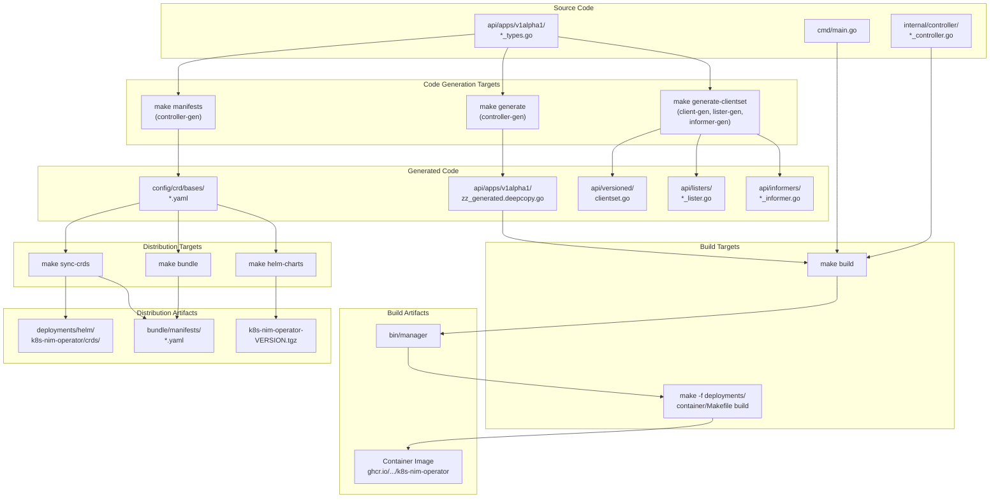
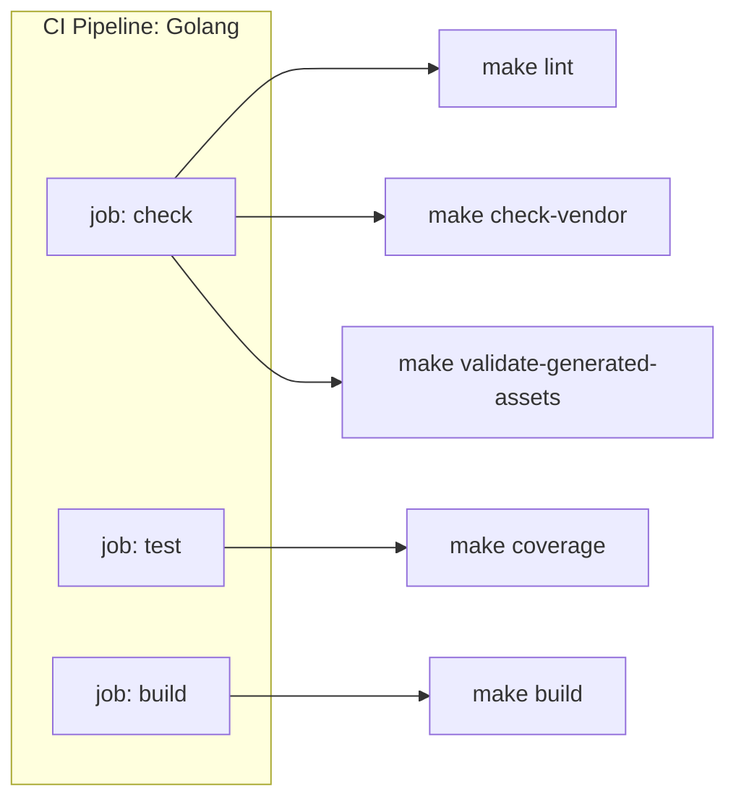
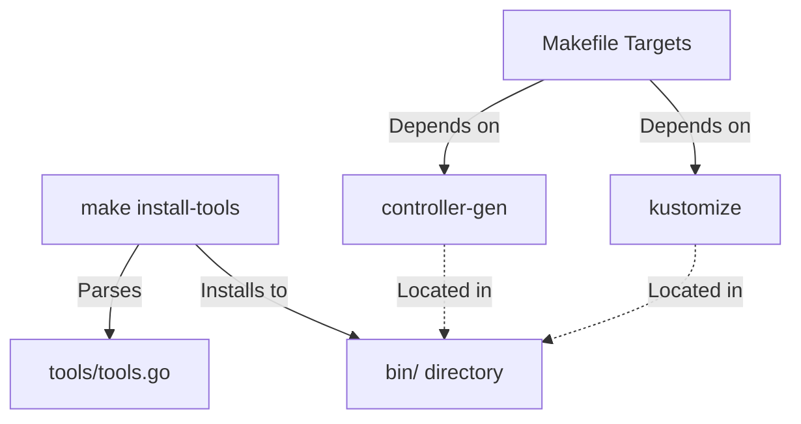

<!-- source: DeepWiki mcp.deepwiki.com · repo NVIDIA/k8s-nim-operator · page 6.1 Building the Operator · fetched 2026-10-26 -->

# Building the Operator

<details>
<summary>Relevant source files</summary>

The following files were used as context for generating this wiki page:

- [.github/workflows/golang.yml](.github/workflows/golang.yml)
- [.gitignore](.gitignore)
- [Makefile](Makefile)

</details>


This document provides instructions for building the k8s-nim-operator from source code, covering local development builds, code generation, and containerization. For information about testing the operator, see [Testing](#6.2). For CI/CD pipeline details, see [CI/CD Pipeline](#8).

## Overview

Building the operator involves several steps:
1. **Code Generation** - Generating Kubernetes API code (CRDs, DeepCopy methods, client-go code)
2. **Binary Compilation** - Building the `manager` binary that runs the operator
3. **Container Image Building** - Packaging the operator into a container image
4. **Artifact Generation** - Creating Helm charts, OLM bundles, and manifests

The build system is orchestrated through a [Makefile:1-266]() that provides targets for each step. The operator uses [Kubebuilder v4](https://book.kubebuilder.io) as its framework, which influences the build and code generation patterns.

## Build Prerequisites

The following tools are required to build the operator locally:

| Tool | Purpose | Version Source |
|------|---------|----------------|
| Go | Compile operator code | [hack/golang-version.sh:1-12]() |
| make | Build orchestration | System package |
| Docker or Podman | Container image building | [Makefile:35-35]() (`CONTAINER_TOOL`) |
| controller-gen | Generate CRDs and RBAC | [Makefile:238-250]() |
| kustomize | Manifest templating | [Makefile:237-245]() |

The Makefile automatically downloads required tools into `./bin/` when needed. Tool versions are managed via [versions.mk:1-24]() and the tools module.

**Sources:** [Makefile:20-37](), [.github/workflows/golang.yml:33-41]()

## Build Workflow

The following diagram shows the dependencies between build targets and generated artifacts:

**Build Target and Artifact Dependency Flow**


**Sources:** [Makefile:78-108](), [Makefile:155-175](), [Makefile:215-219]()

## Building the Operator Binary

The primary build target compiles the operator into a standalone binary:

```bash
make build
```

This target executes the following steps:

1. **Generate Manifests** - Runs `make manifests` to ensure CRDs and RBAC are up-to-date [Makefile:78-82]()
2. **Generate DeepCopy Methods** - Runs `make generate` to create required Kubernetes API methods [Makefile:83-86]()
3. **Format Code** - Runs `go fmt` to ensure code formatting [Makefile:112-114]()
4. **Vet Code** - Runs `go vet` for static analysis [Makefile:122-123]()
5. **Compile Binary** - Builds `cmd/main.go` into `bin/manager` [Makefile:155-157]()

The build command is defined at [Makefile:155-157]():

```makefile
build: manifests generate fmt vet ## Build manager binary.
	go build -ldflags "-X github.com/NVIDIA/k8s-dra-driver-gpu/internal/info.version=$(NVIDIA_DRA_DRIVER_GPU_VERSION)" -o bin/manager cmd/main.go
```

The resulting binary `bin/manager` is the operator controller that runs inside Kubernetes pods.

**Sources:** [Makefile:155-157](), [.github/workflows/golang.yml:108-112]()

## Code Generation

The operator uses multiple code generators to create Kubernetes-related code from API type definitions.

### Generating CRDs and RBAC

The `manifests` target generates CustomResourceDefinitions, RBAC roles, and webhook configurations:

```bash
make manifests
```

This target uses `controller-gen` with the following configuration from [Makefile:80-82]():

```makefile
manifests: controller-gen ## Generate WebhookConfiguration, ClusterRole and CustomResourceDefinition objects.
	$(CONTROLLER_GEN) rbac:roleName=manager-role crd:allowDangerousTypes=true webhook paths="./..." output:crd:artifacts:config=config/crd/bases
```

**Sources:** [Makefile:80-82]()

### Generating DeepCopy Methods

The `generate` target creates required Kubernetes runtime methods:

```bash
make generate
```

Defined at [Makefile:83-86](), this generates `zz_generated.deepcopy.go` files containing methods like `DeepCopy()`, `DeepCopyInto()`, and `DeepCopyObject()`. These are required for all Kubernetes API types to satisfy the `runtime.Object` interface.

**Sources:** [Makefile:83-86]()

### Generating Client-Go Code

The `generate-clientset` target generates typed clients, listers, and informers:

```bash
make generate-clientset
```

This target ([Makefile:88-107]()) orchestrates three generators:

| Generator | Code Entity | Output Directory |
|-----------|-------------|------------------|
| `client-gen` | `versioned.Clientset` | `api/versioned/` |
| `lister-gen` | `v1alpha1.NIMServiceLister` | `api/listers/` |
| `informer-gen` | `v1alpha1.NIMServiceInformer` | `api/informers/` |

**Sources:** [Makefile:88-107]()

### Validating Generated Assets

Before committing code, validate that all generated files are in sync:

```bash
make validate-generated-assets
```

This target ([Makefile:108-111]()) regenerates all artifacts and checks for uncommitted changes using `git diff --exit-code`. It fails if any generated files are out of date.

**Sources:** [Makefile:108-111](), [.github/workflows/golang.yml:56-60]()

## Container Image Building

Container images are built using the `CONTAINER_TOOL` defined in the Makefile.

### Local Image Build

Build a container image locally:

```bash
make docker-build
```

The image name and version are controlled by the `IMG` variable, which defaults to `ghcr.io/nvidia/k8s-nim-operator:${VERSION}` [Makefile:16-16]().

**Example:**
```bash
IMG=my-registry/k8s-nim-operator:dev make docker-build
```

### Multi-Architecture Logic

While the local Makefile focuses on single-arch builds, the CI system performs multi-architecture builds. The GitHub Actions workflow [.github/workflows/golang.yml:87-112]() ensures the code builds successfully on `linux-amd64-cpu4` runners.

**Sources:** [Makefile:15-17](), [Makefile:35-35](), [.github/workflows/golang.yml:87-112]()

## Build Artifacts

The build system produces multiple artifacts for different distribution channels:

### Binary and Manifest Artifacts

| Artifact | Location | Created By | Purpose |
|----------|----------|------------|---------|
| `manager` | `bin/manager` | `make build` | Operator binary [Makefile:157]() |
| Consolidated YAML | `dist/install.yaml` | `make build-installer` | Single-file deployment [Makefile:164-168]() |
| Helm Chart | `.tgz` package | `make helm-charts` | Helm distribution [Makefile:172-175]() |

The `build-installer` target ([Makefile:164-168]()) uses `kustomize` to generate a consolidated YAML file:

```makefile
build-installer: manifests generate kustomize ## Generate a consolidated YAML with CRDs and deployment.
	mkdir -p dist
	cd config/manager && $(KUSTOMIZE) edit set image controller=${IMG}
	$(KUSTOMIZE) build config/default > dist/install.yaml
```

**Sources:** [Makefile:155-175]()

### Syncing CRDs

The `sync-crds` target ([Makefile:215-219]()) ensures that the CRDs generated in `config/crd/bases` are copied to the Helm chart and OLM bundle directories:

```makefile
sync-crds: manifests
	cp $(PROJECT_DIR)/config/crd/bases/* deployments/helm/k8s-nim-operator/crds
	cp $(PROJECT_DIR)/config/crd/bases/* bundle/manifests
```

**Sources:** [Makefile:215-219]()

## CI Build Process

The GitHub Actions workflow [.github/workflows/golang.yml]() runs several jobs on every push:

**CI Build Pipeline**


1. **Check Job** ([.github/workflows/golang.yml:25-60]()): Runs linting, vendor verification (`make check-vendor`), and asset validation.
2. **Test Job** ([.github/workflows/golang.yml:61-86]()): Runs unit tests and generates coverage reports using `make coverage`.
3. **Build Job** ([.github/workflows/golang.yml:87-112]()): Verifies that the operator binary compiles successfully.

**Sources:** [.github/workflows/golang.yml:25-112](), [Makefile:125-138]()

## Tool Installation

The operator build depends on several tools that are automatically installed to `./bin/` when needed.

**Tool Management System**


The `install-tools` target ([Makefile:209-213]()) installs all tools defined in the project's tools configuration into the local `bin` directory.

**Sources:** [Makefile:209-265]()

---

