# Page: Overview

# Overview

<details>
<summary>Relevant source files</summary>

The following files were used as context for generating this wiki page:

- [.github/ISSUE_TEMPLATE/bug_report.md](.github/ISSUE_TEMPLATE/bug_report.md)
- [PROJECT](PROJECT)
- [README.md](README.md)

</details>


This document provides an overview of the k8s-nim-operator project, introducing its purpose, core components, and high-level architecture. For detailed API reference documentation, see [API Reference](#5). For installation and deployment instructions, see [Getting Started](#2) and [Deployment](#7).

## Purpose and Scope

The k8s-nim-operator is a Kubernetes Operator designed to facilitate the deployment, management, and scaling of NVIDIA NIM (NVIDIA Inference Microservices) on Kubernetes clusters. NVIDIA NIM microservices deliver AI foundation models as accelerated inference microservices that are portable across data center, workstation, and cloud environments, accelerating generative AI development and deployment. [README.md:6-13]()

This operator implements the Kubernetes operator pattern to manage custom resources representing NIM services, model caching, inference pipelines, and NeMo microservices through a declarative API. [PROJECT:11-98]()

**Sources**: [README.md:1-13](), [PROJECT:1-99]()

## What is k8s-nim-operator?

The k8s-nim-operator extends Kubernetes with custom resource definitions (CRDs) and controllers that automate the lifecycle management of NVIDIA AI inference workloads. The operator runs as a deployment within the Kubernetes cluster and continuously reconciles the desired state (defined in custom resources) with the actual cluster state.

### Project Structure

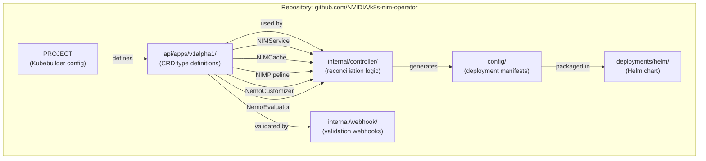

**Key Components**:

| Component | Location | Purpose |
|-----------|----------|---------|
| CRD Type Definitions | `api/apps/v1alpha1/` | Go structs defining custom resource schemas [PROJECT:19,31,43]() |
| Controllers | `internal/controller/` | Reconciliation loops for each resource type [PROJECT:15,27,39]() |
| Validation Webhooks | `internal/webhook/` | Admission webhooks for `NIMService` and `NIMCache` [PROJECT:21-22,33-34]() |
| Deployment Manifests | `config/` | Kustomize-based Kubernetes manifests [README.md:59]() |
| Helm Chart | `deployments/helm/` | Helm packaging for operator installation |

**Sources**: [README.md:1-110](), [PROJECT:1-99]()

## Custom Resources

The operator manages multiple custom resources under the API group `apps.nvidia.com/v1alpha1`. These resources are divided into functional categories:

### Resource Categories

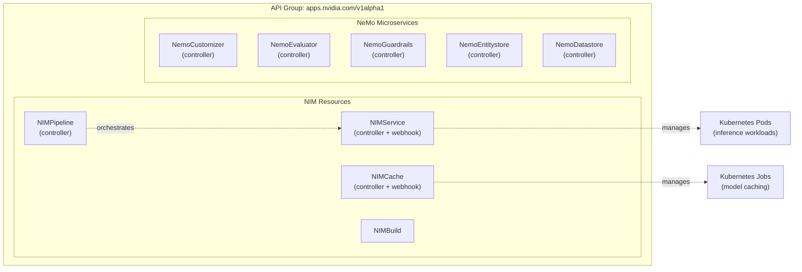

### Resource Summary Table

| Custom Resource | Controller | Webhook | Purpose |
|-----------------|------------|---------|---------|
| `NIMService` | ✓ | ✓ | Deploys and manages NIM inference microservices [PROJECT:17-23]() |
| `NIMCache` | ✓ | ✓ | Manages model caching to PersistentVolumeClaims [PROJECT:29-35]() |
| `NIMPipeline` | ✓ | ✗ | Orchestrates multi-step inference workflows [PROJECT:41-44]() |
| `NIMBuild` | ✗ | ✗ | Builds custom NIM containers [PROJECT:94-97]() |
| `NemoCustomizer` | ✓ | ✗ | Manages model customization workflows [PROJECT:87-89]() |
| `NemoEvaluator` | ✓ | ✗ | Evaluates model performance [PROJECT:51-53]() |
| `NemoGuardrails` | ✓ | ✗ | Implements safety guardrails for AI models [PROJECT:78-80]() |
| `NemoEntitystore` | ✓ | ✗ | Manages entity data for NeMo workflows [PROJECT:60-62]() |
| `NemoDatastore` | ✓ | ✗ | Manages data storage for NeMo services [PROJECT:69-71]() |

**Sources**: [PROJECT:11-98]()

## Core Architecture

The operator follows the standard Kubernetes operator pattern with controllers, webhooks, and custom resource definitions.

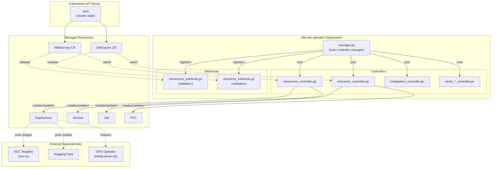

### Controller Reconciliation Pattern

The operator implements the Kubernetes reconciliation pattern where each controller:

1. **Watches** for changes to its custom resource type via the Kubernetes API.
2. **Reconciles** the actual cluster state to match the desired state defined in the custom resource.
3. **Updates** the custom resource status to reflect the current state.
4. **Re-queues** reconciliation if the operation fails or needs to be retried.

For detailed information on the reconciliation loops, see [Operator Pattern](#3.1).

**Sources**: [PROJECT:11-98](), [README.md:1-110]()

## Key Features

### 1. Declarative Model Deployment
Users define NIM services using Kubernetes custom resources. The operator handles:
- Container deployment and configuration.
- GPU resource allocation.
- Service exposure (ClusterIP, LoadBalancer, Ingress, Gateway API).
- Auto-scaling via Horizontal Pod Autoscaler. [README.md:8-10]()

### 2. Model Caching
The `NIMCache` resource pre-downloads and caches model artifacts to PersistentVolumeClaims, enabling:
- Faster pod startup times.
- Shared model storage across multiple pods.
- Reduced external registry traffic. [.github/ISSUE_TEMPLATE/bug_report.md:31-36]()

### 3. Validation Webhooks
Both `NIMService` and `NIMCache` implement admission webhooks that validate resource specifications before they are persisted to etcd, preventing invalid configurations from being applied. [PROJECT:21-22,33-34]()

### 4. Multi-Architecture Support
The operator is built and distributed as multi-architecture images supporting `linux/amd64` and `linux/arm64`. [README.md:24-28]()

**Sources**: [PROJECT:21-35](), [README.md:50-52](), [README.md:8-10](), [.github/ISSUE_TEMPLATE/bug_report.md:31-36]()

## Dependencies and Integration Points

### Required Dependencies

| Dependency | Version | Purpose |
|------------|---------|---------|
| Kubernetes | v1.28+ | Orchestration platform [README.md:19]() |
| NVIDIA GPU Operator | Latest | GPU driver and runtime management [.github/ISSUE_TEMPLATE/bug_report.md:15]() |
| NVIDIA GPUs | Supported by NIM | Hardware acceleration for inference [README.md:20]() |

### External Integrations

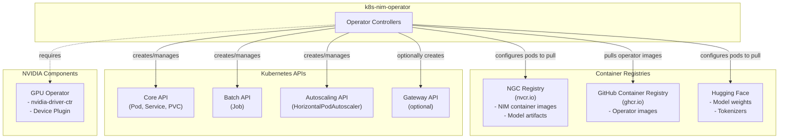

### Authentication Requirements
The operator and deployed workloads require credentials for access to the NVIDIA container registry and model repositories. [README.md:30-32]()

**Sources**: [.github/ISSUE_TEMPLATE/bug_report.md:10-46](), [README.md:15-21]()

## Deployment Targets

The operator supports multiple deployment methods:

1. **Helm Chart** - Recommended for production deployments.
2. **OLM Bundle** - For OpenShift and OLM-enabled clusters.
3. **Raw Manifests** - For development and testing. [README.md:81-92]()

**Sources**: [README.md:74-92]()

## System Requirements

### Kubernetes Environment

| Component | Requirement |
|-----------|-------------|
| Kubernetes Version | v1.28 or higher [README.md:19]() |
| Container Runtime | Containerd, CRI-O, or Docker [.github/ISSUE_TEMPLATE/bug_report.md:13]() |
| Kubernetes Flavors | K8s, OCP, Rancher, GKE, EKS [.github/ISSUE_TEMPLATE/bug_report.md:14]() |

### Hardware Requirements

| Resource | Requirement |
|----------|-------------|
| GPUs | NVIDIA GPUs supported by target NIM microservices [README.md:20]() |
| Storage | PVC support for model caching [.github/ISSUE_TEMPLATE/bug_report.md:36]() |

**Sources**: [README.md:17-21](), [.github/ISSUE_TEMPLATE/bug_report.md:10-18]()

## Project Layout

The repository follows the Kubebuilder v4 project structure: [PROJECT:7]()

```
k8s-nim-operator/
├── api/                      # CRD type definitions
│   └── apps/v1alpha1/       # API group version
├── internal/
│   ├── controller/          # Controller reconciliation logic
│   └── webhook/             # Admission webhook handlers
├── config/                  # Kustomize manifests
│   ├── crd/                # Generated CRD YAML files
│   ├── rbac/               # RBAC manifests
│   └── default/            # Default deployment configuration
├── deployments/
│   ├── container/          # Container build files
│   └── helm/               # Helm chart
├── bundle/                 # OLM bundle manifests
├── pkg/                    # Shared packages
└── PROJECT                 # Kubebuilder project metadata
```

**Sources**: [PROJECT:1-99](), [README.md:99-110]()

## Next Steps

- To install and configure the operator, see [Getting Started](#2)
- To understand the operator architecture in depth, see [Architecture](#3)
- To learn about individual custom resources, see [Custom Resources](#4)
- To contribute to the project, see [Contributing](#10)
- For troubleshooting common issues, see [Troubleshooting](#11)

---

# Page: Getting Started

# Getting Started

<details>
<summary>Relevant source files</summary>

The following files were used as context for generating this wiki page:

- [Makefile](Makefile)
- [README.md](README.md)
- [bundle/manifests/apps.nvidia.com_nimservices.yaml](bundle/manifests/apps.nvidia.com_nimservices.yaml)

</details>


This guide provides a quick start for deploying the `k8s-nim-operator` in a Kubernetes cluster and running your first NVIDIA NIM inference service. It covers prerequisites, installation methods, and a basic deployment example.

For detailed architecture information, see [Architecture](). For production deployment patterns and advanced configuration, see [Deployment](). For complete Custom Resource reference documentation, see [Custom Resources]().

---

## Prerequisites

Before installing the `k8s-nim-operator`, ensure your environment meets the following requirements:

| Requirement | Version/Details | Purpose |
|------------|----------------|---------|
| Kubernetes | v1.28 or higher | Operator runtime environment [README.md:19]() |
| NVIDIA GPUs | Supported by target NIM models | AI inference acceleration [README.md:20]() |
| NVIDIA GPU Operator | Installed and configured | GPU device plugin and drivers |
| Container Runtime | Docker, containerd, or CRI-O | Container execution |
| NGC API Key | From NVIDIA NGC | Model registry authentication |
| kubectl | Matching cluster version | Cluster management |

### Obtaining NGC Credentials

NVIDIA NIM microservices are distributed through NGC (NVIDIA GPU Cloud). To pull NIM container images and models:

1. Create an NGC account at [https://catalog.ngc.nvidia.com](https://catalog.ngc.nvidia.com)
2. Generate an API key from your account settings.
3. Store the API key securely - it will be used as an image pull secret and for model downloads.

**Sources:** [README.md:17-21]()

---

## Installation Methods

The `k8s-nim-operator` can be installed using three methods. Each method produces the same deployed components but suits different operational workflows:

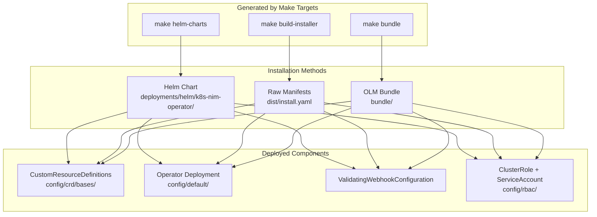

**Diagram: Installation Methods and Component Flow**

### Method 1: Using Raw Manifests (Quickest for Testing)

This method generates a single consolidated YAML file containing all CRDs and deployment manifests:

```bash
# Generate install.yaml with specific image
make build-installer IMG=ghcr.io/nvidia/k8s-nim-operator:v0.1.0
```

The `build-installer` target in [Makefile:163-168]() uses `kustomize` to build manifests from [config/default/]() and produces [dist/install.yaml]().

**Pros:**
- Single command installation.
- No external dependencies (Helm, OLM).
- Easy to inspect generated YAML.

### Method 2: Using Helm (Recommended for Production)

Helm provides parameterized configuration and upgrade management. The chart is located in `deployments/helm/k8s-nim-operator/`.

```bash
# Package the chart
make helm-charts

# Install from local chart
helm install nim-operator deployments/helm/k8s-nim-operator/ \
  --namespace nim-operator \
  --create-namespace \
  --set image.repository=ghcr.io/nvidia/k8s-nim-operator \
  --set image.tag=v0.1.0
```

The [Makefile:172-175]() target packages Helm charts using semantic versioning (strips `v` prefix from `VERSION`).

### Method 3: Using Operator Lifecycle Manager (Enterprise)

OLM provides automated operator lifecycle management. OLM bundles are generated and validated via Makefile targets:

```bash
# Generate bundle
make bundle

# Validate bundle
make bundle-validate
```

**Sources:** [Makefile:163-184](), [README.md:74-92]()

---

## Quick Start: Deploying the Operator

This section walks through a complete installation using the raw manifests method.

### Step 1: Install CRDs

Install the Custom Resource Definitions into your cluster:

```bash
make install
```

This applies CRDs from [config/crd/bases/]() using the [Makefile:193-194]() target.

Verify CRD installation:
```bash
kubectl get crds | grep apps.nvidia.com
```

Expected output includes:
- `nimservices.apps.nvidia.com` [bundle/manifests/apps.nvidia.com_nimservices.yaml:7]()
- `nimcaches.apps.nvidia.com`
- `nimpipelines.apps.nvidia.com`
- `nimbuilds.apps.nvidia.com`
- `nemocustomizers.apps.nvidia.com`

### Step 2: Deploy the Operator

Deploy the operator controller to the cluster:

```bash
make deploy IMG=ghcr.io/nvidia/k8s-nim-operator:v0.1.0
```

The [Makefile:201-203]() target patches the image reference in [config/manager/]() and applies manifests from [config/default/]().

Verify operator deployment:
```bash
kubectl get deployment -n k8s-nim-operator-system
```

**Sources:** [README.md:34-44](), [Makefile:193-203]()

---

## Deploying Your First NIM Service

Once the operator is installed, you can deploy NVIDIA NIM microservices using the `NIMService` Custom Resource.

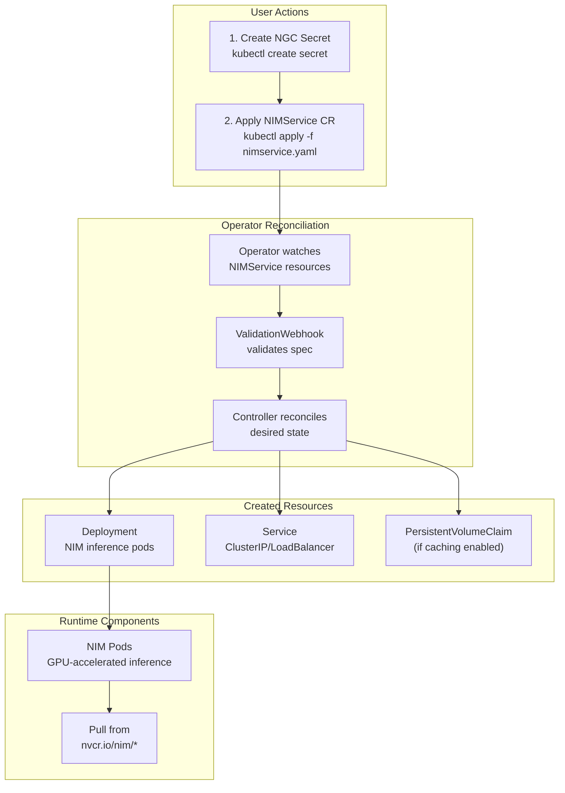

**Diagram: NIMService Deployment Flow**

### Step 1: Create NGC Image Pull Secret

Create a Kubernetes secret containing your NGC API key:

```bash
kubectl create secret docker-registry ngc-secret \
  --docker-server=nvcr.io \
  --docker-username='$oauthtoken' \
  --docker-password=<your-ngc-api-key> \
  --namespace=default
```

### Step 2: Create NIMService Resource

Create a file named `nimservice-example.yaml` using the `NIMService` kind [bundle/manifests/apps.nvidia.com_nimservices.yaml:11]():

```yaml
apiVersion: apps.nvidia.com/v1alpha1
kind: NIMService
metadata:
  name: meta-llama3-8b-instruct
spec:
  image:
    repository: nvcr.io/nim/meta/llama3-8b-instruct
    tag: "1.0.0"
    pullSecrets:
      - ngc-secret
  resources:
    limits:
      nvidia.com/gpu: 1
  expose:
    service:
      type: ClusterIP
      port: 8000
```

Apply the resource:
```bash
kubectl apply -f nimservice-example.yaml
```

**Sources:** [README.md:50-52](), [bundle/manifests/apps.nvidia.com_nimservices.yaml:8-49]()

---

## Component Deployment Diagram

This diagram bridges the Natural Language Space of "Deployment" to the Code Entity Space by showing how the `manager` binary interacts with specific CRDs and controllers.

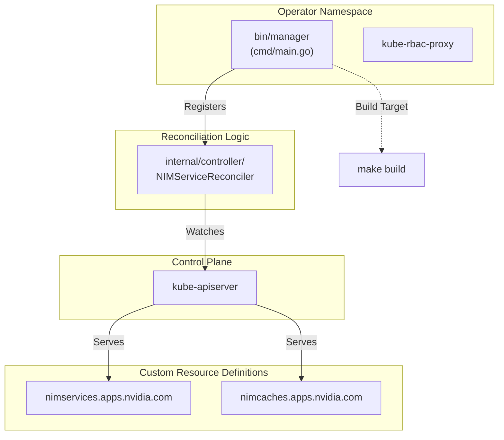

**Diagram: Code Entity to Component Mapping**

**Sources:** [Makefile:156-158](), [bundle/manifests/apps.nvidia.com_nimservices.yaml:7](), [README.md:40-44]()

---

## Uninstalling the Operator

To remove the operator and its resources:

### 1. Remove Instances
Delete all deployed Custom Resources:
```bash
kubectl delete -k config/samples/
```

### 2. Undeploy Operator
Remove the controller and RBAC:
```bash
make undeploy
```

### 3. Uninstall CRDs
Remove the Custom Resource Definitions:
```bash
make uninstall
```

**Sources:** [README.md:54-72](), [Makefile:197-207]()

---

## Build and Development Workflow

For developers who want to build the operator from source:

```bash
# Clone repository
git clone https://github.com/NVIDIA/k8s-nim-operator.git
cd k8s-nim-operator

# Build operator binary locally
make build

# Run unit tests
make test
```

The `make build` target in [Makefile:156-158]() compiles the `manager` binary from [cmd/main.go]() after running code generation and validation checks.

**Sources:** [README.md:99-107](), [Makefile:156-161]()

---

# Page: Architecture

# Architecture

<details>
<summary>Relevant source files</summary>

The following files were used as context for generating this wiki page:

- [api/apps/v1alpha1/common_types.go](api/apps/v1alpha1/common_types.go)
- [api/apps/v1alpha1/groupversion_info.go](api/apps/v1alpha1/groupversion_info.go)
- [api/informers/externalversions/factory.go](api/informers/externalversions/factory.go)

</details>


## Purpose and Scope

This document provides a comprehensive overview of the k8s-nim-operator's architecture, focusing on the overall system structure, component interactions, and integration points. It establishes the foundational architectural patterns that enable the operator to manage NVIDIA NIM (NVIDIA Inference Microservices) and NeMo workloads on Kubernetes.

For detailed information about the operator pattern implementation and reconciliation loops, see [Operator Pattern](#3.1). For API design principles and versioning strategy, see [API Design](#3.2). For specific Custom Resource documentation, see [Custom Resources](#4).

---

## System Overview

The k8s-nim-operator is a Kubernetes operator built using the Kubebuilder framework. It extends Kubernetes with domain-specific Custom Resource Definitions (CRDs) to manage AI inference workloads and provides automated lifecycle management for NVIDIA NIM microservices.

### Core Components

| Component | Purpose | File Path Reference |
|-----------|---------|---------------------|
| **Operator Controller** | Manages reconciliation loops for all CRDs | `internal/controller/` |
| **Validation Webhooks** | Validates NIMService and NIMCache resources | `internal/webhook/` |
| **API Definitions** | Defines CRD schemas and common types | [api/apps/v1alpha1/common_types.go:1-171]() |
| **Generated Client** | Provides programmatic access to CRDs | [api/informers/externalversions/factory.go:1-205]() |
| **RBAC Manifests** | Defines operator permissions | `config/rbac/` |
| **CRD Manifests** | Contains generated CRD YAML definitions | `config/crd/bases/` |

**Sources**: [api/apps/v1alpha1/groupversion_info.go:1-42](), [api/informers/externalversions/factory.go:1-55]()

---

## Architectural Layers

The operator architecture consists of four distinct layers, each with specific responsibilities:

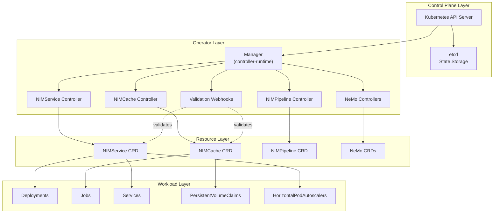

**Figure 1: Architectural Layers**

**Sources**: [api/apps/v1alpha1/groupversion_info.go:17-41](), [api/apps/v1alpha1/common_types.go:46-136]()

---

## Component Interaction Flow

The following diagram illustrates how components interact during a typical NIMService deployment lifecycle, bridging the gap between high-level logic and code entities like `sharedInformerFactory`.

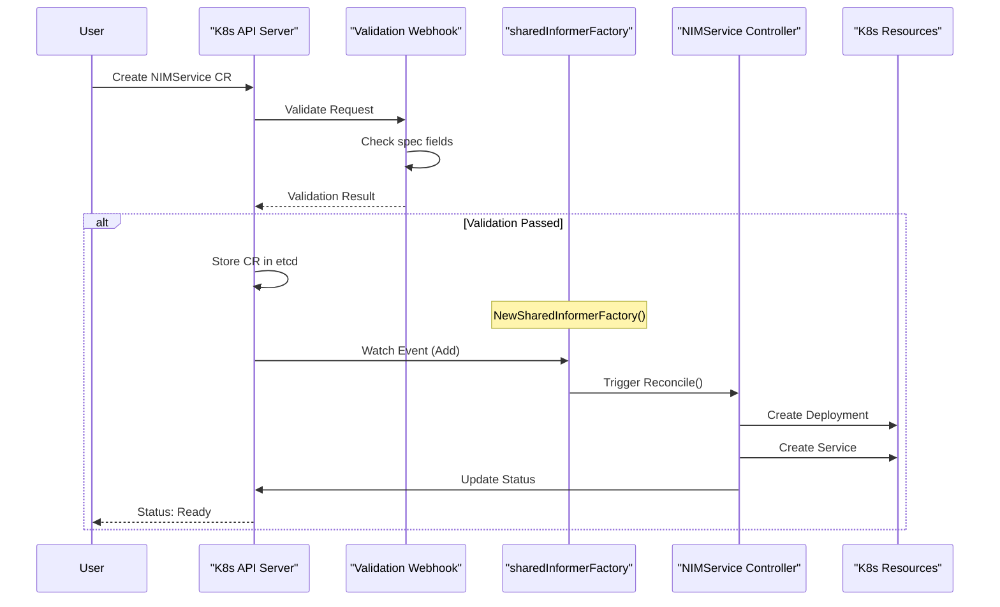

**Figure 2: Component Interaction Sequence**

**Sources**: [api/informers/externalversions/factory.go:92-121](), [api/apps/v1alpha1/common_types.go:147-170]()

---

## Custom Resource Management

The operator manages resources under the `apps.nvidia.com/v1alpha1` API group. These resources leverage common types to ensure consistency.

### NIM Resources

| Resource | Purpose | Code Reference |
|----------|---------|----------------|
| **NIMService** | Deploys NIM inference microservices | [api/apps/v1alpha1/common_types.go:47-53]() |
| **NIMCache** | Manages model artifact caching | [api/apps/v1alpha1/common_types.go:139-144]() |
| **NIMPipeline** | Orchestrates multi-step inference workflows | [api/apps/v1alpha1/groupversion_info.go:27-30]() |

### Common API Entities

The architecture relies on reusable types defined in `common_types.go`:
- `Expose`: Defines how services are exposed via `Service`, `Ingress`, or `Router` [api/apps/v1alpha1/common_types.go:47-53]().
- `Router`: Configures advanced routing including `Gateway` and `EPPConfig` [api/apps/v1alpha1/common_types.go:56-76]().
- `Service`: Standardizes service definitions for NIM ports [api/apps/v1alpha1/common_types.go:147-170]().

**Sources**: [api/apps/v1alpha1/common_types.go:31-170](), [api/apps/v1alpha1/groupversion_info.go:17-41]()

---

## Controller and Informer Architecture

The operator uses a generated `SharedInformerFactory` to manage resource caches efficiently. This reduces API server load by sharing a single connection for multiple controllers.

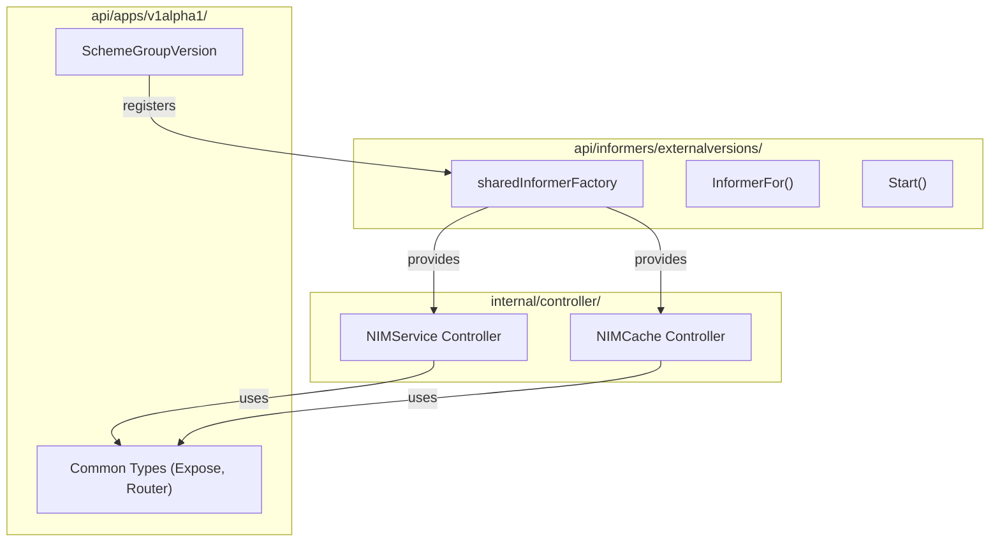

**Figure 3: Informer and Controller Interaction**

**Sources**: [api/informers/externalversions/factory.go:37-55](), [api/informers/externalversions/factory.go:179-199](), [api/apps/v1alpha1/groupversion_info.go:27-35]()

---

## External Dependencies and Integration

The operator integrates with several external systems to provide complete AI inference capabilities:

| Dependency | Purpose | Code Variable |
|------------|---------|---------------|
| **NGC Registry** | Hosts NIM container images | `NGCAPIKey` [api/apps/v1alpha1/common_types.go:41-41]() |
| **Hugging Face** | Model artifact source | `HFToken` [api/apps/v1alpha1/common_types.go:43-43]() |
| **Gateway API** | Advanced traffic routing | `gatewayv1.BackendRef` [api/apps/v1alpha1/common_types.go:135-135]() |
| **Prometheus** | Metrics collection | `DefaultNamedPortMetrics` [api/apps/v1alpha1/common_types.go:38-39]() |

**Sources**: [api/apps/v1alpha1/common_types.go:31-44](), [api/apps/v1alpha1/common_types.go:117-136]()

---

## Summary

The k8s-nim-operator architecture follows proven Kubernetes patterns:

1. **Declarative API**: Uses `SchemeGroupVersion` to register `apps.nvidia.com/v1alpha1` [api/apps/v1alpha1/groupversion_info.go:27-30]().
2. **Efficient Caching**: Implements `sharedInformerFactory` to minimize API calls [api/informers/externalversions/factory.go:37-55]().
3. **Modular Design**: Uses common types like `Expose` and `Router` to promote code reuse across different NIM resources [api/apps/v1alpha1/common_types.go:47-76]().

For implementation details of the operator pattern, see [Operator Pattern](#3.1). For API design principles and versioning, see [API Design](#3.2).

---

# Page: Operator Pattern

# Operator Pattern

<details>
<summary>Relevant source files</summary>

The following files were used as context for generating this wiki page:

- [api/apps/v1alpha1/nimbuild_types.go](api/apps/v1alpha1/nimbuild_types.go)
- [api/apps/v1alpha1/nimcache_types.go](api/apps/v1alpha1/nimcache_types.go)
- [api/apps/v1alpha1/nimpipeline_types.go](api/apps/v1alpha1/nimpipeline_types.go)
- [api/apps/v1alpha1/nimservice_types.go](api/apps/v1alpha1/nimservice_types.go)

</details>


This page explains the Kubernetes operator pattern and how it is implemented in the `k8s-nim-operator`. The operator pattern is a core architectural principle that enables the operator to manage complex AI inference workloads declaratively through custom resources. Each controller continuously watches for changes to custom resources and reconciles the actual cluster state with the desired state.

The `k8s-nim-operator` is built using Kubebuilder, a framework for building Kubernetes operators using Go. The operator manages multiple custom resources under the `apps.nvidia.com/v1alpha1` API group.

## Kubernetes Operator Pattern Overview

The `k8s-nim-operator` implements the standard Kubernetes operator pattern, which extends Kubernetes functionality through custom controllers that manage application-specific resources. The pattern consists of three key components:

1.  **Custom Resource Definitions (CRDs)**: Define new resource types in Kubernetes, such as `NIMService`, `NIMCache`, `NIMBuild`, and `NIMPipeline`.
2.  **Controllers**: Watch and reconcile custom resources.
3.  **Reconciliation Loop**: Continuously drive cluster state toward desired state.

### Controllers in k8s-nim-operator

The operator implements multiple controllers, each managing a specific custom resource:

| Controller | Resource Kind | Purpose |
| :--- | :--- | :--- |
| `NIMServiceReconciler` | `NIMService` | Manages NIM inference service deployments, including standalone and KServe platforms [api/apps/v1alpha1/nimservice_types.go:83-91](). |
| `NIMCacheReconciler` | `NIMCache` | Manages model caching jobs and PVCs for NGC, HuggingFace, or DataStore sources [api/apps/v1alpha1/nimcache_types.go:64-74](). |
| `NIMBuildReconciler` | `NIMBuild` | Manages the building of optimized TensorRT-LLM engines from model weights [api/apps/v1alpha1/nimbuild_types.go:29-30](). |
| `NIMPipelineReconciler` | `NIMPipeline` | Orchestrates multi-step inference pipelines by managing service dependencies [api/apps/v1alpha1/nimpipeline_types.go:40-47](). |

### Basic Controller Flow

**Diagram: Kubernetes Operator Pattern Implementation**

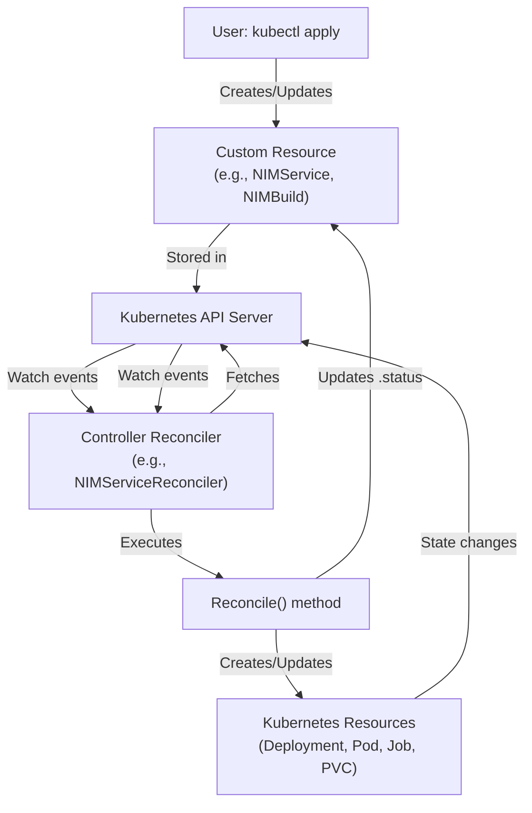

This diagram illustrates the operator pattern flow: users create custom resources like `NIMService` [api/apps/v1alpha1/nimservice_types.go:87-93](), controllers watch for changes via the Kubernetes API, execute reconciliation logic, and manage underlying Kubernetes resources.

Sources: [api/apps/v1alpha1/nimservice_types.go:51-64](), [api/apps/v1alpha1/nimbuild_types.go:85-123]()

## Reconciliation Flow

The `Reconcile()` method is the entry point for all reconciliation logic. Controllers follow a consistent pattern to ensure the desired state specified in the `Spec` is reflected in the cluster, while reporting the current state in the `Status`.

### Data Flow and Status Updates

Each CRD defines a `Spec` (desired state) and a `Status` (observed state). For example, `NIMBuild` tracks the progress of an engine build through various states:

**Diagram: NIMBuild State Machine**

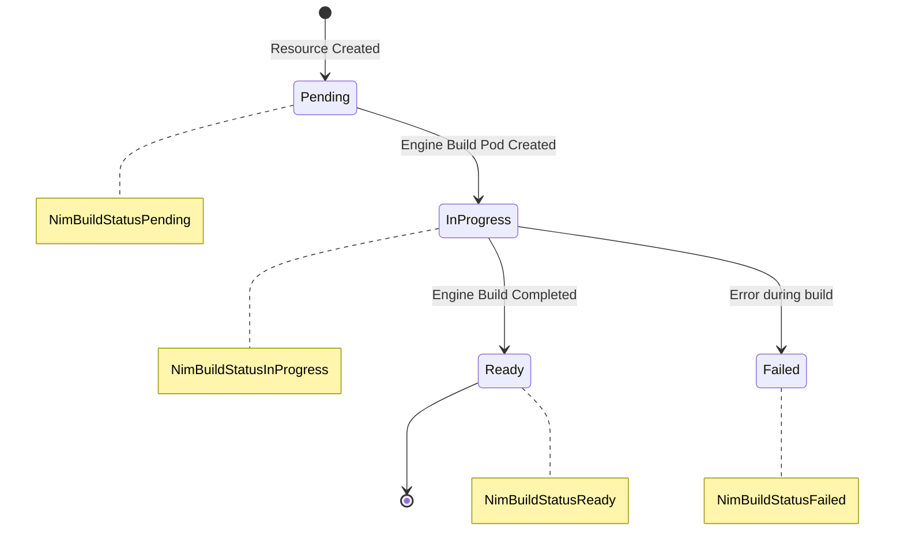

Sources: [api/apps/v1alpha1/nimbuild_types.go:110-123]()

### Reconciliation Logic Steps

1.  **Fetch Resource**: The controller retrieves the object (e.g., `NIMBuild` [api/apps/v1alpha1/nimbuild_types.go:68-75]()) using the client.
2.  **Validation**: For resources like `NIMCache`, the controller ensures exactly one source (NGC, HF, or DataStore) is defined [api/apps/v1alpha1/nimcache_types.go:64-65]().
3.  **Dependency Resolution**: `NIMBuild` checks if the referenced `NIMCache` is ready before proceeding [api/apps/v1alpha1/nimbuild_types.go:86-87]().
4.  **Resource Generation**: The controller renders sub-resources. For `NIMBuild`, this includes the Engine Build Pod [api/apps/v1alpha1/nimbuild_types.go:162-165]() and Local Manifest Reader Pod [api/apps/v1alpha1/nimbuild_types.go:168-170]().
5.  **Status Reporting**: The controller updates conditions such as `NIM_SERVICE_READY` [api/apps/v1alpha1/nimservice_types.go:52-53]() or `NIM_PIPELINE_FAILED` [api/apps/v1alpha1/nimpipeline_types.go:29-30]().

## Resource Lifecycle Management

### NIMCache and NIMBuild Interaction

The operator manages a complex lifecycle where resources depend on one another. A `NIMBuild` requires a `NIMCache` to be populated with model weights before it can build an engine.

**Diagram: Resource Interaction Data Flow**

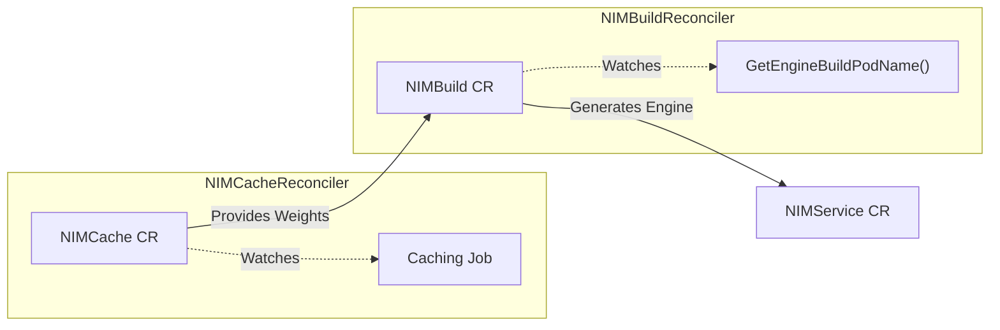

Sources: [api/apps/v1alpha1/nimbuild_types.go:31-32](), [api/apps/v1alpha1/nimbuild_types.go:162-165]()

### Multi-Node and Platform Support

The `NIMServiceReconciler` handles advanced deployment patterns:
*   **Inference Platforms**: Supports `standalone` (default) and `kserve` [api/apps/v1alpha1/nimservice_types.go:83-91]().
*   **Multi-Node**: Manages `LeaderWorkerSet` (LWS) for distributed inference when `multiNode` is configured [api/apps/v1alpha1/nimservice_types.go:144-150]().
*   **Autoscaling**: Integrates with Horizontal Pod Autoscaler (HPA) via the `Scale` field, ensuring it is mutually exclusive with `multiNode` or static `replicas` [api/apps/v1alpha1/nimservice_types.go:93-96]().

## Status Management and Conditions

Controllers update resource status through a consistent condition-based mechanism. This allows users to diagnose issues by looking at the `status.conditions` of a resource.

| Condition Type | Associated Resource | Description |
| :--- | :--- | :--- |
| `NIM_SERVICE_READY` | `NIMService` | Indicates the NIM deployment is ready to serve traffic [api/apps/v1alpha1/nimservice_types.go:52-53](). |
| `NIM_BUILD_ENGINE_BUILD_POD_COMPLETED` | `NIMBuild` | Indicates the engine optimization process finished successfully [api/apps/v1alpha1/nimbuild_types.go:99-100](). |
| `NIM_PIPELINE_READY` | `NIMPipeline` | Indicates all services in the pipeline are operational [api/apps/v1alpha1/nimpipeline_types.go:27-28](). |
| `NIM_BUILD_WAIT_FOR_NIM_CACHE_READY` | `NIMBuild` | Indicates the build is blocked by a pending cache [api/apps/v1alpha1/nimbuild_types.go:86-87](). |

Sources: [api/apps/v1alpha1/nimservice_types.go:51-64](), [api/apps/v1alpha1/nimbuild_types.go:85-123](), [api/apps/v1alpha1/nimpipeline_types.go:26-38]()

---

# Page: API Design

# API Design

<details>
<summary>Relevant source files</summary>

The following files were used as context for generating this wiki page:

- [api/apps/v1alpha1/common_types.go](api/apps/v1alpha1/common_types.go)
- [api/apps/v1alpha1/groupversion_info.go](api/apps/v1alpha1/groupversion_info.go)
- [api/apps/v1alpha1/nemo_common_types.go](api/apps/v1alpha1/nemo_common_types.go)
- [api/apps/v1alpha1/zz_generated.deepcopy.go](api/apps/v1alpha1/zz_generated.deepcopy.go)

</details>


## Purpose and Scope

This document describes the API design principles and structure of the k8s-nim-operator. It covers the API group organization (`apps.nvidia.com/v1alpha1`), versioning strategy, and how common types promote code reuse across custom resources. For detailed reference documentation of individual API types and fields, see [API Reference](#5).

## API Group Structure

The k8s-nim-operator defines its API under a single API group with a consistent versioning scheme. All custom resources follow the Kubernetes API conventions and leverage the kubebuilder framework for code generation.

### Group, Version, and Domain

The API is organized under the following coordinates:

| Component | Value |
|-----------|-------|
| **Domain** | `nvidia.com` |
| **Group** | `apps` |
| **Full API Group** | `apps.nvidia.com` |
| **Version** | `v1alpha1` |
| **Schema Path** | `github.com/NVIDIA/k8s-nim-operator/api/apps/v1alpha1` |

The domain and group combination creates a namespaced API group that prevents conflicts with other operators in the cluster. The full API group is defined in [api/apps/v1alpha1/groupversion_info.go:19]() and [api/apps/v1alpha1/groupversion_info.go:29]().

```go
// Defined in groupversion_info.go
SchemeGroupVersion = schema.GroupVersion{Group: "apps.nvidia.com", Version: "v1alpha1"}
```

**Sources:** [api/apps/v1alpha1/groupversion_info.go:17-42]()

### Custom Resource Types

The operator manages several distinct custom resource types, organized into functional categories:

#### Core NIM Resources
These resources manage the deployment, caching, and orchestration of NVIDIA Inference Microservices.
- `NIMService`: Deploy and manage NIM inference services.
- `NIMCache`: Manage model caching and persistent volumes.
- `NIMPipeline`: Orchestrate multi-step inference workflows.
- `NIMBuild`: Build custom NIM containers.

#### NeMo Microservices
These resources manage components of the NVIDIA NeMo framework for advanced AI workflows.
- `NemoCustomizer`: Model customization workflows.
- `NemoEvaluator`: Model evaluation workflows.
- `NemoGuardrails`: Safety guardrails for AI models.
- `NemoEntitystore`: Entity management for NeMo.
- `NemoDatastore`: Data management for NeMo.

**Sources:** [api/apps/v1alpha1/groupversion_info.go:31-41]()

### API Resource Registration Diagram

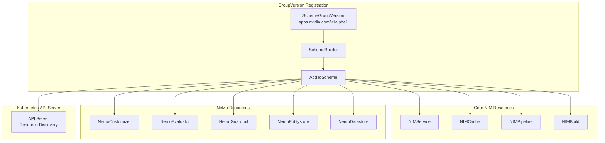

**Sources:** [api/apps/v1alpha1/groupversion_info.go:27-41]()

## Versioning Strategy

### Alpha Version Semantics

The operator currently uses `v1alpha1` as its API version, indicating:
- **Alpha stability level**: The API is under active development and may change between releases.
- **Version 1**: This is the first iteration of the alpha API.
- **No backward compatibility guarantees**: Breaking changes may occur in future alpha versions.

**Sources:** [api/apps/v1alpha1/groupversion_info.go:29]()

## Common Types Pattern

A key design principle of the operator's API is the use of **common types** to promote code reuse and consistency across custom resources. These reusable components are defined in [api/apps/v1alpha1/common_types.go]() and [api/apps/v1alpha1/nemo_common_types.go]().

### Core Common Types

| Type | File Location | Purpose |
|------|---------------|---------|
| `Expose` | [api/apps/v1alpha1/common_types.go:47]() | Service exposure via Service, Ingress, or Gateway API |
| `Router` | [api/apps/v1alpha1/common_types.go:56]() | Ingress and Gateway API routing configuration |
| `Service` | [api/apps/v1alpha1/common_types.go:147]() | Kubernetes Service configuration |
| `EPPConfig` | [api/apps/v1alpha1/common_types.go:79]() | Endpoint Picker Extension configuration for Gateway API |
| `DatabaseConfig` | [api/apps/v1alpha1/nemo_common_types.go:56]() | External database connection settings for NeMo |
| `OTelSpec` | [api/apps/v1alpha1/nemo_common_types.go:134]() | OpenTelemetry settings for tracing and logging |
| `WandBConfig` | [api/apps/v1alpha1/nemo_common_types.go:101]() | Weights and Biases service configuration |

**Sources:** [api/apps/v1alpha1/common_types.go:45-180](), [api/apps/v1alpha1/nemo_common_types.go:1-188]()

### Common Types Composition Diagram

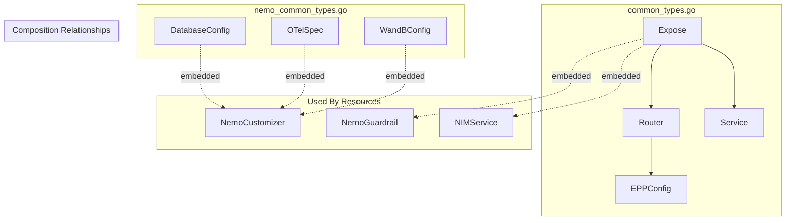

**Sources:** [api/apps/v1alpha1/common_types.go:47-170](), [api/apps/v1alpha1/nemo_common_types.go:56-160]()

## Service Exposure Abstraction

The `Expose` structure provides a unified abstraction over multiple Kubernetes networking primitives.

### Expose Type Architecture

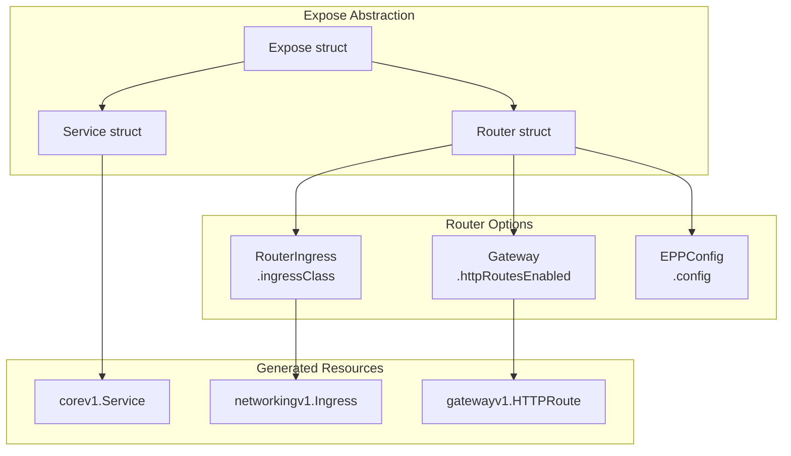

The `Expose` type supports three primary exposure mechanisms:
1. **Service**: Creates a standard Kubernetes Service [api/apps/v1alpha1/common_types.go:147-170]().
2. **Router**: Modern routing via Ingress or Gateway API [api/apps/v1alpha1/common_types.go:56-76]().
3. **EPPConfig**: Integrates with the `gateway-api-inference-extension` to provide advanced endpoint picking [api/apps/v1alpha1/common_types.go:79-106]().

### Validation Rules

The API enforces mutual exclusivity between Router options using CEL validation:

```go
// From common_types.go line 55
// +kubebuilder:validation:XValidation:rule="!(has(self.gateway) && has(self.ingress))", message="ingress and gateway cannot be specified together"
```

This ensures that the operator doesn't attempt to reconcile conflicting routing resources for the same service.

**Sources:** [api/apps/v1alpha1/common_types.go:55-56](), [api/apps/v1alpha1/common_types.go:78-79]()

## Named Ports Convention

The API defines standard named port constants for consistent service discovery:

```go
// From common_types.go lines 31-39
const (
	DefaultAPIPort = 8000
	DefaultNamedPortAPI = "api"
	DefaultNamedPortGRPC = "grpc"
	DefaultNamedPortMetrics = "metrics"
)
```

These constants are used by controllers when generating Service and Container specifications to ensure interoperability between NIM components.

**Sources:** [api/apps/v1alpha1/common_types.go:31-39]()

## NeMo Common Types

For NeMo microservices, the API defines specific types to handle external integrations:

| Type | Purpose | Key Fields |
|------|---------|------------|
| `DatabaseConfig` | SQL Database connection | `Host`, `Port`, `DatabaseName`, `Credentials` |
| `ArgoWorkflows` | Workflow orchestration | `Endpoint`, `ServiceAccount` |
| `WandBConfig` | Training tracking | `SecretName`, `ProjectName` |
| `OTelSpec` | Observability | `ExporterOtlpEndpoint`, `LogLevel`, `ExporterConfig` |

**Sources:** [api/apps/v1alpha1/nemo_common_types.go:19-160]()

## Code Generation

The operator relies heavily on `controller-gen` for deepcopy functions and CRD generation. The `zz_generated.deepcopy.go` file contains the implementation for cloning complex API structures, ensuring that the reconciliation loop works with safe copies of the state.

**Sources:** [api/apps/v1alpha1/zz_generated.deepcopy.go:1-230]()

---

# Page: Custom Resources

# Custom Resources

<details>
<summary>Relevant source files</summary>

The following files were used as context for generating this wiki page:

- [bundle/manifests/apps.nvidia.com_nemocustomizers.yaml](bundle/manifests/apps.nvidia.com_nemocustomizers.yaml)
- [bundle/manifests/apps.nvidia.com_nimcaches.yaml](bundle/manifests/apps.nvidia.com_nimcaches.yaml)
- [bundle/manifests/apps.nvidia.com_nimservices.yaml](bundle/manifests/apps.nvidia.com_nimservices.yaml)

</details>


This document provides an overview of all Custom Resource Definitions (CRDs) managed by the `k8s-nim-operator`. It categorizes resources by their functional purpose and explains the common API patterns shared across resources.

For detailed specifications of individual resources, see [NIM Resources](#4.1) and [NeMo Microservices](#4.2). For information about reusable API components like `Expose`, `Metrics`, and `Autoscaling`, see [Common Types](#5.1). For Dynamic Resource Allocation features, see [Dynamic Resource Allocation](#5.2).

## API Group Structure

All custom resources in `k8s-nim-operator` belong to the `apps.nvidia.com` API group, version `v1alpha1`. The API group is defined in the project structure and manifested in the CRD definitions [bundle/manifests/apps.nvidia.com_nimservices.yaml:9-25]().

```
API Group: apps.nvidia.com
Version: v1alpha1
Domain: nvidia.com
Resources: 9 CRDs (Managed via controllers and validation webhooks)
```

The `v1alpha1` designation indicates that the API is under active development. All resources are namespaced, meaning they exist within a specific Kubernetes namespace context [bundle/manifests/apps.nvidia.com_nimservices.yaml:15]().

**Sources:** [bundle/manifests/apps.nvidia.com_nimservices.yaml:1-25](), [bundle/manifests/apps.nvidia.com_nimcaches.yaml:1-28](), [bundle/manifests/apps.nvidia.com_nemocustomizers.yaml:1-25]()

## Resource Categories

The operator manages two primary categories of resources: NIM Resources for inference workloads and NeMo Resources for AI workflow operations.

### NIM Resources Overview

NIM Resources provide the core functionality for deploying NVIDIA NIM (NVIDIA Inference Microservices) on Kubernetes. These resources handle model serving, caching, and workflow orchestration.

| Resource | Kind | Validation Webhook | Primary Purpose |
|----------|------|-------------------|-----------------|
| `NIMService` | `NIMService` | Yes | Deploy and manage NIM inference services with GPU resources [bundle/manifests/apps.nvidia.com_nimservices.yaml:11]() |
| `NIMCache` | `NIMCache` | Yes | Pre-cache model artifacts to PersistentVolumeClaims [bundle/manifests/apps.nvidia.com_nimcaches.yaml:11]() |
| `NIMPipeline` | `NIMPipeline` | No | Orchestrate multi-step inference workflows |
| `NIMBuild` | `NIMBuild` | No | Build custom NIM container images |

For detailed documentation, see [NIM Resources](#4.1).

**Sources:** [bundle/manifests/apps.nvidia.com_nimservices.yaml:1-50](), [bundle/manifests/apps.nvidia.com_nimcaches.yaml:1-51]()

### NeMo Microservices Overview

NeMo Resources extend the operator with specialized capabilities for NeMo Framework workflows, including model customization and data management.

| Resource | Kind | Primary Purpose |
|----------|------|-----------------|
| `NemoCustomizer` | `NemoCustomizer` | Customize NeMo models with domain-specific data [bundle/manifests/apps.nvidia.com_nemocustomizers.yaml:11]() |
| `NemoGuardrail` | `NemoGuardrail` | Implement safety guardrails for AI models |
| `NemoEntitystore` | `NemoEntitystore` | Manage entity data for NeMo workflows |
| `NemoDatastore` | `NemoDatastore` | Handle data storage for NeMo services |
| `NemoEvaluator` | `NemoEvaluator` | Evaluate NeMo model performance |

For detailed documentation, see [NeMo Microservices](#4.2).

**Sources:** [bundle/manifests/apps.nvidia.com_nemocustomizers.yaml:1-48]()

## Code-to-Entity Mapping

The following diagram bridges the "Natural Language Space" of system features to the "Code Entity Space" by mapping CRD kinds to their structural definitions in the YAML manifests.

Title: CRD Schema Mapping
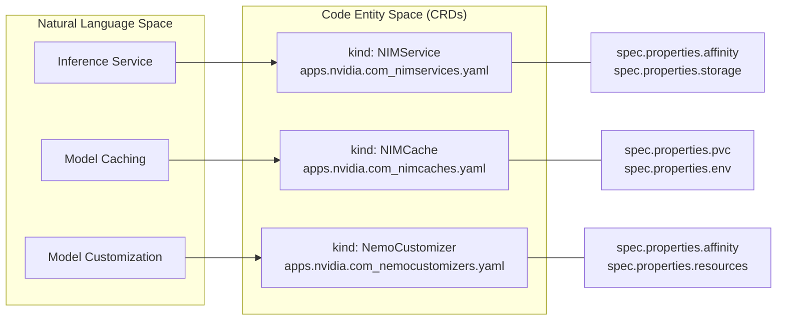

**Sources:** [bundle/manifests/apps.nvidia.com_nimservices.yaml:11-50](), [bundle/manifests/apps.nvidia.com_nimcaches.yaml:11-51](), [bundle/manifests/apps.nvidia.com_nemocustomizers.yaml:11-49]()

## Common API Patterns

The operator uses standardized patterns across its CRDs to ensure a consistent user experience. Many resources share common fields for infrastructure configuration.

### Shared Infrastructure Fields

Most resources, such as `NIMService` and `NemoCustomizer`, share common scheduling and environment configurations:

- **Affinity**: Standard Kubernetes node and pod affinity rules [bundle/manifests/apps.nvidia.com_nimservices.yaml:50-130](), [bundle/manifests/apps.nvidia.com_nemocustomizers.yaml:50-130]().
- **Environment Variables**: Custom environment variables for container execution, supporting `valueFrom` for secrets and configmaps [bundle/manifests/apps.nvidia.com_nimcaches.yaml:72-153]().
- **Tolerations**: Ability to schedule on tainted nodes, critical for GPU-specific workloads.

Title: Shared Spec Components
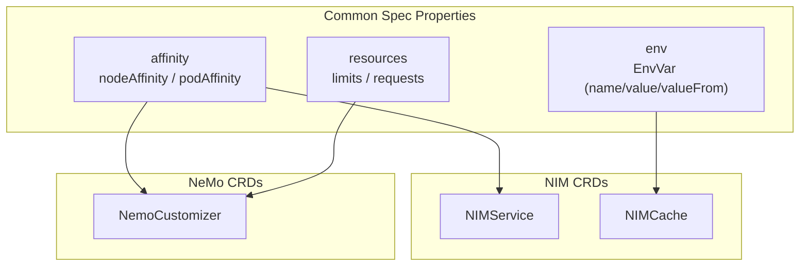

**Sources:** [bundle/manifests/apps.nvidia.com_nimservices.yaml:50-130](), [bundle/manifests/apps.nvidia.com_nimcaches.yaml:72-153](), [bundle/manifests/apps.nvidia.com_nemocustomizers.yaml:50-130]()

## Status and Lifecycle

All resources implement a standard status block to report the health and state of the managed components.

- **State**: High-level status string (e.g., `Ready`, `Pending`, `Failed`) [bundle/manifests/apps.nvidia.com_nimservices.yaml:18-20]().
- **Conditions**: Detailed list of status conditions following Kubernetes API conventions.
- **Resource References**: Specific fields like `.status.pvc` in `NIMCache` to track generated infrastructure [bundle/manifests/apps.nvidia.com_nimcaches.yaml:21-23]().

**Sources:** [bundle/manifests/apps.nvidia.com_nimservices.yaml:17-25](), [bundle/manifests/apps.nvidia.com_nimcaches.yaml:17-27]()

## Next Steps

- For core inference deployment details, see [NIM Resources](#4.1).
- For advanced model customization and guardrails, see [NeMo Microservices](#4.2).
- For detailed API type definitions and reusable structures, see [Common Types](#5.1).

---

# Page: NIM Resources

# NIM Resources

<details>
<summary>Relevant source files</summary>

The following files were used as context for generating this wiki page:

- [api/apps/v1alpha1/nimbuild_types.go](api/apps/v1alpha1/nimbuild_types.go)
- [api/apps/v1alpha1/nimcache_types.go](api/apps/v1alpha1/nimcache_types.go)
- [api/apps/v1alpha1/nimpipeline_types.go](api/apps/v1alpha1/nimpipeline_types.go)
- [api/apps/v1alpha1/nimservice_types.go](api/apps/v1alpha1/nimservice_types.go)

</details>


## Purpose and Scope

This document provides an overview of the core NVIDIA Inference Microservices (NIM) resources in the `k8s-nim-operator` and explains their relationships and interactions. These resources constitute the foundational building blocks for deploying AI inference services in Kubernetes. This page covers the high-level architecture and relationships between the main custom resources, while detailed information about each specific resource can be found in their respective documentation pages: [NIMService](#4.1.1), [NIMCache](#4.1.2), [NIMPipeline](#4.1.3), and [NIMBuild](#4.1.4).

## Resource Architecture Overview

The operator manages the lifecycle of NIM components by bridging high-level AI requirements (models, profiles, engines) with standard Kubernetes primitives (Deployments, Jobs, PVCs).

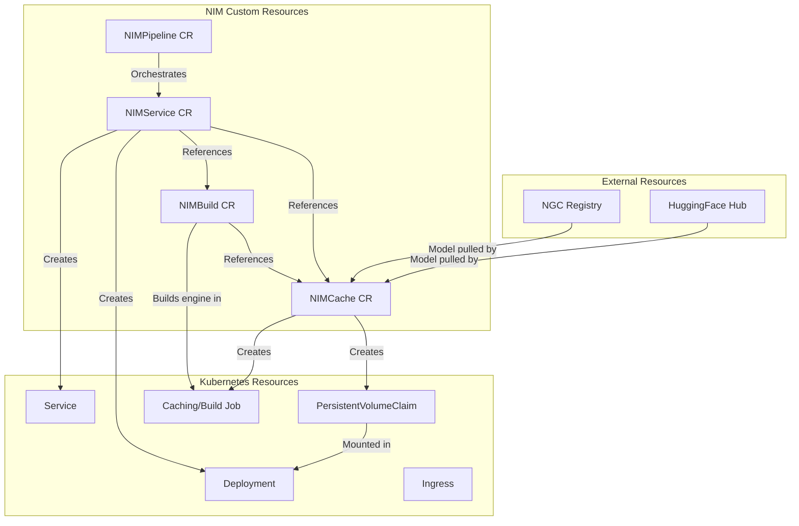

*Figure 1: NIM Resources Architecture and Relationships*

**Sources:**
- [api/apps/v1alpha1/nimcache_types.go:34-62]()
- [api/apps/v1alpha1/nimservice_types.go:97-142]()
- [api/apps/v1alpha1/nimbuild_types.go:30-46]()
- [api/apps/v1alpha1/nimpipeline_types.go:41-47]()

---

## Core NIM Resources

### NIMService
The `NIMService` is the primary resource for deploying an inference microservice. It manages the underlying `Deployment` and `Service` objects, handling complex logic like GPU resource allocation and inference platform selection (e.g., Standalone vs KServe).

- **Inference Platforms:** Supports `standalone` and `kserve` via `InferencePlatform` [api/apps/v1alpha1/nimservice_types.go:134-138]().
- **Multi-Node:** Supports multi-node deployments using `LeaderWorkerSet` (LWS) [api/apps/v1alpha1/nimservice_types.go:145-151]().
- **Scaling:** Integrates with `Autoscaling` for HPA management [api/apps/v1alpha1/nimservice_types.go:124-124]().

For details, see [NIMService](#4.1.1).

### NIMCache
`NIMCache` manages the "Model-to-Storage" lifecycle. It handles pulling model weights from sources like NVIDIA NGC, HuggingFace Hub, or NeMo DataStore and persisting them into a `PersistentVolumeClaim` (PVC).

- **Sources:** Supports `NGCSource`, `HuggingFaceHubSource`, and `NemoDataStoreSource` [api/apps/v1alpha1/nimcache_types.go:66-74]().
- **Profile Selection:** Can automatically cache specific profiles based on precision, engine (tensorrt_llm, vllm), and GPU SKU [api/apps/v1alpha1/nimcache_types.go:133-150]().

For details, see [NIMCache](#4.1.2).

### NIMPipeline
`NIMPipeline` provides orchestration for multi-step inference workflows. It defines a collection of `NIMService` instances and the dependencies between them.

- **Dependency Management:** Injects environment variables (endpoints, ports) into dependent services [api/apps/v1alpha1/nimpipeline_types.go:58-67]().
- **Lifecycle:** Aggregates states of all sub-services into a single pipeline state [api/apps/v1alpha1/nimpipeline_types.go:70-78]().

For details, see [NIMPipeline](#4.1.3).

### NIMBuild
`NIMBuild` is used for optimizing models by building TensorRT-LLM engines. It takes weights from a `NIMCache` and runs a build job to produce an optimized engine for specific hardware.

- **Inputs:** References a `NIMCache` and a specific profile [api/apps/v1alpha1/nimbuild_types.go:56-59]().
- **Output:** Produces an `OutputProfile` representing the built engine [api/apps/v1alpha1/nimbuild_types.go:49-54]().

For details, see [NIMBuild](#4.1.4).

---

## Resource Relationships in Code

The following diagram illustrates how the API types associate with specific controllers and logic within the codebase.

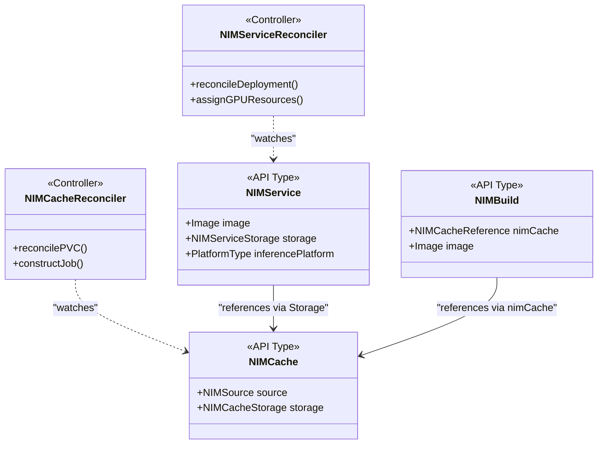

*Figure 2: Association of API Types to Controller Logic*

**Sources:**
- [api/apps/v1alpha1/nimcache_types.go:68-83]()
- [api/apps/v1alpha1/nimservice_types.go:105-105]()
- [api/apps/v1alpha1/nimbuild_types.go:32-32]()

---

## Status and Lifecycle

Each resource implements a standard state machine via its `.status.state` field and a `Conditions` array to report reconciliation progress.

| Resource | Key Status States | Condition Types |
|----------|-------------------|-----------------|
| **NIMCache** | `Pending`, `InProgress`, `Ready`, `Failed` | `NIMCacheConditionReady`, `NIMCacheConditionFailed` |
| **NIMService** | `Pending`, `NotReady`, `Ready`, `Failed` | `NIMServiceConditionReady`, `NIMServiceConditionFailed` |
| **NIMBuild** | `Started`, `InProgress`, `Ready`, `Failed` | `NimBuildConditionEngineBuildPodCompleted` |
| **NIMPipeline** | `NotReady`, `Ready`, `Failed` | `NIMPipelineConditionReady` |

**Sources:**
- [api/apps/v1alpha1/nimcache_types.go:152-164]()
- [api/apps/v1alpha1/nimservice_types.go:51-64]()
- [api/apps/v1alpha1/nimbuild_types.go:85-123]()
- [api/apps/v1alpha1/nimpipeline_types.go:26-38]()

---

# Page: NIMService

# NIMService

<details>
<summary>Relevant source files</summary>

The following files were used as context for generating this wiki page:

- [api/apps/v1alpha1/nimservice_types.go](api/apps/v1alpha1/nimservice_types.go)
- [api/apps/v1alpha1/nimservice_types_test.go](api/apps/v1alpha1/nimservice_types_test.go)
- [api/informers/externalversions/apps/v1alpha1/nimservice.go](api/informers/externalversions/apps/v1alpha1/nimservice.go)
- [api/listers/apps/v1alpha1/nimservice.go](api/listers/apps/v1alpha1/nimservice.go)
- [api/versioned/typed/apps/v1alpha1/nimservice.go](api/versioned/typed/apps/v1alpha1/nimservice.go)
- [bundle/manifests/apps.nvidia.com_nimservices.yaml](bundle/manifests/apps.nvidia.com_nimservices.yaml)

</details>


This page provides complete reference documentation for the `NIMService` Custom Resource Definition (CRD), which enables deployment and management of NVIDIA Inference Microservices (NIM) on Kubernetes clusters.

**Scope**: This page covers the `NIMService` API specification, controller behavior, validation webhooks, and lifecycle management. For model caching strategies, see [NIMCache](#4.1.2). For common types like `Expose`, `Metrics`, and `Autoscaling`, see [Common Types](#5.1). For Dynamic Resource Allocation (DRA) configuration, see [Dynamic Resource Allocation](#5.2).

## Overview

`NIMService` is the primary custom resource for deploying NVIDIA NIM containers that serve AI inference workloads. The operator's controller watches `NIMService` resources and reconciles them into standard Kubernetes workloads (Deployments, Services, HorizontalPodAutoscalers, etc.) while managing GPU allocation, model access credentials, and network exposure.

**API Group**: `apps.nvidia.com/v1alpha1`  
**Kind**: `NIMService`  
**Namespaced**: Yes  
**Controller**: Yes  
**Validation Webhook**: Yes

**Sources**: [api/apps/v1alpha1/nimservice_types.go:17-46](), [bundle/manifests/apps.nvidia.com_nimservices.yaml:9-15]()

## Architecture

### NIMService Controller Pattern

The following diagram illustrates how the `NIMService` controller reconciles custom resources into Kubernetes workloads:

```mermaid
graph TB
    subgraph "User Input"
        CR["NIMService CR<br/>(apps.nvidia.com/v1alpha1)"]
    end
    
    subgraph "Validation Layer"
        WEBHOOK["Validation Webhook<br/>nimservice-webhook"]
    end
    
    subgraph "Controller"
        RECONCILER["NIMService Controller<br/>Reconciliation Loop"]
    end
    
    subgraph "Generated Resources"
        DEPLOY["Deployment / LeaderWorkerSet<br/>Model Container Pods"]
        SVC["Service<br/>ClusterIP/LoadBalancer"]
        HPA["HorizontalPodAutoscaler<br/>(if autoscaling enabled)"]
        SM["ServiceMonitor<br/>(if metrics enabled)"]
        ING["Ingress/HTTPRoute<br/>(if router configured)"]
        RC["ResourceClaim/Template<br/>(if DRA configured)"]
    end
    
    subgraph "External Dependencies"
        NGC["NGC Registry<br/>NGC_API_KEY"]
        GPU["GPU Operator<br/>nvidia-driver-ctr"]
    end
    
    CR --> WEBHOOK
    WEBHOOK --> RECONCILER
    
    RECONCILER --> DEPLOY
    RECONCILER --> SVC
    RECONCILER --> HPA
    RECONCILER --> SM
    RECONCILER --> ING
    RECONCILER --> RC
    
    DEPLOY -.requires.-> NGC
    DEPLOY -.requires.-> GPU
    
    SVC -.targets.-> DEPLOY
    HPA -.scales.-> DEPLOY
    SM -.monitors.-> SVC
    ING -.routes to.-> SVC
    RC -.allocates GPUs to.-> DEPLOY
```

**Sources**: [api/apps/v1alpha1/nimservice_types.go:97-142](), [api/apps/v1alpha1/nimservice_types.go:51-65]()

### Resource Creation Flow

This diagram maps `NIMService` spec fields to the Kubernetes resources they generate:

```mermaid
graph LR
    subgraph "NIMService Spec"
        IMAGE["spec.image<br/>Image"]
        REPLICAS["spec.replicas"]
        EXPOSE["spec.expose<br/>Expose"]
        METRICS["spec.metrics<br/>Metrics"]
        AUTOSCALE["spec.scale<br/>Autoscaling"]
        RESOURCES["spec.resources<br/>ResourceRequirements"]
        DRA["spec.draResources<br/>[]DRAResource"]
        AUTH_SEC["spec.authSecret"]
        ENVS["spec.env<br/>[]EnvVar"]
        PLATFORM["spec.inferencePlatform"]
    end
    
    subgraph "Generated Kubernetes Resources"
        POD_SPEC["PodSpec<br/>containers[0]"]
        DEPLOYMENT["Deployment / LWS"]
        SERVICE["Service"]
        HPA_RES["HorizontalPodAutoscaler"]
        SM_RES["ServiceMonitor"]
        INGRESS["Ingress"]
        HTTP_ROUTE["HTTPRoute"]
        CLAIM["ResourceClaim"]
        KSERVE["InferenceService<br/>(if platform=kserve)"]
    end
    
    IMAGE --> POD_SPEC
    REPLICAS --> DEPLOYMENT
    RESOURCES --> POD_SPEC
    AUTH_SEC --> POD_SPEC
    ENVS --> POD_SPEC
    DRA --> CLAIM
    DRA --> POD_SPEC
    
    EXPOSE --> SERVICE
    EXPOSE --> INGRESS
    EXPOSE --> HTTP_ROUTE
    
    METRICS --> SM_RES
    AUTOSCALE --> HPA_RES
    PLATFORM --> KSERVE
    
    POD_SPEC --> DEPLOYMENT
    SERVICE -.referenced by.-> INGRESS
    SERVICE -.referenced by.-> HTTP_ROUTE
    SERVICE -.referenced by.-> SM_RES
    DEPLOYMENT -.scaled by.-> HPA_RES
```

**Sources**: [api/apps/v1alpha1/nimservice_types.go:97-142](), [api/apps/v1alpha1/nimservice_types_test.go:31-174]()

## API Specification

### Core Spec Fields

The `NIMService` spec is defined in the `NIMServiceSpec` struct:

| Field | Type | Description |
|-------|------|-------------|
| `image` | `Image` | Container image configuration for the NIM service |
| `replicas` | `*int32` | Number of pod replicas to run |
| `resources` | `*corev1.ResourceRequirements` | CPU and memory resource requests/limits |
| `authSecret` | `string` | Name of secret containing the `NGC_API_KEY` |
| `env` | `[]corev1.EnvVar` | Additional environment variables |
| `expose` | `Expose` | Service exposure configuration |
| `metrics` | `Metrics` | Metrics collection configuration |
| `scale` | `Autoscaling` | Horizontal pod autoscaling configuration |
| `draResources` | `[]DRAResource` | Dynamic Resource Allocation for GPU access |
| `inferencePlatform` | `PlatformType` | Target platform: `standalone` (default) or `kserve` |
| `multiNode` | `*NimServiceMultiNodeConfig` | Configuration for multi-node deployments (LWS) |
| `storage` | `NIMServiceStorage` | Model caching configuration if `NIMCache` is not used |

**Sources**: [api/apps/v1alpha1/nimservice_types.go:97-142]()

### Multi-Node Configuration

NIM services can be deployed across multiple nodes using the `LeaderWorkerSet` (LWS) backend.

| Field | Type | Default | Description |
|-------|------|---------|-------------|
| `backendType` | `NIMBackendType` | `lws` | Currently only `lws` is supported |
| `parallelism` | `*int32` | - | Degree of parallelism for multi-node execution |

**Sources**: [api/apps/v1alpha1/nimservice_types.go:145-153]()

### Inference Platforms

The operator supports two deployment platforms defined by `PlatformType`:
- `standalone`: Standard Kubernetes Deployment or LWS.
- `kserve`: Integration with KServe `InferenceService`.

**Sources**: [api/apps/v1alpha1/nimservice_types.go:84-91]()

### Storage and Volumes

The `GetVolumes` function determines the volume mounts for the NIM container based on the spec:

1. **Shared Memory**: A `dshm` `EmptyDir` (memory medium) is always added.
2. **Model Store**: If a `NIMCache` or `NIMServiceStorage` is provided, a `PersistentVolumeClaim` volume is mounted.
3. **Proxy/Certs**: If `ProxySpec` or `InitContainers` are used, additional volumes like `proxy-ca-cert` or `scratch` are added.

**Sources**: [api/apps/v1alpha1/nimservice_types_test.go:31-174]()

### Networking and Routing

The `NIMService` uses the `Router` type to generate networking resources.

#### Gateway API Integration
The `GenerateGatewayHTTPRouteSpec` function translates `NIMService` router settings into a `gatewayv1.HTTPRouteSpec`. It configures:
- `ParentRefs`: References to the specified Gateway.
- `Hostnames`: Constructed from `hostDomainName`.
- `Rules`: Path matching (default prefix `/`) and backend service references.

**Sources**: [api/apps/v1alpha1/nimservice_types_test.go:176-247]()

#### Ingress Integration
The `GenerateIngressSpec` function generates a `networkingv1.IngressSpec` which includes:
- `IngressClassName` mapping.
- TLS configuration if a `tlsSecretName` is provided.
- Rules mapping the hostname to the generated Kubernetes Service.

**Sources**: [api/apps/v1alpha1/nimservice_types_test.go:249-260]()

## Validation and Webhooks

The `NIMService` CRD includes advanced validation rules using CEL (Common Expression Language):

1. **Autoscaling vs Multi-Node**: `autoScaling` must be disabled when `multiNode` is configured.
2. **Replicas vs Autoscaling**: `spec.replicas` cannot be set if `spec.scale.enabled` is true.
3. **Deprecation**: `spec.expose.ingress` is deprecated in favor of `spec.expose.router.ingress`.

**Sources**: [api/apps/v1alpha1/nimservice_types.go:94-96]()

## Status and Lifecycle

The operator tracks the state of the NIM deployment using conditions and state fields:

| State | Description |
|-------|-------------|
| `Pending` | Resources are being created or waiting for dependencies |
| `NotReady` | Pods are created but not passing health checks |
| `Ready` | NIM API is available and serving requests |
| `Failed` | Deployment encountered a terminal error |

**Conditions**:
- `NIM_SERVICE_READY`: True when the underlying workload is healthy.
- `NIM_SERVICE_FAILED`: True if there are scheduling or runtime failures.

**Sources**: [api/apps/v1alpha1/nimservice_types.go:51-65]()

## Examples

### Standalone Multi-Node NIM
```yaml
apiVersion: apps.nvidia.com/v1alpha1
kind: NIMService
metadata:
  name: llama3-70b-multinode
spec:
  image:
    repository: nvcr.io/nim/meta/llama3-70b
    tag: 1.0.0
  authSecret: ngc-api-key
  multiNode:
    backendType: lws
  replicas: 1
  resources:
    limits:
      nvidia.com/gpu: 8
```

### NIM with Gateway API Routing
```yaml
apiVersion: apps.nvidia.com/v1alpha1
kind: NIMService
metadata:
  name: nim-gateway-example
spec:
  image:
    repository: nvcr.io/nim/meta/llama3-8b
    tag: 1.0.0
  authSecret: ngc-api-key
  expose:
    router:
      hostDomainName: nim.example.com
      gateway:
        name: external-gateway
        namespace: istio-system
```

**Sources**: [api/apps/v1alpha1/nimservice_types.go:97-153](), [api/apps/v1alpha1/nimservice_types_test.go:176-247]()

## Implementation Details

### Client and Informers
The operator uses generated typed clients and informers to manage `NIMService` resources efficiently:
- **Informer**: `NIMServiceInformer` provides shared cache access and event handlers ([api/informers/externalversions/apps/v1alpha1/nimservice.go:36-39]()).
- **Lister**: `NIMServiceLister` enables indexed lookups by namespace or labels ([api/listers/apps/v1alpha1/nimservice.go:29-36]()).
- **Interface**: `NIMServiceInterface` defines standard CRUD operations including `UpdateStatus` and `Patch` ([api/versioned/typed/apps/v1alpha1/nimservice.go:38-50]()).

**Sources**: [api/informers/externalversions/apps/v1alpha1/nimservice.go](), [api/listers/apps/v1alpha1/nimservice.go](), [api/versioned/typed/apps/v1alpha1/nimservice.go]()

---

# Page: NIMCache

# NIMCache

<details>
<summary>Relevant source files</summary>

The following files were used as context for generating this wiki page:

- [api/apps/v1alpha1/nimcache_types.go](api/apps/v1alpha1/nimcache_types.go)
- [api/informers/externalversions/apps/v1alpha1/nimcache.go](api/informers/externalversions/apps/v1alpha1/nimcache.go)
- [api/listers/apps/v1alpha1/nimcache.go](api/listers/apps/v1alpha1/nimcache.go)
- [api/versioned/typed/apps/v1alpha1/nimcache.go](api/versioned/typed/apps/v1alpha1/nimcache.go)
- [bundle/manifests/apps.nvidia.com_nimcaches.yaml](bundle/manifests/apps.nvidia.com_nimcaches.yaml)

</details>


## Purpose and Scope

NIMCache is a Custom Resource Definition (CRD) in the `apps.nvidia.com/v1alpha1` API group that manages the caching of NVIDIA AI model artifacts in Kubernetes. It orchestrates Kubernetes Jobs to download and prepare model data from external registries (NGC, Hugging Face, or NeMo DataStore) into Persistent Volume Claims (PVCs), making models readily available for NIMService deployments.

This document covers the NIMCache resource specification, controller behavior, validation webhooks, and operational aspects.

**Sources:** [api/apps/v1alpha1/nimcache_types.go:34-62](), [bundle/manifests/apps.nvidia.com_nimcaches.yaml:9-15]()

---

## Overview

NIMCache solves the problem of repeatedly downloading large AI model artifacts every time a NIM pod starts. By pre-caching models into persistent storage, NIMCache enables faster pod startup, reduced network egress, and improved reliability.

The NIMCache controller creates and manages Kubernetes Jobs that pull model data, validate the content, and store it in a PVC. The source can be NVIDIA NGC, Hugging Face Hub, or a NeMo DataStore endpoint.

**Sources:** [api/apps/v1alpha1/nimcache_types.go:34-74](), [api/apps/v1alpha1/nimcache_types.go:118-130]()

---

## System Architecture

The following diagram illustrates the relationship between NIMCache and the Kubernetes entities it manages.

### Code Entity Mapping: NIMCache to Kubernetes Resources

```mermaid
graph TB
    subgraph "Kubernetes API"
        NC_CRD["NIMCache CRD<br/>(apps.nvidia.com/v1alpha1)"]
    end

    subgraph "NIMCache Controller Logic"
        NC_SPEC["NIMCacheSpec<br/>(api/apps/v1alpha1/nimcache_types.go)"]
        NC_STATUS["NIMCacheStatus<br/>(api/apps/v1alpha1/nimcache_types.go)"]
    end

    subgraph "Managed Resources"
        JOB["batch/v1.Job<br/>(Caching Job)"]
        PVC["core/v1.PersistentVolumeClaim<br/>(Model Storage)"]
    end

    subgraph "External Model Sources"
        NGC["NGCSource<br/>(api/apps/v1alpha1/nimcache_types.go)"]
        HF["HuggingFaceHubSource<br/>(api/apps/v1alpha1/nimcache_types.go)"]
        DS["NemoDataStoreSource<br/>(api/apps/v1alpha1/nimcache_types.go)"]
    end

    NC_CRD --> NC_SPEC
    NC_SPEC --> NGC
    NC_SPEC --> HF
    NC_SPEC --> DS
    
    NC_SPEC -- "Reconciles" --> JOB
    NC_SPEC -- "Allocates" --> PVC
    
    JOB -- "Writes To" --> PVC
    NC_STATUS -- "Tracks" --> JOB
    NC_STATUS -- "Tracks" --> PVC

    style NC_CRD stroke-dasharray: 5 5
```

**Sources:** [api/apps/v1alpha1/nimcache_types.go:34-114](), [api/apps/v1alpha1/nimcache_types.go:160-184]()

---

## API Specification

### NIMCacheSpec Fields

The `NIMCacheSpec` defines the desired state of the cache.

| Field | Type | Description |
|-------|------|-------------|
| `source` | `NIMSource` | The source of the NIM model (NGC, HF, or DataStore). |
| `storage` | `NIMCacheStorage` | Target storage attributes for the cached model. |
| `resources` | `Resources` | Minimum resources (CPU, Memory, GPU) for the caching job. |
| `tolerations` | `[]corev1.Toleration` | Tolerations for the caching job pod. |
| `nodeSelector` | `map[string]string` | Node selector labels for scheduling the job. |
| `userID` / `groupID` | `*int64` | Security context IDs for the caching job. |
| `env` | `[]corev1.EnvVar` | Custom environment variables for the caching job. |
| `proxy` | `*ProxySpec` | Proxy configuration for the caching job. |

**Sources:** [api/apps/v1alpha1/nimcache_types.go:34-62]()

### Model Sources (`NIMSource`)

Exactly one source must be defined via `XValidation` rules.

| Source Type | Fields | Description |
|-------------|--------|-------------|
| `NGC` | `authSecret`, `modelPuller`, `model`, `modelEndpoint` | Models stored in NVIDIA NGC. |
| `HF` | `endpoint`, `namespace`, `DSHFCommonFields` | Models stored in HuggingFace Hub. |
| `DataStore` | `endpoint`, `namespace`, `DSHFCommonFields` | Models from NVIDIA NeMo DataStore. |

**Sources:** [api/apps/v1alpha1/nimcache_types.go:64-114]()

### Storage Configuration (`NIMCacheStorage`)

NIMCache manages PVCs through the `NIMCacheStorage` struct.

| Field | Type | Description |
|-------|------|-------------|
| `pvc` | `*PVCConfig` | Configuration for a new or existing PVC. |
| `hostPath` | `*string` | Host path for caching (not recommended for production). |

**Sources:** [api/apps/v1alpha1/nimcache_types.go:160-171]()

---

## Controller and Data Flow

The NIMCache controller manages the lifecycle of the model cache. It uses generated informers and listers to monitor the state of `NIMCache` resources.

### Internal Data Flow Diagram

```mermaid
sequenceDiagram
    participant K8S as K8s API Server
    participant INF as NIMCacheInformer<br/>(api/informers/externalversions/apps/v1alpha1/nimcache.go)
    participant CTRL as NIMCache Controller
    participant JOB as batch/v1.Job

    K8S->>INF: Watch NIMCache CRs
    INF->>CTRL: Trigger Reconcile (NIMCache)
    
    CTRL->>K8S: Check/Create PVC (NIMCacheStorage)
    K8S-->>CTRL: PVC Ready
    
    CTRL->>K8S: Create Caching Job (batch/v1.Job)
    Note over CTRL, JOB: Uses ModelPuller image from NIMSource
    
    JOB->>JOB: Pull Model Artifacts
    JOB->>K8S: Update Job Status (Succeeded)
    
    CTRL->>K8S: Update NIMCacheStatus (State: Ready)
```

**Sources:** [api/informers/externalversions/apps/v1alpha1/nimcache.go:36-39](), [api/apps/v1alpha1/nimcache_types.go:121-125](), [api/apps/v1alpha1/nimcache_types.go:173-184]()

---

## Validation Webhooks

NIMCache utilizes `XValidation` rules (CEL) defined directly in the CRD spec to enforce data integrity without requiring an external webhook process for basic rules.

### Key Validation Rules

1.  **Source Exclusivity**: Exactly one of `ngc`, `dataStore`, or `hf` must be defined.
    - `rule: "(has(self.ngc) ? 1 : 0) + (has(self.dataStore) ? 1 : 0) + (has(self.hf) ? 1 : 0) == 1"`
    - **Sources:** [api/apps/v1alpha1/nimcache_types.go:64]()
2.  **Model/Dataset Exclusivity**: For HF and DataStore, exactly one of `modelName` or `datasetName` must be defined.
    - `rule: "(has(self.modelName) ? 1 : 0) + (has(self.datasetName) ? 1 : 0) == 1"`
    - **Sources:** [api/apps/v1alpha1/nimcache_types.go:76]()
3.  **Immutable Puller**: The `modelPuller` field in `NGCSource` is immutable.
    - `rule: "self == oldSelf"`
    - **Sources:** [api/apps/v1alpha1/nimcache_types.go:122]()
4.  **Endpoint Patterns**: Validates that endpoints follow expected URL patterns (e.g., `^https?://.*/v1/hf/?$` for DataStore).
    - **Sources:** [api/apps/v1alpha1/nimcache_types.go:98](), [api/apps/v1alpha1/nimcache_types.go:108]()

---

## Status and Monitoring

The `NIMCacheStatus` tracks the progression of the caching operation.

| Field | Type | Description |
|-------|------|-------------|
| `state` | `string` | The current phase (e.g., `Pending`, `Caching`, `Ready`, `Failed`). |
| `pvc` | `string` | The name of the PVC associated with the cache. |
| `job` | `string` | The name of the batch Job performing the pull. |
| `conditions` | `[]metav1.Condition` | Detailed lifecycle conditions. |

**Sources:** [api/apps/v1alpha1/nimcache_types.go:173-184](), [bundle/manifests/apps.nvidia.com_nimcaches.yaml:17-27]()

### Generated Clients
The operator uses generated code for interacting with NIMCache resources:
- **Informer**: `NIMCacheInformer` provides shared access to NIMCache objects [api/informers/externalversions/apps/v1alpha1/nimcache.go:36-39]().
- **Lister**: `NIMCacheLister` allows for efficient retrieval of NIMCaches from the indexer [api/listers/apps/v1alpha1/nimcache.go:29-36]().
- **Interface**: `NIMCacheInterface` defines standard CRUD operations [api/versioned/typed/apps/v1alpha1/nimcache.go:38-50]().

**Sources:** [api/informers/externalversions/apps/v1alpha1/nimcache.go:36-39](), [api/listers/apps/v1alpha1/nimcache.go:29-36](), [api/versioned/typed/apps/v1alpha1/nimcache.go:38-50]()

---

# Page: NIMPipeline

# NIMPipeline

<details>
<summary>Relevant source files</summary>

The following files were used as context for generating this wiki page:

- [api/apps/v1alpha1/nimpipeline_types.go](api/apps/v1alpha1/nimpipeline_types.go)
- [api/informers/externalversions/apps/v1alpha1/nimpipeline.go](api/informers/externalversions/apps/v1alpha1/nimpipeline.go)
- [api/listers/apps/v1alpha1/nimpipeline.go](api/listers/apps/v1alpha1/nimpipeline.go)
- [api/versioned/typed/apps/v1alpha1/nimpipeline.go](api/versioned/typed/apps/v1alpha1/nimpipeline.go)
- [bundle/manifests/apps.nvidia.com_nimpipelines.yaml](bundle/manifests/apps.nvidia.com_nimpipelines.yaml)

</details>


## Purpose and Scope

The `NIMPipeline` resource provides an orchestration layer for managing multiple NVIDIA Inference Microservices (NIM) deployments as part of a cohesive pipeline. It enables users to define and deploy a collection of interconnected `NIMService` instances with explicit dependencies between them, managing their lifecycle and relationships [api/apps/v1alpha1/nimpipeline_types.go:40-47](). It operates by reconciling a list of service specifications into individual `NIMService` custom resources [api/apps/v1alpha1/nimpipeline_types.go:86-93]().

## Architecture Overview

`NIMPipeline` operates as a higher-level abstraction above individual `NIMService` resources. It allows users to define multiple services with their dependencies and handles the creation, updating, and deletion of the underlying `NIMService` resources.

### NIMPipeline Component Architecture

```mermaid
graph TD
    subgraph "NIMPipeline Resource"
        Pipeline["NIMPipeline CR"]
        PipelineSpec["NIMPipelineSpec"]
        Dependencies["ServiceDependency"]
    end

    subgraph "Controller Space"
        NIMPipelineController["NIMPipelineReconciler"]
        ReconcileProcess["Reconcile()"]
        StatusUpdate["updateStatus()"]
        CleanupProcess["cleanupDisabledNIMs()"]
    end

    subgraph "Managed Code Entities"
        Service1["NIMService Resource"]
        Service2["NIMService Resource"]
        Service3["NIMService Resource"]
    end

    Pipeline --> PipelineSpec
    PipelineSpec --> Dependencies

    Pipeline --> NIMPipelineController
    NIMPipelineController --> ReconcileProcess
    ReconcileProcess --> Service1
    ReconcileProcess --> Service2
    ReconcileProcess --> Service3
    ReconcileProcess --> StatusUpdate
    ReconcileProcess --> CleanupProcess

    Service1 --> Service2
    Service2 --> Service3
```

Sources:
- [api/apps/v1alpha1/nimpipeline_types.go:40-47]()
- [api/apps/v1alpha1/nimpipeline_types.go:87-93]()

## NIMPipeline Custom Resource Definition

The `NIMPipeline` CRD defines a pipeline of `NIMService` resources with their configurations and dependencies.

### NIMPipeline Resource Structure

```mermaid
graph TD
    subgraph "api/apps/v1alpha1/nimpipeline_types.go"
        subgraph "NIMPipelineSpec"
            Services["Services: []NIMServicePipelineSpec"]
        end
        
        subgraph "NIMServicePipelineSpec"
            Name["Name: string"]
            Enabled["Enabled: *bool"]
            Spec["Spec: NIMServiceSpec"]
            Deps["Dependencies: []ServiceDependency"]
        end
        
        subgraph "ServiceDependency"
            DepName["Name: string"]
            Port["Port: int32"]
            EnvName["EnvName: string"]
            EnvValue["EnvValue: string"]
        end
        
        subgraph "NIMPipelineStatus"
            State["State: string"]
            States["States: map[string]string"]
            Conditions["Conditions: []metav1.Condition"]
        end
    end
    
    Services --> Name
    Services --> Enabled
    Services --> Spec
    Services --> Deps
    Deps --> DepName
    Deps --> Port
    Deps --> EnvName
    Deps --> EnvValue
```

### Specification Fields

| Field | Type | Description |
|-------|------|-------------|
| `services` | `[]NIMServicePipelineSpec` | List of NIMService configurations to be deployed as part of the pipeline [api/apps/v1alpha1/nimpipeline_types.go:46-47]() |

Each `NIMServicePipelineSpec` contains:

| Field | Type | Description |
|-------|------|-------------|
| `name` | `string` | Name of the NIMService [api/apps/v1alpha1/nimpipeline_types.go:51-51]() |
| `enabled` | `*bool` | Whether the service is enabled in the pipeline [api/apps/v1alpha1/nimpipeline_types.go:52-52]() |
| `spec` | `NIMServiceSpec` | Full specification for the NIMService [api/apps/v1alpha1/nimpipeline_types.go:53-53]() |
| `dependencies` | `[]ServiceDependency` | List of dependencies this service has on other services [api/apps/v1alpha1/nimpipeline_types.go:54-54]() |

Service dependencies are specified through the `ServiceDependency` type [api/apps/v1alpha1/nimpipeline_types.go:58-67]():

| Field | Type | Description |
|-------|------|-------------|
| `name` | `string` | Name of the dependent service [api/apps/v1alpha1/nimpipeline_types.go:60-60]() |
| `port` | `int32` | Port of the dependent service [api/apps/v1alpha1/nimpipeline_types.go:62-62]() |
| `envName` | `string` | Optional custom environment variable name for the service endpoint [api/apps/v1alpha1/nimpipeline_types.go:64-64]() |
| `envValue` | `string` | Optional custom environment variable value for the service endpoint [api/apps/v1alpha1/nimpipeline_types.go:66-66]() |

Sources:
- [api/apps/v1alpha1/nimpipeline_types.go:40-67]()
- [bundle/manifests/apps.nvidia.com_nimpipelines.yaml:50-85]()

### Status Fields

The `NIMPipelineStatus` tracks the overall and individual health of the pipeline components [api/apps/v1alpha1/nimpipeline_types.go:69-78]().

| Field | Type | Description |
|-------|------|-------------|
| `state` | `string` | Overall state of the pipeline: `Ready`, `NotReady`, or `Failed` [api/apps/v1alpha1/nimpipeline_types.go:77-77]() |
| `states` | `map[string]string` | State of each individual service in the pipeline [api/apps/v1alpha1/nimpipeline_types.go:75-75]() |
| `conditions` | `[]metav1.Condition` | Standard Kubernetes conditions for the resource [api/apps/v1alpha1/nimpipeline_types.go:73-73]() |

The following constants define the possible status values [api/apps/v1alpha1/nimpipeline_types.go:26-38]():
- `NIMPipelineStatusReady`: "Ready" [api/apps/v1alpha1/nimpipeline_types.go:35-35]()
- `NIMPipelineStatusNotReady`: "NotReady" [api/apps/v1alpha1/nimpipeline_types.go:33-33]()
- `NIMPipelineStatusFailed`: "Failed" [api/apps/v1alpha1/nimpipeline_types.go:37-37]()

Sources:
- [api/apps/v1alpha1/nimpipeline_types.go:26-78]()

## Service Creation and Dependency Management

The controller handles creating `NIMService` resources for each enabled service in the pipeline and manages their dependencies via environment variable injection.

### Service Creation Process

When a `NIMPipeline` is reconciled, the controller iterates through the `Services` list in the spec [api/apps/v1alpha1/nimpipeline_types.go:46-47](). For each enabled entry, it ensures a corresponding `NIMService` exists with the provided `NIMServiceSpec` [api/apps/v1alpha1/nimpipeline_types.go:50-55]().

### NIMPipeline Reconciliation Flow

```mermaid
graph TD
    subgraph "NIMPipeline Controller Logic"
        Start["Start Reconcile()"]
        ProcessServices["Iterate Spec.Services"]
        EnabledCheck{"Is Service Enabled?"}
        CreateService["Create/Update NIMService"]
        InjectDeps["Inject Dependencies"]
        Skip["Skip Service"]
        Next["Next Service"]
        UpdateStatus["Update Status State"]
        Cleanup["cleanupDisabledNIMs()"]
        End["End Reconciliation"]
    end

    Start --> ProcessServices
    ProcessServices --> EnabledCheck
    EnabledCheck -- "Yes" --> CreateService
    EnabledCheck -- "No" --> Skip
    CreateService --> InjectDeps
    InjectDeps --> Next
    Skip --> Next
    Next -- "More Services" --> ProcessServices
    Next -- "All Processed" --> UpdateStatus
    UpdateStatus --> Cleanup
    Cleanup --> End
```

Sources:
- [api/apps/v1alpha1/nimpipeline_types.go:41-55]()
- [bundle/manifests/apps.nvidia.com_nimpipelines.yaml:50-85]()

### Dependency Management

Dependencies between services are managed through environment variables. The controller injects the necessary environment variables into each `NIMService` to allow it to connect to its dependencies [api/apps/v1alpha1/nimpipeline_types.go:58-67]().

The controller supports two ways to specify dependencies:

1.  **Default behavior**: Environment variables are automatically generated based on service name and port.
    *   Format: `<SERVICE_NAME>_ENDPOINT=<service-name>:<port>`
2.  **Custom behavior**: Users can specify custom environment variable names and values via `envName` and `envValue` fields [api/apps/v1alpha1/nimpipeline_types.go:64-66]().

Sources:
- [api/apps/v1alpha1/nimpipeline_types.go:58-67]()

## Data Access and Tooling

The codebase provides generated clients, informers, and listers to interact with `NIMPipeline` resources programmatically.

*   **Informer**: `NIMPipelineInformer` provides access to a shared informer and lister for `NIMPipelines` [api/informers/externalversions/apps/v1alpha1/nimpipeline.go:36-39]().
*   **Lister**: `NIMPipelineLister` and `NIMPipelineNamespaceLister` help list and retrieve resources from the indexer [api/listers/apps/v1alpha1/nimpipeline.go:29-36]().
*   **Interface**: `NIMPipelineInterface` defines the standard CRUD operations (Create, Update, Delete, Get, List, Watch, Patch) [api/versioned/typed/apps/v1alpha1/nimpipeline.go:38-50]().

Sources:
- [api/informers/externalversions/apps/v1alpha1/nimpipeline.go:36-39]()
- [api/listers/apps/v1alpha1/nimpipeline.go:29-63]()
- [api/versioned/typed/apps/v1alpha1/nimpipeline.go:38-50]()

## Example Usage

Below is an example of a `NIMPipeline` resource definition that deploys a simple pipeline with two services: an embedding service and an LLM service, with the LLM service depending on the embedding service:

```yaml
apiVersion: apps.nvidia.com/v1alpha1
kind: NIMPipeline
metadata:
  name: text-processing-pipeline
spec:
  services:
    - name: embedding-service
      enabled: true
      spec:
        image:
          repository: nvcr.io/nvidia/nim/nemo-retriever-embedding
          tag: 1.0.0
    - name: llm-service
      enabled: true
      spec:
        image:
          repository: nvcr.io/nvidia/nim/llama-3-8b-instruct
          tag: 1.0.0
      dependencies:
        - name: embedding-service
          port: 8000
          envName: EMBEDDING_ENDPOINT
```

In this configuration, the `llm-service` will have an environment variable `EMBEDDING_ENDPOINT` pointing to the `embedding-service`.

Sources:
- [api/apps/v1alpha1/nimpipeline_types.go:41-67]()
- [bundle/manifests/apps.nvidia.com_nimpipelines.yaml:50-85]()

---

# Page: NIMBuild

# NIMBuild

<details>
<summary>Relevant source files</summary>

The following files were used as context for generating this wiki page:

- [api/apps/v1alpha1/nimbuild_types.go](api/apps/v1alpha1/nimbuild_types.go)
- [api/informers/externalversions/apps/v1alpha1/nimbuild.go](api/informers/externalversions/apps/v1alpha1/nimbuild.go)
- [api/listers/apps/v1alpha1/nimbuild.go](api/listers/apps/v1alpha1/nimbuild.go)
- [api/versioned/typed/apps/v1alpha1/nimbuild.go](api/versioned/typed/apps/v1alpha1/nimbuild.go)
- [bundle/manifests/apps.nvidia.com_nimbuilds.yaml](bundle/manifests/apps.nvidia.com_nimbuilds.yaml)

</details>


## Purpose and Scope

This document provides a technical reference for the **NIMBuild** Custom Resource Definition (CRD). The `NIMBuild` resource is used to build optimized TensorRT-LLM (TRT-LLM) engines from specific model configurations and weights, producing a ready-to-use NIM container.

For deploying existing NIM services, refer to [NIMService](4.1.1). For managing model caching, refer to [NIMCache](4.1.2).

**Sources**: [api/apps/v1alpha1/nimbuild_types.go:29-30](), [bundle/manifests/apps.nvidia.com_nimbuilds.yaml:48-49]()

## Overview

`NIMBuild` is a Schema within the `apps.nvidia.com/v1alpha1` API group [api/apps/v1alpha1/nimbuild_types.go:67-68](). It provides a declarative way to trigger engine building processes within a Kubernetes cluster. The build process typically involves:
1. Referencing model weights and profiles from a `NIMCache` [api/apps/v1alpha1/nimbuild_types.go:31-32]().
2. Running a specialized Pod to perform the engine compilation [api/apps/v1alpha1/nimbuild_types.go:162-165]().
3. Generating a model manifest to finalize the NIM container [api/apps/v1alpha1/nimbuild_types.go:168-170]().

**Sources**: [api/apps/v1alpha1/nimbuild_types.go:29-170]()

## API Specification

### NIMBuildSpec
The `NIMBuildSpec` defines the desired state of the engine build process. Note that the `Spec` is immutable once created [api/apps/v1alpha1/nimbuild_types.go:72]().

| Field | Type | Description |
|-------|------|-------------|
| `nimCache` | `NIMCacheReference` | Reference to the model weights from a `NIMCache` resource. |
| `modelName` | `string` | The name assigned to the locally built engine. Defaults to the resource name. |
| `image` | `Image` | The container image used to perform the build. |
| `resources` | `ResourceRequirements` | CPU/Memory/GPU requirements for the build Pod. |
| `nodeSelector` | `map[string]string` | Labels to constrain the build Pod to specific nodes. |
| `tolerations` | `[]corev1.Toleration` | Tolerations for the build Pod scheduling. |
| `env` | `[]corev1.EnvVar` | Environment variables for the build process. |

**Sources**: [api/apps/v1alpha1/nimbuild_types.go:30-46](), [api/apps/v1alpha1/nimbuild_types.go:139-145]()

### NIMBuildStatus
The `NIMBuildStatus` tracks the progression of the build through various states and conditions.

| Field | Type | Description |
|-------|------|-------------|
| `state` | `string` | The current high-level state (e.g., `Ready`, `InProgress`, `Failed`). |
| `inputProfile` | `NIMProfile` | The profile configuration used as input for the build. |
| `outputProfile` | `NIMProfile` | The resulting profile configuration after build completion. |
| `conditions` | `[]metav1.Condition` | Detailed observations about the build lifecycle. |

**Sources**: [api/apps/v1alpha1/nimbuild_types.go:49-54]()

## Data Flow and Implementation

The `NIMBuild` lifecycle involves coordination between the controller, the `NIMCache` resource, and transient Pods.

### Build Workflow Diagram
This diagram illustrates the transition from a `NIMBuild` CR to the execution of build logic in the cluster.

```mermaid
graph TD
    subgraph "Kubernetes API"
        CR["NIMBuild CR"]
        Cache["NIMCache CR"]
    end

    subgraph "Logic Entities"
        Informer["NIMBuildInformer"]
        Lister["NIMBuildLister"]
        Interface["NIMBuildInterface"]
    end

    subgraph "Execution Pods"
        BuildPod["Engine Build Pod<br/>(GetEngineBuildPodName)"]
        ManifestPod["Local Manifest Pod<br/>(GetLocalManifestReaderPodName)"]
    end

    CR -- "Watched by" --> Informer
    Informer -- "Populates" --> Lister
    Interface -- "Updates Status" --> CR
    
    CR -- "References" --> Cache
    
    Lister -- "Triggers Creation" --> BuildPod
    BuildPod -- "Completion triggers" --> ManifestPod
    ManifestPod -- "Updates OutputProfile" --> Interface
```

**Sources**: [api/apps/v1alpha1/nimbuild_types.go:162-170](), [api/informers/externalversions/apps/v1alpha1/nimbuild.go:36-39](), [api/listers/apps/v1alpha1/nimbuild.go:29-36](), [api/versioned/typed/apps/v1alpha1/nimbuild.go:38-50]()

### Lifecycle States and Conditions

The operator uses a set of constants to manage the state machine of a `NIMBuild` resource.

| Category | Constants | Description |
|----------|-----------|-------------|
| **States** | `NimBuildStatusPending`, `NimBuildStatusStarted`, `NimBuildStatusInProgress`, `NimBuildStatusReady`, `NimBuildStatusFailed` | High-level status reported in `status.state`. |
| **Conditions** | `NimBuildConditionWaitForNimCache` | Blocked until the source `NIMCache` is ready. |
| | `NimBuildConditionEngineBuildPodCreated` | The build container has been successfully dispatched. |
| | `NimBuildConditionEngineBuildPodCompleted` | The TRT-LLM engine compilation finished. |
| | `NimBuildConditionModelManifestPodCompleted` | The manifest generation step is finished. |
| | `NimBuildConditionNoBuildableProfilesFound` | Error state: No valid profiles found in referenced cache. |

**Sources**: [api/apps/v1alpha1/nimbuild_types.go:85-123]()

## Code Entities and Responsibilities

The following diagram maps the code entities generated for handling `NIMBuild` resources to their functional roles in the system.

```mermaid
graph LR
    subgraph "API Definition"
        Type["NIMBuild Struct"]
        Spec["NIMBuildSpec"]
        Status["NIMBuildStatus"]
    end

    subgraph "Generated Client Logic"
        Getter["NIMBuildsGetter"]
        Client["nIMBuilds (Interface)"]
        Informer["nIMBuildInformer"]
    end

    subgraph "Helper Methods"
        M1["GetEngineBuildPodName()"]
        M2["GetLocalManifestReaderPodName()"]
        M3["GetImage()"]
    end

    Type --> Spec
    Type --> Status
    Getter --> Client
    Client -- "CRUD Operations" --> Type
    Informer -- "Cache/Watch" --> Type
    Type -- "Provides" --> M1
    Type -- "Provides" --> M2
    Type -- "Provides" --> M3
```

**Sources**: [api/apps/v1alpha1/nimbuild_types.go:68-170](), [api/informers/externalversions/apps/v1alpha1/nimbuild.go:41-45](), [api/versioned/typed/apps/v1alpha1/nimbuild.go:33-54]()

### Key Functions
- `GetEngineBuildPodName()`: Generates a deterministic name for the pod performing the engine build, formatted as `{name}-engine-build-pod` [api/apps/v1alpha1/nimbuild_types.go:162-165]().
- `GetLocalManifestReaderPodName()`: Generates a name for the manifest reader pod, formatted as `{name}-local-manifest-pod` [api/apps/v1alpha1/nimbuild_types.go:168-170]().
- `GetImage()`: Constructs the full image string from `Spec.Image.Repository` and `Spec.Image.Tag` [api/apps/v1alpha1/nimbuild_types.go:153-155]().
- `GetModelName()`: Returns the user-defined model name or falls back to the resource name [api/apps/v1alpha1/nimbuild_types.go:139-145]().

**Sources**: [api/apps/v1alpha1/nimbuild_types.go:139-170]()

---

# Page: NeMo Microservices

# NeMo Microservices

<details>
<summary>Relevant source files</summary>

The following files were used as context for generating this wiki page:

- [api/apps/v1alpha1/nemo_common_types.go](api/apps/v1alpha1/nemo_common_types.go)
- [api/apps/v1alpha1/nemo_customizer_types.go](api/apps/v1alpha1/nemo_customizer_types.go)
- [api/apps/v1alpha1/nemo_guardrails_types.go](api/apps/v1alpha1/nemo_guardrails_types.go)

</details>


## Purpose and Scope

This document provides an overview of NeMo-related Custom Resources managed by the `k8s-nim-operator`. These resources extend the operator's capabilities beyond basic inference serving to support advanced AI workflows including model customization, evaluation, safety guardrails, and data management.

For information about core NIM inference resources (NIMService, NIMCache, NIMPipeline), see [NIM Resources](#4.1). For detailed specifications of individual NeMo resources, refer to their respective subsections ([NemoCustomizer](#4.2.1), [NemoGuardrail](#4.2.2), [NemoEntitystore](#4.2.3), [NemoDatastore](#4.2.4), [NemoEvaluator](#4.2.5)).

**Sources:** [api/apps/v1alpha1/nemo_customizer_types.go:69-129](), [api/apps/v1alpha1/nemo_guardrails_types.go:62-97]()

---

## Overview

NeMo Microservices are Kubernetes Custom Resources that enable deployment and management of NVIDIA NeMo framework components on Kubernetes. While NIM resources focus on serving pre-trained models for inference, NeMo resources provide the tooling and infrastructure for the entire AI lifecycle, including:

- **Model Customization**: Fine-tuning and adapting foundation models for specific use cases.
- **Evaluation**: Assessing model performance and quality metrics.
- **Safety and Governance**: Implementing guardrails to ensure responsible AI deployment.
- **Data Management**: Managing entities and datasets for training and evaluation workflows.

All NeMo resources are part of the `apps.nvidia.com/v1alpha1` API group and share common configuration structures for external dependencies like databases, tracking services, and telemetry.

**Sources:** [api/apps/v1alpha1/nemo_common_types.go:19-160](), [api/apps/v1alpha1/nemo_customizer_types.go:42-67]()

---

## NeMo Resource Types

The operator manages five distinct NeMo Custom Resource types, each serving a specific purpose in the AI workflow:

| Resource | Purpose | API Group | Primary Configuration |
|----------|---------|-----------|-----------------------|
| `NemoCustomizer` | Model fine-tuning and customization workflows | `apps.nvidia.com/v1alpha1` | `TrainingConfig`, `WandBConfig`, `MLFlow` |
| `NemoEvaluator` | Model evaluation and performance assessment | `apps.nvidia.com/v1alpha1` | Evaluation jobs and metrics |
| `NemoGuardrail` | Safety guardrails and content filtering | `apps.nvidia.com/v1alpha1` | `NIMEndpoint`, `GuardrailConfig` |
| `NemoEntitystore` | Entity management for NeMo workflows | `apps.nvidia.com/v1alpha1` | `DatabaseConfig` |
| `NemoDatastore` | Data management and storage orchestration | `apps.nvidia.com/v1alpha1` | `DatabaseConfig`, `VectorDB` |

**Sources:** [api/apps/v1alpha1/nemo_customizer_types.go:72-129](), [api/apps/v1alpha1/nemo_guardrails_types.go:65-97](), [api/apps/v1alpha1/nemo_common_types.go:27-53]()

---

## Architecture Integration

The following diagram illustrates how NeMo resources bridge the gap between high-level AI requirements and the underlying code entities that manage them:

```mermaid
graph TB
    subgraph "Natural Language Space (User Intent)"
        UI_TUNE["'I want to fine-tune Llama-3'"]
        UI_SAFE["'I need to filter toxic output'"]
        UI_DATA["'I need to store my training set'"]
    end

    subgraph "Code Entity Space (k8s-nim-operator)"
        subgraph "api/apps/v1alpha1/"
            CUST_TYPE["NemoCustomizerSpec"]
            GUARD_TYPE["NemoGuardrailSpec"]
            DATA_TYPE["Datastore"]
            COMMON_DB["DatabaseConfig"]
        end

        subgraph "Internal Components"
            TR_CONF["TrainingConfig"]
            NIM_END["NIMEndpoint"]
            VEC_DB["VectorDB"]
        end
    end

    UI_TUNE --> CUST_TYPE
    UI_SAFE --> GUARD_TYPE
    UI_DATA --> DATA_TYPE

    CUST_TYPE --> TR_CONF
    GUARD_TYPE --> NIM_END
    DATA_TYPE --> VEC_DB
    CUST_TYPE --> COMMON_DB
    GUARD_TYPE --> COMMON_DB
```

**Diagram: Mapping User Intent to Code Entities**

**Sources:** [api/apps/v1alpha1/nemo_customizer_types.go:72-129](), [api/apps/v1alpha1/nemo_guardrails_types.go:65-97](), [api/apps/v1alpha1/nemo_common_types.go:56-79]()

---

## API Structure and Code Organization

NeMo resources utilize a shared set of types defined in `nemo_common_types.go` to maintain consistency across different microservices.

```mermaid
graph TD
    subgraph "api/apps/v1alpha1/nemo_common_types.go"
        DB_CONF["DatabaseConfig"]
        WANDB["WandBConfig"]
        OTEL["OTelSpec"]
        ARGO["ArgoWorkflows"]
    end

    subgraph "api/apps/v1alpha1/nemo_customizer_types.go"
        NC_SPEC["NemoCustomizerSpec"]
        NC_SPEC --> DB_CONF
        NC_SPEC --> WANDB
        NC_SPEC --> OTEL
    end

    subgraph "api/apps/v1alpha1/nemo_guardrails_types.go"
        NG_SPEC["NemoGuardrailSpec"]
        NG_SPEC --> DB_CONF
        NG_SPEC --> OTEL
    end
```

**Diagram: Shared Code Dependencies**

**Sources:** [api/apps/v1alpha1/nemo_common_types.go:56-160](), [api/apps/v1alpha1/nemo_customizer_types.go:122-129](), [api/apps/v1alpha1/nemo_guardrails_types.go:92-97]()

---

## Common Patterns

### External Service Integration
NeMo microservices frequently interact with external infrastructure. The operator provides standardized Go structs for these connections:

| Code Entity | Purpose | Key Fields |
|-------------|---------|------------|
| `DatabaseConfig` | External Postgres/SQL storage | `Host`, `Port`, `DatabaseName`, `Credentials` |
| `WandBConfig` | Weights & Biases experiment tracking | `SecretName`, `ProjectName`, `Entity` |
| `OTelSpec` | OpenTelemetry observability | `ExporterOtlpEndpoint`, `LogLevel`, `ExporterConfig` |
| `ArgoWorkflows` | Workflow orchestration | `Endpoint`, `ServiceAccount` |

**Sources:** [api/apps/v1alpha1/nemo_common_types.go:19-160]()

### Resource Lifecycle and Status
All NeMo resources implement a standard status pattern to track readiness:
- **Ready**: Service is fully operational.
- **Pending**: Resources are being provisioned.
- **Failed**: A terminal error has occurred.

For instance, `NemoGuardrail` uses `NemoGuardrailStatus` to track `AvailableReplicas` and `Conditions`.

**Sources:** [api/apps/v1alpha1/nemo_guardrails_types.go:44-60](), [api/apps/v1alpha1/nemo_guardrails_types.go:127-132]()

---

## Relationship to NIM Resources

NeMo resources act as the control and safety plane for NIM inference services. 

- **Customization**: `NemoCustomizer` uses `TrainingConfig` to produce fine-tuned models that are eventually served by a `NIMService`.
- **Safety**: `NemoGuardrail` acts as a proxy/wrapper around a `NIMEndpoint` (defined by its `BaseURL`) to provide content filtering.
- **Data**: `NemoDatastore` and `NemoEntitystore` provide the stateful backend for RAG (Retrieval-Augmented Generation) workflows served via NIM.

**Sources:** [api/apps/v1alpha1/nemo_customizer_types.go:132-159](), [api/apps/v1alpha1/nemo_guardrails_types.go:99-117]()

---

## Next Steps

For detailed specifications of individual NeMo resources, including their full API schemas, configuration options, and usage examples, refer to:

- [NemoCustomizer](#4.2.1) — Documentation for model customization workflows.
- [NemoGuardrail](#4.2.2) — Reference for implementing safety guardrails on AI models.
- [NemoEntitystore](#4.2.3) — Documentation for entity management in NeMo workflows.
- [NemoDatastore](#4.2.4) — Reference for data management in NeMo services.
- [NemoEvaluator](#4.2.5) — Documentation for model evaluation workflows.

**Sources:** [api/apps/v1alpha1/nemo_customizer_types.go:1-129](), [api/apps/v1alpha1/nemo_guardrails_types.go:1-97]()

---

# Page: NemoCustomizer

# NemoCustomizer

<details>
<summary>Relevant source files</summary>

The following files were used as context for generating this wiki page:

- [api/apps/v1alpha1/nemo_customizer_types.go](api/apps/v1alpha1/nemo_customizer_types.go)
- [api/informers/externalversions/apps/v1alpha1/nemocustomizer.go](api/informers/externalversions/apps/v1alpha1/nemocustomizer.go)
- [api/listers/apps/v1alpha1/nemocustomizer.go](api/listers/apps/v1alpha1/nemocustomizer.go)
- [api/versioned/typed/apps/v1alpha1/nemocustomizer.go](api/versioned/typed/apps/v1alpha1/nemocustomizer.go)
- [bundle/manifests/apps.nvidia.com_nemocustomizers.yaml](bundle/manifests/apps.nvidia.com_nemocustomizers.yaml)

</details>


## Purpose and Scope

The `NemoCustomizer` Custom Resource Definition (CRD) enables model customization workflows within the k8s-nim-operator ecosystem. This resource is part of the NeMo Microservices suite, which provides advanced AI workflow capabilities beyond basic inference serving. It specifically manages the lifecycle of the NeMo Customizer microservice, which orchestrates fine-tuning and alignment jobs for Large Language Models (LLMs).

This document covers the `NemoCustomizer` CRD structure, its integration with external components like MLFlow and Weights & Biases (WandB), and its role in the broader NeMo ecosystem.

**Sources:** [api/apps/v1alpha1/nemo_customizer_types.go:69-72](), [bundle/manifests/apps.nvidia.com_nemocustomizers.yaml:28-29]()

---

## Resource Overview

`NemoCustomizer` is a Kubernetes Custom Resource in the `apps.nvidia.com/v1alpha1` API group. It provides a high-level abstraction for deploying the Customizer API and managing the underlying training infrastructure, including scheduler integration for Volcano or Run.AI.

### API Entity Space Mapping

The following diagram maps the high-level Customizer concepts to the specific Go types and constants used in the implementation.

```mermaid
graph TB
    subgraph "NemoCustomizer API Entity Space"
        NC["NemoCustomizer (Kind)"]
        SPEC["NemoCustomizerSpec (Struct)"]
        TRAIN["TrainingConfig (Struct)"]
        SCHED["Scheduler (Struct)"]
    end
    
    subgraph "Implementation Symbols"
        PORT_API["CustomizerAPIPort (8000)"]
        PORT_INT["CustomizerInternalPort (9009)"]
        S_VOLCANO["SchedulerTypeVolcano"]
        S_RUNAI["SchedulerTypeRunAI"]
        C_READY["NemoCustomizerConditionReady"]
    end
    
    NC --> SPEC
    SPEC --> TRAIN
    SPEC --> SCHED
    
    SPEC --- PORT_API
    TRAIN --- PORT_INT
    SCHED --- S_VOLCANO
    SCHED --- S_RUNAI
    NC --- C_READY
```

**Sources:** [api/apps/v1alpha1/nemo_customizer_types.go:42-67](), [api/apps/v1alpha1/nemo_customizer_types.go:72-129]()

---

## CRD Characteristics

The `NemoCustomizer` CRD is defined with the following characteristics:

| Attribute | Value | Description |
|-----------|-------|-------------|
| **API Group** | `apps.nvidia.com` | Namespace for NVIDIA application resources |
| **Version** | `v1alpha1` | API version indicating alpha stability |
| **Kind** | `NemoCustomizer` | Resource type name |
| **Scope** | `Namespaced` | Resource is scoped to Kubernetes namespaces |
| **Default Port** | `8000` | The port the Customizer API serves on |
| **Internal Port**| `9009` | Port used for syncing training progress |

**Sources:** [api/apps/v1alpha1/nemo_customizer_types.go:42-48](), [bundle/manifests/apps.nvidia.com_nemocustomizers.yaml:7-15]()

---

## Specification Details

The `NemoCustomizerSpec` defines the desired state, including service endpoints for supporting microservices and training-specific configurations.

### External Service Integration

NemoCustomizer requires connectivity to several data and tracking services:

| Field | Type | Description |
|-------|------|-------------|
| `datastore` | `Datastore` | Endpoint for the NeMo Datastore service |
| `entitystore` | `Entitystore` | Endpoint for the NeMo Entitystore service |
| `mlflow` | `MLFlow` | MLFlow tracking server endpoint |
| `wandb` | `WandBConfig` | Weights and Biases configuration for experiment tracking |
| `databaseConfig` | `DatabaseConfig` | Configuration for the underlying state database |

**Sources:** [api/apps/v1alpha1/nemo_customizer_types.go:97-128]()

### Training Configuration

The `TrainingConfig` struct defines how fine-tuning jobs are executed on the cluster.

```mermaid
graph LR
    subgraph "TrainingConfig [api/apps/v1alpha1/nemo_customizer_types.go]"
        TC["TrainingConfig"]
        MPVC["ModelPVC"]
        WPVC["WorkspacePVC"]
        NET["NetworkConfig"]
        RAI["RunAIQueue"]
    end

    TC --> MPVC
    TC --> WPVC
    TC --> NET
    TC --> RAI

    MPVC -->|"Stores Base Models"| K8S_PVC["PersistentVolumeClaim"]
    WPVC -->|"Job Workspace"| JOB_PVC["Dynamic PVC"]
    NET -->|"Multi-node RDMA/TCP"| ENV["EnvVar List"]
```

Key fields in `TrainingConfig`:
- **ModelPVC**: Persistent storage for models used for fine-tuning [api/apps/v1alpha1/nemo_customizer_types.go:137]().
- **WorkspacePVC**: Configuration for the `NemoTrainingJob` workspace, which automatically creates a PVC for each job [api/apps/v1alpha1/nemo_customizer_types.go:139]().
- **NetworkConfig**: Environment variables specifically for multi-node training network setup [api/apps/v1alpha1/nemo_customizer_types.go:153]().
- **Scheduler**: Supports `volcano` or `runai` for advanced batch scheduling [api/apps/v1alpha1/nemo_customizer_types.go:63-66]().

**Sources:** [api/apps/v1alpha1/nemo_customizer_types.go:132-162]()

---

## Status and Lifecycle

The operator tracks the state of the Customizer service through the `NemoCustomizerStatus` object.

### State Constants
The implementation uses specific string constants to represent the lifecycle state:
- `NemoCustomizerStatusPending`: Service is awaiting resource allocation [api/apps/v1alpha1/nemo_customizer_types.go:55]().
- `NemoCustomizerStatusNotReady`: Service is starting or failing health checks [api/apps/v1alpha1/nemo_customizer_types.go:57]().
- `NemoCustomizerStatusReady`: Service is fully operational [api/apps/v1alpha1/nemo_customizer_types.go:59]().
- `NemoCustomizerStatusFailed`: Service encountered a terminal error [api/apps/v1alpha1/nemo_customizer_types.go:61]().

**Sources:** [api/apps/v1alpha1/nemo_customizer_types.go:54-61]()

---

## Client and Informer Infrastructure

The operator includes generated code to interact with `NemoCustomizer` resources efficiently.

- **Informer**: `NemoCustomizerInformer` provides a shared cache for the controller to watch for changes without polling the API server [api/informers/externalversions/apps/v1alpha1/nemocustomizer.go:36-39]().
- **Lister**: `NemoCustomizerLister` allows for efficient retrieval of resources from the local cache [api/listers/apps/v1alpha1/nemocustomizer.go:29-36]().
- **Interface**: `NemoCustomizerInterface` provides standard CRUD operations (Create, Update, Delete, Get, List, Patch, Watch) [api/versioned/typed/apps/v1alpha1/nemocustomizer.go:38-50]().

**Sources:** [api/informers/externalversions/apps/v1alpha1/nemocustomizer.go:1-90](), [api/listers/apps/v1alpha1/nemocustomizer.go:1-70](), [api/versioned/typed/apps/v1alpha1/nemocustomizer.go:1-69]()

---

## Validation Rules

The `NemoCustomizer` CRD includes CEL (Common Expression Language) validation rules to ensure spec integrity:

1. **Expose Deprecation**: Prevents simultaneous use of deprecated `spec.expose.ingress` and the newer `spec.expose.router.ingress` [api/apps/v1alpha1/nemo_customizer_types.go:70]().
2. **Scale Conflict**: Prevents setting `spec.replicas` when autoscaling (`spec.scale.enabled`) is active [api/apps/v1alpha1/nemo_customizer_types.go:71]().
3. **Port Restrictions**: Blocks unsupported fields like `grpcPort` and `metricsPort` within the service configuration [api/apps/v1alpha1/nemo_customizer_types.go:85-86]().

**Sources:** [api/apps/v1alpha1/nemo_customizer_types.go:70-86]()

---

# Page: NemoGuardrail

# NemoGuardrail

<details>
<summary>Relevant source files</summary>

The following files were used as context for generating this wiki page:

- [api/apps/v1alpha1/nemo_guardrails_types.go](api/apps/v1alpha1/nemo_guardrails_types.go)
- [api/informers/externalversions/apps/v1alpha1/nemoguardrail.go](api/informers/externalversions/apps/v1alpha1/nemoguardrail.go)
- [api/listers/apps/v1alpha1/nemoguardrail.go](api/listers/apps/v1alpha1/nemoguardrail.go)
- [api/versioned/typed/apps/v1alpha1/nemoguardrail.go](api/versioned/typed/apps/v1alpha1/nemoguardrail.go)
- [bundle/manifests/apps.nvidia.com_nemoguardrails.yaml](bundle/manifests/apps.nvidia.com_nemoguardrails.yaml)

</details>


## Overview

`NemoGuardrail` is a Custom Resource Definition (CRD) in the `apps.nvidia.com/v1alpha1` API group that manages NeMo Guardrails service deployments. NeMo Guardrails enforces safety boundaries on Large Language Model (LLM) interactions by validating inputs and outputs against configurable rules.

The operator implements the `NemoGuardrailReconciler` controller that creates and manages:
- `Deployment` with guardrail container serving on port 8000 [api/apps/v1alpha1/nemo_guardrails_types.go:44-46]()
- `Service` exposing the HTTP API [api/apps/v1alpha1/nemo_guardrails_types.go:81-83]()
- Optional `HorizontalPodAutoscaler`, `Ingress`, and `ServiceMonitor` [api/apps/v1alpha1/nemo_guardrails_types.go:83-85]()
- RBAC resources (`ServiceAccount`, `Role`, `RoleBinding`)

Sources:
- [api/apps/v1alpha1/nemo_guardrails_types.go:44-60]()
- [api/apps/v1alpha1/nemo_guardrails_types.go:65-97]()
- [bundle/manifests/apps.nvidia.com_nemoguardrails.yaml:7-16]()

## Architecture

### Component Structure

The `NemoGuardrail` controller watches the CR and reconciles Kubernetes resources to match the desired state. It utilizes common types for standard configurations like images, metrics, and autoscaling.

#### Resource Reconciliation Flow

```mermaid
flowchart TD
    CR["NemoGuardrail CR<br/>(apps.nvidia.com/v1alpha1)"]
    Controller["NemoGuardrailReconciler<br/>(internal/controller)"]
    
    subgraph Resources["Reconciled Resources"]
        SA["ServiceAccount"]
        Role["Role"]
        RB["RoleBinding"]
        Svc["Service<br/>(port 8000)"]
        Deploy["Deployment<br/>(spec.replicas)"]
        PVC["PVC<br/>(if configStore.pvc)"]
        Ing["Ingress<br/>(if expose.router)"]
        HPA["HPA<br/>(if scale.enabled)"]
        SM["ServiceMonitor<br/>(if metrics.enabled)"]
    end
    
    subgraph Runtime["Runtime"]
        Pod["Pod<br/>(GuardrailAPIPort=8000)"]
        ConfigVol["Volume<br/>(/config-store)"]
        NIMSvc["NIM Service<br/>(nimEndpoint.baseURL)"]
    end
    
    CR -->|"reconcile"| Controller
    Controller -->|"sync"| SA
    Controller -->|"sync"| Role
    Controller -->|"sync"| RB
    Controller -->|"sync"| Svc
    Controller -->|"sync"| Deploy
    Controller -->|"sync"| PVC
    Controller -->|"sync"| Ing
    Controller -->|"sync"| HPA
    Controller -->|"sync"| SM
    
    Deploy -->|"creates"| Pod
    PVC -->|"mounts to"| ConfigVol
    Pod -->|"reads from"| ConfigVol
    Pod -->|"HTTP requests"| NIMSvc
```

Sources:
- [api/apps/v1alpha1/nemo_guardrails_types.go:44-46]()
- [api/apps/v1alpha1/nemo_guardrails_types.go:65-97]()
- [api/apps/v1alpha1/nemo_guardrails_types.go:122-125]()

### API Type Hierarchy

The `NemoGuardrailSpec` embeds common types to maintain consistency across the operator:

| Field | Type | Purpose |
|-------|------|---------|
| `image` | `Image` | Container image configuration [api/apps/v1alpha1/nemo_guardrails_types.go:66-66]() |
| `expose` | `ExposeV1` | Service, Router, and Ingress configuration [api/apps/v1alpha1/nemo_guardrails_types.go:83-83]() |
| `scale` | `Autoscaling` | HPA and scaling parameters [api/apps/v1alpha1/nemo_guardrails_types.go:84-84]() |
| `metrics` | `Metrics` | Prometheus ServiceMonitor configuration [api/apps/v1alpha1/nemo_guardrails_types.go:85-85]() |
| `resources` | `*corev1.ResourceRequirements` | Standard K8s resource requests/limits [api/apps/v1alpha1/nemo_guardrails_types.go:80-80]() |

Sources:
- [api/apps/v1alpha1/nemo_guardrails_types.go:65-97]()

## Custom Resource Definition

### Specification Fields

| Field | Type | Description |
|-------|------|-------------|
| `nimEndpoint` | `*NIMEndpoint` | Configuration for connecting to the backend NIM service [api/apps/v1alpha1/nemo_guardrails_types.go:70-70]() |
| `configStore` | `GuardrailConfig` | Source for guardrail configuration files [api/apps/v1alpha1/nemo_guardrails_types.go:72-72]() |
| `databaseConfig` | `*DatabaseConfig` | Metadata storage configuration [api/apps/v1alpha1/nemo_guardrails_types.go:93-93]() |
| `otel` | `*OTelSpec` | OpenTelemetry settings for observability [api/apps/v1alpha1/nemo_guardrails_types.go:96-96]() |
| `replicas` | `*int32` | Desired pod count (if HPA disabled) [api/apps/v1alpha1/nemo_guardrails_types.go:87-87]() |

Sources:
- [api/apps/v1alpha1/nemo_guardrails_types.go:65-97]()

### Status Fields

The `NemoGuardrailStatus` tracks the observed state:

| Field | Type | Description |
|-------|------|-------------|
| `conditions` | `[]metav1.Condition` | Lifecycle conditions (Ready, Failed) [api/apps/v1alpha1/nemo_guardrails_types.go:129-129]() |
| `availableReplicas` | `int32` | Current ready pod count [api/apps/v1alpha1/nemo_guardrails_types.go:130-130]() |
| `state` | `string` | High-level status (Pending, Ready, etc.) [api/apps/v1alpha1/nemo_guardrails_types.go:131-131]() |

Sources:
- [api/apps/v1alpha1/nemo_guardrails_types.go:128-132]()
- [api/apps/v1alpha1/nemo_guardrails_types.go:52-59]()

## Key Components

### NIMEndpoint Configuration

The `NIMEndpoint` struct defines how the guardrail service communicates with the LLM backend.

```mermaid
flowchart LR
    subgraph GuardrailPod ["NemoGuardrail Pod"]
        App["Guardrail Process"]
    end
    
    subgraph Secret ["API Key Secret"]
        Key["NIM_ENDPOINT_API_KEY"]
    end
    
    subgraph Backend ["NIM Backend"]
        NIM["NIM Service / Proxy"]
    end
    
    App -- "BaseURL (spec.nimEndpoint.baseURL)" --> NIM
    Key -- "Injected via Env" --> App
```

- `BaseURL`: Must be a valid URI pointing to `/v1` [api/apps/v1alpha1/nemo_guardrails_types.go:106-106]().
- `APIKeySecret`: Name of the secret containing the auth token [api/apps/v1alpha1/nemo_guardrails_types.go:111-111]().
- `APIKeyKey`: The key within the secret, defaults to `NIM_ENDPOINT_API_KEY` [api/apps/v1alpha1/nemo_guardrails_types.go:112-116]().

Sources:
- [api/apps/v1alpha1/nemo_guardrails_types.go:99-117]()

### Configuration Storage

The `GuardrailConfig` supports two mutually exclusive methods for providing guardrail definitions (Colang/YAML files).

| Method | Field | Description |
|--------|-------|-------------|
| ConfigMap | `configMap` | Reference to a K8s ConfigMap [api/apps/v1alpha1/nemo_guardrails_types.go:123-123]() |
| PVC | `pvc` | Reference to a PersistentVolumeClaim [api/apps/v1alpha1/nemo_guardrails_types.go:124-124]() |

Validation ensures that both cannot be set simultaneously [api/apps/v1alpha1/nemo_guardrails_types.go:121-121]().

Sources:
- [api/apps/v1alpha1/nemo_guardrails_types.go:119-125]()

## Generated Code Entities

The CRD implementation relies on several generated entities for cluster interaction:

| Entity | Path | Purpose |
|--------|------|---------|
| `NemoGuardrailInformer` | [api/informers/externalversions/apps/v1alpha1/nemoguardrail.go:36-39]() | Shared informer for watching resource changes |
| `NemoGuardrailLister` | [api/listers/apps/v1alpha1/nemoguardrail.go:29-36]() | Efficient local cache lookup for CRs |
| `NemoGuardrailInterface` | [api/versioned/typed/apps/v1alpha1/nemoguardrail.go:38-50]() | Standard CRUD operations for the CR |

Sources:
- [api/informers/externalversions/apps/v1alpha1/nemoguardrail.go:1-90]()
- [api/listers/apps/v1alpha1/nemoguardrail.go:1-70]()
- [api/versioned/typed/apps/v1alpha1/nemoguardrail.go:1-69]()

## Configuration Example

```yaml
apiVersion: apps.nvidia.com/v1alpha1
kind: NemoGuardrail
metadata:
  name: safety-layer
spec:
  image:
    repository: nvcr.io/nvidia/nemo-guardrails
    tag: 24.04
  nimEndpoint:
    baseURL: "http://llama3-70b-nim:8000/v1"
  configStore:
    configMap:
      name: guardrail-rules-cm
  replicas: 2
  expose:
    service:
      type: ClusterIP
  metrics:
    enabled: true
```

Sources:
- [api/apps/v1alpha1/nemo_guardrails_types.go:65-97]()
- [bundle/manifests/apps.nvidia.com_nemoguardrails.yaml:48-82]()

---

# Page: NemoEntitystore

# NemoEntitystore

<details>
<summary>Relevant source files</summary>

The following files were used as context for generating this wiki page:

- [api/apps/v1alpha1/nemo_entitystore_types.go](api/apps/v1alpha1/nemo_entitystore_types.go)
- [api/informers/externalversions/apps/v1alpha1/nemoentitystore.go](api/informers/externalversions/apps/v1alpha1/nemoentitystore.go)
- [api/listers/apps/v1alpha1/nemoentitystore.go](api/listers/apps/v1alpha1/nemoentitystore.go)
- [api/versioned/typed/apps/v1alpha1/nemoentitystore.go](api/versioned/typed/apps/v1alpha1/nemoentitystore.go)
- [bundle/manifests/apps.nvidia.com_nemoentitystores.yaml](bundle/manifests/apps.nvidia.com_nemoentitystores.yaml)

</details>


## Purpose and Scope

This document provides detailed technical documentation for the `NemoEntitystore` custom resource within the NVIDIA Kubernetes NIM Operator. The `NemoEntitystore` is a core component of the NeMo microservices ecosystem that serves as a centralized repository for storing model entities, including model metadata, training configurations, and related information.

For information about other NeMo microservices, see the overview page on [Custom Resources](#4) or specific services such as [NemoCustomizer](#4.2.1), [NemoGuardrail](#4.2.2), [NemoDatastore](#4.2.4), and [NemoEvaluator](#4.2.5).

## Overview

The `NemoEntitystore` manages a service that stores metadata and configurations for large language models (LLMs) used in the NeMo framework. It provides APIs for other NeMo services to store, retrieve, and manage model entities. The service supports standard CRUD operations on model entities and serves as the central registry for all models in the ecosystem.

### NemoEntitystore in the NeMo Ecosystem

```mermaid
graph TD
    subgraph "NeMo Microservices Architecture"
        EntityStore["NemoEntitystore
        (Model Metadata Repository)"]
        DataStore["NemoDatastore
        (Dataset Repository)"]
        Customizer["NemoCustomizer
        (Model Fine-tuning)"]
        Evaluator["NemoEvaluator
        (Model Evaluation)"]
        Guardrails["NemoGuardrail
        (Safety Boundaries)"]
        
        Postgres[(PostgreSQL
        Database)]
    end
    
    Customizer -->|"Registers models"| EntityStore
    Evaluator -->|"Fetches models"| EntityStore
    Guardrails -->|"Accesses models"| EntityStore
    
    EntityStore -->|"Stores metadata"| Postgres
    EntityStore -.->|"References datasets"| DataStore
```

Sources: [api/apps/v1alpha1/nemo_entitystore_types.go:43-59](), [api/apps/v1alpha1/nemo_entitystore_types.go:87-94]()

## Architecture

The `NemoEntitystore` operates as a stateless API service with a backing PostgreSQL database. The controller follows the Kubernetes Operator pattern to manage the lifecycle of `NemoEntitystore` instances.

### NemoEntitystore Resource Architecture

```mermaid
graph TB
    subgraph "Kubernetes Cluster"
        subgraph "NeMo Operator"
            ESController["NemoEntitystoreReconciler"]
        end
        
        subgraph "Custom Resources"
            ESCR["NemoEntitystore CR"]
        end
        
        subgraph "Generated Resources"
            Deploy["Deployment"]
            Svc["Service"]
            SA["ServiceAccount"]
            Role["Role"]
            RB["RoleBinding"]
            Ingress["Ingress (optional)"]
            HPA["HPA (optional)"]
            SM["ServiceMonitor (optional)"]
        end
        
        subgraph "Database"
            Postgres[(PostgreSQL Database)]
            Secret["Database Credentials Secret"]
        end
    end
    
    ESController -->|"Watches"| ESCR
    ESCR -->|"Defines"| ESController
    ESController -->|"Creates/Updates"| Deploy
    ESController -->|"Creates/Updates"| Svc
    ESController -->|"Creates/Updates"| SA
    ESController -->|"Creates/Updates"| Role
    ESController -->|"Creates/Updates"| RB
    ESController -->|"Creates/Updates"| Ingress
    ESController -->|"Creates/Updates"| HPA
    ESController -->|"Creates/Updates"| SM
    
    Deploy -->|"Connects to"| Postgres
    Deploy -->|"Uses"| Secret
```

Sources: [api/apps/v1alpha1/nemo_entitystore_types.go:109-116](), [api/apps/v1alpha1/nemo_entitystore_types.go:64-94](), [api/versioned/typed/apps/v1alpha1/nemoentitystore.go:38-50]()

## Controller Reconciliation Flow

The NemoEntitystore controller follows a standard Kubernetes reconciliation pattern, creating and managing the necessary Kubernetes resources based on the custom resource specification.

```mermaid
sequenceDiagram
    participant API as Kubernetes API
    participant Controller as NemoEntitystoreReconciler
    participant CR as NemoEntitystore CR
    participant Resources as Kubernetes Resources
    
    API->>Controller: Watch event (Create/Update/Delete)
    Controller->>CR: Get NemoEntitystore resource
    
    alt Resource is being deleted
        Controller->>Resources: Delete owned resources
        Controller->>CR: Remove finalizer
    else Resource is being created/updated
        Controller->>CR: Add finalizer if needed
        Controller->>Resources: Create ServiceAccount
        Controller->>Resources: Create Role
        Controller->>Resources: Create RoleBinding
        Controller->>Resources: Create Service
        Controller->>Resources: Create Deployment with Init Containers
        opt If Ingress is enabled
            Controller->>Resources: Create Ingress
        end
        opt If Autoscaling is enabled
            Controller->>Resources: Create HPA
        end
        opt If ServiceMonitor is enabled
            Controller->>Resources: Create ServiceMonitor
        end
        Controller->>CR: Update status (Ready/NotReady/Failed)
    end
```

Sources: [api/apps/v1alpha1/nemo_entitystore_types.go:96-101](), [api/informers/externalversions/apps/v1alpha1/nemoentitystore.go:36-39](), [api/listers/apps/v1alpha1/nemoentitystore.go:29-36]()

## Custom Resource Definition

The `NemoEntitystore` custom resource definition defines the schema and configuration options for the entitystore service.

### Key Specification Fields

| Field | Description | Source Reference |
|-------|-------------|------------------|
| `image` | Container image configuration including repository, tag, and pull policy | [api/apps/v1alpha1/nemo_entitystore_types.go:65]() |
| `databaseConfig` | PostgreSQL database connection details and credentials | [api/apps/v1alpha1/nemo_entitystore_types.go:91]() |
| `datastore` | Reference to the NemoDatastore endpoint | [api/apps/v1alpha1/nemo_entitystore_types.go:93]() |
| `expose` | Service and ingress configuration | [api/apps/v1alpha1/nemo_entitystore_types.go:79]() |
| `scale` | Autoscaling configuration | [api/apps/v1alpha1/nemo_entitystore_types.go:80]() |
| `metrics` | Prometheus monitoring configuration | [api/apps/v1alpha1/nemo_entitystore_types.go:81]() |
| `resources` | CPU and memory resource requests/limits | [api/apps/v1alpha1/nemo_entitystore_types.go:76]() |
| `env` | Additional environment variables | [api/apps/v1alpha1/nemo_entitystore_types.go:68]() |
| `nodeSelector` | Node selection constraints | [api/apps/v1alpha1/nemo_entitystore_types.go:71]() |
| `tolerations` | Pod scheduling tolerations | [api/apps/v1alpha1/nemo_entitystore_types.go:72]() |
| `affinity` | Pod affinity rules | [api/apps/v1alpha1/nemo_entitystore_types.go:73]() |
| `replicas` | Number of pod replicas (default: 1) | [api/apps/v1alpha1/nemo_entitystore_types.go:83]() |
| `userID` | User ID for container security context | [api/apps/v1alpha1/nemo_entitystore_types.go:84]() |
| `groupID` | Group ID for container security context | [api/apps/v1alpha1/nemo_entitystore_types.go:85]() |
| `runtimeClass` | Kubernetes runtime class | [api/apps/v1alpha1/nemo_entitystore_types.go:86]() |

Sources: [api/apps/v1alpha1/nemo_entitystore_types.go:64-94](), [bundle/manifests/apps.nvidia.com_nemoentitystores.yaml:47-134]()

### Database Integration

`NemoEntitystore` requires a PostgreSQL database for storing model metadata. The database connection is configured through the `DatabaseConfig` struct.

#### Database Connection Architecture

```mermaid
graph LR
    ES["NemoEntitystore Pod"]
    Init1["Init Container
    (wait-for-postgres)"]
    Init2["Init Container
    (entitystore-db-migration)"]
    Postgres[(PostgreSQL Database)]
    Secret["Database Credentials Secret"]
    
    Init1 -->|"Checks connection"| Postgres
    Init2 -->|"Runs migrations on"| Postgres
    Init2 -->|"Authenticates using"| Secret
    ES -->|"Connects using"| Secret
    ES -->|"Stores model metadata in"| Postgres
```

The EntityStore executes database migrations during initialization. This is typically handled by init containers that run before the main application container. The database configuration includes:

- Host and port for the PostgreSQL server
- Database name
- User credentials stored in a Kubernetes Secret (referenced by `PasswordKey` and `LocalObjectReference`)

Sources: [api/apps/v1alpha1/nemo_entitystore_types.go:91](), [api/apps/v1alpha1/nemo_entitystore_types.go:157-166]()

## Initialization Process

When a `NemoEntitystore` resource is created, the initialization process typically includes:

1. Initial database connection check using an init container.
2. Database schema migration through a migration init container.
3. Starting the main entitystore service container.

### NemoEntitystore Pod Initialization Sequence

```mermaid
sequenceDiagram
    participant WaitForDB as "wait-for-postgres"
    participant Migration as "entitystore-db-migration"
    participant EntityStoreAPI as "EntityStore API Service"
    participant DB as "PostgreSQL Database"
    
    Note over WaitForDB: Init Container 1
    WaitForDB->>DB: Check connection
    loop Until connection succeeds
        WaitForDB->>WaitForDB: Sleep
        WaitForDB->>DB: Retry connection check
    end
    WaitForDB->>Migration: Container completes
    
    Note over Migration: Init Container 2
    Migration->>DB: Connect with credentials
    Migration->>DB: Run database migrations
    Migration->>EntityStoreAPI: Container completes
    
    Note over EntityStoreAPI: Main Container
    EntityStoreAPI->>DB: Connect to database
    EntityStoreAPI->>EntityStoreAPI: Start API service on port 8000
    EntityStoreAPI->>EntityStoreAPI: Expose health endpoint
```

Sources: [api/apps/v1alpha1/nemo_entitystore_types.go:43-59](), [api/apps/v1alpha1/nemo_entitystore_types.go:157-166]()

## Controller Implementation

The `NemoEntitystore` controller (referenced in generated code as `nemoentitystores`) implements the reconciliation logic. It uses generated clients, informers, and listers to interact with the Kubernetes API.

### Status Management

The controller updates the status of the `NemoEntitystore` resource:

| Status | Description |
|--------|-------------|
| `Pending` | Initial state during creation |
| `NotReady` | Deployment exists but is not yet ready |
| `Ready` | Deployment is successful and pods are running |
| `Failed` | Error occurred during reconciliation |

Sources: [api/apps/v1alpha1/nemo_entitystore_types.go:43-59](), [api/apps/v1alpha1/nemo_entitystore_types.go:96-101]()

## API Server Configuration

The `NemoEntitystore` API server listens on port 8000 by default (defined as `EntitystoreAPIPort`).

### Health Probes Configuration

The pod typically includes probes that check the health of the service. These probes ensure that the service is properly initialized and remains responsive during operation.

Sources: [api/apps/v1alpha1/nemo_entitystore_types.go:43-45]()

## Integration with Other Services

NemoEntitystore interacts with other services in the NeMo microservices ecosystem, specifically requiring a `datastore` endpoint for full functionality.

```mermaid
graph TD
    subgraph "NeMo Services Interaction"
        EntityStore["NemoEntitystore"]
        DataStore["NemoDatastore"]
        Customizer["NemoCustomizer"]
        Evaluator["NemoEvaluator"]
        Guardrail["NemoGuardrail"]
    end
    
    Customizer -->|"Registers Entities"| EntityStore
    Evaluator -->|"Fetches Metadata"| EntityStore
    Guardrail -->|"Validates Entities"| EntityStore
    
    EntityStore -->|"References Data"| DataStore
```

Sources: [api/apps/v1alpha1/nemo_entitystore_types.go:93](), [api/apps/v1alpha1/nemo_entitystore_types.go:152]()

## Example NemoEntitystore Resource

Here's a conceptual example of a `NemoEntitystore` custom resource:

```yaml
apiVersion: apps.nvidia.com/v1alpha1
kind: NemoEntitystore
metadata:
  name: entitystore-sample
spec:
  image:
    repository: nvcr.io/nvidia/nemo-entitystore
    tag: latest
  databaseConfig:
    host: postgres-host
    port: 5432
    databaseName: entitystore
    credentials:
      secretName: db-secret
      user: admin
      passwordKey: password
  datastore:
    endpoint: http://datastore-svc:8000
  replicas: 1
```

Sources: [api/apps/v1alpha1/nemo_entitystore_types.go:64-94](), [bundle/manifests/apps.nvidia.com_nemoentitystores.yaml:28-48]()

---

# Page: NemoDatastore

# NemoDatastore

<details>
<summary>Relevant source files</summary>

The following files were used as context for generating this wiki page:

- [api/apps/v1alpha1/nemo_datastore_types.go](api/apps/v1alpha1/nemo_datastore_types.go)
- [api/informers/externalversions/apps/v1alpha1/nemodatastore.go](api/informers/externalversions/apps/v1alpha1/nemodatastore.go)
- [api/listers/apps/v1alpha1/nemodatastore.go](api/listers/apps/v1alpha1/nemodatastore.go)
- [api/versioned/typed/apps/v1alpha1/nemodatastore.go](api/versioned/typed/apps/v1alpha1/nemodatastore.go)
- [bundle/manifests/apps.nvidia.com_nemodatastores.yaml](bundle/manifests/apps.nvidia.com_nemodatastores.yaml)

</details>


NemoDatastore is a Custom Resource Definition (CRD) in the k8s-nim-operator that manages data storage services for NVIDIA NeMo microservices. It provides a declarative way to deploy and configure data repository infrastructure for AI workflows including model training, fine-tuning, and evaluation.

For information about other NeMo microservices, see [NeMo Microservices](4.2).

## CRD Registration

NemoDatastore is registered in the operator as part of the `apps.nvidia.com/v1alpha1` API group. It is a namespaced resource that allows for multiple isolated datastore instances within a cluster.

| Property | Value |
|----------|-------|
| API Group | `apps.nvidia.com` |
| Version | `v1alpha1` |
| Kind | `NemoDatastore` |
| Namespaced | `true` |
| Status Subresource | `true` |

Sources:
- [api/apps/v1alpha1/nemo_datastore_types.go:140-153]()
- [bundle/manifests/apps.nvidia.com_nemodatastores.yaml:9-15]()

## Architecture Overview

The NemoDatastore architecture bridges the gap between the high-level Custom Resource and the underlying Kubernetes primitives. The controller (reconciler) transforms the `NemoDatastoreSpec` into a set of functional components including Gitea-based repository services and LFS (Large File Storage) management.

### Data Flow and Component Interaction

The following diagram illustrates how the `NemoDatastore` CR relates to the internal code entities and the resources it generates.

```mermaid
flowchart TB
    subgraph "Custom Resource Space"
        CR["NemoDatastore CR"]
        Spec["NemoDatastoreSpec"]
    end
    
    subgraph "Controller Space (Code Entities)"
        Reconciler["NemoDatastoreReconciler"]
        Informer["NemoDatastoreInformer"]
        Lister["NemoDatastoreLister"]
    end
    
    subgraph "Infrastructure Space (Generated)"
        Deploy["Deployment (API & Git Service)"]
        SVC["Service (Port 3000)"]
        Config["Secrets (Gitea/LFS/Init)"]
        Storage["PVC & ObjectStore (Minio/S3)"]
    end
    
    CR --> Informer
    Informer --> Reconciler
    Reconciler --> Lister
    Reconciler -->|"manages"| Deploy
    Reconciler -->|"manages"| SVC
    Reconciler -->|"configures"| Config
    Reconciler -->|"attaches"| Storage
```

Sources:
- [api/apps/v1alpha1/nemo_datastore_types.go:63-95]()
- [api/informers/externalversions/apps/v1alpha1/nemodatastore.go:36-39]()
- [api/listers/apps/v1alpha1/nemodatastore.go:29-36]()

## Specification Fields

The `NemoDatastoreSpec` defines the desired state, integrating standard Kubernetes pod configurations with specific AI data management requirements.

### Core Configuration

| Field | Type | Description |
|-------|------|-------------|
| `image` | `Image` | The container image for the datastore service. [api/apps/v1alpha1/nemo_datastore_types.go:64]() |
| `databaseConfig` | `DatabaseConfig` | External PostgreSQL configuration for metadata storage. [api/apps/v1alpha1/nemo_datastore_types.go:90]() |
| `objectStoreConfig` | `*ObjectStoreConfig` | Optional external S3/Minio configuration for LFS files. [api/apps/v1alpha1/nemo_datastore_types.go:88]() |
| `secrets` | `Secrets` | References to required pre-created secrets (Gitea, JWT, Init). [api/apps/v1alpha1/nemo_datastore_types.go:92]() |
| `pvc` | `*PersistentVolumeClaim` | Storage for the datastore service. [api/apps/v1alpha1/nemo_datastore_types.go:94]() |

### Data Storage Integration

The Datastore supports a hybrid storage model: metadata in PostgreSQL, git objects in a PVC, and large files in an Object Store.

```mermaid
classDiagram
    class NemoDatastoreSpec {
        +Image image
        +DatabaseConfig databaseConfig
        +ObjectStoreConfig objectStoreConfig
        +Secrets secrets
        +PersistentVolumeClaim pvc
    }
    class DatabaseConfig {
        +string host
        +int32 port
        +string databaseName
        +DatabaseCredentials credentials
    }
    class ObjectStoreConfig {
        +string endpoint
        +string bucketName
        +string region
        +bool ssl
        +bool serveDirect
        +ObjectStoreCredentials credentials
    }
    class Secrets {
        +string giteaAdminSecret
        +string lfsJwtSecret
        +string datastoreInitSecret
        +string datastoreConfigSecret
    }
    NemoDatastoreSpec --* DatabaseConfig
    NemoDatastoreSpec --* ObjectStoreConfig
    NemoDatastoreSpec --* Secrets
```

Sources:
- [api/apps/v1alpha1/nemo_datastore_types.go:63-103]()
- [api/apps/v1alpha1/nemo_datastore_types.go:112-138]()

## Lifecycle and Status

The operator tracks the readiness of the datastore through the `NemoDatastoreStatus` object.

| State | Description |
|-------|-------------|
| `Pending` | Resources are being created or the deployment is scaling up. |
| `NotReady` | The service is running but health checks are failing. |
| `Ready` | The datastore API is accessible on `DatastoreAPIPort` (3000). |
| `Failed` | A terminal error occurred during reconciliation. |

Sources:
- [api/apps/v1alpha1/nemo_datastore_types.go:42-58]()
- [api/apps/v1alpha1/nemo_datastore_types.go:105-110]()

## Implementation Details

### API Constants
The datastore service defaults to port `3000` for its API operations.
- `DatastoreAPIPort = 3000` [api/apps/v1alpha1/nemo_datastore_types.go:44]()

### Validation Rules
The CRD includes CEL (Common Expression Language) validations to ensure configuration integrity:
- **Expose Validation**: Prevents using deprecated `ingress` fields simultaneously with new `router` fields. [api/apps/v1alpha1/nemo_datastore_types.go:61]()
- **Scaling Validation**: Ensures `replicas` is not set manually if `scale.enabled` is true. [api/apps/v1alpha1/nemo_datastore_types.go:62]()

## Example Usage

### Minimal Configuration
A basic datastore using a local PVC and external PostgreSQL:

```yaml
apiVersion: apps.nvidia.com/v1alpha1
kind: NemoDatastore
metadata:
  name: nemo-datastore-basic
spec:
  image:
    repository: nvcr.io/nvidia/nemo-datastore
    tag: "24.07"
  databaseConfig:
    host: postgres-svc.default.svc.cluster.local
    port: 5432
    databaseName: nemodb
    credentials:
      user: admin
      secretName: db-secret
      passwordKey: password
  secrets:
    giteaAdminSecret: gitea-admin-creds
    lfsJwtSecret: lfs-token
    datastoreInitSecret: ds-init
    datastoreConfigSecret: ds-config
    datastoreInlineConfigSecret: ds-inline
  pvc:
    create: true
    size: 50Gi
```

Sources:
- [api/apps/v1alpha1/nemo_datastore_types.go:63-95]()
- [bundle/manifests/apps.nvidia.com_nemodatastores.yaml:48-95]()

---

# Page: NemoEvaluator

# NemoEvaluator

<details>
<summary>Relevant source files</summary>

The following files were used as context for generating this wiki page:

- [api/apps/v1alpha1/nemo_evaluator_types.go](api/apps/v1alpha1/nemo_evaluator_types.go)
- [api/informers/externalversions/apps/v1alpha1/nemoevaluator.go](api/informers/externalversions/apps/v1alpha1/nemoevaluator.go)
- [api/listers/apps/v1alpha1/nemoevaluator.go](api/listers/apps/v1alpha1/nemoevaluator.go)
- [api/versioned/typed/apps/v1alpha1/nemoevaluator.go](api/versioned/typed/apps/v1alpha1/nemoevaluator.go)
- [bundle/manifests/apps.nvidia.com_nemoevaluators.yaml](bundle/manifests/apps.nvidia.com_nemoevaluators.yaml)

</details>


## Purpose and Scope

The `NemoEvaluator` custom resource provides a declarative interface for deploying and managing NVIDIA NeMo model evaluation workflows on Kubernetes. This resource enables users to run evaluation jobs that assess model performance, quality metrics, and other characteristics of AI models using specialized evaluation harnesses like LM-Eval, Bigcode, and RAG-specific metrics.

Unlike simple inference services, `NemoEvaluator` manages complex dependencies including database configurations, vector stores, and external evaluation images to support advanced AI assessment workflows.

**Sources:**
- [api/apps/v1alpha1/nemo_evaluator_types.go:152-159]()
- [api/apps/v1alpha1/nemo_evaluator_types.go:127-137]()

## Resource Overview

`NemoEvaluator` is a namespaced custom resource in the `apps.nvidia.com/v1alpha1` API group. It is managed by a dedicated controller that reconciles the desired state defined in the resource specification with actual Kubernetes workloads.

### API Group and Version

```
Group: apps.nvidia.com
Version: v1alpha1
Kind: NemoEvaluator
```

The resource includes printer columns for quick status monitoring via `kubectl`.

| Column | JSONPath | Description |
|--------|----------|-------------|
| Status | `.status.state` | Current state (Ready, Pending, Failed) |
| Age | `.metadata.creationTimestamp` | Time since creation |

**Sources:**
- [api/apps/v1alpha1/nemo_evaluator_types.go:146-151]()
- [bundle/manifests/apps.nvidia.com_nemoevaluators.yaml:9-25]()

## System Architecture

The following diagram bridges the Natural Language concepts to the specific Code Entities used in the `NemoEvaluator` implementation.

### Code Entity Mapping
Title: NemoEvaluator Code Entity Map
```mermaid
graph LR
    subgraph "Natural Language Space"
        CRD["NemoEvaluator CRD"]
        SPEC["Desired State"]
        STATUS["Observed State"]
        IMG["Eval Images"]
    end

    subgraph "Code Entity Space (api/apps/v1alpha1)"
        NE["type NemoEvaluator struct"]
        NES["type NemoEvaluatorSpec struct"]
        NESTAT["type NemoEvaluatorStatus struct"]
        EI["type EvaluationImages struct"]
        DB["type DatabaseConfig struct"]
    end

    CRD --> NE
    SPEC --> NES
    STATUS --> NESTAT
    IMG --> EI
    NES --> DB
    NES --> EI
```
**Sources:**
- [api/apps/v1alpha1/nemo_evaluator_types.go:62-124]()
- [api/apps/v1alpha1/nemo_evaluator_types.go:139-144]()
- [api/apps/v1alpha1/nemo_evaluator_types.go:153-159]()

## API Specification

### Spec Structure

The `NemoEvaluatorSpec` defines the configuration for the evaluation service and its connections to the NeMo ecosystem.

| Field | Type | Description |
|-------|------|-------------|
| `image` | `Image` | The container image for the evaluator service. |
| `databaseConfig` | `*DatabaseConfig` | Configuration for the backend database. |
| `argoWorkflows` | `ArgoWorkflows` | Endpoint for argo workflow services. |
| `vectorDB` | `VectorDB` | Connection details for the vector database. |
| `datastore` | `Datastore` | Endpoint for the NeMo Datastore. |
| `entitystore` | `Entitystore` | Endpoint for the NeMo Entitystore. |
| `evaluationImages` | `EvaluationImages` | Specific images for different eval harnesses. |
| `evalLogLevel` | `string` | Log level (INFO, DEBUG). Default: "INFO". |

**Sources:**
- [api/apps/v1alpha1/nemo_evaluator_types.go:62-124]()

### Evaluation Images

The `EvaluationImages` struct allows users to specify custom containers for specific evaluation tasks:

*   `lmEvalHarness`: For standard language model benchmarks.
*   `bigcodeEvalHarness`: For code generation evaluation.
*   `llmAsJudge`: For automated grading using LLMs.
*   `rag` / `retriever`: For Retrieval Augmented Generation metrics.
*   `bfcl`: Berkeley Function Calling Leaderboard evaluations.

**Sources:**
- [api/apps/v1alpha1/nemo_evaluator_types.go:127-137]()

## Data Flow and Reconciliation

The following diagram illustrates how the `NemoEvaluator` controller (invoked via generated clients) interacts with the Kubernetes cluster state.

### Controller Data Flow
Title: NemoEvaluator Controller Interaction
```mermaid
sequenceDiagram
    participant K8S as "Kube API Server"
    participant INF as "NemoEvaluatorInformer"
    participant LIST as "NemoEvaluatorLister"
    participant CTRL as "NemoEvaluator Controller"

    K8S->>INF: Watch NemoEvaluator Resources
    INF->>LIST: Cache Resource State
    CTRL->>LIST: Get(name) [api/listers/apps/v1alpha1/nemoevaluator.go:61]
    CTRL->>CTRL: Reconcile state
    CTRL->>K8S: UpdateStatus() [api/versioned/typed/apps/v1alpha1/nemoevaluator.go:42]
```

**Sources:**
- [api/informers/externalversions/apps/v1alpha1/nemoevaluator.go:36-40]()
- [api/listers/apps/v1alpha1/nemoevaluator.go:55-63]()
- [api/versioned/typed/apps/v1alpha1/nemoevaluator.go:38-50]()

## Lifecycle and Status

The evaluator moves through several states defined by constants in the API.

| State | Constant | Description |
|-------|----------|-------------|
| **Pending** | `NemoEvaluatorStatusPending` | Initial state, resources being provisioned. |
| **NotReady** | `NemoEvaluatorStatusNotReady` | Workload created but not passing health checks. |
| **Ready** | `NemoEvaluatorStatusReady` | Service is fully operational. |
| **Failed** | `NemoEvaluatorStatusFailed` | Terminal error state. |

**Sources:**
- [api/apps/v1alpha1/nemo_evaluator_types.go:41-57]()

## Implementation Details

### Validation Rules
The CRD includes `XValidation` rules to ensure configuration integrity:
*   **Ingress/Router Conflict:** Prevents simultaneous configuration of deprecated `.spec.expose.ingress` and new `.spec.expose.router.ingress` [api/apps/v1alpha1/nemo_evaluator_types.go:60]().
*   **Autoscaling Conflict:** Prevents setting `.spec.replicas` when `.spec.scale.enabled` is true [api/apps/v1alpha1/nemo_evaluator_types.go:61]().
*   **Port Restrictions:** Blocks unsupported gRPC and metrics port overrides in the service spec [api/apps/v1alpha1/nemo_evaluator_types.go:76-77]().

### Default Ports
The evaluator service defaults to port `7331`.
**Sources:**
- [api/apps/v1alpha1/nemo_evaluator_types.go:43]()

## Configuration Example

```yaml
apiVersion: apps.nvidia.com/v1alpha1
kind: NemoEvaluator
metadata:
  name: research-evaluator
spec:
  image:
    repository: "nvcr.io/nvidia/nemo/evaluator"
    tag: "24.05"
  databaseConfig:
    host: "postgres-service"
    port: 5432
  argoWorkflows:
    endpoint: "argo-server.argo.svc:2746"
  vectorDB:
    endpoint: "milvus-service:19530"
  datastore:
    endpoint: "nemo-datastore:8000"
  entitystore:
    endpoint: "nemo-entitystore:8001"
  evaluationImages:
    lmEvalHarness: "nvcr.io/nvidia/nemo/lm-eval:latest"
    llmAsJudge: "nvcr.io/nvidia/nemo/llm-judge:latest"
  evalLogLevel: "DEBUG"
```

**Sources:**
- [api/apps/v1alpha1/nemo_evaluator_types.go:62-124]()
- [bundle/manifests/apps.nvidia.com_nemoevaluators.yaml:47-124]()

---

# Page: API Reference

# API Reference

<details>
<summary>Relevant source files</summary>

The following files were used as context for generating this wiki page:

- [api/apps/v1alpha1/common_types.go](api/apps/v1alpha1/common_types.go)
- [api/apps/v1alpha1/dra_types.go](api/apps/v1alpha1/dra_types.go)
- [api/versioned/clientset.go](api/versioned/clientset.go)

</details>


This section provides detailed reference documentation for the API types defined by the k8s-nim-operator. It covers reusable components that are embedded in custom resource specifications, enabling consistent configuration patterns across all operator-managed resources.

The API types are organized into two main categories:
- **Common Types** ([Common Types](#5.1)): Reusable configuration structures for service exposure, metrics, autoscaling, image specifications, and persistent storage.
- **Dynamic Resource Allocation** ([Dynamic Resource Allocation](#5.2)): Types for GPU allocation and device selection using Kubernetes DRA.

For documentation of specific custom resources that use these types (such as `NIMService` and `NIMCache`), see [Custom Resources](#4).

---

## API Group Structure

All operator API types belong to the `apps.nvidia.com` API group with version `v1alpha1`. This follows Kubernetes conventions for custom API extensions.

**Group Version Information:**

| Field | Value |
|-------|-------|
| API Group | `apps.nvidia.com` |
| Version | `v1alpha1` |
| Go Package | `github.com/NVIDIA/k8s-nim-operator/api/apps/v1alpha1` |
| Kubebuilder Generation | Enabled |

The API group structure is defined in [api/apps/v1alpha1/groupversion_info.go:19-41](), which establishes the schema registration and resource helpers used throughout the operator codebase.

### Code-to-System Mapping: API Scheme

```mermaid
graph TB
    subgraph "API Group: apps.nvidia.com/v1alpha1"
        GV["SchemeGroupVersion [api/apps/v1alpha1/groupversion_info.go:27-27]"]
        SB["SchemeBuilder [api/apps/v1alpha1/groupversion_info.go:30-30]"]
        ATS["AddToScheme [api/apps/v1alpha1/groupversion_info.go:33-33]"]
        RES["Resource() [api/apps/v1alpha1/groupversion_info.go:36-36]"]
    end
    
    subgraph "Type Definitions"
        COMMON["common_types.go<br/>Reusable Components"]
        DRA["dra_types.go<br/>GPU Allocation"]
        CRD["*_types.go<br/>Custom Resources"]
    end
    
    GV --> SB
    SB --> ATS
    GV --> RES
    
    COMMON --> SB
    DRA --> SB
    CRD --> SB
```
**Sources:** [api/apps/v1alpha1/groupversion_info.go:17-41]()

---

## Type Categories Overview

The operator defines two primary categories of API types that are embedded within custom resource specifications.

### Common Types

Common types provide reusable configuration structures that appear across multiple custom resources. These types promote consistency and reduce duplication in API design.

**Primary Common Types:**

| Type | Purpose | Defined At |
|------|---------|-----------|
| `Expose` | Service exposure via Service/Router/Ingress | [api/apps/v1alpha1/common_types.go:47-53]() |
| `Service` | Kubernetes Service configuration | [api/apps/v1alpha1/common_types.go:147-170]() |
| `Router` | Ingress and Gateway routing | [api/apps/v1alpha1/common_types.go:56-76]() |
| `EPPConfig` | Endpoint Picker Extension configuration | [api/apps/v1alpha1/common_types.go:79-106]() |
| `Gateway` | Gateway API integration | [api/apps/v1alpha1/common_types.go:117-136]() |

For detailed documentation of these types, see [Common Types](#5.1).

**Sources:** [api/apps/v1alpha1/common_types.go:1-170]()

### Dynamic Resource Allocation Types

DRA types enable advanced GPU allocation using the Kubernetes Dynamic Resource Allocation (DRA) API. These types allow fine-grained device selection based on attributes, capacity, and CEL expressions.

**Primary DRA Types:**

| Type | Purpose | Defined At |
|------|---------|-----------|
| `DRAResource` | ResourceClaim reference or template | [api/apps/v1alpha1/dra_types.go:34-72]() |
| `DRAClaimCreationSpec` | Auto-generated claim template spec | [api/apps/v1alpha1/dra_types.go:272-280]() |
| `DRADeviceSpec` | Device selection criteria | [api/apps/v1alpha1/dra_types.go:241-269]() |
| `DRADeviceAttributeSelector` | Attribute-based device filtering | [api/apps/v1alpha1/dra_types.go:150-170]() |

For detailed documentation of these types, see [Dynamic Resource Allocation](#5.2).

**Sources:** [api/apps/v1alpha1/dra_types.go:1-280]()

---

## Type Composition and Reusability

Common types are designed as composable building blocks that are embedded within custom resource specifications.

### Code-to-System Mapping: Resource Embedding

```mermaid
graph TB
    subgraph "Custom Resources"
        NS["NIMService [api/apps/v1alpha1/nimservice_types.go]"]
        NC["NIMCache [api/apps/v1alpha1/nimcache_types.go]"]
    end
    
    subgraph "Common Components"
        EXP["Expose [api/apps/v1alpha1/common_types.go:47]"]
        SVC["Service [api/apps/v1alpha1/common_types.go:147]"]
        RTR["Router [api/apps/v1alpha1/common_types.go:56]"]
        EPP["EPPConfig [api/apps/v1alpha1/common_types.go:79]"]
    end
    
    subgraph "DRA Components"
        DRARES["DRAResource [api/apps/v1alpha1/dra_types.go:34]"]
        DRADEV["DRADeviceSpec [api/apps/v1alpha1/dra_types.go:241]"]
    end
    
    NS -.embeds.-> EXP
    NS -.embeds.-> DRARES
    EXP --> SVC
    EXP --> RTR
    RTR --> EPP
    DRARES --> DRADEV
```

**Sources:** [api/apps/v1alpha1/common_types.go:47-147](), [api/apps/v1alpha1/dra_types.go:34-241]()

---

## Constants and Default Values

The operator defines several constants for default port numbers and environment variable names used throughout the codebase.

**Port Constants:**

| Constant | Value | Purpose | Defined At |
|----------|-------|---------|------------|
| `DefaultAPIPort` | `8000` | Default API server port | [api/apps/v1alpha1/common_types.go:33]() |
| `DefaultNamedPortAPI` | `"api"` | Named port for API endpoint | [api/apps/v1alpha1/common_types.go:35]() |
| `DefaultNamedPortGRPC` | `"grpc"` | Named port for GRPC endpoint | [api/apps/v1alpha1/common_types.go:37]() |
| `DefaultNamedPortMetrics` | `"metrics"` | Named port for metrics endpoint | [api/apps/v1alpha1/common_types.go:39]() |

**Environment Variable Constants:**

| Constant | Value | Purpose | Defined At |
|----------|-------|---------|------------|
| `NGCAPIKey` | `"NGC_API_KEY"` | NVIDIA GPU Cloud API key | [api/apps/v1alpha1/common_types.go:41]() |
| `HFToken` | `"HF_TOKEN"` | Hugging Face authentication token | [api/apps/v1alpha1/common_types.go:43]() |

**Sources:** [api/apps/v1alpha1/common_types.go:31-44]()

---

## Service Exposure Patterns

The `Expose` type provides multiple patterns for exposing services. It supports three routing mechanisms that can be configured based on cluster capabilities.

**Routing Validation Rules:**

The `Router` type enforces mutual exclusivity between `ingress` and `gateway` using CEL validation at [api/apps/v1alpha1/common_types.go:55](). This ensures users configure only one routing mechanism per service.

**Endpoint Picker Extension (EPP):**

The `EPPConfig` type at [api/apps/v1alpha1/common_types.go:79]() allows configuring the standalone inference platform extensions for NIMService. It supports providing configuration via a `ConfigMapRef` or directly as a structured `Config` object [api/apps/v1alpha1/common_types.go:91-105]().

**Sources:** [api/apps/v1alpha1/common_types.go:47-106]()

---

## Validation and CEL Expressions

The operator leverages Kubernetes CEL (Common Expression Language) validation to enforce API constraints at the schema level.

**Key Validation Patterns:**

| Type | Validation Rule | Location |
|------|----------------|----------|
| `Router` | Ingress and Gateway mutual exclusivity | [api/apps/v1alpha1/common_types.go:55]() |
| `EPPConfig` | Specify either `configMapRef` or `config`, not both | [api/apps/v1alpha1/common_types.go:78]() |
| `DRAResource` | Exactly one of `resourceClaimName`, `resourceClaimTemplateName`, or `claimCreationSpec` | [api/apps/v1alpha1/dra_types.go:33]() |
| `DRADeviceSpec` | Mutual exclusivity between CEL and standard selectors | [api/apps/v1alpha1/dra_types.go:240]() |

**Sources:** [api/apps/v1alpha1/common_types.go:55-78](), [api/apps/v1alpha1/dra_types.go:33-240]()

---

## Client Generation

The operator includes a generated versioned clientset for interacting with these API types programmatically.

**Clientset Interface:**

The `Interface` at [api/versioned/clientset.go:30-33]() provides access to the `AppsV1alpha1` client. This client is used by the controllers to perform CRUD operations on the Custom Resources.

**Sources:** [api/versioned/clientset.go:1-120]()

---

## Next Steps

For detailed documentation of specific type categories:
- **Common Types**: See [Common Types](#5.1) for complete specifications of `Expose`, `Service`, `Router`, and `Gateway` types.
- **Dynamic Resource Allocation**: See [Dynamic Resource Allocation](#5.2) for GPU allocation types including `DRAResource`, `DRADeviceSpec`, and CEL selection logic.

---

# Page: Common Types

# Common Types

<details>
<summary>Relevant source files</summary>

The following files were used as context for generating this wiki page:

- [api/apps/v1alpha1/common_types.go](api/apps/v1alpha1/common_types.go)
- [api/apps/v1alpha1/nemo_common_types.go](api/apps/v1alpha1/nemo_common_types.go)
- [api/apps/v1alpha1/zz_generated.deepcopy.go](api/apps/v1alpha1/zz_generated.deepcopy.go)
- [api/listers/apps/v1alpha1/expansion_generated.go](api/listers/apps/v1alpha1/expansion_generated.go)
- [api/versioned/typed/apps/v1alpha1/generated_expansion.go](api/versioned/typed/apps/v1alpha1/generated_expansion.go)

</details>


This page documents the reusable API types defined in `api/apps/v1alpha1/common_types.go` and `api/apps/v1alpha1/nemo_common_types.go` that are embedded across multiple Custom Resource Definitions (CRDs) in the k8s-nim-operator. These types provide consistent configuration interfaces for networking, observability, autoscaling, storage, and authentication across all managed resources.

For Dynamic Resource Allocation (DRA) types used for GPU allocation, see [5.2 Dynamic Resource Allocation]().

**Sources:** [api/apps/v1alpha1/common_types.go:1-44](), [api/apps/v1alpha1/nemo_common_types.go:1-18]()

---

## Overview

Common types are reusable Go structs that implement cross-cutting concerns. They are embedded in CRD specs (NIMService, NIMCache, etc.) to maintain API consistency. The types fall into several functional categories:

1. **Network Exposure** - Service, Router, Ingress, Gateway configuration.
2. **Observability** - Metrics, ServiceMonitor, and OpenTelemetry (OTel) settings.
3. **Autoscaling** - HorizontalPodAutoscaler configuration.
4. **Container Configuration** - Image, ResourceRequirements, Probe specifications.
5. **Storage** - PersistentVolumeClaim and external Datastore management.
6. **Security & Authentication** - Secret references for NGC, Hugging Face, and external Databases.

### Type Hierarchy

```mermaid
graph TB
    subgraph "Network Exposure"
        Expose["Expose"]
        Router["Router"]
        Service["Service"]
        RouterIngress["RouterIngress"]
        Gateway["Gateway"]
        EPPConfig["EPPConfig"]
    end
    
    subgraph "Observability"
        Metrics["Metrics"]
        ServiceMonitor["ServiceMonitor"]
        OTelSpec["OTelSpec"]
        ExporterConfig["ExporterConfig"]
    end
    
    subgraph "Autoscaling"
        Autoscaling["Autoscaling"]
        HorizontalPodAutoscalerSpec["HorizontalPodAutoscalerSpec"]
    end
    
    subgraph "External Services"
        DatabaseConfig["DatabaseConfig"]
        WandBConfig["WandBConfig"]
        ArgoWorkflows["ArgoWorkflows"]
    end
    
    Expose --> Service
    Expose --> Router
    
    Router --> RouterIngress
    Router --> Gateway
    Router --> EPPConfig
    
    Metrics --> ServiceMonitor
    OTelSpec --> ExporterConfig
    Autoscaling --> HorizontalPodAutoscalerSpec
```

**Sources:** [api/apps/v1alpha1/common_types.go:45-132](), [api/apps/v1alpha1/nemo_common_types.go:133-181]()

### Usage in Custom Resources

```mermaid
graph LR
    subgraph "Custom Resources"
        NIMService["NIMService"]
        NIMCache["NIMCache"]
        NemoCustomizer["NemoCustomizer"]
    end
    
    subgraph "Common Types"
        Expose["Expose"]
        Metrics["Metrics"]
        Autoscaling["Autoscaling"]
        Image["Image"]
        OTelSpec["OTelSpec"]
        DBConfig["DatabaseConfig"]
    end
    
    NIMService --> Expose
    NIMService --> Metrics
    NIMService --> Autoscaling
    NIMService --> Image
    
    NemoCustomizer --> Image
    NemoCustomizer --> OTelSpec
    NemoCustomizer --> DBConfig
```

**Sources:** [api/apps/v1alpha1/common_types.go:1-451](), [api/apps/v1alpha1/nemo_common_types.go:1-188]()

---

## Network Exposure Types

Network exposure types configure how services are made accessible. The operator supports Kubernetes Services, Ingress controllers, and the Gateway API.

### Expose

The `Expose` struct is the top-level type for network exposure configuration.

| Field | Type | Description |
|-------|------|-------------|
| `service` | `Service` | Kubernetes Service configuration |
| `router` | `Router` | Modern routing via Ingress or Gateway API |

**Sources:** [api/apps/v1alpha1/common_types.go:46-53]()

### Service

Defines attributes for creating a Kubernetes Service.

| Field | Type | Default | Description |
|-------|------|---------|-------------|
| `type` | `corev1.ServiceType` | - | Service type (ClusterIP, etc.) |
| `port` | `*int32` | `8000` | Main API serving port |
| `grpcPort` | `*int32` | - | GRPC port for Triton Inference Server |
| `metricsPort` | `*int32` | - | Metrics endpoint port |

**Sources:** [api/apps/v1alpha1/common_types.go:147-170]()

### Router

The `Router` type provides routing configuration supporting both Ingress and Gateway API. It includes the `EPPConfig` for advanced inference platform extensions.

| Field | Type | Description |
|-------|------|-------------|
| `hostDomainName` | `string` | Domain suffix for hostname construction |
| `ingress` | `*RouterIngress` | Ingress controller configuration |
| `gateway` | `*Gateway` | Gateway API configuration |
| `eppConfig` | `*EPPConfig` | Endpoint picker extension configuration |

**Sources:** [api/apps/v1alpha1/common_types.go:56-76]()

#### EPPConfig

`EPPConfig` configures the Endpoint Picker extension, currently supported for standalone inference platforms on `NIMService`. It allows referencing an existing `ConfigMap` or defining the configuration inline via `apixv1alpha1.EndpointPickerConfig`.

**Sources:** [api/apps/v1alpha1/common_types.go:79-106]()

---

## NeMo Common Types

Specific types for NeMo microservices are defined in `api/apps/v1alpha1/nemo_common_types.go`. These handle connections to external databases, tracking services, and telemetry.

### Database Configuration

#### DatabaseConfig

Used to connect NeMo services to external databases.

| Field | Type | Default | Description |
|-------|------|---------|-------------|
| `host` | `string` | - | Database hostname |
| `port` | `int32` | `5432` | Database port |
| `databaseName` | `string` | - | Name of the database |
| `credentials` | `DatabaseCredentials` | - | Credentials reference |

**Sources:** [api/apps/v1alpha1/nemo_common_types.go:56-79]()

#### DatabaseCredentials

References a Kubernetes Secret for database authentication.

| Field | Type | Default | Description |
|-------|------|---------|-------------|
| `user` | `string` | - | Database username |
| `secretName` | `string` | - | Name of the secret |
| `passwordKey` | `string` | `"password"` | Key in the secret for the password |

**Sources:** [api/apps/v1alpha1/nemo_common_types.go:82-98]()

### Observability & Tracking

#### OTelSpec

Configures OpenTelemetry for distributed tracing and metrics.

| Field | Type | Default | Description |
|-------|------|---------|-------------|
| `enabled` | `*bool` | - | Enable OTel collector and tracing |
| `exporterOtlpEndpoint`| `string` | - | OTLP collector endpoint |
| `exporterConfig` | `ExporterConfig`| - | Settings for traces, metrics, and logs exporters |

**Sources:** [api/apps/v1alpha1/nemo_common_types.go:134-160]()

#### WandBConfig

Configuration for Weights & Biases (WandB) tracking for model training/customization.

| Field | Type | Default | Description |
|-------|------|---------|-------------|
| `secretName` | `string` | - | Secret containing WandB API key |
| `projectName` | `string` | `"nvidia-nemo-customizer"`| WandB project name |
| `entity` | `*string` | - | WandB team or username |

**Sources:** [api/apps/v1alpha1/nemo_common_types.go:101-131]()

---

## Infrastructure Integration Types

These types facilitate integration with external workflow and storage engines.

| Type | Field | Description |
|------|-------|-------------|
| `ArgoWorkflows` | `endpoint` | Connection string for Argo Workflows |
| `VectorDB` | `endpoint` | Connection string for external Vector Database |
| `Datastore` | `endpoint` | Connection string for NeMo Datastore |
| `Entitystore` | `endpoint` | Connection string for NeMo EntityStore |
| `MLFlow` | `endpoint` | Connection string for MLFlow tracking |

**Sources:** [api/apps/v1alpha1/nemo_common_types.go:19-53]()

---

## Storage and Persistence

### PersistentVolumeClaim

Configures storage for NIM and NeMo resources.

| Field | Type | Description |
|-------|------|-------------|
| `create` | `*bool` | Whether to create a new PVC |
| `name` | `string` | Name of the PVC (existing or to be created) |
| `storageClass` | `string` | StorageClass for the PVC |
| `size` | `string` | Storage capacity request |

**Sources:** [api/apps/v1alpha1/common_types.go:432-450]()

---

## DeepCopy Implementation

The operator uses autogenerated `DeepCopy` methods to handle resource cloning during reconciliation loops. These are defined in `api/apps/v1alpha1/zz_generated.deepcopy.go`.

**Key Entities:**
- `func (in *Autoscaling) DeepCopyInto(out *Autoscaling)`: Handles deep copies of HPA specs and annotations. [api/apps/v1alpha1/zz_generated.deepcopy.go:49-64]()
- `func (in *DatabaseConfig) DeepCopyInto(out *DatabaseConfig)`: Handles database configuration cloning. [api/apps/v1alpha1/zz_generated.deepcopy.go:343-347]()

**Sources:** [api/apps/v1alpha1/zz_generated.deepcopy.go:1-347]()

---

# Page: Dynamic Resource Allocation

# Dynamic Resource Allocation

<details>
<summary>Relevant source files</summary>

The following files were used as context for generating this wiki page:

- [api/apps/v1alpha1/dra_types.go](api/apps/v1alpha1/dra_types.go)
- [api/informers/externalversions/factory.go](api/informers/externalversions/factory.go)
- [api/informers/externalversions/generic.go](api/informers/externalversions/generic.go)
- [api/informers/externalversions/internalinterfaces/factory_interfaces.go](api/informers/externalversions/internalinterfaces/factory_interfaces.go)
- [api/versioned/clientset.go](api/versioned/clientset.go)

</details>


## Purpose and Scope

This document provides a complete reference for Dynamic Resource Allocation (DRA) types in the `k8s-nim-operator`. DRA enables fine-grained GPU resource allocation for NIM workloads by leveraging Kubernetes' Dynamic Resource Allocation API. This allows the operator to request specific GPU devices based on attributes (e.g., product name, memory) and capacity constraints.

For general API types like `Expose`, `Metrics`, and `Autoscaling`, see [Common Types](5.1). For information on how `NIMService` uses DRA resources, see [NIMService](4.1.1).

---

## Overview

Dynamic Resource Allocation in the `k8s-nim-operator` provides three methods for managing GPU resource claims:

1.  **Direct ResourceClaim reference** - Reference an existing `ResourceClaim` object.
2.  **ResourceClaimTemplate reference** - Reference a `ResourceClaimTemplate` that generates claims.
3.  **Automatic claim generation** - Specify device requirements and let the operator generate the claim template.

The DRA system translates high-level device requirements into Kubernetes `ResourceClaims` that are bound to `NIMService` pods, ensuring that workloads receive GPU devices matching their specifications.

**Sources:** [api/apps/v1alpha1/dra_types.go:28-72]()

---

## DRA Type Hierarchy

```mermaid
graph TB
    DRAResource["DRAResource"]
    
    subgraph "Claim Reference Methods"
        DirectClaim["resourceClaimName<br/>(string)"]
        TemplateClaim["resourceClaimTemplateName<br/>(string)"]
        AutoGen["claimCreationSpec<br/>(DRAClaimCreationSpec)"]
    end
    
    subgraph "DRAClaimCreationSpec"
        GenName["generateName<br/>(string)"]
        Devices["devices<br/>([]DRADeviceSpec)"]
    end
    
    subgraph "DRADeviceSpec"
        DevName["name (string)"]
        DevCount["count (uint32)"]
        DevClass["deviceClassName (string)"]
        DriverName["driverName (string)"]
        AttrSel["attributeSelectors<br/>([]DRADeviceAttributeSelector)"]
        CapSel["capacitySelectors<br/>([]DRAResourceQuantitySelector)"]
        CEL["celExpressions<br/>([]string)"]
    end
    
    subgraph "Selection Types"
        DRADeviceAttributeSelector["DRADeviceAttributeSelector<br/>- key: string<br/>- op: DRADeviceAttributeSelectorOp<br/>- value: DRADeviceAttributeSelectorValue"]
        DRAResourceQuantitySelector["DRAResourceQuantitySelector<br/>- key: string<br/>- op: DRAResourceQuantitySelectorOp<br/>- value: Quantity"]
    end
    
    DRAResource --> DirectClaim
    DRAResource --> TemplateClaim
    DRAResource --> AutoGen
    
    AutoGen --> GenName
    AutoGen --> Devices
    
    Devices --> DevName
    Devices --> DevCount
    Devices --> DevClass
    Devices --> DriverName
    Devices --> AttrSel
    Devices --> CapSel
    Devices --> CEL
    
    AttrSel --> DRADeviceAttributeSelector
    CapSel --> DRAResourceQuantitySelector
```

**Sources:** [api/apps/v1alpha1/dra_types.go:28-281]()

---

## DRAResource Configuration

The `DRAResource` type is the primary interface for configuring GPU allocation in `NIMService` workloads. It enforces mutual exclusivity between the three claim reference methods through validation rules.

### Field Reference

| Field | Type | Description |
| :--- | :--- | :--- |
| `resourceClaimName` | `*string` | Name of an existing `ResourceClaim` in the same namespace. |
| `resourceClaimTemplateName` | `*string` | Name of an existing `ResourceClaimTemplate`. |
| `claimCreationSpec` | `*DRAClaimCreationSpec` | Specification for auto-generating a claim template. |
| `requests` | `[]string` | List of request names from the claim to make available to pods. |

### Validation Rules

The `DRAResource` type enforces that exactly one of `resourceClaimName`, `resourceClaimTemplateName`, or `claimCreationSpec` must be set via a CEL validation rule: [api/apps/v1alpha1/dra_types.go:33-33]().

### Request Filtering

The optional `requests` field [api/apps/v1alpha1/dra_types.go:71-71]() allows filtering which requests from the claim are made available to the `NIMService` pods. If empty, all requests from the claim are available.

**Sources:** [api/apps/v1alpha1/dra_types.go:28-72]()

---

## Device Selection Architecture

```mermaid
graph LR
    subgraph "User Specification"
        DeviceSpec["DRADeviceSpec"]
    end
    
    subgraph "Selection Methods"
        Attr["attributeSelectors<br/>DRADeviceAttributeSelector[]"]
        Cap["capacitySelectors<br/>DRAResourceQuantitySelector[]"]
        CELExpr["celExpressions<br/>string[]"]
    end
    
    subgraph "Selection Operators"
        AttrOps["DRADeviceAttributeSelectorOp<br/>Equal | NotEqual<br/>GreaterThan | GreaterThanOrEqual<br/>LessThan | LessThanOrEqual"]
        CapOps["DRAResourceQuantitySelectorOp<br/>Equal | NotEqual<br/>GreaterThan | GreaterThanOrEqual<br/>LessThan | LessThanOrEqual"]
    end
    
    subgraph "Value Types"
        AttrVal["DRADeviceAttributeSelectorValue<br/>boolValue | intValue<br/>stringValue | versionValue"]
        CapVal["Quantity<br/>k8s.io/apimachinery/pkg/api/resource.Quantity"]
    end
    
    subgraph "CEL Translation"
        CELBuilder["k8sutilcel.BuildExpr"]
        GetCELExpr["GetCELExpression(driverName)"]
    end
    
    DeviceSpec --> Attr
    DeviceSpec --> Cap
    DeviceSpec --> CELExpr
    
    Attr --> AttrOps
    Attr --> AttrVal
    Cap --> CapOps
    Cap --> CapVal
    
    Attr --> GetCELExpr
    Cap --> GetCELExpr
    GetCELExpr --> CELBuilder
    CELExpr --> CELBuilder
```

**Sources:** [api/apps/v1alpha1/dra_types.go:74-270]()

---

## Device Attribute Selection

Device attribute selectors allow filtering GPU devices based on their advertised attributes. The operator translates these selectors into CEL expressions that the Kubernetes DRA driver evaluates.

### DRADeviceAttributeSelector Structure

```mermaid
graph TB
    Selector["DRADeviceAttributeSelector"]
    
    Key["key: string<br/>Max 64 chars<br/>Qualified or simple name"]
    Op["op: DRADeviceAttributeSelectorOp<br/>Comparison operator"]
    Value["value: DRADeviceAttributeSelectorValue<br/>Comparison value"]
    
    subgraph "Value Types"
        Bool["boolValue: *bool"]
        Int["intValue: *int32"]
        Str["stringValue: *string<br/>Max 64 chars"]
        Ver["versionValue: *string<br/>Semver 2.0.0<br/>Max 64 chars"]
    end
    
    subgraph "Operators"
        Equal["Equal"]
        NotEqual["NotEqual"]
        GT["GreaterThan"]
        GTE["GreaterThanOrEqual"]
        LT["LessThan"]
        LTE["LessThanOrEqual"]
    end
    
    Selector --> Key
    Selector --> Op
    Selector --> Value
    
    Value --> Bool
    Value --> Int
    Value --> Str
    Value --> Ver
    
    Op --> Equal
    Op --> NotEqual
    Op --> GT
    Op --> GTE
    Op --> LT
    Op --> LTE
```

### Attribute Key Resolution

Attribute keys can be:
*   **Qualified**: `gpu.nvidia.com/productName` - Uses the full domain.
*   **Simple**: `productName` - Automatically prefixed with the driver name (default: `gpu.nvidia.com`).

The resolution logic is implemented in `GetCELExpression` [api/apps/v1alpha1/dra_types.go:172-176]().

### Supported Operators

Operators are defined by the `DRADeviceAttributeSelectorOp` enum [api/apps/v1alpha1/dra_types.go:119-128]().

| Operator | Description | Applicable Types |
| :--- | :--- | :--- |
| `Equal` | Exact match | All types |
| `NotEqual` | Non-match | All types |
| `GreaterThan` | Numeric/version greater than | `int`, `version` |
| `GreaterThanOrEqual` | Numeric/version greater or equal | `int`, `version` |
| `LessThan` | Numeric/version less than | `int`, `version` |
| `LessThanOrEqual` | Numeric/version less or equal | `int`, `version` |

### Value Type Mapping

The `GetValueType()` method [api/apps/v1alpha1/dra_types.go:103-116]() maps selector values to `k8sutilcel` types:

| Field Set | CEL Type | Example Usage |
| :--- | :--- | :--- |
| `boolValue` | `TypeBool` | Feature flags (e.g., MIG enabled) |
| `intValue` | `TypeInt` | Numeric attributes (e.g., compute capability) |
| `stringValue` | `TypeString` | String attributes (e.g., product name) |
| `versionValue` | `TypeSemver` | Version comparisons (e.g., driver version) |

**Sources:** [api/apps/v1alpha1/dra_types.go:74-176]()

---

## Device Capacity Selection

Capacity selectors filter devices based on their resource capacity (e.g., memory, compute units). Unlike attribute selectors that match device properties, capacity selectors match quantified resources.

### DRAResourceQuantitySelector Structure

| Field | Type | Description |
| :--- | :--- | :--- |
| `key` | `string` | Resource name (qualified or simple), max 64 chars. |
| `op` | `DRAResourceQuantitySelectorOp` | Comparison operator (default: `Equal`). |
| `value` | `*apiresource.Quantity` | Resource quantity to compare against. |

### CEL Expression Generation

The capacity selector generates CEL expressions using the device capacity map via `GetCELExpression` [api/apps/v1alpha1/dra_types.go:234-238]().

**Sources:** [api/apps/v1alpha1/dra_types.go:209-238]()

---

## DRADeviceSpec Configuration

The `DRADeviceSpec` type [api/apps/v1alpha1/dra_types.go:241-269]() defines the requirements for a single device request within a resource claim.

### Field Reference

| Field | Type | Required | Default | Description |
| :--- | :--- | :--- | :--- | :--- |
| `name` | `string` | Yes | - | DNS_LABEL format name for the device request. |
| `count` | `uint32` | No | `1` | Number of devices to request. |
| `deviceClassName` | `string` | No | `gpu.nvidia.com` | `DeviceClass` to inherit configuration from. |
| `driverName` | `string` | No | `gpu.nvidia.com` | DRA driver providing capacity information. |
| `attributeSelectors` | `[]DRADeviceAttributeSelector` | No | `[]` | Device attribute filters (max 20). |
| `capacitySelectors` | `[]DRAResourceQuantitySelector` | No | `[]` | Device capacity filters (max 12). |
| `celExpressions` | `[]string` | No | `[]` | Raw CEL expressions for device matching. |

### Validation Constraints

The type enforces mutual exclusivity between selector types [api/apps/v1alpha1/dra_types.go:240-240]():
*   Use either `celExpressions` alone.
*   OR use `attributeSelectors` and/or `capacitySelectors` together.

**Sources:** [api/apps/v1alpha1/dra_types.go:240-269]()

---

## Automatic Claim Template Generation

The `DRAClaimCreationSpec` [api/apps/v1alpha1/dra_types.go:271-281]() enables automatic generation of `ResourceClaimTemplate` objects.

### Name Generation Logic

The `GetNamePrefix()` method [api/apps/v1alpha1/dra_types.go:282-288]() determines the name prefix for generated templates. If `generateName` is not specified, the default prefix `"claimtemplate"` is used.

**Sources:** [api/apps/v1alpha1/dra_types.go:271-288]()

---

## DRA Status Tracking

The status object tracks the lifecycle of DRA resources in the `NIMService` [api/apps/v1alpha1/dra_types.go:290-303]().

### DRAResourceStatus Structure

```mermaid
graph TB
    DRAResourceStatus["DRAResourceStatus"]
    
    Name["name: string<br/>Pod claim name"]
    
    subgraph "Status Types (Mutually Exclusive)"
        ClaimStatus["resourceClaimStatus<br/>DRAResourceClaimStatusInfo"]
        TemplateStatus["resourceClaimTemplateStatus<br/>DRAResourceClaimTemplateStatusInfo"]
    end
    
    subgraph "DRAResourceClaimStatusInfo"
        ClaimName["name: string"]
        ClaimState["state: string<br/>pending | deleted | allocated | reserved"]
    end
    
    subgraph "DRAResourceClaimTemplateStatusInfo"
        TemplateName["name: string"]
        GeneratedClaims["resourceClaimStatuses<br/>[]DRAResourceClaimStatusInfo"]
    end
    
    DRAResourceStatus --> Name
    DRAResourceStatus --> ClaimStatus
    DRAResourceStatus --> TemplateStatus
    
    ClaimStatus --> ClaimName
    ClaimStatus --> ClaimState
    
    TemplateStatus --> TemplateName
    TemplateStatus --> GeneratedClaims
```

### Resource Claim States

| State | Description |
| :--- | :--- |
| `pending` | `ResourceClaim` is pending allocation by the DRA driver. |
| `deleted` | `ResourceClaim` has deletion timestamp but not yet finalized. |
| `allocated` | `ResourceClaim` is allocated and ready for use. |
| `reserved` | `ResourceClaim` is consumed by a pod. |

**Sources:** [api/apps/v1alpha1/dra_types.go:290-326]()

---

## CEL Expression Construction

The operator translates high-level selectors into Common Expression Language (CEL) expressions.

### Operator Mapping

Both attribute and capacity selectors use identical operator-to-CEL mappings [api/apps/v1alpha1/dra_types.go:130-147]() [api/apps/v1alpha1/dra_types.go:190-207]():

| Selector Operator | CEL Operator | `k8sutilcel` Constant |
| :--- | :--- | :--- |
| `Equal` | `==` | `OpEqual` |
| `NotEqual` | `!=` | `OpNotEqual` |
| `GreaterThan` | `>` | `OpGreater` |
| `GreaterThanOrEqual` | `>=` | `OpGreaterOrEqual` |
| `LessThan` | `<` | `OpLess` |
| `LessThanOrEqual` | `<=` | `OpLessOrEqual` |

**Sources:** [api/apps/v1alpha1/dra_types.go:130-147](), [api/apps/v1alpha1/dra_types.go:172-176](), [api/apps/v1alpha1/dra_types.go:190-207](), [api/apps/v1alpha1/dra_types.go:234-238]()

---

## Integration with NIMService

The DRA system integrates with `NIMService` through pod-level resource claims. When creating `NIMService` pods, the operator adds a unique name in `DNS_LABEL` format to identify the DRA resource [api/apps/v1alpha1/dra_types.go:31-32]().

The `DRAResourceStatus` [api/apps/v1alpha1/dra_types.go:290-303]() allows the operator to track the binding of these resources to the underlying Kubernetes `ResourceClaim` or `ResourceClaimTemplate`.

**Sources:** [api/apps/v1alpha1/dra_types.go:28-33](), [api/apps/v1alpha1/dra_types.go:290-303]()

---

# Page: Development

# Development

<details>
<summary>Relevant source files</summary>

The following files were used as context for generating this wiki page:

- [.github/workflows/golang.yml](.github/workflows/golang.yml)
- [.golangci.yaml](.golangci.yaml)
- [Makefile](Makefile)

</details>


This page provides guidance for developers working on the k8s-nim-operator codebase. It covers the build system, code generation pipeline, local development setup, testing workflows, and code quality standards. This page focuses on day-to-day development tasks and the tools that support them.

For information about building and packaging container images, see [Building the Operator](#6.1). For testing strategies and frameworks, see [Testing](#6.2). For code quality tools and linting configuration, see [Code Quality](#6.3).

## Overview

The k8s-nim-operator follows a Kubebuilder-based development workflow where API types drive code generation. The project uses a comprehensive Makefile to orchestrate builds, code generation, testing, and validation. All development workflows are validated through GitHub Actions CI before merging.

**Sources:** [Makefile:1-176](), [.github/workflows/golang.yml:1-113]()

## Development Workflow

The following diagram illustrates the complete development workflow from code changes to validation:

```mermaid
graph TB
    DEV["Developer<br/>Local Machine"]
    
    subgraph "Code Changes"
        API["API Types<br/>api/apps/v1alpha1/*.go"]
        CTRL["Controllers<br/>internal/controller/"]
        WEBHOOK["Webhooks<br/>internal/webhook/"]
    end
    
    subgraph "Code Generation"
        MAKE_GEN["make generate"]
        MAKE_MANIFESTS["make manifests"]
        MAKE_CLIENTSET["make generate-clientset"]
        
        CTRL_GEN["controller-gen<br/>bin/controller-gen"]
        CLIENT_GEN["client-gen<br/>bin/client-gen"]
        LISTER_GEN["lister-gen<br/>bin/lister-gen"]
        INFORMER_GEN["informer-gen<br/>bin/informer-gen"]
    end
    
    subgraph "Generated Artifacts"
        DEEPCOPY["zz_generated.deepcopy.go"]
        CRDS["config/crd/bases/*.yaml"]
        RBAC["config/rbac/role.yaml"]
        CLIENTSET["api/versioned/"]
        LISTERS["api/listers/"]
        INFORMERS["api/informers/"]
    end
    
    subgraph "Validation"
        MAKE_FMT["make fmt"]
        MAKE_VET["make vet"]
        MAKE_LINT["make lint"]
        MAKE_TEST["make test"]
        MAKE_VALIDATE["make validate-generated-assets"]
    end
    
    subgraph "CI Checks"
        GHA_LINT["golang.yml: check job"]
        GHA_TEST["golang.yml: test job"]
        GHA_BUILD["golang.yml: build job"]
    end
    
    DEV --> API
    DEV --> CTRL
    DEV --> WEBHOOK
    
    API --> MAKE_GEN
    API --> MAKE_MANIFESTS
    API --> MAKE_CLIENTSET
    
    MAKE_GEN --> CTRL_GEN
    MAKE_MANIFESTS --> CTRL_GEN
    MAKE_CLIENTSET --> CLIENT_GEN
    MAKE_CLIENTSET --> LISTER_GEN
    MAKE_CLIENTSET --> INFORMER_GEN
    
    CTRL_GEN --> DEEPCOPY
    CTRL_GEN --> CRDS
    CTRL_GEN --> RBAC
    CLIENT_GEN --> CLIENTSET
    LISTER_GEN --> LISTERS
    INFORMER_GEN --> INFORMERS
    
    DEEPCOPY --> MAKE_FMT
    CRDS --> MAKE_VALIDATE
    
    MAKE_FMT --> MAKE_VET
    MAKE_VET --> MAKE_LINT
    MAKE_LINT --> MAKE_TEST
    MAKE_TEST --> MAKE_VALIDATE
    
    MAKE_VALIDATE --> GHA_LINT
    MAKE_VALIDATE --> GHA_TEST
    MAKE_VALIDATE --> GHA_BUILD
```

**Sources:** [Makefile:80-111](), [Makefile:113-128](), [.github/workflows/golang.yml:25-60]()

## Prerequisites

Before starting development, ensure you have the following installed:

| Tool | Minimum Version | Purpose |
|------|----------------|---------|
| Go | Determined by `hack/golang-version.sh` | Primary language runtime |
| Docker or Podman | Latest stable | Container building (set via `CONTAINER_TOOL`) |
| kubectl | 1.30+ | Kubernetes cluster interaction |
| make | 3.81+ | Build orchestration |

The project uses a standard `GOPATH/bin` or `GOBIN` path for local tools. The `CONTAINER_TOOL` variable defaults to `docker` but can be overridden.

**Sources:** [Makefile:18-35](), [.github/workflows/golang.yml:33-41](), [.github/workflows/golang.yml:73-78]()

## Code Generation Pipeline

The operator uses multiple code generators to maintain consistency between API definitions and generated artifacts. The pipeline uses `controller-gen` for CRDs and DeepCopy, and the Kubernetes client-gen tools for typed clients.

```mermaid
graph LR
    subgraph "Input: API Definitions"
        API_FILES["api/apps/v1alpha1/<br/>*.go"]
    end
    
    subgraph "controller-gen"
        CG_OBJECT["object:headerFile=<br/>hack/boilerplate.go.txt"]
        CG_CRD["crd:allowDangerousTypes=true<br/>config/crd/bases"]
        CG_RBAC["rbac:roleName=manager-role"]
    end
    
    subgraph "client-gen Pipeline"
        CG_CLIENT["client-gen<br/>--clientset-name versioned"]
        CG_LISTER["lister-gen"]
        CG_INFORMER["informer-gen"]
    end
    
    subgraph "Output: Generated Code"
        OUT_DEEPCOPY["zz_generated.deepcopy.go"]
        OUT_CRD["config/crd/bases/"]
        OUT_CLIENT["api/versioned/"]
        OUT_LISTER["api/listers/"]
        OUT_INFORMER["api/informers/"]
    end
    
    API_FILES --> CG_OBJECT
    API_FILES --> CG_CRD
    API_FILES --> CG_RBAC
    
    CG_OBJECT --> OUT_DEEPCOPY
    CG_CRD --> OUT_CRD
    
    API_FILES --> CG_CLIENT
    CG_CLIENT --> OUT_CLIENT
    
    OUT_CLIENT --> CG_LISTER
    CG_LISTER --> OUT_LISTER
    
    OUT_CLIENT --> CG_INFORMER
    OUT_LISTER --> CG_INFORMER
    CG_INFORMER --> OUT_INFORMER
```

**Sources:** [Makefile:80-108]()

## Makefile Target Reference

The Makefile provides numerous targets for different development tasks. Key targets are organized by category:

### Code Generation Targets

| Target | Description | Dependencies |
|--------|-------------|--------------|
| `manifests` | Generate CRDs, RBAC, and webhook configurations | `controller-gen` |
| `generate` | Generate DeepCopy implementations | `controller-gen` |
| `generate-clientset` | Generate client-go components (clientset, listers, informers) | `install-tools` |
| `validate-generated-assets` | Verify generated code matches API definitions | `manifests`, `generate`, `generate-clientset`, `sync-crds` |

### Validation Targets

| Target | Description | Output |
|--------|-------------|--------|
| `check-vendor` | Verify Go modules are up-to-date | `vendor` |
| `fmt` | Format Go code using `go fmt` | In-place formatting |
| `vet` | Run Go static analysis | Reports potential issues |
| `lint` | Run golangci-lint | Uses `.golangci.yaml` |

### Build and Test Targets

| Target | Description | Output Location |
|--------|-------------|-----------------|
| `build` | Build operator binary | `bin/manager` |
| `test` | Run unit tests with coverage | `cover.out` |
| `coverage` | Display coverage report | Console output |
| `test-e2e` | Run end-to-end tests | Ginkgo output |

**Sources:** [Makefile:80-161]()

## Code Quality Standards

The project enforces strict code quality standards through `golangci-lint`. The configuration is defined in `.golangci.yaml`.

### Linter Configuration
The project enables several linters, including:
- `asciicheck`: Checks for non-ASCII characters.
- `contextcheck`: Checks if contexts are passed correctly.
- `misspell`: Finds commonly misspelled English words.
- `staticcheck`: Applies various static analysis checks.

**Sources:** [.golangci.yaml:4-12]()

### Formatter Settings
The `gofmt` and `goimports` formatters are enabled. `goimports` is configured with the local prefix `github.com/NVIDIA/k8s-nim-operator` to ensure consistent import grouping.

**Sources:** [.golangci.yaml:24-31]()

## CI Integration

The development lifecycle is mirrored in GitHub Actions. The `golang.yml` workflow ensures that every push and pull request meets the project standards.

1. **Linting:** Runs `golangci-lint` with a 5-minute timeout.
2. **Vendor Check:** Executes `make check-vendor` to ensure `go.mod` and `go.sum` are synchronized.
3. **Asset Validation:** Executes `make validate-generated-assets` to ensure all generated code is committed.
4. **Unit Testing:** Executes `make coverage` to run tests and calculate code coverage.
5. **Build Verification:** Executes `make build` to ensure the manager binary compiles.

**Sources:** [.github/workflows/golang.yml:42-112]()

## Child Pages

For detailed instructions on specific development areas, refer to the following child pages:

- [Building the Operator](#6.1) — Instructions for building the operator locally, including Makefile targets and containerization.
- [Testing](#6.2) — Comprehensive testing guide covering unit tests, E2E tests, and coverage requirements.
- [Code Quality](#6.3) — Documentation for code quality tools, formatting standards, and static analysis.

---

# Page: Building the Operator

# Building the Operator

<details>
<summary>Relevant source files</summary>

The following files were used as context for generating this wiki page:

- [.github/workflows/golang.yml](.github/workflows/golang.yml)
- [.gitignore](.gitignore)
- [Makefile](Makefile)

</details>


This document provides instructions for building the k8s-nim-operator from source code, covering local development builds, code generation, and containerization. For information about testing the operator, see [Testing](#6.2). For CI/CD pipeline details, see [CI/CD Pipeline](#8).

## Overview

Building the operator involves several steps:
1. **Code Generation** - Generating Kubernetes API code (CRDs, DeepCopy methods, client-go code)
2. **Binary Compilation** - Building the `manager` binary that runs the operator
3. **Container Image Building** - Packaging the operator into a container image
4. **Artifact Generation** - Creating Helm charts, OLM bundles, and manifests

The build system is orchestrated through a [Makefile:1-266]() that provides targets for each step. The operator uses [Kubebuilder v4](https://book.kubebuilder.io) as its framework, which influences the build and code generation patterns.

## Build Prerequisites

The following tools are required to build the operator locally:

| Tool | Purpose | Version Source |
|------|---------|----------------|
| Go | Compile operator code | [hack/golang-version.sh:1-12]() |
| make | Build orchestration | System package |
| Docker or Podman | Container image building | [Makefile:35-35]() (`CONTAINER_TOOL`) |
| controller-gen | Generate CRDs and RBAC | [Makefile:238-250]() |
| kustomize | Manifest templating | [Makefile:237-245]() |

The Makefile automatically downloads required tools into `./bin/` when needed. Tool versions are managed via [versions.mk:1-24]() and the tools module.

**Sources:** [Makefile:20-37](), [.github/workflows/golang.yml:33-41]()

## Build Workflow

The following diagram shows the dependencies between build targets and generated artifacts:

**Build Target and Artifact Dependency Flow**
```mermaid
graph TB
    subgraph "Source Code"
        API["api/apps/v1alpha1/<br/>*_types.go"]
        CMD["cmd/main.go"]
        CONTROLLERS["internal/controller/<br/>*_controller.go"]
    end
    
    subgraph "Code Generation Targets"
        MANIFESTS["make manifests<br/>(controller-gen)"]
        GENERATE["make generate<br/>(controller-gen)"]
        GEN_CLIENT["make generate-clientset<br/>(client-gen, lister-gen,<br/>informer-gen)"]
    end
    
    subgraph "Generated Code"
        CRDS["config/crd/bases/<br/>*.yaml"]
        DEEPCOPY["api/apps/v1alpha1/<br/>zz_generated.deepcopy.go"]
        CLIENTSET["api/versioned/<br/>clientset.go"]
        LISTERS["api/listers/<br/>*_lister.go"]
        INFORMERS["api/informers/<br/>*_informer.go"]
    end
    
    subgraph "Build Targets"
        BUILD["make build"]
        DOCKER["make -f deployments/<br/>container/Makefile build"]
    end
    
    subgraph "Build Artifacts"
        BINARY["bin/manager"]
        IMAGE["Container Image<br/>ghcr.io/.../k8s-nim-operator"]
    end
    
    subgraph "Distribution Targets"
        SYNC["make sync-crds"]
        BUNDLE["make bundle"]
        HELM["make helm-charts"]
    end
    
    subgraph "Distribution Artifacts"
        HELM_CRDS["deployments/helm/<br/>k8s-nim-operator/crds/"]
        BUNDLE_CRDS["bundle/manifests/<br/>*.yaml"]
        HELM_CHART["k8s-nim-operator-<br/>VERSION.tgz"]
    end
    
    API --> MANIFESTS
    API --> GENERATE
    API --> GEN_CLIENT
    
    MANIFESTS --> CRDS
    GENERATE --> DEEPCOPY
    GEN_CLIENT --> CLIENTSET
    GEN_CLIENT --> LISTERS
    GEN_CLIENT --> INFORMERS
    
    CRDS --> SYNC
    SYNC --> HELM_CRDS
    SYNC --> BUNDLE_CRDS
    
    CMD --> BUILD
    CONTROLLERS --> BUILD
    DEEPCOPY --> BUILD
    
    BUILD --> BINARY
    BINARY --> DOCKER
    DOCKER --> IMAGE
    
    CRDS --> BUNDLE
    CRDS --> HELM
    BUNDLE --> BUNDLE_CRDS
    HELM --> HELM_CHART
```

**Sources:** [Makefile:78-108](), [Makefile:155-175](), [Makefile:215-219]()

## Building the Operator Binary

The primary build target compiles the operator into a standalone binary:

```bash
make build
```

This target executes the following steps:

1. **Generate Manifests** - Runs `make manifests` to ensure CRDs and RBAC are up-to-date [Makefile:78-82]()
2. **Generate DeepCopy Methods** - Runs `make generate` to create required Kubernetes API methods [Makefile:83-86]()
3. **Format Code** - Runs `go fmt` to ensure code formatting [Makefile:112-114]()
4. **Vet Code** - Runs `go vet` for static analysis [Makefile:122-123]()
5. **Compile Binary** - Builds `cmd/main.go` into `bin/manager` [Makefile:155-157]()

The build command is defined at [Makefile:155-157]():

```makefile
build: manifests generate fmt vet ## Build manager binary.
	go build -ldflags "-X github.com/NVIDIA/k8s-dra-driver-gpu/internal/info.version=$(NVIDIA_DRA_DRIVER_GPU_VERSION)" -o bin/manager cmd/main.go
```

The resulting binary `bin/manager` is the operator controller that runs inside Kubernetes pods.

**Sources:** [Makefile:155-157](), [.github/workflows/golang.yml:108-112]()

## Code Generation

The operator uses multiple code generators to create Kubernetes-related code from API type definitions.

### Generating CRDs and RBAC

The `manifests` target generates CustomResourceDefinitions, RBAC roles, and webhook configurations:

```bash
make manifests
```

This target uses `controller-gen` with the following configuration from [Makefile:80-82]():

```makefile
manifests: controller-gen ## Generate WebhookConfiguration, ClusterRole and CustomResourceDefinition objects.
	$(CONTROLLER_GEN) rbac:roleName=manager-role crd:allowDangerousTypes=true webhook paths="./..." output:crd:artifacts:config=config/crd/bases
```

**Sources:** [Makefile:80-82]()

### Generating DeepCopy Methods

The `generate` target creates required Kubernetes runtime methods:

```bash
make generate
```

Defined at [Makefile:83-86](), this generates `zz_generated.deepcopy.go` files containing methods like `DeepCopy()`, `DeepCopyInto()`, and `DeepCopyObject()`. These are required for all Kubernetes API types to satisfy the `runtime.Object` interface.

**Sources:** [Makefile:83-86]()

### Generating Client-Go Code

The `generate-clientset` target generates typed clients, listers, and informers:

```bash
make generate-clientset
```

This target ([Makefile:88-107]()) orchestrates three generators:

| Generator | Code Entity | Output Directory |
|-----------|-------------|------------------|
| `client-gen` | `versioned.Clientset` | `api/versioned/` |
| `lister-gen` | `v1alpha1.NIMServiceLister` | `api/listers/` |
| `informer-gen` | `v1alpha1.NIMServiceInformer` | `api/informers/` |

**Sources:** [Makefile:88-107]()

### Validating Generated Assets

Before committing code, validate that all generated files are in sync:

```bash
make validate-generated-assets
```

This target ([Makefile:108-111]()) regenerates all artifacts and checks for uncommitted changes using `git diff --exit-code`. It fails if any generated files are out of date.

**Sources:** [Makefile:108-111](), [.github/workflows/golang.yml:56-60]()

## Container Image Building

Container images are built using the `CONTAINER_TOOL` defined in the Makefile.

### Local Image Build

Build a container image locally:

```bash
make docker-build
```

The image name and version are controlled by the `IMG` variable, which defaults to `ghcr.io/nvidia/k8s-nim-operator:${VERSION}` [Makefile:16-16]().

**Example:**
```bash
IMG=my-registry/k8s-nim-operator:dev make docker-build
```

### Multi-Architecture Logic

While the local Makefile focuses on single-arch builds, the CI system performs multi-architecture builds. The GitHub Actions workflow [.github/workflows/golang.yml:87-112]() ensures the code builds successfully on `linux-amd64-cpu4` runners.

**Sources:** [Makefile:15-17](), [Makefile:35-35](), [.github/workflows/golang.yml:87-112]()

## Build Artifacts

The build system produces multiple artifacts for different distribution channels:

### Binary and Manifest Artifacts

| Artifact | Location | Created By | Purpose |
|----------|----------|------------|---------|
| `manager` | `bin/manager` | `make build` | Operator binary [Makefile:157]() |
| Consolidated YAML | `dist/install.yaml` | `make build-installer` | Single-file deployment [Makefile:164-168]() |
| Helm Chart | `.tgz` package | `make helm-charts` | Helm distribution [Makefile:172-175]() |

The `build-installer` target ([Makefile:164-168]()) uses `kustomize` to generate a consolidated YAML file:

```makefile
build-installer: manifests generate kustomize ## Generate a consolidated YAML with CRDs and deployment.
	mkdir -p dist
	cd config/manager && $(KUSTOMIZE) edit set image controller=${IMG}
	$(KUSTOMIZE) build config/default > dist/install.yaml
```

**Sources:** [Makefile:155-175]()

### Syncing CRDs

The `sync-crds` target ([Makefile:215-219]()) ensures that the CRDs generated in `config/crd/bases` are copied to the Helm chart and OLM bundle directories:

```makefile
sync-crds: manifests
	cp $(PROJECT_DIR)/config/crd/bases/* deployments/helm/k8s-nim-operator/crds
	cp $(PROJECT_DIR)/config/crd/bases/* bundle/manifests
```

**Sources:** [Makefile:215-219]()

## CI Build Process

The GitHub Actions workflow [.github/workflows/golang.yml]() runs several jobs on every push:

**CI Build Pipeline**
```mermaid
graph LR
    subgraph "CI Pipeline: Golang"
        CHECK["job: check"]
        TEST["job: test"]
        BUILD["job: build"]
    end
    
    CHECK --> LINT["make lint"]
    CHECK --> VENDOR["make check-vendor"]
    CHECK --> ASSETS["make validate-generated-assets"]
    
    TEST --> COV["make coverage"]
    
    BUILD --> BIN["make build"]
```

1. **Check Job** ([.github/workflows/golang.yml:25-60]()): Runs linting, vendor verification (`make check-vendor`), and asset validation.
2. **Test Job** ([.github/workflows/golang.yml:61-86]()): Runs unit tests and generates coverage reports using `make coverage`.
3. **Build Job** ([.github/workflows/golang.yml:87-112]()): Verifies that the operator binary compiles successfully.

**Sources:** [.github/workflows/golang.yml:25-112](), [Makefile:125-138]()

## Tool Installation

The operator build depends on several tools that are automatically installed to `./bin/` when needed.

**Tool Management System**
```mermaid
graph TD
    MAKE["Makefile Targets"]
    INSTALL["make install-tools"]
    TOOLS_GO["tools/tools.go"]
    LOCALBIN["bin/ directory"]
    
    MAKE -->|Depends on| CONTROLLER_GEN["controller-gen"]
    MAKE -->|Depends on| KUSTOMIZE["kustomize"]
    
    INSTALL -->|Parses| TOOLS_GO
    INSTALL -->|Installs to| LOCALBIN
    
    CONTROLLER_GEN -.->|Located in| LOCALBIN
    KUSTOMIZE -.->|Located in| LOCALBIN
```

The `install-tools` target ([Makefile:209-213]()) installs all tools defined in the project's tools configuration into the local `bin` directory.

**Sources:** [Makefile:209-265]()

---

# Page: Testing

# Testing

<details>
<summary>Relevant source files</summary>

The following files were used as context for generating this wiki page:

- [.github/workflows/e2e.yml](.github/workflows/e2e.yml)
- [.github/workflows/golang.yml](.github/workflows/golang.yml)
- [api/apps/v1alpha1/nimservice_types_test.go](api/apps/v1alpha1/nimservice_types_test.go)
- [api/versioned/typed/apps/v1alpha1/fake/fake_nimcache.go](api/versioned/typed/apps/v1alpha1/fake/fake_nimcache.go)
- [api/versioned/typed/apps/v1alpha1/fake/fake_nimservice.go](api/versioned/typed/apps/v1alpha1/fake/fake_nimservice.go)

</details>


This document describes the comprehensive testing strategy for the k8s-nim-operator, including unit tests, end-to-end tests, test infrastructure, and coverage requirements. For information about code quality tools and linting standards, see [Code Quality](#6.3). For information about building the operator, see [Building the Operator](#6.1).

## Testing Strategy Overview

The k8s-nim-operator employs a multi-layered testing approach:

| Test Type | Framework | Execution Environment | Purpose |
|-----------|-----------|----------------------|---------|
| Unit Tests | Go testing + envtest | Local/CI simulated cluster | Test controller logic, webhooks, and API validation |
| End-to-End Tests | Ginkgo v2 | Real Kubernetes cluster (Holodeck) | Validate full operator lifecycle and integration |
| Coverage Analysis | go tool cover | Local/CI | Ensure adequate test coverage excluding generated code |

The testing strategy separates fast, isolated unit tests from comprehensive integration tests that require real infrastructure.

**Sources:** [.github/workflows/golang.yml:61-86](), [.github/workflows/e2e.yml:26-112](), [Makefile:136-143]()

## Unit Testing

### Test Execution Flow

```mermaid
flowchart TB
    Start["make test"]
    Manifests["Generate Manifests<br/>(controller-gen)"]
    Generate["Generate DeepCopy Code<br/>(controller-gen)"]
    Fmt["Format Code<br/>(go fmt)"]
    Vet["Static Analysis<br/>(go vet)"]
    Envtest["Setup envtest<br/>ENVTEST_K8S_VERSION=1.30.0"]
    RunTests["Execute Tests<br/>go test ./..."]
    Coverage["Generate Coverage<br/>cover.out"]
    FilterMocks["Filter Mocks<br/>cover.out.no-mocks"]
    Report["Coverage Report<br/>go tool cover -func"]
    
    Start --> Manifests
    Manifests --> Generate
    Generate --> Fmt
    Fmt --> Vet
    Vet --> Envtest
    Envtest --> RunTests
    RunTests --> Coverage
    Coverage --> FilterMocks
    FilterMocks --> Report
    
    RunTests -->|"Excludes: test/, api/"| FilteredPkgs["Controller Packages<br/>Webhook Packages<br/>Internal Packages"]
```

**Sources:** [Makefile:136-138](), [Makefile:131-134]()

### Running Unit Tests

Unit tests are executed via the `test` make target:

```bash
make test
```

This target performs the following operations in sequence:
1. **Manifest Generation**: Creates CRDs, RBAC, and webhook configurations using `controller-gen`
2. **Code Generation**: Generates DeepCopy methods for all API types
3. **Formatting**: Runs `go fmt` to ensure code style compliance
4. **Vetting**: Executes `go vet` for static analysis
5. **envtest Setup**: Downloads and configures Kubernetes API binaries (version 1.30.0)
6. **Test Execution**: Runs tests for all packages except `test/` and `api/` directories

The test command explicitly excludes generated API client code and end-to-end test packages: [Makefile:138]()

### API Type Testing Implementation

Unit tests for API types, such as `NIMService`, validate logic for resource generation. For example, `TestGetVolumes` in `api/apps/v1alpha1/nimservice_types_test.go` verifies that the `GetVolumes` function correctly assembles Kubernetes `corev1.Volume` slices based on `NIMServiceSpec` configurations.

```mermaid
flowchart LR
    subgraph "NIMService Unit Test"
        TestFunc["TestGetVolumes"]
        SUT["GetVolumes()"]
        Assert["reflect.DeepEqual"]
    end

    Input1["NIMServiceSpec.Storage"]
    Input2["PersistentVolumeClaim"]
    Expected["corev1.Volume[]"]

    Input1 --> SUT
    Input2 --> SUT
    SUT --> Assert
    Expected --> Assert
```

Key test cases in `nimservice_types_test.go` include:
- Storage read-only logic: [api/apps/v1alpha1/nimservice_types_test.go:38-109]()
- Proxy configuration and Certificate ConfigMaps: [api/apps/v1alpha1/nimservice_types_test.go:110-125]()
- Initialization container scratch volume logic: [api/apps/v1alpha1/nimservice_types_test.go:126-158]()
- Gateway API `HTTPRoute` spec generation: [api/apps/v1alpha1/nimservice_types_test.go:176-247]()

**Sources:** [api/apps/v1alpha1/nimservice_types_test.go:31-247]()

### Test Environment Setup

Unit tests utilize `envtest`, a Kubernetes API server simulation provided by controller-runtime. The environment configuration:

| Variable | Value | Purpose |
|----------|-------|---------|
| `ENVTEST_K8S_VERSION` | 1.30.0 | Kubernetes API version to simulate |
| `KUBEBUILDER_ASSETS` | `$(ENVTEST) use ...` | Path to etcd, kube-apiserver binaries |
| `LOCALBIN` | `$(pwd)/bin` | Tool installation directory |

The envtest binary is installed on-demand: [Makefile:252-255]()

**Sources:** [Makefile:18](), [Makefile:232](), [Makefile:252-255]()

### Coverage Analysis

Coverage reporting filters out mock files and provides function-level metrics:

```bash
make coverage
```

The coverage process:
1. Executes `make test` to generate `cover.out`
2. Filters lines containing `_mock.go` to exclude generated mocks: [Makefile:133]()
3. Produces coverage report using `go tool cover -func`

Coverage metrics are generated in CI via the `test` job in the golang workflow: [.github/workflows/golang.yml:82-86]()

**Sources:** [Makefile:129-134](), [.github/workflows/golang.yml:61-86]()

## End-to-End Testing

### E2E Test Architecture

```mermaid
flowchart TB
    Trigger["Image Build Success<br/>workflow_run: Image"]
    
    subgraph "GitHub Actions Runner"
        Checkout["Checkout Code"]
        CalcVars["Calculate Variables<br/>COMMIT_SHORT_SHA<br/>GOLANG_VERSION"]
        SetupHolodeck["Setup Holodeck<br/>NVIDIA/holodeck@v0.3.3"]
        InstallGo["Install Go"]
        InstallDeps["Install Dependencies<br/>make ginkgo"]
        
        subgraph "Test Execution"
            RunE2E["./hack/e2e_tests.sh"]
            
            Env1["E2E_IMAGE_REPO=<br/>ghcr.io/nvidia/k8s-nim-operator"]
            Env2["E2E_IMAGE_TAG=<br/>COMMIT_SHORT_SHA"]
            Env3["NGC_API_KEY"]
            Env4["HF_TOKEN"]
            Env5["LOG_ARTIFACTS=<br/>e2e_logs/"]
            
            RunE2E -.requires.-> Env1
            RunE2E -.requires.-> Env2
            RunE2E -.requires.-> Env3
            RunE2E -.requires.-> Env4
            RunE2E -.requires.-> Env5
        end
        
        ArchiveLogs["Archive Test Logs<br/>e2e-test-logs<br/>retention: 15 days"]
        ReportStatus["Report Status<br/>github.rest.checks.create"]
    end
    
    subgraph "Holodeck Infrastructure"
        AWS["AWS Resources"]
        K8sCluster["Kubernetes Cluster<br/>with GPU nodes"]
        Kubeconfig["kubeconfig"]
        
        AWS --> K8sCluster
        K8sCluster --> Kubeconfig
    end
    
    Trigger -->|"on: completed<br/>branches: main, release-*"| Checkout
    Checkout --> CalcVars
    CalcVars --> SetupHolodeck
    SetupHolodeck --> AWS
    SetupHolodeck --> InstallGo
    InstallGo --> InstallDeps
    InstallDeps --> RunE2E
    Kubeconfig -.used by.-> RunE2E
    RunE2E -->|failure| ArchiveLogs
    RunE2E --> ReportStatus
```

**Sources:** [.github/workflows/e2e.yml:17-97]()

### E2E Test Execution Flow

The end-to-end test workflow is triggered automatically after successful image builds on `main` or `release-*` branches: [.github/workflows/e2e.yml:18-24]()

The workflow executes only when:
- The preceding Image workflow completed successfully: [.github/workflows/e2e.yml:29]()
- The trigger was a push event (not a pull request)

### Holodeck Infrastructure Provisioning

Holodeck is NVIDIA's infrastructure-as-code tool for provisioning Kubernetes test clusters:

```mermaid
flowchart LR
    HolodeckAction["NVIDIA/holodeck@v0.3.3"]
    
    subgraph "Required Secrets"
        AWSKey["AWS_ACCESS_KEY_ID"]
        AWSSecret["AWS_SECRET_ACCESS_KEY"]
        SSHKey["AWS_SSH_KEY"]
    end
    
    Config["test/e2e/infra/aws.yml"]
    
    subgraph "Provisioned Resources"
        VPC["AWS VPC"]
        EC2["EC2 Instances"]
        K8s["Kubernetes Cluster<br/>with GPU Operator"]
        KubeConfigFile["kubeconfig file"]
    end
    
    AWSKey --> HolodeckAction
    AWSSecret --> HolodeckAction
    SSHKey --> HolodeckAction
    Config --> HolodeckAction
    
    HolodeckAction --> VPC
    HolodeckAction --> EC2
    HolodeckAction --> K8s
    HolodeckAction --> KubeConfigFile
    
    KubeConfigFile -.exported to.-> EnvVar["KUBECONFIG environment"]
```

**Sources:** [.github/workflows/e2e.yml:46-52]()

The Holodeck configuration file specifies cluster topology, node types, and GPU requirements: [.github/workflows/e2e.yml:52]()

### E2E Test Environment Variables

The test execution script requires specific environment variables:

| Variable | Source | Purpose |
|----------|--------|---------|
| `KUBECONFIG` | Holodeck | Path to cluster credentials |
| `E2E_IMAGE_REPO` | Hardcoded | Operator image repository |
| `E2E_IMAGE_TAG` | Computed | Git commit SHA (8 chars) |
| `LOG_ARTIFACTS` | Workflow | Directory for test logs |
| `NGC_API_KEY` | Secret | NVIDIA NGC registry authentication |
| `HF_TOKEN` | Secret | Hugging Face model access |

**Sources:** [.github/workflows/e2e.yml:66-72]()

### Running E2E Tests

E2E tests are executed via the shell script wrapper:

```bash
./hack/e2e_tests.sh
```

The script internally invokes Ginkgo with the appropriate configuration: [.github/workflows/e2e.yml:74]()

E2E tests can also be run manually using the Makefile target:

```bash
make test-e2e
```

This target executes: `go test ./test/e2e/ -v -ginkgo.v` [Makefile:142-143]()

### Test Artifact Collection

On test failure, logs are automatically archived:
- **Artifact Name**: `e2e-test-logs`
- **Source Directory**: `./e2e_logs/`
- **Retention Period**: 15 days
- **Trigger**: `if: ${{ failure() }}`

**Sources:** [.github/workflows/e2e.yml:76-82]()

### Status Reporting

Test results are reported back to the original commit SHA using the GitHub Checks API:

```mermaid
flowchart LR
    E2EJob["e2e-tests job"]
    ChecksAPI["github.rest.checks.create"]
    
    Status["Job Status<br/>success/failure/cancelled"]
    SHA["workflow_run.head_sha"]
    
    E2EJob --> Status
    E2EJob --> SHA
    
    Status --> ChecksAPI
    SHA --> ChecksAPI
    
    ChecksAPI --> ChecksTab["Checks Tab<br/>on Merged Commit"]
```

This ensures E2E results appear on the correct commit even though the workflow runs on merge: [.github/workflows/e2e.yml:85-97]()

**Sources:** [.github/workflows/e2e.yml:85-97]()

## Test Infrastructure Components

### Ginkgo Test Framework

Ginkgo v2 is the BDD-style testing framework used for E2E tests:

**Installation:**
```bash
make ginkgo
```

This installs the Ginkgo CLI to `$(PROJECT_DIR)/bin/ginkgo` using the version specified in `go.mod`: [Makefile:262-265]()

The version is extracted dynamically: `GINKGO_VERSION ?= $(shell $(GO_CMD) list -m -f '{{.Version}}' github.com/onsi/ginkgo/v2)` [Makefile:236]()

**Sources:** [Makefile:236](), [Makefile:262-265]()

### envtest Setup

The envtest tool provides a local Kubernetes API server for unit testing:

**Installation:**
```bash
make envtest
```

This downloads `setup-envtest` to `$(LOCALBIN)`: [Makefile:252-255]()

The version is sourced from the `deployments/devel` module: [Makefile:239]()

**Usage in Tests:**
The `KUBEBUILDER_ASSETS` environment variable must point to the downloaded binaries:
```bash
KUBEBUILDER_ASSETS="$(shell $(ENVTEST) use $(ENVTEST_K8S_VERSION) --bin-dir $(LOCALBIN) -p path)"
```

**Sources:** [Makefile:232](), [Makefile:252-255](), [Makefile:138]()

### Tool Version Management

All test tool versions are managed centrally:

```mermaid
flowchart TB
    subgraph "Version Sources"
        GoMod["go.mod<br/>(root module)"]
        DevelMod["deployments/devel/go.mod<br/>(development dependencies)"]
    end
    
    subgraph "Extracted Versions"
        GinkgoV["GINKGO_VERSION<br/>github.com/onsi/ginkgo/v2"]
        EnvtestV["ENVTEST_VERSION<br/>sigs.k8s.io/controller-runtime/tools/setup-envtest"]
        ControllerGenV["CONTROLLER_TOOLS_VERSION<br/>sigs.k8s.io/controller-tools"]
        KustomizeV["KUSTOMIZE_VERSION<br/>sigs.k8s.io/kustomize/kustomize/v5"]
    end
    
    subgraph "Installation Targets"
        Ginkgo["bin/ginkgo"]
        Envtest["bin/setup-envtest"]
        ControllerGen["bin/controller-gen"]
        Kustomize["bin/kustomize"]
    end
    
    GoMod -.go list -m -f.-> GinkgoV
    DevelMod -.go list -m -f.-> EnvtestV
    DevelMod -.go list -m -f.-> ControllerGenV
    DevelMod -.go list -m -f.-> KustomizeV
    
    GinkgoV --> Ginkgo
    EnvtestV --> Envtest
    ControllerGenV --> ControllerGen
    KustomizeV --> Kustomize
```

**Sources:** [Makefile:236-240]()

## CI Test Execution

### GitHub Actions - Golang Workflow

The golang workflow executes three parallel jobs:

```mermaid
flowchart TB
    Push["Push to main/release-*/PR"]
    
    subgraph "check job"
        CheckLint["golangci-lint<br/>--timeout 5m"]
        CheckVendor["make check-vendor"]
        CheckGenerated["make validate-generated-assets"]
    end
    
    subgraph "test job"
        UnitTests["make coverage"]
    end
    
    subgraph "build job"
        Build["make build"]
    end
    
    Push --> CheckLint
    Push --> CheckVendor
    Push --> CheckGenerated
    Push --> UnitTests
    Push --> Build
```

**Sources:** [.github/workflows/golang.yml:17-112]()

#### Check Job

The `check` job validates code quality and consistency:
1. **Linting**: Runs `golangci-lint` with 5-minute timeout: [.github/workflows/golang.yml:42-47]()
2. **Vendor Check**: Verifies `go.mod` and `go.sum` are synchronized: [.github/workflows/golang.yml:51-55]()
3. **Generated Assets**: Ensures generated code and manifests are up-to-date: [.github/workflows/golang.yml:56-60]()

#### Test Job

The `test` job executes unit tests and generates coverage reports:
- Runs `make coverage` which internally calls `make test`: [.github/workflows/golang.yml:82-86]()
- Uses Go proxy for dependency caching: [.github/workflows/golang.yml:79-84]()

#### Build Job

The `build` job verifies the operator binary compiles successfully:
- Executes `make build` to compile `cmd/main.go`: [.github/workflows/golang.yml:108-112]()

**Sources:** [.github/workflows/golang.yml:25-112]()

### GitHub Actions - E2E Workflow

The E2E workflow is triggered by the Image workflow completion:

**Workflow Trigger Relationship:**
```mermaid
flowchart LR
    ImageWorkflow["Image Workflow<br/>(build-image-multi-arch)"]
    E2EWorkflow["End-to-end Tests Workflow"]
    
    ImageWorkflow -->|"workflow_run:<br/>completed + success"| E2EWorkflow
    
    Note["Only on push to<br/>main or release-*"]
    Note -.constraint.-> E2EWorkflow
```

This design ensures E2E tests run against freshly built operator images: [.github/workflows/e2e.yml:17-29]()

**Sources:** [.github/workflows/e2e.yml:15-29]()

## Running Tests Locally

### Unit Test Prerequisites

| Requirement | Installation | Notes |
|-------------|--------------|-------|
| Go | See `hack/golang-version.sh` | Version must match CI |
| Make | System package manager | Standard build tool |
| controller-gen | `make controller-gen` | Auto-installed to `bin/` |
| envtest | `make envtest` | Auto-installed to `bin/` |

### Local Unit Test Execution

```bash
# Run all unit tests with coverage
make coverage

# Run tests without coverage
make test

# Run specific package tests
go test ./internal/controller/...
```

**Test Output Filtering:**
Unit tests exclude:
- `test/` directory (E2E tests)
- `api/` directory (generated clients)
- Files matching `*_mock.go` (generated mocks)

**Sources:** [Makefile:136-138](), [Makefile:131-134]()

### Local E2E Test Prerequisites

E2E tests require a real Kubernetes cluster with:
- GPU nodes (for NIM workload testing)
- NGC registry access (for pulling NIM images)
- Hugging Face access (for model downloads)

**Required Environment Variables:**

| Variable | Purpose | Example |
|----------|---------|---------|
| `KUBECONFIG` | Cluster credentials | `~/.kube/config` |
| `E2E_IMAGE_REPO` | Operator image repository | `ghcr.io/nvidia/k8s-nim-operator` |
| `E2E_IMAGE_TAG` | Operator image tag | `main` or commit SHA |
| `NGC_API_KEY` | NGC authentication | API key from NGC portal |
| `HF_TOKEN` | Hugging Face authentication | Token from HF settings |
| `LOG_ARTIFACTS` | Log output directory | `./e2e_logs` |

### Local E2E Test Execution

```bash
# Install Ginkgo framework
make ginkgo

# Set required environment variables
export KUBECONFIG=/path/to/kubeconfig
export E2E_IMAGE_REPO=ghcr.io/nvidia/k8s-nim-operator
export E2E_IMAGE_TAG=latest
export NGC_API_KEY=your-ngc-key
export HF_TOKEN=your-hf-token
export LOG_ARTIFACTS=./e2e_logs

# Run E2E tests
./hack/e2e_tests.sh

# Or use make target
make test-e2e
```

**Sources:** [.github/workflows/e2e.yml:54-74](), [Makefile:142-143]()

## Test Coverage Requirements

The project enforces coverage through CI but does not have a hard minimum threshold. Coverage reports are generated with mock files excluded to provide accurate metrics for hand-written code: [Makefile:133]()

**Coverage Report Format:**
```bash
cat cover.out | grep -v "_mock.go" > cover.out.no-mocks
go tool cover -func=cover.out.no-mocks
```

This produces function-level coverage percentages for all non-generated code.

**Sources:** [Makefile:131-134]()

## Validation of Generated Assets

The CI pipeline includes a critical validation step to ensure generated code remains synchronized with API definitions:

```bash
make validate-generated-assets
```

This target: [Makefile:109-111]()
1. Runs `manifests` to generate CRDs
2. Runs `generate` to create DeepCopy methods
3. Runs `generate-clientset` to create client code
4. Runs `sync-crds` to copy CRDs to Helm/OLM packages
5. Runs `git diff --exit-code` to detect any changes

If changes are detected, the validation fails, indicating that generated assets are out of sync and need to be regenerated and committed.

**Sources:** [Makefile:109-111](), [.github/workflows/golang.yml:56-60]()

---

# Page: Code Quality

# Code Quality

<details>
<summary>Relevant source files</summary>

The following files were used as context for generating this wiki page:

- [.github/workflows/code_scanning.yml](.github/workflows/code_scanning.yml)
- [.github/workflows/golang.yml](.github/workflows/golang.yml)
- [.golangci.yaml](.golangci.yaml)

</details>


## Purpose and Scope

This document describes the code quality tools, standards, and automated checks enforced in the `k8s-nim-operator` codebase. It covers static analysis with `golangci-lint`, code formatting standards, security scanning with CodeQL, and how these checks are integrated into the CI pipeline. This ensures that NVIDIA NIM microservices are managed by a robust and secure operator.

## Code Quality Architecture

The project enforces code quality through multiple automated layers: static analysis, formatting checks, security scanning, and asset validation. These checks run both locally during development and automatically in CI pipelines.

### Quality Gate Flow

```mermaid
flowchart TB
    DEV["Developer<br/>Local Changes"]
    
    subgraph "Pre-commit Checks"
        GOFMT["gofmt<br/>Format Check"]
        GOIMPORTS["goimports<br/>Import Organization"]
        LINT_LOCAL["golangci-lint<br/>Local Run"]
    end
    
    subgraph "CI Checks - golang.yml"
        CHECKOUT["Checkout<br/>actions/checkout@v6"]
        SETUP_GO["Setup Go<br/>actions/setup-go@v6"]
        LINT_CI["golangci-lint-action@v9<br/>--timeout 5m"]
        VENDOR["make check-vendor<br/>Module Verification"]
        ASSETS["make validate-generated-assets<br/>Code Generation Check"]
        COVERAGE["make coverage<br/>Unit Tests"]
        BUILD["make build<br/>Build Verification"]
    end
    
    subgraph "Security Scanning - code_scanning.yml"
        CODEQL_INIT["CodeQL Init<br/>github/codeql-action/init@v4"]
        CODEQL_BUILD["make build<br/>Manual Build Mode"]
        CODEQL_ANALYZE["CodeQL Analyze<br/>github/codeql-action/analyze@v4"]
    end
    
    DEV --> GOFMT
    DEV --> GOIMPORTS
    DEV --> LINT_LOCAL
    
    LINT_LOCAL --> CHECKOUT
    CHECKOUT --> SETUP_GO
    SETUP_GO --> LINT_CI
    LINT_CI --> VENDOR
    VENDOR --> ASSETS
    ASSETS --> COVERAGE
    COVERAGE --> BUILD
    
    CHECKOUT --> CODEQL_INIT
    CODEQL_INIT --> CODEQL_BUILD
    CODEQL_BUILD --> CODEQL_ANALYZE
    
    BUILD --> MERGE["Merge to main/release-*"]
    CODEQL_ANALYZE --> SECURITY_REPORT["Security Events<br/>GitHub Security Tab"]
```

**Sources:** [.github/workflows/golang.yml:1-113](), [.github/workflows/code_scanning.yml:1-49]()

## Static Analysis with golangci-lint

The project uses `golangci-lint` as the primary static analysis tool, configured via [.golangci.yaml:1-37](). This provides automated detection of code issues, style violations, and potential bugs.

### Enabled Linters

The following linters are actively enabled in the configuration:

| Linter | Purpose | Category |
|--------|---------|----------|
| `asciicheck` | Detects non-ASCII identifiers | Code Quality |
| `contextcheck` | Validates `context.Context` usage | Best Practices |
| `forcetypeassert` | Flags type assertions without checks | Safety |
| `gocritic` | Comprehensive Go code analysis | Code Quality |
| `godot` | Enforces comment punctuation | Documentation |
| `misspell` | Detects common spelling errors | Code Quality |
| `staticcheck` | Advanced static analysis | Bug Detection |

**Sources:** [.golangci.yaml:4-12]()

### Formatter Configuration

Two formatters ensure consistent code style across the codebase:

```mermaid
graph TB
    CODE["Go Source Files"]
    
    subgraph "Formatter: gofmt"
        GOFMT_CHECK["Standard Go Formatting<br/>Indentation, Spacing, Alignment"]
    end
    
    subgraph "Formatter: goimports"
        IMPORT_ORG["Import Statement Organization"]
        LOCAL_PREFIX["Local Package Grouping<br/>github.com/NVIDIA/k8s-nim-operator"]
    end
    
    CODE --> GOFMT_CHECK
    CODE --> IMPORT_ORG
    IMPORT_ORG --> LOCAL_PREFIX
    
    GOFMT_CHECK --> FORMATTED["Formatted Code"]
    LOCAL_PREFIX --> FORMATTED
```

**Configuration Details:**
- `gofmt`: Standard Go formatting rules applied to all Go files.
- `goimports`: Import statements organized with local packages (`github.com/NVIDIA/k8s-nim-operator`) grouped separately via `local-prefixes` [.golangci.yaml:29-31]().

**Sources:** [.golangci.yaml:24-31]()

### Exclusion Patterns

Certain code paths are excluded from linting to reduce noise:

| Exclusion Type | Pattern | Rationale |
|----------------|---------|-----------|
| Generated Code | `generated: lax` | Auto-generated files follow different conventions |
| Third-party Code | `third_party$` | External dependencies not under project control |
| Built-in Code | `builtin$` | Standard library patterns |
| Examples | `examples$` | Example code prioritizes clarity over strict standards |

Additional preset exclusions include `comments`, `common-false-positives`, `legacy`, and `std-error-handling` [.golangci.yaml:15-19]().

**Sources:** [.golangci.yaml:13-23](), [.golangci.yaml:32-37]()

## CI Integration

### Golang Workflow Linting

The `golang.yml` workflow runs `golangci-lint` on every push to `main`, `release-*` branches, and pull requests [.github/workflows/golang.yml:17-23]():

```mermaid
flowchart LR
    TRIGGER["Push Event<br/>main/release-*/PR"]
    
    subgraph "check Job"
        CHECKOUT_CHECK["actions/checkout@v6"]
        GO_VERSION["./hack/golang-version.sh<br/>Determine Go Version"]
        SETUP_GO_CHECK["actions/setup-go@v6"]
        LINT_ACTION["golangci/golangci-lint-action@v9<br/>version: latest<br/>args: -v --timeout 5m<br/>skip-cache: true"]
    end
    
    TRIGGER --> CHECKOUT_CHECK
    CHECKOUT_CHECK --> GO_VERSION
    GO_VERSION --> SETUP_GO_CHECK
    SETUP_GO_CHECK --> LINT_ACTION
    
    LINT_ACTION --> SUCCESS["✓ Lint Passed"]
    LINT_ACTION --> FAILURE["✗ Lint Failed<br/>PR Blocked"]
```

**Key Configuration:**
- **Timeout:** 5 minutes to prevent hanging jobs [.github/workflows/golang.yml:46]().
- **Cache:** Disabled (`skip-cache: true`) to ensure fresh analysis [.github/workflows/golang.yml:47]().
- **Version:** Always uses `latest` golangci-lint version [.github/workflows/golang.yml:45]().

**Sources:** [.github/workflows/golang.yml:25-47]()

### Module and Asset Validation

Beyond linting, the CI enforces additional quality checks:

1. **Vendor Check** (`make check-vendor`): Verifies `go.mod` and `vendor/` directory are in sync [.github/workflows/golang.yml:55]().
2. **Generated Assets Check** (`make validate-generated-assets`): Ensures CRDs, clients, and manifests are up-to-date with API definitions [.github/workflows/golang.yml:60]().

**Sources:** [.github/workflows/golang.yml:51-60]()

## Security Scanning with CodeQL

CodeQL performs deep semantic analysis of the Go codebase to detect security vulnerabilities and code quality issues.

### CodeQL Workflow Configuration

The `code_scanning.yml` workflow runs:
- **Schedule:** Weekly on Sundays at midnight (`cron: "0 0 * * 0"`) [.github/workflows/code_scanning.yml:19]().
- **Triggers:** Pushes to `main`, `release-*` branches, and pull requests [.github/workflows/code_scanning.yml:20-24]().
- **Timeout:** 360 minutes (6 hours) for comprehensive analysis [.github/workflows/code_scanning.yml:30]().

```mermaid
stateDiagram-v2
    [*] --> ScheduleTrigger: Weekly Sunday 00:00
    [*] --> PushTrigger: Push to main/release-*/PR
    
    ScheduleTrigger --> CheckoutCode
    PushTrigger --> CheckoutCode
    
    CheckoutCode --> InitializeCodeQL
    
    state "Initialize CodeQL" as InitializeCodeQL {
        [*] --> SetLanguage: language: go
        SetLanguage --> SetBuildMode: build-mode: manual
    }
    
    InitializeCodeQL --> ManualBuild
    
    state "Manual Build" as ManualBuild {
        [*] --> MakeBuild: make build
        MakeBuild --> CompileCode: Compile all packages
    }
    
    ManualBuild --> PerformAnalysis
    
    state "Perform Analysis" as PerformAnalysis {
        [*] --> SemanticAnalysis: AST & Control Flow
        SemanticAnalysis --> VulnerabilityDetection: Security Queries
        VulnerabilityDetection --> GenerateReport: SARIF Format
    }
    
    PerformAnalysis --> UploadResults
    UploadResults --> SecurityTab: GitHub Security Events
    SecurityTab --> [*]
```

**Key Features:**
- **Manual Build Mode:** Uses `make build` to ensure CodeQL analyzes the actual compiled code path [.github/workflows/code_scanning.yml:41-44]().
- **Category:** `/language:go` for Go-specific security queries [.github/workflows/code_scanning.yml:48]().
- **Permissions:** `security-events: write` to publish results to GitHub Security tab [.github/workflows/code_scanning.yml:32]().

**Sources:** [.github/workflows/code_scanning.yml:15-48]()

## Local Development Workflow

Developers can run quality checks locally before pushing changes to maintain the standard defined in [.golangci.yaml:1-37]().

### Pre-Commit Checklist

```bash
# 1. Format code
gofmt -w .
goimports -w -local github.com/NVIDIA/k8s-nim-operator .

# 2. Run linter
golangci-lint run -v --timeout 5m

# 3. Verify modules
make check-vendor

# 4. Validate generated assets
make validate-generated-assets

# 5. Run tests with coverage
make coverage

# 6. Build verification
make build
```

**Sources:** [.github/workflows/golang.yml:42-112]()

## Quality Metrics and Enforcement

### Coverage Requirements

The project enforces test coverage through the `make coverage` target, which is executed in the `test` job of the `golang.yml` workflow [.github/workflows/golang.yml:82-86]().

### Quality Gate Hierarchy

```mermaid
flowchart TD
    START["Code Change"]
    
    subgraph "Level 1: Formatting"
        FMT["gofmt<br/>goimports"]
    end
    
    subgraph "Level 2: Static Analysis"
        LINT["golangci-lint<br/>7 enabled linters"]
    end
    
    subgraph "Level 3: Dependency Integrity"
        VENDOR["go mod vendor<br/>check"]
        ASSETS["make generate<br/>validation"]
    end
    
    subgraph "Level 4: Functional Correctness"
        TESTS["Unit Tests<br/>Coverage Check"]
        BUILD["Build<br/>Verification"]
    end
    
    subgraph "Level 5: Security"
        CODEQL["CodeQL<br/>Weekly Analysis"]
    end
    
    START --> FMT
    FMT --> LINT
    LINT --> VENDOR
    VENDOR --> ASSETS
    ASSETS --> TESTS
    TESTS --> BUILD
    BUILD --> CODEQL
    
    CODEQL --> MERGE["✓ Merge Approved"]
    
    FMT -.failure.-> BLOCK1["✗ Format Issues"]
    LINT -.failure.-> BLOCK2["✗ Lint Violations"]
    VENDOR -.failure.-> BLOCK3["✗ Module Mismatch"]
    ASSETS -.failure.-> BLOCK4["✗ Stale Assets"]
    TESTS -.failure.-> BLOCK5["✗ Test Failures"]
    BUILD -.failure.-> BLOCK6["✗ Build Errors"]
    CODEQL -.findings.-> REVIEW["Manual Security Review"]
```

**Sources:** [.github/workflows/golang.yml:25-113](), [.github/workflows/code_scanning.yml:17-48]()

## Configuration Reference

### golangci-lint Version Configuration

The project uses `version: "2"` of the `golangci-lint` configuration format [.golangci.yaml:1]().

### GitHub Actions Permissions

Quality check workflows require specific permissions:

| Workflow | Permission | Purpose |
|----------|-----------|---------|
| `golang.yml` | `contents: read` | Read source code [.github/workflows/golang.yml:28]() |
| `golang.yml` | `id-token: write` | Artifactory Go proxy authentication [.github/workflows/golang.yml:29]() |
| `code_scanning.yml` | `security-events: write` | Publish CodeQL results [.github/workflows/code_scanning.yml:32]() |
| `code_scanning.yml` | `packages: read` | Access container images [.github/workflows/code_scanning.yml:33]() |

**Sources:** [.github/workflows/golang.yml:27-30](), [.github/workflows/code_scanning.yml:31-33]()

---

# Page: Deployment

# Deployment

<details>
<summary>Relevant source files</summary>

The following files were used as context for generating this wiki page:

- [.github/workflows/helm.yml](.github/workflows/helm.yml)
- [bundle/manifests/apps.nvidia.com_nimcaches.yaml](bundle/manifests/apps.nvidia.com_nimcaches.yaml)
- [bundle/manifests/apps.nvidia.com_nimservices.yaml](bundle/manifests/apps.nvidia.com_nimservices.yaml)

</details>


## Purpose and Scope

This page provides an overview of deploying the k8s-nim-operator in production Kubernetes environments, including prerequisites, deployment architecture, and verification procedures. For detailed installation instructions using specific methods (Helm, OLM, raw manifests), see [Installation Methods](#7.1). For configuration examples and deployment patterns, see [Configuration Examples](#7.2).

**Scope**: This page covers the operational aspects of deploying the operator itself. For information about deploying NIM services after the operator is installed, see [NIMService](#4.1.1), [NIMCache](#4.1.2), and other Custom Resource pages under section [Custom Resources](#4).

## Prerequisites

### Cluster Requirements

| Requirement | Specification |
|-------------|---------------|
| Kubernetes Version | v1.28 or higher |
| GPU Hardware | NVIDIA GPUs supported by target NIM microservices |
| GPU Driver | NVIDIA GPU drivers installed (via GPU Operator or manual installation) |
| Cluster Access | `cluster-admin` privileges or equivalent RBAC permissions |

**Sources**: [bundle/manifests/apps.nvidia.com_nimservices.yaml:35-46](), [bundle/manifests/apps.nvidia.com_nimcaches.yaml:38-46]()

### Required Tools

The following tools are needed for deploying the operator:

- `kubectl` - Kubernetes command-line tool configured with cluster access
- For Helm installation: `helm` v3.14.4 or higher
- For OLM installation: Operator Lifecycle Manager installed in cluster
- For building from source: `go` 1.21+, `make`, container runtime (Docker/Podman)

**Sources**: [.github/workflows/helm.yml:17-19]()

### External Service Access

The operator requires network access to the following external services:

- **Container Registries**: `ghcr.io` for operator images, `nvcr.io` for NIM container images
- **Model Registries**: NVIDIA NGC and/or Hugging Face for model artifacts
- **API Access**: NGC API key for accessing NVIDIA NIM microservices

**Sources**: [bundle/manifests/apps.nvidia.com_nimcaches.yaml:72-121]() (Environment variable configuration for registry/API access)

## Deployment Architecture

### Operator Components in Cluster

```mermaid
graph TB
    subgraph "k8s-nim-operator-system Namespace"
        DEPLOY["Deployment<br/>k8s-nim-operator-controller-manager"]
        POD["Pod<br/>controller-manager"]
        SA["ServiceAccount<br/>k8s-nim-operator-controller-manager"]
        
        DEPLOY --> POD
        POD --> SA
    end
    
    subgraph "Cluster-Scoped Resources"
        CRD1["CRD<br/>nimservices.apps.nvidia.com"]
        CRD2["CRD<br/>nimcaches.apps.nvidia.com"]
        
        ROLE["ClusterRole<br/>manager-role"]
        ROLEBIND["ClusterRoleBinding<br/>manager-rolebinding"]
        
        WEB_CFG["ValidatingWebhookConfiguration"]
    end
    
    subgraph "Webhook Service"
        SVC["Service<br/>k8s-nim-operator-webhook-service"]
        POD --> SVC
    end
    
    SA --> ROLEBIND
    ROLEBIND --> ROLE
    
    ROLE -.manages.-> CRD1
    ROLE -.manages.-> CRD2
    
    WEB_CFG -.targets.-> SVC
```

**Deployment Components**:

- **Namespace**: `k8s-nim-operator-system` - isolated namespace for operator components.
- **CRDs**: Custom resource definitions for `NIMService` and `NIMCache` [bundle/manifests/apps.nvidia.com_nimservices.yaml:1-14](), [bundle/manifests/apps.nvidia.com_nimcaches.yaml:1-14]().
- **RBAC**: ClusterRole and ClusterRoleBinding granting operator permissions to manage resources across namespaces.
- **Webhooks**: ValidatingWebhookConfiguration for admission control on NIM resources.

**Sources**: [bundle/manifests/apps.nvidia.com_nimservices.yaml:7-14](), [bundle/manifests/apps.nvidia.com_nimcaches.yaml:7-14]()

## Deployment Workflow

### Standard Deployment Process

```mermaid
flowchart TD
    START["Start Deployment"]
    
    PREREQ["Verify Prerequisites<br/>- Kubernetes v1.28+<br/>- GPU availability"]
    
    INSTALL_METHOD{"Choose Installation<br/>Method"}
    
    HELM["Helm Chart Installation<br/>helm install k8s-nim-operator"]
    OLM["OLM Bundle Installation<br/>operator-sdk/catalog"]
    MANIFEST["Raw Manifest Installation<br/>kubectl apply -f install.yaml"]
    
    CRDS["CRDs Applied<br/>NIMService, NIMCache"]
    
    DEPLOY_OP["Operator Deployed<br/>controller-manager pod"]
    
    VERIFY["Verify Installation<br/>- Check pod status<br/>- Validate CRDs"]
    
    CONFIG["Configure Environment<br/>- NGC API keys<br/>- Storage classes"]
    
    READY["Ready to Deploy<br/>NIMService/NIMCache CRs"]
    
    START --> PREREQ
    PREREQ --> INSTALL_METHOD
    
    INSTALL_METHOD -->|"Helm"| HELM
    INSTALL_METHOD -->|"OLM"| OLM
    INSTALL_METHOD -->|"Manifests"| MANIFEST
    
    HELM --> CRDS
    OLM --> CRDS
    MANIFEST --> CRDS
    
    CRDS --> DEPLOY_OP
    DEPLOY_OP --> VERIFY
    VERIFY --> CONFIG
    CONFIG --> READY
```

**Sources**: [.github/workflows/helm.yml:20-21](), [bundle/manifests/apps.nvidia.com_nimservices.yaml:1-16]()

## Deployment Options Overview

The k8s-nim-operator supports three primary deployment methods, each suited for different operational requirements:

### 1. Helm Charts

- **Location**: `deployments/helm/k8s-nim-operator/`
- **Linting**: Automated linting is performed via GitHub Actions [.github/workflows/helm.yml:20-21]().
- **Use Case**: Recommended for production deployments, supports value customization and lifecycle management.

**Sources**: [.github/workflows/helm.yml:1-21]()

### 2. OLM Bundles

- **Location**: `bundle/` directory.
- **Contents**: Includes Cluster Service Version (CSV) and CRD manifests [bundle/manifests/apps.nvidia.com_nimservices.yaml:1-8]().
- **Use Case**: Ideal for clusters using Operator Lifecycle Manager (e.g., OpenShift).

**Sources**: [bundle/manifests/apps.nvidia.com_nimservices.yaml:1-16](), [bundle/manifests/apps.nvidia.com_nimcaches.yaml:1-16]()

### 3. Raw Manifests

- **Contents**: Consolidated YAML with CRDs and deployment resources.
- **Use Case**: Simple installation for testing or air-gapped environments.

For detailed instructions on each method, see [Installation Methods](#7.1).

## Post-Deployment Configuration

### Essential Secrets

After deploying the operator, configure access to external services. The `NIMCache` and `NIMService` resources can reference these via environment variables [bundle/manifests/apps.nvidia.com_nimcaches.yaml:72-121]().

**NGC API Key** (required for pulling NIM images):
```bash
kubectl create secret generic ngc-api-secret \
  --from-literal=NGC_API_KEY=<your-ngc-api-key> \
  -n <workload-namespace>
```

### Storage Configuration

Ensure appropriate `StorageClasses` are configured. `NIMCache` status tracks the associated PVC [bundle/manifests/apps.nvidia.com_nimcaches.yaml:21-23]().
- **PersistentVolumeClaims**: Used by `NIMCache` for model caching.
- **Performance**: High-speed storage is recommended for model artifact loading.

**Sources**: [bundle/manifests/apps.nvidia.com_nimcaches.yaml:21-23]()

## Verification

### Operator Pod Status

Verify the operator is running:

```bash
# Check operator pod status
kubectl get pods -n k8s-nim-operator-system
```

### CRD Installation

Verify CRDs are installed and have the correct versions [bundle/manifests/apps.nvidia.com_nimservices.yaml:25-28]():

```bash
# List NIM operator CRDs
kubectl get crds | grep apps.nvidia.com
```

**Expected CRDs**:
- `nimservices.apps.nvidia.com` [bundle/manifests/apps.nvidia.com_nimservices.yaml:7]()
- `nimcaches.apps.nvidia.com` [bundle/manifests/apps.nvidia.com_nimcaches.yaml:7]()

### Test CR Deployment

Validate the operator by creating a simple test resource. The status should transition to a known state [bundle/manifests/apps.nvidia.com_nimservices.yaml:18-20]().

```bash
# Check CR status
kubectl get nimservice -A
```

**Sources**: [bundle/manifests/apps.nvidia.com_nimservices.yaml:18-20](), [bundle/manifests/apps.nvidia.com_nimcaches.yaml:18-20]()

## Next Steps

After successfully deploying the operator:

1. **Deploy NIM Services**: Create `NIMService` and `NIMCache` custom resources. See [NIMService](#4.1.1) and [NIMCache](#4.1.2) for specifications.
2. **Explore Configuration Patterns**: Review production-ready examples in [Configuration Examples](#7.2).
3. **Advanced Resource Allocation**: Configure GPU resources using Dynamic Resource Allocation (DRA). See [Dynamic Resource Allocation](#5.2).

**Sources**: [bundle/manifests/apps.nvidia.com_nimservices.yaml:1-28](), [bundle/manifests/apps.nvidia.com_nimcaches.yaml:1-28]()

---

# Page: Installation Methods

# Installation Methods

<details>
<summary>Relevant source files</summary>

The following files were used as context for generating this wiki page:

- [.github/workflows/helm.yml](.github/workflows/helm.yml)
- [Makefile](Makefile)
- [bundle/manifests/apps.nvidia.com_nimservices.yaml](bundle/manifests/apps.nvidia.com_nimservices.yaml)

</details>


This page provides detailed instructions for installing the k8s-nim-operator using various methods. Each method is suitable for different use cases, from production deployments to development environments.

For configuration examples after installation, see [Configuration Examples](#7.2). For information about building the operator from source, see [Building the Operator](#6.1).

## Overview

The k8s-nim-operator supports multiple installation methods, each with different trade-offs in terms of simplicity, flexibility, and integration with existing cluster management tools.

### Installation Method Comparison

| Method | Use Case | Pros | Cons | Production Ready |
|--------|----------|------|------|------------------|
| **Helm Charts** | Production deployments with customization needs | Templating, easy upgrades, values-based configuration | Requires Helm client | ✅ Yes |
| **OLM Bundles** | OpenShift and OLM-enabled clusters | Automatic dependency management, lifecycle management | Requires OLM | ✅ Yes |
| **Raw Manifests** | Simple deployments, CI/CD pipelines | No dependencies, easy to version control | Manual upgrades, no templating | ✅ Yes |
| **Kustomize** | Custom deployments with overlays | Declarative customization, no templating | More complex than raw manifests | ✅ Yes |
| **Development Install** | Local development and testing | Quick iteration, debugging support | Not for production | ❌ No |

**Diagram: Installation Method Decision Tree**

```mermaid
graph TB
    Start["Choose Installation Method"]
    
    OLM_Q{"Using<br/>OpenShift/OLM?"}
    HELM_Q{"Need templating<br/>& easy upgrades?"}
    CUSTOM_Q{"Need custom<br/>overlays?"}
    DEV_Q{"Development<br/>environment?"}
    
    OLM["OLM Bundle<br/>bundle/"]
    HELM["Helm Chart<br/>deployments/helm/"]
    KUSTOMIZE["Kustomize<br/>config/default/"]
    MANIFEST["Raw Manifests<br/>dist/install.yaml"]
    DEV["Development Install<br/>make deploy"]
    
    Start --> OLM_Q
    OLM_Q -->|Yes| OLM
    OLM_Q -->|No| HELM_Q
    HELM_Q -->|Yes| HELM
    HELM_Q -->|No| CUSTOM_Q
    CUSTOM_Q -->|Yes| KUSTOMIZE
    CUSTOM_Q -->|No| DEV_Q
    DEV_Q -->|Yes| DEV
    DEV_Q -->|No| MANIFEST
```

Sources: [Makefile:164-207](), [deployments/helm/k8s-nim-operator/Chart.yaml:1-10]()

---

## Prerequisites

All installation methods require:

- Kubernetes v1.28 or higher
- NVIDIA GPUs supported by NIM microservices
- Access to pull images from container registries (ghcr.io or nvcr.io)
- Cluster admin privileges for CRD installation

Sources: [Makefile:136-138]()

---

## Method 1: Helm Charts

Helm is the recommended method for production deployments due to its templating capabilities and simple upgrade process.

### Architecture

**Diagram: Helm Chart Structure**

```mermaid
graph TB
    HELM_PKG["Helm Package<br/>k8s-nim-operator-VERSION.tgz"]
    
    subgraph "deployments/helm/k8s-nim-operator/"
        CHART["Chart.yaml<br/>Metadata"]
        VALUES["values.yaml<br/>Default Config"]
        TEMPLATES["templates/<br/>Manifests"]
        CRDS["crds/<br/>Custom Resources"]
    end
    
    CHART --> HELM_PKG
    VALUES --> HELM_PKG
    TEMPLATES --> HELM_PKG
    CRDS --> HELM_PKG
    
    TEMPLATES --> DEPLOYMENT["Deployment<br/>Manager Pod"]
    TEMPLATES --> RBAC["RBAC<br/>Roles & Bindings"]
    TEMPLATES --> SERVICE["Service<br/>Webhooks"]
    
    CRDS --> NIMSERVICE["NIMService CRD"]
    CRDS --> NIMCACHE["NIMCache CRD"]
    CRDS --> NIMPIPELINE["NIMPipeline CRD"]
```

Sources: [Makefile:171-175](), [.github/workflows/helm.yml:1-22]()

### Installation Steps

**1. Generate Helm Chart Package**

The `helm-charts` Makefile target generates a versioned Helm package. The `CHART_VERSION` is derived from the `VERSION` variable, stripping any "v" prefix to adhere to strict semantic versioning required by Helm [Makefile:171-172]().

```bash
make helm-charts VERSION=v0.1.0
```

This executes `helm package deployments/helm/k8s-nim-operator/` with the calculated version [Makefile:174]().

**2. Install via Helm**

```bash
# Add custom values if needed
helm install nim-operator ./k8s-nim-operator-0.1.0.tgz \
  --namespace nim-operator \
  --create-namespace \
  --set image.repository=ghcr.io/nvidia/k8s-nim-operator \
  --set image.tag=v0.1.0
```

**3. Verify Installation**

```bash
helm list -n nim-operator
kubectl get pods -n nim-operator
kubectl get crds | grep nvidia.com
```

### CI/CD Integration

The Helm charts are automatically linted using GitHub Actions on every push to main or release branches [/.github/workflows/helm.yml:1-21](). The workflow uses `helm lint deployments/helm/*` to ensure chart validity [/.github/workflows/helm.yml:21-21]().

Sources: [Makefile:171-175](), [.github/workflows/helm.yml:1-22]()

---

## Method 2: OLM Bundles

Operator Lifecycle Manager (OLM) bundles provide automated dependency management and lifecycle operations. This method is ideal for OpenShift clusters and environments with OLM installed.

### Architecture

**Diagram: OLM Bundle Structure**

```mermaid
graph TB
    BUNDLE_IMG["Bundle Image<br/>bundle-latest-*"]
    
    subgraph "bundle/"
        MANIFESTS["manifests/<br/>"]
        METADATA["metadata/<br/>"]
    end
    
    subgraph "manifests/"
        CSV["ClusterServiceVersion<br/>Operator metadata"]
        CRDS_B["CRDs<br/>*.yaml"]
    end
    
    subgraph "metadata/"
        ANNOTATIONS["annotations.yaml<br/>OLM metadata"]
    end
    
    MANIFESTS --> BUNDLE_IMG
    METADATA --> BUNDLE_IMG
    
    CSV --> REPLACES["replaces:<br/>Previous versions"]
    CSV --> INSTALL["install:<br/>Deployment spec"]
    CSV --> PERMISSIONS["permissions:<br/>RBAC requirements"]
    
    BUNDLE_IMG --> OLM_CATALOG["OLM Catalog<br/>CatalogSource"]
    OLM_CATALOG --> SUBSCRIPTION["Subscription<br/>Auto-updates"]
```

Sources: [Makefile:41-50](), [Makefile:178-184]()

### Bundle Generation

The operator uses `operator-sdk` to generate OLM bundles. The `BUNDLE_DEFAULT_CHANNEL` and `BUNDLE_METADATA_OPTS` variables control the bundle's channel configuration [Makefile:41-50]().

```bash
make bundle VERSION=v0.1.0
```

This target performs several operations [Makefile:178-184]():
1. Updates the manager image using `kustomize edit set image` [Makefile:180]().
2. Generates the bundle manifests using `operator-sdk generate bundle` [Makefile:181]().
3. Validates the generated bundle [Makefile:184]().

### Custom Resources in Bundles

The bundle includes definitions for all managed Custom Resources, such as `NIMService` [bundle/manifests/apps.nvidia.com_nimservices.yaml:1-15](). These definitions include OpenAPI v3 schemas for validation [bundle/manifests/apps.nvidia.com_nimservices.yaml:27-49]().

Sources: [Makefile:41-50](), [Makefile:178-184](), [bundle/manifests/apps.nvidia.com_nimservices.yaml:1-50]()

---

## Method 3: Raw Manifests

Raw manifests provide the simplest installation method without external dependencies. This is suitable for CI/CD pipelines and environments where tools like Helm or OLM are not available.

### Architecture

**Diagram: Raw Manifest Generation Flow**

```mermaid
graph LR
    subgraph "Source: config/"
        CRD_SRC["crd/<br/>bases/"]
        MANAGER["manager/<br/>Deployment"]
        DEFAULT["default/<br/>Kustomize"]
        RBAC["rbac/<br/>Roles"]
        WEBHOOK["webhook/<br/>Configs"]
    end
    
    KUSTOMIZE_CMD["kustomize build<br/>config/default"]
    
    INSTALL_YAML["dist/install.yaml<br/>Consolidated manifest"]
    
    CRD_SRC --> KUSTOMIZE_CMD
    MANAGER --> KUSTOMIZE_CMD
    DEFAULT --> KUSTOMIZE_CMD
    RBAC --> KUSTOMIZE_CMD
    WEBHOOK --> KUSTOMIZE_CMD
    
    KUSTOMIZE_CMD --> INSTALL_YAML
    
    INSTALL_YAML --> KUBECTL["kubectl apply -f"]
```

Sources: [Makefile:164-168]()

### Generating the Installer

The `build-installer` target creates a single consolidated YAML file [Makefile:164-168]():

```bash
make build-installer IMG=ghcr.io/nvidia/k8s-nim-operator:v0.1.0
```

This executes the following process:
1. Creates the `dist/` directory [Makefile:165]().
2. Updates the controller image in `config/manager/` using Kustomize [Makefile:166]().
3. Builds the final manifest from `config/default` and redirects output to `dist/install.yaml` [Makefile:167]().

### Installation Steps

**1. Generate the manifest**

```bash
make build-installer IMG=ghcr.io/nvidia/k8s-nim-operator:v0.1.0
```

**2. Install from generated manifest**

```bash
kubectl apply -f dist/install.yaml
```

Sources: [Makefile:164-168]()

---

## Method 4: Kustomize

Kustomize provides declarative customization of Kubernetes manifests without templating. This is the underlying engine used by the `build-installer` and `deploy` targets.

### Direct Deployment

You can deploy the operator directly using Kustomize targets in the Makefile:

**1. Install CRDs**

```bash
make install
```
This builds `config/crd` and pipes it to `kubectl apply` [Makefile:193-194]().

**2. Deploy Controller**

```bash
make deploy IMG=ghcr.io/nvidia/k8s-nim-operator:v0.1.0
```
This updates the image in `config/manager` and applies the full `config/default` configuration [Makefile:201-203]().

### Configuration Structure

The Kustomize configuration is organized into functional bases:
- `config/crd`: Contains CRD definitions generated by `controller-gen` [Makefile:80-82]().
- `config/rbac`: Contains the `manager-role` and other RBAC objects [Makefile:81]().
- `config/manager`: Contains the operator Deployment [Makefile:166]().

Sources: [Makefile:80-82](), [Makefile:193-207]()

---

## Method 5: Development Installation

For local development, the operator can be run directly from the host or deployed to a local cluster like Kind.

### Running Locally

To run the controller manager binary directly on your host (connected to the cluster in your current context):

```bash
make run
```
This runs `go run ./cmd/main.go` after ensuring manifests and code are generated [Makefile:160-162]().

### Building and Deploying

**1. Build Binary**
```bash
make build
```
Builds the manager binary into `bin/manager` [Makefile:156-157]().

**2. Build Image**
```bash
make docker-build IMG=my-registry/operator:latest
```
Builds the container image using the specified `CONTAINER_TOOL` (defaulting to docker) [Makefile:35](), [Makefile:211-213]().

**3. Run Tests**
Before deployment, you can run unit tests which use `envtest`:
```bash
make test
```
This sets up `KUBEBUILDER_ASSETS` and runs `go test` [Makefile:136-138]().

Sources: [Makefile:35](), [Makefile:136-162](), [Makefile:211-213]()

---

# Page: Configuration Examples

# Configuration Examples

<details>
<summary>Relevant source files</summary>

The following files were used as context for generating this wiki page:

- [bundle/manifests/apps.nvidia.com_nemocustomizers.yaml](bundle/manifests/apps.nvidia.com_nemocustomizers.yaml)
- [bundle/manifests/apps.nvidia.com_nimcaches.yaml](bundle/manifests/apps.nvidia.com_nimcaches.yaml)
- [bundle/manifests/apps.nvidia.com_nimpipelines.yaml](bundle/manifests/apps.nvidia.com_nimpipelines.yaml)
- [bundle/manifests/apps.nvidia.com_nimservices.yaml](bundle/manifests/apps.nvidia.com_nimservices.yaml)

</details>


## Purpose and Scope

This document provides real-world configuration examples demonstrating common deployment patterns and advanced features of the NVIDIA NIM Operator custom resources. It focuses on practical configuration patterns for both NIM services and NeMo microservices, showing how to use the common API types defined in [api/apps/v1alpha1/common_types.go]() and advanced features like Dynamic Resource Allocation from [api/apps/v1alpha1/dra_types.go](). For installation methods, see page 7.1, and for API type definitions, see page 5.

## Common Configuration Patterns

Before exploring specific microservice configurations, this section demonstrates common configuration patterns using the reusable API types defined in [api/apps/v1alpha1/common_types.go]().

### Service Exposure Configurations

The operator supports multiple service exposure patterns through the `Expose` type defined in [api/apps/v1alpha1/common_types.go:45-52]().

#### ClusterIP Service (Internal Access)

```yaml
expose:
  service:
    type: ClusterIP
    port: 8000
```

This configuration creates a `ClusterIP` service accessible only within the cluster. The default API port is 8000 as defined in [api/apps/v1alpha1/common_types.go:32]().

#### LoadBalancer Service (External Access)

```yaml
expose:
  service:
    type: LoadBalancer
    port: 8000
    annotations:
      service.beta.kubernetes.io/aws-load-balancer-type: "nlb"
```

This creates a cloud provider LoadBalancer for external access with cloud-specific annotations.

#### Ingress with Router

```yaml
expose:
  service:
    type: ClusterIP
    port: 8000
  router:
    hostDomainName: example.com
    ingress:
      ingressClass: nginx
      tlsSecretName: tls-cert-secret
```

This configuration uses the `Router` type [api/apps/v1alpha1/common_types.go:55-72]() to create an Ingress with hostname pattern `<service-name>.<namespace>.example.com` and TLS termination.

#### Gateway API with HTTPRoute

```yaml
expose:
  service:
    type: ClusterIP
    port: 8000
  router:
    hostDomainName: example.com
    gateway:
      namespace: gateway-system
      name: shared-gateway
      httpRoutesEnabled: true
```

This uses Gateway API's HTTPRoute for traffic routing, implemented in [api/apps/v1alpha1/common_types.go:247-285]().

#### GRPC Service Exposure

```yaml
expose:
  service:
    type: ClusterIP
    port: 8000
    grpcPort: 8001
  router:
    hostDomainName: example.com
    gateway:
      namespace: gateway-system
      name: shared-gateway
      grpcRoutesEnabled: true
```

This exposes both HTTP and GRPC ports, with GRPC routing handled by [api/apps/v1alpha1/common_types.go:287-317]().

Sources: [api/apps/v1alpha1/common_types.go:30-133](), [api/apps/v1alpha1/common_types.go:205-364]()

### Autoscaling Configuration

The `Autoscaling` type from [api/apps/v1alpha1/common_types.go:158-173]() enables automatic horizontal pod autoscaling.

```yaml
autoscaling:
  enabled: true
  hpa:
    minReplicas: 2
    maxReplicas: 10
    metrics:
      - type: Resource
        resource:
          name: cpu
          target:
            type: Utilization
            averageUtilization: 70
      - type: Resource
        resource:
          name: memory
          target:
            type: Utilization
            averageUtilization: 80
    behavior:
      scaleDown:
        stabilizationWindowSeconds: 300
        policies:
          - type: Percent
            value: 50
            periodSeconds: 15
```

This configures HPA with both CPU and memory-based scaling, using the `HorizontalPodAutoscalerSpec` from [api/apps/v1alpha1/common_types.go:165-173]().

Sources: [api/apps/v1alpha1/common_types.go:158-173]()

### Metrics and Monitoring

The `Metrics` type [api/apps/v1alpha1/common_types.go:143-156]() integrates with Prometheus Operator.

```yaml
metrics:
  enabled: true
  serviceMonitor:
    additionalLabels:
      release: prometheus
    interval: 30s
    scrapeTimeout: 10s
```

This creates a `ServiceMonitor` resource for automatic Prometheus discovery.

Sources: [api/apps/v1alpha1/common_types.go:143-156]()

### Dynamic Resource Allocation (DRA) for GPU

The `DRAResource` type from [api/apps/v1alpha1/dra_types.go:28-72]() enables advanced GPU allocation.

#### Basic GPU Allocation

```yaml
resources:
  draResources:
    - resourceClaimName: gpu-claim
      requests:
        - gpu-request
```

#### Auto-Generated Resource Claim

```yaml
resources:
  draResources:
    - claimCreationSpec:
        generateName: nim-gpu
        devices:
          - name: gpu
            count: 2
            deviceClassName: gpu.nvidia.com
            driverName: gpu.nvidia.com
            attributeSelectors:
              - key: productName
                op: Equal
                value:
                  stringValue: "NVIDIA H100"
              - key: memory
                op: GreaterThanOrEqual
                value:
                  intValue: 80
```

This uses `DRAClaimCreationSpec` [api/apps/v1alpha1/dra_types.go:271-280]() with `DRADeviceAttributeSelector` [api/apps/v1alpha1/dra_types.go:150-170]() to select specific GPU types.

#### CEL-Based Device Selection

```yaml
resources:
  draResources:
    - claimCreationSpec:
        devices:
          - name: high-memory-gpu
            count: 4
            deviceClassName: gpu.nvidia.com
            driverName: gpu.nvidia.com
            celExpressions:
              - 'device.capacity["gpu.nvidia.com"].memory.compareTo(quantity("80Gi")) >= 0'
              - 'device.attributes["gpu.nvidia.com"].computeCapability.isGreaterThan(semver("9.0.0"))'
```

This uses CEL expressions from [api/apps/v1alpha1/dra_types.go:268]() for complex device selection logic.

Sources: [api/apps/v1alpha1/dra_types.go:28-327]()

### Persistent Volume Claim Patterns

The `PersistentVolumeClaim` type [api/apps/v1alpha1/common_types.go:432-450]() supports multiple PVC patterns.

#### Auto-Created PVC

```yaml
pvc:
  create: true
  name: model-cache
  storageClass: fast-ssd
  size: 100Gi
  volumeAccessMode: ReadWriteOnce
```

#### Existing PVC Reference

```yaml
pvc:
  create: false
  name: existing-model-cache
  subPath: models/llama
```

Sources: [api/apps/v1alpha1/common_types.go:432-450]()

## NeMo Microservice Configurations

NeMo microservices provide comprehensive capabilities for AI model management, fine-tuning, evaluation, and serving. The following sections demonstrate configuration examples for each microservice.

### NemoEntitystore Configuration

The `NemoEntitystore` resource manages model metadata and serves as a central registry.

```yaml
apiVersion: apps.nvidia.com/v1alpha1
kind: NemoEntitystore
metadata:
  name: nemoentitystore-sample
spec:
  image:
    repository: nvcr.io/nvidia/nemo-microservices/entity-store
    tag: "25.04"
  databaseConfig:
    databaseName: nesdb
    host: entity-store-pg-postgresql.nemo.svc.cluster.local
    port: 5432
    credentials:
      user: nesuser
      secretName: entity-store-pg-existing-secret
      passwordKey: password
```

#### NemoEntitystore Deployment Architecture

```mermaid
graph TD
    subgraph "Natural Language Space"
        EntityStore["Nemo Entity Store Service"]
        DB["PostgreSQL Database"]
    end

    subgraph "Code Entity Space"
        CRD["NemoCustomizer CRD"]
        Reconciler["NemoCustomizerReconciler"]
        DBConfig["DatabaseConfig struct"]
    end

    EntityStore --> CRD
    CRD --> Reconciler
    DB --> DBConfig
    Reconciler --> DBConfig
```

Sources: [bundle/manifests/apps.nvidia.com_nemocustomizers.yaml:11-28](), [bundle/manifests/apps.nvidia.com_nemocustomizers.yaml:49-140]()

### NemoDatastore Configuration

The `NemoDatastore` resource manages datasets, providing storage and retrieval capabilities.

```yaml
apiVersion: apps.nvidia.com/v1alpha1
kind: NemoDatastore
metadata:
  name: nemodatastore-sample
spec:
  databaseConfig:
    host: datastore-pg-postgresql.nemo.svc.cluster.local
    databaseName: ndsdb
  pvc:
    name: "pvc-shared-data"
    create: true
    size: "10Gi"
  image:
    repository: nvcr.io/nvidia/nemo-microservices/datastore
    tag: "25.04"
```

#### NemoDatastore Deployment Architecture

```mermaid
graph LR
    subgraph "Natural Language Space"
        DS["Data Storage"]
        PVC["Persistent Volume Claim"]
    end

    subgraph "Code Entity Space"
        NIMCacheCRD["NIMCache CRD"]
        PVC_Type["PersistentVolumeClaim struct"]
        Storage_Field["NIMCacheSpec.storage"]
    end

    DS --> NIMCacheCRD
    PVC --> PVC_Type
    NIMCacheCRD --> Storage_Field
    Storage_Field --> PVC_Type
```

Sources: [bundle/manifests/apps.nvidia.com_nimcaches.yaml:11-31](), [bundle/manifests/apps.nvidia.com_nimcaches.yaml:51-150]()

### NemoCustomizer Configuration

The `NemoCustomizer` resource manages model fine-tuning and customization workflows.

```yaml
apiVersion: apps.nvidia.com/v1alpha1
kind: NemoCustomizer
metadata:
  name: nemocustomizer-sample
spec:
  scheduler:
    type: "volcano"
  databaseConfig:
    host: customizer-pg-postgresql.nemo.svc.cluster.local
    databaseName: ncsdb
  trainingConfig:
    modelPVC:
      create: true
      name: finetuning-ms-models-pvc
      size: 50Gi
```

Sources: [bundle/manifests/apps.nvidia.com_nemocustomizers.yaml:47-150]()

### NemoGuardrail Configuration

The `NemoGuardrail` resource provides content filtering and safety guardrails for LLM inference.

```yaml
apiVersion: apps.nvidia.com/v1alpha1
kind: NemoGuardrail
metadata:
  name: nemoguardrails-sample
spec:
  configStore:
    pvc:
      name: "pvc-guardrail-config"
      create: true
      size: "1Gi"
  nimEndpoint:
    baseURL: "http://meta-llama3-1b-instruct.nemo.svc.cluster.local:8000/v1"
```

Sources: [bundle/manifests/apps.nvidia.com_nimservices.yaml:47-140]()

### NemoEvaluator Configuration

The `NemoEvaluator` resource manages model evaluation workflows and benchmarks.

```yaml
apiVersion: apps.nvidia.com/v1alpha1
kind: NemoEvaluator
metadata:
  name: nemoevaluator-sample
spec:
  evaluationImages:
    lmEvalHarness: "nvcr.io/nvidia/nemo-microservices/eval-tool-benchmark-lm-eval-harness:0.12.13"
  databaseConfig:
    host: evaluator-pg-postgresql.nemo.svc.cluster.local
    databaseName: evaldb
```

Sources: [bundle/manifests/apps.nvidia.com_nemocustomizers.yaml:49-140]()

## Advanced Configuration Scenarios

### NIMService with Multi-Model Pipeline

This example demonstrates a `NIMPipeline` orchestrating multiple NIM services.

```yaml
apiVersion: apps.nvidia.com/v1alpha1
kind: NIMPipeline
metadata:
  name: multi-model-pipeline
spec:
  services:
    - name: llama3-8b
      enabled: true
      spec:
        image:
          repository: nvcr.io/nvidia/nim/meta-llama3-8b-instruct
    - name: embedding-model
      enabled: true
      dependencies:
        - name: llama3-8b
          port: 8000
          envName: LLM_ENDPOINT
```

Sources: [bundle/manifests/apps.nvidia.com_nimpipelines.yaml:11-86]()

### NIMCache with Custom Model Puller

```yaml
apiVersion: apps.nvidia.com/v1alpha1
kind: NIMCache
metadata:
  name: custom-model-cache
spec:
  source:
    ngc:
      model:
        repoName: nim/meta/llama-3-8b-instruct
        tag: "1.0.0"
  storage:
    pvc:
      create: true
      name: llama-pvc
      size: 100Gi
```

Sources: [bundle/manifests/apps.nvidia.com_nimcaches.yaml:51-150]()

## Configuration Best Practices

| Category | Best Practice |
|----------|---------------|
| **Resources** | Use `DRA` for fine-grained GPU control as defined in `DRAResource` [api/apps/v1alpha1/dra_types.go:28](). |
| **Storage** | Prefer `NIMCache` for model sharing to reduce startup latency [bundle/manifests/apps.nvidia.com_nimcaches.yaml:31](). |
| **Security** | Always use `pullSecrets` for private registries in the `Image` spec [api/apps/v1alpha1/common_types.go:180](). |
| **Scaling** | Enable `Autoscaling` for production inference workloads [api/apps/v1alpha1/common_types.go:158](). |

Sources: [api/apps/v1alpha1/common_types.go](), [api/apps/v1alpha1/dra_types.go](), [bundle/manifests/apps.nvidia.com_nimcaches.yaml]()

---

# Page: CI/CD Pipeline

# CI/CD Pipeline

<details>
<summary>Relevant source files</summary>

The following files were used as context for generating this wiki page:

- [.common-ci.yml](.common-ci.yml)
- [.github/workflows/golang.yml](.github/workflows/golang.yml)
- [.gitlab-ci.yml](.gitlab-ci.yml)
- [.nvidia-ci.yml](.nvidia-ci.yml)

</details>


This document provides a comprehensive overview of the Continuous Integration and Continuous Deployment (CI/CD) pipeline for the `k8s-nim-operator`. The pipeline implements a dual-strategy architecture using GitHub Actions for public development and GitLab CI for internal release management, security scanning, and publishing to the NVIDIA GPU Cloud (NGC).

## Overview

The `k8s-nim-operator` employs a multi-stage CI/CD architecture that separates public development from controlled releases. 

### CI/CD Systems

| System | Purpose | Trigger Conditions | Primary Outputs |
|--------|---------|-------------------|-----------------|
| **GitHub Actions** | Development CI, build validation, staging releases | Pull requests, pushes to `main` and `release-*` branches | Container images to `ghcr.io/nvidia/k8s-nim-operator`, OLM bundles |
| **GitLab CI** | Internal validation, build verification | Merge requests, pushes to main/release branches | Staging images to internal registry |
| **NVIDIA CI** | Security scanning, production releases | Pulls staging images, triggered on tags or main branch | Signed images to NGC, Helm charts to NGC |

### Pipeline Architecture

The following diagram illustrates how the three CI systems interact, bridging the natural language flow to the specific code entities defined in the workflow files.

**CI System Interaction and Code Entities**
```mermaid
graph TB
    subgraph "GitHub - Public Development"
        PR["Pull Request"]
        MAIN_BRANCH["main branch"]
        TAG["Git Tag"]
        
        subgraph "GitHub Actions Workflows"
            GOLANG[".github/workflows/golang.yml<br/>(check, test, build)"]
            IMAGE[".github/workflows/image.yml<br/>(build-image-arm64, build-image-amd64)"]
            E2E[".github/workflows/e2e.yml<br/>(E2E Tests)"]
            HELM_GH[".github/workflows/helm.yml<br/>(Helm Lint)"]
        end
        
        PR --> GOLANG
        PR --> IMAGE
        MAIN_BRANCH --> IMAGE
        TAG --> IMAGE
    end
    
    subgraph "GitLab - Internal CI"
        subgraph "GitLab CI Jobs"
            GL_LINT["golang:lint"]
            GL_TEST["golang:unit-tests"]
            GL_BUILD["image-build"]
            GL_STAGING["release:staging"]
        end
    end
    
    subgraph "NVIDIA CI - Release Pipeline"
        subgraph "Pipeline Stages"
            PULL[".image-pull<br/>(FROM ghcr.io)"]
            SCAN_AMD[".scan-amd64<br/>(Pulse Scanner)"]
            RELEASE[".release:ngc"]
            SIGN[".sign:ngc<br/>(ngc-cli publish)"]
            HELM_NGC["helm:ngc<br/>(make helm-chart)"]
        end
    end
    
    IMAGE --> GHCR["ghcr.io/nvidia"]
    GL_BUILD --> GL_STAGING
    
    GHCR --> PULL
    PULL --> SCAN_AMD
    SCAN_AMD --> RELEASE
    RELEASE --> SIGN
    SIGN --> HELM_NGC
```
Sources: [.github/workflows/image.yml:1-232](), [.github/workflows/golang.yml:1-113](), [.gitlab-ci.yml:1-106](), [.nvidia-ci.yml:1-211](), [.common-ci.yml:24-34]()

For detailed information on each subsystem, see:
- [Pipeline Overview](#8.1) — High-level overview of the CI/CD architecture.
- [GitHub Actions Workflows](#8.2) — Detailed documentation of workflows like `golang.yml` and `image.yml`.
- [GitLab CI Pipeline](#8.3) — Documentation of internal stages and job templates.
- [Multi-Architecture Image Building](#8.4) — Guide to ARM64/AMD64 builds and manifest creation.
- [Security Scanning](#8.5) — Documentation of CodeQL and Pulse container scanning.
- [Release Process](#8.6) — Step-by-step guide for NGC publishing and signing.

## GitHub Actions Workflows

GitHub Actions is the primary CI for public development. It executes workflows that validate code quality, build multi-arch artifacts, and perform security analysis.

### golang.yml - Code Quality
The `golang.yml` workflow validates Go code using `golangci-lint` and executes unit tests.
- **check job**: Runs `make check-vendor` and `make validate-generated-assets` [[.github/workflows/golang.yml:25-60]]().
- **test job**: Executes `make coverage` [[.github/workflows/golang.yml:61-86]]().
- **build job**: Verifies the binary can be compiled via `make build` [[.github/workflows/golang.yml:87-112]]().

### image.yml - Multi-Architecture Builds
The `image.yml` workflow orchestrates parallel builds for `linux/amd64` and `linux/arm64`.
- It uses `DOCKER_BUILD_PLATFORM_OPTIONS` to specify architectures [[.github/workflows/image.yml:54]]().
- It combines images into a single manifest using `docker manifest create` [[.github/workflows/image.yml:154-164]]().

For details, see [GitHub Actions Workflows](#8.2).

## GitLab CI Pipeline

The GitLab CI pipeline, configured in `.gitlab-ci.yml`, provides internal validation. It inherits shared logic from `.common-ci.yml` [[.gitlab-ci.yml:15-16]]().

**GitLab CI Job Flow**
```mermaid
graph LR
    subgraph "Pipeline Stages [.common-ci.yml]"
        STAGE_LINT["lint"]
        STAGE_TEST["test"]
        STAGE_BUILD["image-build"]
        STAGE_RELEASE["release"]
    end

    subgraph "Jobs [.gitlab-ci.yml]"
        J_LINT["golang:lint"]
        J_TEST["golang:unit-tests"]
        J_IBUILD["image-build"]
        J_STAGING["release:staging"]
    end

    J_LINT --> STAGE_LINT
    J_TEST --> STAGE_TEST
    J_IBUILD --> STAGE_BUILD
    J_STAGING --> STAGE_RELEASE
```
Sources: [.gitlab-ci.yml:27-106](), [.common-ci.yml:24-34]()

For details, see [GitLab CI Pipeline](#8.3).

## Multi-Architecture Image Building

The operator supports both AMD64 and ARM64. The build process utilizes Docker Buildx [[.common-ci.yml:85-94]](). 
- GitHub Actions uses specific runners like `linux-arm64-cpu4` [[.github/workflows/image.yml:32]]().
- GitLab CI utilizes `docker:dind` with experimental features enabled for multi-arch support [[.common-ci.yml:14-18]]().

For details, see [Multi-Architecture Image Building](#8.4).

## Security Scanning

Security is enforced through multiple layers:
- **Static Analysis**: GitHub Actions uses CodeQL for code scanning.
- **Container Scanning**: NVIDIA CI uses the Pulse scanner (`pulse-cli`) [[.nvidia-ci.yml:82-112]]().
- **Policy Evaluation**: Scans produce `policy_evaluation.json` and `vulns.json` as artifacts [[.nvidia-ci.yml:103-112]]().

For details, see [Security Scanning](#8.5).

## Release Process

The release process is triggered by Git tags. It involves:
1. **Image Pulling**: Moving images from GHCR to the internal registry [[.nvidia-ci.yml:39-71]]().
2. **NGC Publishing**: Pushing images to the NVIDIA GPU Cloud via `release:ngc` [[.nvidia-ci.yml:125-128]]().
3. **Signing**: Using `ngc-cli` to sign images with the `--sign` flag [[.nvidia-ci.yml:172]]().
4. **Helm Distribution**: Packaging and pushing charts using `make helm-chart` [[.nvidia-ci.yml:181-202]]().

For details, see [Release Process](#8.6).

Sources: [.github/workflows/image.yml:1-232](), [.gitlab-ci.yml:1-106](), [.nvidia-ci.yml:1-211](), [.common-ci.yml:1-208]()

---

# Page: Pipeline Overview

# Pipeline Overview

<details>
<summary>Relevant source files</summary>

The following files were used as context for generating this wiki page:

- [.common-ci.yml](.common-ci.yml)
- [.gitlab-ci.yml](.gitlab-ci.yml)
- [.nvidia-ci.yml](.nvidia-ci.yml)

</details>


This document provides a high-level overview of the k8s-nim-operator CI/CD pipeline architecture. It explains the dual-pipeline design that separates public development workflows (GitHub Actions) from internal release workflows (GitLab CI), and describes how these pipelines interact to deliver operator images and artifacts to multiple registries.

For detailed information about individual GitHub workflows, see [GitHub Actions Workflows](#8.2). For GitLab-specific pipeline stages and jobs, see [GitLab CI Pipeline](#8.3). For the technical details of multi-architecture image building, see [Multi-Architecture Image Building](#8.4).

## Dual Pipeline Architecture

The k8s-nim-operator employs a dual CI/CD strategy that separates public development activities from controlled internal releases:

**GitHub Actions Pipeline** - Handles public-facing development workflows including:
- Code building and compilation
- Unit and integration testing
- Static analysis and security scanning
- Multi-architecture image builds
- Publishing to staging registry (`ghcr.io/nvidia`)

**GitLab CI Pipeline** - Manages internal release workflows including:
- Pulling staged images from GitHub
- Security scanning with NVIDIA Pulse
- Publishing to NGC Registry (`nvcr.io`)
- Image signing for production
- Helm chart distribution

This separation allows the project to maintain transparency in development while ensuring that production releases undergo additional internal security and quality gates.

```mermaid
flowchart TB
    subgraph GitHub["GitHub Actions Pipeline (Public)"]
        GH_SOURCE["Source Code<br/>github.com/NVIDIA/k8s-nim-operator"]
        GH_BUILD["Build Workflows<br/>golang.yml, image.yml"]
        GH_TEST["Test Workflows<br/>e2e.yml"]
        GH_LINT["Quality Workflows<br/>code_scanning.yml"]
        GHCR_STAGING["Staging Registry<br/>ghcr.io/nvidia/k8s-nim-operator"]
    end
    
    subgraph GitLab["GitLab CI Pipeline (Internal)"]
        GL_MIRROR["GitLab Mirror"]
        GL_PULL["image-pull Job<br/>Pulls from ghcr.io"]
        GL_SCAN["scan-amd64 / scan-arm64<br/>Pulse Security Scanning"]
        GL_RELEASE["release:ngc Job<br/>Push to NGC"]
        GL_SIGN["sign:ngc Job<br/>Image Signing"]
        GL_HELM["helm:ngc Job<br/>Chart Publishing"]
        NGC_REGISTRY["Production Registry<br/>nvcr.io/nvidia/k8s-nim-operator"]
    end
    
    GH_SOURCE --> GH_BUILD
    GH_SOURCE --> GH_TEST
    GH_SOURCE --> GH_LINT
    GH_BUILD --> GHCR_STAGING
    
    GHCR_STAGING -.pulls after 30min delay.-> GL_PULL
    GL_MIRROR -.triggers.-> GL_PULL
    GL_PULL --> GL_SCAN
    GL_SCAN --> GL_RELEASE
    GL_RELEASE --> NGC_REGISTRY
    GL_RELEASE --> GL_SIGN
    GL_SIGN --> GL_HELM
    GL_HELM --> NGC_REGISTRY
```

**Sources:** [.nvidia-ci.yml:39-71](), [.common-ci.yml:146-177]()

## Pipeline Stage Flow

Both pipelines organize work into stages that execute sequentially. The common stage definitions are shared via [.common-ci.yml:24-34]() and used by both the basic GitLab CI and NVIDIA internal CI configurations.

| Stage | Purpose | Key Jobs |
|-------|---------|----------|
| `trigger` | Pipeline initialization and gating | `trigger-pipeline` |
| `package-build` | Build Go binaries and packages | (GitHub Actions) |
| `image-build` | Build container images for multiple architectures | `image-build`, `image-pull` |
| `test` | Execute unit and integration tests | `golang:unit-tests`, integration tests |
| `lint` | Code quality and static analysis | `golang:lint` |
| `helm-lint` | Helm chart validation | `helm-lint` |
| `scan` | Security vulnerability scanning | `scan-amd64`, `scan-arm64` |
| `release` | Push images to target registries | `release:staging`, `release:ngc` |
| `sign` | Cryptographically sign production images | `sign:ngc` |
| `helm` | Publish Helm charts | `helm:ngc` |

**Sources:** [.common-ci.yml:24-34]()

## Configuration File Structure

The pipeline configuration is organized hierarchically to promote code reuse and maintainability:

```mermaid
flowchart TB
    COMMON[".common-ci.yml<br/>Base definitions and stages"]
    GITLAB[".gitlab-ci.yml<br/>Basic GitLab CI configuration"]
    NVIDIA[".nvidia-ci.yml<br/>NVIDIA internal pipeline"]
    
    COMMON -.included by.-> GITLAB
    COMMON -.included by.-> NVIDIA
    
    subgraph "Common Definitions (.common-ci.yml)"
        STAGES["stages:<br/>trigger, image-build, test,<br/>lint, scan, release, sign, helm"]
        RULES[".pipeline-trigger-rules:<br/>main, release-*, tags"]
        BASE_JOBS[".scan-base<br/>.release<br/>.buildx-setup"]
    end
    
    subgraph "GitLab CI (.gitlab-ci.yml)"
        GL_LINT["golang:lint<br/>make lint"]
        GL_TEST["golang:unit-tests<br/>make test"]
        GL_HELM["helm-lint<br/>helm lint"]
        GL_BUILD["image-build<br/>make docker-build"]
        GL_REL["release:staging<br/>make docker-push"]
    end
    
    subgraph "NVIDIA CI (.nvidia-ci.yml)"
        NV_PULL["image-pull<br/>Pull from ghcr.io"]
        NV_SCAN["scan-amd64/arm64<br/>Pulse security scan"]
        NV_RELEASE["release:ngc<br/>Push to nvcr.io"]
        NV_SIGN["sign:ngc<br/>NGC signing"]
        NV_HELM["helm:ngc<br/>Chart to NGC"]
    end
    
    COMMON --> STAGES
    COMMON --> RULES
    COMMON --> BASE_JOBS
    
    GITLAB --> GL_LINT
    GITLAB --> GL_TEST
    GITLAB --> GL_HELM
    GITLAB --> GL_BUILD
    GITLAB --> GL_REL
    
    NVIDIA --> NV_PULL
    NVIDIA --> NV_SCAN
    NVIDIA --> NV_RELEASE
    NVIDIA --> NV_SIGN
    NVIDIA --> NV_HELM
```

**Sources:** [.common-ci.yml:15-16](), [.gitlab-ci.yml:15-16](), [.nvidia-ci.yml:15-16]()

### Configuration File Details

**`.common-ci.yml`** - Shared pipeline definitions
- Base job templates: `.scan-base`, `.release`, `.buildx-setup`, `.regctl-setup` [.common-ci.yml:100-144]()
- Stage definitions used by all pipelines [.common-ci.yml:24-34]()
- Platform targets: `.platform-amd64`, `.platform-arm64` [.common-ci.yml:76-82]()
- Pipeline trigger rules: `.pipeline-trigger-rules` [.common-ci.yml:37-46]()

**`.gitlab-ci.yml`** - Basic GitLab CI
- Linting: `golang:lint` executes `make lint` [.gitlab-ci.yml:27-38]()
- Testing: `golang:unit-tests` executes `make test` with coverage reporting [.gitlab-ci.yml:39-46]()
- Helm validation: `helm-lint` performs `helm lint` on operator charts [.gitlab-ci.yml:48-57]()
- Image building: `image-build` using `make docker-build` [.gitlab-ci.yml:60-75]()
- Staging release: `release:staging` using `make docker-push` [.gitlab-ci.yml:78-106]()

**`.nvidia-ci.yml`** - NVIDIA internal pipeline
- Image ingestion: `image-pull` pulls from `ghcr.io/nvidia` using `regctl` and `deployments/container/Makefile` [.nvidia-ci.yml:39-71]()
- Security scanning: Platform-specific `scan` jobs using `pulse-cli` [.nvidia-ci.yml:82-111]()
- NGC release: `release:ngc` pushes images to `NGC_REGISTRY` [.nvidia-ci.yml:114-127]()
- Image signing: `sign:ngc` uses `ngc-cli` to sign images [.nvidia-ci.yml:154-178]()
- Helm publishing: `helm:ngc` pushes charts to NGC using `ngc-cli registry chart push` [.nvidia-ci.yml:181-202]()

**Sources:** [.common-ci.yml:1-208](), [.gitlab-ci.yml:1-106](), [.nvidia-ci.yml:1-211]()

## Image Flow and Registry Strategy

The pipeline implements a staged promotion strategy where images flow from development to staging to production:

```mermaid
flowchart LR
    subgraph "Development"
        DEV_BUILD["GitHub Actions<br/>Multi-arch builds"]
    end
    
    subgraph "Staging"
        GHCR["ghcr.io/nvidia/k8s-nim-operator<br/>Public staging registry"]
        CI_REG["GitLab CI Registry<br/>Internal staging"]
    end
    
    subgraph "Production"
        NGC["nvcr.io/nvidia/k8s-nim-operator<br/>NGC production registry"]
    end
    
    DEV_BUILD -->|push| GHCR
    GHCR -->|image-pull job| CI_REG
    CI_REG -->|security scan| CI_REG
    CI_REG -->|release:ngc| NGC
    NGC -->|sign:ngc| NGC
    NGC -->|helm:ngc| NGC
```

**Sources:** [.nvidia-ci.yml:36-49](), [.nvidia-ci.yml:114-127]()

### Key Variables

The pipeline uses several key variables to control image names and versions:

| Variable | Purpose | Example Value |
|----------|---------|---------------|
| `STAGING_REGISTRY` | Public staging registry | `ghcr.io/nvidia` [.nvidia-ci.yml:36]() |
| `STAGING_VERSION` | Staging image tag | `${CI_COMMIT_SHORT_SHA}` [.nvidia-ci.yml:37]() |
| `NGC_REGISTRY` | Production registry | `nvcr.io` [.nvidia-ci.yml:120]() |
| `CI_COMMIT_SHORT_SHA` | Immutable version tag | Git commit SHA [.common-ci.yml:103]() |
| `CI_COMMIT_TAG` | Release version | Git tag (e.g., `v1.0.0`) [.common-ci.yml:46]() |

**Sources:** [.nvidia-ci.yml:27-49](), [.common-ci.yml:103-104]()

## Pipeline Triggers and Execution Rules

The pipeline defines specific rules for when jobs execute, balancing automation with control:

### Common Trigger Rules

The `.pipeline-trigger-rules` template [.common-ci.yml:37-46]() defines when pipelines automatically trigger:

- Manual web UI triggers: `$CI_PIPELINE_SOURCE == "web"`
- Main branch pushes: `$CI_COMMIT_BRANCH == "main"`
- Release branch pushes: `$CI_COMMIT_BRANCH =~ /^release-.*$/`
- Git tags: `$CI_COMMIT_TAG && $CI_COMMIT_TAG != ""`

**Sources:** [.common-ci.yml:37-46]()

### Delayed Image Pull

The `image-pull` job implements a 30-minute delay to allow GitHub Actions to complete and publish images to the staging registry before GitLab attempts to pull them:

```yaml
when: delayed
start_in: 30 minutes
timeout: 30 minutes
```

This delay accounts for the asynchronous nature of the dual-pipeline architecture.

**Sources:** [.nvidia-ci.yml:51-53]()

### Release-Specific Rules

Release jobs only execute for specific conditions:

- **External releases** (`.release:external`): Only on Git tags or specific development branches [.common-ci.yml:192-201]()
- **NGC signing** (`sign:ngc`): Only on Git tags [.nvidia-ci.yml:157-158]()
- **Helm publishing** (`helm:ngc`): Only on Git tags [.nvidia-ci.yml:186-187]()

**Sources:** [.common-ci.yml:192-201](), [.nvidia-ci.yml:157-187]()

## Docker and Container Setup

The pipeline uses Docker-in-Docker with specific configurations for building multi-architecture images:

### Buildx Setup

The `.buildx-setup` template [.common-ci.yml:85-95]() configures Docker Buildx:

1. Downloads `docker-buildx` v0.15.1 binary.
2. Creates builder instance with `linux/amd64,linux/arm64` support.
3. Sets up QEMU for cross-platform builds using `multiarch/qemu-user-static`.

**Sources:** [.common-ci.yml:85-95]()

### Regctl Setup

The `.regctl-setup` template [.common-ci.yml:137-144]() provides registry manipulation capabilities:

1. Downloads `regctl` v0.7.1 for manifest and registry operations.
2. Used in `image-pull` and `release` steps to manage multi-arch manifests.

**Sources:** [.common-ci.yml:137-144]()

## Security Scanning Integration

The pipeline integrates security scanning at multiple points:

### Pulse Security Scanning

The `.scan` job [.nvidia-ci.yml:82-111]() performs container vulnerability scanning:

1. Authenticates to GitLab container registry.
2. Pulls platform-specific image using `--platform="${PLATFORM}"`.
3. Saves image to archive: `k8s-nim-operator.tar`.
4. Executes `pulse-cli` with policy evaluation using a generated `SSA_TOKEN`.
5. Generates artifacts: `sbom.json`, `vulns.json`, `policy_evaluation.json`.

**Sources:** [.nvidia-ci.yml:82-111]()

### Platform-Specific Scanning

Scans execute for both architectures:

- `scan-amd64`: Scans AMD64 images [.common-ci.yml:121-126]()
- `scan-arm64`: Scans ARM64 images [.common-ci.yml:128-134]()

The ARM64 scan depends on AMD64 scan completion to manage resource usage.

**Sources:** [.common-ci.yml:121-134]()

## Job Dependencies and DAG

The pipeline uses GitLab's `needs` keyword to create a directed acyclic graph (DAG) of job dependencies:

```mermaid
flowchart TB
    TRIGGER["trigger-pipeline"]
    PULL["image-pull<br/>(delayed 30min)"]
    SCAN_AMD["scan-amd64"]
    SCAN_ARM["scan-arm64"]
    RELEASE["release:ngc"]
    SIGN["sign:ngc"]
    HELM["helm:ngc"]
    
    TRIGGER --> PULL
    PULL --> SCAN_AMD
    SCAN_AMD --> SCAN_ARM
    PULL --> RELEASE
    RELEASE --> SIGN
    SIGN --> HELM
```

**Key Dependencies:**
- `scan-amd64` needs `image-pull` [.common-ci.yml:125-126]()
- `scan-arm64` needs both `image-pull` and `scan-amd64` [.common-ci.yml:132-134]()
- `sign:ngc` needs `release:ngc` [.nvidia-ci.yml:177-178]()
- `helm:ngc` needs `sign:ngc` [.nvidia-ci.yml:184-185]()

**Sources:** [.common-ci.yml:125-134](), [.nvidia-ci.yml:177-185]()

---

# Page: GitHub Actions Workflows

# GitHub Actions Workflows

<details>
<summary>Relevant source files</summary>

The following files were used as context for generating this wiki page:

- [.github/workflows/code_scanning.yml](.github/workflows/code_scanning.yml)
- [.github/workflows/e2e.yml](.github/workflows/e2e.yml)
- [.github/workflows/golang.yml](.github/workflows/golang.yml)
- [.github/workflows/helm.yml](.github/workflows/helm.yml)
- [.github/workflows/image.yml](.github/workflows/image.yml)
- [.github/workflows/stale.yaml](.github/workflows/stale.yaml)

</details>


## Purpose and Scope

This page documents the GitHub Actions workflows that implement the continuous integration and development pipeline for the `k8s-nim-operator`. These workflows handle code quality checks, building, testing, and publishing staging artifacts to GitHub Container Registry (`ghcr.io`).

For information about the production release pipeline to NGC Registry, see [GitLab CI Pipeline](#8.3). For the overall CI/CD architecture, see [Pipeline Overview](#8.1). For details on multi-architecture image building mechanics, see [Multi-Architecture Image Building](#8.4).

**Sources:** [.github/workflows/]()

---

## Workflow Overview

The `k8s-nim-operator` uses five primary GitHub Actions workflows that execute on different triggers and serve distinct purposes:

| Workflow | File | Primary Purpose | Trigger Events |
|----------|------|----------------|----------------|
| **Golang** | `golang.yml` | Go code linting, testing, and building | Push to main/release-*/PR branches |
| **Image** | `image.yml` | Multi-architecture container image builds | Push to main/release-*/PR branches |
| **End-to-end Tests** | `e2e.yml` | Integration testing with Holodeck | Triggered by successful Image workflow completion |
| **Lint Helm Charts** | `helm.yml` | Helm chart validation | Push to main/release-*/PR branches |
| **CodeQL** | `code_scanning.yml` | Static security analysis | Weekly schedule + push to main/release-*/PR |

**Sources:** [.github/workflows/golang.yml:15-23](), [.github/workflows/image.yml:16-24](), [.github/workflows/e2e.yml:15-25](), [.github/workflows/helm.yml:1-9](), [.github/workflows/code_scanning.yml:15-25]()

---

## Workflow Relationships and Execution Flow

```mermaid
graph TB
    subgraph "Trigger Events"
        PUSH["Push to main/release-*/pull-request/*"]
        SCHEDULE["Weekly Schedule<br/>(Sundays at midnight)"]
    end
    
    subgraph "Parallel Execution"
        GOLANG["golang.yml<br/>- check job<br/>- Unit test job<br/>- Build job"]
        IMAGE["image.yml<br/>- build-image-arm64<br/>- build-image-amd64<br/>- build-image-multi-arch"]
        HELM["helm.yml<br/>- lint-test job"]
        CODEQL["code_scanning.yml<br/>- Analyze Go code with CodeQL"]
    end
    
    subgraph "Sequential Execution"
        E2E["e2e.yml<br/>- e2e-tests job"]
    end
    
    subgraph "Artifacts"
        GHCR_ARM["ghcr.io/.../k8s-nim-operator:SHA-arm64"]
        GHCR_AMD["ghcr.io/.../k8s-nim-operator:SHA-amd64"]
        GHCR_MULTI["ghcr.io/.../k8s-nim-operator:SHA<br/>ghcr.io/.../k8s-nim-operator:main"]
    end
    
    PUSH --> GOLANG
    PUSH --> IMAGE
    PUSH --> HELM
    PUSH --> CODEQL
    SCHEDULE --> CODEQL
    
    IMAGE --> |"workflow_run trigger"| E2E
    
    IMAGE --> GHCR_ARM
    IMAGE --> GHCR_AMD
    GHCR_ARM --> GHCR_MULTI
    GHCR_AMD --> GHCR_MULTI
```

**Workflow Execution Characteristics:**

- **Parallel Workflows:** `golang.yml`, `image.yml`, `helm.yml`, and `code_scanning.yml` run in parallel on push events.
- **Sequential Dependency:** `e2e.yml` waits for successful completion of `image.yml` via the `workflow_run` trigger [[.github/workflows/e2e.yml:18-24]]().
- **Conditional Execution:** E2E tests only run if the Image workflow succeeded and was triggered by a push event, not a PR [[.github/workflows/e2e.yml:29]]().

**Sources:** [.github/workflows/e2e.yml:17-29](), [.github/workflows/golang.yml:17-23](), [.github/workflows/image.yml:18-24](), [.github/workflows/helm.yml:3-9](), [.github/workflows/code_scanning.yml:17-25]()

---

## Golang Workflow (`golang.yml`)

The Golang workflow performs code quality checks, unit testing, and build verification. It consists of three parallel jobs that execute on self-hosted `linux-amd64-cpu4` runners.

### Job Structure

```mermaid
graph LR
    subgraph "golang.yml"
        CHECK["check job<br/>- Checkout<br/>- Install Go<br/>- golangci-lint<br/>- check-vendor<br/>- validate-generated-assets"]
        TEST["Unit test job<br/>- Checkout<br/>- Install Go<br/>- make coverage"]
        BUILD["Build job<br/>- Checkout<br/>- Install Go<br/>- make build"]
    end
    
    subgraph "Artifacts & Validation"
        LINT_REPORT["Lint Report"]
        VENDOR_CHECK["Go Modules Validation"]
        GENERATED_CHECK["Generated Assets Validation"]
        COVERAGE["Coverage Report"]
        BINARY["Operator Binary"]
    end
    
    CHECK --> LINT_REPORT
    CHECK --> VENDOR_CHECK
    CHECK --> GENERATED_CHECK
    TEST --> COVERAGE
    BUILD --> BINARY
```

### Check Job Details

The `check` job [[.github/workflows/golang.yml:25-60]]() performs static analysis and validation:

| Step | Purpose | Command/Action | Key Files |
|------|---------|----------------|-----------|
| Checkout code | Clone repository | `actions/checkout@v6` | - |
| Get Golang version | Extract Go version from script | `./hack/golang-version.sh` | `hack/golang-version.sh` |
| Install Go | Set up Go environment | `actions/setup-go@v6` | - |
| Lint | Run golangci-lint | `golangci/golangci-lint-action@v9` | `.golangci.yaml` |
| Setup Go Proxy | Configure Artifactory proxy | `nv-gha-runners/setup-artifactory-go-proxy@main` | - |
| Check golang modules | Verify vendor directory | `make check-vendor` | `Makefile`, `go.mod`, `go.sum` |
| Check generated assets | Verify code generation | `make validate-generated-assets` | `Makefile` |

**Lint Configuration:** The linting step uses `golangci-lint-action@v9` with the following parameters:
- Version: `latest` [[.github/workflows/golang.yml:45]]()
- Arguments: `-v --timeout 5m` [[.github/workflows/golang.yml:46]]()
- Cache disabled: `skip-cache: true` [[.github/workflows/golang.yml:47]]()

**Sources:** [.github/workflows/golang.yml:25-60]()

### Test Job Details

The `test` job [[.github/workflows/golang.yml:61-86]]() runs unit tests with coverage:

- **Coverage Command:** `make coverage` [[.github/workflows/golang.yml:86]]()
- **Go Proxy:** Configured via `nv-gha-runners/setup-artifactory-go-proxy@main` [[.github/workflows/golang.yml:81]]().
- **Runner:** `linux-amd64-cpu4` self-hosted runner [[.github/workflows/golang.yml:63]]().

**Sources:** [.github/workflows/golang.yml:61-86]()

### Build Job Details

The `build` job [[.github/workflows/golang.yml:87-113]]() verifies that the operator binary can be built:

- **Build Command:** `make build` [[.github/workflows/golang.yml:112]]()
- **Purpose:** Ensures the code compiles successfully.
- **Runner:** `linux-amd64-cpu4` self-hosted runner [[.github/workflows/golang.yml:89]]().

**Sources:** [.github/workflows/golang.yml:87-113]()

---

## Image Workflow (`image.yml`)

The Image workflow builds multi-architecture container images for both AMD64 and ARM64 platforms and creates multi-arch manifests.

### Job Dependency Chain

```mermaid
graph TB
    subgraph "Platform-Specific Builds (Parallel)"
        ARM["build-image-arm64<br/>Runner: linux-arm64-cpu4<br/>Platform: linux/arm64<br/>Output: SHA-arm64 tag"]
        AMD["build-image-amd64<br/>Runner: linux-amd64-cpu4<br/>Platform: linux/amd64<br/>Output: SHA-amd64 tag"]
    end
    
    subgraph "Manifest Creation"
        MULTI["build-image-multi-arch<br/>Requires: arm64 + amd64<br/>Creates manifests:<br/>- SHA tag (always)<br/>- branch tag (main/release-* only)"]
    end
    
    ARM --> MULTI
    AMD --> MULTI
```

### Build Logic and Artifact Generation

All build jobs share logic for determining whether to push artifacts [[.github/workflows/image.yml:44-52](), [.github/workflows/image.yml:94-102]]():

**Artifact Generation Conditions:**

| Actor/Event | Condition | `PUSH_ON_BUILD` |
|-------------|-----------|-----------------|
| Dependabot | `github.actor == "dependabot[bot]"` | `false` |
| Pull Request (same repo) | `event_name == "pull_request"` AND same repo | `true` |
| Push to branch | `event_name == "push"` | `true` |

**Key Environment Variables:**

- `COMMIT_SHORT_SHA`: First 8 characters of commit SHA [[.github/workflows/image.yml:38]]().
- `LOWERCASE_REPO_OWNER`: Lowercased GitHub repository owner [[.github/workflows/image.yml:39]]().

**Sources:** [.github/workflows/image.yml:35-54](), [.github/workflows/image.yml:85-104]()

### Platform-Specific Image Builds

**ARM64 Build Job** [[.github/workflows/image.yml:26-75]]():
- Runner: `linux-arm64-cpu4` [[.github/workflows/image.yml:27]]().
- Platform: `linux/arm64` via `DOCKER_BUILD_PLATFORM_OPTIONS` [[.github/workflows/image.yml:54]]().
- Image Tag: `${COMMIT_SHORT_SHA}-arm64` [[.github/workflows/image.yml:71]]().
- Build Command: `make -f deployments/container/Makefile build` [[.github/workflows/image.yml:75]]().

**AMD64 Build Job** [[.github/workflows/image.yml:76-125]]():
- Runner: `linux-amd64-cpu4` [[.github/workflows/image.yml:77]]().
- Platform: `linux/amd64` via `DOCKER_BUILD_PLATFORM_OPTIONS` [[.github/workflows/image.yml:104]]().
- Image Tag: `${COMMIT_SHORT_SHA}-amd64` [[.github/workflows/image.yml:121]]().
- Build Command: `make -f deployments/container/Makefile build` [[.github/workflows/image.yml:125]]().

**Sources:** [.github/workflows/image.yml:26-125]()

### Multi-Architecture Manifest Creation

The `build-image-multi-arch` job [[.github/workflows/image.yml:126-177]]() creates Docker manifests referencing both platform-specific images.

**Commit SHA Manifest (Always Created):**
The commit SHA manifest is created unconditionally [[.github/workflows/image.yml:154-164]]():
```bash
docker manifest create "${OPERATOR_MULTIARCH_IMAGE}" "${OPERATOR_IMAGE_AMD}" "${OPERATOR_IMAGE_ARM}"
docker manifest push "${OPERATOR_MULTIARCH_IMAGE}"
```

**Branch Tag Manifest (Conditional):**
The branch tag manifest is only created for `main` and `release-*` branches [[.github/workflows/image.yml:166-177]]().

**Sources:** [.github/workflows/image.yml:126-177]()

---

## End-to-End Tests Workflow (`e2e.yml`)

The E2E workflow runs integration tests in a Kubernetes cluster provisioned by Holodeck on AWS.

### E2E Test Execution Flow

```mermaid
graph TB
    subgraph "Setup Phase"
        CHECKOUT["Checkout code<br/>actions/checkout@v6"]
        HOLODECK["Set up Holodeck<br/>NVIDIA/holodeck@v0.3.3"]
        INSTALL_GO["Install Go<br/>actions/setup-go@v6"]
        INSTALL_DEPS["Install Dependencies<br/>make ginkgo"]
    end
    
    subgraph "Test Execution"
        RUN_TESTS["Run e2e tests<br/>./hack/e2e_tests.sh"]
    end
    
    subgraph "Post-Test Actions"
        ARCHIVE["Archive test logs<br/>(on failure)<br/>actions/upload-artifact@v7"]
        REPORT_STATUS["Report status on merged commit<br/>actions/github-script@v9"]
    end
    
    CHECKOUT --> HOLODECK
    HOLODECK --> INSTALL_GO
    INSTALL_GO --> INSTALL_DEPS
    INSTALL_DEPS --> RUN_TESTS
    RUN_TESTS --> ARCHIVE
    RUN_TESTS --> REPORT_STATUS
```

**Test Execution Script:** `./hack/e2e_tests.sh` [[.github/workflows/e2e.yml:74]]().

**Sources:** [.github/workflows/e2e.yml:36-97]()

---

## Helm Lint Workflow (`helm.yml`)

The Helm workflow validates all Helm charts in the repository.

**Workflow Configuration** [[.github/workflows/helm.yml:1-22]]():
- Runner: `ubuntu-latest` [[.github/workflows/helm.yml:12]]().
- Helm Version: `v3.14.4` [[.github/workflows/helm.yml:19]]().
- Lint Command: `helm lint deployments/helm/*` [[.github/workflows/helm.yml:21]]().

**Sources:** [.github/workflows/helm.yml]()

---

## CodeQL Security Scanning Workflow (`code_scanning.yml`)

The CodeQL workflow performs static security analysis on the Go codebase.

### CodeQL Configuration

- **Action:** `github/codeql-action/init@v4` [[.github/workflows/code_scanning.yml:38]]().
- **Language:** `go` [[.github/workflows/code_scanning.yml:40]]().
- **Build Mode:** `manual` [[.github/workflows/code_scanning.yml:41]]().
- **Manual Build Step:** `make build` [[.github/workflows/code_scanning.yml:44]]().
- **Analysis Action:** `github/codeql-action/analyze@v4` [[.github/workflows/code_scanning.yml:46]]().

**Sources:** [.github/workflows/code_scanning.yml:26-49]()

---

## Summary Table

| Workflow | Jobs | Primary Artifacts | Critical Dependencies |
|----------|------|-------------------|----------------------|
| **golang.yml** | check, Unit test, Build | Coverage reports, build validation | `golangci-lint`, `go proxy` |
| **image.yml** | build-image-arm64, build-image-amd64, build-image-multi-arch | Multi-arch images | `Docker Buildx`, `GHCR` |
| **e2e.yml** | e2e-tests | Test logs, check runs | `Holodeck`, `NGC/HF tokens` |
| **helm.yml** | lint-test | Lint reports | `Helm 3.14.4` |
| **code_scanning.yml** | Analyze | Security events | `CodeQL`, `make build` |

**Sources:** [.github/workflows/]()

---

# Page: GitLab CI Pipeline

# GitLab CI Pipeline

<details>
<summary>Relevant source files</summary>

The following files were used as context for generating this wiki page:

- [.common-ci.yml](.common-ci.yml)
- [.gitlab-ci.yml](.gitlab-ci.yml)
- [.nvidia-ci.yml](.nvidia-ci.yml)

</details>


## Purpose and Scope

This document describes the GitLab CI pipeline configuration used by the `k8s-nim-operator` project. The GitLab CI pipeline is the internal component of the dual CI/CD strategy, responsible for pulling staging images from GitHub Container Registry (GHCR), performing security scans, and publishing signed artifacts to the NVIDIA NGC Registry.

For information about the overall CI/CD architecture and how GitLab CI relates to GitHub Actions, see [Pipeline Overview](#8.1). For details on GitHub-based workflows, see [GitHub Actions Workflows](#8.2). For security scanning details, see [Security Scanning](#8.5). For the complete release workflow, see [Release Process](#8.6).

**Sources:** [.gitlab-ci.yml](), [.nvidia-ci.yml](), [.common-ci.yml]()

## Pipeline Architecture

The GitLab CI pipeline is structured in two layers:

1.  **Common Configuration** ([.common-ci.yml]()): Defines shared stages, job templates, and helper functions.
2.  **Pipeline-Specific Configurations**:
    *   **Public Pipeline** ([.gitlab-ci.yml]()): Handles basic build, test, and staging releases within the GitLab environment.
    *   **Internal NVIDIA Pipeline** ([.nvidia-ci.yml]()): Manages production releases to NGC, including security scanning and signing.

```mermaid
graph TB
    subgraph "Common CI Configuration (.common-ci.yml)"
        STAGES["Pipeline Stages<br/>trigger → package-build → image-build<br/>→ test → lint → helm-lint<br/>→ scan → release → sign → helm"]
        TEMPLATES["Job Templates<br/>.platform-amd64<br/>.platform-arm64<br/>.buildx-setup<br/>.scan-base<br/>.release<br/>.regctl-setup"]
        RULES["Pipeline Rules<br/>.pipeline-trigger-rules<br/>.main-or-manual"]
    end
    
    subgraph "Public Pipeline (.gitlab-ci.yml)"
        GL_LINT["golang:lint"]
        GL_TEST["golang:unit-tests"]
        GL_HELM["helm-lint"]
        GL_BUILD["image-build"]
        GL_STAGE["release:staging"]
    end
    
    subgraph "Internal Pipeline (.nvidia-ci.yml)"
        NV_PULL["image-pull"]
        NV_SCAN["scan (Pulse)"]
        NV_RELEASE["release:ngc"]
        NV_SIGN["sign:ngc"]
        NV_HELM["helm:ngc"]
    end
    
    STAGES --> GL_LINT
    STAGES --> NV_PULL
    TEMPLATES --> GL_BUILD
    TEMPLATES --> NV_SCAN
    RULES --> GL_LINT
    RULES --> NV_PULL
    
    GL_LINT --> GL_TEST
    GL_TEST --> GL_HELM
    GL_HELM --> GL_BUILD
    GL_BUILD --> GL_STAGE
    
    NV_PULL --> NV_SCAN
    NV_SCAN --> NV_RELEASE
    NV_RELEASE --> NV_SIGN
    NV_SIGN --> NV_HELM
```

**Diagram: GitLab CI Pipeline Structure**

**Sources:** [.common-ci.yml:14-34](), [.gitlab-ci.yml:15-106](), [.nvidia-ci.yml:15-211]()

## Pipeline Stages

The GitLab CI pipeline defines 10 sequential stages to manage the lifecycle from triggering to final artifact publication:

| Stage | Purpose | Key Jobs |
| :--- | :--- | :--- |
| `trigger` | Manual pipeline trigger for merge requests | `trigger-pipeline` |
| `package-build` | Placeholder for building Go packages | - |
| `image-build` | Build or pull container images | `image-build`, `image-pull` |
| `test` | Run unit and integration tests | `golang:unit-tests` |
| `lint` | Code quality checks | `golang:lint` |
| `helm-lint` | Helm chart validation | `helm-lint` |
| `scan` | Security scanning with Pulse | `scan-amd64`, `scan-arm64` |
| `release` | Push images to target registries | `release:staging`, `release:ngc` |
| `sign` | Sign container images for NGC | `sign:ngc` |
| `helm` | Publish Helm charts to NGC | `helm:ngc` |

**Sources:** [.common-ci.yml:24-34]()

## Pipeline Trigger Rules

The pipeline uses a rule system defined in `.pipeline-trigger-rules` ([.common-ci.yml:37-46]()) to determine execution context:

```mermaid
graph TD
    START["Pipeline Trigger Evaluation"]
    
    WEB{"CI_PIPELINE_SOURCE<br/>== 'web'?"}
    MAIN{"CI_COMMIT_BRANCH<br/>== 'main'?"}
    RELEASE{"CI_COMMIT_BRANCH<br/>matches 'release-*'?"}
    TAG{"CI_COMMIT_TAG<br/>is set?"}
    MR{"CI_PIPELINE_SOURCE<br/>== 'merge_request_event'?"}
    
    RUN["Execute Pipeline"]
    MANUAL["Manual Trigger Required<br/>(for MR)"]
    SKIP["Skip Pipeline"]
    
    START --> WEB
    WEB -->|Yes| RUN
    WEB -->|No| MAIN
    MAIN -->|Yes| RUN
    MAIN -->|No| RELEASE
    RELEASE -->|Yes| RUN
    RELEASE -->|No| TAG
    TAG -->|Yes| RUN
    TAG -->|No| MR
    MR -->|Yes| MANUAL
    MR -->|No| SKIP
    
    MANUAL --> RUN
```

**Diagram: Pipeline Trigger Decision Flow**

*   **Manual triggers**: When started via GitLab UI (`CI_PIPELINE_SOURCE == "web"`).
*   **Main branch**: Automatic execution for all pushes to `main`.
*   **Release branches**: Automatic execution for branches matching `release-*`.
*   **Tags**: Automatic execution for any tagged commit.
*   **Merge requests**: Requires manual approval via the `trigger-pipeline` job ([.common-ci.yml:64-73]()).

**Sources:** [.common-ci.yml:37-73](), [.gitlab-ci.yml:27-38]()

## Default Runner Configuration

Jobs utilize tagged runners to ensure the execution environment supports multi-architecture builds and privileged operations:

```yaml
default:
  tags:
    - cnt
    - container-dev
    - docker/multi-arch
    - docker/privileged
    - os/linux
    - type/docker
```

These tags guarantee access to Docker Buildx and QEMU for ARM64/AMD64 cross-compilation and scanning.

**Sources:** [.gitlab-ci.yml:18-25](), [.nvidia-ci.yml:18-25]()

## Image Pull Stage (Internal Pipeline)

The `image-pull` job in the internal pipeline ([.nvidia-ci.yml:68-70]()) acts as a bridge, importing images built by GitHub Actions into the internal GitLab registry for scanning.

```mermaid
sequenceDiagram
    participant GHA as "GitHub Actions"
    participant GHCR as "ghcr.io/nvidia"
    participant ImagePull as "image-pull Job"
    participant GitLabReg as "CI_REGISTRY"
    
    Note over GHA,GHCR: GitHub Actions publishes<br/>staging image
    GHA->>GHCR: Push k8s-nim-operator:${SHA}
    
    Note over ImagePull: Wait 30 minutes for<br/>GitHub build to complete
    ImagePull->>ImagePull: Delayed start (30 min)
    
    ImagePull->>GHCR: Check manifest exists (regctl)
    GHCR-->>ImagePull: Manifest confirmation
    
    ImagePull->>GHCR: Pull image
    GHCR-->>ImagePull: Image data
    
    ImagePull->>GitLabReg: Push as CI_REGISTRY_IMAGE
    
    Note over ImagePull: Image available for<br/>subsequent scan/release stages
```

**Diagram: Image Pull Flow from GHCR to Internal Registry**

### Delayed Start and Reliability
To account for the time GitHub Actions takes to build images, `image-pull` uses a 30-minute delay ([.nvidia-ci.yml:51-52]()) and a retry mechanism ([.nvidia-ci.yml:54-58]()) for `job_execution_timeout`.

### Manifest Verification
The job uses `regctl manifest get` to verify the image exists in GHCR before attempting the pull ([.nvidia-ci.yml:63]()). It then uses a Makefile target `push` in `deployments/container/Makefile` to transfer the image between registries ([.nvidia-ci.yml:66]()).

**Sources:** [.nvidia-ci.yml:39-70](), [.common-ci.yml:137-144]()

## Testing and Linting Jobs

### Go Linting (`golang:lint`)
Uses the `golang:1.22.0` image to run `make lint` ([.gitlab-ci.yml:27-37]()). It performs a `git fetch origin main` to allow the linter to evaluate changes against the main branch.

### Unit Tests (`golang:unit-tests`)
Executes `make test` and captures code coverage using the regex `/^total:\s+\(statements\)\s+(\d+(?:\.\d+)?%)$/` ([.gitlab-ci.yml:39-46]()).

### Helm Chart Linting (`helm-lint`)
Validates the operator's Helm charts located in `deployments/helm/k8s-nim-operator/` using the `helm lint` command ([.gitlab-ci.yml:48-57]()).

**Sources:** [.gitlab-ci.yml:27-57]()

## Security Scanning

Security scanning is performed by the `scan-amd64` and `scan-arm64` jobs in the internal pipeline using NVIDIA Pulse.

```mermaid
graph TB
    PULL["Pull image from<br/>CI_REGISTRY"]
    SAVE["Save to tar archive<br/>(docker save)"]
    AUTH["Authenticate to SSA<br/>(get SSA_TOKEN)"]
    SCAN["Run pulse-cli scan<br/>against archive"]
    ARTIFACTS["Generate Artifacts<br/>licenses.json<br/>sbom.json<br/>vulns.json<br/>policy_evaluation.json"]
    
    PULL --> SAVE
    SAVE --> AUTH
    AUTH --> SCAN
    SCAN --> ARTIFACTS
```

**Diagram: Security Scan Workflow**

### Scan Implementation
The `.scan` template ([.nvidia-ci.yml:82-111]()) performs the following:
1.  **Image Prep**: Pulls the platform-specific image and saves it to a `.tar` archive ([.nvidia-ci.yml:95-96]()).
2.  **Authentication**: Obtains an SSA token using `SSA_CLIENT_ID` and `SSA_CLIENT_SECRET` ([.nvidia-ci.yml:97-99]()).
3.  **Execution**: Runs `pulse-cli` to scan the archive against the defined `CONTAINER_POLICY` ([.nvidia-ci.yml:102]()).
4.  **Artifacts**: Collects logs, SBOMs, and vulnerability reports as GitLab artifacts ([.nvidia-ci.yml:103-111]()).

**Sources:** [.nvidia-ci.yml:82-134](), [.common-ci.yml:100-134]()

## Release to NGC

The `release:ngc` job publishes the final operator images to the NVIDIA NGC Registry.

### Release Job Hierarchy
The release logic is inherited through several templates:
1.  `.release` ([.common-ci.yml:149-176]()): Sets up `regctl` and handles the registry login and `make push` logic.
2.  `.release:external` ([.common-ci.yml:192-201]()): Applies rules for tags (using `CI_COMMIT_TAG`) and the main branch (using `devel` tag).
3.  `.release:ngc` ([.nvidia-ci.yml:114-121]()): Sets the `OUT_REGISTRY` to `NGC_REGISTRY`.

### Versioning Strategy
*   **Tags**: Images are tagged with the specific Git tag ([.common-ci.yml:198]()).
*   **Main Branch**: Images are tagged as `devel` ([.common-ci.yml:201]()).

**Sources:** [.nvidia-ci.yml:114-127](), [.common-ci.yml:146-201]()

## Image Signing and Helm Publication

### Image Signing (`sign:ngc`)
This job ([.nvidia-ci.yml:174-178]()) uses the `ngc-cli` to sign images already published to NGC. It is triggered only for tags and depends on the successful completion of `release:ngc`.

The command `ngc-cli/ngc registry image publish` is used with the `--sign` flag to apply cryptographic signatures ([.nvidia-ci.yml:172]()).

### Helm Publication (`helm:ngc`)
Publishes the Helm chart to the NGC registry ([.nvidia-ci.yml:181-202]()).
1.  **Version Sanitization**: Extracts the version from `versions.mk` and removes the 'v' prefix to comply with Helm semantic versioning requirements ([.nvidia-ci.yml:201]()).
2.  **Packaging**: Runs `make helm-chart` to generate the `.tgz` package ([.nvidia-ci.yml:199]()).
3.  **Upload**: Uses `ngc-cli/ngc registry chart push` to upload the artifact ([.nvidia-ci.yml:202]()).

**Sources:** [.nvidia-ci.yml:131-202]()

## Multi-Architecture Support

The pipeline leverages Docker Buildx and platform variables to manage multi-arch images.

### Buildx Setup
The `.buildx-setup` template ([.common-ci.yml:85-95]()) installs `docker-buildx` and initializes a builder instance supporting `linux/amd64` and `linux/arm64`.

### Platform Targets
Jobs use `.platform-amd64` ([.common-ci.yml:76-78]()) and `.platform-arm64` ([.common-ci.yml:80-82]()) templates to set the `PLATFORM` variable, which is then used by `docker pull` and `regctl` commands.

**Sources:** [.common-ci.yml:76-95]()

---

# Page: Multi-Architecture Image Building

# Multi-Architecture Image Building

<details>
<summary>Relevant source files</summary>

The following files were used as context for generating this wiki page:

- [.common-ci.yml](.common-ci.yml)
- [.github/workflows/image.yml](.github/workflows/image.yml)
- [.nvidia-ci.yml](.nvidia-ci.yml)

</details>


## Purpose and Scope

This document provides a detailed technical reference for the multi-architecture image building process in k8s-nim-operator. It covers the parallel build strategy for ARM64 and AMD64 platforms, multi-architecture manifest creation, tagging conventions, and integration with the dual GitHub/GitLab CI/CD pipeline.

The operator supports both `linux/amd64` and `linux/arm64` architectures to ensure compatibility across diverse Kubernetes environments, including cloud instances and edge devices.

---

## Build Strategy Overview

The k8s-nim-operator implements a three-stage multi-architecture build process executed primarily through GitHub Actions, with consumption and scanning in GitLab CI:

1.  **Parallel Platform Builds**: ARM64 and AMD64 images are built concurrently on architecture-specific runners using `docker buildx`.
2.  **Manifest Creation**: Platform-specific images are combined into multi-architecture manifests using `docker manifest` commands.
3.  **Bundle Creation**: OLM (Operator Lifecycle Manager) bundle images are generated with references to the multi-arch manifests.

```mermaid
flowchart TB
    subgraph "Trigger"
        PUSH["Push Event<br/>(main/release-*/PR)"]
    end
    
    subgraph "Stage 1: Platform Builds"
        ARM["build-image-arm64<br/>runner: linux-arm64-cpu4"]
        AMD["build-image-amd64<br/>runner: linux-amd64-cpu4"]
    end
    
    subgraph "Stage 2: Manifest Creation"
        MULTI["build-image-multi-arch<br/>runner: linux-amd64-cpu4"]
        SHA_TAG["SHA Tag<br/>ghcr.io/.../k8s-nim-operator:${SHA}"]
        BRANCH_TAG["Branch Tag<br/>ghcr.io/.../k8s-nim-operator:${BRANCH}"]
    end
    
    subgraph "Stage 3: Bundle Build"
        BUNDLE["build-bundle<br/>runner: ubuntu-latest"]
        BUNDLE_TAG["Bundle Tag<br/>bundle-latest-${BRANCH_NAME}"]
    end
    
    PUSH --> ARM
    PUSH --> AMD
    ARM --> MULTI
    AMD --> MULTI
    MULTI --> SHA_TAG
    MULTI --> BRANCH_TAG
    SHA_TAG --> BUNDLE
    BRANCH_TAG --> BUNDLE
    BUNDLE --> BUNDLE_TAG
```

**Sources**: [.github/workflows/image.yml:26-232]()

---

## Platform-Specific Builds

### ARM64 Build Job

The `build-image-arm64` job executes on a native `linux-arm64-cpu4` runner. This avoids the performance overhead of emulation during the compilation phase.

- **Variables**: Sets `DOCKER_BUILD_PLATFORM_OPTIONS=--platform=linux/arm64` [.github/workflows/image.yml:54]().
- **Tagging**: Produces an image with the suffix `-arm64` appended to the commit SHA [.github/workflows/image.yml:71]().
- **Build Execution**: Invokes `make -f deployments/container/Makefile build` [.github/workflows/image.yml:75]().

### AMD64 Build Job

The `build-image-amd64` job mirrors the ARM64 logic but targets the `linux-amd64-cpu4` runner.

- **Variables**: Sets `DOCKER_BUILD_PLATFORM_OPTIONS=--platform=linux/amd64` [.github/workflows/image.yml:104]().
- **Tagging**: Produces an image with the suffix `-amd64` [.github/workflows/image.yml:121]().
- **Build Execution**: Invokes the same Makefile target as the ARM64 job [.github/workflows/image.yml:125]().

### Artifact Generation Logic

Both jobs use a common logic to determine if images should be pushed to the GitHub Container Registry (`ghcr.io`). Artifacts are generated if the actor is not `dependabot[bot]` and the event is either a push or an internal pull request [.github/workflows/image.yml:44-53]().

```mermaid
flowchart TB
    subgraph "build-image-arm64 / build-image-amd64"
        START["Calculate build vars"]
        CHECK_ACTOR{"Actor is Dependabot?"}
        CHECK_EVENT{"Event is Push or<br/>Internal PR?"}
        SET_PUSH["SET PUSH_ON_BUILD=true"]
        SET_SKIP["SET PUSH_ON_BUILD=false"]
        
        MAKE["make build"]
    end

    START --> CHECK_ACTOR
    CHECK_ACTOR -- "Yes" --> SET_SKIP
    CHECK_ACTOR -- "No" --> CHECK_EVENT
    CHECK_EVENT -- "Yes" --> SET_PUSH
    CHECK_EVENT -- "No" --> SET_SKIP
    SET_PUSH --> MAKE
    SET_SKIP --> MAKE
```

**Sources**: [.github/workflows/image.yml:35-54](), [.github/workflows/image.yml:85-104]()

---

## Multi-Architecture Manifest Creation

The `build-image-multi-arch` job consolidates the architecture-specific images into a single manifest list. This allows users to pull `ghcr.io/nvidia/k8s-nim-operator:latest` and have the container runtime automatically select the correct layer for their CPU architecture.

### Manifest Commands

The job uses `docker manifest create` to link the AMD64 and ARM64 images [.github/workflows/image.yml:160-163]().

1.  **Commit SHA Manifest**: Always created to provide an immutable reference for every build [.github/workflows/image.yml:154-164]().
2.  **Branch Tag Manifest**: Created conditionally for `main` or `release-*` branches [.github/workflows/image.yml:166-177]().

```bash
# Example logic for Branch Tag Manifest
docker manifest create \
  "${OPERATOR_MULTIARCH_IMAGE}" \
  "${OPERATOR_IMAGE_AMD}" \
  "${OPERATOR_IMAGE_ARM}"
docker manifest push "${OPERATOR_MULTIARCH_IMAGE}"
```

**Sources**: [.github/workflows/image.yml:154-177]()

---

## GitLab CI Integration and Scanning

While GitHub handles the initial builds, GitLab CI is used for internal release processes, security scanning, and signing.

### Image Pull and Synchronization

The `image-pull` job in GitLab [.nvidia-ci.yml:68-71]() acts as a bridge. It pulls the multi-arch manifest from `ghcr.io` and pushes it to the internal GitLab registry [.nvidia-ci.yml:66]().

- **Delayed Start**: The job includes a `start_in: 30 minutes` delay to ensure the GitHub Actions build has completed [.nvidia-ci.yml:52]().
- **Verification**: It uses `regctl manifest get --list` to verify the existence of the manifest before attempting the pull [.nvidia-ci.yml:63]().

### Multi-Arch Scanning

The `.scan` template in GitLab CI handles security analysis for both architectures [.nvidia-ci.yml:82-112]().

- **Platform Targeting**: The scan jobs (`scan-amd64`, `scan-arm64`) extend the `.scan` base and specify the `PLATFORM` variable [.common-ci.yml:121-134]().
- **Architecture Specificity**: The scanner pulls the image using the `--platform` flag to ensure the correct architecture is analyzed [.nvidia-ci.yml:95]().

```mermaid
flowchart LR
    subgraph "GitLab Registry"
        GL_IMG["k8s-nim-operator:${SHA}"]
    end
    
    subgraph "Scan Jobs"
        SCAN_AMD["scan-amd64<br/>PLATFORM: linux/amd64"]
        SCAN_ARM["scan-arm64<br/>PLATFORM: linux/arm64"]
    end
    
    GL_IMG --> SCAN_AMD
    GL_IMG --> SCAN_ARM
    
    SCAN_AMD --> PULSE["Pulse Security Scan"]
    SCAN_ARM --> PULSE
```

**Sources**: [.common-ci.yml:121-134](), [.nvidia-ci.yml:82-112]()

---

## Build Tools Reference

The pipeline relies on several specialized tools to manage multi-architecture manifests and cross-platform builds.

### Tooling Table

| Tool | Usage | Version | Source |
| :--- | :--- | :--- | :--- |
| `docker buildx` | Building platform-specific images | `v0.15.1` | [.common-ci.yml:87]() |
| `regctl` | Manifest management and registry sync | `v0.7.1` | [.common-ci.yml:139]() |
| `qemu-user-static` | Emulation for non-native builds | N/A | [.common-ci.yml:95]() |
| `ngc-cli` | Signing and publishing to NGC | Latest | [.nvidia-ci.yml:131-143]() |

### Buildx Configuration

The `.buildx-setup` anchor in GitLab CI configures the Docker environment to support multiple platforms simultaneously.

```yaml
.buildx-setup:
  before_script:
    - docker buildx create --use --platform=linux/amd64,linux/arm64
    - '[[ -n "${SKIP_QEMU_SETUP}" ]] || docker run --rm --privileged multiarch/qemu-user-static --reset -p yes'
```

**Sources**: [.common-ci.yml:85-95]()

---

## Tagging Strategy Summary

The following table describes the tagging convention used across the multi-arch process:

| Tag Format | Scope | Type |
| :--- | :--- | :--- |
| `${SHA}-amd64` | GitHub Registry | Architecture-specific image |
| `${SHA}-arm64` | GitHub Registry | Architecture-specific image |
| `${SHA}` | GitHub & GitLab | Multi-arch manifest list |
| `main` / `release-*` | GitHub & NGC | Mutable branch-latest manifest |
| `devel` | Internal Registry | Development manifest from `main` [.nvidia-ci.yml:32]() |

**Sources**: [.github/workflows/image.yml:154-177](), [.nvidia-ci.yml:30-32]()

---

# Page: Security Scanning

# Security Scanning

<details>
<summary>Relevant source files</summary>

The following files were used as context for generating this wiki page:

- [.common-ci.yml](.common-ci.yml)
- [.github/workflows/code_scanning.yml](.github/workflows/code_scanning.yml)
- [.gitlab-ci.yml](.gitlab-ci.yml)

</details>


## Purpose and Scope

This document describes the security scanning systems used in the k8s-nim-operator CI/CD pipeline. The operator implements two complementary security scanning approaches: **CodeQL static analysis** for source code vulnerability detection and **Pulse container scanning** for runtime image security assessment. These systems run automatically as part of the CI/CD pipeline to identify security vulnerabilities before code reaches production.

For information about the broader CI/CD pipeline architecture, see [Pipeline Overview](#8.1). For details on the release process that consumes scan results, see [Release Process](#8.6).

---

## Security Scanning Architecture

The security scanning system operates at two distinct stages of the CI/CD pipeline:

**Security Scanning Workflow Architecture**
```mermaid
graph TB
    subgraph "GitHub Actions Pipeline (Public)"
        SOURCE["Source Code<br/>main/release-*/PR"]
        CODEQL["Analyze Go code with CodeQL<br/>code_scanning.yml"]
        CODEQL_RESULTS["Security Alerts<br/>GitHub Security Tab"]
    end
    
    subgraph "GitLab CI Pipeline (Internal)"
        STAGING["Staging Image<br/>CI_REGISTRY_IMAGE"]
        PULL["image-pull Job"]
        SCAN_AMD["scan-amd64 Job<br/>.scan"]
        SCAN_ARM["scan-arm64 Job<br/>.scan"]
        ARTIFACTS["Scan Artifacts<br/>(Pulse Reports)"]
        RELEASE["release:staging Job"]
    end
    
    SOURCE --> CODEQL
    CODEQL --> CODEQL_RESULTS
    
    STAGING --> PULL
    PULL --> SCAN_AMD
    SCAN_AMD --> SCAN_ARM
    SCAN_ARM --> ARTIFACTS
    ARTIFACTS --> RELEASE
    
    SCAN_ARM -.blocks on failure.-> RELEASE
```

**Sources:** [.github/workflows/code_scanning.yml:15-49](), [.common-ci.yml:100-135](), [.gitlab-ci.yml:102-106]()

---

## CodeQL Static Analysis

CodeQL performs static analysis on the Go source code to identify security vulnerabilities, bugs, and code quality issues. This scanning runs in the public GitHub repository as part of GitHub Actions.

### Trigger Conditions

CodeQL scanning executes under three conditions:

| Trigger | Schedule | Purpose |
|---------|----------|---------|
| Weekly Schedule | Every Sunday at midnight UTC | Regular comprehensive scan |
| Branch Push | On push to `main`, `release-*` | Protect release branches |
| Pull Request | On push to `pull-request/[0-9]+` | Pre-merge validation |

**Sources:** [.github/workflows/code_scanning.yml:17-24]()

### Workflow Configuration

The CodeQL workflow is defined in `.github/workflows/code_scanning.yml` and executes the following steps:

**CodeQL Execution Flow**
```mermaid
flowchart LR
    CHECKOUT["Checkout Repository<br/>actions/checkout@v6"]
    INIT["Initialize CodeQL<br/>codeql-action/init@v4"]
    BUILD["Build Project<br/>make build"]
    ANALYZE["Analyze Code<br/>codeql-action/analyze@v4"]
    RESULTS["Upload Results<br/>GitHub Security"]
    
    CHECKOUT --> INIT
    INIT --> BUILD
    BUILD --> ANALYZE
    ANALYZE --> RESULTS
```

**Implementation Details:**

- **Job Name:** `Analyze Go code with CodeQL` [[.github/workflows/code_scanning.yml:28]()]
- **Runner:** `ubuntu-latest` with 360-minute timeout [[.github/workflows/code_scanning.yml:29-30]()]
- **Permissions:** `security-events: write`, `packages: read` [[.github/workflows/code_scanning.yml:31-33]()]
- **Language:** Go with manual build mode [[.github/workflows/code_scanning.yml:40-41]()]
- **Build Command:** `make build` [[.github/workflows/code_scanning.yml:44]()]
- **Analysis Category:** `/language:go` [[.github/workflows/code_scanning.yml:48]()]

**Sources:** [.github/workflows/code_scanning.yml:26-49]()

### CodeQL Query Execution

CodeQL uses manual build mode, which provides more accurate analysis by observing the actual build process. The workflow initializes the CodeQL database, runs the project's build to extract code structure via `make build` [[.github/workflows/code_scanning.yml:44]()], then performs security queries against the extracted database.

The analysis results are automatically uploaded to GitHub's Security tab, where they appear as code scanning alerts. These alerts include severity classification, affected file paths, and remediation guidance.

---

## Pulse Container Scanning

Pulse scanning performs security analysis of container images before they are released. This scanning runs in the GitLab CI pipeline after images are pulled from the staging registry.

### Scan Stage Configuration

The base scan configuration is defined in the `.scan-base` job template [[.common-ci.yml:100-115]()]:

**Container Scan Execution Flow**
```mermaid
graph TB
    VARS["Variables<br/>IMAGE, IMAGE_ARCHIVE"]
    LOGIN["docker login<br/>CI_REGISTRY"]
    PULL["docker pull<br/>--platform PLATFORM"]
    SAVE["docker save<br/>-o IMAGE_ARCHIVE"]
    SCAN["Pulse Scan Script<br/>(Placeholder in .scan-base)"]
    
    VARS --> LOGIN
    LOGIN --> PULL
    PULL --> SAVE
    SAVE --> SCAN
```

**Sources:** [.common-ci.yml:100-115]()

### Scan Execution Details

The `.scan-base` template defines the container scanning process with the following configuration:

| Configuration | Value | Purpose |
|---------------|-------|---------|
| **Stage** | `scan` | Runs after image-build, before release [[.common-ci.yml:101]()] |
| **Image Variable** | `${CI_REGISTRY_IMAGE}/k8s-nim-operator:${CI_COMMIT_SHORT_SHA}` | Image to scan [[.common-ci.yml:103]()] |
| **Archive Name** | `k8s-nim-operator.tar` | Temporary image export for scanning [[.common-ci.yml:104]()] |

**Sources:** [.common-ci.yml:100-104]()

### Skip Conditions

Scanning can be bypassed using the `$SKIP_SCANS` variable. If set to `"yes"`, the scan jobs are excluded from the pipeline.

**Sources:** [.common-ci.yml:105-107]()

---

## Platform-Specific Scanning

Multi-architecture images require platform-specific scanning. The pipeline defines two specific scan targets for the supported architectures:

| Job Name | Platform | Dependencies |
|----------|----------|--------------|
| `scan-amd64` | `linux/amd64` | `image-pull` |
| `scan-arm64` | `linux/arm64` | `image-pull`, `scan-amd64` |

**Implementation Details:**
- The `scan-amd64` job extends `.scan` and `.platform-amd64` [[.common-ci.yml:121-124]()].
- The `scan-arm64` job extends `.scan` and `.platform-arm64` [[.common-ci.yml:128-131]()].
- `scan-arm64` depends on the completion of `scan-amd64` [[.common-ci.yml:134]()].

**Sources:** [.common-ci.yml:76-83](), [.common-ci.yml:121-135]()

---

## Integration with Release Pipeline

Security scanning is integrated into the release pipeline as a gating stage. The release workflow follows this sequence:

**Release Gating Sequence**
```mermaid
graph LR
    BUILD["image-build"]
    PULL["image-pull"]
    SCAN_AMD["scan-amd64"]
    SCAN_ARM["scan-arm64"]
    RELEASE["release:staging"]
    
    BUILD --> PULL
    PULL --> SCAN_AMD
    SCAN_AMD --> SCAN_ARM
    SCAN_ARM --> RELEASE
```

The `release:staging` job depends on `image-pull` [[.gitlab-ci.yml:106]()]. In the common CI definition, the scan jobs are positioned in the `scan` stage [[.common-ci.yml:101]()], which occurs after `image-build` [[.common-ci.yml:27]()] and before the `release` stage [[.common-ci.yml:32]()]. This ensures that only vetted images reach the staging release.

**Sources:** [.common-ci.yml:24-35](), [.common-ci.yml:121-135](), [.gitlab-ci.yml:102-106]()

---

## Security Reporting

Vulnerabilities discovered through automated scanning should be reported according to the project's security policy. For details on vulnerability disclosure and NVIDIA PSIRT contact information, see [Security Reporting](#10.2).

**Sources:** [.github/workflows/code_scanning.yml:1-49](), [.common-ci.yml:100-135]()

---

# Page: Release Process

# Release Process

<details>
<summary>Relevant source files</summary>

The following files were used as context for generating this wiki page:

- [.common-ci.yml](.common-ci.yml)
- [.github/workflows/helm.yml](.github/workflows/helm.yml)
- [.gitlab-ci.yml](.gitlab-ci.yml)
- [.nvidia-ci.yml](.nvidia-ci.yml)

</details>


## Purpose and Scope

This document describes the process for releasing production versions of the k8s-nim-operator to the NGC Registry. It covers the complete release workflow from triggering a release to publishing signed container images and Helm charts. 

The release architecture is built upon a dual-pipeline system where staging occurs in GitHub Actions and final production distribution is handled via GitLab CI.

## Release Architecture

The release process operates through GitLab CI and publishes artifacts to NVIDIA GPU Cloud (NGC) Registry. Releases are triggered by Git tags and involve multiple stages: image promotion, security scanning, NGC publication, image signing, and Helm chart distribution.

### Release Flow Diagram

```mermaid
graph TB
    subgraph "GitHub (Public)"
        TAG["Git Tag Push<br/>(e.g., v0.1.0)"]
        GHCR["ghcr.io/nvidia<br/>Staging Registry"]
    end
    
    subgraph "GitLab CI Pipeline (.nvidia-ci.yml)"
        PULL["image-pull Job<br/>Delayed 30 min"]
        SCAN_AMD["scan-amd64 Job<br/>Pulse Security Scan"]
        SCAN_ARM["scan-arm64 Job<br/>Pulse Security Scan"]
        RELEASE["release:ngc Job<br/>.release:ngc"]
        SIGN["sign:ngc Job<br/>.sign:ngc"]
        HELM["helm:ngc Job<br/>Chart Publishing"]
    end
    
    subgraph "NGC Registry (Production)"
        NGC_IMAGE["nvcr.io/nvidia<br/>k8s-nim-operator:v0.1.0"]
        NGC_SIGNED["Signed Image<br/>--sign flag"]
        NGC_HELM["Helm Chart<br/>nvidia/k8s-nim-operator"]
    end
    
    subgraph "Tools"
        REGCTL["regctl<br/>Image Copy Tool"]
        NGCCLI["ngc-cli<br/>Signing & Publishing"]
        HELMCLI["helm<br/>Chart Packaging"]
    end
    
    TAG --> GHCR
    GHCR --> PULL
    PULL --> SCAN_AMD
    SCAN_AMD --> SCAN_ARM
    SCAN_ARM --> RELEASE
    RELEASE --> REGCTL
    REGCTL --> NGC_IMAGE
    NGC_IMAGE --> SIGN
    SIGN --> NGCCLI
    NGCCLI --> NGC_SIGNED
    NGC_SIGNED --> HELM
    HELM --> HELMCLI
    HELMCLI --> NGC_HELM
```

**Sources:** [.nvidia-ci.yml:114-203](), [.common-ci.yml:146-208]()

## Release Workflow

The release workflow follows a multi-stage pipeline where each stage depends on successful completion of previous stages. The process ensures that only scanned, validated images reach production.

```mermaid
sequenceDiagram
    participant Dev as Developer
    participant GitHub as GitHub Repository
    participant GHCR as ghcr.io Staging
    participant GitLabCI as GitLab CI
    participant Pulse as Pulse Scanner
    participant NGC as NGC Registry
    
    Dev->>GitHub: Push Git Tag (v0.1.0)
    GitHub->>GHCR: Trigger image.yml workflow
    Note over GHCR: Images available at<br/>ghcr.io/nvidia/k8s-nim-operator:SHA
    
    GitLabCI->>GitLabCI: Wait 30 minutes (delayed start)
    GitLabCI->>GHCR: Pull staging image (image-pull job)
    GitLabCI->>GitLabCI: Copy to internal registry
    
    GitLabCI->>Pulse: Scan amd64 image (scan-amd64)
    Pulse-->>GitLabCI: Scan results & artifacts
    GitLabCI->>Pulse: Scan arm64 image (scan-arm64)
    Pulse-->>GitLabCI: Scan results & artifacts
    
    Note over GitLabCI: If scans pass...
    
    GitLabCI->>NGC: Release image (release:ngc)
    Note over NGC: Image published as<br/>nvcr.io/nvidia/k8s-nim-operator:v0.1.0
    
    GitLabCI->>NGC: Sign image (sign:ngc)
    Note over NGC: Image signed with<br/>--sign --public --discoverable
    
    GitLabCI->>NGC: Push Helm chart (helm:ngc)
    Note over NGC: Chart available at<br/>nvidia/k8s-nim-operator:0.1.0
```

**Sources:** [.nvidia-ci.yml:39-70](), [.nvidia-ci.yml:125-178](), [.nvidia-ci.yml:181-203]()

## Image Pull Stage

The `image-pull` job is the entry point for the GitLab CI release pipeline. It pulls the staging image from GitHub Container Registry and copies it to the internal GitLab registry for subsequent processing.

### Configuration

| Variable | Value | Description |
|----------|-------|-------------|
| `IN_REGISTRY` | `ghcr.io/nvidia` | Source staging registry |
| `IN_IMAGE_NAME` | `k8s-nim-operator` | Source image name |
| `IN_VERSION` | `${CI_COMMIT_SHORT_SHA}` | Commit SHA from staging |
| `OUT_REGISTRY` | `${CI_REGISTRY}` | Internal GitLab registry |
| `OUT_IMAGE_NAME` | `${CI_REGISTRY_IMAGE}/k8s-nim-operator` | Target image path |

The job includes a 30-minute delay to allow the GitHub Actions workflow to complete the staging build [ .nvidia-ci.yml:51-53](). It uses `regctl` to verify the image exists before pulling [ .nvidia-ci.yml:63-63]().

**Sources:** [.nvidia-ci.yml:39-70](), [.common-ci.yml:137-145]()

## NGC Release Stage

The `release:ngc` job publishes the scanned image from the internal registry to NGC Registry. This job only executes for Git tags or on the development branch.

### Release Rules

The `.release:external` configuration defines when releases occur [ .common-ci.yml:192-202]():

*   **Tagged Releases**: If `$CI_COMMIT_TAG` is present, `OUT_IMAGE_VERSION` is set to the tag.
*   **Development Releases**: If on the `main` branch, `OUT_IMAGE_VERSION` is set to `devel`.

### NGC Configuration

The `release:ngc` job extends `.release:ngc`, which defines the following parameters [ .nvidia-ci.yml:114-122]():

| Variable | Value | Description |
|----------|-------|-------------|
| `OUT_REGISTRY` | `${NGC_REGISTRY}` | NGC Registry URL |
| `OUT_REGISTRY_USER` | `${NGC_REGISTRY_USER}` | NGC credentials |
| `OUT_REGISTRY_TOKEN` | `${NGC_REGISTRY_TOKEN}` | NGC API key |
| `OUT_IMAGE_NAME` | `${NGC_REGISTRY_IMAGE}` | Full NGC image path |

The job uses the Makefile target at `deployments/container/Makefile` to perform the image push [ .common-ci.yml:176-176]().

**Sources:** [.nvidia-ci.yml:114-127](), [.common-ci.yml:192-202](), [.common-ci.yml:149-177]()

## Image Signing Stage

The `sign:ngc` job signs the published NGC image using the `ngc-cli`. This stage only executes for tagged releases [ .nvidia-ci.yml:158-158]() and adds cryptographic verification to the image.

### Signing Process

The signing job performs the following steps:

1.  **NGC CLI Setup**: Downloads and configures the latest `ngc-cli` binary via `.ngccli-setup` [ .nvidia-ci.yml:131-144]().
2.  **Publication**: Executes the `ngc-cli registry image publish` command with the `--sign` flag [ .nvidia-ci.yml:172-172]().

```bash
ngc-cli/ngc registry image publish \
  --source ${IMAGE_NAME}:${IMAGE_TAG} \
  ${IMAGE_NAME}:${IMAGE_TAG} \
  --public \
  --discoverable \
  --allow-guest \
  --sign \
  --org nvidia
```

**Sources:** [.nvidia-ci.yml:154-178](), [.nvidia-ci.yml:131-144]()

## Helm Chart Publishing

The `helm:ngc` job packages and publishes the Helm chart to NGC Registry. This stage executes after successful image signing [ .nvidia-ci.yml:184-185]().

### Chart Preparation and Upload

1.  **Tool Installation**: Sets up `ngc-cli` and `helm` binaries [ .nvidia-ci.yml:193-194]().
2.  **Chart Packaging**: Creates the chart archive using `make helm-chart` [ .nvidia-ci.yml:199-199]().
3.  **Version Processing**: Extracts the version from `versions.mk` and strips the 'v' prefix to follow strict semantic versioning [ .nvidia-ci.yml:201-201]().
4.  **NGC Upload**: Pushes the chart using `ngc-cli registry chart push` [ .nvidia-ci.yml:202-202]().

**Sources:** [.nvidia-ci.yml:181-203](), [.nvidia-ci.yml:145-150]()

## Release Pipeline Configuration

The following diagram illustrates the environment variables and configuration requirements for the release pipeline:

```mermaid
graph TB
    subgraph "GitLab CI Variables"
        CI_TAG["CI_COMMIT_TAG<br/>Git tag value"]
        CI_SHA["CI_COMMIT_SHORT_SHA<br/>8-char commit hash"]
        CI_BRANCH["CI_COMMIT_BRANCH<br/>Branch name"]
    end
    
    subgraph "NGC Credentials (Secrets)"
        NGC_USER["NGC_REGISTRY_USER"]
        NGC_TOKEN["NGC_REGISTRY_TOKEN"]
        NGC_REG["NGC_REGISTRY<br/>Registry URL"]
        NGC_IMG["NGC_REGISTRY_IMAGE<br/>Full image path"]
    end
    
    subgraph "Staging Configuration"
        STAGING_REG["STAGING_REGISTRY<br/>ghcr.io/nvidia"]
        STAGING_VER["STAGING_VERSION<br/>${CI_COMMIT_SHORT_SHA}"]
    end
    
    subgraph "Security Scanning"
        PULSE_IMG["PULSE_IMAGE<br/>Scanner image"]
        SSA_ID["SSA_CLIENT_ID"]
        SSA_SECRET["SSA_CLIENT_SECRET"]
        NSPECT["NSPECT_ID"]
        POLICY["CONTAINER_POLICY"]
    end
    
    subgraph "Version Logic (.common-ci.yml)"
        LOGIC["OUT_IMAGE_VERSION<br/>= CI_COMMIT_TAG<br/>or DEVEL_RELEASE_IMAGE_VERSION"]
    end
    
    CI_TAG --> LOGIC
    CI_BRANCH --> LOGIC
    LOGIC --> NGC_IMG
    CI_SHA --> STAGING_VER
    
    NGC_USER --> NGC_REG
    NGC_TOKEN --> NGC_REG
    STAGING_REG --> NGC_REG
    
    SSA_ID --> PULSE_IMG
    SSA_SECRET --> PULSE_IMG
```

**Sources:** [.nvidia-ci.yml:27-38](), [.nvidia-ci.yml:114-122](), [.nvidia-ci.yml:84-111](), [.common-ci.yml:192-202]()

## Release Stages and Dependencies

The GitLab CI pipeline defines the following sequence for release-related stages [ .common-ci.yml:24-35]():

1.  **trigger**: `trigger-pipeline` job.
2.  **image-build**: `image-pull` job (fetches from GHCR).
3.  **scan**: `scan-amd64` and `scan-arm64` jobs.
4.  **release**: `release:ngc` job.
5.  **sign**: `sign:ngc` job.
6.  **helm**: `helm:ngc` job.

### Job Dependencies

*   `scan-amd64` depends on `image-pull` [ .common-ci.yml:125-126]().
*   `scan-arm64` depends on `image-pull` and `scan-amd64` [ .common-ci.yml:132-134]().
*   `release:ngc` depends on the previous scan and pull stages via the `release` stage order.
*   `sign:ngc` explicitly needs `release:ngc` [ .nvidia-ci.yml:177-178]().
*   `helm:ngc` explicitly needs `sign:ngc` [ .nvidia-ci.yml:184-185]().

**Sources:** [.common-ci.yml:24-35](), [.common-ci.yml:121-135](), [.nvidia-ci.yml:125-203]()

## Initiating a Release

To initiate a production release:

1.  **Tag the Release**: Create and push an annotated Git tag (e.g., `v1.0.0`).
2.  **GitHub Build**: GitHub Actions builds multi-arch images and pushes to `ghcr.io/nvidia/k8s-nim-operator`.
3.  **GitLab Pipeline**: The GitLab CI pipeline automatically triggers on the tag [ .common-ci.yml:46-46]().
4.  **Verification**: After the 30-minute delay [ .nvidia-ci.yml:52-52](), the `image-pull` job will sync the image to internal systems for scanning and final publication to NGC.

**Sources:** [.common-ci.yml:37-47](), [.nvidia-ci.yml:39-70](), [.nvidia-ci.yml:181-203]()

---

# Page: Dependency Management

# Dependency Management

<details>
<summary>Relevant source files</summary>

The following files were used as context for generating this wiki page:

- [.github/copy-pr-bot.yaml](.github/copy-pr-bot.yaml)
- [.github/dependabot.yml](.github/dependabot.yml)
- [.github/workflows/stale.yaml](.github/workflows/stale.yaml)

</details>


## Purpose and Scope

This document describes the automated dependency management system for the k8s-nim-operator project. It covers how external dependencies are tracked, updated, and maintained across Go modules, container images, and GitHub Actions workflows. 

For information about security scanning of dependencies, see [Security Scanning](8.5). For the broader CI/CD context, see [CI/CD Pipeline](8).

## Dependency Automation Overview

The k8s-nim-operator employs automated dependency management through GitHub's Dependabot service, which monitors multiple package ecosystems and automatically creates pull requests when updates are available. The system is configured to balance security updates with development velocity by using different update frequencies for different types of dependencies.

```mermaid
graph TB
    subgraph "Dependabot Service"
        DB["Dependabot GitHub Service"]
    end
    
    subgraph "Package Ecosystems"
        GOMOD_MAIN["gomod / (root)"]
        GOMOD_DEVEL["gomod /deployments/devel"]
        GOMOD_TOOLS["gomod /tools/"]
        DOCKER_CONTAINER["docker /deployments/container"]
        DOCKER_DEVEL["docker /deployments/devel"]
        GHA["github-actions / (root)"]
    end
    
    subgraph "Update Schedules"
        WEEKLY["Weekly Updates Sundays"]
        DAILY["Daily Updates"]
    end
    
    subgraph "Target Branches"
        MAIN["main branch"]
    end
    
    subgraph "Dependency Groups"
        K8SIO["k8sio group k8s.io/*"]
        EXCLUDE["exclude: k8s.io/klog/*"]
    end
    
    subgraph "Automation Output"
        PR["Pull Requests label: dependencies"]
    end
    
    DB --> GOMOD_MAIN
    DB --> GOMOD_DEVEL
    DB --> GOMOD_TOOLS
    DB --> DOCKER_CONTAINER
    DB --> DOCKER_DEVEL
    DB --> GHA
    
    GOMOD_MAIN --> WEEKLY
    GOMOD_DEVEL --> WEEKLY
    GOMOD_TOOLS --> WEEKLY
    DOCKER_CONTAINER --> DAILY
    DOCKER_DEVEL --> DAILY
    GHA --> DAILY
    
    WEEKLY --> MAIN
    DAILY --> MAIN
    
    GOMOD_MAIN --> K8SIO
    K8SIO --> EXCLUDE
    
    MAIN --> PR
```

**Diagram: Dependabot Ecosystem Configuration and Update Flow**

Sources: [.github/dependabot.yml:1-52]()

## Dependabot Configuration Structure

The Dependabot configuration file defines six distinct update configurations, each targeting a specific package ecosystem and directory within the repository.

| Ecosystem | Directory | Schedule | Target Branch | Special Configuration |
|-----------|-----------|----------|---------------|----------------------|
| `gomod` | `/` | Weekly (Sunday) | `main` | `k8sio` dependency group |
| `docker` | `/deployments/container` | Daily | (default) | None |
| `github-actions` | `/` | Daily | `main` | None |
| `gomod` | `/deployments/devel` | Weekly (Sunday) | `main` | None |
| `docker` | `/deployments/devel` | Daily | `main` | None |
| `gomod` | `/tools/` | Weekly (Sunday) | `main` | None |

Sources: [.github/dependabot.yml:5-52]()

## Go Module Dependencies

Go module dependencies are tracked across three distinct locations in the repository, each serving different purposes.

### Root Module Dependencies

The root `go.mod` file contains the core operator dependencies, including Kubernetes client libraries, controller-runtime, and other critical packages. Dependabot checks these dependencies weekly on Sundays.

```mermaid
graph LR
    subgraph "Root go.mod Configuration"
        DEPS["/ go.mod Core operator dependencies"]
    end
    
    subgraph "Dependency Grouping"
        GROUP["k8sio group"]
        INCLUDE["Patterns: k8s.io/*"]
        EXCLUDE["Exclude: k8s.io/klog/*"]
    end
    
    subgraph "Update Behavior"
        WEEKLY["Weekly Schedule Sunday"]
        GROUPED_PR["Single PR per group"]
        INDIVIDUAL_PR["Individual PRs for ungrouped"]
    end
    
    DEPS --> GROUP
    GROUP --> INCLUDE
    GROUP --> EXCLUDE
    
    DEPS --> WEEKLY
    GROUP --> GROUPED_PR
    DEPS --> INDIVIDUAL_PR
```

**Diagram: Root Go Module Dependency Management**

The `k8sio` dependency group consolidates updates for Kubernetes client libraries into a single pull request, reducing PR overhead. This group includes all packages under `k8s.io/*` except `k8s.io/klog/*`, which is intentionally excluded to allow independent versioning.

Sources: [.github/dependabot.yml:6-19]()

### Development Tools Dependencies

The `/deployments/devel` directory contains development and testing tools with their own `go.mod` file. These are updated on the same weekly schedule as root dependencies.

Sources: [.github/dependabot.yml:33-38]()

### Build Tools Dependencies

The `/tools/` directory maintains build-time dependencies like code generators and linters. These are also checked weekly on Sundays.

Sources: [.github/dependabot.yml:46-51]()

## Container Image Dependencies

Container base images are monitored daily to ensure security patches and bug fixes are incorporated quickly. Two locations are tracked:

### Operator Container Images

The primary operator container images are defined in `/deployments/container`. Dependabot checks for updates to base images daily and creates pull requests when new versions are available.

Sources: [.github/dependabot.yml:21-24]()

### Development Container Images

Development and testing containers in `/deployments/devel` are also checked daily, maintaining consistency between production and development environments.

Sources: [.github/dependabot.yml:40-44]()

## GitHub Actions Dependencies

GitHub Actions workflow dependencies are checked daily and target the `main` branch. This ensures that workflow vulnerabilities and deprecated actions are addressed promptly.

```mermaid
graph TB
    subgraph "GitHub Actions Scanning"
        SCAN["Dependabot Scanner"]
    end
    
    subgraph "Workflow Files"
        GOLANG["golang.yml"]
        IMAGE["image.yml"]
        E2E["e2e.yml"]
        HELM["helm.yml"]
        CODEQL["code_scanning.yml"]
        OTHER["Other workflows"]
    end
    
    subgraph "Update Process"
        DAILY["Daily Schedule"]
        MAIN["Target: main branch"]
        PR["Automated PR"]
    end
    
    SCAN --> GOLANG
    SCAN --> IMAGE
    SCAN --> E2E
    SCAN --> HELM
    SCAN --> CODEQL
    SCAN --> OTHER
    
    GOLANG --> DAILY
    IMAGE --> DAILY
    E2E --> DAILY
    HELM --> DAILY
    CODEQL --> DAILY
    OTHER --> DAILY
    
    DAILY --> MAIN
    MAIN --> PR
```

**Diagram: GitHub Actions Dependency Updates**

Sources: [.github/dependabot.yml:27-31]()

## Lifecycle and Maintenance Automation

In addition to dependency updates, the repository utilizes automated lifecycle management for issues to maintain project health.

### Stale Issue Management

The project uses the `actions/stale@v10` action to manage inactive issues. This automation runs daily at 04:21 UTC.

- **Stale Threshold**: Issues with no activity for 90 days are marked as `lifecycle/stale`.
- **Closure Threshold**: Stale issues are automatically closed after 30 additional days of inactivity.
- **Exemptions**: Issues labeled with `lifecycle/frozen`, `feature`, or `enhancement` are excluded from the stale check.
- **Reactivation**: Removing the `lifecycle/stale` label or adding a comment resets the clock.

Sources: [.github/workflows/stale.yaml:1-26]()

## Update Schedules and Strategies

The dependency management system uses two distinct update frequencies based on the criticality and stability requirements of each package type:

### Weekly Updates (Sunday)

Go module dependencies are updated weekly on Sundays. This schedule provides a balance between staying current with upstream changes and avoiding excessive PR noise. Sunday updates allow the team to review and merge changes at the start of the week.

Affected locations:
- Root `go.mod` ([.github/dependabot.yml:9-11]())
- `/deployments/devel/go.mod` ([.github/dependabot.yml:36-38]())
- `/tools/go.mod` ([.github/dependabot.yml:49-51]())

### Daily Updates

Container images and GitHub Actions are checked daily due to their security-sensitive nature. Container base images often receive security patches, and GitHub Actions may have vulnerability fixes or deprecation notices that require prompt attention.

Affected locations:
- `/deployments/container` Dockerfiles ([.github/dependabot.yml:23-24]())
- `/deployments/devel` Dockerfiles ([.github/dependabot.yml:42-44]())
- GitHub Actions workflows ([.github/dependabot.yml:30-31]())

Sources: [.github/dependabot.yml:1-52]()

## Dependency Groups

Dependency groups allow Dependabot to consolidate related updates into a single pull request, reducing the number of PRs that maintainers need to review.

### k8sio Group

The `k8sio` group consolidates all Kubernetes client library updates into a single PR. This is particularly useful because Kubernetes releases multiple packages simultaneously (`k8s.io/api`, `k8s.io/apimachinery`, `k8s.io/client-go`, etc.), and they should be updated together to maintain version consistency.

**Group Configuration:**
```yaml
groups:
  k8sio:
    patterns:
    - k8s.io/*
    exclude-patterns:
    - k8s.io/klog/*
```

The `k8s.io/klog/*` packages are excluded from the group to allow them to be updated independently, as they follow a different release cadence than the core Kubernetes libraries.

Sources: [.github/dependabot.yml:14-19]()

## Pull Request Management

### Automated PR Creation

When Dependabot detects an outdated dependency, it automatically creates a pull request with the following characteristics:

- **Target Branch**: `main` (explicitly configured for all updates)
- **Labels**: `dependencies` label applied automatically
- **Title**: Descriptive title indicating the package and version change
- **Body**: Changelog and compatibility notes from upstream

Sources: [.github/dependabot.yml:7-13]()

### Copy PR Bot Integration

The project uses the `copy-pr-bot` to manage PR synchronization across repositories. This bot is enabled to facilitate the mirroring or synchronization of pull requests as required by NVIDIA's internal development workflows.

```mermaid
graph LR
    subgraph "Dependabot"
        DEP_PR["Dependency PR Created"]
    end
    
    subgraph "GitHub Repository"
        MAIN["main branch"]
        LABELS["labels: dependencies"]
    end
    
    subgraph "Copy PR Bot"
        BOT["copy-pr-bot enabled: true"]
        SYNC["PR Synchronization"]
    end
    
    DEP_PR --> MAIN
    DEP_PR --> LABELS
    BOT --> SYNC
```

**Diagram: PR Automation Flow**

Sources: [.github/copy-pr-bot.yaml:1-4]()

## Integration with Development Workflow

Dependency updates flow through the standard development workflow:

1. **Dependabot creates PR** → Tagged with `dependencies` label.
2. **CI/CD validation** → GitHub Actions workflows run tests (e.g., `golang.yml`, `e2e.yml`).
3. **Code review** → CODEOWNERS review requirements apply.
4. **Merge to main** → Updates are incorporated into the next build.
5. **Release propagation** → Changes flow to GitLab CI for NGC release.

This ensures that dependency updates undergo the same quality gates as feature changes, maintaining the stability and security of the operator.

Sources: [.github/dependabot.yml:1-52](), [.github/copy-pr-bot.yaml:1-4](), [.github/workflows/stale.yaml:1-26]()

---

# Page: Contributing

# Contributing

<details>
<summary>Relevant source files</summary>

The following files were used as context for generating this wiki page:

- [CODEOWNERS](CODEOWNERS)
- [CONTRIBUTING.md](CONTRIBUTING.md)
- [SECURITY.md](SECURITY.md)

</details>


## Purpose and Scope

This document provides guidelines for contributing to the `k8s-nim-operator` project. It covers the Developer Certificate of Origin (DCO) requirements, code ownership structure, and the pull request review process. For step-by-step instructions on making contributions, see [How to Contribute](#10.1). For information about reporting security vulnerabilities, see [Security Reporting](#10.2).

## Developer Certificate of Origin (DCO)

All contributions to the `k8s-nim-operator` project must be signed off using the Developer Certificate of Origin (DCO). This is the only formal requirement for contributing code to the project [CONTRIBUTING.md:8-9]().

### DCO Requirements

The DCO is a legally binding statement that certifies you have the right to submit your contribution as open-source code. The full DCO text is defined at [developercertificate.org](http://developercertificate.org) and reproduced in [CONTRIBUTING.md:16-53]().

By signing off on a commit, you certify that:

- **(a)** You created the contribution and have the right to submit it under the open source license indicated in the file [CONTRIBUTING.md:32-34]().
- **(b)** The contribution is based on previous work covered under an appropriate open source license [CONTRIBUTING.md:36-42]().
- **(c)** The contribution was provided to you by someone who certified (a), (b), or (c) [CONTRIBUTING.md:44-47]().
- **(d)** You understand the contribution and all personal information is public and maintained indefinitely [CONTRIBUTING.md:48-52]().

### Sign-Off Mechanism

Each git commit message must include a sign-off line in the following format:

```text
Signed-off-by: Joe Smith <joe.smith@email.com>
```

**Requirements:**
- Must use your real name; pseudonyms and anonymous contributions are not accepted [CONTRIBUTING.md:59]().
- Email address must match your git configuration.
- Automatic sign-off can be enabled using `git commit -s` [CONTRIBUTING.md:61-62]().

**Sources:** [CONTRIBUTING.md:1-63]()

## Code Ownership and Review Structure

The `k8s-nim-operator` uses a code ownership model defined in the `CODEOWNERS` file to ensure appropriate review of all contributions.

### Code Ownership Model

```mermaid
graph TB
    subgraph "GitHub Repository"
        PR["Pull Request"]
        CODEOWNERS_FILE["CODEOWNERS file"]
    end
    
    subgraph "Review Process"
        AUTO_ASSIGN["Automatic Reviewer Assignment"]
        REQUIRED_APPROVAL["Required Approval"]
    end
    
    subgraph "Code Approvers"
        APPROVER1["@arangogutierrez"]
        APPROVER2["@shivamerla"]
        APPROVER3["@slu2011"]
        APPROVER4["@visheshtanksale"]
        APPROVER5["@shengnuo"]
        APPROVER6["@varunrsekar"]
    end
    
    subgraph "Approval Result"
        MERGE["PR Can Be Merged"]
        BLOCK["PR Blocked"]
    end
    
    PR --> CODEOWNERS_FILE
    CODEOWNERS_FILE --> AUTO_ASSIGN
    AUTO_ASSIGN --> APPROVER1
    AUTO_ASSIGN --> APPROVER2
    AUTO_ASSIGN --> APPROVER3
    AUTO_ASSIGN --> APPROVER4
    AUTO_ASSIGN --> APPROVER5
    AUTO_ASSIGN --> APPROVER6
    
    APPROVER1 --> REQUIRED_APPROVAL
    APPROVER2 --> REQUIRED_APPROVAL
    APPROVER3 --> REQUIRED_APPROVAL
    APPROVER4 --> REQUIRED_APPROVAL
    APPROVER5 --> REQUIRED_APPROVAL
    APPROVER6 --> REQUIRED_APPROVAL
    
    REQUIRED_APPROVAL -->|"Approved"| MERGE
    REQUIRED_APPROVAL -->|"Not Approved"| BLOCK
```

### General Code Approvers

All files in the repository (`*` pattern) require approval from at least one of the general approvers defined in [CODEOWNERS:2]():

| GitHub Handle | Role |
|--------------|------|
| `@arangogutierrez` | General Approver |
| `@shivamerla` | General Approver |
| `@slu2011` | General Approver |
| `@visheshtanksale` | General Approver |
| `@shengnuo` | General Approver |
| `@varunrsekar` | General Approver |

**Implications:**
- Pull requests automatically request review from these approvers [CODEOWNERS:2]().
- At least one approval from this group is required to merge.
- Approvers are responsible for reviewing code quality, architecture, and testing.

**Sources:** [CODEOWNERS:1-3]()

## Contribution Workflow

The following diagram illustrates the complete contribution workflow from initial development through merge:

```mermaid
flowchart TB
    subgraph "Local Development"
        FORK["Fork Repository"]
        CLONE["git clone fork"]
        BRANCH["git checkout -b feature-branch"]
        DEVELOP["Develop Changes"]
        COMMIT["git commit -s -m 'message'"]
    end
    
    subgraph "Pre-Submit Validation"
        LINT["Run golangci-lint"]
        UNIT["Run Unit Tests"]
        BUILD["Run make build"]
        GENERATE["Run make generate"]
    end
    
    subgraph "GitHub Pull Request"
        PUSH["git push origin feature-branch"]
        CREATE_PR["Create Pull Request"]
        DCO_CHECK["DCO Check"]
        CI_CHECKS["GitHub Actions CI Checks"]
    end
    
    subgraph "Automated CI Pipeline"
        GOLANG_WF["golang.yml workflow"]
        IMAGE_WF["image.yml workflow"]
        E2E_WF["e2e.yml workflow"]
        HELM_WF["helm.yml workflow"]
        CODEQL_WF["code_scanning.yml workflow"]
    end
    
    subgraph "Code Review"
        CODEOWNERS_REVIEW["CODEOWNERS Review Request"]
        APPROVER_REVIEW["Approver Review"]
        REQUEST_CHANGES["Request Changes"]
        APPROVE["Approve"]
    end
    
    subgraph "Merge"
        MERGE_PR["Merge Pull Request"]
        CLOSE_PR["Close PR"]
    end
    
    FORK --> CLONE
    CLONE --> BRANCH
    BRANCH --> DEVELOP
    DEVELOP --> COMMIT
    
    COMMIT --> LINT
    LINT --> UNIT
    UNIT --> BUILD
    BUILD --> GENERATE
    
    GENERATE --> PUSH
    PUSH --> CREATE_PR
    CREATE_PR --> DCO_CHECK
    DCO_CHECK -->|"No sign-off"| CLOSE_PR
    DCO_CHECK -->|"Signed-off"| CI_CHECKS
    
    CI_CHECKS --> GOLANG_WF
    CI_CHECKS --> IMAGE_WF
    CI_CHECKS --> E2E_WF
    CI_CHECKS --> HELM_WF
    CI_CHECKS --> CODEQL_WF
    
    GOLANG_WF --> CODEOWNERS_REVIEW
    IMAGE_WF --> CODEOWNERS_REVIEW
    E2E_WF --> CODEOWNERS_REVIEW
    HELM_WF --> CODEOWNERS_REVIEW
    CODEQL_WF --> CODEOWNERS_REVIEW
    
    CODEOWNERS_REVIEW --> APPROVER_REVIEW
    APPROVER_REVIEW --> REQUEST_CHANGES
    APPROVER_REVIEW --> APPROVE
    
    REQUEST_CHANGES --> DEVELOP
    APPROVE --> MERGE_PR
```

### Pre-Submission Checklist

Before submitting a pull request, contributors should verify their changes locally. For detailed build instructions, see [Building the Operator](#6.1). For testing procedures, see [Testing](#6.2). For code quality standards, see [Code Quality](#6.3).

**Sources:** [CONTRIBUTING.md:1-63](), [CODEOWNERS:1-3]()

## DCO Enforcement

DCO sign-off is automatically verified by GitHub checks. The enforcement mechanism ensures every commit is signed [CONTRIBUTING.md:55]().

```mermaid
sequenceDiagram
    participant Dev as Developer
    participant Git as Git Client
    participant GH as GitHub
    participant DCO as DCO Check Bot
    participant Rev as Reviewer
    
    Dev->>Git: git commit -s -m "message"
    Git->>Git: Add Signed-off-by trailer
    Dev->>GH: git push origin branch
    GH->>GH: Create Pull Request
    GH->>DCO: Trigger DCO Check
    
    alt All commits signed
        DCO->>GH: ✓ DCO Check Passed
        GH->>Rev: Request review from CODEOWNERS
        Rev->>GH: Review and approve
        GH->>GH: Merge allowed
    else Missing sign-off
        DCO->>GH: ✗ DCO Check Failed
        GH->>Dev: Block merge, request sign-off
        Dev->>Git: git commit --amend --signoff
        Dev->>GH: git push --force
        GH->>DCO: Re-run DCO Check
    end
```

**Important Notes:**
- All commits in the PR must be signed off, not just the latest one [CONTRIBUTING.md:55]().
- Amending commits requires force-pushing to update the PR.
- The DCO check is a required status check that blocks merging if it fails.

**Sources:** [CONTRIBUTING.md:55-62]()

## Security Considerations

NVIDIA is dedicated to the security of its software products [SECURITY.md:3](). Contributors should **never** report security issues through GitHub pull requests or issues [SECURITY.md:5]().

For security vulnerability reporting, see [Security Reporting](#10.2), which covers:
- **NVIDIA PSIRT** contact via web form or email (`psirt@nvidia.com`) [SECURITY.md:10-11]().
- Use of PGP keys for secure communication [SECURITY.md:12]().
- Required information for reporting (Product name, vulnerability type, reproduction steps) [SECURITY.md:14-18]().
- Coordinated vulnerability disclosure policy [SECURITY.md:20]().

**Sources:** [SECURITY.md:1-24]()

## License

All contributions to the `k8s-nim-operator` are licensed under the **Apache License 2.0** [CONTRIBUTING.md:3](). By contributing, you agree that your contributions will be licensed under this framework. For complete license information, see [License](#12).

**Sources:** [CONTRIBUTING.md:3]()

---

# Page: How to Contribute

# How to Contribute

<details>
<summary>Relevant source files</summary>

The following files were used as context for generating this wiki page:

- [.github/ISSUE_TEMPLATE/feature_request.md](.github/ISSUE_TEMPLATE/feature_request.md)
- [.github/ISSUE_TEMPLATE/question---general-discussion.md](.github/ISSUE_TEMPLATE/question---general-discussion.md)
- [CODEOWNERS](CODEOWNERS)
- [CONTRIBUTING.md](CONTRIBUTING.md)

</details>


## Purpose and Scope

This page provides a step-by-step guide for contributing code to the k8s-nim-operator project. It covers the Developer Certificate of Origin (DCO) sign-off requirement, code ownership structure, and the complete workflow from forking the repository to getting your pull request merged.

For information about reporting security vulnerabilities, see [Security Reporting](#10.2). For general project guidelines and community expectations, see [Contributing](#10).

---

## Prerequisites

Before contributing to k8s-nim-operator, ensure you have:

- **Git** installed and configured with your real name and email
- A **GitHub account** 
- **Go 1.22+** for local development (see [Building the Operator](#6.1))
- **Docker** or **Podman** for building container images
- **kubectl** and access to a Kubernetes cluster for testing (optional but recommended)

---

## Developer Certificate of Origin (DCO)

### What is DCO?

The k8s-nim-operator project requires all contributors to certify that they have the right to submit their contributions under the project's open-source license. This is done through the Developer Certificate of Origin (DCO), a legally binding statement that affirms your contribution rights.

The DCO is defined at [developercertificate.org](http://developercertificate.org) and consists of four key certifications:

| Certification | Description |
|--------------|-------------|
| **(a) Original Work** | You created the contribution and have the right to submit it under the open source license |
| **(b) Derived Work** | The contribution is based on previous work under an appropriate open source license that permits your submission |
| **(c) Provided by Others** | The contribution was provided by someone who certified (a), (b), or (c), and you have not modified it |
| **(d) Public Record** | You understand the contribution and all personal information becomes part of the permanent public record |

The full DCO text is available in [CONTRIBUTING.md:16-53]().

### How to Sign Your Commits

Every git commit must include a `Signed-off-by` line at the end of the commit message. This line certifies that you agree to the DCO.

**Format:**
```
Signed-off-by: Your Name <your.email@example.com>
```

**Automated Signing:**

Configure your git identity (use your real name, not a pseudonym):

```bash
git config user.name "Your Name"
git config user.email "your.email@example.com"
```

Then sign commits automatically using the `-s` flag [CONTRIBUTING.md:61-62]():

```bash
git commit -s -m "Add support for new NIM feature"
```

This will append the `Signed-off-by` line automatically based on your git configuration [CONTRIBUTING.md:55-57]().

**Manual Signing:**

If you forget to use `-s`, you can amend your last commit:

```bash
git commit --amend -s
```

For multiple unsigned commits, you may need to rebase and sign each commit:

```bash
git rebase -i HEAD~<number-of-commits>
# Mark commits for editing, then for each:
git commit --amend -s
git rebase --continue
```

### DCO Verification

The project uses automated DCO checking in CI/CD pipelines. Pull requests with unsigned commits will fail the DCO check and cannot be merged until all commits are properly signed.

**Sources:** [CONTRIBUTING.md:1-63]()

---

## Code Ownership Structure

### CODEOWNERS File

The k8s-nim-operator uses a `CODEOWNERS` file to define code review requirements. This file specifies which team members must approve changes before they can be merged.

```mermaid
graph LR
    subgraph "Code Ownership"
        CODEOWNERS["CODEOWNERS file"]
        
        ALL["Pattern: *<br/>(All files)"]
        
        APPROVERS["Required Approvers:<br/>@arangogutierrez<br/>@shivamerla<br/>@slu2011<br/>@visheshtanksale<br/>@shengnuo<br/>@varunrsekar"]
    end
    
    subgraph "GitHub PR Process"
        PR["Pull Request"]
        REVIEW["Code Review"]
        APPROVAL["Required Approvals"]
        MERGE["Merge to main"]
    end
    
    CODEOWNERS --> ALL
    ALL --> APPROVERS
    
    PR --> REVIEW
    REVIEW --> APPROVAL
    APPROVERS -.must approve.-> APPROVAL
    APPROVAL --> MERGE
```

**Diagram: Code ownership and review requirements**

### Review Requirements

According to [CODEOWNERS:2](), all files in the repository require approval from at least one of the following maintainers:

| GitHub Handle | Role |
|--------------|------|
| `@arangogutierrez` | General Approver |
| `@shivamerla` | General Approver |
| `@slu2011` | General Approver |
| `@visheshtanksale` | General Approver |
| `@shengnuo` | General Approver |
| `@varunrsekar` | General Approver |

GitHub automatically requests reviews from these code owners when a pull request is opened. At least one approval from this list is required before the PR can be merged.

**Sources:** [CODEOWNERS:1-3]()

---

## Contribution Workflow

### Step-by-Step Process

```mermaid
flowchart TD
    FORK["1. Fork Repository<br/>github.com/NVIDIA/k8s-nim-operator"]
    CLONE["2. Clone Your Fork<br/>git clone https://github.com/YOUR_USERNAME/k8s-nim-operator"]
    UPSTREAM["3. Add Upstream Remote<br/>git remote add upstream https://github.com/NVIDIA/k8s-nim-operator"]
    
    BRANCH["4. Create Feature Branch<br/>git checkout -b feature/my-feature"]
    
    DEVELOP["5. Make Changes<br/>- Edit code<br/>- Add tests<br/>- Update docs"]
    
    COMMIT["6. Sign and Commit<br/>git add .<br/>git commit -s -m 'Description'"]
    
    PUSH["7. Push to Fork<br/>git push origin feature/my-feature"]
    
    PR["8. Create Pull Request<br/>via GitHub UI"]
    
    subgraph "Automated Checks"
        DCO_CHECK["DCO Signature Check"]
        LINT["golangci-lint<br/>.github/workflows/golang.yml"]
        UNIT["Unit Tests<br/>make test"]
        BUILD["Image Build<br/>.github/workflows/image.yml"]
        E2E["E2E Tests<br/>.github/workflows/e2e.yml"]
    end
    
    REVIEW["9. Code Review<br/>by CODEOWNERS"]
    
    CHANGES{"Changes<br/>Requested?"}
    
    UPDATE["10. Update PR<br/>git commit -s --amend<br/>git push -f origin feature/my-feature"]
    
    APPROVE["11. Approval Received"]
    
    MERGE["12. Merge to main"]
    
    FORK --> CLONE
    CLONE --> UPSTREAM
    UPSTREAM --> BRANCH
    BRANCH --> DEVELOP
    DEVELOP --> COMMIT
    COMMIT --> PUSH
    PUSH --> PR
    
    PR --> DCO_CHECK
    PR --> LINT
    PR --> UNIT
    PR --> BUILD
    PR --> E2E
    
    DCO_CHECK --> REVIEW
    LINT --> REVIEW
    UNIT --> REVIEW
    BUILD --> REVIEW
    E2E --> REVIEW
    
    REVIEW --> CHANGES
    CHANGES -->|Yes| UPDATE
    UPDATE --> REVIEW
    CHANGES -->|No| APPROVE
    APPROVE --> MERGE
```

**Diagram: Complete contribution workflow from fork to merge**

### Detailed Steps

#### 1. Fork and Clone

Fork the repository on GitHub, then clone your fork:

```bash
git clone https://github.com/YOUR_USERNAME/k8s-nim-operator.git
cd k8s-nim-operator
```

Add the upstream repository as a remote:

```bash
git remote add upstream https://github.com/NVIDIA/k8s-nim-operator.git
```

#### 2. Keep Your Fork Updated

Before starting work, sync with upstream:

```bash
git fetch upstream
git checkout main
git merge upstream/main
git push origin main
```

#### 3. Create a Feature Branch

Create a descriptive branch for your changes:

```bash
git checkout -b feature/add-new-crd-field
```

Use meaningful branch names that describe the change:
- `feature/` for new features
- `fix/` for bug fixes
- `docs/` for documentation changes
- `refactor/` for code refactoring

#### 4. Make Your Changes

Edit the code, add tests, and update documentation. Follow the project's coding standards (see [Code Quality](#6.3)).

If you're adding or modifying API types, regenerate code:

```bash
make generate
make manifests
```

Run tests locally:

```bash
make test
```

Run linters:

```bash
make lint
```

#### 5. Commit with DCO Sign-off

Commit your changes with a descriptive message and DCO sign-off:

```bash
git add .
git commit -s -m "Add validation webhook for NIMService replicas field

This commit adds a validation webhook that ensures the replicas
field in NIMService is greater than 0 when autoscaling is disabled.

Fixes #123"
```

**Commit Message Guidelines:**
- Use a clear, concise subject line (50 characters or less)
- Provide detailed explanation in the body if needed
- Reference related issues with `Fixes #123` or `Relates to #456`
- Include the `Signed-off-by` line (automatic with `-s` flag [CONTRIBUTING.md:62]())

#### 6. Push to Your Fork

Push your branch to your GitHub fork:

```bash
git push origin feature/add-new-crd-field
```

#### 7. Create a Pull Request

Go to the GitHub UI and create a pull request from your branch to the upstream `main` branch. 

When creating issues or feature requests, use the provided templates which assign maintainers like `@shivamerla` and `@visheshtanksale` by default [.github/ISSUE_TEMPLATE/feature_request.md:6]() [.github/ISSUE_TEMPLATE/question---general-discussion.md:6]().

**PR Description Template:**

```markdown
## Description
Brief description of what this PR does.

## Related Issues
Fixes #123

## Changes Made
- Added validation webhook for NIMService
- Updated CRD with new validation rules
- Added unit tests for webhook logic

## Testing
- [ ] Unit tests pass (`make test`)
- [ ] E2E tests pass (if applicable)
- [ ] Manually tested on Kubernetes cluster

## Checklist
- [x] Code follows project style guidelines
- [x] All commits are signed with DCO (`git commit -s`)
- [x] Documentation updated (if needed)
- [x] Tests added/updated
```

#### 8. Code Review Process

Once your PR is submitted:

1. **Automated checks run** (DCO, linting, tests, image builds)
2. **CODEOWNERS are notified** and assigned as reviewers [CODEOWNERS:2]()
3. **Reviewers provide feedback** through comments and requested changes
4. **You address feedback** by pushing additional signed commits
5. **Reviewers approve** when satisfied with the changes
6. **Maintainers merge** the PR into `main`

**Responding to Review Comments:**

```bash
# Make requested changes
git add .
git commit -s -m "Address review feedback: improve error handling"
git push origin feature/add-new-crd-field
```

The PR will automatically update with your new commits.

**Sources:** [CONTRIBUTING.md:55-62](), [CODEOWNERS:1-3](), [.github/ISSUE_TEMPLATE/feature_request.md:1-21]()

---

## Automated Checks

All pull requests must pass automated checks before they can be merged.

```mermaid
graph TB
    subgraph "Pull Request"
        PR["Pull Request Created/Updated"]
    end
    
    subgraph "GitHub Actions Checks"
        DCO_ACTION["DCO Check<br/>Validates Signed-off-by"]
        
        GOLANG_WF["golang.yml Workflow"]
        LINT_JOB["golangci-lint Job<br/>Code quality check"]
        TEST_JOB["test Job<br/>Unit tests"]
        
        IMAGE_WF["image.yml Workflow"]
        BUILD_AMD["build-image-amd64<br/>linux-amd64-cpu4"]
        BUILD_ARM["build-image-arm64<br/>linux-arm64-cpu4"]
        
        E2E_WF["e2e.yml Workflow"]
        E2E_JOB["e2e Job<br/>Holodeck integration tests"]
        
        HELM_WF["helm.yml Workflow"]
        HELM_LINT["helm-lint Job<br/>Chart validation"]
    end
    
    subgraph "Status"
        PASS["All Checks Pass<br/>✓ Ready for Review"]
        FAIL["Checks Failed<br/>✗ Needs Fixes"]
    end
    
    PR --> DCO_ACTION
    PR --> GOLANG_WF
    PR --> IMAGE_WF
    PR --> E2E_WF
    PR --> HELM_WF
    
    GOLANG_WF --> LINT_JOB
    GOLANG_WF --> TEST_JOB
    
    IMAGE_WF --> BUILD_AMD
    IMAGE_WF --> BUILD_ARM
    
    E2E_WF --> E2E_JOB
    
    HELM_WF --> HELM_LINT
    
    DCO_ACTION --> PASS
    LINT_JOB --> PASS
    TEST_JOB --> PASS
    BUILD_AMD --> PASS
    BUILD_ARM --> PASS
    E2E_JOB --> PASS
    HELM_LINT --> PASS
    
    DCO_ACTION -.failure.-> FAIL
    LINT_JOB -.failure.-> FAIL
    TEST_JOB -.failure.-> FAIL
    BUILD_AMD -.failure.-> FAIL
    BUILD_ARM -.failure.-> FAIL
    E2E_JOB -.failure.-> FAIL
    HELM_LINT -.failure.-> FAIL
```

**Diagram: Automated checks that run on every pull request**

### Check Descriptions

| Check | Purpose | Trigger | Reference |
|-------|---------|---------|-----------|
| **DCO Validation** | Ensures all commits are signed with `Signed-off-by` | All PRs | [CONTRIBUTING.md:55-62]() |
| **golangci-lint** | Runs static analysis and code quality checks | All PRs | See [Code Quality](#6.3) |
| **Unit Tests** | Executes `make test` to validate code correctness | All PRs | See [Testing](#6.2) |
| **Image Build (amd64)** | Builds operator image for AMD64 architecture | All PRs to main/release-* | See [Multi-Architecture Image Building](#8.4) |
| **Image Build (arm64)** | Builds operator image for ARM64 architecture | All PRs to main/release-* | See [Multi-Architecture Image Building](#8.4) |
| **E2E Tests** | Runs end-to-end integration tests in Holodeck | All PRs | See [Testing](#6.2) |
| **Helm Lint** | Validates Helm chart syntax and best practices | All PRs modifying charts | See [Deployment](#7) |

If any check fails, the PR cannot be merged. Review the check logs in the GitHub UI, fix the issues, and push new signed commits to update the PR.

**Sources:** [CODEOWNERS:1-3](), [CONTRIBUTING.md:1-63]()

---

## Common Scenarios

### Fixing a DCO Failure

If you forgot to sign your commits, the DCO check will fail. To fix:

```bash
# For the most recent commit
git commit --amend -s --no-edit
git push -f origin your-branch

# For multiple commits (interactive rebase)
git rebase -i HEAD~3  # Replace 3 with number of commits
# Mark each commit as 'edit' or 'reword'
# For each commit during rebase:
git commit --amend -s --no-edit
git rebase --continue
# After all commits are signed:
git push -f origin your-branch
```

### Resolving Merge Conflicts

If your branch conflicts with `main`:

```bash
# Sync with upstream
git fetch upstream
git rebase upstream/main

# Resolve conflicts in your editor
git add <resolved-files>
git rebase --continue

# Force push (rewrites history)
git push -f origin your-branch
```

### Adding More Changes to an Existing PR

Simply push additional signed commits to the same branch:

```bash
git add .
git commit -s -m "Address review feedback"
git push origin your-branch
```

The PR will automatically update.

### Squashing Commits Before Merge

Maintainers may request you to squash commits. To combine the last N commits:

```bash
git rebase -i HEAD~N

# In the editor, change 'pick' to 'squash' for commits you want to combine
# Save and close the editor
# Edit the combined commit message
# Ensure Signed-off-by is present

git push -f origin your-branch
```

**Sources:** [CONTRIBUTING.md:55-62]()

---

## Getting Help

If you encounter issues during the contribution process:

- **Questions about the code:** Open a GitHub issue with the `question` label [.github/ISSUE_TEMPLATE/question---general-discussion.md:5]()
- **Technical help:** Ask in the project's communication channels (see [Overview](#1))
- **Security issues:** Follow the process in [Security Reporting](#10.2)
- **DCO or process questions:** Tag one of the [How to Contribute](#10.1) in your PR comments [CODEOWNERS:2]()

The maintainers are committed to helping new contributors succeed. Don't hesitate to ask for guidance.

**Sources:** [CODEOWNERS:1-3](), [CONTRIBUTING.md:1-63](), [.github/ISSUE_TEMPLATE/question---general-discussion.md:1-11]()

---

# Page: Security Reporting

# Security Reporting

<details>
<summary>Relevant source files</summary>

The following files were used as context for generating this wiki page:

- [.github/workflows/code_scanning.yml](.github/workflows/code_scanning.yml)
- [SECURITY.md](SECURITY.md)

</details>


## Purpose and Scope

This document describes the process for reporting security vulnerabilities in the `k8s-nim-operator`. It covers the official channels for submitting security reports to NVIDIA's Product Security Incident Response Team (PSIRT), required information for vulnerability reports, and the coordinated disclosure policy.

For general contribution guidelines including code review and DCO requirements, see [How to Contribute](#10.1).

---

## Overview

NVIDIA is dedicated to the security and trust of its software products, including the `k8s-nim-operator`. Security vulnerabilities should be reported through dedicated security channels rather than public issue trackers to allow for coordinated disclosure and remediation [SECURITY.md:1-5]().

**Important**: Do not report security vulnerabilities through GitHub Issues or Pull Requests. Public disclosure of security vulnerabilities before they are addressed can put users at risk [SECURITY.md:5-5]().

**Sources**: [SECURITY.md:1-5]()

---

## Security Reporting Workflow

The following diagram illustrates how security vulnerabilities are reported and processed:

```mermaid
flowchart TB
    subgraph "Discovery"
        RESEARCHER["Security Researcher"]
        USER["End User"]
        AUTOMATED["Automated Scanning"]
    end
    
    subgraph "Reporting Channels"
        WEB["Web Form<br/>nvidia.com/submit-security-vulnerability"]
        EMAIL["Email<br/>psirt@nvidia.com"]
        PGP["PGP Encrypted Email<br/>NVIDIA Public Key"]
    end
    
    subgraph "NVIDIA PSIRT"
        TRIAGE["Vulnerability Triage"]
        ASSESS["Risk Assessment"]
        ASSIGN["Assignment to Team"]
    end
    
    subgraph "Internal Process"
        DEV["Developer Fix"]
        TEST["Security Testing"]
        RELEASE["Coordinated Release"]
    end
    
    subgraph "Disclosure"
        ADVISORY["Security Advisory"]
        ACK["Contributor Acknowledgement"]
        PATCH["Patched Release"]
    end
    
    RESEARCHER --> WEB
    RESEARCHER --> EMAIL
    RESEARCHER --> PGP
    USER --> WEB
    USER --> EMAIL
    AUTOMATED --> TRIAGE
    
    WEB --> TRIAGE
    EMAIL --> TRIAGE
    PGP --> TRIAGE
    
    TRIAGE --> ASSESS
    ASSESS --> ASSIGN
    ASSIGN --> DEV
    DEV --> TEST
    TEST --> RELEASE
    
    RELEASE --> ADVISORY
    RELEASE --> ACK
    RELEASE --> PATCH
```

**Sources**: [SECURITY.md:1-24]()

---

## Reporting Channels

### Web Submission Form

The primary channel for reporting security vulnerabilities is NVIDIA's web-based submission form:

- **URL**: [https://www.nvidia.com/object/submit-security-vulnerability.html](https://www.nvidia.com/object/submit-security-vulnerability.html)
- **Use Case**: All security vulnerability reports [SECURITY.md:10-10]()

### Email Submission

For direct communication with the PSIRT team:

- **Email Address**: `psirt@nvidia.com` [SECURITY.md:11-11]()
- **Response Time**: Monitored by PSIRT team during business hours
- **Use Case**: Direct communication or follow-up on existing reports

### Secure Email with PGP

For sensitive vulnerability information that requires encryption:

- **Email Address**: `psirt@nvidia.com`
- **PGP Key**: [NVIDIA Public PGP Key](https://www.nvidia.com/en-us/security/pgp-key) [SECURITY.md:12-12]()
- **Use Case**: Highly sensitive vulnerability details, exploit code, or proof-of-concept requiring confidentiality

**Sources**: [SECURITY.md:9-12]()

---

## Required Information

When submitting a security vulnerability report, include the following information to facilitate efficient triage and remediation:

| Information Category | Required Details |
|---------------------|------------------|
| **Product Identification** | Product name: `k8s-nim-operator`<br/>Version or branch containing the vulnerability [SECURITY.md:14-14]() |
| **Vulnerability Type** | Classification (e.g., code execution, denial of service, buffer overflow) [SECURITY.md:15-15]() |
| **Reproduction Steps** | Detailed instructions to reproduce the vulnerability [SECURITY.md:16-16]() |
| **Proof of Concept** | Exploit code or demonstration [SECURITY.md:17-17]() |
| **Impact Assessment** | Potential impact of successful exploitation, including how an attacker could exploit it [SECURITY.md:18-18]() |

**Sources**: [SECURITY.md:13-18]()

---

## Vulnerability Processing Flow

The following diagram shows how reported vulnerabilities flow through NVIDIA's internal systems and relate to the operator's automated scanning infrastructure:

```mermaid
flowchart TB
    subgraph "External Reporting"
        EXT_REPORT["External Vulnerability Report<br/>psirt@nvidia.com"]
    end
    
    subgraph "Automated Detection"
        CODEQL["CodeQL Scanning<br/>.github/workflows/code_scanning.yml"]
    end
    
    subgraph "PSIRT Processing"
        PSIRT_INTAKE["psirt@nvidia.com<br/>Intake and Triage"]
        CVE_ASSIGN["CVE Assignment"]
        SEVERITY["CVSS Scoring"]
    end
    
    subgraph "Development Team"
        SECURITY_FIX["Security Fix Development"]
        SECURITY_TEST["Security Testing"]
        BACKPORT["Backport to Supported Versions"]
    end
    
    subgraph "Public Disclosure"
        ADVISORY["Security Advisory<br/>nvidia.com/security"]
        RELEASE_NOTES["Release Notes"]
        ACK["Contributor Acknowledgement"]
    end
    
    EXT_REPORT --> PSIRT_INTAKE
    
    CODEQL --> PSIRT_INTAKE
    
    PSIRT_INTAKE --> CVE_ASSIGN
    PSIRT_INTAKE --> SEVERITY
    
    CVE_ASSIGN --> SECURITY_FIX
    SEVERITY --> SECURITY_FIX
    
    SECURITY_FIX --> SECURITY_TEST
    SECURITY_TEST --> BACKPORT
    
    BACKPORT --> ADVISORY
    BACKPORT --> RELEASE_NOTES
    BACKPORT --> ACK
```

**Sources**: [SECURITY.md:1-24](), [.github/workflows/code_scanning.yml:15-49]()

---

## Coordinated Disclosure Policy

NVIDIA follows a coordinated vulnerability disclosure policy to balance security with transparency:

### Disclosure Timeline

1. **Report Receipt**: PSIRT acknowledges receipt of vulnerability reports.
2. **Coordinated Release**: Public disclosure occurs after fix is available.
3. **Public Advisory**: Security advisory published on [nvidia.com/security](https://www.nvidia.com/en-us/security) [SECURITY.md:24-24]().

### Contributor Acknowledgement

While NVIDIA does not currently operate a bug bounty program, the company offers acknowledgement for externally reported security issues:

- **Credit**: Security researchers are acknowledged when an externally reported issue is addressed under the coordinated vulnerability disclosure policy [SECURITY.md:20-20]().
- **Policy Details**: Available on [NVIDIA PSIRT Policies](https://www.nvidia.com/en-us/security/psirt-policies) [SECURITY.md:20-20]().

**Sources**: [SECURITY.md:20-21]()

---

## Security Infrastructure Integration

The `k8s-nim-operator` incorporates automated security scanning as part of its CI/CD lifecycle:

### Static Analysis with CodeQL

The repository uses GitHub CodeQL for static analysis to identify potential security vulnerabilities in the Go codebase.

- **Workflow**: `.github/workflows/code_scanning.yml` [15-15]()
- **Trigger**: Every Sunday at midnight, and on pushes to `main`, `release-*` branches, and pull requests [18-24]()
- **Implementation**: The `analyze` job runs `make build` before performing the `github/codeql-action/analyze` step [27-49]()

```mermaid
flowchart LR
    subgraph "GitHub Actions Workflow"
        CRON["Schedule (Weekly)"]
        PUSH["Push to main/release-*"]
        PR["Pull Request"]
    end

    subgraph "CodeQL Analysis Job"
        CHECKOUT["actions/checkout"]
        INIT["github/codeql-action/init"]
        BUILD["make build"]
        ANALYZE["github/codeql-action/analyze"]
    end

    CRON --> CHECKOUT
    PUSH --> CHECKOUT
    PR --> CHECKOUT
    
    CHECKOUT --> INIT
    INIT --> BUILD
    BUILD --> ANALYZE
    
    ANALYZE -- "Security Events" --> GITHUB_SECURITY_TAB["GitHub Security Tab"]
```

**Sources**: [.github/workflows/code_scanning.yml:15-49]()

---

## Best Practices for Security Reporting

### Do

- **Use Official Channels**: Report via web form or `psirt@nvidia.com` [SECURITY.md:10-11]().
- **Provide Complete Information**: Include product version, vulnerability type, and reproduction steps [SECURITY.md:13-18]().
- **Use PGP Encryption**: Use the NVIDIA public PGP key for secure email communication [SECURITY.md:12-12]().
- **Coordinate Disclosure**: Work with NVIDIA on disclosure timing.

### Do Not

- **Public Disclosure**: Do not open GitHub issues for security vulnerabilities [SECURITY.md:5-5]().
- **Premature PoC Release**: Do not publish exploit code before coordinated disclosure.

**Sources**: [SECURITY.md:5-18]()

---

## Product Security Resources

For comprehensive security information about NVIDIA products:

- **Main Portal**: [nvidia.com/security](https://www.nvidia.com/en-us/security) [SECURITY.md:24-24]()
- **PSIRT Policies**: [nvidia.com/security/psirt-policies](https://www.nvidia.com/en-us/security/psirt-policies) [SECURITY.md:20-20]()
- **Vulnerability Submission**: [Security Vulnerability Submission Form](https://www.nvidia.com/object/submit-security-vulnerability.html) [SECURITY.md:10-10]()

**Sources**: [SECURITY.md:20-24]()

---

# Page: Troubleshooting

# Troubleshooting

<details>
<summary>Relevant source files</summary>

The following files were used as context for generating this wiki page:

- [.github/ISSUE_TEMPLATE/bug_report.md](.github/ISSUE_TEMPLATE/bug_report.md)
- [.github/workflows/e2e.yml](.github/workflows/e2e.yml)

</details>


This page provides diagnostic procedures, common issue resolution, and debugging techniques for the k8s-nim-operator. It covers how to collect diagnostic information, identify root causes, and resolve issues with operator components, custom resources, and managed workloads.

For installation and configuration guidance, see [Getting Started](#2). For detailed API documentation, see [API Reference](#5). For reporting security vulnerabilities, see [Security Reporting](#10.2).

## Purpose and Scope

This troubleshooting guide addresses:

- Collecting diagnostic information for bug reports
- Debugging operator controller issues
- Resolving NIMCache and NIMService problems
- Identifying GPU and driver issues
- Analyzing validation webhook failures
- Investigating image pull and authentication errors

For details on collecting specific logs and command outputs, see [Diagnostic Information](#11.1).

---

## Diagnostic Information Collection

When reporting issues or investigating problems, collect comprehensive diagnostic information covering the operator, custom resources, and cluster state.

### System Information

Record the following environment details:

| Category | Information Required |
|----------|---------------------|
| Operating System | OS distribution and version (e.g., RHEL8.6, Ubuntu22.04) |
| Kernel | Kernel version from `uname -r` |
| Container Runtime | Type and version (Containerd, CRI-O, Docker) |
| Kubernetes | Flavor and version (K8s, OCP, Rancher, GKE, EKS) |
| GPU Operator | Installed version |
| NIM Operator | Installed version |
| NIM Microservices | LLM NIM versions deployed |
| NeMo Services | NeMo service versions deployed |

**Sources:** [.github/ISSUE_TEMPLATE/bug_report.md:11-18]()

### Diagnostic Data Collection Flow

```mermaid
flowchart TB
    START["Issue Detected"]
    
    subgraph "Operator Level"
        OP_STATUS["kubectl get pods -n OPERATOR_NAMESPACE"]
        OP_LOGS["kubectl logs operator-pod -n OPERATOR_NAMESPACE"]
    end
    
    subgraph "NIMCache Level"
        NC_LIST["kubectl get nimcache -A"]
        NC_DESC["kubectl describe nimcache -n namespace"]
        NC_EVENTS["kubectl get events -n namespace"]
        NC_JOB_LOGS["kubectl logs caching-job -n namespace"]
        NC_STORAGE["kubectl get pv,pvc -n namespace"]
    end
    
    subgraph "NIMService Level"
        NS_LIST["kubectl get nimservice -A"]
        NS_DESC["kubectl describe nimservice -n namespace"]
        NS_EVENTS["kubectl get events -n namespace"]
        NS_POD_LOGS["kubectl logs nim-service-pod -n namespace"]
    end
    
    subgraph "Pod/Workload Level"
        POD_DESC["kubectl describe pod -n namespace POD_NAME"]
        POD_LOGS["kubectl logs -n namespace POD_NAME --all-containers"]
    end
    
    subgraph "GPU/Driver Level"
        GPU_CHECK["kubectl exec DRIVER_POD -n GPU_OPERATOR_NS -c nvidia-driver-ctr -- nvidia-smi"]
    end
    
    START --> OP_STATUS
    OP_STATUS --> OP_LOGS
    OP_LOGS --> NC_LIST
    NC_LIST --> NC_DESC
    NC_DESC --> NC_EVENTS
    NC_EVENTS --> NC_JOB_LOGS
    NC_JOB_LOGS --> NC_STORAGE
    NC_STORAGE --> NS_LIST
    NS_LIST --> NS_DESC
    NS_DESC --> NS_EVENTS
    NS_EVENTS --> NS_POD_LOGS
    NS_POD_LOGS --> POD_DESC
    POD_DESC --> POD_LOGS
    POD_LOGS --> GPU_CHECK
```

**Sources:** [.github/ISSUE_TEMPLATE/bug_report.md:26-45]()

### Automated Testing Failures

If you are a developer seeing failures in the CI/CD pipeline, the `End-to-end Tests` workflow archives logs for debugging.

```bash
# Check E2E test script
./hack/e2e_tests.sh
```

**Sources:** [.github/workflows/e2e.yml:74-82]()

---

## Common Issues by Component

### Operator Controller Issues

#### Operator Pod Not Running

**Symptoms:**
- Operator pod in `CrashLoopBackOff` or `Error` state
- Custom resources not reconciling

**Diagnosis:**
```bash
kubectl get pods -n <OPERATOR_NAMESPACE>
kubectl describe pod <operator-pod> -n <OPERATOR_NAMESPACE>
kubectl logs <operator-pod> -n <OPERATOR_NAMESPACE>
```

**Common Causes:**
1. **RBAC Permissions:** Operator lacks necessary ClusterRole permissions
2. **Webhook Certificate Issues:** ValidatingWebhookConfiguration cannot reach webhook server
3. **Image Pull Errors:** Cannot pull operator image from registry
4. **Resource Constraints:** Insufficient CPU/memory limits

**Sources:** [.github/ISSUE_TEMPLATE/bug_report.md:28-30]()

### NIMCache Issues

#### Caching Job Failures

**Symptoms:**
- NIMCache status shows `Failed` condition
- Caching job pod in `Error` or `CrashLoopBackOff`

**Diagnosis:**
```bash
kubectl get nimcache <name> -n <namespace> -o yaml
kubectl describe nimcache <name> -n <namespace>
kubectl logs <caching-job-pod> -n <namespace>
```

**Common Causes:**
1. **Authentication Failures:** NGC API key or Hugging Face token invalid
2. **Network Issues:** Cannot reach model registry
3. **Storage Exhaustion:** PVC insufficient space for model
4. **Model Not Found:** Specified model profile does not exist

**Sources:** [.github/ISSUE_TEMPLATE/bug_report.md:31-36]()

### NIMService Issues

#### Service Pods Not Starting

**Symptoms:**
- NIMService deployment has 0 ready replicas
- Pods stuck in `Pending` or `ImagePullBackOff`

**Diagnosis:**
```bash
kubectl get nimservice <name> -n <namespace>
kubectl describe nimservice <name> -n <namespace>
kubectl get pods -n <namespace> -l app=<nimservice-name>
kubectl describe pod <pod-name> -n <namespace>
```

**Common Causes:**
1. **GPU Unavailability:** No nodes with available GPU resources
2. **Image Pull Errors:** Cannot pull NIM container image
3. **NIMCache Not Ready:** Service depends on cache that has not completed
4. **Volume Mount Failures:** PVC from NIMCache cannot be mounted

**Sources:** [.github/ISSUE_TEMPLATE/bug_report.md:37-41]()

### GPU and Driver Issues

#### GPU Not Available to Pods

**Symptoms:**
- Pods pending with event: `insufficient nvidia.com/gpu`
- `nvidia-smi` not accessible from pod

**Diagnosis:**
```bash
# Check GPU allocatable on nodes
kubectl describe nodes | grep -A 10 "Allocatable" | grep nvidia.com/gpu

# Verify GPU operator pods
kubectl get pods -n <GPU_OPERATOR_NAMESPACE>
```

**Resolution:**
```bash
# Check driver container
kubectl exec <DRIVER_POD> -n <GPU_OPERATOR_NAMESPACE> \
  -c nvidia-driver-ctr -- nvidia-smi
```

**Sources:** [.github/ISSUE_TEMPLATE/bug_report.md:15](), [.github/ISSUE_TEMPLATE/bug_report.md:45]()

---

## Debugging Workflow

### Component-to-Command Mapping

The following diagram maps operator components to diagnostic kubectl commands:

```mermaid
flowchart LR
    subgraph "Operator Components"
        OP_CTRL["Operator Controller<br/>(Manager Pod)"]
        VAL_WH["ValidatingWebhookConfiguration"]
        NIM_SVC["NIMService CR"]
        NIM_CACHE["NIMCache CR"]
        DEPLOY["Deployment"]
        JOB["Job"]
        POD["Pod"]
        PVC_RES["PersistentVolumeClaim"]
    end
    
    subgraph "kubectl Commands"
        GET_OP["kubectl get pods -n operator-ns"]
        LOG_OP["kubectl logs operator-pod"]
        GET_WH["kubectl get validatingwebhookconfiguration"]
        GET_NS["kubectl get nimservice"]
        DESC_NS["kubectl describe nimservice"]
        GET_NC["kubectl get nimcache"]
        DESC_NC["kubectl describe nimcache"]
        GET_POD["kubectl get pods"]
        DESC_POD["kubectl describe pod"]
        LOG_POD["kubectl logs pod"]
        GET_PVC["kubectl get pvc"]
        DESC_PVC["kubectl describe pvc"]
        GET_EVENTS["kubectl get events --sort-by=.lastTimestamp"]
    end
    
    OP_CTRL --> GET_OP
    OP_CTRL --> LOG_OP
    VAL_WH --> GET_WH
    NIM_SVC --> GET_NS
    NIM_SVC --> DESC_NS
    NIM_CACHE --> GET_NC
    NIM_CACHE --> DESC_NC
    POD --> GET_POD
    POD --> DESC_POD
    POD --> LOG_POD
    PVC_RES --> GET_PVC
    PVC_RES --> DESC_PVC
    
    NIM_SVC -.generates.-> DEPLOY
    NIM_CACHE -.generates.-> JOB
    DEPLOY -.creates.-> POD
    JOB -.creates.-> POD
    NIM_CACHE -.creates.-> PVC_RES
    
    POD --> GET_EVENTS
```

**Sources:** [.github/ISSUE_TEMPLATE/bug_report.md:26-45]()

---

## Reporting Issues

When creating bug reports, include:

1. Complete system information from [System Information](#system-information)
2. Output from all relevant diagnostic commands
3. Operator and workload logs
4. Steps to reproduce the issue
5. Expected vs actual behavior

Submit issues at: https://github.com/NVIDIA/k8s-nim-operator/issues

Use the bug report template at [.github/ISSUE_TEMPLATE/bug_report.md:1-46]()

**Sources:** [.github/ISSUE_TEMPLATE/bug_report.md:1-46]()

---

# Page: Diagnostic Information

# Diagnostic Information

<details>
<summary>Relevant source files</summary>

The following files were used as context for generating this wiki page:

- [.github/ISSUE_TEMPLATE/bug_report.md](.github/ISSUE_TEMPLATE/bug_report.md)
- [.github/workflows/e2e.yml](.github/workflows/e2e.yml)

</details>


This page provides a comprehensive guide for collecting diagnostic information when troubleshooting issues with the k8s-nim-operator. This information is essential for debugging operator problems, filing bug reports, and working with NVIDIA support. The diagnostic procedures documented here align with the operator's bug report template and cover all managed custom resources.

For general troubleshooting approaches and common issues, see [Troubleshooting](#11). For information about reporting security issues, see [Security Reporting](#10.2).

---

## Overview of Diagnostic Collection

Diagnostic information for the k8s-nim-operator falls into five categories: system information, operator state, custom resource state, Kubernetes workload state, and GPU infrastructure state. The following diagram illustrates the diagnostic collection workflow:

**Diagnostic Collection Workflow**

```mermaid
flowchart TD
    START["Issue Detected"]
    
    subgraph "System Information"
        SYS["Collect System Info"]
        OS["OS/Kernel Version"]
        K8S["Kubernetes Flavor/Version"]
        RUNTIME["Container Runtime"]
        GPU_OP["GPU Operator Version"]
        NIM_OP["NIM Operator Version"]
    end
    
    subgraph "Operator Diagnostics"
        OP_POD["kubectl get pods<br/>-n OPERATOR_NAMESPACE"]
        OP_LOG["kubectl logs operator-pod<br/>-n OPERATOR_NAMESPACE"]
    end
    
    subgraph "Custom Resource Diagnostics"
        CR_LIST["kubectl get nimcache/nimservice -A"]
        CR_DESC["kubectl describe CR<br/>-n namespace"]
        CR_EVENTS["kubectl get events<br/>-n namespace"]
    end
    
    subgraph "Workload Diagnostics"
        POD_DESC["kubectl describe pod<br/>-n namespace POD_NAME"]
        POD_LOG["kubectl logs POD_NAME<br/>--all-containers"]
        PVC_CHECK["kubectl get pv,pvc<br/>-n namespace"]
    end
    
    subgraph "GPU Diagnostics"
        GPU_SMI["kubectl exec DRIVER_POD<br/>nvidia-driver-ctr -- nvidia-smi"]
    end
    
    START --> SYS
    SYS --> OS
    SYS --> K8S
    SYS --> RUNTIME
    SYS --> GPU_OP
    SYS --> NIM_OP
    
    SYS --> OP_POD
    OP_POD --> OP_LOG
    
    OP_LOG --> CR_LIST
    CR_LIST --> CR_DESC
    CR_DESC --> CR_EVENTS
    
    CR_EVENTS --> POD_DESC
    POD_DESC --> POD_LOG
    POD_LOG --> PVC_CHECK
    
    PVC_CHECK --> GPU_SMI
```

**Sources:** [.github/ISSUE_TEMPLATE/bug_report.md:1-46]()

---

## System Information Requirements

Before collecting detailed diagnostics, gather high-level system information. This establishes the environment context and helps identify platform-specific issues.

### Required System Details

The following table outlines the required system information:

| Category | Information Required | Example Values |
|----------|---------------------|----------------|
| Operating System | OS distribution and version | RHEL 8.6, Ubuntu 22.04 |
| Kernel | Kernel version | 5.15.0-56-generic |
| Container Runtime | Runtime type and version | containerd 1.6.8, CRI-O 1.25 |
| Kubernetes | Flavor and version | Kubernetes 1.27, OCP 4.12, GKE 1.26 |
| GPU Operator | Installed version | 23.9.0 |
| NIM Operator | Installed version | 1.0.0 |
| LLM NIM | NIM image versions in use | nvcr.io/nvidia/nim-llm:1.0.0 |
| NeMo Services | NeMo microservice versions | nvcr.io/nvidia/nemo:24.01 |

These values are required in bug reports as specified in [.github/ISSUE_TEMPLATE/bug_report.md:10-18]().

**Collection Commands:**

```bash
# Operating System
cat /etc/os-release

# Kernel Version
uname -r

# Container Runtime (for containerd)
crictl version

# Kubernetes Version
kubectl version --short

# GPU Operator Version
kubectl get pods -n gpu-operator-resources -o yaml | grep image:

# NIM Operator Version
kubectl get deployment -n nim-operator-system -o yaml | grep image:
```

**Sources:** [.github/ISSUE_TEMPLATE/bug_report.md:10-18]()

---

## Operator Diagnostics

The operator controller manages all custom resources. Operator pod status and logs are the starting point for diagnosing controller-level issues.

### Operator Pod Status

Check the operator deployment and pod status:

```bash
# List operator pods
kubectl get pods -n OPERATOR_NAMESPACE

# Detailed pod information
kubectl get pods -n OPERATOR_NAMESPACE -o wide

# View operator deployment
kubectl get deployment -n OPERATOR_NAMESPACE
```

Expected output shows pods in `Running` state with all containers ready (e.g., `1/1`). Pods in `CrashLoopBackOff`, `Error`, or `Pending` states indicate operator-level problems.

### Operator Logs

Retrieve operator controller logs to diagnose reconciliation failures:

```bash
# Stream operator logs
kubectl logs <operator-pod> -n OPERATOR_NAMESPACE

# Retrieve recent logs with timestamps
kubectl logs <operator-pod> -n OPERATOR_NAMESPACE --timestamps

# Get logs from previous pod instance (if crashed)
kubectl logs <operator-pod> -n OPERATOR_NAMESPACE --previous
```

The operator logs contain reconciliation events, webhook validation results, and error messages. Look for:
- `Reconciler error` messages indicating controller failures
- `Webhook validation failed` messages from admission webhooks
- `Failed to create/update/delete` messages for resource management issues

**Sources:** [.github/ISSUE_TEMPLATE/bug_report.md:28-30]()

---

## Custom Resource Diagnostics

Each custom resource managed by the operator requires specific diagnostic procedures. The operator reconciles these resources and updates their status conditions.

**Custom Resource Diagnostic Hierarchy**

```mermaid
graph TB
    subgraph "Custom Resource Diagnostics"
        CR_TYPE["Custom Resource Type<br/>(NIMCache, NIMService, etc.)"]
        
        GET["kubectl get CR -A"]
        DESC["kubectl describe CR<br/>-n namespace"]
        EVENTS["kubectl get events<br/>-n namespace"]
        
        subgraph "Resource-Specific Checks"
            NC_CHECKS["NIMCache Checks"]
            NS_CHECKS["NIMService Checks"]
            OTHER_CHECKS["Other CR Checks"]
        end
        
        subgraph "NIMCache Specific"
            NC_JOB["kubectl get jobs<br/>-n namespace"]
            NC_LOG["kubectl logs caching-job<br/>-n namespace"]
            NC_PVC["kubectl get pv,pvc<br/>-n namespace"]
        end
        
        subgraph "NIMService Specific"
            NS_DEPLOY["kubectl get deployment<br/>-n namespace"]
            NS_POD["kubectl get pods<br/>-n namespace"]
            NS_LOG["kubectl logs nim-service-pod<br/>-n namespace"]
            NS_SVC["kubectl get service<br/>-n namespace"]
        end
    end
    
    CR_TYPE --> GET
    GET --> DESC
    DESC --> EVENTS
    
    EVENTS --> NC_CHECKS
    EVENTS --> NS_CHECKS
    EVENTS --> OTHER_CHECKS
    
    NC_CHECKS --> NC_JOB
    NC_JOB --> NC_LOG
    NC_LOG --> NC_PVC
    
    NS_CHECKS --> NS_DEPLOY
    NS_DEPLOY --> NS_POD
    NS_POD --> NS_LOG
    NS_LOG --> NS_SVC
```

**Sources:** [.github/ISSUE_TEMPLATE/bug_report.md:28-42]()

### NIMCache Diagnostics

`NIMCache` resources manage model caching via Kubernetes Jobs and PersistentVolumeClaims. The following diagnostics cover the complete caching workflow:

#### NIMCache Status

```bash
# List all NIMCache resources
kubectl get nimcache -A

# Describe specific NIMCache
kubectl describe nimcache <nimcache-name> -n <namespace>

# Get NIMCache with status
kubectl get nimcache <nimcache-name> -n <namespace> -o yaml
```

Check the status conditions for:
- `Ready: True` indicates successful caching
- `Ready: False` with reason indicates failure cause
- `CachingJob` status shows Job completion

#### NIMCache Events

```bash
# Get events in namespace
kubectl get events -n <namespace>

# Filter events for NIMCache
kubectl get events -n <namespace> --field-selector involvedObject.name=<nimcache-name>

# Sort events by timestamp
kubectl get events -n <namespace> --sort-by='.lastTimestamp'
```

#### Caching Job Status

The NIMCache controller creates a Kubernetes Job to download and cache models:

```bash
# List Jobs in namespace
kubectl get jobs -n <namespace>

# Describe caching Job
kubectl describe job <caching-job> -n <namespace>

# Get Job pods
kubectl get pods -n <namespace> -l job-name=<caching-job>

# Retrieve Job logs
kubectl logs <caching-job-pod> -n <namespace>
```

Common issues:
- Job stuck in `Pending`: Check PVC binding and node scheduling
- Job `Failed`: Check logs for model download errors or authentication issues
- Job `BackoffLimitExceeded`: Indicates repeated failures

#### PersistentVolume Diagnostics

NIMCache uses PVCs to store cached models. Verify storage resources:

```bash
# List PVs and PVCs
kubectl get pv,pvc -n <namespace>

# Describe PVC
kubectl describe pvc <pvc-name> -n <namespace>

# Check PVC events
kubectl get events -n <namespace> --field-selector involvedObject.name=<pvc-name>
```

Check for:
- PVC in `Bound` state (successful binding)
- PVC in `Pending` state (unmet storage requirements)
- Available storage capacity matches requested size

**Sources:** [.github/ISSUE_TEMPLATE/bug_report.md:31-36]()

### NIMService Diagnostics

`NIMService` resources create Deployments running NIM inference containers. Diagnostics cover the Deployment, Pods, Services, and networking layers.

#### NIMService Status

```bash
# List all NIMService resources
kubectl get nimservice -A

# Describe specific NIMService
kubectl describe nimservice <nimservice-name> -n <namespace>

# Get NIMService with full status
kubectl get nimservice <nimservice-name> -n <namespace> -o yaml
```

Examine status conditions:
- `Available: True` indicates running pods
- `Progressing: True` indicates ongoing rollout
- Conditions provide reconciliation state

#### NIMService Events

```bash
# Get all events
kubectl get events -n <namespace>

# Filter for NIMService
kubectl get events -n <namespace> --field-selector involvedObject.name=<nimservice-name>
```

#### Deployment and Pod Status

NIMService creates a Deployment managing inference pods:

```bash
# Get Deployment
kubectl get deployment -n <namespace>

# Describe Deployment
kubectl describe deployment <deployment-name> -n <namespace>

# List pods
kubectl get pods -n <namespace> -l app=<nimservice-name>

# Describe pod
kubectl describe pod <nim-service-pod> -n <namespace>
```

#### NIMService Logs

```bash
# Get pod logs
kubectl logs <nim-service-pod> -n <namespace>

# Stream logs
kubectl logs <nim-service-pod> -n <namespace> -f

# Get logs from all containers
kubectl logs <nim-service-pod> -n <namespace> --all-containers

# Previous container logs (if crashed)
kubectl logs <nim-service-pod> -n <namespace> --previous
```

NIM container logs show:
- Model loading progress
- HTTP server startup
- Inference request handling
- Authentication errors (NGC API keys)

#### Service and Networking

Verify Service resources created by NIMService:

```bash
# List Services
kubectl get service -n <namespace>

# Describe Service
kubectl describe service <service-name> -n <namespace>

# Check endpoints
kubectl get endpoints <service-name> -n <namespace>
```

If using Ingress or Gateway API:

```bash
# Check Ingress
kubectl get ingress -n <namespace>
kubectl describe ingress <ingress-name> -n <namespace>

# Check Gateway API resources
kubectl get gateway -n <namespace>
kubectl get httproute -n <namespace>
```

**Sources:** [.github/ISSUE_TEMPLATE/bug_report.md:37-41]()

### Other Custom Resources

For NIMPipeline, NemoCustomizer, NemoGuardrail, NemoEntitystore, NemoDatastore, and NemoEvaluator resources, follow the general pattern:

```bash
# List resources (replace <resource-type> with actual type)
kubectl get <resource-type> -A

# Describe resource
kubectl describe <resource-type> <resource-name> -n <namespace>

# Get events
kubectl get events -n <namespace>

# Check related workloads
kubectl get pods,jobs,deployments -n <namespace>
```

Refer to resource-specific documentation: [NIMPipeline](#4.1.3), [NemoCustomizer](#4.2.1), [NemoGuardrail](#4.2.2), [NemoEntitystore](#4.2.3), [NemoDatastore](#4.2.4), [NemoEvaluator](#4.2.5).

**Sources:** [.github/ISSUE_TEMPLATE/bug_report.md:28-42]()

---

## General Kubernetes Workload Diagnostics

When pods or deployments exhibit issues (Error, Pending, CrashLoopBackOff states), collect detailed Kubernetes diagnostics.

### Pod State Diagnostics

**Command Reference for Pod Issues**

```mermaid
flowchart LR
    POD_ISSUE["Pod in Error/Pending State"]
    
    subgraph "kubectl describe"
        DESC_CMD["kubectl describe pod<br/>-n namespace POD_NAME"]
        DESC_OUT["Events Section"]
        DESC_INFO["Container States<br/>Node Placement<br/>Resource Requests"]
    end
    
    subgraph "kubectl logs"
        LOG_CMD["kubectl logs -n namespace<br/>POD_NAME --all-containers"]
        LOG_PREV["kubectl logs --previous<br/>(if crashed)"]
        LOG_OUT["Application Logs<br/>Error Messages"]
    end
    
    subgraph "Additional Checks"
        NODE["kubectl get nodes"]
        RESOURCES["kubectl top pod POD_NAME"]
        DESCRIBE_NODE["kubectl describe node NODE_NAME"]
    end
    
    POD_ISSUE --> DESC_CMD
    DESC_CMD --> DESC_OUT
    DESC_OUT --> DESC_INFO
    
    POD_ISSUE --> LOG_CMD
    LOG_CMD --> LOG_OUT
    LOG_CMD --> LOG_PREV
    
    DESC_INFO --> NODE
    DESC_INFO --> RESOURCES
    DESC_INFO --> DESCRIBE_NODE
```

**Sources:** [.github/ISSUE_TEMPLATE/bug_report.md:43-44]()

### Pod Describe Output

The `kubectl describe pod` command provides comprehensive pod state information:

```bash
kubectl describe pod -n <namespace> <POD_NAME>
```

Key sections to examine:

| Section | Information | Common Issues |
|---------|-------------|---------------|
| **Status** | Phase (Running, Pending, Failed) | Pod stuck in Pending or CrashLoopBackOff |
| **Conditions** | PodScheduled, Initialized, Ready, ContainersReady | Unmet scheduling constraints |
| **Init Containers** | Initialization container status | Init container failures blocking pod start |
| **Containers** | Container states (Running, Waiting, Terminated) | Container crashes or image pull failures |
| **Node** | Assigned node name | Not scheduled due to resource constraints |
| **Events** | Recent events and reasons | ImagePullBackOff, FailedScheduling, OOMKilled |

Common event reasons to watch for:
- `FailedScheduling`: Node resource constraints or affinity rules
- `ImagePullBackOff`: Image pull authentication or availability
- `OOMKilled`: Container memory limit exceeded
- `InvalidImageName`: Incorrect image specification
- `FailedMount`: Volume mount failures

**Sources:** [.github/ISSUE_TEMPLATE/bug_report.md:43]()

### Pod Logs

Retrieve application logs from all containers in a pod:

```bash
# All containers in pod
kubectl logs -n <namespace> <POD_NAME> --all-containers

# Specific container
kubectl logs -n <namespace> <POD_NAME> -c <container-name>

# Previous container instance (after crash)
kubectl logs -n <namespace> <POD_NAME> --previous

# Stream logs
kubectl logs -n <namespace> <POD_NAME> --all-containers -f

# Recent logs with timestamps
kubectl logs -n <namespace> <POD_NAME> --all-containers --timestamps --tail=100
```

For NIM-specific containers, logs typically include:
- Model loading and initialization
- CUDA/GPU detection messages
- HTTP server startup
- Request processing traces
- Error stacktraces

**Sources:** [.github/ISSUE_TEMPLATE/bug_report.md:44]()

---

## GPU Infrastructure Diagnostics

The k8s-nim-operator depends on the NVIDIA GPU Operator for GPU access. When NIM pods cannot access GPUs, diagnose the GPU infrastructure layer.

### GPU Operator Status

Verify GPU Operator deployment:

```bash
# List GPU Operator pods
kubectl get pods -n <GPU_OPERATOR_NAMESPACE>

# Common GPU Operator namespaces: gpu-operator, gpu-operator-resources
kubectl get pods -n gpu-operator-resources
```

Expected pods include:
- `nvidia-driver-daemonset-*`: GPU driver containers
- `nvidia-container-toolkit-daemonset-*`: Container runtime configuration
- `nvidia-device-plugin-daemonset-*`: Kubernetes device plugin
- `gpu-feature-discovery-*`: GPU feature labeling

### nvidia-smi Verification

Execute `nvidia-smi` from the driver container to verify GPU availability:

```bash
# Execute nvidia-smi
kubectl exec <DRIVER_POD_NAME> -n <GPU_OPERATOR_NAMESPACE> -c nvidia-driver-ctr -- nvidia-smi

# Check GPU utilization
kubectl exec <DRIVER_POD_NAME> -n <GPU_OPERATOR_NAMESPACE> -c nvidia-driver-ctr -- nvidia-smi --query-gpu=index,name,utilization.gpu,memory.used,memory.total --format=csv

# Check running processes on GPUs
kubectl exec <DRIVER_POD_NAME> -n <GPU_OPERATOR_NAMESPACE> -c nvidia-driver-ctr -- nvidia-smi pmon
```

Expected `nvidia-smi` output shows:
- GPU models and driver version
- Memory allocation
- Running processes using GPUs
- GPU utilization percentages

**GPU Diagnostic Flow**

```mermaid
flowchart TD
    START["GPU Access Issue"]
    
    GPU_OP["Check GPU Operator<br/>kubectl get pods -n gpu-operator-resources"]
    
    DRIVER_POD["Identify Driver Pod<br/>nvidia-driver-daemonset-*"]
    
    SMI["Execute nvidia-smi<br/>kubectl exec DRIVER_POD<br/>-c nvidia-driver-ctr -- nvidia-smi"]
    
    subgraph "nvidia-smi Output Analysis"
        GPU_LIST["GPUs Detected?"]
        DRIVER_VER["Driver Version"]
        GPU_MEM["GPU Memory"]
        GPU_PROC["GPU Processes"]
    end
    
    subgraph "Device Plugin Check"
        DEVICE_PLUGIN["kubectl get pods<br/>nvidia-device-plugin-*"]
        NODE_LABELS["kubectl get nodes<br/>--show-labels"]
        CAPACITY["kubectl describe node<br/>check nvidia.com/gpu"]
    end
    
    subgraph "NIM Pod GPU Access"
        POD_DESC["kubectl describe pod nim-pod"]
        RESOURCE_REQ["Check Resources.Requests"]
        GPU_ENV["Check Env NVIDIA_VISIBLE_DEVICES"]
    end
    
    START --> GPU_OP
    GPU_OP --> DRIVER_POD
    DRIVER_POD --> SMI
    
    SMI --> GPU_LIST
    SMI --> DRIVER_VER
    SMI --> GPU_MEM
    SMI --> GPU_PROC
    
    GPU_PROC --> DEVICE_PLUGIN
    DEVICE_PLUGIN --> NODE_LABELS
    NODE_LABELS --> CAPACITY
    
    CAPACITY --> POD_DESC
    POD_DESC --> RESOURCE_REQ
    POD_DESC --> GPU_ENV
```

**Sources:** [.github/ISSUE_TEMPLATE/bug_report.md:45]()

### Node GPU Resources

Verify nodes advertise GPU capacity:

```bash
# Check node labels for GPU
kubectl get nodes --show-labels | grep nvidia.com/gpu

# Describe node to see GPU capacity
kubectl describe node <NODE_NAME>

# Look for:
# Capacity:
#   nvidia.com/gpu: 4
# Allocatable:
#   nvidia.com/gpu: 4
```

### NIM Pod GPU Allocation

Check if NIM pods have GPU resources allocated:

```bash
# Describe NIM pod
kubectl describe pod <nim-pod> -n <namespace>

# Check resource requests/limits
# Look for:
# Limits:
#   nvidia.com/gpu: 1
# Requests:
#   nvidia.com/gpu: 1

# Check environment variables
# NVIDIA_VISIBLE_DEVICES should be set
```

**Sources:** [.github/ISSUE_TEMPLATE/bug_report.md:45]()

---

## E2E Test Diagnostics

When running End-to-End (E2E) tests, additional diagnostic artifacts are collected automatically. The E2E pipeline uses `Holodeck` to provision infrastructure and `ginkgo` to execute tests.

**E2E Diagnostic Data Flow**

```mermaid
flowchart LR
    E2E_RUN["./hack/e2e_tests.sh"]
    
    subgraph "Test Execution"
        GINKGO["ginkgo"]
        HOLODECK["NVIDIA/holodeck"]
    end
    
    subgraph "Artifact Collection"
        LOG_ART["LOG_ARTIFACTS"]
        GITHUB_ART["Archive test logs"]
    end
    
    E2E_RUN --> GINKGO
    E2E_RUN --> HOLODECK
    GINKGO --> LOG_ART
    LOG_ART --> GITHUB_ART
```

**Sources:** [.github/workflows/e2e.yml:47-82]()

If an E2E test fails, the workflow archives logs for up to 15 days. These logs can be downloaded from the GitHub Actions run summary.

**Sources:** [.github/workflows/e2e.yml:76-82]()

---

## Diagnostic Information Checklist

Use this checklist when filing bug reports or troubleshooting issues:

### System Information
- [ ] Operating System and version
- [ ] Kernel version
- [ ] Container runtime type and version
- [ ] Kubernetes flavor and version
- [ ] GPU Operator version
- [ ] NIM Operator version
- [ ] LLM NIM versions in use
- [ ] NeMo Service versions

### Operator Diagnostics
- [ ] Operator pod status: `kubectl get pods -n OPERATOR_NAMESPACE`
- [ ] Operator logs: `kubectl logs <operator-pod> -n OPERATOR_NAMESPACE`

### Custom Resource Diagnostics

**NIMCache:**
- [ ] NIMCache list: `kubectl get nimcache -A`
- [ ] NIMCache describe: `kubectl describe nimcache -n <namespace>`
- [ ] Events: `kubectl get events -n <namespace>`
- [ ] Caching job logs: `kubectl logs <caching-job> -n <namespace>`
- [ ] PV/PVC status: `kubectl get pv,pvc -n <namespace>`

**NIMService:**
- [ ] NIMService list: `kubectl get nimservice -A`
- [ ] NIMService describe: `kubectl describe nimservice -n <namespace>`
- [ ] Events: `kubectl get events -n <namespace>`
- [ ] NIM pod logs: `kubectl logs <nim-service-pod> -n <namespace>`

### General Workload Diagnostics
- [ ] Pod describe (if error/pending): `kubectl describe pod -n <namespace> POD_NAME`
- [ ] Pod logs (if error/pending): `kubectl logs -n <namespace> POD_NAME --all-containers`

### GPU Diagnostics
- [ ] nvidia-smi output: `kubectl exec DRIVER_POD_NAME -n <GPU_OPERATOR_NAMESPACE> -c nvidia-driver-ctr -- nvidia-smi`
- [ ] Node GPU capacity: `kubectl describe node <NODE_NAME>`

**Sources:** [.github/ISSUE_TEMPLATE/bug_report.md:26-45]()

---

## Summary

This diagnostic guide provides systematic procedures for collecting information about k8s-nim-operator issues. Following these procedures ensures comprehensive bug reports with all necessary context. The diagnostic workflow progresses from system-level information through operator state, custom resources, workloads, and GPU infrastructure.

Key diagnostic principles:
1. Start with system information to establish environment context
2. Check operator logs before resource-specific diagnostics
3. Use `kubectl describe` to examine resource state and events
4. Collect logs from all relevant containers with `--all-containers`
5. Verify GPU infrastructure when NIM pods cannot access GPUs

For filing bug reports with complete diagnostic information, use the template at [.github/ISSUE_TEMPLATE/bug_report.md:1-46]().

**Sources:** [.github/ISSUE_TEMPLATE/bug_report.md:1-46](), [.github/workflows/e2e.yml:76-82]()

---

# Page: License

# License

<details>
<summary>Relevant source files</summary>

The following files were used as context for generating this wiki page:

- [LICENSE.md](LICENSE.md)

</details>


This page documents the licensing terms under which the k8s-nim-operator is distributed, including the permissions granted to users and contributors, conditions for use and redistribution, and legal framework governing the project.

For information about contributing to the project and DCO requirements, see [Contributing](#10).

## Overview

The k8s-nim-operator is licensed under the **Apache License, Version 2.0** (Apache-2.0). This is a permissive open-source license that allows users to freely use, modify, and distribute the software while providing clear terms for patent grants and liability limitations.

The complete license text is available in [LICENSE.md:1-201]().

**Sources:** [LICENSE.md:1-201]()

## License Structure

The Apache 2.0 license is organized into nine main sections that define the legal framework:

| Section | Purpose | Key Impact |
|---------|---------|------------|
| 1. Definitions | Defines legal terms used throughout the license | Establishes what constitutes "Work", "Derivative Works", "Contribution", etc. [LICENSE.md:7-64]() |
| 2. Grant of Copyright License | Grants copyright permissions | Allows reproduction, modification, distribution, display, and sublicensing [LICENSE.md:66-71]() |
| 3. Grant of Patent License | Grants patent permissions | Provides patent protection for contributors' patented implementations [LICENSE.md:73-87]() |
| 4. Redistribution | Conditions for distributing the software | Requires license inclusion, change notices, and attribution preservation [LICENSE.md:89-128]() |
| 5. Submission of Contributions | Terms for contributing code | Contributions are under Apache 2.0 unless explicitly stated otherwise [LICENSE.md:130-136]() |
| 6. Trademarks | Trademark usage restrictions | Does not grant permission to use NVIDIA trademarks [LICENSE.md:138-141]() |
| 7. Warranty Disclaimer | No warranty provision | Software provided "AS IS" without warranties [LICENSE.md:143-151]() |
| 8. Liability Limitation | Limitation of liability | Contributors not liable for damages [LICENSE.md:153-163]() |
| 9. Accepting Additional Liability | Optional support terms | Users may offer warranties at their own risk [LICENSE.md:165-174]() |

**Sources:** [LICENSE.md:1-176]()

## License Application Flow

The following diagram illustrates how the Apache 2.0 license applies to different actors in the k8s-nim-operator ecosystem:

```mermaid
graph TB
    subgraph "License_Grant"
        LICENSE["Apache_2.0_License<br/>(LICENSE.md)"]
        COPYRIGHT["Copyright_Grant<br/>Section_2"]
        PATENT["Patent_Grant<br/>Section_3"]
    end
    
    subgraph "Users"
        END_USER["End_User<br/>(Deploy_operator)"]
        DISTRIBUTOR["Distributor<br/>(Redistribute)"]
        MODIFIER["Modifier<br/>(Create_derivatives)"]
    end
    
    subgraph "Contributors"
        CONTRIBUTOR["Contributor<br/>(Submit_code)"]
        DCO["DCO_Sign-off<br/>(Developer_Certificate)"]
        SUBMISSION["Contribution_Submission<br/>Section_5"]
    end
    
    subgraph "Permissions_Granted"
        REPRODUCE["Reproduce"]
        MODIFY["Prepare_Derivative_Works"]
        DISTRIBUTE["Distribute"]
        SUBLICENSE["Sublicense"]
        PATENT_USE["Use_patented_implementations"]
    end
    
    subgraph "Conditions_Required"
        INCLUDE_LICENSE["Include_license_copy"]
        NOTICE_CHANGES["Notice_modified_files"]
        RETAIN_NOTICES["Retain_attribution_notices"]
        INCLUDE_NOTICE["Include_NOTICE_file"]
    end
    
    LICENSE --> COPYRIGHT
    LICENSE --> PATENT
    
    COPYRIGHT --> END_USER
    COPYRIGHT --> DISTRIBUTOR
    COPYRIGHT --> MODIFIER
    PATENT --> END_USER
    PATENT --> DISTRIBUTOR
    PATENT --> MODIFIER
    
    END_USER --> REPRODUCE
    END_USER --> PATENT_USE
    
    DISTRIBUTOR --> DISTRIBUTE
    DISTRIBUTOR --> SUBLICENSE
    DISTRIBUTOR --> INCLUDE_LICENSE
    DISTRIBUTOR --> INCLUDE_NOTICE
    
    MODIFIER --> MODIFY
    MODIFIER --> NOTICE_CHANGES
    MODIFIER --> RETAIN_NOTICES
    
    CONTRIBUTOR --> DCO
    CONTRIBUTOR --> SUBMISSION
    SUBMISSION --> LICENSE
```

**Sources:** [LICENSE.md:66-136]()

## Permissions Granted

The Apache 2.0 license grants users the following permissions:

### Copyright Permissions

Under Section 2 ([LICENSE.md:66-71]()), each "Contributor" grants a license to:

- **Reproduce**: Make copies of the operator source code and binaries.
- **Prepare Derivative Works**: Modify and create customized versions.
- **Publicly Display**: Show the software publicly.
- **Publicly Perform**: Execute the software in public contexts.
- **Sublicense**: Grant the same permissions to downstream users.
- **Distribute**: Share the Work and Derivative Works in "Source" or "Object" form.

These permissions are:
- **Perpetual**: Never expire.
- **Worldwide**: Valid in all jurisdictions.
- **Non-exclusive**: Multiple parties can exercise these rights.
- **No-charge**: No royalty fees required.
- **Irrevocable**: Cannot be revoked (except for patent litigation, see below).

### Patent Permissions

Section 3 ([LICENSE.md:73-87]()) provides patent protection:

- Contributors grant patent licenses for their contributions.
- Applies to patent claims necessarily infringed by their code.
- **Defensive termination**: If you institute patent litigation against any entity alleging that the "Work" constitutes direct or contributory patent infringement, then any patent licenses granted to You under this License for that Work shall terminate as of the date such litigation is filed ([LICENSE.md:81-87]()).

**Sources:** [LICENSE.md:66-87]()

## Redistribution Conditions

When redistributing the k8s-nim-operator or "Derivative Works", Section 4 ([LICENSE.md:89-128]()) requires:

### Required Actions

| Requirement | Description | Location |
|------------|-------------|----------|
| **Include License** | Provide copy of Apache 2.0 license to recipients | [LICENSE.md:94-95]() |
| **Mark Modifications** | Clearly state changes made to modified files | [LICENSE.md:97-98]() |
| **Preserve Notices** | Retain copyright, patent, trademark, and attribution notices from Source | [LICENSE.md:100-104]() |
| **Include NOTICE** | If present, include readable copy of attribution notices contained within such NOTICE file | [LICENSE.md:106-121]() |

### Distribution Formats

The operator may be distributed in two forms:

- **Source Form**: The preferred form for making modifications, including source code and documentation [LICENSE.md:26-28]().
- **Object Form**: Any form resulting from mechanical transformation, such as compiled binaries or container images [LICENSE.md:30-33]().

Both forms must comply with redistribution conditions.

### Permitted Additional Terms

Redistributors may ([LICENSE.md:123-128]()):
- Add their own copyright statements for modifications.
- Provide additional or different license terms for use, reproduction, or distribution of their modifications.
- Must not conflict with Apache 2.0 terms for the original Work.

**Sources:** [LICENSE.md:89-128]()

## Contribution Terms

The following diagram shows how contributions flow into the project under the license:

```mermaid
graph LR
    subgraph "Contribution_Process"
        DEV["Developer<br/>(Individual/Entity)"]
        COMMIT["Git_Commit<br/>(Signed-off-by)"]
        PR["Pull_Request<br/>(GitHub)"]
    end
    
    subgraph "Legal_Framework"
        DCO_CERT["Developer_Certificate<br/>of_Origin_(DCO)"]
        SECTION5["License_Section_5<br/>Contribution_Terms"]
        APACHE["Apache_2.0_License<br/>(Default)"]
    end
    
    subgraph "Project_Integration"
        REVIEW["Code_Review<br/>(CODEOWNERS)"]
        MERGE["Merge_to_Repository"]
        WORK["Incorporated_Work<br/>(k8s-nim-operator)"]
    end
    
    DEV --> COMMIT
    COMMIT --> DCO_CERT
    COMMIT --> PR
    
    DCO_CERT --> SECTION5
    SECTION5 --> APACHE
    
    PR --> REVIEW
    REVIEW --> MERGE
    MERGE --> WORK
    
    APACHE -.governs.-> WORK
```

**Sources:** [LICENSE.md:130-136]()

### Default Licensing of Contributions

Section 5 ([LICENSE.md:130-136]()) establishes:

> "Unless You explicitly state otherwise, any Contribution intentionally submitted for inclusion in the Work by You to the Licensor shall be under the terms and conditions of this License, without any additional terms or conditions."

This means:
- All contributions default to Apache 2.0 licensing.
- No separate Contributor License Agreement (CLA) is typically required beyond the license terms.
- Separate license agreements with the Licensor take precedence if they exist.

### Developer Certificate of Origin

While not part of the license itself, the project requires DCO sign-off (see [Contributing](#10)). This certifies that contributors have the legal right to submit their contributions under the Apache 2.0 license.

**Sources:** [LICENSE.md:130-136]()

## Trademark Restrictions

Section 6 ([LICENSE.md:138-141]()) explicitly states:

> "This License does not grant permission to use the trade names, trademarks, service marks, or product names of the Licensor, except as required for reasonable and customary use in describing the origin of the Work and reproducing the content of the NOTICE file."

### Implications for k8s-nim-operator

- **NVIDIA® trademarks**: Not licensed for independent use.
- **NIM™ brand**: Usage restricted to NVIDIA and authorized parties.
- **Descriptive use**: Allowed for accurately describing the operator's origin.
- **Attribution**: Required when reproducing NOTICE file content.

Users creating Derivative Works should avoid implying endorsement by NVIDIA through trademark usage.

**Sources:** [LICENSE.md:138-141]()

## Warranty and Liability Disclaimers

### No Warranty (Section 7)

The operator is provided "AS IS" ([LICENSE.md:143-151]()):

- No warranties of MERCHANTABILITY.
- No warranties of FITNESS FOR A PARTICULAR PURPOSE.
- No warranties of TITLE or NON-INFRINGEMENT.
- Users bear all risks of using or redistributing the Work.

This is standard for open-source software and means users must evaluate the operator's suitability for their specific use cases.

### Limitation of Liability (Section 8)

Contributors have limited liability ([LICENSE.md:153-163]()):

- No liability for direct, indirect, special, incidental, or consequential damages.
- Includes damages from: loss of goodwill, work stoppage, computer failure, commercial losses.
- Applies even if the contributor was advised of potential damages.
- Users assume responsibility for determining appropriateness of use.

### Optional Additional Liability (Section 9)

Redistributors may optionally ([LICENSE.md:165-174]()):
- Offer support, warranty, or indemnity for a fee.
- Must act on their own behalf only.
- Must indemnify original contributors for any resulting liability.

**Sources:** [LICENSE.md:143-174]()

## License Metadata in Codebase

### File Headers

Typical Apache 2.0 licensed projects include a copyright header in source files following the appendix template provided in [LICENSE.md:178-201]().

```text
Copyright [yyyy] [name of copyright owner]

Licensed under the Apache License, Version 2.0 (the "License");
you may not use this file except in compliance with the License.
You may obtain a copy of the License at

    http://www.apache.org/licenses/LICENSE-2.0

Unless required by applicable law or agreed to in writing, software
distributed under the License is distributed on an "AS IS" BASIS,
WITHOUT WARRANTIES OR CONDITIONS OF ANY KIND, either express or implied.
See the License for the specific language governing permissions and
limitations under the License.
```

### Container Image Metadata

Container images published to registries (GHCR, NGC) include license metadata in image labels, ensuring the license travels with distributed binaries.

**Sources:** [LICENSE.md:178-201]()

## Compliance Checklist

The following table summarizes compliance requirements for different use cases:

| Use Case | Required Actions | Optional Actions |
|----------|-----------------|------------------|
| **Using the operator** | None (implicit license grant) | Review warranty disclaimer |
| **Modifying source code** | Mark changed files with notices [LICENSE.md:97-98]() | Add your copyright to modifications |
| **Distributing original** | Include LICENSE.md copy [LICENSE.md:94-95]() | None |
| **Distributing modified** | Include LICENSE.md copy<br/>Mark modified files<br/>Preserve attribution notices | Add your copyright<br/>Provide additional terms for your modifications |
| **Contributing code** | Sign DCO (Signed-off-by)<br/>Ensure rights to contribute | None |
| **Sublicensing** | Include LICENSE.md in sublicensed distributions | Offer additional support/warranty (Section 9) |

**Sources:** [LICENSE.md:89-174]()

## Relationship to Other Legal Documents

```mermaid
graph TB
    subgraph "Legal_Framework"
        LICENSE["Apache_2.0_License<br/>(LICENSE.md)"]
        
        CONTRIBUTING["CONTRIBUTING.md<br/>DCO_Requirements"]
        SECURITY["SECURITY.md<br/>Vulnerability_Reporting"]
    end
    
    subgraph "Enforcement_Mechanisms"
        DCO_CHECK["DCO_Check<br/>(GitHub_Action)"]
        PSIRT["NVIDIA_PSIRT<br/>(Security_issues)"]
    end
    
    subgraph "Project_Artifacts"
        SOURCE["Source_Code<br/>(Go,_YAML)"]
        IMAGES["Container_Images<br/>(ghcr.io,_nvcr.io)"]
        HELM["Helm_Charts<br/>(deployments/helm)"]
    end
    
    LICENSE -.governs.-> SOURCE
    LICENSE -.governs.-> IMAGES
    LICENSE -.governs.-> HELM
    
    CONTRIBUTING --> DCO_CHECK
    CONTRIBUTING -.references.-> LICENSE
    
    SECURITY --> PSIRT
    SECURITY -.complements.-> LICENSE
    
    DCO_CHECK -.validates.-> SOURCE
```

**Sources:** [LICENSE.md:1-201]()

### Related Documentation

- **Contributing Guidelines**: See [How to Contribute](#10.1) for DCO sign-off requirements and contribution process.
- **Security Policy**: See [Security Reporting](#10.2) for vulnerability disclosure procedures.

## Further Information

- **Full License Text**: [LICENSE.md:1-201]()
- **Official Apache 2.0 License**: http://www.apache.org/licenses/LICENSE-2.0
- **Apache License FAQ**: https://www.apache.org/foundation/license-faq.html
- **SPDX License Identifier**: `Apache-2.0`

**Sources:** [LICENSE.md:1-4]()

---

# Page: Glossary

# Glossary

<details>
<summary>Relevant source files</summary>

The following files were used as context for generating this wiki page:

- [.github/ISSUE_TEMPLATE/bug_report.md](.github/ISSUE_TEMPLATE/bug_report.md)
- [README.md](README.md)
- [api/apps/v1alpha1/common_types.go](api/apps/v1alpha1/common_types.go)
- [api/apps/v1alpha1/dra_types.go](api/apps/v1alpha1/dra_types.go)
- [api/apps/v1alpha1/groupversion_info.go](api/apps/v1alpha1/groupversion_info.go)
- [api/apps/v1alpha1/nemo_common_types.go](api/apps/v1alpha1/nemo_common_types.go)
- [api/apps/v1alpha1/nimcache_types.go](api/apps/v1alpha1/nimcache_types.go)
- [api/apps/v1alpha1/nimservice_types.go](api/apps/v1alpha1/nimservice_types.go)

</details>


This page provides definitions for codebase-specific terms, jargon, abbreviations, and domain concepts used within the NVIDIA NIM Operator. It serves as a technical reference for engineers to understand the mapping between high-level AI/Kubernetes concepts and their specific implementations in the code.

## Core Concepts

### NIM (NVIDIA Inference Microservice)
A containerized microservice designed to deliver AI foundation models with accelerated inference. In this codebase, a NIM is typically managed via the `NIMService` controller.
*   **Implementation**: Defined as the `NIMService` struct in `api/apps/v1alpha1/nimservice_types.go`.
*   **Key Field**: `spec.image` defines the NIM container to run [[api/apps/v1alpha1/nimservice_types.go:98-98]]().

### NeMo Microservices
A suite of microservices for building, customizing, and deploying generative AI applications. The operator supports several NeMo-specific Custom Resources (CRs) such as `NemoCustomizer`, `NemoEvaluator`, and `NemoGuardrail` [[README.md:50-52]]().

### DRA (Dynamic Resource Allocation)
A Kubernetes feature (v1.28+) that allows for more flexible requesting of resources like GPUs. The operator uses DRA to manage complex GPU requirements that go beyond simple integer counts.
*   **Data Structures**: `DRAResource`, `DRAClaimCreationSpec`, and `DRADeviceAttributeSelector` [[api/apps/v1alpha1/dra_types.go:34-150]]().

---

## Technical Terms & Implementation Pointers

### API & Controller Patterns

| Term | Definition | Code Reference |
| :--- | :--- | :--- |
| **Reconciliation Loop** | The internal loop where the controller compares the current state of the cluster with the desired state defined in a CR. | `internal/controller/` |
| **Common Types** | Reusable API structures used across multiple CRDs (e.g., `Expose`, `Storage`, `Metrics`). | [[api/apps/v1alpha1/common_types.go:47-53]]() |
| **Expose** | A unified structure to define how a service is reachable via `Service`, `Ingress`, or `Gateway` (Gateway API). | [[api/apps/v1alpha1/common_types.go:47-53]]() |
| **Router** | A modern abstraction for `Ingress` or `Gateway` configurations, allowing domain-based routing. | [[api/apps/v1alpha1/common_types.go:56-76]]() |

### Infrastructure & Storage

| Term | Definition | Code Reference |
| :--- | :--- | :--- |
| **NIMCache** | A mechanism to pre-download and cache model weights onto a PersistentVolume (PV) to speed up pod startup. | [[api/apps/v1alpha1/nimcache_types.go:34-62]]() |
| **ModelPuller** | The specific container image responsible for downloading model weights from sources like NGC or HuggingFace. | [[api/apps/v1alpha1/nimcache_types.go:87-87]]() |
| **LWS (LeaderWorkerSet)** | A backend type used for Multi-Node NIM deployments where a group of pods works together for inference. | [[api/apps/v1alpha1/nimservice_types.go:80-80]]() |

---

## Code Entity Mapping

The following diagrams bridge the gap between high-level system concepts and the actual Go structs and constants used in the codebase.

### Diagram 1: Resource Lifecycle and Data Flow
This diagram shows how the `NIMService` and `NIMCache` entities interact with Kubernetes core resources.

```mermaid
graph TD
    subgraph "Custom Resource Space"
        NIMService["NIMService (struct)"]
        NIMCache["NIMCache (struct)"]
    end

    subgraph "Code Entities (api/apps/v1alpha1)"
        NIMSource["NIMSource"]
        NIMCacheStorage["NIMCacheStorage"]
        Expose["Expose (common_types.go)"]
    end

    subgraph "K8s Core Entities"
        K8sPod["corev1.Pod"]
        K8sSVC["corev1.Service"]
        K8sPVC["corev1.PersistentVolumeClaim"]
    end

    NIMService -->|uses| Expose
    NIMCache -->|defines| NIMSource
    NIMCache -->|provisions| NIMCacheStorage
    
    NIMCacheStorage -.->|mounts to| K8sPVC
    NIMService -.->|creates| K8sPod
    Expose -.->|configures| K8sSVC
```
**Sources:** [[api/apps/v1alpha1/nimservice_types.go:97-142]](), [[api/apps/v1alpha1/nimcache_types.go:34-62]](), [[api/apps/v1alpha1/common_types.go:47-53]]()

### Diagram 2: DRA (Dynamic Resource Allocation) Logic
This diagram illustrates how the `DRAResource` struct in the code translates to GPU selection logic.

```mermaid
graph LR
    subgraph "Code Logic: api/apps/v1alpha1/dra_types.go"
        DRAResource["DRAResource"]
        ClaimSpec["DRAClaimCreationSpec"]
        Selector["DRADeviceAttributeSelector"]
        CELOp["GetCELOperator()"]
    end

    subgraph "Resource Selection"
        GpuProduct["'gpu.nvidia.com/productName'"]
        Compare["Comparison (Equal/GreaterThan/etc)"]
    end

    DRAResource --> ClaimSpec
    ClaimSpec --> Selector
    Selector -->|uses| CELOp
    CELOp -->|filters| GpuProduct
    Compare -->|results in| K8sClaim["ResourceClaim"]
```
**Sources:** [[api/apps/v1alpha1/dra_types.go:34-72]](), [[api/apps/v1alpha1/dra_types.go:130-148]](), [[api/apps/v1alpha1/dra_types.go:150-168]]()

---

## Domain Jargon

### Model Sources
*   **NGC**: NVIDIA GPU Cloud. The primary registry for NVIDIA-optimized AI models. The operator uses `NGC_API_KEY` for authentication [[api/apps/v1alpha1/common_types.go:41-41]]().
*   **HF (HuggingFace)**: A popular repository for open-source models. The operator supports pulling models from HF Hub using `HF_TOKEN` [[api/apps/v1alpha1/common_types.go:43-43]]().
*   **Universal NIM**: A NIM configuration that uses a `ModelEndpoint` instead of a static model spec [[api/apps/v1alpha1/nimcache_types.go:129-129]]().

### Platform Types
*   **Standalone**: A standard deployment where the operator manages Pods/Deployments directly [[api/apps/v1alpha1/nimservice_types.go:88-88]]().
*   **KServe**: Integration with the KServe ecosystem for advanced model serving features like serverless scaling [[api/apps/v1alpha1/nimservice_types.go:90-90]]().

### Multi-Node & Parallelism
*   **Tensor Parallelism**: Splitting a single model's computations across multiple GPUs [[api/apps/v1alpha1/nimcache_types.go:141-141]]().
*   **LWS Backend**: The operator uses `LeaderWorkerSet` to orchestrate multi-node inference, where one leader pod coordinates several worker pods [[api/apps/v1alpha1/nimservice_types.go:146-149]]().

**Sources:**
*   [[README.md:6-14]]()
*   [[api/apps/v1alpha1/common_types.go:31-44]]()
*   [[api/apps/v1alpha1/nimservice_types.go:51-91]]()
*   [[api/apps/v1alpha1/nimcache_types.go:66-74]]()
*   [[api/apps/v1alpha1/dra_types.go:1-168]]()