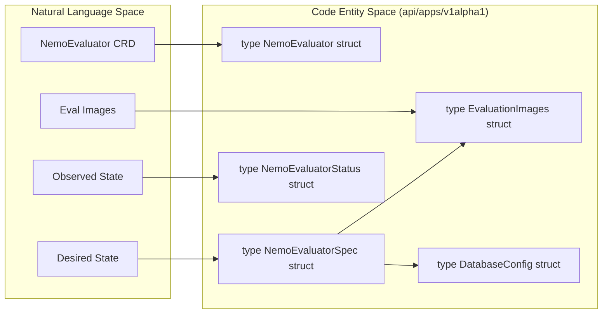
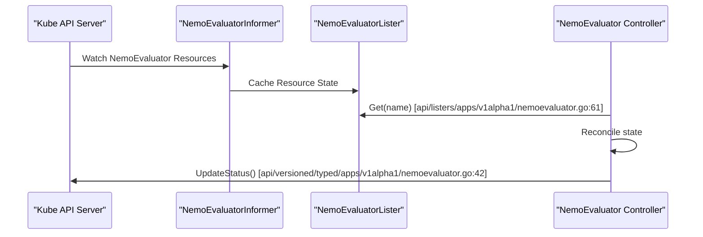

<!-- source: DeepWiki mcp.deepwiki.com · repo NVIDIA/k8s-nim-operator · extra page NemoEvaluator · fetched 2026-10-26 -->

# NemoEvaluator

<details>
<summary>Relevant source files</summary>

The following files were used as context for generating this wiki page:

- [api/apps/v1alpha1/nemo_evaluator_types.go](api/apps/v1alpha1/nemo_evaluator_types.go)
- [api/informers/externalversions/apps/v1alpha1/nemoevaluator.go](api/informers/externalversions/apps/v1alpha1/nemoevaluator.go)
- [api/listers/apps/v1alpha1/nemoevaluator.go](api/listers/apps/v1alpha1/nemoevaluator.go)
- [api/versioned/typed/apps/v1alpha1/nemoevaluator.go](api/versioned/typed/apps/v1alpha1/nemoevaluator.go)
- [bundle/manifests/apps.nvidia.com_nemoevaluators.yaml](bundle/manifests/apps.nvidia.com_nemoevaluators.yaml)

</details>


## Purpose and Scope

The `NemoEvaluator` custom resource provides a declarative interface for deploying and managing NVIDIA NeMo model evaluation workflows on Kubernetes. This resource enables users to run evaluation jobs that assess model performance, quality metrics, and other characteristics of AI models using specialized evaluation harnesses like LM-Eval, Bigcode, and RAG-specific metrics.

Unlike simple inference services, `NemoEvaluator` manages complex dependencies including database configurations, vector stores, and external evaluation images to support advanced AI assessment workflows.

**Sources:**
- [api/apps/v1alpha1/nemo_evaluator_types.go:152-159]()
- [api/apps/v1alpha1/nemo_evaluator_types.go:127-137]()

## Resource Overview

`NemoEvaluator` is a namespaced custom resource in the `apps.nvidia.com/v1alpha1` API group. It is managed by a dedicated controller that reconciles the desired state defined in the resource specification with actual Kubernetes workloads.

### API Group and Version

```
Group: apps.nvidia.com
Version: v1alpha1
Kind: NemoEvaluator
```

The resource includes printer columns for quick status monitoring via `kubectl`.

| Column | JSONPath | Description |
|--------|----------|-------------|
| Status | `.status.state` | Current state (Ready, Pending, Failed) |
| Age | `.metadata.creationTimestamp` | Time since creation |

**Sources:**
- [api/apps/v1alpha1/nemo_evaluator_types.go:146-151]()
- [bundle/manifests/apps.nvidia.com_nemoevaluators.yaml:9-25]()

## System Architecture

The following diagram bridges the Natural Language concepts to the specific Code Entities used in the `NemoEvaluator` implementation.

### Code Entity Mapping
Title: NemoEvaluator Code Entity Map

**Sources:**
- [api/apps/v1alpha1/nemo_evaluator_types.go:62-124]()
- [api/apps/v1alpha1/nemo_evaluator_types.go:139-144]()
- [api/apps/v1alpha1/nemo_evaluator_types.go:153-159]()

## API Specification

### Spec Structure

The `NemoEvaluatorSpec` defines the configuration for the evaluation service and its connections to the NeMo ecosystem.

| Field | Type | Description |
|-------|------|-------------|
| `image` | `Image` | The container image for the evaluator service. |
| `databaseConfig` | `*DatabaseConfig` | Configuration for the backend database. |
| `argoWorkflows` | `ArgoWorkflows` | Endpoint for argo workflow services. |
| `vectorDB` | `VectorDB` | Connection details for the vector database. |
| `datastore` | `Datastore` | Endpoint for the NeMo Datastore. |
| `entitystore` | `Entitystore` | Endpoint for the NeMo Entitystore. |
| `evaluationImages` | `EvaluationImages` | Specific images for different eval harnesses. |
| `evalLogLevel` | `string` | Log level (INFO, DEBUG). Default: "INFO". |

**Sources:**
- [api/apps/v1alpha1/nemo_evaluator_types.go:62-124]()

### Evaluation Images

The `EvaluationImages` struct allows users to specify custom containers for specific evaluation tasks:

*   `lmEvalHarness`: For standard language model benchmarks.
*   `bigcodeEvalHarness`: For code generation evaluation.
*   `llmAsJudge`: For automated grading using LLMs.
*   `rag` / `retriever`: For Retrieval Augmented Generation metrics.
*   `bfcl`: Berkeley Function Calling Leaderboard evaluations.

**Sources:**
- [api/apps/v1alpha1/nemo_evaluator_types.go:127-137]()

## Data Flow and Reconciliation

The following diagram illustrates how the `NemoEvaluator` controller (invoked via generated clients) interacts with the Kubernetes cluster state.

### Controller Data Flow
Title: NemoEvaluator Controller Interaction


**Sources:**
- [api/informers/externalversions/apps/v1alpha1/nemoevaluator.go:36-40]()
- [api/listers/apps/v1alpha1/nemoevaluator.go:55-63]()
- [api/versioned/typed/apps/v1alpha1/nemoevaluator.go:38-50]()

## Lifecycle and Status

The evaluator moves through several states defined by constants in the API.

| State | Constant | Description |
|-------|----------|-------------|
| **Pending** | `NemoEvaluatorStatusPending` | Initial state, resources being provisioned. |
| **NotReady** | `NemoEvaluatorStatusNotReady` | Workload created but not passing health checks. |
| **Ready** | `NemoEvaluatorStatusReady` | Service is fully operational. |
| **Failed** | `NemoEvaluatorStatusFailed` | Terminal error state. |

**Sources:**
- [api/apps/v1alpha1/nemo_evaluator_types.go:41-57]()

## Implementation Details

### Validation Rules
The CRD includes `XValidation` rules to ensure configuration integrity:
*   **Ingress/Router Conflict:** Prevents simultaneous configuration of deprecated `.spec.expose.ingress` and new `.spec.expose.router.ingress` [api/apps/v1alpha1/nemo_evaluator_types.go:60]().
*   **Autoscaling Conflict:** Prevents setting `.spec.replicas` when `.spec.scale.enabled` is true [api/apps/v1alpha1/nemo_evaluator_types.go:61]().
*   **Port Restrictions:** Blocks unsupported gRPC and metrics port overrides in the service spec [api/apps/v1alpha1/nemo_evaluator_types.go:76-77]().

### Default Ports
The evaluator service defaults to port `7331`.
**Sources:**
- [api/apps/v1alpha1/nemo_evaluator_types.go:43]()

## Configuration Example

```yaml
apiVersion: apps.nvidia.com/v1alpha1
kind: NemoEvaluator
metadata:
  name: research-evaluator
spec:
  image:
    repository: "nvcr.io/nvidia/nemo/evaluator"
    tag: "24.05"
  databaseConfig:
    host: "postgres-service"
    port: 5432
  argoWorkflows:
    endpoint: "argo-server.argo.svc:2746"
  vectorDB:
    endpoint: "milvus-service:19530"
  datastore:
    endpoint: "nemo-datastore:8000"
  entitystore:
    endpoint: "nemo-entitystore:8001"
  evaluationImages:
    lmEvalHarness: "nvcr.io/nvidia/nemo/lm-eval:latest"
    llmAsJudge: "nvcr.io/nvidia/nemo/llm-judge:latest"
  evalLogLevel: "DEBUG"
```

**Sources:**
- [api/apps/v1alpha1/nemo_evaluator_types.go:62-124]()
- [bundle/manifests/apps.nvidia.com_nemoevaluators.yaml:47-124]()

---

