# Page: Overview

# Overview

<details>
<summary>Relevant source files</summary>

The following files were used as context for generating this wiki page:

- [README.md](README.md)
- [examples/kubevirt-featuregate-cm.yaml](examples/kubevirt-featuregate-cm.yaml)
- [go.mod](go.mod)
- [manifests/nvidia-kubevirt-gpu-device-plugin.yaml](manifests/nvidia-kubevirt-gpu-device-plugin.yaml)
- [pkg/device_plugin/device_plugin.go](pkg/device_plugin/device_plugin.go)
- [pkg/device_plugin/device_plugin_test.go](pkg/device_plugin/device_plugin_test.go)

</details>


## Purpose and Scope

This document provides a comprehensive overview of the NVIDIA KubeVirt GPU Device Plugin, a Kubernetes device plugin that enables GPU passthrough and virtual GPU (vGPU) support for KubeVirt virtual machines. This page introduces the system's architecture, key components, and operational model.

For detailed installation instructions, see [Getting Started](#2). For in-depth architectural documentation, see [Architecture](#3). For build and deployment procedures, see [Build and Deployment](#4).

**Sources:** [README.md:1-13](), [pkg/device_plugin/device_plugin.go:89-96]()

---

## What Problem Does This Solve?

KubeVirt extends Kubernetes to run virtual machine workloads alongside container workloads. However, VMs requiring GPU access need a mechanism to discover, allocate, and attach physical GPUs or vGPUs. The NVIDIA KubeVirt GPU Device Plugin bridges this gap by:

1. **Discovering GPU resources** on Kubernetes nodes (both physical GPUs and vGPUs)
2. **Advertising GPU availability** to the Kubernetes scheduler as custom resources
3. **Allocating GPU devices** to KubeVirt VM pods with proper IOMMU isolation
4. **Monitoring device health** to ensure reliable GPU operations

The plugin specifically targets KubeVirt workloads and is optimized for GPU passthrough scenarios where VMs require direct access to physical GPU hardware or mediated virtual GPUs.

**Sources:** [README.md:12-19](), [pkg/device_plugin/device_plugin.go:186-247]()

---

## Key Capabilities

The device plugin provides three core capabilities:

| Capability | Description | Implementation |
|-----------|-------------|----------------|
| **Physical GPU Passthrough** | Discovers NVIDIA GPUs bound to VFIO-PCI drivers and exposes them for VM passthrough | `createIommuDeviceMap()`, `GenericDevicePlugin` |
| **Virtual GPU (vGPU) Support** | Discovers NVIDIA vGPUs configured via mdev subsystem and exposes them to VMs | `createVgpuIDMap()`, `GenericVGpuDevicePlugin` |
| **Health Monitoring** | Performs basic health checks on GPUs and tracks device availability | NVML integration, fsnotify watching |

**Sources:** [README.md:16-19](), [pkg/device_plugin/device_plugin.go:89-96]()

---

## System Architecture Overview

The following diagram shows how the device plugin integrates with Kubernetes, KubeVirt, and GPU hardware:

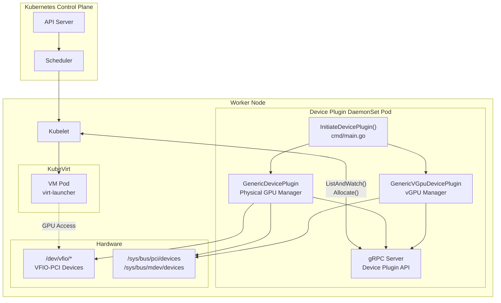

**Figure 1: System Context and Component Interactions**

The device plugin runs as a DaemonSet pod on each GPU-enabled node. The `InitiateDevicePlugin()` function initializes two parallel device plugin instances: `GenericDevicePlugin` for physical GPUs and `GenericVGpuDevicePlugin` for vGPUs. These communicate with Kubelet via gRPC, implementing the Kubernetes Device Plugin API to advertise and allocate GPU resources.

**Sources:** [manifests/nvidia-kubevirt-gpu-device-plugin.yaml:1-40](), [pkg/device_plugin/device_plugin.go:89-96]()

---

## Core Components and Code Mapping

The following diagram maps system components to their implementation in the codebase:

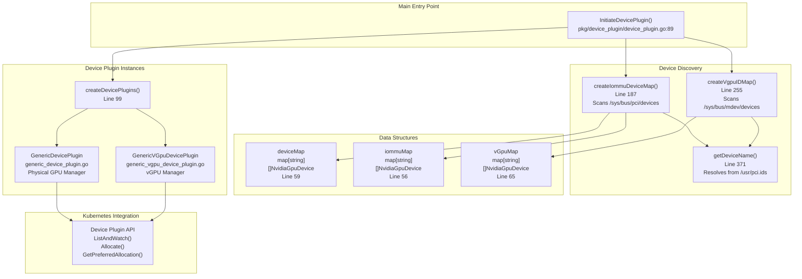

**Figure 2: Component Architecture with Code References**

The system follows a clear initialization flow:

1. **`InitiateDevicePlugin()`** [pkg/device_plugin/device_plugin.go:89-96]() - Main entry point that orchestrates device discovery and plugin creation
2. **`createIommuDeviceMap()`** [pkg/device_plugin/device_plugin.go:187-247]() - Discovers physical GPUs by scanning `/sys/bus/pci/devices`, filtering for NVIDIA vendor ID (`10de`), and validating VFIO driver binding
3. **`createVgpuIDMap()`** [pkg/device_plugin/device_plugin.go:255-291]() - Discovers vGPUs by scanning `/sys/bus/mdev/devices` for mediated devices
4. **`createDevicePlugins()`** [pkg/device_plugin/device_plugin.go:99-176]() - Instantiates device plugin objects for each GPU type discovered
5. **`getDeviceName()`** [pkg/device_plugin/device_plugin.go:371-422]() - Resolves human-readable GPU names from PCI IDs database

**Sources:** [pkg/device_plugin/device_plugin.go:45-96](), [pkg/device_plugin/device_plugin.go:186-291]()

---

## Resource Advertisement Model

The device plugin advertises GPU resources to Kubernetes using a structured naming convention:

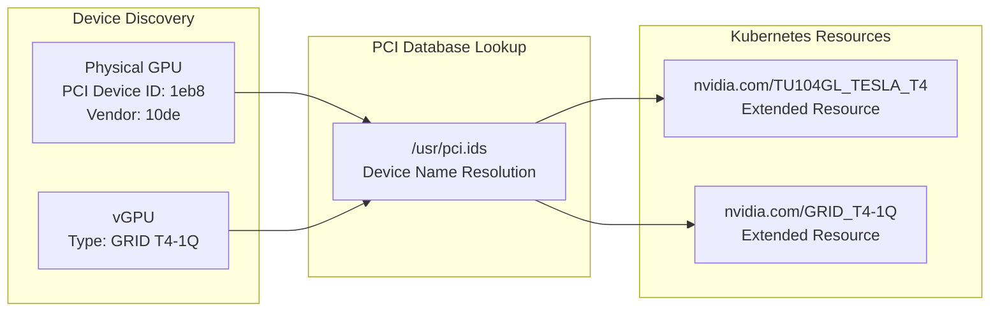

**Figure 3: Resource Naming Convention**

Each discovered GPU is advertised as a Kubernetes extended resource with the format:

- **Format:** `nvidia.com/DEVICE_NAME`
- **Physical GPU example:** `nvidia.com/TU104GL_TESLA_T4`
- **vGPU example:** `nvidia.com/GRID_T4-1Q`

The device name is derived from the PCI IDs database at `/usr/pci.ids`, which maps vendor and device IDs to human-readable names. The plugin normalizes these names by converting to uppercase, replacing special characters with underscores, and removing non-alphanumeric characters [pkg/device_plugin/device_plugin.go:404-415]().

Each advertised device includes NUMA topology information to enable NUMA-aware scheduling [pkg/device_plugin/device_plugin.go:115-119]().

**Sources:** [pkg/device_plugin/device_plugin.go:109-136](), [pkg/device_plugin/device_plugin.go:371-422](), [examples/kubevirt-featuregate-cm.yaml:10-18]()

---

## Device Discovery Details

### Physical GPU Discovery

The plugin discovers physical GPUs through the following process:

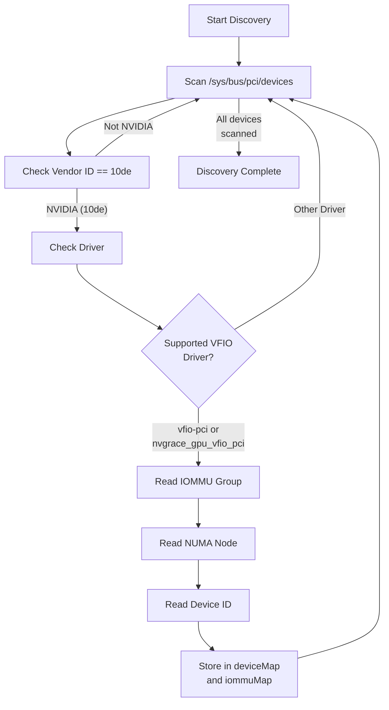

**Figure 4: Physical GPU Discovery Flow**

The discovery process validates that:
1. Device vendor ID is `10de` (NVIDIA) [pkg/device_plugin/device_plugin.go:209]()
2. Device is bound to a supported VFIO driver (`vfio-pci` or `nvgrace_gpu_vfio_pci`) [pkg/device_plugin/device_plugin.go:75-78]()
3. Device has a valid IOMMU group for isolation [pkg/device_plugin/device_plugin.go:221-225]()
4. NUMA node information is available (defaults to node 0 if unavailable) [pkg/device_plugin/device_plugin.go:226-230]()

**Sources:** [pkg/device_plugin/device_plugin.go:186-247](), [pkg/device_plugin/device_plugin.go:249-252]()

### Virtual GPU Discovery

For vGPUs, the plugin scans the mdev subsystem:

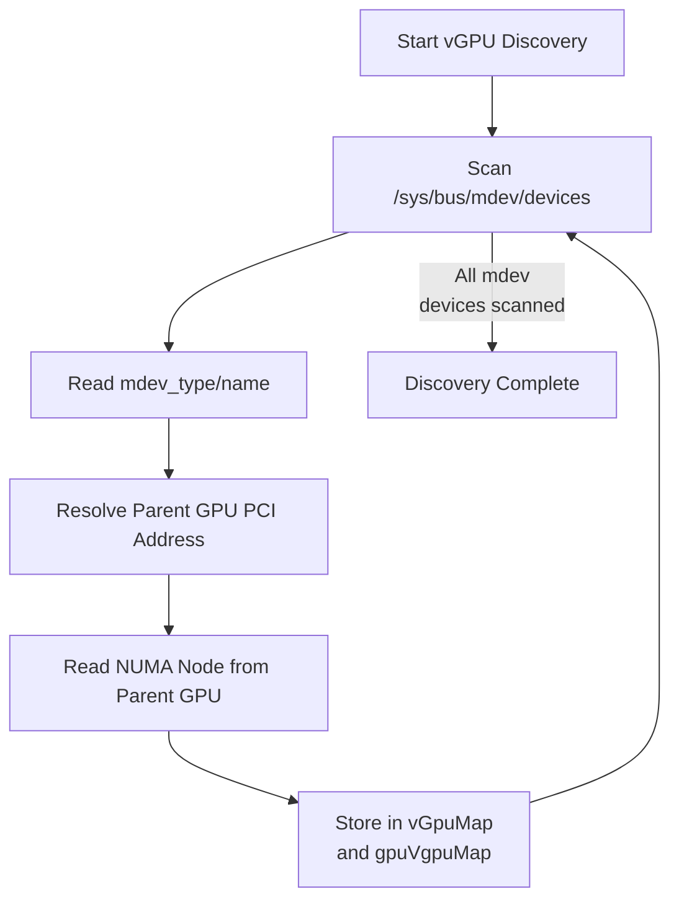

**Figure 5: vGPU Discovery Flow**

Each vGPU is associated with its parent physical GPU to track NUMA topology [pkg/device_plugin/device_plugin.go:280-284]().

**Sources:** [pkg/device_plugin/device_plugin.go:255-291]()

---

## Deployment Model

The device plugin deploys as a DaemonSet in the `kube-system` namespace:

| Configuration | Value | Purpose |
|--------------|-------|---------|
| **Namespace** | `kube-system` | System-level component |
| **Priority Class** | `system-node-critical` | High priority for scheduling |
| **Security Context** | `allowPrivilegeEscalation: false`<br/>`capabilities: drop ALL` | Minimal privileges |
| **Volume Mounts** | `/var/lib/kubelet/device-plugins`<br/>`/dev/vfio` | Socket communication and device access |

The DaemonSet ensures the device plugin runs on every GPU-enabled node. The pod requires access to:
- `/var/lib/kubelet/device-plugins` - Unix socket directory for kubelet communication
- `/dev/vfio` - VFIO device files for GPU access validation

**Sources:** [manifests/nvidia-kubevirt-gpu-device-plugin.yaml:1-40]()

---

## Supported GPU Modes

The plugin supports two GPU operational modes:

### 1. GPU Passthrough Mode

Physical GPUs bound to VFIO-PCI drivers are passed through directly to VMs:

- **Driver Requirements:** GPU must be bound to `vfio-pci` or `nvgrace_gpu_vfio_pci` driver
- **IOMMU:** Must be enabled with proper IOMMU group isolation
- **VM Access:** VM gets exclusive, direct access to physical GPU hardware
- **Resource Name Format:** `nvidia.com/DEVICE_NAME` (e.g., `nvidia.com/TU104GL_TESLA_T4`)

**Sources:** [README.md:34-109](), [pkg/device_plugin/device_plugin.go:75-78]()

### 2. vGPU Mode

Virtual GPUs created through NVIDIA vGPU Manager and Linux mdev subsystem:

- **Driver Requirements:** NVIDIA Virtual GPU Manager installed on host
- **mdev Configuration:** vGPU instances created at `/sys/bus/pci/devices/*/mdev_supported_types/`
- **VM Access:** Multiple VMs can share a physical GPU via time-sliced vGPUs
- **Resource Name Format:** `nvidia.com/VGPU_TYPE` (e.g., `nvidia.com/GRID_T4-1Q`)

**Sources:** [README.md:111-173](), [pkg/device_plugin/device_plugin.go:255-291]()

---

## Integration with KubeVirt

The device plugin integrates with KubeVirt through the permitted devices mechanism:

```yaml
apiVersion: kubevirt.io/v1alpha3
kind: KubeVirt
spec:
  configuration:
    permittedHostDevices:
      pciHostDevices:
      - pciVendorSelector: "10DE:1EB8"
        resourceName: "nvidia.com/TU104GL_Tesla_T4"
        externalResourceProvider: true
      mediatedDevices:
      - mdevNameSelector: "GRID T4-1Q"
        resourceName: "nvidia.com/GRID_T4-1Q"
    developerConfiguration:
      featureGates:
        - GPU
```

**Key Configuration Requirements:**

1. **GPU Feature Gate:** Must be enabled in KubeVirt CR
2. **Permitted Devices:** Both physical GPUs and vGPUs must be allowlisted
3. **External Resource Provider:** Set to `true` for device plugin managed resources
4. **Resource Name Match:** Must exactly match the resource names advertised by the device plugin

**Sources:** [examples/kubevirt-featuregate-cm.yaml:1-22](), [README.md:25-32]()

---

## Key Data Structures

The plugin maintains several critical data structures:

| Data Structure | Type | Purpose |
|---------------|------|---------|
| `deviceMap` | `map[string][]NvidiaGpuDevice` | Maps device IDs to GPU devices |
| `iommuMap` | `map[string][]NvidiaGpuDevice` | Maps IOMMU group IDs to GPU devices |
| `bdfToIommuMap` | `map[string]string` | Maps PCI BDF addresses to IOMMU groups |
| `vGpuMap` | `map[string][]NvidiaGpuDevice` | Maps vGPU types to vGPU instances |
| `gpuVgpuMap` | `map[string][]string` | Maps parent GPU IDs to child vGPUs |

The `NvidiaGpuDevice` structure stores device details:

```go
type NvidiaGpuDevice struct {
    addr     string  // PCI address (BDF) or mdev UUID
    numaNode int64   // NUMA node ID for topology-aware scheduling
}
```

**Sources:** [pkg/device_plugin/device_plugin.go:49-68]()

---

## Next Steps

- For installation and host preparation instructions, see [Getting Started](#2)
- For detailed architectural documentation, see [Architecture](#3)
- For build and deployment procedures, see [Build and Deployment](#4)
- For development guidelines, see [Development Guide](#5)

---

# Page: Getting Started

# Getting Started

<details>
<summary>Relevant source files</summary>

The following files were used as context for generating this wiki page:

- [README.md](README.md)
- [examples/kubevirt-featuregate-cm.yaml](examples/kubevirt-featuregate-cm.yaml)
- [manifests/nvidia-kubevirt-gpu-device-plugin.yaml](manifests/nvidia-kubevirt-gpu-device-plugin.yaml)

</details>


This page provides an overview of the prerequisites and installation process for the NVIDIA KubeVirt GPU Device Plugin. It introduces the setup workflow and key deployment components. For detailed step-by-step instructions on host preparation, see [Prerequisites and Host Setup](#2.1). For deployment procedures, see [Installing the Device Plugin](#2.2).

## Purpose and Scope

The NVIDIA KubeVirt GPU Device Plugin enables GPU and vGPU passthrough to KubeVirt virtual machines running in a Kubernetes cluster. This Getting Started guide covers the complete setup process from host preparation through deployment verification. 

This page focuses on installation and initial configuration. For architectural details about how the device plugin works internally, see [Architecture](#3). For build and development workflows, see [Development Guide](#5).

## Installation Overview

Setting up the device plugin requires preparation at three layers:

| Layer | Configuration Required | Purpose |
|-------|----------------------|---------|
| **Host System** | IOMMU enablement, kernel driver binding | Enable hardware virtualization and device isolation |
| **KubeVirt** | Feature gates, permitted device allowlisting | Allow GPU/vGPU attachment to VMs |
| **Device Plugin** | DaemonSet deployment | Discover and advertise GPU resources to Kubernetes |

The installation follows a sequential dependency chain where each layer must be configured before proceeding to the next.

## Setup Workflow

The following diagram illustrates the complete setup workflow from bare-metal host configuration through device plugin deployment:

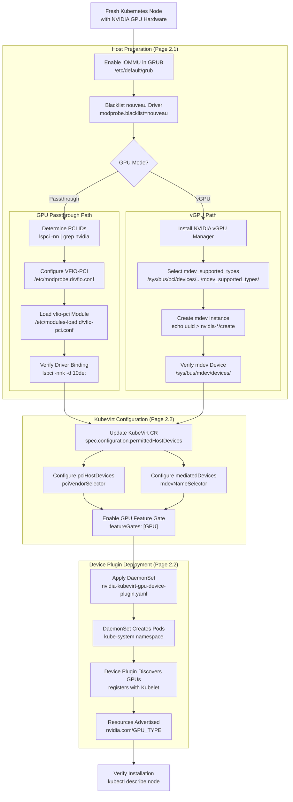

**Sources**: [README.md:27-173](), [manifests/nvidia-kubevirt-gpu-device-plugin.yaml:1-40](), [examples/kubevirt-featuregate-cm.yaml:1-22]()

## Component Deployment Architecture

The following diagram maps the deployed Kubernetes resources to their source files and shows how they interact at runtime:

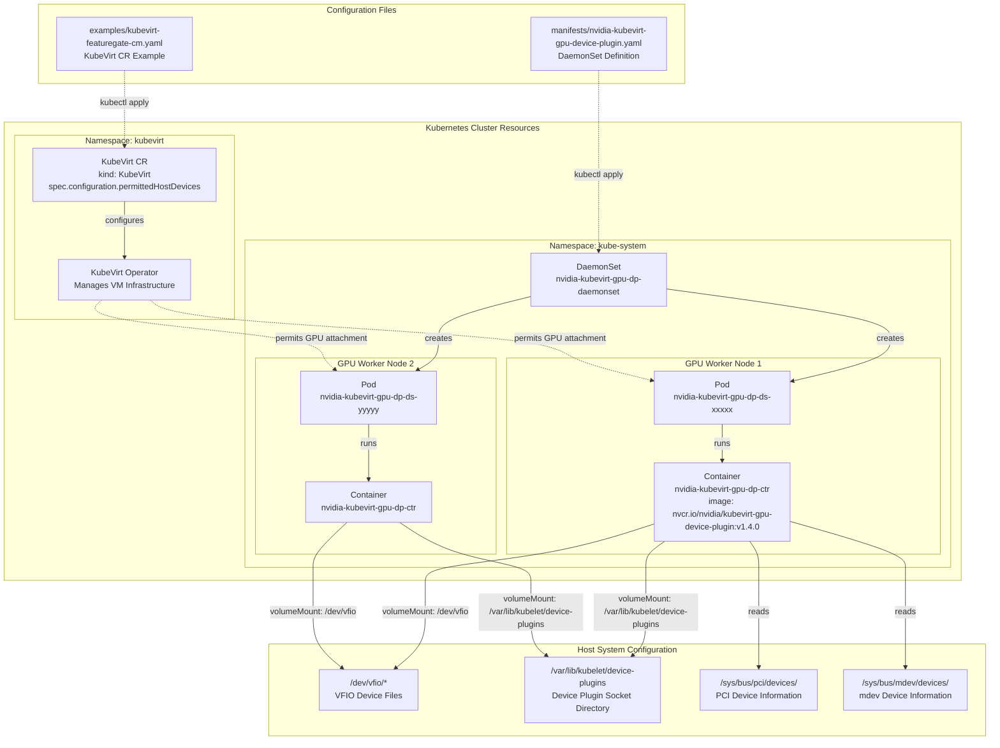

**Sources**: [manifests/nvidia-kubevirt-gpu-device-plugin.yaml:1-40](), [examples/kubevirt-featuregate-cm.yaml:1-22]()

## Key Requirements

Before proceeding with installation, ensure the following prerequisites are met:

### Software Versions

| Component | Minimum Version | Notes |
|-----------|----------------|-------|
| Kubernetes | v1.11 | Required for Device Plugin API v1beta1 |
| KubeVirt | v0.36.0 | Earlier versions require device plugin v1.0.1 |
| Linux Kernel | IOMMU-capable | Check with `dmesg \| grep -E "DMAR\|IOMMU"` |

**Sources**: [README.md:22-24]()

### Hardware Prerequisites

- NVIDIA GPU hardware with either:
  - VFIO-PCI driver binding support (for GPU passthrough), or
  - NVIDIA vGPU Manager compatibility (for vGPU mode)
- IOMMU support in BIOS/UEFI and CPU (Intel VT-d or AMD-Vi)

**Sources**: [README.md:21-22]()

### Configuration Files Reference

The installation process uses the following key configuration files:

| File Path | Purpose | Applied With |
|-----------|---------|--------------|
| `manifests/nvidia-kubevirt-gpu-device-plugin.yaml` | DaemonSet deployment specification | `kubectl apply -f` |
| `examples/kubevirt-featuregate-cm.yaml` | KubeVirt CR with GPU feature gate and permitted devices | `kubectl apply -f` |
| `/etc/default/grub` | Host GRUB configuration for IOMMU | Host-level edit + `grub2-mkconfig` |
| `/etc/modprobe.d/vfio.conf` | VFIO-PCI driver binding configuration | Host-level edit |
| `/etc/modules-load.d/vfio-pci.conf` | VFIO-PCI module auto-load | Host-level edit |

**Sources**: [README.md:37-96](), [manifests/nvidia-kubevirt-gpu-device-plugin.yaml:1-40](), [examples/kubevirt-featuregate-cm.yaml:1-22]()

## DaemonSet Deployment Model

The device plugin uses a DaemonSet deployment pattern to ensure GPU resource discovery on every GPU-capable node:

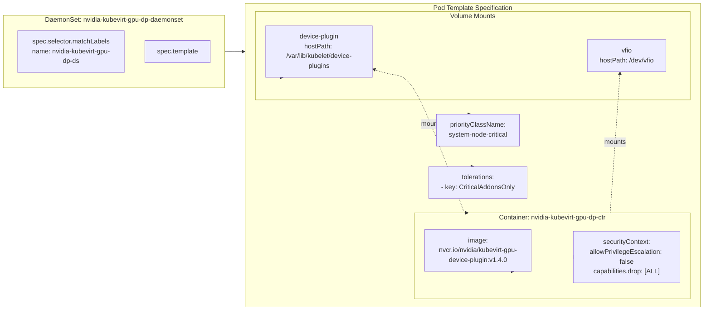

**Sources**: [manifests/nvidia-kubevirt-gpu-device-plugin.yaml:1-40]()

### DaemonSet Configuration Highlights

The DaemonSet manifest [manifests/nvidia-kubevirt-gpu-device-plugin.yaml:1-40]() includes several critical configurations:

- **System Priority**: [manifests/nvidia-kubevirt-gpu-device-plugin.yaml:15]() sets `priorityClassName: system-node-critical`, ensuring the device plugin pods are not evicted during resource pressure.

- **Critical Add-on Toleration**: [manifests/nvidia-kubevirt-gpu-device-plugin.yaml:16-20]() allows pods to run even when nodes are in maintenance mode.

- **Security Hardening**: [manifests/nvidia-kubevirt-gpu-device-plugin.yaml:24-27]() drops all capabilities and disables privilege escalation, following least-privilege principles.

- **Required Host Access**: 
  - [manifests/nvidia-kubevirt-gpu-device-plugin.yaml:28-30]() mounts `/var/lib/kubelet/device-plugins` for gRPC socket communication with kubelet.
  - [manifests/nvidia-kubevirt-gpu-device-plugin.yaml:31-32]() mounts `/dev/vfio` for VFIO device file access.

**Sources**: [manifests/nvidia-kubevirt-gpu-device-plugin.yaml:1-40]()

## KubeVirt Integration Requirements

KubeVirt must be configured to permit GPU devices before VMs can use them. The configuration uses the KubeVirt Custom Resource:

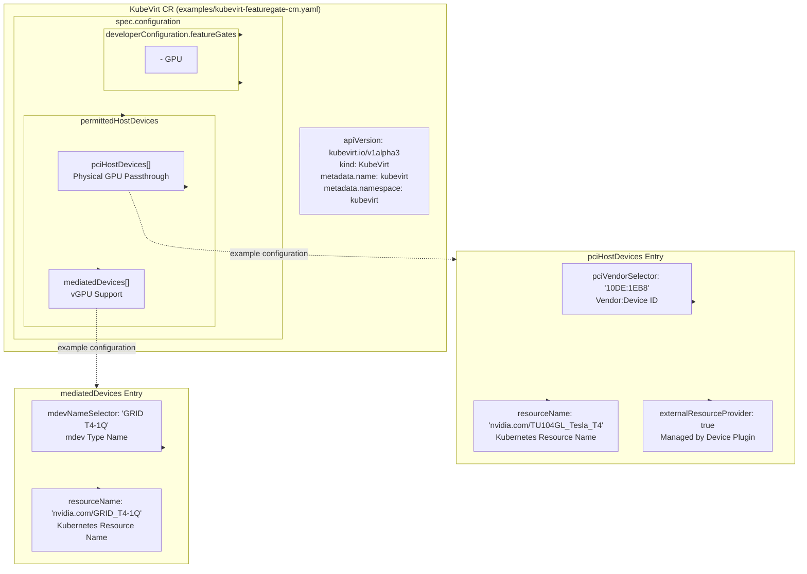

**Sources**: [examples/kubevirt-featuregate-cm.yaml:1-22](), [README.md:31-32]()

### Permitted Device Configuration

The KubeVirt CR [examples/kubevirt-featuregate-cm.yaml:1-22]() demonstrates two types of device permissions:

**Physical GPU (Passthrough)**:
- [examples/kubevirt-featuregate-cm.yaml:11-15]() configures PCI device passthrough
- `pciVendorSelector: "10DE:1EB8"` specifies the NVIDIA vendor ID (10DE) and Tesla T4 device ID (1EB8)
- `resourceName` must match the resource name advertised by the device plugin
- `externalResourceProvider: true` indicates the device plugin manages this resource

**Virtual GPU (mdev)**:
- [examples/kubevirt-featuregate-cm.yaml:16-18]() configures mediated device support
- `mdevNameSelector: "GRID T4-1Q"` specifies the vGPU profile name
- The device plugin discovers and advertises these mdev devices automatically

**Feature Gate**:
- [examples/kubevirt-featuregate-cm.yaml:20-22]() enables the GPU feature gate, required for any GPU passthrough functionality

**Sources**: [examples/kubevirt-featuregate-cm.yaml:1-22]()

## Next Steps

With an understanding of the overall setup workflow and component architecture, proceed to the detailed configuration guides:

1. **[Prerequisites and Host Setup](#2.1)**: Complete IOMMU enablement, driver binding (VFIO-PCI or vGPU), and host verification.

2. **[Installing the Device Plugin](#2.2)**: Deploy the DaemonSet, configure KubeVirt permissions, and verify GPU resources are advertised to Kubernetes.

After successful installation, see [Architecture](#3) to understand the internal implementation details, or proceed directly to creating GPU-enabled VMs using the example manifests in the `examples/` directory.

**Sources**: [README.md:1-211]()

---

# Page: Prerequisites and Host Setup

# Prerequisites and Host Setup

<details>
<summary>Relevant source files</summary>

The following files were used as context for generating this wiki page:

- [README.md](README.md)
- [examples/kubevirt-featuregate-cm.yaml](examples/kubevirt-featuregate-cm.yaml)
- [manifests/nvidia-kubevirt-gpu-device-plugin.yaml](manifests/nvidia-kubevirt-gpu-device-plugin.yaml)

</details>


## Purpose and Scope

This page details the host-level prerequisites and configuration steps required before deploying the NVIDIA KubeVirt GPU Device Plugin. It covers hardware requirements, kernel configuration, driver setup for both GPU pass-through and vGPU modes, and KubeVirt cluster configuration. 

For installation of the device plugin itself, see [Installing the Device Plugin](#2.2). For architectural details about how the device plugin discovers and manages GPUs, see [Device Discovery and Mapping](#3.2).

---

## Overview of Requirements

The device plugin requires specific host configuration to access GPU hardware through the VFIO subsystem. The configuration path differs based on whether physical GPU pass-through or vGPU virtualization is desired.

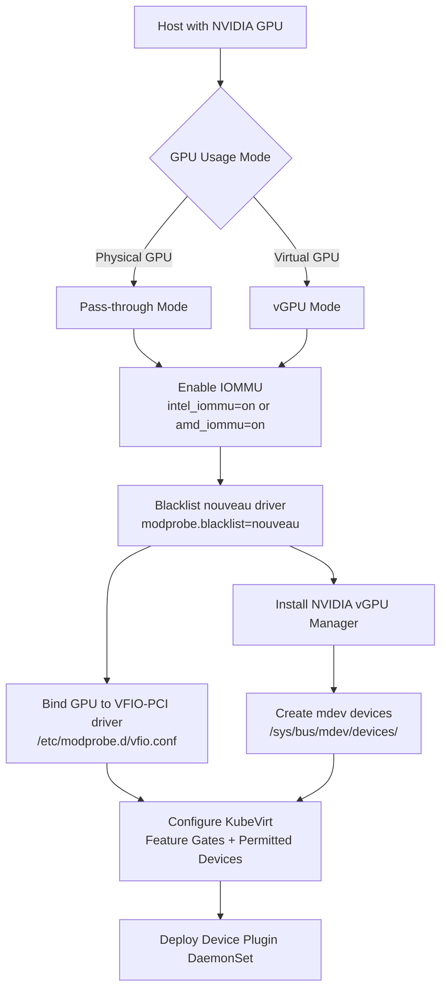

**Sources:** [README.md:21-32](), [README.md:34-109](), [README.md:111-173]()

---

## Software Requirements

| Component | Minimum Version | Notes |
|-----------|----------------|-------|
| Kubernetes | v1.11+ | Required for Device Plugin API support |
| KubeVirt | v0.36.0+ | Earlier versions not supported from device plugin v1.1.0+ |
| Linux Kernel | 4.x+ | IOMMU and VFIO support required |
| Operating System | RHEL/CentOS 7+, Ubuntu 18.04+ | Other distributions supported if kernel requirements met |

**Sources:** [README.md:23-24]()

---

## Hardware Requirements

### NVIDIA GPU

The system requires NVIDIA GPUs that support either:
- **GPU Pass-through**: GPU hardware with IOMMU virtualization support
- **vGPU Technology**: GPUs that support NVIDIA Virtual GPU (vGPU) with SR-IOV or mediated device (mdev) framework

### IOMMU Support

The host CPU and motherboard must support IOMMU (Input-Output Memory Management Unit):
- **Intel**: VT-d (Virtualization Technology for Directed I/O)
- **AMD**: AMD-Vi (I/O Virtualization Technology)

Verify IOMMU support in BIOS/UEFI settings before proceeding.

**Sources:** [README.md:37-65]()

---

## Host Configuration for GPU Pass-through Mode

GPU pass-through mode requires binding the physical GPU to the `vfio-pci` driver, which provides direct device access to virtual machines without host driver interference.

### Architecture: VFIO-PCI Binding Flow

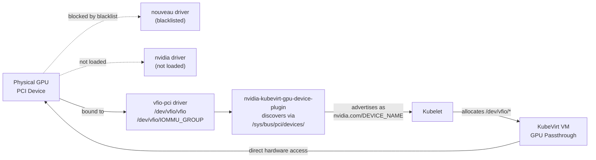

**Sources:** [README.md:34-109](), [manifests/nvidia-kubevirt-gpu-device-plugin.yaml:31-39]()

### Step 1: Enable IOMMU and Blacklist Nouveau Driver

Edit the GRUB configuration to enable IOMMU and prevent the `nouveau` open-source driver from loading.

**File:** `/etc/default/grub`

Append to `GRUB_CMDLINE_LINUX`:
- **Intel CPUs**: `intel_iommu=on modprobe.blacklist=nouveau`
- **AMD CPUs**: `amd_iommu=on modprobe.blacklist=nouveau`

Example configuration:
```
GRUB_CMDLINE_LINUX="rd.lvm.lv=centos/root rd.lvm.lv=centos/swap rhgb quiet intel_iommu=on modprobe.blacklist=nouveau"
```

**Sources:** [README.md:37-49]()

#### Regenerate GRUB Configuration

**Legacy BIOS:**
```shell
grub2-mkconfig -o /boot/grub2/grub.cfg
reboot
```

**UEFI:**
```shell
grub2-mkconfig -o /boot/efi/EFI/centos/grub.cfg
reboot
```

**Sources:** [README.md:51-60]()

#### Verification

After reboot, verify IOMMU is enabled:
```shell
dmesg | grep -E "DMAR|IOMMU"
```

Verify `nouveau` is disabled:
```shell
dmesg | grep -i nouveau
```

**Sources:** [README.md:62-69]()

### Step 2: Determine GPU PCI Identifiers

Identify the GPU's vendor ID and device ID:
```shell
lspci -nn | grep -i nvidia
```

Example output:
```
04:00.0 3D controller [0302]: NVIDIA Corporation GP102GL [Tesla P40] [10de:1b38] (rev a1)
```

In this example:
- **Vendor ID**: `10de` (NVIDIA)
- **Device ID**: `1b38` (Tesla P40)

**Sources:** [README.md:73-82]()

### Step 3: Configure VFIO-PCI Driver Binding

Create the VFIO configuration file:
```shell
echo "options vfio-pci ids=10de:1b38" > /etc/modprobe.d/vfio.conf
```

Replace `10de:1b38` with your GPU's vendor ID and device ID.

Configure the module to load at boot:
```shell
echo 'vfio-pci' > /etc/modules-load.d/vfio-pci.conf
reboot
```

**Sources:** [README.md:84-96]()

### Step 4: Verify VFIO-PCI Driver Binding

After reboot, confirm the GPU is bound to `vfio-pci`:
```shell
lspci -nnk -d 10de:
```

Expected output showing `Kernel driver in use: vfio-pci`:
```
04:00.0 3D controller [0302]: NVIDIA Corporation GP102GL [Tesla P40] [10de:1b38] (rev a1)
        Subsystem: NVIDIA Corporation Device [10de:11d9]
        Kernel driver in use: vfio-pci
        Kernel modules: nouveau
```

The device plugin will discover GPUs by scanning `/sys/bus/pci/devices/` for devices bound to the `vfio-pci` driver.

**Sources:** [README.md:98-109]()

---

## Host Configuration for vGPU Mode

vGPU mode enables GPU virtualization where a single physical GPU is partitioned into multiple virtual GPUs (vGPUs) that can be assigned to different virtual machines.

### Architecture: mdev Device Creation Flow

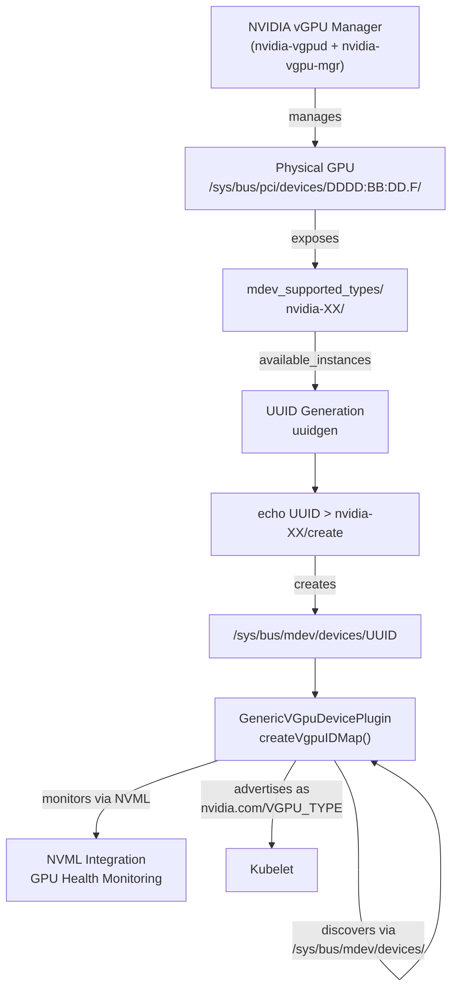

**Sources:** [README.md:111-173]()

### Step 1: Install NVIDIA vGPU Manager

Install the NVIDIA Virtual GPU Manager package on the host. This provides the necessary drivers and tools for creating and managing vGPU devices through the Linux mdev framework.

**Note:** The NVIDIA vGPU Manager software requires a valid NVIDIA vGPU software license and is available through NVIDIA Licensing Portal.

### Step 2: Locate GPU mdev Support Directory

Navigate to the GPU's `mdev_supported_types` directory:
```shell
cd /sys/bus/pci/devices/DDDD\:BB\:DD.F/mdev_supported_types/
```

Example for GPU at PCI address `0000:06:00.0`:
```shell
cd /sys/bus/pci/devices/0000\:06\:00.0/mdev_supported_types/
```

**Sources:** [README.md:114-121]()

### Step 3: Identify vGPU Type

List available vGPU types and find the subdirectory for your desired type:
```shell
grep -l "M10-2Q" nvidia-*/name
```

Example output:
```
nvidia-41/name
```

This indicates that the `M10-2Q` vGPU type configuration is in the `nvidia-41` subdirectory.

**Sources:** [README.md:122-132]()

### Step 4: Check Available Instances

Verify that vGPU instances can be created:
```shell
cat nvidia-41/available_instances
```

Example output showing 4 available instances:
```
4
```

If the value is `0`, either the maximum number of vGPUs has been created or an incompatible vGPU type is already instantiated on the GPU.

**Sources:** [README.md:133-145]()

### Step 5: Generate UUID and Create vGPU Instance

Generate a UUID for the vGPU:
```shell
uuidgen
```

Example output:
```
aa618089-8b16-4d01-a136-25a0f3c73123
```

Create the vGPU instance:
```shell
echo "aa618089-8b16-4d01-a136-25a0f3c73123" > nvidia-41/create
```

**Sources:** [README.md:146-162]()

### Step 6: Verify vGPU Creation

Confirm the vGPU device exists:
```shell
ls -l /sys/bus/mdev/devices/
```

Expected output:
```
total 0
lrwxrwxrwx. 1 root root 0 Nov 24 13:33 aa618089-8b16-4d01-a136-25a0f3c73123 -> ../../../devices/pci0000:00/0000:00:03.0/0000:03:00.0/0000:04:09.0/0000:06:00.0/aa618089-8b16-4d01-a136-25a0f3c73123
```

The device plugin's `createVgpuIDMap()` function will discover these mdev devices by scanning `/sys/bus/mdev/devices/`.

**Sources:** [README.md:167-172]()

---

## KubeVirt Configuration

The device plugin requires KubeVirt to be configured with GPU feature gates enabled and permitted devices whitelisted.

### Component Configuration Map

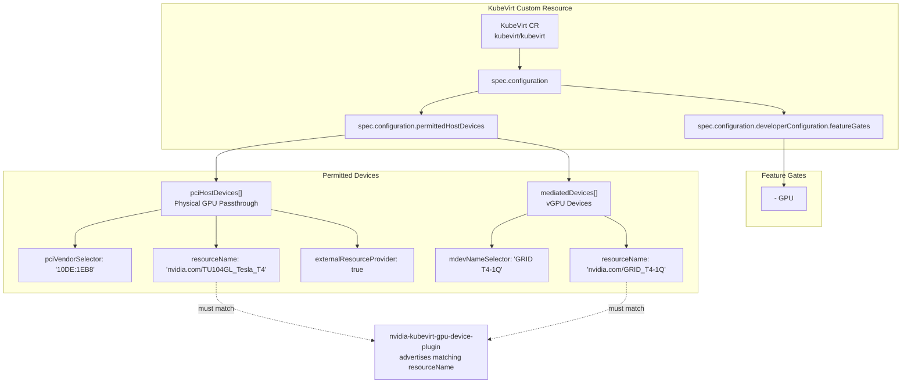

**Sources:** [examples/kubevirt-featuregate-cm.yaml:1-22](), [README.md:25](), [README.md:31-32]()

### Enable GPU Feature Gate

The GPU feature gate must be enabled in the KubeVirt CR:

```yaml
spec:
  configuration:
    developerConfiguration:
      featureGates:
        - GPU
```

**Sources:** [examples/kubevirt-featuregate-cm.yaml:20-22]()

### Configure Permitted Host Devices

#### Physical GPU Pass-through Configuration

For GPUs bound to `vfio-pci`, configure `pciHostDevices`:

```yaml
spec:
  configuration:
    permittedHostDevices:
      pciHostDevices:
      - pciVendorSelector: "10DE:1EB8"
        resourceName: "nvidia.com/TU104GL_Tesla_T4"
        externalResourceProvider: true
```

| Field | Description |
|-------|-------------|
| `pciVendorSelector` | PCI vendor:device ID in format `VVVV:DDDD` (e.g., `10DE:1EB8` for Tesla T4) |
| `resourceName` | Kubernetes extended resource name advertised by device plugin |
| `externalResourceProvider` | Must be `true` to indicate device plugin manages allocation |

**Sources:** [examples/kubevirt-featuregate-cm.yaml:10-15]()

#### vGPU Configuration

For mdev-based vGPUs, configure `mediatedDevices`:

```yaml
spec:
  configuration:
    permittedHostDevices:
      mediatedDevices:
      - mdevNameSelector: "GRID T4-1Q"
        resourceName: "nvidia.com/GRID_T4-1Q"
```

| Field | Description |
|-------|-------------|
| `mdevNameSelector` | mdev type name (e.g., `GRID T4-1Q`, `M10-2Q`) |
| `resourceName` | Kubernetes extended resource name advertised by device plugin |

**Sources:** [examples/kubevirt-featuregate-cm.yaml:16-18]()

### Resource Name Matching

The `resourceName` values in the KubeVirt CR **must match** the resource names advertised by the device plugin. The device plugin constructs resource names as:

- **Physical GPUs**: `nvidia.com/<GPU_MODEL_NAME>` where the model name is resolved from the PCI database
- **vGPUs**: `nvidia.com/<VGPU_TYPE_NAME>` where the type name comes from the mdev device name

For example, a Tesla T4 GPU might be advertised as `nvidia.com/TU104GL_Tesla_T4`, and this exact string must appear in the KubeVirt CR's `pciHostDevices[].resourceName` field.

**Sources:** [README.md:31-32](), [examples/kubevirt-featuregate-cm.yaml:14](), [examples/kubevirt-featuregate-cm.yaml:18]()

---

## Verification Prerequisites

Before deploying the device plugin, verify all prerequisites are met:

| Requirement | Verification Command | Expected Result |
|-------------|---------------------|-----------------|
| IOMMU Enabled | `dmesg \| grep -E "DMAR\|IOMMU"` | Output shows IOMMU initialization messages |
| Nouveau Blacklisted | `dmesg \| grep -i nouveau` | No driver loading messages |
| VFIO-PCI Bound (pass-through) | `lspci -nnk -d 10de:` | Shows `Kernel driver in use: vfio-pci` |
| vGPU Created (vGPU mode) | `ls /sys/bus/mdev/devices/` | Lists created mdev device UUIDs |
| KubeVirt GPU Feature | `kubectl get kubevirt -n kubevirt kubevirt -o yaml` | Shows `GPU` in `featureGates[]` |
| Permitted Devices | `kubectl get kubevirt -n kubevirt kubevirt -o yaml` | Shows device configuration in `permittedHostDevices` |

**Sources:** [README.md:62-69](), [README.md:98-109](), [README.md:167-172](), [README.md:25](), [README.md:31-32]()

---

## Device Plugin Volume Mounts Dependency

The device plugin DaemonSet requires specific host paths to be mounted for operation:

```yaml
volumeMounts:
  - name: device-plugin
    mountPath: /var/lib/kubelet/device-plugins
  - name: vfio
    mountPath: /dev/vfio
volumes:
  - name: device-plugin
    hostPath:
      path: /var/lib/kubelet/device-plugins
  - name: vfio
    hostPath:
      path: /dev/vfio
```

| Volume | Purpose |
|--------|---------|
| `/var/lib/kubelet/device-plugins` | Device plugin registration socket location (required by Kubernetes Device Plugin API) |
| `/dev/vfio` | VFIO device files for GPU access (both pass-through and vGPU modes require VFIO subsystem) |

These mounts are essential for the device plugin to:
1. Register with the Kubelet via the gRPC socket
2. Enumerate VFIO IOMMU groups and device files
3. Provide device file paths in `AllocateResponse` to the Kubelet

**Sources:** [manifests/nvidia-kubevirt-gpu-device-plugin.yaml:28-39]()

---

## Next Steps

After completing the host setup and KubeVirt configuration, proceed to [Installing the Device Plugin](#2.2) to deploy the DaemonSet and verify GPU resource discovery.

---

# Page: Installing the Device Plugin

# Installing the Device Plugin

<details>
<summary>Relevant source files</summary>

The following files were used as context for generating this wiki page:

- [README.md](README.md)
- [examples/kubevirt-featuregate-cm.yaml](examples/kubevirt-featuregate-cm.yaml)
- [manifests/nvidia-kubevirt-gpu-device-plugin.yaml](manifests/nvidia-kubevirt-gpu-device-plugin.yaml)

</details>


This document guides you through deploying the NVIDIA KubeVirt GPU Device Plugin to your Kubernetes cluster. It covers KubeVirt configuration, DaemonSet deployment, and installation verification.

**Prerequisites**: Before proceeding with installation, ensure your nodes are properly configured with VFIO-PCI drivers for GPU passthrough or NVIDIA vGPU Manager for virtual GPUs. See [Prerequisites and Host Setup](#2.1) for complete host preparation instructions.

**Related Documentation**: For information about building custom container images, see [Container Images](#4.2). For deployment customization and advanced configuration, see [Kubernetes Deployment](#4.3).

## Installation Overview

The device plugin installation involves three main steps that must be performed in order:

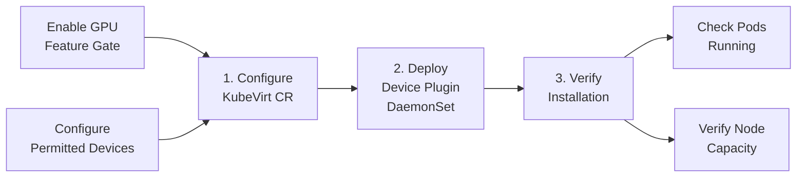

**Sources**: [README.md:27-33](), [manifests/nvidia-kubevirt-gpu-device-plugin.yaml:1-40]()

## Step 1: Configure KubeVirt

Before deploying the device plugin, you must configure KubeVirt to enable GPU support and whitelist the GPU devices. This is done by modifying the KubeVirt Custom Resource (CR).

### Enabling the GPU Feature Gate

The GPU feature gate must be enabled in the KubeVirt CR to allow VMs to use host devices. This is configured in the `spec.configuration.developerConfiguration.featureGates` section:

```yaml
apiVersion: kubevirt.io/v1alpha3
kind: KubeVirt
metadata:
  name: kubevirt
  namespace: kubevirt
spec:
  configuration:
    developerConfiguration:
      featureGates:
        - GPU
```

**Sources**: [examples/kubevirt-featuregate-cm.yaml:20-22](), [README.md:25]()

### Configuring Permitted Devices

GPUs and vGPUs must be explicitly whitelisted in the KubeVirt CR's `permittedHostDevices` section. The device plugin advertises devices to Kubernetes using resource names that must match the `resourceName` field configured here.

#### Physical GPU Configuration

For physical GPUs bound to the VFIO-PCI driver, configure `pciHostDevices`:

```yaml
configuration:
  permittedHostDevices:
    pciHostDevices:
    - pciVendorSelector: "10DE:1EB8"
      resourceName: "nvidia.com/TU104GL_Tesla_T4"
      externalResourceProvider: true
```

| Field | Description | Example |
|-------|-------------|---------|
| `pciVendorSelector` | PCI vendor:device ID pair (format: `VENDOR:DEVICE`) | `"10DE:1EB8"` for Tesla T4 |
| `resourceName` | Kubernetes resource name advertised by device plugin | `"nvidia.com/TU104GL_Tesla_T4"` |
| `externalResourceProvider` | Must be `true` to indicate device plugin manages allocation | `true` |

**Sources**: [examples/kubevirt-featuregate-cm.yaml:11-15](), [README.md:32]()

#### Virtual GPU Configuration

For NVIDIA vGPUs (mdev devices), configure `mediatedDevices`:

```yaml
configuration:
  permittedHostDevices:
    mediatedDevices:
    - mdevNameSelector: "GRID T4-1Q"
      resourceName: "nvidia.com/GRID_T4-1Q"
```

| Field | Description | Example |
|-------|-------------|---------|
| `mdevNameSelector` | vGPU type name from mdev subsystem | `"GRID T4-1Q"` |
| `resourceName` | Kubernetes resource name advertised by device plugin | `"nvidia.com/GRID_T4-1Q"` |

**Sources**: [examples/kubevirt-featuregate-cm.yaml:16-18](), [README.md:111-173]()

### Complete KubeVirt CR Example

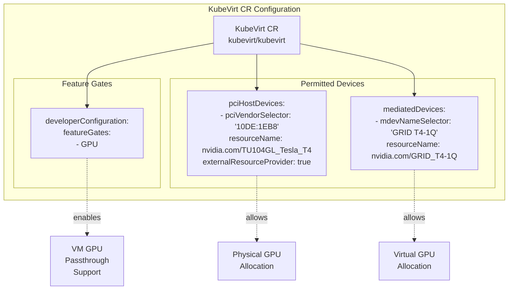

A complete example can be found at [examples/kubevirt-featuregate-cm.yaml:1-22]().

Apply the KubeVirt CR configuration:

```bash
kubectl apply -f examples/kubevirt-featuregate-cm.yaml
```

**Sources**: [examples/kubevirt-featuregate-cm.yaml:1-22](), [README.md:32]()

## Step 2: Deploy the Device Plugin DaemonSet

The device plugin is deployed as a DaemonSet in the `kube-system` namespace, ensuring it runs on every GPU-enabled node in the cluster.

### DaemonSet Architecture

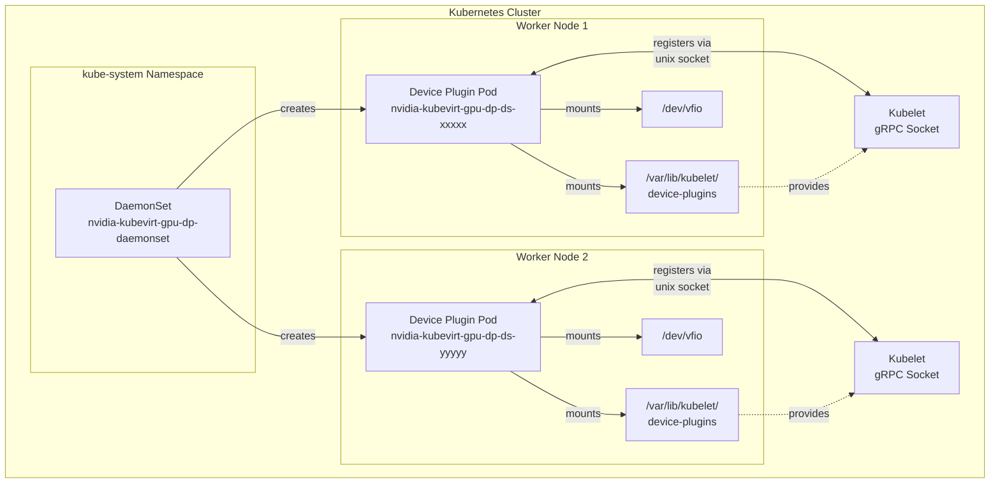

**Sources**: [manifests/nvidia-kubevirt-gpu-device-plugin.yaml:1-40]()

### DaemonSet Manifest Components

The DaemonSet manifest [manifests/nvidia-kubevirt-gpu-device-plugin.yaml:1-40]() contains several critical configurations:

#### Namespace and Priority

```yaml
metadata:
  name: nvidia-kubevirt-gpu-dp-daemonset
  namespace: kube-system
spec:
  template:
    spec:
      priorityClassName: system-node-critical
```

The device plugin runs in the `kube-system` namespace with `system-node-critical` priority class, ensuring it is scheduled before regular workloads.

**Sources**: [manifests/nvidia-kubevirt-gpu-device-plugin.yaml:3-5,15]()

#### Tolerations

```yaml
tolerations:
- key: CriticalAddonsOnly
  operator: Exists
```

The toleration allows the device plugin to run on nodes in "critical add-ons only" mode, ensuring GPU resources remain available during node maintenance.

**Sources**: [manifests/nvidia-kubevirt-gpu-device-plugin.yaml:16-20]()

#### Container Configuration

| Configuration | Value | Purpose |
|--------------|-------|---------|
| **Container Name** | `nvidia-kubevirt-gpu-dp-ctr` | Container running the device plugin binary |
| **Image** | `nvcr.io/nvidia/kubevirt-gpu-device-plugin:v1.4.0` | Official NVIDIA container image |
| **Security Context** | `allowPrivilegeEscalation: false`<br/>`capabilities.drop: ["ALL"]` | Minimal security permissions |

**Sources**: [manifests/nvidia-kubevirt-gpu-device-plugin.yaml:22-27]()

#### Volume Mounts

The device plugin requires two critical volume mounts:

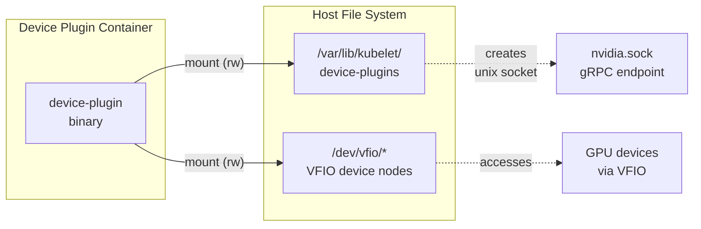

| Volume Name | Host Path | Container Mount | Purpose |
|------------|-----------|-----------------|---------|
| `device-plugin` | `/var/lib/kubelet/device-plugins` | `/var/lib/kubelet/device-plugins` | Creates gRPC socket for Kubelet communication |
| `vfio` | `/dev/vfio` | `/dev/vfio` | Accesses VFIO device nodes for GPU discovery and health checks |

**Sources**: [manifests/nvidia-kubevirt-gpu-device-plugin.yaml:28-39]()

### Deploying the DaemonSet

Apply the DaemonSet manifest to deploy the device plugin:

```bash
kubectl apply -f manifests/nvidia-kubevirt-gpu-device-plugin.yaml
```

The DaemonSet will automatically create device plugin pods on all nodes in the cluster. Pods will only successfully initialize on nodes that have GPUs configured with VFIO-PCI drivers or vGPU mdev devices.

**Sources**: [README.md:175-179]()

## Step 3: Verify Installation

### Check Pod Status

Verify that device plugin pods are running on GPU-enabled nodes:

```bash
kubectl get pods -n kube-system -l name=nvidia-kubevirt-gpu-dp-ds
```

Expected output:
```
NAME                                     READY   STATUS    RESTARTS   AGE
nvidia-kubevirt-gpu-dp-daemonset-abcd1   1/1     Running   0          2m
nvidia-kubevirt-gpu-dp-daemonset-xyz99   1/1     Running   0          2m
```

Check pod logs for successful device discovery and registration:

```bash
kubectl logs -n kube-system -l name=nvidia-kubevirt-gpu-dp-ds
```

Expected log entries indicating successful operation:
- Device discovery messages showing detected GPUs
- Device plugin registration with Kubelet
- ListAndWatch gRPC stream established

**Sources**: [README.md:175-179](), [manifests/nvidia-kubevirt-gpu-device-plugin.yaml:8-13]()

### Verify Node Capacity

Confirm that GPU resources are advertised on nodes:

```bash
kubectl get node <node-name> -o json | jq '.status.capacity'
```

Expected output showing GPU resources:
```json
{
  "cpu": "8",
  "memory": "32Gi",
  "nvidia.com/TU104GL_Tesla_T4": "1",
  "nvidia.com/GRID_T4-1Q": "4",
  "pods": "110"
}
```

The resource names (e.g., `nvidia.com/TU104GL_Tesla_T4`, `nvidia.com/GRID_T4-1Q`) should match the `resourceName` values configured in the KubeVirt CR's `permittedHostDevices` section.

**Sources**: [examples/kubevirt-featuregate-cm.yaml:14,18]()

### Resource Name Verification

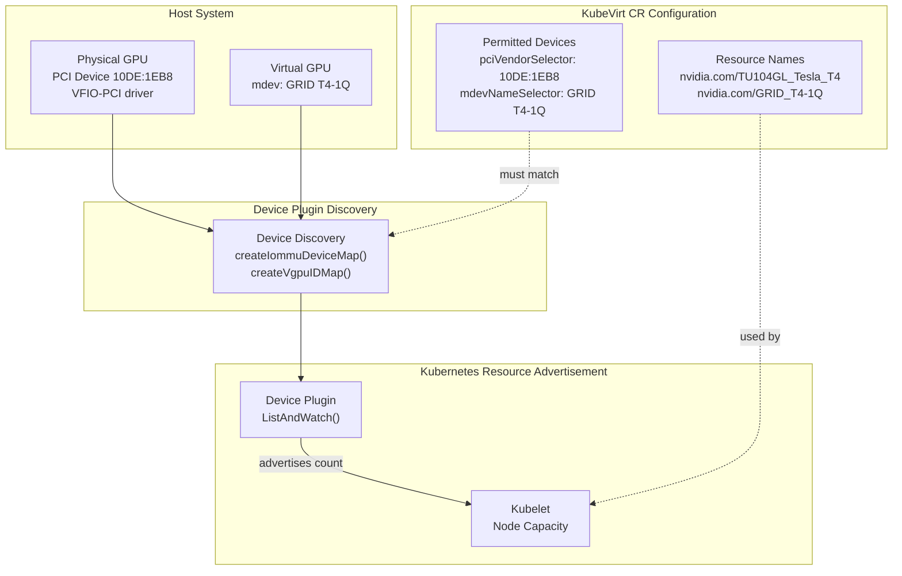

The device plugin constructs resource names from PCI vendor/device IDs and vGPU type names. These resource names must be explicitly whitelisted in the KubeVirt CR for VMs to request them.

**Sources**: [examples/kubevirt-featuregate-cm.yaml:11-18](), [README.md:32]()

## Resource Name Format

The device plugin generates Kubernetes resource names following these patterns:

### Physical GPU Resource Names

Format: `nvidia.com/<DEVICE_NAME>`

The device name is resolved from the PCI IDs database using the vendor and device ID. For example:
- PCI ID `10DE:1EB8` → Device name `TU104GL_Tesla_T4` → Resource name `nvidia.com/TU104GL_Tesla_T4`

### Virtual GPU Resource Names

Format: `nvidia.com/<VGPU_TYPE_NAME>`

The vGPU type name is read from the mdev device's `name` attribute. Spaces in the type name are replaced with underscores. For example:
- vGPU type `GRID T4-1Q` → Resource name `nvidia.com/GRID_T4-1Q`

**Sources**: [examples/kubevirt-featuregate-cm.yaml:14,18](), [README.md:17-18]()

## Troubleshooting Installation

### Common Issues

| Symptom | Possible Cause | Resolution |
|---------|---------------|------------|
| Pods stuck in `CrashLoopBackOff` | GPUs not configured with VFIO-PCI driver | Verify VFIO-PCI driver binding per [Prerequisites and Host Setup](#2.1) |
| No GPU resources in node capacity | KubeVirt CR not configured | Ensure `permittedHostDevices` matches discovered devices |
| VMs fail to start with GPUs | Resource names mismatch | Verify `resourceName` in KubeVirt CR matches what device plugin advertises |
| Pods not scheduled | Node selectors or taints | Check DaemonSet tolerations and node labels |

### Viewing Detailed Logs

Enable verbose logging by modifying the device plugin container arguments:

```yaml
containers:
- name: nvidia-kubevirt-gpu-dp-ctr
  args:
  - "-v=4"  # Increase verbosity level
```

**Sources**: [README.md:27-33](), [manifests/nvidia-kubevirt-gpu-device-plugin.yaml:1-40]()

## Next Steps

With the device plugin installed and verified:

1. Create VMs requesting GPU resources using the resource names advertised by the device plugin
2. Monitor GPU allocation and health through device plugin logs
3. Review [Architecture](#3) documentation to understand the system's internal operation

For example VM configurations with GPU allocation, see the `examples/` directory in the repository.

**Sources**: [README.md:181]()

---

# Page: Architecture

# Architecture

<details>
<summary>Relevant source files</summary>

The following files were used as context for generating this wiki page:

- [manifests/nvidia-kubevirt-gpu-device-plugin.yaml](manifests/nvidia-kubevirt-gpu-device-plugin.yaml)
- [pkg/device_plugin/device_plugin.go](pkg/device_plugin/device_plugin.go)
- [pkg/device_plugin/device_plugin_test.go](pkg/device_plugin/device_plugin_test.go)
- [pkg/device_plugin/generic_device_plugin.go](pkg/device_plugin/generic_device_plugin.go)
- [pkg/device_plugin/generic_vgpu_device_plugin.go](pkg/device_plugin/generic_vgpu_device_plugin.go)

</details>


## Purpose and Scope

This document provides a comprehensive technical overview of the NVIDIA KubeVirt GPU Device Plugin's internal architecture and design. It covers the core components, their interactions, and the technical implementation that enables GPU passthrough and vGPU support for KubeVirt virtual machines within Kubernetes clusters.

For installation and deployment procedures, see [Getting Started](#2). For detailed subsystem documentation, see the following child pages:
- System architecture overview: [System Architecture Overview](#3.1)
- Device discovery mechanisms: [Device Discovery and Mapping](#3.2)
- Physical GPU management: [Physical GPU Device Plugin](#3.3)
- Virtual GPU management: [Virtual GPU Device Plugin](#3.4)
- Kubernetes API integration: [Kubernetes Integration](#3.5)
- Observability infrastructure: [Logging and Observability](#3.6)

---

## Architectural Overview

The device plugin operates as a Kubernetes DaemonSet pod on GPU-enabled nodes, implementing the Kubernetes Device Plugin API v1beta1 to advertise GPU resources and handle allocation requests. The system supports both physical GPU passthrough via VFIO-PCI and virtual GPU (vGPU) allocation via Linux mdev subsystem.

### Core Components

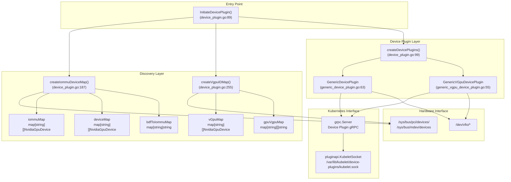

**Sources:** [pkg/device_plugin/device_plugin.go:89-176](), [pkg/device_plugin/generic_device_plugin.go:63-90](), [pkg/device_plugin/generic_vgpu_device_plugin.go:55-81]()

---

## Data Structures and Mapping

The system maintains several critical maps to track GPU devices, their IOMMU groups, and relationships between physical and virtual GPUs:

| Map Variable | Type | Purpose | Source |
|--------------|------|---------|--------|
| `iommuMap` | `map[string][]NvidiaGpuDevice` | IOMMU group ID → GPU devices in that group | [device_plugin.go:56]() |
| `deviceMap` | `map[string][]NvidiaGpuDevice` | GPU device ID → all GPUs of that type | [device_plugin.go:59]() |
| `bdfToIommuMap` | `map[string]string` | PCI BDF address → IOMMU group ID | [device_plugin.go:62]() |
| `vGpuMap` | `map[string][]NvidiaGpuDevice` | vGPU type → vGPU devices of that type | [device_plugin.go:65]() |
| `gpuVgpuMap` | `map[string][]string` | GPU device ID → associated vGPU IDs | [device_plugin.go:68]() |

### NvidiaGpuDevice Structure

```go
type NvidiaGpuDevice struct {
    addr     string // PCI address (e.g., "0000:03:00.0")
    numaNode int64  // NUMA node ID for topology-aware scheduling
}
```

**Sources:** [pkg/device_plugin/device_plugin.go:49-68]()

---

## Device Discovery Process

Device discovery occurs at startup through two parallel scanning operations:

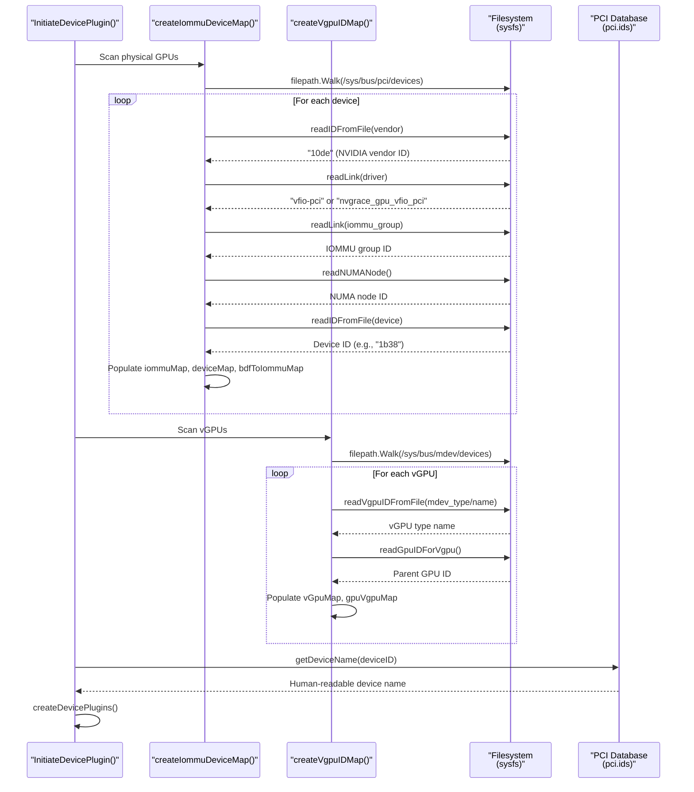

**Sources:** [pkg/device_plugin/device_plugin.go:89-96](), [pkg/device_plugin/device_plugin.go:187-247](), [pkg/device_plugin/device_plugin.go:255-291](), [pkg/device_plugin/device_plugin.go:371-438]()

### Discovery Functions

| Function | Path | Purpose |
|----------|------|---------|
| `createIommuDeviceMap()` | [device_plugin.go:187-247]() | Scans `/sys/bus/pci/devices`, identifies NVIDIA GPUs with VFIO drivers, maps to IOMMU groups |
| `createVgpuIDMap()` | [device_plugin.go:255-291]() | Scans `/sys/bus/mdev/devices`, identifies vGPU instances, links to parent GPUs |
| `readIDFromFileFunc()` | [device_plugin.go:294-302]() | Reads vendor/device IDs from sysfs |
| `readLinkFunc()` | [device_plugin.go:323-331]() | Resolves symlinks for driver and IOMMU group |
| `readNUMANodeFunc()` | [device_plugin.go:304-320]() | Reads NUMA topology information |
| `readVgpuIDFromFileFunc()` | [device_plugin.go:334-344]() | Extracts vGPU type name |
| `getDeviceName()` | [device_plugin.go:371-422]() | Resolves device ID to human-readable name from pci.ids database |

**Sources:** [pkg/device_plugin/device_plugin.go:187-438]()

---

## Dual Device Plugin Architecture

The system instantiates separate device plugin instances for each discovered GPU type and vGPU type. Each plugin operates independently with its own gRPC server and socket.

```mermaid
graph LR
    subgraph "Physical GPU Plugins"
        GDP1["GenericDevicePlugin<br/>nvidia.com/TESLA_V100_PCIE_32GB"]
        GDP2["GenericDevicePlugin<br/>nvidia.com/A100_PCIE_40GB"]
    end
    
    subgraph "vGPU Plugins"
        GVDP1["GenericVGpuDevicePlugin<br/>nvidia.com/GRID_V100D_8Q"]
        GVDP2["GenericVGpuDevicePlugin<br/>nvidia.com/GRID_A100D_10Q"]
    end
    
    subgraph "Kubelet Sockets"
        SOCK1["/var/lib/kubelet/device-plugins/<br/>kubevirt-TESLA_V100_PCIE_32GB.sock"]
        SOCK2["/var/lib/kubelet/device-plugins/<br/>kubevirt-A100_PCIE_40GB.sock"]
        SOCK3["/var/lib/kubelet/device-plugins/<br/>kubevirt-GRID_V100D_8Q.sock"]
        SOCK4["/var/lib/kubelet/device-plugins/<br/>kubevirt-GRID_A100D_10Q.sock"]
    end
    
    GDP1 -.->|gRPC| SOCK1
    GDP2 -.->|gRPC| SOCK2
    GVDP1 -.->|gRPC| SOCK3
    GVDP2 -.->|gRPC| SOCK4
```

### Plugin Instantiation Flow

```mermaid
sequenceDiagram
    participant CDP as "createDevicePlugins()"
    participant DM as "deviceMap/vGpuMap"
    participant GDP as "GenericDevicePlugin"
    participant GVDP as "GenericVGpuDevicePlugin"
    participant Start as "Start()"
    
    CDP->>DM: Iterate over deviceMap
    loop For each GPU type
        CDP->>CDP: Build pluginapi.Device list with NUMA topology
        CDP->>GDP: NewGenericDevicePlugin(deviceName, /dev/vfio/, devs)
        GDP-->>CDP: device plugin instance
        CDP->>Start: startDevicePlugin(dp)
        Start->>Start: Start gRPC server, register with kubelet
    end
    
    CDP->>DM: Iterate over vGpuMap
    loop For each vGPU type
        CDP->>CDP: Build pluginapi.Device list with NUMA topology
        CDP->>GVDP: NewGenericVGpuDevicePlugin(deviceName, basePath, devs)
        GVDP-->>CDP: vGPU device plugin instance
        CDP->>Start: startVgpuDevicePlugin(dp)
        Start->>Start: Start gRPC server, register with kubelet
    end
    
    CDP->>CDP: Block on stop channel
```

**Sources:** [pkg/device_plugin/device_plugin.go:99-176](), [pkg/device_plugin/generic_device_plugin.go:77-90](), [pkg/device_plugin/generic_vgpu_device_plugin.go:68-81]()

---

## Kubernetes Device Plugin API Implementation

Both `GenericDevicePlugin` and `GenericVGpuDevicePlugin` implement the `pluginapi.DevicePluginServer` interface, providing the following methods:

### Device Plugin Methods

| Method | GenericDevicePlugin | GenericVGpuDevicePlugin | Purpose |
|--------|---------------------|-------------------------|---------|
| `Register()` | [generic_device_plugin.go:202-223]() | [generic_vgpu_device_plugin.go:156-175]() | Registers with kubelet via gRPC |
| `ListAndWatch()` | [generic_device_plugin.go:226-263]() | [generic_vgpu_device_plugin.go:178-206]() | Streams device list and health updates |
| `Allocate()` | [generic_device_plugin.go:266-361]() | [generic_vgpu_device_plugin.go:209-247]() | Handles device allocation requests |
| `GetDevicePluginOptions()` | [generic_device_plugin.go:371-377]() | [generic_vgpu_device_plugin.go:257-262]() | Returns plugin capabilities |
| `GetPreferredAllocation()` | [generic_device_plugin.go:387-525]() | [generic_vgpu_device_plugin.go:270-278]() | Provides NUMA-aware allocation hints |
| `PreStartContainer()` | [generic_device_plugin.go:379-382]() | [generic_vgpu_device_plugin.go:264-267]() | Pre-start hook (no-op) |

**Sources:** [pkg/device_plugin/generic_device_plugin.go:63-634](), [pkg/device_plugin/generic_vgpu_device_plugin.go:55-438]()

---

## Physical GPU Allocation Flow

The `GenericDevicePlugin.Allocate()` method performs validation and constructs device specifications for physical GPU allocation:

```mermaid
sequenceDiagram
    participant Kubelet as "Kubelet"
    participant GDP as "GenericDevicePlugin.Allocate()"
    participant Maps as "iommuMap, bdfToIommuMap"
    participant FS as "Filesystem"
    
    Kubelet->>GDP: AllocateRequest(DeviceIDs=[BDF1, BDF2])
    
    GDP->>GDP: supportsIOMMUFD()
    GDP->>FS: Check /dev/iommu existence
    FS-->>GDP: iommufdSupported bool
    
    loop For each requested BDF
        GDP->>Maps: bdfToIommuMap[bdf]
        Maps-->>GDP: IOMMU group ID
        
        GDP->>Maps: iommuMap[iommuGroupID]
        Maps-->>GDP: []NvidiaGpuDevice
        
        loop For each device in IOMMU group
            GDP->>FS: readLink(basePath, dev.addr, "iommu_group")
            FS-->>GDP: Verify IOMMU group unchanged
            
            GDP->>FS: readIDFromFile(basePath, dev.addr, "vendor")
            FS-->>GDP: Verify vendor is "10de"
            
            alt iommufdSupported
                GDP->>FS: readVFIODev(basePath, dev.addr)
                FS-->>GDP: vfio device name
                GDP->>GDP: Add /dev/vfio/devices/vfioX to DeviceSpec
            end
        end
        
        GDP->>GDP: Add /dev/vfio/vfio to DeviceSpec
        GDP->>GDP: Add /dev/vfio/{iommuGroupID} to DeviceSpec
        
        alt iommufdSupported
            GDP->>GDP: Add /dev/iommu to DeviceSpec
        end
        
        GDP->>GDP: Build environment variable:<br/>PCI_RESOURCE_NVIDIA_COM_{DEVICE_NAME}
    end
    
    GDP-->>Kubelet: AllocateResponse(Devices, Envs)
```

### Allocation Output

For a physical GPU allocation, the response includes:

**Device Specifications:**
- `/dev/vfio/vfio` - VFIO container device
- `/dev/vfio/{iommuGroupID}` - IOMMU group device (e.g., `/dev/vfio/26`)
- `/dev/vfio/devices/vfioX` - Per-device IOMMUFD device (if supported)
- `/dev/iommu` - IOMMUFD device (if supported)

**Environment Variables:**
- `PCI_RESOURCE_NVIDIA_COM_{DEVICE_NAME}` - Comma-separated list of BDF addresses

**Sources:** [pkg/device_plugin/generic_device_plugin.go:266-361](), [pkg/device_plugin/generic_device_plugin.go:609-633]()

---

## Virtual GPU Allocation Flow

The `GenericVGpuDevicePlugin.Allocate()` method handles vGPU allocation:

```mermaid
sequenceDiagram
    participant Kubelet as "Kubelet"
    participant GVDP as "GenericVGpuDevicePlugin.Allocate()"
    participant FS as "Filesystem"
    
    Kubelet->>GVDP: AllocateRequest(DeviceIDs=[mdev_uuid1, mdev_uuid2])
    
    loop For each mdev UUID
        GVDP->>FS: readVgpuIDFromFile(vGpuBasePath, uuid, "mdev_type/name")
        FS-->>GVDP: vGPU type name
        
        GVDP->>GVDP: Verify vGPU type matches deviceName
        
        GVDP->>GVDP: Add to environment variable:<br/>MDEV_PCI_RESOURCE_NVIDIA_COM_{VGPU_TYPE}
    end
    
    GVDP->>GVDP: Add /dev/vfio to DeviceSpec (entire directory)
    
    GVDP-->>Kubelet: AllocateResponse(Devices, Envs)
```

### Allocation Output

For a vGPU allocation, the response includes:

**Device Specifications:**
- `/dev/vfio` - Entire VFIO directory (mdev devices appear here)

**Environment Variables:**
- `MDEV_PCI_RESOURCE_NVIDIA_COM_{VGPU_TYPE}` - Comma-separated list of mdev UUIDs

**Sources:** [pkg/device_plugin/generic_vgpu_device_plugin.go:209-247]()

---

## NUMA-Aware Allocation

The `GetPreferredAllocation()` method in `GenericDevicePlugin` implements topology-aware device selection to optimize NUMA affinity:

```mermaid
graph TB
    GPA["GetPreferredAllocation()"]
    
    MUST["Process MustIncludeDeviceIDs<br/>(required devices)"]
    TOPO["Build device to NUMA map"]
    GROUP["Group available devices by NUMA node"]
    
    SINGLE{"Can satisfy from<br/>single NUMA node?"}
    
    SELECT_NODE["Select NUMA node with<br/>enough available + selected devices"]
    FILL_NODE["Fill remaining slots<br/>from selected node"]
    
    FALLBACK["Fallback to kubelet-provided<br/>device order"]
    
    RESPONSE["Return preferred device list"]
    
    GPA --> TOPO
    GPA --> MUST
    TOPO --> GROUP
    MUST --> SINGLE
    GROUP --> SINGLE
    
    SINGLE -->|Yes| SELECT_NODE
    SELECT_NODE --> FILL_NODE
    FILL_NODE --> RESPONSE
    
    SINGLE -->|No| FALLBACK
    FALLBACK --> RESPONSE
```

### Algorithm Details

1. **Build NUMA topology map**: Extract NUMA node ID from each device's `Topology.Nodes[0].ID`
2. **Process must-include devices**: Add all required devices first, preserving order
3. **Attempt single-node allocation**: Try to find a NUMA node with sufficient devices (including already selected)
4. **Fill from selected node**: If a suitable node found, add remaining devices from that node
5. **Fallback**: If no single node can satisfy, use kubelet's original device order

**Sources:** [pkg/device_plugin/generic_device_plugin.go:387-525]()

---

## Health Monitoring

Both device plugin types implement continuous health monitoring through goroutines started in `Start()`:

### Physical GPU Health Check

```mermaid
graph TB
    HC["healthCheck() goroutine"]
    
    WATCHER["fsnotify.Watcher"]
    WATCH_SOCK["Watch device plugin socket"]
    WATCH_DEV["Watch /dev/vfio/{iommuGroupID}<br/>for each device"]
    
    SELECT["select on channels"]
    
    EVENT_CREATE["fsnotify.Create"]
    EVENT_REMOVE["fsnotify.Remove/Rename"]
    EVENT_SOCK["Socket removed"]
    
    HEALTHY["Send to healthy channel"]
    UNHEALTHY["Send to unhealthy channel"]
    RESTART["Restart device plugin"]
    
    HC --> WATCHER
    WATCHER --> WATCH_SOCK
    WATCHER --> WATCH_DEV
    WATCH_DEV --> SELECT
    WATCH_SOCK --> SELECT
    
    SELECT --> EVENT_CREATE
    SELECT --> EVENT_REMOVE
    SELECT --> EVENT_SOCK
    
    EVENT_CREATE --> HEALTHY
    EVENT_REMOVE --> UNHEALTHY
    EVENT_SOCK --> RESTART
    
    HEALTHY --> UPDATE["Update device health in devs[]"]
    UNHEALTHY --> UPDATE
    UPDATE --> STREAM["Send via ListAndWatch stream"]
```

**Sources:** [pkg/device_plugin/generic_device_plugin.go:528-607]()

### Virtual GPU Health Check

The vGPU health check adds NVML-based XID error monitoring:

```mermaid
graph TB
    VHC["healthCheck() goroutine<br/>(vGPU)"]
    
    NVML_INIT["nvml.Init()"]
    GET_DEVS["getDevices()"]
    WATCH_XID["watchXIDs() goroutine"]
    
    WATCHER["fsnotify.Watcher"]
    WATCH_SOCK["Watch device plugin socket"]
    WATCH_MDEV["Watch /sys/bus/mdev/devices/{uuid}<br/>for each vGPU"]
    
    SELECT["select on channels"]
    
    XID_CHAN["XID error on GPU"]
    MDEV_EVENT["mdev device event"]
    SOCK_EVENT["Socket event"]
    
    MAP_LOOKUP["gpuVgpuMap[GPU.BusID]<br/>Get affected vGPUs"]
    MARK_UNHEALTHY["Mark all vGPUs on GPU unhealthy"]
    
    VHC --> NVML_INIT
    NVML_INIT --> GET_DEVS
    GET_DEVS --> WATCH_XID
    
    VHC --> WATCHER
    WATCHER --> WATCH_SOCK
    WATCHER --> WATCH_MDEV
    
    WATCH_MDEV --> SELECT
    WATCH_SOCK --> SELECT
    WATCH_XID --> SELECT
    
    SELECT --> XID_CHAN
    SELECT --> MDEV_EVENT
    SELECT --> SOCK_EVENT
    
    XID_CHAN --> MAP_LOOKUP
    MAP_LOOKUP --> MARK_UNHEALTHY
    
    MDEV_EVENT --> HANDLE["Handle create/remove events"]
    SOCK_EVENT --> RESTART["Restart device plugin"]
```

### XID Error Monitoring

The `watchXIDs()` function monitors critical GPU errors via NVML:

```go
nvml.RegisterEventForDevice(eventSet, nvml.XidCriticalError, device.UUID)
```

Critical XID errors (excluding application errors 31, 43, 45) trigger marking all vGPUs on the affected physical GPU as unhealthy via the `gpuVgpuMap` lookup.

**Sources:** [pkg/device_plugin/generic_vgpu_device_plugin.go:281-438](), [pkg/device_plugin/generic_vgpu_device_plugin.go:388-437]()

---

## Lifecycle and Registration

```mermaid
stateDiagram-v2
    [*] --> Discovery: InitiateDevicePlugin()
    Discovery --> Creation: createDevicePlugins()
    Creation --> Starting: Start()
    
    Starting --> Cleanup: cleanup() - remove old socket
    Cleanup --> Listen: net.Listen("unix", socketPath)
    Listen --> ServerStart: grpc.NewServer()
    ServerStart --> Register: Register() with kubelet
    Register --> HealthCheck: Start healthCheck() goroutine
    HealthCheck --> Ready: Ready
    
    Ready --> Running: ListAndWatch() streams
    
    Running --> SocketRemoved: Kubelet restart detected
    SocketRemoved --> Restarting: restart()
    Restarting --> Cleanup
    
    Running --> Stopping: Stop channel signal
    Stopping --> [*]
    
    note right of Register
        Via /var/lib/kubelet/device-plugins/kubelet.sock
        Resource: nvidia.com/{DEVICE_NAME}
    end note
    
    note right of HealthCheck
        fsnotify watches device paths
        vGPU: also watches XID errors via NVML
    end note
```

**Sources:** [pkg/device_plugin/generic_device_plugin.go:130-170](), [pkg/device_plugin/generic_device_plugin.go:188-199](), [pkg/device_plugin/generic_device_plugin.go:202-223]()

---

## DaemonSet Deployment Architecture

The device plugin runs as a privileged DaemonSet in the `kube-system` namespace:

```mermaid
graph TB
    subgraph "DaemonSet Pod"
        POD["nvidia-kubevirt-gpu-dp-ctr<br/>Container"]
        
        subgraph "Volume Mounts"
            VOL1["/var/lib/kubelet/device-plugins<br/>(hostPath)"]
            VOL2["/dev/vfio<br/>(hostPath)"]
        end
    end
    
    subgraph "Host"
        KUBELET_DIR["/var/lib/kubelet/device-plugins/<br/>Device plugin sockets"]
        VFIO_DIR["/dev/vfio/<br/>VFIO devices"]
        
        KUBELET["Kubelet process"]
    end
    
    POD --> VOL1
    POD --> VOL2
    
    VOL1 -.->|mounted from| KUBELET_DIR
    VOL2 -.->|mounted from| VFIO_DIR
    
    KUBELET -.->|reads sockets| KUBELET_DIR
    POD -.->|accesses devices| VFIO_DIR
```

### Security Configuration

| Setting | Value | Purpose |
|---------|-------|---------|
| `allowPrivilegeEscalation` | `false` | Prevents privilege escalation |
| `capabilities.drop` | `["ALL"]` | Drops all Linux capabilities |
| `priorityClassName` | `system-node-critical` | Ensures high scheduling priority |
| Tolerations | `CriticalAddonsOnly` | Allows running during maintenance |

**Sources:** [manifests/nvidia-kubevirt-gpu-device-plugin.yaml:1-40]()

---

## Key Constants and Configuration

### Resource Namespaces and Prefixes

```go
const (
    DeviceNamespace   = "nvidia.com"                // Kubernetes resource namespace
    connectionTimeout = 5 * time.Second             // gRPC connection timeout
    vfioDevicePath    = "/dev/vfio"                 // VFIO device directory
    iommuDevicePath   = "/dev/iommu"                // IOMMUFD device
    gpuPrefix         = "PCI_RESOURCE_NVIDIA_COM"   // Physical GPU env var prefix
    vgpuPrefix        = "MDEV_PCI_RESOURCE_NVIDIA_COM" // vGPU env var prefix
    nvidiaVendorID    = "10de"                      // NVIDIA PCI vendor ID
)
```

### Filesystem Paths

| Path | Variable | Purpose |
|------|----------|---------|
| `/sys/bus/pci/devices` | `basePath` | Physical GPU discovery |
| `/sys/bus/mdev/devices` | `vGpuBasePath` | vGPU discovery |
| `/usr/pci.ids` | `pciIdsFilePath` | PCI device name database |
| `/var/lib/kubelet/device-plugins/kubelet.sock` | `pluginapi.KubeletSocket` | Kubelet registration endpoint |
| `/var/lib/kubelet/device-plugins/kubevirt-{NAME}.sock` | Computed | Device plugin socket |

### Supported VFIO Drivers

```go
var supportedVfioDrivers = map[string]struct{}{
    "vfio-pci":             {},  // Standard VFIO-PCI driver
    "nvgrace_gpu_vfio_pci": {},  // NVIDIA Grace GPU VFIO driver
}
```

**Sources:** [pkg/device_plugin/generic_device_plugin.go:50-57](), [pkg/device_plugin/device_plugin.go:45-79]()

---

## Summary

The NVIDIA KubeVirt GPU Device Plugin implements a sophisticated architecture with clear separation of concerns:

1. **Discovery Layer**: Scans sysfs to build comprehensive maps of physical and virtual GPU devices with topology information
2. **Plugin Layer**: Instantiates separate device plugin instances per GPU/vGPU type, each with independent gRPC servers
3. **Allocation Layer**: Validates IOMMU isolation, provides NUMA-aware allocation hints, and constructs device specifications
4. **Health Layer**: Continuously monitors device paths via fsnotify and GPU errors via NVML
5. **Integration Layer**: Implements standard Kubernetes Device Plugin API for seamless kubelet integration

This design enables robust GPU resource management for KubeVirt virtual machines with support for both passthrough and vGPU scenarios, NUMA-aware scheduling, and comprehensive health monitoring.

---

# Page: System Architecture Overview

# System Architecture Overview

<details>
<summary>Relevant source files</summary>

The following files were used as context for generating this wiki page:

- [manifests/nvidia-kubevirt-gpu-device-plugin.yaml](manifests/nvidia-kubevirt-gpu-device-plugin.yaml)
- [pkg/device_plugin/device_plugin.go](pkg/device_plugin/device_plugin.go)
- [pkg/device_plugin/device_plugin_test.go](pkg/device_plugin/device_plugin_test.go)
- [pkg/device_plugin/generic_device_plugin.go](pkg/device_plugin/generic_device_plugin.go)
- [pkg/device_plugin/generic_vgpu_device_plugin.go](pkg/device_plugin/generic_vgpu_device_plugin.go)

</details>


## Purpose and Scope

This document provides a comprehensive technical overview of the NVIDIA KubeVirt GPU Device Plugin's internal architecture. It describes the system's main components, their interactions, and how they collectively enable GPU passthrough and virtual GPU support for KubeVirt virtual machines running on Kubernetes.

For build and deployment details, see [Build System](#4.1) and [Kubernetes Deployment](#4.3). For low-level device discovery mechanisms, see [Device Discovery and Mapping](#3.2). For specific implementation details of the device plugins, see [Physical GPU Device Plugin](#3.3) and [Virtual GPU Device Plugin](#3.4).

---

## High-Level System Architecture

The device plugin operates as a bridge between Kubernetes resource management and NVIDIA GPU hardware. It implements the Kubernetes Device Plugin API v1beta1, runs as a DaemonSet on GPU-enabled nodes, and manages both physical GPU passthrough (via VFIO-PCI) and virtual GPU allocation (via mdev).

```mermaid
graph TB
    subgraph "Kubernetes Node"
        subgraph "Kubelet Process"
            KUBELET["Kubelet<br/>/var/lib/kubelet"]
            DEVPLUG_SOCKET["Device Plugin Socket<br/>/var/lib/kubelet/device-plugins"]
        end
        
        subgraph "Device Plugin DaemonSet Pod"
            MAIN["main.go:InitiateDevicePlugin()"]
            DISC_PHY["device_plugin.go:createIommuDeviceMap()"]
            DISC_VGPU["device_plugin.go:createVgpuIDMap()"]
            CREATE_DP["device_plugin.go:createDevicePlugins()"]
            
            subgraph "Physical GPU Plugin"
                GDP["GenericDevicePlugin"]
                GDP_START["Start()"]
                GDP_REG["Register()"]
                GDP_LAW["ListAndWatch()"]
                GDP_ALLOC["Allocate()"]
                GDP_HEALTH["healthCheck()"]
            end
            
            subgraph "vGPU Plugin"
                GVDP["GenericVGpuDevicePlugin"]
                GVDP_START["Start()"]
                GVDP_REG["Register()"]
                GVDP_LAW["ListAndWatch()"]
                GVDP_ALLOC["Allocate()"]
                GVDP_HEALTH["healthCheck()"]
            end
        end
        
        subgraph "Hardware Layer"
            SYSFS["/sys/bus/pci/devices/<br/>basePath"]
            MDEV["/sys/bus/mdev/devices/<br/>vGpuBasePath"]
            VFIO["/dev/vfio/*"]
            IOMMU["/dev/iommu"]
        end
        
        subgraph "NVIDIA Runtime"
            NVML["NVML Library<br/>gpu-monitoring-tools"]
        end
    end
    
    MAIN --> DISC_PHY
    MAIN --> DISC_VGPU
    MAIN --> CREATE_DP
    
    DISC_PHY --> SYSFS
    DISC_VGPU --> MDEV
    
    CREATE_DP --> GDP
    CREATE_DP --> GVDP
    
    GDP --> GDP_START
    GDP_START --> GDP_REG
    GDP_START --> GDP_HEALTH
    GDP_REG --> DEVPLUG_SOCKET
    
    GVDP --> GVDP_START
    GVDP_START --> GVDP_REG
    GVDP_START --> GVDP_HEALTH
    GVDP_REG --> DEVPLUG_SOCKET
    
    KUBELET --> DEVPLUG_SOCKET
    KUBELET --> GDP_LAW
    KUBELET --> GDP_ALLOC
    KUBELET --> GVDP_LAW
    KUBELET --> GVDP_ALLOC
    
    GDP_ALLOC --> VFIO
    GDP_ALLOC --> IOMMU
    GDP_HEALTH --> VFIO
    
    GVDP_ALLOC --> VFIO
    GVDP_HEALTH --> NVML
    GVDP_HEALTH --> MDEV
```

**Sources:** [pkg/device_plugin/device_plugin.go:89-96](), [pkg/device_plugin/generic_device_plugin.go:63-74](), [pkg/device_plugin/generic_vgpu_device_plugin.go:54-66](), [manifests/nvidia-kubevirt-gpu-device-plugin.yaml:1-40]()

---

## Core Components

### Entry Point and Initialization

The system starts from `InitiateDevicePlugin()` which orchestrates the three-phase startup sequence:

| Phase | Function | Purpose |
|-------|----------|---------|
| 1. Physical GPU Discovery | `createIommuDeviceMap()` | Scans `/sys/bus/pci/devices` for NVIDIA GPUs with VFIO-PCI driver |
| 2. vGPU Discovery | `createVgpuIDMap()` | Scans `/sys/bus/mdev/devices` for mdev devices |
| 3. Plugin Creation | `createDevicePlugins()` | Instantiates and starts device plugin servers |

```mermaid
sequenceDiagram
    participant Main as "main.go"
    participant DP as "device_plugin.go"
    participant FS as "Filesystem"
    participant GDP as "GenericDevicePlugin"
    participant GVDP as "GenericVGpuDevicePlugin"
    
    Main->>DP: InitiateDevicePlugin()
    
    Note over DP,FS: Phase 1: Physical GPU Discovery
    DP->>DP: createIommuDeviceMap()
    DP->>FS: filepath.Walk(basePath)
    FS-->>DP: PCI device info
    DP->>DP: Build iommuMap, deviceMap, bdfToIommuMap
    
    Note over DP,FS: Phase 2: vGPU Discovery
    DP->>DP: createVgpuIDMap()
    DP->>FS: filepath.Walk(vGpuBasePath)
    FS-->>DP: mdev device info
    DP->>DP: Build vGpuMap, gpuVgpuMap
    
    Note over DP,GVDP: Phase 3: Device Plugin Creation
    DP->>DP: createDevicePlugins()
    loop For each GPU type in deviceMap
        DP->>GDP: NewGenericDevicePlugin(deviceName, devs)
        DP->>GDP: Start(stop)
        GDP-->>DP: Started
    end
    loop For each vGPU type in vGpuMap
        DP->>GVDP: NewGenericVGpuDevicePlugin(deviceName, devs)
        DP->>GVDP: Start(stop)
        GVDP-->>DP: Started
    end
```

**Sources:** [pkg/device_plugin/device_plugin.go:89-96](), [pkg/device_plugin/device_plugin.go:99-176](), [pkg/device_plugin/device_plugin.go:187-247](), [pkg/device_plugin/device_plugin.go:254-291]()

### Device Discovery Subsystem

The discovery subsystem maintains five global maps that represent the GPU topology:

| Map Variable | Type | Purpose |
|--------------|------|---------|
| `iommuMap` | `map[string][]NvidiaGpuDevice` | Maps IOMMU group ID → GPU devices in that group |
| `deviceMap` | `map[string][]NvidiaGpuDevice` | Maps GPU device ID (e.g., "1b80") → GPU devices of that type |
| `bdfToIommuMap` | `map[string]string` | Maps PCI BDF (Bus:Device.Function) → IOMMU group ID |
| `vGpuMap` | `map[string][]NvidiaGpuDevice` | Maps vGPU type name → vGPU devices of that type |
| `gpuVgpuMap` | `map[string][]string` | Maps GPU ID → list of associated vGPU device addresses |

The `NvidiaGpuDevice` struct stores device metadata:

```
type NvidiaGpuDevice struct {
    addr     string  // PCI address (e.g., "0000:03:00.0") or mdev UUID
    numaNode int64   // NUMA node ID for topology-aware allocation
}
```

**Discovery Process for Physical GPUs:**

```mermaid
graph LR
    START["createIommuDeviceMap()"] --> WALK["filepath.Walk(basePath)"]
    WALK --> CHECK_VENDOR["readIDFromFile('vendor')"]
    CHECK_VENDOR --> IS_NVIDIA{"vendor == '10de'?"}
    IS_NVIDIA -->|No| SKIP["Skip device"]
    IS_NVIDIA -->|Yes| CHECK_DRIVER["readLink('driver')"]
    CHECK_DRIVER --> IS_VFIO{"isSupportedVfioDriver()?"}
    IS_VFIO -->|No| SKIP
    IS_VFIO -->|Yes| GET_IOMMU["readLink('iommu_group')"]
    GET_IOMMU --> GET_NUMA["readNUMANode()"]
    GET_NUMA --> GET_DEVID["readIDFromFile('device')"]
    GET_DEVID --> UPDATE_MAPS["Update iommuMap,<br/>deviceMap,<br/>bdfToIommuMap"]
```

**Sources:** [pkg/device_plugin/device_plugin.go:45-87](), [pkg/device_plugin/device_plugin.go:187-247](), [pkg/device_plugin/device_plugin.go:254-291](), [pkg/device_plugin/device_plugin.go:294-331]()

### Device Plugin Implementations

Both `GenericDevicePlugin` and `GenericVGpuDevicePlugin` implement the Kubernetes Device Plugin API by satisfying these gRPC service methods:

| Method | Physical GPU (`GenericDevicePlugin`) | vGPU (`GenericVGpuDevicePlugin`) |
|--------|--------------------------------------|----------------------------------|
| `GetDevicePluginOptions()` | Returns `GetPreferredAllocationAvailable: true` | Returns default options |
| `ListAndWatch()` | Streams device list with NUMA topology | Streams device list with NUMA topology |
| `GetPreferredAllocation()` | NUMA-aware allocation algorithm | Not implemented (returns nil) |
| `Allocate()` | Returns VFIO device specs and IOMMU group mounts | Returns VFIO device path and env vars |
| `PreStartContainer()` | No-op | No-op |

**Physical GPU Plugin Structure:**

```mermaid
classDiagram
    class GenericDevicePlugin {
        +devs []*pluginapi.Device
        +server *grpc.Server
        +socketPath string
        +stop chan struct{}
        +term chan bool
        +healthy chan string
        +unhealthy chan string
        +devicePath string
        +deviceName string
        
        +Start(stop) error
        +Stop() error
        +Register() error
        +ListAndWatch() error
        +Allocate() (*AllocateResponse, error)
        +GetPreferredAllocation() (*PreferredAllocationResponse, error)
        +healthCheck() error
    }
    
    class GenericVGpuDevicePlugin {
        +devs []*pluginapi.Device
        +server *grpc.Server
        +socketPath string
        +stop chan struct{}
        +term chan bool
        +healthy chan string
        +unhealthy chan string
        +devicePath string
        +deviceName string
        
        +Start(stop) error
        +Stop() error
        +Register() error
        +ListAndWatch() error
        +Allocate() (*AllocateResponse, error)
        +healthCheck() error
    }
    
    class Device_Plugin_API {
        <<interface>>
        +GetDevicePluginOptions()
        +ListAndWatch()
        +Allocate()
        +GetPreferredAllocation()
        +PreStartContainer()
    }
    
    GenericDevicePlugin ..|> Device_Plugin_API
    GenericVGpuDevicePlugin ..|> Device_Plugin_API
```

**Sources:** [pkg/device_plugin/generic_device_plugin.go:63-74](), [pkg/device_plugin/generic_vgpu_device_plugin.go:54-66](), [pkg/device_plugin/generic_device_plugin.go:371-377](), [pkg/device_plugin/generic_vgpu_device_plugin.go:257-262]()

### Kubernetes Integration Layer

The device plugins communicate with Kubelet through Unix domain sockets using gRPC:

```mermaid
graph TB
    subgraph "Device Plugin"
        SOCK_PATH["socketPath<br/>/var/lib/kubelet/device-plugins/kubevirt-{deviceName}.sock"]
        GRPC_SERVER["grpc.Server"]
        REG_FUNC["Register()"]
        LAW_FUNC["ListAndWatch()"]
        ALLOC_FUNC["Allocate()"]
    end
    
    subgraph "Kubelet"
        KUBELET_SOCK["pluginapi.KubeletSocket<br/>/var/lib/kubelet/device-plugins/kubelet.sock"]
        REG_CLIENT["RegistrationClient"]
        DP_CLIENT["DevicePluginClient"]
    end
    
    subgraph "Registration Flow"
        REG_FUNC -->|connect()| KUBELET_SOCK
        KUBELET_SOCK --> REG_CLIENT
        REG_CLIENT -->|RegisterRequest| REG_FUNC
    end
    
    subgraph "Device Advertisement Flow"
        DP_CLIENT -->|gRPC| SOCK_PATH
        SOCK_PATH --> GRPC_SERVER
        GRPC_SERVER --> LAW_FUNC
        LAW_FUNC -->|ListAndWatchResponse| DP_CLIENT
    end
    
    subgraph "Allocation Flow"
        DP_CLIENT -->|AllocateRequest| GRPC_SERVER
        GRPC_SERVER --> ALLOC_FUNC
        ALLOC_FUNC -->|AllocateResponse| DP_CLIENT
    end
```

**Registration Details:**

Each device plugin registers with Kubelet using a resource name in the format `nvidia.com/{deviceName}`. The `deviceName` is derived from the PCI device ID by looking it up in `/usr/pci.ids` via `getDeviceName()`:

1. Opens `pciIdsFilePath` (`/usr/pci.ids`)
2. Calls `locateVendor()` to find NVIDIA vendor section (ID: `10de`)
3. Searches for device ID (e.g., `1b80`)
4. Transforms device name to uppercase, replaces spaces/special chars with underscores
5. Returns formatted name (e.g., `GK104GL_GRID_K520`)

**Sources:** [pkg/device_plugin/generic_device_plugin.go:201-223](), [pkg/device_plugin/generic_device_plugin.go:129-170](), [pkg/device_plugin/device_plugin.go:371-438](), [pkg/device_plugin/generic_device_plugin.go:50-57]()

---

## Deployment Architecture

The device plugin runs as a DaemonSet in the `kube-system` namespace with the following characteristics:

| Configuration | Value | Purpose |
|---------------|-------|---------|
| **Namespace** | `kube-system` | System-level component |
| **Priority Class** | `system-node-critical` | Ensures scheduling during resource pressure |
| **Security Context** | `allowPrivilegeEscalation: false`, `drop: ["ALL"]` | Minimal privileges |
| **Volume Mounts** | `/var/lib/kubelet/device-plugins` (RW) | Device plugin socket communication |
|                 | `/dev/vfio` (RW) | VFIO device access |
| **Tolerations** | `CriticalAddonsOnly` | Runs on tainted nodes |

```mermaid
graph TB
    subgraph "Kubernetes Cluster"
        subgraph "kube-system Namespace"
            DS["DaemonSet<br/>nvidia-kubevirt-gpu-dp-daemonset"]
        end
        
        subgraph "Node 1 (GPU)"
            POD1["Pod<br/>nvidia-kubevirt-gpu-dp-ctr"]
            VOL1_DP["/var/lib/kubelet/device-plugins"]
            VOL1_VFIO["/dev/vfio"]
        end
        
        subgraph "Node 2 (GPU)"
            POD2["Pod<br/>nvidia-kubevirt-gpu-dp-ctr"]
            VOL2_DP["/var/lib/kubelet/device-plugins"]
            VOL2_VFIO["/dev/vfio"]
        end
        
        subgraph "Node 3 (No GPU)"
            NO_POD["No pod scheduled"]
        end
    end
    
    DS -->|schedules| POD1
    DS -->|schedules| POD2
    DS -.->|node selector| NO_POD
    
    POD1 --> VOL1_DP
    POD1 --> VOL1_VFIO
    POD2 --> VOL2_DP
    POD2 --> VOL2_VFIO
```

**Container Image:** `nvcr.io/nvidia/kubevirt-gpu-device-plugin:v1.4.0`

**Sources:** [manifests/nvidia-kubevirt-gpu-device-plugin.yaml:1-40]()

---

## State Management and Data Flow

### Global State Variables

The system maintains shared state through package-level variables in `device_plugin.go`:

| Variable | Type | Scope | Purpose |
|----------|------|-------|---------|
| `basePath` | `string` | Discovery | Root path for PCI device enumeration (default: `/sys/bus/pci/devices`) |
| `vGpuBasePath` | `string` | Discovery | Root path for mdev device enumeration (default: `/sys/bus/mdev/devices`) |
| `rootPath` | `string` | System | Root filesystem path (configurable for testing) |
| `pciIdsFilePath` | `string` | Naming | Path to PCI ID database (default: `/usr/pci.ids`) |
| `supportedVfioDrivers` | `map[string]struct{}` | Validation | Set of valid VFIO drivers: `vfio-pci`, `nvgrace_gpu_vfio_pci` |
| `stop` | `chan struct{}` | Lifecycle | Global stop signal for all device plugins |

**Sources:** [pkg/device_plugin/device_plugin.go:70-87]()

### Resource Advertisement Flow

When a device plugin starts, it advertises GPU resources to Kubelet with NUMA topology information:

```mermaid
sequenceDiagram
    participant GDP as "GenericDevicePlugin"
    participant KUBELET as "Kubelet"
    participant API as "K8s API Server"
    participant SCHED as "Scheduler"
    
    GDP->>GDP: Start()
    GDP->>GDP: Register()
    GDP->>KUBELET: RegisterRequest{<br/>  ResourceName: "nvidia.com/DEVICE_NAME"<br/>}
    KUBELET-->>GDP: Registration OK
    
    KUBELET->>GDP: ListAndWatch()
    loop For each device in devs
        Note over GDP: Device{<br/>  ID: PCI_BDF,<br/>  Health: Healthy,<br/>  Topology: {Nodes: [NUMA_ID]}<br/>}
    end
    GDP->>KUBELET: ListAndWatchResponse{Devices}
    
    KUBELET->>API: Update Node Status<br/>Capacity["nvidia.com/DEVICE_NAME": N]
    
    Note over SCHED: Resources now visible<br/>to scheduler
```

**Sources:** [pkg/device_plugin/generic_device_plugin.go:225-263](), [pkg/device_plugin/device_plugin.go:108-123]()

### Allocation and Device Passthrough

The `Allocate()` method performs IOMMU group validation and returns device specifications for container mounting:

**Physical GPU Allocation Logic:**

```mermaid
graph TD
    START["Allocate(reqs)"] --> CHECK_IOMMUFD["supportsIOMMUFD()"]
    CHECK_IOMMUFD --> LOOP_REQS["For each ContainerRequest"]
    LOOP_REQS --> LOOP_DEVS["For each requested device BDF"]
    LOOP_DEVS --> GET_IOMMU["Lookup bdfToIommuMap[bdf]"]
    GET_IOMMU --> GET_GROUP["Lookup iommuMap[iommuId]"]
    GET_GROUP --> VALIDATE["Validate all devices<br/>in IOMMU group"]
    VALIDATE --> CHECK_VENDOR["readIDFromFile('vendor')"]
    CHECK_VENDOR --> VENDOR_OK{"vendor == '10de'?"}
    VENDOR_OK -->|No| ERROR["Return error"]
    VENDOR_OK -->|Yes| CHECK_GROUP["readLink('iommu_group')"]
    CHECK_GROUP --> GROUP_OK{"group unchanged?"}
    GROUP_OK -->|No| ERROR
    GROUP_OK -->|Yes| BUILD_SPECS["Build DeviceSpec list"]
    BUILD_SPECS --> ADD_VFIO_VFIO["Add /dev/vfio/vfio"]
    ADD_VFIO_VFIO --> ADD_VFIO_GROUP["Add /dev/vfio/{iommuId}"]
    ADD_VFIO_GROUP --> IOMMUFD{"iommufdSupported?"}
    IOMMUFD -->|Yes| ADD_IOMMUFD["Add /dev/iommu"]
    IOMMUFD -->|No| BUILD_ENV["Build environment vars"]
    ADD_IOMMUFD --> ADD_VFIO_DEVICES["Add /dev/vfio/devices/vfio*"]
    ADD_VFIO_DEVICES --> BUILD_ENV
    BUILD_ENV --> ENV_KEY["Key: PCI_RESOURCE_NVIDIA_COM_{DEVICE_NAME}"]
    ENV_KEY --> ENV_VAL["Value: comma-separated BDFs"]
    ENV_VAL --> RETURN["Return AllocateResponse"]
```

**Environment Variables Set:**

For physical GPUs: `PCI_RESOURCE_NVIDIA_COM_{DEVICE_NAME}` = comma-separated list of PCI BDFs

For vGPUs: `MDEV_PCI_RESOURCE_NVIDIA_COM_{DEVICE_NAME}` = comma-separated list of mdev UUIDs

**Sources:** [pkg/device_plugin/generic_device_plugin.go:266-361](), [pkg/device_plugin/generic_vgpu_device_plugin.go:209-247](), [pkg/device_plugin/generic_device_plugin.go:609-633]()

---

## Health Monitoring

Both device plugin implementations continuously monitor device health using `fsnotify` watchers and respond to device state changes.

### Physical GPU Health Monitoring

The `healthCheck()` method for `GenericDevicePlugin`:

1. Creates an `fsnotify.Watcher`
2. Watches device plugin socket path (detects Kubelet restarts)
3. For each device, watches `/dev/vfio/{iommuGroupId}`
4. On `fsnotify.Remove` or `fsnotify.Rename` → marks device unhealthy
5. On `fsnotify.Create` → marks device healthy
6. Sends health updates via `healthy`/`unhealthy` channels to `ListAndWatch()`

### vGPU Health Monitoring

The `healthCheck()` method for `GenericVGpuDevicePlugin` adds NVML-based XID error monitoring:

1. Initializes NVML: `nvmlInit()`
2. Gets all GPU devices: `nvmlGetDeviceCount()`, `nvmlNewDeviceLite()`
3. Spawns `watchXIDs()` goroutine to monitor XID critical errors
4. Watches `/sys/bus/mdev/devices/{vgpuUUID}` with fsnotify
5. On XID error → looks up affected vGPUs via `gpuVgpuMap` and marks them unhealthy
6. On filesystem events → marks vGPU healthy/unhealthy as appropriate

**XID Error Handling:**

```mermaid
sequenceDiagram
    participant NVML as "NVML EventSet"
    participant WATCH as "watchXIDs()"
    participant HEALTH as "healthCheck()"
    participant LAW as "ListAndWatch()"
    
    WATCH->>NVML: RegisterEventForDevice(XidCriticalError)
    
    loop Continuous Monitoring
        NVML->>WATCH: WaitForEvent(5000ms)
        alt XID Critical Error (not 31, 43, 45)
            WATCH->>WATCH: Identify device by UUID
            WATCH->>HEALTH: Send device on xids channel
            HEALTH->>HEALTH: Lookup gpuVgpuMap[device.PCI.BusID]
            loop For each vGPU
                HEALTH->>LAW: Send vGPU ID on unhealthy channel
                LAW->>LAW: Update device.Health = Unhealthy
                LAW->>LAW: Send ListAndWatchResponse
            end
        end
    end
```

**Sources:** [pkg/device_plugin/generic_device_plugin.go:528-607](), [pkg/device_plugin/generic_vgpu_device_plugin.go:281-368](), [pkg/device_plugin/generic_vgpu_device_plugin.go:388-437]()

---

## NUMA-Aware Allocation

The `GetPreferredAllocation()` method implements NUMA-aware device selection for physical GPUs to optimize performance:

**Algorithm:**

1. Build `deviceToNUMA` map from device topology information
2. Group available devices by NUMA node
3. Add all `MustIncludeDeviceIDs` first (preserving order)
4. Try to fill remaining allocation from a single NUMA node:
   - First check NUMA nodes that already have selected devices
   - Then check other NUMA nodes in discovery order
   - Select the first node with enough total devices (selected + available)
5. If no single NUMA node can satisfy the request, fall back to kubelet-provided order
6. Return `PreferredAllocationResponse` with device IDs

**Example:** Request for 2 GPUs with `MustIncludeDeviceIDs: ["gpu2"]` on NUMA node 1:
- Selects `gpu2` (required)
- Checks NUMA node 1 for additional devices
- Finds `gpu3` also on NUMA node 1
- Returns `["gpu2", "gpu3"]` for optimal NUMA locality

**Sources:** [pkg/device_plugin/generic_device_plugin.go:387-525](), [pkg/device_plugin/device_plugin_test.go:438-533]()

---

## Summary

The NVIDIA KubeVirt GPU Device Plugin architecture consists of:

- **Entry Point**: `InitiateDevicePlugin()` orchestrates discovery and plugin instantiation
- **Discovery Layer**: Scans sysfs/mdev, builds IOMMU and device maps, resolves names from PCI database
- **Device Plugins**: Separate implementations for physical GPUs and vGPUs implementing Kubernetes Device Plugin API
- **Kubernetes Integration**: gRPC servers registered via Unix sockets with Kubelet
- **Health Monitoring**: fsnotify-based device monitoring plus NVML XID error detection for vGPUs
- **NUMA Awareness**: Topology-aware allocation algorithm for optimal performance
- **Deployment**: DaemonSet with minimal security context, hostPath volume mounts for device access

The system maintains clear separation between discovery (reading filesystem state), management (tracking device health), and integration (exposing resources to Kubernetes), enabling robust GPU resource management for KubeVirt virtual machines.

---

# Page: Device Discovery and Mapping

# Device Discovery and Mapping

<details>
<summary>Relevant source files</summary>

The following files were used as context for generating this wiki page:

- [pkg/device_plugin/device_plugin.go](pkg/device_plugin/device_plugin.go)
- [pkg/device_plugin/device_plugin_test.go](pkg/device_plugin/device_plugin_test.go)
- [utils/pci.ids](utils/pci.ids)

</details>


This document describes how the NVIDIA KubeVirt GPU Device Plugin discovers physical GPUs and virtual GPUs (vGPUs) on the host system, maps them to appropriate data structures, and resolves human-readable device names. This discovery process occurs during device plugin initialization and forms the foundation for subsequent resource advertisement to Kubelet.

For information about how discovered devices are registered with Kubernetes, see [Kubernetes Integration](#3.5). For details on physical GPU device plugin implementation, see [Physical GPU Device Plugin](#3.3). For vGPU management, see [Virtual GPU Device Plugin](#3.4).

## Overview

The device discovery and mapping subsystem performs three primary functions:

1. **Physical GPU Discovery** - Scans PCI devices to identify NVIDIA GPUs bound to VFIO drivers
2. **Virtual GPU Discovery** - Scans mdev devices to identify configured vGPU instances
3. **Device Name Resolution** - Translates hardware device IDs to human-readable names using the PCI IDs database

The entry point is `InitiateDevicePlugin()` [pkg/device_plugin/device_plugin.go:89-96](), which orchestrates the discovery sequence and subsequently creates device plugin instances.

Sources: [pkg/device_plugin/device_plugin.go:89-96]()

## Discovery Flow

```mermaid
sequenceDiagram
    participant Main as InitiateDevicePlugin()
    participant IOMMU as createIommuDeviceMap()
    participant VGPU as createVgpuIDMap()
    participant DP as createDevicePlugins()
    participant FS as File System
    participant PCI as pci.ids Database

    Main->>IOMMU: Discover physical GPUs
    IOMMU->>FS: Walk /sys/bus/pci/devices
    loop For each PCI device
        FS-->>IOMMU: Device path
        IOMMU->>FS: Read vendor ID
        IOMMU->>FS: Read device ID
        IOMMU->>FS: Read driver symlink
        IOMMU->>FS: Read iommu_group symlink
        IOMMU->>FS: Read numa_node
        IOMMU->>IOMMU: Populate deviceMap, iommuMap
    end
    
    Main->>VGPU: Discover virtual GPUs
    VGPU->>FS: Walk /sys/bus/mdev/devices
    loop For each mdev device
        FS-->>VGPU: vGPU device path
        VGPU->>FS: Read mdev_type/name
        VGPU->>FS: Resolve parent GPU
        VGPU->>FS: Read parent numa_node
        VGPU->>VGPU: Populate vGpuMap, gpuVgpuMap
    end
    
    Main->>DP: Create device plugins
    DP->>PCI: Resolve device names
    PCI-->>DP: Human-readable names
    DP->>DP: Instantiate GenericDevicePlugin
    DP->>DP: Instantiate GenericVGpuDevicePlugin
```

**Discovery Sequence**: The system first discovers physical GPUs by scanning the PCI bus, then discovers vGPUs by scanning mdev devices, and finally creates device plugin instances with resolved device names.

Sources: [pkg/device_plugin/device_plugin.go:89-96](), [pkg/device_plugin/device_plugin.go:99-176]()

## Physical GPU Discovery

### Discovery Process

The `createIommuDeviceMap()` function [pkg/device_plugin/device_plugin.go:187-247]() discovers physical NVIDIA GPUs that are bound to VFIO-PCI drivers by scanning the Linux sysfs file system.

```mermaid
graph TD
    Start["createIommuDeviceMap()"]
    Walk["filepath.Walk(basePath)"]
    CheckVendor["readIDFromFile()<br/>Check vendor == 10de"]
    CheckDriver["readLink('driver')<br/>Check VFIO driver"]
    ReadIOMMU["readLink('iommu_group')<br/>Get IOMMU group"]
    ReadDevice["readIDFromFile('device')<br/>Get device ID"]
    ReadNUMA["readNUMANode()<br/>Get NUMA node"]
    PopulateMaps["Populate:<br/>- deviceMap[deviceID]<br/>- iommuMap[iommuGroup]<br/>- bdfToIommuMap[BDF]"]
    
    Start --> Walk
    Walk --> CheckVendor
    CheckVendor -->|"vendorID != 10de"| Walk
    CheckVendor -->|"vendorID == 10de"| CheckDriver
    CheckDriver -->|"Not VFIO"| Walk
    CheckDriver -->|"vfio-pci or<br/>nvgrace_gpu_vfio_pci"| ReadIOMMU
    ReadIOMMU --> ReadDevice
    ReadDevice --> ReadNUMA
    ReadNUMA --> PopulateMaps
    PopulateMaps --> Walk
```

**Physical GPU Discovery Flow**: Scans PCI devices, filters for NVIDIA GPUs with VFIO drivers, and populates multiple mapping data structures.

Sources: [pkg/device_plugin/device_plugin.go:187-247]()

### VFIO Driver Validation

The system supports multiple VFIO driver types defined in `supportedVfioDrivers` [pkg/device_plugin/device_plugin.go:75-78]():

| Driver Name | Purpose |
|-------------|---------|
| `vfio-pci` | Standard VFIO PCI driver for GPU passthrough |
| `nvgrace_gpu_vfio_pci` | NVIDIA Grace-specific VFIO driver |

The `isSupportedVfioDriver()` function [pkg/device_plugin/device_plugin.go:249-252]() validates whether a discovered device uses a supported driver before including it in the device map.

Sources: [pkg/device_plugin/device_plugin.go:75-78](), [pkg/device_plugin/device_plugin.go:249-252]()

### File System Layout

Physical GPU discovery relies on the following sysfs paths:

```
/sys/bus/pci/devices/
├── 0000:00:01.0/
│   ├── vendor          # PCI vendor ID (e.g., "0x10de")
│   ├── device          # PCI device ID (e.g., "0x1b80")
│   ├── driver/         # Symlink to driver (e.g., vfio-pci)
│   ├── iommu_group/    # Symlink to IOMMU group (e.g., ../../kernel/iommu_groups/1)
│   └── numa_node       # NUMA node ID (e.g., "0")
└── 0000:00:02.0/
    └── ...
```

The base path is configurable via `basePath` [pkg/device_plugin/device_plugin.go:70](), which defaults to `/sys/bus/pci/devices`.

Sources: [pkg/device_plugin/device_plugin.go:70](), [pkg/device_plugin/device_plugin.go:192-246]()

### Data Collection

For each discovered NVIDIA GPU, the system collects:

1. **Vendor ID** - Read via `readIDFromFile(basePath, deviceAddress, "vendor")` [pkg/device_plugin/device_plugin.go:202-206]()
   - Must equal `nvidiaVendorID` constant (`"10de"`) [pkg/device_plugin/device_plugin.go:46]()

2. **Driver** - Read via `readLink(basePath, deviceAddress, "driver")` [pkg/device_plugin/device_plugin.go:212-220]()
   - Must be a supported VFIO driver

3. **IOMMU Group** - Read via `readLink(basePath, deviceAddress, "iommu_group")` [pkg/device_plugin/device_plugin.go:221-225]()
   - Used for device isolation validation

4. **Device ID** - Read via `readIDFromFile(basePath, deviceAddress, "device")` [pkg/device_plugin/device_plugin.go:234-238]()
   - Used to identify GPU model

5. **NUMA Node** - Read via `readNUMANode(basePath, deviceAddress)` [pkg/device_plugin/device_plugin.go:226-230]()
   - Used for NUMA-aware scheduling
   - Defaults to 0 if unavailable or set to -1

Sources: [pkg/device_plugin/device_plugin.go:202-243]()

### Helper Functions

#### readIDFromFileFunc

[pkg/device_plugin/device_plugin.go:294-302]()

Reads PCI vendor or device ID from sysfs files. The IDs are stored with `0x` prefix in sysfs, which this function strips by reading from index 2 onwards.

```go
data, err := os.ReadFile(filepath.Join(basePath, deviceAddress, property))
id := strings.Trim(string(data[2:]), "\n")  // Strip "0x" prefix
```

#### readLinkFunc

[pkg/device_plugin/device_plugin.go:323-331]()

Resolves symbolic links for driver and IOMMU group paths, extracting only the basename of the resolved path.

#### readNUMANodeFunc

[pkg/device_plugin/device_plugin.go:304-320]()

Reads the NUMA node from sysfs. If the value is -1 (common when NUMA is disabled), it returns 0 as the default. This ensures devices always have a valid NUMA node for topology-aware scheduling.

Sources: [pkg/device_plugin/device_plugin.go:294-331]()

## Virtual GPU Discovery

### Discovery Process

The `createVgpuIDMap()` function [pkg/device_plugin/device_plugin.go:254-291]() discovers NVIDIA vGPU instances configured through the mdev (Mediated Device) framework.

```mermaid
graph TD
    Start["createVgpuIDMap()"]
    Walk["filepath.Walk(vGpuBasePath)"]
    ReadType["readVgpuIDFromFile()<br/>'mdev_type/name'"]
    ReadGPU["readGpuIDForVgpu()<br/>Resolve parent GPU"]
    ReadNUMA["readNUMANode()<br/>from parent GPU"]
    PopulateMaps["Populate:<br/>- vGpuMap[vGpuType]<br/>- gpuVgpuMap[gpuID]"]
    
    Start --> Walk
    Walk --> ReadType
    ReadType --> ReadGPU
    ReadGPU --> ReadNUMA
    ReadNUMA --> PopulateMaps
    PopulateMaps --> Walk
```

**Virtual GPU Discovery Flow**: Scans mdev devices, reads vGPU type information, resolves parent GPU, and builds vGPU mappings.

Sources: [pkg/device_plugin/device_plugin.go:254-291]()

### mdev File System Layout

Virtual GPU discovery relies on the mdev sysfs paths:

```
/sys/bus/mdev/devices/
├── 12345678-1234-1234-1234-123456789abc/
│   ├── mdev_type/
│   │   └── name         # vGPU type name (e.g., "GRID P100-1B")
│   └── ../../../0000:00:01.0/  # Symlink to parent GPU
└── 87654321-4321-4321-4321-cba987654321/
    └── ...
```

The base path is configurable via `vGpuBasePath` [pkg/device_plugin/device_plugin.go:74](), which defaults to `/sys/bus/mdev/devices`.

Sources: [pkg/device_plugin/device_plugin.go:74](), [pkg/device_plugin/device_plugin.go:259-290]()

### vGPU Type Name Processing

The `readVgpuIDFromFileFunc()` [pkg/device_plugin/device_plugin.go:334-344]() reads the vGPU type name and normalizes it:

1. Reads from `mdev_type/name` file
2. Replaces all whitespace with underscores using regex `\\s+`
3. Returns normalized string (e.g., "GRID P100-1B" → "GRID_P100-1B")

This normalization ensures vGPU type names are valid Kubernetes resource names.

Sources: [pkg/device_plugin/device_plugin.go:334-344]()

### Parent GPU Resolution

The `readGpuIDForVgpuFunc()` [pkg/device_plugin/device_plugin.go:347-357]() resolves the parent physical GPU for each vGPU:

1. Reads the symbolic link of the vGPU device itself
2. Splits the path and extracts the parent GPU's PCI address
3. Returns the PCI BDF (Bus:Device.Function) of the parent GPU

Example: For vGPU path `../../../0000:65:00.0/...`, extracts `0000:65:00.0` as the parent GPU ID.

Sources: [pkg/device_plugin/device_plugin.go:347-357]()

### NUMA Node Inheritance

Virtual GPUs inherit the NUMA node from their parent physical GPU [pkg/device_plugin/device_plugin.go:280-284]():

```go
numaNode, err := readNUMANode(basePath, gpuID)
```

This ensures vGPU devices maintain the same NUMA affinity as their parent GPU for optimal performance.

Sources: [pkg/device_plugin/device_plugin.go:280-284]()

## Device Name Resolution

### PCI IDs Database

The system uses a PCI IDs database [utils/pci.ids]() to translate numeric device IDs to human-readable names. This database is maintained by the PCI ID Project and follows a standardized format.

The database file is expected at `/usr/pci.ids` [pkg/device_plugin/device_plugin.go:79]() and contains entries in the format:

```
10de  NVIDIA Corporation
    1b80  GP104GL [Tesla P4]
    1b81  GP104 [GeForce GTX 1070]
    2331  GH100 [H100 PCIe]
```

Sources: [pkg/device_plugin/device_plugin.go:79](), [utils/pci.ids:1-50]()

### Name Resolution Algorithm

The `getDeviceName()` function [pkg/device_plugin/device_plugin.go:371-422]() performs a two-phase lookup:

```mermaid
graph TD
    Start["getDeviceName(deviceID)"]
    OpenFile["Open pci.ids file"]
    LocateVendor["locateVendor(nvidiaVendorID)"]
    ScanLines["Scan lines in NVIDIA section"]
    CheckPrefix{"Line starts with<br/>tab + deviceID?"}
    ExtractName["Extract device name"]
    Normalize["Normalize name:<br/>1. Uppercase<br/>2. Replace / . with _<br/>3. Replace spaces with _<br/>4. Remove non-alphanumeric"]
    Return["Return normalized name"]
    
    Start --> OpenFile
    OpenFile --> LocateVendor
    LocateVendor --> ScanLines
    ScanLines --> CheckPrefix
    CheckPrefix -->|No match| ScanLines
    CheckPrefix -->|Match found| ExtractName
    ExtractName --> Normalize
    Normalize --> Return
```

**Device Name Resolution**: Two-phase process that first locates the NVIDIA vendor section, then searches for the device ID within that section.

Sources: [pkg/device_plugin/device_plugin.go:371-422]()

### Vendor Location

The `locateVendor()` function [pkg/device_plugin/device_plugin.go:424-438]() scans the PCI IDs file to find the NVIDIA vendor section:

1. Scans lines until it finds a line starting with `nvidiaVendorID` (`10de`)
2. Returns a scanner positioned at the start of the NVIDIA device list
3. This ensures device IDs are resolved within the correct vendor context

This prevents conflicts when multiple vendors use the same device ID numbers.

Sources: [pkg/device_plugin/device_plugin.go:424-438]()

### Name Normalization

Device names undergo several transformations to create valid Kubernetes resource names [pkg/device_plugin/device_plugin.go:404-415]():

| Step | Operation | Example |
|------|-----------|---------|
| 1 | Convert to uppercase | "Tesla P4" → "TESLA P4" |
| 2 | Replace `/` with `_` | "V100/PCIe" → "V100_PCIe" |
| 3 | Replace `.` with `_` | "V100.32GB" → "V100_32GB" |
| 4 | Replace whitespace with `_` | "TESLA P4" → "TESLA_P4" |
| 5 | Remove non-alphanumeric (except `_`) | "GP104[P4]" → "GP104P4" |

Final resource names take the form `nvidia.com/TESLA_P4` or `nvidia.com/GH100_H100_PCIE`.

Sources: [pkg/device_plugin/device_plugin.go:404-415]()

### Fallback Behavior

If device name resolution fails (database not found, device ID not present), the system falls back to using the raw device ID [pkg/device_plugin/device_plugin.go:125-128]():

```go
deviceName := getDeviceName(k)
if deviceName == "" {
    log.Printf("Error: Could not find device name for device id: %s", k)
    deviceName = k  // Use device ID as fallback
}
```

This ensures the device plugin can still function even without the PCI IDs database.

Sources: [pkg/device_plugin/device_plugin.go:125-128]()

## Data Structures and Mappings

### Core Data Structures

#### NvidiaGpuDevice

[pkg/device_plugin/device_plugin.go:50-53]()

```go
type NvidiaGpuDevice struct {
    addr     string // PCI address of device (BDF format)
    numaNode int64  // NUMA node ID
}
```

Represents both physical GPUs and vGPU instances with their PCI address and NUMA affinity.

Sources: [pkg/device_plugin/device_plugin.go:50-53]()

### Mapping Tables

The discovery process populates five key mapping tables:

```mermaid
graph LR
    subgraph "Physical GPU Mappings"
        DeviceMap["deviceMap<br/>map[string][]NvidiaGpuDevice<br/>DeviceID → GPU devices"]
        IOMMUMap["iommuMap<br/>map[string][]NvidiaGpuDevice<br/>IOMMU Group → GPU devices"]
        BDFMap["bdfToIommuMap<br/>map[string]string<br/>PCI BDF → IOMMU Group"]
    end
    
    subgraph "Virtual GPU Mappings"
        VGpuMap["vGpuMap<br/>map[string][]NvidiaGpuDevice<br/>vGPU Type → vGPU devices"]
        GpuVGpuMap["gpuVgpuMap<br/>map[string][]string<br/>GPU ID → vGPU addresses"]
    end
    
    DeviceMap -.->|Used by| GenericDevicePlugin
    IOMMUMap -.->|Validation| GenericDevicePlugin
    BDFMap -.->|Lookup| GenericDevicePlugin
    VGpuMap -.->|Used by| GenericVGpuDevicePlugin
    GpuVGpuMap -.->|Monitoring| GenericVGpuDevicePlugin
```

**Data Structure Relationships**: Five mapping tables provide different views of GPU resources for device plugin operation and validation.

Sources: [pkg/device_plugin/device_plugin.go:56-68]()

#### deviceMap

[pkg/device_plugin/device_plugin.go:59]()

Maps device IDs to lists of GPU devices of that type. Key is the PCI device ID (e.g., `"1b80"`), value is a slice of `NvidiaGpuDevice` instances sharing that device ID.

**Purpose**: Groups GPUs by model to create separate device plugins for each GPU type.

#### iommuMap

[pkg/device_plugin/device_plugin.go:56]()

Maps IOMMU group IDs to lists of GPU devices in that group. Key is the IOMMU group (e.g., `"12"`), value is a slice of `NvidiaGpuDevice` instances in that group.

**Purpose**: Used during device allocation to validate IOMMU isolation between devices.

#### bdfToIommuMap

[pkg/device_plugin/device_plugin.go:62]()

Maps PCI Bus:Device.Function addresses to IOMMU group IDs. Key is the PCI BDF (e.g., `"0000:65:00.0"`), value is the IOMMU group ID.

**Purpose**: Quick lookup to determine which IOMMU group a device belongs to during allocation.

#### vGpuMap

[pkg/device_plugin/device_plugin.go:65]()

Maps vGPU type names to lists of vGPU instances. Key is the normalized vGPU type (e.g., `"GRID_P100-1B"`), value is a slice of `NvidiaGpuDevice` instances of that vGPU type.

**Purpose**: Groups vGPUs by type to create separate device plugins for each vGPU profile.

#### gpuVgpuMap

[pkg/device_plugin/device_plugin.go:68]()

Maps physical GPU IDs to lists of their associated vGPU device addresses. Key is the parent GPU's PCI address, value is a slice of vGPU mdev UUIDs.

**Purpose**: Enables monitoring of parent GPU health when managing vGPU devices.

Sources: [pkg/device_plugin/device_plugin.go:56-68]()

### Mapping Population

```mermaid
sequenceDiagram
    participant Discover as Discovery Function
    participant DevMap as deviceMap
    participant IommuMap as iommuMap
    participant BdfMap as bdfToIommuMap
    participant VGpuMap as vGpuMap
    participant GpuVMap as gpuVgpuMap
    
    Note over Discover,IommuMap: Physical GPU Discovery
    Discover->>DevMap: deviceMap[deviceID] = append(...)
    Discover->>IommuMap: iommuMap[iommuGroup] = append(...)
    Discover->>BdfMap: bdfToIommuMap[BDF] = iommuGroup
    
    Note over Discover,GpuVMap: Virtual GPU Discovery
    Discover->>VGpuMap: vGpuMap[vGpuType] = append(...)
    Discover->>GpuVMap: gpuVgpuMap[gpuID] = append(...)
```

**Mapping Population Flow**: Physical GPU discovery populates three maps; vGPU discovery populates two additional maps.

Sources: [pkg/device_plugin/device_plugin.go:240-243](), [pkg/device_plugin/device_plugin.go:287-288]()

## NUMA Topology Information

### NUMA Node Discovery

Each discovered device includes NUMA node information obtained from sysfs [pkg/device_plugin/device_plugin.go:226-230]():

```go
numaNode, err := readNUMANode(basePath, info.Name())
if err != nil {
    log.Printf("Could not get NUMA node for device %s: %v. Defaulting to NUMA node 0", info.Name(), err)
    numaNode = 0
}
```

### NUMA Node Defaults

The system applies the following default behavior [pkg/device_plugin/device_plugin.go:316-319]():

- If `numa_node` file is missing: defaults to 0
- If `numa_node` contains -1: returns 0
- If `numa_node` contains a valid value: returns that value

This ensures all devices have a valid NUMA node for Kubernetes topology-aware scheduling.

### Topology in Device Registration

NUMA node information is included when creating device plugin resources [pkg/device_plugin/device_plugin.go:112-122]():

```go
device := &pluginapi.Device{
    ID:     gpuDev.addr,
    Health: pluginapi.Healthy,
    Topology: &pluginapi.TopologyInfo{
        Nodes: []*pluginapi.NUMANode{
            {ID: gpuDev.numaNode},
        },
    },
}
```

This topology information enables Kubelet to make NUMA-aware scheduling decisions when allocating GPUs to pods.

Sources: [pkg/device_plugin/device_plugin.go:112-122](), [pkg/device_plugin/device_plugin.go:304-320]()

## Integration with Device Plugin Creation

After discovery completes, the `createDevicePlugins()` function [pkg/device_plugin/device_plugin.go:99-176]() uses the populated maps to instantiate device plugins:

1. Iterates over `deviceMap` to create `GenericDevicePlugin` instances for each physical GPU type
2. Iterates over `vGpuMap` to create `GenericVGpuDevicePlugin` instances for each vGPU type
3. Resolves human-readable device names via `getDeviceName()`
4. Starts each device plugin instance

The discovered device information and NUMA topology are passed to the device plugin constructors, which then register these resources with Kubelet.

Sources: [pkg/device_plugin/device_plugin.go:99-176]()

## Testing

The discovery and mapping functionality is extensively tested in [pkg/device_plugin/device_plugin_test.go](). Key test scenarios include:

| Test Case | Coverage |
|-----------|----------|
| `readLinkFunc() Tests` | Symbolic link resolution for driver and IOMMU group |
| `readIDFromFileFunc() Tests` | Vendor and device ID parsing from sysfs |
| `readNUMANodeFunc() Tests` | NUMA node reading with default fallback behavior |
| `readVgpuIDFromFile() Tests` | vGPU type name reading and normalization |
| `readGpuIDForVgpu() Tests` | Parent GPU resolution from vGPU paths |
| `createIommuDeviceMap() Tests` | Full physical GPU discovery flow with mocked file system |
| `createVgpuIDMap() Tests` | Full vGPU discovery flow with mocked file system |
| `getDeviceName() Tests` | PCI IDs database parsing and name normalization |
| `isSupportedVfioDriver() Tests` | VFIO driver validation |

The tests use temporary directories and mock functions to simulate the sysfs file system structure, enabling thorough testing without requiring actual GPU hardware.

Sources: [pkg/device_plugin/device_plugin_test.go:1-543]()

---

# Page: Physical GPU Device Plugin

# Physical GPU Device Plugin

<details>
<summary>Relevant source files</summary>

The following files were used as context for generating this wiki page:

- [pkg/device_plugin/generic_device_plugin.go](pkg/device_plugin/generic_device_plugin.go)
- [pkg/device_plugin/generic_device_plugin_test.go](pkg/device_plugin/generic_device_plugin_test.go)
- [pkg/device_plugin/generic_vgpu_device_plugin_test.go](pkg/device_plugin/generic_vgpu_device_plugin_test.go)

</details>


This document describes the `GenericDevicePlugin` implementation, which manages physical NVIDIA GPU devices and enables GPU passthrough to KubeVirt virtual machines via the VFIO-PCI driver. This plugin implements the Kubernetes Device Plugin API to advertise physical GPUs as schedulable resources and provides NUMA-aware allocation capabilities.

For information about virtual GPU (vGPU/mdev) management, see [Virtual GPU Device Plugin](#3.4). For details on the device discovery process that feeds into this plugin, see [Device Discovery and Mapping](#3.2).

**Sources**: [pkg/device_plugin/generic_device_plugin.go:1-634]()

## Core Data Structure

The `GenericDevicePlugin` struct encapsulates all state and communication channels required for managing physical GPU devices:

```go
type GenericDevicePlugin struct {
    devs       []*pluginapi.Device  // List of GPU devices to advertise
    server     *grpc.Server         // gRPC server for device plugin API
    socketPath string               // Unix socket path for kubelet communication
    stop       chan struct{}        // Channel to signal plugin shutdown
    term       chan bool            // Channel to detect kubelet restarts
    healthy    chan string          // Channel to receive healthy device notifications
    unhealthy  chan string          // Channel to receive unhealthy device notifications
    devicePath string               // Base path for device monitoring
    deviceName string               // Resource name (e.g., "GPU_TYPE")
    devsHealth []*pluginapi.Device  // Device health tracking
}
```

Key constants that define the plugin's behavior:

| Constant | Value | Purpose |
|----------|-------|---------|
| `DeviceNamespace` | `"nvidia.com"` | Kubernetes resource namespace |
| `connectionTimeout` | `5 * time.Second` | gRPC connection timeout |
| `vfioDevicePath` | `"/dev/vfio"` | VFIO device directory |
| `iommuDevicePath` | `"/dev/iommu"` | IOMMU device path for iommufd support |
| `gpuPrefix` | `"PCI_RESOURCE_NVIDIA_COM"` | Environment variable prefix for allocated devices |

**Sources**: [pkg/device_plugin/generic_device_plugin.go:50-74]()

## Initialization and Registration

### Plugin Instantiation

The `NewGenericDevicePlugin` function creates a new device plugin instance for a specific GPU type:

```
NewGenericDevicePlugin(deviceName, devicePath, devices) -> *GenericDevicePlugin
```

This function:
1. Constructs the socket path as `<pluginapi.DevicePluginPath>/kubevirt-<deviceName>.sock`
2. Initializes communication channels (`term`, `healthy`, `unhealthy`)
3. Stores the device list and metadata

**Sources**: [pkg/device_plugin/generic_device_plugin.go:77-90]()

### Device Plugin Lifecycle

The following diagram illustrates the complete lifecycle of the physical GPU device plugin:

**Lifecycle State Machine**

```mermaid
stateDiagram-v2
    [*] --> Created: "NewGenericDevicePlugin()"
    Created --> Starting: "Start()"
    Starting --> Cleanup: "cleanup()"
    Cleanup --> SocketCreation: "Remove old socket"
    SocketCreation --> ServerStart: "net.Listen('unix', socketPath)"
    ServerStart --> gRPCSetup: "grpc.NewServer()"
    gRPCSetup --> WaitForServer: "waitForGrpcServer()"
    WaitForServer --> Registration: "Register()"
    Registration --> HealthMonitoring: "go healthCheck()"
    HealthMonitoring --> Running: "Server ready"
    Running --> Stopping: "Stop()"
    Running --> Restarting: "Socket removed (kubelet restart)"
    Restarting --> Stopping: "Stop()"
    Stopping --> Cleanup2: "Send term signal"
    Cleanup2 --> [*]: "cleanup()"
```

**Sources**: [pkg/device_plugin/generic_device_plugin.go:129-199]()

### Registration with Kubelet

The `Register` method connects to the kubelet's device plugin manager and registers the GPU resource:

```
Register() -> error
```

Registration flow:
1. Connect to `pluginapi.KubeletSocket` via Unix domain socket
2. Create a `RegisterRequest` with:
   - Version: `pluginapi.Version`
   - Endpoint: Socket filename (e.g., `kubevirt-GPU_TYPE.sock`)
   - ResourceName: `nvidia.com/<deviceName>`
3. Submit registration via gRPC
4. Log successful registration

**Sources**: [pkg/device_plugin/generic_device_plugin.go:201-223]()

## Device Plugin API Implementation

### ListAndWatch: Device Advertisement

The `ListAndWatch` method implements the core device advertising mechanism required by the Kubernetes Device Plugin API:

**ListAndWatch Flow Diagram**

```mermaid
sequenceDiagram
    participant K as "Kubelet"
    participant DP as "GenericDevicePlugin"
    participant CH as "Health Channels"
    
    K->>DP: "ListAndWatch()"
    DP->>DP: "Log device list with NUMA info"
    DP->>K: "Send(ListAndWatchResponse{Devices})"
    
    loop "Continuous Monitoring"
        alt "Device becomes unhealthy"
            CH->>DP: "unhealthy <- deviceID"
            DP->>DP: "Update dev.Health = Unhealthy"
            DP->>K: "Send(updated device list)"
        else "Device becomes healthy"
            CH->>DP: "healthy <- deviceID"
            DP->>DP: "Update dev.Health = Healthy"
            DP->>K: "Send(updated device list)"
        else "Stop signal"
            DP->>DP: "return nil"
        else "Termination signal"
            DP->>DP: "return nil (kubelet restart)"
        end
    end
```

The method logs detailed information about each device, including:
- Device ID (PCI BDF address)
- Health status (`Healthy` or `Unhealthy`)
- NUMA node affinity (extracted from `dev.Topology.Nodes[0].ID`)

**Sources**: [pkg/device_plugin/generic_device_plugin.go:225-263]()

### Allocate: Device Assignment

The `Allocate` method handles device allocation requests from the kubelet, performing validation and constructing the allocation response:

**Allocation Process Flow**

```mermaid
graph TD
    A["Allocate(reqs)"] --> B["Check iommufd support<br/>supportsIOMMUFD()"]
    B --> C["For each ContainerRequest"]
    C --> D["Get IOMMU map<br/>returnIommuMap()"]
    D --> E["Get BDF-to-IOMMU map<br/>returnBdfToIommuMap()"]
    E --> F["For each requested device BDF"]
    F --> G["Lookup IOMMU group ID"]
    G --> H{"IOMMU group<br/>found?"}
    H -->|No| I["Return error:<br/>unknown device"]
    H -->|Yes| J["Get all devices in IOMMU group"]
    J --> K["Validate each device"]
    K --> L["Check iommu_group via readLink"]
    K --> M["Check vendor ID = 0x10de"]
    L --> N{"Valid?"}
    M --> N
    N -->|No| O["Return error:<br/>device changed"]
    N -->|Yes| P["Add device to devAddrs"]
    P --> Q{"iommufd<br/>supported?"}
    Q -->|Yes| R["Add vfio-dev device spec<br/>readVFIODev()"]
    Q -->|No| S["Skip iommufd device"]
    R --> T["Build DeviceSpec list"]
    S --> T
    T --> U["Add /dev/vfio/vfio"]
    U --> V["Add /dev/vfio/IOMMU_GROUP"]
    V --> W{"iommufd<br/>supported?"}
    W -->|Yes| X["Add /dev/iommu"]
    W -->|No| Y["Skip /dev/iommu"]
    X --> Z["Build environment variable<br/>PCI_RESOURCE_NVIDIA_COM_*"]
    Y --> Z
    Z --> AA["Return ContainerAllocateResponse"]
```

**Device Specifications Created**:

| Path | Purpose | Permissions |
|------|---------|-------------|
| `/dev/vfio/devices/vfioN` | IOMMU file descriptor device (iommufd mode) | `mrw` |
| `/dev/vfio/vfio` | VFIO container device | `mrw` |
| `/dev/vfio/<IOMMU_GROUP>` | IOMMU group device file | `mrw` |
| `/dev/iommu` | IOMMU device (iommufd mode only) | `mrw` |

**Environment Variables**:
- Key format: `PCI_RESOURCE_NVIDIA_COM_<DEVICE_NAME_UPPER>`
- Value: Comma-separated list of PCI BDF addresses in the IOMMU group

**Sources**: [pkg/device_plugin/generic_device_plugin.go:265-361](), [pkg/device_plugin/generic_device_plugin.go:609-633]()

### GetPreferredAllocation: NUMA-Aware Scheduling

The `GetPreferredAllocation` method implements topology-aware device selection to optimize NUMA locality:

**NUMA-Aware Allocation Algorithm**

```mermaid
graph TD
    A["GetPreferredAllocation(request)"] --> B["Build deviceToNUMA map<br/>from dev.Topology.Nodes"]
    B --> C["Group available devices by NUMA node<br/>numaToDevices map"]
    C --> D["Process MustIncludeDeviceIDs first"]
    D --> E{"Preferred count ><br/>AllocationSize?"}
    E -->|Yes| F["Return error: too many must-include"]
    E -->|No| G["Try single-NUMA allocation"]
    G --> H["Build candidate node list:<br/>1. Selected nodes first<br/>2. Other nodes by iteration order"]
    H --> I["For each candidate NUMA node"]
    I --> J{"Total devices on node<br/>>= AllocationSize?"}
    J -->|Yes| K["Select this NUMA node"]
    J -->|No| L["Try next node"]
    L --> I
    K --> M["Fill from selected node"]
    M --> N{"Enough devices?"}
    N -->|Yes| O["Return preferred list"]
    N -->|No| P["Fallback: use kubelet order"]
    P --> Q["Add devices from AvailableDeviceIDs"]
    Q --> O
```

**Algorithm Details**:

1. **NUMA Topology Extraction**: Extract NUMA node ID from `dev.Topology.Nodes[0].ID` for each device
2. **Priority Ordering**:
   - MustIncludeDeviceIDs are always placed first
   - Attempt to satisfy allocation from a single NUMA node
   - If single-NUMA fails, fall back to kubelet-provided ordering
3. **Node Selection**: Prefer NUMA nodes that already have must-include devices selected
4. **Logging**: Extensive logging of NUMA allocation decisions for observability

This implementation enables the Kubernetes Topology Manager to make optimal scheduling decisions based on NUMA affinity, reducing cross-NUMA memory access overhead for GPU workloads.

**Sources**: [pkg/device_plugin/generic_device_plugin.go:384-525]()

## Health Monitoring

The `healthCheck` method implements continuous device health monitoring using filesystem events:

**Health Monitoring Architecture**

```mermaid
graph TB
    subgraph "Health Check Goroutine"
        HC["healthCheck()"]
        FSW["fsnotify.Watcher"]
        PDM["pathDeviceMap<br/>map[path][]deviceIDs"]
        WP["watchedPaths<br/>set of monitored paths"]
    end
    
    subgraph "Monitored Paths"
        SP["Socket Path Directory<br/>(detect kubelet restart)"]
        DP1["/dev/vfio/IOMMU_GROUP_1"]
        DP2["/dev/vfio/IOMMU_GROUP_2"]
        DPN["/dev/vfio/IOMMU_GROUP_N"]
    end
    
    subgraph "Event Processing"
        CE["fsnotify.Create"]
        RE["fsnotify.Remove"]
        RN["fsnotify.Rename"]
        SR["Socket Remove"]
    end
    
    subgraph "Actions"
        HA["healthy <- deviceID"]
        UA["unhealthy <- deviceID"]
        RS["restart()"]
    end
    
    HC --> FSW
    FSW --> SP
    FSW --> DP1
    FSW --> DP2
    FSW --> DPN
    
    HC --> PDM
    PDM --> DP1
    PDM --> DP2
    PDM --> DPN
    
    FSW --> CE
    FSW --> RE
    FSW --> RN
    FSW --> SR
    
    CE --> HA
    RE --> UA
    RN --> UA
    SR --> RS
```

**Health Check Mechanism**:

1. **Initialization**:
   - Create `fsnotify.Watcher` instance
   - Add socket path directory to watch for kubelet restarts
   - Build `pathDeviceMap`: maps IOMMU group device paths to device IDs

2. **Device Path Monitoring**:
   - For each device, determine IOMMU group via `bdfToIommuMap`
   - Construct device path: `<devicePath>/<iommuGroupID>`
   - Add path to watcher (skip if already watched)
   - Map device path to all device IDs in that IOMMU group

3. **Event Handling**:

| Event Type | Condition | Action |
|------------|-----------|--------|
| `fsnotify.Create` | Device path created | Send device IDs to `healthy` channel |
| `fsnotify.Remove` | Device path removed | Send device IDs to `unhealthy` channel |
| `fsnotify.Rename` | Device path renamed | Send device IDs to `unhealthy` channel |
| Socket remove | Socket file removed | Call `restart()` to re-register with kubelet |

4. **Kubelet Restart Detection**:
   - When socket file is removed, kubelet has likely restarted
   - Trigger plugin restart: `Stop()` then `Start()`
   - Allows plugin to re-register without pod restart

**Sources**: [pkg/device_plugin/generic_device_plugin.go:527-607]()

## VFIO and IOMMU Integration

### IOMMU Group Validation

During allocation, the plugin performs rigorous validation of IOMMU group integrity:

**Validation Steps**:

```mermaid
sequenceDiagram
    participant A as "Allocate()"
    participant M as "IOMMU Maps"
    participant FS as "Filesystem"
    
    A->>M: "bdfToIommu[requestedBDF]"
    M-->>A: "iommuGroupID"
    A->>M: "iommuMap[iommuGroupID]"
    M-->>A: "[]NvidiaGpuDevice"
    
    loop "For each device in IOMMU group"
        A->>FS: "readLink(dev.addr, 'iommu_group')"
        FS-->>A: "currentIommuGroup"
        A->>A: "Verify: currentIommuGroup == iommuGroupID"
        A->>FS: "readIDFromFile(dev.addr, 'vendor')"
        FS-->>A: "vendorID"
        A->>A: "Verify: vendorID == 0x10de (NVIDIA)"
    end
    
    A->>A: "Verify: requestedBDF present in group"
```

This validation ensures:
- IOMMU group membership has not changed since discovery
- All devices remain NVIDIA devices (vendor ID `0x10de`)
- The requested device is actually present in the IOMMU group

**Sources**: [pkg/device_plugin/generic_device_plugin.go:296-325]()

### IOMMU File Descriptor Support

The plugin detects and supports the modern iommufd interface when available:

**IOMMUFD Detection and Usage**:

1. **Detection** (`supportsIOMMUFD`):
   - Check for existence of `/dev/iommu` device
   - Return `(bool, error)` indicating support status

2. **Usage in Allocation**:
   - If supported, read vfio device name via `readVFIODev(basePath, dev.addr)`
   - Add `/dev/vfio/devices/vfioN` device spec for each device
   - Add `/dev/iommu` device spec for IOMMU file descriptor access

3. **Benefits**:
   - Modern VFIO interface with improved security
   - Better support for device hot-plug scenarios
   - Compatibility with latest kernel versions

**Sources**: [pkg/device_plugin/generic_device_plugin.go:609-633](), [pkg/device_plugin/generic_device_plugin.go:311-342]()

## Additional Device Plugin Methods

### GetDevicePluginOptions

Returns configuration options for the device plugin:

```go
GetDevicePluginOptions() -> *pluginapi.DevicePluginOptions {
    PreStartRequired: false,                    // No pre-start hook needed
    GetPreferredAllocationAvailable: true       // NUMA-aware allocation enabled
}
```

**Sources**: [pkg/device_plugin/generic_device_plugin.go:371-377]()

### PreStartContainer

Provides a hook for pre-container-start operations (currently no-op):

```go
PreStartContainer(*pluginapi.PreStartContainerRequest) -> (*pluginapi.PreStartContainerResponse, error)
```

**Sources**: [pkg/device_plugin/generic_device_plugin.go:379-382]()

## Testing Strategy

The test suite validates all critical functionality using Ginkgo and Gomega:

**Test Coverage**:

| Test Case | File Reference | Purpose |
|-----------|----------------|---------|
| Device registration | [pkg/device_plugin/generic_device_plugin_test.go:147-151]() | Verify `Stop()` cleanup |
| Device allocation | [pkg/device_plugin/generic_device_plugin_test.go:153-169]() | Verify allocation with environment variables and device specs |
| IOMMUFD allocation | [pkg/device_plugin/generic_device_plugin_test.go:171-198]() | Verify allocation with iommufd support |
| Invalid allocation | [pkg/device_plugin/generic_device_plugin_test.go:200-229]() | Verify rejection of invalid requests |
| Health monitoring | [pkg/device_plugin/generic_device_plugin_test.go:231-243]() | Verify fsnotify-based health checks |
| ListAndWatch | [pkg/device_plugin/generic_device_plugin_test.go:245-269]() | Verify device listing and health updates |

**Test Infrastructure**:

The tests use mock implementations to simulate system behavior:

```go
// Mock functions (configurable via package variables)
returnIommuMap = getFakeIommuMap          // Mock IOMMU group mapping
returnBdfToIommuMap = getFakeBdfToIommuMap // Mock BDF-to-IOMMU mapping
readLink = getFakeLink                     // Mock symlink reading
readIDFromFile = getFakeIDFromFile         // Mock vendor ID reading
```

This approach allows comprehensive testing without requiring actual GPU hardware or kernel VFIO subsystem.

**Sources**: [pkg/device_plugin/generic_device_plugin_test.go:45-270]()

## Summary

The `GenericDevicePlugin` provides a robust implementation of physical GPU device management for KubeVirt environments:

- **Standards Compliance**: Full implementation of Kubernetes Device Plugin API v1beta1
- **NUMA Awareness**: Sophisticated topology-aware allocation via `GetPreferredAllocation`
- **Health Monitoring**: Continuous device health tracking using filesystem events
- **VFIO Integration**: Complete support for VFIO-PCI passthrough with IOMMU group validation
- **Modern Kernel Support**: Detection and support for iommufd interface
- **Resilience**: Automatic recovery from kubelet restarts
- **Comprehensive Testing**: Full test coverage using mock implementations

This implementation enables KubeVirt virtual machines to access physical GPUs with minimal overhead through direct device assignment, while maintaining Kubernetes-native scheduling and resource management semantics.

---

# Page: Virtual GPU Device Plugin

# Virtual GPU Device Plugin

<details>
<summary>Relevant source files</summary>

The following files were used as context for generating this wiki page:

- [pkg/device_plugin/generic_device_plugin_test.go](pkg/device_plugin/generic_device_plugin_test.go)
- [pkg/device_plugin/generic_vgpu_device_plugin.go](pkg/device_plugin/generic_vgpu_device_plugin.go)
- [pkg/device_plugin/generic_vgpu_device_plugin_test.go](pkg/device_plugin/generic_vgpu_device_plugin_test.go)

</details>


## Purpose and Scope

This document describes the `GenericVGpuDevicePlugin` implementation, which manages virtual GPU (vGPU) resources for KubeVirt virtual machines. This plugin handles mediated device (mdev) based vGPUs, integrates with NVIDIA NVML for GPU health monitoring, and tracks XID errors to ensure device reliability.

For information about physical GPU management, see [Physical GPU Device Plugin](#3.3). For details on how devices are discovered and mapped, see [Device Discovery and Mapping](#3.2). For the broader integration with Kubernetes, see [Kubernetes Integration](#3.5).

---

## Overview

The Virtual GPU Device Plugin is responsible for managing vGPU devices created through the Linux mdev subsystem. Unlike physical GPU passthrough, vGPUs allow multiple virtual machines to share a single physical GPU by creating mediated devices that provide GPU functionality with resource partitioning.

The plugin operates as a Kubernetes Device Plugin, advertising vGPU resources to the kubelet and handling allocation requests from pods. It continuously monitors device health through both file system events and NVIDIA's NVML library, marking devices as unhealthy when critical errors occur.

**Key Responsibilities:**
- Discover and advertise mdev-based vGPU devices
- Monitor vGPU health through NVML XID error detection
- Allocate vGPU devices to KubeVirt VM pods
- Provide VFIO device access for GPU passthrough

**Sources:** [pkg/device_plugin/generic_vgpu_device_plugin.go:1-438]()

---

## GenericVGpuDevicePlugin Structure

### Core Structure

```mermaid
classDiagram
    class GenericVGpuDevicePlugin {
        -devs []*pluginapi.Device
        -server *grpc.Server
        -socketPath string
        -stop chan struct{}
        -term chan bool
        -healthy chan string
        -unhealthy chan string
        -devicePath string
        -deviceName string
        -devsHealth []*pluginapi.Device
        +Start(stop chan struct{}) error
        +Stop() error
        +restart() error
        +Register() error
        +ListAndWatch() error
        +Allocate() (*AllocateResponse, error)
        +healthCheck() error
    }
    
    class DevicePluginServer {
        <<interface>>
        +ListAndWatch()
        +Allocate()
        +GetDevicePluginOptions()
        +PreStartContainer()
        +GetPreferredAllocation()
    }
    
    class NVMLIntegration {
        +nvmlInit()
        +nvmlGetDeviceCount()
        +nvmlNewDeviceLite()
        +nvmlShutdown()
        +watchXIDsFunc()
    }
    
    class FSNotifyWatcher {
        +fsnotify.Watcher
        +Watch device paths
        +Watch socket path
    }
    
    GenericVGpuDevicePlugin ..|> DevicePluginServer
    GenericVGpuDevicePlugin --> NVMLIntegration
    GenericVGpuDevicePlugin --> FSNotifyWatcher
```

The `GenericVGpuDevicePlugin` struct [pkg/device_plugin/generic_vgpu_device_plugin.go:55-66]() contains:

| Field | Type | Purpose |
|-------|------|---------|
| `devs` | `[]*pluginapi.Device` | List of vGPU devices to advertise |
| `server` | `*grpc.Server` | gRPC server for device plugin API |
| `socketPath` | `string` | Unix socket path for kubelet communication |
| `stop` | `chan struct{}` | Channel to signal plugin shutdown |
| `term` | `chan bool` | Channel to detect kubelet restarts |
| `healthy` | `chan string` | Channel receiving healthy device IDs |
| `unhealthy` | `chan string` | Channel receiving unhealthy device IDs |
| `devicePath` | `string` | Base path for vGPU mdev devices |
| `deviceName` | `string` | vGPU type identifier (e.g., "nvidia-223") |

**Sources:** [pkg/device_plugin/generic_vgpu_device_plugin.go:55-66]()

---

## Initialization and Registration

### Plugin Creation

The plugin is instantiated using `NewGenericVGpuDevicePlugin()` [pkg/device_plugin/generic_vgpu_device_plugin.go:68-81]():

```mermaid
sequenceDiagram
    participant Main as "main.go"
    participant Constructor as "NewGenericVGpuDevicePlugin()"
    participant Plugin as "GenericVGpuDevicePlugin"
    
    Main->>Constructor: deviceName, devicePath, devices
    Constructor->>Constructor: Create socket path:<br/>pluginapi.DevicePluginPath + "kubevirt-{name}.sock"
    Constructor->>Plugin: Initialize struct with channels
    Constructor->>Main: Return *GenericVGpuDevicePlugin
```

The socket path follows the pattern: `/var/lib/kubelet/device-plugins/kubevirt-{deviceName}.sock`

**Sources:** [pkg/device_plugin/generic_vgpu_device_plugin.go:68-81]()

### Start and Registration Flow

```mermaid
sequenceDiagram
    participant Caller as "Caller"
    participant Plugin as "GenericVGpuDevicePlugin"
    participant GRPC as "gRPC Server"
    participant Kubelet as "Kubelet"
    participant Health as "healthCheck()"
    
    Caller->>Plugin: Start(stop chan)
    Plugin->>Plugin: cleanup() old socket
    Plugin->>GRPC: net.Listen("unix", socketPath)
    Plugin->>GRPC: grpc.NewServer()
    Plugin->>GRPC: RegisterDevicePluginServer()
    GRPC-->>Plugin: Server started
    Plugin->>Plugin: waitForGrpcServer()
    Plugin->>Kubelet: Register() via gRPC
    Note over Plugin,Kubelet: ResourceName: nvidia.com/{deviceName}
    Kubelet-->>Plugin: Registration success
    Plugin->>Health: go healthCheck()
    Plugin-->>Caller: Server ready
```

The `Start()` method [pkg/device_plugin/generic_vgpu_device_plugin.go:84-124]() performs:
1. Socket cleanup via `cleanup()` [pkg/device_plugin/generic_vgpu_device_plugin.go:249-255]()
2. gRPC server creation and start
3. Registration with kubelet via `Register()` [pkg/device_plugin/generic_vgpu_device_plugin.go:156-175]()
4. Health monitoring goroutine launch

**Sources:** [pkg/device_plugin/generic_vgpu_device_plugin.go:84-124](), [pkg/device_plugin/generic_vgpu_device_plugin.go:156-175]()

---

## Device Allocation

### Allocation Request Flow

The `Allocate()` method [pkg/device_plugin/generic_vgpu_device_plugin.go:209-247]() handles resource allocation requests from kubelet:

```mermaid
flowchart TD
    Start["Allocate(ctx, reqs)"] --> IterRequests["Iterate ContainerRequests"]
    IterRequests --> IterDevices["Iterate DevicesIDs"]
    IterDevices --> ReadType["readVgpuIDFromFile(vGpuBasePath, deviceID, 'mdev_type/name')"]
    ReadType --> Validate{"vGpuID == deviceName?"}
    Validate -->|No| Skip["Skip device (log error)"]
    Validate -->|Yes| AddEnv["Add to envList:<br/>VGPU_{DEVICENAME}"]
    Skip --> MoreDevices{"More devices?"}
    AddEnv --> MoreDevices
    MoreDevices -->|Yes| IterDevices
    MoreDevices -->|No| AddVFIO["Add VFIO device spec:<br/>/dev/vfio"]
    AddVFIO --> BuildResponse["Build ContainerAllocateResponse"]
    BuildResponse --> End["Return AllocateResponse"]
```

### Environment Variables

For each allocated vGPU device, the plugin sets an environment variable following the pattern:
- Key: `VGPU_{DEVICENAME_UPPERCASE}`
- Value: Comma-separated list of mdev device IDs

Example: `VGPU_NVIDIA_223=uuid1,uuid2`

**Sources:** [pkg/device_plugin/generic_vgpu_device_plugin.go:209-247](), [pkg/device_plugin/generic_vgpu_device_plugin.go:224-228]()

### Device Specifications

The allocation response includes a single `DeviceSpec` [pkg/device_plugin/generic_vgpu_device_plugin.go:230-234]():

| Field | Value | Purpose |
|-------|-------|---------|
| `HostPath` | `/dev/vfio` | VFIO character device |
| `ContainerPath` | `/dev/vfio` | Same path in container |
| `Permissions` | `"mrw"` | Memory read/write access |

Unlike physical GPU allocation, vGPU allocation only requires the base VFIO device, not individual IOMMU group devices.

**Sources:** [pkg/device_plugin/generic_vgpu_device_plugin.go:230-234]()

---

## Health Monitoring

### Health Check Architecture

The `healthCheck()` method [pkg/device_plugin/generic_vgpu_device_plugin.go:281-368]() implements a comprehensive monitoring system:

```mermaid
graph TB
    subgraph "NVML Monitoring"
        NVMLInit["nvmlInit()"]
        GetDevices["getDevices()"]
        WatchXIDs["watchXIDsFunc(devs, xids chan)"]
        XIDChan["xids chan *nvml.Device"]
    end
    
    subgraph "File System Monitoring"
        FSNotify["fsnotify.NewWatcher()"]
        WatchDevices["Watch device paths:<br/>{devicePath}/{deviceID}"]
        WatchSocket["Watch socket path:<br/>{socketPath}"]
        FSEvents["watcher.Events"]
    end
    
    subgraph "Health Channels"
        HealthyChan["healthy chan string"]
        UnhealthyChan["unhealthy chan string"]
    end
    
    subgraph "Event Processing"
        SelectLoop["select loop"]
        ProcessXID["Process XID error"]
        ProcessFS["Process fsnotify event"]
        ProcessStop["Process stop signal"]
    end
    
    NVMLInit --> GetDevices
    GetDevices --> WatchXIDs
    WatchXIDs --> XIDChan
    
    FSNotify --> WatchDevices
    FSNotify --> WatchSocket
    WatchDevices --> FSEvents
    WatchSocket --> FSEvents
    
    XIDChan --> SelectLoop
    FSEvents --> SelectLoop
    
    SelectLoop --> ProcessXID
    SelectLoop --> ProcessFS
    SelectLoop --> ProcessStop
    
    ProcessXID --> UnhealthyChan
    ProcessFS --> HealthyChan
    ProcessFS --> UnhealthyChan
```

**Sources:** [pkg/device_plugin/generic_vgpu_device_plugin.go:281-368]()

### XID Error Monitoring

XID (X Infoframe Display) errors are NVIDIA-specific hardware errors that indicate GPU problems. The plugin monitors these through NVML:

```mermaid
sequenceDiagram
    participant HC as "healthCheck()"
    participant NVML as "NVML Library"
    participant Watcher as "watchXIDsFunc()"
    participant EventSet as "nvml.EventSet"
    participant Channel as "xids chan"
    participant GPU as "GPU to vGPU Map"
    
    HC->>NVML: nvmlInit()
    HC->>HC: getDevices()
    HC->>Watcher: go watchXIDsFunc(devs, xids)
    
    Watcher->>EventSet: nvml.NewEventSet()
    loop For each device
        Watcher->>EventSet: RegisterEventForDevice(XidCriticalError)
    end
    
    loop Forever
        Watcher->>EventSet: WaitForEvent(5000ms)
        EventSet-->>Watcher: XID error event
        Note over Watcher: Filter: Skip application errors<br/>(XID 31, 43, 45)
        Watcher->>Channel: Send unhealthy device
    end
    
    Channel-->>HC: Receive unhealthy device
    HC->>GPU: returnGpuVgpuMap()
    GPU-->>HC: vGPU IDs for GPU
    loop For each vGPU
        HC->>HC: unhealthy <- vGPU ID
    end
```

**Filtered XID Errors:**
The plugin ignores certain application-level XID errors [pkg/device_plugin/generic_vgpu_device_plugin.go:419-421]():
- XID 31: GPU memory page fault
- XID 43: GPU stopped responding
- XID 45: GPU preemption timeout

These errors indicate application issues rather than hardware failures.

**Sources:** [pkg/device_plugin/generic_vgpu_device_plugin.go:388-437](), [pkg/device_plugin/generic_vgpu_device_plugin.go:419-421]()

### File System Event Monitoring

The plugin uses `fsnotify` to monitor device node existence [pkg/device_plugin/generic_vgpu_device_plugin.go:299-329]():

| Event Type | Action | Health Status |
|------------|--------|---------------|
| `fsnotify.Create` | Device node created | Mark healthy |
| `fsnotify.Remove` | Device node removed | Mark unhealthy |
| `fsnotify.Rename` | Device node renamed | Mark unhealthy |
| Socket removal | Kubelet restart detected | Restart plugin |

**Sources:** [pkg/device_plugin/generic_vgpu_device_plugin.go:341-363]()

### Kubelet Restart Detection

When the socket file is removed (kubelet restart), the plugin automatically restarts itself [pkg/device_plugin/generic_vgpu_device_plugin.go:353-362]():

```mermaid
flowchart LR
    FSNotify["fsnotify.Remove on socketPath"] --> Detect["Detect kubelet restart"]
    Detect --> Restart["restart()"]
    Restart --> Stop["Stop() current server"]
    Stop --> NewStop["Create new stop channel"]
    NewStop --> Start["Start() new server"]
    Start --> Terminate["Return from healthCheck()"]
```

**Sources:** [pkg/device_plugin/generic_vgpu_device_plugin.go:142-153](), [pkg/device_plugin/generic_vgpu_device_plugin.go:353-362]()

---

## ListAndWatch Implementation

The `ListAndWatch()` method [pkg/device_plugin/generic_vgpu_device_plugin.go:178-206]() provides a streaming interface for device updates:

```mermaid
stateDiagram-v2
    [*] --> SendInitial: ListAndWatch() called
    SendInitial --> WaitEvents: Send initial device list
    
    WaitEvents --> Unhealthy: Receive on unhealthy chan
    WaitEvents --> Healthy: Receive on healthy chan
    WaitEvents --> Stopped: Receive on stop chan
    WaitEvents --> Terminated: Receive on term chan
    
    Unhealthy --> UpdateDevices: Mark device unhealthy
    Healthy --> UpdateDevices: Mark device healthy
    UpdateDevices --> SendUpdate: Send updated list
    SendUpdate --> WaitEvents
    
    Stopped --> [*]
    Terminated --> [*]
```

The method operates as an infinite loop, listening on multiple channels:
- `unhealthy`: Device IDs that should be marked unhealthy
- `healthy`: Device IDs that should be marked healthy  
- `stop`: Signal to terminate the plugin
- `term`: Signal indicating kubelet termination

When a health status change occurs, the plugin updates the corresponding device in the `devs` slice [pkg/device_plugin/generic_vgpu_device_plugin.go:186-198]() and sends the updated list to kubelet.

**Sources:** [pkg/device_plugin/generic_vgpu_device_plugin.go:178-206]()

---

## NVML Integration

### Device Discovery

The `getDevices()` function [pkg/device_plugin/generic_vgpu_device_plugin.go:370-386]() queries NVML for physical GPUs:

```mermaid
flowchart TD
    Start["getDevices()"] --> Count["nvmlGetDeviceCount()"]
    Count --> CheckError{"Error?"}
    CheckError -->|Yes| Panic["log.Panicln()"]
    CheckError -->|No| Loop["Loop i=0 to count"]
    Loop --> Create["nvmlNewDeviceLite(i)"]
    Create --> Log["Log UUID and PCI BusID"]
    Log --> Append["Append to devs slice"]
    Append --> More{"More devices?"}
    More -->|Yes| Loop
    More -->|No| Return["Return []*nvml.Device"]
```

Each `nvml.Device` contains:
- `UUID`: Unique device identifier
- `PCI.BusID`: PCI bus location (used for GPU-to-vGPU mapping)
- `Path`: Device node path

**Sources:** [pkg/device_plugin/generic_vgpu_device_plugin.go:370-386]()

### XID Event Registration

The `watchXIDsFunc()` [pkg/device_plugin/generic_vgpu_device_plugin.go:388-437]() registers for critical XID events:

```mermaid
sequenceDiagram
    participant W as "watchXIDsFunc()"
    participant ES as "EventSet"
    participant Dev as "NVML Device"
    participant Chan as "xids chan"
    
    W->>ES: nvml.NewEventSet()
    loop For each device
        W->>ES: RegisterEventForDevice(eventSet, XidCriticalError, UUID)
        alt Not Supported
            ES-->>W: Error "Not Supported"
            W->>Chan: Mark device unhealthy
        else Success
            ES-->>W: Registration OK
        end
    end
    
    loop Forever
        W->>ES: WaitForEvent(5000ms timeout)
        ES-->>W: Event received
        alt Application error (31, 43, 45)
            W->>W: continue (ignore)
        else No UUID in event
            loop All devices
                W->>Chan: Send all devices as unhealthy
            end
        else Specific UUID
            W->>W: Find device by UUID
            W->>Chan: Send unhealthy device
        end
    end
```

**Sources:** [pkg/device_plugin/generic_vgpu_device_plugin.go:388-437]()

---

## Device Plugin API Implementation

### Required Interface Methods

The plugin implements the `DevicePlugin` interface from `k8s.io/kubelet/pkg/apis/deviceplugin/v1beta1`:

| Method | Implementation | Status |
|--------|----------------|--------|
| `GetDevicePluginOptions()` | Returns `PreStartRequired: false` | Implemented |
| `PreStartContainer()` | No-op | Implemented |
| `GetPreferredAllocation()` | Not implemented | Returns nil |
| `ListAndWatch()` | Streams device updates | Implemented |
| `Allocate()` | Allocates vGPU resources | Implemented |

**GetDevicePluginOptions:** [pkg/device_plugin/generic_vgpu_device_plugin.go:257-262]()
```
PreStartRequired: false
```
The plugin does not require pre-start container hooks.

**PreStartContainer:** [pkg/device_plugin/generic_vgpu_device_plugin.go:264-267]()
Returns empty response as no pre-start actions are needed.

**GetPreferredAllocation:** [pkg/device_plugin/generic_vgpu_device_plugin.go:270-278]()
Currently unimplemented. This method could be enhanced to provide NUMA-aware allocation hints.

**Sources:** [pkg/device_plugin/generic_vgpu_device_plugin.go:257-278]()

---

## Testing Infrastructure

### Test Structure

The test file [pkg/device_plugin/generic_vgpu_device_plugin_test.go:1-206]() uses Ginkgo BDD framework:

```mermaid
graph TD
    TestSuite["Generic Device Test Suite"] --> Setup["BeforeEach Setup"]
    Setup --> CreateWorkDir["Create temp work directory"]
    Setup --> CreateDevices["Create dummy vGPU devices (1, 2)"]
    Setup --> CreateSocket["Create device-plugin socket"]
    Setup --> MockNVML["Mock NVML functions"]
    
    TestSuite --> T1["Test: Stop without error"]
    TestSuite --> T2["Test: Allocate device successfully"]
    TestSuite --> T3["Test: Skip invalid device"]
    TestSuite --> T4["Test: ListAndWatch health changes"]
    
    TestSuite --> Cleanup["AfterEach Cleanup"]
    Cleanup --> CloseStop["Close stop channel"]
    Cleanup --> RemoveDir["Remove work directory"]
```

**Sources:** [pkg/device_plugin/generic_vgpu_device_plugin_test.go:87-205]()

### Mock Functions

The test suite provides mock implementations for NVML functions:

| Mock Function | Purpose | Return Value |
|---------------|---------|--------------|
| `fakeNvmlInit()` | NVML initialization | Always succeeds |
| `fakeNvmlGetDeviceCount()` | Device count | Returns 1 |
| `fakeNvmlNewDeviceLite()` | Device creation | Returns mock device with busID |
| `fakeNvmlShutdown()` | NVML cleanup | Always succeeds |
| `fakeWatchXIDsFunc()` | XID monitoring | Sends device after 5s delay |
| `fakeGetGpuVgpuMap()` | GPU-vGPU mapping | Returns busID -> [vGPU1] |

These mocks are assigned to package-level variables [pkg/device_plugin/generic_vgpu_device_plugin.go:47-52]() to enable test injection.

**Sources:** [pkg/device_plugin/generic_vgpu_device_plugin_test.go:54-85](), [pkg/device_plugin/generic_vgpu_device_plugin.go:47-52]()

### Key Test Cases

**Allocation Test:** [pkg/device_plugin/generic_vgpu_device_plugin_test.go:145-155]()
```
Input: DevicesIDs = ["1"]
Expected: 
  - envKey = "VGPU_VGPUID"
  - envValue = "1"
```

**Health Status Test:** [pkg/device_plugin/generic_vgpu_device_plugin_test.go:179-203]()
1. Initial state: Both devices healthy
2. Send "2" to `unhealthy` channel
3. Verify device "2" marked unhealthy
4. Send "2" to `healthy` channel  
5. Verify device "2" marked healthy again

**Sources:** [pkg/device_plugin/generic_vgpu_device_plugin_test.go:145-203]()

---

## Configuration and Constants

### Key Constants

The plugin uses several package-level constants defined in [pkg/device_plugin/device_plugin.go]():

| Constant | Value | Purpose |
|----------|-------|---------|
| `vgpuPrefix` | `"VGPU"` | Environment variable prefix |
| `vGpuBasePath` | `/sys/bus/mdev/devices` | mdev device base path |
| `vfioDevicePath` | `/dev/vfio` | VFIO device path |
| `DeviceNamespace` | `"nvidia.com"` | Kubernetes resource namespace |
| `connectionTimeout` | `5 * time.Second` | gRPC connection timeout |

### Environment Variable Format

For a vGPU type named "nvidia-223", allocated devices appear as:
```
VGPU_NVIDIA_223=uuid1,uuid2,uuid3
```

The key is constructed by [pkg/device_plugin/generic_vgpu_device_plugin.go:224]():
```
fmt.Sprintf("%s_%s", vgpuPrefix, strings.ToUpper(dpi.deviceName))
```

**Sources:** [pkg/device_plugin/generic_vgpu_device_plugin.go:224-228]()

---

## Comparison: vGPU vs Physical GPU Plugin

| Aspect | GenericVGpuDevicePlugin | GenericDevicePlugin |
|--------|-------------------------|---------------------|
| Device type | mdev virtual GPUs | VFIO-PCI physical GPUs |
| Discovery path | `/sys/bus/mdev/devices` | `/sys/bus/pci/devices` |
| IOMMU groups | Not used | Required for allocation |
| NVML integration | Yes (XID monitoring) | No |
| Device allocation | Single `/dev/vfio` | `/dev/vfio/vfio` + IOMMU group devices |
| Health monitoring | fsnotify + XID errors | fsnotify only |
| NUMA awareness | Not implemented | Topology hints provided |
| Environment prefix | `VGPU_` | `GPU_` |

The vGPU plugin is simpler in allocation (no IOMMU group management) but more sophisticated in health monitoring (XID error tracking).

**Sources:** [pkg/device_plugin/generic_vgpu_device_plugin.go:1-438](), [pkg/device_plugin/generic_device_plugin.go:1-400]()

---

## Error Handling

### Critical Errors

The plugin handles several categories of errors:

**Initialization Errors:**
- Socket creation failure → logged and returned [pkg/device_plugin/generic_vgpu_device_plugin.go:96-100]()
- Registration failure → logged and returned [pkg/device_plugin/generic_vgpu_device_plugin.go:114-117]()

**Runtime Errors:**
- NVML initialization failure → logged, continues without XID monitoring [pkg/device_plugin/generic_vgpu_device_plugin.go:296-297]()
- fsnotify watcher creation failure → logged and returned [pkg/device_plugin/generic_vgpu_device_plugin.go:300-303]()
- Device path stat failure → checked for not-exist, other errors returned [pkg/device_plugin/generic_vgpu_device_plugin.go:312-318]()

**Allocation Errors:**
- vGPU type mismatch → device skipped, logged [pkg/device_plugin/generic_vgpu_device_plugin.go:218-222]()

**NVML Errors:**
- Device count query failure → panic [pkg/device_plugin/generic_vgpu_device_plugin.go:373]()
- Device creation failure → panic [pkg/device_plugin/generic_vgpu_device_plugin.go:379]()
- XID registration "Not Supported" → device marked unhealthy [pkg/device_plugin/generic_vgpu_device_plugin.go:394-398]()
- Other XID registration errors → panic [pkg/device_plugin/generic_vgpu_device_plugin.go:401-403]()

**Sources:** [pkg/device_plugin/generic_vgpu_device_plugin.go:96-100](), [pkg/device_plugin/generic_vgpu_device_plugin.go:290-403]()

---

## Summary

The `GenericVGpuDevicePlugin` provides comprehensive vGPU resource management for KubeVirt with the following key capabilities:

1. **mdev Device Management**: Discovers and advertises virtual GPU devices from `/sys/bus/mdev/devices`
2. **NVML Integration**: Monitors GPU health through XID error detection, filtering application-level errors
3. **Dual Health Monitoring**: Combines file system events (fsnotify) and NVIDIA XID errors for robust health tracking
4. **Simple Allocation**: Provides `/dev/vfio` access without IOMMU group complexity
5. **Automatic Recovery**: Detects and recovers from kubelet restarts
6. **Kubernetes Native**: Implements standard Device Plugin API v1beta1

The plugin architecture separates concerns cleanly: device discovery, gRPC server management, health monitoring, and allocation logic operate independently through Go channels, enabling robust concurrent operation.

**Sources:** [pkg/device_plugin/generic_vgpu_device_plugin.go:1-438](), [pkg/device_plugin/generic_vgpu_device_plugin_test.go:1-206]()

---

# Page: Kubernetes Integration

# Kubernetes Integration

<details>
<summary>Relevant source files</summary>

The following files were used as context for generating this wiki page:

- [go.mod](go.mod)
- [manifests/nvidia-kubevirt-gpu-device-plugin.yaml](manifests/nvidia-kubevirt-gpu-device-plugin.yaml)
- [pkg/device_plugin/generic_device_plugin.go](pkg/device_plugin/generic_device_plugin.go)
- [vendor/modules.txt](vendor/modules.txt)

</details>


This page documents how the NVIDIA KubeVirt GPU Device Plugin integrates with Kubernetes through the Device Plugin API. It covers the gRPC communication protocol, resource registration and advertisement, device allocation mechanisms, and NUMA-aware scheduling support.

For implementation details of the physical GPU and vGPU plugins that use this integration layer, see [Physical GPU Device Plugin](#3.3) and [Virtual GPU Device Plugin](#3.4). For deployment configuration, see [Kubernetes Deployment](#4.3).

## Device Plugin API Overview

The device plugin implements the Kubernetes Device Plugin API v1beta1 from `k8s.io/kubelet/pkg/apis/deviceplugin/v1beta1`. This API defines a standard gRPC interface that allows external device vendors to advertise hardware resources to the Kubelet without modifying core Kubernetes code.

The `GenericDevicePlugin` struct [pkg/device_plugin/generic_device_plugin.go:63-74]() implements the full `DevicePlugin` service interface, providing methods for:

- **Registration**: Announcing the device plugin to Kubelet
- **ListAndWatch**: Streaming device availability and health status
- **Allocate**: Providing device-specific configuration when pods are scheduled
- **GetPreferredAllocation**: Optimizing device selection for NUMA topology
- **GetDevicePluginOptions**: Advertising plugin capabilities
- **PreStartContainer**: Pre-allocation hooks (currently unused)

**Core Implementation Structure**

```mermaid
graph TB
    GDP["GenericDevicePlugin struct"]
    GRPC["gRPC Server<br/>(grpc.Server)"]
    SOCK["Unix Domain Socket<br/>(/var/lib/kubelet/device-plugins)"]
    KUBELET["Kubelet Device Manager"]
    
    GDP -->|"implements"| DPAPI["DevicePlugin gRPC Service"]
    GDP -->|"owns"| GRPC
    GRPC -->|"listens on"| SOCK
    KUBELET -->|"connects to"| SOCK
    KUBELET -->|"calls via gRPC"| DPAPI
    
    DPAPI -->|"Register()"| REG["Registration"]
    DPAPI -->|"ListAndWatch()"| LAW["Device Stream"]
    DPAPI -->|"Allocate()"| ALLOC["Allocation"]
    DPAPI -->|"GetPreferredAllocation()"| PREF["NUMA Hints"]
    DPAPI -->|"GetDevicePluginOptions()"| OPT["Capabilities"]
    
    GDP -->|"channels"| CHAN["healthy, unhealthy,<br/>stop, term channels"]
    CHAN -->|"signal to"| LAW
```

Sources: [pkg/device_plugin/generic_device_plugin.go:63-74](), [go.mod:12]()

## gRPC Communication Architecture

The device plugin uses Unix domain sockets for gRPC communication with the Kubelet. This provides low-latency local IPC without network overhead.

**Socket and Connection Management**

```mermaid
sequenceDiagram
    participant DP as "GenericDevicePlugin"
    participant Sock as "Unix Socket<br/>/var/lib/kubelet/device-plugins/"
    participant GRPC as "gRPC Server"
    participant Kubelet as "Kubelet"
    
    Note over DP,Kubelet: Startup Phase
    DP->>DP: "cleanup() - Remove old socket"
    DP->>Sock: "net.Listen('unix', socketPath)"
    Sock-->>DP: "Socket listener"
    DP->>GRPC: "grpc.NewServer()"
    DP->>GRPC: "RegisterDevicePluginServer()"
    DP->>GRPC: "Serve(sock) - goroutine"
    DP->>DP: "waitForGrpcServer()"
    
    Note over DP,Kubelet: Registration Phase
    DP->>Kubelet: "connect(KubeletSocket)"
    DP->>Kubelet: "NewRegistrationClient(conn)"
    DP->>Kubelet: "Register(RegisterRequest)"
    Kubelet-->>DP: "Registration ACK"
    
    Note over DP,Kubelet: Runtime Phase
    Kubelet->>GRPC: "ListAndWatch() - streaming"
    Kubelet->>GRPC: "Allocate(AllocateRequest)"
    Kubelet->>GRPC: "GetPreferredAllocation()"
```

Sources: [pkg/device_plugin/generic_device_plugin.go:130-170](), [pkg/device_plugin/generic_device_plugin.go:100-127]()

### Socket Path Construction

Each device type gets a unique socket file in the device plugin directory:

| Component | Value | Source |
|-----------|-------|--------|
| Base directory | `/var/lib/kubelet/device-plugins` | `pluginapi.DevicePluginPath` |
| Socket filename | `kubevirt-{deviceName}.sock` | [pkg/device_plugin/generic_device_plugin.go:79]() |
| Kubelet socket | `/var/lib/kubelet/device-plugins/kubelet.sock` | `pluginapi.KubeletSocket` |
| Connection timeout | 5 seconds | [pkg/device_plugin/generic_device_plugin.go:52]() |

The socket path is volume-mounted into the device plugin pod via the DaemonSet configuration [manifests/nvidia-kubevirt-gpu-device-plugin.yaml:28-36]().

Sources: [pkg/device_plugin/generic_device_plugin.go:50-57](), [pkg/device_plugin/generic_device_plugin.go:79]()

## Registration Process

The registration process announces the device plugin to Kubelet and establishes the resource namespace.

**Registration Flow**

```mermaid
graph LR
    A["Start()"] -->|"1. cleanup()"| B["Remove old socket"]
    B -->|"2. net.Listen()"| C["Create Unix socket"]
    C -->|"3. grpc.NewServer()"| D["Create gRPC server"]
    D -->|"4. RegisterDevicePluginServer()"| E["Register service"]
    E -->|"5. Serve() goroutine"| F["Start gRPC server"]
    F -->|"6. waitForGrpcServer()"| G["Verify connectivity"]
    G -->|"7. Register()"| H["Send RegisterRequest"]
    H -->|"8. healthCheck() goroutine"| I["Monitor device health"]
```

Sources: [pkg/device_plugin/generic_device_plugin.go:130-170]()

### RegisterRequest Structure

The `Register()` method [pkg/device_plugin/generic_device_plugin.go:202-223]() sends a `RegisterRequest` to Kubelet with:

```go
reqt := &pluginapi.RegisterRequest{
    Version:      pluginapi.Version,           // "v1beta1"
    Endpoint:     path.Base(dpi.socketPath),   // "kubevirt-{deviceName}.sock"
    ResourceName: fmt.Sprintf("%s/%s", DeviceNamespace, dpi.deviceName),
}
```

The resource name follows the format `nvidia.com/{deviceName}`, where:
- `DeviceNamespace` is `"nvidia.com"` [pkg/device_plugin/generic_device_plugin.go:51]()
- `{deviceName}` is the GPU type (e.g., `"GRID-V100D-8C"`, `"Tesla-T4"`)

Once registered, Kubelet tracks this resource and makes it available for pod scheduling.

Sources: [pkg/device_plugin/generic_device_plugin.go:202-223](), [pkg/device_plugin/generic_device_plugin.go:51]()

## Resource Advertisement (ListAndWatch)

The `ListAndWatch()` method [pkg/device_plugin/generic_device_plugin.go:226-263]() is a **streaming gRPC call** that continuously advertises device availability and health status to Kubelet.

**ListAndWatch Streaming Architecture**

```mermaid
stateDiagram-v2
    [*] --> SendInitial: "ListAndWatch() called"
    SendInitial --> Watching: "Send initial device list"
    
    Watching --> HealthyUpdate: "healthy channel receives deviceID"
    HealthyUpdate --> SendUpdate: "Update device.Health = Healthy"
    SendUpdate --> Watching: "Send ListAndWatchResponse"
    
    Watching --> UnhealthyUpdate: "unhealthy channel receives deviceID"
    UnhealthyUpdate --> SendUpdate2: "Update device.Health = Unhealthy"
    SendUpdate2 --> Watching: "Send ListAndWatchResponse"
    
    Watching --> Terminate: "stop or term channel signaled"
    Terminate --> [*]: "Return from ListAndWatch()"
```

Sources: [pkg/device_plugin/generic_device_plugin.go:226-263]()

### Device Information Advertised

Each device in the `ListAndWatchResponse` contains:

| Field | Type | Purpose | Example |
|-------|------|---------|---------|
| `ID` | string | Device identifier (BDF address) | `"0000:3b:00.0"` |
| `Health` | string | Health status | `pluginapi.Healthy` or `pluginapi.Unhealthy` |
| `Topology` | `*TopologyInfo` | NUMA node information | `Nodes: [{ID: 0}]` |

The topology information is critical for NUMA-aware scheduling. When present, it tells the Kubernetes Topology Manager which NUMA node the device is attached to, enabling co-location of CPUs and devices on the same NUMA node for optimal performance.

**Initial Advertisement Example**

```
[deviceName] ListAndWatch called, sending 2 devices:
  Device ID=0000:3b:00.0, Health=Healthy, NUMA=0
  Device ID=0000:af:00.0, Health=Healthy, NUMA=1
```

Sources: [pkg/device_plugin/generic_device_plugin.go:228-237]()

### Health State Updates

The plugin monitors device health through the `healthCheck()` goroutine [pkg/device_plugin/generic_device_plugin.go:528-607]() using `fsnotify` file system watchers. When a device's VFIO device node is removed or renamed, the plugin signals the `unhealthy` channel, which triggers a `ListAndWatch` update.

When Kubelet receives an `Unhealthy` device, it stops scheduling new pods requesting that device and may evict existing pods depending on the eviction policy.

Sources: [pkg/device_plugin/generic_device_plugin.go:239-262](), [pkg/device_plugin/generic_device_plugin.go:528-607]()

## Resource Allocation Flow

When Kubelet schedules a pod requesting GPU resources, it calls the `Allocate()` method [pkg/device_plugin/generic_device_plugin.go:266-361]() to obtain device-specific configuration.

**Allocation Request Processing**

```mermaid
sequenceDiagram
    participant K as "Kubelet"
    participant DP as "Allocate()"
    participant IOMMU as "IOMMU Group Maps"
    participant FS as "File System"
    
    K->>DP: "AllocateRequest{ContainerRequests}"
    Note over DP: "Container request 0: DeviceIDs=['0000:3b:00.0']"
    
    loop "For each ContainerRequest"
        loop "For each DeviceID (BDF)"
            DP->>IOMMU: "getBdfToIommuMap()[bdf]"
            IOMMU-->>DP: "iommuId (e.g., '26')"
            DP->>IOMMU: "getIommuMap()[iommuId]"
            IOMMU-->>DP: "[]nvDevice (all devices in group)"
            
            loop "For each device in IOMMU group"
                DP->>FS: "readLink(dev.addr, 'iommu_group')"
                FS-->>DP: "Verify IOMMU group unchanged"
                DP->>FS: "readIDFromFile(dev.addr, 'vendor')"
                FS-->>DP: "Verify vendor is NVIDIA"
                
                alt "supportsIOMMUFD()"
                    DP->>FS: "readVFIODev(dev.addr)"
                    FS-->>DP: "vfio device name"
                    DP->>DP: "Add DeviceSpec: /dev/vfio/devices/{vfiodev}"
                end
            end
            
            DP->>DP: "Add DeviceSpec: /dev/vfio/vfio"
            DP->>DP: "Add DeviceSpec: /dev/vfio/{iommuId}"
            alt "supportsIOMMUFD()"
                DP->>DP: "Add DeviceSpec: /dev/iommu"
            end
            DP->>DP: "Build env: PCI_RESOURCE_NVIDIA_COM_{TYPE}=BDFs"
        end
    end
    
    DP-->>K: "AllocateResponse{ContainerResponses}"
```

Sources: [pkg/device_plugin/generic_device_plugin.go:266-361]()

### Allocation Response Components

The `AllocateResponse` [pkg/device_plugin/generic_device_plugin.go:352-358]() contains:

**1. Environment Variables**

Environment variables communicate device addresses to the container:

```
PCI_RESOURCE_NVIDIA_COM_{DEVICENAME}=0000:3b:00.0,0000:3b:00.1
```

The key format is: `{gpuPrefix}_{DEVICENAME}` where `gpuPrefix="PCI_RESOURCE_NVIDIA_COM"` [pkg/device_plugin/generic_device_plugin.go:55]().

For multi-function devices in the same IOMMU group, all BDF addresses are comma-separated [pkg/device_plugin/generic_device_plugin.go:92-98]().

**2. Device Specifications**

Device specifications mount host device nodes into the container:

| Device Path | Purpose | Permissions |
|-------------|---------|-------------|
| `/dev/vfio/vfio` | VFIO container device | `mrw` |
| `/dev/vfio/{iommuId}` | IOMMU group device | `mrw` |
| `/dev/vfio/devices/{vfiodev}` | IOMMUFD device (if supported) | `mrw` |
| `/dev/iommu` | IOMMU character device (if supported) | `mrw` |

The plugin detects IOMMUFD support [pkg/device_plugin/generic_device_plugin.go:609-618]() and includes additional device nodes when available for newer kernel versions.

Sources: [pkg/device_plugin/generic_device_plugin.go:276-342](), [pkg/device_plugin/generic_device_plugin.go:344-349]()

### Allocation Validation

Before allocation, the plugin performs strict validation [pkg/device_plugin/generic_device_plugin.go:296-310]():

1. **IOMMU Group Integrity**: Verifies the IOMMU group hasn't changed
2. **Vendor ID Check**: Confirms the device is still an NVIDIA GPU
3. **Device Existence**: Ensures all devices in the IOMMU group are present

If any validation fails, allocation returns an error and Kubelet will not start the pod.

Sources: [pkg/device_plugin/generic_device_plugin.go:296-310]()

## NUMA-Aware Allocation

The `GetPreferredAllocation()` method [pkg/device_plugin/generic_device_plugin.go:387-525]() provides hints to the Kubernetes Topology Manager for NUMA-aware device selection. This is critical for achieving optimal performance on multi-socket NUMA systems.

**Preferred Allocation Algorithm**

```mermaid
graph TB
    Start["GetPreferredAllocation(req)"] --> BuildMap["Build deviceToNUMA map<br/>from device topology"]
    BuildMap --> GroupByNUMA["Group AvailableDeviceIDs<br/>by NUMA node"]
    
    GroupByNUMA --> AddMust["Add all MustIncludeDeviceIDs<br/>to preferred list"]
    AddMust --> CheckCount{"len(preferred)<br/>< AllocationSize?"}
    
    CheckCount -->|"Yes"| TrySingleNUMA["Try to satisfy from<br/>single NUMA node"]
    TrySingleNUMA --> FindNode{"Find NUMA node with<br/>enough devices?"}
    
    FindNode -->|"Yes"| AddFromNode["Add devices from<br/>selected NUMA node"]
    FindNode -->|"No"| FallbackOrder["Fallback: use kubelet's<br/>AvailableDeviceIDs order"]
    
    AddFromNode --> CheckFull{"Allocated<br/>enough?"}
    FallbackOrder --> CheckFull
    
    CheckFull -->|"No"| FallbackOrder
    CheckFull -->|"Yes"| Return["Return PreferredAllocationResponse"]
    
    CheckCount -->|"No"| Error["Error: too many<br/>MustIncludeDeviceIDs"]
```

Sources: [pkg/device_plugin/generic_device_plugin.go:387-525]()

### Allocation Strategy

The preference algorithm follows this priority order:

**1. Respect MustIncludeDeviceIDs** [pkg/device_plugin/generic_device_plugin.go:437-450]()

Devices in `MustIncludeDeviceIDs` are always included first. These are devices that the Topology Manager requires for policy compliance.

**2. Single NUMA Node Optimization** [pkg/device_plugin/generic_device_plugin.go:458-493]()

The algorithm attempts to allocate all devices from a single NUMA node:
- First tries NUMA nodes that already have selected devices
- Then tries other NUMA nodes in the order they were discovered
- Selects the first node that can satisfy the full allocation

**3. Fallback to Kubelet Order** [pkg/device_plugin/generic_device_plugin.go:496-505]()

If no single NUMA node has enough devices, falls back to the kubelet-provided device order in `AvailableDeviceIDs`.

**Example Log Output**

```
[GRID-V100D-8C] GetPreferredAllocation called with 1 container request(s)
[GRID-V100D-8C] Container request 0: Available devices=[0000:3b:00.0, 0000:af:00.0], 
                MustInclude=[], AllocationSize=2
[GRID-V100D-8C] Selecting NUMA node 0 (have 0 selected, 2 available) to satisfy 2 devices
[GRID-V100D-8C] Preferred allocation for container 0: [0000:3b:00.0, 0000:af:00.0] 
                (NUMA nodes: [0, 0])
```

Sources: [pkg/device_plugin/generic_device_plugin.go:388-395](), [pkg/device_plugin/generic_device_plugin.go:507-516]()

### Topology Manager Integration

When the Topology Manager is enabled with the `single-numa-node` policy, Kubelet uses `GetPreferredAllocation()` hints to ensure:
- All GPU devices for a container come from the same NUMA node
- CPU cores are allocated from the same NUMA node
- Memory is allocated from the same NUMA node

This reduces cross-NUMA memory access latency and maximizes PCIe bandwidth.

Sources: [pkg/device_plugin/generic_device_plugin.go:384-386](), [pkg/device_plugin/generic_device_plugin.go:271-272]()

## Socket Management and Health Monitoring

The device plugin implements robust socket lifecycle management and automatic recovery from Kubelet restarts.

**Socket Lifecycle and Restart Detection**

```mermaid
sequenceDiagram
    participant DP as "Device Plugin"
    participant Watcher as "fsnotify Watcher"
    participant Socket as "Socket File"
    participant Kubelet as "Kubelet"
    
    Note over DP,Kubelet: Normal Operation
    DP->>Watcher: "Add socketPath to watch"
    DP->>Watcher: "Add device paths to watch"
    
    loop "Health Monitoring"
        Watcher->>DP: "Event on device path"
        alt "fsnotify.Create"
            DP->>DP: "healthy <- deviceID"
        else "fsnotify.Remove or Rename"
            DP->>DP: "unhealthy <- deviceID"
        end
    end
    
    Note over Kubelet: Kubelet Restarts
    Kubelet->>Socket: "Remove socket file"
    Watcher->>DP: "Event: socketPath removed"
    DP->>DP: "restart()"
    DP->>DP: "Stop() - cleanup old server"
    DP->>DP: "Start() - create new server"
    DP->>Kubelet: "Register() - re-register"
    Note over DP,Kubelet: Back to Normal Operation
```

Sources: [pkg/device_plugin/generic_device_plugin.go:528-607]()

### Health Check Implementation

The `healthCheck()` goroutine [pkg/device_plugin/generic_device_plugin.go:528-607]() monitors:

**1. Device Path Monitoring**

For each device, watches the VFIO device path `/dev/vfio/{iommuId}` [pkg/device_plugin/generic_device_plugin.go:557-575]():
- **Create event**: Device became healthy → signal `healthy` channel
- **Remove/Rename event**: Device became unhealthy → signal `unhealthy` channel

**2. Socket Path Monitoring**

Watches the device plugin socket directory to detect Kubelet restarts [pkg/device_plugin/generic_device_plugin.go:542-546]():
- When socket file is removed, triggers `restart()` [pkg/device_plugin/generic_device_plugin.go:594-603]()
- Stops old gRPC server, creates new server, re-registers with Kubelet

**3. Termination Signal**

Listens on the `stop` channel [pkg/device_plugin/generic_device_plugin.go:579-580]() for graceful shutdown.

Sources: [pkg/device_plugin/generic_device_plugin.go:528-607](), [pkg/device_plugin/generic_device_plugin.go:188-199]()

### Restart Recovery Process

When Kubelet restarts, it removes all device plugin socket files. The plugin detects this via fsnotify and automatically:

1. **Stop old server** [pkg/device_plugin/generic_device_plugin.go:194](): Send termination signal to `ListAndWatch()`
2. **Clean up** [pkg/device_plugin/generic_device_plugin.go:184](): Remove socket file and stop gRPC server
3. **Start new server** [pkg/device_plugin/generic_device_plugin.go:198](): Create new Unix socket and gRPC server
4. **Re-register** [pkg/device_plugin/generic_device_plugin.go:159](): Send new `RegisterRequest` to Kubelet

This ensures zero-downtime recovery without manual intervention.

Sources: [pkg/device_plugin/generic_device_plugin.go:188-199]()

## Device Plugin Options

The `GetDevicePluginOptions()` method [pkg/device_plugin/generic_device_plugin.go:371-377]() advertises plugin capabilities to Kubelet.

**Current Options Configuration**

```go
options := &pluginapi.DevicePluginOptions{
    PreStartRequired:                false,
    GetPreferredAllocationAvailable: true,
}
```

| Option | Value | Meaning |
|--------|-------|---------|
| `PreStartRequired` | `false` | No pre-start container hook needed |
| `GetPreferredAllocationAvailable` | `true` | Plugin supports NUMA-aware hints |

The `GetPreferredAllocationAvailable` flag tells Kubelet that the plugin implements `GetPreferredAllocation()`, enabling Topology Manager integration.

The `PreStartContainer()` method [pkg/device_plugin/generic_device_plugin.go:379-382]() is implemented but returns an empty response, as no pre-start actions are required for VFIO device passthrough.

Sources: [pkg/device_plugin/generic_device_plugin.go:371-377](), [pkg/device_plugin/generic_device_plugin.go:379-382]()

## Resource Namespace and Naming

All GPU resources are advertised under the `nvidia.com` namespace [pkg/device_plugin/generic_device_plugin.go:51]() to avoid conflicts with other device plugins.

**Resource Name Format**

```
nvidia.com/{deviceName}
```

Where `{deviceName}` is the GPU model or vGPU type. Example resource names:

- Physical GPUs: `nvidia.com/Tesla-T4`, `nvidia.com/V100-SXM2-32GB`
- Virtual GPUs: `nvidia.com/GRID-V100D-8C`, `nvidia.com/GRID-T4-4Q`

These resource names appear in pod specifications:

```yaml
resources:
  limits:
    nvidia.com/GRID-V100D-8C: 1
```

And in node capacity:

```yaml
status:
  capacity:
    nvidia.com/GRID-V100D-8C: "2"
    nvidia.com/Tesla-T4: "1"
```

Sources: [pkg/device_plugin/generic_device_plugin.go:51](), [pkg/device_plugin/generic_device_plugin.go:213]()

---

# Page: Logging and Observability

# Logging and Observability

<details>
<summary>Relevant source files</summary>

The following files were used as context for generating this wiki page:

- [go.mod](go.mod)
- [go.sum](go.sum)
- [vendor/k8s.io/klog/v2/klog.go](vendor/k8s.io/klog/v2/klog.go)

</details>


## Purpose and Scope

This document describes the logging and observability infrastructure of the NVIDIA KubeVirt GPU Device Plugin. It covers the implementation of structured logging using klog v2, OpenTelemetry integration for metrics and traces, configuration options, and best practices for adding instrumentation to the codebase.

For information about testing the system, see [Testing](#5.2). For deployment configuration, see [Kubernetes Deployment](#4.3).

---

## Logging Architecture

The device plugin uses **klog v2** as its primary logging framework, following Kubernetes conventions for structured logging. OpenTelemetry provides metrics and distributed tracing capabilities.

### System Components

```mermaid
graph TB
    subgraph "Device Plugin Code"
        MAIN["cmd/main.go<br/>InitiateDevicePlugin"]
        GDP["GenericDevicePlugin<br/>Physical GPU Management"]
        GVDP["GenericVGpuDevicePlugin<br/>vGPU Management"]
        DISC["Device Discovery<br/>createIommuDeviceMap"]
    end
    
    subgraph "Logging Layer"
        KLOG["k8s.io/klog/v2<br/>Structured Logging"]
        LOGGER["logging.logger<br/>Global Logger Instance"]
        FILTER["logging.filter<br/>LogFilter Interface"]
    end
    
    subgraph "Observability Layer"
        OTEL_SDK["go.opentelemetry.io/auto/sdk<br/>Auto Instrumentation"]
        OTEL["go.opentelemetry.io/otel<br/>Metrics & Traces API"]
        OTEL_METRIC["go.opentelemetry.io/otel/metric<br/>Metric Primitives"]
        OTEL_TRACE["go.opentelemetry.io/otel/trace<br/>Trace Context"]
    end
    
    subgraph "Output Destinations"
        STDERR["stderr<br/>Container Logs"]
        FILES["Log Files<br/>(if -logtostderr=false)"]
    end
    
    MAIN --> KLOG
    GDP --> KLOG
    GVDP --> KLOG
    DISC --> KLOG
    
    KLOG --> LOGGER
    LOGGER --> FILTER
    
    MAIN --> OTEL
    GDP --> OTEL
    GVDP --> OTEL
    
    OTEL --> OTEL_SDK
    OTEL_SDK --> OTEL_METRIC
    OTEL_SDK --> OTEL_TRACE
    
    FILTER --> STDERR
    FILTER --> FILES
    
    OTEL_METRIC -.->|exported to| PROMETHEUS["Prometheus<br/>Metrics Endpoint"]
    OTEL_TRACE -.->|exported to| JAEGER["Jaeger/OTLP<br/>Trace Backend"]
```

**Sources**: [go.mod:1-34](), [vendor/k8s.io/klog/v2/klog.go:1-116]()

---

## klog v2 Structured Logging

### Dependency Configuration

The device plugin imports klog v2 as its logging framework:

| Dependency | Version | Purpose |
|------------|---------|---------|
| `k8s.io/klog/v2` | v2.130.1 | Primary logging framework |
| `github.com/go-logr/logr` | v1.4.3 | Logging interface (indirect) |

**Sources**: [go.mod:11-16](), [go.sum:106-107]()

### Log Severity Levels

klog implements four severity levels that control log routing and filtering:

```mermaid
graph LR
    INFO["INFO<br/>severity.InfoLog<br/>General information"]
    WARNING["WARNING<br/>severity.WarningLog<br/>Potential issues"]
    ERROR["ERROR<br/>severity.ErrorLog<br/>Error conditions"]
    FATAL["FATAL<br/>severity.FatalLog<br/>Critical failures"]
    
    INFO -->|"also written to"| WARNING
    WARNING -->|"also written to"| ERROR
    ERROR -->|"also written to"| FATAL
    
    FATAL -->|"triggers"| EXIT["OsExit(255)<br/>Process termination"]
```

Each severity level cascades to higher severities unless the `-one_output` flag is set.

**Sources**: [vendor/k8s.io/klog/v2/klog.go:181-189](), [vendor/k8s.io/klog/v2/klog.go:914-928]()

### Logging API Functions

klog provides both unstructured and structured logging interfaces:

#### Unstructured Logging

| Function | Severity | Description |
|----------|----------|-------------|
| `klog.Info(args...)` | INFO | Printf-style logging |
| `klog.Infof(format, args...)` | INFO | Formatted output |
| `klog.Infoln(args...)` | INFO | Println-style logging |
| `klog.Warning(args...)` | WARNING | Warning messages |
| `klog.Error(args...)` | ERROR | Error messages |
| `klog.Fatal(args...)` | FATAL | Fatal errors (exits process) |

**Sources**: [vendor/k8s.io/klog/v2/klog.go:1486-1673]()

#### Structured Logging

Structured logging is the recommended approach for Kubernetes components:

| Function | Usage Example |
|----------|---------------|
| `klog.InfoS(msg, keysAndValues...)` | `klog.InfoS("Device discovered", "pciAddress", addr, "deviceName", name)` |
| `klog.ErrorS(err, msg, keysAndValues...)` | `klog.ErrorS(err, "Failed to allocate device", "deviceID", id)` |

**Output Format**:
```
I1025 00:15:15.525108       1 device_plugin.go:116] "Device discovered" pciAddress="0000:00:05.0" deviceName="NVIDIA A100"
E1025 00:15:16.123456       1 device_plugin.go:234] "Failed to allocate device" err="device busy" deviceID="GPU-abc123"
```

**Sources**: [vendor/k8s.io/klog/v2/klog.go:1522-1532](), [vendor/k8s.io/klog/v2/klog.go:1606-1617](), [vendor/k8s.io/klog/v2/klog.go:811-825]()

### Verbosity Control

The verbosity system allows fine-grained control over log detail levels:

```mermaid
graph TB
    subgraph "Verbosity Configuration"
        V_FLAG["-v flag<br/>Global verbosity level<br/>Level 0-10"]
        VMODULE["-vmodule flag<br/>Per-file verbosity<br/>pattern=N,pattern=N"]
    end
    
    subgraph "Runtime Evaluation"
        V_CALL["klog.V(level).Info()<br/>Check verbosity"]
        GLOBAL_CHECK["logging.verbosity.get()<br/>Compare global level"]
        VMODULE_CHECK["logging.vmap[pc]<br/>Check per-file level"]
    end
    
    subgraph "Log Decision"
        ENABLED["Verbose.enabled = true<br/>Log is written"]
        DISABLED["Verbose.enabled = false<br/>Log is skipped"]
    end
    
    V_FLAG --> GLOBAL_CHECK
    VMODULE --> VMODULE_CHECK
    
    V_CALL --> GLOBAL_CHECK
    V_CALL --> VMODULE_CHECK
    
    GLOBAL_CHECK -->|"level <= verbosity"| ENABLED
    VMODULE_CHECK -->|"level <= pattern level"| ENABLED
    GLOBAL_CHECK -->|"level > verbosity"| DISABLED
    VMODULE_CHECK -->|"level > pattern level"| DISABLED
```

**Usage Example**:
```go
// Only logs if -v=2 or higher
if klog.V(2).Enabled() {
    klog.InfoS("Detailed GPU topology", "numaNode", node, "devices", devices)
}

// Equivalent shorter form
klog.V(2).InfoS("Detailed GPU topology", "numaNode", node, "devices", devices)
```

**vmodule Pattern Matching**:
```bash
# Enable verbose logging for specific files
-vmodule=device_plugin=2,generic_device_plugin=3
```

**Sources**: [vendor/k8s.io/klog/v2/klog.go:1353-1392](), [vendor/k8s.io/klog/v2/klog.go:237-324](), [vendor/k8s.io/klog/v2/klog.go:1295-1317]()

---

## Log Format and Configuration

### Log Entry Format

klog uses a structured format based on Google's glog:

```
Lmmdd hh:mm:ss.uuuuuu threadid file:line] msg...
```

| Field | Description |
|-------|-------------|
| `L` | Severity level (I=Info, W=Warning, E=Error, F=Fatal) |
| `mmdd` | Month and day (zero-padded) |
| `hh:mm:ss.uuuuuu` | Time with microsecond precision |
| `threadid` | Thread/goroutine ID |
| `file:line` | Source file and line number |
| `msg` | Log message with key-value pairs |

**Sources**: [vendor/k8s.io/klog/v2/klog.go:632-651](), [vendor/k8s.io/klog/v2/klog.go:652-679]()

### Command Line Flags

klog exposes extensive configuration through command-line flags:

```mermaid
graph TB
    subgraph "Output Routing Flags"
        LOGTOSTDERR["-logtostderr<br/>true: log to stderr only<br/>false: log to files"]
        ALSOLOGTOSTDERR["-alsologtostderr<br/>Log to stderr and files"]
        STDERRTHRESHOLD["-stderrthreshold<br/>Minimum severity for stderr<br/>Default: ERROR"]
    end
    
    subgraph "File Configuration Flags"
        LOGDIR["-log_dir<br/>Directory for log files<br/>Default: temp dir"]
        LOGFILE["-log_file<br/>Single log file path<br/>Mutually exclusive with log_dir"]
        MAXSIZE["-log_file_max_size<br/>Max file size in MB<br/>0 = unlimited"]
    end
    
    subgraph "Format Flags"
        SKIPHEADERS["-skip_headers<br/>Omit log headers"]
        ADDDIR["-add_dir_header<br/>Add directory to header"]
        ONEOUTPUT["-one_output<br/>No cascading to lower levels"]
    end
    
    subgraph "Verbosity Flags"
        V["-v<br/>Verbosity level"]
        VMODULE_FLAG["-vmodule<br/>Per-file verbosity"]
        BACKTRACE["-log_backtrace_at<br/>Stack trace at file:line"]
    end
```

**Default Configuration**:
- `-logtostderr=true` (container-friendly)
- `-v=0` (minimal verbosity)
- `-stderrthreshold=ERROR`

**Sources**: [vendor/k8s.io/klog/v2/klog.go:410-434]()

### Initialization

klog must be initialized before use:

```go
import (
    "flag"
    "k8s.io/klog/v2"
)

func main() {
    klog.InitFlags(nil) // Initialize with default flag set
    flag.Parse()        // Parse command-line flags
    defer klog.Flush()  // Flush logs before exit
    
    // Application code
}
```

**Sources**: [vendor/k8s.io/klog/v2/klog.go:436-449](), [vendor/k8s.io/klog/v2/klog.go:451-454]()

---

## OpenTelemetry Integration

### Dependency Configuration

The device plugin includes OpenTelemetry for metrics and distributed tracing:

| Package | Version | Purpose |
|---------|---------|---------|
| `go.opentelemetry.io/otel` | v1.38.0 | Core OpenTelemetry API |
| `go.opentelemetry.io/auto/sdk` | v1.2.1 | Automatic instrumentation SDK |
| `go.opentelemetry.io/otel/metric` | v1.38.0 | Metrics API |
| `go.opentelemetry.io/otel/trace` | v1.38.0 | Distributed tracing API |

**Sources**: [go.mod:24-25](), [go.sum:50-61]()

### Observability Components

```mermaid
graph TB
    subgraph "Application Layer"
        PLUGIN["Device Plugin<br/>Business Logic"]
    end
    
    subgraph "OpenTelemetry SDK"
        AUTO_SDK["go.opentelemetry.io/auto/sdk<br/>Automatic Instrumentation"]
        OTEL_API["go.opentelemetry.io/otel<br/>Core API"]
    end
    
    subgraph "Telemetry Types"
        METRICS["otel/metric<br/>Counters, Gauges, Histograms"]
        TRACES["otel/trace<br/>Spans, Context Propagation"]
        SDK_METRIC["otel/sdk/metric<br/>Metric SDK Implementation"]
        SDK_TRACE["otel/sdk<br/>Trace SDK Implementation"]
    end
    
    subgraph "Exporters"
        PROM_EXPORTER["Prometheus Exporter<br/>/metrics endpoint"]
        OTLP_EXPORTER["OTLP Exporter<br/>gRPC/HTTP"]
    end
    
    PLUGIN --> AUTO_SDK
    AUTO_SDK --> OTEL_API
    
    OTEL_API --> METRICS
    OTEL_API --> TRACES
    
    METRICS --> SDK_METRIC
    TRACES --> SDK_TRACE
    
    SDK_METRIC --> PROM_EXPORTER
    SDK_TRACE --> OTLP_EXPORTER
```

**Sources**: [go.mod:24-25](), [go.sum:50-61]()

### Metrics Primitives

OpenTelemetry provides standard metric types for observability:

| Metric Type | Use Case | Example |
|-------------|----------|---------|
| **Counter** | Monotonically increasing values | Total devices allocated, request count |
| **Gauge** | Current value snapshots | Available GPU count, memory usage |
| **Histogram** | Distribution of values | Allocation latency, device health check duration |

### Traces and Spans

Distributed tracing tracks operations across the system:

| Concept | Description | Example |
|---------|-------------|---------|
| **Trace** | End-to-end request flow | Complete device allocation lifecycle |
| **Span** | Single operation within a trace | Device health check, IOMMU group validation |
| **Context** | Propagation of trace information | Span context passed between functions |

**Sources**: [go.sum:60-61]()

---

## Usage Patterns

### Recommended Logging Practices

#### 1. Use Structured Logging for Events

```go
// Good: Structured logging with key-value pairs
klog.InfoS("GPU device discovered", 
    "pciAddress", "0000:00:05.0",
    "deviceName", "NVIDIA A100-SXM4-40GB",
    "numaNode", 0)

// Avoid: Unstructured logging
klog.Infof("Found GPU %s at %s on NUMA %d", name, addr, node)
```

#### 2. Log Errors with Context

```go
// Good: Error with structured context
klog.ErrorS(err, "Failed to validate IOMMU group",
    "pciAddress", pciAddr,
    "iommuGroup", group,
    "expectedDevices", expected)

// Avoid: Error without context
klog.Errorf("IOMMU validation failed: %v", err)
```

#### 3. Use Verbosity Levels Appropriately

```go
// V(0): Always visible, critical information
klog.InfoS("Device plugin starting", "version", version)

// V(2): Detailed operational information
klog.V(2).InfoS("Device list updated", "count", len(devices))

// V(4): Debug-level details
klog.V(4).InfoS("Scanning PCI device", 
    "path", path, 
    "driver", driver)
```

#### 4. Conditional Verbose Logging

```go
// Check before expensive operations
if klog.V(4).Enabled() {
    detailedInfo := collectDetailedDeviceInfo(device)
    klog.V(4).InfoS("Detailed device info", 
        "device", deviceID,
        "details", detailedInfo)
}
```

**Sources**: [vendor/k8s.io/klog/v2/klog.go:1522-1532](), [vendor/k8s.io/klog/v2/klog.go:1606-1617](), [vendor/k8s.io/klog/v2/klog.go:1353-1392]()

### Log Level Guidelines

| Level | Purpose | Examples |
|-------|---------|----------|
| **V(0)** | Essential information | Startup, shutdown, configuration changes |
| **V(1)** | Important events | Device registration, allocation requests |
| **V(2)** | Detailed operations | Health checks, periodic scans |
| **V(3)** | Debug information | Device state changes, internal calculations |
| **V(4+)** | Trace-level details | File system operations, low-level device interactions |

### Error Handling Pattern

```go
// Pattern for error logging with appropriate severity
func allocateDevice(deviceID string) error {
    klog.V(2).InfoS("Attempting device allocation", "deviceID", deviceID)
    
    if err := validateDevice(deviceID); err != nil {
        // Error that prevents operation
        klog.ErrorS(err, "Device validation failed", 
            "deviceID", deviceID)
        return err
    }
    
    if err := performAllocation(deviceID); err != nil {
        // Critical error requiring immediate attention
        klog.ErrorS(err, "Failed to allocate device", 
            "deviceID", deviceID,
            "state", "allocated")
        return err
    }
    
    klog.InfoS("Device allocated successfully", "deviceID", deviceID)
    return nil
}
```

---

## Container Logging Configuration

### DaemonSet Logging Setup

When deployed as a DaemonSet, the device plugin uses container-friendly defaults:

```yaml
# Default configuration for containerized deployment
args:
  - -logtostderr=true     # Log to stderr (captured by container runtime)
  - -v=2                  # Moderate verbosity
  - -alsologtostderr=false
```

Container logs are automatically collected by:
- Kubernetes container runtime (containerd/CRI-O)
- kubectl logs command
- Centralized logging systems (Fluentd, Loki, etc.)

### Viewing Logs

```bash
# View device plugin logs
kubectl logs -n kube-system daemonset/nvidia-kubevirt-gpu-device-plugin

# Follow logs in real-time
kubectl logs -n kube-system daemonset/nvidia-kubevirt-gpu-device-plugin -f

# View logs from specific node
kubectl logs -n kube-system -l name=nvidia-kubevirt-gpu-device-plugin \
    --field-selector spec.nodeName=node-1

# Increase verbosity for debugging
kubectl set env daemonset/nvidia-kubevirt-gpu-device-plugin -n kube-system \
    VERBOSITY=4
```

### Log Aggregation

```mermaid
graph LR
    subgraph "Node Level"
        POD["Device Plugin Pod"]
        CONTAINER_RUNTIME["Container Runtime<br/>containerd/CRI-O"]
        NODE_LOGS["/var/log/pods/<br/>Container Logs"]
    end
    
    subgraph "Cluster Level"
        COLLECTOR["Log Collector<br/>Fluentd/Filebeat"]
        AGGREGATOR["Log Aggregator<br/>Elasticsearch/Loki"]
        UI["Visualization<br/>Kibana/Grafana"]
    end
    
    POD -->|"stderr/stdout"| CONTAINER_RUNTIME
    CONTAINER_RUNTIME --> NODE_LOGS
    NODE_LOGS --> COLLECTOR
    COLLECTOR --> AGGREGATOR
    AGGREGATOR --> UI
```

**Sources**: [vendor/k8s.io/klog/v2/klog.go:410-434]()

---

## Observability Best Practices

### Logging Guidelines

1. **Use Structured Logging**: Always use `InfoS` and `ErrorS` for structured key-value pairs
2. **Include Context**: Add relevant identifiers (deviceID, pciAddress, iommuGroup) to all logs
3. **Appropriate Severity**: Use ERROR for actual errors, WARNING for potential issues, INFO for normal operations
4. **Verbosity Levels**: Place detailed debug information behind `klog.V()` checks
5. **Avoid Secrets**: Never log sensitive information (tokens, keys, credentials)

### Performance Considerations

```mermaid
graph TB
    subgraph "Efficient Logging"
        GUARD["if klog.V(level).Enabled()"]
        EXPENSIVE["Expensive operation<br/>collectDetailedInfo()"]
        LOG["klog.V(level).InfoS(...)"]
    end
    
    subgraph "Inefficient Logging"
        NO_GUARD["No verbosity check"]
        ALWAYS_EXPENSIVE["Always executes<br/>collectDetailedInfo()"]
        MAYBE_LOG["klog.V(level).InfoS(...)<br/>May skip logging"]
    end
    
    GUARD -->|"true"| EXPENSIVE
    EXPENSIVE --> LOG
    GUARD -->|"false"| SKIP["Skip entirely"]
    
    NO_GUARD --> ALWAYS_EXPENSIVE
    ALWAYS_EXPENSIVE --> MAYBE_LOG
    
    style GUARD fill:#90EE90
    style SKIP fill:#90EE90
    style NO_GUARD fill:#FFB6C6
    style ALWAYS_EXPENSIVE fill:#FFB6C6
```

**Key Principle**: Check verbosity before expensive operations:

```go
// Good: Conditional execution
if klog.V(4).Enabled() {
    details := collectExpensiveDetails() // Only runs if V(4) is enabled
    klog.V(4).InfoS("Details", "data", details)
}

// Bad: Always executes expensive operation
details := collectExpensiveDetails() // Always runs
klog.V(4).InfoS("Details", "data", details) // May not log
```

**Sources**: [vendor/k8s.io/klog/v2/klog.go:1394-1399](), [vendor/k8s.io/klog/v2/klog.go:1353-1392]()

### Buffer Flushing

```go
import "k8s.io/klog/v2"

func main() {
    // Ensure logs are flushed before exit
    defer klog.Flush()
    
    // Application code
    
    // Flush is called automatically on exit
}
```

The flush daemon periodically writes buffered logs to disk:
- Default interval: 5 seconds
- Configurable via `StartFlushDaemon(interval)`
- Manual flush via `Flush()`

**Sources**: [vendor/k8s.io/klog/v2/klog.go:1100-1150](), [vendor/k8s.io/klog/v2/klog.go:1183-1188]()

### State Capture and Restoration

klog provides state management for testing and configuration changes:

```go
// Capture current logging state
state := klog.CaptureState()

// Modify settings temporarily
klog.SetLogFilter(customFilter)

// Restore previous state
state.Restore()
```

**Sources**: [vendor/k8s.io/klog/v2/klog.go:583-630]()

---

## Summary

The NVIDIA KubeVirt GPU Device Plugin uses a comprehensive observability stack:

- **klog v2** (v2.130.1) for Kubernetes-native structured logging
- **OpenTelemetry** (v1.38.0) for metrics and distributed tracing
- Container-friendly defaults with stderr output
- Fine-grained verbosity control via `-v` and `-vmodule` flags
- Structured logging with key-value pairs for machine-readable output
- Best practices for performance-conscious logging with verbosity guards

All logs are captured by the Kubernetes container runtime and can be viewed with `kubectl logs` or aggregated through cluster-level logging solutions.

**Sources**: [go.mod:1-34](), [vendor/k8s.io/klog/v2/klog.go:1-116]()

---

# Page: Build and Deployment

# Build and Deployment

<details>
<summary>Relevant source files</summary>

The following files were used as context for generating this wiki page:

- [Makefile](Makefile)
- [deployments/container/Dockerfile.distroless](deployments/container/Dockerfile.distroless)
- [manifests/nvidia-kubevirt-gpu-device-plugin.yaml](manifests/nvidia-kubevirt-gpu-device-plugin.yaml)

</details>


## Purpose and Scope

This document provides a comprehensive guide to building, containerizing, and deploying the NVIDIA KubeVirt GPU Device Plugin. It covers the complete lifecycle from source code compilation to production deployment on Kubernetes clusters.

For detailed information about:
- Build system targets and toolchain requirements, see [Build System](#4.1)
- Container image construction and multi-stage builds, see [Container Images](#4.2)
- Kubernetes DaemonSet configuration and deployment procedures, see [Kubernetes Deployment](#4.3)
- Development environment setup and testing, see [Development Guide](#5)
- CI/CD automation workflows, see [CI/CD Pipeline](#5.3)

---

## Overview

The build and deployment process follows a standard cloud-native pattern with three main phases:

1. **Build Phase**: Compilation of Go source code into a static binary using Makefile targets
2. **Containerization Phase**: Multi-stage Docker build producing a minimal distroless container image
3. **Deployment Phase**: Installation as a Kubernetes DaemonSet on GPU-enabled nodes

The build system is designed for both local development and automated CI/CD pipelines, providing consistent builds across environments.

**Sources**: [Makefile:1-94](), [deployments/container/Dockerfile.distroless:1-78](), [manifests/nvidia-kubevirt-gpu-device-plugin.yaml:1-40]()

---

## Build and Deployment Pipeline

The following diagram illustrates the complete pipeline from source code to running pods:

```mermaid
graph TB
    subgraph "Source_Repository"
        SRC["cmd/ pkg/<br/>Go Source"]
        DEPS["go.mod go.sum<br/>Dependencies"]
        MAKE["Makefile<br/>Build Orchestration"]
        DOCKER["Dockerfile.distroless<br/>Container Definition"]
        MANIFEST["nvidia-kubevirt-gpu-device-plugin.yaml<br/>DaemonSet Spec"]
        PCIDB["utils/pci.ids<br/>PCI Database"]
    end
    
    subgraph "Build_Phase"
        VENDOR["make vendor<br/>Vendor Dependencies"]
        CHECK["make check<br/>lint + check-vendor"]
        TEST["make test<br/>Go Test + Coverage"]
        BUILD["make build<br/>CGO_ENABLED=1 go build"]
        BIN["nvidia-kubevirt-gpu-device-plugin<br/>Linux Binary"]
    end
    
    subgraph "Container_Phase"
        BUILDER["Builder Stage<br/>nvidia/cuda:13.1.1-base-ubi9"]
        GOINSTALL["Install Go Toolchain<br/>wget + tar"]
        COMPILE["CGO Build<br/>-trimpath"]
        DISTRO["Final Stage<br/>nvidia/distroless/go:v4.0.1"]
        IMAGE["Container Image<br/>nvcr.io/nvidia/kubevirt-gpu-device-plugin"]
    end
    
    subgraph "Deploy_Phase"
        REGISTRY["Container Registry<br/>NVCR or Custom"]
        DAEMONSET["DaemonSet<br/>kube-system namespace"]
        PODS["Device Plugin Pods<br/>on GPU-enabled nodes"]
    end
    
    SRC --> BUILD
    DEPS --> VENDOR
    MAKE --> CHECK
    MAKE --> TEST
    MAKE --> BUILD
    VENDOR --> CHECK
    CHECK --> BUILD
    TEST --> BUILD
    BUILD --> BIN
    
    BIN --> COMPILE
    DOCKER --> BUILDER
    BUILDER --> GOINSTALL
    GOINSTALL --> COMPILE
    COMPILE --> DISTRO
    PCIDB --> DISTRO
    DISTRO --> IMAGE
    
    IMAGE --> REGISTRY
    REGISTRY --> DAEMONSET
    MANIFEST --> DAEMONSET
    DAEMONSET --> PODS
```

**Sources**: [Makefile:28-94](), [deployments/container/Dockerfile.distroless:28-78](), [manifests/nvidia-kubevirt-gpu-device-plugin.yaml:1-40]()

---

## Makefile Targets

The build system provides the following primary targets:

| Target | Description | Dependencies |
|--------|-------------|--------------|
| `build` | Compile the binary for Linux | Source files, go.mod |
| `check` | Run linting checks | `lint`, `check-vendor` |
| `test` | Execute unit tests with coverage | `build` |
| `fmt` | Format Go source code | - |
| `vendor` | Download and vendor dependencies | `mod-tidy`, `mod-vendor`, `mod-verify` |
| `check-vendor` | Verify vendored dependencies are up-to-date | `vendor` |
| `update-pcidb` | Download latest PCI IDs database | - |
| `clean` | Remove build artifacts | - |

```mermaid
graph LR
    ALL["make all"]
    CHECK["make check"]
    TEST["make test"]
    BUILD["make build"]
    LINT["make lint"]
    VENDOR["make check-vendor"]
    
    ALL --> CHECK
    ALL --> TEST
    ALL --> BUILD
    CHECK --> LINT
    CHECK --> VENDOR
    TEST --> BUILD
```

### Build Command

The core build command compiles a Linux binary with CGO enabled:

```bash
GOOS=linux go build -trimpath -o nvidia-kubevirt-gpu-device-plugin ./cmd
```

Key build flags:
- `GOOS=linux`: Target Linux operating system
- `-trimpath`: Remove absolute file paths from binary for reproducibility
- CGO enabled by default (required for NVML bindings)

**Sources**: [Makefile:37-38](), [Makefile:28-41]()

---

## Container Build Process

The container image is built using a multi-stage Dockerfile that separates the build environment from the runtime environment:

```mermaid
graph TB
    subgraph "Builder_Stage"
        BASE1["FROM nvcr.io/nvidia/cuda:13.1.1-base-ubi9"]
        TOOLS["Install Build Tools<br/>wget tar gzip make gcc glibc-devel"]
        GOLANG["Install Go Toolchain<br/>Architecture Detection"]
        DEPS["Copy go.mod go.sum<br/>go mod download"]
        SOURCE["Copy Source Code"]
        COMPILE["CGO_ENABLED=1 go build -trimpath"]
        BINARY["nvidia-kubevirt-gpu-device-plugin binary"]
    end
    
    subgraph "Runtime_Stage"
        BASE2["FROM nvcr.io/nvidia/distroless/go:v4.0.1"]
        COPY1["COPY binary from builder"]
        COPY2["COPY utils/pci.ids from builder"]
        CMD["CMD nvidia-kubevirt-gpu-device-plugin"]
    end
    
    BASE1 --> TOOLS
    TOOLS --> GOLANG
    GOLANG --> DEPS
    DEPS --> SOURCE
    SOURCE --> COMPILE
    COMPILE --> BINARY
    
    BASE2 --> COPY1
    BASE2 --> COPY2
    BINARY --> COPY1
    COPY1 --> CMD
    COPY2 --> CMD
```

### Builder Stage

The builder stage uses `nvcr.io/nvidia/cuda:13.1.1-base-ubi9` as the base image, providing:
- CUDA libraries required for NVML bindings
- Red Hat UBI (Universal Base Image) for enterprise compatibility
- Build toolchain (gcc, make, glibc-devel)

The Go toolchain is downloaded dynamically with architecture detection for amd64, ppc64le, and arm64.

**Sources**: [deployments/container/Dockerfile.distroless:28-58]()

### Runtime Stage

The final stage uses `nvcr.io/nvidia/distroless/go:v4.0.1`, a minimal container image containing only:
- Go runtime dependencies
- The compiled binary at `/usr/bin/nvidia-kubevirt-gpu-device-plugin`
- PCI IDs database at `/usr/pci.ids`

This distroless approach provides:
- Reduced attack surface (no shell, package manager, or unnecessary tools)
- Smaller image size
- Improved security posture for production deployments

**Sources**: [deployments/container/Dockerfile.distroless:60-77]()

---

## Kubernetes Deployment Architecture

The device plugin is deployed as a DaemonSet, ensuring exactly one pod runs on each GPU-capable node:

```mermaid
graph TB
    subgraph "Kubernetes_Cluster"
        subgraph "kube-system_Namespace"
            DS["DaemonSet<br/>nvidia-kubevirt-gpu-dp-daemonset"]
        end
        
        subgraph "Worker_Node_1"
            POD1["Device Plugin Pod<br/>nvidia-kubevirt-gpu-dp-ds"]
            VOL1_DP["/var/lib/kubelet/device-plugins<br/>hostPath mount"]
            VOL1_VFIO["/dev/vfio<br/>hostPath mount"]
            KUBELET1["Kubelet"]
            GPU1["GPU Devices"]
        end
        
        subgraph "Worker_Node_2"
            POD2["Device Plugin Pod<br/>nvidia-kubevirt-gpu-dp-ds"]
            VOL2_DP["/var/lib/kubelet/device-plugins<br/>hostPath mount"]
            VOL2_VFIO["/dev/vfio<br/>hostPath mount"]
            KUBELET2["Kubelet"]
            GPU2["GPU Devices"]
        end
    end
    
    DS --> POD1
    DS --> POD2
    POD1 --> VOL1_DP
    POD1 --> VOL1_VFIO
    POD2 --> VOL2_DP
    POD2 --> VOL2_VFIO
    VOL1_DP <--> KUBELET1
    VOL2_DP <--> KUBELET2
    VOL1_VFIO <--> GPU1
    VOL2_VFIO <--> GPU2
```

### DaemonSet Configuration

Key configuration elements from the manifest:

| Field | Value | Purpose |
|-------|-------|---------|
| `namespace` | `kube-system` | Deploy in system namespace |
| `priorityClassName` | `system-node-critical` | Ensure pod survives node pressure |
| `image` | `nvcr.io/nvidia/kubevirt-gpu-device-plugin:v1.4.0` | Container image reference |
| `securityContext.allowPrivilegeEscalation` | `false` | Prevent privilege escalation |
| `securityContext.capabilities.drop` | `["ALL"]` | Drop all Linux capabilities |

**Sources**: [manifests/nvidia-kubevirt-gpu-device-plugin.yaml:1-40]()

### Volume Mounts

The device plugin requires two critical hostPath volume mounts:

1. **Device Plugin Socket Directory**: `/var/lib/kubelet/device-plugins`
   - Purpose: Communication with Kubelet via Unix domain socket
   - Required for gRPC Device Plugin API registration

2. **VFIO Device Directory**: `/dev/vfio`
   - Purpose: Access to VFIO devices for GPU enumeration and validation
   - Required for physical GPU and vGPU discovery

**Sources**: [manifests/nvidia-kubevirt-gpu-device-plugin.yaml:28-39]()

### Tolerations

The DaemonSet includes a toleration for `CriticalAddonsOnly` to ensure the device plugin remains scheduled even when nodes are under resource pressure or in maintenance mode.

**Sources**: [manifests/nvidia-kubevirt-gpu-device-plugin.yaml:16-20]()

---

## Quick Start Commands

### Local Build

```bash
# Install dependencies
make vendor

# Run quality checks
make check

# Run tests with coverage
make test

# Build binary
make build
```

### Container Build

```bash
# Build container image
docker build -f deployments/container/Dockerfile.distroless \
  --build-arg GOLANG_VERSION=1.23.1 \
  --build-arg VERSION=v1.4.0 \
  -t kubevirt-gpu-device-plugin:latest .
```

### Deployment

```bash
# Deploy DaemonSet
kubectl apply -f manifests/nvidia-kubevirt-gpu-device-plugin.yaml

# Verify pods are running
kubectl get pods -n kube-system -l name=nvidia-kubevirt-gpu-dp-ds

# Check logs
kubectl logs -n kube-system -l name=nvidia-kubevirt-gpu-dp-ds
```

**Sources**: [Makefile:37-62](), [deployments/container/Dockerfile.distroless:1-78](), [manifests/nvidia-kubevirt-gpu-device-plugin.yaml:1-40]()

---

## Build Artifacts

The build process produces the following artifacts:

| Artifact | Location | Description |
|----------|----------|-------------|
| Binary | `nvidia-kubevirt-gpu-device-plugin` | Linux executable (GOOS=linux) |
| Coverage Report | `coverage.out` | Test coverage data |
| Vendor Directory | `vendor/` | Vendored Go dependencies |
| Container Image | Tag specified by `IMAGE_NAME` | Multi-arch container image |

The binary is statically linked with CGO enabled, including NVML bindings for GPU monitoring capabilities.

**Sources**: [Makefile:38](), [Makefile:55-61](), [Makefile:72-77]()

---

## Configuration Variables

The build system supports customization via environment variables:

| Variable | Default | Description |
|----------|---------|-------------|
| `DOCKER` | `docker` | Docker command to use |
| `MKDIR` | `mkdir` | Mkdir command to use |
| `GO` | `go` | Go command to use |
| `PCI_IDS_URL` | `https://pci-ids.ucw.cz/v2.2/pci.ids` | URL for PCI IDs database |
| `REGISTRY` | `nvidia` | Container registry prefix |
| `IMAGE_NAME` | `$(REGISTRY)/kubevirt-gpu-device-plugin` | Full image name |
| `GOOS` | `linux` | Target operating system |

Example custom build:

```bash
# Use custom registry
REGISTRY=myregistry.example.com make build

# Build for different architecture
GOOS=linux GOARCH=arm64 make build
```

**Sources**: [Makefile:15-35]()

---

## Deployment Requirements

Before deploying the device plugin, ensure the following prerequisites are met on each node:

1. **IOMMU enabled** in BIOS/UEFI and kernel command line
2. **VFIO-PCI driver** bound to GPU devices (for physical GPU passthrough)
3. **NVIDIA vGPU Manager** installed (for vGPU support)
4. **KubeVirt** deployed with appropriate feature gates enabled
5. **Device permissions** configured for VFIO access

For detailed setup instructions, see [Prerequisites and Host Setup](#2.1).

**Sources**: [manifests/nvidia-kubevirt-gpu-device-plugin.yaml:1-40]()

---

## Security Considerations

The deployment manifest implements several security best practices:

- **Least Privilege**: Drops all Linux capabilities via `capabilities.drop: ["ALL"]`
- **No Privilege Escalation**: Sets `allowPrivilegeEscalation: false`
- **Distroless Image**: Uses minimal runtime image without shell or package manager
- **System Priority**: Uses `system-node-critical` priority class for cluster stability
- **Namespace Isolation**: Deployed in `kube-system` namespace with appropriate RBAC

The device plugin requires host access to `/dev/vfio` and the Kubelet device plugin directory but does not need privileged mode or additional capabilities.

**Sources**: [manifests/nvidia-kubevirt-gpu-device-plugin.yaml:24-27](), [deployments/container/Dockerfile.distroless:60-77]()

---

# Page: Build System

# Build System

<details>
<summary>Relevant source files</summary>

The following files were used as context for generating this wiki page:

- [.github/workflows/golang.yml](.github/workflows/golang.yml)
- [.gitignore](.gitignore)
- [Makefile](Makefile)

</details>


## Purpose and Scope

This document describes the build system for the NVIDIA KubeVirt GPU Device Plugin, focusing on the Makefile-based build orchestration, compilation process, code quality checks, testing framework, and dependency management. For information about container image creation, see [Container Images](#4.2). For deployment configuration, see [Kubernetes Deployment](#4.3). For CI/CD pipeline details, see [CI/CD Pipeline](#5.3).

The build system is implemented in [Makefile:1-94]() and provides a comprehensive set of targets for building, testing, linting, and managing the project's dependencies.

## Build System Architecture

The build system follows a make-based orchestration pattern with multiple targets that can be invoked individually or as part of larger workflows. The system is designed to support both local development and automated CI/CD execution.

```mermaid
graph TB
    subgraph "Entry Points"
        LOCAL["Local Developer<br/>make &lt;target&gt;"]
        CI["GitHub Actions<br/>.github/workflows/golang.yml"]
    end
    
    subgraph "Makefile Targets"
        BUILD["build<br/>Compile binary"]
        ALL["all<br/>check + test + build"]
        CHECK["check<br/>Run all checks"]
        FMT["fmt<br/>Format code"]
        GOIMPORTS["goimports<br/>Organize imports"]
        LINT["lint<br/>golangci-lint"]
        TEST["test<br/>Run unit tests"]
        COVERAGE["coverage<br/>Generate coverage report"]
        VENDOR["vendor<br/>Manage dependencies"]
        CHECKVENDOR["check-vendor<br/>Verify vendor sync"]
        UPDATEPCI["update-pcidb<br/>Update PCI database"]
        CLEAN["clean<br/>Remove artifacts"]
    end
    
    subgraph "Go Toolchain"
        GOBUILD["go build<br/>-trimpath"]
        GOTEST["go test<br/>-coverprofile"]
        GOFMT["gofmt<br/>-s -l -w"]
        GOLANGCI["golangci-lint run"]
        GOMOD["go mod tidy/vendor/verify"]
    end
    
    subgraph "Build Artifacts"
        BINARY["nvidia-kubevirt-gpu-device-plugin<br/>Linux binary"]
        COVERAGEFILE["coverage.out<br/>Test coverage report"]
        VENDORDIR["vendor/<br/>Vendored dependencies"]
    end
    
    LOCAL --> BUILD
    LOCAL --> CHECK
    LOCAL --> TEST
    CI --> ALL
    CI --> CHECKVENDOR
    
    ALL --> CHECK
    ALL --> TEST
    ALL --> BUILD
    CHECK --> LINT
    
    BUILD --> GOBUILD
    FMT --> GOFMT
    GOIMPORTS --> GOFMT
    LINT --> GOLANGCI
    TEST --> GOTEST
    COVERAGE --> TEST
    VENDOR --> GOMOD
    CHECKVENDOR --> VENDOR
    
    GOBUILD --> BINARY
    GOTEST --> COVERAGEFILE
    GOMOD --> VENDORDIR
    
    style BUILD fill:#f9f9f9,stroke:#333,stroke-width:2px
    style TEST fill:#f9f9f9,stroke:#333,stroke-width:2px
    style CHECK fill:#f9f9f9,stroke:#333,stroke-width:2px
```

**Sources:** [Makefile:1-94](), [.github/workflows/golang.yml:1-105]()

## Core Build Targets

### Build Target

The `build` target compiles the main binary for the device plugin. It uses Go's native build system with specific flags for production builds.

```mermaid
graph LR
    BUILDTARGET["make build"]
    GOOS["GOOS variable<br/>default: linux"]
    GOBUILD["go build command"]
    TRIMPATH["-trimpath flag<br/>Remove absolute paths"]
    SOURCE["./cmd<br/>Main package"]
    OUTPUT["nvidia-kubevirt-gpu-device-plugin<br/>Binary output"]
    
    BUILDTARGET --> GOOS
    BUILDTARGET --> GOBUILD
    GOBUILD --> TRIMPATH
    GOBUILD --> SOURCE
    GOBUILD --> OUTPUT
```

The build command is defined at [Makefile:37-38]():

```
build:
	GOOS=$(GOOS) go build -trimpath -o nvidia-kubevirt-gpu-device-plugin ./cmd
```

**Key characteristics:**
- **Target OS**: Defaults to `linux` via the `GOOS` variable [Makefile:35]()
- **Trim Path**: Uses `-trimpath` to remove absolute file paths from the compiled binary, improving reproducibility and security
- **Source**: Compiles the `./cmd` package which contains `main.go`
- **Output**: Produces `nvidia-kubevirt-gpu-device-plugin` binary

**Sources:** [Makefile:35-38]()

### All Target

The `all` target provides a convenient way to run the complete build pipeline: code quality checks, tests, and compilation.

```
all: check test build
```

This target is defined at [Makefile:40]() and serves as the primary entry point for comprehensive build validation.

**Sources:** [Makefile:40]()

## Code Quality Targets

The build system includes multiple targets for maintaining code quality and consistency across the codebase.

### Target Summary

| Target | Purpose | Tool | Makefile Line |
|--------|---------|------|---------------|
| `check` | Run all check targets | Orchestrator | [Makefile:41]() |
| `fmt` | Format Go code | `gofmt` | [Makefile:44-46]() |
| `goimports` | Organize imports | `goimports` | [Makefile:48-50]() |
| `lint` | Run linter checks | `golangci-lint` | [Makefile:52-53]() |

### Format Target

The `fmt` target applies standard Go formatting to the entire codebase:

```
fmt:
	go list -f '{{.Dir}}' $(MODULE)/... \
		| xargs gofmt -s -l -w
```

**Flags:**
- `-s`: Simplify code where possible
- `-l`: List files that differ from gofmt's format
- `-w`: Write result to source file

The target uses `go list` to find all package directories and pipes them to `gofmt` for batch processing.

**Sources:** [Makefile:44-46]()

### Goimports Target

The `goimports` target organizes import statements with local package preference:

```
goimports:
	go list -f {{.Dir}} $(MODULE)/... \
		| xargs goimports -local $(MODULE) -w
```

The `-local` flag ensures that imports from the current module are grouped separately from standard library and external dependencies.

**Sources:** [Makefile:48-50]()

### Lint Target

The `lint` target runs `golangci-lint` across the entire codebase:

```
lint:
	golangci-lint run ./...
```

This target is part of the `CHECK_TARGETS` list [Makefile:27]() and is invoked by the `check` target.

**Note:** The GitHub Actions workflow currently has linting disabled (commented out at [.github/workflows/golang.yml:43-49]()) pending resolution of existing lint errors.

**Sources:** [Makefile:52-53](), [.github/workflows/golang.yml:43-49]()

## Testing and Coverage

The build system provides comprehensive testing support with coverage reporting.

```mermaid
graph TB
    MAKETEST["make test"]
    MAKECOVERAGE["make coverage"]
    
    subgraph "Test Execution"
        BUILDDEP["Build dependency<br/>make build first"]
        GOTEST["go test -coverprofile"]
        MODULE["Test all packages<br/>$(MODULE)/..."]
        RAWCOV["coverage.out.with-mocks<br/>Raw coverage data"]
    end
    
    subgraph "Coverage Processing"
        FILTER["grep -v _mock.go<br/>Remove mock files"]
        FINALCOV["coverage.out<br/>Final coverage data"]
        REPORT["go tool cover -func<br/>Generate report"]
    end
    
    MAKETEST --> BUILDDEP
    BUILDDEP --> GOTEST
    GOTEST --> MODULE
    GOTEST --> RAWCOV
    
    MAKECOVERAGE --> MAKETEST
    MAKETEST --> RAWCOV
    RAWCOV --> FILTER
    FILTER --> FINALCOV
    FINALCOV --> REPORT
```

### Test Target

The `test` target runs all unit tests with coverage profiling:

```
test: build
	go test -coverprofile=$(COVERAGE_FILE).with-mocks $(MODULE)/...
```

**Key points:**
- Depends on successful `build` to ensure compilation works before testing
- Uses `-coverprofile` to generate coverage data
- Tests all packages matching `$(MODULE)/...`
- Generates `coverage.out.with-mocks` file [Makefile:55-57]()

**Sources:** [Makefile:55-57]()

### Coverage Target

The `coverage` target post-processes test results to generate a clean coverage report:

```
coverage: test
	cat $(COVERAGE_FILE).with-mocks | grep -v "_mock.go" > $(COVERAGE_FILE)
	go tool cover -func=$(COVERAGE_FILE)
```

**Processing steps:**
1. Runs the `test` target
2. Filters out mock file coverage (files matching `_mock.go`)
3. Writes cleaned data to `coverage.out`
4. Generates function-level coverage report using `go tool cover`

The filtered coverage file is used by CI/CD for upload to Coveralls [.github/workflows/golang.yml:76-80]().

**Sources:** [Makefile:59-61](), [.github/workflows/golang.yml:73-80]()

## Dependency Management

The build system provides comprehensive Go module and vendor management through several coordinated targets.

### Vendor Management Flow

```mermaid
graph TB
    VENDOR["make vendor"]
    
    subgraph "Vendor Target Dependencies"
        MODTIDY["mod-tidy<br/>go mod tidy"]
        MODVENDOR["mod-vendor<br/>go mod vendor"]
        MODVERIFY["mod-verify<br/>go mod verify"]
    end
    
    subgraph "Module Discovery"
        FINDMODS["Find all go.mod files<br/>excluding testdata, third_party"]
    end
    
    subgraph "Operations"
        TIDY["Tidy dependencies<br/>Add missing, remove unused"]
        VENDORDIR["Populate vendor/ directory<br/>Copy all dependencies"]
        VERIFY["Verify checksums<br/>Ensure integrity"]
    end
    
    subgraph "Output"
        GOMOD["go.mod updated"]
        GOSUM["go.sum updated"]
        VENDOROUT["vendor/ populated"]
    end
    
    VENDOR --> MODTIDY
    VENDOR --> MODVENDOR
    VENDOR --> MODVERIFY
    
    MODTIDY --> FINDMODS
    MODVENDOR --> FINDMODS
    MODVERIFY --> FINDMODS
    
    MODTIDY --> TIDY
    MODVENDOR --> VENDORDIR
    MODVERIFY --> VERIFY
    
    TIDY --> GOMOD
    TIDY --> GOSUM
    VENDORDIR --> VENDOROUT
```

### Vendor Target

The `vendor` target is defined as an orchestration of three sub-targets:

```
vendor:  | mod-tidy mod-vendor mod-verify
```

This uses make's order-only prerequisites (the `|` syntax) to ensure the targets run in sequence.

**Sources:** [Makefile:63]()

### Mod-Tidy Target

The `mod-tidy` target ensures all module files have correct dependency declarations:

```
mod-tidy:
	@for mod in $$(find . -name go.mod -not -path "./testdata/*" -not -path "./third_party/*"); do \
	    echo "Tidying $$mod..."; ( \
	        cd $$(dirname $$mod) && go mod tidy \
            ) || exit 1; \
	done
```

**Behavior:**
- Finds all `go.mod` files except those in `testdata/` and `third_party/`
- Runs `go mod tidy` in each module directory
- Adds missing dependencies and removes unused ones
- Exits on first failure

**Sources:** [Makefile:65-70]()

### Mod-Vendor Target

The `mod-vendor` target populates the `vendor/` directory:

```
mod-vendor:
	@for mod in $$(find . -name go.mod -not -path "./testdata/*" -not -path "./third_party/*" -not -path "./deployments/*"); do \
		echo "Vendoring $$mod..."; ( \
			cd $$(dirname $$mod) && go mod vendor \
			) || exit 1; \
	done
```

**Behavior:**
- Similar to `mod-tidy` but also excludes `deployments/` directory
- Copies all dependencies into `vendor/` directory
- Ensures offline builds are possible

**Sources:** [Makefile:72-77]()

### Mod-Verify Target

The `mod-verify` target validates dependency checksums:

```
mod-verify:
	@for mod in $$(find . -name go.mod -not -path "./testdata/*" -not -path "./third_party/*"); do \
	    echo "Verifying $$mod..."; ( \
	        cd $$(dirname $$mod) && go mod verify | sed 's/^/  /g' \
	    ) || exit 1; \
	done
```

**Behavior:**
- Verifies that dependencies in `vendor/` match their checksums in `go.sum`
- Indents output with `sed` for better readability
- Critical for ensuring dependency integrity

**Sources:** [Makefile:79-84]()

### Check-Vendor Target

The `check-vendor` target validates that vendor state is synchronized with source control:

```
check-vendor: vendor
	git diff --exit-code HEAD -- go.mod go.sum vendor
```

**Behavior:**
- Runs the full `vendor` target
- Uses `git diff` to check if any changes were made
- Returns non-zero exit code if differences exist
- Used by CI/CD to ensure developers commit vendored dependencies

This target is critical in the CI pipeline [.github/workflows/golang.yml:51-53]() to prevent builds that rely on uncommitted dependency changes.

**Sources:** [Makefile:86-87](), [.github/workflows/golang.yml:51-53]()

## Utility Targets

### Update-PciDB Target

The `update-pcidb` target fetches the latest PCI device database:

```
update-pcidb:
	wget $(PCI_IDS_URL) -O $(CURDIR)/utils/pci.ids
```

**Configuration:**
- **Source URL**: Configured via `PCI_IDS_URL` variable [Makefile:18]()
- **Default**: `https://pci-ids.ucw.cz/v2.2/pci.ids`
- **Destination**: `utils/pci.ids` in the repository root

This database is used by the device plugin to resolve PCI vendor and device IDs to human-readable names. For more information about the PCI database structure and usage, see [PCI Device Database](#6.1).

**Sources:** [Makefile:18](), [Makefile:89-90]()

### Clean Target

The `clean` target removes build artifacts:

```
clean:
	rm -rf nvidia-kubevirt-gpu-device-plugin && rm -rf coverage.out
```

**Artifacts removed:**
- `nvidia-kubevirt-gpu-device-plugin`: The compiled binary
- `coverage.out`: Test coverage report

These files are also listed in [.gitignore:3-4]() to prevent accidental commits.

**Sources:** [Makefile:92-93](), [.gitignore:3-4]()

## Build Configuration

### Variables and Defaults

The Makefile defines several configurable variables with sensible defaults:

| Variable | Default | Purpose | Line |
|----------|---------|---------|------|
| `DOCKER` | `docker` | Docker command for container operations | [Makefile:15]() |
| `MKDIR` | `mkdir` | Directory creation command | [Makefile:16]() |
| `GO` | `go` | Go toolchain command | [Makefile:17]() |
| `PCI_IDS_URL` | `https://pci-ids.ucw.cz/v2.2/pci.ids` | PCI database source | [Makefile:18]() |
| `GOOS` | `linux` | Target operating system | [Makefile:35]() |
| `REGISTRY` | `nvidia` | Container registry name | [Makefile:23]() |
| `IMAGE_NAME` | `$(REGISTRY)/kubevirt-gpu-device-plugin` | Full image name | [Makefile:24]() |
| `COVERAGE_FILE` | `coverage.out` | Coverage output file | [Makefile:55]() |

### Version Management

The Makefile includes an external version configuration:

```
include $(CURDIR)/versions.mk
```

This file (referenced at [Makefile:20]()) contains version information for dependencies and tooling. The GitHub Actions workflow extracts the Go version from this file:

```yaml
GOLANG_VERSION=$( grep "GOLANG_VERSION ?=" versions.mk )
echo "GOLANG_VERSION=${GOLANG_VERSION##GOLANG_VERSION ?= }" >> $GITHUB_ENV
```

**Sources:** [Makefile:20](), [.github/workflows/golang.yml:34-36]()

### Target Organization

The Makefile defines target groups for organization:

```
CHECK_TARGETS := lint
MAKE_TARGETS := build check fmt test check-vendor update-pcidb clean $(CHECK_TARGETS)
TARGETS := $(MAKE_TARGETS)
```

These variables allow for:
- Easy extension of check targets
- Consistent target naming
- Potential Docker wrapper targets (though not currently implemented)

**Sources:** [Makefile:27-30]()

## CI/CD Integration

The GitHub Actions workflow leverages the Makefile targets for continuous integration:

```mermaid
graph TB
    subgraph "GitHub Actions Jobs"
        CHECK_JOB["check job"]
        TEST_JOB["test job"]
        BUILD_JOB["build job"]
    end
    
    subgraph "Check Job Steps"
        CHECKOUT1["Checkout code"]
        GETVER1["Get Golang version<br/>from versions.mk"]
        SETUPGO1["Install Go"]
        RUNCHECK["make check-vendor"]
    end
    
    subgraph "Test Job Steps"
        CHECKOUT2["Checkout code"]
        GETVER2["Get Golang version"]
        SETUPGO2["Install Go"]
        RUNCOV["make coverage"]
        COVERALLS["Upload to Coveralls"]
    end
    
    subgraph "Build Job Steps"
        CHECKOUT3["Checkout code"]
        GETVER3["Get Golang version"]
        SETUPGO3["Install Go"]
        RUNBUILD["make build"]
    end
    
    CHECK_JOB --> CHECKOUT1
    CHECKOUT1 --> GETVER1
    GETVER1 --> SETUPGO1
    SETUPGO1 --> RUNCHECK
    
    TEST_JOB --> CHECKOUT2
    CHECKOUT2 --> GETVER2
    GETVER2 --> SETUPGO2
    SETUPGO2 --> RUNCOV
    RUNCOV --> COVERALLS
    
    BUILD_JOB --> CHECKOUT3
    CHECKOUT3 --> GETVER3
    GETVER3 --> SETUPGO3
    SETUPGO3 --> RUNBUILD
```

### Job Breakdown

**Check Job** ([.github/workflows/golang.yml:26-53]()):
- Validates that vendored dependencies are synchronized
- Runs `make check-vendor` target
- Ensures no uncommitted vendor changes

**Test Job** ([.github/workflows/golang.yml:55-80]()):
- Executes unit tests with coverage
- Runs `make coverage` target
- Uploads coverage report to Coveralls

**Build Job** ([.github/workflows/golang.yml:82-105]()):
- Compiles the binary
- Runs `make build` target
- Validates successful compilation

All jobs extract the Go version from `versions.mk` to ensure consistent toolchain versions between local development and CI environments.

**Sources:** [.github/workflows/golang.yml:26-105]()

## Build Artifacts

The build system produces several artifacts that are excluded from version control:

| Artifact | Purpose | Gitignored |
|----------|---------|------------|
| `nvidia-kubevirt-gpu-device-plugin` | Compiled binary | Yes ([.gitignore:4]()) |
| `coverage.out` | Final test coverage report | Yes ([.gitignore:3]()) |
| `coverage.out.with-mocks` | Raw coverage with mocks | Implied |
| `vendor/` | Vendored dependencies | Partially ([.gitignore:2]()) |
| `_out/` | Build output directory | Yes ([.gitignore:1]()) |

The `.gitignore` configuration at [.gitignore:1-5]() specifically excludes test files in the vendor directory (`vendor/**/*_test.go`) to reduce repository size while keeping vendored source code.

**Sources:** [.gitignore:1-5]()

---

# Page: Container Images

# Container Images

<details>
<summary>Relevant source files</summary>

The following files were used as context for generating this wiki page:

- [.gitignore](.gitignore)
- [Makefile](Makefile)
- [deployments/container/Dockerfile.distroless](deployments/container/Dockerfile.distroless)

</details>


## Purpose and Scope

This document details the container image build process for the NVIDIA KubeVirt GPU Device Plugin, including the multi-stage Dockerfile architecture, base image selection, and final image composition. It covers how the Go binary and supporting resources are packaged into a minimal, security-hardened container image suitable for production deployment.

For information about building the Go binary itself, see [Build System](#4.1). For deployment of the containerized plugin, see [Kubernetes Deployment](#4.3).

---

## Multi-Stage Build Architecture

The device plugin uses a sophisticated multi-stage Docker build defined in [deployments/container/Dockerfile.distroless:1-78]() that separates build-time dependencies from runtime dependencies. This approach produces a minimal final image containing only the compiled binary and essential data files.

### Build Stage Architecture

```mermaid
graph TB
    subgraph "Build Stage (builder)"
        BASE_BUILDER["nvcr.io/nvidia/cuda:13.1.1-base-ubi9"]
        GOLANG["Go Toolchain<br/>(downloaded via wget)"]
        BUILD_TOOLS["Build Dependencies<br/>wget, tar, gzip, make, gcc, glibc-devel"]
        SOURCE["Source Code<br/>go.mod, go.sum, ./cmd, ./pkg"]
        BINARY["Compiled Binary<br/>nvidia-kubevirt-gpu-device-plugin"]
        PCIDB["PCI Database<br/>utils/pci.ids"]
    end
    
    subgraph "Runtime Stage (final)"
        BASE_FINAL["nvcr.io/nvidia/distroless/go:v4.0.1"]
        RUNTIME_BINARY["/usr/bin/nvidia-kubevirt-gpu-device-plugin"]
        RUNTIME_PCIDB["/usr/pci.ids"]
    end
    
    BASE_BUILDER --> BUILD_TOOLS
    BUILD_TOOLS --> GOLANG
    GOLANG --> SOURCE
    SOURCE --> BINARY
    SOURCE --> PCIDB
    
    BINARY -.->|COPY --from=builder| RUNTIME_BINARY
    PCIDB -.->|COPY --from=builder| RUNTIME_PCIDB
    BASE_FINAL --> RUNTIME_BINARY
    BASE_FINAL --> RUNTIME_PCIDB
```

**Sources**: [deployments/container/Dockerfile.distroless:28-78]()

### Build Stage Details

The builder stage ([deployments/container/Dockerfile.distroless:28-58]()) performs the following operations:

| Step | Description | Files/Commands |
|------|-------------|----------------|
| **Base Image** | CUDA-enabled UBI9 base with NVIDIA libraries | `nvcr.io/nvidia/cuda:13.1.1-base-ubi9` |
| **System Dependencies** | Install build toolchain | `yum install wget tar gzip make gcc glibc-devel` |
| **Go Installation** | Download and install Go based on architecture | `wget https://go.dev/dl/go${GOLANG_VERSION}.linux-${ARCH}.tar.gz` |
| **Dependency Download** | Fetch Go module dependencies | `go mod download` (uses `go.mod`, `go.sum`) |
| **Binary Compilation** | Build device plugin binary with CGO enabled | `CGO_ENABLED=1 go build -trimpath -o nvidia-kubevirt-gpu-device-plugin ./cmd` |

The build stage uses CGO (`CGO_ENABLED=1`) because the device plugin requires C bindings for NVML (NVIDIA Management Library) integration, which provides GPU monitoring capabilities.

**Sources**: [deployments/container/Dockerfile.distroless:28-58]()

### Architecture Detection

The Dockerfile includes architecture detection logic to download the appropriate Go binary:

```mermaid
graph LR
    UNAME["uname -m"]
    DETECT{"Architecture Detection"}
    AMD64["x86_64 / amd64<br/>→ go...linux-amd64.tar.gz"]
    PPC64LE["ppc64el / ppc64le<br/>→ go...linux-ppc64le.tar.gz"]
    ARM64["aarch64<br/>→ go...linux-arm64.tar.gz"]
    ERROR["Unsupported Architecture<br/>exit 1"]
    
    UNAME --> DETECT
    DETECT --> AMD64
    DETECT --> PPC64LE
    DETECT --> ARM64
    DETECT --> ERROR
```

This multi-architecture support ([deployments/container/Dockerfile.distroless:36-41]()) enables the same Dockerfile to build images for different CPU architectures commonly used in Kubernetes clusters.

**Sources**: [deployments/container/Dockerfile.distroless:34-44]()

---

## Runtime Stage and Distroless Base

### Distroless Image Selection

The final stage uses `nvcr.io/nvidia/distroless/go:v4.0.1` ([deployments/container/Dockerfile.distroless:60]()), a minimal container image that contains only:

- The Go runtime libraries required for Go binaries
- CA certificates for TLS
- Essential system libraries
- **No** package managers, shells, or other utilities

This distroless approach provides significant security benefits:

| Security Aspect | Benefit |
|----------------|---------|
| **Reduced Attack Surface** | No shells or package managers that could be exploited |
| **Minimal Dependencies** | Fewer components that could contain vulnerabilities |
| **Smaller Image Size** | Faster pull times and reduced storage requirements |
| **Immutable Runtime** | No tools available to modify the running container |

**Sources**: [deployments/container/Dockerfile.distroless:60-78]()

### Final Image Contents

```mermaid
graph TB
    subgraph "Container Filesystem"
        USR_BIN["/usr/bin/"]
        BINARY["/usr/bin/nvidia-kubevirt-gpu-device-plugin<br/>(executable)"]
        USR_ROOT["/usr/"]
        PCIIDS["/usr/pci.ids<br/>(PCI vendor/device database)"]
        DISTRO_LIBS["Distroless base layers<br/>(Go runtime, CA certs, system libs)"]
    end
    
    USR_BIN --> BINARY
    USR_ROOT --> PCIIDS
    
    BINARY -.->|CMD entrypoint| EXEC["Executes as:<br/>nvidia-kubevirt-gpu-device-plugin"]
    PCIIDS -.->|loaded at runtime| DEVICE_NAMES["Device Name Resolution"]
```

The final image contains exactly two files copied from the builder stage:

1. **Device Plugin Binary** ([deployments/container/Dockerfile.distroless:72]()): 
   - Source: `/workspace/nvidia-kubevirt-gpu-device-plugin` from builder
   - Destination: `/usr/bin/nvidia-kubevirt-gpu-device-plugin`
   - Purpose: The compiled device plugin executable

2. **PCI Database** ([deployments/container/Dockerfile.distroless:73]()):
   - Source: `/workspace/utils/pci.ids` from builder
   - Destination: `/usr/pci.ids`
   - Purpose: Human-readable GPU device name resolution (see [PCI Device Database](#6.1))

**Sources**: [deployments/container/Dockerfile.distroless:72-77]()

---

## Image Metadata and Labels

The Dockerfile includes Kubernetes-compatible OCI labels for image identification:

```mermaid
graph LR
    VERSION_ARG["ARG VERSION<br/>(build argument)"]
    
    subgraph "OCI Image Labels"
        DISPLAY["io.k8s.display-name:<br/>NVIDIA KubeVirt GPU Device Plugin"]
        NAME["name:<br/>NVIDIA KubeVirt GPU Device Plugin"]
        VENDOR["vendor:<br/>NVIDIA"]
        VERSION_LABEL["version:<br/>${VERSION}"]
        SUMMARY["summary:<br/>NVIDIA device plugin for KubeVirt"]
    end
    
    VERSION_ARG --> VERSION_LABEL
```

These labels ([deployments/container/Dockerfile.distroless:64-70]()) enable Kubernetes and container registries to properly identify and catalog the image. The `VERSION` argument is typically passed during the build process to tag the image with the current release version.

**Sources**: [deployments/container/Dockerfile.distroless:62-70]()

---

## Image Naming and Registry Configuration

Image naming is controlled through the Makefile with customizable registry and image name parameters:

| Variable | Default Value | Purpose |
|----------|---------------|---------|
| `REGISTRY` | `nvidia` | Container registry or organization name |
| `IMAGE_NAME` | `${REGISTRY}/kubevirt-gpu-device-plugin` | Full image name |

The default configuration ([Makefile:22-25]()) produces the image name:

```
nvidia/kubevirt-gpu-device-plugin
```

For NVIDIA's production registry, this becomes:

```
nvcr.io/nvidia/kubevirt-gpu-device-plugin:<version>
```

### Customizing Image Names

Users can override the default image name when building:

```bash
# Use custom registry
make docker-build IMAGE_NAME=myregistry.io/myorg/gpu-device-plugin

# Use custom registry via REGISTRY variable
make docker-build REGISTRY=myregistry.io/myorg
```

**Sources**: [Makefile:15-25]()

---

## Build Arguments

The Dockerfile accepts two build-time arguments:

### GOLANG_VERSION

```dockerfile
ARG GOLANG_VERSION
```

Specifies the Go version to download and use for compilation ([deployments/container/Dockerfile.distroless:30]()). This is typically set in `versions.mk` and passed during the build process. The flexible architecture detection ensures the correct Go binary is downloaded for the target platform.

### VERSION

```dockerfile
ARG VERSION
```

Sets the version label in the image metadata ([deployments/container/Dockerfile.distroless:62]()). This typically corresponds to the git tag or release version of the device plugin.

**Sources**: [deployments/container/Dockerfile.distroless:30](), [deployments/container/Dockerfile.distroless:62]()

---

## Runtime Configuration

### User and Permissions

The container runs as user `0:0` (root) ([deployments/container/Dockerfile.distroless:75]()):

```dockerfile
USER 0:0
```

Root privileges are required because the device plugin needs to:
- Access `/sys/bus/pci/devices/` and `/sys/bus/mdev/devices/` for device discovery
- Interact with `/dev/vfio/*` devices for GPU passthrough
- Create and manage UNIX sockets for gRPC communication with Kubelet

In Kubernetes deployment, security contexts and capabilities are further managed through the DaemonSet configuration (see [Kubernetes Deployment](#4.3)).

### Entrypoint

The container uses a simple CMD directive ([deployments/container/Dockerfile.distroless:77]()):

```dockerfile
CMD ["nvidia-kubevirt-gpu-device-plugin"]
```

This executes the binary at `/usr/bin/nvidia-kubevirt-gpu-device-plugin` with no default arguments. All configuration is handled through environment variables and command-line flags passed via the Kubernetes DaemonSet.

**Sources**: [deployments/container/Dockerfile.distroless:75-77]()

---

## Build Artifacts and Exclusions

The `.gitignore` file ([.gitignore:1-5]()) identifies build artifacts that should not be committed to version control:

| Pattern | Description |
|---------|-------------|
| `_out` | Output directory for build artifacts |
| `vendor/**/*_test.go` | Test files in vendored dependencies |
| `coverage.out` | Test coverage reports |
| `nvidia-kubevirt-gpu-device-plugin` | Compiled binary (built locally) |

These artifacts are generated during local development and CI builds but are not included in the Git repository. The compiled binary is created fresh in the Docker build process rather than being copied from a local build.

**Sources**: [.gitignore:1-5]()

---

## Image Build Process Flow

```mermaid
sequenceDiagram
    participant Dev as Developer
    participant Make as Makefile
    participant Docker as Docker Build
    participant Builder as Builder Stage
    participant Final as Final Stage
    participant Registry as Container Registry
    
    Dev->>Make: make docker-build
    Make->>Docker: docker build -f Dockerfile.distroless
    Docker->>Builder: FROM nvcr.io/nvidia/cuda:13.1.1-base-ubi9
    Builder->>Builder: Install build dependencies
    Builder->>Builder: Download Go ${GOLANG_VERSION}
    Builder->>Builder: COPY go.mod go.sum
    Builder->>Builder: go mod download
    Builder->>Builder: COPY source code
    Builder->>Builder: CGO_ENABLED=1 go build -trimpath
    
    Docker->>Final: FROM nvcr.io/nvidia/distroless/go:v4.0.1
    Builder-->>Final: COPY nvidia-kubevirt-gpu-device-plugin
    Builder-->>Final: COPY utils/pci.ids
    Final->>Final: Set labels (VERSION, vendor, etc.)
    Final->>Final: USER 0:0
    Final->>Final: CMD ["nvidia-kubevirt-gpu-device-plugin"]
    
    Docker-->>Make: Image built: ${IMAGE_NAME}
    Make->>Registry: docker push ${IMAGE_NAME}:${VERSION}
```

This sequence illustrates the complete build pipeline from developer invocation through to registry push. The multi-stage approach ensures that build-time dependencies (compiler, build tools, source code) remain in the builder stage and never make it into the final image, resulting in a lean production container.

**Sources**: [deployments/container/Dockerfile.distroless:28-78](), [Makefile:15-25]()

---

## Security Considerations

The container image design incorporates several security best practices:

### Minimal Runtime Environment

By using distroless base images, the attack surface is drastically reduced:
- No shell (`/bin/sh`, `/bin/bash`) available for exploitation
- No package manager that could be used to install malicious software
- No debugging tools that could be leveraged by attackers

### Binary Compilation Options

The build process uses `-trimpath` flag ([deployments/container/Dockerfile.distroless:58]()):

```bash
go build -trimpath -o nvidia-kubevirt-gpu-device-plugin ./cmd
```

This removes file system paths from the compiled binary, preventing information leakage about the build environment.

### Dependency Verification

The build process uses Go modules with checksums (`go.mod`, `go.sum`) to ensure dependency integrity. The `go mod download` step ([deployments/container/Dockerfile.distroless:53]()) verifies all dependencies against their expected checksums before compilation.

**Sources**: [deployments/container/Dockerfile.distroless:52-58]()

---

## Relationship to Build System

The container build integrates with the Makefile-based build system (see [Build System](#4.1)):

```mermaid
graph TB
    MAKE_BUILD["make build"]
    DOCKER_BUILD["make docker-build"]
    
    subgraph "Makefile Targets"
        BUILD_LOCAL["Build binary locally<br/>GOOS=linux go build"]
        BUILD_DOCKER["Build in Docker container<br/>docker build -f Dockerfile.distroless"]
    end
    
    subgraph "Image Variables"
        REGISTRY_VAR["REGISTRY=nvidia"]
        IMAGE_NAME_VAR["IMAGE_NAME=${REGISTRY}/kubevirt-gpu-device-plugin"]
        VERSION_VAR["VERSION (from versions.mk)"]
    end
    
    MAKE_BUILD --> BUILD_LOCAL
    DOCKER_BUILD --> BUILD_DOCKER
    BUILD_DOCKER --> REGISTRY_VAR
    BUILD_DOCKER --> IMAGE_NAME_VAR
    BUILD_DOCKER --> VERSION_VAR
```

While `make build` compiles the binary locally, `make docker-build` performs the entire build within Docker, ensuring consistency across different development environments.

**Sources**: [Makefile:15-25](), [Makefile:37-38]()

---

# Page: Kubernetes Deployment

# Kubernetes Deployment

<details>
<summary>Relevant source files</summary>

The following files were used as context for generating this wiki page:

- [README.md](README.md)
- [examples/kubevirt-featuregate-cm.yaml](examples/kubevirt-featuregate-cm.yaml)
- [manifests/nvidia-kubevirt-gpu-device-plugin.yaml](manifests/nvidia-kubevirt-gpu-device-plugin.yaml)

</details>


This document details the Kubernetes deployment configuration for the NVIDIA KubeVirt GPU Device Plugin. It covers the DaemonSet manifest structure, security context, volume mounts, tolerations, scheduling configuration, and integration with KubeVirt. For information about building the container image, see [Container Images](#4.2). For details on the device plugin implementation, see [Kubernetes Integration](#3.5).

## DaemonSet Architecture

The device plugin deploys as a DaemonSet in the `kube-system` namespace, ensuring that one instance runs on every GPU-enabled node in the cluster. This deployment pattern is essential for the Kubernetes Device Plugin framework, as the device plugin must run locally on each node to discover hardware and communicate with the local Kubelet via a Unix domain socket.

```mermaid
graph TB
    subgraph "Kubernetes Cluster"
        subgraph "kube-system Namespace"
            DS["DaemonSet<br/>nvidia-kubevirt-gpu-dp-daemonset"]
        end
        
        subgraph "Node 1 (GPU-enabled)"
            POD1["Device Plugin Pod<br/>nvidia-kubevirt-gpu-dp-ds"]
            KUBELET1["Kubelet"]
            SOCKET1["/var/lib/kubelet/device-plugins<br/>kubelet.sock"]
            VFIO1["/dev/vfio/*"]
        end
        
        subgraph "Node 2 (GPU-enabled)"
            POD2["Device Plugin Pod<br/>nvidia-kubevirt-gpu-dp-ds"]
            KUBELET2["Kubelet"]
            SOCKET2["/var/lib/kubelet/device-plugins<br/>kubelet.sock"]
            VFIO2["/dev/vfio/*"]
        end
        
        subgraph "Node 3 (no GPU)"
            NOTE["DaemonSet pod not scheduled<br/>(no tolerations match)"]
        end
    end
    
    DS -->|creates| POD1
    DS -->|creates| POD2
    POD1 -->|gRPC via| SOCKET1
    SOCKET1 -->|Device Plugin API| KUBELET1
    POD1 -->|accesses| VFIO1
    POD2 -->|gRPC via| SOCKET2
    SOCKET2 -->|Device Plugin API| KUBELET2
    POD2 -->|accesses| VFIO2
```

**Diagram: DaemonSet Deployment Pattern**

The DaemonSet controller ensures pod placement on all GPU-enabled nodes, with each pod maintaining independent communication with its local Kubelet.

Sources: [manifests/nvidia-kubevirt-gpu-device-plugin.yaml:1-40](), [README.md:175-179]()

## Manifest Configuration

### Core Metadata

The DaemonSet manifest defines the fundamental resource metadata:

| Field | Value | Purpose |
|-------|-------|---------|
| `apiVersion` | `apps/v1` | Stable DaemonSet API |
| `kind` | `DaemonSet` | Ensures one pod per node |
| `metadata.name` | `nvidia-kubevirt-gpu-dp-daemonset` | DaemonSet resource identifier |
| `metadata.namespace` | `kube-system` | System namespace for cluster infrastructure |

The `kube-system` namespace placement is intentional, marking this as a critical cluster infrastructure component. The DaemonSet name `nvidia-kubevirt-gpu-dp-daemonset` follows Kubernetes naming conventions for multi-word identifiers.

Sources: [manifests/nvidia-kubevirt-gpu-device-plugin.yaml:1-5]()

### Pod Selection and Labeling

The pod template uses label selectors for pod management:

```yaml
spec:
  selector:
    matchLabels:
      name: nvidia-kubevirt-gpu-dp-ds
  template:
    metadata:
      labels:
        name: nvidia-kubevirt-gpu-dp-ds
```

The label `name: nvidia-kubevirt-gpu-dp-ds` links the DaemonSet controller to the pods it manages. This label must match between `spec.selector.matchLabels` and `spec.template.metadata.labels` or the DaemonSet will fail validation.

Sources: [manifests/nvidia-kubevirt-gpu-device-plugin.yaml:7-13]()

## Container Specification

### Image Configuration

The container specification references the official NVIDIA container image:

| Field | Value | Notes |
|-------|-------|-------|
| `name` | `nvidia-kubevirt-gpu-dp-ctr` | Container name within pod |
| `image` | `nvcr.io/nvidia/kubevirt-gpu-device-plugin:v1.4.0` | Official NVCR registry image |

The image is hosted on NVIDIA Container Registry (NVCR) at `nvcr.io/nvidia/kubevirt-gpu-device-plugin`. Version `v1.4.0` is specified in the manifest, but operators should verify the latest stable release. For custom builds, this image reference can be changed to a private registry. See [Container Images](#4.2) for details on building custom images.

Sources: [manifests/nvidia-kubevirt-gpu-device-plugin.yaml:22-23](), [README.md:189-206]()

## Security Configuration

### Security Context

The device plugin implements a restrictive security context that follows Kubernetes security best practices:

```yaml
securityContext:
  allowPrivilegeEscalation: false
  capabilities:
    drop: ["ALL"]
```

```mermaid
graph LR
    subgraph "Security Hardening"
        PRIV["allowPrivilegeEscalation: false"]
        CAPS["capabilities.drop: ALL"]
        
        PRIV -->|prevents| ESCALATE["Privilege escalation attacks"]
        CAPS -->|removes| LINUXCAPS["All Linux capabilities"]
    end
    
    subgraph "Access Granted via Volumes"
        SOCKET["Device plugin socket<br/>(volume mount)"]
        VFIO["VFIO devices<br/>(volume mount)"]
    end
    
    PRIV -.->|relies on| SOCKET
    CAPS -.->|relies on| VFIO
```

**Diagram: Security Context Configuration**

The security model prevents privilege escalation (`allowPrivilegeEscalation: false`) and drops all Linux capabilities (`drop: ["ALL"]`). Despite this restrictive stance, the container can still function because it accesses required resources through volume mounts rather than elevated privileges. This approach minimizes the attack surface while maintaining necessary functionality.

Note that the device plugin does **not** require:
- Root user execution
- Privileged security context
- Host namespace access (PID, IPC, network)
- Specific capability grants (CAP_SYS_ADMIN, CAP_NET_ADMIN, etc.)

This security posture is possible because:
1. Device plugin socket communication requires only file system access
2. VFIO device access is granted via volume mount with host path access
3. The distroless container image contains no shell or utilities that could be exploited

Sources: [manifests/nvidia-kubevirt-gpu-device-plugin.yaml:24-27]()

## Volume Mounts and Host Access

The device plugin requires two critical volume mounts for host system integration:

### Device Plugin Socket Mount

```yaml
volumes:
  - name: device-plugin
    hostPath:
      path: /var/lib/kubelet/device-plugins
volumeMounts:
  - name: device-plugin
    mountPath: /var/lib/kubelet/device-plugins
```

| Aspect | Configuration |
|--------|---------------|
| Host path | `/var/lib/kubelet/device-plugins` |
| Container mount | `/var/lib/kubelet/device-plugins` |
| Purpose | gRPC communication with Kubelet |
| Access pattern | Read-write for socket creation |
| Socket file | `kubevirt-gpu.sock` (created by plugin) |

The device plugin creates a Unix domain socket at `/var/lib/kubelet/device-plugins/kubevirt-gpu.sock` and registers with Kubelet via the registration socket at `/var/lib/kubelet/device-plugins/kubelet.sock`. This is the standard Kubernetes Device Plugin API communication mechanism defined in `k8s.io/kubelet/pkg/apis/deviceplugin/v1beta1`.

Sources: [manifests/nvidia-kubevirt-gpu-device-plugin.yaml:28-36]()

### VFIO Device Access

```yaml
volumes:
  - name: vfio
    hostPath:
      path: /dev/vfio
volumeMounts:
  - name: vfio
    mountPath: /dev/vfio
```

| Aspect | Configuration |
|--------|---------------|
| Host path | `/dev/vfio` |
| Container mount | `/dev/vfio` |
| Purpose | Device health checks and IOMMU group discovery |
| Access pattern | Read for device enumeration and status |
| Contents | `/dev/vfio/vfio` (container), `/dev/vfio/[group-id]` (IOMMU groups) |

The VFIO mount enables the device plugin to:
1. Enumerate IOMMU groups via `/dev/vfio/[0-9]+` files
2. Validate device health by checking VFIO device handles
3. Gather topology information for NUMA-aware allocation
4. Report device status to Kubelet

The device plugin does **not** perform VFIO operations that would require elevated privileges. It only reads device metadata and validates device accessibility.

Sources: [manifests/nvidia-kubevirt-gpu-device-plugin.yaml:31-39]()

```mermaid
graph TB
    subgraph "Container File System"
        DPMP["/var/lib/kubelet/device-plugins"]
        VFIOMP["/dev/vfio"]
    end
    
    subgraph "Host File System"
        DPHP["/var/lib/kubelet/device-plugins<br/>kubelet.sock (Kubelet)<br/>kubevirt-gpu.sock (Plugin)"]
        VFIOHP["/dev/vfio<br/>vfio (container)<br/>[0-9]+ (IOMMU groups)"]
        SYSPCI["/sys/bus/pci/devices"]
        SYSMDEV["/sys/bus/mdev/devices"]
    end
    
    subgraph "Device Plugin Operations"
        REGISTER["Register()<br/>gRPC call to Kubelet"]
        DISCOVER["Device Discovery<br/>Scan PCI and mdev"]
        HEALTH["Health Monitoring<br/>Check VFIO handles"]
    end
    
    DPMP -->|bind mount| DPHP
    VFIOMP -->|bind mount| VFIOHP
    
    REGISTER -->|uses| DPMP
    DISCOVER -.->|also reads| SYSPCI
    DISCOVER -.->|also reads| SYSMDEV
    HEALTH -->|uses| VFIOMP
```

**Diagram: Volume Mount Integration**

Note that the device plugin also accesses `/sys/bus/pci/devices` and `/sys/bus/mdev/devices` on the host, but these are accessible via the default container file system view without explicit volume mounts because the container does not use a separate mount namespace for `/sys`.

Sources: [manifests/nvidia-kubevirt-gpu-device-plugin.yaml:28-39]()

## Scheduling Configuration

### Priority Class

```yaml
priorityClassName: system-node-critical
```

The `system-node-critical` priority class ensures that the device plugin pod has high scheduling priority and protection from preemption. This priority class is predefined in Kubernetes and indicates that the pod is critical to node functionality.

| Priority Class | Priority Value | Preemption | Use Case |
|----------------|----------------|------------|----------|
| `system-node-critical` | 2000001000 | Cannot be preempted | Node-level infrastructure (CNI, device plugins) |
| `system-cluster-critical` | 2000000000 | Cannot be preempted | Cluster-level infrastructure (DNS, scheduler) |
| Default | 0 | Can be preempted | Application workloads |

With this priority class, the device plugin pod will:
1. Be scheduled before lower-priority pods during resource contention
2. Never be evicted to make room for lower-priority pods
3. Only be evicted for higher-priority system pods (extremely rare)

Sources: [manifests/nvidia-kubevirt-gpu-device-plugin.yaml:15]()

### Tolerations

```yaml
tolerations:
  - key: CriticalAddonsOnly
    operator: Exists
```

The toleration allows the pod to be scheduled on nodes with the `CriticalAddonsOnly` taint. This taint is applied to nodes during critical maintenance or when nodes are in a limited scheduling mode.

| Field | Value | Meaning |
|-------|-------|---------|
| `key` | `CriticalAddonsOnly` | Taint key to tolerate |
| `operator` | `Exists` | Match if taint exists regardless of value |
| Effect | (not specified) | Tolerates all effects (NoSchedule, PreferNoSchedule, NoExecute) |

This configuration ensures that:
1. During cluster upgrades, the device plugin continues running
2. When nodes enter maintenance mode, critical add-ons remain scheduled
3. The pod is not evicted when the taint is added to running nodes

The comment in the manifest indicates this is intentional for critical add-on functionality: "Allow this pod to be rescheduled while the node is in 'critical add-ons only' mode."

Sources: [manifests/nvidia-kubevirt-gpu-device-plugin.yaml:16-20]()

## KubeVirt Integration

The device plugin integrates with KubeVirt through the KubeVirt Custom Resource (CR) configuration. KubeVirt must be configured to permit GPU and vGPU device assignment before virtual machines can use these devices.

### Feature Gates

KubeVirt requires the `GPU` feature gate to be enabled:

```yaml
spec:
  configuration:
    developerConfiguration:
      featureGates:
        - GPU
```

The GPU feature gate activates KubeVirt's GPU passthrough functionality, enabling the virt-launcher to configure VFIO device assignment for virtual machines.

Sources: [examples/kubevirt-featuregate-cm.yaml:20-22]()

### Permitted Devices Configuration

```mermaid
graph TB
    subgraph "Device Plugin Advertisement"
        DP["Device Plugin"]
        PCIDEV["nvidia.com/TU104GL_Tesla_T4<br/>(PCI device)"]
        MDEVDEV["nvidia.com/GRID_T4-1Q<br/>(mdev device)"]
        DP -->|advertises| PCIDEV
        DP -->|advertises| MDEVDEV
    end
    
    subgraph "KubeVirt Permitted Devices"
        KVCR["KubeVirt CR"]
        PCIWHITE["pciHostDevices<br/>pciVendorSelector: 10DE:1EB8<br/>resourceName: nvidia.com/TU104GL_Tesla_T4<br/>externalResourceProvider: true"]
        MDEVWHITE["mediatedDevices<br/>mdevNameSelector: GRID T4-1Q<br/>resourceName: nvidia.com/GRID_T4-1Q"]
        
        KVCR -->|permits| PCIWHITE
        KVCR -->|permits| MDEVWHITE
    end
    
    subgraph "VM Configuration"
        VM["VirtualMachine"]
        VMGPU["spec.template.spec.domain.devices.gpus<br/>deviceName: nvidia.com/TU104GL_Tesla_T4"]
    end
    
    PCIDEV -.->|must match| PCIWHITE
    MDEVDEV -.->|must match| MDEVWHITE
    PCIWHITE -.->|allows| VMGPU
    MDEVWHITE -.->|allows| VMGPU
```

**Diagram: Device Permit Flow**

Two types of devices must be explicitly permitted in the KubeVirt CR:

#### PCI Host Devices (Physical GPUs)

```yaml
permittedHostDevices:
  pciHostDevices:
    - pciVendorSelector: "10DE:1EB8"
      resourceName: "nvidia.com/TU104GL_Tesla_T4"
      externalResourceProvider: true
```

| Field | Purpose | Example |
|-------|---------|---------|
| `pciVendorSelector` | PCI vendor:device ID pair | `"10DE:1EB8"` (NVIDIA Tesla T4) |
| `resourceName` | Must match device plugin resource name | `"nvidia.com/TU104GL_Tesla_T4"` |
| `externalResourceProvider` | Indicates device plugin provides resource | `true` |

The `pciVendorSelector` uses the format `VENDOR_ID:DEVICE_ID` where both are hexadecimal PCI IDs. The `10DE` vendor ID is NVIDIA's PCI vendor ID. Device IDs vary by GPU model.

#### Mediated Devices (vGPUs)

```yaml
permittedHostDevices:
  mediatedDevices:
    - mdevNameSelector: "GRID T4-1Q"
      resourceName: "nvidia.com/GRID_T4-1Q"
```

| Field | Purpose | Example |
|-------|---------|---------|
| `mdevNameSelector` | Human-readable vGPU type name | `"GRID T4-1Q"` |
| `resourceName` | Must match device plugin resource name | `"nvidia.com/GRID_T4-1Q"` |

The `mdevNameSelector` matches the vGPU type name as reported by the NVIDIA vGPU Manager in `/sys/bus/mdev/devices/[uuid]/mdev_type/name`.

**Critical**: The `resourceName` in the KubeVirt CR must exactly match the resource name advertised by the device plugin. Mismatches will prevent VM creation even though the device plugin reports resources as available to Kubernetes.

Sources: [examples/kubevirt-featuregate-cm.yaml:10-18](), [README.md:31-32]()

## Deployment Process

### Prerequisites

Before deploying the device plugin, verify the following prerequisites are met:

1. **Kubernetes cluster**: Version >= 1.11
2. **KubeVirt**: Version >= 0.36.0 installed and operational
3. **GPU configuration**: GPUs bound to VFIO-PCI driver or vGPUs configured
4. **KubeVirt feature gate**: GPU feature gate enabled in KubeVirt CR
5. **Permitted devices**: GPU resources whitelisted in KubeVirt CR

For detailed GPU preparation instructions, see [Prerequisites and Host Setup](#2.1).

Sources: [README.md:21-25]()

### Applying the DaemonSet Manifest

Deploy the device plugin using `kubectl`:

```bash
kubectl apply -f manifests/nvidia-kubevirt-gpu-device-plugin.yaml
```

This command creates the DaemonSet in the `kube-system` namespace. The DaemonSet controller will immediately begin scheduling pods on GPU-enabled nodes.

Alternatively, for the manifest hosted in the repository:

```bash
kubectl apply -f https://raw.githubusercontent.com/NVIDIA/kubevirt-gpu-device-plugin/main/manifests/nvidia-kubevirt-gpu-device-plugin.yaml
```

Sources: [README.md:177-179]()

### Verification Steps

After deployment, verify the device plugin is functioning correctly:

#### 1. Check DaemonSet Status

```bash
kubectl get daemonset -n kube-system nvidia-kubevirt-gpu-dp-daemonset
```

Expected output:
```
NAME                              DESIRED   CURRENT   READY   UP-TO-DATE   AVAILABLE   NODE SELECTOR   AGE
nvidia-kubevirt-gpu-dp-daemonset   2         2         2       2            2           <none>          30s
```

Verify that `DESIRED`, `CURRENT`, and `READY` counts match the number of GPU-enabled nodes.

#### 2. Check Pod Status

```bash
kubectl get pods -n kube-system -l name=nvidia-kubevirt-gpu-dp-ds
```

Expected output:
```
NAME                                    READY   STATUS    RESTARTS   AGE
nvidia-kubevirt-gpu-dp-daemonset-abc12   1/1     Running   0          30s
nvidia-kubevirt-gpu-dp-daemonset-def34   1/1     Running   0          30s
```

All pods should show `STATUS: Running` and `READY: 1/1`.

#### 3. Check Pod Logs

```bash
kubectl logs -n kube-system -l name=nvidia-kubevirt-gpu-dp-ds
```

Expected log patterns:
```
I1124 10:30:45.123456       1 device_plugin.go:123] Starting NVIDIA KubeVirt GPU Device Plugin
I1124 10:30:45.234567       1 device_plugin.go:234] Discovered 2 GPU devices
I1124 10:30:45.345678       1 device_plugin.go:345] Registered with Kubelet
```

Look for successful device discovery and Kubelet registration messages.

#### 4. Verify Node Capacity

```bash
kubectl describe node <node-name> | grep -A 10 "Capacity:"
```

Expected output should include GPU resources:
```
Capacity:
  cpu:                           32
  memory:                        128Gi
  nvidia.com/TU104GL_Tesla_T4:   1
  pods:                          110
Allocatable:
  cpu:                           32
  memory:                        128Gi
  nvidia.com/TU104GL_Tesla_T4:   1
  pods:                          110
```

The presence of `nvidia.com/[DEVICE_NAME]` resources in both `Capacity` and `Allocatable` confirms successful device plugin registration.

Sources: [README.md:175-179]()

## Deployment Best Practices

### Resource Management

```mermaid
graph TB
    subgraph "Recommendations"
        RES["Resource Limits<br/>Not Specified"]
        REASON["Device plugin has minimal<br/>CPU and memory footprint"]
        UPDATE["Image Update Strategy<br/>Manual (fixed version tag)"]
        VERSION["Version Pinning<br/>v1.4.0"]
    end
    
    RES -->|because| REASON
    UPDATE -->|ensures| VERSION
    
    subgraph "Alternative Configurations"
        AUTO["imagePullPolicy: Always<br/>+ latest tag"]
        MANUAL["imagePullPolicy: IfNotPresent<br/>+ version tag"]
    end
    
    MANUAL -->|recommended| VERSION
    AUTO -.->|not recommended| VERSION
```

**Diagram: Deployment Configuration Recommendations**

| Aspect | Recommendation | Rationale |
|--------|----------------|-----------|
| Resource limits | Not set by default | Device plugin has minimal resource footprint; setting limits may cause unnecessary throttling |
| Resource requests | Not set by default | Allows scheduler flexibility; consider setting in production if cluster has resource contention |
| Image pull policy | `IfNotPresent` (default) | Reduces registry load; version tags ensure consistency |
| Version pinning | Use specific version tags | `v1.4.0` prevents unexpected updates; test new versions before rollout |
| Namespace | `kube-system` | Standard namespace for cluster infrastructure; enables system-level RBAC policies |

### High Availability Considerations

The DaemonSet deployment pattern inherently provides high availability by ensuring the device plugin runs on every GPU-enabled node. However, consider these aspects:

1. **Node maintenance**: When draining nodes, ensure the device plugin pods are gracefully terminated before GPU workloads
2. **Updates**: Use a rolling update strategy by default (implicit in DaemonSet)
3. **Monitoring**: Integrate pod logs with cluster logging infrastructure (Fluentd, Promtail)
4. **Alerting**: Monitor pod status and restart counts; frequent restarts indicate configuration issues

### Security Hardening

The manifest already implements several security best practices:

1. **Non-privileged execution**: No elevated privileges required
2. **Capability dropping**: All capabilities removed via `drop: ["ALL"]`
3. **No privilege escalation**: `allowPrivilegeEscalation: false` prevents exploitation
4. **Read-only root filesystem**: Consider adding `readOnlyRootFilesystem: true` for additional hardening
5. **Non-root user**: The distroless image runs as non-root by default

Additional hardening options:

```yaml
securityContext:
  allowPrivilegeEscalation: false
  capabilities:
    drop: ["ALL"]
  readOnlyRootFilesystem: true    # Additional hardening
  runAsNonRoot: true               # Explicit non-root enforcement
  runAsUser: 65532                 # Distroless nonroot user
  seccompProfile:                  # Seccomp profile
    type: RuntimeDefault
```

### Multi-Cluster Deployments

For organizations managing multiple Kubernetes clusters:

1. **Centralized manifest management**: Store manifests in Git repositories with versioning
2. **GitOps workflows**: Use ArgoCD or Flux for automated deployment
3. **Configuration management**: Use Kustomize overlays for cluster-specific configurations:
   - Different image registries per environment
   - Environment-specific toleration rules
   - Custom resource names per cluster

Example Kustomize structure:
```
base/
  nvidia-kubevirt-gpu-device-plugin.yaml
overlays/
  production/
    kustomization.yaml
  staging/
    kustomization.yaml
```

### Troubleshooting Common Issues

| Issue | Symptom | Resolution |
|-------|---------|------------|
| Pods not scheduled | `DESIRED: 0` in DaemonSet | Add appropriate tolerations for node taints |
| Pods pending | `STATUS: Pending` | Check node selector; verify GPU nodes are available |
| Device not discovered | No GPU resources in node capacity | Verify VFIO-PCI driver binding; check `/dev/vfio` exists |
| Registration failure | Logs show gRPC errors | Verify `/var/lib/kubelet/device-plugins` is writable |
| VM creation fails | VM pending with resource allocation error | Check KubeVirt permitted devices configuration matches resource names |

Sources: [manifests/nvidia-kubevirt-gpu-device-plugin.yaml:1-40](), [README.md:175-179](), [examples/kubevirt-featuregate-cm.yaml:1-22]()

---

Sources: [manifests/nvidia-kubevirt-gpu-device-plugin.yaml:1-40](), [README.md:1-211](), [examples/kubevirt-featuregate-cm.yaml:1-22]()

---

# Page: Development Guide

# Development Guide

<details>
<summary>Relevant source files</summary>

The following files were used as context for generating this wiki page:

- [Makefile](Makefile)
- [go.mod](go.mod)
- [pkg/device_plugin/generic_device_plugin_test.go](pkg/device_plugin/generic_device_plugin_test.go)
- [pkg/device_plugin/generic_vgpu_device_plugin_test.go](pkg/device_plugin/generic_vgpu_device_plugin_test.go)

</details>


This guide provides comprehensive documentation for developers contributing to or extending the NVIDIA KubeVirt GPU Device Plugin. It covers the build system, testing framework, dependency management, and CI/CD pipeline.

For deployment instructions, see [Build and Deployment](#4). For architectural details of the device plugin implementations, see [Architecture](#3).

---

## Project Structure and Dependencies

### Repository Layout

The codebase follows standard Go project conventions with a clear separation between application entrypoint, core functionality, and deployment artifacts:

```
kubevirt-gpu-device-plugin/
├── cmd/                    # Application entrypoint (main.go)
├── pkg/                    # Core packages
│   └── device_plugin/      # GenericDevicePlugin, GenericVGpuDevicePlugin
├── utils/                  # Utilities and data files
│   └── pci.ids            # PCI vendor/device ID database
├── vendor/                 # Vendored dependencies (Go modules)
├── manifests/             # Kubernetes DaemonSet definitions
├── deployments/           # Dockerfile and container build configuration
├── .github/               # GitHub Actions CI/CD workflows
│   └── workflows/
│       └── golang.yml     # Continuous integration pipeline
├── go.mod                 # Go module definition
├── go.sum                 # Cryptographic checksums for dependencies
├── Makefile              # Build system orchestration
└── versions.mk           # Version constants for builds
```

The primary code is located in two directories:
- [`cmd/`]() contains the main application entrypoint that initializes device plugin instances
- [`pkg/device_plugin/`]() contains the core device plugin implementations and device discovery logic

**Sources:** Makefile structure, go.mod module definition, repository file layout

---

### Go Module and Dependencies

The project is defined as a Go module named `kubevirt-gpu-device-plugin` and requires Go 1.24.0 or later ([go.mod:1-3]()).

#### Core Dependencies

The following table lists the primary direct dependencies and their purposes:

| Dependency | Version | Purpose |
|------------|---------|---------|
| `k8s.io/kubelet` | v0.33.5 | Device Plugin API v1beta1 implementation |
| `google.golang.org/grpc` | v1.70.0 | gRPC communication with Kubelet |
| `github.com/NVIDIA/gpu-monitoring-tools` | v0.0.0-20211102125545-5a2c58442e48 | NVML bindings for GPU monitoring |
| `github.com/fsnotify/fsnotify` | v1.8.0 | File system event monitoring for health checks |
| `k8s.io/klog/v2` | v2.130.1 | Kubernetes-native structured logging |
| `github.com/onsi/ginkgo/v2` | v2.22.2 | BDD-style testing framework |
| `github.com/onsi/gomega` | v1.36.2 | Matcher/assertion library for tests |

([go.mod:5-12]())

#### Observability Dependencies

The project includes OpenTelemetry for metrics and traces:
- `go.opentelemetry.io/otel` (v1.38.0) - Core OpenTelemetry API
- `go.opentelemetry.io/auto/sdk` (v1.2.1) - Automatic instrumentation

([go.mod:24-25]())

#### Dependency Visualization

```mermaid
graph TB
    subgraph "Application Layer"
        APP["kubevirt-gpu-device-plugin<br/>(cmd/main.go)"]
    end
    
    subgraph "Core Packages"
        GDP["pkg/device_plugin/<br/>GenericDevicePlugin"]
        GVDP["pkg/device_plugin/<br/>GenericVGpuDevicePlugin"]
        DISC["pkg/device_plugin/<br/>Device Discovery Functions"]
    end
    
    subgraph "Kubernetes Integration"
        KUBELET["k8s.io/kubelet<br/>v0.33.5"]
        KLOG["k8s.io/klog/v2<br/>v2.130.1"]
        DPAPI["deviceplugin/v1beta1<br/>gRPC API"]
    end
    
    subgraph "NVIDIA Stack"
        NVML["github.com/NVIDIA/gpu-monitoring-tools<br/>NVML Bindings"]
    end
    
    subgraph "Communication"
        GRPC["google.golang.org/grpc<br/>v1.70.0"]
        PROTO["google.golang.org/protobuf<br/>v1.36.5"]
    end
    
    subgraph "System Monitoring"
        FSNOTIFY["github.com/fsnotify/fsnotify<br/>v1.8.0"]
    end
    
    subgraph "Observability"
        OTEL["go.opentelemetry.io/otel<br/>v1.38.0"]
        OTELSDK["go.opentelemetry.io/auto/sdk<br/>v1.2.1"]
    end
    
    subgraph "Testing"
        GINKGO["github.com/onsi/ginkgo/v2<br/>v2.22.2"]
        GOMEGA["github.com/onsi/gomega<br/>v1.36.2"]
    end
    
    APP --> GDP
    APP --> GVDP
    APP --> DISC
    
    GDP --> KUBELET
    GDP --> GRPC
    GDP --> FSNOTIFY
    GDP --> KLOG
    GDP --> OTEL
    
    GVDP --> KUBELET
    GVDP --> GRPC
    GVDP --> NVML
    GVDP --> KLOG
    GVDP --> OTEL
    
    DISC --> KLOG
    
    KUBELET --> DPAPI
    DPAPI --> GRPC
    GRPC --> PROTO
    
    OTEL --> OTELSDK
    
    GDP -.->|"tested by"| GINKGO
    GVDP -.->|"tested by"| GINKGO
    GINKGO --> GOMEGA
```

**Sources:** [go.mod:5-34](), dependency usage in device_plugin package

---

### Vendoring Strategy

The project uses Go module vendoring to ensure reproducible builds and eliminate external dependencies during compilation. All dependencies are stored in the `vendor/` directory.

Vendor management is handled through three coordinated Makefile targets ([Makefile:63-84]()):

1. **`make mod-tidy`** - Removes unused dependencies and adds missing ones for all go.mod files
2. **`make mod-vendor`** - Downloads and vendors all dependencies into `vendor/` directory
3. **`make mod-verify`** - Cryptographically verifies that vendored modules match go.sum checksums

The combined target `make vendor` executes all three operations in sequence ([Makefile:63]()).

**Sources:** [Makefile:63-84](), go.mod, vendor directory structure

---

## Build System

### Makefile Targets

The build system is orchestrated through a comprehensive Makefile that provides targets for all development tasks. The main targets are defined at [Makefile:28]().

#### Development Workflow Diagram

```mermaid
graph LR
    subgraph "Code Quality"
        FMT["make fmt<br/>gofmt -s -l -w"]
        IMPORTS["make goimports<br/>goimports -local"]
        LINT["make lint<br/>golangci-lint run"]
    end
    
    subgraph "Build Targets"
        BUILD["make build<br/>GOOS=linux go build"]
        ALL["make all<br/>check + test + build"]
    end
    
    subgraph "Testing"
        TEST["make test<br/>go test with coverage"]
        COV["make coverage<br/>filter mocks + report"]
    end
    
    subgraph "Dependencies"
        VENDOR["make vendor<br/>mod-tidy + mod-vendor + mod-verify"]
        CHECK_VENDOR["make check-vendor<br/>git diff vendor/"]
        UPDATE_PCI["make update-pcidb<br/>wget pci.ids"]
    end
    
    subgraph "Cleanup"
        CLEAN["make clean<br/>remove binary + coverage"]
    end
    
    FMT --> LINT
    IMPORTS --> LINT
    LINT --> BUILD
    BUILD --> TEST
    TEST --> COV
    
    VENDOR --> CHECK_VENDOR
    
    style BUILD fill:#e1f5ff
    style TEST fill:#ffe1e1
    style VENDOR fill:#e1ffe1
```

**Sources:** [Makefile:28-94]()

### Primary Build Targets

#### `make build`

Compiles the device plugin binary for Linux ([Makefile:37-38]()):
```
GOOS=linux go build -trimpath -o nvidia-kubevirt-gpu-device-plugin ./cmd
```

The `-trimpath` flag removes absolute file system paths from the compiled binary for reproducibility.

#### `make all`

Executes the complete build pipeline: `check` + `test` + `build` ([Makefile:40]()).

#### `make check`

Runs all code quality checks defined in `CHECK_TARGETS`, currently only `lint` ([Makefile:27,41]()).

### Code Quality Targets

#### `make fmt`

Applies Go standard formatting to all code ([Makefile:44-46]()):
```
go list -f '{{.Dir}}' $(MODULE)/... | xargs gofmt -s -l -w
```

The `-s` flag applies simplifications, `-l` lists modified files, `-w` writes changes.

#### `make goimports`

Organizes imports and applies formatting with local package prioritization ([Makefile:48-50]()):
```
go list -f {{.Dir}} $(MODULE)/... | xargs goimports -local $(MODULE) -w
```

#### `make lint`

Runs `golangci-lint` across the entire codebase ([Makefile:52-53]()):
```
golangci-lint run ./...
```

This enforces code style, identifies bugs, and checks for common mistakes.

### Testing Targets

#### `make test`

Executes all tests with coverage profiling ([Makefile:56-57]()):
```
go test -coverprofile=coverage.out.with-mocks $(MODULE)/...
```

Coverage data includes mock files initially for complete coverage tracking.

#### `make coverage`

Filters mock implementations from coverage and displays results ([Makefile:59-61]()):
```
cat coverage.out.with-mocks | grep -v "_mock.go" > coverage.out
go tool cover -func=coverage.out
```

This provides accurate coverage metrics excluding generated mock code.

### Dependency Management Targets

#### `make vendor`

Performs complete dependency vendoring: tidy → vendor → verify ([Makefile:63]()).

#### `make check-vendor`

Validates that vendored dependencies match repository state ([Makefile:86-87]()):
```
git diff --exit-code HEAD -- go.mod go.sum vendor
```

This target is critical for CI to ensure developers have committed vendor changes.

### Utility Targets

#### `make update-pcidb`

Downloads the latest PCI device ID database ([Makefile:89-90]()):
```
wget https://pci-ids.ucw.cz/v2.2/pci.ids -O utils/pci.ids
```

This database maps vendor/device IDs to human-readable GPU names.

#### `make clean`

Removes build artifacts ([Makefile:92-93]()):
```
rm -rf nvidia-kubevirt-gpu-device-plugin && rm -rf coverage.out
```

**Sources:** [Makefile:37-93]()

---

## Testing

### Testing Framework Architecture

The project uses Ginkgo (BDD testing framework) and Gomega (matcher library) for comprehensive test coverage. Tests are located in the same package as the code under test.

```mermaid
graph TB
    subgraph "Test Files"
        GDP_TEST["generic_device_plugin_test.go<br/>GenericDevicePlugin Tests"]
        GVDP_TEST["generic_vgpu_device_plugin_test.go<br/>GenericVGpuDevicePlugin Tests"]
    end
    
    subgraph "Test Framework"
        GINKGO["github.com/onsi/ginkgo/v2<br/>Describe/It/BeforeEach/AfterEach"]
        GOMEGA["github.com/onsi/gomega<br/>Expect/To/ToNot Matchers"]
    end
    
    subgraph "Mock Infrastructure"
        MOCK_FUNC["Mock Functions<br/>(returnIommuMap, readLink, etc)"]
        FAKE_SERVER["fakeDevicePluginListAndWatchServer"]
        FAKE_NVML["Fake NVML Functions<br/>(fakeNvmlInit, fakeNvmlGetDeviceCount)"]
    end
    
    subgraph "System Under Test"
        GDP["GenericDevicePlugin"]
        GVDP["GenericVGpuDevicePlugin"]
    end
    
    GDP_TEST --> GINKGO
    GDP_TEST --> GOMEGA
    GDP_TEST --> MOCK_FUNC
    GDP_TEST --> FAKE_SERVER
    GDP_TEST --> GDP
    
    GVDP_TEST --> GINKGO
    GVDP_TEST --> GOMEGA
    GVDP_TEST --> FAKE_NVML
    GVDP_TEST --> GVDP
```

**Sources:** [pkg/device_plugin/generic_device_plugin_test.go](), [pkg/device_plugin/generic_vgpu_device_plugin_test.go]()

---

### Test Structure and Organization

#### Ginkgo BDD Pattern

Tests follow the Behavior-Driven Development pattern with descriptive nested blocks ([generic_device_plugin_test.go:100-270]()):

```
Describe("Generic Device", func() {
    var workDir string
    var dpi *GenericDevicePlugin
    var stop chan struct{}
    
    BeforeEach(func() {
        // Setup test environment, create temp directories, initialize mocks
    })
    
    AfterEach(func() {
        // Cleanup resources, close channels, remove temp files
    })
    
    It("Should register a new device without error", func() {
        // Test case implementation with assertions
    })
})
```

#### Test Lifecycle Hooks

- **`BeforeEach`** - Executed before each test case to set up fresh test state ([generic_device_plugin_test.go:107-140]())
- **`AfterEach`** - Executed after each test case for cleanup ([generic_device_plugin_test.go:142-145]())

### Mock Implementation Strategy

The test suite uses function variable reassignment for dependency injection, allowing real implementations to be swapped with mock versions at runtime.

#### Physical GPU Device Plugin Mocks

Key mock functions defined in [generic_device_plugin_test.go:65-98]():

| Mock Function | Purpose | Test Setup Line |
|--------------|---------|-----------------|
| `returnIommuMap` | Returns fake IOMMU group mappings | [generic_device_plugin_test.go:108]() |
| `returnBdfToIommuMap` | Returns fake BDF to IOMMU mappings | [generic_device_plugin_test.go:109]() |
| `readLink` | Simulates reading IOMMU group symlinks | [generic_device_plugin_test.go:110]() |
| `readIDFromFile` | Simulates reading PCI vendor IDs | [generic_device_plugin_test.go:111]() |

Example mock implementation ([generic_device_plugin_test.go:82-90]()):
```go
func getFakeLink(basePath string, deviceAddress string, link string) (string, error) {
    if deviceAddress == pciAddress1 {
        return iommuGroup1, nil
    } else if deviceAddress == pciAddress2 {
        return iommuGroup2, nil
    } else {
        return "", errors.New("Incorrect operation")
    }
}
```

#### Virtual GPU Device Plugin Mocks

NVML-related mocks defined in [generic_vgpu_device_plugin_test.go:44-85]():

| Mock Function | Purpose | Test Setup Line |
|--------------|---------|-----------------|
| `nvmlInit` | Mocks NVML initialization | [generic_vgpu_device_plugin_test.go:127]() |
| `nvmlGetDeviceCount` | Returns fake GPU count | [generic_vgpu_device_plugin_test.go:128]() |
| `nvmlNewDeviceLite` | Creates fake NVML device objects | [generic_vgpu_device_plugin_test.go:129]() |
| `nvmlShutdown` | Mocks NVML cleanup | [generic_vgpu_device_plugin_test.go:130]() |
| `watchXIDs` | Simulates XID error monitoring | [generic_vgpu_device_plugin_test.go:131]() |
| `returnGpuVgpuMap` | Returns fake GPU-to-vGPU mappings | [generic_vgpu_device_plugin_test.go:132]() |

#### Fake gRPC Server

For testing `ListAndWatch` functionality, a minimal fake server implementation is used ([generic_device_plugin_test.go:56-63]()):

```go
type fakeDevicePluginListAndWatchServer struct {
    grpc.ServerStream
}

func (x *fakeDevicePluginListAndWatchServer) Send(m *pluginapi.ListAndWatchResponse) error {
    devices = m.Devices  // Capture devices for assertion
    return nil
}
```

**Sources:** [pkg/device_plugin/generic_device_plugin_test.go:56-98](), [pkg/device_plugin/generic_vgpu_device_plugin_test.go:44-85]()

---

### Test Coverage

#### Physical GPU Device Plugin Tests

Located in [generic_device_plugin_test.go:100-270](), the test suite covers:

1. **Plugin Lifecycle**
   - Device plugin stop/cleanup ([generic_device_plugin_test.go:147-151]())

2. **Device Allocation**
   - Successful allocation with VFIO devices ([generic_device_plugin_test.go:153-169]())
   - Allocation with iommufd support ([generic_device_plugin_test.go:171-198]())
   - Error handling for invalid device addresses ([generic_device_plugin_test.go:200-229]())

3. **Health Monitoring**
   - File system event monitoring ([generic_device_plugin_test.go:231-243]())
   - Device health state transitions ([generic_device_plugin_test.go:245-269]())

4. **ListAndWatch**
   - Initial device listing ([generic_device_plugin_test.go:245-254]())
   - Health status updates (healthy → unhealthy → healthy) ([generic_device_plugin_test.go:256-268]())

#### Virtual GPU Device Plugin Tests

Located in [generic_vgpu_device_plugin_test.go:87-205](), the test suite covers:

1. **Plugin Lifecycle**
   - Cleanup without errors ([generic_vgpu_device_plugin_test.go:140-143]())

2. **Device Allocation**
   - Successful vGPU allocation ([generic_vgpu_device_plugin_test.go:145-155]())
   - Error handling for unknown devices ([generic_vgpu_device_plugin_test.go:157-167]())

3. **Health Monitoring**
   - ListAndWatch functionality ([generic_vgpu_device_plugin_test.go:179-203]())
   - Device health state management

**Sources:** [pkg/device_plugin/generic_device_plugin_test.go:100-270](), [pkg/device_plugin/generic_vgpu_device_plugin_test.go:87-205]()

---

### Running Tests

#### Execute All Tests

Run the complete test suite with coverage ([Makefile:56-57]()):
```bash
make test
```

This generates `coverage.out.with-mocks` containing coverage data for all code including mocks.

#### View Coverage Report

Generate and display coverage metrics excluding mock files ([Makefile:59-61]()):
```bash
make coverage
```

Output format:
```
kubevirt-gpu-device-plugin/pkg/device_plugin/device_plugin.go:45:    FunctionName    75.0%
kubevirt-gpu-device-plugin/pkg/device_plugin/generic_device_plugin.go:78:    Allocate    100.0%
...
total:    (statements)    XX.X%
```

#### Run Specific Tests

Execute tests for a specific package:
```bash
go test ./pkg/device_plugin/
```

Run tests matching a pattern with Ginkgo focus:
```bash
go test ./pkg/device_plugin/ -ginkgo.focus="Should allocate"
```

#### Verbose Test Output

Enable detailed test execution logs:
```bash
go test -v ./pkg/device_plugin/
```

**Sources:** [Makefile:56-61](), Ginkgo test framework documentation

---

## CI/CD Pipeline

### GitHub Actions Workflow

The continuous integration pipeline is defined in [.github/workflows/golang.yml](). It automates code quality checks, testing, and validation on every push and pull request.

#### Workflow Triggers

The workflow executes on:
- Push events to any branch
- Pull request events targeting any branch

#### Workflow Jobs and Steps

```mermaid
graph TB
    subgraph "CI Pipeline"
        START["Trigger: Push or PR"]
        CHECKOUT["Checkout Code"]
        SETUP_GO["Setup Go 1.24"]
        
        subgraph "Code Quality Checks"
            FMT_CHECK["Check Formatting<br/>make fmt + git diff"]
            VENDOR_CHECK["Check Vendor<br/>make check-vendor"]
            LINT["Lint Code<br/>make lint"]
        end
        
        subgraph "Build and Test"
            BUILD["Build Binary<br/>make build"]
            TEST["Run Tests<br/>make test"]
        end
        
        END["Report Status"]
    end
    
    START --> CHECKOUT
    CHECKOUT --> SETUP_GO
    SETUP_GO --> FMT_CHECK
    FMT_CHECK --> VENDOR_CHECK
    VENDOR_CHECK --> LINT
    LINT --> BUILD
    BUILD --> TEST
    TEST --> END
```

**Sources:** [.github/workflows/golang.yml]() (referenced from Makefile CI targets)

---

### Automated Validation Checks

The CI pipeline enforces the following requirements:

#### 1. Code Formatting

Ensures all code adheres to Go formatting standards:
```bash
make fmt
git diff --exit-code
```

Fails if `gofmt` produces any changes, indicating unformatted code was committed.

#### 2. Vendor Synchronization

Validates that vendored dependencies match `go.mod` and `go.sum` ([Makefile:86-87]()):
```bash
make check-vendor
```

This prevents issues where developers modify dependencies without committing vendor changes.

#### 3. Linting

Runs static analysis to catch bugs and style violations ([Makefile:52-53]()):
```bash
make lint
```

Uses `golangci-lint` with default configuration.

#### 4. Build Success

Compiles the binary to ensure no compilation errors ([Makefile:37-38]()):
```bash
make build
```

#### 5. Test Execution

Runs the complete test suite with coverage ([Makefile:56-57]()):
```bash
make test
```

All tests must pass for the CI pipeline to succeed.

---

### Dependabot Configuration

The repository uses GitHub Dependabot for automated dependency updates. This is configured through `.github/dependabot.yml` (not shown in provided files but standard for NVIDIA projects).

Dependabot automatically:
- Scans `go.mod` for outdated dependencies
- Creates pull requests with version updates
- Runs CI checks on update PRs
- Provides release notes and changelogs

#### Reviewing Dependency Updates

When Dependabot creates a PR:

1. Review the changelog for breaking changes
2. Check CI test results
3. Verify vendor changes are included
4. Test locally if needed:
   ```bash
   git checkout dependabot/go_modules/<dependency>
   make all
   ```
5. Merge if all checks pass

**Sources:** [go.mod](), [Makefile:86-87](), standard GitHub Dependabot practices

---

## Development Workflow

### Standard Development Cycle

```mermaid
graph LR
    subgraph "Development"
        BRANCH["Create Feature Branch"]
        CODE["Write Code"]
        FORMAT["make fmt<br/>make goimports"]
    end
    
    subgraph "Local Testing"
        LINT["make lint"]
        TEST["make test"]
        BUILD["make build"]
    end
    
    subgraph "Prepare Commit"
        VENDOR["make vendor<br/>(if deps changed)"]
        CHECK["make check-vendor"]
        COMMIT["git commit"]
    end
    
    subgraph "Continuous Integration"
        PUSH["git push"]
        PR["Create Pull Request"]
        CI["CI Checks Run"]
    end
    
    BRANCH --> CODE
    CODE --> FORMAT
    FORMAT --> LINT
    LINT --> TEST
    TEST --> BUILD
    BUILD --> VENDOR
    VENDOR --> CHECK
    CHECK --> COMMIT
    COMMIT --> PUSH
    PUSH --> PR
    PR --> CI
```

### Step-by-Step Guide

#### 1. Clone and Setup

```bash
git clone https://github.com/NVIDIA/kubevirt-gpu-device-plugin.git
cd kubevirt-gpu-device-plugin
```

#### 2. Install Development Tools

Required tools:
- Go 1.24 or later
- `golangci-lint` for linting
- `make` for build orchestration

Install golangci-lint:
```bash
go install github.com/golangci/golangci-lint/cmd/golangci-lint@latest
```

#### 3. Create Feature Branch

```bash
git checkout -b feature/my-enhancement
```

#### 4. Make Changes

Edit source files in `cmd/` or `pkg/device_plugin/`

#### 5. Format Code

```bash
make fmt
make goimports
```

#### 6. Run Quality Checks

```bash
make lint
```

Fix any reported issues.

#### 7. Run Tests

```bash
make test
make coverage  # View coverage report
```

Write new tests for added functionality.

#### 8. Build Binary

```bash
make build
```

Verify the binary compiles without errors.

#### 9. Update Dependencies (if needed)

If you modified `go.mod`:
```bash
make vendor
make check-vendor  # Ensure vendor is synchronized
```

#### 10. Commit Changes

```bash
git add .
git commit -m "Descriptive commit message"
```

#### 11. Push and Create PR

```bash
git push origin feature/my-enhancement
```

Create a pull request on GitHub. The CI pipeline will automatically run all checks.

**Sources:** [Makefile](), development best practices

---

## Best Practices for Contributors

### Code Organization

1. **Package Structure**: Place new device plugin implementations in `pkg/device_plugin/`
2. **Testing**: Co-locate tests with source files (`*_test.go`)
3. **Mocks**: Use function variables for testable external dependencies
4. **Logging**: Use `klog` for all logging with structured key-value pairs

### Testing Guidelines

1. **Coverage**: Maintain high test coverage for all new code
2. **Behavior-Driven**: Write descriptive Ginkgo `Describe` and `It` blocks
3. **Isolation**: Use mocks to avoid dependencies on physical hardware
4. **Cleanup**: Always implement `AfterEach` for resource cleanup

### Code Quality

1. **Formatting**: Run `make fmt` before committing
2. **Linting**: Fix all `golangci-lint` issues
3. **Imports**: Keep imports organized with `make goimports`
4. **Vendor**: Update vendor directory when dependencies change

### Commit Guidelines

1. **Atomicity**: Each commit should represent a single logical change
2. **Messages**: Write clear, descriptive commit messages
3. **Sign-off**: Include `Signed-off-by` line for DCO compliance
4. **Vendor**: Include vendor changes in the same commit as `go.mod` changes

**Sources:** Project development practices, [Makefile]() target organization

---

# Page: Project Structure and Dependencies

# Project Structure and Dependencies

<details>
<summary>Relevant source files</summary>

The following files were used as context for generating this wiki page:

- [Makefile](Makefile)
- [go.mod](go.mod)
- [go.sum](go.sum)
- [vendor/modules.txt](vendor/modules.txt)

</details>


This document describes the repository layout, Go module configuration, and dependency management for the NVIDIA KubeVirt GPU Device Plugin. It is intended for developers who want to understand how the codebase is organized and how to work with its dependencies.

For information about the build process and compilation, see [Build System](#4.1). For details on testing infrastructure, see [Testing](#5.2).

---

## Repository Structure

The repository follows a standard Go project layout with clear separation between application code, deployment artifacts, and utilities.

### Directory Layout

```mermaid
graph TB
    ROOT["kubevirt-gpu-device-plugin/"]
    
    CMD["cmd/"]
    MAIN["main.go"]
    
    PKG["pkg/"]
    DP["device_plugin/"]
    DPFILES["device_plugin.go<br/>generic_device_plugin.go<br/>generic_vgpu_device_plugin.go"]
    
    UTILS["utils/"]
    PCIIDS["pci.ids"]
    
    VENDOR["vendor/"]
    VENDORPKGS["k8s.io/<br/>google.golang.org/<br/>github.com/NVIDIA/<br/>..."]
    
    MANIFESTS["manifests/"]
    YAML["nvidia-kubevirt-gpu-device-plugin.yaml"]
    
    DEPLOY["deployments/"]
    CONTAINER["container/"]
    DOCKERFILE["Dockerfile.distroless"]
    
    BUILD["Build Files"]
    GOMOD["go.mod<br/>go.sum"]
    MAKEFILE["Makefile"]
    VERSIONS["versions.mk"]
    
    CI["CI/CD"]
    GITHUB[".github/"]
    WORKFLOWS["workflows/"]
    GOLANG["golang.yml"]
    
    ROOT --> CMD
    ROOT --> PKG
    ROOT --> UTILS
    ROOT --> VENDOR
    ROOT --> MANIFESTS
    ROOT --> DEPLOY
    ROOT --> BUILD
    ROOT --> CI
    
    CMD --> MAIN
    
    PKG --> DP
    DP --> DPFILES
    
    UTILS --> PCIIDS
    
    VENDOR --> VENDORPKGS
    
    MANIFESTS --> YAML
    
    DEPLOY --> CONTAINER
    CONTAINER --> DOCKERFILE
    
    BUILD -.-> GOMOD
    BUILD -.-> MAKEFILE
    BUILD -.-> VERSIONS
    
    CI --> GITHUB
    GITHUB --> WORKFLOWS
    WORKFLOWS --> GOLANG
    
    style ROOT fill:#f9f9f9,stroke:#333,stroke-width:2px
    style PKG fill:#e1f5ff,stroke:#333,stroke-width:2px
    style VENDOR fill:#ffe1e1,stroke:#333,stroke-width:2px
```

**Sources:** [Makefile:1-94](), [go.mod:1-35](), [vendor/modules.txt:1-233]()

### Key Directories

| Directory | Purpose | Key Files |
|-----------|---------|-----------|
| `cmd/` | Application entrypoint | `main.go` - Initializes and starts device plugins |
| `pkg/device_plugin/` | Core device plugin logic | `device_plugin.go`, `generic_device_plugin.go`, `generic_vgpu_device_plugin.go` |
| `utils/` | Utility files and data | `pci.ids` - PCI vendor/device database (1.5MB+) |
| `vendor/` | Vendored dependencies | All third-party Go packages |
| `manifests/` | Kubernetes deployment | DaemonSet YAML configuration |
| `deployments/container/` | Container build | `Dockerfile.distroless` for multi-stage builds |
| `.github/workflows/` | CI/CD automation | `golang.yml` - GitHub Actions workflow |

**Sources:** [Makefile:38](), repository structure analysis

---

## Go Module Configuration

The project uses Go modules for dependency management with the module name `kubevirt-gpu-device-plugin` and requires Go 1.24.0 or later.

### Module Declaration

[go.mod:1-3]()
```
module kubevirt-gpu-device-plugin
go 1.24.0
```

The module name is used as the base import path for all packages within the project. For example, device plugin code is imported as `kubevirt-gpu-device-plugin/pkg/device_plugin`.

**Sources:** [go.mod:1-3]()

---

## Core Dependencies

The project has a carefully curated set of dependencies organized by functional area. The following diagram maps dependency categories to specific Go packages:

```mermaid
graph TB
    subgraph "Kubernetes Integration"
        KUBELET["k8s.io/kubelet@v0.33.5"]
        KLOG["k8s.io/klog/v2@v2.130.1"]
    end
    
    subgraph "Communication Layer"
        GRPC["google.golang.org/grpc@v1.70.0"]
        PROTOBUF["google.golang.org/protobuf@v1.36.5"]
        GENPROTO["google.golang.org/genproto/googleapis/rpc"]
    end
    
    subgraph "NVIDIA GPU Integration"
        NVML["github.com/NVIDIA/gpu-monitoring-tools@v0.0.0-20211102125545-5a2c58442e48"]
        NVMLBIND["bindings/go/nvml"]
    end
    
    subgraph "System Monitoring"
        FSNOTIFY["github.com/fsnotify/fsnotify@v1.8.0"]
        UNIXSYS["golang.org/x/sys/unix"]
    end
    
    subgraph "Observability"
        OTEL["go.opentelemetry.io/otel@v1.38.0"]
        OTELSDK["go.opentelemetry.io/auto/sdk@v1.2.1"]
    end
    
    subgraph "Testing Infrastructure"
        GINKGO["github.com/onsi/ginkgo/v2@v2.22.2"]
        GOMEGA["github.com/onsi/gomega@v1.36.2"]
    end
    
    subgraph "Application Code"
        MAIN["cmd/main.go"]
        DEVPLUGIN["pkg/device_plugin/"]
    end
    
    MAIN --> DEVPLUGIN
    DEVPLUGIN --> KUBELET
    DEVPLUGIN --> KLOG
    DEVPLUGIN --> GRPC
    DEVPLUGIN --> NVML
    DEVPLUGIN --> FSNOTIFY
    DEVPLUGIN --> OTEL
    
    GRPC --> PROTOBUF
    GRPC --> GENPROTO
    
    NVML --> NVMLBIND
    FSNOTIFY --> UNIXSYS
    OTEL --> OTELSDK
    
    DEVPLUGIN -.->|tested by| GINKGO
    GINKGO --> GOMEGA
    
    style DEVPLUGIN fill:#e1f5ff,stroke:#333,stroke-width:2px
    style KUBELET fill:#fff4e1,stroke:#333,stroke-width:2px
    style NVML fill:#90EE90,stroke:#333,stroke-width:2px
```

**Sources:** [go.mod:5-13](), [vendor/modules.txt:1-233]()

### Kubernetes Dependencies

| Package | Version | Purpose |
|---------|---------|---------|
| `k8s.io/kubelet` | v0.33.5 | Provides `deviceplugin/v1beta1` API for device plugin registration and allocation |
| `k8s.io/klog/v2` | v2.130.1 | Kubernetes-native structured logging framework |

These packages are essential for implementing the Kubernetes Device Plugin API. The `kubelet` package defines the gRPC service interfaces (`Registration`, `DevicePlugin`) and protocol buffer message types (`Device`, `AllocateResponse`, etc.).

**Sources:** [go.mod:11-12](), [vendor/modules.txt:221-232]()

### NVIDIA GPU Monitoring

| Package | Version | Purpose |
|---------|---------|---------|
| `github.com/NVIDIA/gpu-monitoring-tools` | v0.0.0-20211102125545-5a2c58442e48 | NVML bindings for GPU health monitoring and XID error detection |

This dependency provides Go bindings to NVIDIA Management Library (NVML), enabling the device plugin to:
- Query GPU health status
- Monitor XID errors (critical GPU errors)
- Retrieve GPU device information

The specific subpackage used is `github.com/NVIDIA/gpu-monitoring-tools/bindings/go/nvml`.

**Sources:** [go.mod:6](), [vendor/modules.txt:1-3]()

### Communication Infrastructure

| Package | Version | Purpose |
|---------|---------|---------|
| `google.golang.org/grpc` | v1.70.0 | gRPC framework for implementing Kubernetes Device Plugin API server |
| `google.golang.org/protobuf` | v1.36.5 | Protocol buffer serialization for gRPC messages |
| `google.golang.org/genproto/googleapis/rpc` | v0.0.0-20241209162323-e6fa225c2576 | Common RPC types for status codes and error handling |

The gRPC stack enables bidirectional streaming communication with kubelet, including:
- Device registration
- `ListAndWatch()` streaming of device availability
- `Allocate()` RPC for resource allocation
- `GetPreferredAllocation()` for NUMA-aware scheduling

**Sources:** [go.mod:10](), [go.sum:97-100](), [vendor/modules.txt:122-180]()

### System Integration

| Package | Version | Purpose |
|---------|---------|---------|
| `github.com/fsnotify/fsnotify` | v1.8.0 | Cross-platform file system event notifications |
| `golang.org/x/sys` | v0.40.0 | Low-level system calls for Unix/Linux operations |

`fsnotify` is used to monitor device file system changes in `/sys/bus/pci/devices/`, `/sys/bus/mdev/devices/`, and `/dev/vfio/*` to detect GPU hotplug events and device state changes.

**Sources:** [go.mod:7](), [vendor/modules.txt:4-7](), [vendor/modules.txt:88-91]()

### Observability Stack

| Package | Version | Purpose |
|---------|---------|---------|
| `go.opentelemetry.io/otel` | v1.38.0 | OpenTelemetry API for metrics and distributed tracing |
| `go.opentelemetry.io/auto/sdk` | v1.2.1 | Automatic instrumentation SDK |

These packages enable production observability through:
- Metrics collection for device allocation rates and health status
- Distributed tracing for allocation request flows
- Integration with OpenTelemetry collectors

**Sources:** [go.mod:24-25](), [go.sum:50-61](), [vendor/modules.txt:72-75]()

### Testing Framework

| Package | Version | Purpose |
|---------|---------|---------|
| `github.com/onsi/ginkgo/v2` | v2.22.2 | BDD-style testing framework |
| `github.com/onsi/gomega` | v1.36.2 | Matcher and assertion library |

Ginkgo provides the test structure with `Describe`, `Context`, and `It` blocks, while Gomega provides expressive matchers like `Expect`, `Eventually`, and `Consistently`. These are used together for comprehensive unit and integration testing.

**Sources:** [go.mod:8-9](), [vendor/modules.txt:33-67](), [Makefile:56-61]()

---

## Dependency Vendoring

The project uses Go module vendoring to ensure reproducible builds and reduce external dependencies during compilation. All dependencies are committed to the `vendor/` directory.

### Vendoring Process

```mermaid
graph LR
    GOMOD["go.mod<br/>Dependency<br/>Declarations"]
    
    TIDY["make mod-tidy<br/>Prune unused<br/>dependencies"]
    
    VENDOR["make mod-vendor<br/>Download and copy<br/>to vendor/"]
    
    VERIFY["make mod-verify<br/>Checksum<br/>validation"]
    
    CHECK["make check-vendor<br/>Git diff check"]
    
    COMMIT["Commit vendor/<br/>to repository"]
    
    GOMOD --> TIDY
    TIDY --> VENDOR
    VENDOR --> VERIFY
    VERIFY --> CHECK
    CHECK --> COMMIT
    
    style GOMOD fill:#e1f5ff,stroke:#333,stroke-width:2px
    style COMMIT fill:#90EE90,stroke:#333,stroke-width:2px
```

**Sources:** [Makefile:63-87]()

### Makefile Vendor Targets

The `Makefile` provides four targets for dependency management:

| Target | Command | Purpose |
|--------|---------|---------|
| `mod-tidy` | `go mod tidy` | Remove unused dependencies and add missing ones |
| `mod-vendor` | `go mod vendor` | Copy all dependencies into `vendor/` directory |
| `mod-verify` | `go mod verify` | Verify checksums of downloaded dependencies |
| `check-vendor` | `git diff --exit-code` | Ensure `vendor/` is in sync with `go.mod` and `go.sum` |

**Implementation:** [Makefile:65-87]()

The `check-vendor` target is particularly important for CI/CD, as it ensures that any changes to dependencies are properly vendored before code review. This prevents build failures due to missing or outdated vendor directories.

### Vendor Directory Structure

The `vendor/` directory contains a complete copy of all dependencies, organized by import path:

```
vendor/
├── modules.txt                     # Index of all vendored modules
├── github.com/
│   ├── NVIDIA/
│   │   └── gpu-monitoring-tools/
│   │       └── bindings/go/nvml/
│   ├── fsnotify/fsnotify/
│   ├── onsi/
│   │   ├── ginkgo/v2/
│   │   └── gomega/
├── k8s.io/
│   ├── klog/v2/
│   └── kubelet/
│       └── pkg/apis/deviceplugin/v1beta1/
├── google.golang.org/
│   ├── grpc/
│   └── protobuf/
└── golang.org/x/
    ├── net/
    ├── sys/
    └── text/
```

The `vendor/modules.txt` file serves as the source of truth for which packages are vendored and from which module versions they come.

**Sources:** [vendor/modules.txt:1-233]()

---

## Build System Integration

The dependency structure is tightly integrated with the build system through the Makefile and version management.

### Build Dependencies Flow

```mermaid
graph TB
    VERSIONS["versions.mk<br/>Version variables"]
    GOMOD["go.mod<br/>Module requirements"]
    VENDOR["vendor/<br/>Vendored packages"]
    
    BUILD["make build<br/>GOOS=linux go build<br/>-trimpath -o nvidia-kubevirt-gpu-device-plugin"]
    
    TEST["make test<br/>go test -coverprofile<br/>coverage.out.with-mocks"]
    
    LINT["make lint<br/>golangci-lint run ./..."]
    
    BINARY["nvidia-kubevirt-gpu-device-plugin<br/>Compiled binary"]
    
    DOCKER["docker build<br/>Multi-stage container"]
    
    IMAGE["Container Image<br/>nvcr.io/nvidia/kubevirt-gpu-device-plugin"]
    
    VERSIONS --> BUILD
    GOMOD --> VENDOR
    VENDOR --> BUILD
    VENDOR --> TEST
    VENDOR --> LINT
    
    BUILD --> BINARY
    BINARY --> DOCKER
    DOCKER --> IMAGE
    
    style VENDOR fill:#ffe1e1,stroke:#333,stroke-width:2px
    style BINARY fill:#90EE90,stroke:#333,stroke-width:2px
```

**Sources:** [Makefile:20](), [Makefile:37-61]()

### Compilation Command

The build process uses specific Go compiler flags for optimization and reproducibility:

[Makefile:37-38]()
```makefile
build:
	GOOS=$(GOOS) go build -trimpath -o nvidia-kubevirt-gpu-device-plugin ./cmd
```

- `GOOS=linux`: Cross-compile for Linux target (default: `linux`)
- `-trimpath`: Remove file system paths from compiled binary for reproducible builds
- `-o nvidia-kubevirt-gpu-device-plugin`: Output binary name
- `./cmd`: Build entry point at `cmd/main.go`

The vendored dependencies are automatically used by the Go toolchain when the `vendor/` directory is present, eliminating network calls during build.

**Sources:** [Makefile:35-38]()

### External Data Dependencies

In addition to Go packages, the project includes a PCI device database:

| File | Source | Purpose | Update Command |
|------|--------|---------|----------------|
| `utils/pci.ids` | https://pci-ids.ucw.cz/v2.2/pci.ids | Maps PCI vendor/device IDs to human-readable names | `make update-pcidb` |

The PCI database is downloaded from an external source and committed to the repository. It is used at runtime to resolve GPU device names for logging and resource labels.

**Sources:** [Makefile:18](), [Makefile:89-90]()

---

## Version Management

The project uses a separate `versions.mk` file for managing version variables, which is included by the Makefile:

[Makefile:20]()
```makefile
include $(CURDIR)/versions.mk
```

This allows centralized management of:
- Container image registry and name
- Version tags for releases
- Base image versions

The version variables are referenced throughout the build and deployment process, particularly in container image tagging and Kubernetes manifest generation.

**Sources:** [Makefile:20-25]()

---

## Development Workflow

A typical development workflow with dependencies involves:

1. **Add/Update Dependency**: Edit `go.mod` to add or change a package version
2. **Tidy**: Run `make mod-tidy` to update dependency graph
3. **Vendor**: Run `make mod-vendor` to copy packages to `vendor/`
4. **Verify**: Run `make mod-verify` to validate checksums
5. **Test**: Run `make test` to ensure code works with new dependencies
6. **Check**: Run `make check-vendor` to verify vendor sync
7. **Commit**: Commit changes to `go.mod`, `go.sum`, and `vendor/`

The `make vendor` target combines steps 2-4 automatically:

[Makefile:63]()
```makefile
vendor:  | mod-tidy mod-vendor mod-verify
```

This ensures all vendoring steps are executed in the correct order.

**Sources:** [Makefile:63-87]()

---

# Page: Testing

# Testing

<details>
<summary>Relevant source files</summary>

The following files were used as context for generating this wiki page:

- [.github/workflows/golang.yml](.github/workflows/golang.yml)
- [Makefile](Makefile)
- [pkg/device_plugin/generic_device_plugin_test.go](pkg/device_plugin/generic_device_plugin_test.go)
- [pkg/device_plugin/generic_vgpu_device_plugin_test.go](pkg/device_plugin/generic_vgpu_device_plugin_test.go)

</details>


This document describes the testing infrastructure for the NVIDIA KubeVirt GPU Device Plugin, including the test framework, test structure, mock implementations, and how to run and evaluate tests. For information about the CI/CD pipeline that runs these tests automatically, see [CI/CD Pipeline](#5.3).

## Testing Framework

The device plugin uses **Ginkgo v2** as the Behavior-Driven Development (BDD) test framework and **Gomega** as the matcher/assertion library. These tools provide expressive, readable test specifications that document the expected behavior of the system.

### Framework Dependencies

| Dependency | Version | Purpose |
|------------|---------|---------|
| `github.com/onsi/ginkgo/v2` | v2.22.2 | BDD test framework with structured test organization |
| `github.com/onsi/gomega` | v1.36.2 | Matcher library for assertions |
| `google.golang.org/grpc` | v1.70.0 | gRPC testing utilities for device plugin API |
| `k8s.io/kubelet/pkg/apis/deviceplugin/v1beta1` | v0.33.5 | Kubernetes device plugin API types for testing |

**Sources:** [go.mod](), [pkg/device_plugin/generic_device_plugin_test.go:39-43](), [pkg/device_plugin/generic_vgpu_device_plugin_test.go:38-42]()

## Test Suite Organization

```mermaid
graph TB
    subgraph "Test Suites"
        GDPTest["generic_device_plugin_test.go<br/>Physical GPU Tests"]
        GVDPTest["generic_vgpu_device_plugin_test.go<br/>Virtual GPU Tests"]
    end
    
    subgraph "Code Under Test"
        GDP["generic_device_plugin.go<br/>GenericDevicePlugin"]
        GVDP["generic_vgpu_device_plugin.go<br/>GenericVGpuDevicePlugin"]
    end
    
    subgraph "Kubernetes API"
        DPAPI["pluginapi.DevicePluginServer<br/>ListAndWatch, Allocate"]
    end
    
    subgraph "Mock Infrastructure"
        FakeServer["fakeDevicePluginListAndWatchServer<br/>Mock gRPC Server"]
        FakeFuncs["Mock Functions<br/>getFakeIommuMap<br/>getFakeLink<br/>fakeNvmlInit"]
        FakeFS["Fake File System<br/>Temporary directories<br/>Mock device nodes"]
    end
    
    GDPTest -->|tests| GDP
    GVDPTest -->|tests| GVDP
    
    GDP -.->|implements| DPAPI
    GVDP -.->|implements| DPAPI
    
    GDPTest -->|uses| FakeServer
    GVDPTest -->|uses| FakeServer
    
    GDPTest -->|uses| FakeFuncs
    GVDPTest -->|uses| FakeFuncs
    
    GDPTest -->|creates| FakeFS
    GVDPTest -->|creates| FakeFS
```

**Test Suite Structure:** The codebase contains two primary test suites that mirror the dual device plugin architecture. Each suite tests one device plugin implementation and uses mock infrastructure to simulate Kubernetes API interactions and hardware resources.

**Sources:** [pkg/device_plugin/generic_device_plugin_test.go:100-270](), [pkg/device_plugin/generic_vgpu_device_plugin_test.go:87-205]()

## Physical GPU Device Plugin Tests

The physical GPU device plugin tests in [pkg/device_plugin/generic_device_plugin_test.go]() validate the `GenericDevicePlugin` implementation, which manages physical NVIDIA GPUs with VFIO-PCI passthrough.

### Test Setup and Teardown

```mermaid
graph LR
    subgraph "BeforeEach Setup"
        CreateWorkDir["Create temporary<br/>work directory"]
        CreateDevices["Create fake<br/>device files"]
        InjectMocks["Inject mock<br/>functions"]
        InitPlugin["Initialize<br/>GenericDevicePlugin"]
    end
    
    subgraph "Test Execution"
        RunTests["Run test cases"]
    end
    
    subgraph "AfterEach Teardown"
        CloseStop["Close stop<br/>channel"]
        CleanupDir["Remove temporary<br/>directory"]
    end
    
    CreateWorkDir --> CreateDevices
    CreateDevices --> InjectMocks
    InjectMocks --> InitPlugin
    InitPlugin --> RunTests
    RunTests --> CloseStop
    CloseStop --> CleanupDir
```

**Setup Process:** Each test creates an isolated environment with temporary directories and mock device nodes at [pkg/device_plugin/generic_device_plugin_test.go:107-140](). Mock functions are injected to replace system calls that access hardware resources.

**Sources:** [pkg/device_plugin/generic_device_plugin_test.go:107-145]()

### Mock Implementations for Physical GPU Tests

| Mock Function | Purpose | Return Values |
|---------------|---------|---------------|
| `getFakeIommuMap` | Simulates IOMMU group mappings | Map of IOMMU groups to GPU devices with NUMA nodes |
| `getFakeBdfToIommuMap` | Maps PCI addresses to IOMMU groups | Map of BDF to IOMMU group strings |
| `getFakeLink` | Simulates reading IOMMU group symlinks | IOMMU group number or error |
| `getFakeIDFromFile` | Simulates reading vendor/device IDs | NVIDIA vendor ID "10de" or error |

**Mock Function Injection:** The test suite uses function pointer replacement to inject mocks at [pkg/device_plugin/generic_device_plugin_test.go:108-111]():

```
returnIommuMap = getFakeIommuMap
returnBdfToIommuMap = getFakeBdfToIommuMap
readLink = getFakeLink
readIDFromFile = getFakeIDFromFile
```

**Sources:** [pkg/device_plugin/generic_device_plugin_test.go:65-98](), [pkg/device_plugin/generic_device_plugin_test.go:108-111]()

### Physical GPU Test Cases

```mermaid
graph TB
    subgraph "Device Registration Tests"
        T1["Should register a new device<br/>without error"]
    end
    
    subgraph "Allocation Tests"
        T2["Should allocate a device<br/>without error"]
        T3["Should allocate with<br/>iommufd support"]
        T4["Should not allocate device<br/>with incorrect vendor"]
        T5["Should not allocate device<br/>with missing IOMMU file"]
        T6["Should not allocate device<br/>with unknown BDF"]
    end
    
    subgraph "Health Monitoring Tests"
        T7["Should monitor health<br/>of device node"]
        T8["Should list devices and react<br/>to health changes"]
    end
    
    T1 -.->|validates| Registration["Stop method"]
    T2 -.->|validates| Legacy["VFIO legacy mode<br/>/dev/vfio/N"]
    T3 -.->|validates| IommuFD["VFIO iommufd mode<br/>/dev/vfio/devices/vfioN"]
    T4 -.->|validates| VendorCheck["Vendor ID validation"]
    T5 -.->|validates| IOMMUCheck["IOMMU group validation"]
    T6 -.->|validates| BDFCheck["Unknown device handling"]
    T7 -.->|validates| FSNotify["fsnotify health monitoring"]
    T8 -.->|validates| HealthChannels["healthy/unhealthy channels"]
```

**Test Coverage:** The suite validates core device plugin functionality including device registration, allocation with both legacy VFIO and modern iommufd support, and continuous health monitoring.

**Sources:** [pkg/device_plugin/generic_device_plugin_test.go:147-269]()

### Allocation Test Examples

The allocation tests validate that the device plugin correctly constructs `AllocateResponse` objects with appropriate device mounts and environment variables.

**Legacy VFIO Allocation Test:** [pkg/device_plugin/generic_device_plugin_test.go:153-169]() validates that allocating device `pciAddress1` returns:
- Environment variable: `NVIDIA_GPU_FOO=11` (PCI address)
- Device mount: `/dev/vfio/vfio` with `mrw` permissions
- Device mount: `/dev/vfio/1` (IOMMU group) with `mrw` permissions

**iommufd Allocation Test:** [pkg/device_plugin/generic_device_plugin_test.go:171-198]() validates modern VFIO allocation with:
- Device mount: `/dev/vfio/devices/vfio3` with `mrw` permissions
- Device mount: `/dev/vfio/vfio` with `mrw` permissions
- Device mount: `/dev/vfio/1` (IOMMU group) with `mrw` permissions
- Device mount: `/dev/iommu` with `mrw` permissions

**Sources:** [pkg/device_plugin/generic_device_plugin_test.go:153-198]()

### Health Monitoring Test

The health monitoring test at [pkg/device_plugin/generic_device_plugin_test.go:231-243]() validates that:
1. The `healthCheck()` goroutine monitors device node existence
2. Removing a device node triggers health status updates
3. Creating a device node allows recovery

**Sources:** [pkg/device_plugin/generic_device_plugin_test.go:231-243]()

## Virtual GPU Device Plugin Tests

The virtual GPU device plugin tests in [pkg/device_plugin/generic_vgpu_device_plugin_test.go]() validate the `GenericVGpuDevicePlugin` implementation, which manages NVIDIA vGPU mdev devices.

### Mock NVML Implementation

```mermaid
graph TB
    subgraph "Mock NVML Functions"
        Init["fakeNvmlInit()<br/>Returns: nil"]
        GetCount["fakeNvmlGetDeviceCount()<br/>Returns: 1, nil"]
        NewDevice["fakeNvmlNewDeviceLite(idx)<br/>Returns: fake Device"]
        Shutdown["fakeNvmlShutdown()<br/>Returns: nil"]
        WatchXIDs["fakeWatchXIDsFunc()<br/>Sends device to channel<br/>after 5 seconds"]
    end
    
    subgraph "Mock Device Structure"
        Device["nvml.Device<br/>Path: /dev/nvidia<br/>PCI.BusID: busID"]
    end
    
    NewDevice -->|creates| Device
    
    subgraph "Test Helper Functions"
        GetVgpuID["getFakeVgpuIDFromFileGeneric()<br/>Maps mdev UUID to vGPU ID"]
        GetGpuVgpuMap["fakeGetGpuVgpuMap()<br/>Returns: map[busID] = [1]"]
    end
```

**Mock NVML Injection:** Tests inject mock NVML functions at [pkg/device_plugin/generic_vgpu_device_plugin_test.go:127-132]():

```
nvmlInit = fakeNvmlInit
nvmlGetDeviceCount = fakeNvmlGetDeviceCount
nvmlNewDeviceLite = fakeNvmlNewDeviceLite
nvmlShutdown = fakeNvmlShutdown
watchXIDs = fakeWatchXIDsFunc
returnGpuVgpuMap = fakeGetGpuVgpuMap
```

**Sources:** [pkg/device_plugin/generic_vgpu_device_plugin_test.go:54-85](), [pkg/device_plugin/generic_vgpu_device_plugin_test.go:127-132]()

### Virtual GPU Test Cases

The virtual GPU test suite includes:

1. **Stop Test** [pkg/device_plugin/generic_vgpu_device_plugin_test.go:140-143](): Validates clean shutdown
2. **Successful Allocation** [pkg/device_plugin/generic_vgpu_device_plugin_test.go:145-155](): Validates allocation with correct environment variable `NVIDIA_VGPU_VGPUID=1`
3. **Failed Allocation** [pkg/device_plugin/generic_vgpu_device_plugin_test.go:157-167](): Validates handling of invalid device IDs
4. **Health Monitoring** [pkg/device_plugin/generic_vgpu_device_plugin_test.go:179-203](): Validates `ListAndWatch` and health state transitions

**Sources:** [pkg/device_plugin/generic_vgpu_device_plugin_test.go:140-203]()

## Fake gRPC Server

Both test suites use a fake gRPC server implementation to test the `ListAndWatch` method without requiring a real Kubelet connection.

```mermaid
graph LR
    subgraph "Fake Server Implementation"
        Struct["fakeDevicePluginListAndWatchServer<br/>struct{grpc.ServerStream}"]
        SendMethod["Send(m *ListAndWatchResponse)<br/>Captures devices to global variable"]
    end
    
    subgraph "Test Usage"
        CreateServer["fakeServer := &fakeDevicePluginListAndWatchServer{}"]
        CallLAW["dpi.ListAndWatch(fakeEmpty, fakeServer)"]
        CheckDevices["Expect(devices[0].ID).To(Equal(...))"]
    end
    
    CreateServer --> CallLAW
    CallLAW -->|calls| SendMethod
    SendMethod -->|updates| CheckDevices
    
    Struct -.->|implements| SendMethod
```

**Implementation:** The fake server at [pkg/device_plugin/generic_device_plugin_test.go:56-63]() implements the `Send` method to capture device lists in a global variable for assertions.

**Sources:** [pkg/device_plugin/generic_device_plugin_test.go:56-63](), [pkg/device_plugin/generic_device_plugin_test.go:245-269]()

## Running Tests

### Test Execution Flow

```mermaid
sequenceDiagram
    participant Dev as Developer
    participant Make as Makefile
    participant Go as go test
    participant Ginkgo as Ginkgo Runner
    participant Tests as Test Suites
    
    Dev->>Make: make test
    Make->>Go: go test -coverprofile=coverage.out.with-mocks
    Go->>Ginkgo: Run test suites
    Ginkgo->>Tests: Execute generic_device_plugin_test.go
    Tests-->>Ginkgo: Test results
    Ginkgo->>Tests: Execute generic_vgpu_device_plugin_test.go
    Tests-->>Ginkgo: Test results
    Ginkgo-->>Go: Combined results
    Go-->>Make: Coverage data
    Make->>Dev: Test output + coverage.out.with-mocks
    
    Dev->>Make: make coverage
    Make->>Make: Filter _mock.go from coverage
    Make->>Go: go tool cover -func=coverage.out
    Go-->>Dev: Coverage report
```

**Sources:** [Makefile:56-61]()

### Make Targets for Testing

| Target | Command | Purpose |
|--------|---------|---------|
| `test` | `make test` | Runs all tests with coverage profiling |
| `coverage` | `make coverage` | Runs tests and generates human-readable coverage report |
| `build` | `make build` | Builds binary (prerequisite for tests) |

**Test Target:** [Makefile:56-57]()
```
test: build
	go test -coverprofile=$(COVERAGE_FILE).with-mocks $(MODULE)/...
```

**Coverage Target:** [Makefile:59-61]()
```
coverage: test
	cat $(COVERAGE_FILE).with-mocks | grep -v "_mock.go" > $(COVERAGE_FILE)
	go tool cover -func=$(COVERAGE_FILE)
```

**Coverage Filtering:** The coverage target filters out mock files (`_mock.go`) from the coverage report to focus on production code coverage.

**Sources:** [Makefile:55-61]()

### Running Tests Locally

To run tests locally:

```bash
# Run all tests with coverage
make test

# Generate and view coverage report
make coverage

# Run all checks and tests
make all
```

The test output includes:
- Pass/fail status for each test case
- Test execution time
- Coverage statistics per package
- Overall coverage percentage

**Sources:** [Makefile:40-41](), [Makefile:56-61]()

## Coverage Reporting

### Coverage File Structure

The coverage workflow creates two files:

1. **`coverage.out.with-mocks`**: Raw coverage data including mock files
2. **`coverage.out`**: Filtered coverage data excluding `_mock.go` files

**Coverage Output Format:** The `go tool cover -func` command produces a function-level coverage report showing:
- File path
- Function name
- Coverage percentage per function
- Total coverage percentage

**Sources:** [Makefile:55-61]()

### CI Coverage Integration

```mermaid
graph LR
    subgraph "GitHub Actions Workflow"
        Checkout["Checkout code"]
        Setup["Setup Go environment"]
        RunCoverage["Run: make coverage"]
        Upload["Upload to Coveralls"]
    end
    
    Checkout --> Setup
    Setup --> RunCoverage
    RunCoverage --> Upload
    
    subgraph "Coverage Artifacts"
        CoverageFile["coverage.out"]
        Coveralls["Coveralls.io<br/>Coverage dashboard"]
    end
    
    RunCoverage -->|generates| CoverageFile
    Upload -->|sends| CoverageFile
    CoverageFile -->|displayed on| Coveralls
```

**GitHub Actions Integration:** The CI pipeline at [.github/workflows/golang.yml:55-81]() runs the coverage target and uploads results to Coveralls using the `coverallsapp/github-action@v2` action.

**Sources:** [.github/workflows/golang.yml:73-80]()

## Test Isolation and Best Practices

### Isolation Mechanisms

Each test maintains isolation through:

1. **Temporary Directories**: Tests create unique temporary directories using `os.MkdirTemp()`
2. **Mock Function Injection**: Global function pointers are replaced per test suite
3. **Stop Channels**: Each device plugin instance gets a unique stop channel
4. **Cleanup Hooks**: `AfterEach` blocks ensure resource cleanup

**Temporary Directory Creation:** [pkg/device_plugin/generic_device_plugin_test.go:113-114]()
```
workDir, err = os.MkdirTemp("", "kubevirt-test")
Expect(err).ToNot(HaveOccurred())
```

**Sources:** [pkg/device_plugin/generic_device_plugin_test.go:107-145](), [pkg/device_plugin/generic_vgpu_device_plugin_test.go:92-138]()

### Test Data Constants

Tests use predefined constants for consistent test data:

| Constant | Value | Purpose |
|----------|-------|---------|
| `iommuGroup1` | "1" | First IOMMU group identifier |
| `iommuGroup2` | "2" | Second IOMMU group identifier |
| `pciAddress1` | "11" | First PCI device address |
| `pciAddress2` | "22" | Second PCI device address |
| `nvVendorID` | "10de" | NVIDIA vendor ID |

**Sources:** [pkg/device_plugin/generic_device_plugin_test.go:45-54]()

## Test Execution in CI/CD

The GitHub Actions workflow defines three jobs that execute tests:

### Check Job

Validates code quality and vendoring:
- Verifies Go modules with `make check-vendor`
- Ensures dependencies are correctly vendored

**Sources:** [.github/workflows/golang.yml:26-53]()

### Test Job

Executes the test suite:
1. Checks out code
2. Sets up Go environment from `versions.mk`
3. Runs `make coverage` to execute tests with coverage
4. Uploads coverage report to Coveralls

**Sources:** [.github/workflows/golang.yml:55-81]()

### Build Job

Validates that the code compiles:
- Runs `make build` to compile the binary
- Ensures no compilation errors

**Sources:** [.github/workflows/golang.yml:82-105]()

## Test Maintenance

### Updating Mocks

When modifying production code that changes function signatures:

1. Update mock function implementations in test files
2. Update function pointer assignments in `BeforeEach` blocks
3. Adjust test assertions if return values change

**Mock Function Locations:**
- Physical GPU mocks: [pkg/device_plugin/generic_device_plugin_test.go:65-98]()
- Virtual GPU mocks: [pkg/device_plugin/generic_vgpu_device_plugin_test.go:44-85]()

### Adding New Tests

To add new test cases:

1. Create new `It()` blocks within existing `Describe()` blocks
2. Use existing mock infrastructure and helper functions
3. Follow naming convention: "Should [action] [expected result]"
4. Ensure proper cleanup in test or `AfterEach` block

**Example Test Structure:**
```
It("Should [action] [expected result]", func() {
    // Arrange: Set up test data
    // Act: Execute code under test
    // Assert: Verify expected behavior using Gomega matchers
})
```

**Sources:** [pkg/device_plugin/generic_device_plugin_test.go:147-269]()

---

# Page: CI/CD Pipeline

# CI/CD Pipeline

<details>
<summary>Relevant source files</summary>

The following files were used as context for generating this wiki page:

- [.github/dependabot.yml](.github/dependabot.yml)
- [.github/workflows/golang.yml](.github/workflows/golang.yml)
- [Makefile](Makefile)

</details>


## Purpose and Scope

This document describes the continuous integration and deployment (CI/CD) infrastructure for the NVIDIA KubeVirt GPU Device Plugin. It covers the GitHub Actions workflows that automate code quality checks, testing, and building, as well as the automated dependency management system. 

For information about the build system and make targets used by the CI pipeline, see [Build System](#4.1). For details on containerization and image publishing, see [Container Images](#4.2).

---

## GitHub Actions Workflow Overview

The project uses a single GitHub Actions workflow defined in [.github/workflows/golang.yml:1-105]() that orchestrates three parallel jobs: code quality checks, unit testing with coverage reporting, and binary compilation.

### Workflow Triggers

The workflow executes on the following events:

| Trigger Type | Branches/Pattern | Purpose |
|-------------|-----------------|---------|
| `push` | `master` | Main development branch |
| `push` | `pull-request/[0-9]+` | Pull request validation |
| `push` | `release-*` | Release branch testing |
| `workflow_dispatch` | N/A | Manual execution |

**Sources:** [.github/workflows/golang.yml:17-23]()

---

## Continuous Integration Jobs

The workflow consists of three independent jobs that run in parallel, each validating a different aspect of the codebase.

```mermaid
graph TB
    subgraph "GitHub Actions Workflow"
        TRIGGER["Workflow Trigger<br/>(push/workflow_dispatch)"]
        
        subgraph "Job: check"
            CHECK_CO["actions/checkout@v6"]
            CHECK_GO["actions/setup-go@v6<br/>(GOLANG_VERSION from versions.mk)"]
            CHECK_VENDOR["make check-vendor"]
        end
        
        subgraph "Job: test"
            TEST_CO["actions/checkout@v6"]
            TEST_GO["actions/setup-go@v6<br/>(GOLANG_VERSION from versions.mk)"]
            TEST_COV["make coverage"]
            TEST_UPLOAD["coverallsapp/github-action@v2<br/>(upload coverage.out)"]
        end
        
        subgraph "Job: build"
            BUILD_CO["actions/checkout@v6"]
            BUILD_GO["actions/setup-go@v6<br/>(GOLANG_VERSION from versions.mk)"]
            BUILD_BIN["make build"]
        end
    end
    
    TRIGGER --> CHECK_CO
    TRIGGER --> TEST_CO
    TRIGGER --> BUILD_CO
    
    CHECK_CO --> CHECK_GO
    CHECK_GO --> CHECK_VENDOR
    
    TEST_CO --> TEST_GO
    TEST_GO --> TEST_COV
    TEST_COV --> TEST_UPLOAD
    
    BUILD_CO --> BUILD_GO
    BUILD_GO --> BUILD_BIN
```

**Diagram: GitHub Actions Workflow Execution Flow**

**Sources:** [.github/workflows/golang.yml:25-105]()

---

### Check Job

The `check` job validates that the vendored dependencies are synchronized with `go.mod` and `go.sum`.

#### Execution Steps

1. **Checkout**: Uses `actions/checkout@v6` to clone the repository [.github/workflows/golang.yml:29-30]()
2. **Go Version Discovery**: Extracts `GOLANG_VERSION` from `versions.mk` [.github/workflows/golang.yml:32-36]()
3. **Go Installation**: Installs the specified Go version using `actions/setup-go@v6` [.github/workflows/golang.yml:38-41]()
4. **Vendor Verification**: Executes `make check-vendor` to verify vendored dependencies [.github/workflows/golang.yml:51-53]()

The `check-vendor` target performs the following operations [Makefile:86-87]():
- Regenerates vendor directory using `make vendor`
- Runs `git diff` to detect any changes to `go.mod`, `go.sum`, or `vendor/` directory
- Fails if differences are detected, indicating out-of-sync dependencies

#### Linting (Currently Disabled)

The workflow includes commented-out linting configuration [.github/workflows/golang.yml:43-49](). When enabled, it would use `golangci/golangci-lint-action@v9` to run `golangci-lint` with a 5-minute timeout.

**Sources:** [.github/workflows/golang.yml:26-53](), [Makefile:86-87]()

---

### Test Job

The `test` job executes the unit test suite and generates coverage reports that are uploaded to Coveralls.

#### Execution Steps

1. **Checkout**: Clones the repository using `actions/checkout@v6` [.github/workflows/golang.yml:59-60]()
2. **Go Setup**: Extracts Go version from `versions.mk` and installs it [.github/workflows/golang.yml:62-71]()
3. **Coverage Generation**: Runs `make coverage` which:
   - Executes `make test` to run tests with `-coverprofile` flag [Makefile:56-57]()
   - Filters out mock files from coverage report [Makefile:60]()
   - Generates human-readable coverage statistics using `go tool cover` [Makefile:61]()
4. **Coverage Upload**: Uploads `coverage.out` to Coveralls using `coverallsapp/github-action@v2` [.github/workflows/golang.yml:76-80]()

#### Coverage Workflow

```mermaid
graph LR
    TEST["go test -coverprofile=coverage.out.with-mocks"]
    FILTER["grep -v _mock.go"]
    COVER["go tool cover -func=coverage.out"]
    UPLOAD["coverallsapp/github-action@v2"]
    
    TEST --> FILTER
    FILTER --> COVER
    COVER --> UPLOAD
```

**Diagram: Test Coverage Generation Pipeline**

The coverage workflow excludes mock files to provide accurate metrics for production code [Makefile:60]().

**Sources:** [.github/workflows/golang.yml:55-81](), [Makefile:55-61]()

---

### Build Job

The `build` job compiles the device plugin binary to verify that the code successfully builds.

#### Execution Steps

1. **Checkout**: Uses `actions/checkout@v6` [.github/workflows/golang.yml:89-90]()
2. **Go Setup**: Reads Go version from `versions.mk` and configures Go environment [.github/workflows/golang.yml:92-101]()
3. **Compilation**: Executes `make build` which runs:
   ```bash
   GOOS=linux go build -trimpath -o nvidia-kubevirt-gpu-device-plugin ./cmd
   ```
   [Makefile:37-38]()

#### Build Configuration

| Flag | Purpose |
|------|---------|
| `GOOS=linux` | Targets Linux operating system |
| `-trimpath` | Removes file system paths from binary for reproducible builds |
| `-o nvidia-kubevirt-gpu-device-plugin` | Output binary name |
| `./cmd` | Entry point package |

#### Permissions

The build job declares explicit permissions [.github/workflows/golang.yml:85-87]():
- `contents: read` - Read repository contents
- `id-token: write` - Write ID tokens (for future signing/attestation)

**Sources:** [.github/workflows/golang.yml:82-105](), [Makefile:35-38]()

---

## Automated Dependency Management

The project uses GitHub Dependabot to automatically monitor and update dependencies.

### Dependabot Configuration

Dependabot is configured in [.github/dependabot.yml:1-17]() with two package ecosystems:

```mermaid
graph TB
    subgraph "Dependabot Update Strategy"
        SCHEDULE["Daily Schedule"]
        
        subgraph "Go Modules Ecosystem"
            GOMOD["Package: gomod<br/>Directory: /<br/>Branch: main"]
            GOMOD_LABEL["Label: dependencies"]
        end
        
        subgraph "Docker Ecosystem"
            DOCKER["Package: docker<br/>Directory: /deployments/container"]
        end
        
        SCHEDULE --> GOMOD
        SCHEDULE --> DOCKER
        GOMOD --> GOMOD_LABEL
    end
    
    PR["Automated Pull Requests"]
    
    GOMOD_LABEL --> PR
    DOCKER --> PR
```

**Diagram: Dependabot Dependency Management**

### Go Modules Updates

Configuration [.github/dependabot.yml:6-12]():
- **Package Ecosystem**: `gomod`
- **Target Branch**: `main`
- **Directory**: `/` (root directory)
- **Schedule**: Daily at a default time
- **Labels**: Automatically adds `dependencies` label to pull requests

### Docker Base Image Updates

Configuration [.github/dependabot.yml:14-17]():
- **Package Ecosystem**: `docker`
- **Directory**: `/deployments/container`
- **Schedule**: Daily monitoring
- **Target**: Updates base images in Dockerfile

When Dependabot detects outdated dependencies, it automatically creates pull requests with:
1. Updated `go.mod` and `go.sum` files (for Go dependencies)
2. Updated `FROM` statements in Dockerfiles (for container base images)
3. Changelogs and compatibility notes
4. CI/CD validation via GitHub Actions workflow

**Sources:** [.github/dependabot.yml:1-17]()

---

## Build System Integration

The CI/CD pipeline leverages make targets defined in the project Makefile. The following table maps CI operations to their corresponding make targets:

| CI Operation | Make Target | Description |
|-------------|-------------|-------------|
| Vendor Check | `make check-vendor` | Verifies vendored dependencies match go.mod |
| Testing | `make coverage` | Runs tests and generates coverage report |
| Build | `make build` | Compiles the device plugin binary |
| Linting | `make lint` | Runs golangci-lint (future use) |
| Formatting | `make fmt` | Applies gofmt to codebase |

### Make Target Dependencies

```mermaid
graph TB
    CHECK_VENDOR["check-vendor"]
    VENDOR["vendor"]
    MOD_TIDY["mod-tidy"]
    MOD_VENDOR["mod-vendor"]
    MOD_VERIFY["mod-verify"]
    GITDIFF["git diff --exit-code"]
    
    COVERAGE["coverage"]
    TEST["test"]
    BUILD_TEST["build (dependency)"]
    GO_TEST["go test -coverprofile"]
    FILTER["grep -v _mock.go"]
    TOOL_COVER["go tool cover -func"]
    
    BUILD["build"]
    GO_BUILD["go build -trimpath"]
    
    CHECK_VENDOR --> VENDOR
    CHECK_VENDOR --> GITDIFF
    VENDOR --> MOD_TIDY
    VENDOR --> MOD_VENDOR
    VENDOR --> MOD_VERIFY
    
    COVERAGE --> TEST
    TEST --> BUILD_TEST
    TEST --> GO_TEST
    COVERAGE --> FILTER
    COVERAGE --> TOOL_COVER
    
    BUILD --> GO_BUILD
```

**Diagram: Make Target Dependency Graph**

**Sources:** [Makefile:1-94]()

---

## Version Management

The CI/CD pipeline dynamically reads the Go toolchain version from the `versions.mk` file, ensuring consistency across all jobs and developer environments.

### Version Extraction

Each job executes the following pattern [.github/workflows/golang.yml:32-36]():
```bash
GOLANG_VERSION=$( grep "GOLANG_VERSION ?=" versions.mk )
echo "GOLANG_VERSION=${GOLANG_VERSION##GOLANG_VERSION ?= }" >> $GITHUB_ENV
```

This approach:
1. Extracts the line containing `GOLANG_VERSION ?=` from `versions.mk`
2. Uses shell parameter expansion to strip the prefix
3. Sets the version as a GitHub Actions environment variable
4. Makes it available to subsequent steps via `${{ env.GOLANG_VERSION }}`

**Sources:** [.github/workflows/golang.yml:32-36](), [.github/workflows/golang.yml:62-66](), [.github/workflows/golang.yml:92-96]()

---

## Release Process

The project currently does not have an automated release or container image publishing workflow in the GitHub Actions configuration. Release processes would typically include:

1. **Container Image Building**: Multi-stage Docker build using [deployments/container/Dockerfile.distroless]()
2. **Image Tagging**: Versioning scheme based on Git tags or semantic versioning
3. **Registry Publishing**: Pushing images to container registries (e.g., `nvcr.io/nvidia/kubevirt-gpu-device-plugin`)
4. **Artifact Signing**: Using cosign or similar tools for supply chain security

The `build` job already declares `id-token: write` permission [.github/workflows/golang.yml:87](), which suggests future support for signing or attestation workflows.

**Manual Release Process**

Until automated release workflows are implemented, releases likely follow this pattern:
1. Tag a commit with semantic version (e.g., `v1.0.0`)
2. Manually build container image: `docker build -f deployments/container/Dockerfile.distroless`
3. Tag and push to container registry
4. Update deployment manifests in [manifests/]() directory

**Sources:** [.github/workflows/golang.yml:82-105]()

---

## Best Practices and Recommendations

### Current Implementation Strengths

1. **Parallel Job Execution**: Check, test, and build jobs run concurrently for faster feedback
2. **Version Consistency**: Single source of truth for Go version in `versions.mk`
3. **Coverage Tracking**: Automated upload to Coveralls for visibility
4. **Dependency Automation**: Dependabot reduces maintenance burden
5. **Vendor Verification**: Ensures reproducible builds

### Recommended Enhancements

| Enhancement | Priority | Description |
|------------|----------|-------------|
| Enable Linting | High | Uncomment golangci-lint action [.github/workflows/golang.yml:43-49]() |
| Add Release Workflow | High | Automate container image building and publishing |
| Container Scanning | Medium | Add vulnerability scanning for built images |
| SBOM Generation | Medium | Generate Software Bill of Materials for supply chain security |
| Integration Tests | Medium | Add E2E testing against real Kubernetes clusters |
| Pre-commit Hooks | Low | Enforce formatting and linting locally |

**Sources:** [.github/workflows/golang.yml:1-105](), [.github/dependabot.yml:1-17](), [Makefile:1-94]()

---

# Page: Reference

# Reference

<details>
<summary>Relevant source files</summary>

The following files were used as context for generating this wiki page:

- [pkg/device_plugin/generic_device_plugin.go](pkg/device_plugin/generic_device_plugin.go)
- [utils/pci.ids](utils/pci.ids)

</details>


This page provides technical reference documentation for the NVIDIA KubeVirt GPU Device Plugin, including constants, data structures, file system paths, naming conventions, and API implementation details. This material is intended for developers and operators who need to understand the internal mechanics of the device plugin or troubleshoot issues.

For detailed information about the PCI device database structure and usage, see [PCI Device Database](#6.1). For comprehensive documentation of the Device Plugin API methods, see [Device Plugin API Reference](#6.2).

---

## Constants and Configuration Values

The device plugin uses several constants that define its behavior and integration points with Kubernetes and the Linux kernel.

### Core Constants

| Constant | Value | Purpose | Source Location |
|----------|-------|---------|-----------------|
| `DeviceNamespace` | `"nvidia.com"` | Kubernetes resource namespace for GPU devices | [pkg/device_plugin/generic_device_plugin.go:51]() |
| `connectionTimeout` | `5 * time.Second` | gRPC connection timeout for device plugin registration | [pkg/device_plugin/generic_device_plugin.go:52]() |
| `vfioDevicePath` | `"/dev/vfio"` | VFIO device node location in the file system | [pkg/device_plugin/generic_device_plugin.go:53]() |
| `iommuDevicePath` | `"/dev/iommu"` | IOMMU device node for IOMMUFD support | [pkg/device_plugin/generic_device_plugin.go:54]() |
| `gpuPrefix` | `"PCI_RESOURCE_NVIDIA_COM"` | Environment variable prefix for physical GPU resources | [pkg/device_plugin/generic_device_plugin.go:55]() |
| `vgpuPrefix` | `"MDEV_PCI_RESOURCE_NVIDIA_COM"` | Environment variable prefix for virtual GPU resources | [pkg/device_plugin/generic_device_plugin.go:56]() |

**Sources:** [pkg/device_plugin/generic_device_plugin.go:50-57]()

---

## Resource Naming Conventions

The device plugin advertises GPU resources to Kubernetes using a structured naming convention that combines the device namespace with a device-specific identifier.

```mermaid
graph LR
    ResourceName["Kubernetes Resource Name"]
    Namespace["DeviceNamespace<br/>'nvidia.com'"]
    DeviceName["Device Type Name<br/>e.g., 'GRID_A100D-10C'"]
    Format["Format: namespace/deviceName"]
    
    ResourceName --> Format
    Format --> Namespace
    Format --> DeviceName
    
    Example1["Example:<br/>'nvidia.com/GRID_A100D-10C'"]
    Example2["Example:<br/>'nvidia.com/NVIDIA_A100_80GB_PCIE'"]
    
    Format -.-> Example1
    Format -.-> Example2
```

### Resource Name Construction

The resource name is constructed in the `Register()` method using the following pattern:

```
fmt.Sprintf("%s/%s", DeviceNamespace, dpi.deviceName)
```

This produces resource names like:
- `nvidia.com/NVIDIA_A100_80GB_PCIE` (for physical GPUs)
- `nvidia.com/GRID_A100D-10C` (for virtual GPUs)

The `deviceName` component is derived from:
- **Physical GPUs**: The PCI device name from the PCI IDs database, with spaces and special characters replaced by underscores
- **Virtual GPUs**: The mdev type name as defined in the Linux mdev subsystem

**Sources:** [pkg/device_plugin/generic_device_plugin.go:210-214]()

---

## Environment Variables

The device plugin injects environment variables into containers to communicate allocated GPU device addresses. These variables follow specific naming patterns based on device type.

### Environment Variable Format

```mermaid
graph TB
    subgraph "Physical GPU Allocation"
        PhysKey["PCI_RESOURCE_NVIDIA_COM_<DEVICE_TYPE>"]
        PhysValue["Comma-separated BDF addresses<br/>e.g., '0000:01:00.0,0000:02:00.0'"]
        PhysKey --> PhysValue
    end
    
    subgraph "Virtual GPU Allocation"
        VirtKey["MDEV_PCI_RESOURCE_NVIDIA_COM_<DEVICE_TYPE>"]
        VirtValue["Comma-separated mdev UUIDs<br/>or parent BDF addresses"]
        VirtKey --> VirtValue
    end
    
    subgraph "Construction in Allocate()"
        BuildEnv["buildEnv() function"]
        EnvList["envList map[string][]string"]
        FinalEnv["Final map[string]string"]
        
        EnvList --> BuildEnv
        BuildEnv --> FinalEnv
        FinalEnv --> PhysKey
        FinalEnv --> VirtKey
    end
```

### Environment Variable Construction

The environment variables are built in the `Allocate()` method:

| Function | Purpose | Location |
|----------|---------|----------|
| `Allocate()` | Builds `envList` map with device type as key and BDF addresses as values | [pkg/device_plugin/generic_device_plugin.go:266-361]() |
| `buildEnv()` | Converts `envList` to final environment variable map by joining address lists with commas | [pkg/device_plugin/generic_device_plugin.go:92-98]() |

**Example Environment Variables:**

```bash
# Physical GPU allocation
PCI_RESOURCE_NVIDIA_COM_NVIDIA_A100_80GB_PCIE=0000:01:00.0,0000:02:00.0

# Virtual GPU allocation
MDEV_PCI_RESOURCE_NVIDIA_COM_GRID_A100D_10C=a1b2c3d4-e5f6-7890-abcd-ef1234567890
```

**Sources:** [pkg/device_plugin/generic_device_plugin.go:92-98](), [pkg/device_plugin/generic_device_plugin.go:344-348]()

---

## File System Paths and Locations

The device plugin interacts with multiple file system locations for device discovery, health monitoring, and resource allocation.

### Critical File System Paths

| Path | Purpose | Usage Context |
|------|---------|---------------|
| `/sys/bus/pci/devices/` | PCI device enumeration | Device discovery: scanning for NVIDIA GPUs with VFIO-PCI driver |
| `/sys/bus/mdev/devices/` | mdev (mediated device) enumeration | Virtual GPU discovery: scanning for vGPU instances |
| `/dev/vfio/vfio` | VFIO container device | Mounted into containers for GPU passthrough |
| `/dev/vfio/<iommu_group>` | VFIO IOMMU group device node | Per-IOMMU group device access |
| `/dev/vfio/devices/vfio<N>` | IOMMUFD device nodes | Individual device access with IOMMUFD (kernel 6.2+) |
| `/dev/iommu` | IOMMUFD device node | IOMMUFD support detection and access |
| `/var/lib/kubelet/device-plugins/` | Kubelet device plugin socket directory | Device plugin socket registration location |

**Sources:** [pkg/device_plugin/generic_device_plugin.go:50-54]()

### Device Plugin Socket Path

The device plugin creates a Unix domain socket for gRPC communication with kubelet:

```
{pluginapi.DevicePluginPath}/kubevirt-{deviceName}.sock
```

Where:
- `pluginapi.DevicePluginPath` = `/var/lib/kubelet/device-plugins/`
- `deviceName` = The GPU device type (e.g., `NVIDIA_A100_80GB_PCIE`)

Example: `/var/lib/kubelet/device-plugins/kubevirt-NVIDIA_A100_80GB_PCIE.sock`

**Sources:** [pkg/device_plugin/generic_device_plugin.go:79]()

---

## Data Structures

The device plugin uses several key data structures to manage GPU devices and communicate with Kubernetes.

### GenericDevicePlugin Structure

```mermaid
classDiagram
    class GenericDevicePlugin {
        -devs []*pluginapi.Device
        -server *grpc.Server
        -socketPath string
        -stop chan struct{}
        -term chan bool
        -healthy chan string
        -unhealthy chan string
        -devicePath string
        -deviceName string
        -devsHealth []*pluginapi.Device
        
        +Start(stop chan struct{}) error
        +Stop() error
        +Register() error
        +ListAndWatch() error
        +Allocate() (*pluginapi.AllocateResponse, error)
        +GetPreferredAllocation() (*pluginapi.PreferredAllocationResponse, error)
        +GetDevicePluginOptions() (*pluginapi.DevicePluginOptions, error)
        +PreStartContainer() (*pluginapi.PreStartContainerResponse, error)
        -healthCheck() error
        -restart() error
        -cleanup() error
    }
    
    class pluginapi_Device {
        <<external>>
        +ID string
        +Health string
        +Topology *TopologyInfo
    }
    
    class grpc_Server {
        <<external>>
        +Serve()
        +Stop()
    }
    
    GenericDevicePlugin --> pluginapi_Device : manages
    GenericDevicePlugin --> grpc_Server : uses
```

**Field Descriptions:**

| Field | Type | Purpose |
|-------|------|---------|
| `devs` | `[]*pluginapi.Device` | List of GPU devices managed by this plugin instance |
| `server` | `*grpc.Server` | gRPC server instance for device plugin API |
| `socketPath` | `string` | Unix socket path for kubelet communication |
| `stop` | `chan struct{}` | Channel to signal plugin shutdown |
| `term` | `chan bool` | Channel to detect kubelet restarts |
| `healthy` | `chan string` | Channel for marking devices healthy |
| `unhealthy` | `chan string` | Channel for marking devices unhealthy |
| `devicePath` | `string` | File system path to monitor for device health |
| `deviceName` | `string` | GPU device type name (used in resource name) |
| `devsHealth` | `[]*pluginapi.Device` | Health status tracking for devices |

**Sources:** [pkg/device_plugin/generic_device_plugin.go:63-74]()

### Device Discovery Maps

The device plugin maintains several internal maps for device tracking:

```mermaid
graph TB
    subgraph "Device Discovery Data Structures"
        DeviceMap["deviceMap<br/>map[string]*nvdevice<br/>GPU type -> device info"]
        IommuMap["iommuMap<br/>map[string][]nvdevice<br/>IOMMU group -> devices"]
        BdfToIommu["bdfToIommuMap<br/>map[string]string<br/>BDF address -> IOMMU group"]
        VgpuMap["vGpuMap<br/>map[string][]string<br/>vGPU type -> mdev UUIDs"]
    end
    
    subgraph "Access Functions"
        GetIommu["returnIommuMap()<br/>returns iommuMap"]
        GetBdfToIommu["returnBdfToIommuMap()<br/>returns bdfToIommuMap"]
    end
    
    IommuMap --> GetIommu
    BdfToIommu --> GetBdfToIommu
    
    GetIommu --> Allocate["Allocate() method<br/>uses maps for validation"]
    GetBdfToIommu --> Allocate
```

These maps are accessed through function variables to enable testing:

```go
var returnIommuMap = getIommuMap
var returnBdfToIommuMap = getBdfToIommuMap
```

**Sources:** [pkg/device_plugin/generic_device_plugin.go:59-60](), [pkg/device_plugin/generic_device_plugin.go:282-283]()

---

## IOMMU and VFIO Integration

The device plugin integrates with Linux IOMMU and VFIO subsystems to enable GPU passthrough to virtual machines.

### IOMMU Group Validation

During allocation, the device plugin validates IOMMU group consistency to ensure secure device isolation:

```mermaid
sequenceDiagram
    participant Allocate as "Allocate()"
    participant IommuMap as "returnIommuMap()"
    participant BdfMap as "returnBdfToIommuMap()"
    participant SysFS as "File System<br/>(sysfs)"
    
    Allocate->>BdfMap: Get IOMMU group for BDF
    BdfMap-->>Allocate: iommuId (e.g., "42")
    
    Allocate->>IommuMap: Get all devices in IOMMU group
    IommuMap-->>Allocate: []nvdevice
    
    loop For each device in IOMMU group
        Allocate->>SysFS: readLink(dev.addr, "iommu_group")
        SysFS-->>Allocate: Current IOMMU group ID
        
        alt IOMMU group changed
            Allocate-->>Allocate: Return error: "unknown device"
        end
        
        Allocate->>SysFS: readIDFromFile(dev.addr, "vendor")
        SysFS-->>Allocate: Vendor ID
        
        alt Vendor ID != NVIDIA (0x10de)
            Allocate-->>Allocate: Return error: "unknown device"
        end
    end
    
    Allocate->>Allocate: Build DeviceSpec list with VFIO devices
```

**Key Validation Steps:**

1. **IOMMU Group Lookup**: Map BDF address to IOMMU group ID using `bdfToIommuMap`
2. **Device List Retrieval**: Get all devices in the IOMMU group from `iommuMap`
3. **Dynamic Verification**: Re-read IOMMU group from sysfs to detect changes
4. **Vendor Validation**: Verify all devices in the group are NVIDIA devices

**Sources:** [pkg/device_plugin/generic_device_plugin.go:282-325]()

### VFIO Device Specification

The device plugin provides VFIO device access through `DeviceSpec` entries in the allocation response:

| Device | Host Path | Container Path | Permissions | Purpose |
|--------|-----------|----------------|-------------|---------|
| VFIO Container | `/dev/vfio/vfio` | `/dev/vfio/vfio` | `mrw` | VFIO container access |
| IOMMU Group | `/dev/vfio/{group_id}` | `/dev/vfio/{group_id}` | `mrw` | Specific IOMMU group device |
| IOMMUFD Device (optional) | `/dev/vfio/devices/vfio{N}` | `/dev/vfio/devices/vfio{N}` | `mrw` | Per-device IOMMUFD access (kernel 6.2+) |
| IOMMUFD Node (optional) | `/dev/iommu` | `/dev/iommu` | `mrw` | IOMMUFD support |

**Sources:** [pkg/device_plugin/generic_device_plugin.go:316-342]()

### IOMMUFD Support Detection

The device plugin detects IOMMUFD support (introduced in Linux kernel 6.2) to provide enhanced device isolation:

```go
func supportsIOMMUFD() (bool, error) {
    _, err := os.Stat(filepath.Join(rootPath, iommuDevicePath))
    if err != nil {
        if errors.Is(err, fs.ErrNotExist) {
            return false, nil  // IOMMUFD not available
        }
        return false, err  // Error checking
    }
    return true, nil  // IOMMUFD available
}
```

When IOMMUFD is available:
- Individual device nodes (`/dev/vfio/devices/vfio{N}`) are added to the allocation
- The `/dev/iommu` device is mounted into the container
- Enhanced per-device access control is enabled

**Sources:** [pkg/device_plugin/generic_device_plugin.go:609-618](), [pkg/device_plugin/generic_device_plugin.go:619-633]()

---

## gRPC Communication

The device plugin implements the Kubernetes Device Plugin API via gRPC over Unix domain sockets.

### Connection Establishment

```mermaid
sequenceDiagram
    participant DP as "GenericDevicePlugin"
    participant FS as "File System"
    participant Socket as "Unix Socket"
    participant Kubelet as "Kubelet"
    
    Note over DP: Start() called
    
    DP->>FS: Remove old socket (cleanup)
    DP->>Socket: net.Listen("unix", socketPath)
    Socket-->>DP: Socket listener created
    
    DP->>DP: Create gRPC server
    DP->>DP: pluginapi.RegisterDevicePluginServer()
    DP->>Socket: Start serving (goroutine)
    
    DP->>DP: waitForGrpcServer(socketPath, 5s)
    Note over DP: Verify server is accepting connections
    
    DP->>Kubelet: connect(pluginapi.KubeletSocket)
    Kubelet-->>DP: Connection established
    
    DP->>Kubelet: Register(RegisterRequest)
    Note over Kubelet: Device plugin registered
    
    DP->>DP: Start healthCheck() goroutine
```

**Connection Functions:**

| Function | Purpose | Timeout |
|----------|---------|---------|
| `connect()` | Establish gRPC connection to a Unix socket with context deadline | `connectionTimeout` or context deadline |
| `waitForGrpcServer()` | Verify gRPC server is accepting connections | `connectionTimeout` (5 seconds) |

**Sources:** [pkg/device_plugin/generic_device_plugin.go:100-127](), [pkg/device_plugin/generic_device_plugin.go:130-170]()

### Socket Path Monitoring

The device plugin monitors its socket path to detect kubelet restarts:

```go
// In healthCheck()
watcher.Add(filepath.Dir(dpi.socketPath))

// Handle socket removal event
if event.Name == dpi.socketPath && event.Op == fsnotify.Remove {
    log.Printf("Socket path was removed, kubelet likely restarted")
    dpi.restart()  // Re-register with kubelet
}
```

This mechanism ensures the device plugin automatically recovers from kubelet restarts without requiring pod recreation.

**Sources:** [pkg/device_plugin/generic_device_plugin.go:542-604]()

---

## Health Monitoring

The device plugin implements continuous health monitoring using file system watches to detect device availability changes.

### Health Check Architecture

```mermaid
graph TB
    subgraph "healthCheck() Goroutine"
        Watcher["fsnotify.Watcher<br/>monitors device paths"]
        SocketWatch["Socket path monitoring<br/>(kubelet restart detection)"]
        DeviceWatch["Device path monitoring<br/>(per IOMMU group)"]
    end
    
    subgraph "Watched Paths"
        SocketDir["Device plugin socket directory<br/>/var/lib/kubelet/device-plugins/"]
        DevicePaths["VFIO device paths<br/>/dev/vfio/{iommu_group}"]
    end
    
    subgraph "Health State Channels"
        HealthyChan["healthy chan string<br/>device became available"]
        UnhealthyChan["unhealthy chan string<br/>device became unavailable"]
        StopChan["stop chan struct{}<br/>shutdown signal"]
    end
    
    subgraph "ListAndWatch() Updates"
        UpdateHealthy["Mark device Health=Healthy"]
        UpdateUnhealthy["Mark device Health=Unhealthy"]
        SendUpdate["Send updated device list to kubelet"]
    end
    
    Watcher --> SocketDir
    Watcher --> DevicePaths
    
    DeviceWatch -->|fsnotify.Create| HealthyChan
    DeviceWatch -->|fsnotify.Remove/Rename| UnhealthyChan
    SocketWatch -->|fsnotify.Remove| SocketDir
    
    HealthyChan --> UpdateHealthy
    UnhealthyChan --> UpdateUnhealthy
    
    UpdateHealthy --> SendUpdate
    UpdateUnhealthy --> SendUpdate
    
    SocketWatch -.->|triggers| Restart["Restart device plugin"]
```

### File System Event Handling

| Event Type | Action | Health Status |
|------------|--------|---------------|
| `fsnotify.Create` | Device path created | Mark device as `Healthy` |
| `fsnotify.Remove` | Device path removed | Mark device as `Unhealthy` |
| `fsnotify.Rename` | Device path renamed | Mark device as `Unhealthy` |

**Path Construction for Monitoring:**

For each device, the health check monitors:
```
{devicePath}/{iommuID}
```

Example: `/dev/vfio/42` for device in IOMMU group 42

**Sources:** [pkg/device_plugin/generic_device_plugin.go:528-607]()

### Device Health State Updates

Health state changes are communicated to kubelet through the `ListAndWatch()` stream:

1. **Health Check Detects Change**: File system event triggers health state change
2. **Channel Communication**: Health status sent via `healthy` or `unhealthy` channel
3. **Device List Update**: `ListAndWatch()` updates device health in device list
4. **Kubelet Notification**: Updated device list sent to kubelet via gRPC stream

This mechanism allows Kubernetes to make informed scheduling decisions based on real-time device availability.

**Sources:** [pkg/device_plugin/generic_device_plugin.go:226-263]()

---

## Topology and NUMA Awareness

The device plugin provides NUMA topology information to enable the Kubernetes Topology Manager to make NUMA-aware scheduling decisions.

### NUMA Node Information

Each device advertised to kubelet includes topology information:

```go
dev.Topology = &pluginapi.TopologyInfo{
    Nodes: []*pluginapi.NUMANode{
        {ID: numaNodeID},
    },
}
```

This topology information is used by:
- **Kubernetes Topology Manager**: To make NUMA-aware pod placement decisions
- **GetPreferredAllocation()**: To prefer devices from the same NUMA node when possible

### Preferred Allocation Algorithm

The `GetPreferredAllocation()` method implements a NUMA-aware device selection strategy:

```mermaid
graph TD
    Request["PreferredAllocationRequest<br/>AvailableDeviceIDs<br/>MustIncludeDeviceIDs<br/>AllocationSize"]
    
    BuildMap["Build deviceID -> NUMA node mapping"]
    GroupByNUMA["Group available devices by NUMA node"]
    
    AddMustInclude["Add all MustIncludeDeviceIDs first"]
    
    SingleNode{"Can satisfy from<br/>single NUMA node?"}
    SelectSingleNode["Select devices from one NUMA node"]
    FallbackKubelet["Use kubelet-provided order<br/>(cross-NUMA allocation)"]
    
    Response["PreferredAllocationResponse<br/>Ordered device list"]
    
    Request --> BuildMap
    BuildMap --> GroupByNUMA
    GroupByNUMA --> AddMustInclude
    AddMustInclude --> SingleNode
    
    SingleNode -->|Yes| SelectSingleNode
    SingleNode -->|No| FallbackKubelet
    
    SelectSingleNode --> Response
    FallbackKubelet --> Response
```

**Algorithm Steps:**

1. **Map Devices to NUMA Nodes**: Create `deviceToNUMA` map from device topology information
2. **Honor Must-Include Devices**: Always include devices from `MustIncludeDeviceIDs` first
3. **Single NUMA Node Preference**: Try to satisfy allocation from a single NUMA node
4. **Fallback**: If single-node allocation is impossible, use kubelet-provided device order

**Sources:** [pkg/device_plugin/generic_device_plugin.go:387-525]()

---

## Error Handling and Recovery

The device plugin implements several error handling and recovery mechanisms to maintain reliability.

### Kubelet Restart Detection

```mermaid
stateDiagram-v2
    [*] --> Running: Start()
    Running --> SocketRemoved: fsnotify detects socket removal
    SocketRemoved --> Stopping: Stop() called
    Stopping --> Restarting: restart() called
    Restarting --> Cleanup: cleanup() removes old socket
    Cleanup --> Starting: Start() with new stop channel
    Starting --> Running: Successfully registered
    Running --> [*]: Shutdown signal
```

When the device plugin detects its socket has been removed (indicating a kubelet restart):

1. **Detection**: File system watcher detects `fsnotify.Remove` on socket path
2. **Graceful Shutdown**: Call `Stop()` to cleanly shut down current server
3. **Cleanup**: Remove stale resources
4. **Re-registration**: Call `Start()` to create new server and re-register with kubelet
5. **Resume**: Continue normal operation with new gRPC connection

**Sources:** [pkg/device_plugin/generic_device_plugin.go:594-604](), [pkg/device_plugin/generic_device_plugin.go:188-199]()

### Allocation Validation Errors

During allocation, several validation checks can fail:

| Error Condition | Error Message | Cause |
|----------------|---------------|-------|
| Unknown device | `"invalid allocation request: unknown device: {bdf}"` | Device not in `bdfToIommuMap` |
| IOMMU group changed | `"IommuGroup has changed on the system"` | IOMMU group ID mismatch during validation |
| Vendor changed | `"Vendor has changed on the system"` | Device vendor ID is not NVIDIA (0x10de) |
| IOMMUFD read failure | `"could not determine iommufd device"` | Unable to read vfio-dev directory |
| Must-include overflow | `"number of MustIncludeDeviceIDs exceeds allocation size"` | More must-include devices than allocation size |

These errors cause the allocation to fail, preventing potentially unsafe GPU assignments.

**Sources:** [pkg/device_plugin/generic_device_plugin.go:284-325]()

---

## Testing and Mocking Support

The device plugin uses function variables to enable testing and mocking of system interactions.

### Mockable Functions

```go
// Function variables for testing
var returnIommuMap = getIommuMap
var returnBdfToIommuMap = getBdfToIommuMap
```

These variables can be replaced in tests to provide mock implementations of device maps without requiring actual hardware or file system access.

**Testing Strategy:**

```mermaid
graph LR
    ProductionCode["Production Code<br/>Uses returnIommuMap()"]
    FunctionVar["Function Variable<br/>var returnIommuMap = getIommuMap"]
    RealImpl["Real Implementation<br/>getIommuMap()"]
    MockImpl["Mock Implementation<br/>(in tests)"]
    
    ProductionCode --> FunctionVar
    FunctionVar -->|Normal operation| RealImpl
    FunctionVar -.->|Test environment| MockImpl
    
    RealImpl -->|Reads from| SysFS["File System<br/>/sys/bus/pci/devices/"]
    MockImpl -->|Returns| TestData["Test Data<br/>Predefined maps"]
```

This pattern allows comprehensive testing of allocation logic, error handling, and edge cases without requiring GPU hardware.

**Sources:** [pkg/device_plugin/generic_device_plugin.go:59-60]()

---

# Page: PCI Device Database

# PCI Device Database

<details>
<summary>Relevant source files</summary>

The following files were used as context for generating this wiki page:

- [Makefile](Makefile)
- [utils/pci.ids](utils/pci.ids)

</details>


## Purpose and Scope

This document describes the PCI device database (`utils/pci.ids`) used by the NVIDIA KubeVirt GPU Device Plugin for translating hardware vendor and device identifiers into human-readable device names. The database provides a mapping between numerical PCI IDs (vendor ID and device ID pairs) and their corresponding manufacturer and product names, enabling the device plugin to report meaningful GPU names in logs and resource advertisements.

For information about how devices are discovered and mapped during plugin initialization, see [Device Discovery and Mapping](#3.2). For details on the physical GPU device plugin implementation that consumes these names, see [Physical GPU Device Plugin](#3.3).

---

## Overview

The PCI IDs database is a community-maintained reference file that catalogues all known PCI (Peripheral Component Interconnect) devices by their vendor and device identifiers. The device plugin includes a local copy of this database to resolve GPU hardware identifiers into descriptive names without requiring external network access during runtime.

### Key Characteristics

| Aspect | Description |
|--------|-------------|
| **Source** | https://pci-ids.ucw.cz/v2.2/pci.ids |
| **Location** | `utils/pci.ids` |
| **Format** | Plain text with hierarchical structure |
| **Purpose** | Vendor/Device ID to human-readable name translation |
| **Update Mechanism** | Manual via `make update-pcidb` |
| **Container Inclusion** | Embedded in device plugin container image |

**Sources:** [Makefile:18](), [Makefile:89-90]()

---

## Database Structure and Format

The `pci.ids` file follows a specific hierarchical text format where vendor entries are followed by their associated device entries. The structure uses indentation to denote relationships between vendors, devices, and subdevices.

### Format Specification

```
vendor_id  vendor_name
	device_id  device_name
		subvendor_id subdevice_id  subsystem_name
```

### NVIDIA GPU Example

```
10de  NVIDIA Corporation
	1db1  GV100GL [Tesla V100 SXM2 16GB]
	1db4  GV100GL [Tesla V100 PCIe 16GB]
	1db5  GV100GL [Tesla V100 PCIe 32GB]
	1db6  GV100GL [Tesla V100 SXM2 32GB]
	1df0  GV100GL [Tesla PG500-216]
	2230  GA102GL [RTX A6000]
	2231  GA102GL [RTX A5000]
```

### Structure Elements

The database contains several types of entries:

| Entry Type | Prefix | Description |
|------------|--------|-------------|
| **Vendor** | 4-digit hex | PCI vendor identifier (e.g., `10de` for NVIDIA) |
| **Device** | 4-digit hex (indented) | Device identifier under a vendor |
| **Subdevice** | 8-digit hex (double indented) | Subsystem/subvendor identifiers |
| **Class** | `C` prefix | Device class codes |
| **Comment** | `#` prefix | Human-readable comments |

**Sources:** [Makefile:18](), [Makefile:89-90]()

---

## Integration with Device Discovery

The device plugin reads the PCI IDs database during the device discovery phase to enrich hardware information with human-readable names. This integration occurs in the device discovery layer before the device plugin registers resources with Kubelet.

### Device Name Resolution Flow

```mermaid
sequenceDiagram
    participant DP as "Device Discovery"
    participant FS as "/sys/bus/pci/devices/"
    participant PCIDB as "utils/pci.ids"
    participant MAP as "deviceMap"
    
    DP->>FS: "Enumerate PCI devices"
    FS-->>DP: "Device path: 0000:00:05.0"
    
    DP->>FS: "Read vendor file"
    FS-->>DP: "0x10de (NVIDIA)"
    
    DP->>FS: "Read device file"
    FS-->>DP: "0x1db1"
    
    DP->>PCIDB: "Lookup(vendor=10de, device=1db1)"
    PCIDB-->>DP: "NVIDIA Corporation GV100GL [Tesla V100 SXM2 16GB]"
    
    DP->>MAP: "Store device with human-readable name"
    MAP-->>DP: "Device registered"
```

**Sources:** [Makefile:18](), [Makefile:89-90]()

### PCI ID Extraction from sysfs

During device discovery, the plugin extracts vendor and device IDs from sysfs attributes:

```mermaid
graph LR
    SYSFS["/sys/bus/pci/devices/0000:00:05.0"]
    VENDOR["vendor file<br/>(0x10de)"]
    DEVICE["device file<br/>(0x1db1)"]
    PCIDB["utils/pci.ids"]
    NAME["Tesla V100 SXM2 16GB"]
    
    SYSFS --> VENDOR
    SYSFS --> DEVICE
    VENDOR --> PCIDB
    DEVICE --> PCIDB
    PCIDB --> NAME
```

The vendor and device files in sysfs contain hexadecimal values that are used as lookup keys in the PCI database. The plugin strips the `0x` prefix and uses the 4-digit hex values to search the database.

**Sources:** [Makefile:18]()

---

## Updating the Database

The PCI IDs database is periodically updated by the community to include newly released hardware. The device plugin provides a Makefile target to download the latest version from the upstream source.

### Update Process

The database can be updated using the `update-pcidb` Make target:

```bash
make update-pcidb
```

This command performs the following operation:

```bash
wget https://pci-ids.ucw.cz/v2.2/pci.ids -O utils/pci.ids
```

**Sources:** [Makefile:18](), [Makefile:89-90]()

### Update Workflow

```mermaid
graph TB
    CMD["make update-pcidb"]
    WGET["wget command"]
    URL["https://pci-ids.ucw.cz/v2.2/pci.ids"]
    LOCAL["utils/pci.ids"]
    BUILD["Container image build"]
    DEPLOY["Device plugin deployment"]
    
    CMD --> WGET
    WGET --> URL
    URL --> LOCAL
    LOCAL --> BUILD
    BUILD --> DEPLOY
    
    style LOCAL stroke-width:3px
```

### When to Update

The PCI database should be updated when:

| Scenario | Reason |
|----------|--------|
| **New GPU models** | Ensure latest NVIDIA GPUs are recognized with correct names |
| **Unknown device warnings** | Device IDs appear in logs but lack human-readable names |
| **Periodic maintenance** | Keep database current with quarterly or biannual updates |
| **Before major releases** | Ensure released images include recent hardware definitions |

### Update Considerations

After updating the database:

1. **Rebuild container image**: The updated `pci.ids` file must be included in the container build
2. **Test device discovery**: Verify that new GPU models are recognized correctly
3. **Commit changes**: Add the updated file to version control
4. **Document changes**: Note significant additions in release notes

**Sources:** [Makefile:18](), [Makefile:89-90]()

---

## Container Image Inclusion

The PCI database is embedded in the device plugin container image during the build process. This ensures the plugin has access to the database at runtime without external dependencies.

### Build Integration

```mermaid
graph LR
    SRC["Source Repository<br/>utils/pci.ids"]
    COPY["Dockerfile COPY"]
    LAYER["Container Layer"]
    IMAGE["Device Plugin Image"]
    RUNTIME["Runtime Lookup"]
    
    SRC --> COPY
    COPY --> LAYER
    LAYER --> IMAGE
    IMAGE --> RUNTIME
```

The database file is copied into the container image during the multi-stage build process, making it available at the same relative path (`utils/pci.ids`) within the container filesystem.

**Sources:** [Makefile:28](), [Makefile:89-90]()

---

## Database Query Patterns

The device plugin uses specific query patterns to extract device information from the PCI database during initialization.

### Vendor Lookup Pattern

```
Search Pattern: ^10de\s+(.+)$
Example Match:  10de  NVIDIA Corporation
Result:         "NVIDIA Corporation"
```

### Device Lookup Pattern

```
Search Pattern: ^\t1db1\s+(.+)$
Example Match:  	1db1  GV100GL [Tesla V100 SXM2 16GB]
Result:         "GV100GL [Tesla V100 SXM2 16GB]"
```

### Combined Name Format

The device plugin typically combines vendor and device names to create fully qualified device identifiers:

```
Format:   <Vendor Name> <Device Name>
Example:  NVIDIA Corporation GV100GL [Tesla V100 SXM2 16GB]
```

**Sources:** [Makefile:18]()

---

## Fallback Behavior

When the PCI database lookup fails or returns no results, the device plugin implements fallback behavior to ensure operational continuity.

### Device Name Resolution Hierarchy

```mermaid
graph TD
    START["Device Discovery"]
    LOOKUP["PCI Database Lookup"]
    FOUND{"Match<br/>Found?"}
    READABLE["Use Human-Readable Name"]
    FALLBACK["Use PCI ID Format"]
    LOGGING["Log to klog"]
    
    START --> LOOKUP
    LOOKUP --> FOUND
    FOUND -->|Yes| READABLE
    FOUND -->|No| FALLBACK
    READABLE --> LOGGING
    FALLBACK --> LOGGING
```

### Fallback Formats

| Scenario | Format | Example |
|----------|--------|---------|
| **Successful lookup** | `<Vendor> <Device>` | `NVIDIA Corporation GV100GL [Tesla V100]` |
| **Unknown device** | `<VendorID>:<DeviceID>` | `10de:1db1` |
| **Missing vendor** | `Unknown:<DeviceID>` | `Unknown:1db1` |
| **Parse error** | `<BDF Address>` | `0000:00:05.0` |

**Sources:** [Makefile:18]()

---

## Practical Examples

### Example 1: Common NVIDIA GPUs in Database

```
10de  NVIDIA Corporation
	1db1  GV100GL [Tesla V100 SXM2 16GB]
	1db4  GV100GL [Tesla V100 PCIe 16GB]
	1db5  GV100GL [Tesla V100 PCIe 32GB]
	1e30  TU102GL [Quadro RTX 6000/8000]
	2204  GA102 [GeForce RTX 3090]
	2230  GA102GL [RTX A6000]
	2231  GA102GL [RTX A5000]
	25b6  GA107GL [A2]
	26b5  GA107GL [A10G]
```

### Example 2: Lookup Process

Given a GPU at PCI address `0000:00:05.0`:

1. Read `/sys/bus/pci/devices/0000:00:05.0/vendor` → `0x10de`
2. Read `/sys/bus/pci/devices/0000:00:05.0/device` → `0x2230`
3. Search `utils/pci.ids` for vendor `10de` → `NVIDIA Corporation`
4. Search under vendor `10de` for device `2230` → `GA102GL [RTX A6000]`
5. Result: `NVIDIA Corporation GA102GL [RTX A6000]`

### Example 3: Update Command Output

```bash
$ make update-pcidb
wget https://pci-ids.ucw.cz/v2.2/pci.ids -O utils/pci.ids
--2024-01-15 10:30:45--  https://pci-ids.ucw.cz/v2.2/pci.ids
Resolving pci-ids.ucw.cz... 217.31.205.50
Connecting to pci-ids.ucw.cz|217.31.205.50|:443... connected.
HTTP request sent, awaiting response... 200 OK
Length: 868234 (848K) [text/plain]
Saving to: 'utils/pci.ids'

utils/pci.ids       100%[==================>] 847.88K  1.50MB/s    in 0.6s

2024-01-15 10:30:46 (1.50 MB/s) - 'utils/pci.ids' saved [868234/868234]
```

**Sources:** [Makefile:18](), [Makefile:89-90]()

---

## Maintenance Guidelines

### Regular Maintenance Tasks

| Task | Frequency | Command |
|------|-----------|---------|
| **Update database** | Quarterly | `make update-pcidb` |
| **Verify format** | After update | Manual inspection of `utils/pci.ids` |
| **Rebuild image** | After update | Container build pipeline |
| **Test discovery** | After deployment | Check device plugin logs |

### Database Integrity Checks

Before committing an updated database:

1. **File size check**: Verify the file is 500KB-1MB (typical size range)
2. **Format check**: Ensure NVIDIA vendor entry (`10de`) exists
3. **UTF-8 encoding**: Confirm file uses UTF-8 encoding
4. **No binary content**: Verify file contains only text

### Version Control Considerations

The `utils/pci.ids` file should be committed to version control to ensure:

- Reproducible builds across environments
- Consistent device naming in different deployments
- Ability to track which hardware definitions were available at release time

**Sources:** [Makefile:28](), [Makefile:89-90]()

---

## Summary

The PCI device database serves as a critical reference for translating hardware identifiers into human-readable device names. The device plugin embeds this database at build time and queries it during device discovery to provide meaningful GPU names in logs and Kubernetes resource advertisements. The database is maintained via a simple Make target that downloads the latest version from the upstream community source, ensuring support for new GPU models as they are released.

**Sources:** [Makefile:18](), [Makefile:28](), [Makefile:89-90]()

---

# Page: Device Plugin API Reference

# Device Plugin API Reference

<details>
<summary>Relevant source files</summary>

The following files were used as context for generating this wiki page:

- [go.mod](go.mod)
- [pkg/device_plugin/generic_device_plugin.go](pkg/device_plugin/generic_device_plugin.go)
- [pkg/device_plugin/generic_vgpu_device_plugin.go](pkg/device_plugin/generic_vgpu_device_plugin.go)

</details>


This page provides a detailed technical reference for the Kubernetes Device Plugin API implementation in the NVIDIA KubeVirt GPU Device Plugin. It documents all methods, request/response structures, and behavioral specifications for both physical GPU and virtual GPU device plugins.

For architectural overview and component interactions, see [System Architecture Overview](#3.1). For information about device discovery and device mapping, see [Device Discovery and Mapping](#3.2). For deployment configuration, see [Kubernetes Deployment](#4.3).

## API Interface Overview

The device plugin implements the `DevicePlugin` gRPC service defined in `k8s.io/kubelet/pkg/apis/deviceplugin/v1beta1`. The system provides two distinct implementations:

| Implementation | Type | File | Resource Pattern |
|----------------|------|------|------------------|
| `GenericDevicePlugin` | Physical GPU | `pkg/device_plugin/generic_device_plugin.go` | `nvidia.com/<device_name>` |
| `GenericVGpuDevicePlugin` | Virtual GPU (mdev) | `pkg/device_plugin/generic_vgpu_device_plugin.go` | `nvidia.com/<vgpu_type>` |

Both implementations expose the same gRPC interface but differ in allocation logic, health monitoring mechanisms, and device passthrough strategies.

```mermaid
graph TB
    subgraph "Kubernetes API Surface"
        KubeletAPI["k8s.io/kubelet/pkg/apis/deviceplugin/v1beta1<br/>DevicePlugin Interface"]
    end
    
    subgraph "Device Plugin Implementations"
        GDP["GenericDevicePlugin<br/>(Physical GPU)"]
        GVDP["GenericVGpuDevicePlugin<br/>(Virtual GPU)"]
    end
    
    subgraph "gRPC Methods"
        Register["Register()"]
        ListAndWatch["ListAndWatch()"]
        Allocate["Allocate()"]
        GetOptions["GetDevicePluginOptions()"]
        PreStart["PreStartContainer()"]
        GetPreferred["GetPreferredAllocation()"]
    end
    
    KubeletAPI --> GDP
    KubeletAPI --> GVDP
    
    GDP --> Register
    GDP --> ListAndWatch
    GDP --> Allocate
    GDP --> GetOptions
    GDP --> PreStart
    GDP --> GetPreferred
    
    GVDP --> Register
    GVDP --> ListAndWatch
    GVDP --> Allocate
    GVDP --> GetOptions
    GVDP --> PreStart
    GVDP --> GetPreferred
```

**Sources:** [pkg/device_plugin/generic_device_plugin.go:62-74](), [pkg/device_plugin/generic_vgpu_device_plugin.go:54-66](), [go.mod:12]()

## Registration Phase

### Register()

The `Register()` method establishes communication between the device plugin and kubelet by registering the plugin as a resource provider.

```mermaid
sequenceDiagram
    participant DP as "GenericDevicePlugin<br/>or GenericVGpuDevicePlugin"
    participant Socket as "pluginapi.KubeletSocket<br/>/var/lib/kubelet/device-plugins/kubelet.sock"
    participant RegClient as "pluginapi.RegistrationClient"
    participant Kubelet as "Kubelet"
    
    DP->>Socket: "connect(pluginapi.KubeletSocket, 5s timeout)"
    Socket-->>DP: "grpc.ClientConn"
    DP->>RegClient: "NewRegistrationClient(conn)"
    DP->>RegClient: "Register(RegisterRequest)"
    Note over DP,RegClient: "RegisterRequest{<br/>Version: v1beta1,<br/>Endpoint: kubevirt-<deviceName>.sock,<br/>ResourceName: nvidia.com/<deviceName>}"
    RegClient->>Kubelet: "Registration RPC"
    Kubelet-->>RegClient: "RegisterResponse"
    RegClient-->>DP: "Success"
    DP->>DP: "Log: Successfully registered for nvidia.com/<deviceName>"
```

**Method Signature:**
```go
func (dpi *GenericDevicePlugin) Register() error
func (dpi *GenericVGpuDevicePlugin) Register() error
```

**Behavior:**
- Establishes gRPC connection to kubelet socket with 5-second timeout [pkg/device_plugin/generic_device_plugin.go:203]()
- Constructs `RegisterRequest` with API version, socket endpoint, and resource name [pkg/device_plugin/generic_device_plugin.go:210-214]()
- Resource name format: `nvidia.com/<deviceName>` where `DeviceNamespace = "nvidia.com"` [pkg/device_plugin/generic_device_plugin.go:51]()
- Socket endpoint format: `kubevirt-<deviceName>.sock` [pkg/device_plugin/generic_device_plugin.go:79]()
- Logs successful registration with full resource path [pkg/device_plugin/generic_device_plugin.go:220-221]()

**Error Conditions:**
- Connection timeout if kubelet socket unavailable
- Registration failure if resource name conflicts
- Socket path permission errors

**Sources:** [pkg/device_plugin/generic_device_plugin.go:201-223](), [pkg/device_plugin/generic_vgpu_device_plugin.go:156-175]()

## Device Discovery and Advertisement

### ListAndWatch()

The `ListAndWatch()` method provides a streaming gRPC endpoint that advertises available devices and continuously updates their health status.

**Method Signature:**
```go
func (dpi *GenericDevicePlugin) ListAndWatch(
    e *pluginapi.Empty, 
    s pluginapi.DevicePlugin_ListAndWatchServer
) error
```

**Device Structure:**

| Field | Type | Description |
|-------|------|-------------|
| `ID` | string | Device identifier (BDF address for physical GPUs, mdev UUID for vGPUs) |
| `Health` | string | `pluginapi.Healthy` or `pluginapi.Unhealthy` |
| `Topology` | `*TopologyInfo` | NUMA node information (physical GPUs only) |

**Physical GPU Implementation Behavior:**

1. **Initial Advertisement** [pkg/device_plugin/generic_device_plugin.go:228-235]():
   - Sends complete device list with health status and NUMA topology
   - Logs each device with ID, health status, and NUMA node ID
   - Device IDs are PCI BDF addresses (e.g., `0000:01:00.0`)

2. **Continuous Monitoring** [pkg/device_plugin/generic_device_plugin.go:239-262]():
   - Listens on `healthy` and `unhealthy` channels
   - Updates device health and sends `ListAndWatchResponse` on state change
   - Monitors `stop` and `term` channels for shutdown/restart signals

**Virtual GPU Implementation Behavior:**

1. **Initial Advertisement** [pkg/device_plugin/generic_vgpu_device_plugin.go:180]():
   - Sends device list with mdev UUIDs as device IDs
   - No NUMA topology information included
   - Device IDs are mdev UUIDs (e.g., `a2c6d3d1-3891-42e7-bd3e-3a8e1c3b77d9`)

2. **Continuous Monitoring** [pkg/device_plugin/generic_vgpu_device_plugin.go:182-205]():
   - Same channel-based health monitoring as physical GPUs
   - Health updates triggered by XID errors or mdev device removal

```mermaid
stateDiagram-v2
    [*] --> InitialAdvertisement
    InitialAdvertisement --> Monitoring: "Send ListAndWatchResponse"
    
    Monitoring --> HealthyUpdate: "healthy channel receives device ID"
    Monitoring --> UnhealthyUpdate: "unhealthy channel receives device ID"
    Monitoring --> Terminated: "stop/term channel triggered"
    
    HealthyUpdate --> Monitoring: "Update device.Health = Healthy<br/>Send ListAndWatchResponse"
    UnhealthyUpdate --> Monitoring: "Update device.Health = Unhealthy<br/>Send ListAndWatchResponse"
    
    Terminated --> [*]
```

**Sources:** [pkg/device_plugin/generic_device_plugin.go:225-263](), [pkg/device_plugin/generic_vgpu_device_plugin.go:177-206]()

## Resource Allocation

### Allocate()

The `Allocate()` method performs device allocation for container workloads, providing device access through VFIO passthrough and environment variables.

**Method Signature:**
```go
func (dpi *GenericDevicePlugin) Allocate(
    ctx context.Context, 
    reqs *pluginapi.AllocateRequest
) (*pluginapi.AllocateResponse, error)
```

**Request Structure:**

```mermaid
graph LR
    AllocateRequest["AllocateRequest"]
    ContainerRequests["[]ContainerRequest"]
    ContainerRequest["ContainerRequest"]
    DevicesIDs["[]string DevicesIDs"]
    
    AllocateRequest --> ContainerRequests
    ContainerRequests --> ContainerRequest
    ContainerRequest --> DevicesIDs
```

**Physical GPU Allocation Flow:**

```mermaid
flowchart TD
    Start["Allocate() called"] --> Log["Log allocation request details"]
    Log --> CheckIOMMUFD["supportsIOMMUFD()"]
    CheckIOMMUFD --> IterateRequests["Iterate ContainerRequests"]
    
    IterateRequests --> GetMaps["Get iommuMap and bdfToIommu mappings"]
    GetMaps --> IterateDevices["Iterate DevicesIDs in request"]
    
    IterateDevices --> LookupIOMMU["Lookup IOMMU group from bdfToIommu"]
    LookupIOMMU --> ValidateGroup["Validate IOMMU group membership"]
    ValidateGroup --> ValidateVendor["Validate vendor ID (0x10de)"]
    ValidateVendor --> CollectDevices["Collect all devices in IOMMU group"]
    
    CollectDevices --> CheckIOMMUFD2{"iommufd supported?"}
    CheckIOMMUFD2 -->|Yes| AddVFIODevice["Add /dev/vfio/devices/vfio<N><br/>readVFIODev()"]
    CheckIOMMUFD2 -->|No| AddVFIOGroup["Add /dev/vfio/<iommuGroup>"]
    
    AddVFIODevice --> AddCommonDevices
    AddVFIOGroup --> AddCommonDevices["Add /dev/vfio/vfio<br/>Add /dev/iommu (if supported)"]
    
    AddCommonDevices --> BuildEnv["Build environment variables<br/>PCI_RESOURCE_NVIDIA_COM_<DEVICE_NAME>"]
    BuildEnv --> CreateResponse["Create ContainerAllocateResponse"]
    CreateResponse --> MoreRequests{"More containers?"}
    
    MoreRequests -->|Yes| IterateRequests
    MoreRequests -->|No| ReturnResponse["Return AllocateResponse"]
```

**Response Structure:**

```mermaid
graph TB
    AllocateResponse["AllocateResponse"]
    ContainerResponses["[]ContainerAllocateResponse"]
    Response["ContainerAllocateResponse"]
    Envs["map[string]string Envs"]
    Devices["[]DeviceSpec"]
    DeviceSpec["DeviceSpec"]
    
    AllocateResponse --> ContainerResponses
    ContainerResponses --> Response
    Response --> Envs
    Response --> Devices
    Devices --> DeviceSpec
    
    DeviceSpec --> HostPath["HostPath: /dev/vfio/*"]
    DeviceSpec --> ContainerPath["ContainerPath: /dev/vfio/*"]
    DeviceSpec --> Permissions["Permissions: mrw"]
```

**Physical GPU Allocation Details:**

| Aspect | Implementation | Code Reference |
|--------|----------------|----------------|
| **IOMMU Group Validation** | Verifies IOMMU group membership via `readLink()` | [pkg/device_plugin/generic_device_plugin.go:296-300]() |
| **Vendor ID Check** | Validates NVIDIA vendor ID (0x10de) via `readIDFromFile()` | [pkg/device_plugin/generic_device_plugin.go:301-305]() |
| **VFIO Device Specs** | Adds `/dev/vfio/<iommuGroup>` and `/dev/vfio/vfio` | [pkg/device_plugin/generic_device_plugin.go:326-335]() |
| **IOMMUFD Support** | Adds `/dev/vfio/devices/vfio<N>` and `/dev/iommu` if supported | [pkg/device_plugin/generic_device_plugin.go:311-342]() |
| **Environment Variables** | `PCI_RESOURCE_NVIDIA_COM_<DEVICE_NAME>=<bdf_list>` | [pkg/device_plugin/generic_device_plugin.go:344-348]() |

**Virtual GPU Allocation Details:**

| Aspect | Implementation | Code Reference |
|--------|----------------|----------------|
| **vGPU Type Validation** | Reads `mdev_type/name` from sysfs to verify type | [pkg/device_plugin/generic_vgpu_device_plugin.go:218-222]() |
| **VFIO Device Specs** | Adds `/dev/vfio` directory passthrough | [pkg/device_plugin/generic_vgpu_device_plugin.go:230-234]() |
| **Environment Variables** | `MDEV_PCI_RESOURCE_NVIDIA_COM_<VGPU_TYPE>=<uuid_list>` | [pkg/device_plugin/generic_vgpu_device_plugin.go:224-228]() |

**Environment Variable Format:**

Physical GPU:
```
PCI_RESOURCE_NVIDIA_COM_<DEVICE_NAME>=0000:01:00.0,0000:01:00.1
```

Virtual GPU:
```
MDEV_PCI_RESOURCE_NVIDIA_COM_<VGPU_TYPE>=a2c6d3d1-3891-42e7-bd3e-3a8e1c3b77d9
```

**Sources:** [pkg/device_plugin/generic_device_plugin.go:265-361](), [pkg/device_plugin/generic_vgpu_device_plugin.go:208-247]()

## Topology-Aware Allocation

### GetPreferredAllocation()

The `GetPreferredAllocation()` method provides allocation hints to the Kubernetes Topology Manager for NUMA-aware device placement. This method is only fully implemented for physical GPUs.

**Method Signature:**
```go
func (dpi *GenericDevicePlugin) GetPreferredAllocation(
    ctx context.Context, 
    in *pluginapi.PreferredAllocationRequest
) (*pluginapi.PreferredAllocationResponse, error)
```

**Request/Response Structure:**

| Structure | Field | Type | Description |
|-----------|-------|------|-------------|
| `PreferredAllocationRequest` | `ContainerRequests` | `[]ContainerPreferredAllocationRequest` | List of allocation requests |
| `ContainerPreferredAllocationRequest` | `AvailableDeviceIDs` | `[]string` | Devices kubelet considers available |
| | `MustIncludeDeviceIDs` | `[]string` | Devices that must be included |
| | `AllocationSize` | `int32` | Number of devices to allocate |
| `PreferredAllocationResponse` | `ContainerResponses` | `[]ContainerPreferredAllocationResponse` | Allocation decisions |
| `ContainerPreferredAllocationResponse` | `DeviceIDs` | `[]string` | Preferred device list |

**Physical GPU Allocation Algorithm:**

```mermaid
flowchart TD
    Start["GetPreferredAllocation() called"] --> BuildNUMAMap["Build deviceToNUMA map from dpi.devs"]
    BuildNUMAMap --> GroupByNUMA["Group AvailableDeviceIDs by NUMA node"]
    
    GroupByNUMA --> AddMustInclude["Add MustIncludeDeviceIDs to preferredDevices"]
    AddMustInclude --> CheckSatisfied{"len(preferred) >= AllocationSize?"}
    
    CheckSatisfied -->|Yes| BuildResponse["Build ContainerPreferredAllocationResponse"]
    CheckSatisfied -->|No| FindSingleNode["Find NUMA node with sufficient devices"]
    
    FindSingleNode --> NodeFound{"Node found?"}
    NodeFound -->|Yes| FillFromNode["Fill from single NUMA node"]
    NodeFound -->|No| FillKubeletOrder["Fill using kubelet-provided order"]
    
    FillFromNode --> BuildResponse
    FillKubeletOrder --> BuildResponse
    
    BuildResponse --> LogDecision["Log preferred allocation with NUMA nodes"]
    LogDecision --> MoreRequests{"More containers?"}
    MoreRequests -->|Yes| BuildNUMAMap
    MoreRequests -->|No| Return["Return PreferredAllocationResponse"]
```

**NUMA Preference Strategy:**

1. **Phase 1: Must-Include Devices** [pkg/device_plugin/generic_device_plugin.go:438-455]()
   - Always include devices specified in `MustIncludeDeviceIDs`
   - Track selected NUMA nodes
   - Validate that must-include count doesn't exceed allocation size

2. **Phase 2: Single NUMA Node Preference** [pkg/device_plugin/generic_device_plugin.go:458-493]()
   - Attempts to satisfy allocation from a single NUMA node
   - Prioritizes NUMA nodes already containing must-include devices
   - Fallback to other NUMA nodes if insufficient devices on preferred nodes
   - Logs selected NUMA node and device counts

3. **Phase 3: Cross-NUMA Fallback** [pkg/device_plugin/generic_device_plugin.go:496-505]()
   - If single-node allocation impossible, uses kubelet-provided device order
   - Fills remaining slots without NUMA affinity constraints
   - Logs fallback behavior

**Virtual GPU Implementation:**

The virtual GPU implementation returns `nil` for `GetPreferredAllocation()`, delegating allocation decisions entirely to kubelet [pkg/device_plugin/generic_vgpu_device_plugin.go:269-278]().

**Example Allocation Scenarios:**

| Scenario | Available Devices | Must Include | Allocation Size | Result |
|----------|-------------------|--------------|-----------------|--------|
| **Single NUMA** | Node 0: [dev0, dev1, dev2]<br/>Node 1: [dev3, dev4] | [] | 2 | [dev0, dev1] (NUMA 0) |
| **Must Include** | Node 0: [dev0, dev1]<br/>Node 1: [dev2, dev3] | [dev2] | 2 | [dev2, dev3] (NUMA 1) |
| **Cross-NUMA** | Node 0: [dev0]<br/>Node 1: [dev1] | [] | 2 | [dev0, dev1] (Mixed) |

**Sources:** [pkg/device_plugin/generic_device_plugin.go:384-525](), [pkg/device_plugin/generic_vgpu_device_plugin.go:269-278]()

## Plugin Capabilities

### GetDevicePluginOptions()

The `GetDevicePluginOptions()` method declares plugin capabilities to kubelet.

**Method Signature:**
```go
func (dpi *GenericDevicePlugin) GetDevicePluginOptions(
    ctx context.Context, 
    e *pluginapi.Empty
) (*pluginapi.DevicePluginOptions, error)
```

**Physical GPU Options:**

```go
DevicePluginOptions{
    PreStartRequired:                false,
    GetPreferredAllocationAvailable: true,
}
```

**Virtual GPU Options:**

```go
DevicePluginOptions{
    PreStartRequired: false,
    GetPreferredAllocationAvailable: false, // Implicitly, as method returns nil
}
```

| Option | Physical GPU | Virtual GPU | Description |
|--------|-------------|-------------|-------------|
| `PreStartRequired` | `false` | `false` | No pre-start container hook needed |
| `GetPreferredAllocationAvailable` | `true` | `false` | NUMA-aware allocation only for physical GPUs |

**Sources:** [pkg/device_plugin/generic_device_plugin.go:371-377](), [pkg/device_plugin/generic_vgpu_device_plugin.go:257-262]()

### PreStartContainer()

The `PreStartContainer()` method is a no-op in both implementations, as indicated by `PreStartRequired: false`.

**Method Signature:**
```go
func (dpi *GenericDevicePlugin) PreStartContainer(
    ctx context.Context, 
    in *pluginapi.PreStartContainerRequest
) (*pluginapi.PreStartContainerResponse, error)
```

**Behavior:**
- Returns empty `PreStartContainerResponse` without performing any actions
- Both implementations are identical [pkg/device_plugin/generic_device_plugin.go:379-382](), [pkg/device_plugin/generic_vgpu_device_plugin.go:264-267]()

**Sources:** [pkg/device_plugin/generic_device_plugin.go:379-382](), [pkg/device_plugin/generic_vgpu_device_plugin.go:264-267]()

## Server Lifecycle Management

### Start()

The `Start()` method initializes the gRPC server and begins serving the device plugin API.

**Initialization Sequence:**

```mermaid
sequenceDiagram
    participant Caller
    participant DP as "Device Plugin"
    participant FS as "File System"
    participant GRPC as "gRPC Server"
    participant Kubelet
    participant Health as "Health Monitor"
    
    Caller->>DP: "Start(stop chan)"
    DP->>DP: "Check server != nil"
    DP->>DP: "cleanup() - remove old socket"
    DP->>FS: "net.Listen(unix, socketPath)"
    FS-->>DP: "Socket listener"
    DP->>GRPC: "grpc.NewServer()"
    DP->>GRPC: "RegisterDevicePluginServer()"
    DP->>GRPC: "go server.Serve(sock)"
    DP->>DP: "waitForGrpcServer(5s timeout)"
    DP->>Kubelet: "Register()"
    Kubelet-->>DP: "Registration success"
    DP->>Health: "go healthCheck()"
    DP-->>Caller: "Server ready"
```

**Socket Path Format:**
- Pattern: `/var/lib/kubelet/device-plugins/kubevirt-<deviceName>.sock`
- Defined in: [pkg/device_plugin/generic_device_plugin.go:79]()

**Sources:** [pkg/device_plugin/generic_device_plugin.go:129-170](), [pkg/device_plugin/generic_vgpu_device_plugin.go:83-124]()

### Stop()

The `Stop()` method gracefully shuts down the gRPC server.

**Shutdown Sequence:**

```mermaid
flowchart TD
    Stop["Stop() called"] --> CheckServer{"server != nil?"}
    CheckServer -->|No| ReturnNil["Return nil"]
    CheckServer -->|Yes| SendTerm["Send true to term channel"]
    SendTerm --> GRPCStop["server.Stop()"]
    GRPCStop --> SetNil["server = nil"]
    SetNil --> Cleanup["cleanup() - remove socket"]
    Cleanup --> Return["Return error or nil"]
```

**Sources:** [pkg/device_plugin/generic_device_plugin.go:172-185](), [pkg/device_plugin/generic_vgpu_device_plugin.go:126-139]()

### restart()

The `restart()` method handles kubelet restart scenarios by reinitializing the device plugin.

**Restart Trigger:**
- Detected by fsnotify watching the socket path for removal events
- Occurs when kubelet restarts and cleans up device plugin sockets
- Implementation: [pkg/device_plugin/generic_device_plugin.go:187-199]()

**Restart Flow:**
1. Call `Stop()` to clean up existing server
2. Create new stop channel
3. Call `Start()` with new channel
4. Re-register with kubelet

**Sources:** [pkg/device_plugin/generic_device_plugin.go:187-199](), [pkg/device_plugin/generic_vgpu_device_plugin.go:141-153]()

## Health Monitoring Integration

The device plugin API integrates with health monitoring systems that feed the `healthy` and `unhealthy` channels used by `ListAndWatch()`.

**Physical GPU Health Monitoring:**

```mermaid
graph TB
    subgraph "Health Check Goroutine"
        FSNotify["fsnotify.Watcher"]
        SocketWatch["Watch /var/lib/kubelet/device-plugins/"]
        DeviceWatch["Watch /dev/vfio/<iommuGroup>"]
    end
    
    subgraph "Health State Channels"
        HealthyChan["healthy chan string"]
        UnhealthyChan["unhealthy chan string"]
    end
    
    subgraph "ListAndWatch Goroutine"
        LAW["ListAndWatch()"]
        DeviceList["Update dpi.devs health"]
        SendUpdate["Send ListAndWatchResponse"]
    end
    
    FSNotify --> |"fsnotify.Create"| HealthyChan
    FSNotify --> |"fsnotify.Remove/Rename"| UnhealthyChan
    FSNotify --> |"Socket removed"| Restart["restart()"]
    
    HealthyChan --> LAW
    UnhealthyChan --> LAW
    LAW --> DeviceList
    DeviceList --> SendUpdate
```

**Virtual GPU Health Monitoring:**

```mermaid
graph TB
    subgraph "Health Check Goroutine"
        FSNotify["fsnotify.Watcher"]
        NVML["NVML XID Monitoring"]
        SocketWatch["Watch /var/lib/kubelet/device-plugins/"]
        MdevWatch["Watch /sys/bus/mdev/devices/<uuid>"]
    end
    
    subgraph "Health State Channels"
        XIDChan["xids chan *nvml.Device"]
        HealthyChan["healthy chan string"]
        UnhealthyChan["unhealthy chan string"]
    end
    
    subgraph "ListAndWatch Goroutine"
        LAW["ListAndWatch()"]
        DeviceList["Update dpi.devs health"]
        SendUpdate["Send ListAndWatchResponse"]
    end
    
    FSNotify --> |"fsnotify.Create"| HealthyChan
    FSNotify --> |"fsnotify.Remove/Rename"| UnhealthyChan
    NVML --> XIDChan
    XIDChan --> |"Map GPU to vGPUs"| UnhealthyChan
    FSNotify --> |"Socket removed"| Restart["restart()"]
    
    HealthyChan --> LAW
    UnhealthyChan --> LAW
    LAW --> DeviceList
    DeviceList --> SendUpdate
```

**Health Check Implementation Details:**

| Plugin Type | Health Indicators | Implementation |
|-------------|------------------|----------------|
| Physical GPU | VFIO device file existence<br/>Socket removal detection | [pkg/device_plugin/generic_device_plugin.go:527-607]() |
| Virtual GPU | mdev device file existence<br/>NVML XID errors<br/>Socket removal detection | [pkg/device_plugin/generic_vgpu_device_plugin.go:280-368]() |

**Sources:** [pkg/device_plugin/generic_device_plugin.go:527-607](), [pkg/device_plugin/generic_vgpu_device_plugin.go:280-368]()

## API Method Summary

| Method | Physical GPU | Virtual GPU | Purpose |
|--------|-------------|-------------|---------|
| `Register()` | ✅ Implemented | ✅ Implemented | Register plugin with kubelet |
| `ListAndWatch()` | ✅ With NUMA topology | ✅ Without topology | Stream device list and health |
| `Allocate()` | ✅ IOMMU-aware, IOMMUFD support | ✅ mdev-based | Allocate devices to containers |
| `GetDevicePluginOptions()` | ✅ PreferredAllocation=true | ✅ PreferredAllocation=false | Declare capabilities |
| `PreStartContainer()` | ✅ No-op | ✅ No-op | Pre-start hook (unused) |
| `GetPreferredAllocation()` | ✅ NUMA-aware algorithm | ❌ Returns nil | Topology hints |

**Sources:** [pkg/device_plugin/generic_device_plugin.go:62-634](), [pkg/device_plugin/generic_vgpu_device_plugin.go:54-438]()