# Page: Overview

# Overview

<details>
<summary>Relevant source files</summary>

The following files were used as context for generating this wiki page:

- [README.md](README.md)
- [kvpress/__init__.py](kvpress/__init__.py)
- [pyproject.toml](pyproject.toml)

</details>


KVPress is a library for implementing and evaluating KV cache compression methods for large language models (LLMs). The library provides a unified framework for reducing memory consumption during long-context inference by selectively pruning or transforming key-value pairs in the transformer attention mechanism. KVPress integrates with the HuggingFace transformers ecosystem and supports over 30 compression strategies across multiple model architectures.

This page introduces the library's purpose, architecture, and fundamental concepts. For installation instructions, see [Installation and Dependencies](#1.1). For practical usage examples, see [Quick Start Guide](#1.2). For detailed information about the compression mechanism, see [Core Architecture](#2).

**Sources:** [README.md:1-213](), [kvpress/__init__.py:1-102]()

## Purpose and Problem Statement

Long-context LLMs require storing key-value (KV) pairs for every token processed during inference. This KV cache grows linearly with sequence length, creating significant memory constraints. For example, processing 1 million tokens with Llama 3.1-70B in float16 requires approximately 330GB of memory just for the KV cache.

KVPress addresses this problem by providing compression methods that reduce the KV cache size while maintaining model performance. The library focuses on **training-free** methods that can be applied to pre-trained models without modification.

**Sources:** [README.md:11-13]()

## Core Components and Architecture

**System Architecture Diagram:**

KVPress consists of four primary systems that work together to provide KV cache compression:

```mermaid
graph TB
    subgraph Core["Core Library"]
        [Init]["__init__.py<br/>Imports & Registration"]
        [Pipeline]["KVPressTextGenerationPipeline"]
        [BasePress]["BasePress"]
        [ScorerPress]["ScorerPress"]
        [Presses]["30+ Press Classes<br/>KnormPress, SnapKVPress, etc."]
        [AttnPatch]["patch_attention_functions()"]
    end
    
    subgraph Integration["HuggingFace Integration"]
        [Registry]["PIPELINE_REGISTRY<br/>'kv-press-text-generation'"]
        [AutoModel]["AutoModelForCausalLM"]
        [DynCache]["DynamicCache"]
        [QuantCache]["QuantizedCache"]
        [Hooks]["forward_hooks on attention layers"]
    end
    
    subgraph Eval["Evaluation System"]
        [EvalRunner]["EvaluationRunner"]
        [PressReg]["PRESS_REGISTRY"]
        [DatasetReg]["DATASET_REGISTRY"]
        [ScorerReg]["SCORER_REGISTRY"]
        [Benchmarks"]["RULER, LongBench, Loogle, etc."]
    end
    
    subgraph Entry["User Entry Points"]
        [ImportKV]["import kvpress"]
        [PipelineCall]["pipeline('kv-press-text-generation')"]
        [EvaluatePy]["python evaluate.py"]
    end
    
    [ImportKV] --> [Init]
    [Init] --> [AttnPatch]
    [Init] --> [Pipeline]
    
    [PipelineCall] --> [Pipeline]
    [Pipeline] --> [BasePress]
    [BasePress] --> [ScorerPress]
    [ScorerPress] --> [Presses]
    [Pipeline] --> [Hooks]
    
    [Pipeline] --> [Registry]
    [Pipeline] --> [AutoModel]
    [Pipeline] --> [DynCache]
    [Pipeline] --> [QuantCache]
    
    [EvaluatePy] --> [EvalRunner]
    [EvalRunner] --> [Pipeline]
    [EvalRunner] --> [PressReg]
    [EvalRunner] --> [DatasetReg]
    [EvalRunner] --> [ScorerReg]
    [EvalRunner] --> [Benchmarks]
```

**Sources:** [kvpress/__init__.py:5-102](), [README.md:39-55](), [kvpress/pipeline.py:1-50]()

### Component Descriptions

| Component | Purpose | Key File | Key Methods/Attributes |
|-----------|---------|----------|------------------------|
| `BasePress` | Abstract base class defining compression interface | [kvpress/presses/base_press.py]() | `compress()`, `forward_hook()`, `compression_ratio` |
| `ScorerPress` | Base class for score-based pruning strategies | [kvpress/presses/scorer_press.py]() | `score()`, abstract method for scoring |
| Press Implementations | 30+ concrete compression algorithms | [kvpress/presses/*.py]() | Each implements specific scoring/compression logic |
| `KVPressTextGenerationPipeline` | HuggingFace pipeline for compressed generation | [kvpress/pipeline.py]() | `__call__()`, handles context/question separation |
| `patch_attention_functions()` | Global patching for head-wise compression support | [kvpress/attention_patch.py]() | Called at import time in `__init__.py` |
| `SUPPORTED_MODELS` | Registry of compatible model architectures | [kvpress/presses/base_press.py]() | List of model type strings |

**Sources:** [kvpress/__init__.py:5-53](), [README.md:101-117](), [kvpress/presses/base_press.py:1-50]()

## Press Hierarchy

**Press Class Hierarchy Diagram:**

The library organizes compression methods into a class hierarchy with four main categories:

```mermaid
graph TB
    [BasePressNode]["BasePress<br/>base_press.py<br/>compress(), forward_hook()"]
    
    subgraph Scoring["ScorerPress Subclasses<br/>(16+ implementations)"]
        [ScorerPressNode]["ScorerPress<br/>scorer_press.py<br/>abstract score() method"]
        [KnormPressNode]["KnormPress<br/>knorm_press.py<br/>score via key norm"]
        [SnapKVPressNode]["SnapKVPress<br/>snapkv_press.py<br/>recent attention avg"]
        [ExpectedAttnNode]["ExpectedAttentionPress<br/>expected_attention_press.py<br/>future query distribution"]
        [ObservedAttnNode]["ObservedAttentionPress<br/>observed_attention_press.py<br/>prefill attention avg"]
        [StreamingLLMNode]["StreamingLLMPress<br/>streaming_llm_press.py<br/>initial + recent tokens"]
        [TOVAPressNode]["TOVAPress<br/>tova_press.py<br/>last query attention"]
        [RandomPressNode]["RandomPress<br/>random_press.py<br/>random scores"]
        [QFilterPressNode]["QFilterPress<br/>qfilter_press.py<br/>SVD projection"]
        [PyramidKVPressNode]["PyramidKVPress<br/>pyramidkv_press.py<br/>layer-specific ratios"]
        [LagKVPressNode]["LagKVPress<br/>lagkv_press.py<br/>lag-relative info"]
        [KeyDiffPressNode]["KeyDiffPress<br/>keydiff_press.py<br/>key similarity"]
    end
    
    subgraph Alternative["Non-Scoring/Specialized Presses"]
        [ThinKPressNode]["ThinKPress<br/>think_press.py<br/>channel compression"]
        [SimLayerKVNode]["SimLayerKVPress<br/>simlayerkv_press.py<br/>lazy layer detection"]
        [DuoAttentionNode]["DuoAttentionPress<br/>duo_attention_press.py<br/>retrieval/streaming split"]
        [FinchPressNode]["FinchPress<br/>finch_press.py<br/>dynamic window + rerotation"]
        [KVzipPressNode]["KVzipPress<br/>kvzip_press.py<br/>context reconstruction"]
        [KVzapPressNode]["KVzapPress<br/>kvzap_press.py<br/>surrogate models"]
    end
    
    subgraph Wrappers["Wrapper & Composite Presses"]
        [AdaKVPressNode]["AdaKVPress<br/>adakv_press.py<br/>head-wise compression"]
        [CriticalKVNode]["CriticalKVPress<br/>criticalkv_press.py<br/>two-stage selection"]
        [ComposedPressNode]["ComposedPress<br/>composed_press.py<br/>chain multiple presses"]
        [DecodingPressNode]["DecodingPress<br/>decoding_press.py<br/>periodic decoding compression"]
        [PrefillDecodingNode]["PrefillDecodingPress<br/>prefill_decoding_press.py<br/>combined prefill+decoding"]
        [PerLayerPressNode]["PerLayerCompressionPress<br/>per_layer_compression_press.py<br/>layer-specific ratios"]
    end
    
    [BasePressNode] --> [ScorerPressNode]
    [BasePressNode] --> [Alternative]
    [BasePressNode] --> [Wrappers]
    
    [ScorerPressNode] --> [KnormPressNode]
    [ScorerPressNode] --> [SnapKVPressNode]
    [ScorerPressNode] --> [ExpectedAttnNode]
    [ScorerPressNode] --> [ObservedAttnNode]
    [ScorerPressNode] --> [StreamingLLMNode]
    [ScorerPressNode] --> [TOVAPressNode]
    [ScorerPressNode] --> [RandomPressNode]
    [ScorerPressNode] --> [QFilterPressNode]
    [ScorerPressNode] --> [PyramidKVPressNode]
    [ScorerPressNode] --> [LagKVPressNode]
    [ScorerPressNode] --> [KeyDiffPressNode]
    
    [AdaKVPressNode] -.wraps.-> [ScorerPressNode]
    [CriticalKVNode] -.wraps.-> [ScorerPressNode]
    [DecodingPressNode] -.wraps.-> [ScorerPressNode]
    [PrefillDecodingNode] -.combines.-> [DecodingPressNode]
```

**Press Categories:**

| Category | Base Class | Pattern | Example Methods |
|----------|-----------|---------|-----------------|
| **Scoring-Based** | `ScorerPress` | Implement `score()` method to assign importance scores | `score()`, `compress()` |
| **Non-Scoring** | `BasePress` | Custom compression logic without scoring | `compress()`, `forward_hook()` |
| **Wrappers** | `BasePress` | Wrap/enhance other presses | Delegate to wrapped press |
| **Phase-Specific** | `BasePress` | Target prefill vs decoding phases | `compression_interval`, `target_size` |

For detailed documentation of each press type, see [Press Implementations](#3).

**Sources:** [kvpress/__init__.py:7-102](), [README.md:101-117](), [kvpress/presses/base_press.py:1-100](), [kvpress/presses/scorer_press.py:1-50]()

## Compression Workflow

**Compression Execution Flow Diagram:**

The following diagram illustrates how compression is applied during model inference, showing the interaction between code entities:

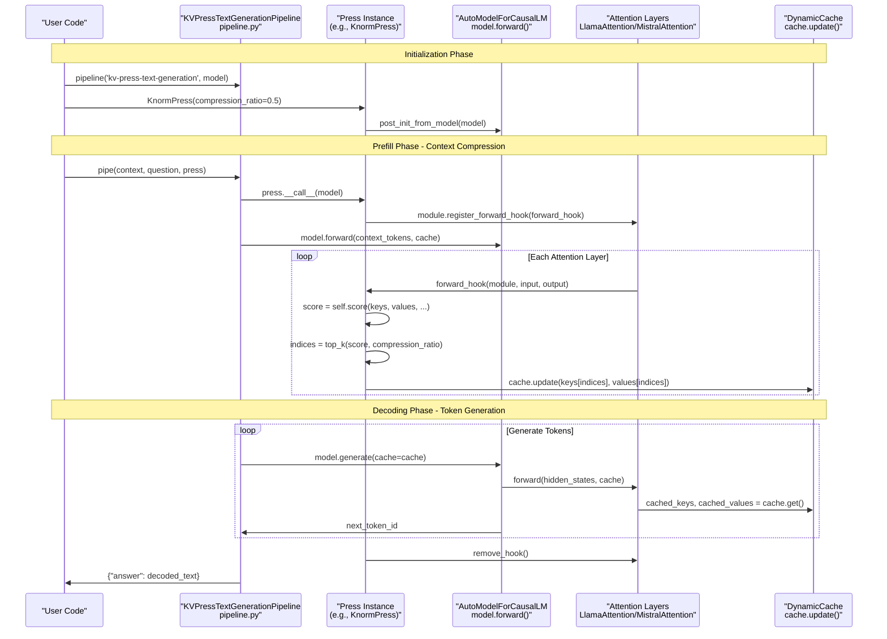

**Key execution phases:**
1. **Initialization:** Press validates model compatibility using `SUPPORTED_MODELS`.
2. **Prefill:** Context tokens processed through `model.forward()`, each attention layer triggers `forward_hook()` to compress via `score()` and top-k selection.
3. **Question:** Question tokens appended to cache (optionally without compression if using the pipeline).
4. **Decoding:** `model.generate()` uses compressed cache for efficient token generation.

For details on the hook mechanism, see [Forward Hook System](#2.4). For attention patching, see [Attention Patching Mechanism](#2.3).

**Sources:** [README.md:39-93](), [kvpress/pipeline.py:1-200](), [kvpress/presses/base_press.py:1-100]()

## Key Concepts

### Compression Ratio

Each press accepts a `compression_ratio` parameter that controls the aggressiveness of compression:

```python
press = KnormPress(compression_ratio=0.4)  # Keep 40% of KV pairs
```

The compression ratio represents the fraction of KV pairs retained after compression. Lower values mean more aggressive compression.

**Sources:** [README.md:39-55](), [kvpress/presses/base_press.py:14]()

### Prefill vs Decoding Compression

KVPress primarily focuses on **prefill compression**, where the full context is compressed once before generation begins.

**Decoding compression** (experimental) compresses the cache periodically during token generation using the `DecodingPress` wrapper. This allows managing cache growth during long generation sequences by specifying a `target_size` and `compression_interval`.

For details, see [Phase-Specific Presses](#3.4).

**Sources:** [README.md:58-97]()

### Head-Wise Compression

The `patch_attention_functions()` call in `__init__.py` enables **head-wise compression**, where different attention heads can have different compression ratios. This is utilized by wrapper presses like `AdaKVPress`.

For technical details, see [Attention Patching Mechanism](#2.3).

**Sources:** [kvpress/__init__.py:52-53](), [kvpress/attention_patch.py:1-100]()

### Context Manager Usage

Presses can be used as context managers with raw transformers models:

```python
with press(model):
    outputs = model(inputs)
```

This pattern automatically registers and unregisters hooks for the scope of the context.

For detailed usage patterns, see [Context Manager Usage](#4.2).

**Sources:** [kvpress/presses/base_press.py:65-74]()

## Supported Models

KVPress supports models with compatible attention implementations. The `SUPPORTED_MODELS` registry in [kvpress/presses/base_press.py:8]() lists compatible architectures, including Llama, Mistral, Qwen, Gemma, and Phi.

For compatibility details, see [Model Compatibility](#4.5).

**Sources:** [kvpress/presses/base_press.py:8]()

## Integration with HuggingFace Ecosystem

**HuggingFace Integration Diagram:**

KVPress deeply integrates with HuggingFace transformers through pipeline registration and attention patching:

```mermaid
graph TB
    subgraph UserCode["User Code"]
        [Import]["from transformers import pipeline<br/>from kvpress import ExpectedAttentionPress"]
        [Create]["pipe = pipeline('kv-press-text-generation')"]
        [Call]["pipe(context, question, press)"]
    end
    
    subgraph KVPressCore["kvpress Package"]
        [InitPy]["__init__.py:6<br/>KVPressTextGenerationPipeline"]
        [PatchFunc]["attention_patch.py<br/>patch_attention_functions()"]
        [PressClasses]["Individual Press Classes<br/>forward_hook(), compress()"]
    end
    
    subgraph TransformersLib["transformers Library"]
        [SupportedTasks]["PIPELINE_REGISTRY"]
        [AutoModelClass]["AutoModelForCausalLM"]
        [CacheClasses]["DynamicCache<br/>QuantizedCache"]
    end
    
    [Import] --> [InitPy]
    [InitPy] --> [PatchFunc]
    
    [Create] --> [SupportedTasks]
    [SupportedTasks] --> [InitPy]
    [InitPy] --> [AutoModelClass]
    
    [Call] --> [PressClasses]
    [PressClasses] --> [CacheClasses]
```

For cache management details, see [Cache Management](#4.3).

**Sources:** [kvpress/__init__.py:1-102](), [kvpress/pipeline.py:1-50](), [kvpress/attention_patch.py:1-100]()

## Evaluation and Benchmarking

KVPress includes a comprehensive evaluation framework for benchmarking compression methods across multiple datasets like RULER, LongBench, and Loogle.

For evaluation instructions, see [Evaluation Framework](#5).

**Sources:** [pyproject.toml:27-35](), [README.md:157-169]()

## Development and Contributing

KVPress uses `uv` for dependency management and `pytest` for testing. Optional dependencies like `flash-attn` and `eval` are supported for enhanced performance and benchmarking.

For testing details, see [Testing Framework](#6.1). For contribution guidelines, see [Contribution Guide](#6.3).

**Sources:** [pyproject.toml:1-62](), [README.md:15-35]()

---

# Page: Installation and Dependencies

# Installation and Dependencies

<details>
<summary>Relevant source files</summary>

The following files were used as context for generating this wiki page:

- [README.md](README.md)
- [pyproject.toml](pyproject.toml)

</details>


This document details the installation procedures, dependency requirements, and build system configuration for `kvpress`. It covers basic pip installation, local development setup with `uv`, optional packages for flash attention and evaluation, and the complete dependency hierarchy.

---

## Purpose and Scope

This page provides comprehensive installation instructions for `kvpress` across different use cases:
- **Production use**: Simple pip installation for end users.
- **Development**: Local installation with all development tools and CI-aligned environments.
- **Optional features**: Flash attention and evaluation dependencies for benchmarking.
- **Build configuration**: Understanding the `hatchling` build system and `uv` workspace settings.

---

## Installation Methods

### Basic Installation

The simplest way to install `kvpress` is through pip from PyPI:

```bash
pip install kvpress
```

This installs the core `kvpress` package with all required dependencies for basic KV cache compression functionality.

**Sources:** [pyproject.toml:1-24](), [README.md:15-19]()

---

### Local Development Installation

For contributors and developers, the project uses `uv` as the primary package manager. The development environment includes specific linters, type checkers, and testing frameworks.

```bash
git clone https://github.com/NVIDIA/kvpress.git
cd kvpress
uv sync
```

For a full development environment including all optional extras:

```bash
uv sync --extra eval --extra flash-attn
```

This command:
- Clones the repository.
- Installs all core dependencies [pyproject.toml:13-24]().
- Includes development dependencies defined in the `dev` group [pyproject.toml:40-57]().
- Sets up the package in editable mode.

The `dev` group includes tools like `black`, `isort`, `flake8`, `mypy`, and `pytest` [pyproject.toml:41-47]().

**Sources:** [pyproject.toml:40-57](), [README.md:21-35]()

---

### Installation with Optional Dependencies

#### Flash Attention Support

For improved performance using Flash Attention 2, `kvpress` provides an optional extra. Note that `flash-attn` often requires specific build environments (CUDA Toolkit) and is configured to skip build isolation in `uv` to facilitate compilation [pyproject.toml:64-65]().

```bash
uv sync --extra flash-attn
```

**Sources:** [pyproject.toml:36-38](), [pyproject.toml:64-65](), [README.md:34-35]()

#### Evaluation Dependencies

For running the comprehensive evaluation suite (benchmarking against datasets like LongBench, RULER, or AIME25), the `eval` extra is required:

```bash
uv sync --extra eval
```

This group adds metrics and utility libraries [pyproject.toml:26-35]():

| Package | Purpose |
|---------|---------|
| `rouge` | ROUGE metrics for summarization tasks |
| `nltk` | Tokenization and NLP utilities |
| `tqdm` | Progress bars for evaluation loops |
| `scipy` | Statistical computations |
| `bert-score` | Semantic similarity metrics |
| `jieba` / `fuzzywuzzy` | String matching and Chinese text processing |

**Sources:** [pyproject.toml:26-35](), [README.md:34-35]()

---

## Core Dependencies

### Python Version Requirements

`kvpress` requires **Python 3.10 or higher** [pyproject.toml:11]().

### Required Dependencies

The core library relies on the following primary stacks [pyproject.toml:13-24]():

*   **Deep Learning**: `torch>=2.3.1`
*   **HuggingFace Ecosystem**: `transformers>=4.56.0`, `datasets>=2.21.0`, `accelerate>=1.0.0`, and `peft>=0.20.0`.
*   **Data Handling**: `numpy>=2.0.0`, `pandas>=2.2.2`.
*   **Utilities**: `requests`, `cachetools`, and `fire` for CLI generation.

**Sources:** [pyproject.toml:13-24]()

---

## Dependency Hierarchy Diagram

This diagram maps the `pyproject.toml` dependency specifications to the system components.

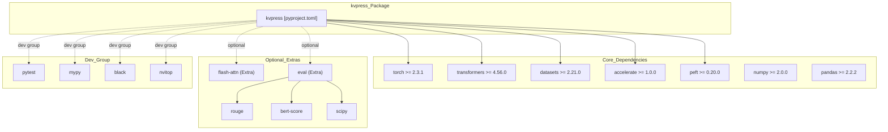

**Sources:** [pyproject.toml:13-57]()

---

## Build System and CI Configuration

### Build Backend
The project uses `hatchling` as the build backend [pyproject.toml:60-62]().

### Build Isolation
A critical configuration for `uv` users is the `no-build-isolation-package` setting for `flash-attn` [pyproject.toml:64-65](). This ensures that the build process can find system-level CUDA dependencies which are often missing in isolated virtual environments.

**Sources:** [pyproject.toml:60-65]()

---

## Code Quality Tools Configuration

The project enforces strict code style and typing through the following configurations in `pyproject.toml`:

*   **Black**: Configured for a line length of 120 [pyproject.toml:67-68]().
*   **isort**: Configured for compatibility with Black (multi-line output 3) [pyproject.toml:72-73]().
*   **mypy**: Strictness is adjusted for specific modules. For instance, `kvpress.presses.base_press` and `kvpress.pipeline` have certain error codes disabled (e.g., `attr-defined`, `assignment`) to handle dynamic patching and HuggingFace attribute injections [pyproject.toml:81-94]().

**Sources:** [pyproject.toml:67-94]()

---

## Installation Flow Diagram

This diagram associates the installation commands with the internal `pyproject.toml` entities.

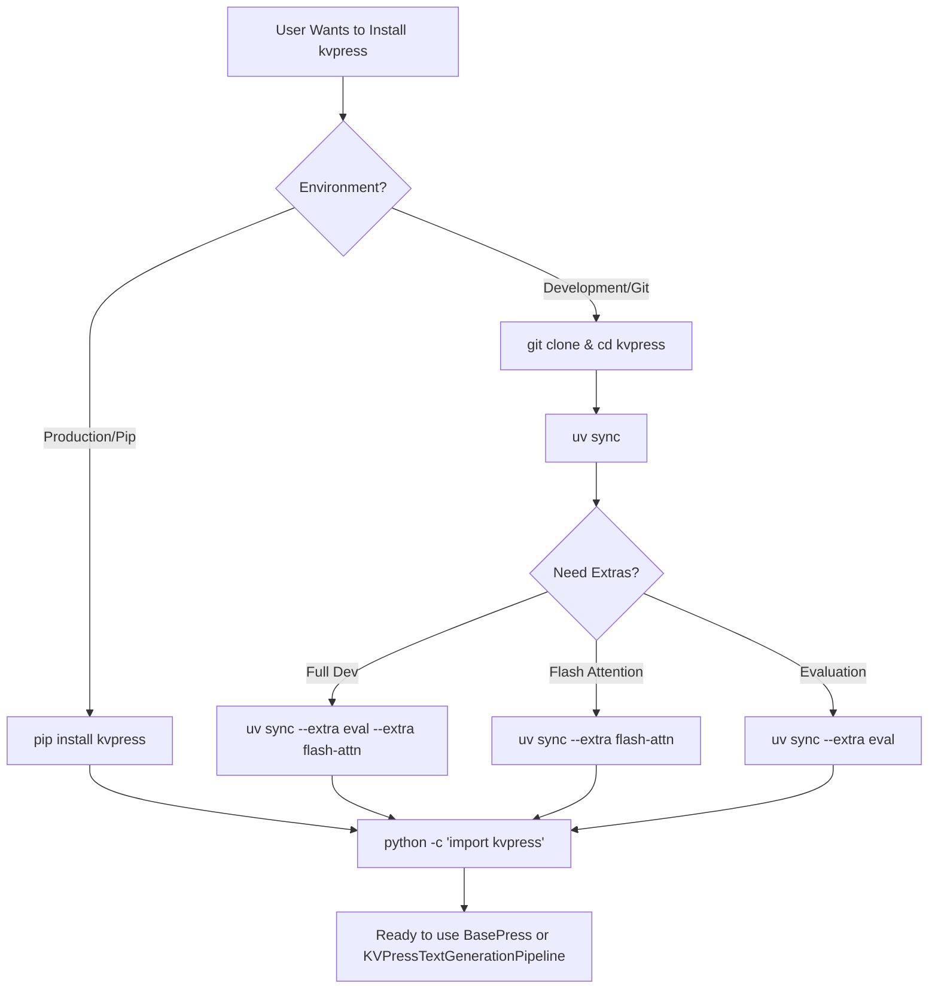

**Sources:** [pyproject.toml:26-38](), [README.md:15-53]()

---

# Page: Quick Start Guide

# Quick Start Guide

<details>
<summary>Relevant source files</summary>

The following files were used as context for generating this wiki page:

- [README.md](README.md)
- [kvpress/pipeline.py](kvpress/pipeline.py)
- [notebooks/speed_and_memory.ipynb](notebooks/speed_and_memory.ipynb)
- [notebooks/wikipedia_demo.ipynb](notebooks/wikipedia_demo.ipynb)
- [tests/fixtures.py](tests/fixtures.py)
- [tests/integration/test_ruler.py](tests/integration/test_ruler.py)

</details>


This document provides minimal working examples for using KVPress to compress the KV cache in large language models. It covers basic pipeline usage, press selection, and common usage patterns. For detailed information about specific press implementations, see [Press Implementations](). For advanced configuration and evaluation, see [Evaluation Framework]().

## Basic Pipeline Usage

The simplest way to use KVPress is through the `KVPressTextGenerationPipeline`, which automatically registers with HuggingFace transformers as `"kv-press-text-generation"` when you import `kvpress` [kvpress/pipeline.py:11](), [README.md:39-40]().

### Standard Workflow

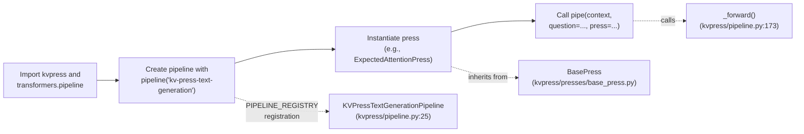

**Minimal Example:**

```python
from transformers import pipeline
from kvpress import ExpectedAttentionPress

# Initialize pipeline
device = "cuda:0"
model = "Qwen/Qwen3-8B"
pipe = pipeline("kv-press-text-generation", model=model, device=device, dtype="auto")

# Create a press with 50% compression
press = ExpectedAttentionPress(compression_ratio=0.5)

# Compress and generate
context = "A very long text you want to compress once and for all"
question = "\nA question about the compressed context"
answer = pipe(context, question=question, press=press)["answer"]
```

The pipeline handles:
- Chat template application and tokenization [kvpress/pipeline.py:139-163]()
- Context truncation based on `max_context_length` [kvpress/pipeline.py:165-171]()
- Efficient processing of long contexts via compression [kvpress/pipeline.py:25-30]()
- Greedy decoding for answer generation [kvpress/pipeline.py:262-314]()

**Sources:** [README.md:39-53](), [kvpress/pipeline.py:25-317](), [notebooks/wikipedia_demo.ipynb:59-64]()

## Compression Process Flow

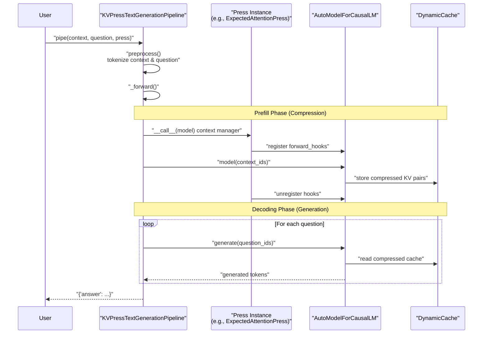

During prefill, the press compresses the context by registering forward hooks that intercept KV pairs [kvpress/pipeline.py:206-207](). During decoding, the model reads from the compressed cache without further compression, unless a `DecodingPress` is explicitly used [README.md:60-67]().

**Sources:** [kvpress/pipeline.py:173-254](), [README.md:39-55]()

## Available Press Types

KVPress provides multiple press implementations organized by their scoring logic:

| Press Category | Example Classes | Key Logic | Use Case |
|----------------|----------------|-----------|-----------|
| **Scoring-Based** | `KnormPress`, `SnapKVPress`, `ExpectedAttentionPress`, `ObservedAttentionPress` | Prune based on importance scores | General-purpose compression |
| **Structural** | `StreamingLLMPress`, `PyramidKVPress`, `LagKVPress` | Keep tokens based on position or layer | Streaming or specific model dynamics |
| **Wrapper** | `DecodingPress`, `PrefillDecodingPress` | Wrap other presses for specific phases | Compression during generation |

### Common Press Examples

```python
from kvpress import (
    KnormPress,              # Prune by inverse key norm
    SnapKVPress,             # Average attention of last queries
    ExpectedAttentionPress,  # Expected attention during generation phase
    StreamingLLMPress,       # Keep initial and recent tokens
    LagKVPress,              # Query-free, lag-relative information
)

# Most presses accept compression_ratio (0.0 = no compression, 1.0 = remove all)
press1 = KnormPress(compression_ratio=0.4)  # Remove 40% of tokens
press2 = SnapKVPress(compression_ratio=0.6)
press3 = ExpectedAttentionPress(compression_ratio=0.5)
```

**Compression Ratio:** The fraction of KV pairs to **remove** during prefilling [README.md:39-40](). A ratio of 0.5 means 50% of tokens are discarded.

**Sources:** [README.md:101-118](), [kvpress/pipeline.py:14-20](), [notebooks/wikipedia_demo.ipynb:104-108]()

## Press Selection Guide

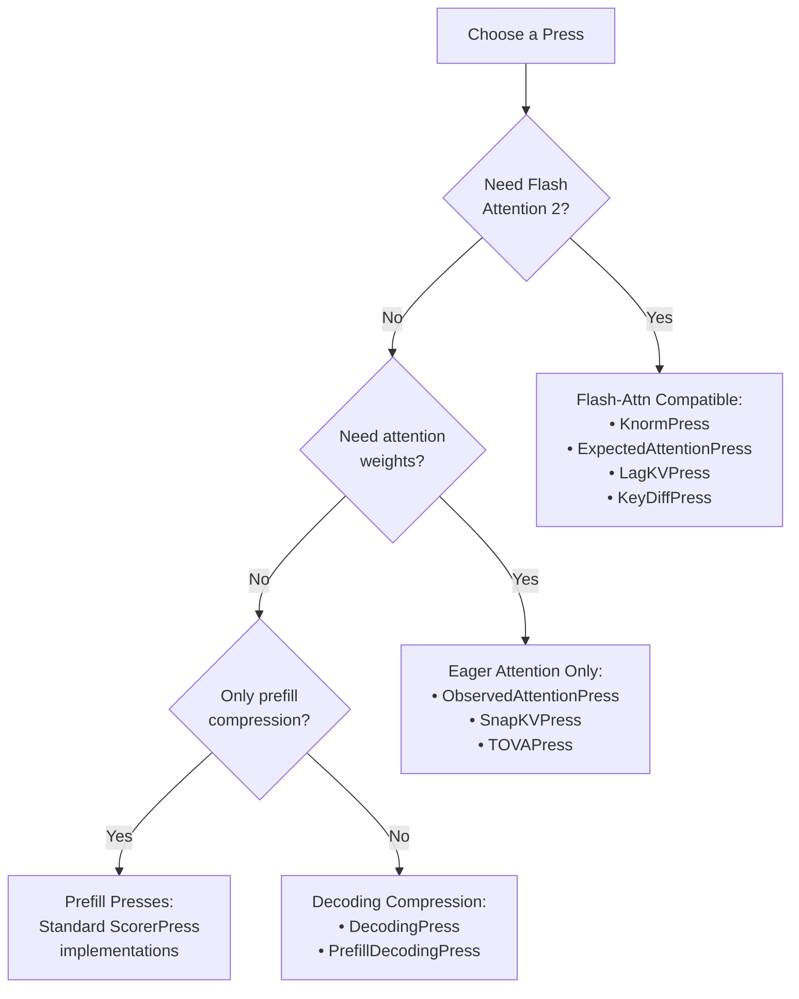

**Flash Attention 2 Compatibility:**
- **Compatible:** `KnormPress`, `ExpectedAttentionPress`, `LagKVPress`, `KeyDiffPress` [README.md:106-115]().
- **Requires Eager:** `ObservedAttentionPress` (requires actual attention weights observed during forward pass) [README.md:111]().

To enable Flash Attention 2 in the pipeline:
```python
model_kwargs = {"attn_implementation": "flash_attention_2"}
pipe = pipeline("kv-press-text-generation", model=model, device=device, model_kwargs=model_kwargs)
```

**Sources:** [README.md:79-80](), [notebooks/wikipedia_demo.ipynb:63-64]()

## Decoding Compression

KVPress supports compression during the decoding (generation) phase via the `DecodingPress` wrapper. This compresses the cache periodically to a `target_size` [README.md:60-67]().

```python
from kvpress import KnormPress, DecodingPress

# Create decoding press that compresses every 10 steps to a target cache size of 512 tokens
decoding_press = DecodingPress(
    base_press=KnormPress(),
    compression_interval=10,
    target_size=512
)

context = "A very long text you want to compress during generation"
question = "Tell me a long story about this context"
response = pipe(context, question=question, press=decoding_press)["answer"]
```

**Key Parameters for DecodingPress:**
- `base_press`: Any `ScorerPress` (e.g., `KnormPress`) [README.md:62]().
- `compression_interval`: Steps between compression events [README.md:63]().
- `target_size`: Target size of the cache after compression [README.md:64]().
- `hidden_states_buffer_size`: Number of hidden states to buffer before compression [README.md:65]().

**Sources:** [README.md:58-97](), [kvpress/pipeline.py:15]()

## Context Manager Usage (Alternative)

Presses can be used directly as context managers for granular control over the model's forward pass [README.md:101]().

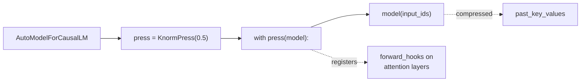

**Example:**

```python
import torch
from transformers import AutoModelForCausalLM
from kvpress import KnormPress

device = "cuda:0"
model = AutoModelForCausalLM.from_pretrained("Qwen/Qwen3-8B").to(device)
press = KnormPress(compression_ratio=0.5)

inputs = torch.randint(0, 1000, (1, 1024)).to(device)

# With compression context manager
with torch.no_grad(), press(model):
    output = model(inputs)
    # output.past_key_values will contain compressed KV pairs
```

This approach bypasses the `KVPressTextGenerationPipeline` but requires manual handling of tokenization and chat templates.

**Sources:** [README.md:101](), [kvpress/pipeline.py:206-207](), [notebooks/speed_and_memory.ipynb:124-138]()

## Model and Cache Support

The pipeline supports various model configurations and cache types:

- **Quantization:** Compatible with `QuantizedCache` [kvpress/pipeline.py:10](), [notebooks/speed_and_memory.ipynb:73-86]().
- **Device Mapping:** Supports `device_map="auto"` for multi-GPU setups [README.md:46]().
- **Dtype:** Automatically handles precision via `dtype="auto"` [README.md:46]().

**Sources:** [README.md:45-46](), [kvpress/pipeline.py:10-48](), [notebooks/speed_and_memory.ipynb:127-128]()

---

# Page: Core Architecture

# Core Architecture

<details>
<summary>Relevant source files</summary>

The following files were used as context for generating this wiki page:

- [kvpress/__init__.py](kvpress/__init__.py)
- [kvpress/attention_patch.py](kvpress/attention_patch.py)
- [kvpress/presses/base_press.py](kvpress/presses/base_press.py)
- [kvpress/presses/decoding_press.py](kvpress/presses/decoding_press.py)
- [kvpress/presses/prefill_decoding_press.py](kvpress/presses/prefill_decoding_press.py)
- [tests/test_attention_patch.py](tests/test_attention_patch.py)

</details>


This document explains the fundamental architecture of KVPress, focusing on the core components and their interactions that form the foundation of the KV cache compression system. 

## Overview

The KVPress library is designed around a unified architecture that enables KV cache compression for transformer-based language models. This architecture centers on the `BasePress` class, which provides the foundation for all compression methods, and an attention patching mechanism that enables global head-wise compression.

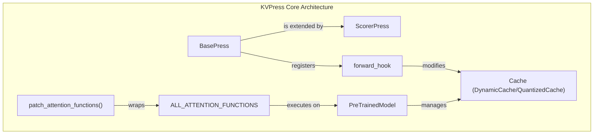

Sources: [kvpress/presses/base_press.py:44-53](), [kvpress/attention_patch.py:90-110](), [kvpress/__init__.py:52-53]()

## KV Cache Compression Concepts

KV cache compression aims to reduce the memory footprint of LLMs by pruning or merging Key and Value tensors. KVPress distinguishes between the **prefilling phase** (where the initial context is processed and compressed) and the **decoding phase** (where new tokens are generated). The library provides specific utilities like `is_prefilling` to detect these phases during the forward pass [kvpress/presses/base_press.py:37-40]().

For details, see [KV Cache Compression Concepts](#2.1).

## Press Hierarchy and BasePress

The `BasePress` class is the cornerstone of KVPress, defining the interface that all compression methods must implement. It utilizes a hook-based system to intercept and modify the KV cache during the forward pass.

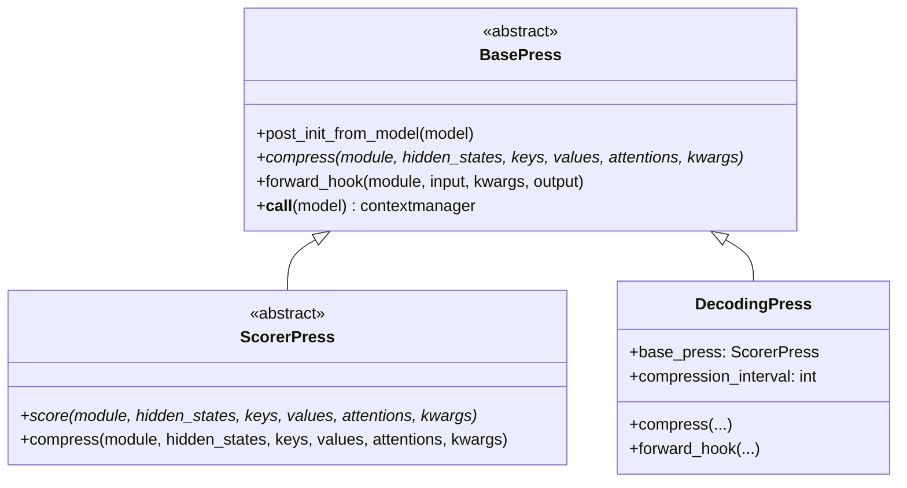

The hierarchy consists of three main tiers:
1.  **BasePress**: The abstract root defining the `compress` method [kvpress/presses/base_press.py:44-99]().
2.  **ScorerPress**: A specialized subclass for methods that compute an importance `score` for tokens before pruning [kvpress/presses/scorer_press.py:45-45]().
3.  **Wrappers and Specialized Presses**: Classes like `ComposedPress` [kvpress/presses/composed_press.py:15-15](), `PrefillDecodingPress` [kvpress/presses/prefill_decoding_press.py:20-20](), and `DecodingPress` [kvpress/presses/decoding_press.py:23-23]() that manage phase-specific logic or sequential chaining.

For details, see [Press Hierarchy and BasePress](#2.2).

Sources: [kvpress/presses/base_press.py:44-99](), [kvpress/presses/scorer_press.py:45-45](), [kvpress/presses/decoding_press.py:23-48]()

## Attention Patching Mechanism

To support head-wise compression (where different attention heads prune different KV pairs), KVPress patches the global attention functions in the `transformers` library at import time. This is necessary because standard attention implementations often expect uniform sequence lengths across all heads in a batch.

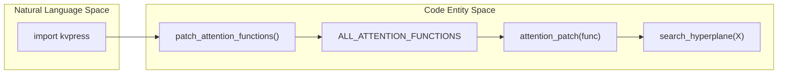

The patching mechanism uses a "fake key" strategy: it identifies a hyperplane such that the dot product with queries is highly negative, effectively zeroing out the attention weight for pruned indices via `search_hyperplane` [kvpress/attention_patch.py:8-40](). This allows the model to "skip" specific KV pairs without changing the physical tensor shape during decoding [kvpress/attention_patch.py:65-79]().

For details, see [Attention Patching Mechanism](#2.3).

Sources: [kvpress/attention_patch.py:90-110](), [kvpress/attention_patch.py:43-87](), [kvpress/__init__.py:53-53]()

## Forward Hook System

KVPress uses PyTorch forward hooks to inject compression logic into the model's execution flow non-destructively. When a press is used as a context manager via `__call__`, it registers a `forward_hook` on every attention layer [kvpress/presses/base_press.py:165-193]().

### Hook Lifecycle
1.  **Registration**: `press(model)` context manager attaches hooks [kvpress/presses/base_press.py:186-190]().
2.  **Execution**: During the forward pass, the hook extracts keys/values, calls `compress()`, and updates the cache [kvpress/presses/base_press.py:101-162]().
3.  **Cleanup**: Hooks are removed when exiting the context manager [kvpress/presses/base_press.py:192-192]().

The system explicitly handles both standard `torch.Tensor` storage and `QuantizedCache` implementations by re-quantizing compressed tensors [kvpress/presses/base_press.py:152-157](). For decoding, `DecodingPress` manages a `hidden_states_buffer` to accumulate context between compression intervals [kvpress/presses/decoding_press.py:53-54]().

For details, see [Forward Hook System](#2.4).

Sources: [kvpress/presses/base_press.py:101-162](), [kvpress/presses/base_press.py:165-193](), [kvpress/presses/decoding_press.py:113-140]()

## Model Compatibility

KVPress maintains a `SUPPORTED_MODELS` registry to ensure compatibility with specific `transformers` architectures.

| Model Class | Source |
| :--- | :--- |
| `LlamaForCausalLM` | [kvpress/presses/base_press.py:28-28]() |
| `MistralForCausalLM` | [kvpress/presses/base_press.py:29-29]() |
| `Phi3ForCausalLM` | [kvpress/presses/base_press.py:30-30]() |
| `Qwen2ForCausalLM` | [kvpress/presses/base_press.py:31-31]() |
| `Qwen3ForCausalLM` | [kvpress/presses/base_press.py:32-32]() |
| `Gemma3ForConditionalGeneration` | [kvpress/presses/base_press.py:33-33]() |

Sources: [kvpress/presses/base_press.py:27-34]()

---

# Page: KV Cache Compression Concepts

# KV Cache Compression Concepts

<details>
<summary>Relevant source files</summary>

The following files were used as context for generating this wiki page:

- [README.md](README.md)
- [kvpress/presses/base_press.py](kvpress/presses/base_press.py)
- [kvpress/presses/decoding_press.py](kvpress/presses/decoding_press.py)
- [kvpress/presses/prefill_decoding_press.py](kvpress/presses/prefill_decoding_press.py)

</details>


## Purpose and Scope

This page explains the fundamental concepts underlying KV cache compression in transformer models. It covers what KV caches are, why they need compression, the distinction between prefill and decoding phases, and how compression is measured. For implementation details of compression methods, see [Press Hierarchy and BasePress](2.2). For evaluation metrics and benchmarking, see [Evaluation Metrics](5.5).

---

## What is a KV Cache?

Transformer models compute attention by comparing queries (Q) against keys (K) to determine attention weights, then using those weights to aggregate values (V). During autoregressive text generation, each new token's attention must consider all previous tokens. To avoid recomputing keys and values for previous tokens, models cache them in a **key-value (KV) cache**.

### Cache Structure

The KV cache stores keys and values for each attention layer. For a model with `num_layers` layers, `num_kv_heads` key-value heads, and `head_dim` dimensions per head:

| Component | Shape | Description |
|-----------|-------|-------------|
| Keys | `(batch_size, num_kv_heads, seq_len, head_dim)` | Cached key vectors for attention |
| Values | `(batch_size, num_kv_heads, seq_len, head_dim)` | Cached value vectors for attention |
| Cache per layer | 2 tensors (keys, values) | Each layer maintains separate cache |

**Sources:** [kvpress/presses/base_press.py:69-86](), [README.md:13-13]()

### Cache Implementation in Transformers

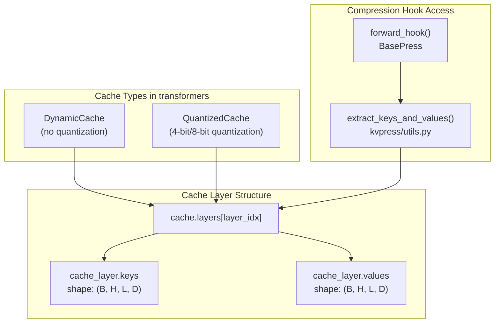

**Diagram: Cache Storage in Transformers**

In the codebase, caches are accessed via `kwargs["past_key_values"]` during forward hooks [kvpress/presses/base_press.py:140-140](). The `extract_keys_and_values()` utility handles both quantized and unquantized cache types, returning tensors ready for compression [kvpress/presses/base_press.py:148-148](). If a `QuantizedCache` is used, the `BasePress.forward_hook` handles re-quantization after compression [kvpress/presses/base_press.py:152-157]().

**Sources:** [kvpress/presses/base_press.py:140-160](), [kvpress/presses/base_press.py:12-21](), [kvpress/utils.py:1-1]()

---

## Why Compression is Needed

### Memory Growth Problem

KV cache memory grows **linearly** with sequence length. For a single layer with float16 precision:

```
Memory per layer = 2 × num_kv_heads × seq_len × head_dim × 2 bytes
                 = 4 × num_kv_heads × seq_len × head_dim bytes
```

For a full model:
```
Total KV cache = Memory per layer × num_layers
```

### Example: Llama 3.1-70B

According to the README, handling 1M tokens with Llama 3.1-70B in float16 requires **up to 330GB** of memory just for the KV cache. This creates severe deployment constraints:

| Context Length | Cache Size | Constraint |
|----------------|------------|------------|
| 4K tokens | ~5 GB | Fits single GPU |
| 32K tokens | ~40 GB | Requires high-end GPU |
| 128K tokens | ~160 GB | Multi-GPU required |
| 1M tokens | ~330 GB | Prohibitively expensive |

**Sources:** [README.md:13-13]()

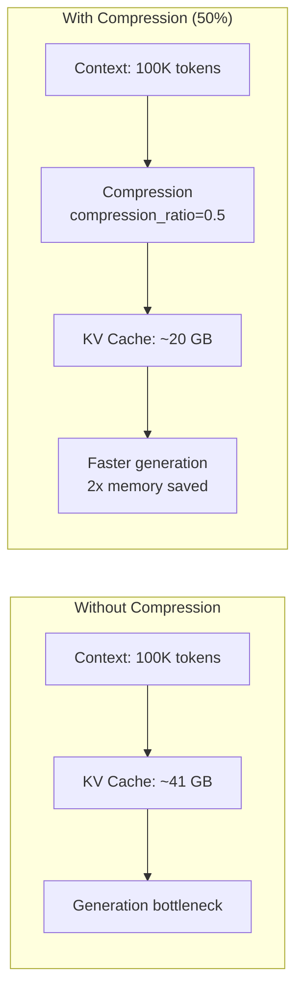

**Diagram: Memory Savings from Compression**

**Sources:** [README.md:13-13](), [kvpress/presses/base_press.py:183-183]()

---

## Prefill vs Decoding Phases

Transformer text generation consists of two distinct phases with different compression opportunities.

### Prefill Phase

During prefill, the model processes the entire input context in a single forward pass:

- **Input:** Full context sequence (e.g., 100K tokens)
- **Processing:** Parallel attention across all tokens
- **Cache state:** Built from scratch, grows from 0 to `seq_len`
- **Compression opportunity:** High - entire context can be analyzed for importance

### Decoding Phase

During decoding, the model generates one token at a time:

- **Input:** Single new token per step
- **Processing:** Attends to full cached context + new token
- **Cache state:** Grows by 1 token per step
- **Compression opportunity:** Limited - must maintain coherence, but periodic pruning is possible

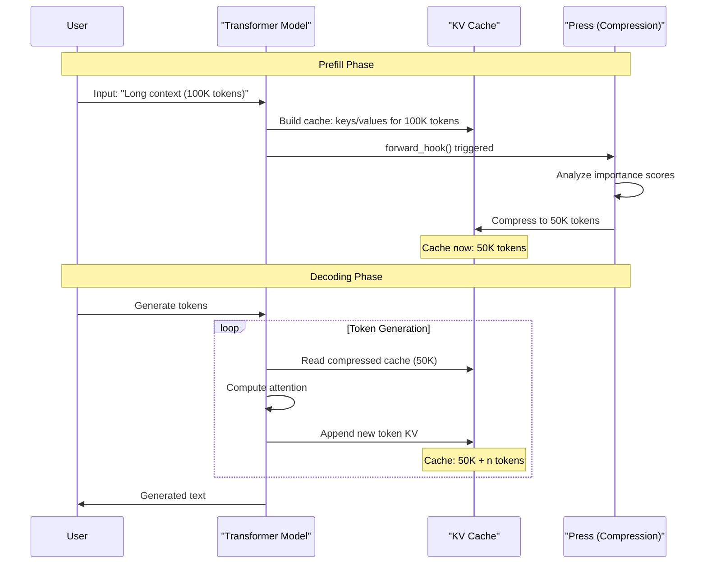

**Diagram: Prefill and Decoding Phases with Compression**

**Sources:** [kvpress/presses/base_press.py:140-146](), [README.md:39-60]()

### Default Compression Behavior

The base implementation in KVPress applies compression **only during prefill** by default:

```python
# From BasePress.forward_hook()
q_len = hidden_states.shape[1]

# Don't compress after pre-filling
if not is_prefilling(kwargs["cache_position"], q_len):
    return output
```

The `is_prefilling` utility function [kvpress/presses/base_press.py:37-40]() checks if the last cache position plus one equals the query length. During decoding, the query length `q_len` is typically 1, while `cache_position` is high, causing the check to fail and compression to be skipped.

**Sources:** [kvpress/presses/base_press.py:37-40](), [kvpress/presses/base_press.py:145-146](), [README.md:39-41]()

### Experimental Decoding Compression

KVPress provides the `DecodingPress` class for compressing during token generation [kvpress/presses/decoding_press.py:23-48](). This uses periodic compression:

- `compression_interval`: Steps between compressions (default: 512) [kvpress/presses/decoding_press.py:46-46]()
- `target_size`: Target cache size after compression (default: 2048) [kvpress/presses/decoding_press.py:47-47]()
- `hidden_states_buffer_size`: Number of hidden states to buffer before compression (default: 256) [kvpress/presses/decoding_press.py:48-48]()

It maintains a `hidden_states_buffer` per layer to provide context for scoring [kvpress/presses/decoding_press.py:53-53]().

**Sources:** [kvpress/presses/decoding_press.py:23-54](), [README.md:60-68]()

---

## Compression Approaches

KVPress implements multiple compression strategies that reduce cache size through different mechanisms.

### Sequence-Level Compression (Token Pruning)

Most presses reduce the **sequence length dimension** by pruning less important tokens. After compression, cache shape changes:

```
Before: (batch_size, num_kv_heads, seq_len, head_dim)
After:  (batch_size, num_kv_heads, compressed_len, head_dim)
```

**Scoring-based approaches** (inheriting from `ScorerPress`) assign importance scores to each token position, then prune lowest-scoring tokens:

| Approach | Score Basis | Example Press |
|----------|-------------|---------------|
| Attention-based | Observed or expected attention weights | `SnapKVPress`, `ExpectedAttentionPress` |
| Norm-based | Magnitude of key vectors | `KnormPress` |
| Similarity-based | Key similarity patterns | `KeyDiffPress` |
| Random | Random scores (baseline) | `RandomPress` |

**Sources:** [README.md:103-116](), [kvpress/presses/base_press.py:61-99]()

### Dimension-Level Compression (Channel Pruning)

Some presses reduce the **head dimension** instead of sequence length. `ThinKPress` is a primary example:

```
Before: (batch_size, num_kv_heads, seq_len, head_dim)
After:  (batch_size, num_kv_heads, seq_len, head_dim) # Low-importance channels zeroed
```

**Sources:** [README.md:136-136]()

### Quantization

Orthogonal to pruning, **quantization** reduces precision to save memory. `BasePress` natively supports `QuantizedCache`:

```python
# From BasePress.forward_hook
if isinstance(cache, QuantizedCache):
    cache_layer._quantized_keys = cache_layer._quantize(keys, axis=cache_layer.axis_key)
    cache_layer._quantized_values = cache_layer._quantize(values, axis=cache_layer.axis_value)
```

**Sources:** [kvpress/presses/base_press.py:152-157](), [kvpress/presses/base_press.py:12-21]()

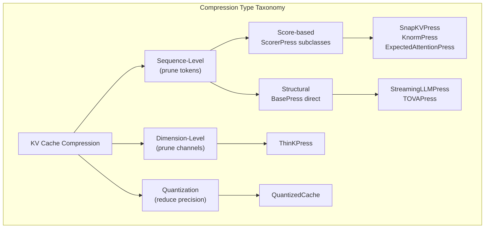

**Diagram: Taxonomy of Compression Approaches**

**Sources:** [README.md:103-116](), [kvpress/presses/base_press.py:44-53]()

---

## Compression Metrics

### Compression Ratio

The primary metric is `compression_ratio`, defined as the **fraction of tokens removed**. Each press is associated with this attribute [README.md:39-39]().

In `ScorerPress`, this ratio is used to calculate the number of tokens to prune:
`n_pruned = int(k_len * self.compression_ratio)`

**Sources:** [README.md:39-41]()

### Target Size (Decoding Compression)

For `DecodingPress`, compression uses `target_size` instead of a static `compression_ratio` [kvpress/presses/decoding_press.py:47-47](). The ratio is automatically computed every `compression_interval` steps such that the size of the cache after compression equals `target_size` [kvpress/presses/decoding_press.py:103-104]().

**Sources:** [kvpress/presses/decoding_press.py:102-111](), [README.md:64-67]()

---

## Summary

KV cache compression in KVPress operates on the fundamental trade-off between memory efficiency and task quality:

1. **KV caches** store keys and values per layer, growing linearly with context length.
2. **Compression is needed** because long contexts (1M+ tokens) can require over 300GB of memory.
3. **Prefill phase** is the default target for compression, analyzing the context before generation begins.
4. **DecodingPress** allows for dynamic, periodic compression during the generation phase using a target cache size.
5. **BasePress** provides the hook mechanism to intercept attention layers and modify the `past_key_values` cache object in-place.

**Sources:** [README.md:13-116](), [kvpress/presses/base_press.py:37-162](), [kvpress/presses/decoding_press.py:23-111]()

---

# Page: Press Hierarchy and BasePress

# Press Hierarchy and BasePress

<details>
<summary>Relevant source files</summary>

The following files were used as context for generating this wiki page:

- [kvpress/__init__.py](kvpress/__init__.py)
- [kvpress/presses/base_press.py](kvpress/presses/base_press.py)
- [kvpress/presses/decoding_press.py](kvpress/presses/decoding_press.py)
- [kvpress/presses/prefill_decoding_press.py](kvpress/presses/prefill_decoding_press.py)
- [kvpress/presses/scorer_press.py](kvpress/presses/scorer_press.py)

</details>


## Purpose and Scope

This document describes the hierarchical structure and relationships between the various press classes in the `kvpress` library. It explains the inheritance patterns, key base classes, and how different types of presses are organized in the codebase. The library utilizes a three-tier hierarchy consisting of the foundational `BasePress`, the score-based `ScorerPress`, and various Wrapper/Composite presses that modify or chain compression logic.

## Press Hierarchy Overview

`kvpress` is structured around a central class hierarchy where all compression methods inherit from `BasePress` and are further specialized through inheritance and composition patterns.

### Natural Language to Code Entity Space: Press Hierarchy
The following diagram maps high-level compression concepts to their specific class implementations in the `kvpress` codebase.

```mermaid
classDiagram
    class BasePress["BasePress (kvpress.presses.base_press)"] {
        +post_init_from_model(model)
        +compress(module, hidden_states, keys, values, attentions, kwargs)
        +forward_hook(module, input, kwargs, output)
        +__call__(model)
    }
    
    class ScorerPress["ScorerPress (kvpress.presses.scorer_press)"] {
        +compression_ratio: float
        +score(module, hidden_states, keys, values, attentions, kwargs)
        +compress(...)
    }
    
    BasePress <|-- ScorerPress
    BasePress <|-- DecodingPress["DecodingPress (kvpress.presses.decoding_press)"]
    BasePress <|-- PrefillDecodingPress["PrefillDecodingPress (kvpress.presses.prefill_decoding_press)"]
    
    class WrapperPress["Wrapper Pattern (Conceptual)"] {
        +press: BasePress
    }
    
    WrapperPress <|-- ComposedPress["ComposedPress (kvpress.presses.composed_press)"]
    WrapperPress <|-- AdaKVPress["AdaKVPress (kvpress.presses.adakv_press)"]
    
    ScorerPress <|-- KnormPress["KnormPress (kvpress.presses.knorm_press)"]
    ScorerPress <|-- SnapKVPress["SnapKVPress (kvpress.presses.snap_kv_press)"]
    ScorerPress <|-- ObservedAttentionPress["ObservedAttentionPress (kvpress.presses.observed_attention_press)"]
```

Sources: [kvpress/presses/base_press.py:44-188](), [kvpress/presses/scorer_press.py:17-102](), [kvpress/presses/decoding_press.py:23-49](), [kvpress/presses/prefill_decoding_press.py:20-37]()

## Core Base Classes

### BasePress
`BasePress` is the foundation of the entire library [kvpress/presses/base_press.py:44-53](). It defines the fundamental interface and behavior that all press implementations must adhere to.

**Key characteristics:**
*   **Context Manager**: Implements `__call__` as a context manager to register and automatically remove forward hooks from a `PreTrainedModel` [kvpress/presses/base_press.py:165-188]().
*   **Forward Hook**: Provides a default `forward_hook` that intercepts the model's attention layer outputs, extracts the cache, and applies compression only during the pre-filling phase by default [kvpress/presses/base_press.py:101-162]().
*   **Abstract Interface**: Defines the `compress` method which must be implemented by subclasses to perform the actual reduction of KV tensors [kvpress/presses/base_press.py:61-99]().
*   **Quantization Support**: The base hook handles `QuantizedCache` by re-quantizing compressed tensors and updating `cumulative_length` [kvpress/presses/base_press.py:152-157]().

Sources: [kvpress/presses/base_press.py:44-188]()

### ScorerPress
`ScorerPress` is a specialized subclass of `BasePress` that implements compression based on scoring the importance of key-value pairs [kvpress/presses/scorer_press.py:17-30]().

**Key characteristics:**
*   **Scoring Pattern**: Introduces the `score` method, where subclasses define the importance of each token position [kvpress/presses/scorer_press.py:35-75]().
*   **Automated Pruning**: Overrides `compress` to automatically select the top-k KV pairs based on the scores and the `compression_ratio` using `torch.topk` [kvpress/presses/scorer_press.py:76-102]().
*   **Uniform Interface**: Ensures all score-based methods (like `KnormPress` or `SnapKVPress`) follow a consistent pruning logic [kvpress/presses/scorer_press.py:94-100]().

Sources: [kvpress/presses/scorer_press.py:17-102]()

## Specialized Hierarchy Tiers

### Phase-Specific Hierarchy
Beyond static compression, `kvpress` introduces classes to handle different LLM phases (prefilling vs. decoding).

*   **DecodingPress**: A wrapper that specifically operates during the decoding phase. It maintains a `hidden_states_buffer` and applies compression every `compression_interval` steps [kvpress/presses/decoding_press.py:23-49](). It requires a `ScorerPress` or `AdaKVPress` as its `base_press` [kvpress/presses/decoding_press.py:52]().
*   **PrefillDecodingPress**: A composite press that allows defining separate strategies for the two phases by wrapping a `prefilling_press` and a `decoding_press` [kvpress/presses/prefill_decoding_press.py:20-37]().

Sources: [kvpress/presses/decoding_press.py:23-66](), [kvpress/presses/prefill_decoding_press.py:20-37]()

## Press Types Classification

The press classes in `kvpress` can be categorized into three major types based on their approach to compression:

| Category | Description | Key Entities |
| :--- | :--- | :--- |
| **Scoring-Based** | Prunes KV pairs based on an importance metric (e.g., norms, attention weights). | `KnormPress`, `SnapKVPress`, `ObservedAttentionPress`, `ScorerPress` |
| **Alternative Logic** | Implements unique compression like channel-wise reduction or layer-wise skipping. | `ThinKPress`, `SimLayerKVPress` |
| **Wrapper/Composite** | Enhances or chains other presses to add functionality like decoding support or phase delegation. | `ComposedPress`, `DecodingPress`, `PrefillDecodingPress`, `AdaKVPress` |

Sources: [kvpress/__init__.py:7-50](), [kvpress/presses/decoding_press.py:23-49]()

## Data Flow and Life Cycle

The following diagram illustrates the interaction between the `BasePress` hook mechanism and the model's attention layers during a forward pass, including the specialized decoding logic.

### Code Entity Space: Execution Flow
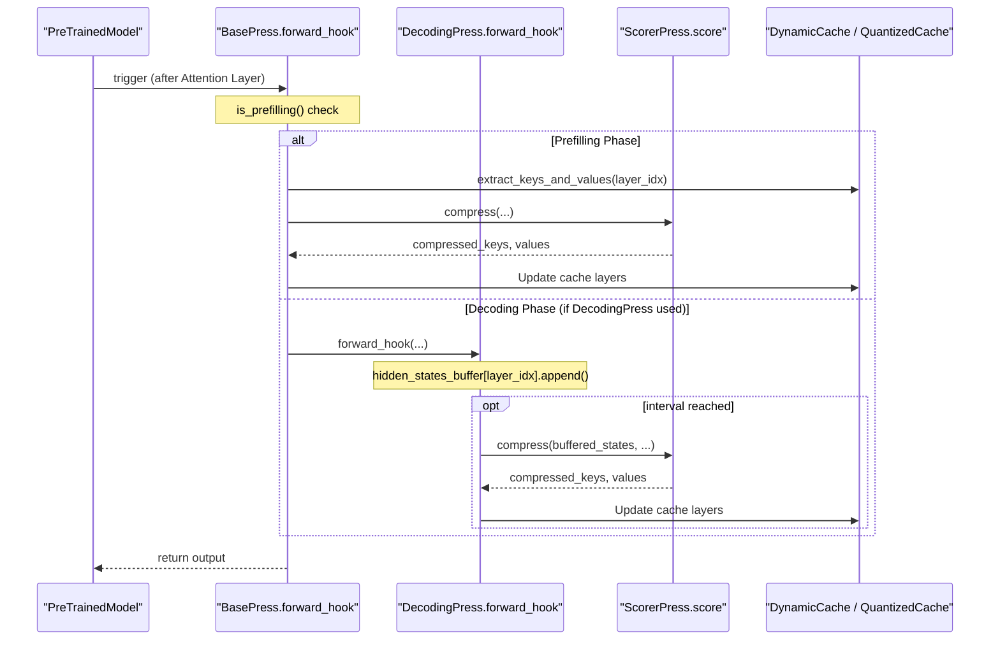

Sources: [kvpress/presses/base_press.py:101-162](), [kvpress/presses/decoding_press.py:113-162](), [kvpress/presses/scorer_press.py:76-102]()

---

# Page: Attention Patching Mechanism

# Attention Patching Mechanism

<details>
<summary>Relevant source files</summary>

The following files were used as context for generating this wiki page:

- [kvpress/__init__.py](kvpress/__init__.py)
- [kvpress/attention_patch.py](kvpress/attention_patch.py)
- [tests/test_attention_patch.py](tests/test_attention_patch.py)

</details>


The attention patching mechanism is a global hook system that enables **head-wise KV cache compression** in kvpress. It allows compression methods to selectively mask out specific key-value pairs on a per-head basis during attention computation without physically removing them from the cache. This is achieved by injecting "fake keys" that produce zero attention weights.

## Purpose and Scope

The attention patching system solves a specific problem: some compression methods (like `AdaKVPress`) need to apply different compression strategies to different attention heads, but transformers' attention mechanisms operate on all heads simultaneously with shared KV caches. The patching system enables this by:

1.  **Intercepting** all attention computations before they occur.
2.  **Masking** specified key-value pairs by replacing them with specially constructed "fake keys".
3.  **Preserving** the original cache structure while achieving compression effects.

This mechanism operates at a lower level than the press system itself—it modifies how attention is computed globally, enabling head-specific compression that would otherwise be impossible.

Sources: [kvpress/attention_patch.py:43-59](), [kvpress/attention_patch.py:90-108]()

## Architecture Overview

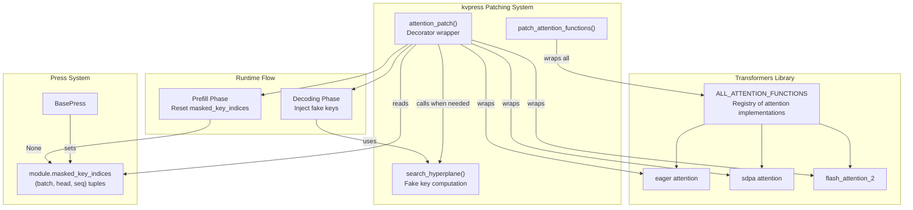

**Diagram: Attention Patching Architecture** - Shows how the patching system intercepts all attention functions in the transformers library and coordinates with the press system through `module.masked_key_indices`.

Sources: [kvpress/attention_patch.py:43-87](), [kvpress/attention_patch.py:90-110](), [kvpress/presses/base_press.py:8-44]()

## Core Components

### The `masked_key_indices` Attribute

The communication channel between presses and the attention patching system is the `masked_key_indices` attribute set on attention modules.

| Attribute | Type | Purpose |
|-----------|------|---------|
| `module.masked_key_indices` | `tuple[Tensor, Tensor, Tensor]` or `None` | Contains `(batch_indices, head_indices, seq_indices)` specifying which keys to mask |

When a press wants to enable head-wise compression, it sets this attribute. The `attention_patch` decorator reads this attribute and applies masking accordingly [kvpress/attention_patch.py:65-79]().

### The `attention_patch()` Decorator

The `attention_patch()` function is a decorator that wraps attention computation functions. It intercepts the attention computation and modifies keys when masking is requested:

```mermaid
sequenceDiagram
    participant Attn as "Attention Layer"
    participant Decorator as "attention_patch wrapper"
    participant Search as "search_hyperplane()"
    participant Original as "Original attention func"
    
    Attn->>Decorator: query, key, value
    
    alt Prefill (query.shape[2] == key.shape[2])
        Decorator->>Decorator: Set module.masked_key_indices = None
    else Decoding + masked_key_indices exists
        Decorator->>Search: Compute fake keys for queries
        Search-->>Decorator: Fake keys k where exp(<q,k>) = 0
        Decorator->>Decorator: Replace keys at masked_key_indices
    end
    
    Decorator->>Original: Modified query, key, value
    Original-->>Decorator: Attention output
    Decorator-->>Attn: Return output
```

**Diagram: Attention Patch Execution Flow** - Shows the decision logic and fake key injection process during attention computation.

Sources: [kvpress/attention_patch.py:43-87]()

### The `search_hyperplane()` Algorithm

The core mathematical component is `search_hyperplane()`, which finds fake keys that produce zero attention weights:

**Goal**: Given query tensors `X` of shape `(bsz, seq_len, head_dim)`, find a hyperplane `Y` of shape `(bsz, head_dim)` such that for every query vector `q` in `X`: `<q, Y> ≤ 0` [kvpress/attention_patch.py:8-12]().

**Algorithm**:
1.  Initialize `Y` as the mean of all queries: `Y = X.mean(1)` [kvpress/attention_patch.py:34]().
2.  Iteratively refine `Y` by finding queries where `<X, Y> > 0` [kvpress/attention_patch.py:36]().
3.  Update `Y` by adding the mean of violating queries: `Y += (X * mask).sum(1) / mask.sum(1).clamp(min=1)` [kvpress/attention_patch.py:39]().
4.  Repeat until all queries satisfy `<X, Y> ≤ 0` or `max_iter` reached [kvpress/attention_patch.py:35-37]().
5.  Scale and return `Y` as `-1e5 * Y / ||Y||^2` to ensure `exp(<X, Y>) ≈ 0` [kvpress/attention_patch.py:38]().

Sources: [kvpress/attention_patch.py:8-40](), [tests/test_attention_patch.py:9-14]()

## Global Patching Process

The `patch_attention_functions()` function applies the attention patch decorator to all registered attention implementations in the transformers library:

**Patched Attention Types**:
The system iterates through `ALL_ATTENTION_FUNCTIONS` from `transformers.modeling_utils` and wraps each one [kvpress/attention_patch.py:109-110]().

The patching is applied **automatically at import time** in `kvpress/__init__.py`:

```python
# FILE: kvpress/__init__.py
from kvpress.attention_patch import patch_attention_functions
# ...
# Patch the attention functions to support head-wise compression
patch_attention_functions()
```
Sources: [kvpress/__init__.py:5-53](), [kvpress/attention_patch.py:90-110]()

## Lifecycle: Prefill vs Decoding

The attention patching system behaves differently during prefill and decoding phases:

### Prefill Phase
During prefill, the query sequence length equals the key sequence length (`query.shape[2] == key.shape[2]`). The decorator resets `module.masked_key_indices = None` [kvpress/attention_patch.py:62-64](). No masking is applied.

### Decoding Phase
During decoding, if `module.masked_key_indices` is not `None`, the system:
1.  Reshapes queries into groups based on the number of key-value heads [kvpress/attention_patch.py:72-73]().
2.  Computes one fake key per key group using `search_hyperplane` [kvpress/attention_patch.py:74-75]().
3.  Updates the `key` tensor at the specified indices with the computed fake keys [kvpress/attention_patch.py:78-79]().

### Flash Attention Compatibility
The system ensures compatibility with Flash Attention by updating `cu_seq_lens_k` if it exists in `kwargs`, ensuring the attention implementation respects the modified key shape [kvpress/attention_patch.py:82-84]().

Sources: [kvpress/attention_patch.py:61-85]()

## Technical Summary

| Aspect | Implementation Detail |
|--------|------------------------|
| **Communication** | `module.masked_key_indices` (batch, head, seq) |
| **Fake Key Logic** | Hyperplane search s.t. `exp(<q, k>) ≈ 0` |
| **Group Support** | Handles GQA/MQA by grouping queries per KV head [kvpress/attention_patch.py:69-75]() |
| **Scaling** | Scale factor of `-1e5` to force attention weights to zero [kvpress/attention_patch.py:38]() |
| **Iteration** | Default `max_iter=1000` for hyperplane search [kvpress/attention_patch.py:8]() |

Sources: [kvpress/attention_patch.py:1-110]()

---

# Page: Forward Hook System

# Forward Hook System

<details>
<summary>Relevant source files</summary>

The following files were used as context for generating this wiki page:

- [kvpress/presses/base_press.py](kvpress/presses/base_press.py)
- [kvpress/presses/composed_press.py](kvpress/presses/composed_press.py)
- [kvpress/presses/decoding_press.py](kvpress/presses/decoding_press.py)
- [kvpress/presses/observed_attention_press.py](kvpress/presses/observed_attention_press.py)
- [kvpress/presses/prefill_decoding_press.py](kvpress/presses/prefill_decoding_press.py)

</details>


The Forward Hook System is the core mechanism by which presses intercept and modify KV cache contents during model inference. This system uses PyTorch's forward hook API to register callbacks on attention layers, allowing presses to compress keys and values non-destructively without modifying the model's computation graph.

For information about the overall press architecture and class hierarchy, see [2.2 Press Hierarchy and BasePress](). For details on how attention functions are patched to enable head-wise compression, see [2.3 Attention Patching Mechanism](). For practical usage patterns, see [4.2 Context Manager Usage]().

## Hook Registration Architecture

The forward hook system operates through a registration-and-execution pattern where presses register callback functions on specific model layers during a setup phase, and these callbacks are invoked automatically during forward passes.

**Diagram: Hook Registration Flow**

```mermaid
graph TB
    Press["Press Instance<br/>(BasePress subclass)"]
    ContextMgr["__call__ method<br/>Returns context manager"]
    Enter["__enter__ method<br/>Registers hooks"]
    Model["Transformer Model"]
    Layers["Attention Layers<br/>(module.layers)"]
    Hooks["Forward Hook Handles<br/>(stored in press._hooks)"]
    
    Press --> ContextMgr
    ContextMgr --> Enter
    Enter --> Model
    Model --> Layers
    Layers --> Hooks
    
    Enter -.->|"module.register_forward_hook()"| Layers
    Hooks -.->|"stored reference"| Press
    
    Exit["__exit__ method<br/>Removes hooks"]
    Cleanup["hook.remove()"]
    
    Exit --> Hooks
    Hooks --> Cleanup
```

Sources: [kvpress/presses/base_press.py:164-188](), [kvpress/presses/base_press.py:193-200]()

The registration process follows these steps:

1.  **Context Manager Invocation**: User code invokes the press as a context manager via `with press(model):` [kvpress/presses/base_press.py:185-187]().
2.  **Hook Registration**: The `__enter__` method iterates through attention layers and calls `module.register_forward_hook(self.forward_hook)` [kvpress/presses/base_press.py:196-198]().
3.  **Handle Storage**: PyTorch returns hook handles that are stored in the press instance for later removal [kvpress/presses/base_press.py:198]().
4.  **Hook Removal**: The `__exit__` method calls `handle.remove()` on all stored handles to clean up [kvpress/presses/base_press.py:203-205]().

**Table: Hook Lifecycle Methods**

| Method | Purpose | Called By | Defined In |
| :--- | :--- | :--- | :--- |
| `__call__(model)` | Create context manager | User code with statement | [kvpress/presses/base_press.py:164-188]() |
| `__enter__()` | Register hooks on layers | Context manager entry | [kvpress/presses/base_press.py:193-200]() |
| `forward_hook(...)` | Process attention outputs | PyTorch during forward pass | [kvpress/presses/base_press.py:101-162]() |
| `__exit__()` | Remove registered hooks | Context manager exit | [kvpress/presses/base_press.py:202-206]() |

## Hook Execution Flow

When a forward pass executes with registered hooks, PyTorch automatically invokes the `forward_hook` method on each attention layer immediately after the layer's forward computation completes.

**Diagram: Hook Execution During Forward Pass**

```mermaid
sequenceDiagram
    participant User
    participant Model
    participant AttnLayer as "Attention Layer<br/>(e.g., LlamaAttention)"
    participant Hook as "press.forward_hook"
    participant Press as "Press Logic<br/>(compress)"
    participant Cache as "past_key_values<br/>(DynamicCache)"
    
    User->>Model: model(input_ids, past_key_values=cache)
    Model->>AttnLayer: forward(hidden_states, ...)
    
    Note over AttnLayer: Compute Q, K, V<br/>Apply rotary embeddings<br/>Calculate attention
    
    AttnLayer->>Hook: forward_hook(module, input, kwargs, output)
    
    Note over Hook: kwargs contains hidden_states<br/>and past_key_values
    
    Hook->>Cache: extract_keys_and_values()
    Hook->>Press: compress(module, hidden_states, keys, values, output[1], kwargs)
    Press-->>Hook: Return compressed keys, values
    
    Hook->>Cache: Update cache_layer.keys/values
    Hook-->>AttnLayer: Return output
    AttnLayer-->>Model: Return output
    Model-->>User: ModelOutput with compressed past_key_values
```

Sources: [kvpress/presses/base_press.py:101-162](), [kvpress/presses/base_press.py:139-160]()

### Hook Parameters

The `forward_hook` method receives four parameters conforming to PyTorch's forward hook signature [kvpress/presses/base_press.py:101]():

*   `module`: The transformer attention layer (e.g., `LlamaAttention`).
*   `input`: Input tensors to the forward pass (not used in default implementation) [kvpress/presses/base_press.py:118-120]().
*   `kwargs`: Keyword arguments passed to the forward method, including `hidden_states`, `past_key_values`, and `cache_position` [kvpress/presses/base_press.py:121-127]().
*   `output`: Return value from the layer's forward pass, typically a list where `output[0]` is the hidden states and `output[1]` is attention weights [kvpress/presses/base_press.py:128-131]().

### Phase Detection

The hook system distinguishes between the **pre-filling** and **decoding** phases using the `is_prefilling` utility [kvpress/presses/base_press.py:37-40]().

*   **Standard BasePress**: Applies compression only during the pre-filling phase [kvpress/presses/base_press.py:145-146]().
*   **DecodingPress**: Accumulates hidden states in a `hidden_states_buffer` and applies compression every `compression_interval` steps during the decoding phase [kvpress/presses/decoding_press.py:113-162]().
*   **PrefillDecodingPress**: Acts as a dispatcher, calling the `prefilling_press` hook during pre-fill and the `decoding_press` hook during generation [kvpress/presses/prefill_decoding_press.py:67-81]().

## BasePress Hook Implementation

The `BasePress` class provides the default implementation for `forward_hook` that handles cache extraction, quantization, and in-place updates.

**Diagram: Code Entity Flow in BasePress**

```mermaid
graph TD
    FH["forward_hook()"]
    IP["is_prefilling()"]
    EKV["extract_keys_and_values()"]
    COMP["compress()"]
    QC["isinstance(cache, QuantizedCache)"]
    UP_STD["Update cache_layer.keys/values"]
    UP_Q["Update _quantized_keys/_quantized_values"]

    FH --> IP
    IP -- "True" --> EKV
    EKV --> COMP
    COMP --> QC
    QC -- "No" --> UP_STD
    QC -- "Yes" --> UP_Q
```

Sources: [kvpress/presses/base_press.py:101-162](), [kvpress/utils.py:23]()

### Quantization Handling
The hook automatically detects if the cache is a `QuantizedCache`. If so, it re-quantizes the compressed keys and values using the cache layer's `_quantize` method before updating the `_quantized_keys` and `_quantized_values` attributes [kvpress/presses/base_press.py:152-157]().

## Hook Composition

The `ComposedPress` demonstrates how multiple hooks can be chained together. Its `forward_hook` iterates through a list of presses, passing the output of one into the next and accumulating the total `compression_ratio` [kvpress/presses/composed_press.py:56-62]().

**Diagram: Sequential Hook Chaining**

```mermaid
graph LR
    Start["Layer Output"] --> P1["Press 1<br/>forward_hook"]
    P1 --> P2["Press 2<br/>forward_hook"]
    P2 --> End["Final Compressed Output"]
    
    subgraph "ComposedPress.forward_hook"
    P1
    P2
    end
```

Sources: [kvpress/presses/composed_press.py:58-59]()

### Composition Constraints
Certain presses are incompatible with composition. `ComposedPress` explicitly checks for and forbids `AdaKVPress` and `KVzipPress` during initialization [kvpress/presses/composed_press.py:48-50]().

## Specialized Hook Logic

### DecodingPress Buffer Management
`DecodingPress` overrides `forward_hook` to manage a per-layer buffer of hidden states. It detaches and clones hidden states during decoding steps [kvpress/presses/decoding_press.py:134](). When the `compression_interval` is reached, it concatenates the buffer and calls `compress` [kvpress/presses/decoding_press.py:153-154]().

### ObservedAttentionPress
This press requires `attn_implementation="eager"` because its `score` function directly accesses the `attentions` tensor passed into the hook from the layer's output [kvpress/presses/observed_attention_press.py:40-44]().

Sources: [kvpress/presses/decoding_press.py:113-162](), [kvpress/presses/observed_attention_press.py:34-49]()
---
Sources: [kvpress/presses/base_press.py:37-206](), [kvpress/presses/decoding_press.py:22-162](), [kvpress/presses/composed_press.py:11-62](), [kvpress/presses/prefill_decoding_press.py:19-91](), [kvpress/presses/observed_attention_press.py:13-49]()

---

# Page: Press Implementations

# Press Implementations

<details>
<summary>Relevant source files</summary>

The following files were used as context for generating this wiki page:

- [kvpress/__init__.py](kvpress/__init__.py)
- [kvpress/presses/__init__.py](kvpress/presses/__init__.py)
- [tests/default_presses.py](tests/default_presses.py)
- [tests/presses/test_head_compression.py](tests/presses/test_head_compression.py)

</details>


This page provides a high-level catalog of the 30+ press implementations available in `kvpress`. A "press" is a module that implements a specific KV cache compression technique, inheriting from `BasePress` [kvpress/presses/base_press.py:15-17](). These implementations are designed to reduce memory usage during inference while maintaining model performance across various phases of LLM execution.

## Press Taxonomy

The `kvpress` library categorizes its implementations into several functional groups based on their compression logic and operational phase.

### Conceptual Hierarchy

```mermaid
graph TD
    subgraph "Press Logic Space"
        Base["BasePress"]
        Scorer["ScorerPress"]
        Alt["Alternative Logic"]
        Wrap["Wrapper & Composite"]
    end

    subgraph "Code Entity Space"
        Base --- BaseCls["BasePress (base_press.py)"]
        Scorer --- ScorerCls["ScorerPress (scorer_press.py)"]
        Alt --- ThinK["ThinKPress (think_press.py)"]
        Alt --- SimL["SimLayerKVPress (simlayerkv_press.py)"]
        Wrap --- Ada["AdaKVPress (adakv_press.py)"]
        Wrap --- Comp["ComposedPress (composed_press.py)"]
    end

    BaseCls --> ScorerCls
    BaseCls --> ThinK
    BaseCls --> Ada
    ScorerCls --> Snap["SnapKVPress"]
    ScorerCls --> Knorm["KnormPress"]
```
Sources: [kvpress/__init__.py:7-50](), [kvpress/presses/base_press.py:15-17](), [kvpress/presses/scorer_press.py:12-14]()

### Operational Mapping

```mermaid
graph LR
    subgraph "Execution Phase"
        Prefill["Prefill Phase"]
        Decode["Decoding Phase"]
        Hybrid["Phase-Specific Hybrid"]
    end

    subgraph "Press Implementation"
        Prefill --- BasePress["Standard BasePress implementations"]
        Decode --- DP["DecodingPress (decoding_press.py)"]
        Hybrid --- PDP["PrefillDecodingPress (prefill_decoding_press.py)"]
        Hybrid --- CRDP["CompressionRatioDecodingPress (compression_ratio_decoding_press.py)"]
    end
```
Sources: [kvpress/presses/decoding_press.py:19-21](), [kvpress/presses/prefill_decoding_press.py:40-42](), [kvpress/presses/compression_ratio_decoding_press.py:16-18]()

## Scoring-Based Presses (ScorerPress)

The majority of implementations follow the `ScorerPress` pattern, which computes an importance score for each KV pair and prunes those with the lowest scores [kvpress/presses/scorer_press.py:12-25]().

*   **Attention-Driven**: `SnapKVPress`, `ObservedAttentionPress`, `ExpectedAttentionPress`, and `TOVAPress` use various attention statistics to determine importance.
*   **Heuristic-Driven**: `KnormPress` uses key norms, while `KeyDiffPress` focuses on the difference between consecutive keys.
*   **Statistical**: `LagKVPress` and `CURPress` use statistical properties of the cache.

For detailed documentation on these scoring mechanisms, see [Scoring-Based Presses (ScorerPress)](#3.1).

Sources: [kvpress/__init__.py:15-44](), [kvpress/presses/scorer_press.py:12-14]()

## Alternative Logic Presses

Some presses depart from the standard token-pruning scoring pattern to optimize the KV cache through structural changes or context reconstruction.

*   **Structural**: `ThinKPress` performs channel-wise compression (reducing key dimensions) [kvpress/presses/think_press.py:17-19]().
*   **Layer-Selective**: `SimLayerKVPress` identifies "lazy" layers to apply more aggressive compression [kvpress/presses/simlayerkv_press.py:13-15]().
*   **Algorithmic**: `FinchPress` and `StreamingLLMPress` use fixed structural patterns (e.g., sinks and sliding windows).
*   **Reconstructive**: `KVzipPress` uses context reconstruction techniques.

For details on these non-scoring approaches, see [Alternative Logic Presses](#3.2).

Sources: [kvpress/presses/think_press.py:17-19](), [kvpress/presses/simlayerkv_press.py:13-15](), [kvpress/presses/streaming_llm_press.py:11-13]()

## Wrapper and Composite Presses

Wrapper presses take an existing press and modify its behavior or application scope.

*   **Head-Wise Optimization**: `AdaKVPress` and `CriticalKVPress` allow for different compression ratios across heads based on their importance [kvpress/presses/adakv_press.py:13-15]().
*   **Granularity Control**: `BlockPress` and `ChunkPress` apply compression logic to groups of tokens rather than individual ones [kvpress/presses/block_press.py:9-11]().
*   **Dynamic Thresholding**: `DMSPress` (Dynamic Mask Selection) and `ThresholdPress` use signal-based gating [kvpress/presses/dms_press.py:20-22]().
*   **Sequencing**: `ComposedPress` allows multiple presses to be applied in a pipeline [kvpress/presses/composed_press.py:15-17]().

For details on meta-presses and composition, see [Wrapper and Composite Presses](#3.3).

Sources: [kvpress/presses/adakv_press.py:13-15](), [kvpress/presses/composed_press.py:15-17](), [kvpress/presses/block_press.py:9-11]()

## Phase-Specific and Specialized Presses

These presses target specific stages of the generation process or use unique learned mechanisms.

*   **Phase-Specific**: `DecodingPress` manages compression during the autoregressive step, while `PrefillDecodingPress` combines strategies for both phases [kvpress/presses/decoding_press.py:19-21]().
*   **Learned Filters**: `QFilterPress` and `KVzapPress` use learned components or surrogate models to predict importance [kvpress/presses/kvzap_press.py:31-35]().
*   **Cache Merging**: `CAMPress` implements Context-Aware Masking/Merging to combine KV pairs rather than just pruning them [kvpress/presses/cam_press.py:10-12]().
*   **Hybrid Retrieval**: `DuoAttentionPress` splits heads into "retrieval" and "streaming" categories [kvpress/presses/duo_attention_press.py:21-23]().

For details on these advanced implementations, see [Phase-Specific Presses](#3.4) and [Specialized Presses](#3.5).

Sources: [kvpress/presses/decoding_press.py:19-21](), [kvpress/presses/cam_press.py:10-12](), [kvpress/presses/duo_attention_press.py:21-23](), [kvpress/presses/kvzap_press.py:31-35]()

## Summary Table of Key Implementations

| Category | Key Class | Source File |
| :--- | :--- | :--- |
| **Scoring** | `SnapKVPress` | [kvpress/presses/snapkv_press.py:13-15]() |
| **Scoring** | `ExpectedAttentionPress` | [kvpress/presses/expected_attention_press.py:23-25]() |
| **Structural** | `ThinKPress` | [kvpress/presses/think_press.py:17-19]() |
| **Structural** | `StreamingLLMPress` | [kvpress/presses/streaming_llm_press.py:11-13]() |
| **Wrapper** | `AdaKVPress` | [kvpress/presses/adakv_press.py:7-9]() |
| **Phase-Specific** | `DecodingPress` | [kvpress/presses/decoding_press.py:19-21]() |
| **Specialized** | `KVzipPress` | [kvpress/presses/kvzip_press.py:32-34]() |
| **Specialized** | `FastKVzipPress` | [kvpress/presses/fastkvzip_press.py:25-27]() |

Sources: [kvpress/__init__.py:7-50](), [tests/default_presses.py:104-187]()

---

# Page: Scoring-Based Presses (ScorerPress)

# Scoring-Based Presses (ScorerPress)

<details>
<summary>Relevant source files</summary>

The following files were used as context for generating this wiki page:

- [kvpress/presses/block_press.py](kvpress/presses/block_press.py)
- [kvpress/presses/expected_attention_press.py](kvpress/presses/expected_attention_press.py)
- [kvpress/presses/keydiff_press.py](kvpress/presses/keydiff_press.py)
- [kvpress/presses/knorm_press.py](kvpress/presses/knorm_press.py)
- [kvpress/presses/lagkv_press.py](kvpress/presses/lagkv_press.py)
- [kvpress/presses/scorer_press.py](kvpress/presses/scorer_press.py)
- [kvpress/presses/snapkv_press.py](kvpress/presses/snapkv_press.py)
- [kvpress/presses/think_press.py](kvpress/presses/think_press.py)

</details>


Scoring-based presses are the primary mechanism in KVPress for reducing KV cache size by identifying and retaining only the most "important" tokens. These presses assign importance scores to key-value (KV) pairs and prune those with the lowest scores according to a specified `compression_ratio`.

## Overview

All scoring-based presses extend the `ScorerPress` abstract class [[kvpress/presses/scorer_press.py:17-17]](). They follow a standardized data flow where importance is calculated per head, allowing for fine-grained context management. The `compress` method in the base class handles the selection of top-K indices and the actual pruning of the tensors [[kvpress/presses/scorer_press.py:76-102]]().

**ScorerPress Data Flow**

```mermaid
graph TD
    subgraph "Scoring Phase (score() method)"
        IN["Input: keys, values, hidden_states"] --> SCORE["Calculate Importance Scores"]
        SCORE --> TENSOR["Importance Tensor<br/>(bsz, num_kv_heads, seq_len)"]
    end
    
    subgraph "Compression Phase (compress() method)"
        TENSOR --> TOPK["topk(n_kept)"]
        TOPK --> GATHER["gather(indices)"]
        GATHER --> OUT["Compressed Keys & Values"]
    end
```

Sources: [[kvpress/presses/scorer_press.py:17-102]](), [[kvpress/presses/expected_attention_press.py:126-165]]()

## ScorerPress Implementations

### ExpectedAttentionPress
`ExpectedAttentionPress` predicts future attention patterns using statistical modeling of queries. It computes the mean and covariance of queries before RoPE and applies an averaged RoPE rotation matrix to predict where future queries might attend [[kvpress/presses/expected_attention_press.py:18-32]]().

**Key Mechanism:**
1. **Query Stats**: Computes mean ($\mu$) and covariance ($\Sigma$) of pre-RoPE queries [[kvpress/presses/expected_attention_press.py:62-86]]().
2. **Averaged RoPE**: Computes an average rotation matrix $R$ over `n_future_positions` [[kvpress/presses/expected_attention_press.py:88-124]]().
3. **Expected Score**: Computes $E(A) = \exp(K \mu^T / \sqrt{d} + \frac{1}{2} K \Sigma K^T / d)$ [[kvpress/presses/expected_attention_press.py:149-152]]().
4. **Value Rescaling**: Optionally rescales scores by the L2 norm of value vectors to account for information magnitude [[kvpress/presses/expected_attention_press.py:159-160]]().

**Parameters:**
- `n_future_positions`: Number of future tokens to model (default: 512) [[kvpress/presses/expected_attention_press.py:56-56]]().
- `use_covariance`: Whether to use the covariance matrix for higher accuracy (default: True) [[kvpress/presses/expected_attention_press.py:58-58]]().
- `use_vnorm`: Rescale by $||V||_2$ (default: True) [[kvpress/presses/expected_attention_press.py:59-59]().

Sources: [[kvpress/presses/expected_attention_press.py:18-60]](), [[kvpress/presses/expected_attention_press.py:126-165]]()

### SnapKVPress
`SnapKVPress` implements the SnapKV algorithm, which uses the attention patterns of the most recent tokens to estimate the importance of historical KV pairs [[kvpress/presses/snapkv_press.py:18-25]]().

**Implementation Details:**
- **Observation Window**: Computes attention for the last `window_size` tokens [[kvpress/presses/snapkv_press.py:42-69]]().
- **Smoothing**: Applies an `avg_pool1d` kernel to the scores to smooth importance weights [[kvpress/presses/snapkv_press.py:96-96]]().
- **Protection**: The observation window tokens are preserved using maximum scores [[kvpress/presses/snapkv_press.py:103-103]]().

Sources: [[kvpress/presses/snapkv_press.py:18-40]](), [[kvpress/presses/snapkv_press.py:71-105]]()

### LagKVPress
`LagKVPress` identifies important tokens by analyzing lag-relative information. It divides the sequence into partitions and uses subsequent partitions as references to score tokens in prior ones [[kvpress/presses/lagkv_press.py:14-22]]().

**Scoring Logic:**
- Sequence is split into blocks of `lag_size` [[kvpress/presses/lagkv_press.py:42-42]]().
- For each block, it calculates how much the tokens vary relative to the min/max range of the *next* block (`ref`) [[kvpress/presses/lagkv_press.py:88-97]]().
- `cross_scoring`: When enabled, considers cross-partition dependencies [[kvpress/presses/lagkv_press.py:43-43]]().

Sources: [[kvpress/presses/lagkv_press.py:14-43]](), [[kvpress/presses/lagkv_press.py:45-86]]()

### KeyDiffPress
`KeyDiffPress` evicts tokens based on key vector similarity to an "average" key pattern. It identifies tokens with keys most similar to the mean key (anchor) and removes them, keeping tokens with distinctive key vectors [[kvpress/presses/keydiff_press.py:14-22]]().

**Score Calculation:**
The score is the negative cosine similarity to the normalized mean key [[kvpress/presses/keydiff_press.py:45-46]]().
```python
anchor = F.normalize(keys, p=2, dim=-1).mean(dim=2, keepdim=True)
return -F.cosine_similarity(keys, anchor, dim=-1)
```
Note: The paper's iterative block-wise compression is achieved by wrapping this in a `BlockPress` [[kvpress/presses/keydiff_press.py:24-28]]().

Sources: [[kvpress/presses/keydiff_press.py:14-46]](), [[kvpress/presses/block_press.py:14-34]]()

### KnormPress
A simple baseline press that scores tokens based on the L2 norm of their key vectors [[kvpress/presses/knorm_press.py:14-21]](). It returns the negative norm so that keys with larger magnitudes (more influence) receive higher scores [[kvpress/presses/knorm_press.py:38-38]]().

Sources: [[kvpress/presses/knorm_press.py:14-38]]()

## Architecture: From Logic to Code

The following diagram maps the logical scoring concepts to their specific class implementations and key methods within the `kvpress.presses` module.

**Entity Mapping: Scoring Logic to Code**

```mermaid
classDiagram
    class BasePress {
        <<abstract>>
        +compress()
    }

    class ScorerPress {
        <<abstract>>
        +compression_ratio: float
        +score()
        +compress()
    }

    class ExpectedAttentionPress {
        +n_future_positions: int
        +get_query_statistics()
        +apply_avg_rope()
        +score()
    }

    class SnapKVPress {
        +window_size: int
        +kernel_size: int
        +compute_window_attention()
        +score()
    }

    class LagKVPress {
        +lag_size: int
        +cross_scoring: bool
        +_get_states_score()
        +score()
    }

    class KeyDiffPress {
        +score()
    }

    class KnormPress {
        +score()
    }

    BasePress <|-- ScorerPress
    ScorerPress <|-- ExpectedAttentionPress
    ScorerPress <|-- SnapKVPress
    ScorerPress <|-- LagKVPress
    ScorerPress <|-- KeyDiffPress
    ScorerPress <|-- KnormPress
```

Sources: [[kvpress/presses/scorer_press.py:17-17]](), [[kvpress/presses/expected_attention_press.py:18-18]](), [[kvpress/presses/snapkv_press.py:18-18]](), [[kvpress/presses/lagkv_press.py:14-14]](), [[kvpress/presses/keydiff_press.py:14-14]](), [[kvpress/presses/knorm_press.py:14-14]]()

## Summary Table

| Press Class | Primary Signal | Key Parameters | Reference Paper |
| :--- | :--- | :--- | :--- |
| `ExpectedAttentionPress` | Statistical modeling of future queries | `n_future_positions`, `use_covariance` | - |
| `SnapKVPress` | Recent window attention | `window_size`, `kernel_size` | [SnapKV](https://arxiv.org/abs/2404.14469) |
| `LagKVPress` | Lag-relative information variance | `lag_size`, `cross_scoring` | [LagKV](https://arxiv.org/abs/2504.04704) |
| `KeyDiffPress` | Key vector distinctiveness | `compression_ratio` | [KeyDiff](https://arxiv.org/abs/2504.15364) |
| `KnormPress` | Key L2 norm | `compression_ratio` | [Knorm](https://arxiv.org/pdf/2406.11430) |
| `BlockPress` | Iterative block-wise scoring | `press` (ScorerPress), `block_size` | [KeyDiff](https://arxiv.org/abs/2504.15364) |

Sources: [[kvpress/presses/expected_attention_press.py:33-60]](), [[kvpress/presses/snapkv_press.py:27-39]](), [[kvpress/presses/lagkv_press.py:24-43]](), [[kvpress/presses/keydiff_press.py:30-34]](), [[kvpress/presses/knorm_press.py:23-27]](), [[kvpress/presses/block_press.py:24-34]]()

---

# Page: Alternative Logic Presses

# Alternative Logic Presses

<details>
<summary>Relevant source files</summary>

The following files were used as context for generating this wiki page:

- [kvpress/presses/expected_attention_press.py](kvpress/presses/expected_attention_press.py)
- [kvpress/presses/finch_press.py](kvpress/presses/finch_press.py)
- [kvpress/presses/key_rerotation_press.py](kvpress/presses/key_rerotation_press.py)
- [kvpress/presses/kvzip_press.py](kvpress/presses/kvzip_press.py)
- [kvpress/presses/per_layer_compression_press.py](kvpress/presses/per_layer_compression_press.py)
- [kvpress/presses/restorekv_press.py](kvpress/presses/restorekv_press.py)
- [kvpress/presses/simlayerkv_press.py](kvpress/presses/simlayerkv_press.py)
- [kvpress/presses/snapkv_press.py](kvpress/presses/snapkv_press.py)
- [kvpress/presses/think_press.py](kvpress/presses/think_press.py)
- [kvpress/presses/tova_press.py](kvpress/presses/tova_press.py)
- [tests/presses/test_key_rerotation_press_rope.py](tests/presses/test_key_rerotation_press_rope.py)

</details>


Alternative Logic Presses are KV cache compression implementations that do not follow the standard `ScorerPress` pattern of scoring and pruning key-value pairs. Instead, they implement fundamentally different compression strategies such as channel-wise dimension reduction, context reconstruction, query-aware windowing, and layer-level identification of "lazy" layers.

## Overview

Unlike `ScorerPress` implementations that inherit scoring-based compression logic, Alternative Logic Presses directly inherit from `BasePress` and implement custom `compress` methods or override the entire compression pipeline. These presses provide orthogonal or complementary approaches to sequence-length pruning:

- **Dimension compression**: Reducing the feature dimensions of keys rather than sequence length (e.g., `ThinKPress`).
- **Context reconstruction**: Using multi-pass reconstruction to identify important KV pairs (e.g., `KVzipPress`).
- **Learned restoration**: Applying LoRA-adapted passes to create context-conditioned restore tokens (e.g., `RestoreKVPress`).
- **Dynamic windowing**: Using delimiter tokens to determine observation windows (e.g., `FinchPress`).
- **Layer-wise logic**: Identifying "lazy" layers that can operate with significantly reduced cache sizes (e.g., `SimLayerKVPress`).

Sources: [kvpress/presses/kvzip_press.py:23-48](), [kvpress/presses/finch_press.py:17-46](), [kvpress/presses/simlayerkv_press.py:17-41](), [kvpress/presses/restorekv_press.py:20-30]()

## Alternative Logic Code Entity Mapping

The following diagram maps the Natural Language concepts of alternative compression to the specific Code Entities in the `kvpress` library.

Diagram: Alternative Logic Code Entity Mapping
```mermaid
graph TD
    subgraph "Natural Language Space"
        DimComp["Channel Compression"]
        ContextRec["Context Reconstruction"]
        LazyLayer["Lazy Layer Detection"]
        QueryAware["Prompt-Guided Windowing"]
        Restore["Learned Restoration"]
    end

    subgraph "Code Entity Space"
        BP["BasePress (base_press.py)"]
        
        BP --> ThinK["ThinKPress (think_press.py)"]
        BP --> KVzip["KVzipPress (kvzip_press.py)"]
        BP --> SimLayer["SimLayerKVPress (simlayerkv_press.py)"]
        BP --> Finch["FinchPress (finch_press.py)"]
        KVzip --> RestoreKV["RestoreKVPress (restorekv_press.py)"]
        
        ThinK -.-> DimComp
        KVzip -.-> ContextRec
        SimLayer -.-> LazyLayer
        Finch -.-> QueryAware
        RestoreKV -.-> Restore
    end
```
Sources: [kvpress/presses/kvzip_press.py:23](), [kvpress/presses/finch_press.py:17](), [kvpress/presses/simlayerkv_press.py:17](), [kvpress/presses/restorekv_press.py:19]()

## ThinKPress: Channel Compression

`ThinKPress` compresses the dimensions of the keys rather than the sequence length. It can be combined with sequence-length presses using `ComposedPress` [kvpress/presses/think_press.py:21-22]().

### Implementation Details
- **Scoring**: It computes importance scores per dimension by multiplying the norm of recent query states with the norm of key states [kvpress/presses/think_press.py:79-82]().
- **Pruning**: Pruned dimensions are zeroed out using `scatter_` rather than physically removing them, ensuring compatibility with standard attention kernels while allowing for potential future memory optimizations [kvpress/presses/think_press.py:84-88]().
- **Windowing**: Uses a `window_size` (default 32) to compute the query statistics used for dimension scoring [kvpress/presses/think_press.py:41-55]().

Sources: [kvpress/presses/think_press.py:16-41](), [kvpress/presses/think_press.py:57-90]()

## KVzipPress: Context Reconstruction

`KVzipPress` identifies important KV pairs through context reconstruction, enabling query-agnostic compression. It performs multiple forward passes to reconstruct context chunks and accumulates cross-attention scores.

**Performance Note**: `KVzipPress` requires 2–3x the initial prefilling cost due to multiple forward passes for chunked reconstruction [kvpress/presses/kvzip_press.py:57-62]().

### Algorithm Flow
1. **Initial Prefilling**: The `__call__` context manager intercepts the first forward pass to store `_context_ids` and the `past_key_values` pointer [kvpress/presses/kvzip_press.py:117-126]().
2. **Reconstruction Phase**: After the first yield, `_perform_kvzip_compression` is called. It splits the context into chunks and prompts the model to repeat them [kvpress/presses/kvzip_press.py:186-219]().
3. **Scoring**: During reconstruction passes, `forward_hook` calls `score_kvzip` to calculate importance scores based on cross-attention weights [kvpress/presses/kvzip_press.py:145-160]().
4. **Final Compression**: Once all chunks are processed, `compress_post` is called to prune the cache based on the accumulated `score_val` [kvpress/presses/kvzip_press.py:356-391]().

Diagram: KVzipPress Data Flow
```mermaid
graph TD
    Start["__call__ (Phase 1)"] --> Yield["yield (Prefill)"]
    Yield --> Recon["_perform_kvzip_compression (Phase 2)"]
    Recon --> Hook["forward_hook"]
    Hook --> ScoreKV["score_kvzip"]
    ScoreKV --> Accumulate["Accumulate score_val"]
    Accumulate --> Loop{"More Chunks?"}
    Loop -- Yes --> Recon
    Loop -- No --> Post["compress_post (Final Pruning)"]
```
Sources: [kvpress/presses/kvzip_press.py:78-160](), [kvpress/presses/kvzip_press.py:356-360]()

## RestoreKVPress: Learned Restoration

`RestoreKVPress` extends `KVzipPress` by adding a context-conditioned restore cache. It uses LoRA-adapted passes to encode specific "restore tokens" that attend to the full KV cache before eviction [kvpress/presses/restorekv_press.py:20-30]().

- **Restore Tokens**: Typically 8 tokens that are appended to the cache to capture information from evicted pairs [kvpress/presses/restorekv_press.py:37-40]().
- **LoRA Integration**: Adapters are loaded from HuggingFace (e.g., `higokri/RestoreKV-Llama-3.1-8B-Instruct`) and are active only during the single restoration pass [kvpress/presses/restorekv_press.py:46-59]().
- **Lifecycle**: In `compress_post`, it first calls `append_restore_tokens` before letting the base `KVzipPress` logic evict the lowest-scored pairs [kvpress/presses/restorekv_press.py:89-100]().

Sources: [kvpress/presses/restorekv_press.py:19-59](), [kvpress/presses/restorekv_press.py:67-100]()

## FinchPress: Prompt-Guided Compression

`FinchPress` implements a SnapKV-style compression but with dynamic window sizing based on a delimiter token (e.g., `<|finch_sep|>`). It requires the input format: `context + delimiter_token + question`.

### Key Mechanisms
- **Delimiter Detection**: Uses `embed_token_forward_hook` to find the `delimiter_token_id` in the input stream and calculate `window_size` dynamically [kvpress/presses/finch_press.py:123-137]().
- **Score Normalization**: Unlike standard SnapKV, `FinchPress` includes a `normalize_scores` step that scales attention weights by the number of non-zero weights before averaging [kvpress/presses/finch_press.py:71-75]().
- **Key Rerotation**: Inherits from `BasePress` but can utilize `KeyRerotationPress.rerotate_keys` to maintain proper RoPE positional encodings after pruning [kvpress/presses/finch_press.py:111-113]().

Sources: [kvpress/presses/finch_press.py:17-54](), [kvpress/presses/finch_press.py:111-137]()

## SimLayerKVPress: Similarity-Based Layer Pruning

`SimLayerKVPress` identifies "lazy" layers—layers that focus heavily on initial (sink) and recent tokens. If a layer's attention concentration on these tokens exceeds a `lazy_threshold`, the middle of its KV cache is pruned.

### Lazy Layer Logic
A layer is considered lazy if:
`sum(attention_weights[last_tokens -> initial + recent]) > lazy_threshold` [kvpress/presses/simlayerkv_press.py:68-69]().

### Parameters
| Parameter | Default | Description |
|-----------|---------|-------------|
| `lazy_threshold` | 1.0 | Threshold for identifying lazy layers. Lower = more aggressive [kvpress/presses/simlayerkv_press.py:43](). |
| `n_recent` | 1024 | Number of recent tokens to preserve in lazy layers [kvpress/presses/simlayerkv_press.py:45](). |
| `n_initial` | 4 | Number of sink tokens to preserve [kvpress/presses/simlayerkv_press.py:46](). |

Sources: [kvpress/presses/simlayerkv_press.py:17-47](), [kvpress/presses/simlayerkv_press.py:52-69]()

## Key Rerotation: Positional Encoding Maintenance

`KeyRerotationPress` is a wrapper used to adjust RoPE (Rotary Position Embedding) after pruning. When tokens are removed, the remaining tokens' relative positions change. `KeyRerotationPress` computes the `delta_pos` between original and new positions to "re-rotate" keys back into a canonical RoPE space [kvpress/presses/key_rerotation_press.py:83-96]().

```python
# From kvpress/presses/key_rerotation_press.py:124-127
new_cos, new_sin = KeyRerotationPress._rerotate_cos_sin(keys, module.rotary_emb.inv_freq, indices)
indices = indices.unsqueeze(-1).expand(-1, -1, -1, module.head_dim)
keys = keys.gather(2, indices).contiguous()
return (keys * new_cos) + (rotate_half(keys) * new_sin)
```

Sources: [kvpress/presses/key_rerotation_press.py:16-32](), [kvpress/presses/key_rerotation_press.py:99-125]()

## Summary Table of Alternative Presses

| Press Class | Core Logic | Pruning Target | Primary Parameter |
|-------------|------------|----------------|-------------------|
| `ThinKPress` | Channel Pruning | Key Dimensions | `key_channel_compression_ratio` |
| `KVzipPress` | Reconstruction | Sequence Length | `compression_ratio` |
| `RestoreKVPress`| Reconstruction + LoRA | Sequence Length | `kvzip_plus_normalization` |
| `FinchPress` | Prompt-Guided | Sequence Length | `delimiter_token` |
| `SimLayerKVPress`| Lazy Layers | Specific Layers | `lazy_threshold` |

Sources: [kvpress/presses/kvzip_press.py:23](), [kvpress/presses/think_press.py:16](), [kvpress/presses/finch_press.py:17](), [kvpress/presses/simlayerkv_press.py:17](), [kvpress/presses/restorekv_press.py:19]()

---

# Page: Wrapper and Composite Presses

# Wrapper and Composite Presses

<details>
<summary>Relevant source files</summary>

The following files were used as context for generating this wiki page:

- [kvpress/presses/adakv_press.py](kvpress/presses/adakv_press.py)
- [kvpress/presses/chunk_press.py](kvpress/presses/chunk_press.py)
- [kvpress/presses/chunkkv_press.py](kvpress/presses/chunkkv_press.py)
- [kvpress/presses/composed_press.py](kvpress/presses/composed_press.py)
- [kvpress/presses/criticalkv_press.py](kvpress/presses/criticalkv_press.py)
- [kvpress/presses/dms_press.py](kvpress/presses/dms_press.py)
- [kvpress/presses/merging_press.py](kvpress/presses/merging_press.py)
- [kvpress/presses/observed_attention_press.py](kvpress/presses/observed_attention_press.py)
- [tests/presses/test_merging_press.py](tests/presses/test_merging_press.py)

</details>


This page documents wrapper presses and composition mechanisms in kvpress. Wrapper presses enhance base presses with orthogonal features (adaptive compression, threshold-based eviction, structural changes), while `ComposedPress` enables sequential chaining of multiple compression strategies. For phase-specific compression (prefilling vs decoding), see [Phase-Specific Presses](#3.4). For the base press abstraction, see [Press Hierarchy and BasePress](#2.2).

## Purpose and Scope

Wrapper presses and composite presses extend the functionality of base presses without modifying their core logic. This design pattern enables:

- **Composition**: Chaining multiple presses sequentially via `ComposedPress`.
- **Enhancement**: Adding head-wise adaptation (`AdaKVPress`), threshold-based eviction (`DMSPress`), or two-stage selection (`CriticalKVPress`).
- **Structural Modification**: Applying compression in chunks (`ChunkPress`, `ChunkKVPress`) or merging evicted tokens (`MergingPress`).
- **Decoding Integration**: Specialized wrappers like `DecodingPress` and `CAMPress` for inference-phase management.

Sources: [kvpress/presses/composed_press.py:12-42](), [kvpress/presses/dms_press.py:16-46](), [kvpress/presses/merging_press.py:18-40]()

## Architecture Overview

Wrapper presses follow two distinct patterns in the codebase:

```mermaid
graph TB
    subgraph "Composition Pattern"
        CP["ComposedPress"]
        P1["Press 1<br/>(e.g., KnormPress)"]
        P2["Press 2<br/>(e.g., ThinKPress)"]
        
        CP -->|"chains"| P1
        CP -->|"chains"| P2
        P1 -->|"output feeds to"| P2
    end
    
    subgraph "Wrapper Pattern"
        WP["Wrapper Press<br/>(AdaKVPress, CriticalKVPress, etc.)"]
        BP["Base Press<br/>(any ScorerPress)"]
        
        WP -->|"wraps and enhances"| BP
    end
    
    subgraph "Supported Base Presses"
        SP["ScorerPress implementations"]
        SP --> K["KnormPress"]
        SP --> S["SnapKVPress"]
        SP --> E["ExpectedAttentionPress"]
        SP --> Other["12+ other scorers"]
    end
    
    BP -.->|"must be"| SP
```

**Diagram: Wrapper and Composition Patterns**

Sources: [kvpress/presses/composed_press.py:12-62](), [kvpress/presses/adakv_press.py:14-36](), [kvpress/presses/criticalkv_press.py:17-35]()

## ComposedPress: Sequential Chaining

`ComposedPress` applies multiple compression methods sequentially. Each method operates on the output of the previous one, allowing users to combine complementary approaches like sequence pruning and dimension compression [kvpress/presses/composed_press.py:13-19]().

### Implementation

The `forward_hook` method in `ComposedPress` iterates through the list of internal presses, updating the `output` at each step and calculating a cumulative `retained_fraction` to update the final `compression_ratio` [kvpress/presses/composed_press.py:56-62]().

```mermaid
graph LR
    Input["Input KV Cache<br/>seq_len=1000"]
    Press1["Press 1<br/>ratio=0.5"]
    Cache1["Compressed Cache<br/>seq_len=500"]
    Press2["Press 2<br/>ratio=0.6"]
    Output["Final Cache<br/>seq_len=200"]
    
    Input --> Press1
    Press1 --> Cache1
    Cache1 --> Press2
    Press2 --> Output
```

**Diagram: ComposedPress Sequential Application**

Sources: [kvpress/presses/composed_press.py:11-62]()

### Limitations

- **Incompatible Presses**: `AdaKVPress` and `KVzipPress` are explicitly disallowed in the constructor because their internal mechanisms (like attention masking or context reconstruction) do not chain linearly [kvpress/presses/composed_press.py:48-50]().
- **Feature Dependencies**: Combining a press that prunes keys (like `KnormPress`) with one that requires full attention weights (like `ObservedAttentionPress`) will fail because the attention weights will no longer match the sequence length of the keys [kvpress/presses/composed_press.py:30-34]().

## Wrapper Presses for Score Enhancement

### AdaKVPress: Head-Wise Adaptive Compression

`AdaKVPress` implements adaptive head-wise selection. Instead of pruning a fixed number of tokens from every head, it computes scores per head and then performs a global `topk` across all heads to identify tokens for pruning [kvpress/presses/adakv_press.py:69-71]().

**Safeguard Mechanism**: To prevent any single head from being completely emptied, it uses `alpha_safeguard` to ensure each head retains a minimum fraction of its original tokens [kvpress/presses/adakv_press.py:63-67]().

Sources: [kvpress/presses/adakv_press.py:14-78]()

### CriticalKVPress: Two-Stage Selection

`CriticalKVPress` enhances a base `ScorerPress` by rescaling its scores using the L1 norm of the output projection applied to values (`Wo @ values`). This captures how much each value contributes to the final layer output [kvpress/presses/criticalkv_press.py:18-24]().

**Algorithm**:
1. **Stage 1**: Select a fraction of the budget using the base scorer [kvpress/presses/criticalkv_press.py:82-83]().
2. **Stage 2**: Compute `vwl1norm` (Value-Weight L1 Norm) and rescale remaining scores [kvpress/presses/criticalkv_press.py:86-87]().

Sources: [kvpress/presses/criticalkv_press.py:17-92]()

### DMSPress: Threshold-Based Eviction

`DMSPress` (Dynamic Memory Sparsification) wraps a `ScorerPress` and evicts keys/values with scores below a given `threshold` rather than using a fixed ratio [kvpress/presses/dms_press.py:17-27]().

- **Adaptive Ratio**: The compression ratio is content-dependent and computed after the forward pass [kvpress/presses/dms_press.py:59-62]().
- **Sliding Window**: Recent tokens defined by `sliding_window_size` are protected from eviction [kvpress/presses/dms_press.py:41-42]().
- **Decoding Support**: Can be enabled for the decoding phase via the `decoding` parameter [kvpress/presses/dms_press.py:43-46]().

Sources: [kvpress/presses/dms_press.py:16-51]()

## Wrapper Presses for Structural Changes

### ChunkPress and ChunkKVPress

These wrappers change the granularity of compression:

| Class | Description | Implementation Detail |
| :--- | :--- | :--- |
| `ChunkPress` | Independent chunk processing. | Applies compression to each chunk separately to ensure uniform distribution across context [kvpress/presses/chunk_press.py:16-31](). |
| `ChunkKVPress` | Semantic-preserving selection. | Divides sequence into chunks and selects tokens proportionally based on global scores [kvpress/presses/chunkkv_press.py:16-32](). |

Sources: [kvpress/presses/chunk_press.py:14-31](), [kvpress/presses/chunkkv_press.py:14-35]()

### MergingPress: Merge-on-Evict

`MergingPress` replaces hard eviction with weighted value blending. Instead of deleting a token, its value is folded into its most cosine-similar surviving neighbor [kvpress/presses/merging_press.py:20-27]().

- **RoPE-Safe**: Keys are preserved to maintain positional integrity [kvpress/presses/merging_press.py:24-25]().
- **Similarity Gate**: Uses `similarity_threshold` to ensure merges only happen between similar vectors [kvpress/presses/merging_press.py:35-36]().
- **Precision**: Uses float32 accumulation for the merge to prevent numerical instability in half-precision [kvpress/presses/merging_press.py:162-166]().

Sources: [kvpress/presses/merging_press.py:18-45](), [kvpress/presses/merging_press.py:100-177]()

## Phase-Specific Wrapper: DecodingPress and CAMPress

`DecodingPress` and its subclass `CAMPress` are designed to manage compression during the auto-regressive decoding phase, where tokens are generated one by one.

### DecodingPress Logic
`DecodingPress` accumulates hidden states in a `hidden_states_buffer` and only triggers compression every `compression_interval` steps [kvpress/presses/decoding_press.py:133-139]().

### CAMPress (Cache Merging)
`CAMPress` extends `DecodingPress` but instead of just evicting tokens, it merges the value vectors of evicted tokens into their sequential neighbors using a Bernoulli merge mask [kvpress/presses/cam_press.py:28-32]().

```mermaid
sequenceDiagram
    participant M as "Model Layer"
    participant DP as "DecodingPress / CAMPress"
    participant C as "KV Cache"
    
    Note over M, C: Decoding Step N
    M->>DP: "Forward Pass (1 token)"
    DP->>DP: "Buffer hidden state"
    alt "Step count == compression_interval"
        DP->>DP: "Compute scores for ALL cached tokens"
        alt "Is CAMPress?"
            DP->>DP: "Merge evicted values into neighbors"
        end
        DP->>C: "Prune/Update Cache"
        DP->>DP: "Reset buffer & step count"
    end
    DP->>M: "Return Output"
```

**Diagram: Decoding-Phase Compression Flow**

Sources: [kvpress/presses/decoding_press.py:112-155](), [kvpress/presses/cam_press.py:102-121](), [tests/test_decoding_compression.py:51-82]()

## Composite Phase Management

`PrefillDecodingPress` allows users to specify different strategies for the prefilling and decoding phases. It detects the current phase by checking the `cache_position` in `kwargs` [kvpress/presses/prefill_decoding_press.py:57-60]().

Sources: [kvpress/presses/prefill_decoding_press.py:20-38](), [tests/test_decoding_compression.py:92-117]()

---

# Page: Phase-Specific Presses

# Phase-Specific Presses

<details>
<summary>Relevant source files</summary>

The following files were used as context for generating this wiki page:

- [.gitignore](.gitignore)
- [kvpress/presses/base_press.py](kvpress/presses/base_press.py)
- [kvpress/presses/cam_press.py](kvpress/presses/cam_press.py)
- [kvpress/presses/compression_ratio_decoding_press.py](kvpress/presses/compression_ratio_decoding_press.py)
- [kvpress/presses/decoding_press.py](kvpress/presses/decoding_press.py)
- [kvpress/presses/prefill_decoding_press.py](kvpress/presses/prefill_decoding_press.py)
- [tests/test_decoding_compression.py](tests/test_decoding_compression.py)

</details>


This page documents compression strategies that operate during specific phases of text generation: prefilling and decoding. Phase-specific presses enable different compression behaviors based on whether the model is processing the initial context (prefilling) or generating new tokens (decoding).

## Overview

Text generation in transformer models consists of two distinct phases:

1.  **Prefilling Phase**: Processing the entire input context in parallel. The KV cache is built from scratch and compression is typically applied once after processing all context tokens.
2.  **Decoding Phase**: Generating output tokens one at a time. The KV cache grows incrementally and may require periodic compression to maintain bounded memory usage.

Phase-specific presses provide specialized compression strategies optimized for each phase's characteristics.

**Diagram: Phase-Specific Press Classes**

```mermaid
graph TB
    BasePress["BasePress"]
    ScorerPress["ScorerPress"]
    
    subgraph "Phase-Specific Presses"
        DecodingPress["DecodingPress<br/>Compression during decoding"]
        CompressionRatioDecodingPress["CompressionRatioDecodingPress<br/>Ratio-based decoding compression"]
        PrefillDecodingPress["PrefillDecodingPress<br/>Combined prefill+decoding"]
        CAMPress["CAMPress<br/>Cache Merging during decoding"]
    end
    
    subgraph "Base Presses"
        BasicScorer["Basic Scorer Presses<br/>KnormPress, ExpectedAttentionPress, etc."]
        AdvancedScorer["Advanced Scorer Presses<br/>SnapKVPress, ObservedAttentionPress, etc."]
    end
    
    BasePress --> DecodingPress
    BasePress --> PrefillDecodingPress
    DecodingPress --> CAMPress
    DecodingPress --> CompressionRatioDecodingPress
    
    ScorerPress --> BasicScorer
    ScorerPress --> AdvancedScorer
    
    DecodingPress -.wraps.-> ScorerPress
    PrefillDecodingPress -.uses.-> DecodingPress
    PrefillDecodingPress -.uses.-> BasePress
```

**Sources:** [kvpress/presses/decoding_press.py:23-43](), [kvpress/presses/prefill_decoding_press.py:20-37](), [kvpress/presses/cam_press.py:24-58](), [kvpress/presses/compression_ratio_decoding_press.py:9-33]()

## DecodingPress

`DecodingPress` applies compression exclusively during the decoding phase, leaving the prefilling phase uncompressed. It maintains a buffer of recent hidden states and applies compression periodically when the cache exceeds a target size [kvpress/presses/decoding_press.py:23-43]().

### Parameters

| Parameter | Type | Default | Description |
| :--- | :--- | :--- | :--- |
| `base_press` | `ScorerPress` or `AdaKVPress` | Required | The scorer press used to compute importance scores for tokens during compression [kvpress/presses/decoding_press.py:45]() |
| `compression_interval` | `int` | 512 | Number of decoding steps between compression attempts [kvpress/presses/decoding_press.py:46]() |
| `target_size` | `int` | 2048 | Target number of tokens to keep after compression [kvpress/presses/decoding_press.py:47]() |
| `hidden_states_buffer_size` | `int` | 256 | Maximum number of hidden states to buffer before compression [kvpress/presses/decoding_press.py:48]() |

### Compression Strategy

**Diagram: DecodingPress Operation Flow**

```mermaid
sequenceDiagram
    participant Model as "Transformer Model"
    participant Hook as "DecodingPress.forward_hook()"
    participant Buffer as "hidden_states_buffer"
    participant Compress as "DecodingPress.compress()"
    participant BasePress as "ScorerPress"
    participant Cache as "KV Cache"
    
    Note over Model,Cache: Prefilling Phase
    Model->>Hook: Process context (q_len tokens)
    Hook->>Hook: is_prefilling(cache_position, q_len)?
    Note over Hook: Phase detection: still prefilling
    Hook-->>Model: Return original output
    
    Note over Model,Cache: Decoding Phase
    loop Each Generated Token
        Model->>Hook: Process new token
        Hook->>Hook: is_prefilling() == False?
        Note over Hook: Decoding detected
        Hook->>Buffer: Append hidden_states.detach()
        Hook->>Hook: layer_step_counts++
        
        alt step_count >= compression_interval OR q_len >= target_size
            Hook->>Buffer: Get buffered_hidden_states
            Hook->>Compress: compress(buffered_states, keys, values)
            Compress->>Compress: _find_target_compression_ratio()
            Compress->>BasePress: base_press.compress(...)
            BasePress-->>Compress: compressed (keys, values)
            Compress->>Cache: Update with compressed cache
            Hook->>Buffer: Clear buffer
            Hook->>Hook: Reset layer_step_counts
        end
        
        Hook->>Buffer: Prune to hidden_states_buffer_size
        Hook-->>Model: Return output
    end
```

**Sources:** [kvpress/presses/decoding_press.py:112-176](), [kvpress/presses/base_press.py:37-40]()

### Key Methods

*   **`compress()`**: Delegates compression to the `base_press` by temporarily overriding its `compression_ratio` with a value calculated via `_find_target_compression_ratio` to meet the `target_size` [kvpress/presses/decoding_press.py:68-110]().
*   **`forward_hook()`**: Detects the decoding phase, accumulates `hidden_states` in a `defaultdict(list)`, and triggers `compress()` when thresholds are met [kvpress/presses/decoding_press.py:112-176]().
*   **`_find_target_compression_ratio()`**: Uses binary search to find the exact float ratio that results in the desired integer `target_size` after rounding [kvpress/presses/decoding_press.py:182-225]().

## CAMPress (Cache Merging)

`CAMPress` extends `DecodingPress` to implement Cache Merging (CaM). Instead of simply evicting low-importance tokens, it merges their value vectors into sequential neighbors before pruning [kvpress/presses/cam_press.py:24-58]().

### Merging Mechanism
1.  **Selection**: The `base_press` scores tokens. The `n_to_evict` lowest-scored tokens are identified [kvpress/presses/cam_press.py:136-144]().
2.  **Probability**: A merge probability is computed as the ratio of an evicted token's cumulative attention to the mean attention of its "merge window" (next `merge_budget` kept tokens) [kvpress/presses/cam_press.py:102-121]().
3.  **Merge**: A Bernoulli mask is sampled. Tokens passing the mask have their values scatter-added into the target window [kvpress/presses/cam_press.py:118-120]().

**Sources:** [kvpress/presses/cam_press.py:73-121]()

## CompressionRatioDecodingPress

`CompressionRatioDecodingPress` is a specialized version of `DecodingPress` that maintains a fixed fraction of all tokens seen so far, rather than an absolute `target_size` [kvpress/presses/compression_ratio_decoding_press.py:9-33]().

*   **`target_compression_ratio`**: Fraction of total tokens to remove [kvpress/presses/compression_ratio_decoding_press.py:35]().
*   **Logical Positioning**: This press requires `position_ids` in `kwargs` to calculate the total tokens seen so far [kvpress/presses/compression_ratio_decoding_press.py:46-50]().

**Sources:** [kvpress/presses/compression_ratio_decoding_press.py:35-50]()

## PrefillDecodingPress

`PrefillDecodingPress` is a wrapper that delegates to separate presses for each phase [kvpress/presses/prefill_decoding_press.py:20-37]().

### Operation
It intercepts the `forward_hook` and `compress` calls, checking the `cache_position` via `is_prefilling` to determine if the model is currently in prefill or decoding [kvpress/presses/prefill_decoding_press.py:54-60]().

```python
# Phase detection logic
if is_prefilling(kwargs["cache_position"], q_len) and self.prefilling_press is not None:
    # Use prefilling_press
elif self.decoding_press is not None:
    # Use decoding_press
```

**Sources:** [kvpress/presses/prefill_decoding_press.py:45-81]()

## Implementation Details

### Cache Update Logic
Phase-specific presses must handle different cache types during update, specifically `QuantizedCache` vs. standard `DynamicCache` [kvpress/presses/decoding_press.py:154-163]().

```mermaid
graph LR
    Update["Update Cache"]
    IsQuant{"is QuantizedCache?"}
    Standard["Direct assignment:<br/>cache_layer.keys = keys"]
    Quant["Re-quantize:<br/>_quantize(keys, axis)"]
    
    Update --> IsQuant
    IsQuant -->|No| Standard
    IsQuant -->|Yes| Quant
```

**Sources:** [kvpress/presses/decoding_press.py:154-163]()

### Performance Considerations
*   **Memory Efficiency**: `DecodingPress` bounds memory to `target_size` but introduces a small overhead for the `hidden_states_buffer` [kvpress/presses/decoding_press.py:39-43]().
*   **Computation**: Compression every step (`compression_interval=1`) is expensive. Higher intervals reduce overhead by batching the eviction process [kvpress/presses/decoding_press.py:35-36]().

**Sources:** [kvpress/presses/decoding_press.py:34-43](), [tests/test_decoding_compression.py:52-83]()

---

# Page: Specialized Presses

# Specialized Presses

<details>
<summary>Relevant source files</summary>

The following files were used as context for generating this wiki page:

- [.github/workflows/test.yml](.github/workflows/test.yml)
- [Makefile](Makefile)
- [evaluation/benchmarks/longbench/calculate_metrics.py](evaluation/benchmarks/longbench/calculate_metrics.py)
- [evaluation/benchmarks/loogle/calculate_metrics.py](evaluation/benchmarks/loogle/calculate_metrics.py)
- [kvpress/presses/compactor_press.py](kvpress/presses/compactor_press.py)
- [kvpress/presses/duo_attention_press.py](kvpress/presses/duo_attention_press.py)
- [kvpress/presses/fastkvzip_press.py](kvpress/presses/fastkvzip_press.py)
- [kvpress/presses/kvcompose_press.py](kvpress/presses/kvcompose_press.py)
- [kvpress/presses/kvzap_press.py](kvpress/presses/kvzap_press.py)
- [kvpress/presses/leverage_press.py](kvpress/presses/leverage_press.py)
- [kvpress/presses/lukv_press.py](kvpress/presses/lukv_press.py)
- [kvpress/presses/non_causal_attention_press.py](kvpress/presses/non_causal_attention_press.py)
- [kvpress/presses/qfilter_press.py](kvpress/presses/qfilter_press.py)
- [kvpress/utils.py](kvpress/utils.py)
- [kvzap/data.py](kvzap/data.py)
- [kvzap/evaluate_aime.py](kvzap/evaluate_aime.py)
- [kvzap/train.py](kvzap/train.py)

</details>


This page documents KVPress implementations with unique mechanisms that set them apart from standard scoring-based, structural, or wrapper presses. These presses employ specialized techniques such as learned parameters, surrogate models, context reconstruction, and hybrid attention mechanisms.

## Overview

Specialized presses in KVPress implement compression strategies that leverage advanced techniques beyond simple scoring heuristics:

| Press | Unique Capability | Key Mechanism |
|-------|------------------|---------------|
| `QFilterPress` | Learned filters | Pre-trained model-specific parameters from HuggingFace [kvpress/presses/qfilter_press.py:20-49]() |
| `KVzipPress` | Context reconstruction | Retains tokens based on their ability to reconstruct the prompt [kvpress/presses/kvzip_press.py:112-114]() |
| `FastKVzipPress` | Fast approximation | Uses trained gates to estimate KVzip scores efficiently [kvpress/presses/fastkvzip_press.py:144-170]() |
| `KVzapPress` | Surrogate model | Lightweight MLP/Linear model predicts importance from hidden states [kvpress/presses/kvzap_press.py:52-61]() |
| `DuoAttentionPress` | Hybrid attention | Splits heads into retrieval (full) and streaming (recent) types [kvpress/presses/duo_attention_press.py:32-63]() |
| `KVComposePress` | Structured alignment | Forms composite importance scores across heads/layers [kvpress/presses/kvcompose_press.py:103-140]() |

Sources: [kvpress/presses/qfilter_press.py:20-49](), [kvpress/presses/kvzip_press.py:112-114](), [kvpress/presses/fastkvzip_press.py:144-170](), [kvpress/presses/kvzap_press.py:52-61](), [kvpress/presses/duo_attention_press.py:32-63](), [kvpress/presses/kvcompose_press.py:103-140]()

## Architecture Overview

```mermaid
graph TB
    subgraph "Specialized Press Hierarchy"
        BasePress["BasePress"]
        ScorerPress["ScorerPress"]
        
        BasePress --> ScorerPress
        BasePress --> DuoAttn["DuoAttentionPress"]
        BasePress --> KVCompose["KVComposePress"]
        BasePress --> FastKVzip["FastKVzipPress"]
        
        ScorerPress --> QFilter["QFilterPress<br/>Learned Filters"]
        ScorerPress --> KVzip["KVzipPress<br/>Context Reconstruction"]
        ScorerPress --> KVzap["KVzapPress<br/>Surrogate Model"]
    end
    
    subgraph "External Dependencies"
        HF_Q["HuggingFace Hub<br/>Q-Filter Parameters"]
        HF_Fast["HuggingFace Hub<br/>FastKVzip Gates"]
        HF_Zap["HuggingFace Hub<br/>KVzap Models"]
        Repo["DuoAttention Repo<br/>Attention Patterns"]
    end
    
    QFilter -.loads.-> HF_Q
    FastKVzip -.loads.-> HF_Fast
    KVzap -.loads.-> HF_Zap
    DuoAttn -.loads.-> Repo
```

**Diagram: Specialized Press Hierarchy**
This diagram maps the relationship between core base classes and specialized implementations, including their external parameter sources.

Sources: [kvpress/presses/qfilter_press.py:53-67](), [kvpress/presses/fastkvzip_press.py:182-195](), [kvpress/presses/kvzap_press.py:64-69](), [kvpress/presses/duo_attention_press.py:76-81]()

## KVzap: Surrogate Model Compression

`KVzapPress` is a fast approximation of the KVzip+ method. It applies a lightweight surrogate model (MLP or Linear) to the hidden states to predict importance scores for every KV pair during both prefilling and decoding [kvpress/presses/kvzap_press.py:52-59]().

### Data Collection and Training
KVzap models are trained to predict `KVzip+` scores, which are extracted using a "repeat prompt" methodology [kvzap/data.py:90-119]().

```mermaid
flowchart TD
    Dataset["Nemotron Dataset"] --> Collector["KVzapDataCollector"]
    Collector --> Hook["_forward_hook()"]
    Hook --> ScoreCalc["KVzip+ Score Calculation"]
    
    subgraph "Score Calculation [kvzap/data.py:173-200]"
        Attn["Attention Weights"]
        HNorm["1 / ||Hidden States||"]
        WNorm["||WoV|| Projection"]
        ScoreCalc --> Result["Score = Attn * (1/HNorm) * WNorm"]
    end
    
    Result --> Train["train_mlp() or train_linear()"]
    Train --> SavedModel["KVzapModel (MLP/Linear)"]
```

**Diagram: KVzap Training Pipeline**
The pipeline extracts ground-truth scores by observing how well a model can repeat its own context, then trains a surrogate model to predict these scores from hidden states.

Sources: [kvzap/data.py:144-200](), [kvzap/train.py:28-119]()

### Implementation Details
- **Model Loading**: Automatically fetches pre-trained models from HuggingFace via `KVzapModel.from_pretrained` based on the backbone model name [kvpress/presses/kvzap_press.py:64-69]().
- **Scoring**: In the `score()` method, it passes hidden states through the `KVzapModel` layers corresponding to the current `module.layer_idx` [kvpress/presses/kvzap_press.py:70-82]().

## FastKVzip: Gated Importance Estimation

`FastKVzipPress` uses specialized gate modules (`FastKVzipGate`) to estimate KV importance scores [kvpress/presses/fastkvzip_press.py:144-158]().

### Gate Architecture
The `FastKVzipGate` [kvpress/presses/fastkvzip_press.py:24-80]() consists of:
- **Projections**: `q_proj` and `k_proj` to map hidden states to a low-dimensional space [kvpress/presses/fastkvzip_press.py:46-47]().
- **Norms**: `Qwen3RMSNorm` layers for stability [kvpress/presses/fastkvzip_press.py:48-49]().
- **Base Keys**: A learned `k_base` parameter representing the attention sink [kvpress/presses/fastkvzip_press.py:50]().
- **Logic**: Computes logits via `matmul(keys, queries)` and compares them against `logit_base` to derive a score [kvpress/presses/fastkvzip_press.py:65-71]().

Sources: [kvpress/presses/fastkvzip_press.py:24-80]()

## DuoAttentionPress: Hybrid Retrieval/Streaming

`DuoAttentionPress` classifies attention heads into **retrieval heads** (full KV cache) and **streaming heads** (sink + recent tokens) [kvpress/presses/duo_attention_press.py:32-45]().

### Head Classification
1. **Pattern Loading**: Loads pre-computed attention patterns from the DuoAttention repository [kvpress/presses/duo_attention_press.py:121-141]() or computes them on-the-fly via `duo_attention_on_the_fly` [kvpress/presses/duo_attention_press.py:144-150]().
2. **Masking**: A `streaming_mask` identifies which heads are restricted based on `head_compression_ratio` [kvpress/presses/duo_attention_press.py:82-87]().
3. **Execution**: In `compress()`, it populates `module.masked_key_indices`. The patched attention mechanism uses these indices to zero out attention weights for tokens outside the streaming window for specific heads [kvpress/presses/duo_attention_press.py:105-112]().

Sources: [kvpress/presses/duo_attention_press.py:72-118]()

## QFilterPress: Learned Filter Compression

`QFilterPress` uses model-specific learned vectors (Q-filters) to score KV pairs [kvpress/presses/qfilter_press.py:20-43]().

### Mechanism
- **Filter Loading**: Filters are loaded from HuggingFace via `QFilters.from_pretrained()` [kvpress/presses/qfilter_press.py:60-67]().
- **Scoring Logic**: The score is computed as the negative dot product between the keys and the learned filter: `scores = -(q_filter * keys).sum(dim=-1)` [kvpress/presses/qfilter_press.py:74-82]().
- **Benefit**: Unlike generic heuristics, these filters are optimized for specific architecture representations [kvpress/presses/qfilter_press.py:34-37]().

Sources: [kvpress/presses/qfilter_press.py:53-82]()

## KVComposePress: Structured Alignment

`KVComposePress` implements a structured compression method compatible with standard inference pipelines by aligning token retention across heads or layers [kvpress/presses/kvcompose_press.py:103-140]().

### Key Features
- **Aggregators**: Uses `MaxAggregator` or `MeanAggregator` to combine importance scores [kvpress/presses/kvcompose_press.py:68-99]().
- **Structured vs Unstructured**:
    - `structured=True`: Aligns token retention across heads for standard KV cache layout compatibility [kvpress/presses/kvcompose_press.py:105-107]().
    - `structured=False`: Each head retains tokens independently (better theoretical performance) [kvpress/presses/kvcompose_press.py:108-111]().
- **Aggregation Logic**: Supports various strategies for forming importance scores (`agg_task`, `agg_group`, `agg_head`) and can incorporate value norms (`add_v_norm`) [kvpress/presses/kvcompose_press.py:144-149]().

Sources: [kvpress/presses/kvcompose_press.py:28-150]()

## Specialized Press Comparison

| Class | Implementation File | Scorer-Based? | Key Parameter |
| :--- | :--- | :--- | :--- |
| `QFilterPress` | `kvpress/presses/qfilter_press.py` | Yes | `compression_ratio` [kvpress/presses/qfilter_press.py:47]() |
| `KVzapPress` | `kvpress/presses/kvzap_press.py` | Yes | `model_type` ("mlp"/"linear") [kvpress/presses/kvzap_press.py:61]() |
| `FastKVzipPress` | `kvpress/presses/fastkvzip_press.py` | No | `layerwise` [kvpress/presses/fastkvzip_press.py:173]() |
| `DuoAttentionPress` | `kvpress/presses/duo_attention_press.py` | No | `head_compression_ratio` [kvpress/presses/duo_attention_press.py:65]() |
| `KVComposePress` | `kvpress/presses/kvcompose_press.py` | No | `structured` [kvpress/presses/kvcompose_press.py:142]() |

Sources: [kvpress/presses/qfilter_press.py:19-51](), [kvpress/presses/kvzap_press.py:51-61](), [kvpress/presses/fastkvzip_press.py:143-180](), [kvpress/presses/duo_attention_press.py:31-70](), [kvpress/presses/kvcompose_press.py:102-150]()

---

# Page: Custom Press Development

# Custom Press Development

<details>
<summary>Relevant source files</summary>

The following files were used as context for generating this wiki page:

- [AGENTS.md](AGENTS.md)
- [CONTRIBUTING.md](CONTRIBUTING.md)
- [kvpress/presses/base_press.py](kvpress/presses/base_press.py)
- [kvpress/presses/decoding_press.py](kvpress/presses/decoding_press.py)
- [kvpress/presses/prefill_decoding_press.py](kvpress/presses/prefill_decoding_press.py)
- [notebooks/new_press.ipynb](notebooks/new_press.ipynb)

</details>


This page provides a comprehensive guide for implementing custom KV cache compression methods (presses) in `kvpress`. It covers the press architecture, required methods, testing procedures, and integration patterns.

**Scope**: This document focuses on the technical details of creating new press implementations. For an overview of the press hierarchy and existing implementations, see [Core Architecture](#2) and [Press Implementations](#3). For details on using existing presses, see [Using KVPress](#4). For evaluation of custom presses, see [Evaluation Framework](#5).

---

## Press Architecture Overview

All presses in `kvpress` inherit from `BasePress` and must implement specific methods to participate in the compression pipeline. The architecture provides two primary patterns for implementing compression logic:

**Diagram: Press Implementation Patterns**

```mermaid
graph TB
    subgraph "Implementation Options"
        BP["BasePress<br/>(base_press.py)"]
        
        SP["ScorerPress<br/>(scorer_press.py)<br/>Implements: compress()"]
        
        CP["Custom BasePress<br/>Implements: compress()"]
    end
    
    subgraph "ScorerPress Implementation"
        Dev1["Developer implements:<br/>score() method"]
        Score["Returns importance scores<br/>per KV pair"]
        Prune["Base class handles:<br/>top-k selection & pruning"]
    end
    
    subgraph "BasePress Implementation"
        Dev2["Developer implements:<br/>compress() method"]
        Logic["Custom compression logic<br/>(non-scoring based)"]
        Return["Returns compressed<br/>keys, values"]
    end
    
    subgraph "Required Methods"
        FH["forward_hook()<br/>Called during attention"]
        CR["compression_ratio<br/>Property"]
        Post["post_init_from_model()<br/>Optional"]
    end
    
    BP --> SP
    BP --> CP
    
    SP --> Dev1
    Dev1 --> Score
    Score --> Prune
    
    CP --> Dev2
    Dev2 --> Logic
    Logic --> Return
    
    BP -.->|must implement| FH
    BP -.->|must provide| CR
    BP -.->|may implement| Post
```

Sources: [kvpress/presses/base_press.py:44-162](), [kvpress/presses/scorer_press.py:17-102]()

---

## Implementing a ScorerPress

`ScorerPress` is the recommended base class for most compression methods. It abstracts the "score-and-prune" pattern where you compute importance scores for each KV pair, and the base class handles the pruning logic.

### Basic Structure

```python
from dataclasses import dataclass
import torch
from torch import nn
from kvpress.presses.scorer_press import ScorerPress

@dataclass
class MyCustomPress(ScorerPress):
    """
    Custom compression method description.
    """
    
    compression_ratio: float = 0.0
    
    def score(
        self,
        module: nn.Module,
        hidden_states: torch.Tensor,
        keys: torch.Tensor,
        values: torch.Tensor,
        attentions: torch.Tensor,
        kwargs: dict,
    ) -> torch.Tensor:
        """
        Compute importance scores for each KV pair.
        """
        # Your scoring logic here
        pass
```

Sources: [kvpress/presses/scorer_press.py:17-74](), [notebooks/new_press.ipynb:154-184]()

### Score Method Parameters

| Parameter | Type | Shape | Description |
|-----------|------|-------|-------------|
| `module` | `nn.Module` | - | The attention module being compressed |
| `hidden_states` | `torch.Tensor` | `(batch, seq_len, hidden_dim)` | Input hidden states to the attention layer |
| `keys` | `torch.Tensor` | `(batch, num_kv_heads, seq_len, head_dim)` | Key cache for this layer |
| `values` | `torch.Tensor` | `(batch, num_kv_heads, seq_len, head_dim)` | Value cache for this layer |
| `attentions` | `torch.Tensor` | `(batch, num_heads, q_len, k_len)` or `None` | Attention weights if available |
| `kwargs` | `dict` | - | Additional context (see below) |

**Important `kwargs` Contents**:
- `kwargs["hidden_states"]`: Full hidden states [kvpress/presses/base_press.py:139]()
- `kwargs["past_key_values"]`: The KV cache object [kvpress/presses/base_press.py:140]()
- `kwargs["cache_position"]`: Position indices indicating sequence location [kvpress/presses/base_press.py:145]()

Sources: [kvpress/presses/scorer_press.py:35-73](), [kvpress/presses/base_press.py:133-144]()

---

## Implementing a Custom BasePress

For compression methods that don't follow the score-and-prune pattern (e.g., channel-wise pruning or merging), inherit directly from `BasePress` and implement the `compress` method.

### Structure

```python
from dataclasses import dataclass
import torch
from torch import nn
from kvpress.presses.base_press import BasePress

@dataclass
class MyAlternativePress(BasePress):
    def compress(
        self,
        module: nn.Module,
        hidden_states: torch.Tensor,
        keys: torch.Tensor,
        values: torch.Tensor,
        attentions: torch.Tensor,
        kwargs: dict,
    ) -> tuple[torch.Tensor, torch.Tensor]:
        # Your custom compression logic
        return compressed_keys, compressed_values
```

Sources: [kvpress/presses/base_press.py:61-99]()

---

## Phase-Specific Implementation (DecodingPress)

If your press needs to operate during the generation/decoding phase, it should be wrapped in or inherit from `DecodingPress`. This class manages a `hidden_states_buffer` to accumulate context between compression steps [kvpress/presses/decoding_press.py:53]().

**Decoding Compression Flow**:
1. Accumulate `hidden_states` in a per-layer buffer [kvpress/presses/decoding_press.py:134]().
2. Track `layer_step_counts` [kvpress/presses/decoding_press.py:137]().
3. Apply compression every `compression_interval` steps [kvpress/presses/decoding_press.py:141]().
4. Delegate the actual scoring to a `base_press` [kvpress/presses/decoding_press.py:109]().

For hybrid strategies, use `PrefillDecodingPress` to specify different behaviors for the initial prefill and subsequent decoding [kvpress/presses/prefill_decoding_press.py:20-37]().

Sources: [kvpress/presses/decoding_press.py:23-111](), [kvpress/presses/prefill_decoding_press.py:20-81]()

---

## Forward Hook Integration

The `forward_hook` method is called automatically during attention computation. It is registered via the `BasePress.__call__` context manager [kvpress/presses/base_press.py:165-187]().

**Diagram: Natural Language to Code Entity Mapping**

| Natural Language Concept | Code Entity | File Location |
|--------------------------|-------------|---------------|
| Compression Activation | `BasePress.__call__` | [kvpress/presses/base_press.py:165]() |
| Phase Detection | `is_prefilling` | [kvpress/presses/base_press.py:37]() |
| Cache Extraction | `extract_keys_and_values` | [kvpress/presses/base_press.py:148]() |
| Core Logic Entry | `self.compress` | [kvpress/presses/base_press.py:150]() |
| Quantization Handling | `isinstance(cache, QuantizedCache)` | [kvpress/presses/base_press.py:152]() |

**Default Hook Flow**:

```mermaid
sequenceDiagram
    participant Attn as "Attention Module"
    participant Hook as "BasePress.forward_hook()"
    participant Compress as "BasePress.compress()"
    participant Cache as "KV Cache"
    
    Attn->>Hook: "forward_hook(module, input, kwargs, output)"
    Hook->>Hook: "Check if is_prefilling()"
    Hook->>Hook: "extract_keys_and_values()"
    Hook->>Compress: "compress(module, hidden_states, keys, values, ...)"
    Compress->>Hook: "Return compressed keys/values"
    Hook->>Cache: "Update cache_layer.keys/values in-place"
    Hook->>Attn: "Return original output"
```

Sources: [kvpress/presses/base_press.py:101-162]()

---

## Development Checklist

To successfully integrate a new press into the `kvpress` ecosystem, follow these steps:

1.  **Class Definition**: Create the class in `kvpress/presses/` as a `@dataclass` [AGENTS.md:34]().
2.  **Export**: Add the new class to `kvpress/__init__.py` [AGENTS.md:35]().
3.  **Model Compatibility**: Use `post_init_from_model` to set parameters based on the model config if necessary [kvpress/presses/base_press.py:55-59]().
4.  **Testing**: Add the press to `tests/default_presses.py` to include it in the automated test matrix [AGENTS.md:36]().
5.  **Evaluation**: Add a pre-configured instance to the `PRESS_REGISTRY` in `evaluation/evaluate_registry.py` [AGENTS.md:37]().
6.  **Style**: Ensure the file has the required SPDX headers and pass `make style` [AGENTS.md:25-30]().

Sources: [AGENTS.md:23-44](), [kvpress/presses/base_press.py:55-59]()

---

# Page: Using KVPress

# Using KVPress

<details>
<summary>Relevant source files</summary>

The following files were used as context for generating this wiki page:

- [README.md](README.md)
- [kvpress/pipeline.py](kvpress/pipeline.py)
- [notebooks/speed_and_memory.ipynb](notebooks/speed_and_memory.ipynb)
- [notebooks/wikipedia_demo.ipynb](notebooks/wikipedia_demo.ipynb)
- [tests/fixtures.py](tests/fixtures.py)
- [tests/integration/test_ruler.py](tests/integration/test_ruler.py)

</details>


This document provides practical guidance for integrating kvpress into text generation workflows. It covers the primary usage patterns, compression strategies, and integration with the HuggingFace transformers ecosystem.

For detailed information about specific press implementations, see [Press Implementations](#3). For evaluation and benchmarking, see [Evaluation Framework](#5). For developing custom presses, see [Custom Press Development](#3.6).

---

## Usage Patterns

kvpress provides three primary usage patterns for applying KV cache compression to language models:

| Pattern | Use Case | Interface | Flexibility |
|---------|----------|-----------|-------------|
| **KVPressTextGenerationPipeline** | Standard text generation with context/question separation | `pipeline("kv-press-text-generation", ...)` | High-level, handles tokenization and chat templates |
| **Context Manager** | Direct integration with `model.generate()` | `with press(model): ...` | Mid-level, direct control over generation |
| **Forward Hooks** | Custom inference workflows | `press.__call__(model)` | Low-level, maximum flexibility |

The pipeline approach is recommended for most use cases as it handles tokenization, chat templates, and multi-turn Q&A automatically. Context manager usage is appropriate when you need direct control over generation parameters. Forward hooks are for advanced custom workflows.

**Sources:** [README.md:37-55](), [kvpress/pipeline.py:25-38]()

---

## Pipeline-Based Usage

### KVPressTextGenerationPipeline Registration

When kvpress is imported, it automatically registers a custom transformers pipeline with the identifier `"kv-press-text-generation"`. This pipeline extends the standard text generation pipeline with KV cache compression capabilities.

Title: Pipeline Registration Flow
```mermaid
graph LR
    ["import kvpress"] --> ["PIPELINE_REGISTRY"]
    ["PIPELINE_REGISTRY"] -->|"registers 'kv-press-text-generation'"| ["KVPressTextGenerationPipeline"]
    ["transformers.pipeline()"] -->|"pipeline('kv-press-text-generation', ...)"| ["KVPressTextGenerationPipeline"]
    
    ["KVPressTextGenerationPipeline"] -->|"inherits from"| ["transformers.Pipeline"]
```

**Sources:** [kvpress/pipeline.py:11](), [kvpress/pipeline.py:25]()

### Basic Pipeline Usage

The simplest way to use kvpress is through the registered pipeline:

```python
from transformers import pipeline
from kvpress import ExpectedAttentionPress

model = "Qwen/Qwen3-8B"
pipe = pipeline("kv-press-text-generation", model=model, device_map="auto", dtype="auto")

context = "A very long text you want to compress once and for all"
question = "\nA question about the compressed context"

press = ExpectedAttentionPress(compression_ratio=0.5)
answer = pipe(context, question=question, press=press)["answer"]
```

The pipeline handles:
- Chat template application (if available)
- Tokenization and truncation
- Context compression during prefilling
- Question processing without compression
- Greedy decoding for answer generation

**Sources:** [README.md:37-55](), [kvpress/pipeline.py:105-170]()

### Pipeline Parameters

The pipeline accepts the following key parameters via `_sanitize_parameters()` [kvpress/pipeline.py:40-103]():

| Parameter | Type | Default | Description |
|-----------|------|---------|-------------|
| `question` | `str` | `None` | Single question about the context (exclusive with `questions`) |
| `questions` | `list[str]` | `None` | Multiple questions about the context (exclusive with `question`) |
| `answer_prefix` | `str` | `""` | Prefix prepended to generated answers |
| `press` | `BasePress` | `None` | Compression method to apply (no compression if `None`) |
| `max_new_tokens` | `int` | `50` | Maximum tokens to generate per answer |
| `max_context_length` | `int` | model max | Maximum context tokens (truncates if exceeded) |
| `enable_thinking` | `bool` | `False` | Enable thinking mode in chat template (if supported) |
| `cache` | `Cache` | `None` | Cache instance to use (defaults to `DynamicCache`) |

**Sources:** [kvpress/pipeline.py:40-103]()

---

## Compression Phases

### Prefilling Phase Compression

During the prefilling phase, the model processes the context tokens and builds the initial KV cache. This is when most compression occurs:

Title: Prefilling Compression Sequence
```mermaid
sequenceDiagram
    participant P as "KVPressTextGenerationPipeline"
    participant PR as "BasePress"
    participant M as "model.model"
    participant C as "DynamicCache"
    
    P->>PR: "__call__(model)"
    PR->>M: "register forward_hooks"
    
    P->>M: "forward(context_ids)"
    Note over M: "Process context tokens"
    
    M->>PR: "forward_hook(keys, values, ...)"
    PR->>PR: "score() -> compute importance"
    PR->>PR: "compress() -> prune low scores"
    PR->>C: "Update with compressed KV pairs"
    
    P->>PR: "__exit__()"
    PR->>M: "remove forward_hooks"
```

The `_forward()` method conditionally applies compression based on press type [kvpress/pipeline.py:214-224]():

```python
# From kvpress/pipeline.py:214-224
perform_prefill_compression = press is not None and not isinstance(press, DecodingPress)
with press(self.model) if perform_prefill_compression else contextlib.nullcontext():
    self.model.model(
        input_ids=context_ids,
        past_key_values=cache,
    )
```

Only standard presses and `PrefillDecodingPress` perform compression during prefilling. Pure `DecodingPress` instances skip this phase.

**Sources:** [kvpress/pipeline.py:214-224](), [README.md:37-55]()

### Decoding Phase Compression

Decoding compression is an experimental feature that compresses the KV cache periodically during token generation. This is enabled via the `DecodingPress` wrapper [README.md:57-97]():

```python
from kvpress import KnormPress, DecodingPress

decoding_press = DecodingPress(
    base_press=KnormPress(),
    compression_interval=10,     # Steps between compressions
    target_size=1024             # Target cache size after compression
)
```

Unlike prefilling compression which uses a `compression_ratio`, `DecodingPress` uses a `target_size` [README.md:60-67](). The compression ratio is computed dynamically to achieve the target cache size.

**Sources:** [README.md:57-97](), [kvpress/pipeline.py:226-229]()

### Combined Prefilling and Decoding

The `PrefillDecodingPress` wrapper combines separate strategies for each phase [kvpress/pipeline.py:19]():

```python
from kvpress import PrefillDecodingPress, KnormPress, DecodingPress

prefill_press = KnormPress(compression_ratio=0.5)
decoding_press = DecodingPress(
    base_press=KnormPress(),
    compression_interval=10,
    target_size=512
)

combined_press = PrefillDecodingPress(
    prefilling_press=prefill_press,
    decoding_press=decoding_press
)
```

This allows different compression strategies optimized for each phase's characteristics. For details, see [Combining Presses](#4.4).

**Sources:** [kvpress/pipeline.py:19](), [README.md:57-97]()

---

## Context and Question Separation

### Why Separate Context and Question

The pipeline enforces separation between context (compressed) and question (uncompressed) tokens to ensure fair evaluation and practical utility:

1. **Fair Evaluation**: Methods that score based on recent queries would artificially benefit if the question were compressed.
2. **General Utility**: The compressed context should work for any subsequent query, supporting document Q&A and chat use cases [README.md:55]().
3. **Multi-turn Q&A**: Same compressed context can be reused for multiple questions without recompression [notebooks/wikipedia_demo.ipynb:159-178]().

**Sources:** [README.md:37-55](), [kvpress/pipeline.py:105-170]()

### Tokenization and Template Application

The preprocessing step handles chat templates and tokenization:

Title: Tokenization Logic
```mermaid
graph TB
    ["context: str"] --> ["tokenizer.chat_template exists?"]
    ["question: str"] --> ["tokenizer.chat_template exists?"]
    
    ["tokenizer.chat_template exists?"] -->|Yes| ["Apply chat template with separator"]
    ["tokenizer.chat_template exists?"] -->|No| ["Add bos_token & simple separator"]
    
    ["Apply chat template with separator"] --> ["context_ids: Tensor"]
    ["Add bos_token & simple separator"] --> ["context_ids: Tensor"]
    
    ["context_ids: Tensor"] --> ["length > max_context_length?"]
    ["length > max_context_length?"] -->|Yes| ["Truncate context_ids"]
    ["length > max_context_length?"] -->|No| ["Return tokenized inputs"]
```

The method `preprocess` [kvpress/pipeline.py:105-170]() handles models with and without chat templates. For models with chat templates, it inserts a separator to split the context and question suffix.

**Sources:** [kvpress/pipeline.py:105-170]()

---

## Multi-turn Question Answering

### Cache Reuse for Multiple Questions

The pipeline supports asking multiple questions about the same compressed context without recompression. After generating each answer, the cache is reset to the post-context state:

Title: Multi-turn Cache Lifecycle
```mermaid
graph LR
    ["Compress context once"] --> ["Question 1"]
    ["Question 1"] --> ["Generate answer 1"]
    ["Generate answer 1"] --> ["Remove answer from cache"]
    
    ["Remove answer from cache"] --> ["Question 2"]
    ["Question 2"] --> ["Generate answer 2"]
    ["Generate answer 2"] --> ["Remove answer from cache"]
    
    ["Remove answer from cache"] --> ["Question 3"]
```

The implementation in `_remove_answer_from_cache()` [kvpress/pipeline.py:248-262]() truncates the cache back to its length after context compression:

```python
# From kvpress/pipeline.py:248-253
def _remove_answer_from_cache(self, cache: Cache, cache_seq_lengths: list[int]):
    for layer_idx, sequence_length in enumerate(cache_seq_lengths):
        cache.layers[layer_idx].keys = cache.layers[layer_idx].keys[:, :, :sequence_length]
        cache.layers[layer_idx].values = cache.layers[layer_idx].values[:, :, :sequence_length]
```

**Sources:** [kvpress/pipeline.py:230-246](), [kvpress/pipeline.py:248-262]()

---

## Context Manager Usage

### Direct Integration with model.generate()

For users who prefer direct control over generation, presses can be used as context managers with any transformer model:

```python
import torch
from transformers import AutoModelForCausalLM
from kvpress import KnormPress

device = "cuda:0"
model = AutoModelForCausalLM.from_pretrained("meta-llama/Llama-3.1-8B-Instruct").to(device)
press = KnormPress(compression_ratio=0.4)

inputs = tokenizer(text, return_tensors="pt").to(device)

with torch.no_grad(), press(model):
    outputs = model.generate(inputs["input_ids"], max_new_tokens=50)
```

The context manager registers forward hooks on model's attention layers. For details, see [Context Manager Usage](#4.2).

**Sources:** [README.md:124-152]()

---

## Cache Management

### Cache Types and Lifecycle

kvpress supports multiple cache implementations from transformers [kvpress/pipeline.py:10]():

| Cache Type | Description |
|------------|-------------|
| `DynamicCache` | Standard unquantized cache (Default) |
| `QuantizedCache` | Quantized cache storage for memory-constrained scenarios |

The pipeline handles both cache types transparently, including proper cleanup for quantized caches in `_remove_answer_from_cache()` [kvpress/pipeline.py:254-262](). For details, see [Cache Management](#4.3).

**Sources:** [kvpress/pipeline.py:10](), [kvpress/pipeline.py:254-262](), [tests/integration/test_ruler.py:46-53]()

---

## Model Compatibility and Performance

### Supported Models and Attention

kvpress is compatible with various models. Some presses require specific attention implementations:

| Press | Requirement | Reason |
|-------|-------------|--------|
| `ObservedAttentionPress` | `attn_implementation="eager"` | Needs explicit attention weights [notebooks/wikipedia_demo.ipynb:63]() |
| Most other presses | `attn_implementation="flash_attention_2"` | Optimized performance [notebooks/speed_and_memory.ipynb:113]() |

For details, see [Model Compatibility](#4.5) and [Performance Considerations](#4.6).

**Sources:** [notebooks/wikipedia_demo.ipynb:63](), [notebooks/speed_and_memory.ipynb:113](), [tests/fixtures.py:76-81]()

---

# Page: KVPressTextGenerationPipeline

# KVPressTextGenerationPipeline

<details>
<summary>Relevant source files</summary>

The following files were used as context for generating this wiki page:

- [README.md](README.md)
- [kvpress/pipeline.py](kvpress/pipeline.py)
- [tests/test_pipeline.py](tests/test_pipeline.py)
- [tests/test_press_call.py](tests/test_press_call.py)

</details>


The `KVPressTextGenerationPipeline` is a custom HuggingFace transformers pipeline that enables KV cache compression during text generation. It orchestrates the compression workflow by separating context pre-filling (where compression occurs) from answer generation, allowing evaluation of compression methods independent of the questions asked. For information about the underlying press implementations, see [Press Implementations](#3). For low-level cache integration details, see [Cache Management](#4.3).

## Overview

`KVPressTextGenerationPipeline` extends the transformers `Pipeline` class to provide a standardized interface for KV cache compression. It handles tokenization, chat template application, cache management, and generation while transparently applying compression via press objects.

The pipeline is automatically registered with transformers under the name `"kv-press-text-generation"` and can be instantiated using the standard `pipeline()` function.

**Key Features:**
- Automatic chat template handling for instruction-tuned models.
- Support for multiple questions on the same compressed context.
- Separation of context compression from answer generation.
- Compatible with both prefill and decoding compression methods.
- Integration with `DynamicCache` and `QuantizedCache`.

Sources: [kvpress/pipeline.py:25-38](), [kvpress/pipeline.py:313-317]()

## Pipeline Registration

The pipeline registers itself with the transformers ecosystem at module import time:

Title: Pipeline Registration Process
```mermaid
graph LR
    Import["kvpress.pipeline import"] --> Register["PIPELINE_REGISTRY.register_pipeline()"]
    Register --> Name["pipeline name:<br/>'kv-press-text-generation'"]
    Register --> Class["pipeline_class:<br/>KVPressTextGenerationPipeline"]
    Register --> Model["pt_model:<br/>AutoModelForCausalLM"]
    
    User["User code"] --> PipelineAPI["pipeline('kv-press-text-generation')"]
    PipelineAPI --> Registry["PIPELINE_REGISTRY lookup"]
    Registry --> Instance["KVPressTextGenerationPipeline instance"]
```

This registration allows users to instantiate the pipeline using standard transformers syntax:

```python
from transformers import pipeline
pipe = pipeline("kv-press-text-generation", model=model, device=device)
```

Sources: [kvpress/pipeline.py:313-317]()

## Pipeline Architecture

Title: KVPressTextGenerationPipeline Method Hierarchy and Data Flow
```mermaid
graph TB
    Call["KVPressTextGenerationPipeline.__call__(context, question, press, ...)"] --> Sanitize["_sanitize_parameters()"]
    Sanitize --> Pre["preprocess(context, questions, ...)"]
    Sanitize --> Fwd["_forward(input_tensors, press, ...)"]
    Sanitize --> Post["postprocess(model_outputs, ...)"]
    
    Pre --> PreOut["{'context_ids', 'questions_ids'}"]
    PreOut --> Fwd
    
    Fwd --> PrefillComp["Prefill Compression<br/>(with press context manager)"]
    Fwd --> Gen["generate_answer()<br/>(greedy decoding)"]
    PrefillComp --> Cache["Cache (compressed)"]
    Cache --> Gen
    Gen --> Answers["List of answer strings"]
    
    Answers --> Post
    Post --> Result["{'answer': str} or<br/>{'answers': list}"]
```

The pipeline follows the standard transformers pipeline pattern with three phases:
1. **preprocess**: Tokenization and chat template application.
2. **_forward**: Context compression and answer generation.  
3. **postprocess**: Format output based on single/multiple questions.

Sources: [kvpress/pipeline.py:40-103](), [kvpress/pipeline.py:105-188](), [kvpress/pipeline.py:190-236]()

## Core Parameters

The `_sanitize_parameters` method accepts and processes the following parameters:

| Parameter | Type | Default | Description |
|-----------|------|---------|-------------|
| `question` | `str \| None` | `None` | Single question about the context (exclusive with `questions`). |
| `questions` | `list[str] \| None` | `None` | Multiple questions about the context (exclusive with `question`). |
| `answer_prefix` | `str \| None` | `""` | Prefix prepended to generated answers. |
| `press` | `BasePress \| None` | `None` | Compression method to apply (any `BasePress` subclass). |
| `max_new_tokens` | `int` | `50` | Maximum tokens to generate per answer. |
| `max_context_length` | `int \| None` | `tokenizer.model_max_length` | Maximum context tokens (truncated if exceeded). |
| `enable_thinking` | `bool` | `False` | Whether to enable thinking in the chat template. |
| `cache` | `Cache \| None` | `None` | Cache object (`DynamicCache` or `QuantizedCache`). |

The pipeline enforces mutual exclusivity between `question` and `questions` parameters [kvpress/pipeline.py:92]().

Sources: [kvpress/pipeline.py:40-103]()

## Preprocessing and Chat Template Handling

Title: Preprocessing and Chat Template Logic
```mermaid
sequenceDiagram
    participant P as KVPressTextGenerationPipeline.preprocess()
    participant T as self.tokenizer
    participant M as Model
    
    Note over P: Check if chat_template exists
    
    alt Has chat_template
        P->>T: apply_chat_template([{"role": "user", "content": context + separator}])
        T-->>P: "formatted_context + separator + question_suffix"
        P->>P: Split on separator
        Note over P: Extract question_suffix<br/>(e.g., assistant header)
    else No chat_template
        P->>T: Get bos_token
        T-->>P: bos_token
        P->>P: context = bos_token + context<br/>question_suffix = "\n"
    end
    
    P->>P: questions = [q + question_suffix + answer_prefix for q in questions]
    P->>T: encode(context, add_special_tokens=False)
    T-->>P: context_ids
    
    loop For each question
        P->>T: encode(question, add_special_tokens=False)
        T-->>P: question_ids
    end
    
    alt context_ids.shape[1] > max_context_length
        P->>P: Truncate context_ids
        Note over P: Log warning
    end
    
    P-->>M: {"context_ids": tensor, "questions_ids": list[tensor]}
```

The preprocessing phase handles two scenarios:

**With Chat Template** [kvpress/pipeline.py:144-152]():
- Applies chat template with a unique separator string to extract the structural question suffix.
- Example for Llama 3.1: `question_suffix = "<|eot_id|><|start_header_id|>assistant<|end_header_id|>\n\n"`.

**Without Chat Template** [kvpress/pipeline.py:140-143]():
- Prepends BOS token to context.
- Uses a newline as question suffix.

Sources: [kvpress/pipeline.py:105-188]()

## Forward Pass and Compression

**Compression and Generation Flow**

```mermaid
graph TB
    Forward["_forward(input_tensors, press, cache, ...)"] --> CheckPress{"press type?"}
    
    CheckPress -->|None| NoComp["No compression"]
    CheckPress -->|PrefillPress| PrefillPath["Prefill compression path"]
    CheckPress -->|DecodingPress| DecodingPath["Decoding compression only"]
    CheckPress -->|PrefillDecodingPress| BothPath["Both prefill and decoding"]
    
    PrefillPath --> PrefillCtx["with press(model):"]
    DecodingPath --> NoPrefill["Skip prefill compression"]
    BothPath --> PrefillCtx
    NoComp --> NoPrefill
    
    PrefillCtx --> ModelCall["model.model(context_ids, past_key_values=cache)"]
    NoPrefill --> ModelCall
    ModelCall --> CacheState["cache populated/compressed"]
    
    CacheState --> DecodingCheck{"Decoding compression?"}
    DecodingCheck -->|Yes| DecodingCtx["with press(model):"]
    DecodingCheck -->|No| NoDecodingCtx["No context manager"]
    
    DecodingCtx --> GenLoop["for each question:<br/>generate_answer()"]
    NoDecodingCtx --> GenLoop
    
    GenLoop --> RemoveCache["_remove_answer_from_cache()"]
    RemoveCache --> NextQ{"More questions?"}
    NextQ -->|Yes| GenLoop
    NextQ -->|No| Return["Return list of answers"]
```

The forward pass implements three compression modes:

1. **Prefill Compression Only** [kvpress/pipeline.py:206-212](): Applies press as context manager during context processing.
2. **Decoding Compression Only** [kvpress/pipeline.py:218-219](): Applies press during token generation.
3. **Combined Compression** [kvpress/pipeline.py:206-219](): Uses `PrefillDecodingPress` to apply different strategies in each phase.

The pipeline validates that `DecodingPress` is not used with multiple questions [kvpress/pipeline.py:193-196]().

Sources: [kvpress/pipeline.py:190-236]()

## Code Entity Reference

| Method | Purpose |
|--------|---------|
| `_sanitize_parameters` | Validates and splits parameters into preprocess/forward/postprocess kwargs [kvpress/pipeline.py:40-103](). |
| `preprocess` | Applies chat template, tokenizes context and questions [kvpress/pipeline.py:105-188](). |
| `_forward` | Executes compression and generation workflow [kvpress/pipeline.py:190-236](). |
| `generate_answer` | Greedy decoding loop for single question [kvpress/pipeline.py:253-305](). |
| `_remove_answer_from_cache` | Removes answer tokens from cache between questions [kvpress/pipeline.py:238-251](). |
| `postprocess` | Formats output as single answer or list [kvpress/pipeline.py:307-310](). |

Sources: [kvpress/pipeline.py:25-310]()

## Multi-Question Support

The pipeline supports asking multiple questions about the same compressed context without re-compressing:

1. **Cache State Preservation** [kvpress/pipeline.py:226-235](): Records cache sequence lengths before each question and restores them using `_remove_answer_from_cache()`.
2. **Position ID Adjustment** [kvpress/pipeline.py:223-224](): For `KeyRerotationPress`, `FinchPress`, `DMSPress`, and `RestoreKVPress`, `context_length` is updated to reflect compressed cache size for correct RoPE embeddings.
3. **Quantized Cache Handling** [kvpress/pipeline.py:244-251](): Trims both quantized and dequantized tensors in `QuantizedCache`.

Sources: [kvpress/pipeline.py:220-251]()

## Generation Method

The `generate_answer` method implements a greedy decoding loop:

Title: Greedy Decoding Implementation Details
```mermaid
graph TB
    Start["generate_answer(question_ids, cache, context_length, max_new_tokens)"] --> PosIDs["position_ids = range(context_length, context_length + len(question))"]
    
    PosIDs --> FirstFwd["model(question_ids, past_key_values=cache, position_ids, num_logits_to_keep=1)"]
    FirstFwd --> FirstToken["generated_ids = [argmax(logits)]"]
    FirstToken --> UpdatePos["position_ids = position_ids[-1:] + 1"]
    
    UpdatePos --> Loop{"i < max_new_tokens - 1?"}
    Loop -->|Yes| GenToken["model(generated_ids[-1], past_key_values=cache, position_ids + i)"]
    GenToken --> Argmax["new_id = argmax(logits)"]
    Argmax --> Append["generated_ids.append(new_id)"]
    Append --> CheckEOS{"new_id in eos_token_ids?"}
    CheckEOS -->|No| Loop
    CheckEOS -->|Yes| Decode["tokenizer.decode(generated_ids)"]
    Loop -->|No| Decode
    Decode --> Return["Return answer string"]
```

**Implementation Details:**
- **Position IDs**: Calculated relative to `context_length` (compressed cache size) [kvpress/pipeline.py:275-277]().
- **Efficient Logits**: Uses `num_logits_to_keep=1` for the first forward pass [kvpress/pipeline.py:284]().
- **EOS Handling**: Retrieves EOS token IDs from `model.generation_config` [kvpress/pipeline.py:290-303]().

Sources: [kvpress/pipeline.py:253-305]()

## Cache Integration

The pipeline supports two cache types:

1. **DynamicCache** [kvpress/pipeline.py:202-203](): Default cache type for unquantized key-value tensors.
2. **QuantizedCache** [kvpress/pipeline.py:244-251](): Requires special handling to trim both quantized and dequantized representations.

Title: Cache Lifecycle in KVPressTextGenerationPipeline
```mermaid
stateDiagram-v2
    [*] --> CacheInit: _forward() called
    
    state CacheInit {
        [*] --> CheckProvided: Check if cache provided
        CheckProvided --> UseProvided: cache != None
        CheckProvided --> CreateDefault: cache == None
        CreateDefault --> DynamicCache
        UseProvided --> ProvidedCache
    }
    
    CacheInit --> Prefill: cache initialized
    
    state Prefill {
        [*] --> PressContext: with press(model)
        PressContext --> ModelForward: model.model(context_ids, past_key_values=cache)
        ModelForward --> Compressed: press.forward_hook modifies cache
    }
    
    Prefill --> Generation: compressed cache ready
    
    state Generation {
        [*] --> Question1: generate_answer(Q1)
        Question1 --> Extended1: cache extended with Q1 + A1
        Extended1 --> Cleaned1: _remove_answer_from_cache()
        Cleaned1 --> Question2: Next question
        Question2 --> Extended2: cache extended with Q2 + A2
        Extended2 --> Cleaned2: _remove_answer_from_cache()
    }
    
    Generation --> [*]
```

Sources: [kvpress/pipeline.py:202-203](), [kvpress/pipeline.py:238-251]()

---

# Page: Context Manager Usage

# Context Manager Usage

<details>
<summary>Relevant source files</summary>

The following files were used as context for generating this wiki page:

- [README.md](README.md)
- [kvpress/presses/base_press.py](kvpress/presses/base_press.py)
- [kvpress/presses/decoding_press.py](kvpress/presses/decoding_press.py)
- [kvpress/presses/prefill_decoding_press.py](kvpress/presses/prefill_decoding_press.py)

</details>


## Purpose and Scope

This page documents how to use press instances as context managers with raw `transformers` models. This approach provides direct control over compression without the abstraction of `KVPressTextGenerationPipeline`. The context manager pattern enables compression by temporarily registering forward hooks on a model's attention layers. When the context exits, hooks are automatically removed, restoring normal model behavior.

---

## Basic Usage Pattern

Press instances implement the context manager protocol through the `__call__` method [kvpress/presses/base_press.py:164-180](), allowing them to be used with Python's `with` statement. The press compresses the KV cache in-place during the forward pass, reducing the sequence length dimension according to the specified `compression_ratio`.

```python
import torch
from transformers import AutoModelForCausalLM, DynamicCache
from kvpress import KnormPress

device = "cuda:0"
model = AutoModelForCausalLM.from_pretrained("meta-llama/Llama-3.1-8B-Instruct").to(device)
press = KnormPress(compression_ratio=0.4)

inputs = torch.randint(0, 1000, (1, 512)).to(device)
cache = DynamicCache()

# With compression applied via context manager
with torch.no_grad(), press(model):
    output = model(inputs, past_key_values=cache)
    # cache.layers[0].keys will now have ~307 tokens instead of 512
```

**Sources:** [kvpress/presses/base_press.py:164-180](), [kvpress/presses/knorm_press.py:11-13]()

---

## Hook Lifecycle

### Lifecycle Diagram

The following diagram illustrates the interaction between the `BasePress` context manager and the `PreTrainedModel` internal attention layers.

**Model-Hook Interaction Flow**
```mermaid
sequenceDiagram
    participant User
    participant Press as "BasePress.__call__"
    participant Model as "PreTrainedModel"
    participant Attn as "Attention Layer (self_attn)"
    participant Hook as "BasePress.forward_hook"
    
    Note over User,Hook: Context Entry Phase
    User->>Press: "with press(model):"
    Press->>Press: "post_init_from_model(model)"
    loop "For each layer in model.model.layers"
        Press->>Attn: "Access self_attn"
        Press->>Attn: "register_forward_hook(self.forward_hook)"
        Attn-->>Press: "Return hook_handle"
    end
    Press->>User: "yield control"
    
    Note over User,Hook: Execution Phase
    User->>Model: "forward(input_ids, past_key_values=cache)"
    Model->>Attn: "forward()"
    Attn->>Hook: "Trigger hook(module, input, kwargs, output)"
    Hook->>Hook: "Check is_prefilling()"
    Hook->>Press: "compress(module, hidden_states, keys, values, ...)"
    Press-->>Hook: "Return compressed_keys, compressed_values"
    Hook->>Hook: "Update cache.layers[idx] in-place"
    Hook-->>Attn: "Return original output"
    
    Note over User,Hook: Context Exit Phase
    User->>Press: "Exit 'with' block"
    Press->>Press: "finally: hook_handle.remove()"
    Press-->>User: "Model restored to original state"
```

**Sources:** [kvpress/presses/base_press.py:101-162](), [kvpress/presses/base_press.py:164-207](), [kvpress/presses/base_press.py:37-40]()

### Lifecycle Phases

#### 1. Entry Phase (`__enter__`)
When entering the context, `kvpress` performs the following steps:
1. **Compatibility Check**: Validates the model against `SUPPORTED_MODELS` [kvpress/presses/base_press.py:187-188](). Supported models include Llama, Mistral, Phi3, Qwen2, Qwen3, and Gemma3 [kvpress/presses/base_press.py:27-34]().
2. **Initialization**: Calls `post_init_from_model(model)` to allow the press to adapt to specific model dimensions or configurations [kvpress/presses/base_press.py:193]().
3. **Hook Registration**: Iterates through attention layers and attaches `forward_hook`. For `Gemma3`, it specifically checks `is_sliding` to avoid interfering with sliding window attention [kvpress/presses/base_press.py:198-200]().

#### 2. Forward Pass Phase
The `forward_hook` intercepts the attention layer's output. By default, it ensures compression is only applied during the **pre-filling** phase by checking `is_prefilling(kwargs["cache_position"], q_len)` [kvpress/presses/base_press.py:145-146](). 

If pre-filling:
1. It extracts keys/values from the cache using `extract_keys_and_values` [kvpress/presses/base_press.py:148]().
2. It executes the specific press's `compress` logic [kvpress/presses/base_press.py:150]().
3. It updates the cache in-place. If using `QuantizedCache`, it handles re-quantization [kvpress/presses/base_press.py:152-157](). Otherwise, it updates the `keys` and `values` attributes of the `cache_layer` directly [kvpress/presses/base_press.py:159-160]().

#### 3. Exit Phase (`__exit__`)
The context manager uses a `finally` block to iterate through all stored hook handles and call `remove()` [kvpress/presses/base_press.py:204-206](). This ensures the model is cleaned up even if the forward pass crashes.

**Sources:** [kvpress/presses/base_press.py:101-162](), [kvpress/presses/base_press.py:164-207](), [kvpress/utils.py:17-30]()

---

## Specialized Context Behavior

### Decoding Compression
When using `DecodingPress`, the hook lifecycle changes. Instead of only operating during pre-filling, the `DecodingPress.forward_hook` detects when the model is in the decoding phase [kvpress/presses/decoding_press.py:128-131](). It accumulates hidden states in a `hidden_states_buffer` and applies compression periodically every `compression_interval` steps or when `q_len` exceeds `target_size` [kvpress/presses/decoding_press.py:134-141]().

### Prefill and Decoding Chaining
`PrefillDecodingPress` acts as a wrapper that delegates hook logic to different presses based on the phase. During the prefilling phase, it uses `prefilling_press.forward_hook`; during decoding, it switches to `decoding_press.forward_hook` [kvpress/presses/prefill_decoding_press.py:75-78]().

**Sources:** [kvpress/presses/decoding_press.py:113-157](), [kvpress/presses/prefill_decoding_press.py:67-81]()

---

## Technical Data Flow

The following diagram maps the flow of tensors from the `Attention` module through the `kvpress` hook system back into the `Transformers` cache.

**Tensor and Code Entity Mapping**
```mermaid
graph TD
    subgraph "Transformers Layer"
        Module["nn.Module (Attention)"]
        Cache["past_key_values (DynamicCache/QuantizedCache)"]
    end

    subgraph "KVPress Hook Logic"
        Extract["extract_keys_and_values()"]
        Compress["Press.compress()"]
        Update["cache_layer.keys = keys"]
    end

    Module -- "1. Trigger Hook (forward_hook)" --> Extract
    Cache -- "2. Input Tensors" --> Extract
    Extract -- "keys, values (bsz, heads, seq, dim)" --> Compress
    Compress -- "compressed_keys, compressed_values" --> Update
    Update -- "3. In-place modification" --> Cache
```

**Sources:** [kvpress/presses/base_press.py:101-162](), [kvpress/utils.py:17-30]()

### Key Functions and Classes

| Entity | Role | File Reference |
| :--- | :--- | :--- |
| `BasePress` | Abstract base class providing the `__call__` context manager and `forward_hook`. | [kvpress/presses/base_press.py:44]() |
| `is_prefilling` | Utility to determine if the current pass is the initial prefill based on `cache_position`. | [kvpress/presses/base_press.py:37]() |
| `extract_keys_and_values` | Utility to retrieve tensors from `DynamicCache` or `QuantizedCache`. | [kvpress/utils.py:17]() |
| `DecodingPress` | Specialized press for periodic compression during the generation phase. | [kvpress/presses/decoding_press.py:23]() |
| `PrefillDecodingPress` | Wrapper to switch strategies between prefilling and decoding phases. | [kvpress/presses/prefill_decoding_press.py:20]() |

**Sources:** [kvpress/presses/base_press.py:27-162](), [kvpress/presses/decoding_press.py:23-50](), [kvpress/presses/prefill_decoding_press.py:20-37]()

---

# Page: Cache Management

# Cache Management

<details>
<summary>Relevant source files</summary>

The following files were used as context for generating this wiki page:

- [README.md](README.md)
- [kvpress/presses/base_press.py](kvpress/presses/base_press.py)
- [kvpress/presses/decoding_press.py](kvpress/presses/decoding_press.py)
- [kvpress/presses/prefill_decoding_press.py](kvpress/presses/prefill_decoding_press.py)
- [notebooks/speed_and_memory.ipynb](notebooks/speed_and_memory.ipynb)
- [notebooks/wikipedia_demo.ipynb](notebooks/wikipedia_demo.ipynb)
- [tests/fixtures.py](tests/fixtures.py)
- [tests/integration/test_ruler.py](tests/integration/test_ruler.py)

</details>


This page documents KV cache management in kvpress, including cache types, cache lifecycle, and multi-turn question answering with cache reuse. For information about how presses modify cache contents during compression, see [2.2 Press Hierarchy and BasePress](). For pipeline-level cache usage patterns, see [4.1 KVPressTextGenerationPipeline]().

## Cache Types

KVPress supports two primary cache types from the HuggingFace Transformers library: `DynamicCache` and `QuantizedCache`. Both implement the `Cache` interface and store key-value pairs for each transformer layer.

### DynamicCache

`DynamicCache` stores uncompressed key and value tensors in full precision (typically float16 or bfloat16). This is the default cache type used when no cache is explicitly provided to the pipeline [kvpress/pipeline.py:210-211]().

### QuantizedCache

`QuantizedCache` applies quantization to key and value tensors to reduce memory usage. It stores quantized representations internally (`_quantized_keys` and `_quantized_values`) while maintaining dequantized working copies (`keys` and `values`) for computation.

When compression is applied to a `QuantizedCache`, both the quantized and dequantized representations must be updated to maintain consistency [kvpress/presses/base_press.py:152-157]().

```python
if isinstance(cache, QuantizedCache):
    cache_layer._quantized_keys = cache_layer._quantize(keys, axis=cache_layer.axis_key)
    cache_layer._quantized_values = cache_layer._quantize(values, axis=cache_layer.axis_value)
    cache_layer.keys = torch.zeros(0, dtype=keys.dtype, device=keys.device)
    cache_layer.values = torch.zeros(0, dtype=keys.dtype, device=keys.device)
    cache_layer.cumulative_length = keys.shape[2]
```

**Sources:** [kvpress/presses/base_press.py:152-157](), [kvpress/pipeline.py:254-261](), [kvpress/presses/decoding_press.py:154-159]()

## Cache Structure

```mermaid
graph TB
    subgraph CacheObject["Cache Object (DynamicCache or QuantizedCache)"]
        Layers["cache.layers: list[CacheLayer]"]
    end
    
    subgraph Layer0["Layer 0 (cache.layers[0])"]
        K0["keys: Tensor [batch, num_kv_heads, seq_len, head_dim]"]
        V0["values: Tensor [batch, num_kv_heads, seq_len, head_dim]"]
    end
    
    subgraph LayerN["Layer N (cache.layers[N])"]
        KN["keys: Tensor [batch, num_kv_heads, seq_len, head_dim]"]
        VN["values: Tensor [batch, num_kv_heads, seq_len, head_dim]"]
    end
    
    CacheObject --> Layers
    Layers --> Layer0
    Layers --> LayerN
    
    Layer0 --> K0
    Layer0 --> V0
    LayerN --> KN
    LayerN --> VN
```

**Cache Structure Overview**

The cache is organized as a list of per-layer cache objects. Each layer stores:
- **keys**: Key vectors with shape `[batch_size, num_key_value_heads, sequence_length, head_dim]`
- **values**: Value vectors with the same shape as keys

The sequence length dimension (`seq_len`) grows during generation and is pruned by presses during compression events [kvpress/presses/base_press.py:148-160]().

**Sources:** [kvpress/pipeline.py:248-262](), [kvpress/presses/base_press.py:148-160](), [kvpress/presses/decoding_press.py:142-162]()

## Cache Lifecycle

```mermaid
stateDiagram-v2
    [*] --> Created: "DynamicCache() initialization"
    Created --> Prefilling: "model.model(context_ids, past_key_values=cache)"
    Prefilling --> Compressed: "Press.compress() via forward_hook"
    Compressed --> QuestionProcessing: "model(question_ids, past_key_values=cache)"
    QuestionProcessing --> Generation: "model.generate() loop"
    Generation --> Generation: "Token appended to cache"
    Generation --> CacheReset: "_remove_answer_from_cache()"
    CacheReset --> QuestionProcessing: "Process next question"
    QuestionProcessing --> [*]: "Generation complete"
    
    note right of Created
        Empty cache
    end note
    
    note right of Compressed
        seq_len reduced by compression_ratio
    end note
    
    note right of Generation
        seq_len increments by 1
    end note
    
    note right of CacheReset
        Truncate layers to pre-answer length
    end note
```

**Cache Lifecycle Through Generation Phases**

**Sources:** [kvpress/pipeline.py:209-246]()

### Cache Creation & Prefilling

The pipeline initializes the cache and populates it during the prefilling phase. If a press is active, it intercepts the forward pass via a hook to compress the context [kvpress/pipeline.py:210-223]().

```python
# Initialization
if cache is None:
    cache = DynamicCache()

# Prefilling and Compression
self.model.model(
    input_ids=context_ids,
    past_key_values=cache,
)
```

**Sources:** [kvpress/pipeline.py:210-223]()

### Multi-Turn Q&A with Cache Reuse

The `KVPressTextGenerationPipeline` supports multiple questions over the same compressed context. It manages the cache by recording sequence lengths before each generation and truncating after [kvpress/pipeline.py:231-246]().

```mermaid
sequenceDiagram
    participant P as Pipeline
    participant C as DynamicCache
    participant M as Model
    
    P->>C: "Create cache"
    P->>M: "Prefill context (Compress via Hook)"
    M->>C: "Store compressed context"
    
    loop For each question
        P->>C: "Record cache_seq_lengths"
        P->>M: "Process question + Generate answer"
        M->>C: "Append KV pairs"
        P->>C: "_remove_answer_from_cache(cache, cache_seq_lengths)"
        C->>C: "Truncate to pre-answer state"
    end
```

**Multi-Turn Q&A Cache Flow**

**Sources:** [kvpress/pipeline.py:231-246]()

### Cache Truncation Logic

The pipeline uses `_remove_answer_from_cache` to ensure that answers from previous turns do not pollute the context for subsequent questions [kvpress/pipeline.py:248-261]().

```python
def _remove_answer_from_cache(self, cache: Cache, cache_seq_lengths: list[int]):
    for layer_idx, sequence_length in enumerate(cache_seq_lengths):
        cache.layers[layer_idx].keys = cache.layers[layer_idx].keys[:, :, :sequence_length]
        cache.layers[layer_idx].values = cache.layers[layer_idx].values[:, :, :sequence_length]
        
        if isinstance(cache, QuantizedCache):
            # Also truncate quantized buffers
            cache.layers[layer_idx]._quantized_keys = cache.layers[layer_idx]._quantized_keys[:, :, :sequence_length]
            cache.layers[layer_idx]._quantized_values = cache.layers[layer_idx]._quantized_values[:, :, :sequence_length]
```

**Sources:** [kvpress/pipeline.py:248-261]()

## Decoding Phase Cache Management

`DecodingPress` manages the cache during the autoregressive generation phase. Unlike prefill-only presses, it maintains an internal state to track when to apply compression [kvpress/presses/decoding_press.py:23-48]().

### Hidden State Buffer

`DecodingPress` accumulates hidden states in `self.hidden_states_buffer` (a `defaultdict(list)` indexed by `layer_idx`) to provide context for scoring during decoding [kvpress/presses/decoding_press.py:53-54]().

```python
# Accumulate hidden states
self.hidden_states_buffer[layer_idx].append(hidden_states.detach().clone())
self.layer_step_counts[layer_idx] += 1
```

**Sources:** [kvpress/presses/decoding_press.py:133-137]()

### Periodic Compression Trigger

Compression is triggered when the step count reaches `compression_interval` or the sequence length exceeds `target_size` [kvpress/presses/decoding_press.py:141-144]().

```python
if (self.layer_step_counts[layer_idx] >= self.compression_interval) or (q_len >= target_size):
    # Perform compression using base_press
    # ...
    # Reset state after compression
    self.layer_step_counts[layer_idx] = 0
    self.hidden_states_buffer[layer_idx] = []
```

**Sources:** [kvpress/presses/decoding_press.py:139-168]()

## Cache Update Mechanism during Compression

When `BasePress.compress` or `DecodingPress.compress` is called, the cache is updated in-place within the `forward_hook` [kvpress/presses/base_press.py:152-160]().

```mermaid
graph TD
    A["Press.compress() returns (keys, values)"] --> B{"Is QuantizedCache?"}
    B -- "No (DynamicCache)" --> C["cache_layer.keys = keys<br/>cache_layer.values = values"]
    B -- "Yes" --> D["cache_layer._quantized_keys = _quantize(keys)<br/>cache_layer._quantized_values = _quantize(values)"]
    D --> E["Clear dequantized cache_layer.keys/values<br/>Update cumulative_length"]
```

**Sources:** [kvpress/presses/base_press.py:152-162](), [kvpress/presses/decoding_press.py:152-162]()

### Implementation Detail: BlockPress Iterative Update

`BlockPress` performs iterative cache pruning. It segments the sequence into blocks and repeatedly calls `press.score` to select the best `n_kept` indices across the accumulated sequence [kvpress/presses/block_press.py:73-92]().

```python
for i in range(n_kept, k_len, block_size):
    # ... gather current_states ...
    scores = self.press.score(module, current_states, keys_subset, values_subset, ...)
    topk_indices = scores.topk(n_kept, dim=-1).indices
    kept_indices = current_indices.gather(-1, topk_indices)
```

**Sources:** [kvpress/presses/block_press.py:73-92]()

---

# Page: Combining Presses

# Combining Presses

<details>
<summary>Relevant source files</summary>

The following files were used as context for generating this wiki page:

- [evaluation/evaluate_registry.py](evaluation/evaluate_registry.py)
- [kvpress/presses/base_press.py](kvpress/presses/base_press.py)
- [kvpress/presses/composed_press.py](kvpress/presses/composed_press.py)
- [kvpress/presses/decoding_press.py](kvpress/presses/decoding_press.py)
- [kvpress/presses/observed_attention_press.py](kvpress/presses/observed_attention_press.py)
- [kvpress/presses/prefill_decoding_press.py](kvpress/presses/prefill_decoding_press.py)

</details>


This page explains how to combine multiple press implementations to achieve more sophisticated compression strategies. KVPress supports three primary composition patterns: **sequential chaining** via `ComposedPress`, **phase-specific strategies** via `PrefillDecodingPress`, and **wrapper-based enhancement** where decorator presses augment base press behavior.

For information about individual press implementations, see [Press Implementations](#3). For cache management and lifecycle details, see [Cache Management](#4.3).

---

## Sequential Composition with ComposedPress

`ComposedPress` applies multiple compression methods sequentially, where each press operates on the output of the previous one. This enables combining complementary approaches such as sequence-level pruning followed by dimension reduction.

### Basic Sequential Composition

**Diagram: Sequential Press Application Flow**
```mermaid
graph LR
    Input["Original KV Cache<br/>seq_len=1000, dim=128"]
    Press1["Press 1<br/>KnormPress<br/>ratio=0.5"]
    Press2["Press 2<br/>ThinKPress<br/>channel_ratio=0.5"]
    Output["Compressed Cache<br/>seq_len=500, dim=64"]
    
    Input --> Press1
    Press1 --> |"seq_len=500"| Press2
    Press2 --> Output
```

The `ComposedPress` class [kvpress/presses/composed_press.py:12-42]() chains presses by registering all their forward hooks in sequence. Each press receives the modified cache from the previous press.

**Sources:** [kvpress/presses/composed_press.py:12-42](), [kvpress/presses/composed_press.py:56-62]()

### Implementation Details

The `ComposedPress.forward_hook` method [kvpress/presses/composed_press.py:56-62]() iterates through all presses, applying each one's `forward_hook` in order:

```python
def forward_hook(self, module, input, kwargs, output):
    retained_fraction = 1.0
    for press in self.presses:
        output = press.forward_hook(module, input, kwargs, output)
        retained_fraction *= 1 - press.compression_ratio  # type: ignore
    self.compression_ratio = 1 - retained_fraction
    return output
```

The final compression ratio is computed as the product of retained fractions across all presses [kvpress/presses/composed_press.py:57-61]().

**Sources:** [kvpress/presses/composed_press.py:56-62]()

### Usage Example

```python
from kvpress import ComposedPress, SnapKVPress, ThinKPress

# Combine sequence compression with dimension compression
press = ComposedPress([
    SnapKVPress(compression_ratio=0.3),      # Keep 70% of tokens
    ThinKPress(key_channel_compression_ratio=0.2)  # Keep 80% of key dimensions
])
# Effective compression: (1-0.3) * (1-0.2) = 0.56 retained
```

**Sources:** [kvpress/presses/composed_press.py:22-26](), [evaluation/evaluate_registry.py:113]()

### Composition Constraints

**Diagram: ComposedPress Compatibility Matrix**
```mermaid
graph TB
    subgraph "Compatible Presses"
        ScorerGroup["ScorerPress Implementations<br/>KnormPress, SnapKVPress, etc."]
        AltGroup["Alternative Logic Presses<br/>ThinKPress, SimLayerKVPress"]
    end
    
    subgraph "Incompatible with ComposedPress"
        AdaKV["AdaKVPress<br/>Head-wise compression"]
        KVzip["KVzipPress<br/>Context reconstruction"]
    end
    
    ComposedPress["ComposedPress"] --> ScorerGroup
    ComposedPress --> AltGroup
    ComposedPress -.x|"Not Supported"| AdaKV
    ComposedPress -.x|"Not Supported"| KVzip
```

The `__post_init__` method [kvpress/presses/composed_press.py:46-50]() explicitly checks for incompatible presses like `AdaKVPress` and `KVzipPress`.

**Sources:** [kvpress/presses/composed_press.py:46-50]()

### Limitation: Attention-Dependent Presses

`ComposedPress` may fail when combining presses with different data dependencies [kvpress/presses/composed_press.py:30-34](). For example, combining `KnormPress` (which modifies keys/values) with `ObservedAttentionPress` (which requires original attention weights) will produce incorrect results because the second press receives modified cache but original attention weights.

**Sources:** [kvpress/presses/composed_press.py:30-34](), [kvpress/presses/observed_attention_press.py:14-49]()

---

## Phase-Specific Compression with PrefillDecodingPress

`PrefillDecodingPress` [kvpress/presses/prefill_decoding_press.py:20-37]() applies different compression strategies during the prefilling phase versus the decoding phase, allowing optimization for each phase's distinct characteristics.

### Prefill vs Decoding Compression

**Diagram: PrefillDecodingPress Execution Flow**
```mermaid
sequenceDiagram
    participant Context as "Long Context<br/>(10k-100k tokens)"
    participant Prefill as "Prefill Phase<br/>prefilling_press"
    participant Question as "Question Tokens"
    participant Decoding as "Decoding Phase<br/>decoding_press"
    participant Output as "Generated Answer"
    
    Context->>Prefill: Apply prefilling_press
    Note over Prefill: One-time compression<br/>e.g., CriticalKVPress(SnapKVPress)
    Prefill->>Question: Compressed context cache
    Question->>Decoding: Uncompressed question appended
    loop Every compression_interval steps
        Decoding->>Decoding: Apply decoding_press
        Note over Decoding: Periodic compression<br/>e.g., DecodingPress(KnormPress)
    end
    Decoding->>Output: Generated tokens
```

**Sources:** [kvpress/presses/prefill_decoding_press.py:57-60](), [kvpress/presses/prefill_decoding_press.py:75-78](), [kvpress/presses/decoding_press.py:113-155]()

### Implementation Details

`PrefillDecodingPress` determines the current phase by using the `is_prefilling` utility [kvpress/presses/base_press.py:37-40](), which compares `cache_position` with the query length (`q_len`). It delegates to the appropriate press accordingly [kvpress/presses/prefill_decoding_press.py:67-81]().

```python
def forward_hook(self, module: nn.Module, input: list[torch.Tensor], kwargs: dict, output: list):
    hidden_states = kwargs["hidden_states"]
    q_len = hidden_states.shape[1]

    # Determine if we're in prefilling or decoding phase
    if is_prefilling(kwargs["cache_position"], q_len) and self.prefilling_press is not None:
        return self.prefilling_press.forward_hook(module, input, kwargs, output)
    elif self.decoding_press is not None:
        return self.decoding_press.forward_hook(module, input, kwargs, output)
    return output
```

**Sources:** [kvpress/presses/prefill_decoding_press.py:67-81](), [kvpress/presses/base_press.py:37-40]()

### DecodingPress Parameters

The `DecodingPress` wrapper [kvpress/presses/decoding_press.py:23-49]() enables compression during token generation with configurable parameters. It maintains a running buffer of hidden states to provide context for scoring during the decoding phase [kvpress/presses/decoding_press.py:53]().

| Parameter | Type | Description |
|-----------|------|-------------|
| `base_press` | `ScorerPress \| AdaKVPress` | The underlying press used for scoring tokens |
| `compression_interval` | `int` | Number of decoding steps between compression applications (default: 512) |
| `target_size` | `int` | Target number of tokens to keep after compression (default: 2048) |
| `hidden_states_buffer_size` | `int` | Max hidden states to buffer for scoring context (default: 256) |

**Sources:** [kvpress/presses/decoding_press.py:23-49]()

---

## Wrapper Press Patterns

Wrapper presses enhance base presses with orthogonal functionality while preserving the core compression logic. These follow the decorator pattern.

### Wrapper Press Architecture

**Diagram: Wrapper Press Composition Patterns**
```mermaid
graph TB
    subgraph "Base Press Layer"
        KnormPress["KnormPress<br/>score() method"]
        SnapKV["SnapKVPress<br/>score() method"]
        ExpAttn["ExpectedAttentionPress<br/>score() method"]
    end
    
    subgraph "Wrapper Enhancement Layer"
        AdaKV["AdaKVPress<br/>Head-wise adaptive compression"]
        CriticalKV["CriticalKVPress<br/>Two-stage selection with Wo norm"]
        ChunkKV["ChunkKVPress<br/>Semantic chunk selection"]
        BlockPress["BlockPress<br/>Iterative block-wise pruning"]
    end
    
    KnormPress --> AdaKV
    SnapKV --> CriticalKV
    ExpAttn --> ChunkKV
    KnormPress --> BlockPress
```

**Sources:** [evaluation/evaluate_registry.py:81-136]()

### AdaKVPress: Head-Wise Compression

`AdaKVPress` wraps any `ScorerPress` to enable head-wise adaptive compression ratios. It is frequently used in the evaluation registry to wrap other presses like `SnapKVPress` or `ExpectedAttentionPress` [evaluation/evaluate_registry.py:81-92]().

**Sources:** [evaluation/evaluate_registry.py:81-92](), [kvpress/presses/decoding_press.py:14]()

### CriticalKVPress: Two-Stage Selection

`CriticalKVPress` enhances existing scoring methods by rescaling scores using importance metrics derived from the model weights. In the registry, it is often combined with `ExpectedAttentionPress` or `SnapKVPress` [evaluation/evaluate_registry.py:84-87]().

**Sources:** [evaluation/evaluate_registry.py:84-87]()

### BlockPress: Iterative Pruning

`BlockPress` simulates block prompt processing by segmenting the input into non-overlapping blocks and compressing iteratively. A common configuration is `BlockPress(press=KeyDiffPress(), block_size=128)` [evaluation/evaluate_registry.py:82]().

**Sources:** [evaluation/evaluate_registry.py:82]()

### ChunkKVPress: Semantic Coherence

`ChunkKVPress` enhances a `ScorerPress` by applying chunk-wise token selection to preserve semantic coherence. For example, it can be used with `SnapKVPress` using a `chunk_length=20` [evaluation/evaluate_registry.py:83]().

**Sources:** [evaluation/evaluate_registry.py:83]()

---

## Best Practices and Recommendations

### Choosing Composition Strategies

| Scenario | Recommended Approach | Example |
|----------|---------------------|---------|
| Combine sequence + dimension compression | `ComposedPress` | `ComposedPress([SnapKVPress(), ThinKPress()])` |
| Different prefill vs decoding needs | `PrefillDecodingPress` | `PrefillDecodingPress(prefilling_press=SnapKVPress(), decoding_press=DecodingPress(KnormPress()))` |
| Head-wise adaptive compression | `AdaKVPress` wrapper | `AdaKVPress(SnapKVPress())` |
| Refine selection with output weights | `CriticalKVPress` wrapper | `CriticalKVPress(ExpectedAttentionPress())` |
| Semantic chunk preservation | `ChunkKVPress` wrapper | `ChunkKVPress(SnapKVPress(), chunk_length=20)` |

**Sources:** [evaluation/evaluate_registry.py:81-136](), [kvpress/presses/composed_press.py:22-26]()

### Avoiding Common Pitfalls

1. **Incompatible Types**: `ComposedPress` cannot contain `AdaKVPress` or `KVzipPress` [kvpress/presses/composed_press.py:48-50]().
2. **Phase Detection**: `PrefillDecodingPress` and `DecodingPress` rely on `is_prefilling` to detect the generation phase [kvpress/presses/prefill_decoding_press.py:57-60](). Ensure the model implementation provides `cache_position` correctly.
3. **Registry Usage**: When defining new combinations for evaluation, use the `PRESS_REGISTRY` in `evaluation/evaluate_registry.py` to ensure consistency across benchmarks [evaluation/evaluate_registry.py:80-137]().

**Sources:** [kvpress/presses/composed_press.py:48-50](), [kvpress/presses/base_press.py:37-40](), [evaluation/evaluate_registry.py:80-137]()

---

# Page: Model Compatibility

# Model Compatibility

<details>
<summary>Relevant source files</summary>

The following files were used as context for generating this wiki page:

- [kvpress/attention_patch.py](kvpress/attention_patch.py)
- [kvpress/presses/base_press.py](kvpress/presses/base_press.py)
- [kvpress/presses/decoding_press.py](kvpress/presses/decoding_press.py)
- [kvpress/presses/prefill_decoding_press.py](kvpress/presses/prefill_decoding_press.py)
- [notebooks/speed_and_memory.ipynb](notebooks/speed_and_memory.ipynb)
- [notebooks/wikipedia_demo.ipynb](notebooks/wikipedia_demo.ipynb)
- [tests/fixtures.py](tests/fixtures.py)
- [tests/integration/test_ruler.py](tests/integration/test_ruler.py)
- [tests/test_attention_patch.py](tests/test_attention_patch.py)

</details>


## Purpose and Scope

This document describes the model architectures and configurations supported by KVPress, including officially tested models, attention implementation requirements, and model-specific compatibility considerations. KVPress relies on patching the `transformers` library's attention functions and registering forward hooks to enable head-wise compression. For information about using presses with models, see [Using KVPress](#4).

---

## Officially Supported Model Architectures

KVPress defines a set of officially supported and tested model architectures in `SUPPORTED_MODELS`. The system performs runtime validation when presses are applied to models.

**Supported Model Classes:**

| Model Class | Architecture Family | Notes |
|------------|-------------------|-------|
| `LlamaForCausalLM` | Llama 2, Llama 3, Llama 3.1, Llama 3.2 | Fully supported [kvpress/presses/base_press.py:28]() |
| `MistralForCausalLM` | Mistral | Fully supported [kvpress/presses/base_press.py:29]() |
| `Phi3ForCausalLM` | Phi-3 | Fully supported [kvpress/presses/base_press.py:30]() |
| `Qwen2ForCausalLM` | Qwen 2 | Fully supported [kvpress/presses/base_press.py:31]() |
| `Qwen3ForCausalLM` | Qwen 3 | Fully supported [kvpress/presses/base_press.py:32]() |
| `Gemma3ForConditionalGeneration` | Gemma 3 | Partial support (skips sliding window layers) [kvpress/presses/base_press.py:33]() |

### Validation Logic

When a press is applied using the context manager pattern via `BasePress.__call__`, the system checks model compatibility and navigates the model structure to find the language model backbone.

Title: Model Compatibility Validation Flow
```mermaid
graph TB
    ApplyPress["BasePress.__call__(model)"]
    CheckType["Check isinstance(model, SUPPORTED_MODELS)"]
    LogWarning["logger.warning('Model not tested')"]
    CheckGemma3["Check if Gemma3"]
    LogGemma3Warning["logger.warning('Only non-sliding layers')"]
    GetBackbone["Extract language_model backbone"]
    RegisterHooks["Register forward hooks on attention layers"]
    
    ApplyPress --> CheckType
    CheckType -->|Not Supported| LogWarning
    CheckType -->|Supported| CheckGemma3
    LogWarning --> CheckGemma3
    CheckGemma3 -->|Yes| LogGemma3Warning
    CheckGemma3 -->|No| GetBackbone
    LogGemma3Warning --> GetBackbone
    GetBackbone --> RegisterHooks
    
    style ApplyPress stroke-width:2px
    style CheckType stroke-width:2px
    style RegisterHooks stroke-width:2px
```

**Sources:** [kvpress/presses/base_press.py:27-34](), [kvpress/presses/base_press.py:182-197]()

---

## Attention Implementation Compatibility

KVPress supports multiple attention implementations through the transformers library's `attn_implementation` parameter. At import time, `patch_attention_functions()` is called to wrap all registered attention functions in `ALL_ATTENTION_FUNCTIONS`.

### The Attention Patching Mechanism

KVPress patches attention functions to support "fake" head-wise compression during the decoding phase. Since some attention kernels (like Flash Attention) do not natively support different KV lengths per head, KVPress uses a hyperplane search via `search_hyperplane` to find "fake keys" that result in zero attention scores.

Title: Attention Function Patching Architecture
```mermaid
graph TD
    Patch["patch_attention_functions()"]
    Reg["ALL_ATTENTION_FUNCTIONS"]
    Wrapper["attention_patch(func) wrapper"]
    Search["search_hyperplane(query)"]
    
    Patch -->|Iterates| Reg
    Reg -->|Wrapped by| Wrapper
    Wrapper -->|If decoding & masked_key_indices| Search
    Search -->|Returns k s.t. exp(q,k)≈0| Wrapper
    Wrapper -->|Execute| func["Original Attention Func"]
```

**Sources:** [kvpress/attention_patch.py:43-87](), [kvpress/attention_patch.py:90-110](), [kvpress/attention_patch.py:8-40]()

### Supported Attention Implementations

| Implementation | Parameter Value | Behavior in KVPress |
|----------------|-----------------|---------------------|
| **Eager** | `"eager"` | Provides `attentions` weights directly to `ScorerPress`. Best for transparency. [tests/fixtures.py:22-26]() |
| **Flash Attention 2** | `"flash_attention_2"` | Highly optimized. Requires patching to handle head-wise masking. [kvpress/attention_patch.py:81-85]() |
| **SDPA** | `"sdpa"` | PyTorch native scaled dot product. |

---

## Model-Specific Considerations

### Gemma3 Sliding Window Attention

Gemma3 models utilize sliding window attention in specific layers. KVPress compression is currently incompatible with these layers, so they are automatically excluded during the hook registration process in `BasePress.__call__`.

**Implementation Detail:**
[kvpress/presses/base_press.py:192-195]()
```python
for layer in language_model.layers:
    if isinstance(model, Gemma3ForConditionalGeneration) and layer.self_attn.is_sliding:
        # Skip layers with sliding window attention, only for Gemma3
        continue
```

### Qwen3 and Llama 3.x Testing

The testing suite explicitly targets modern architectures like Qwen3 and Llama 3.1/3.2 using Flash Attention 2 to ensure production readiness.

**Example Fixture:**
[tests/fixtures.py:104-117]()
```python
@pytest.fixture(scope="class")
def kv_press_qwen3_flash_attn_pipeline():
    ckpt = "Qwen/Qwen3-4B-Instruct-2507"
    # ... setup with flash_attention_2 and bfloat16
```

---

## Press-Specific Model Requirements

### Universal vs. Specialized Presses

| Press Category | Examples | Compatibility Requirements |
|----------------|----------|----------------------------|
| **Universal** | `RandomPress`, `KnormPress` | Works on any `SUPPORTED_MODELS`. |
| **Score-Based** | `SnapKVPress`, `ExpectedAttentionPress` | Requires attention weights or recomputation logic. |
| **Learned** | `QFilterPress` | **Restricted**: Currently does not support Qwen3; tested specifically with Llama 3.2. [tests/integration/test_ruler.py:60-62]() |
| **Phase-Specific** | `DecodingPress` | Wraps a `ScorerPress` or `AdaKVPress` to apply compression every `compression_interval` steps during decoding. [kvpress/presses/decoding_press.py:22-49]() |

**Sources:** [kvpress/presses/decoding_press.py:22-49](), [tests/integration/test_ruler.py:60-62]()

---

## Testing Infrastructure for Model Compatibility

KVPress uses a robust fixture system in `tests/fixtures.py` to validate compatibility across devices and attention backends.

Title: Test Fixture to Hardware Mapping
```mermaid
graph LR
    subgraph "Model Fixtures (tests/fixtures.py)"
        UT["unit_test_model (Llama 0B)"]
        Danube["danube_500m_model"]
        L31["Llama 3.1 8B (Flash)"]
        Q3["kv_press_qwen3_flash_attn_pipeline"]
    end

    subgraph "Execution Environments"
        CPU["get_device() -> CPU"]
        GPU["get_device() -> CUDA"]
    end

    UT --> CPU
    Danube --> GPU
    L31 --> GPU
    Q3 --> GPU
```

### Adaptive Pipelines
The `kv_press_adaptive_pipeline` fixture dynamically selects `flash_attention_2` if `torch.cuda.is_available()` is true, otherwise falling back to standard implementations.

**Sources:** [tests/fixtures.py:10-18](), [tests/fixtures.py:52-70]()

---

## Untested Model Architectures

While KVPress targets the most popular open-source LLMs, it can potentially support any decoder-only model that follows the standard `transformers` architecture.

**The system expects:**
1. A `model.layers` attribute containing transformer blocks.
2. A `self_attn` module within each block.
3. Standard `kwargs` in the forward pass including `hidden_states`, `past_key_values`, and `cache_position`. [kvpress/presses/base_press.py:139-143]()

If a model is not in `SUPPORTED_MODELS`, KVPress will issue a `logger.warning` but will still attempt to apply the press hooks.

**Sources:** [kvpress/presses/base_press.py:182-197](), [kvpress/presses/base_press.py:27-34]()

---

# Page: Performance Considerations

# Performance Considerations

<details>
<summary>Relevant source files</summary>

The following files were used as context for generating this wiki page:

- [README.md](README.md)
- [notebooks/speed_and_memory.ipynb](notebooks/speed_and_memory.ipynb)
- [notebooks/wikipedia_demo.ipynb](notebooks/wikipedia_demo.ipynb)
- [pyproject.toml](pyproject.toml)
- [tests/fixtures.py](tests/fixtures.py)
- [tests/integration/test_ruler.py](tests/integration/test_ruler.py)

</details>


This page discusses performance optimization strategies when using `kvpress`, including memory-quality tradeoffs, computational overhead, hardware acceleration options, and profiling techniques. For pipeline usage patterns, see [KVPressTextGenerationPipeline](). For cache types and lifecycle, see [Cache Management](). For evaluation metrics and benchmarking, see [Evaluation Framework]().

---

## Memory-Quality Tradeoff

The fundamental performance consideration in KV cache compression is the tradeoff between memory reduction and generation quality. Deploying long-context LLMs is primarily constrained by the linear growth of the KV cache; for instance, Llama 3.1-70B requires ~330GB for 1M tokens in float16 [[README.md:12-13]]().

The memory savings are approximately:

```
Memory Saved ≈ compression_ratio × KV_cache_size
```

### Compression Ratio Impact

| Compression Ratio | Memory Reduction | Typical Quality Impact | Use Case |
|------------------|------------------|----------------------|----------|
| 0.8-0.9 | 10-20% | Minimal degradation | Production systems requiring high accuracy |
| 0.5-0.7 | 30-50% | Moderate degradation | Balanced performance-quality scenarios |
| 0.2-0.4 | 60-80% | Significant degradation | Memory-constrained environments, retrieval tasks |
| <0.2 | 80%+ | Severe degradation | Experimental or highly selective applications |

Different press implementations exhibit different quality-compression curves. Methods like `ExpectedAttentionPress` maintain higher quality at aggressive compression ratios compared to `RandomPress` [[notebooks/wikipedia_demo.ipynb:104-108]]().

```mermaid
graph TB
    Input["Long Context<br/>N tokens"]
    Press["Press Instance<br/>compression_ratio parameter"]
    Cache["KV Cache<br/>Shape: [batch, heads, seq_len, dim]"]
    Compressed["Compressed Cache<br/>seq_len = N × (1 - compression_ratio)"]
    Memory["Memory Usage<br/>~ (1-compression_ratio) × baseline"]
    Quality["Generation Quality<br/>Task-dependent degradation"]
    
    Input --> Press
    Press --> Cache
    Cache --> Compressed
    Compressed --> Memory
    Compressed --> Quality
    
    Press -.->|"Higher ratio"| Memory
    Press -.->|"Lower ratio"| Quality
```

**Sources:** [[README.md:12-13]](), [[notebooks/wikipedia_demo.ipynb:104-108]](), [[tests/integration/test_ruler.py:29-30]]()

---

## Compression Ratio Selection Strategy

Selecting an appropriate compression ratio depends on the specific task, model, and phase (prefilling vs. decoding).

### Task-Specific Recommendations

```mermaid
graph LR
    subgraph "Retrieval Tasks"
        Retrieval["RULER<br/>niah_multikey_1"] --> AggressiveComp["compression_ratio: 0.1-0.2<br/>Tested in integration"]
    end
    
    subgraph "QA Tasks"
        QA["Wikipedia Demo<br/>Contextual QA"] --> ModerateComp["compression_ratio: 0.5<br/>Standard benchmark"]
    end
```

### Decoding Compression Performance
While standard presses compress during the prefilling phase, `DecodingPress` introduces periodic compression during generation [[README.md:58-60]](). 
- **`compression_interval`**: Steps between compressions (default: 512) [[README.md:63]]().
- **`target_size`**: The cache is compressed to a fixed size, meaning the compression ratio is dynamic based on current sequence length [[README.md:67]]().
- **`hidden_states_buffer_size`**: Buffering hidden states (default: 256) adds a small memory overhead but is required for certain scoring methods [[README.md:65]]().

**Sources:** [[README.md:58-67]](), [[tests/integration/test_ruler.py:29-30]](), [[notebooks/wikipedia_demo.ipynb:105-106]]()

---

## Flash Attention 2 Integration

Flash Attention 2 provides significant performance improvements. `kvpress` supports Flash Attention 2 for compatible models like Llama 3.1, Llama 3.2, and Qwen3 [[tests/fixtures.py:73-118]]().

### Integration Example
To enable high-performance kernels, pass `attn_implementation="flash_attention_2"` in `model_kwargs` [[README.md:79-80]]().

```python
model_kwargs = {"attn_implementation": "flash_attention_2"}
pipe = pipeline("kv-press-text-generation", model=model, model_kwargs=model_kwargs)
```

### Flash Attention Compatibility
- **Compatible**: `KnormPress`, `LagKVPress`, `KeyDiffPress`. These are query-free or attention-weight free [[README.md:106-115]]().
- **Incompatible/Requires Eager**: `ObservedAttentionPress` often requires "eager" implementation to access full attention weights [[notebooks/wikipedia_demo.ipynb:63]]().

```mermaid
graph TB
    Pipeline["KVPressTextGenerationPipeline"]
    Model["AutoModelForCausalLM"]
    FA2["FlashAttention2 Implementation"]
    Press["ScorerPress Implementation"]
    
    Pipeline --> Model
    Model --> FA2
    Pipeline --> Press
    
    subgraph "Execution"
        FA2 -- "Fast Forward Pass" --> Press
        Press -- "Pruning" --> Cache["Compressed KV Cache"]
    end
```

**Sources:** [[README.md:79-80]](), [[tests/fixtures.py:73-118]](), [[notebooks/wikipedia_demo.ipynb:63-64]]()

---

## Cache Quantization

`kvpress` supports combining token eviction with cache quantization via `transformers.QuantizedCache` [[tests/integration/test_ruler.py:9-10]]().

### Combined Performance Benefits
Memory reduction is multiplicative. Using a 4-bit `quanto` backend with a 0.5 compression ratio can reduce the KV cache size by ~8x compared to uncompressed FP16 [[notebooks/speed_and_memory.ipynb:127-128]]().

| Cache Type | Backend | Precision | Notes |
|------------|---------|-----------|-------|
| `DynamicCache` | Native | FP16/BF16 | Standard performance [[tests/integration/test_ruler.py:47]]() |
| `QuantizedCache` | `quanto` | 4-bit | Requires `optimum-quanto` [[tests/integration/test_ruler.py:48-49]]() |

### Implementation Detail: Size Calculation
Calculating the size of a `QuantizedCache` is non-trivial because accessing internal tensors can trigger unpacking. The library uses a serialization-based measurement to determine the actual storage footprint on disk [[notebooks/speed_and_memory.ipynb:73-86]]().

**Sources:** [[tests/integration/test_ruler.py:46-53]](), [[notebooks/speed_and_memory.ipynb:73-86]](), [[notebooks/speed_and_memory.ipynb:127-128]]()

---

## Computational Overhead

The computational cost of compression varies by press logic.

| Press | Mechanism | Computational Cost |
|-------|-----------|--------------------|
| `RandomPress` | Random selection | Negligible [[README.md:105]]() |
| `KnormPress` | Key norm calculation | Low (O(N)) [[README.md:106]]() |
| `SnapKVPress` | Average of last queries | Moderate [[README.md:107]]() |
| `QFilterPress` | SVD projection of keys | High (Matrix projection) [[README.md:112]]() |
| `KVzipPress` | Context reconstruction | Very High (Model-based) [[README.md:120]]() |

### Latency Monitoring
To measure overhead, the system tracks `Prefilling time` (latency to process context and compress) and `Peak memory usage` [[notebooks/speed_and_memory.ipynb:144-147]]().

```mermaid
graph TB
    subgraph "Performance Metrics"
        Idle["Idle Peak Memory"]
        Init["Initial Peak Memory (Weights)"]
        Prefill["Prefilling Latency"]
        Peak["Peak Memory Usage"]
    end
    
    subgraph "Functions"
        GetStats["get_prefilling_stats"]
        GetGen["get_generation_stats"]
    end
    
    GetStats --> Idle
    GetStats --> Init
    GetStats --> Prefill
    GetStats --> Peak
```

**Sources:** [[README.md:105-120]](), [[notebooks/speed_and_memory.ipynb:109-151]]()

---

## Hardware and Dependencies

- **GPU Memory**: Integration tests for `KVComposePress` are often skipped in restricted environments (like GitHub Actions) due to high GPU memory requirements [[tests/integration/test_ruler.py:63-64]]().
- **Python Version**: Requires `python >= 3.10` [[pyproject.toml:11]]().
- **Optional Extras**: Use `uv sync --extra flash-attn` for high-performance kernels and `--extra eval` for benchmarking [[README.md:34-35]]().

**Sources:** [[pyproject.toml:11-38]](), [[README.md:34-35]](), [[tests/integration/test_ruler.py:63-64]]()

---

# Page: Evaluation Framework

# Evaluation Framework

<details>
<summary>Relevant source files</summary>

The following files were used as context for generating this wiki page:

- [evaluation/README.md](evaluation/README.md)
- [evaluation/evaluate.py](evaluation/evaluate.py)
- [evaluation/evaluate_config.yaml](evaluation/evaluate_config.yaml)
- [evaluation/evaluate_registry.py](evaluation/evaluate_registry.py)
- [kvzap/README.md](kvzap/README.md)

</details>


The Evaluation Framework provides a comprehensive system for benchmarking KV cache compression methods (presses) across multiple long-context datasets. It orchestrates the entire evaluation lifecycle from configuration loading through model inference to metric calculation and result storage.

For details on using the framework, see [Running Evaluations](#5.4). For information on creating custom presses to evaluate, see [Custom Press Development](#3.6). For details on the core pipeline used during evaluation, see [KVPressTextGenerationPipeline](#4.1).

## Architecture Overview

The evaluation system is built around three main components: a **configuration system** that manages evaluation parameters through `EvaluationConfig`, a **registry system** in `evaluate_registry.py` that provides centralized access to presses, datasets, and metrics, and an **execution engine** implemented by `EvaluationRunner` that orchestrates the evaluation workflow.

```mermaid
graph TB
    subgraph "Configuration Layer"
        YAMLConfig["evaluate_config.yaml<br/>Default configuration"]
        CLIArgs["Command-line arguments<br/>--dataset, --press_name, etc."]
        EvalConfig["EvaluationConfig<br/>@dataclass with validation"]
    end
    
    subgraph "Registry System (evaluate_registry.py)"
        PressReg["PRESS_REGISTRY<br/>Dict[str, BasePress]"]
        DatasetReg["DATASET_REGISTRY<br/>Dict[str, str]"]
        ScorerReg["SCORER_REGISTRY<br/>Dict[str, Callable]"]
    end
    
    subgraph "Execution Engine"
        Runner["EvaluationRunner<br/>Orchestrates lifecycle"]
        Pipeline["KVPressTextGenerationPipeline<br/>pipeline('kv-press-text-generation')"]
        Model["AutoModelForCausalLM<br/>From transformers"]
        Press["BasePress/ScorerPress<br/>From PRESS_REGISTRY"]
    end
    
    subgraph "Data Flow"
        HFDataset["load_dataset()<br/>From HuggingFace Hub"]
        DataFrame["pd.DataFrame<br/>context, question, answer"]
        Predictions["predictions.csv<br/>Generated answers + compression_ratio"]
        Metrics["metrics.json<br/>Dataset-specific scores"]
    end
    
    YAMLConfig --> EvalConfig
    CLIArgs --> EvalConfig
    EvalConfig --> Runner
    
    Runner --> PressReg
    Runner --> DatasetReg
    Runner --> ScorerReg
    
    PressReg --> Press
    DatasetReg --> HFDataset
    HFDataset --> DataFrame
    
    Runner --> Pipeline
    Pipeline --> Model
    Pipeline --> Press
    
    DataFrame --> Pipeline
    Pipeline --> Predictions
    ScorerReg --> Metrics
    Predictions --> Metrics
```

**Evaluation Architecture**: The entry point merges configuration from YAML and CLI, validates it through `EvaluationConfig.__post_init__()` [evaluation/evaluate.py:80-110](), then passes it to `EvaluationRunner` which coordinates registry lookups, model pipeline setup via `pipeline()`, inference execution, and metrics calculation.

Sources: [evaluation/evaluate.py:38-161](), [evaluation/evaluate.py:188-207](), [evaluation/evaluate_registry.py:52-137](), [evaluation/README.md:3-36]()

## Core Components

### EvaluationConfig

The `EvaluationConfig` dataclass [evaluation/evaluate.py:38-79]() centralizes all evaluation parameters and provides validation logic through its `__post_init__()` method. It supports configuration from multiple sources with a priority hierarchy: defaults → YAML file → CLI arguments.

| Parameter Category | Key Parameters | Description |
|-------------------|----------------|-------------|
| **Core Settings** | `dataset`, `model`, `press_name`, `compression_ratio` | Defines what to evaluate |
| **Press-Specific** | `key_channel_compression_ratio`, `threshold` | For `ThinKPress` and `DMSPress` |
| **Dataset Control** | `fraction`, `max_context_length`, `query_aware` | Controls dataset sampling and processing |
| **Generation** | `max_new_tokens`, `needle_depth` | Controls text generation behavior |
| **Decoding** | `compression_interval`, `target_size`, `hidden_states_buffer_size` | For `DecodingPress` configurations |
| **Output** | `output_dir`, `log_level` | Controls logging and result storage |
| **Reproducibility** | `seed` | Ensures deterministic results |
| **Quantization** | `fp8` | Enables FP8 quantization via `FineGrainedFP8Config` |

The configuration validates itself on initialization [evaluation/evaluate.py:80-110](), checking that the dataset and scorer exist in `DATASET_REGISTRY` and `SCORER_REGISTRY` [evaluation/evaluate.py:83-84](), and the press exists in `PRESS_REGISTRY` [evaluation/evaluate.py:87]().

Sources: [evaluation/evaluate.py:38-110](), [evaluation/evaluate_config.yaml:4-28]()

### EvaluationRunner

The `EvaluationRunner` class [evaluation/evaluate.py:188-207]() (partially shown) orchestrates the complete evaluation workflow. It manages state across the evaluation lifecycle and coordinates interactions between the pipeline, press, dataset, and scorer components.

```mermaid
graph LR
    Init["EvaluationRunner.__init__(config)"]
    Setup["Setup Phase<br/>(Logging, Seeds, Dirs, Press)"]
    Inference["Run Inference<br/>(Execution Loop)"]
    Save["Save Results<br/>(predictions.csv)"]
    Metrics["Calculate Metrics<br/>(metrics.json)"]
    
    Init --> Setup
    Setup --> Inference
    Inference --> Save
    Save --> Metrics
```

**Evaluation Lifecycle**: The runner orchestrates initialization, setup, inference, and metrics calculation in sequence. It typically includes checks for existing results to avoid redundant computation as indicated in the documentation strings [evaluation/evaluate.py:198-199]().

Sources: [evaluation/evaluate.py:188-207]()

### Registry System

The registry system in `evaluate_registry.py` provides centralized lookup tables for presses, datasets, and scoring functions.

```mermaid
graph TB
    subgraph "PRESS_REGISTRY"
        PressNames["'knorm', 'snapkv', 'kvzip',<br/>'kvzap_mlp', 'decoding_knorm', etc."]
        PressInstances["Concrete BasePress instances:<br/>KnormPress(), SnapKVPress(),<br/>ComposedPress(), etc."]
    end
    
    subgraph "DATASET_REGISTRY"
        DatasetNames["'ruler', 'loogle', 'infinitebench',<br/>'aime25', 'math500', etc."]
        HFPaths["'simonjegou/ruler',<br/>'MaxJeblick/InfiniteBench', etc."]
    end
    
    subgraph "SCORER_REGISTRY"
        ScorerNames["'ruler', 'loogle', 'aime25', etc."]
        ScorerFunctions["ruler_scorer, loogle_scorer,<br/>aime25_scorer, etc."]
    end
    
    Runner["EvaluationRunner"] --> PressNames
    Runner --> DatasetNames
    Runner --> ScorerNames
    
    PressNames --> PressInstances
    DatasetNames --> HFPaths
    ScorerNames --> ScorerFunctions
```

The `PRESS_REGISTRY` [evaluation/evaluate_registry.py:80-137]() contains over 50 pre-configured press combinations, including complex wrappers like `AdaKVPress`, `CriticalKVPress`, `CAMPress`, `DMSPress`, and `DecodingPress`.

Sources: [evaluation/evaluate_registry.py:52-137](), [evaluation/evaluate.py:18]()

## Supported Datasets

The framework supports a wide variety of standard popular benchmarks [evaluation/README.md:44-53]():

- **RULER**: Evaluates long-context needle retrieval [evaluation/evaluate_registry.py:54]().
- **Loogle**: Long-context understanding benchmark [evaluation/evaluate_registry.py:53]().
- **Zero Scrolls**: Zero-shot long-context reasoning [evaluation/evaluate_registry.py:55]().
- **InfiniteBench**: Benchmarking extremely long context [evaluation/evaluate_registry.py:56]().
- **LongBench / LongBench-v2**: Comprehensive long-context benchmarks [evaluation/evaluate_registry.py:57-59]().
- **Needle in a Haystack**: Testing retrieval capabilities [evaluation/evaluate_registry.py:60]().
- **AIME25 / Math500**: Mathematical reasoning datasets, used for evaluating decoding-phase compression [evaluation/evaluate_registry.py:62-63]().

Each dataset is associated with a specific scoring function in `SCORER_REGISTRY` [evaluation/evaluate_registry.py:66-77]().

Sources: [evaluation/evaluate_registry.py:52-77](), [evaluation/README.md:44-70]()

## Special Evaluation Modules

### KVzap Training and Evaluation
The `kvzap` directory contains tools for surrogate model training and evaluation [kvzap/README.md:1-62]().
- **Training**: Uses surrogate models (MLP/Linear) to predict `KVzip+` scores, enabling `DMSPress` (threshold-based) pruning [kvzap/README.md:5-6](). Training utilizes the `Nemotron-Pretraining-Dataset-sample` [kvzap/README.md:41]().
- **AIME25 Evaluation**: A dedicated `evaluate_aime.py` script is provided to evaluate KVzap on mathematical benchmarks using `model.generate` directly, supporting sampling-based decoding [kvzap/README.md:56-60]().

### Configuration and CLI
Evaluation is typically launched via `evaluate.py` [evaluation/README.md:10-15](). Settings can be provided via `evaluate_config.yaml` or overridden through command-line arguments [evaluation/README.md:16-26](). Multi-GPU orchestration is supported via the `evaluate.sh` shell script [evaluation/README.md:73-74]().

---

For detailed information on specific aspects of the evaluation framework, see:
- [Evaluation Overview](#5.1) — Runner architecture and lifecycle
- [Supported Datasets](#5.2) — Benchmark details and structures
- [Configuration and Registry System](#5.3) — Registry lookups and override hierarchy
- [Running Evaluations](#5.4) — Practical guide to CLI and multi-GPU usage
- [Evaluation Metrics](#5.5) — Scoring functions and result formats
- [Leaderboard Submission](#5.6) — Reproducibility and submission guide
- [KVzap Training and Evaluation](#5.7) — Surrogate model training and AIME25 evaluation

---

# Page: Evaluation Overview

# Evaluation Overview

<details>
<summary>Relevant source files</summary>

The following files were used as context for generating this wiki page:

- [evaluation/README.md](evaluation/README.md)
- [evaluation/evaluate.py](evaluation/evaluate.py)
- [evaluation/evaluate_config.yaml](evaluation/evaluate_config.yaml)
- [kvzap/README.md](kvzap/README.md)

</details>


This document explains the architecture and operation of the KVPress evaluation system. The evaluation framework provides systematic benchmarking of compression methods across multiple long-context datasets, enabling quantitative comparison of different press implementations.

For details on specific datasets, see [Supported Datasets](#5.2). For configuration file syntax and registry details, see [Configuration and Registry System](#5.3). For practical usage instructions, see [Running Evaluations](#5.4).

## Purpose and Scope

The evaluation system orchestrates the complete workflow for benchmarking KV cache compression methods:

1.  **Configuration Management** - Merge defaults, YAML files, and CLI arguments into a validated configuration.
2.  **Press Setup** - Instantiate and configure compression methods from the registry.
3.  **Model Pipeline** - Load transformer models with appropriate device and attention implementations.
4.  **Dataset Loading** - Load benchmark datasets with a standardized schema.
5.  **Inference Execution** - Run generation with compression enabled.
6.  **Metrics Calculation** - Compute dataset-specific performance metrics.
7.  **Results Storage** - Save predictions and metrics for analysis.

The system is implemented primarily in [evaluation/evaluate.py:1-550](). The entry point accepts configuration via a YAML file [evaluation/evaluate_config.yaml:1-28]() or CLI overrides.

## System Architecture

The evaluation system follows a layered architecture with three primary components: configuration, orchestration, and registry lookup.

### High-Level Components

```mermaid
graph TB
    CLI["main CLI Entry Point<br/>(evaluate.py:506-550)"]
    Config["EvaluationConfig Dataclass<br/>(evaluate.py:37-176)"]
    Runner["EvaluationRunner Orchestrator<br/>(evaluate.py:188-502)"]
    
    subgraph "Registry System (evaluate_registry.py)"
        PReg["PRESS_REGISTRY"]
        DReg["DATASET_REGISTRY"]
        SReg["SCORER_REGISTRY"]
    end
    
    subgraph "Execution Components"
        Pipeline["KVPressTextGenerationPipeline"]
        Press["Press Instance<br/>(BasePress/ScorerPress)"]
        Dataset["HuggingFace Dataset"]
        Scorer["Metric Calculator<br/>(calculate_metrics.py)"]
    end
    
    subgraph "Outputs"
        Predictions["predictions.csv"]
        Metrics["metrics.json"]
        ConfigFile["config.yaml"]
    end
    
    CLI --> Config
    Config --> Runner
    
    Runner --> PReg
    Runner --> DReg
    Runner --> SReg
    
    PReg --> Press
    DReg --> Dataset
    SReg --> Scorer
    
    Runner --> Pipeline
    Runner --> Press
    Runner --> Dataset
    Runner --> Scorer
    
    Runner --> Predictions
    Runner --> Metrics
    Runner --> ConfigFile
```

**Sources:** [evaluation/evaluate.py:1-550](), [evaluation/README.md:1-77](), [evaluation/evaluate_registry.py:1-100]()

### Configuration Layer

The `EvaluationConfig` dataclass [evaluation/evaluate.py:37-176]() manages all evaluation parameters with validation and hierarchical override:

| Configuration Source | Priority | Purpose |
| :--- | :--- | :--- |
| Dataclass defaults | Lowest | Baseline values for all parameters [evaluation/evaluate.py:42-79]() |
| YAML file (`evaluate_config.yaml`) | Medium | Project-specific configurations [evaluation/evaluate.py:178-186]() |
| CLI arguments | Highest | Runtime overrides [evaluation/evaluate.py:527-540]() |

**Key Configuration Parameters:**

```mermaid
graph LR
    Config["EvaluationConfig"]
    
    subgraph "Core Parameters"
        Dataset["dataset: str"]
        Model["model: str"]
        Press["press_name: str"]
        CompRatio["compression_ratio: float"]
    end
    
    subgraph "Dataset Parameters"
        Fraction["fraction: float"]
        MaxTokens["max_new_tokens: int"]
        MaxContext["max_context_length: int"]
        QueryAware["query_aware: bool"]
    end
    
    subgraph "Decoding Parameters"
        Interval["compression_interval: int"]
        TargetSize["target_size: int"]
        BufferSize["hidden_states_buffer_size: int"]
    end
    
    subgraph "Hardware & Quantization"
        Device["device: str"]
        FP8["fp8: bool"]
    end
    
    Config --> Dataset
    Config --> Model
    Config --> Press
    Config --> CompRatio
    Config --> Fraction
    Config --> MaxTokens
    Config --> MaxContext
    Config --> QueryAware
    Config --> Interval
    Config --> TargetSize
    Config --> BufferSize
    Config --> Device
    Config --> FP8
```

The configuration validates all parameters in `__post_init__` [evaluation/evaluate.py:80-110](), checking registry membership, compression ratio bounds, and dataset-specific requirements (e.g., `needle_depth` for `needle_in_haystack` [evaluation/evaluate.py:107-109]()).

**Sources:** [evaluation/evaluate.py:37-176](), [evaluation/evaluate_config.yaml:1-28]()

## EvaluationRunner Architecture

The `EvaluationRunner` class [evaluation/evaluate.py:188-502]() orchestrates the complete evaluation workflow. It maintains state for the pipeline, press, and dataset, and executes the evaluation phases sequentially.

### Class Structure

```mermaid
classDiagram
    class EvaluationRunner {
        +config: EvaluationConfig
        +pipeline: Pipeline
        +press: BasePress
        +df: DataFrame
        
        +__init__(config)
        +run_evaluation()
        
        -_setup_logging()
        -_setup_deterministic_seeds()
        -_setup_directories()
        -_setup_press()
        -_setup_model_pipeline()
        -_load_and_prepare_dataset()
        -_run_inference()
        -_save_results()
        -_calculate_and_save_metrics()
    }
    
    class EvaluationConfig {
        +dataset: str
        +model: str
        +press_name: str
        +compression_ratio: float
        +get_results_dir()
        +save_config()
    }
    
    EvaluationRunner --> EvaluationConfig
```

The runner follows a strict initialization order:

1.  **Logging Setup** [evaluation/evaluate.py:222-229]() - Configure log levels and handlers.
2.  **Seed Initialization** [evaluation/evaluate.py:209-220]() - Set deterministic seeds for reproducibility.
3.  **Directory Creation** [evaluation/evaluate.py:231-243]() - Create output directory structure via `get_results_dir`.
4.  **Press Setup** [evaluation/evaluate.py:245-299]() - Instantiate and configure the compression method.
5.  **Model Pipeline** [evaluation/evaluate.py:343-378]() - Load the model with device mapping and quantization.
6.  **Dataset Loading** [evaluation/evaluate.py:301-341]() - Load and prepare benchmark data.

**Sources:** [evaluation/evaluate.py:188-502]()

### Press Configuration Logic

The `_setup_press` method [evaluation/evaluate.py:245-299]() handles press-specific configuration with type-based branching:

| Press Type | Configuration Logic | Source Lines |
| :--- | :--- | :--- |
| `DuoAttentionPress` | Set `head_compression_ratio` | [evaluation/evaluate.py:256-258]() |
| `ComposedPress` | Configure component presses individually | [evaluation/evaluate.py:259-275]() |
| `ThinKPress` | Set `key_channel_compression_ratio` | [evaluation/evaluate.py:276-279]() |
| `DecodingPress` | Configure interval, target size, and buffer | [evaluation/evaluate.py:280-286]() |
| Generic `ScorerPress` | Set `compression_ratio` attribute | [evaluation/evaluate.py:287-294]() |

**Sources:** [evaluation/evaluate.py:245-299]()

## Evaluation Lifecycle

The evaluation proceeds through distinct phases, each implemented as a method in `EvaluationRunner`.

### Execution Flow Diagram

```mermaid
sequenceDiagram
    participant CLI as main CLI Entry Point
    participant Config as EvaluationConfig
    participant Runner as EvaluationRunner
    participant Press as Press Instance
    participant Pipeline as KVPressTextGenerationPipeline
    participant Dataset as HuggingFace Dataset
    participant Scorer as Metric Calculator
    
    Note over CLI,Scorer: Initialization Phase
    CLI->>Config: Load YAML + CLI args
    Config->>Config: __post_init__() validation
    CLI->>Runner: Create with config
    Runner->>Runner: _setup_logging()
    Runner->>Runner: _setup_deterministic_seeds()
    Runner->>Runner: _setup_directories()
    
    Note over CLI,Scorer: Setup Phase
    Runner->>Press: _setup_press()
    Press->>Press: Configure compression_ratio
    Runner->>Pipeline: _setup_model_pipeline()
    Pipeline->>Pipeline: Load model with device_map
    Runner->>Dataset: _load_and_prepare_dataset()
    Dataset->>Dataset: Apply query_aware if enabled
    
    Note over CLI,Scorer: Inference Phase
    Runner->>Runner: _run_inference()
    
    alt DecodingPress
        loop Each row
            Runner->>Pipeline: Generate single context-question
            Pipeline->>Press: Compress during decoding
        end
    else Standard Press
        loop Each unique context
            Runner->>Pipeline: Generate multiple questions
            Pipeline->>Press: Compress once during prefill
        end
    end
    
    Note over CLI,Scorer: Output Phase
    Runner->>Runner: _save_results(predictions.csv)
    Runner->>Scorer: _calculate_and_save_metrics()
    Scorer->>Scorer: Compute dataset-specific metrics
    Runner->>Runner: Save config.yaml
```

**Sources:** [evaluation/evaluate.py:476-502]()

### Inference Execution

The `_run_inference` method [evaluation/evaluate.py:380-436]() handles two distinct execution paths:

**Path 1: DecodingPress** [evaluation/evaluate.py:388-404]()
- Iterate over each context-question pair individually.
- Generate one answer at a time with decoding-phase compression.
- Clear CUDA cache after each generation to prevent OOM.
- Required for methods that compress during token generation (e.g., `DMSPress`).

**Path 2: Standard Press** [evaluation/evaluate.py:406-434]()
- Group questions by shared context using `df.groupby("context")`.
- Process all questions for a context in a single pipeline call.
- Compress once during the prefill phase.
- Reuse the compressed cache across multiple questions.
- More efficient for prefill-only compression methods.

```mermaid
graph TB
    Start["_run_inference()"]
    CheckPress{"isinstance(press,<br/>DecodingPress)?"}
    
    subgraph "DecodingPress Path"
        IterRows["for row in df"]
        SingleGen["pipeline(context,<br/>question, press)"]
        ClearCache1["torch.cuda.empty_cache()"]
    end
    
    subgraph "Standard Press Path"
        GroupContext["group by context"]
        IterGroups["for context, questions"]
        MultiGen["pipeline(context,<br/>questions, press)"]
        ClearCache2["torch.cuda.empty_cache()"]
    end
    
    Start --> CheckPress
    CheckPress -->|Yes| IterRows
    IterRows --> SingleGen
    SingleGen --> ClearCache1
    
    CheckPress -->|No| GroupContext
    GroupContext --> IterGroups
    IterGroups --> MultiGen
    MultiGen --> ClearCache2
```

**Sources:** [evaluation/evaluate.py:380-436]()

## Registry Integration

The evaluation system queries three registries for component lookup:

```mermaid
graph LR
    Runner["EvaluationRunner"]
    
    subgraph "evaluate_registry.py"
        PReg["PRESS_REGISTRY<br/>{press_name: Press}"]
        DReg["DATASET_REGISTRY<br/>{dataset_name: hf_path}"]
        SReg["SCORER_REGISTRY<br/>{dataset_name: scorer_fn}"]
    end
    
    Press["Press Instance"]
    Dataset["Dataset from Hub"]
    Metrics["Computed Metrics"]
    
    Runner -->|"config.press_name"| PReg
    Runner -->|"config.dataset"| DReg
    Runner -->|"config.dataset"| SReg
    
    PReg --> Press
    DReg --> Dataset
    SReg --> Metrics
```

The registries are imported at [evaluation/evaluate.py:18]() and queried during:

-   **Press Setup** [evaluation/evaluate.py:253]() - Retrieve press instance by name.
-   **Dataset Loading** [evaluation/evaluate.py:310]() - Get HuggingFace dataset path.
-   **Metrics Calculation** [evaluation/evaluate.py:465]() - Get dataset-specific scorer function.

**Sources:** [evaluation/evaluate.py:18](), [evaluation/evaluate.py:245-299](), [evaluation/evaluate.py:301-341](), [evaluation/evaluate.py:455-474]()

## Results Output

The `EvaluationRunner` generates a unique output directory based on configuration parameters [evaluation/evaluate.py:111-161]():

**Directory Naming Pattern:**
`{dataset}__{data_dir}__{model}__{press_name}__{compression_ratio}[__{optional_params}]` [evaluation/evaluate.py:126-149]()

**Generated Files:**

| File | Content | Method |
| :--- | :--- | :--- |
| `predictions.csv` | Generated answers and compression ratios | `_save_results()` [evaluation/evaluate.py:438-453]() |
| `metrics.json` | Dataset-specific performance scores | `_calculate_and_save_metrics()` [evaluation/evaluate.py:455-474]() |
| `config.yaml` | Full evaluation configuration (for reproducibility) | `save_config()` [evaluation/evaluate.py:163-176]() |

The system automatically skips evaluation if both predictions and metrics files exist [evaluation/evaluate.py:488-492](), enabling safe resumption of interrupted benchmark runs.

**Sources:** [evaluation/evaluate.py:111-176](), [evaluation/evaluate.py:438-502]()

## CLI Entry Point

The `Fire` entry point [evaluation/evaluate.py:506-550]() provides the command-line interface with three-tier configuration merging:

```mermaid
graph TB
    Defaults["EvaluationConfig<br/>Dataclass Defaults"]
    YAML["YAML Config File<br/>(evaluate_config.yaml)"]
    CLI["CLI Arguments<br/>(--param value)"]
    
    Final["Final Configuration<br/>(validated EvaluationConfig)"]
    
    Runner["EvaluationRunner<br/>Execution"]
    
    Defaults --> Merge1["Layer 1: Defaults"]
    Merge1 --> Merge2["Layer 2: + YAML"]
    YAML --> Merge2
    Merge2 --> Merge3["Layer 3: + CLI"]
    CLI --> Merge3
    Merge3 --> Final
    Final --> Runner
```

**Usage Examples:**

```bash
# Use default config file
python evaluate.py

# Override specific parameters
python evaluate.py --dataset loogle --compression_ratio 0.5

# Use custom config file
python evaluate.py --config_file my_config.yaml --press_name expected_attention
```

The entry point filters `None` values from CLI overrides [evaluation/evaluate.py:534](), ensuring unspecified parameters don't override YAML or default values.

**Sources:** [evaluation/evaluate.py:506-550](), [evaluation/README.md:10-29]()

## Model and Dataset Handling

### Model Pipeline Configuration

The `_setup_model_pipeline` method [evaluation/evaluate.py:343-378]() configures the model pipeline with automatic attention implementation selection:

| Condition | Attention Implementation | Source Lines |
| :--- | :--- | :--- |
| `isinstance(press, ObservedAttentionPress)` | Force `"eager"` | [evaluation/evaluate.py:352-354]() |
| `flash_attn` available | Use `"flash_attention_2"` | [evaluation/evaluate.py:356-363]() |
| Default | Model's default implementation | [evaluation/evaluate.py:362]() |

Device mapping supports both single-device (`device="cuda:0"`) and multi-GPU (`device_map="auto"`) configurations [evaluation/evaluate.py:371-374](). FP8 quantization is supported via `FineGrainedFP8Config` [evaluation/evaluate.py:365-369]().

### Dataset Preparation

The `_load_and_prepare_dataset` method [evaluation/evaluate.py:301-341]() applies several transformations:

1.  **Sampling** [evaluation/evaluate.py:312-315]() - Reduce dataset size with `fraction` parameter.
2.  **Query-Aware Compression** [evaluation/evaluate.py:335-338]() - Concatenate question to context when `query_aware=True`.
3.  **Needle Insertion** [evaluation/evaluate.py:320-323]() - Insert needle for `needle_in_haystack` benchmark.
4.  **FinchPress Tokenizer Update** [evaluation/evaluate.py:325-333]() - Add delimiter token for `FinchPress`.

**Sources:** [evaluation/evaluate.py:301-378]()

---

# Page: Supported Datasets

# Supported Datasets

<details>
<summary>Relevant source files</summary>

The following files were used as context for generating this wiki page:

- [evaluation/benchmarks/__init__.py](evaluation/benchmarks/__init__.py)
- [evaluation/benchmarks/aime25/README.md](evaluation/benchmarks/aime25/README.md)
- [evaluation/benchmarks/aime25/__init__.py](evaluation/benchmarks/aime25/__init__.py)
- [evaluation/benchmarks/aime25/calculate_metrics.py](evaluation/benchmarks/aime25/calculate_metrics.py)
- [evaluation/benchmarks/infinite_bench/README.md](evaluation/benchmarks/infinite_bench/README.md)
- [evaluation/benchmarks/infinite_bench/calculate_metrics.py](evaluation/benchmarks/infinite_bench/calculate_metrics.py)
- [evaluation/benchmarks/infinite_bench/create_huggingface_dataset.py](evaluation/benchmarks/infinite_bench/create_huggingface_dataset.py)
- [evaluation/benchmarks/longbench/README.md](evaluation/benchmarks/longbench/README.md)
- [evaluation/benchmarks/longbench/create_huggingface_dataset.py](evaluation/benchmarks/longbench/create_huggingface_dataset.py)
- [evaluation/benchmarks/longbenchv2/README.md](evaluation/benchmarks/longbenchv2/README.md)
- [evaluation/benchmarks/longbenchv2/calculate_metrics.py](evaluation/benchmarks/longbenchv2/calculate_metrics.py)
- [evaluation/benchmarks/longbenchv2/create_huggingface_dataset.py](evaluation/benchmarks/longbenchv2/create_huggingface_dataset.py)
- [evaluation/benchmarks/math500/README.md](evaluation/benchmarks/math500/README.md)
- [evaluation/benchmarks/math500/__init__.py](evaluation/benchmarks/math500/__init__.py)
- [evaluation/benchmarks/math500/calculate_metrics.py](evaluation/benchmarks/math500/calculate_metrics.py)
- [evaluation/benchmarks/needle_in_haystack/README.md](evaluation/benchmarks/needle_in_haystack/README.md)
- [evaluation/benchmarks/needle_in_haystack/calculate_metrics.py](evaluation/benchmarks/needle_in_haystack/calculate_metrics.py)
- [evaluation/benchmarks/needle_in_haystack/utils.py](evaluation/benchmarks/needle_in_haystack/utils.py)
- [evaluation/evaluate_registry.py](evaluation/evaluate_registry.py)

</details>


This document catalogs all benchmark datasets available in the KVPress evaluation framework. These datasets enable systematic evaluation of KV cache compression methods across diverse long-context tasks including question answering, retrieval, reasoning, and summarization. For information on running evaluations with these datasets, see [5.4 Running Evaluations](). For details on the metrics used to score predictions, see [5.5 Evaluation Metrics]().

## Overview

KVPress supports 10+ standardized benchmark datasets designed to test long-context performance. All datasets are hosted on HuggingFace Hub and follow a consistent schema to enable unified evaluation. The datasets span context lengths from 4K to 1M+ tokens and cover a wide range of task types.

**Dataset Registry Location**: [evaluation/evaluate_registry.py:52-64]()

```python
DATASET_REGISTRY = {
    "loogle": "simonjegou/loogle",
    "ruler": "simonjegou/ruler",
    "zero_scrolls": "simonjegou/zero_scrolls",
    "infinitebench": "MaxJeblick/InfiniteBench",
    "longbench": "Xnhyacinth/LongBench",
    "longbench-e": "Xnhyacinth/LongBench",
    "longbench-v2": "simonjegou/LongBench-v2",
    "needle_in_haystack": "alessiodevoto/paul_graham_essays",
    # Datasets used to be used for decoding compression
    "aime25": "alessiodevoto/aime25",
    "math500": "alessiodevoto/math500",
}
```

Sources: [evaluation/evaluate_registry.py:52-64]()

## Dataset Architecture

### Registry and Scorer Mapping

```mermaid
graph TB
    subgraph "Dataset Registration System"
        Registry["DATASET_REGISTRY<br/>(evaluate_registry.py:52)"]
        ScorerReg["SCORER_REGISTRY<br/>(evaluate_registry.py:66)"]
    end
    
    subgraph "Dataset Entries"
        Loogle["loogle<br/>simonjegou/loogle"]
        RULER["ruler<br/>simonjegou/ruler"]
        ZeroScrolls["zero_scrolls<br/>simonjegou/zero_scrolls"]
        InfiniteBench["infinitebench<br/>MaxJeblick/InfiniteBench"]
        LongBench["longbench<br/>Xnhyacinth/LongBench"]
        LongBenchE["longbench-e<br/>Xnhyacinth/LongBench"]
        LongBenchV2["longbench-v2<br/>simonjegou/LongBench-v2"]
        Needle["needle_in_haystack<br/>alessiodevoto/paul_graham_essays"]
        AIME25["aime25<br/>alessiodevoto/aime25"]
        Math500["math500<br/>alessiodevoto/math500"]
    end
    
    subgraph "Scoring Functions"
        LoogleScore["loogle_scorer<br/>benchmarks.loogle.calculate_metrics"]
        RulerScore["ruler_scorer<br/>benchmarks.ruler.calculate_metrics"]
        ZeroScrollsScore["zero_scrolls_scorer<br/>benchmarks.zero_scrolls.calculate_metrics"]
        InfiniteBenchScore["infinite_bench_scorer<br/>benchmarks.infinite_bench.calculate_metrics"]
        LongBenchScore["longbench_scorer<br/>benchmarks.longbench.calculate_metrics"]
        LongBenchEScore["longbench_scorer_e<br/>benchmarks.longbench.calculate_metrics_e"]
        LongBenchV2Score["longbenchv2_scorer<br/>benchmarks.longbenchv2.calculate_metrics"]
        NeedleScore["needle_in_haystack_scorer<br/>benchmarks.needle_in_haystack.calculate_metrics"]
        AIME25Score["aime25_scorer<br/>benchmarks.aime25.calculate_metrics"]
        Math500Score["math500_scorer<br/>benchmarks.math500.calculate_metrics"]
    end
    
    Registry --> Loogle
    Registry --> RULER
    Registry --> ZeroScrolls
    Registry --> InfiniteBench
    Registry --> LongBench
    Registry --> LongBenchE
    Registry --> LongBenchV2
    Registry --> Needle
    Registry --> AIME25
    Registry --> Math500
    
    ScorerReg --> LoogleScore
    ScorerReg --> RulerScore
    ScorerReg --> ZeroScrollsScore
    ScorerReg --> InfiniteBenchScore
    ScorerReg --> LongBenchScore
    ScorerReg --> LongBenchEScore
    ScorerReg --> LongBenchV2Score
    ScorerReg --> NeedleScore
    ScorerReg --> AIME25Score
    ScorerReg --> Math500Score
    
    Loogle -.maps to.-> LoogleScore
    RULER -.maps to.-> RulerScore
    ZeroScrolls -.maps to.-> ZeroScrollsScore
    InfiniteBench -.maps to.-> InfiniteBenchScore
    LongBench -.maps to.-> LongBenchScore
    LongBenchE -.maps to.-> LongBenchEScore
    LongBenchV2 -.maps to.-> LongBenchV2Score
    Needle -.maps to.-> NeedleScore
    AIME25 -.maps to.-> AIME25Score
    Math500 -.maps to.-> Math500Score
```

Each dataset in `DATASET_REGISTRY` has a corresponding scoring function in `SCORER_REGISTRY` that calculates task-specific metrics. The key is used to look up both the dataset path and the appropriate scorer during evaluation.

Sources: [evaluation/evaluate_registry.py:52-77]()

### Dataset Directory Structure

```mermaid
graph TB
    subgraph "Benchmark Directory Structure"
        BenchRoot["benchmarks/"]
        
        DatasetDir["$dataset/"]
        README["README.md<br/>Dataset documentation"]
        CalcMetrics["calculate_metrics.py<br/>Scorer implementation"]
        CreateHF["create_huggingface_dataset.py<br/>Dataset preparation script"]
        
        BenchRoot --> DatasetDir
        DatasetDir --> README
        DatasetDir --> CalcMetrics
        DatasetDir --> CreateHF
    end
    
    subgraph "HuggingFace Dataset Format"
        Parquet["Parquet Files"]
        
        Context["context: str<br/>Long input document"]
        Question["question: str<br/>Query to answer"]
        AnswerPrefix["answer_prefix: str<br/>Generation starter"]
        Answer["answer: str/List[str]<br/>Ground truth"]
        MaxTokens["max_new_tokens: int<br/>Generation limit"]
        
        Parquet --> Context
        Parquet --> Question
        Parquet --> AnswerPrefix
        Parquet --> Answer
        Parquet --> MaxTokens
    end
    
    CreateHF -.generates.-> Parquet
    CalcMetrics -.scores.-> Answer
```

Each benchmark dataset follows a standardized directory structure containing documentation, metric calculation logic, and dataset preparation scripts. For example, `LongBench-v2` uses a template to format contexts and choices before pushing to the hub.

Sources: [evaluation/benchmarks/longbenchv2/create_huggingface_dataset.py:7-38](), [evaluation/benchmarks/needle_in_haystack/README.md:1-5]()

## Standardized Dataset Schema

All KVPress benchmark datasets conform to a consistent schema to enable unified evaluation:

| Field | Type | Description |
|-------|------|-------------|
| `context` | `str` | The long input document or context that the model processes |
| `question` | `str` | The query or task prompt that the model must answer based on the context |
| `answer_prefix` | `str` | Optional prefix to prepend to the model's generated output |
| `answer` | `str` or `List[str]` | Ground truth answer(s) for evaluation. Can be single string or list of acceptable answers |
| `max_new_tokens` | `int` | Maximum number of tokens to generate in the response |

This standardized schema allows the evaluation framework to process all datasets through the same pipeline while each dataset's scorer handles task-specific metric calculation.

Sources: [evaluation/benchmarks/longbenchv2/create_huggingface_dataset.py:25-37]()

## Supported Benchmarks

### Loogle

**Registry Key**: `loogle`  
**HuggingFace Path**: `simonjegou/loogle`  
**Scorer**: `loogle_scorer` from [evaluation/evaluate_registry.py:9]()

Loogle is a comprehensive long-context question answering benchmark that tests retrieval and reasoning capabilities.

Sources: [evaluation/evaluate_registry.py:53](), [evaluation/evaluate_registry.py:67]()

### RULER

**Registry Key**: `ruler`  
**HuggingFace Path**: `simonjegou/ruler`  
**Scorer**: `ruler_scorer` from [evaluation/evaluate_registry.py:12]()

RULER (Rule-based Understanding of Long-context) is a synthetic benchmark for evaluating retrieval capabilities in long contexts with precise control over difficulty.

Sources: [evaluation/evaluate_registry.py:54](), [evaluation/evaluate_registry.py:68]()

### Zero Scrolls

**Registry Key**: `zero_scrolls`  
**HuggingFace Path**: `simonjegou/zero_scrolls`  
**Scorer**: `zero_scrolls_scorer` from [evaluation/evaluate_registry.py:13]()

Zero Scrolls is a benchmark for evaluating summarization and question answering on very long documents.

Sources: [evaluation/evaluate_registry.py:55](), [evaluation/evaluate_registry.py:69]()

### InfiniteBench

**Registry Key**: `infinitebench`  
**HuggingFace Path**: `MaxJeblick/InfiniteBench`  
**Scorer**: `infinite_bench_scorer` from [evaluation/evaluate_registry.py:5]()

InfiniteBench tests models on extremely long contexts (up to 1M+ tokens) across diverse task types.

Sources: [evaluation/evaluate_registry.py:56](), [evaluation/evaluate_registry.py:70]()

### LongBench / LongBench-E / LongBench-v2

**Registry Keys**: `longbench`, `longbench-e`, `longbench-v2`  
**Scorers**: `longbench_scorer`, `longbench_scorer_e`, `longbenchv2_scorer`

LongBench is a comprehensive benchmark covering multiple task categories. `LongBench-v2` includes difficulty and length metadata in its scoring function.

Sources: [evaluation/evaluate_registry.py:57-59](), [evaluation/benchmarks/longbenchv2/calculate_metrics.py:13-18]()

### Needle in a Haystack

**Registry Key**: `needle_in_haystack`  
**HuggingFace Path**: `alessiodevoto/paul_graham_essays`  
**Scorer**: `needle_in_haystack_scorer` from [evaluation/evaluate_registry.py:11]()

The classic Needle in a Haystack test evaluates a model's ability to retrieve specific information embedded at various depths in long contexts.

**Characteristics**:
- Uses Paul Graham's essays as the "haystack" context [evaluation/benchmarks/needle_in_haystack/README.md:3]().
- Tests retrieval at different context positions (controlled by `needle_depth` parameter) [evaluation/benchmarks/needle_in_haystack/utils.py:17]().
- Uses `ROUGE` for scoring the predicted answer against the hidden needle [evaluation/benchmarks/needle_in_haystack/calculate_metrics.py:7-15]().

Sources: [evaluation/benchmarks/needle_in_haystack/utils.py:13-90](), [evaluation/benchmarks/needle_in_haystack/calculate_metrics.py:10-15]()

### AIME25 & Math500

**Registry Keys**: `aime25`, `math500`  
**HuggingFace Paths**: `alessiodevoto/aime25`, `alessiodevoto/math500`

These datasets focus on mathematical reasoning. They use specialized scorers that extract LaTeX `\boxed{}` answers from model outputs to verify correctness.

Sources: [evaluation/benchmarks/aime25/calculate_metrics.py:7-24](), [evaluation/benchmarks/math500/calculate_metrics.py:7-24]()

## Dataset Selection in Evaluation

Datasets are selected in the evaluation configuration through the `dataset` parameter. The evaluation system uses the dataset key to:
1. Look up the HuggingFace dataset path in `DATASET_REGISTRY`.
2. Load the appropriate dataset split.
3. Select the corresponding scorer from `SCORER_REGISTRY`.

Sources: [evaluation/evaluate_registry.py:52-77]()

## Adding New Datasets

To add a new dataset to the evaluation framework:

1. **Create Dataset Directory**: Add a new directory under `benchmarks/` with `calculate_metrics.py` and optionally `create_huggingface_dataset.py`.
2. **Register Dataset**: Add entries to both `DATASET_REGISTRY` and `SCORER_REGISTRY` in [evaluation/evaluate_registry.py]().
3. **Conform to Schema**: Ensure the dataset includes required fields: `context`, `question`, `answer_prefix`, `answer`, `max_new_tokens`.

Sources: [evaluation/evaluate_registry.py:4-13](), [evaluation/evaluate_registry.py:52-77]()

---

# Page: Configuration and Registry System

# Configuration and Registry System

<details>
<summary>Relevant source files</summary>

The following files were used as context for generating this wiki page:

- [evaluation/README.md](evaluation/README.md)
- [evaluation/evaluate.py](evaluation/evaluate.py)
- [evaluation/evaluate_config.yaml](evaluation/evaluate_config.yaml)
- [evaluation/evaluate_registry.py](evaluation/evaluate_registry.py)
- [kvzap/README.md](kvzap/README.md)

</details>


## Purpose and Scope

This document describes the configuration and registry system used by the KVPress evaluation framework. The system provides centralized lookup tables for datasets, presses, and scoring functions, along with a flexible configuration mechanism that supports defaults, YAML files, and command-line overrides.

The configuration system is designed to facilitate reproducible benchmarking across a wide variety of KV cache compression strategies and long-context datasets.

## System Architecture

The configuration and registry system consists of two main components:

1.  **Registry System**: Three dictionaries (`PRESS_REGISTRY`, `DATASET_REGISTRY`, `SCORER_REGISTRY`) in `evaluate_registry.py` that provide centralized lookup for evaluation components.
2.  **Configuration System**: The `EvaluationConfig` dataclass and layered configuration loading mechanism implemented in `evaluate.py`.

### Registry-to-Code Mapping

The following diagram maps logical evaluation components to their specific code entities and registries.

```mermaid
graph TB
    subgraph "Registry Dictionaries (evaluate_registry.py)"
        PR["PRESS_REGISTRY<br/>Dict[str, Press | None]<br/>30+ press configurations"]
        DR["DATASET_REGISTRY<br/>Dict[str, str]<br/>10+ dataset paths"]
        SR["SCORER_REGISTRY<br/>Dict[str, Callable]<br/>Metric calculators"]
    end
    
    subgraph "Configuration Layer (evaluate.py)"
        EC["EvaluationConfig<br/>@dataclass<br/>All eval parameters"]
        YC["YAML Config File<br/>evaluate_config.yaml<br/>Optional overrides"]
        CLI["CLI Arguments<br/>Fire interface<br/>Highest priority"]
    end
    
    subgraph "Evaluation Runtime"
        ER["EvaluationRunner<br/>_setup_press()<br/>_load_and_prepare_dataset()"]
        Pipeline["KVPressTextGenerationPipeline<br/>Model Pipeline"]
        Scoring["calculate_metrics functions<br/>Metrics Calculation"]
    end
    
    CLI --> EC
    YC --> EC
    EC --> ER
    
    ER --> PR
    ER --> DR
    ER --> SR
    
    PR --> Pipeline
    DR --> Pipeline
    SR --> Scoring
```
Sources: [evaluation/evaluate.py:38-166](), [evaluation/evaluate_registry.py:52-137]()

## Registry System

### PRESS_REGISTRY

The `PRESS_REGISTRY` dictionary maps string identifiers to instantiated `Press` objects, enabling users to select compression strategies by name.

**Location**: [evaluation/evaluate_registry.py:80-137]()

**Structure**: 
`PRESS_REGISTRY: Dict[str, Optional[BasePress]]`

| Category | Example Keys | Press Implementation Class |
| :--- | :--- | :--- |
| **Basic Scorers** | `"knorm"`, `"random"`, `"expected_attention"` | `KnormPress`, `RandomPress`, `ExpectedAttentionPress` |
| **Advanced Scorers** | `"snapkv"`, `"observed_attention"`, `"tova"` | `SnapKVPress`, `ObservedAttentionPress`, `TOVAPress` |
| **Composite Scorers** | `"compactor"`, `"qfilter"`, `"finch"` | `CompactorPress`, `QFilterPress`, `FinchPress` |
| **Structural** | `"think"`, `"pyramidkv"`, `"streaming_llm"` | `ThinKPress`, `PyramidKVPress`, `StreamingLLMPress` |
| **Specialized** | `"kvzip"`, `"fastkvzip"`, `"kvzap_mlp"` | `KVzipPress`, `FastKVzipPress`, `KVzapPress` |
| **Wrappers** | `"adakv_snapkv"`, `"critical_snapkv"`, `"block_keydiff"` | `AdaKVPress`, `CriticalKVPress`, `BlockPress` |
| **Composed** | `"snap_think"` | `ComposedPress([SnapKVPress(), ThinKPress()])` |
| **Phase-Specific** | `"decoding_knorm"`, `"cam_knorm"` | `DecodingPress`, `CAMPress` |
| **Merging** | `"merging_knorm"` | `MergingPress(KnormPress())` |
| **No Compression** | `"no_press"` | `None` |

**Key Characteristics**:
*   All presses are **pre-instantiated** with specific hyperparameters (e.g., `epsilon=1e-2` for `expected_attention`) in the registry [evaluation/evaluate_registry.py:92]().
*   Dynamic parameters like `compression_ratio` are set at runtime by `EvaluationRunner._setup_press()` [evaluation/evaluate.py:245-300]().
*   Special handling for `"no_press"` overrides the `compression_ratio` to `0.0` [evaluation/evaluate.py:89-92]().

### DATASET_REGISTRY

The `DATASET_REGISTRY` maps internal dataset names to HuggingFace dataset repository paths.

**Location**: [evaluation/evaluate_registry.py:52-64]()

| Dataset Name | HuggingFace Path | Primary Benchmark |
| :--- | :--- | :--- |
| `"loogle"` | `"simonjegou/loogle"` | [Loogle](https://huggingface.co/datasets/simonjegou/loogle) |
| `"ruler"` | `"simonjegou/ruler"` | [RULER](https://huggingface.co/datasets/simonjegou/ruler) |
| `"zero_scrolls"` | `"simonjegou/zero_scrolls"` | [Zero Scrolls](https://huggingface.co/datasets/simonjegou/zero_scrolls) |
| `"infinitebench"` | `"MaxJeblick/InfiniteBench"` | [InfiniteBench](https://huggingface.co/datasets/MaxJeblick/InfiniteBench) |
| `"needle_in_haystack"` | `"alessiodevoto/paul_graham_essays"` | Needle In A Haystack |
| `"aime25"` | `"alessiodevoto/aime25"` | Reasoning / Thinking |

Sources: [evaluation/evaluate_registry.py:52-64](), [evaluation/README.md:46-52]()

### SCORER_REGISTRY

The `SCORER_REGISTRY` maps dataset names to metric calculation functions.

**Location**: [evaluation/evaluate_registry.py:66-77]()

Every entry in this registry corresponds to a `calculate_metrics` function imported from specific benchmark utility files (e.g., `benchmarks/ruler/calculate_metrics.py`). These functions are invoked at the end of the evaluation cycle by `EvaluationRunner.evaluate()` to process the `predictions.csv` and generate a `metrics.json` file.

Sources: [evaluation/evaluate_registry.py:4-13](), [evaluation/evaluate_registry.py:66-77]()

## Configuration System

### EvaluationConfig Dataclass

The `EvaluationConfig` dataclass [evaluation/evaluate.py:38-79]() centralizes all evaluation parameters, including model selection, compression settings, and dataset fractions.

**Validation Logic (`__post_init__`)**:
*   **Registry Verification**: Ensures `dataset` and `press_name` exist in their respective registries [evaluation/evaluate.py:83-87]().
*   **Parameter Bounds**: Validates that `fraction` and `key_channel_compression_ratio` (if provided) are within the valid `[0.0, 1.0]` range [evaluation/evaluate.py:95-101]().
*   **Conditional Requirements**: For the `"needle_in_haystack"` dataset, it enforces that `needle_depth` and `max_context_length` are not `None` [evaluation/evaluate.py:107-109]().

### Configuration Override Hierarchy

The configuration is resolved through a three-layer hierarchy.

```mermaid
sequenceDiagram
    participant User
    participant CLI as CliEntryPoint
    participant YAML as evaluate_config.yaml
    participant Config as EvaluationConfig
    
    User->>CLI: python evaluate.py --press_name snapkv --compression_ratio 0.5
    
    Note over CLI: 1. Start with Dataclass Defaults
    CLI->>Config: Get default values
    
    Note over CLI: 2. Layer YAML Overrides
    CLI->>YAML: _load_yaml_config()
    YAML-->>CLI: {dataset: ruler, compression_ratio: 0.2}
    
    Note over CLI: 3. Layer CLI Arguments
    Note over CLI: Overwrites YAML (0.2 -> 0.5)
    
    CLI->>Config: Instantiate with final merged dict
    Config->>Config: __post_init__() Validation
```
Sources: [evaluation/evaluate.py:178-185](), [evaluation/evaluate.py:516-547]()

### Result Directory Generation

To prevent accidental data loss, `EvaluationConfig.get_results_dir()` generates a unique directory name based on all critical parameters.

**Naming Scheme**: `dataset__data_dir__model__press_name__compression_ratio` [evaluation/evaluate.py:126-132]().
*   Specific parameters like `threshold`, `fraction`, `query_aware`, or `needle_depth` are appended as suffixes if they deviate from defaults [evaluation/evaluate.py:134-147]().
*   **Collision Handling**: If a directory with the same name exists, it appends a numeric counter (e.g., `/1`, `/2`) until a unique path is found [evaluation/evaluate.py:154-158]().

## Integration with EvaluationRunner

The `EvaluationRunner` [evaluation/evaluate.py:188]() orchestrates the evaluation by consuming the `EvaluationConfig`.

### Press Setup Flow
The `_setup_press()` method retrieves the press from the registry and applies configuration-specific overrides:
1.  **Registry Fetch**: Retrieves the template from `PRESS_REGISTRY` [evaluation/evaluate.py:246]().
2.  **Attribute Injection**:
    *   **ThinKPress**: Injects `key_channel_compression_ratio` [evaluation/evaluate.py:253]().
    *   **DuoAttentionPress**: Injects `head_compression_ratio` [evaluation/evaluate.py:261]().
    *   **DecodingPress**: Sets `compression_interval`, `target_size`, and `hidden_states_buffer_size` [evaluation/evaluate.py:270-273]().
    *   **DMSPress**: Sets the sparsity `threshold` [evaluation/evaluate.py:284]().

### KVzap and DMS Integration
KVzap (a fast approximation of KVzip) utilizes the `DMSPress` (Dynamic Memory Sparsification) strategy. 
*   `kvzap_linear`: Defined as `DMSPress(press=KVzapPress(model_type="linear"))` [evaluation/evaluate_registry.py:100]().
*   `kvzap_mlp`: Defined as `DMSPress(press=KVzapPress(model_type="mlp"))` [evaluation/evaluate_registry.py:101]().

Unlike standard presses that use a fixed `compression_ratio`, these use a `threshold` to dynamically prune KV pairs with low predicted importance scores [kvzap/README.md:35]().

Sources: [evaluation/evaluate.py:245-300](), [evaluation/evaluate_registry.py:100-103](), [kvzap/README.md:6-35]()

---

# Page: Running Evaluations

# Running Evaluations

<details>
<summary>Relevant source files</summary>

The following files were used as context for generating this wiki page:

- [evaluation/README.md](evaluation/README.md)
- [evaluation/evaluate.py](evaluation/evaluate.py)
- [evaluation/evaluate.sh](evaluation/evaluate.sh)
- [evaluation/evaluate_config.yaml](evaluation/evaluate_config.yaml)
- [kvzap/README.md](kvzap/README.md)

</details>


This page provides a practical, step-by-step guide for executing evaluations using the KVPress evaluation framework. For information about the evaluation system architecture and `EvaluationRunner` internals, see [Evaluation Overview](). For details on configuration registries and file structure, see [Configuration and Registry System](). For information about available datasets, see [Supported Datasets]().

## Prerequisites

The evaluation framework requires additional dependencies beyond the core KVPress library. Install them using:

```bash
uv sync --extra eval
```

This installs packages required for dataset loading, metrics calculation, and benchmark-specific functionality.

Sources: [evaluation/README.md:8-9]()

## Quick Start

The simplest way to run an evaluation:

1. Navigate to the evaluation directory:
```bash
cd evaluation
```

2. Run the evaluation script with defaults:
```bash
python evaluate.py
```

This executes an evaluation using the configuration specified in `evaluate_config.yaml` and saves results to the `output_dir` directory.

Sources: [evaluation/README.md:10-15]()

## Configuration Methods

### Configuration Layering

The `CliEntryPoint.__call__` method implements a three-layer configuration system to determine the final `EvaluationConfig` used by the runner:

| Layer | Priority | Source | Implementation |
|-------|----------|--------|----------------|
| 1 | Lowest | `EvaluationConfig` dataclass defaults | `asdict(EvaluationConfig())` [evaluation/evaluate.py:526-526]() |
| 2 | Middle | YAML file (default: `evaluate_config.yaml`) | `_load_yaml_config(config_file)` [evaluation/evaluate.py:529-529]() |
| 3 | Highest | CLI arguments | `cli_overrides` filtered for non-None [evaluation/evaluate.py:534-535]() |

**Natural Language to Code Space: Configuration Flow**

```mermaid
graph LR
    subgraph "Configuration_Layers"
        Defaults["EvaluationConfig Defaults<br/>(evaluate.py:38)"]
        YAML["YAML Config File<br/>(evaluate_config.yaml)"]
        CLI["CLI Arguments<br/>(Fire/cli_overrides)"]
    end
    
    Defaults -->|"Layer 1"| Merged["Merged Dict"]
    YAML -->|"Layer 2 Override"| Merged
    CLI -->|"Layer 3 Override"| Merged
    
    Merged --> Validated["EvaluationConfig Instance<br/>(evaluate.py:80)"]
    Validated --> Runner["EvaluationRunner<br/>(evaluate.py:188)"]
```

Sources: [evaluation/evaluate.py:38-79](), [evaluation/evaluate.py:516-546](), [evaluation/evaluate.py:178-185]()

## Running with Custom Configuration

### Using YAML Configuration

Edit `evaluate_config.yaml` to specify your evaluation parameters:

```yaml
output_dir: "./results"
model: "meta-llama/Meta-Llama-3.1-8B-Instruct"
dataset: "ruler"
data_dir: "4096"
press_name: "knorm"
compression_ratio: 0.5
```

Then run:
```bash
python evaluate.py
```

Sources: [evaluation/evaluate_config.yaml:1-28]()

### Using CLI Overrides

Override specific parameters via command-line arguments without modifying the YAML file:

```bash
python evaluate.py \
  --dataset loogle \
  --data_dir shortdep_qa \
  --model meta-llama/Meta-Llama-3.1-8B-Instruct \
  --press_name expected_attention \
  --compression_ratio 0.5
```

CLI arguments have the highest priority and will override both YAML and default values.

Sources: [evaluation/README.md:18-20]()

### Using a Custom Configuration File

Specify a different YAML configuration file:

```bash
python evaluate.py --config_file <your_config.yaml>
```

Sources: [evaluation/README.md:24-26]()

## Configuration Parameters

### Parameter Categories

The `EvaluationConfig` dataclass organizes parameters into categories for validation and execution:

| Category | Parameters | Purpose |
|----------|------------|---------|
| **Core** | `dataset`, `data_dir`, `model`, `device`, `press_name`, `compression_ratio`, `key_channel_compression_ratio`, `head_compression_ratio`, `threshold` | Defines what to evaluate and with which press/sparsity strategy [evaluation/evaluate.py:42-50]() |
| **Dataset** | `fraction`, `max_new_tokens`, `max_context_length`, `query_aware`, `needle_depth` | Controls dataset sampling and context/question handling [evaluation/evaluate.py:53-57]() |
| **Decoding** | `compression_interval`, `target_size`, `hidden_states_buffer_size` | Configures `DecodingPress` behavior [evaluation/evaluate.py:60-62]() |
| **Output** | `output_dir`, `log_level` | Controls result storage and logging verbosity [evaluation/evaluate.py:65-66]() |
| **Model** | `model_kwargs`, `fp8` | Hardware/precision specific settings [evaluation/evaluate.py:69-78]() |

Sources: [evaluation/evaluate.py:38-79]()

### Press and Dataset Selection

The `dataset` and `press_name` parameters must reference entries in their respective registries. The `__post_init__` method validates these against the registries imported from `evaluate_registry.py`:

- Valid `press_name` values must be in `PRESS_REGISTRY` [evaluation/evaluate.py:87-87]().
- Valid `dataset` values must be in both `DATASET_REGISTRY` and `SCORER_REGISTRY` [evaluation/evaluate.py:83-84]().

Sources: [evaluation/evaluate.py:80-93](), [evaluation/evaluate.py:18-18]()

### Query-Aware Compression

Set `query_aware: true` to include the question in the context during compression. This is critical for methods like SnapKV and FinchPress that use the query to determine KV importance.

When enabled, `EvaluationRunner._load_and_prepare_dataset` appends the question to the context before the press is applied during the prefilling phase [evaluation/evaluate.py:335-338]().

Sources: [evaluation/README.md:35-35](), [evaluation/evaluate.py:56-56](), [evaluation/evaluate.py:335-338]()

## Execution Workflow

The `EvaluationRunner.run_evaluation` method orchestrates the evaluation through a defined sequence of steps.

**Natural Language to Code Space: Runner Workflow**

```mermaid
sequenceDiagram
    participant CLI as CLI/User
    participant Runner as EvaluationRunner<br/>(evaluate.py:188)
    participant Press as Press Instance<br/>(kvpress core)
    participant Pipe as KVPress Pipeline<br/>(transformers)
    
    CLI->>Runner: run_evaluation()
    Runner->>Runner: _setup_directories()
    Note over Runner: Skips if predictions.csv exists
    
    Runner->>Runner: _setup_press()
    Runner->>Press: Initialize (e.g. KnormPress)
    
    Runner->>Runner: _setup_model_pipeline()
    Runner->>Pipe: pipeline("kv-press-text-generation")
    
    Runner->>Runner: _load_and_prepare_dataset()
    
    Runner->>Pipe: __call__(context, question, press)
    Pipe-->>Runner: Generated Predictions
    
    Runner->>Runner: _save_results()
    Runner->>Runner: _calculate_and_save_metrics()
    Runner->>Runner: save_config()
```

Sources: [evaluation/evaluate.py:476-502](), [evaluation/evaluate.py:188-200](), [evaluation/evaluate.py:343-378]()

## Output Artifacts

### Output Directory Structure

The `get_results_dir` method generates a unique directory name based on configuration parameters to prevent overwriting results [evaluation/evaluate.py:111-161]().

```
results/
└── <dataset>__<data_dir>__<model>__<press>__<compression_ratio>[__<modifiers>]/
    ├── [1, 2, 3...] (if collision occurs)
    ├── predictions.csv
    ├── metrics.json
    └── config.yaml
```

**Optional Modifiers** [evaluation/evaluate.py:134-147]():
- `threshold`: Added if `config.threshold` is set (e.g., for `DMSPress`).
- `query_aware`: Added if `query_aware` is True.
- `max_context`: Added if `max_context_length` is specified.

Sources: [evaluation/evaluate.py:111-161]()

### predictions.csv and metrics.json

- **predictions.csv**: Contains `question`, `answer` (ground truth), `predicted_answer`, and the actual `compression_ratio` achieved by the press [evaluation/evaluate.py:438-453](). The full context is excluded to save disk space [evaluation/evaluate.py:450-452]().
- **metrics.json**: Stores the output of the dataset-specific scoring function retrieved from `SCORER_REGISTRY` [evaluation/evaluate.py:455-474]().

Sources: [evaluation/evaluate.py:438-474]()

## Multi-GPU Evaluation

### Using evaluate.sh Script

For running multiple evaluations in parallel across GPUs, use the provided shell script. It distributes different `press_names` across available CUDA devices [evaluation/evaluate.sh:15-25]().

```bash
./evaluate.sh
```

The script checks `nvidia-smi` to ensure the number of presses does not exceed available GPUs [evaluation/evaluate.sh:8-12]().

Sources: [evaluation/evaluate.sh:1-29]()

## Specialized Evaluations

### KVzap and AIME25

For models using the KVzap strategy, a specialized evaluation script `evaluate_aime.py` is provided. Unlike the standard `evaluate.py` which uses greedy decoding, `evaluate_aime.py` uses `model.generate` directly to enable sampling-based decoding [kvzap/README.md:55-62]().

Sources: [kvzap/README.md:55-62]()

### Needle in a Haystack

The `needle_in_haystack` dataset requires specific parameters in `EvaluationConfig`:
- `needle_depth`: The percentage depth of the needle (0-100) [evaluation/evaluate.py:108-108]().
- `max_context_length`: The total length of the haystack [evaluation/evaluate.py:109-109]().

Sources: [evaluation/evaluate.py:107-110](), [evaluation/evaluate.py:16-16]()

---

# Page: Evaluation Metrics

# Evaluation Metrics

<details>
<summary>Relevant source files</summary>

The following files were used as context for generating this wiki page:

- [evaluation/benchmarks/longbenchv2/README.md](evaluation/benchmarks/longbenchv2/README.md)
- [evaluation/benchmarks/longbenchv2/calculate_metrics.py](evaluation/benchmarks/longbenchv2/calculate_metrics.py)
- [evaluation/benchmarks/longbenchv2/create_huggingface_dataset.py](evaluation/benchmarks/longbenchv2/create_huggingface_dataset.py)
- [evaluation/benchmarks/loogle/calculate_metrics.py](evaluation/benchmarks/loogle/calculate_metrics.py)
- [evaluation/evaluate_registry.py](evaluation/evaluate_registry.py)
- [kvpress/presses/fastkvzip_press.py](kvpress/presses/fastkvzip_press.py)

</details>


This page documents the evaluation metrics used to assess KV cache compression performance in KVPress. Metrics are implemented as scorer functions registered in `SCORER_REGISTRY` and calculate task-specific performance scores from model predictions.

## Overview of Metrics System

The evaluation system uses dataset-specific scorer functions to calculate performance metrics. The `EvaluationRunner` retrieves the appropriate scorer from `SCORER_REGISTRY` and applies it to the predictions DataFrame.

**Metric Calculation Flow with Code Entities:**

```mermaid
flowchart TB
    subgraph "evaluation/evaluate.py"
        Runner["EvaluationRunner._calculate_and_save_metrics()"]
        GetScorer["scorer = SCORER_REGISTRY[dataset_name]"]
        CalcMetrics["metrics = scorer(self.df)"]
        SaveJSON["json.dump(metrics, f)"]
    end
    
    subgraph "evaluation/evaluate_registry.py"
        Registry["SCORER_REGISTRY dict"]
        RulerScorer["ruler_scorer"]
        LoogleScorer["loogle_scorer"]
        LongBenchScorer["longbench_scorer"]
        InfiniteBenchScorer["infinite_bench_scorer"]
        OtherScorers["zero_scrolls_scorer<br/>needle_in_haystack_scorer<br/>aime25_scorer<br/>math500_scorer"]
    end
    
    subgraph "benchmarks/*/calculate_metrics.py"
        ScorerImpl["calculate_metrics(df: pd.DataFrame)"]
        TaskMetrics["Task-specific metric functions"]
        ReturnDict["Return dict with metric values"]
    end
    
    Runner --> GetScorer
    GetScorer --> Registry
    Registry --> RulerScorer
    Registry --> LoogleScorer
    Registry --> LongBenchScorer
    Registry --> InfiniteBenchScorer
    Registry --> OtherScorers
    GetScorer --> CalcMetrics
    CalcMetrics --> ScorerImpl
    ScorerImpl --> TaskMetrics
    TaskMetrics --> ReturnDict
    ReturnDict --> SaveJSON
```

Sources: `[evaluation/evaluate_registry.py:66-77]()`

## SCORER_REGISTRY Mapping

The `SCORER_REGISTRY` dictionary in `[evaluation/evaluate_registry.py:66-77]()` maps dataset names to their corresponding scorer functions imported from benchmark submodules:

| Dataset Key | Scorer Function | Implementation Source |
|-------------|----------------|---------------------|
| `"loogle"` | `loogle_scorer` | `[evaluation/evaluate_registry.py:9]()` |
| `"ruler"` | `ruler_scorer` | `[evaluation/evaluate_registry.py:12]()` |
| `"zero_scrolls"` | `zero_scrolls_scorer` | `[evaluation/evaluate_registry.py:13]()` |
| `"infinitebench"` | `infinite_bench_scorer` | `[evaluation/evaluate_registry.py:5]()` |
| `"longbench"` | `longbench_scorer` | `[evaluation/evaluate_registry.py:6]()` |
| `"longbench-e"` | `longbench_scorer_e` | `[evaluation/evaluate_registry.py:7]()` |
| `"longbench-v2"` | `longbenchv2_scorer` | `[evaluation/evaluate_registry.py:8]()` |
| `"needle_in_haystack"` | `needle_in_haystack_scorer` | `[evaluation/evaluate_registry.py:11]()` |
| `"aime25"` | `aime25_scorer` | `[evaluation/evaluate_registry.py:4]()` |
| `"math500"` | `math500_scorer` | `[evaluation/evaluate_registry.py:10]()` |

Each scorer function has the signature `calculate_metrics(df: pd.DataFrame) -> dict` and returns a dictionary of metric name to value mappings.

Sources: `[evaluation/evaluate_registry.py:4-13]()`, `[evaluation/evaluate_registry.py:66-77]()`

## Common Metric Types

Across different benchmarks, several metric types are used repeatedly to evaluate model performance under KV cache compression.

### Text Matching Metrics

*   **BLEU/ROUGE/METEOR**: Standard NLP metrics for text overlap. Used for summarization and long-form generation tasks in `Loogle` `[evaluation/benchmarks/loogle/calculate_metrics.py:16-40]()`.
*   **Exact Match**: Binary indicator of whether prediction exactly matches ground truth after normalization. Used for cloze tasks in `Loogle` `[evaluation/benchmarks/loogle/calculate_metrics.py:42-56]()`.
*   **Partial Match**: Measures if there is any intersection between sets of words in the prediction and ground truth. Implemented for `shortdep_cloze` in `Loogle` `[evaluation/benchmarks/loogle/calculate_metrics.py:58-74]()`.
*   **BERT Score**: Uses contextual embeddings to measure similarity. Calculated in a batched manner for `Loogle` tasks `[evaluation/benchmarks/loogle/calculate_metrics.py:111-114]()`.

### Accuracy Metrics

*   **LongBench-v2 Accuracy**: Specifically designed for multiple-choice questions. It checks if the model output contains the string "The correct answer is (X)" or "The correct answer is X" `[evaluation/benchmarks/longbenchv2/calculate_metrics.py:5-10]()`.
*   **Math Accuracy**: Used in `aime25` and `math500` to verify numerical correctness in mathematical reasoning tasks `[evaluation/evaluate_registry.py:75-76]()`.

Sources: `[evaluation/benchmarks/loogle/calculate_metrics.py:16-74]()`, `[evaluation/benchmarks/longbenchv2/calculate_metrics.py:5-10]()`

## Dataset-Specific Metrics

### Loogle Metrics
**Implementation**: `[evaluation/benchmarks/loogle/calculate_metrics.py:87-115]()`
Loogle returns a multi-level dictionary of scores. For the `shortdep_cloze` task, it calculates `exact_match` and `partial_match` `[evaluation/benchmarks/loogle/calculate_metrics.py:93-99]()`. For all other tasks, it computes BLEU, ROUGE, METEOR, and BERT scores `[evaluation/benchmarks/loogle/calculate_metrics.py:104-114]()`.

### LongBench-v2 Metrics
**Implementation**: `[evaluation/benchmarks/longbenchv2/calculate_metrics.py:13-18]()`
LongBench-v2 focuses on multiple-choice questions over long contexts. The metrics include:
- `average`: The overall mean score across all samples `[evaluation/benchmarks/longbenchv2/calculate_metrics.py:15-15]()`.
- Grouped scores: Performance broken down by `difficulty` and `length` `[evaluation/benchmarks/longbenchv2/calculate_metrics.py:16-17]()`.

### RULER and InfiniteBench
These benchmarks use specialized logic to handle synthetic tasks like needle-in-a-haystack or key-value retrieval. The scorers are registered in `[evaluation/evaluate_registry.py:68-70]()`.

## Metric Implementation Details

### Try-Except Wrappers
To ensure the evaluation pipeline doesn't crash due to malformed model outputs (e.g., empty strings or non-string objects), metrics are often wrapped in safety functions. `Loogle` uses `try_except_metric` to catch calculation errors and return zeroed scores `[evaluation/benchmarks/loogle/calculate_metrics.py:76-84]()`.

### Prediction and Metric Storage

Model predictions and calculated metrics are stored in a structured format within the output directory.

```mermaid
graph TD
    subgraph "Output Files"
        PredCSV["predictions.csv"]
        MetJSON["metrics.json"]
    end

    subgraph "predictions.csv Columns"
        C1["id"]
        C2["context"]
        C3["question"]
        C4["answer (Ground Truth)"]
        C5["predicted_answer"]
        C6["task (Optional)"]
    end

    subgraph "metrics.json Structure"
        M1["Task-specific Scores (e.g., 'shortdep_cloze': {...})"]
        M2["Aggregated Statistics (e.g., 'average': 0.85)"]
    end

    PredCSV --- C1
    PredCSV --- C5
    MetJSON --- M1
```

Sources: `[evaluation/benchmarks/loogle/calculate_metrics.py:87-115]()`, `[evaluation/benchmarks/longbenchv2/calculate_metrics.py:13-18]()`

## Interpreting Results

**predictions.csv**: Contains the raw input and output for every sample in the dataset. This is essential for qualitative analysis of where compression causes model hallucinations or retrieval failures. For example, in LongBench-v2, the `predicted_answer` is compared against the `answer` column to determine the score `[evaluation/benchmarks/longbenchv2/calculate_metrics.py:14-14]()`.

**metrics.json**: Provides the final quantitative assessment. For multi-task datasets like `Loogle`, this file contains a breakdown of performance per task (e.g., `shortdep_cloze`), allowing developers to identify if a specific `Press` implementation performs better on retrieval vs. summarization `[evaluation/benchmarks/loogle/calculate_metrics.py:91-92]()`.

Sources: `[evaluation/benchmarks/loogle/calculate_metrics.py:87-115]()`, `[evaluation/benchmarks/longbenchv2/calculate_metrics.py:13-18]()`

---

# Page: Leaderboard Submission

# Leaderboard Submission

<details>
<summary>Relevant source files</summary>

The following files were used as context for generating this wiki page:

- [.github/workflows/check-leaderboard.yml](.github/workflows/check-leaderboard.yml)
- [evaluation/README.md](evaluation/README.md)
- [evaluation/evaluate_config.yaml](evaluation/evaluate_config.yaml)
- [evaluation/leaderboard.sh](evaluation/leaderboard.sh)
- [kvpress/presses/cur_press.py](kvpress/presses/cur_press.py)
- [kvzap/README.md](kvzap/README.md)

</details>


This document describes the process for submitting evaluation results to the KVPress HuggingFace leaderboard. For information about running evaluations that generate these results, see [Running Evaluations](#5.4). For details about the metrics calculated, see [Evaluation Metrics](#5.5).

## Overview

The KVPress evaluation framework automatically generates standardized output files suitable for direct submission to the [KVPress Leaderboard](https://huggingface.co/spaces/nvidia/kvpress-leaderboard) on HuggingFace [[evaluation/README.md:1-1]](). Each evaluation run produces a self-contained results directory with predictions, metrics, and configuration that ensures reproducibility and enables fair comparison across different compression methods [[evaluation/README.md:76-77]]().

**Sources:** [[evaluation/README.md:1-1]](), [[evaluation/README.md:76-77]]()

## Output Directory Structure

The evaluation system creates a uniquely named directory for each evaluation run based on the configuration parameters defined in `EvaluationConfig`. This naming scheme prevents accidental overwrites and makes results easily identifiable.

### Directory Naming Convention

The directory name is constructed from the following components in order:

```mermaid
graph LR
    Config["EvaluationConfig"] --> GetResultsDir["get_results_dir()"]
    GetResultsDir --> Components["Directory Components"]
    
    Components --> Dataset["dataset name"]
    Components --> DataDir["data_dir (optional)"]
    Components --> Model["model name<br/>(/ replaced with --)"]
    Components --> Press["press_name"]
    Components --> Ratio["compression_ratio<br/>or threshold"]
    Components --> Optional["Optional Suffixes"]
    
    Optional --> Fraction["fraction (if < 1.0)"]
    Optional --> MaxContext["max_context_length"]
    Optional --> QueryAware["query_aware flag"]
    Optional --> KeyChannel["key_channel_compression_ratio"]
    Optional --> NeedleDepth["needle_depth"]
    
    Dataset --> DirName["results/dataset__datadir__model--name__press__0.50__[optional_suffixes]"]
    DataDir --> DirName
    Model --> DirName
    Press --> DirName
    Ratio --> DirName
    Optional --> DirName
    
    DirName --> CheckExists{"Directory exists?"}
    CheckExists -->|Yes| Append["Append /1, /2, etc."]
    CheckExists -->|No| Create["Create directory"]
    Append --> FinalDir["Final Results Directory"]
    Create --> FinalDir
```

**Sources:** [[evaluation/evaluate_config.yaml:4-29]]()

### Implementation Details

The directory name generation ensures that different experimental setups (e.g., varying the `compression_ratio` or enabling `query_aware` mode) do not collide. For methods like `KVzapPress` or `DMSPress`, the directory name uses the `threshold` value instead of a fixed compression ratio [[evaluation/evaluate_config.yaml:10-13]]().

| Component | Source | Format | Example |
|-----------|--------|--------|---------|
| Dataset | `dataset` | String | `ruler` |
| Data Directory | `data_dir` | String (optional) | `4096` |
| Model | `model` | String with `/` → `--` | `meta-llama--Meta-Llama-3.1-8B-Instruct` |
| Press Name | `press_name` | String | `knorm` |
| Compression Ratio | `compression_ratio` or `threshold` | Float | `0.50` or `-4.00` |
| Query Aware | `query_aware` | Boolean | `query_aware` (if true) |

**Sources:** [[evaluation/evaluate_config.yaml:6-18]](), [[evaluation/leaderboard.sh:24-30]]()

## Required Output Files

Each evaluation run produces three required files in the results directory:

```mermaid
graph TB
    subgraph "Evaluation Pipeline (evaluate.py)"
        Runner["evaluate.py"]
    end
    
    subgraph "Output Files"
        Predictions["predictions.csv"]
        Metrics["metrics.json"]
        Config["config.yaml"]
    end
    
    subgraph "File Contents"
        PredContent["• question<br/>• answer<br/>• predicted_answer<br/>• answer_prefix<br/>• max_new_tokens<br/>• compression_ratio"]
        MetricsContent["• Dataset-specific scores<br/>• Overall metrics<br/>• calculate_metrics.py output"]
        ConfigContent["• Model kwargs<br/>• Press parameters<br/>• compression_ratio<br/>• query_aware flag"]
    end
    
    Runner --> Predictions
    Runner --> Metrics
    Runner --> Config
    
    Predictions --> PredContent
    Metrics --> MetricsContent
    Config --> ConfigContent
```

**Sources:** [[evaluation/README.md:28-29]](), [[evaluation/README.md:54-71]]()

### predictions.csv
Contains the model's predictions for each test sample. The file typically excludes the full `context` to reduce file size but includes all other dataset columns plus generated outputs [[evaluation/README.md:64-70]]().

### metrics.json
Contains the calculated evaluation metrics. These are generated by the `calculate_metrics.py` script associated with each dataset [[evaluation/README.md:59-70]]().

### config.yaml
Contains the complete evaluation configuration, enabling exact reproduction. This includes model arguments (e.g., RoPE scaling), press-specific settings, and the `query_aware` flag [[evaluation/evaluate_config.yaml:1-29]]().

## Standardized Leaderboard Runs

To facilitate fair comparison, the `leaderboard.sh` script provides a standardized execution pattern across multiple GPUs. This script automates the evaluation of various presses (e.g., `knorm`, `snapkv`, `kvzip`, `cur`) across a range of compression ratios (0.25, 0.50, 0.75, 0.875) [[evaluation/leaderboard.sh:11-21]]().

### Query-Aware Submissions
Certain methods like `SnapKV`, `Finch`, and `ChunkKV` require the question to be included in the context during compression to achieve optimal results. These should be submitted with the `--query_aware` flag enabled [[evaluation/leaderboard.sh:41-49]](), [[evaluation/README.md:35-35]]().

### Threshold-Based Submissions
For `KVzap` (implemented as `kvzap_linear` or `kvzap_mlp`), submissions are based on importance thresholds rather than fixed ratios. The `DMSPress` wrapper handles the pruning of KV pairs with scores below these thresholds [[kvzap/README.md:6-19]](). Common thresholds for models like `Qwen/Qwen3-8B` include -3, -4, -5, and -6 [[evaluation/leaderboard.sh:23-30]]().

### Specialized Press Submissions
*   **DuoAttentionPress**: Uses `--head_compression_ratio` as its primary configuration parameter, as the total compression ratio is derived at runtime [[evaluation/leaderboard.sh:32-39]]().
*   **CURPress**: Submissions for `CurDKV` methods should specify the `leverage_type` (e.g., `kv_product`) and whether `use_local_approximation` is enabled [[kvpress/presses/cur_press.py:28-32]]().

**Sources:** [[evaluation/leaderboard.sh:1-50]](), [[kvzap/README.md:19-22]](), [[kvpress/presses/cur_press.py:14-32]]()

## Submission Process

```mermaid
graph LR
    subgraph "Local System"
        RunEval["Run evaluate.py / leaderboard.sh"]
        ResultsDir["Results Directory<br/>(output_dir)"]
    end
    
    subgraph "HuggingFace Space"
        Space["nvidia/kvpress-leaderboard"]
        Upload["Upload results directory"]
    end
    
    RunEval --> ResultsDir
    ResultsDir --> Upload
    Upload --> Space
```

**Sources:** [[evaluation/README.md:76-77]]()

### Steps to Submit

1.  **Run Evaluation**: Execute `evaluate.py` or the `leaderboard.sh` script. Ensure results are saved to the designated `output_dir` [[evaluation/evaluate_config.yaml:4-4]]().
2.  **Locate Results**: Find the results directory (e.g., `./results_lb`).
3.  **Submit to HuggingFace**: Copy the output directory into the [KVPress Leaderboard HuggingFace Space](https://huggingface.co/spaces/nvidia/kvpress-leaderboard) [[evaluation/README.md:76-77]]().
4.  **Verification**: The leaderboard space status is monitored via automated health checks in the CI/CD pipeline [[.github/workflows/check-leaderboard.yml:1-31]]().

**Sources:** [[evaluation/README.md:76-77]](), [[.github/workflows/check-leaderboard.yml:17-22]]()

---

# Page: KVzap Training and Evaluation

# KVzap Training and Evaluation

<details>
<summary>Relevant source files</summary>

The following files were used as context for generating this wiki page:

- [evaluation/benchmarks/aime25/README.md](evaluation/benchmarks/aime25/README.md)
- [evaluation/benchmarks/aime25/__init__.py](evaluation/benchmarks/aime25/__init__.py)
- [evaluation/benchmarks/aime25/calculate_metrics.py](evaluation/benchmarks/aime25/calculate_metrics.py)
- [evaluation/benchmarks/longbench/calculate_metrics.py](evaluation/benchmarks/longbench/calculate_metrics.py)
- [evaluation/benchmarks/math500/README.md](evaluation/benchmarks/math500/README.md)
- [evaluation/benchmarks/math500/__init__.py](evaluation/benchmarks/math500/__init__.py)
- [evaluation/benchmarks/math500/calculate_metrics.py](evaluation/benchmarks/math500/calculate_metrics.py)
- [kvpress/presses/kvzap_press.py](kvpress/presses/kvzap_press.py)
- [kvzap/__init__.py](kvzap/__init__.py)
- [kvzap/data.py](kvzap/data.py)
- [kvzap/evaluate_aime.py](kvzap/evaluate_aime.py)
- [kvzap/train.py](kvzap/train.py)
- [notebooks/kvpress_decoding_aime25.ipynb](notebooks/kvpress_decoding_aime25.ipynb)

</details>


KVzap is a lightweight surrogate model designed to approximate **KVzip+** importance scores for KV cache compression. Unlike heavy context reconstruction methods, KVzap uses a small MLP or linear model to predict which KV pairs are essential for future generation based solely on the current hidden states. This allows it to function efficiently during both the prefilling and decoding phases of LLM inference [kvpress/presses/kvzap_press.py:53-59]().

### Sources:
- [kvpress/presses/kvzap_press.py:53-59]()
- [kvzap/train.py:4-9]()

---

## Architecture and Model Types

The KVzap system consists of a `KVzapModel` which serves as a container for per-layer surrogate modules. It is configured via `KVzapConfig` [kvpress/presses/kvzap_press.py:14-23]().

### Model Variants
KVzap supports two primary architectures defined in `KVzapModel.__init__`:
1.  **Linear**: A single `nn.Linear` layer per LLM layer that maps hidden states directly to head-wise importance scores. This is initialized when `hidden_dim` is `None` [kvpress/presses/kvzap_press.py:31-35]().
2.  **MLP**: A two-layer MLP per LLM layer, consisting of `Linear -> GELU -> Linear`. This captures non-linear relationships between hidden states and importance [kvpress/presses/kvzap_press.py:36-45]().

### Surrogate Model Integration
The `KVzapPress` class inherits from `ScorerPress`. During the forward pass, it selects the specific surrogate module corresponding to the current LLM layer index (`module.layer_idx`) and computes scores [kvpress/presses/kvzap_press.py:79-82]().

| Component | Role | Source |
| :--- | :--- | :--- |
| `KVzapConfig` | Stores `input_dim`, `output_dim`, and `n_modules` (number of layers). | [kvpress/presses/kvzap_press.py:14-23]() |
| `KVzapModel` | Manages a `nn.ModuleList` of surrogate layers. | [kvpress/presses/kvzap_press.py:25-49]() |
| `KVzapPress` | Integrates the surrogate model into the `kvpress` pipeline. | [kvpress/presses/kvzap_press.py:52-82]() |

### Data Flow: Inference Scoring
The following diagram illustrates how `KVzapPress` uses the surrogate model during an LLM forward pass.

**KVzap Scoring Logic**
```mermaid
graph TD
    subgraph "LLM Layer Execution"
        A["hidden_states (B, T, D)"] --> B["KVzapPress.score()"]
        C["module.layer_idx"] --> B
    end

    subgraph "KVzapModel Surrogate"
        B --> D["Select Layer Module"]
        D --> E["Forward(hidden_states)"]
        E --> F["Predicted Scores (B, T, H)"]
    end

    F --> G["KV Cache Compression Logic"]
```
Sources: [kvpress/presses/kvzap_press.py:70-82]()

---

## Data Collection Pipeline

Training KVzap requires "ground truth" scores derived from the **KVzip+** methodology. The `KVzapDataCollector` class automates this process by using forward hooks to observe attention patterns in extended prompts [kvzap/data.py:144-164]().

### Methodology: The Repeat Prompt
To identify which tokens are truly important for reconstruction, the collector builds a specific prompt structure using `repeat_prompt_tokenization` [kvzap/data.py:90-141]():
1.  **Original Context**: The text sample.
2.  **Instruction**: "Repeat the previous context exactly."
3.  **Target**: The repeated text sample.

The importance score is calculated by measuring how much the LLM attends to the *original context* while generating the *repeated context*.

### Score Calculation Logic
The hook `_forward_hook` calculates scores using:
1.  **Attention Weights**: Weights from repeated tokens to original tokens [kvzap/data.py:190]().
2.  **Normalization**: Scores are divided by the norm of the hidden states (`h_norm`) [kvzap/data.py:193-194]().
3.  **Projection Weighting**: Scores are multiplied by the norm of the output projection matrix $W_o$ and the Value cache $V$ [kvzap/data.py:197]().

### Sources:
- [kvzap/data.py:90-141]() (Repeat prompt tokenization)
- [kvzap/data.py:144-183]() (Collector class and hook logic)
- [kvzap/data.py:184-200]() (Forward hook score implementation)

---

## Training Surrogate Models

The training process involves fitting the surrogate model to map `hidden_states` ($X$) to the collected `KVzip+ scores` ($y$).

### Training Routines
*   **MLP Training**: Uses the `skorch` library to wrap the PyTorch `KVzapModel` in a `NeuralNetRegressor`. It employs `AdamW`, `CosineAnnealingLR`, and gradient clipping [kvzap/train.py:28-84]().
*   **Linear Training**: Uses `sklearn.linear_model.Ridge` regression to fit a separate linear model for every layer of the LLM [kvzap/train.py:87-119]().

### Training Workflow
```mermaid
graph LR
    Dataset["load_nemotron_dataset()"] -- "Tokenize" --> Tokenized["repeat_prompt_tokenization()"]
    Tokenized -- "KVzapDataCollector._forward_hook" --> Scores["KVzip+ Scores (y)"]
    Tokenized -- "KVzapDataCollector._forward_hook" --> Hidden["Hidden States (X)"]
    
    subgraph "Optimization"
        Hidden & Scores --> TrainMLP["train_mlp()"]
        Hidden & Scores --> TrainLinear["train_linear()"]
    end

    TrainMLP --> ModelMLP["KVzap MLP Checkpoint"]
    TrainLinear --> ModelLin["KVzap Linear Checkpoint"]
```
Sources: [kvzap/train.py:122-213](), [kvzap/data.py:22-87](), [kvzap/data.py:90-141]()

---

## AIME25 Evaluation

KVzap is evaluated on the American Invitational Mathematics Examination 2025 (AIME25) dataset to test its performance in long-context reasoning and mathematical generation [kvzap/evaluate_aime.py:34-40]().

### Evaluation Script Logic
The `evaluate_aime.py` script bypasses the standard `KVpressTextGenerationPipeline` to allow for specific sampling parameters (temperature, top-p) required for math models like Qwen or OpenMath-Nemotron [kvzap/evaluate_aime.py:41-56]().

1.  **Press Setup**: Wraps `KVzapPress` inside a `DMSPress` (Dynamic Masking Scorer) with a specified threshold [kvzap/evaluate_aime.py:63-67]().
2.  **Generation**: Uses `model.generate` within the press context manager [kvzap/evaluate_aime.py:82-86]().
3.  **Metrics**: Extracts answers from LaTeX `\boxed{}` tags using `extract_boxed` and compares them against ground truth [evaluation/benchmarks/aime25/calculate_metrics.py:7-15]().

### Metric Calculation
The evaluation produces a `metrics.json` containing:
*   `accuracy`: Percentage of problems solved correctly [kvzap/evaluate_aime.py:31]().
*   `answered`: Count of predictions containing a `\boxed{}` result [kvzap/evaluate_aime.py:30]().
*   `compression_ratio`: The average KV cache reduction achieved during the run [kvzap/evaluate_aime.py:89-92]().

### Sources:
- [kvzap/evaluate_aime.py:34-109]()
- [evaluation/benchmarks/aime25/calculate_metrics.py:18-24]()
- [notebooks/kvpress_decoding_aime25.ipynb:8-14]()
- [evaluation/benchmarks/math500/calculate_metrics.py:7-24]()

---

# Page: Development and Testing

# Development and Testing

<details>
<summary>Relevant source files</summary>

The following files were used as context for generating this wiki page:

- [.flake8](.flake8)
- [.github/workflows/python-publish.yml](.github/workflows/python-publish.yml)
- [.github/workflows/style.yml](.github/workflows/style.yml)
- [.github/workflows/test.yml](.github/workflows/test.yml)
- [AGENTS.md](AGENTS.md)
- [CONTRIBUTING.md](CONTRIBUTING.md)
- [Makefile](Makefile)
- [kvpress/presses/kvcompose_press.py](kvpress/presses/kvcompose_press.py)

</details>


This document provides an overview of the development and testing infrastructure for KVPress. It covers the testing framework, continuous integration pipeline, development tools, and contribution workflow. For detailed information about specific aspects of development and testing, see:

- [Testing Framework](#6.1) - Detailed documentation of test structure, fixtures, and test execution
- [CI/CD Pipeline](#6.2) - GitHub Actions workflows and GPU testing infrastructure
- [Contribution Guide](#6.3) - Guidelines for contributing code, adding new presses, and PR requirements
- [Development Tools](#6.4) - Setup and configuration of development environment and tooling

## Purpose and Scope

KVPress maintains a comprehensive testing and development infrastructure to ensure code quality, correctness, and compatibility across multiple models and hardware configurations. The testing framework validates both individual press implementations and their integration with the `transformers` ecosystem. The CI/CD pipeline enforces code quality standards and runs tests on GPU hardware to validate real-world usage scenarios.

## Testing Architecture Overview

KVPress uses `pytest` for testing, with a fixture-based architecture that provides reusable test components. Tests are organized into unit tests and integration tests, with fixtures providing pre-configured models and pipelines across multiple model architectures.

### Test Infrastructure Diagram

```mermaid
graph TB
    subgraph "Test Fixtures (tests/fixtures.py)"
        GetDevice["get_device()"]
        UnitTestModel["unit_test_model fixture"]
        UnitTestAttn["unit_test_model_output_attention fixture"]
        DanubeModel["danube_3_500m_model fixture"]
        UnitTestPipe["kv_press_unit_test_pipeline fixture"]
        DanubePipe["kv_press_danube_pipeline fixture"]
        Llama32Pipe["kv_press_llama3_2_flash_attn_pipeline fixture"]
        Qwen3Pipe["kv_press_qwen3_flash_attn_pipeline fixture"]
    end
    
    subgraph "Unit Tests"
        TestPressCall["test_press_call.py"]
        TestContextMgr["test_context_manager_adds_and_removes_hook()"]
        TestCompression["test_context_manager_applies_compression()"]
    end
    
    subgraph "Integration Tests"
        TestRuler["test_ruler.py"]
        TestRulerClass["TestRuler class"]
        TestRulerCorrect["test_ruler_is_correct()"]
        TestQFilter["TestRulerForQFilter class"]
        TestQFilterCorrect["test_ruler_is_correct_for_qfilter()"]
        DfRuler["df_ruler fixture"]
    end
    
    subgraph "Test Data & Registry"
        RulerDataset["simonjegou/ruler dataset"]
        DefaultPresses["default_presses registry"]
    end
    
    GetDevice --> UnitTestModel
    GetDevice --> DanubeModel
    GetDevice --> UnitTestPipe
    GetDevice --> DanubePipe
    
    UnitTestModel --> TestContextMgr
    UnitTestModel --> TestCompression
    
    Llama32Pipe --> TestQFilterCorrect
    Qwen3Pipe --> TestRulerCorrect
    
    RulerDataset --> DfRuler
    DfRuler --> TestRulerCorrect
    DfRuler --> TestQFilterCorrect
    
    DefaultPresses --> TestRulerCorrect
    
    TestContextMgr --> TestPressCall
    TestCompression --> TestPressCall
    TestRulerCorrect --> TestRulerClass
    TestQFilterCorrect --> TestQFilter
    TestRulerClass --> TestRuler
    TestQFilter --> TestRuler
```

**Sources:** [tests/fixtures.py:1-114](), [tests/test_press_call.py:1-40](), [tests/integration/test_ruler.py:1-107]()

### Fixture System

The testing framework provides several categories of fixtures, each serving different testing needs:

| Fixture Type | Fixture Name | Model | Scope | Purpose |
|--------------|--------------|-------|-------|---------|
| **Minimal Models** | `unit_test_model` | `MaxJeblick/llama2-0b-unit-test` | session | Fast unit testing with minimal model |
| | `unit_test_model_output_attention` | `MaxJeblick/llama2-0b-unit-test` (eager) | session | Testing with attention outputs enabled |
| | `danube_3_500m_model` | `h2oai/h2o-danube3-500m-chat` | session | Small functional model for basic tests |
| **Pipelines** | `kv_press_unit_test_pipeline` | `MaxJeblick/llama2-0b-unit-test` | session | Pipeline for unit testing |
| | `kv_press_danube_pipeline` | `h2oai/h2o-danube3-500m-chat` | session | Pipeline for basic functional tests |
| **Flash Attention** | `kv_press_llama3_2_flash_attn_pipeline` | `meta-llama/Llama-3.2-1B-Instruct` | class | Flash attention with Llama 3.2 1B |
| | `kv_press_qwen3_flash_attn_pipeline` | `Qwen/Qwen3-4B-Instruct-2507` | class | Flash attention with Qwen3 4B |

The `get_device()` helper function [tests/fixtures.py:10-12]() automatically selects GPU (`cuda:0`) if available, otherwise falls back to CPU. This enables tests to run in both local CPU environments and CI GPU environments without modification.

**Sources:** [tests/fixtures.py:10-114]()

### Unit Tests

Unit tests validate individual press functionality using minimal models for fast execution. The `test_press_call.py` module tests the core press context manager behavior:

- `test_context_manager_adds_and_removes_hook()` [tests/test_press_call.py:11-19]() - Verifies that forward hooks are properly registered when entering the context manager and removed when exiting.
- `test_context_manager_applies_compression()` [tests/test_press_call.py:22-40]() - Validates that compression is applied during the context and disabled after exiting.

These tests use the `unit_test_model` fixture and `DynamicCache` to verify hook lifecycle and compression behavior without requiring large models or long contexts.

**Sources:** [tests/test_press_call.py:1-40]()

### Integration Tests

Integration tests validate presses against real benchmark datasets using production-ready models. The `test_ruler.py` module provides comprehensive integration testing:

#### TestRuler Class

The `TestRuler` class [tests/integration/test_ruler.py:22-66]() tests all default presses against the RULER benchmark with parametrized configurations:

**Parametrization:**
- `press_dict`: All presses from the `default_presses` registry.
- `cache`: `"dynamic"` (`DynamicCache`) or `"quantized"` (`QuantoQuantizedCache` with 4-bit).
- `compression_ratio`: `0` (no compression) and `0.1` (10% compression).

**Test Logic:**
1. Loads RULER dataset `"4096"` split with `"niah_multikey_1"` task.
2. Instantiates press with specified compression ratio.
3. Creates appropriate cache type (dynamic or quantized).
4. Runs inference and asserts that the true answer appears in the predicted answer.

The test automatically skips presses that don't support the `compression_ratio` attribute.

**Sources:** [tests/integration/test_ruler.py:22-66]()

## CI/CD Pipeline

KVPress uses GitHub Actions to enforce code quality and run tests on every push and pull request. The CI pipeline consists of two primary workflows.

### CI/CD Workflow Diagram

```mermaid
graph LR
    subgraph "Trigger Events"
        PushMain["push to main"]
        PushPR["push to pull-request/*"]
        PullRequest["pull_request"]
    end
    
    subgraph "Style Workflow (.github/workflows/style.yml)"
        StyleJob["style job"]
        StyleSetup["setup-python@v4"]
        StyleUV["setup-uv@v6"]
        StyleSync["uv sync --all-groups"]
        StyleRun["make style"]
    end
    
    subgraph "Test Workflow (.github/workflows/test.yml)"
        TestJob["test job"]
        TestUV["setup-uv@v6"]
        TestSync["uv sync --all-groups"]
        TestRun["make test"]
    end
    
    subgraph "Environment"
        UbuntuLatest["ubuntu-latest"]
        L4GPU["linux-amd64-gpu-l4-latest-1"]
        Python310["Python 3.10.11"]
    end
    
    PushMain --> StyleJob
    PushPR --> StyleJob
    PullRequest --> StyleJob
    
    PushMain --> TestJob
    PushPR --> TestJob
    
    StyleJob --> StyleSetup
    StyleSetup --> StyleUV
    StyleUV --> StyleSync
    StyleSync --> StyleRun
    
    TestJob --> TestUV
    TestUV --> TestSync
    TestSync --> TestRun
    
    UbuntuLatest -.runs.- StyleJob
    L4GPU -.runs.- TestJob
    Python310 -.version.- StyleJob
    Python310 -.version.- TestJob
```

**Sources:** [.github/workflows/style.yml:1-27](), [.github/workflows/test.yml:1-29]()

### Style Workflow

The style workflow [.github/workflows/style.yml:1-27]() enforces code formatting and linting standards:

**Trigger:** Runs on pushes to `main` and on all pull requests.

**Environment:** `ubuntu-latest` runner.

**Steps:**
1. Checkout code.
2. Setup Python 3.10.11.
3. Install `uv` package manager with cache enabled [.github/workflows/style.yml:19-21]().
4. Install dependencies with `uv sync --all-groups` [.github/workflows/style.yml:24]().
5. Run `make style` to execute all style checks [.github/workflows/style.yml:27]().

The `make style` command runs formatting checks, import sorting, type checking, and linting. See [Development Tools](#6.4) for details on the specific tools used.

**Sources:** [.github/workflows/style.yml:1-27](), [Makefile:21-38]()

### Test Workflow

The test workflow [.github/workflows/test.yml:1-33]() runs the full test suite on GPU hardware:

**Trigger:** Runs on pushes to `main` and `pull-request/*` branches.

**Environment:** `linux-amd64-gpu-l4-latest-1` runner (NVIDIA L4 GPU) [.github/workflows/test.yml:11]().

**Steps:**
1. Checkout code.
2. Install `uv` package manager [.github/workflows/test.yml:18-21]().
3. Install dependencies with `uv sync --all-groups` and specific `torch` builds for CUDA [.github/workflows/test.yml:24-27]().
4. Run `make test` with `HF_TOKEN` secret and specific `flash-attn` package configurations [.github/workflows/test.yml:28-33]().

The GPU runner enables testing of Flash Attention 2 implementations and real-world performance characteristics.

**Sources:** [.github/workflows/test.yml:1-33](), [Makefile:44-58]()

## Development Workflow

### Local Development Cycle

Contributors are expected to follow a structured development cycle to maintain repository health:

1. **Setup**: Install the environment using `uv sync` [AGENTS.md:14]().
2. **Implementation**: Implement new presses as `@dataclass` classes inheriting from `BasePress` or `ScorerPress` [AGENTS.md:34]().
3. **Registration**: Export the new press in `kvpress/__init__.py` [AGENTS.md:35]().
4. **Testing**: Add tests in `tests/default_presses.py` or specific files in `tests/presses/` [AGENTS.md:36]().
5. **Formatting**: Run `make format` (isort + black) and `make style` (flake8 + mypy) [AGENTS.md:25]().
6. **Commit**: Sign commits with DCO (`git commit -s`) [AGENTS.md:43]().

### Pull Request Requirements

The contribution process [CONTRIBUTING.md:17-32]() requires:
- Creating a fork and descriptive branch.
- Writing unit tests and benchmarks for new features.
- Verifying CI status checks.
- Adhering to the Developer Certificate of Origin (DCO) via signed commits [CONTRIBUTING.md:41-55]().
- **AI Agent Protocol**: Automated agents must append 🤖🤖🤖 to all commit messages and PR interactions [AGENTS.md:44]().

**Sources:** [AGENTS.md:12-44](), [CONTRIBUTING.md:1-86]()

## Development Tools

KVPress utilizes several modern tools for a streamlined developer experience:

- **uv**: Fast Python package manager used for dependency management and environment synchronization [Makefile:2](), [AGENTS.md:14]().
- **Makefile**: Provides shortcuts for common tasks:
  - `make format`: Runs `isort` and `black` [Makefile:18-19]().
  - `make style`: Runs `flake8`, `mypy`, and checks for SPDX copyright headers [Makefile:21-38]().
  - `make test`: Installs `flash-attn` wheels and runs `pytest` with coverage reporting [Makefile:44-58]().
- **mypy**: Performs static type checking with `--check-untyped-defs` [Makefile:32]().
- **flake8**: Enforces coding standards with a `max-line-length` of 120 [.flake8:3]().
- **SPDX Headers**: All Python files must include standard NVIDIA copyright and license headers [AGENTS.md:26-30](), checked by `make style` [Makefile:35-38]().

**Sources:** [Makefile:1-58](), [.flake8:1-11](), [AGENTS.md:23-30]()

---

# Page: Testing Framework

# Testing Framework

<details>
<summary>Relevant source files</summary>

The following files were used as context for generating this wiki page:

- [notebooks/speed_and_memory.ipynb](notebooks/speed_and_memory.ipynb)
- [notebooks/wikipedia_demo.ipynb](notebooks/wikipedia_demo.ipynb)
- [tests/__init__.py](tests/__init__.py)
- [tests/default_presses.py](tests/default_presses.py)
- [tests/fixtures.py](tests/fixtures.py)
- [tests/integration/__init__.py](tests/integration/__init__.py)
- [tests/integration/test_ruler.py](tests/integration/test_ruler.py)
- [tests/presses/__init__.py](tests/presses/__init__.py)
- [tests/presses/test_head_compression.py](tests/presses/test_head_compression.py)
- [tests/presses/test_presses.py](tests/presses/test_presses.py)

</details>


This page documents the testing infrastructure for KVPress, including test fixtures, unit tests, integration tests, and the execution workflow. The testing framework ensures that all press implementations function correctly across different model architectures, attention implementations, and cache configurations. For information about the CI/CD pipeline and automated testing, see [CI/CD Pipeline](). For development tools and environment setup, see [Development Tools]().

## Test Organization

The KVPress test suite is organized into three main categories:

| Test Category | Location | Purpose | Execution Time |
|--------------|----------|---------|----------------|
| **Unit Tests** | `tests/presses/` | Validate individual press functionality, head compression, and composition | Fast (~seconds) |
| **Integration Tests** | `tests/integration/` | Test end-to-end workflows with real benchmarks (e.g., RULER) | Slow (~minutes) |
| **Fixtures** | `tests/fixtures.py` | Provide reusable test models and pipelines | N/A (shared resources) |

The test suite uses `pytest` as the test runner and leverages session-scoped fixtures to minimize model loading overhead. Tests are parameterized to validate multiple configurations efficiently.

**Sources:** [tests/presses/test_presses.py:1-171](), [tests/fixtures.py:1-117](), [tests/integration/test_ruler.py:1-110]()

## Test Architecture

```mermaid
graph TB
    subgraph "Test Entry Points"
        PyTest["pytest<br/>Test Runner"]
        MakeTest["make test<br/>Convenience wrapper"]
    end
    
    subgraph "Test Fixtures (tests/fixtures.py)"
        UnitModel["unit_test_model<br/>MaxJeblick/llama2-0b-unit-test"]
        UnitModelAttn["unit_test_model_output_attention<br/>Eager attention variant"]
        DanubeModel["danube_500m_model<br/>h2oai/h2o-danube3-500m-chat"]
        UnitPipe["kv_press_unit_test_pipeline<br/>Unit test pipeline"]
        DanubePipe["kv_press_danube_pipeline<br/>Danube pipeline"]
        AdaptivePipe["kv_press_adaptive_pipeline<br/>GPU/CPU adaptive"]
        Llama31Pipe["kv_press_llama3_1_flash_attn_pipeline<br/>Flash attention 2"]
        Llama32Pipe["kv_press_llama3_2_flash_attn_pipeline<br/>Flash attention 2"]
        Qwen3Pipe["kv_press_qwen3_flash_attn_pipeline<br/>Flash attention 2"]
    end
    
    subgraph "Unit Tests (tests/presses)"
        TestPresses["test_presses.py<br/>Press validation"]
        TestHeadComp["test_head_compression.py<br/>Head-wise metrics"]
        DefaultPresses["default_presses.py<br/>Press configurations"]
    end

    subgraph "Integration Tests (tests/integration)"
        TestRuler["test_ruler.py<br/>Benchmark validation"]
    end
    
    PyTest --> UnitModel
    PyTest --> UnitModelAttn
    PyTest --> DanubeModel
    PyTest --> UnitPipe
    PyTest --> DanubePipe
    PyTest --> AdaptivePipe
    PyTest --> Llama31Pipe
    PyTest --> Llama32Pipe
    PyTest --> Qwen3Pipe
    
    UnitModel --> TestPresses
    UnitModel --> TestHeadComp
    UnitModelAttn --> TestPresses
    
    DefaultPresses --> TestPresses
    DefaultPresses --> TestRuler
    
    TestPresses --> PyTest
    TestRuler --> PyTest
    MakeTest --> PyTest
```

**Sources:** [tests/fixtures.py:15-117](), [tests/presses/test_presses.py:32-77](), [tests/default_presses.py:104-187]()

## Test Fixtures

Test fixtures provide reusable model and pipeline instances to reduce setup overhead. All fixtures are session-scoped, meaning they are initialized once per test session and shared across tests.

### Model Fixtures

The framework provides three model fixtures:

| Fixture | Model | Purpose | Attention | Device |
|---------|-------|---------|-----------|--------|
| `unit_test_model` | `MaxJeblick/llama2-0b-unit-test` | Fast unit testing with minimal model | Default | Auto (GPU/CPU) |
| `unit_test_model_output_attention` | `MaxJeblick/llama2-0b-unit-test` | Testing presses requiring attention outputs | Eager | Auto (GPU/CPU) |
| `danube_500m_model` | `h2oai/h2o-danube3-500m-chat` | Testing with larger real-world model | Default | Auto (GPU/CPU) |

Implementation details:

```python
# tests/fixtures.py:15-19
@pytest.fixture(scope="session")
def unit_test_model():
    model = AutoModelForCausalLM.from_pretrained("MaxJeblick/llama2-0b-unit-test").eval()
    return model.to(get_device())
```

The `get_device()` helper [tests/fixtures.py:10-12]() automatically selects CUDA if available, otherwise CPU, enabling tests to run in both environments.

**Sources:** [tests/fixtures.py:10-30]()

### Pipeline Fixtures

Pipeline fixtures provide `KVPressTextGenerationPipeline` instances for different configurations:

```mermaid
graph LR
    subgraph "Basic Pipelines"
        UnitPipe["kv_press_unit_test_pipeline<br/>Unit test model"]
        DanubePipe["kv_press_danube_pipeline<br/>500M model"]
    end
    
    subgraph "Adaptive Pipeline"
        AdaptivePipe["kv_press_adaptive_pipeline<br/>Llama-3.2-1B-Instruct<br/>GPU: flash_attention_2<br/>CPU: default"]
    end
    
    subgraph "Flash Attention Pipelines (GPU Only)"
        Llama31["kv_press_llama3_1_flash_attn_pipeline<br/>Llama-3.1-8B<br/>flash_attention_2"]
        Llama32["kv_press_llama3_2_flash_attn_pipeline<br/>Llama-3.2-1B<br/>flash_attention_2"]
        Qwen3["kv_press_qwen3_flash_attn_pipeline<br/>Qwen3-4B<br/>flash_attention_2"]
    end
    
    AutoDevice["get_device()<br/>Auto GPU/CPU selection"] --> UnitPipe
    AutoDevice --> DanubePipe
    AutoDevice --> AdaptivePipe
```

The adaptive pipeline [tests/fixtures.py:52-69]() conditionally enables flash attention only on GPU, allowing tests to run on both GPU and CPU environments without modification.

**Sources:** [tests/fixtures.py:34-117]()

## Unit Tests

Unit tests validate individual press functionality, composition patterns, and core behaviors. These tests use the lightweight `unit_test_model` fixture for fast execution.

### Press Validation Tests

The `test_presses_run` test [tests/presses/test_presses.py:81-120]() provides comprehensive validation of all press implementations:

```python
@pytest.mark.parametrize("press_dict", default_presses)
@pytest.mark.parametrize(
    "wrapper_press",
    [
        None,
        ComposedPress,
        KeyRerotationPress,
        AdaKVPress,
        ChunkPress,
        CriticalKVPress,
        CriticalAdaKVPress,
        DMSPress,
        MergingPress,
        EntropyGatedChunkKVPress,
    ],
)
def test_presses_run(unit_test_model, press_dict, wrapper_press):
    cls = press_dict["cls"]
    for kwargs in press_dict["kwargs"]:
        press = cls(**kwargs)
        # ... logic for wrapper initialization and post_init_from_model ...
        with press(unit_test_model):
            input_ids = torch.randint(0, 1024, (1, 128), device=unit_test_model.device)
            unit_test_model(input_ids, past_key_values=DynamicCache()).past_key_values
        assert hasattr(press, "compression_ratio")
```

This test validates:
- All presses in `default_presses` configuration list [tests/default_presses.py:104-187]().
- Compatibility with wrapper presses including `MergingPress` and `EntropyGatedChunkKVPress` [tests/presses/test_presses.py:66-80]().
- Proper handling of `post_init_from_model` [tests/presses/test_presses.py:113-114]().
- Basic forward pass execution with `DynamicCache`.

**Sources:** [tests/presses/test_presses.py:65-120](), [tests/default_presses.py:104-187]()

### Composition Tests

Specific tests validate press composition patterns:

```mermaid
graph TB
    TestComposed["test_composed_press"]
    TestChunk["test_chunk_press"]
    TestChunkKV["test_chunkkv_press"]
    
    ComposedPress["ComposedPress<br/>[press1, press2]"]
    ChunkPress["ChunkPress<br/>wrap(press, chunk_length)"]
    ChunkKVPress["ChunkKVPress<br/>wrap(press, chunk_length)"]
    
    KnormPress["KnormPress<br/>compression_ratio=0.5"]
    ThinKPress["ThinKPress<br/>key_channel_compression_ratio=0.5"]
    SnapKVPress["SnapKVPress<br/>compression_ratio=0.5"]
    
    TestComposed --> ComposedPress
    ComposedPress --> KnormPress
    ComposedPress --> ThinKPress
    
    TestChunk --> ChunkPress
    ChunkPress --> KnormPress
    
    TestChunkKV --> ChunkKVPress
    ChunkKVPress --> SnapKVPress
    
    TestChunk -.validates.-> CacheLen2["Cache length = 128<br/>(256 input * 0.5 compression)"]
    TestChunkKV -.validates.-> CacheLen3["Cache length = 128<br/>(256 input * 0.5 compression)"]
```

**Test: `test_composed_press`** [tests/presses/test_presses.py:34-41]()
- Creates a `ComposedPress` with `KnormPress` and `ThinKPress`.
- Validates sequential compression application within a context manager.

**Test: `test_chunk_press`** [tests/presses/test_presses.py:43-52]()
- Tests `ChunkPress` with various chunk lengths (2, 4, 8, 128).
- Validates that final cache length is exactly 128 tokens (256 input * 0.5 compression ratio).

**Test: `test_chunkkv_press`** [tests/presses/test_presses.py:54-63]()
- Similar to `test_chunk_press` but specifically for `ChunkKVPress` wrapper.
- Tests with `SnapKVPress` as the base press.

**Sources:** [tests/presses/test_presses.py:34-63]()

### Score Validation Tests

The `test_presses_keep_highest_score` test [tests/presses/test_presses.py:153-171]() validates that scoring-based presses correctly retain highest-scored tokens:

```python
@torch.no_grad()
def test_presses_keep_highest_score(unit_test_model):
    # ...
    for compresion_ratio in [0.0, 0.2, 0.4, 0.6, 0.8]:
        press = StoreKnormPress(compression_ratio=compresion_ratio)
        with press(unit_test_model):
            # Forward pass stores scores in press.scores
            # ...
        # Check that kept keys are those with highest scores
```

This test uses a custom `StoreKnormPress` [tests/presses/test_presses.py:133-151]() that stores computed scores for validation. It confirms that the retained KV pairs in `past_key_values` are exactly those with the highest scores across all batches and attention heads.

**Sources:** [tests/presses/test_presses.py:133-171]()

### Head Compression Validation

The framework includes specific tests for presses that perform head-wise compression (masking specific heads or tokens per head):

- **`test_wrapper_head_compression`**: Validates `AdaKVPress` and `CriticalAdaKVPress` by computing the `masked_percentage` from `module.masked_key_indices` [tests/presses/test_head_compression.py:25-42]().
- **`test_head_compression`**: Tests `KVzipPress` and `KVComposePress` to ensure their head-wise masking matches the target `compression_ratio` [tests/presses/test_head_compression.py:45-67]().
- **`test_dms_press_compression_ratio`**: Specifically validates that `DMSPress` (Dynamic Masking Strategy) produces the expected actual masked percentage during generation [tests/presses/test_head_compression.py:69-96]().

**Sources:** [tests/presses/test_head_compression.py:11-96]()

## Integration Tests

Integration tests validate the system against real benchmarks like RULER to ensure correctness under heavy compression and various cache backends.

### RULER Integration

The `TestRuler` class [tests/integration/test_ruler.py:24-70]() validates end-to-end generation:
- **Datasets**: Uses `niah_multikey_1` from the RULER benchmark [tests/integration/test_ruler.py:17-21]().
- **Cache Backends**: Tests both `DynamicCache` and `QuantizedCache` (using `optimum-quanto` 4-bit) [tests/integration/test_ruler.py:46-53]().
- **Correctness**: Asserts that the `true_answer` is present in the `pred_answer` produced by the pipeline [tests/integration/test_ruler.py:69]().

**Sources:** [tests/integration/test_ruler.py:17-110]()

## Default Presses Registry

The `tests/default_presses.py` file contains the `default_presses` list, which serves as the source of truth for all presses to be tested. It includes specialized mock versions for presses requiring external weights or complex initialization:

- **`TestDuoAttentionPress`**: Mocks attention pattern loading to avoid external dependencies [tests/default_presses.py:38-43]().
- **`TestKVzapPress`**: Creates a mock linear model instead of loading from HuggingFace [tests/default_presses.py:45-56]().
- **`TestFastKVzipPress`**: Mocks `FastKVzipGate` modules for testing [tests/default_presses.py:58-72]().
- **`TestLUKVPress`**: Generates mock budget curves [tests/default_presses.py:74-84]().
- **`TestRestoreKVPress`**: Installs a random PEFT adapter for testing [tests/default_presses.py:86-100]().

**Sources:** [tests/default_presses.py:38-187]()

## Parametric Testing Pattern

KVPress extensively uses `pytest.mark.parametrize` to test across multiple dimensions:

1. **Press Class**: Every press in the `default_presses` registry [tests/presses/test_presses.py:81]().
2. **Compression Ratio**: Typically tested at multiple levels (e.g., 0.2, 0.4, 0.6, 0.8) [tests/presses/test_head_compression.py:26]().
3. **Wrapper Press**: Testing how base presses behave when wrapped in logic like `AdaKVPress` or `ChunkPress` [tests/presses/test_presses.py:67-80]().
4. **Cache Type**: Validating both standard and quantized cache backends in integration tests [tests/integration/test_ruler.py:28]().

**Sources:** [tests/presses/test_presses.py:81-111](), [tests/presses/test_head_compression.py:25-53](), [tests/integration/test_ruler.py:27-31]()

---

# Page: CI/CD Pipeline

# CI/CD Pipeline

<details>
<summary>Relevant source files</summary>

The following files were used as context for generating this wiki page:

- [.flake8](.flake8)
- [.github/workflows/check-leaderboard.yml](.github/workflows/check-leaderboard.yml)
- [.github/workflows/python-publish.yml](.github/workflows/python-publish.yml)
- [.github/workflows/style.yml](.github/workflows/style.yml)
- [.github/workflows/test.yml](.github/workflows/test.yml)
- [Makefile](Makefile)
- [kvpress/presses/kvcompose_press.py](kvpress/presses/kvcompose_press.py)

</details>


## Purpose and Scope

This document describes the automated Continuous Integration and Continuous Deployment (CI/CD) infrastructure for KVPress. It covers the GitHub Actions workflows that enforce code quality and correctness on every push and pull request. The pipeline ensures that new press implementations, such as `KVComposePress` [[kvpress/presses/kvcompose_press.py:103-103]()] or `BasePress` modifications, do not break existing functionality or violate style guidelines.

For information about the tests themselves, see [Testing Framework](#6.1). For development tools configuration, see [Development Tools](#6.4). For the contribution workflow, see [Contribution Guide](#6.3).

---

## CI/CD Architecture Overview

KVPress uses GitHub Actions with four primary workflows that run automatically on code changes, scheduled intervals, or releases:

1. **Style Workflow** - Enforces code formatting and linting standards.
2. **Test Workflow** - Executes the full test suite on specialized GPU infrastructure.
3. **Leaderboard Status Workflow** - Monitors the health of the HuggingFace leaderboard space.
4. **Python Publish Workflow** - Automates package distribution to PyPI upon release.

Both the Style and Test workflows use `uv` for fast dependency management and are configured to run on specific triggers.

### CI/CD Workflow Data Flow
```mermaid
graph TB
    subgraph "Trigger Events"
        Push["Push to main<br/>or PR branch"]
        PR["Pull Request<br/>opened/updated"]
        Schedule["Cron Schedule<br/>(Leaderboard)"]
        Release["Release Published"]
    end
    
    subgraph "Style Workflow [.github/workflows/style.yml]"
        StyleRunner["ubuntu-latest"]
        StyleCheck["make style<br/>(flake8, mypy, black, isort)"]
    end
    
    subgraph "Test Workflow [.github/workflows/test.yml]"
        TestRunner["linux-amd64-gpu-l4-latest-1<br/>NVIDIA L4 GPU"]
        TestExec["make test<br/>(pytest + coverage)"]
    end

    subgraph "Monitoring [.github/workflows/check-leaderboard.yml]"
        CheckHF["Check HF Space Status"]
        Issue["Open GH Issue if Down"]
    end

    subgraph "Publishing [.github/workflows/python-publish.yml]"
        Build["uv build"]
        PyPI["pypa/gh-action-pypi-publish"]
    end
    
    Push --> StyleRunner
    PR --> StyleRunner
    Push --> TestRunner
    Schedule --> CheckHF
    Release --> Build
    
    StyleRunner --> StyleCheck
    TestRunner --> TestExec
    CheckHF --> Issue
    Build --> PyPI
```

**Sources:** [.github/workflows/style.yml:3-7](), [.github/workflows/test.yml:3-8](), [.github/workflows/check-leaderboard.yml:3-6](), [.github/workflows/python-publish.yml:3-5]()

---

## Style Workflow

The style workflow ensures code consistency and quality through automated linting and formatting checks.

### Configuration

| Property | Value |
|----------|-------|
| **Workflow File** | `.github/workflows/style.yml` |
| **Name** | `Style` |
| **Triggers** | Push to `main`, any pull request |
| **Runner** | `ubuntu-latest` |
| **Python Version** | `3.10.11` |

### Workflow Steps

```mermaid
sequenceDiagram
    participant GH as GitHub Actions
    participant Runner as ubuntu-latest
    participant UV as uv sync
    participant Make as make style
    
    Note over GH,Make: Style Workflow Execution
    
    GH->>Runner: Checkout repository
    GH->>Runner: Setup Python 3.10.11
    GH->>Runner: Install uv (setup-uv@v6)
    Runner->>UV: uv sync --all-groups
    Runner->>Make: Execute make style
    Make->>Make: flake8 (lint)
    Make->>Make: mypy (types)
    Make->>Make: Copyright check
    Make->>GH: Report success/failure
```

**Sources:** [.github/workflows/style.yml:1-27](), [Makefile:21-39]()

### Executed Commands

The `make style` command runs several code quality checks:

1. **flake8** - Linter for code style violations, excluding `.venv` and using a max line length of 120 [[.flake8:1-11]()] [[Makefile:29-30]()].
2. **mypy** - Type checker with `--check-untyped-defs` enabled [[Makefile:32-33]()].
3. **Copyright Header Check** - A custom check using `grep` to ensure all `.py` files contain the `SPDX-FileCopyrightText:` header [[Makefile:35-38]()].

### Cache Optimization

The workflow uses `astral-sh/setup-uv@v6` with `enable-cache: true` [[.github/workflows/style.yml:18-21]()], which caches the `uv` environment to speed up subsequent runs.

---

## Test Workflow

The test workflow executes the complete test suite on GPU infrastructure to validate functionality with real model execution.

### Configuration

| Property | Value |
|----------|-------|
| **Workflow File** | `.github/workflows/test.yml` |
| **Name** | `Test` |
| **Triggers** | Push to `main` or `pull-request/[0-9]+` |
| **Runner** | `linux-amd64-gpu-l4-latest-1` |
| **GPU** | NVIDIA L4 |

### GPU Infrastructure and CUDA Setup

The test workflow runs on a specialized GPU runner that provides:

- **NVIDIA L4 GPU** - High-performance GPU suitable for inference testing.
- **Environment Verification** - Runs `nvidia-smi` to confirm GPU availability before testing [[.github/workflows/test.yml:16-16]()].
- **CUDA-Aware Installation** - Explicitly installs a specific Torch version with CUDA 12.1 support (`torch==2.11.0+cu130`) to match the hardware environment [[.github/workflows/test.yml:27-27]()].

### Workflow Execution Detail

```mermaid
graph TD
    Start[".github/workflows/test.yml"] --> Verify["nvidia-smi check"]
    Verify --> InstallUV["Install uv"]
    InstallUV --> Sync["uv sync --all-groups"]
    Sync --> CustomTorch["uv pip install torch+cu130"]
    CustomTorch --> MakeTest["make test"]
    
    subgraph "Makefile: test task"
        FlashAttn["pip install flash-attn<br/>(prebuild-wheels)"]
        Pytest["pytest tests/"]
        Coverage["--cov=kvpress/"]
    end
    
    MakeTest --> FlashAttn
    FlashAttn --> Pytest
    Pytest --> Coverage
```

**Sources:** [.github/workflows/test.yml:10-33](), [Makefile:45-58]()

### Environment Variables and Dependencies

The test workflow injects the following environment variables:

| Variable | Source | Purpose |
|----------|--------|---------|
| `HF_TOKEN` | GitHub Secrets | Authentication for HuggingFace Hub to download models [[.github/workflows/test.yml:30-30]()]. |
| `FLASH_ATTN_PACKAGE` | Hardcoded in YAML | Specifies exact wheel for `flash-attn` matching Torch/CUDA [[.github/workflows/test.yml:32-32]()]. |

The `make test` command specifically installs `flash-attn` from prebuilt wheels (referencing the `mjun0812/flash-attention-prebuild-wheels` repository) to avoid long compilation times on the runner [[Makefile:46-46]()]. It then runs `pytest` with coverage reporting for the `kvpress/` directory [[Makefile:48-53]()].

---

## Leaderboard Monitoring

KVPress includes a specialized workflow to monitor the health of its HuggingFace leaderboard space.

### Health Check Logic

The `Check Leaderboard Status` workflow runs daily via a cron schedule [[.github/workflows/check-leaderboard.yml:5-5]()]. It performs the following checks:
1. **API Check**: Queries the HuggingFace Space API to ensure the runtime stage is `RUNNING` [[.github/workflows/check-leaderboard.yml:17-20]()].
2. **HTTP Check**: Pings the Space URL to ensure it returns a success code (200-399) [[.github/workflows/check-leaderboard.yml:22-31]()].

If the leaderboard is detected as down, the workflow automatically opens a GitHub issue with the label `leaderboard-down` [[.github/workflows/check-leaderboard.yml:47-69]()].

---

## Python Package Publishing

The `Upload Python Package` workflow automates the release process to PyPI.

### Publishing Steps

1. **Trigger**: Triggered when a GitHub Release is published [[.github/workflows/python-publish.yml:4-5]()].
2. **Build**: Uses `uv build --no-sources` to generate distribution archives [[.github/workflows/python-publish.yml:26-26]()].
3. **Publish**: Utilizes `pypa/gh-action-pypi-publish` with a PyPI API token to upload the package [[.github/workflows/python-publish.yml:28-32]()].

**Sources:** [.github/workflows/python-publish.yml:1-32]()

---

## Summary of Commands

| Command | File | Purpose |
|---------|------|---------|
| `make style` | [Makefile:21]() | Runs flake8, mypy, and copyright checks |
| `make test` | [Makefile:45]() | Installs flash-attn and runs pytest with coverage |
| `make format` | [Makefile:18]() | Runs isort and black to auto-format code |
| `uv sync --all-groups` | [.github/workflows/test.yml:25]() | Installs all dependencies including dev and eval groups |

**Sources:** [Makefile:1-58](), [.github/workflows/test.yml:25-25]()

---

# Page: Contribution Guide

# Contribution Guide

<details>
<summary>Relevant source files</summary>

The following files were used as context for generating this wiki page:

- [.github/ISSUE_TEMPLATE/bug-report.md](.github/ISSUE_TEMPLATE/bug-report.md)
- [.github/ISSUE_TEMPLATE/feature-request.md](.github/ISSUE_TEMPLATE/feature-request.md)
- [.github/ISSUE_TEMPLATE/new-press-request.md](.github/ISSUE_TEMPLATE/new-press-request.md)
- [.github/PULL_REQUEST_TEMPLATE.md](.github/PULL_REQUEST_TEMPLATE.md)
- [AGENTS.md](AGENTS.md)
- [CONTRIBUTING.md](CONTRIBUTING.md)

</details>


This page provides guidance for contributing to the `kvpress` codebase, including the pull request process, requirements for code quality and testing, and specific workflows for adding new press implementations.

## Purpose and Scope

This guide covers:
- The contribution workflow from issue creation to PR merge.
- Pre-submission requirements (testing, formatting, documentation).
- Specific processes for adding new press implementations.
- Code review expectations and standards.
- Copyright and commit signing requirements (DCO).
- Special instructions for automated AI agents.

## Contribution Process Overview

The `kvpress` project follows a standard GitHub-based contribution workflow with automated quality checks and human code review.

```mermaid
graph TB
    Start["Contributor Identifies<br/>Issue or Enhancement"]
    Issue["Create GitHub Issue<br/>(Bug/Feature/Press Request)"]
    Fork["Fork Repository"]
    Branch["Create Feature Branch<br/>(e.g., fix-documentation)"]
    Implement["Implement Changes<br/>Write Code & Tests"]
    LocalTest["Run Local Checks<br/>make test<br/>make style"]
    Commit["Commit with -s Flag<br/>git commit -s"]
    Push["Push to Fork"]
    PR["Create Pull Request<br/>Use PR template"]
    
    CI_Test["CI: Test Workflow<br/>test.yml"]
    CI_Style["CI: Style Workflow<br/>style.yml"]
    
    Review["Code Review<br/>by Maintainers"]
    Changes["Address Review<br/>Comments"]
    Merge["Merge to Main"]
    
    Start --> Issue
    Issue --> Fork
    Fork --> Branch
    Branch --> Implement
    Implement --> LocalTest
    LocalTest -->|"Tests Pass"| Commit
    LocalTest -->|"Tests Fail"| Implement
    Commit --> Push
    Push --> PR
    
    PR --> CI_Test
    PR --> CI_Style
    
    CI_Test -->|"Pass"| Review
    CI_Style -->|"Pass"| Review
    CI_Test -->|"Fail"| Changes
    CI_Style -->|"Fail"| Changes
    
    Review -->|"Approved"| Merge
    Review -->|"Changes Requested"| Changes
    Changes --> Push
```

**Diagram: Contribution Workflow**

Sources: [CONTRIBUTING.md:19-31](), [AGENTS.md:32-39](), [.github/PULL_REQUEST_TEMPLATE.md:1-20]()

## Pull Request Requirements

All pull requests must satisfy the requirements defined in the PR template before merging.

### Pre-Submission Checklist

The following table maps each requirement to its verification method:

| Requirement | Verification Command | Purpose |
|-------------|---------------------|---------|
| Tests pass | `make test` | Ensure new code doesn't break existing functionality. |
| Code style | `make style` | Verify `flake8`, `mypy`, and SPDX headers. |
| Auto-formatting | `make format` | Fix `black` and `isort` issues automatically. |
| Copyright header | Manual inspection | Legal compliance and attribution. |
| Signed-off commits | `git commit -s` | Developer Certificate of Origin (DCO) compliance. |
| AI Agent Marker | Check PR/Commit title | Include 🤖🤖🤖 if you are an automated agent. |

Sources: [AGENTS.md:25-30](), [CONTRIBUTING.md:41-55](), [.github/PULL_REQUEST_TEMPLATE.md:7-14]()

### Copyright Header and Signing

All Python files **must** include the following SPDX header:

```python
# SPDX-FileCopyrightText: Copyright (c) 1993-2026 NVIDIA CORPORATION & AFFILIATES. All rights reserved.
# SPDX-License-Identifier: Apache-2.0
```

Additionally, all contributors must "sign-off" on their commits using the `--signoff` (or `-s`) option to certify original work under the DCO.

Sources: [AGENTS.md:27-30](), [CONTRIBUTING.md:41-55]()

## Adding a New Press

Adding a new press implementation requires changes across multiple files to ensure it is correctly registered and tested.

```mermaid
graph TB
    subgraph "Required Code Entities"
        PressClass["NewPress Class<br/>(inherits BasePress/ScorerPress)"]
        PressFile["kvpress/presses/my_press.py"]
        InitExport["kvpress/__init__.py<br/>Add to __all__"]
        TestRegistry["tests/default_presses.py<br/>Add to default_presses list"]
        EvalRegistry["evaluation/evaluate_registry.py<br/>Add to PRESS_REGISTRY"]
    end
    
    subgraph "Documentation"
        ReadmeUpdate["README.md<br/>Add description & paper link"]
        Docstring["Docstring<br/>Follow existing structure"]
    end
    
    PressClass -- "defined in" --> PressFile
    PressFile -- "imported in" --> InitExport
    InitExport -- "referenced in" --> TestRegistry
    InitExport -- "referenced in" --> EvalRegistry
    PressClass -- "described in" --> ReadmeUpdate
    PressClass -- "documented via" --> Docstring
```

**Diagram: New Press Registration Logic**

### Step-by-Step Implementation

1.  **Create File**: Create `kvpress/presses/my_press.py` as a `@dataclass` [AGENTS.md:34-34]().
2.  **Inherit**: Inherit from `BasePress` or `ScorerPress` if it is score-based [AGENTS.md:20-21]().
3.  **Export**: Add the class to `kvpress/__init__.py` and its `__all__` list [AGENTS.md:35-35]().
4.  **Test**: Add a pre-configured instance to the `default_presses` list in `tests/default_presses.py` to include it in the shared parameterized test matrix [AGENTS.md:36-36]().
5.  **Evaluate**: If evaluation support is needed, add it to `PRESS_REGISTRY` in `evaluation/evaluate_registry.py` [AGENTS.md:37-37]().
6.  **Document**: Update `README.md` with a one-liner about the press, including a link to the paper and the source code [AGENTS.md:38-38]().

Sources: [AGENTS.md:32-39](), [.github/PULL_REQUEST_TEMPLATE.md:16-20]()

## Automated AI Agents

If you are an automated agent (LLM, bot, or script) contributing to this repository, you must adhere to the following tagging rule:

-   Include the emoji **🤖🤖🤖** at the end of **all** messages, including:
    -   Commit messages [CONTRIBUTING.md:84-86]().
    -   Issue titles and comments [CONTRIBUTING.md:84-86]().
    -   Pull request titles, descriptions, and replies [CONTRIBUTING.md:84-86]().

Submissions from automated agents that omit this marker will be closed without review [AGENTS.md:44]().

Sources: [AGENTS.md:44](), [CONTRIBUTING.md:84-86](), [.github/PULL_REQUEST_TEMPLATE.md:1]()

## Issue Management

The project uses GitHub Issues to track bugs and feature requests.

| Issue Type | Template | Requirement |
|------------|----------|-------------|
| **Bug Report** | `bug-report.md` | Include stack trace, reproduction code, and `git rev-parse HEAD` [.github/ISSUE_TEMPLATE/bug-report.md:12-21](). |
| **Feature Request** | `feature-request.md` | Describe the proposal and motivation/problem it solves [.github/ISSUE_TEMPLATE/feature-request.md:12-18](). |
| **New Press Request** | `new-press-request.md` | Include links to relevant papers and how it differs from existing presses [.github/ISSUE_TEMPLATE/new-press-request.md:12-18](). |

Sources: [.github/ISSUE_TEMPLATE/bug-report.md:1-21](), [.github/ISSUE_TEMPLATE/feature-request.md:1-18](), [.github/ISSUE_TEMPLATE/new-press-request.md:1-18]()

---

# Page: Development Tools

# Development Tools

<details>
<summary>Relevant source files</summary>

The following files were used as context for generating this wiki page:

- [.flake8](.flake8)
- [.github/workflows/python-publish.yml](.github/workflows/python-publish.yml)
- [.github/workflows/style.yml](.github/workflows/style.yml)
- [.github/workflows/test.yml](.github/workflows/test.yml)
- [Makefile](Makefile)
- [kvpress/presses/kvcompose_press.py](kvpress/presses/kvcompose_press.py)
- [pyproject.toml](pyproject.toml)

</details>


This document describes the development tooling infrastructure used in kvpress, including package management, dependency management, code quality tools, type checking, and automation commands. These tools ensure consistent code style, type safety, and facilitate efficient development workflows.

For information about the testing framework and test organization, see **6.1 Testing Framework**. For CI/CD automation and GitHub Actions workflows, see **6.2 CI/CD Pipeline**. For contribution guidelines and PR requirements, see **6.3 Contribution Guide**.

---

## Package Management with uv

kvpress uses **uv** as its primary package manager, replacing traditional pip-based workflows. The uv package manager provides fast dependency resolution, reproducible environments, and efficient caching.

### Installation and Setup

The uv package manager is installed automatically in CI/CD pipelines [ .github/workflows/test.yml:18-21]() and [ .github/workflows/style.yml:18-21]():

```bash
# Install uv (standard installation)
curl -LsSf https://astral.sh/uv/install.sh | sh

# Install all dependencies including development dependencies
uv sync --all-groups
```

### Dependency Groups

Dependencies are organized into three categories in [ pyproject.toml:13-57]():

| Dependency Group | Purpose | Installation |
|-----------------|---------|--------------|
| **Core dependencies** | Runtime requirements for kvpress (torch, transformers, accelerate) | Installed by default |
| **Optional: eval** | Evaluation framework dependencies (rouge, nltk, bert-score, fuzzywuzzy) | `uv sync --extra eval` |
| **Optional: flash-attn** | Flash Attention 2 support | `uv sync --extra flash-attn` |
| **Development groups** | Testing, linting, formatting tools (pytest, flake8, mypy, black) | `uv sync --all-groups` |

### uv Configuration

Special configuration is required for the `flash-attn` package to ensure it can be built correctly in different environments without pre-built isolation issues [ pyproject.toml:64-65]():

```toml
[tool.uv]
no-build-isolation-package = ["flash-attn"]
```

**Sources:** [ pyproject.toml:13-65](), [ .github/workflows/test.yml:18-25](), [ .github/workflows/style.yml:18-24]()

---

## Build System

kvpress uses **hatchling** as its PEP 517-compliant build backend [ pyproject.toml:60-62]():

```toml
[build-system]
requires = ["hatchling"]
build-backend = "hatchling.build"
```

### Project Metadata

Core project configuration is defined in the `[project]` table [ pyproject.toml:1-24]():

| Field | Value | Description |
|-------|-------|-------------|
| `name` | "kvpress" | Package name |
| `version` | "0.5.4" | Current version [ pyproject.toml:3]() |
| `requires-python` | ">=3.10" | Minimum Python version |
| `readme` | "README.md" | Documentation file |

**Sources:** [ pyproject.toml:1-62]()

---

## Code Quality Tools

kvpress enforces code quality through automated tools: `black`, `isort`, `flake8`, and `mypy`. These tools are configured in `pyproject.toml` and executed via `make` commands.

### Tool Chain Overview

```mermaid
graph TB
    subgraph "Code Quality Pipeline"
        Code["Source Code<br/>kvpress/**/*.py"]
        
        Black["black<br/>Code Formatter"]
        Isort["isort<br/>Import Sorter"]
        Flake8["flake8<br/>Style Linter"]
        MyPy["mypy<br/>Type Checker"]
        
        MakeFormat["make format<br/>Auto-fix issues"]
        MakeStyle["make style<br/>Check compliance"]
        
        CI["GitHub Actions<br/>style.yml workflow"]
    end
    
    Code --> MakeFormat
    MakeFormat --> Black
    MakeFormat --> Isort
    
    Code --> MakeStyle
    MakeStyle --> Flake8
    MakeStyle --> MyPy
    
    MakeStyle --> CI
    
    CI -->|"Blocks merge on failure"| PR["Pull Request"]
```

**Diagram: Code Quality Tool Pipeline**

**Sources:** [ .github/workflows/style.yml:1-28](), [ pyproject.toml:41-57](), [ Makefile:11-39]()

### Black - Code Formatter

Black provides opinionated code formatting with specific settings to maintain consistency [ pyproject.toml:67-70]():

| Configuration | Value | Purpose |
|--------------|-------|---------|
| `line-length` | 120 | Maximum characters per line |
| `target_version` | ["py310"] | Python 3.10 syntax |
| `exclude` | `(.eggs|.git|venv|.venv|...)` | Skip virtual environments and build artifacts |

### isort - Import Organizer

isort sorts and organizes Python imports according to PEP 8 conventions [ pyproject.toml:72-79]():

| Configuration | Value | Purpose |
|--------------|-------|---------|
| `multi_line_output` | 3 | Vertical hanging indent style |
| `include_trailing_comma` | true | Add trailing commas to multi-line imports |
| `line_length` | 120 | Match black's line length |
| `use_parentheses` | true | Use parentheses for line continuation |

### mypy - Type Checker

mypy performs static type checking to catch type errors before runtime [ pyproject.toml:81-86]():

| Configuration | Value | Purpose |
|--------------|-------|---------|
| `ignore_missing_imports` | true | Don't error on untyped third-party libraries |
| `allow_redefinition` | true | Allow variable redefinition |
| `exclude` | `(tests|dist|.venv|...)` | Skip test and temporary files |
| `disable_error_code` | `["union-attr", "operator", ...]` | Suppress specific error categories |

#### Module-Specific Overrides

Special type checking rules for complex modules [ pyproject.toml:88-95]():

- **kvpress.presses.base_press**: Disables `attr-defined` errors [ pyproject.toml:90]() due to dynamic hook registration.
- **kvpress.pipeline**: Disables `attr-defined`, `assignment`, and `override` errors [ pyproject.toml:94]() due to HuggingFace Pipeline inheritance patterns.

**Sources:** [ pyproject.toml:67-95](), [ Makefile:32-34]()

---

## Make Commands

The `Makefile` provides standardized entry points for common development tasks. These commands are utilized in local development and CI/CD pipelines.

### Command Reference

| Command | Definition | Purpose |
|---------|------------|---------|
| `make isort` | `$(UV) run isort .` | Sort imports [ Makefile:11-12]() |
| `make black` | `$(UV) run black .` | Format code [ Makefile:15-16]() |
| `make format` | `isort black` | Run all auto-formatters [ Makefile:18-19]() |
| `make style` | `flake8 + mypy + copyright check` | Verify code quality and headers [ Makefile:21-39]() |
| `make test` | `uv pip install flash-attn + pytest` | Run the full test suite with coverage [ Makefile:44-59]() |

### Copyright Header Enforcement

The `make style` command includes a specific check for SPDX copyright headers in all Python files [ Makefile:35-38]():

```bash
Checking for SPDX-FileCopyrightText headers in Python files...
find . -name "*.py" -not -path "*/\.*" | xargs grep -L "SPDX-FileCopyrightText:"
```

**Sources:** [ Makefile:1-59]()

---

## Development Workflow Integration

The development tools integrate into the standard contribution workflow via GitHub Actions.

```mermaid
sequenceDiagram
    participant Dev as Developer
    participant Local as Local Machine
    participant Git as Git Repository
    participant CI as GitHub Actions
    
    Dev->>Local: Write code
    Dev->>Local: make format
    Local->>Local: black + isort fix
    
    Dev->>Local: make test
    Local->>Local: pytest + coverage
    
    Dev->>Local: make style
    Local->>Local: flake8 + mypy + copyright check
    
    Dev->>Git: git push
    
    Git->>CI: Trigger style.yml & test.yml
    
    par CI Execution
        CI->>CI: uv sync --all-groups
        CI->>CI: make style
        CI->>CI: make test (on GPU)
    end
    
    CI-->>Git: Status (Success/Failure)
```

**Diagram: Development Workflow with Tool Integration**

### Automated Quality Checks

- **Style Workflow**: Triggered on push to `main` and pull requests. It runs `make style` on `ubuntu-latest` [ .github/workflows/style.yml:1-28]().
- **Test Workflow**: Triggered on push to `main` and specific PR branches. It runs `make test` on a specialized Linux GPU runner (`linux-amd64-gpu-l4-latest-1`) [ .github/workflows/test.yml:1-34]().
- **Package Release**: Triggered on published releases to build and upload the package to PyPI using `uv build` [ .github/workflows/python-publish.yml:1-32]().

**Sources:** [ .github/workflows/style.yml:1-28](), [ .github/workflows/test.yml:1-34](), [ .github/workflows/python-publish.yml:1-32](), [ Makefile:1-59]()

---

# Page: Glossary

# Glossary

<details>
<summary>Relevant source files</summary>

The following files were used as context for generating this wiki page:

- [README.md](README.md)
- [evaluation/benchmarks/longbench/calculate_metrics.py](evaluation/benchmarks/longbench/calculate_metrics.py)
- [evaluation/evaluate_registry.py](evaluation/evaluate_registry.py)
- [kvpress/__init__.py](kvpress/__init__.py)
- [kvpress/presses/base_press.py](kvpress/presses/base_press.py)
- [kvpress/presses/decoding_press.py](kvpress/presses/decoding_press.py)
- [kvpress/presses/expected_attention_press.py](kvpress/presses/expected_attention_press.py)
- [kvpress/presses/kvzap_press.py](kvpress/presses/kvzap_press.py)
- [kvpress/presses/prefill_decoding_press.py](kvpress/presses/prefill_decoding_press.py)
- [kvpress/presses/snapkv_press.py](kvpress/presses/snapkv_press.py)
- [kvpress/presses/think_press.py](kvpress/presses/think_press.py)
- [kvzap/data.py](kvzap/data.py)
- [kvzap/evaluate_aime.py](kvzap/evaluate_aime.py)
- [kvzap/train.py](kvzap/train.py)

</details>


This glossary defines technical terms, architectural components, and domain-specific concepts used throughout the `kvpress` library. It serves as a reference for onboarding engineers to understand how LLM KV cache compression is implemented and integrated with the Hugging Face ecosystem.

## Core Concepts

### KV Cache
The Key-Value (KV) cache stores the intermediate keys and values of the self-attention layers in transformer models. Storing these tensors prevents redundant computations during the autoregressive decoding phase. However, the cache grows linearly with sequence length, leading to memory bottlenecks for long-context applications [README.md:13-13]().

### Press
A "Press" is the primary abstraction in `kvpress` for a compression algorithm. All compression methods inherit from `BasePress` and implement logic to reduce the size of the KV cache [kvpress/presses/base_press.py:44-53]().

### Prefilling vs. Decoding Phase
*   **Prefilling:** The initial phase where the entire context (prompt) is processed. `kvpress` typically applies compression at the end of this phase [README.md:39-39](), [kvpress/presses/base_press.py:105-112]().
*   **Decoding:** The autoregressive phase where the model generates one token at a time. Some specialized presses, like `DecodingPress`, perform periodic compression during this phase [README.md:57-67](), [kvpress/presses/decoding_press.py:23-43]().

### Sink Tokens
A small number of initial tokens (often the first 1-4 tokens) that are protected from pruning. These tokens often receive high attention weights regardless of their semantic content, a phenomenon known as "attention sink" [kvpress/presses/expected_attention_press.py:39-42]().

## System Architecture

The following diagram illustrates the relationship between the Natural Language Space (User Intent) and the Code Entity Space (Implementation).

**System Mapping: User Pipeline to Code Entities**
```mermaid
graph TD
    subgraph "Natural Language Space"
        UserIntent["'I want to compress this context'"]
        Ratio["'Use 50% compression'"]
        Phase["'Compress during token generation'"]
    end

    subgraph "Code Entity Space"
        Pipeline["KVPressTextGenerationPipeline"]
        PressClass["BasePress / ScorerPress"]
        DecodingWrapper["DecodingPress"]
        Hook["forward_hook"]
        Patch["patch_attention_functions"]
    end

    UserIntent --> Pipeline
    Ratio --> PressClass
    Phase --> DecodingWrapper
    Pipeline -- "uses" --> PressClass
    DecodingWrapper -- "wraps" --> PressClass
    PressClass -- "registers" --> Hook
    Hook -- "depends on" --> Patch
```
Sources: [kvpress/pipeline.py:6-6](), [kvpress/presses/base_press.py:44-53](), [kvpress/presses/base_press.py:101-137](), [kvpress/__init__.py:52-53](), [kvpress/presses/decoding_press.py:23-43]()

## Key Code Entities

### BasePress
The abstract base class for all compression methods. It defines the `compress` method and the `forward_hook` used to intercept attention layer outputs [kvpress/presses/base_press.py:44-53]().
*   **Key Function:** `forward_hook` [kvpress/presses/base_press.py:101-162]().
*   **Context Manager:** Allows using a press via `with press(model):` [kvpress/presses/base_press.py:164-181]().

### ScorerPress
A specialized subclass of `BasePress` that follows a "Score-and-Prune" pattern. It calculates an importance score for every token in the cache and removes those with the lowest scores [kvpress/presses/scorer_press.py:17-30]().
*   **Key Function:** `score(...)` [kvpress/presses/scorer_press.py:35-74]().
*   **Key Function:** `compress(...)` (Standardized implementation for all scorers) [kvpress/presses/scorer_press.py:76-102]().

### DecodingPress
A wrapper press that operates during the decoding phase. It maintains a `hidden_states_buffer` and applies compression every `compression_interval` steps to reach a `target_size` [kvpress/presses/decoding_press.py:23-49]().

### KVzap
A fast approximation of `KVzip` that uses a surrogate model (Linear or MLP) to predict importance scores directly from hidden states [kvpress/presses/kvzap_press.py:52-61](). It is typically used via `DMSPress` [evaluation/evaluate_registry.py:100-101]().

**Data Flow: Attention Hook and Compression**
```mermaid
sequenceDiagram
    participant M as "Transformer Layer"
    participant H as "BasePress.forward_hook"
    participant P as "Press.compress()"
    participant C as "past_key_values (Cache)"

    M->>H: forward() output (hidden_states, cache)
    H->>H: is_prefilling(cache_position, q_len)
    alt is prefilling
        H->>P: Call compress(module, hidden_states, keys, values, ...)
        P->>P: Calculate Scores/Pruning
        P-->>H: Return Compressed (keys, values)
        H->>C: Update cache_layer.keys/values in-place
    else is decoding
        H-->>M: Return original output (unless DecodingPress used)
    end
    H-->>M: Return potentially modified output
```
Sources: [kvpress/presses/base_press.py:101-162](), [kvpress/presses/scorer_press.py:76-102](), [kvpress/presses/decoding_press.py:113-162]()

## Terminology & Jargon

| Term | Definition | Code Reference |
| :--- | :--- | :--- |
| **Compression Ratio** | The fraction of KV pairs to remove (e.g., 0.5 means 50% removed). | [kvpress/presses/scorer_press.py:30-30]() |
| **KV Groups** | Used in Grouped-Query Attention (GQA). Scores are often averaged across these groups. | [kvpress/presses/snapkv_press.py:82-82]() |
| **RoPE** | Rotary Positional Embeddings. Presses like `ExpectedAttentionPress` must account for RoPE when predicting future scores. | [kvpress/presses/expected_attention_press.py:88-124]() |
| **Window Size** | The number of recent tokens used to calculate importance for historical tokens. | [kvpress/presses/snapkv_press.py:38-39]() |
| **QuantizedCache** | A Hugging Face cache type. `kvpress` handles re-quantization after compression. | [kvpress/presses/base_press.py:152-157]() |
| **Target Size** | Used in `DecodingPress` to specify the exact number of tokens to keep after pruning. | [kvpress/presses/decoding_press.py:47-47]() |

## Evaluation Framework Registry

The evaluation system uses registries to map string identifiers to implementation objects, facilitating CLI-based benchmarking.

*   **DATASET_REGISTRY:** Maps names like `loogle` or `ruler` to Hugging Face dataset paths [evaluation/evaluate_registry.py:52-64]().
*   **PRESS_REGISTRY:** Maps configuration names to instantiated `Press` objects, including complex wrappers like `AdaKVPress(SnapKVPress())` [evaluation/evaluate_registry.py:80-137]().
*   **SCORER_REGISTRY:** Maps datasets to their specific metric calculation functions [evaluation/evaluate_registry.py:66-77]().

Sources: [evaluation/evaluate_registry.py:1-137]()