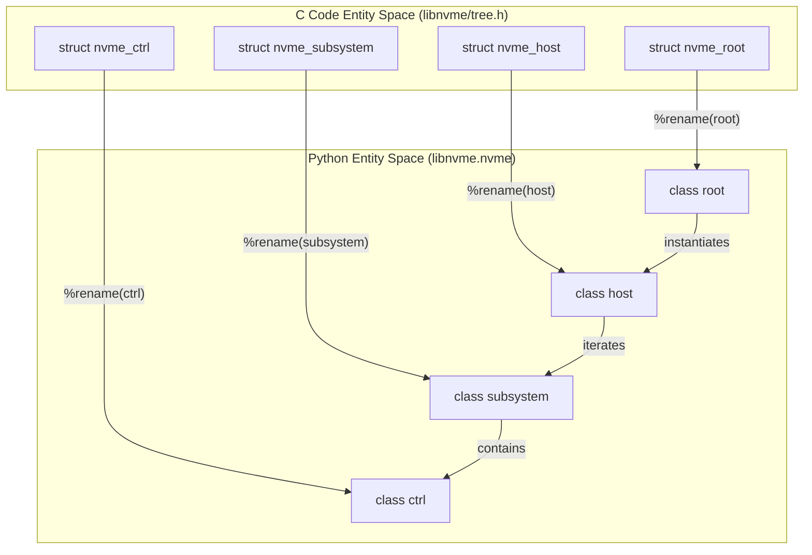
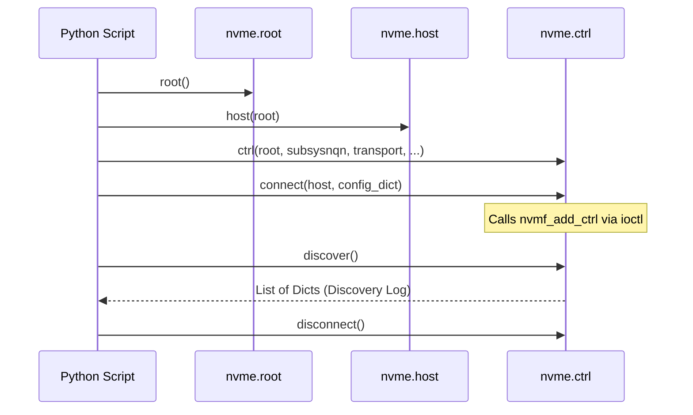

<!-- source: DeepWiki mcp.deepwiki.com · repo NVIDIA/libnvme · page 7 Python Bindings · fetched 2026-10-26 -->

# Python Bindings

Relevant source files

The following files were used as context for generating this wiki page:

- [examples/discover-loop.py](examples/discover-loop.py)
- [libnvme/.gitignore](libnvme/.gitignore)
- [libnvme/README.md](libnvme/README.md)
- [libnvme/__init__.py](libnvme/__init__.py)
- [libnvme/meson.build](libnvme/meson.build)
- [libnvme/nvme.i](libnvme/nvme.i)
- [libnvme/tests/NBFT](libnvme/tests/NBFT)
- [libnvme/tests/gc.py](libnvme/tests/gc.py)
- [libnvme/tests/test-nbft.py](libnvme/tests/test-nbft.py)

The `libnvme` project provides high-level Python bindings generated via [SWIG](http://www.swig.org) [libnvme/README.md:3](). These bindings allow developers to interact with NVMe devices, manage fabrics connections, and parse boot configuration tables using native Python objects and dictionaries instead of complex C structures.

The bindings are packaged as the `libnvme.nvme` module [libnvme/nvme.i:9]().

## Overview of the Python Object Model

The Python API mirrors the hierarchical topology tree found in the C library but renames the core structures to more Pythonic class names.

| C Structure | Python Class | Description |
| :--- | :--- | :--- |
| `struct nvme_root` | `nvme.root` | The top-level singleton representing the library instance [libnvme/nvme.i:16](). |
| `struct nvme_host` | `nvme.host` | Represents a local host entity [libnvme/nvme.i:17](). |
| `struct nvme_subsystem` | `nvme.subsystem` | Represents an NVMe subsystem [libnvme/nvme.i:19](). |
| `struct nvme_ctrl` | `nvme.ctrl` | Represents a controller (local or remote) [libnvme/nvme.i:18](). |
| `struct nvme_ns` | `nvme.ns` | Represents an NVMe namespace [libnvme/nvme.i:20](). |

### Mapping Code Entities to Python Space

The following diagram illustrates how the SWIG interface bridges the underlying C types and functions into the Python `nvme` module.

**Bridge: C Topology to Python Classes**

Sources: [libnvme/nvme.i:16-20](), [libnvme/nvme.i:61-80]()

## Key Features

### Fabrics Configuration and Discovery
The bindings simplify NVMe-over-Fabrics (NVMe-oF) operations by using Python dictionaries for configuration. A SWIG `typemap` automatically converts Python dictionaries into the C `struct nvme_fabrics_config` [libnvme/nvme.i:143-204]().

*   **Connection**: The `nvme.ctrl.connect()` method handles the complexities of writing to `/dev/nvme-fabrics` [libnvme/nvme.i:119-133]().
*   **Discovery**: The `nvme.ctrl.discover()` method returns a list of discovery log entries as native Python dictionaries [libnvme/nvme.i:218-270]().

### NBFT Integration
The Python bindings include support for the NVMe Boot Firmware Table (NBFT). The function `nvme.nbft_get()` parses binary NBFT data (e.g., from `/sys/firmware/acpi/tables/NBFT`) and returns a nested dictionary containing Host, HFI, Discovery, and Subsystem descriptors [libnvme/tests/test-nbft.py:80]().

### Memory Management and GC
The bindings manage the Global Interpreter Lock (GIL) and provide specific protections for garbage collection. To prevent segmentation faults when parent objects (like `root`) are deleted before children (like `ctrl`), the bindings use `%pythonappend` directives to maintain reference counts and ensure safe teardown [libnvme/tests/gc.py:31-42]().

## Usage Example

The following diagram shows the typical workflow for connecting to a discovery controller and retrieving log pages.

**Workflow: Fabrics Discovery**

Sources: [examples/discover-loop.py:32-65](), [libnvme/README.md:21-65]()

## Child Pages

For more detailed technical information, refer to the following child pages:

*   **[Python API Reference and Usage](#7.1)**: Detailed documentation of the `nvme` module classes, method signatures, exception handling, and NBFT dictionary schemas.
*   **[Python Build and Testing](#7.2)**: Information on the Meson build system integration, SWIG requirements, and how to run the Python test suite.

Sources: [libnvme/nvme.i:9-15](), [libnvme/meson.build:20-46](), [libnvme/tests/test-nbft.py:11-76]()

---

